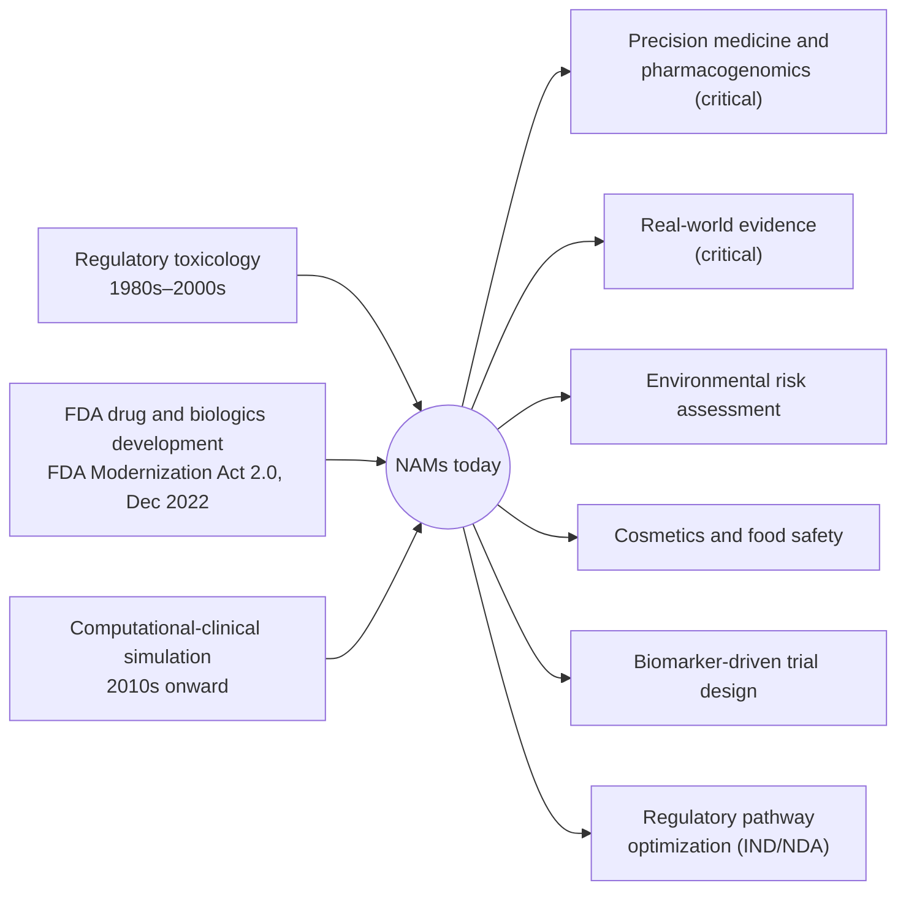

# NAMs search vocabulary: terms, lineages and application domains

Written 2026-10-20 for issue
[#14428](https://github.com/monarch-initiative/dismech/issues/14428), in support
of the NAMs landscape analysis. "New Approach Methodologies" (NAMs) is used in
more than one sense, so before DisMech is searched for NAM content it helps to
pin down what the term covers. This report sets out the search terms that
describe NAMs, where the concept came from, and the uses it is put to. Its
purpose is to decide what to look for in DisMech.

**This report does not map anything to DisMech yet.** It contains no counts of
DisMech entries and makes no claim about what DisMech does or does not hold.
The last section lists where a mapping would start.

**Sources.** OpenScientist job `e7bed1f0-eb28-4981-aace-6559505b2ad0` (run
2026-10-15) supplied the initial list of search terms, and a follow-up chat on
that job supplied the lineages and application domains. The list was then
expanded with five terms (*in vitro*, *complex in vitro*, *precision medicine*,
*patient-specific* and *real-world evidence*), and every count was re-run against PubMed on
2026-10-19 with `scripts/nams_term_counts.py`. The lineages, their dates and
the application domains are OpenScientist's statements and have not been
checked against primary sources, with one exception noted in section 2.

## Summary

- **No single term retrieves the NAMs literature.** "New approach methodologies"
  is not a MeSH heading (a MeSH search for it returns no records), and
  OpenScientist found the phrase itself is recent. Most NAM papers name
  a method (organoid, organ-on-chip, QSAR, PBPK) without using the umbrella
  term, so a search has to combine many method terms.
- **The NAMs concept has three lineages:** regulatory toxicology, FDA drug and
  biologics development, and computational-clinical simulation. A DisMech
  search that follows only one of them will miss NAM content from the others.
- **NAMs are used in six application domains.** Two of them, precision medicine
  and real-world evidence, were singled out as critical; three of the added
  search terms cover them.
- **Term counts span four orders of magnitude.** *In vitro* alone matches
  1,669,467 PubMed records and *in silico* 107,148, while specialist terms such
  as *tissue chip* match a few hundred. The broad terms need a filter before
  they say anything about NAMs.

## 1. Search terms and PubMed counts

Each count is the number of PubMed records whose title or abstract matches the
search, on 2026-10-19. Terms overlap, so the counts do not add up to a total.
IATA (246) and FDA Modernization Act (136) were counted but are left out of the
list.

**What the \* means.** The labels with an asterisk are OpenScientist's. For
*organoid\** and *spheroid\** the asterisk is PubMed's truncation wildcard: the
search matches every word that starts with those letters. For the seven labels
marked † the search used no wildcard; it listed exact phrases instead, usually
the singular and the plural. For example, *digital twin\** was searched as
`"digital twin"[tiab] OR "digital twins"[tiab]`.

| Term | Search run (title/abstract) | PubMed records |
|---|---|---:|
| in vitro | `"in vitro"[tiab]` | 1,669,467 |
| in silico | `"in silico"[tiab]` | 107,148 |
| patient-specific | `"patient-specific"[tiab] OR "patient specific"[tiab]` | 44,242 |
| precision medicine | `"precision medicine"[tiab]` | 42,308 |
| iPSC / hiPSC | `"induced pluripotent stem cell"[tiab] OR "induced pluripotent stem cells"[tiab] OR iPSC[tiab] OR hiPSC[tiab]` | 34,792 |
| organoid\* | `organoid*[tiab]` | 27,786 |
| spheroid\* | `spheroid*[tiab]` | 26,627 |
| high-throughput screening | `"high-throughput screening"[tiab] OR "high throughput screening"[tiab]` | 24,713 |
| QSAR | `QSAR[tiab] OR "quantitative structure-activity relationship"[tiab]` | 16,020 |
| real-world evidence | `"real-world evidence"[tiab] OR "real world evidence"[tiab]` | 12,901 |
| 3D bioprint\* † | `"3D bioprinting"[tiab] OR bioprinted[tiab] OR bioprinting[tiab]` | 8,163 |
| PBPK / PBK | `PBPK[tiab] OR PBK[tiab] OR "physiologically based pharmacokinetic"[tiab] OR "physiologically based kinetic"[tiab]` | 7,407 |
| adverse outcome pathway\* † | `"adverse outcome pathway"[tiab] OR "adverse outcome pathways"[tiab] OR AOP[tiab]` | 4,714 |
| digital twin\* † | `"digital twin"[tiab] OR "digital twins"[tiab]` | 4,161 |
| organ-on-chip\* † | `"organ-on-a-chip"[tiab] OR "organ-on-chip"[tiab] OR "organ on a chip"[tiab] OR "organs-on-chips"[tiab]` | 3,748 |
| virtual patient / cohort | `"virtual patient"[tiab] OR "virtual patients"[tiab] OR "virtual cohort"[tiab]` | 2,692 |
| microphysiological system\* † | `"microphysiological system"[tiab] OR "microphysiological systems"[tiab]` | 1,607 |
| complex in vitro | `"complex in vitro"[tiab]` | 1,266 |
| read-across | `"read-across"[tiab] OR "read across"[tiab]` | 1,050 |
| ToxCast / Tox21 | `ToxCast[tiab] OR Tox21[tiab]` | 855 |
| IVIVE / QIVIVE | `IVIVE[tiab] OR QIVIVE[tiab] OR "in vitro to in vivo extrapolation"[tiab]` | 819 |
| alternatives to animal testing | `"alternatives to animal testing"[tiab] OR "alternative to animal testing"[tiab]` | 517 |
| tissue chip\* † | `"tissue chip"[tiab] OR "tissue chips"[tiab]` | 380 |
| HTTr | `"high-throughput transcriptomics"[tiab] OR "high throughput transcriptomics"[tiab] OR HTTr[tiab]` | 273 |
| in silico clinical trial\* † | `"in silico clinical trial"[tiab] OR "in silico clinical trials"[tiab] OR "in silico trial"[tiab]` | 262 |

Two caveats on individual searches:

- The *adverse outcome pathway\** search also matches the abbreviation `AOP`,
  which has other meanings, so that count may include unrelated records.
- *In vitro*, *patient-specific* and *precision medicine* count every PubMed
  record that uses them, not only NAM papers.

The full table, with the counts OpenScientist reported on 2026-10-15 beside
the current ones, is
[`data/nams-term-counts-2026-10-19.tsv`](data/nams-term-counts-2026-10-19.tsv).
The 20 terms from the original list changed by at most 0.6% between the two
dates.

## 2. Lineages and application domains

The lineages are the historical sources of NAM methods. The application domains
are the places NAM outputs are used.



| Lineage | Origins | Purpose | Characteristic methods |
|---|---|---|---|
| Regulatory toxicology (1980s–2000s) | EPA, NICEATM/ICCVAM, Tox21/ToxCast, NIEHS/NTP | Chemical safety assessment with fewer animal tests | Adverse outcome pathways, read-across, high-throughput screening |
| FDA drug and biologics development (organ chips from the 2010s; law signed December 2022) | FDA Modernization Act 2.0; FDCA §505(z) "nonclinical tests" | Human-relevant prediction of drug safety and efficacy | Organoids, organ chips, iPSC-derived systems, PBPK, QSAR |
| Computational-clinical simulation (2010s, accelerating in the 2020s) | Clinical pharmacometrics, quantitative systems pharmacology, model-informed drug development | Human dose prediction and trial design | Digital twins, virtual patients and cohorts, in silico clinical trials |

**The third lineage came from the follow-up chat.** The 10-iteration run
described NAMs as having two lineages. The computational-clinical lineage was
named afterwards, from terms the run had grouped as one of its search clusters.

**FDA Modernization Act 2.0 date.** The chat dates the Act to 2023. It was
signed into law on 29 December 2022, as stated in the abstract of
Han 2023, [PMID:36762462](https://pubmed.ncbi.nlm.nih.gov/36762462/). The
article was published in 2023, which is the likely source of the 2023 date.

The six application domains come from the chat's proposed taxonomy. It names
precision medicine and real-world evidence as the two critical layers:
precision medicine for patient stratification and individual prediction, and
real-world evidence as data that validates or contextualises NAM predictions.

## 3. Search terms by application domain

**This grouping is a draft, not OpenScientist's.** The chat names the six
domains but does not assign search terms to them. A term can sit in more than
one domain, so the counts within a domain overlap. The *Why* column gives the
reason for each assignment, so it can be corrected term by term.

| Term | Records | Precision medicine | Real-world evidence | Environmental risk | Cosmetics and food | Trial design | IND/NDA | Why |
|---|---:|:-:|:-:|:-:|:-:|:-:|:-:|---|
| in vitro | 1,669,467 |  |  |  |  |  | ● | Cell-based assays are one of the nonclinical test types FDCA §505(z) lists. Too generic to place in a narrower domain. |
| in silico | 107,148 |  |  |  |  |  | ● | Computer modelling is one of the nonclinical test types FDCA §505(z) lists for IND/NDA packages. Too generic to place in a narrower domain. |
| patient-specific | 44,242 | ● |  |  |  |  |  | The follow-up chat lists "patient-specific" as a precision-medicine term the vocabulary missed. |
| precision medicine | 42,308 | ● |  |  |  |  |  | Names the precision-medicine domain directly. |
| iPSC / hiPSC | 34,792 | ● |  |  |  |  |  | Patient-derived iPSC systems are the chat's first example of a precision-medicine use. |
| organoid\* | 27,786 | ● |  |  |  |  |  | Patient-derived organoids are used to test individual drug response. |
| spheroid\* | 26,627 | ● |  |  |  |  |  | Patient-derived tumour spheroids are used for individual drug-response testing. |
| high-throughput screening | 24,713 |  |  | ● |  |  |  | The Tox21/ToxCast route for ranking chemical hazard. |
| QSAR | 16,020 |  |  | ● | ● |  |  | Predicts chemical hazard; used for environmental chemicals and for cosmetic ingredients where animal tests are restricted. |
| real-world evidence | 12,901 |  | ● |  |  |  |  | Names the real-world evidence domain directly. |
| 3D bioprint\* † | 8,163 |  |  |  | ● |  |  | Bioprinted and reconstructed skin models are used for cosmetic irritation and sensitisation testing. |
| PBPK / PBK | 7,407 |  |  |  |  | ● | ● | Drives dose selection in trial design and is part of model-informed drug development in IND/NDA submissions. |
| adverse outcome pathway\* † | 4,714 |  |  | ● | ● |  |  | The organising framework for chemical risk assessment, including skin sensitisation for cosmetics. |
| digital twin\* † | 4,161 | ● |  |  |  | ● |  | The chat pairs digital twins with personalised prediction, and they are used to design trial arms. |
| organ-on-chip\* † | 3,748 | ● |  |  |  |  | ● | Patient-derived chips for individual response, and qualification as drug development tools. |
| virtual patient / cohort | 2,692 |  |  |  |  | ● |  | Used to simulate trial populations and stratify them. |
| microphysiological system\* † | 1,607 | ● |  |  |  |  | ● | The chat names patient-derived MPS for precision medicine. The IQ MPS Consortium works on regulatory qualification. |
| complex in vitro | 1,266 |  |  |  |  |  | ● | Complex in vitro models (organoids, organ chips, MPS) are the term used in drug-safety and regulatory qualification discussions. |
| read-across | 1,050 |  |  | ● | ● |  |  | Fills data gaps for untested chemicals, including cosmetic ingredients. |
| ToxCast / Tox21 | 855 |  |  | ● |  |  |  | EPA and NCATS chemical-screening programmes. |
| IVIVE / QIVIVE | 819 |  |  | ● |  |  | ● | Converts in vitro concentrations to human doses, for chemical risk and for drug submissions. |
| alternatives to animal testing | 517 |  |  |  | ● |  |  | The framing used by cosmetics regulation, where animal testing is banned in several markets. |
| tissue chip\* † | 380 |  |  |  |  |  | ● | The NCATS Tissue Chip programme term, aimed at drug-development use. |
| HTTr | 273 |  |  | ● |  |  |  | EPA high-throughput transcriptomics for chemical points of departure. |
| in silico clinical trial\* † | 262 |  |  |  |  | ● |  | Simulated trials used to design or supplement real ones. |

Column key: Precision medicine = precision medicine and pharmacogenomics;
Real-world evidence = RWD/RWE integration; Environmental risk = environmental
risk assessment and remediation; Cosmetics and food = cosmetics and food
safety; Trial design = biomarker-driven clinical-trial design; IND/NDA =
regulatory pathway optimization.

## Where a mapping to DisMech would start

The mapping itself is the next step and is not done here. NAM content in
DisMech is recorded mainly in the `experimental_models` slot of a disorder
entry. Each `ExperimentalModel` has an `experimental_model_type` (`ORGANOID`,
`ORGAN_ON_CHIP`, `CELL_LINE`, `IPSC_DERIVED_MODEL`, `PRIMARY_CELL_CULTURE`,
`CO_CULTURE` or `OTHER`) and can link to pathograph nodes through
`modeled_mechanisms`. These model types cover the in vitro methods from the
FDA lineage. A mapping would also need to look elsewhere for the two other
lineages, because their methods are computational or assay-based rather than
model systems: adverse outcome pathways, ToxCast/Tox21 assays and read-across
from regulatory toxicology, and PBPK, QSP, digital twins and virtual patients
from computational-clinical simulation.

## Reproducing the counts

```bash
uv run python scripts/nams_term_counts.py --out docs/reports/data/nams-term-counts-<date>.tsv
```

The script re-runs each search exactly as OpenScientist ran it (from the job's
`provenance/iter4_transcript.json`), adds the expanded terms, and prints the
current count beside the reported one. PubMed grows daily, so counts drift
upward between runs.
