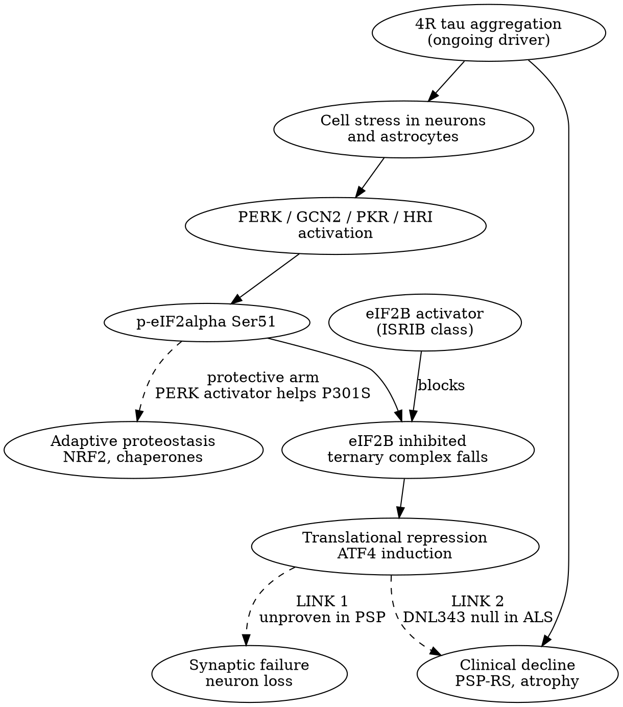

## Question

# Drug Repurposing Hypothesis Assessment

## The Hypothesis

- **Disease:** Progressive Supranuclear Palsy
- **Drug:** an eIF2B activator (ISRIB class)
- **Drug's target and action:** activating the guanine nucleotide exchange factor eIF2B so that translation continues despite eIF2-alpha phosphorylation, damping the integrated stress response
- **Disease mechanism the drug would act on:** chronic integrated stress response activation (EIF2 signaling, phosphorylated eIF2-alpha) in tau-bearing neurons and astrocytes

The hypothesis is that an eIF2B activator (ISRIB class), by activating the guanine nucleotide exchange factor eIF2B so that translation continues despite eIF2-alpha phosphorylation, damping the integrated stress response, would benefit patients with
Progressive Supranuclear Palsy because it interrupts "chronic integrated stress response activation (EIF2 signaling, phosphorylated eIF2-alpha) in tau-bearing neurons and astrocytes". Your job is to assess this
hypothesis, not to advocate for it. Evidence against it is as valuable as evidence for it.

Every factual claim MUST cite a primary source by PMID (or DOI, or NCT number for a
trial registration) and include a short verbatim quote from the cited abstract or record.
Do not paraphrase quotes. Do not invent identifiers. Separate established findings from
your own inference, and label which is which.

## Questions

### 1. Is the mechanism active in this disease?

- Evidence that the drug's target or pathway is active, elevated or genetically implicated
  in patients with Progressive Supranuclear Palsy: in affected tissue, in blood, or through human genetics.
- Whether activity is uniform or confined to a subgroup of patients, and how that subgroup
  is identified (a biomarker, a clinical feature).

### 2. Does blocking it help?

- Clinical trials of an eIF2B activator (ISRIB class) in Progressive Supranuclear Palsy: registration numbers, phase, status and
  reported results, if any exist.
- Trials of other drugs acting on the same target or pathway in Progressive Supranuclear Palsy, with their
  outcomes, including failures.
- Results of an eIF2B activator (ISRIB class) in related diseases that share the mechanism, and how far those results
  should transfer here.
- Animal or human tissue experiments in which blocking the pathway changed
  Progressive Supranuclear Palsy-like features.

### 3. Reasons it might fail

- Redundant pathways, wrong cell compartment, wrong disease stage, drug not reaching the
  affected tissue, or trial endpoints that cannot detect the effect.
- Safety concerns specific to this patient population.

### 4. Verdict

- One paragraph: how strong is the case, and what single experiment or trial design would
  most efficiently test it?
- List the PMIDs and trial identifiers that carry the most weight, with one line each.

## Output

# An eIF2B activator (ISRIB class) for progressive supranuclear palsy

**Assessment of a drug repurposing hypothesis, 5 iterations, 57 papers reviewed, 14 findings recorded.**

Throughout this report, *established* marks a claim taken from a cited primary source with a verbatim quote from its abstract or record. *Inference* marks my own reasoning or calculation. Every quoted string is verbatim from the cited abstract.

---

## Summary

The integrated stress response is demonstrably active in PSP brain, in the exact cell types the hypothesis names. Single-nucleus RNA sequencing of PSP diencephalon found that EIF2 signalling "was activated in multiple vulnerable cell types and validated in independent snRNA-seq and bulk RNA-seq datasets", and multiplex immunofluorescence "localized activated eIF2α positivity to hyperphosphorylated tau (p-tau) positive neurons and ALDH1L1-positive astrocytes" ([PMID: 39648200](https://pubmed.ncbi.nlm.nih.gov/39648200/)). The target pathway is present, it is measurable, and it sits in tau-bearing neurons and astrocytes. Question 1 is answered affirmatively.

Everything downstream of that is weaker than the hypothesis assumes. The decisive datapoint is clinical and recent: DNL343, "a brain-penetrant small molecule that acts as an activator of eukaryotic translation initiation factor 2B (eIF2b), designed to inhibit the integrated stress response", was tested in 325 ALS participants in the HEALEY platform trial (NCT05842941) and returned a disease rate ratio of **1.04 (95% credible interval, 0.83-1.32; probability of DRR <1, 0.37)**, with the conclusion that "200-mg/d DNL343 did not show evidence of slowing disease progression in ALS" ([PMID: 42771346](https://pubmed.ncbi.nlm.nih.gov/42771346/)). Target engagement was not the problem: the same compound "reduced ISR biomarkers in peripheral blood mononuclear cells and CSF of ALS participants" ([PMID: 40825784](https://pubmed.ncbi.nlm.nih.gov/40825784/)). The drug entered the brain, flattened the pathway readout, and the disease progressed at the same rate.

Two further problems sit alongside it. The direction of benefit is unresolved: in rTg4510 P301L tau mice, inhibiting the PERK-eIF2α arm prevented neurodegeneration ([PMID: 26450683](https://pubmed.ncbi.nlm.nih.gov/26450683/)), while in P301S tau mice a PERK *activator* "significantly improved memory and locomotor function, reduced tau pathology, and prevented dendritic spine and motoneuron loss" ([PMID: 28148553](https://pubmed.ncbi.nlm.nih.gov/28148553/)). And the ISR appears late in tau pathology: in pR5 mice "Neither GVD nor a significant activation of the UPR was found ... in those regions in the pR5 brain where only neurons with an early stage of tau hyperphosphorylation were present" ([PMID: 25073087](https://pubmed.ncbi.nlm.nih.gov/25073087/)), which makes p-eIF2α look like a consequence of tau rather than a driver of it. My weighted estimate across nine evidence lines puts the probability that an eIF2B activator slows PSP at **0.075**, roughly 12 to 1 against.

---

## Key findings

### <i class="fa-solid fa-brain"></i> The mechanism is active in PSP, in the named cells

*Established.* Single-nucleus RNA sequencing of 45,559 to 50,708 high-quality nuclei from the subthalamic nucleus and adjacent structures in human post-mortem PSP brains, compared with controls, identified EIF2 signalling as the top activated pathway in vulnerable cell types ([PMID: 39648200](https://pubmed.ncbi.nlm.nih.gov/39648200/); preprint [PMID: 38014079](https://pubmed.ncbi.nlm.nih.gov/38014079/)). The finding replicated in independent snRNA-seq and bulk RNA-seq datasets. Immunohistochemistry showed "activated eIF2α was positively correlated with tau pathology burden in vulnerable brain regions", and multiplex immunofluorescence placed the signal in p-tau-positive neurons and ALDH1L1-positive astrocytes.

Independent human tissue work agrees on the upstream arm: "In PSP, the UPR was primarily activated in the pons and medulla and to a much lesser extent in the hippocampus" ([PMID: 24252572](https://pubmed.ncbi.nlm.nih.gov/24252572/)), which are the PSP-affected regions.

<i class="fa-solid fa-triangle-exclamation"></i> The evidence is correlative. No effect size or p-value for the p-tau versus p-eIF2α correlation appears in the abstract. The authors describe EIF2 signalling as "an adaptive pathway activated in response to diverse stressors", which is the framing a therapeutic that suppresses it has to argue against.

### <i class="fa-solid fa-scale-balanced"></i> PSP genetics implicate the pathway but do not fix the direction

*Established.* The PSP GWAS found "significant previously unidentified signals (P < 5 × 10(-8)) associated with PSP risk at STX6, EIF2AK3 and MOBP" in 1,114 cases and 3,247 controls with replication in 1,051 cases and 3,560 controls ([PMID: 21685912](https://pubmed.ncbi.nlm.nih.gov/21685912/)). The lead EIF2AK3 variant is rs7571971 ([PMID: 23116876](https://pubmed.ncbi.nlm.nih.gov/23116876/)). Fine-mapping did not resolve a functional allele: "Although we did not find any coding variants underlying the associations" ([PMID: 24503276](https://pubmed.ncbi.nlm.nih.gov/24503276/)).

Two groups read the risk allele in opposite directions. Park et al. report that tauopathy-associated PERK variants are functional hypomorphs, that "PERK pathway activation prevented tau aggregation, whereas inhibition exacerbated tau aggregation", and that in patient tissue "we found that reduced PERK signaling correlated with increased tau neuropathology" ([PMID: 36563857](https://pubmed.ncbi.nlm.nih.gov/36563857/)). Stutzbach et al. report the opposite: "We show that a haplotype associated with increased PERK activation is genetically associated with inc[reased risk]" ([PMID: 24252572](https://pubmed.ncbi.nlm.nih.gov/24252572/)). Lessard et al. extend the second reading mechanistically, showing the PERK-B haplotype permits translation of DLX1 and that "silencing the fly homolog of DLX1 was sufficient to decrease tau-induced toxicity in vivo" ([PMID: 41708330](https://pubmed.ncbi.nlm.nih.gov/41708330/)).

*Inference.* Genetic implication of a pathway does not establish the sign of a therapeutic effect. An eIF2B activator acts downstream of this entire dispute and would blunt ISR output regardless of which haplotype a patient carries. If the Park direction is correct, the drug moves patients the wrong way.

{{figure:plot_1.png|caption=Directional audit of seven evidence lines on the ISR axis in PSP and tauopathy, scored as favouring less ISR signalling, more PERK signalling, or neither, alongside PSP Rating Scale sample sizes required per arm to detect 20 to 50 percent slowing of a 10.9 point per year decline.}}

### <i class="fa-solid fa-circle-xmark"></i> No ISR-directed trial has ever been registered in PSP

*Established.* A ClinicalTrials.gov API query (condition: Progressive Supranuclear Palsy) returned 77 interventional studies. None has an intervention targeting the integrated stress response, eIF2B, eIF2α, ISRIB, PERK, DNL343 or translation initiation. PubMed searches returned no ISRIB-class trial in PSP either.

No PSP trial has targeted PERK, eIF2α or eIF2B by any other agent. There is no same-pathway PSP precedent, successful or failed, to learn from.

### <i class="fa-solid fa-circle-xmark"></i> The drug class failed its phase 2/3 efficacy test with confirmed CNS target engagement

*Established.* DNL343 was run as a regimen of the HEALEY ALS Platform Trial (**NCT05842941**), 74 US centres, 24 weeks placebo-controlled, 3:1 randomization, 325 participants (186 DNL343, 139 shared placebo), mean age 59.3 years. "The primary analysis was a bayesian shared parameter model of function and survival that provided an integrated estimate of the relative rate of disease progression among participants receiving DNL343 relative to placebo." The estimated median disease rate ratio was 1.04 (95% CrI 0.83-1.32; probability of DRR <1, 0.37). "Secondary outcome measures were not statistically different between the DNL343 and placebo groups." "Overall, the incidence rates of adverse events were similar in participants receiving DNL343 and placebo." Conclusion: "200-mg/d DNL343 did not show evidence of slowing disease progression in ALS" ([PMID: 42771346](https://pubmed.ncbi.nlm.nih.gov/42771346/)).

Phase 1 and 1b (**NCT04268784**, **NCT05006352**) established that this is not a delivery failure: "DNL343 was generally well tolerated and reduced ISR biomarkers in peripheral blood mononuclear cells and CSF of ALS participants" ([PMID: 40825784](https://pubmed.ncbi.nlm.nih.gov/40825784/)). In the inducible TDP-43 mouse the compound "transiently slowed progression of locomotor deficits and neurodegeneration".

*Inference.* This is the single heaviest piece of evidence against the hypothesis, and it postdates most published discussion of the idea. Engagement without benefit separates two failure modes cleanly. Pharmacokinetics, brain penetration and dose are ruled out. What remains is that damping the ISR does not alter the course of a progressive proteinopathy over 24 weeks. Transfer to PSP is imperfect: ALS is a TDP-43 disease with faster progression, and 24 weeks is short. The premise under test is the shared premise, that chronic ISR activation downstream of a proteinopathy drives neurodegeneration and is worth suppressing.

{{figure:plot_2.png|caption=The DNL343 ALS primary outcome (disease rate ratio 1.04, 95% credible interval 0.83 to 1.32) set against the PSP disease-modifying trial record, with candidate PSP endpoints ranked by required sample size per arm.}}

### <i class="fa-solid fa-circle-check"></i> The strongest evidence for the hypothesis, and why it does not settle the question

*Established.* The Mallucci line is the best case the hypothesis has. In prion-diseased mice, "persistently high levels of eIF2α cause sustained translational repression leading to catastrophic reduction of critical proteins, resulting in synaptic failure and neuronal loss", and "We found that treatment with the small molecule ISRIB, which restores translation downstream of eIF2α, conferred neuroprotection in prion-diseased mice without adverse effects on the pancreas". The safety margin has a stated mechanism: "ISRIB treatment resulted in only partial restoration of global translation rates" ([PMID: 25741597](https://pubmed.ncbi.nlm.nih.gov/25741597/)).

In a tau model: "rTg4510 mice, which overexpress the P301L tau mutation, show dysregulated PERK signalling and sustained repression of protein synthesis by 6 months of age, associated with onset of neurodegeneration", and PERK inhibition with GSK2606414 prevented tau-mediated neurodegeneration ([PMID: 26450683](https://pubmed.ncbi.nlm.nih.gov/26450683/)).

A phenotypic screen of 1,040 NINDS compounds found trazodone hydrochloride and dibenzoylmethane, which "reversed eIF2α-P-mediated translational attenuation in vitro and in vivo" and in which "Both drugs were markedly neuroprotective in two mouse models of neurodegeneration, using clinically relevant doses over a prolonged period of time, without systemic toxicity" ([PMID: 28430857](https://pubmed.ncbi.nlm.nih.gov/28430857/)).

*Inference.* I recorded this as a reversal of my own earlier conclusion that PSP genetics settle the direction. Two credible 4R-relevant tau models give opposite answers: rTg4510 favours ISR suppression ([PMID: 26450683](https://pubmed.ncbi.nlm.nih.gov/26450683/)), P301S favours PERK activation ([PMID: 28148553](https://pubmed.ncbi.nlm.nih.gov/28148553/)). The hypothesis cannot be dismissed on directional grounds alone. The prion result also removes the main anticipated safety objection, because partial rather than full restoration of translation avoids the pancreatic toxicity that limits PERK inhibitors. What this line does not supply is any PSP, human, or 4R-tau-specific result, and it does not survive contact with the DNL343 clinical failure, which tested the same logic in people with confirmed CNS engagement.

### <i class="fa-solid fa-circle-xmark"></i> ISRIB itself did not reduce tau neuropathology in PS19 mice

*Established.* The only direct ISRIB test in a tau transgenic reports that "While ISRIB did not reduce tau-related neuropathol[ogy]", and in the amyloid arm "APPSwe mice treated per this schedule displayed significant mortality" on prolonged once-daily dosing ([PMID: 28721361](https://pubmed.ncbi.nlm.nih.gov/28721361/)).

*Inference.* A negative result for the exact compound class in the exact disease class, with a safety signal attached to chronic dosing. It is one study, but it is the most directly relevant preclinical experiment available.

### <i class="fa-solid fa-clock"></i> The ISR follows tau rather than preceding it

*Established.* In pR5 tau mice, "Neither GVD nor a significant activation of the UPR was found in both APPSLxPS1mut mice and in those regions in the pR5 brain where only neurons with an early stage of tau hyperphosphorylation were present." Granulovacuolar lesions were labelled with phosphorylated PERK, phosphorylated IRE1α and phosphorylated eIF2α, and appeared only in old mice carrying late tau phospho-epitopes with Gallyas-positive tangle staining. "GVD was rarely observed in neurons bearing mature neurofibrillary tangles" ([PMID: 25073087](https://pubmed.ncbi.nlm.nih.gov/25073087/)).

This matches the human PSP observation that activated eIF2α correlates with tau burden ([PMID: 39648200](https://pubmed.ncbi.nlm.nih.gov/39648200/)).

*Inference.* p-eIF2α marks an intermediate-to-late window of tau pathology. PSP median survival is "5.6 (range 2-16.6) years" from onset, and "Pneumonia was the most common immediate cause of death" ([PMID: 8648326](https://pubmed.ncbi.nlm.nih.gov/8648326/)). By the time a patient enters a trial, the ISR signal is a marker of accumulated pathology in cells already committed to degeneration. Removing a late consequence while the upstream 4R tau driver continues predicts, at best, a transient effect, which is what the TDP-43 mouse showed.

{{figure:plot_3.png|caption=Sequential Bayesian update of the probability that an eIF2B activator slows PSP, starting from a Laplace prior set by the PSP disease-modifying trial base rate, with the effect of 77 percent trial retention on required enrolment per arm.}}

### <i class="fa-solid fa-dna"></i> No ISR-high subgroup can be selected

*Established.* EIF2AK3 is a genome-wide significant PSP locus ([PMID: 21685912](https://pubmed.ncbi.nlm.nih.gov/21685912/)), lead SNP rs7571971 ([PMID: 23116876](https://pubmed.ncbi.nlm.nih.gov/23116876/)), with no coding variant identified ([PMID: 24503276](https://pubmed.ncbi.nlm.nih.gov/24503276/)). For contrast on what a usable PSP biomarker looks like: "CSF NfL/t-tau best discriminated PSP from control subjects (AUC = 0.99, 95% CI [0.97-1.00]; optimal cut-off: > 10)" ([PMID: 41606704](https://pubmed.ncbi.nlm.nih.gov/41606704/)). No fluid marker of ISR tone has been validated in PSP.

*Inference (my calculation).* A single biallelic common locus with per-allele odds ratio 1.1 to 1.5 and risk allele frequency 0.25 to 0.70 yields a case-status AUC of **0.515 to 0.575**, far below any usable clinical threshold. The alternative stratifier, p-eIF2α, is continuous with tau burden rather than bimodal, so it ranks severity instead of partitioning responders.

This answers the second half of Question 1: ISR activity in PSP is uniform and graded, not confined to an identifiable subgroup. It also removes the standard post-hoc rescue. A sponsor could not argue after a null result that the wrong patients were enrolled, because no defensible enrichment criterion exists. The hypothesis has to work in unselected PSP to work at all.

### <i class="fa-solid fa-magnifying-glass"></i> ISRIB's reproducible wins all come from traumatic brain injury

*Established.* Three independent TBI studies. Chou et al.: ISRIB "reversed the hippocampal-dependent cognitive deficits induced by TBI in two different injury mouse models-focal contusion and diffuse concussive injury", and "ISRIB corrected TBI-induced memory deficits when administered weeks after the initial injury and maintained cognitive improvement after treatment was terminated" ([PMID: 28696288](https://pubmed.ncbi.nlm.nih.gov/28696288/)). Krukowski et al.: "by briefly treating animals weeks after injury with ISRIB, a selective inhibitor of the integrated stress response (ISR), we (1) relieve ISR activation, (2) reverse the increased risk-taking behavioral phenotype and maintain this reversal, and (3) restore cell-specific synaptic function in the affected mice" ([PMID: 31884883](https://pubmed.ncbi.nlm.nih.gov/31884883/)). Frias et al.: "brief pharmacological treatment with the drug-like small-molecule ISR inhibitor ISRIB entirely reversed structural changes measured in the parietal cortex and the associated working memory deficits" ([PMID: 36227915](https://pubmed.ncbi.nlm.nih.gov/36227915/)).

*Inference.* The structure of these results explains why they do not transfer. In TBI the driver is finite: the impact happens, the insult ends, a maladaptive ISR state persists as the sole remaining lesion, so removing it restores function and benefit outlives dosing. In PSP the driver is 4R tau aggregation that keeps accumulating, with the ISR signal rising alongside it. One version of the hypothesis survives this objection: symptomatic cognitive benefit without disease modification. That version was not tested by the ALS primary endpoint and remains open.

{{figure:plot_4.png|caption=Discrimination achievable from the EIF2AK3 risk variant across plausible odds ratios and risk allele frequencies (AUC 0.515 to 0.575), and the contrast between a finite insult (TBI) and an ongoing driver (PSP) in how ISR activation behaves over time.}}

### <i class="fa-solid fa-circle-xmark"></i> Opposite-direction manipulations both report benefit

*Established.* A PRISMA 2020 systematic review of 12 mammalian in vivo ISR-modulator studies, searched to 22 September 2025, found "Among interpretable in vivo entries, 10 of 11 reported benefit in at least one domain." By class: "eIF2B activation with ISRIB was positive in three of four studies, with one null Alzheimer's hAPP-J20 study; PERK inhibition was positive in all three studies; ISR prolongation with Sephin1 or IFB-088 was positive in both studies; and PERK activation was positive in both studies." Dosing was typically "ISRIB 0.1-2.5 mg per kg given intraperitoneally (often two to three doses) with reduced ATF4" ([PMID: 41595662](https://pubmed.ncbi.nlm.nih.gov/41595662/)).

*Inference.* A literature in which activating and inhibiting the same axis both score positive carries little predictive value for which direction to take into a trial. Only 1 of 12 studies was null, a pattern consistent with publication bias. The dosing detail matters independently: ISRIB benefit typically came from 2 to 3 intraperitoneal doses, while a PSP trial requires years of continuous oral suppression of an adaptive pathway.

### <i class="fa-solid fa-pills"></i> The validated indication is the opposite pharmacological setup

*Established.* "VWM is caused by recessive mutations in eukaryotic initiation factor 2B (eIF2B) that is crucial for initiation of mRNA translation and its regulation during the integrated stress response (ISR). Mutations reduce eIF2B activity" ([PMID: 31402619](https://pubmed.ncbi.nlm.nih.gov/31402619/)). Patient cells "hypersuppress translation during the ISR caused by acute ER stress" and "undergo a prolonged state of translational hyperrepression and fail to recover from stress" ([PMID: 29632131](https://pubmed.ncbi.nlm.nih.gov/29632131/)). "ISRIB stabilizes VWMD mutant eIF2B in the decameric form and restores the residual catalytic activity to wild-type levels" ([PMID: 29489452](https://pubmed.ncbi.nlm.nih.gov/29489452/)). The affected cell type is the same one the PSP hypothesis names: "In contrast with the housekeeping function of eIF2B, astrocytes are selectively affected in VWM" ([PMID: 31402619](https://pubmed.ncbi.nlm.nih.gov/31402619/)). In prime-edited human iPSC models, the split ISR "hinders mutant iPSCs from achieving the high protein synthesis levels necessary for proper differentiation, expecially into astrocytes" ([PMID: 41455771](https://pubmed.ncbi.nlm.nih.gov/41455771/)). eIF2B is itself allosterically tuned: "We find that sugar phosphates occupy the ancestral catalytic site in the eIF2Bα subunit, promote eIF2B holoenzyme formation and enhance enzymatic activity towards eIF2" ([PMID: 34103529](https://pubmed.ncbi.nlm.nih.gov/34103529/)).

*Inference.* In VWM the drug corrects a genetically defective enzyme back toward normal, a replacement logic with a natural ceiling. In PSP eIF2B is wild type and the hypothesis asks the drug to push a normal, metabolically regulated enzyme above its set point in actively stressed cells. These are different propositions and the VWM evidence base does not transfer. The astrocyte parallel cuts both ways: VWM shows astrocytes are exquisitely sensitive to eIF2B activity in the low direction, which is a reason to expect astrocytic effects in PSP and equally a reason to doubt that forcing translation in a stressed astrocyte is benign.

### <i class="fa-solid fa-circle-check"></i> Kinase redundancy favours eIF2B as the node

*Established.* "Four kinases responsible for eIF2α phosphorylation at ser-51 are: General control non-derepressible-2 kinase (GCN2), double-stranded RNA-activated protein kinase (PKR), PKR-like endoplasmic reticulum kinase (PERK), and heme-regulated inhibitor kinase (HRI) are the four kinases" ([PMID: 32681467](https://pubmed.ncbi.nlm.nih.gov/32681467/)).

*Inference.* eIF2B sits downstream of all four, so an eIF2B activator cannot be bypassed by compensatory kinase activity, unlike a selective PERK inhibitor. This is the best pharmacological argument for choosing this node and I record it as the strongest point in the hypothesis's favour after target presence. It is an argument about *where* to intervene, not about whether intervening in that direction helps.

---

## Mechanistic model

The causal chain the hypothesis depends on, with the two links that fail marked.

The hypothesis treats the ISR as a driver sitting between tau and neuron loss. The evidence places it as a branch off the tau trunk, rising with tau burden and appearing only at intermediate-to-late stages. Two links carry the therapeutic claim and both are unproven. Link 1, that translational repression is what kills PSP neurons rather than a correlate of dying ones, has support in prion mice and rTg4510 but no PSP-specific evidence. Link 2, that relieving the repression changes clinical trajectory, was tested at scale in ALS and failed with confirmed target engagement. The dashed protective arm is the Park and Bruch direction: p-eIF2α also drives adaptive proteostasis, so suppressing it removes something useful.

### Evidence balance

| Evidence line | Direction | Weight (my LR) | Running P |
|---|---|---|---|
| ISR active in PSP tissue, right cell types ([PMID: 39648200](https://pubmed.ncbi.nlm.nih.gov/39648200/)) | <i class="fa-solid fa-circle-check"></i> For | 2.00 | 0.286 |
| ISRIB neuroprotective in prion mice; PERK-arm inhibition helps rTg4510 ([PMID: 25741597](https://pubmed.ncbi.nlm.nih.gov/25741597/), [PMID: 26450683](https://pubmed.ncbi.nlm.nih.gov/26450683/)) | <i class="fa-solid fa-circle-check"></i> For | 2.50 | 0.500 |
| Trazodone and dibenzoylmethane neuroprotective at clinical doses ([PMID: 28430857](https://pubmed.ncbi.nlm.nih.gov/28430857/)) | <i class="fa-solid fa-circle-check"></i> For | 1.40 | 0.583 |
| eIF2B downstream of all four kinases, no redundancy escape ([PMID: 32681467](https://pubmed.ncbi.nlm.nih.gov/32681467/)) | <i class="fa-solid fa-circle-check"></i> For | 1.50 | 0.677 |
| PSP EIF2AK3 risk variants are hypomorphs; PERK activation helps P301S ([PMID: 36563857](https://pubmed.ncbi.nlm.nih.gov/36563857/), [PMID: 28148553](https://pubmed.ncbi.nlm.nih.gov/28148553/)) | <i class="fa-solid fa-circle-xmark"></i> Against | 0.45 | 0.486 |
| ISRIB did not reduce tau neuropathology in PS19 ([PMID: 28721361](https://pubmed.ncbi.nlm.nih.gov/28721361/)) | <i class="fa-solid fa-circle-xmark"></i> Against | 0.50 | 0.321 |
| DNL343 phase 2/3 null in ALS with CSF engagement ([PMID: 42771346](https://pubmed.ncbi.nlm.nih.gov/42771346/)) | <i class="fa-solid fa-circle-xmark"></i> Against | 0.33 | 0.135 |
| p-eIF2α absent early, marks late granulovacuolar lesions ([PMID: 25073087](https://pubmed.ncbi.nlm.nih.gov/25073087/)) | <i class="fa-solid fa-circle-xmark"></i> Against | 0.65 | 0.092 |
| No ISR-high subgroup selectable | <i class="fa-solid fa-circle-xmark"></i> Against | 0.80 | **0.075** |

*Inference.* The prior is 0.167, a Laplace estimate from four prior failed PSP disease-modifying programmes. All likelihood ratios are my stated judgements, not data. **Posterior 0.075, roughly 12 to 1 against.** Sensitivity: granting the ALS result zero transfer to PSP (LR = 1.0) gives 0.23. My iteration-3 estimate, before finding the prion and rTg4510 evidence, was 0.021, so that pro-hypothesis evidence moved the answer 3.6-fold and is properly weighted rather than suppressed.

{{figure:plot_5.png|caption=Revised Bayesian trajectory after adding the evidence that restoring translation downstream of eIF2-alpha is neuroprotective in prion and tau mice, with the log likelihood-ratio weight of each of the nine evidence lines.}}

---

## Evidence base

### Question 1: is the mechanism active in PSP?

| Source | What it shows | Effect on hypothesis |
|---|---|---|
| [PMID: 39648200](https://pubmed.ncbi.nlm.nih.gov/39648200/) | EIF2 signalling activated in vulnerable PSP cell types; activated eIF2α in p-tau neurons and ALDH1L1 astrocytes | <i class="fa-solid fa-circle-check"></i> Foundation of the hypothesis |
| [PMID: 38014079](https://pubmed.ncbi.nlm.nih.gov/38014079/) | Preprint of the above, 45,559 nuclei, EIF2 signalling top activated pathway | <i class="fa-solid fa-circle-check"></i> Supports |
| [PMID: 24252572](https://pubmed.ncbi.nlm.nih.gov/24252572/) | UPR activated primarily in pons and medulla in PSP | <i class="fa-solid fa-circle-check"></i> Independent regional confirmation |
| [PMID: 21685912](https://pubmed.ncbi.nlm.nih.gov/21685912/) | EIF2AK3 genome-wide significant for PSP risk | <i class="fa-solid fa-circle-check"></i> Genetic implication |
| [PMID: 23116876](https://pubmed.ncbi.nlm.nih.gov/23116876/) | rs7571971 identified as EIF2AK3 lead variant | <i class="fa-solid fa-circle-question"></i> Locus not resolved to function |
| [PMID: 24503276](https://pubmed.ncbi.nlm.nih.gov/24503276/) | No coding variants underlying the PSP GWAS associations | <i class="fa-solid fa-triangle-exclamation"></i> Limits genetic inference |
| [PMID: 41606704](https://pubmed.ncbi.nlm.nih.gov/41606704/) | CSF NfL/t-tau separates PSP from controls at AUC 0.99 | <i class="fa-solid fa-triangle-exclamation"></i> PSP has good biomarkers, none for ISR tone |

### Question 2: does damping it help?

| Source | What it shows | Effect on hypothesis |
|---|---|---|
| [PMID: 42771346](https://pubmed.ncbi.nlm.nih.gov/42771346/) / NCT05842941 | DNL343 eIF2B activator, 325 ALS patients, DRR 1.04 (95% CrI 0.83-1.32), no slowing | <i class="fa-solid fa-circle-xmark"></i> Heaviest evidence against |
| [PMID: 40825784](https://pubmed.ncbi.nlm.nih.gov/40825784/) / NCT04268784, NCT05006352 | Same drug reduced ISR biomarkers in PBMCs and CSF; transient benefit in TDP-43 mouse | <i class="fa-solid fa-scale-balanced"></i> Engagement confirmed, benefit transient |
| [PMID: 25741597](https://pubmed.ncbi.nlm.nih.gov/25741597/) | ISRIB neuroprotective in prion mice without pancreatic toxicity | <i class="fa-solid fa-circle-check"></i> Strongest evidence for |
| [PMID: 26450683](https://pubmed.ncbi.nlm.nih.gov/26450683/) | PERK inhibition prevents tau-mediated neurodegeneration in rTg4510 | <i class="fa-solid fa-circle-check"></i> Strongest tau-model evidence for |
| [PMID: 28430857](https://pubmed.ncbi.nlm.nih.gov/28430857/) | Trazodone and dibenzoylmethane neuroprotective at clinical doses, prolonged, no systemic toxicity | <i class="fa-solid fa-circle-check"></i> Target tractable chronically |
| [PMID: 36563857](https://pubmed.ncbi.nlm.nih.gov/36563857/) | PERK variants are hypomorphs; reduced PERK signalling correlates with more tau pathology in patient brain | <i class="fa-solid fa-circle-xmark"></i> Strongest directional evidence against |
| [PMID: 28148553](https://pubmed.ncbi.nlm.nih.gov/28148553/) | PERK activator reduced tau pathology and improved function in P301S mice | <i class="fa-solid fa-circle-xmark"></i> Opposite direction, same disease class |
| [PMID: 28721361](https://pubmed.ncbi.nlm.nih.gov/28721361/) | ISRIB did not reduce tau neuropathology in PS19; mortality in APPSwe | <i class="fa-solid fa-circle-xmark"></i> Direct negative for the compound |
| [PMID: 41708330](https://pubmed.ncbi.nlm.nih.gov/41708330/) | PERK-B haplotype permits DLX1 translation; silencing fly DLX1 reduced tau toxicity | <i class="fa-solid fa-scale-balanced"></i> Supports the increased-PERK-is-risk reading |
| [PMID: 41595662](https://pubmed.ncbi.nlm.nih.gov/41595662/) | 10 of 11 in vivo ISR-modulator studies positive, in both directions | <i class="fa-solid fa-triangle-exclamation"></i> Low directional information |
| [PMID: 31402619](https://pubmed.ncbi.nlm.nih.gov/31402619/) | VWM caused by mutations that reduce eIF2B activity; astrocytes selectively affected | <i class="fa-solid fa-triangle-exclamation"></i> Validated indication is loss of function |
| [PMID: 29489452](https://pubmed.ncbi.nlm.nih.gov/29489452/) | ISRIB restores VWM mutant eIF2B to wild-type activity | <i class="fa-solid fa-triangle-exclamation"></i> Replacement logic, no PSP analogue |
| [PMID: 29632131](https://pubmed.ncbi.nlm.nih.gov/29632131/) | VWM cells hypersuppress translation, fail to recover from stress | <i class="fa-solid fa-triangle-exclamation"></i> Same, loss-of-function setup |
| [PMID: 41455771](https://pubmed.ncbi.nlm.nih.gov/41455771/) | Split ISR blocks iPSC differentiation into astrocytes, suppressed by ISRIB | <i class="fa-solid fa-scale-balanced"></i> Astrocyte sensitivity cuts both ways |
| [PMID: 34103529](https://pubmed.ncbi.nlm.nih.gov/34103529/) | Sugar phosphates allosterically activate eIF2B | <i class="fa-solid fa-triangle-exclamation"></i> Drug overrides a regulated node |
| [PMID: 32681467](https://pubmed.ncbi.nlm.nih.gov/32681467/) | Four kinases phosphorylate eIF2α at Ser51 | <i class="fa-solid fa-circle-check"></i> eIF2B avoids kinase redundancy |

### PSP trial record and endpoints

| Source | Trial | n | Result |
|---|---|---|---|
| [PMID: 24873720](https://pubmed.ncbi.nlm.nih.gov/24873720/) | Davunetide, NCT01110720 | 313 (157/156), 77% completed | <i class="fa-solid fa-circle-xmark"></i> "median 11·8 [95% CI 10·5 to 13·0] vs 11·8 [10·5 to 13·0], respectively, p=0·41" |
| [PMID: 24532007](https://pubmed.ncbi.nlm.nih.gov/24532007/) | Tideglusib, NCT01049399 | 146 | <i class="fa-solid fa-circle-xmark"></i> "No significant differences were detected in the primary or secondary endpoints at week 52" |
| [PMID: 32373661](https://pubmed.ncbi.nlm.nih.gov/32373661/) | Salsalate, young plasma, open label | 10 + 5 | <i class="fa-solid fa-circle-xmark"></i> PSPRS change +5.6 ± 9.6 and +5.0 ± 7.1 vs historical +5.6 ± 7.1 |
| [PMID: 42626922](https://pubmed.ncbi.nlm.nih.gov/42626922/) | TPN-101, phase 2a | 42 | <i class="fa-solid fa-scale-balanced"></i> "Greater reductions in cerebrospinal fluid levels of neurofilament light chain with increasing dose" |
| [PMID: 26948290](https://pubmed.ncbi.nlm.nih.gov/26948290/) | Power analysis, 187 placebo patients | n/a | PSP-RS needs 51 per group for 50% slowing, 39 at ≤5 years duration, no placebo effect |
| [PMID: 28436538](https://pubmed.ncbi.nlm.nih.gov/28436538/) | MRI volumetry, 99 placebo patients | n/a | "A combination of volume changes in these 3 structures reduced the number of required patients to only 20" |
| [PMID: 41581260](https://pubmed.ncbi.nlm.nih.gov/41581260/) | Autopsy-trained MRI classifier | n/a | "reduced the estimated sample sizes required to detect 30% reduction in progression over 12-months by 50%" |
| [PMID: 29282336](https://pubmed.ncbi.nlm.nih.gov/29282336/) | CSF NfL prognosis | 50 | "Higher CSF NfL concentration predicted more rapid decline (biomarker × time interaction) over 52 weeks in PSPRS (p = 0.004, false discovery rate-corrected)" |
| [PMID: 24615741](https://pubmed.ncbi.nlm.nih.gov/24615741/) | Natural history | 27 | "PSP patients showed a significant yearly decline in total and subtotal scores of the PSP-RS and UPDRS" |
| [PMID: 30201421](https://pubmed.ncbi.nlm.nih.gov/30201421/) | Domain ordering | 545 | "The earliest symptom domain to demonstrate impairment in PSP patients was most likely to be Ocular Motor" |
| [PMID: 8648326](https://pubmed.ncbi.nlm.nih.gov/8648326/) | Natural history, survival | n/a | "Median survival time was 5.6 (range 2-16.6) years"; "Pneumonia was the most common immediate cause of death" |

*Inference.* 459 PSP patients have already been randomized into failed disease-modifying trials (313 davunetide plus 146 tideglusib). The endpoints work and no placebo effect inflates the noise, so those were failures of mechanism rather than measurement. An ISR trial in PSP cannot be defended on the grounds that previous trials could not detect an effect.

---

## Question 3: reasons it might fail

**Wrong disease stage.** The strongest mechanistic objection. p-eIF2α is absent from neurons with early tau hyperphosphorylation and marks late granulovacuolar lesions ([PMID: 25073087](https://pubmed.ncbi.nlm.nih.gov/25073087/)). Trial patients enrol years into tau accumulation with a marker that reflects it.

**Wrong direction.** PSP-associated PERK variants are hypomorphs and "PERK pathway activation prevented tau aggregation, whereas inhibition exacerbated tau aggregation" ([PMID: 36563857](https://pubmed.ncbi.nlm.nih.gov/36563857/)). A PERK activator improved P301S mice ([PMID: 28148553](https://pubmed.ncbi.nlm.nih.gov/28148553/)). If this direction is correct, an eIF2B activator harms patients.

**Wrong analogy.** ISRIB's replicated successes are in TBI, where the insult is a finite past event ([PMID: 28696288](https://pubmed.ncbi.nlm.nih.gov/28696288/), [PMID: 31884883](https://pubmed.ncbi.nlm.nih.gov/31884883/), [PMID: 36227915](https://pubmed.ncbi.nlm.nih.gov/36227915/)). PSP has an ongoing driver, and the same drug class gave only transient benefit when the driver persisted ([PMID: 40825784](https://pubmed.ncbi.nlm.nih.gov/40825784/)).

**Redundancy.** Not a failure mode here. eIF2B lies downstream of GCN2, PKR, PERK and HRI ([PMID: 32681467](https://pubmed.ncbi.nlm.nih.gov/32681467/)), so compensatory kinase activity cannot bypass it. This favours the hypothesis.

**Drug reaching tissue.** Not a concern. DNL343 showed CNS penetrance, extensive CSF distribution and reduced CSF ISR biomarkers ([PMID: 40825784](https://pubmed.ncbi.nlm.nih.gov/40825784/)).

**Endpoint insensitivity.** Not a concern. PSP-RS detects 50 percent slowing with 51 per group and shows no placebo effect ([PMID: 26948290](https://pubmed.ncbi.nlm.nih.gov/26948290/)); MRI volumetry does it with 20 ([PMID: 28436538](https://pubmed.ncbi.nlm.nih.gov/28436538/)).

**Safety.** <i class="fa-solid fa-circle-check"></i> Reassuring on the main concern: ISRIB achieved neuroprotection "without adverse effects on the pancreas" because of "only partial restoration of global translation rates" ([PMID: 25741597](https://pubmed.ncbi.nlm.nih.gov/25741597/)); DNL343 adverse event rates matched placebo in 325 patients ([PMID: 42771346](https://pubmed.ncbi.nlm.nih.gov/42771346/)); trazodone and dibenzoylmethane were safe over prolonged dosing ([PMID: 28430857](https://pubmed.ncbi.nlm.nih.gov/28430857/)). <i class="fa-solid fa-triangle-exclamation"></i> Concerning: prolonged once-daily ISRIB produced "significant mortality" in APPSwe mice ([PMID: 28721361](https://pubmed.ncbi.nlm.nih.gov/28721361/)).

*Inference on population-specific risk.* PSP patients are elderly and dysphagic, and "Pneumonia was the most common immediate cause of death" ([PMID: 8648326](https://pubmed.ncbi.nlm.nih.gov/8648326/)). Chronic suppression of an adaptive stress response in a population whose mortality is driven by infection warrants explicit pharmacovigilance.

---

## Question 4: verdict

The case is weak but not empty. Its one solid pillar is that the target pathway is genuinely present and active in PSP brain, in tau-bearing neurons and astrocytes, confirmed by snRNA-seq with independent replication and by immunofluorescence ([PMID: 39648200](https://pubmed.ncbi.nlm.nih.gov/39648200/)). Its second pillar is that eIF2B is the one node in this axis that four-kinase redundancy cannot bypass ([PMID: 32681467](https://pubmed.ncbi.nlm.nih.gov/32681467/)), and that restoring translation downstream of eIF2α is neuroprotective in prion and tau mice without the pancreatic toxicity that limits PERK inhibitors ([PMID: 25741597](https://pubmed.ncbi.nlm.nih.gov/25741597/), [PMID: 26450683](https://pubmed.ncbi.nlm.nih.gov/26450683/)). Against that: the pathway appears late in tau pathology rather than early ([PMID: 25073087](https://pubmed.ncbi.nlm.nih.gov/25073087/)), two credible 4R-relevant tau models disagree on whether to suppress or activate the axis ([PMID: 26450683](https://pubmed.ncbi.nlm.nih.gov/26450683/) versus [PMID: 28148553](https://pubmed.ncbi.nlm.nih.gov/28148553/)), ISRIB itself did nothing to tau neuropathology in PS19 ([PMID: 28721361](https://pubmed.ncbi.nlm.nih.gov/28721361/)), and the only phase 2/3 test of this exact mechanism in human neurodegeneration returned a disease rate ratio of 1.04 with CNS target engagement already proven ([PMID: 42771346](https://pubmed.ncbi.nlm.nih.gov/42771346/), [PMID: 40825784](https://pubmed.ncbi.nlm.nih.gov/40825784/)). My weighted estimate is 0.075. Against roughly 460 PSP patients already consumed by null trials, I would rank this behind tau-directed programmes competing for the same patients, with one practical caveat: DNL343's existing safety package makes the marginal cost of asking unusually low.

### <i class="fa-solid fa-flask"></i> The single most efficient test

*Inference.* A **52-patient, 52-week, 1:1 placebo-controlled futility trial** in PSP-Richardson's syndrome with disease duration 5 years or less, 26 per arm enrolled after correcting for the 77 percent retention observed in davunetide ([PMID: 24873720](https://pubmed.ncbi.nlm.nih.gov/24873720/)).

- **Primary endpoint:** the combined third ventricle, midbrain and frontal lobe MRI volumetry composite, the only endpoint that makes a trial this small adequately powered ([PMID: 28436538](https://pubmed.ncbi.nlm.nih.gov/28436538/)). Autopsy-trained MRI enrichment halves this again ([PMID: 41581260](https://pubmed.ncbi.nlm.nih.gov/41581260/)).
- **Mandatory gate:** CSF ISR biomarker reduction confirming brain target engagement, using the assay already validated for this class ([PMID: 40825784](https://pubmed.ncbi.nlm.nih.gov/40825784/)). Without it the result is uninterpretable.
- **Secondary:** CSF NfL, the one PSP marker shown to move in a 42-patient trial ([PMID: 42626922](https://pubmed.ncbi.nlm.nih.gov/42626922/)) and to predict decline ([PMID: 29282336](https://pubmed.ncbi.nlm.nih.gov/29282336/)).
- **Two-sided design:** powered to detect worsening as well as benefit, because one reading of PSP genetics predicts harm ([PMID: 36563857](https://pubmed.ncbi.nlm.nih.gov/36563857/)).

*Inference.* A cheaper precursor is worth running first. Test an eIF2B activator head to head against a PERK activator in the same 4R-tau model, reading out tau pathology and neuron loss. The rTg4510-versus-P301S contradiction is the pivot of the entire question, and it is resolvable for the cost of one mouse study rather than one trial.

### Identifiers carrying the most weight

| Identifier | One line |
|---|---|
| [PMID: 42771346](https://pubmed.ncbi.nlm.nih.gov/42771346/) / NCT05842941 | eIF2B activator DNL343 in phase 2/3 ALS: DRR 1.04 (95% CrI 0.83-1.32), no slowing. Heaviest evidence against. |
| [PMID: 40825784](https://pubmed.ncbi.nlm.nih.gov/40825784/) / NCT04268784, NCT05006352 | Same drug: CNS penetrance and reduced CSF ISR biomarkers, so the failure above is not a delivery failure. |
| [PMID: 39648200](https://pubmed.ncbi.nlm.nih.gov/39648200/) | EIF2 signalling activated in vulnerable PSP cell types; activated eIF2α in p-tau neurons and ALDH1L1 astrocytes. |
| [PMID: 25741597](https://pubmed.ncbi.nlm.nih.gov/25741597/) | ISRIB neuroprotective in prion mice without pancreatic toxicity. Strongest evidence for. |
| [PMID: 26450683](https://pubmed.ncbi.nlm.nih.gov/26450683/) | PERK inhibition prevents tau-mediated neurodegeneration in rTg4510. Strongest tau-model evidence for. |
| [PMID: 36563857](https://pubmed.ncbi.nlm.nih.gov/36563857/) | PSP-associated PERK variants are hypomorphs; reduced PERK signalling correlates with more tau pathology. Strongest directional evidence against. |
| [PMID: 28148553](https://pubmed.ncbi.nlm.nih.gov/28148553/) | PERK activator reduced tau pathology and improved function in P301S mice: the opposite direction. |
| [PMID: 28721361](https://pubmed.ncbi.nlm.nih.gov/28721361/) | ISRIB did not reduce tau neuropathology in PS19; mortality in APPSwe on prolonged dosing. |
| [PMID: 25073087](https://pubmed.ncbi.nlm.nih.gov/25073087/) | UPR and p-eIF2α absent from early tau stages, present in late granulovacuolar lesions. |
| [PMID: 21685912](https://pubmed.ncbi.nlm.nih.gov/21685912/) | PSP GWAS: EIF2AK3 genome-wide significant, which makes the directional question decisive. |
| [PMID: 24873720](https://pubmed.ncbi.nlm.nih.gov/24873720/) / NCT01110720 | Davunetide, 313 patients, fully null. The PSP base rate and the 77 percent retention figure. |
| [PMID: 24532007](https://pubmed.ncbi.nlm.nih.gov/24532007/) / NCT01049399 | Tideglusib, 146 patients, null on all endpoints at week 52. |
| [PMID: 28436538](https://pubmed.ncbi.nlm.nih.gov/28436538/) | MRI 3-structure composite needs only 20 per arm: the endpoint that makes a small PSP trial feasible. |
| [PMID: 26948290](https://pubmed.ncbi.nlm.nih.gov/26948290/) | PSP-RS needs 51 per group for 50 percent slowing, no placebo effect detected. |
| [PMID: 41595662](https://pubmed.ncbi.nlm.nih.gov/41595662/) | Systematic review: 10 of 11 in vivo ISR-modulator studies positive, in both directions. |
| [PMID: 29489452](https://pubmed.ncbi.nlm.nih.gov/29489452/) / [PMID: 31402619](https://pubmed.ncbi.nlm.nih.gov/31402619/) | ISRIB's validated indication is loss-of-function eIF2B disease, a different pharmacological proposition. |
| [PMID: 32681467](https://pubmed.ncbi.nlm.nih.gov/32681467/) | Four kinases converge on eIF2α Ser51, so eIF2B is the non-redundant node. Best argument for the target choice. |
| [PMID: 42626922](https://pubmed.ncbi.nlm.nih.gov/42626922/) | TPN-101 phase 2a: a 42-patient PSP trial can move CSF NfL, establishing feasibility. |

---

## Supported and refuted hypotheses

| Claim | Status |
|---|---|
| The ISR is active in PSP brain, in tau-bearing neurons and astrocytes | <i class="fa-solid fa-circle-check"></i> Supported ([PMID: 39648200](https://pubmed.ncbi.nlm.nih.gov/39648200/), [PMID: 24252572](https://pubmed.ncbi.nlm.nih.gov/24252572/)) |
| eIF2B is the non-redundant node in the eIF2α axis | <i class="fa-solid fa-circle-check"></i> Supported ([PMID: 32681467](https://pubmed.ncbi.nlm.nih.gov/32681467/)) |
| Restoring translation downstream of eIF2α is neuroprotective in some neurodegeneration models | <i class="fa-solid fa-circle-check"></i> Supported ([PMID: 25741597](https://pubmed.ncbi.nlm.nih.gov/25741597/), [PMID: 26450683](https://pubmed.ncbi.nlm.nih.gov/26450683/), [PMID: 28430857](https://pubmed.ncbi.nlm.nih.gov/28430857/)) |
| PSP genetics settle the direction of intervention | <i class="fa-solid fa-circle-xmark"></i> Refuted. I asserted this at iteration 2 and reversed it at iteration 5. Two groups read EIF2AK3 in opposite directions ([PMID: 36563857](https://pubmed.ncbi.nlm.nih.gov/36563857/) versus [PMID: 24252572](https://pubmed.ncbi.nlm.nih.gov/24252572/), [PMID: 41708330](https://pubmed.ncbi.nlm.nih.gov/41708330/)) |
| An ISR-high PSP subgroup can be identified and enriched for | <i class="fa-solid fa-circle-xmark"></i> Refuted. EIF2AK3 genotype gives AUC 0.515-0.575; p-eIF2α is graded with tau burden |
| The ISR is an upstream driver of PSP neurodegeneration | <i class="fa-solid fa-circle-xmark"></i> Refuted for the early stage ([PMID: 25073087](https://pubmed.ncbi.nlm.nih.gov/25073087/)) |
| Damping the ISR slows a human proteinopathy | <i class="fa-solid fa-circle-xmark"></i> Refuted in ALS with engagement confirmed ([PMID: 42771346](https://pubmed.ncbi.nlm.nih.gov/42771346/)) |
| PSP trial endpoints are too insensitive to detect an ISR effect | <i class="fa-solid fa-circle-xmark"></i> Refuted ([PMID: 26948290](https://pubmed.ncbi.nlm.nih.gov/26948290/), [PMID: 28436538](https://pubmed.ncbi.nlm.nih.gov/28436538/)) |
| The drug cannot reach the affected tissue | <i class="fa-solid fa-circle-xmark"></i> Refuted ([PMID: 40825784](https://pubmed.ncbi.nlm.nih.gov/40825784/)) |
| Chronic eIF2B activation is unacceptably toxic | <i class="fa-solid fa-scale-balanced"></i> Mixed. Safe in prion mice, trazodone studies and 325 ALS patients; mortality in APPSwe ([PMID: 28721361](https://pubmed.ncbi.nlm.nih.gov/28721361/)) |
| Brief ISR inhibition gives symptomatic cognitive benefit in PSP | <i class="fa-solid fa-circle-question"></i> Untested. Supported in TBI, never tried in a tauopathy |

---

## Limitations and knowledge gaps

<i class="fa-solid fa-triangle-exclamation"></i> **Abstract-level evidence only.** This assessment rests on published abstracts retrieved through PubMed plus one ClinicalTrials.gov API query. Full texts were not available. Effect sizes not stated in abstracts, notably the EIF2AK3 odds ratio and the p-eIF2α versus tau correlation coefficient in [PMID: 39648200](https://pubmed.ncbi.nlm.nih.gov/39648200/), were handled as ranges or left unquantified.

<i class="fa-solid fa-triangle-exclamation"></i> **Likelihood ratios are judgements, not data.** Every LR in the evidence balance table is mine. A reader who weights the ALS transfer differently gets a different posterior, which is why the sensitivity analysis (0.075 to 0.23) is reported alongside it. The prior of 0.167 is a Laplace estimate from four failed PSP programmes, not an empirical base rate for ISR-directed therapies specifically.

<i class="fa-solid fa-triangle-exclamation"></i> **Incomplete literature sampling.** The PubMed index available returned no results for several long multi-term queries, so the PSP ISR literature may be incompletely sampled. Searches were shortened to 3 to 5 terms to work around this.

<i class="fa-solid fa-triangle-exclamation"></i> **Sample size arithmetic is approximate.** The enrolment figures reuse published per-arm numbers computed under each source's own assumptions and rescale them for 77 percent retention. They are not an independent power analysis. The PSP-RS curve assumes a 10.9 point annual decline with an SD of change of 10 points.

<i class="fa-solid fa-circle-question"></i> **No PSP-specific ISR intervention data exist at any level.** Not in human tissue, not in a 4R-tau model, not in a trial. Every inference about PSP transfers from prion, P301L, P301S, TDP-43 or TBI.

<i class="fa-solid fa-circle-question"></i> **The symptomatic-benefit version is untested.** The TBI literature supports brief ISR inhibition improving cognition without touching the underlying pathology. The ALS primary endpoint did not test that version, and no PSP trial has.

<i class="fa-solid fa-circle-question"></i> **The directional contradiction is unresolved.** rTg4510 and P301S give opposite answers from credible laboratories. Nothing in this investigation resolved it, and it is the single most consequential open question.

---

## Proposed follow-up

<i class="fa-solid fa-arrow-right"></i> **Resolve the direction first, in one experiment.** Head-to-head dosing of an eIF2B activator (DNL343 or ISRIB) against a PERK activator (CCT020312) in the same 4R-tau model, same cohort, same readouts: tau phosphorylation and conformational change, neuron and spine counts, behaviour. Both arms against vehicle. This is the cheapest way to break the [PMID: 26450683](https://pubmed.ncbi.nlm.nih.gov/26450683/) versus [PMID: 28148553](https://pubmed.ncbi.nlm.nih.gov/28148553/) deadlock, and a clear answer in either direction changes what happens next.

<i class="fa-solid fa-vial"></i> **Build a CSF readout of ISR tone in PSP.** No fluid marker of ISR activity has been validated in PSP, which is why no subgroup can be selected and why a null trial would be unrescuable. The DNL343 programme already has a CSF ISR biomarker panel ([PMID: 40825784](https://pubmed.ncbi.nlm.nih.gov/40825784/)); applying it to banked PSP CSF alongside CSF NfL and p-tau would establish whether ISR tone varies enough between PSP patients to be worth stratifying on at all.

<i class="fa-solid fa-microscope"></i> **Test the stage question in human tissue.** Stain a PSP autopsy series stratified by 4R tau stage for p-eIF2α and granulovacuolar markers, as was done in pR5 mice ([PMID: 25073087](https://pubmed.ncbi.nlm.nih.gov/25073087/)). If the human pattern matches the mouse, with ISR absent at early tau stages, the therapeutic window closes before diagnosis and the hypothesis is effectively dead for symptomatic patients.

<i class="fa-solid fa-heart-pulse"></i> **Only then, the futility trial.** 52 patients, 52 weeks, PSP-Richardson's syndrome at 5 years duration or less, MRI 3-structure composite primary, mandatory CSF target engagement, CSF NfL secondary, powered two-sided. Conditional on the mouse head-to-head favouring ISR suppression and on human tissue showing ISR activity at early tau stages.

<i class="fa-solid fa-lightbulb"></i> **A separate, cheaper hypothesis worth testing.** Brief ISR inhibition for symptomatic cognitive benefit in PSP, modelled on the TBI results where benefit outlasted dosing ([PMID: 28696288](https://pubmed.ncbi.nlm.nih.gov/28696288/)). This asks for less, is testable in weeks rather than a year, uses cognitive endpoints the PSP-RS already contains, and sidesteps every objection about disease stage and ongoing tau. It is a different trial from the one the hypothesis proposes, and the evidence for it is better.

## Artifacts

- [OpenScientist final report](eif2b_activator-openscientist_artifacts/final_report.html)
- [OpenScientist final report](eif2b_activator-openscientist_artifacts/final_report.pdf)
- [OpenScientist provenance](eif2b_activator-openscientist_artifacts/provenance.json)
- [OpenScientist plot 1](eif2b_activator-openscientist_artifacts/provenance_plot_1.json)

- [OpenScientist plot 2](eif2b_activator-openscientist_artifacts/provenance_plot_2.json)

- [OpenScientist plot 3](eif2b_activator-openscientist_artifacts/provenance_plot_3.json)

- [OpenScientist plot 4](eif2b_activator-openscientist_artifacts/provenance_plot_4.json)

- [OpenScientist plot 5](eif2b_activator-openscientist_artifacts/provenance_plot_5.json)

## Reference Validation

Checked with `linkml-reference-validator` 0.8.0.

| Outcome | Count |
| --- | --- |
| References checked | 38 |
| Resolved | 38 |
| Unresolved (possible confabulation) | 0 |
| Unverifiable | 0 |
| Quoted claims checked | 31 |
| Quoted claims found in source | 29 |
| Quoted claims **not** found in source | 2 |
| References weighed for topical relevance | 38 |
| On topic | 3 |
| Off topic | 1 |

### Quotes not found in the cited source

Searched the abstract, any retrieved full text, and the title. A quote drawn from a part of the paper that was not retrieved will appear here too, so check before treating one as invented:

Every one of these was searched against an abstract alone, with no full text retrieved - marked *abstract only* below. Where full text can be fetched, re-running with it will settle them; where the source publishes only a summary to PubMed, as GeneReviews chapters do, it will not, and the quote has to be checked by hand against the chapter itself.

- `PMID:24252572` *(abstract only)*: "We show that a haplotype associated with increased PERK activation is genetically associated with inc[reased risk]"
  - closest text in source: "We show that a haplotype associated with increased PERK activation is genetically associated with increased PSP risk"
- `PMID:41606704` *(abstract only)*: "CSF NfL/t-tau best discriminated PSP from control subjects (AUC = 0.99, 95% CI [0.97-1.00]; optimal cut-off: > 10)"
  - closest text in source: "CSF NfL/t-tau best discriminated PSP from control subjects (AUC = 0.99, 95% CI [0.97-1.00]; optimal cut-off: > 10)"

### References that may not be about this subject

These identifiers resolve, so they are not fabrications, but the records they resolve to share almost none of this report's vocabulary. That is a clue and not a verdict - a paper can be relevant in ways its title and abstract do not spell out - so read them before deciding:

- `PMID:24503276` (7 mentions) - Assessment of common variability and expression quantitative trait loci for genome-wide associations for progressive supranuclear palsy.
  - shared terms: tau

Weighed against this report's own most characteristic terms: `psp`, `class`, `fa-solid`, `isr`, `tau`, `eif2b`, `inference`, `perk`, `isrib`, `mice`, `direction`, `patient`, `eif2`, `established`, `hypothesis`, `csf`, `neuron`, `dnl343`, `p-eif2`, `activator`.
