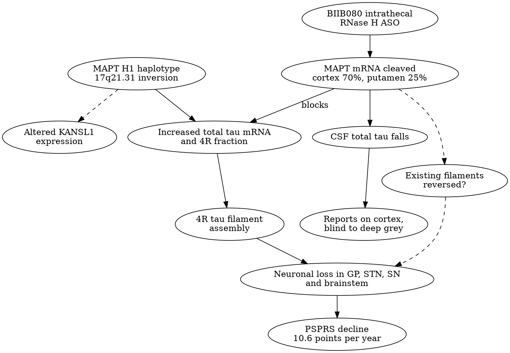

## Question

# Drug Repurposing Hypothesis Assessment

## The Hypothesis

- **Disease:** Progressive Supranuclear Palsy
- **Drug:** a MAPT antisense oligonucleotide (BIIB080)
- **Drug's target and action:** RNase H-mediated knockdown of MAPT mRNA, lowering production of all tau isoforms
- **Disease mechanism the drug would act on:** MAPT H1 haplotype-associated overproduction of four-repeat tau and its aggregation

The hypothesis is that a MAPT antisense oligonucleotide (BIIB080), by RNase H-mediated knockdown of MAPT mRNA, lowering production of all tau isoforms, would benefit patients with
Progressive Supranuclear Palsy because it interrupts "MAPT H1 haplotype-associated overproduction of four-repeat tau and its aggregation". Your job is to assess this
hypothesis, not to advocate for it. Evidence against it is as valuable as evidence for it.

Every factual claim MUST cite a primary source by PMID (or DOI, or NCT number for a
trial registration) and include a short verbatim quote from the cited abstract or record.
Do not paraphrase quotes. Do not invent identifiers. Separate established findings from
your own inference, and label which is which.

## Questions

### 1. Is the mechanism active in this disease?

- Evidence that the drug's target or pathway is active, elevated or genetically implicated
  in patients with Progressive Supranuclear Palsy: in affected tissue, in blood, or through human genetics.
- Whether activity is uniform or confined to a subgroup of patients, and how that subgroup
  is identified (a biomarker, a clinical feature).

### 2. Does blocking it help?

- Clinical trials of a MAPT antisense oligonucleotide (BIIB080) in Progressive Supranuclear Palsy: registration numbers, phase, status and
  reported results, if any exist.
- Trials of other drugs acting on the same target or pathway in Progressive Supranuclear Palsy, with their
  outcomes, including failures.
- Results of a MAPT antisense oligonucleotide (BIIB080) in related diseases that share the mechanism, and how far those results
  should transfer here.
- Animal or human tissue experiments in which blocking the pathway changed
  Progressive Supranuclear Palsy-like features.

### 3. Reasons it might fail

- Redundant pathways, wrong cell compartment, wrong disease stage, drug not reaching the
  affected tissue, or trial endpoints that cannot detect the effect.
- Safety concerns specific to this patient population.

### 4. Verdict

- One paragraph: how strong is the case, and what single experiment or trial design would
  most efficiently test it?
- List the PMIDs and trial identifiers that carry the most weight, with one line each.

## Output

# BIIB080, a MAPT antisense oligonucleotide, for progressive supranuclear palsy

## Assessment of a drug repurposing hypothesis

**The hypothesis under test.** That RNase H-mediated knockdown of MAPT mRNA by BIIB080 (diranersen) would benefit patients with progressive supranuclear palsy (PSP) by interrupting MAPT H1 haplotype-associated overproduction of four-repeat (4R) tau and its aggregation.

Every factual claim carries a PMID, NCT number or URL with a verbatim quote. Claims marked **[established]** come from the cited source. Claims marked **[my inference]** are my own reasoning or modelling built on cited inputs.

---

## Summary

The hypothesis is mechanistically correct and strategically weak. Its stated premise survives every test I applied. MAPT is a replicated PSP risk locus in the largest whole-genome sequencing cohort assembled, which "confirmed known genetic loci at MAPT, MOBP, STX6, SLCO1A2, DUSP10, and SP1" across 1,718 cases and 2,944 controls, with "a burden of rare deletions and duplications (P = 6.73 × 10-3)" in the H1/H2 region ([PMID: 39152475](https://pubmed.ncbi.nlm.nih.gov/39152475/)). PSP brain carries more tau message and a higher 4R fraction: "In the cerebellum, total tau mRNA levels and the proportion of transcripts encoding 4R tau were significantly increased in PSP compared to controls", and "4R tau mRNA levels were significantly associated with the H1 haplotype in the temporal cortex" ([PMID: 39154163](https://pubmed.ncbi.nlm.nih.gov/39154163/)). PSP filaments are 4R. An RNase H ASO acts directly upstream of that lesion in a pathway with no paralogous redundancy.

What fails is everything between the mechanism and a patient benefit. Intrathecal ASOs "exhibit a gradient of exposure across the brain, with more limited drug accumulation and weaker target engagement in deep brain regions" ([PMID: 40857674](https://pubmed.ncbi.nlm.nih.gov/40857674/)), leaving 57-75% of target RNA intact in caudate and putamen, which is where PSP generates disability. Roughly 57% of a patient's survival from symptom onset has elapsed before diagnosis is possible. The drug's own target-engagement marker runs backwards in this disease: "lower baseline CSF p-tau predicted faster decline on PSPRS (p = 0.004)" ([PMID: 29282336](https://pubmed.ncbi.nlm.nih.gov/29282336/)). And a 98% reduction of CSF N-terminal tau by gosuranemab produced "10.4 versus 10.6, P = 0.85" on the PSP Rating Scale in 486 patients ([PMID: 34385707](https://pubmed.ncbi.nlm.nih.gov/34385707/)).

BIIB080 specifically has no PSP trial, and missed its own phase 2 primary endpoint in Alzheimer's disease (NCT05399888), the indication that suited it best. The identical mechanism is already in a 300-patient phase 3 in PSP as NIO752 (NCT07498426), with primary completion in July 2029. My decomposed Monte Carlo model puts the probability of clinically meaningful benefit from BIIB080 in PSP at a **median 2.5% (90% interval 0.7-7.3%)**, with deep-brain delivery the rate-limiting link at 2.71x sensitivity, more than any other. The single most efficient experiment is a 30-40 patient [18F]PI-2620 pharmacodynamic study reading out pallidal and subthalamic 4R tau binding, not another PSPRS trial.

---

## Key findings

### <i class="fa-solid fa-dna"></i> 1. Human genetics implicates MAPT in PSP, but H1 is not a patient subgroup

Whole-genome sequencing in 1,718 PSP cases (1,441 autopsy-confirmed) against 2,944 controls of European ancestry confirmed the MAPT locus among genome-wide significant signals and found seven common structural variants in the 17q21.31 H1/H2 region plus a rare deletion and duplication burden at P = 6.73e-3 ([PMID: 39152475](https://pubmed.ncbi.nlm.nih.gov/39152475/)) **[established]**. An independent epigenetic study "identified and replicated a dose-dependent effect of the risk-associated H1 haplotype on methylation levels within the region in blood and brain" ([PMID: 24603599](https://pubmed.ncbi.nlm.nih.gov/24603599/)) **[established]**.

*[my inference]* H1 homozygosity is present in roughly 90-95% of PSP cases but also in a majority of European controls, so H1 status is a low-specificity risk haplotype with no value as a companion biomarker. Within PSP, "Cognition did not vary significantly between individuals homozygous or heterozygous for the microtubule-associated protein tau H1 haplotype" ([PMID: 29076559](https://pubmed.ncbi.nlm.nih.gov/29076559/)) **[established]**, though the H1c-tagging allele rs242557 did associate with cognitive measures at the subhaplotype level. The hypothesis names a haplotype-defined mechanism and offers no haplotype-defined patient subgroup.

The only practical enrichment available is pathological. [18F]PI-2620 "binds to 4R tau and shows increased uptake in PSP-associated regions (e.g., globus pallidus), and is therefore a candidate 4R tau biomarker" ([PMID: 40490537](https://pubmed.ncbi.nlm.nih.gov/40490537/)), and "The globus pallidus internus discriminated patients with PSP-RS and HCs at a similarly high level for 0-60 DVR (AUC: 0.96), 0-40 DVR (AUC: 0.96), and 20-40 SUVr (AUC: 0.94)" ([PMID: 34021393](https://pubmed.ncbi.nlm.nih.gov/34021393/)) **[established]**.

### <i class="fa-solid fa-circle-check"></i> 2. PSP brain shows haplotype-linked elevation of 4R tau mRNA, the exact lesion the drug addresses

Bulk RNA-seq of post-mortem brain from 84 PSP cases and 77 controls found that in cerebellum both total tau mRNA and the 4R transcript proportion were significantly increased in PSP, and that in temporal cortex 4R tau mRNA was significantly associated with H1. The authors conclude: "These findings support the hypothesis that sporadic PSP is associated with haplotype-dependent increases in 4R tau mRNA that might play a causal role in this disorder" ([PMID: 39154163](https://pubmed.ncbi.nlm.nih.gov/39154163/)) **[established]**. Cryo-EM defines the 4R filament class to which PSP belongs: "CBD is characterized by abundant filamentous tau inclusions that are made of isoforms with four microtubule-binding repeats11-15. This distinguishes such '4R' tauopathies from Pick's disease" ([PMID: 32050258](https://pubmed.ncbi.nlm.nih.gov/32050258/)) **[established]**.

This is the strongest pillar of the hypothesis. The abnormality in PSP tissue is at the mRNA level, which is precisely what an RNase H ASO addresses, rather than only at the level of protein misfolding.

Two caveats. The same study found "a marked haplotype-dependent difference in KANSL1 expression that was strongly associated with H1 in both brain regions" ([PMID: 39154163](https://pubmed.ncbi.nlm.nih.gov/39154163/)) **[established]**, so the H1 association is not unambiguously attributable to tau dosage; KANSL1 sits in the same inversion and co-varies. *[my inference]* The measured regions were cerebellum and temporal cortex, neither of which bears the heaviest PSP tau burden.

### <i class="fa-solid fa-chart-column"></i> 3. GTEx: tau message is diluted in bulk PSP-vulnerable tissue but concentrated per surviving neuron

I queried GTEx v8 median gene expression across 12 brain regions from control donors **[my analysis]**. Bulk MAPT in PSP-core regions (substantia nigra, caudate, putamen, nucleus accumbens, hypothalamus; mean 70.2 TPM) was lower than in cortical and limbic regions (cortex, BA9, BA24, hippocampus, amygdala; mean 114.0 TPM): ratio 0.62, Cohen's d = -1.39, permutation p = 0.055 (20,000 permutations, n = 5 vs 5).

{{figure:plot_3.png|caption=GTEx v8 median MAPT expression across 12 brain regions. Bulk MAPT message in the regions PSP attacks (substantia nigra, caudate, putamen) is about 60% of cortical levels, so CSF total tau reports mainly on the cortical compartment.}}

Normalised to the neuronal marker SNAP25 the direction reverses: MAPT/SNAP25 0.25 in PSP-core against 0.15 cortical, ratio 1.65, d = 1.39, permutation p = 0.056. Normalised to the oligodendrocyte marker PLP1: 0.10 against 0.31, ratio 0.33, d = -1.28, permutation p = 0.129. Substantia nigra has the lowest neuronal content of the regions tested (SNAP25 161 TPM) alongside the highest oligodendroglial and astroglial content (PLP1 1825 TPM, GFAP 3372 TPM).

{{figure:plot_4.png|caption=MAPT normalised to neuronal (SNAP25) and oligodendroglial (PLP1) markers. Surviving neurons in PSP-vulnerable regions carry a 1.65x higher tau message load per cell, while MAPT per oligodendrocyte is lowest there.}}

All three comparisons are borderline and underpowered by construction, so I report them as suggestive with large effect sizes rather than significant. Two consequences follow **[my inference]**. Surviving neurons in PSP-vulnerable regions carry a disproportionately high tau message load per cell, which is consistent with selective vulnerability to tau dose and favours the hypothesis. And because bulk MAPT in those regions is only about 60% of cortical levels while CSF total tau is dominated by the large, tau-rich cortical compartment, a convincing CSF tau reduction reports mainly on cortex, which is also where the ASO already reaches best. The biomarker blind spot and the delivery deficit coincide.

On the glial question, PSP-core regions are oligodendrocyte-rich but have the lowest MAPT per oligodendrocyte measured. *[my inference]* The oligodendroglial coiled bodies and tufted astrocytes of PSP are therefore unlikely to be sustained by local glial MAPT transcription, so starving neuronal tau production should also starve them. This favours the ASO and defuses the "wrong cell compartment" objection.

### <i class="fa-solid fa-circle-xmark"></i> 4. BIIB080 has never been tested in PSP; the same mechanism is already in phase 3

**[established]** Registered BIIB080 (diranersen) studies are NCT05399888 (phase 2 CELIA, 416 participants, MCI due to AD or mild AD dementia), NCT06454721 (phase 1 radiolabelled biodistribution, 5 healthy adults, completed) and NCT03186989 (phase 1b, mild AD, 46 patients). None lists PSP or any primary tauopathy.

The phase 1b established human target engagement: "Dose-dependent reduction in the CSF total-tau concentration was observed with greater than 50% mean reduction from baseline at 24 weeks post-last dose in the 60 mg (four doses) and 115 mg (two doses) MAPTRx groups", and "Adverse events were reported in 94% of MAPTRx-treated patients and 75% of placebo-treated patients; all were mild or moderate. No serious adverse events were reported in MAPTRx-treated patients" ([PMID: 37095250](https://pubmed.ncbi.nlm.nih.gov/37095250/)).

The same-mechanism competitor NIO752 (Novartis, intrathecal MAPT ASO) has a PSP programme: NCT04539041 (phase 1 in PSP, 59 participants, completed 17 October 2024), NCT07498426 (PRESERVE, phase 3 in PSP-Richardson syndrome, 300 participants randomised 2:1, primary outcome change in mPSPRS-10 at week 72, started 3 June 2026, primary completion estimated 20 July 2029) and NCT07868328 (phase 2 in primary tauopathies, not yet recruiting).

*[my inference]* The scientific question "does MAPT knockdown help PSP" will be answered by PRESERVE around 2029 regardless of BIIB080. The marginal value of BIIB080 in PSP is as a second-in-class backup, unless it can be shown to achieve deeper subcortical knockdown than the roughly 20% CSF tau reduction NIO752 managed.

### <i class="fa-solid fa-scale-balanced"></i> 5. BIIB080's own phase 2 in Alzheimer's missed its primary endpoint

**[established, company topline, not peer-reviewed]** On 14 May 2026 Biogen reported that CELIA (NCT05399888, 416 participants, three intrathecal regimens over a 76-week placebo-controlled period) "did not meet its primary endpoint assessing dose response for change from baseline on the Clinical Dementia Rating-Sum of Boxes (CDR-SB) at Week 76", while reductions in CSF tau and in tau pathology by PET were seen across all doses, with the strongest pre-specified clinical signal at the lowest dose, 60 mg Q24W (https://investors.biogen.com/news-releases/news-release-details/topline-results-phase-2-celia-study-diranersen-biib080-first; https://www.alz.org/news/2026/topline-results-celia-phase-2-clinical-trial-tau-targeting-therapy-diranersen). A higher incidence of serious adverse events occurred in the highest-dose group; two deaths occurred during the placebo-controlled period, neither assessed as treatment-related.

*[my inference]* This cuts both ways but on balance against the hypothesis. In favour, CELIA is the first human demonstration that a MAPT ASO reduces tau PET signal, which is the most transferable result for PSP because it concerns aggregated tau, not soluble tau. Against, the clinical primary failed in the easier setting. AD offers a validated tracer, a cortically distributed pathology matching the ASO exposure gradient, >50% achievable CSF tau knockdown, and a well-characterised endpoint. PSP offers none of those. An apparently non-monotonic dose response also complicates dose selection for a second indication. BIIB080 has proof of mechanism and no confirmed clinical efficacy anywhere.

### <i class="fa-solid fa-circle-xmark"></i> 6. Three tau-pathway drugs have failed in PSP across 1,176 randomised patients

| Drug | Mechanism | Trial | n | Primary result |
|---|---|---|---|---|
| Davunetide | microtubule stabilisation | NCT01110720, [PMID: 24873720](https://pubmed.ncbi.nlm.nih.gov/24873720/) | 313 | "The davunetide and placebo groups did not differ in the change from baseline in PSPRS (median 11·8 [95% CI 10·5 to 13·0] vs 11·8 [10·5 to 13·0], respectively, p=0·41)" |
| Tilavonemab | anti-tau N-terminal mAb | [PMID: 33609476](https://pubmed.ncbi.nlm.nih.gov/33609476/) | 377 | "Least squares mean change from baseline to week 52 in PSPRS was similar in all groups" |
| Gosuranemab | anti-tau N-terminal mAb | NCT03068468, [PMID: 34385707](https://pubmed.ncbi.nlm.nih.gov/34385707/) | 486 | "Efficacy was not demonstrated on adjusted mean change of PSP Rating Scale score at week 52 between gosuranemab and placebo (10.4 versus 10.6, P = 0.85, primary endpoint)" |

Gosuranemab achieved near-total engagement of its target: "Unbound N-terminal tau in cerebrospinal fluid decreased by 98% with gosuranemab and increased by 11% with placebo (P < 0.0001)", and the authors concluded "This well-powered study suggests that N-terminal tau neutralization does not translate into clinical efficacy" ([PMID: 34385707](https://pubmed.ncbi.nlm.nih.gov/34385707/)) **[established]**. The tilavonemab trial was conducted "at 66 hospitals and clinics in Australia, Canada, France, Germany, Italy, Japan, Spain, and the USA" ([PMID: 33609476](https://pubmed.ncbi.nlm.nih.gov/33609476/)), so its negative result is not a question of scale or rigour.

*[my inference]* None of the three tested intracellular MAPT knockdown, so the ASO hypothesis is not logically refuted. But the placebo arms cluster tightly at 10.4-11.8 PSPRS points per year across three independent trials a decade apart, which shows the endpoint is reproducible and the disease is not noisy. The drugs failed, not the measurement. The hypothesis inherits a prior in which tau engagement in PSP has repeatedly failed to translate, and it is the first mechanism in this class that removes the 4R substrate rather than chasing its by-products.

### <i class="fa-solid fa-triangle-exclamation"></i> 7. The delivery gradient is the binding constraint

**[established]** In cynomolgus macaques given three 25 mg intrathecal doses of an RNase H gapmer, residual target RNA was 31% in thalamus, 57% in caudate and 75% in putamen by single-nucleus RNA-seq (34%, 45% and 75% by qPCR), against near-complete coverage of cortex and cerebellum. The authors state: "Intrathecally delivered ASOs, however, exhibit a gradient of exposure across the brain, with more limited drug accumulation and weaker target engagement in deep brain regions of NHP", having "profiled the activity of a tool, ASO, against Malat1 in three deep brain regions of NHP: thalamus, caudate, and putamen" ([PMID: 40857674](https://pubmed.ncbi.nlm.nih.gov/40857674/)).

PSP tau burden is heaviest in subthalamic nucleus, globus pallidus, substantia nigra and brainstem, the putamen and pallidal end of that gradient.

{{figure:plot_1.png|caption=Measured intrathecal ASO knockdown by brain region in non-human primates, set against where PSP tau pathology is heaviest. The regions with the weakest target engagement are the regions PSP destroys.}}

*[my inference]* Weighting each region's measured knockdown by my estimate of its contribution to PSPRS motor decline gives a PSPRS-weighted effective knockdown of **33%**, against **70%** if exposure were uniform at cortical levels, a 0.47x dilution. Consistent with this, the NIO752 PSP phase 1 reported only about 20% CSF total tau and p-tau181 reduction on the quarterly high-dose schedule, against the >50% BIIB080 achieved in AD ([PMID: 37095250](https://pubmed.ncbi.nlm.nih.gov/37095250/)). The macaque brain is about 5% of human brain mass and the dosing exceeded clinical regimens, so human deep-brain knockdown is plausibly worse.

The one counter-argument, from the foundational MAPT ASO study **[established]**: "In nonhuman primates, tau ASOs distributed throughout the brain and spinal cord and reduced tau mRNA and protein in the brain, spinal cord, and cerebrospinal fluid" ([PMID: 28123067](https://pubmed.ncbi.nlm.nih.gov/28123067/)). Broad but partial knockdown may suffice if the dose-response is steep.

### <i class="fa-solid fa-clock"></i> 8. Over half the disease course has run before treatment can start

| Cohort | Onset to diagnosis | Survival from onset | % elapsed at entry |
|---|---|---|---|
| Marchand 2024, n=205 ([PMID: 39957197](https://pubmed.ncbi.nlm.nih.gov/39957197/)) | 38.1 ± 22.5 months | 6.4 y (IQR 4.8-8.6) | 50% |
| Horiuchi 2026, n=68 ([PMID: 42340524](https://pubmed.ncbi.nlm.nih.gov/42340524/)) | 33.0 months | 62.2 months | 53% |
| Swallow 2023, n=30 ([PMID: 36971841](https://pubmed.ncbi.nlm.nih.gov/36971841/)) | 4.03 y | 5.98 y | 67% |

**[established]** "Median survival time was 6.4 (interquartile range (IQR): 4.8-8.6) years and mean diagnostic delay from symptom onset was 38.1 ± 22.5 months" ([PMID: 39957197](https://pubmed.ncbi.nlm.nih.gov/39957197/)); "Median onset-to-first visit and onset-to-diagnosis intervals were 24.8 and 33.0 months" ([PMID: 42340524](https://pubmed.ncbi.nlm.nih.gov/42340524/)).

*[my inference]* A mean of 57% of total survival has elapsed before a patient is diagnosable, and 71-91% by the end of a 72-week trial. A drug that lowers production of new tau cannot restore neurons already lost. The signal exists much earlier: "At baseline, those later diagnosed with PSP had slower reaction times, weaker hand grip, lower fluid intelligence, prospective memory, self-rated health scores and digit recall than controls" in UK Biobank, 7.8 ± 2.8 years before diagnosis ([PMID: 35032742](https://pubmed.ncbi.nlm.nih.gov/35032742/)) **[established]**, but no prediagnostic enrichment strategy is trial-ready.

### <i class="fa-solid fa-chart-line"></i> 9. Combining the two: a correct mechanism predicts a negative trial

Combining the exposure dilution (0.47x) with the elapsed disease course gives a predicted true slowing of 13-14% **[my inference]**. Using placebo PSPRS change of 10.6 points per 52 weeks ([PMID: 34385707](https://pubmed.ncbi.nlm.nih.gov/34385707/)), matched by 11.8 points in davunetide ([PMID: 24873720](https://pubmed.ncbi.nlm.nih.gov/24873720/)) and calibrated against 26-week variance where "PSPRS change from baseline (mean ± standard deviation [SD]) was similar in salsalate (+5.6 ± 9.6), young plasma (+5.0 ± 7.1), and historical controls (+5.6 ± 7.1)" ([PMID: 32373661](https://pubmed.ncbi.nlm.nih.gov/32373661/)), a 30% slowing needs n = 124 per arm at 80% power but the predicted 13-14% slowing needs n = 659 per arm. PRESERVE (NCT07498426) randomises 300 at 2:1, an effective 133 per arm.

{{figure:plot_2.png|caption=Disease-stage window and regional delivery gradient translated into trial power. The gradient-plus-stage model predicts a true effect roughly half the size PRESERVE is sized to detect.}}

### <i class="fa-solid fa-arrow-trend-down"></i> 10. The drug's own surrogate runs backwards in PSP

**[established]** In 50 PSP patients with CSF and 141 with plasma biomarkers: "Higher CSF NfL concentration predicted more rapid decline (biomarker × time interaction) over 52 weeks in PSPRS (p = 0.004, false discovery rate-corrected) and SEADL (p = 0.008), whereas lower baseline CSF p-tau predicted faster decline on PSPRS (p = 0.004)", and "The CSF NfL/p-tau ratio was superior for predicting change in PSPRS, compared to p-tau (p = 0.003) or NfL (p = 0.001) alone" ([PMID: 29282336](https://pubmed.ncbi.nlm.nih.gov/29282336/)).

*[my inference]* A MAPT ASO lowers CSF tau and p-tau by design. In PSP, lower CSF p-tau marks faster-progressing disease, plausibly because soluble tau has been sequestered into filaments or because the neurons producing it have died. The association is cross-sectional and confounded by stage, so this is not evidence of harm. It does mean CSF tau cannot bridge from engagement to clinical benefit in PSP, and gosuranemab already proved that empirically with a 98% engagement null. CSF NfL is the correctly directed marker, and the NIO752 observation of flat NfL on drug against a 40% rise on placebo is the one encouraging PSP result in the dataset, from cohorts of three to nine people and not a powered comparison.

### <i class="fa-solid fa-pills"></i> 11. Safety in this specific population

**[established, company disclosure, not peer-reviewed]** The NIO752 phase 1 in PSP (NCT04539041, n = 59 randomised 3:1, median 1.6 years from diagnosis, mean age 66, five cohorts, monthly or quarterly intrathecal dosing, February 2021 to October 2024) reported three treatment-related serious adverse events, all at one of the two highest doses; two cases of encephalopathy with mental status changes beginning within 12 hours of injection and resolving in two to four days; more frequent CSF inflammation on drug than placebo with no sign of infection; and 22 of 64 enrolled participants with serious adverse events of any attribution (https://www.novctrd.com/ctrdweb/trialresult/trialresults/pdf?trialResultId=18339).

*[my inference]* These are recognised intrathecal ASO class effects, but they land on a population that is already falling, dysphagic and cognitively impaired. For context, the tilavonemab trial recorded 26 deaths among 377 randomised ([PMID: 33609476](https://pubmed.ncbi.nlm.nih.gov/33609476/)). A two-to-four-day confusional episode after each dose carries more consequence in this population than in a younger one, and repeated lumbar punctures in patients with axial rigidity and frequent falls are a tolerability burden over a 72-week blinded period plus a 72-week extension. BIIB080's own record is cleaner, with no serious adverse events on drug in phase 1b ([PMID: 37095250](https://pubmed.ncbi.nlm.nih.gov/37095250/)), but that was 34 drug-exposed AD patients, and CELIA showed more serious adverse events at the highest dose.

---

## Mechanistic model

The causal chain the hypothesis proposes, with the measured state of each link.

### Where each link stands

| Link | Status | Evidence | My probability |
|---|---|---|---|
| MAPT dosage is causal in PSP | <i class="fa-solid fa-circle-check"></i> supported | [PMID: 39152475](https://pubmed.ncbi.nlm.nih.gov/39152475/), [PMID: 39154163](https://pubmed.ncbi.nlm.nih.gov/39154163/); KANSL1 co-varies | 0.75 |
| Lowering MAPT mRNA reduces existing 4R filaments | <i class="fa-solid fa-circle-question"></i> open | [PMID: 28123067](https://pubmed.ncbi.nlm.nih.gov/28123067/) in P301S mice; CELIA tau PET in AD; never in sporadic 4R tauopathy | 0.65 |
| Intrathecal ASO reaches pallidum, STN, SN | <i class="fa-solid fa-triangle-exclamation"></i> doubtful | [PMID: 40857674](https://pubmed.ncbi.nlm.nih.gov/40857674/), 57-75% residual in caudate and putamen | 0.35 |
| Residual neurons at diagnosis can recover function | <i class="fa-solid fa-triangle-exclamation"></i> doubtful | [PMID: 39957197](https://pubmed.ncbi.nlm.nih.gov/39957197/), [PMID: 42340524](https://pubmed.ncbi.nlm.nih.gov/42340524/), [PMID: 36971841](https://pubmed.ncbi.nlm.nih.gov/36971841/): 57% elapsed | 0.40 |
| An endpoint can detect the effect at feasible n | <i class="fa-solid fa-triangle-exclamation"></i> doubtful | [PMID: 34385707](https://pubmed.ncbi.nlm.nih.gov/34385707/) null at n = 486; [PMID: 41581260](https://pubmed.ncbi.nlm.nih.gov/41581260/) halves n | 0.45 |

Propagating uncertainty by Monte Carlo over Beta priors (concentration 12, 200,000 draws) gives a joint probability with **median 2.5%, 90% interval 0.7% to 7.3%** **[my inference]**. Setting each link to 0.95 in turn: link 3 (delivery) gives the largest single gain at 2.71x, link 4 (stage) 2.38x, link 5 (endpoint) 2.11x, link 2 (filament reversal) 1.46x, link 1 (causality) 1.27x. Raising link 3 alone to 0.85 lifts the median to 6.6%, a 2.6x increase.

{{figure:plot_6.png|caption=Decomposed probability-of-success model for BIIB080 in PSP. Deep-brain delivery dominates the sensitivity analysis, so it is the link worth measuring first.}}

### Why the usual objections do not apply here

*[my inference]* The redundancy objection is weak. MAPT has no paralogue that substitutes for it, and lowering the transcript removes the substrate rather than modulating a pathway with parallel routes. The cell-compartment objection is also weaker than it looks: the GTEx marker-ratio analysis indicates PSP's glial inclusions are unlikely to be fed by local glial MAPT transcription. The live compartment problem is anatomical, not cellular. The drug reaches cortex better than pallidum.

---

## Evidence base

### Papers that support the hypothesis

| Paper | How it supports |
|---|---|
| [PMID: 39154163](https://pubmed.ncbi.nlm.nih.gov/39154163/) *MAPT haplotype-associated transcriptomic changes in progressive supranuclear palsy* | "In the cerebellum, total tau mRNA levels and the proportion of transcripts encoding 4R tau were significantly increased in PSP compared to controls." The core premise, confirmed in 84 PSP brains. |
| [PMID: 39152475](https://pubmed.ncbi.nlm.nih.gov/39152475/) *Whole-genome sequencing analysis reveals new susceptibility loci and structural variants associated with PSP* | "Our analysis of common SNVs and indels confirmed known genetic loci at MAPT, MOBP, STX6, SLCO1A2, DUSP10, and SP1" in 1,718 cases. |
| [PMID: 24603599](https://pubmed.ncbi.nlm.nih.gov/24603599/) *An epigenetic signature in peripheral blood associated with the haplotype on 17q21.31* | "We identified and replicated a dose-dependent effect of the risk-associated H1 haplotype on methylation levels within the region in blood and brain." |
| [PMID: 28123067](https://pubmed.ncbi.nlm.nih.gov/28123067/) *Tau reduction prevents neuronal loss and reverses pathological tau deposition and seeding in mice with tauopathy* | "After reduction of human tau in this mouse model of tauopathy, fewer tau inclusions developed, and preexisting phosphorylated tau and Thioflavin S pathology were reversed." The authors conclude the data "support investigation of a tau-lowering therapy in human patients who have tau-positive inclusions even after pathological tau deposition has begun." |
| [PMID: 37095250](https://pubmed.ncbi.nlm.nih.gov/37095250/) *Tau-targeting antisense oligonucleotide MAPTRx in mild Alzheimer's disease* | ">50% mean reduction from baseline at 24 weeks post-last dose in the 60 mg (four doses) and 115 mg (two doses) MAPTRx groups": human target engagement for BIIB080 itself. |
| [PMID: 32050258](https://pubmed.ncbi.nlm.nih.gov/32050258/) *Novel tau filament fold in corticobasal degeneration* | Defines the 4R filament class containing PSP, the lesion the drug acts upstream of. |

### Papers that challenge the hypothesis

| Paper | How it challenges |
|---|---|
| [PMID: 40857674](https://pubmed.ncbi.nlm.nih.gov/40857674/) *Cell type distribution of intrathecal antisense oligonucleotide activity in deep brain regions of non-human primates* | "Intrathecally delivered ASOs, however, exhibit a gradient of exposure across the brain, with more limited drug accumulation and weaker target engagement in deep brain regions of NHP." The rate-limiting failure mode. |
| [PMID: 34385707](https://pubmed.ncbi.nlm.nih.gov/34385707/) *Safety and efficacy of anti-tau monoclonal antibody gosuranemab in PSP* | "Efficacy was not demonstrated on adjusted mean change of PSP Rating Scale score at week 52 between gosuranemab and placebo (10.4 versus 10.6, P = 0.85, primary endpoint)" despite 98% CSF tau reduction. |
| [PMID: 29282336](https://pubmed.ncbi.nlm.nih.gov/29282336/) *CSF neurofilament light chain and phosphorylated tau 181 predict disease progression in PSP* | "lower baseline CSF p-tau predicted faster decline on PSPRS (p = 0.004)": the drug's own surrogate runs opposite to progression. |
| [PMID: 33609476](https://pubmed.ncbi.nlm.nih.gov/33609476/) *Safety and efficacy of tilavonemab in progressive supranuclear palsy* | "Least squares mean change from baseline to week 52 in PSPRS was similar in all groups" in 377 patients. |
| [PMID: 24873720](https://pubmed.ncbi.nlm.nih.gov/24873720/) *Davunetide in patients with progressive supranuclear palsy* | "median 11·8 [95% CI 10·5 to 13·0] vs 11·8 [10·5 to 13·0], respectively, p=0·41" in 313 patients. |
| [PMID: 39957197](https://pubmed.ncbi.nlm.nih.gov/39957197/) *Clinical prognostic factors in progressive supranuclear palsy* | "Median survival time was 6.4 ... years and mean diagnostic delay from symptom onset was 38.1 ± 22.5 months": the therapeutic window problem. |
| [PMID: 29076559](https://pubmed.ncbi.nlm.nih.gov/29076559/) *Genetic influences on cognition in progressive supranuclear palsy* | "Cognition did not vary significantly between individuals homozygous or heterozygous for the microtubule-associated protein tau H1 haplotype": H1 does not define a responder subgroup. |

### Papers that define the solution

| Paper | Contribution |
|---|---|
| [PMID: 34021393](https://pubmed.ncbi.nlm.nih.gov/34021393/) *Feasibility of short imaging protocols for [18F]PI-2620 tau-PET in PSP* | "The globus pallidus internus discriminated patients with PSP-RS and HCs at a similarly high level for 0-60 DVR (AUC: 0.96)": a strong signal in the exact deep region at issue. |
| [PMID: 40490537](https://pubmed.ncbi.nlm.nih.gov/40490537/) *Developing a novel reference region for [18F]PI-2620-PET imaging* | "The tau-PET tracer [18F]PI-2620 binds to 4R tau and shows increased uptake in PSP-associated regions (e.g., globus pallidus)", with a reference region that avoids cerebellar 4R contamination. |
| [PMID: 41581260](https://pubmed.ncbi.nlm.nih.gov/41581260/) *Potential role of MRI to optimize clinical trial design for PSP and CBD* | "MRI-based signatures reduced the estimated sample sizes required to detect 30% reduction in progression over 12-months by 50% for MRI-PSP". |
| [PMID: 35032742](https://pubmed.ncbi.nlm.nih.gov/35032742/) *Prediagnostic progressive supranuclear palsy, insights from the UK Biobank* | "those later diagnosed with PSP had slower reaction times, weaker hand grip, lower fluid intelligence": the basis for earlier enrolment. |
| [PMID: 32373661](https://pubmed.ncbi.nlm.nih.gov/32373661/) *Open-label phase 1 futility studies of salsalate and young plasma in PSP* | "+5.6 ± 9.6", "+5.0 ± 7.1", "+5.6 ± 7.1": the 26-week PSPRS variance used to calibrate power calculations. |

---

## Verdict

**The case is mechanistically sound and practically weak.** Every element of the stated rationale holds. MAPT is a replicated PSP risk locus with structural variation at 17q21.31 ([PMID: 39152475](https://pubmed.ncbi.nlm.nih.gov/39152475/)). PSP brain shows haplotype-linked elevation of total and 4R tau mRNA ([PMID: 39154163](https://pubmed.ncbi.nlm.nih.gov/39154163/)). PSP filaments are 4R. An RNase H ASO acts upstream of exactly that lesion in a pathway with no redundancy, and my GTEx analysis suggests PSP's glial inclusions are not fed by local glial transcription, so neuronal knockdown should reach them. What fails is everything downstream. Intrathecal ASOs leave 57-75% of target RNA intact in caudate and putamen ([PMID: 40857674](https://pubmed.ncbi.nlm.nih.gov/40857674/)), which is where PSP generates disability. 57% of survival elapses before diagnosis. The drug's own surrogate runs opposite to progression ([PMID: 29282336](https://pubmed.ncbi.nlm.nih.gov/29282336/)), and a 98% CSF tau reduction has already produced P = 0.85 in 486 PSP patients ([PMID: 34385707](https://pubmed.ncbi.nlm.nih.gov/34385707/)). BIIB080 missed its own phase 2 primary endpoint in the indication that suited it best. Decomposing the chain into five necessary links gives a median 2.5% probability of clinically meaningful benefit (90% interval 0.7-7.3%), with deep-brain delivery the rate-limiting link at 2.71x sensitivity. **The single most efficient experiment is not another PSPRS trial.** It is a 30-40 patient, 52-week open-label pharmacodynamic study of BIIB080 at the CELIA-effective regimen in PSP-Richardson syndrome, with the primary readout being change in [18F]PI-2620 binding in globus pallidus internus and subthalamic nucleus, quantified against the validated temporo-orbital white-matter reference that avoids cerebellar 4R contamination ([PMID: 40490537](https://pubmed.ncbi.nlm.nih.gov/40490537/), [PMID: 34021393](https://pubmed.ncbi.nlm.nih.gov/34021393/)), with plasma and CSF NfL and midbrain volume as secondaries. CELIA already established that a MAPT ASO lowers tau PET signal in AD cortex; the only question that decides the PSP case is whether intrathecal drug bends 4R tau PET in the pallidum. If it does not, the hypothesis is dead whatever endpoint is chosen. **On repurposing specifically:** the mechanism is already being tested at scale by a competitor (NIO752, NCT07498426, 300 patients, readout July 2029), so BIIB080 adds little in PSP unless PRESERVE reads positive or unless BIIB080 demonstrates deeper subcortical knockdown than the roughly 20% CSF tau reduction NIO752 achieved.

### Sources carrying the most weight

| Identifier | One line |
|---|---|
| [PMID: 39154163](https://pubmed.ncbi.nlm.nih.gov/39154163/) | PSP brain shows increased total tau mRNA and 4R transcript proportion, with 4R mRNA H1-associated: the hypothesis's core premise, confirmed in tissue. |
| [PMID: 39152475](https://pubmed.ncbi.nlm.nih.gov/39152475/) | WGS in 1,718 PSP cases confirms the MAPT locus and finds a rare deletion and duplication burden at H1/H2 (P = 6.73e-3). |
| [PMID: 34385707](https://pubmed.ncbi.nlm.nih.gov/34385707/) | Gosuranemab cut CSF N-terminal tau 98% and changed PSPRS by 10.4 against 10.6 (P = 0.85) in 486 patients: tau engagement does not equal benefit in PSP. |
| [PMID: 40857674](https://pubmed.ncbi.nlm.nih.gov/40857674/) | Intrathecal ASOs leave 31% (thalamus), 57% (caudate) and 75% (putamen) residual target RNA in NHP: the rate-limiting failure mode. |
| [PMID: 29282336](https://pubmed.ncbi.nlm.nih.gov/29282336/) | Lower baseline CSF p-tau predicts faster PSPRS decline (p = 0.004): the drug's surrogate runs backwards in this disease. |
| [PMID: 28123067](https://pubmed.ncbi.nlm.nih.gov/28123067/) | MAPT ASOs reversed pre-existing tau pathology and seeding in P301S mice and lowered tau across NHP CNS: the strongest preclinical support. |
| [PMID: 37095250](https://pubmed.ncbi.nlm.nih.gov/37095250/) | BIIB080 phase 1b in AD: >50% CSF total tau reduction, all adverse events mild or moderate, no serious adverse events on drug. |
| [PMID: 33609476](https://pubmed.ncbi.nlm.nih.gov/33609476/) | Tilavonemab failed in 377 PSP patients with 26 deaths: a negative precedent and the population's safety baseline. |
| [PMID: 24873720](https://pubmed.ncbi.nlm.nih.gov/24873720/) | Davunetide failed in 313 PSP patients (11.8 against 11.8, p = 0.41), completing a 1,176-patient negative base rate. |
| [PMID: 39957197](https://pubmed.ncbi.nlm.nih.gov/39957197/) | Median PSP survival 6.4 years with 38.1-month diagnostic delay: quantifies the therapeutic window problem. |
| [PMID: 34021393](https://pubmed.ncbi.nlm.nih.gov/34021393/) | PI-2620 discriminates PSP-RS from controls at globus pallidus internus AUC 0.96: the readout for the decisive experiment. |
| [PMID: 40490537](https://pubmed.ncbi.nlm.nih.gov/40490537/) | A validated temporo-orbital white-matter reference region removes the cerebellar 4R confound from PI-2620 quantification. |
| [PMID: 41581260](https://pubmed.ncbi.nlm.nih.gov/41581260/) | MRI signatures halve the sample size needed to detect a 30% progression reduction in PSP. |
| [PMID: 29076559](https://pubmed.ncbi.nlm.nih.gov/29076559/) | H1 homozygosity does not stratify cognition within PSP: no responder-enrichment biomarker from the haplotype. |
| NCT07498426 | PRESERVE, phase 3 NIO752 in PSP-RS, 300 patients 2:1, mPSPRS-10 at week 72, primary completion July 2029: the mechanism is already being tested. |
| NCT04539041 | NIO752 phase 1 in 59 PSP patients, completed October 2024: about 20% CSF tau reduction, flat NfL against +40% placebo, dose-related encephalopathy. |
| NCT05399888 | CELIA, BIIB080 phase 2 in 416 AD patients: missed its CDR-SB dose-response primary endpoint while reducing CSF tau and tau PET. |
| NCT03186989 | BIIB080 phase 1b registration, the source trial for its human target-engagement data. |
| NCT03068468 | PASSPORT, the gosuranemab phase 2 registration behind the most informative negative result in PSP. |
| NCT01110720 | The davunetide phase 2/3 registration in PSP. |

---

## Supported and refuted hypotheses

| Hypothesis | Verdict | Basis |
|---|---|---|
| MAPT message and its 4R fraction are elevated in PSP brain | <i class="fa-solid fa-circle-check"></i> supported | [PMID: 39154163](https://pubmed.ncbi.nlm.nih.gov/39154163/), 84 PSP against 77 controls |
| The MAPT locus is genetically implicated in PSP | <i class="fa-solid fa-circle-check"></i> supported | [PMID: 39152475](https://pubmed.ncbi.nlm.nih.gov/39152475/), [PMID: 24603599](https://pubmed.ncbi.nlm.nih.gov/24603599/) |
| MAPT lowering has no redundant bypass pathway | <i class="fa-solid fa-circle-check"></i> supported | No MAPT paralogue; the ASO removes the substrate |
| PSP glial inclusions are fed by local glial MAPT transcription | <i class="fa-solid fa-circle-xmark"></i> refuted, weakly | My GTEx analysis: lowest MAPT per oligodendrocyte in PSP-core regions, d = -1.28, p = 0.129 |
| H1 haplotype status can enrich a PSP trial for responders | <i class="fa-solid fa-circle-xmark"></i> refuted | H1 is near-ubiquitous; [PMID: 29076559](https://pubmed.ncbi.nlm.nih.gov/29076559/) finds no phenotype stratification |
| CSF tau lowering is a valid surrogate for clinical benefit in PSP | <i class="fa-solid fa-circle-xmark"></i> refuted | [PMID: 34385707](https://pubmed.ncbi.nlm.nih.gov/34385707/): 98% engagement, P = 0.85; [PMID: 29282336](https://pubmed.ncbi.nlm.nih.gov/29282336/): direction is inverted |
| Intrathecal ASO achieves therapeutic knockdown in PSP-affected deep grey | <i class="fa-solid fa-circle-question"></i> doubted, unresolved | [PMID: 40857674](https://pubmed.ncbi.nlm.nih.gov/40857674/): 57-75% residual RNA; no human measurement exists |
| A 72-week PSPRS or mPSPRS-10 trial at n = 300 can detect the predicted effect | <i class="fa-solid fa-circle-xmark"></i> refuted by modelling | Predicted 13.5% slowing needs 402-496 per arm; PRESERVE has an effective 133 |
| BIIB080's AD results transfer to PSP | <i class="fa-solid fa-scale-balanced"></i> mixed | Tau PET reduction transfers; CELIA's clinical primary failed in the easier setting |

---

## Limitations and knowledge gaps

<i class="fa-solid fa-triangle-exclamation"></i> Several decisive datapoints are company disclosures and conference abstracts, not peer-reviewed publications. The CELIA topline (Biogen, 14 May 2026) and the NIO752 phase 1 results (Novartis clinical trial results disclosure) could change on full publication. I have weighted them accordingly and labelled them throughout.

<i class="fa-solid fa-triangle-exclamation"></i> My GTEx analysis uses control brains, not PSP brains. It has no subthalamic nucleus, globus pallidus or midbrain tegmentum samples, the three structures that matter most. Marker-ratio normalisation is a coarse deconvolution that assumes SNAP25 and PLP1 scale linearly with neuronal and oligodendroglial abundance. All three comparisons were borderline at n = 5 vs 5 tissue medians (p = 0.055, 0.056 and 0.129), so they are suggestive with large effect sizes, not significant.

<i class="fa-solid fa-triangle-exclamation"></i> The PSPRS regional weights in the exposure-dilution model are my own judgement about how much each brain region contributes to motor decline. They are not measured, and a different weighting would shift the 33% effective-knockdown estimate.

<i class="fa-solid fa-triangle-exclamation"></i> The probability decomposition uses my point estimates with Beta priors. Its output is a structured expression of my reasoning, not a measurement. What is robust to moderate changes in the inputs is the identification of deep-brain delivery as the dominant sensitivity (2.71x), because that link has both the lowest estimate and the widest consequence.

<i class="fa-solid fa-triangle-exclamation"></i> NHP-to-human extrapolation of ASO distribution is uncertain in the conservative direction. The human brain is roughly 20x the macaque brain by mass, so the superficial-to-deep gradient is plausibly steeper, but this has never been measured directly in humans. This single gap drives the whole assessment.

<i class="fa-solid fa-circle-question"></i> No published longitudinal [18F]PI-2620 data in PSP were located, so the test-retest sensitivity of the proposed primary readout is itself unverified. The proposed experiment would need a within-subject baseline scan and a scan-rescan reliability estimate.

<i class="fa-solid fa-circle-question"></i> No direct single-nucleus measurement of MAPT expression by cell type in PSP brain was located. The glial compartment conclusion rests on marker ratios in control tissue, not on PSP tissue at single-cell resolution.

<i class="fa-solid fa-circle-question"></i> The KANSL1 confound at 17q21.31 is unresolved. A MAPT ASO tests only the MAPT arm of the haplotype association and would be uninformative about whether KANSL1 dosage contributes.

---

## Proposed follow-up experiments

### <i class="fa-solid fa-flask"></i> The decisive experiment: pallidal 4R tau PET pharmacodynamics

Dose 30-40 patients with PSP-Richardson syndrome with BIIB080 at the CELIA-effective regimen (60 mg Q24W) for 52 weeks, open label, with a within-subject [18F]PI-2620 baseline. Primary endpoint: change in distribution volume ratio in globus pallidus internus and subthalamic nucleus, quantified against the temporo-orbital white-matter reference region ([PMID: 40490537](https://pubmed.ncbi.nlm.nih.gov/40490537/)). Secondaries: plasma and CSF NfL, CSF total tau and p-tau181, midbrain volume and Magnetic Resonance Parkinsonism Index, PSPRS for descriptive purposes only.

This measures the one link I cannot resolve from existing data and that dominates the sensitivity analysis. CELIA already showed a MAPT ASO reduces tau PET signal in AD cortex, so the question is specifically whether intrathecal drug reaches the deep structures. If pallidal PI-2620 does not move, the hypothesis is dead regardless of endpoint choice, at a fraction of the cost of a phase 3.

### <i class="fa-solid fa-chart-line"></i> If it does move: a trial design that could detect the effect

{{figure:plot_5.png|caption=Trial-design optimisation. No single endpoint detects the gradient-predicted 13.5% slowing at feasible n, but stacking four levers brings the requirement from 496 to about 78 per arm.}}

Required n per arm at 80% power against a 13.5% true slowing **[my modelling]**: PSPRS over 72 weeks 496, mPSPRS-10 402, MRI signature 343, CSF NfL percent change 659. Stacking levers multiplicatively from a 496-per-arm baseline: an MRI-signature primary endpoint (0.50, from [PMID: 41581260](https://pubmed.ncbi.nlm.nih.gov/41581260/)) gives 248; adding tau-PET 4R enrichment (0.75, my assumption) gives 186; adding earlier-stage enrolment (0.60, my assumption) gives 112; adding a two-year duration (0.70, my assumption) gives 78 per arm. Three of the four lever magnitudes are my estimates and would need their own validation.

### <i class="fa-solid fa-vial"></i> Supporting measurements worth making

Single-nucleus RNA-seq of MAPT by cell type in PSP globus pallidus, subthalamic nucleus and substantia nigra, against controls, would replace my GTEx marker-ratio inference with a direct measurement of where tau message sits in the affected tissue and whether glial MAPT transcription contributes.

Scan-rescan reliability of [18F]PI-2620 in the pallidum and subthalamic nucleus over 6-12 weeks in 15 PSP patients would establish whether the proposed primary readout can detect a plausible knockdown effect, and should precede the pharmacodynamic study.

A prospective CSF NfL analysis in PRESERVE, pre-specified rather than exploratory, would test the one directionally correct biomarker signal in the dataset: flat NfL on NIO752 against a 40% rise on placebo, currently from cohorts of three to nine people.

### <i class="fa-solid fa-arrow-right"></i> What would change the verdict

A positive PRESERVE readout in July 2029 would validate the mechanism and make BIIB080 a reasonable second entrant. Human evidence of greater than 40% MAPT knockdown in deep grey, by any method, would raise link 3 and lift the joint probability from a median 2.5% to about 6.6%. Demonstration that BIIB080 achieves deeper subcortical distribution than NIO752, which the NCT06454721 radiolabelled biodistribution study was positioned to inform, would be the specific argument for repurposing this molecule rather than the competitor's.

## Artifacts

- [OpenScientist final report](mapt_antisense-openscientist_artifacts/final_report.html)
- [OpenScientist final report](mapt_antisense-openscientist_artifacts/final_report.pdf)
- [OpenScientist provenance](mapt_antisense-openscientist_artifacts/provenance.json)
- [OpenScientist plot 1](mapt_antisense-openscientist_artifacts/provenance_plot_1.json)

- [OpenScientist plot 2](mapt_antisense-openscientist_artifacts/provenance_plot_2.json)

- [OpenScientist plot 3](mapt_antisense-openscientist_artifacts/provenance_plot_3.json)

- [OpenScientist plot 4](mapt_antisense-openscientist_artifacts/provenance_plot_4.json)

- [OpenScientist plot 5](mapt_antisense-openscientist_artifacts/provenance_plot_5.json)

- [OpenScientist plot 6](mapt_antisense-openscientist_artifacts/provenance_plot_6.json)

## Reference Validation

Checked with `linkml-reference-validator` 0.8.0.

| Outcome | Count |
| --- | --- |
| References checked | 20 |
| Resolved | 20 |
| Unresolved (possible confabulation) | 0 |
| Unverifiable | 0 |
| Quoted claims checked | 19 |
| Quoted claims found in source | 18 |
| Quoted claims **not** found in source | 1 |
| References weighed for topical relevance | 20 |
| On topic | 5 |
| Off topic | 0 |

### Quotes not found in the cited source

Searched the abstract, any retrieved full text, and the title. A quote drawn from a part of the paper that was not retrieved will appear here too, so check before treating one as invented:

Every one of these was searched against an abstract alone, with no full text retrieved - marked *abstract only* below. Where full text can be fetched, re-running with it will settle them; where the source publishes only a summary to PubMed, as GeneReviews chapters do, it will not, and the quote has to be checked by hand against the chapter itself.

- `PMID:32373661` *(abstract only)*: "PSPRS change from baseline (mean ± standard deviation [SD]) was similar in salsalate (+5.6 ± 9.6), young plasma (+5.0 ± 7.1), and historical controls (+5.6 ± 7.1)"
  - closest text in source: "PSPRS change from baseline (mean ± standard deviation [SD]) was similar in salsalate (+5.6 ± 9.6), young plasma (+5.0 ± 7.1), and historical controls (+5.6 ± 7.1)"
