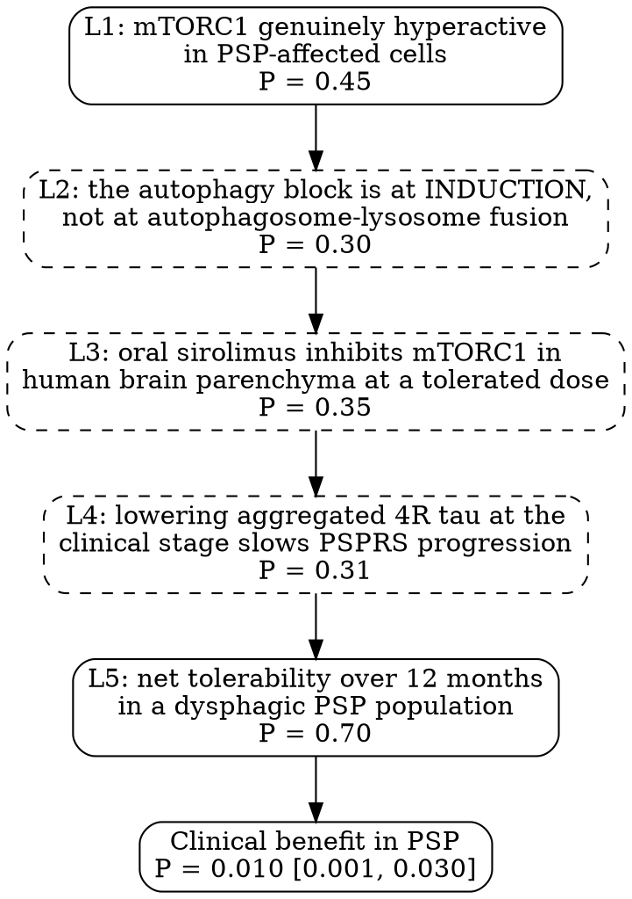
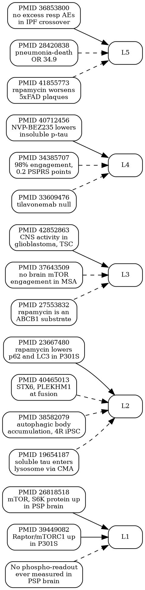

## Question

# Drug Repurposing Hypothesis Assessment

## The Hypothesis

- **Disease:** Progressive Supranuclear Palsy
- **Drug:** an mTOR inhibitor (sirolimus)
- **Drug's target and action:** inhibiting mTORC1, which induces autophagy and increases clearance of aggregated tau
- **Disease mechanism the drug would act on:** accumulation of aggregated four-repeat tau that autophagy fails to clear

The hypothesis is that an mTOR inhibitor (sirolimus), by inhibiting mTORC1, which induces autophagy and increases clearance of aggregated tau, would benefit patients with
Progressive Supranuclear Palsy because it interrupts "accumulation of aggregated four-repeat tau that autophagy fails to clear". Your job is to assess this
hypothesis, not to advocate for it. Evidence against it is as valuable as evidence for it.

Every factual claim MUST cite a primary source by PMID (or DOI, or NCT number for a
trial registration) and include a short verbatim quote from the cited abstract or record.
Do not paraphrase quotes. Do not invent identifiers. Separate established findings from
your own inference, and label which is which.

## Questions

### 1. Is the mechanism active in this disease?

- Evidence that the drug's target or pathway is active, elevated or genetically implicated
  in patients with Progressive Supranuclear Palsy: in affected tissue, in blood, or through human genetics.
- Whether activity is uniform or confined to a subgroup of patients, and how that subgroup
  is identified (a biomarker, a clinical feature).

### 2. Does blocking it help?

- Clinical trials of an mTOR inhibitor (sirolimus) in Progressive Supranuclear Palsy: registration numbers, phase, status and
  reported results, if any exist.
- Trials of other drugs acting on the same target or pathway in Progressive Supranuclear Palsy, with their
  outcomes, including failures.
- Results of an mTOR inhibitor (sirolimus) in related diseases that share the mechanism, and how far those results
  should transfer here.
- Animal or human tissue experiments in which blocking the pathway changed
  Progressive Supranuclear Palsy-like features.

### 3. Reasons it might fail

- Redundant pathways, wrong cell compartment, wrong disease stage, drug not reaching the
  affected tissue, or trial endpoints that cannot detect the effect.
- Safety concerns specific to this patient population.

### 4. Verdict

- One paragraph: how strong is the case, and what single experiment or trial design would
  most efficiently test it?
- List the PMIDs and trial identifiers that carry the most weight, with one line each.

## Output

# Sirolimus for progressive supranuclear palsy: assessment of the mTORC1 autophagy tau-clearance hypothesis

**Hypothesis under assessment.** An mTOR inhibitor (sirolimus), by inhibiting mTORC1 and thereby inducing autophagy, would increase clearance of aggregated four-repeat (4R) tau and benefit patients with progressive supranuclear palsy (PSP), whose disease mechanism is the accumulation of aggregated 4R tau that autophagy fails to clear.

**Labelling convention.** Every factual claim is tagged **[E]** for an established finding from a cited primary source with a verbatim quote, or **[I]** for my own inference or computation. Quotes are reproduced exactly from the cited abstract or registry record.

---

## Summary

The case is weak. Modelling the hypothesis as the conjunction of the five steps it actually requires gives a probability of clinical benefit in PSP of **0.010 (90% credible interval 0.001 to 0.030)** [I]. The hypothesis is mechanistically coherent and has genuine preclinical support, but each of its five links is either unmeasured in PSP, contradicted by human genetics, or already tested and failed in the closest available clinical analogue.

Three results carry most of the negative weight. PSP human genetics implicates **STX6** and **PLEKHM1**, which act at autophagosome-lysosome fusion, one step downstream of where rapamycin acts [E, [PMID: 40465013](https://pubmed.ncbi.nlm.nih.gov/40465013/)]; if the rate-limiting lesion sits at fusion, inducing more autophagosome formation pushes cargo into a blocked pipe. The only randomised sirolimus trial in a neurodegenerative proteinopathy (multiple system atrophy, NCT03589976) was stopped for futility, and its brain target-engagement substudy concluded that the results "are consistent with no brain mTOR engagement by oral sirolimus up to 6 mg/day" [E, PMIDs 35040506, 37643509]. A well-powered PSP trial of gosuranemab achieved 98% CSF tau target engagement and moved the PSP Rating Scale by 0.2 points; reverse-engineering its published statistics gives a 95% confidence interval of [-2.27, +1.87] points, excluding any true slowing greater than 21% of annual progression [E for the trial data, PMID 34385707; I for the recomputation].

The strongest evidence for the hypothesis is preclinical. Studies in P301S and PS19 mice reconstruct exactly the causal chain the hypothesis proposes, and both genetic (Raptor knockdown) and pharmacological (NVP-BEZ235, rapamycin, temsirolimus) interruption of mTORC1 lowered insoluble tau [E, PMIDs 39449082, 40712456, 23667480, 24880087]. Those models carry a MAPT mutation absent from sporadic PSP, overexpress tau from a transgene, are treated near pathology onset, and lack the tufted astrocytes and oligodendroglial coiled bodies that define PSP [I]. In 5xFAD mice, rapamycin increased amyloid plaque load by suppressing CD11c+ disease-associated microglia [E, PMID 41855773], showing that mTOR inhibition in a neurodegenerating brain is not uniformly protective.

The safety arithmetic is specific to PSP and is unfavourable. PSP carries the largest odds of pneumonia-caused death of any autopsy-confirmed dementia examined, OR 34.921 (95% CI 3.826 to 318.775) [E, [PMID: 28420838](https://pubmed.ncbi.nlm.nih.gov/28420838/)], with objectively impaired cough clearance [E, PMID 34173683]. Monte Carlo modelling puts expected unconditional benefit at **0.032 PSPRS points saved per patient-year** against roughly **8 excess pneumonia episodes per 100 patient-years** [I]. The most efficient next step is not a trial: a post-mortem PSP brain survey of mTORC1 and autophagic flux markers by cell type, followed by a 40-patient 12-week target-engagement study, would raise the probability from 0.010 to **0.118** if both are positive, exposing 40 patients instead of the 548 an efficacy RCT would require [I].

---

## Key findings

### <i class="fa-solid fa-vial"></i> F001. Human PSP tissue evidence for the target is a single unreplicated study that measured abundance, not activity

The direct human tissue support consists of one report [E, [PMID: 26818518](https://pubmed.ncbi.nlm.nih.gov/26818518/)]:

> "Here, we report that protein levels of the Rho-associated protein kinases (ROCK1 and ROCK2), p70 S6 kinase (S6K), and mammalian target of rapamycin (mTOR) were increased in PSP and CBD brains."

The abstract gives no effect size, no sample size, no regional breakdown and no phospho-mTOR or phospho-S6 quantification [I]. Abundance of mTOR and S6K protein is a different quantity from demonstrated mTORC1 kinase activity. The functional readouts that would settle link L1 (p-S6K1 Thr389, p-S6 Ser235/236, p-ULK1 Ser757, LC3-II/LC3-I, p62) have never been quantified in PSP brain by cell type [I]. The same study found that ROCK inhibition lowered soluble and insoluble tau partly through autophagy and that fasudil reduced pathogenic tau in a Drosophila tauopathy model [E, PMID 26818518], which supports autophagy as a tau clearance route without implicating mTORC1 specifically. This is the weakest form of support link L1 can receive: the pathway is altered in the right tissue, in one study, with the wrong readout.

### <i class="fa-solid fa-dna"></i> F004. PSP genetic risk sits at autophagosome-lysosome fusion and in glia, one step downstream of rapamycin

The genome-wide significant PSP risk genes are [E, [PMID: 40465013](https://pubmed.ncbi.nlm.nih.gov/40465013/)]:

> "These genes include MAPT, KANSL1, PLEKHM1, STX6, MOBP, EIF2AK3, SLC01 A2, DUSP10, APOE, RUNX2, TRIM11, NFASC/CNTN2 and LRRK2."

The largest PSP GWAS (2,779 cases, 2,595 neuropathologically confirmed, against 5,584 controls) adds a cell-type signal [E, [PMID: 39251599](https://pubmed.ncbi.nlm.nih.gov/39251599/)]:

> "Integration with cell type-specific epigenomic annotations reveal an oligodendrocytic signature that might distinguish PSP from AD and Parkinson's disease in subsequent studies."

Whole-genome sequencing in 1,718 cases and 2,944 controls added **APOE, FCHO1/MAP1S, KIF13A, TRIM24, TNXB and ELOVL1** [E, [PMID: 39152475](https://pubmed.ncbi.nlm.nih.gov/39152475/)]. An independent Spanish and Portuguese GWAS replicated the glial signal [E, [PMID: 40379966](https://pubmed.ncbi.nlm.nih.gov/40379966/)]:

> "Enrichment analysis and protein expression profiling highlighted oligodendrocyte function and myelination as likely contributors to PSP pathogenesis."

No mTOR pathway gene (MTOR, RPTOR, RHEB, TSC1, TSC2, AKT1, DEPDC5) reaches genome-wide significance in any of these studies [I, from inspection of the reported gene lists].

This is a specific mechanistic objection [I]. STX6 (syntaxin-6), PLEKHM1, KIF13A and FCHO1/MAP1S all act in vesicle trafficking and autophagosome-lysosome fusion. Rapamycin acts at autophagy initiation, upstream of that step. A human iPSC 4R tauopathy model shows the predicted downstream-block phenotype directly [E, [PMID: 38582079](https://pubmed.ncbi.nlm.nih.gov/38582079/)]:

> "4R-P301S neurons display progressive Tau inclusions upon seeding with Tau fibrils and recapitulate features of tauopathy phenotypes including shared transcriptomic signatures, autophagic body accumulation, and reduced neuronal activity."

Autophagic *body* accumulation indicates a block downstream of autophagosome formation. The hypothesis's phrase "autophagy fails to clear" is accurate; it licenses rapamycin only if the failure is at induction [I].

### <i class="fa-solid fa-circle-xmark"></i> F002, F007. Sirolimus failed its only test in a neurodegenerative proteinopathy, with no detectable brain target engagement

NCT03589976 randomised 47 probable MSA patients 3:1 to sirolimus 2 to 6 mg/day or placebo for 48 weeks; 34 were analysed [E, [PMID: 35040506](https://pubmed.ncbi.nlm.nih.gov/35040506/)]:

> "The trial was stopped after a pre-planned interim analysis met futility criteria."

> "There was no difference in change from baseline to week 48 between the sirolimus and placebo in UMSARS total score (mean difference, 2.66; 95% CI, -7.35-6.91; P = 0.648)."

<i class="fa-solid fa-triangle-exclamation"></i> The published point estimate (2.66) is internally inconsistent with the reported 95% CI (-7.35 to 6.91), whose midpoint is -0.22. I flag this rather than silently resolving it [I]. Taking the interval at face value, the implied standard error is 3.64 points. Against MSA natural progression of 9 to 17 UMSARS points per year, that interval still permits **43 to 82 percent slowing** [I]. This is a futility stop in a small trial, not an exclusion of benefit.

The companion neuron-derived extracellular vesicle (NEV) substudy is the more damaging result, because it attacks pharmacology rather than biology [E, [PMID: 37643509](https://pubmed.ncbi.nlm.nih.gov/37643509/)]:

> "These results are consistent with no brain mTOR engagement by oral sirolimus up to 6 mg/day."

> "Sirolimus, a potent mTOR inhibitor and autophagy activator, had no beneficial effects in a randomized placebo-controlled trial in patients with multiple system atrophy (MSA)."

The p-mTOR to total-mTOR ratio at 48 weeks was 0.299 ± 0.05 (placebo, n = 8) against 0.261 ± 0.03 (sirolimus, n = 19), P = 0.544. My recomputation gives pooled SD 0.134, observed Cohen's d **0.28** in the direction of inhibition, and a minimum detectable d at 80% power of **1.23** [I]. The substudy could only have detected a very large signal, so partial brain mTOR inhibition remains possible. Both nulls are underpowered, and both point the same way [I].

The delivery mechanism behind this is measurable in mice [E, [PMID: 27553832](https://pubmed.ncbi.nlm.nih.gov/27553832/)]:

> "The mTOR inhibitors rapamycin and AZD8055 are substrates of ABCB1, whereas the dual PI3K/mTOR inhibitor NVP-BEZ235 and the PI3K inhibitor ZSTK474 are not."

> "Importantly, ABC transporters limited rapamycin brain penetration to subtherapeutic levels, while the reduction in NVP-BEZ235 brain penetration did not prevent target inhibition."

Transporter knockout raised brain penetration 13-fold in that experiment [E, PMID 27553832]. The asymmetry matters: the mTOR-pathway drug that worked in P301S mice (NVP-BEZ235) is specifically the one that is **not** an ABCB1 substrate [I].

A 2026 narrative review argues the opposite case [E, [PMID: 42852863](https://pubmed.ncbi.nlm.nih.gov/42852863/)]:

> "In humans, direct tissue sampling in glioblastoma detects rapamycin in brain at mTORC1-inhibitory concentrations, while functional measures-tumor regression and seizure control in tuberous sclerosis complex, cerebral metabolic preservation on PET in Alzheimer's disease, increased cerebral blood flow in APOE4 carriers, and prolonged antidepressant response-demonstrate incontrovertible activity in the brain."

The same review concedes the decisive measurement is missing [E, PMID 42852863]:

> "We flag the field's central gap: direct measurement of parent drug in intact human brain parenchyma at therapeutic"

Reconciling the two [I]: glioblastoma has a leaky blood brain barrier and tuberous sclerosis lesions are mTOR-driven with abnormal vasculature. Detection of drug and functional response in those settings does not predict parenchymal exposure in PSP, where the barrier is largely intact and the target cells sit in brainstem and basal ganglia. The ABC transporter experiment is the most directly relevant quantitative measurement, and it says brain levels are subtherapeutic at normal exposure. Target engagement is therefore the binding constraint, and it is testable without an efficacy trial.

{{figure:plot_1.png|caption=What the MSA sirolimus trial (NCT03589976) actually excluded. Left: the UMSARS confidence interval still permits 43 to 82 percent slowing, so the futility stop does not rule out a clinically useful effect. Centre: the neuron-derived extracellular vesicle target-engagement substudy observed d = 0.28 against a minimum detectable d = 1.23, so it could only have caught a very large degree of brain mTOR inhibition. Right: patients per arm a PSP sirolimus trial would need across a range of assumed slowing effects.}}

### <i class="fa-solid fa-circle-xmark"></i> F010. A well-powered PSP trial with 98% tau target engagement excluded more than 21% slowing

Gosuranemab is the sharpest available test of the step "lower tau at the clinical stage, slow PSP" [E, [PMID: 34385707](https://pubmed.ncbi.nlm.nih.gov/34385707/)]:

> "In total, 486 participants dosed were assigned to either gosuranemab (n = 321) or placebo (n = 165). Efficacy was not demonstrated on adjusted mean change of PSP Rating Scale score at week 52 between gosuranemab and placebo (10.4 versus 10.6, P = 0.85, primary endpoint), or at secondary endpoints, resulting in discontinuation of the open-label, long-term extension. Unbound N-terminal tau in cerebrospinal fluid decreased by 98% with gosuranemab and increased by 11% with placebo (P < 0.0001)."

The authors conclude [E, PMID 34385707]:

> "This well-powered study suggests that N-terminal tau neutralization does not translate into clinical efficacy."

**Reverse-engineering the precision** [I]. From P = 0.85 and a difference of -0.2 points: |t| = 0.189, standard error of the between-arm difference = **1.06** PSPRS points, SD of 52-week PSPRS change = **11.04** points, SD divided by annual progression = **1.04**. The 95% CI on drug minus placebo is **[-2.27, +1.87]** points, excluding any true slowing greater than **21%** of annual progression.

That empirical variance changes trial design. Published PSP power calculations used an SD to progression ratio of 0.89 [E, [PMID: 26948290](https://pubmed.ncbi.nlm.nih.gov/26948290/)]. Substituting the empirical 1.04 [I]:

| Slowing to detect | Per arm at ratio 0.89 | Per arm at ratio 1.04 |
|---|---|---|
| 30% | 140 | **191** |
| 25% | 200 | **274** |
| 20% | 312 | **427** |

The failure is not confined to one antibody [E, [PMID: 32657895](https://pubmed.ncbi.nlm.nih.gov/32657895/)]:

> "ABBV-8E12 and BIIB092 were safe in Phase 1, but both Phase two studies recently failed futility analyses."

Tilavonemab's own phase 2 reported a between-group PSPRS difference against placebo of 0.0 (95% CI -2.6 to 2.6) at 2000 mg [E, [PMID: 33609476](https://pubmed.ncbi.nlm.nih.gov/33609476/)].

<i class="fa-solid fa-scale-balanced"></i> The fair caveat: gosuranemab neutralised **extracellular N-terminal tau fragments**, a different pool from the intracellular aggregated 4R tau that mTORC1 inhibition would clear. This does not refute the sirolimus mechanism directly [I]. What it establishes is that hitting a tau target in PSP is achievable and still insufficient on its own, and that real PSPRS variance is about 17% larger than the planning figure [I].

{{figure:plot_3.png|caption=Reverse-engineering the gosuranemab PSP trial (NCT03068468). Left: from the published P value and point estimate, the 95 percent confidence interval on drug minus placebo is [-2.27, +1.87] PSPRS points, excluding any true slowing above 21 percent of annual progression despite 98 percent CSF target engagement. Centre: the empirical SD to progression ratio of 1.04 raises required sample sizes by about 37 percent over the 0.89 used in published PSP power calculations. Right: the resulting Bayesian update, moving P(benefit) from 0.012 to 0.010.}}

### <i class="fa-solid fa-circle-check"></i> F005, F012. Preclinical 4R tau models give the hypothesis its strongest support, with four specific transfer limits

Three independent studies in mutant 4R tau models reconstruct the proposed causal chain. Genetic interruption [E, [PMID: 39449082](https://pubmed.ncbi.nlm.nih.gov/39449082/)]:

> "Elevated Raptor levels in the hippocampus of P301S mice led to hyperactivation of mTORC1, impairing autophagy flux. Knockdown of Raptor effectively suppressed mTORC1 activation, promoted autophagy, and mitigated the accumulation of tau and its phosphorylated isoforms."

Pharmacological interruption [E, [PMID: 40712456](https://pubmed.ncbi.nlm.nih.gov/40712456/)]:

> "In a transgenic mouse model of tauopathy (P301S), chronic treatment with NVP-BEZ235 (20 mg/kg/day for two months) resulted in a marked reduction of both RIPA-soluble and -insoluble p-tau species in the brain."

Independent replication of the premise [E, [PMID: 40848921](https://pubmed.ncbi.nlm.nih.gov/40848921/)]:

> "we observed increased GPRC6A and arginine in the brain, accompanied by increased mTORC1 signaling and decreased autophagy in a mouse model of tauopathy (Tau PS19)"

Rapamycin itself was tested earlier [E, [PMID: 23667480](https://pubmed.ncbi.nlm.nih.gov/23667480/)]:

> "Rapamycin treatment resulted in a significant reduction in cortical tau tangles, less tau hyperphosphorylation, and lowered levels of insoluble tau in the forebrain."

> "We further noted an accumulation of the autophagy associated proteins p62 and LC3 in aged tangle bearing P301S mice that was lowered upon rapamycin treatment."

That second quote matters: in P301S, rapamycin *relieved* autophagic cargo accumulation rather than worsening it, which is the opposite of what the STX6 and PLEKHM1 fusion-block objection would predict [I]. Temsirolimus reproduced the result in P301S mice and in okadaic-acid-treated SH-SY5Y cells [E, [PMID: 24880087](https://pubmed.ncbi.nlm.nih.gov/24880087/)].

<i class="fa-solid fa-triangle-exclamation"></i> Four specific transfer limits apply [I]. P301S and PS19 carry a MAPT coding mutation that does not occur in sporadic PSP, and overexpress tau from a transgene. The tau strain conformation differs from PSP 4R filaments. Treatment starts before or near pathology onset, not at a clinically manifest stage. The models lack tufted astrocytes and oligodendroglial coiled bodies, the glial lesions that define PSP, and none of the rapamycin tau studies measured glial tau clearance.

<i class="fa-solid fa-scale-balanced"></i> The counterweight is that the same drug worsened a different proteinopathy [E, [PMID: 41855773](https://pubmed.ncbi.nlm.nih.gov/41855773/)]:

> "Our results reveal detrimental effects of rapamycin on amyloid plaque accumulation and CD11c+ disease-associated microglial subsets in cortex and hippocampus of 5xFAD mice, which is an important finding given two ongoing phase 2 clinical studies of rapamycin treatment in AD."

This supplies a concrete route by which sirolimus could be net harmful in a neurodegenerating brain: it removes a microglial clearance population while inducing neuronal autophagy [I]. That matters in PSP, where glial pathology and complement activation (C4A) are prominent [I].

### <i class="fa-solid fa-scale-balanced"></i> F008. The lysosome both clears tau and manufactures seeding-competent fragments

Routing tau through the lysosome is two-sided [E, [PMID: 19654187](https://pubmed.ncbi.nlm.nih.gov/19654187/)]:

> "Here, we demonstrate in an inducible neuronal cell model of tauopathy that the autophagy-lysosomal system contributes to both Tau fragmentation into pro-aggregating forms and to clearance of Tau aggregates."

> "Inhibition of macroautophagy enhances Tau aggregation and cytotoxicity."

> "Additional cleavage near the C terminus by the lysosomal protease cathepsin L is required to generate Tau fragments F2 and F3 that are highly amyloidogenic and capable of seeding the aggregation of Tau."

The second quote supports the hypothesis's premise. The third converts autophagy induction from a monotone benefit into a dose- and competence-dependent intervention [I]. In a cell whose lysosomal handoff is already impaired, which is what PSP genetics implies, pushing more tau into that compartment can raise production of seeding-competent fragments.

A separate routing objection comes from the same paper [E, PMID 19654187]:

> "We identify in this work that components of a selective form of autophagy, chaperone-mediated autophagy, are involved in the delivery of cytosolic Tau to lysosomes for this limited cleavage."

mTORC1 inhibition does not directly stimulate chaperone-mediated autophagy, so rapamycin may increase bulk autophagosome formation without increasing delivery of soluble tau to the lysosome at all [I].

### <i class="fa-solid fa-circle-xmark"></i> F003. No mTOR inhibitor has ever been registered in a PSP trial

A ClinicalTrials.gov API v2 query for condition "Progressive Supranuclear Palsy" restricted to sirolimus or rapamycin returned zero studies. An unrestricted enumeration of 100 PSP studies returned no mTOR inhibitor of any kind [I, from the query]. The PSP interventional record is:

| Agent | Identifier | Mechanism | Outcome |
|---|---|---|---|
| Tideglusib | NCT01049399 | GSK-3 inhibitor | No disease modification |
| Riluzole | NCT00211224 (NNIPPS) | Glutamate modulator | Terminated |
| Valproic acid | NCT00385710 | HDAC inhibitor, autophagy-adjacent | No signal |
| Lithium | NCT00703677 | mTOR-independent autophagy inducer | Poorly tolerated |
| Coenzyme Q10 | NCT00532571, NCT00382824 | Mitochondrial | No disease modification |
| Rasagiline | NCT01187888 | MAO-B inhibitor | Terminated |
| Davunetide | NCT01056965 | Microtubule stabiliser | Negative |
| TPI-287 | NCT02133846 | Microtubule stabiliser | No disease modification |
| Young plasma | NCT02460731 | Undefined | No disease modification |
| Gosuranemab (BIIB092) | NCT02460094, NCT03068468 | Anti-N-terminal tau mAb | Terminated for futility |
| Tilavonemab (ABBV-8E12) | NCT02985879, NCT03391765 | Anti-N-terminal tau mAb | Terminated for futility |
| AZP2006 | NCT04008355 | Progranulin modulator | Reported complete |
| TPN-101 | NCT04993768 | Reverse transcriptase inhibitor | Reported complete |
| AMX0035 | NCT06122662 | ER and mitochondrial stress | Ongoing |
| NIO752 | NCT07498426 | Tau antisense oligonucleotide | Recruiting |
| ARO-MAPT-SC | NCT07221344 | Tau siRNA | Recruiting |
| Platform trial | NCT07173803 | Multiple | Recruiting |

The absence is informative [I]. Sirolimus is an old generic with a known safety profile, and the field has not prioritised it in PSP. Two autophagy-adjacent drugs far easier to give than an immunosuppressant, lithium and valproate, were taken into PSP and neither produced a positive signal. Lithium was specifically poorly tolerated [E, [PMID: 21948886](https://pubmed.ncbi.nlm.nih.gov/21948886/)]:

> "Preliminary clinical results signal caution regarding olanzapine use in AD and poor tolerability of lithium in progressive supranuclear palsy and corticobasal degeneration."

### <i class="fa-solid fa-heart-pulse"></i> F006, F013. PSP is the worst population in neurology for an immunosuppressant

PSP's leading cause of death is pneumonia [E, [PMID: 8648326](https://pubmed.ncbi.nlm.nih.gov/8648326/)]:

> "Pneumonia was the most common immediate cause of death."

> "Onset of falls during the first year, early dysphagia, and incontinence predicted a shorter survival time."

Among 204 autopsy-confirmed dementia cases, PSP carried the largest odds of pneumonia-caused death of any diagnosis tested [E, [PMID: 28420838](https://pubmed.ncbi.nlm.nih.gov/28420838/)]:

> "progressive supranuclear palsy (OR, 34.921; 95% CI, 3.826-318.775)"

The mechanical basis is measurable [E, [PMID: 34173683](https://pubmed.ncbi.nlm.nih.gov/34173683/)]:

> "Patients with PSP demonstrated significantly reduced cough motor function compared to PD, specifically reduced peak expiratory flow rate (P < 0.001), cough expiratory volume (P < 0.001), and cough inspiratory volume (P = 0.008)."

The mTOR inhibitor adverse-event profile lands on that vulnerability [E, [PMID: 35316861](https://pubmed.ncbi.nlm.nih.gov/35316861/)]:

> "The lung-related adverse events category was the most common, and the proportion of fatal outcomes after the occurrence of two adverse events related to infectious pneumonia was more than 10%."

Everolimus-associated interstitial lung disease developed in 19 of 66 reviewed oncology patients, graded 1 or 2 in all cases [E, [PMID: 38233124](https://pubmed.ncbi.nlm.nih.gov/38233124/)].

<i class="fa-solid fa-scale-balanced"></i> The strongest published counterargument is a randomised crossover trial in 28 patients with idiopathic pulmonary fibrosis [E, [PMID: 36853800](https://pubmed.ncbi.nlm.nih.gov/36853800/)]:

> "Respiratory adverse events occurred more frequently during treatment with placebo than sirolimus; the incidence of adverse events and drug tolerability did not otherwise differ during therapy with drug and placebo."

That study enrolled 28 non-dysphagic patients for 6 weeks and cannot bound a 12-month exposure in PSP [I].

**The arithmetic** [I, Monte Carlo, 200,000 draws]. Sampling annual pneumonia incidence in a trial-eligible PSP cohort uniformly over 5 to 25 percent, and a sirolimus pneumonia relative risk log-normally with median 1.6:

| Quantity | Value |
|---|---|
| Excess pneumonia episodes | **7.9 per 100 patient-years** (90% interval -1.3 to 31.0) |
| Number needed to harm | **13** (90% interval 3 to effectively infinite) |
| P(drug raises no pneumonia risk) | 0.09 |
| Expected benefit, unconditional | **0.032 PSPRS points per patient-year** |
| Expected benefit, in the 1% of worlds where the chain holds | 3.18 PSPRS points per patient-year |
| Chain probability needed for 1 PSPRS point per year | **0.31, i.e. 31 times the current estimate** |

{{figure:plot_4.png|caption=PSP-specific safety arithmetic for an immunosuppressant. Left: excess pneumonia episodes attributable to sirolimus, median 7.9 per 100 patient-years, with only a 9 percent chance the drug raises no pneumonia risk. Centre: expected PSPRS points saved per patient-year under the chain model, 0.032 unconditionally. Right: the chain probability would need to reach 0.31, about 31 times the current estimate, before expected benefit reached one PSPRS point per year.}}

### <i class="fa-solid fa-circle-question"></i> F011. PSP has anatomical and clinical stratifiers, and no molecular stratifier for mTOR activity

Kovacs et al. established a six-step neuropathological staging scheme [E, [PMID: 32383020](https://pubmed.ncbi.nlm.nih.gov/32383020/)]:

> "For Richardson syndrome (n = 81) we recognize six sequential steps of involvement of brain regions by the combination of cellular tau pathologies"

> "Tau pathology uniformly predominates in the neurons of the pallido-nigro-luysian axis in different clinical subtypes"

In vivo, data-driven subtyping yields two atrophy trajectories [E, [PMID: 40492394](https://pubmed.ncbi.nlm.nih.gov/40492394/)]:

> "The SuStaIn algorithm identified 2 distinct subtypes: (1) the subcortical subtype, in which atrophy progresses from the midbrain to the cortex, and (2) the cortical subtype, in which atrophy progresses from the frontal cortex to the subcortical regions."

Every validated PSP stratifier is anatomical or clinical. None indexes mTORC1 activity, autophagic flux, or lysosomal function, and no published assay stratifies living PSP patients by mTOR pathway state [I]. The direct answer to the subgroup sub-question: **it is not known whether mTORC1 activity in PSP is uniform or subgroup-confined, because the measurement has never been made in a PSP cohort** [I]. A sirolimus trial therefore cannot currently enrich for patients in whom the target is both engageable and relevant, so it would absorb the full between-patient heterogeneity of PSPRS progression [I]. Kovacs' finding that neuronal tau predominates across phenotypes is mildly favourable, because neuronal macroautophagy is where mTORC1 inhibition is best characterised, and it partly offsets the objection that PSP tau is disproportionately glial [I].

---

## Mechanistic model and interpretation

The hypothesis is a **conjunction**, and conjunctions fail multiplicatively. Each of five links must hold for the drug to work.

Dashed boxes are the links the evidence argues against. Where each cited source lands:

### Link priors and the joint probability

| Link | Statement | Prior mean | 90% CrI | Basis |
|---|---|---|---|---|
| L1 | mTORC1 genuinely hyperactive in PSP-affected cells | 0.45 | [0.21, 0.70] | PMID 26818518, abundance only, unreplicated |
| L2 | The block is at induction, not at fusion | 0.30 | [0.10, 0.55] | PMIDs 40465013, 39152475, 38582079, 19654187 |
| L3 | Oral sirolimus inhibits brain mTORC1 at a tolerated dose | 0.35 | [0.13, 0.60] | PMIDs 37643509, 27553832, 42852863 |
| L4 | Lowering tau at the clinical stage slows PSPRS | 0.31 | [0.11, 0.55] | NCT03068468, NCT02985879, both terminated |
| L5 | Net tolerability over 12 months in PSP | 0.70 | [0.45, 0.90] | PMIDs 35040506, 28420838, 36853800 |
| **Joint** | **Clinical benefit** | **0.010** | **[0.001, 0.030]** | 200,000-draw Monte Carlo |

<i class="fa-solid fa-triangle-exclamation"></i> The link priors are my subjective elicitation, not measured quantities, so the absolute number is an ordering device [I]. Two conclusions do not depend on the exact priors. The hypothesis fails as a conjunction: even generous values for each link leave the product small, which is why a mechanistically attractive story can be a poor bet. The ranking of what to test is stable: resolving L2 moves the posterior most (+0.027, 0.0202 bits), then L3 (+0.022, 0.0176 bits), then L4 (+0.021, 0.0177 bits), and L3 is the cheapest to resolve while acting as a hard gate [I].

{{figure:plot_2.png|caption=Causal-chain decision analysis. Left: the five link priors with their 90 percent credible intervals. Centre: the posterior distribution of the joint probability of clinical benefit, mean 0.012 at this stage, with no posterior mass above 0.10. Right: expected information gain from resolving each single link, ranking the autophagy-step link and brain target engagement highest.}}

### Verdict

The case for sirolimus in PSP is weak, and the weakness is five separable doubts that multiply. The pathway is altered in PSP brain in a single unreplicated study that measured protein abundance rather than kinase activity [E, PMID 26818518]. PSP human genetics points at autophagosome-lysosome fusion (STX6, PLEKHM1) and at oligodendrocytes, one step downstream of and one cell type away from where rapamycin acts [E, PMIDs 40465013, 39251599]. The one randomised sirolimus trial in a neurodegenerative proteinopathy was stopped for futility, and its NEV substudy found no brain mTOR engagement at 2 to 6 mg/day, consistent with the mouse finding that ABC transporters hold rapamycin brain levels subtherapeutic [E, PMIDs 35040506, 37643509, 27553832]. Hitting a tau target in PSP has already been done to 98% in CSF, and it bought a 0.2-point PSPRS difference in 486 patients, excluding any slowing above 21% [E, PMID 34385707]. Against that, PSP carries the largest pneumonia-caused-death odds of any autopsy-confirmed dementia, OR 34.9, with measurably impaired cough clearance, so an immunosuppressant's expected benefit of 0.032 PSPRS points per patient-year sits against roughly 8 excess pneumonias per 100 patient-years [E, PMIDs 28420838, 34173683; I for the arithmetic]. The hypothesis's real support is preclinical and specific: mTORC1 is hyperactive in P301S hippocampus, Raptor knockdown and NVP-BEZ235 both lower insoluble tau, and rapamycin itself lowered p62 and LC3 accumulation in aged tangle-bearing P301S mice [E, PMIDs 39449082, 40712456, 23667480]. **The single most efficient test is not a trial.** It is a two-step mechanism gate: a post-mortem PSP brain survey of mTORC1 activity and autophagic flux quantified by cell type, exposing nobody, then, gated on a positive result, a 12-week open-label sirolimus study in 40 PSP patients with NEV p-mTOR as the primary readout. A negative at either step kills the programme as decisively as a failed 548-patient RCT, at a fraction of the cost and with no excess pneumonia risk. Both positive raises the probability of clinical benefit from 0.010 to 0.118, which clears the bar justifying a 96-patient futility trial [I].

---

## Evidence base

### <i class="fa-solid fa-circle-check"></i> Sources supporting the hypothesis

| Source | What it shows | Weight |
|---|---|---|
| [PMID: 39449082](https://pubmed.ncbi.nlm.nih.gov/39449082/) | mTORC1 hyperactivation impairs autophagic flux in P301S hippocampus; Raptor knockdown lowers tau and p-tau | High: reconstructs the full causal chain genetically |
| [PMID: 23667480](https://pubmed.ncbi.nlm.nih.gov/23667480/) | Rapamycin reduces cortical tangles, hyperphosphorylation and insoluble forebrain tau in P301S; lowers p62 and LC3 | High: rapamycin itself, with a flux readout |
| [PMID: 40712456](https://pubmed.ncbi.nlm.nih.gov/40712456/) | NVP-BEZ235, 20 mg/kg/day for two months, reduces RIPA-soluble and insoluble p-tau in P301S | Moderate: a pathway drug that evades ABCB1 |
| [PMID: 40848921](https://pubmed.ncbi.nlm.nih.gov/40848921/) | Increased mTORC1 signalling and decreased autophagy in PS19 | Moderate: independent replication of the premise |
| [PMID: 24880087](https://pubmed.ncbi.nlm.nih.gov/24880087/) | Temsirolimus enhances autophagic clearance of hyperphosphorylated tau in P301S and SH-SY5Y | Moderate: a second rapalog, same model class |
| [PMID: 26818518](https://pubmed.ncbi.nlm.nih.gov/26818518/) | mTOR and p70S6K protein elevated in PSP and CBD brain | Moderate: the only human PSP tissue evidence, abundance only |
| [PMID: 19654187](https://pubmed.ncbi.nlm.nih.gov/19654187/) | "Inhibition of macroautophagy enhances Tau aggregation and cytotoxicity" | Moderate: establishes autophagy as protective for tau |
| [PMID: 42852863](https://pubmed.ncbi.nlm.nih.gov/42852863/) | Rapamycin detected at mTORC1-inhibitory concentrations in human glioblastoma tissue, functional CNS effects in TSC and AD | Moderate, and dependent on barrier state |
| [PMID: 36853800](https://pubmed.ncbi.nlm.nih.gov/36853800/) | Sirolimus did not increase respiratory adverse events against placebo in an IPF crossover trial | Low to moderate: 28 patients, 6 weeks, non-dysphagic |
| [PMID: 32383020](https://pubmed.ncbi.nlm.nih.gov/32383020/) | Neuronal tau predominates in the pallido-nigro-luysian axis across PSP phenotypes | Low: mildly favourable, since neuronal macroautophagy is where rapamycin works |

### <i class="fa-solid fa-circle-xmark"></i> Sources challenging the hypothesis

| Source | What it shows | Weight |
|---|---|---|
| [PMID: 34385707](https://pubmed.ncbi.nlm.nih.gov/34385707/) | 98% CSF tau engagement, 10.4 against 10.6 PSPRS, P = 0.85, in 486 PSP patients; authors call it well-powered | Very high: tests the "lower tau, slow PSP" step in the right disease |
| [PMID: 37643509](https://pubmed.ncbi.nlm.nih.gov/37643509/) | "no brain mTOR engagement by oral sirolimus up to 6 mg/day" | Very high: the only human target-engagement test of this drug in neurodegeneration |
| [PMID: 40465013](https://pubmed.ncbi.nlm.nih.gov/40465013/) | PSP risk genes include STX6 and PLEKHM1; no mTOR pathway gene | High: human genetics locates the lesion downstream of the drug |
| [PMID: 28420838](https://pubmed.ncbi.nlm.nih.gov/28420838/) | PSP pneumonia-caused-death OR 34.921 (95% CI 3.826 to 318.775) | High: makes immunosuppression population-specific risk |
| [PMID: 27553832](https://pubmed.ncbi.nlm.nih.gov/27553832/) | ABC transporters limit rapamycin brain penetration to subtherapeutic levels | High: a quantitative mechanism for delivery failure |
| [PMID: 35040506](https://pubmed.ncbi.nlm.nih.gov/35040506/) | Sirolimus MSA trial stopped for futility at pre-planned interim | Moderate: underpowered, CI still permits 43 to 82 percent slowing |
| [PMID: 41855773](https://pubmed.ncbi.nlm.nih.gov/41855773/) | Rapamycin increased plaque load and decreased CD11c+ microglia in 5xFAD | Moderate: a route to net harm in a neurodegenerating brain |
| [PMID: 38582079](https://pubmed.ncbi.nlm.nih.gov/38582079/) | Autophagic body accumulation in human 4R-P301S iPSC neurons | Moderate: the downstream-block phenotype in a human 4R model |
| [PMID: 19654187](https://pubmed.ncbi.nlm.nih.gov/19654187/) | Cathepsin L generates seeding-competent fragments F2 and F3; soluble tau enters via chaperone-mediated autophagy | Moderate: two-sided lysosome, and the wrong autophagy sub-route |
| [PMID: 39251599](https://pubmed.ncbi.nlm.nih.gov/39251599/) | Oligodendrocytic signature in 2,779 PSP cases against 5,584 controls | Moderate: the cell type is not where the rapamycin tau studies were done |
| [PMID: 40379966](https://pubmed.ncbi.nlm.nih.gov/40379966/) | Independent replication of oligodendrocyte and myelination enrichment | Moderate: confirms the glial location of risk |
| [PMID: 39152475](https://pubmed.ncbi.nlm.nih.gov/39152475/) | WGS in 1,718 cases adds FCHO1/MAP1S and KIF13A, both trafficking genes | Moderate: strengthens the fusion-step localisation |
| [PMID: 33609476](https://pubmed.ncbi.nlm.nih.gov/33609476/) | Tilavonemab PSPRS difference 0.0 (95% CI -2.6 to 2.6) at 2000 mg | Moderate: the failure is not antibody-specific |
| [PMID: 32657895](https://pubmed.ncbi.nlm.nih.gov/32657895/) | Both BIIB092 and ABBV-8E12 phase 2 studies failed futility analyses | Moderate: two independent tau-lowering failures |
| [PMID: 40492394](https://pubmed.ncbi.nlm.nih.gov/40492394/) | PSP subtypes are anatomical (subcortical and cortical), not molecular | Moderate: no enrichment strategy available |
| [PMID: 35316861](https://pubmed.ncbi.nlm.nih.gov/35316861/) | Lung-related adverse events are the most common class for mTOR inhibitors, with over 10% fatality after infectious pneumonia | Moderate: the class hazard lands on PSP's weak point |
| [PMID: 38233124](https://pubmed.ncbi.nlm.nih.gov/38233124/) | Everolimus-associated interstitial lung disease in 19 of 66 patients | Moderate: a second pulmonary hazard |
| [PMID: 34173683](https://pubmed.ncbi.nlm.nih.gov/34173683/) | Reduced peak expiratory flow, cough expiratory and inspiratory volume in PSP against PD | Moderate: the mechanical basis of the pneumonia risk |
| [PMID: 8648326](https://pubmed.ncbi.nlm.nih.gov/8648326/) | Pneumonia is the most common immediate cause of death in PSP | Moderate: establishes the competing risk |
| [PMID: 21948886](https://pubmed.ncbi.nlm.nih.gov/21948886/) | Lithium poorly tolerated in PSP and CBD | Low to moderate: an mTOR-independent autophagy inducer already failed here |
| [PMID: 26948290](https://pubmed.ncbi.nlm.nih.gov/26948290/) | 1-year PSPRS change is the single primary readout, with planning SD to progression ratio 0.89 | Context: the design baseline the gosuranemab data revises upward |

---

## Limitations and knowledge gaps

<i class="fa-solid fa-triangle-exclamation"></i> **The chain priors are elicited, not measured.** The five link probabilities are my subjective reading of the cited evidence. The product, 0.010, orders the decision; it is not a measurement. A reader who sets L2 to 0.60 instead of 0.30 doubles the answer to 0.021, still far below the 0.31 at which the safety arithmetic turns [I].

<i class="fa-solid fa-triangle-exclamation"></i> **No primary dataset was analysed.** Every number here either comes from a published abstract or registry record, or is a computation I performed on published summary statistics. No brain tissue, imaging or patient-level trial data was available.

<i class="fa-solid fa-triangle-exclamation"></i> **The gosuranemab reverse-engineering assumes a two-sided normal test.** Deriving SE = 1.06 from P = 0.85 and a difference of -0.2 requires that assumption. The trial's actual analysis was a mixed model with covariates, so the true standard error differs somewhat. The qualitative conclusion, that the trial excluded large effects, is insensitive to this [I].

<i class="fa-solid fa-triangle-exclamation"></i> **PMID 35040506 is internally inconsistent.** The point estimate 2.66 is not the midpoint of the reported 95% CI (-7.35 to 6.91), whose midpoint is -0.22. I used the interval for the precision calculation and flagged the discrepancy rather than resolving it silently [I].

<i class="fa-solid fa-triangle-exclamation"></i> **The pneumonia relative risk for sirolimus in PSP is unanchored.** I sampled it log-normally with median 1.6 because no study has measured infection risk of an mTOR inhibitor in a dysphagic neurodegenerative population. The 90% interval on excess pneumonias (-1.3 to 31.0 per 100 patient-years) reflects that ignorance honestly [I].

<i class="fa-solid fa-triangle-exclamation"></i> **Literature coverage is abstract-level.** 99 papers were reviewed through PubMed abstracts. Full texts were not read, so quantitative detail not stated in abstracts (regional breakdowns and sample sizes in PMID 26818518, individual PSPRS trajectories) is unavailable.

<i class="fa-solid fa-triangle-exclamation"></i> **This assessment is specific to sirolimus and the mTORC1 route.** It does not evaluate TFEB activators, trehalose, direct lysosomal enhancers, or chaperone-mediated autophagy activators, some of which would bypass the L3 delivery objection or address the L2 fusion step directly.

<i class="fa-solid fa-circle-question"></i> **The decisive measurements never made in PSP:**

1. mTORC1 kinase activity (p-S6K1 Thr389, p-S6 Ser235/236, p-ULK1 Ser757) in PSP brain, quantified by cell type.
2. Autophagic flux (LC3-II/I, p62, autophagosome and autolysosome counts) in PSP neurons, tufted astrocytes and oligodendroglial coiled bodies.
3. Rapamycin concentration in human brain parenchyma with an intact blood brain barrier.
4. Whether STX6 and PLEKHM1 risk alleles alter autophagosome-lysosome fusion in PSP-relevant cell types.
5. Whether any measurable biomarker identifies a PSP subgroup with elevated mTORC1 activity.

---

## Proposed follow-up experiments

Beta-Binomial conjugate updating over the five links, 200,000 Monte Carlo draws per posterior, prior P(benefit) = 0.0103 [0.0012, 0.0296] [I]:

| Design | Links tested | Patients dosed | Posterior if negative | Posterior if positive | Span | Span per 100 dosed |
|---|---|---|---|---|---|---|
| <i class="fa-solid fa-microscope"></i> Post-mortem PSP brain survey (30 PSP, 30 control) | L1, L2 | **0** | 0.0013 | 0.0498 | 0.0485 | no exposure |
| <i class="fa-solid fa-vial"></i> 12-week NEV target engagement | L3 | **40** | 0.0033 | 0.0245 | 0.0213 | 0.053 |
| <i class="fa-solid fa-flask"></i> 48-week futility trial (MSA template) | all | 96 | 0.0006 | 0.1437 | 0.1431 | **0.149** |
| <i class="fa-solid fa-chart-line"></i> 52-week PSPRS efficacy RCT (25% slowing) | all | 548 | 0.0001 | 0.2694 | 0.2693 | 0.049 |

Every design kills the programme on a fully negative readout: all negative posteriors fall below a 0.005 kill threshold [I]. Only the two clinical trials clear a 0.05 proceed threshold on a positive readout, and they cost 96 and 548 exposures. The sequential gate, with both mechanism studies positive, reaches **P(benefit) = 0.118 [0.038, 0.227]**, 11 times the prior, while exposing 40 patients [I]. That clears the 0.05 bar justifying the futility trial and remains below the 0.31 at which expected benefit would reach one PSPRS point per patient-year.

{{figure:plot_6.png|caption=Beta-Binomial value-of-information analysis across four candidate designs. Each bar pair shows how far a fully negative or fully positive readout moves the posterior probability of clinical benefit from the 0.0103 prior. Every design falls below the 0.005 kill threshold on a negative result; only the two clinical trials clear 0.05 on a positive one. The post-mortem survey achieves its span while exposing no patients.}}

{{figure:plot_5.png|caption=First-pass design triage by expected information per PSP patient exposed to drug. This importance-reweighted version collapsed to zero information for every design because it treated each link's success probability as a binary latent variable. It is shown for transparency and was superseded by the Beta-Binomial analysis above.}}

### <i class="fa-solid fa-microscope"></i> Step 1: post-mortem PSP mTORC1 and autophagic flux survey (exposes no patients)

30 autopsy-confirmed PSP brains and 30 age-matched controls. Regions: subthalamic nucleus, globus pallidus and substantia nigra, the pallido-nigro-luysian axis where neuronal tau predominates [E, PMID 32383020], plus frontal cortex as a less-affected comparator. Kovacs stage recorded for every case.

Readouts: multiplexed immunofluorescence for p-S6K1 Thr389, p-S6 Ser235/236, p-ULK1 Ser757, LC3-II and p62, co-stained with NeuN, GFAP and Olig2 so activity is resolved in neurons, tufted astrocytes and oligodendroglial coiled bodies separately. Parallel western blot on fresh-frozen tissue for absolute quantification. Each marker correlated with AT8 tau burden in the same section.

Supportive result: p-S6K1 and p-S6 elevated in PSP against control, with p62 and LC3-II in a pattern indicating reduced induction, and the effect present in the cell types that carry PSP tau. Killing result: no elevation in mTORC1 activity markers, or elevation of p62 with autolysosome accumulation indicating a fusion block, or an effect confined to a cell type rapamycin does not reach. Posterior falls to 0.0013 if negative, rises to 0.0498 if positive [I].

### <i class="fa-solid fa-vial"></i> Step 2 (gated on step 1 positive): 12-week target-engagement study in 40 PSP patients

Open-label sirolimus, dose-escalated to the maximum tolerated within the 2 to 6 mg/day range used in MSA, for 12 weeks. Primary endpoint: change in the NEV p-mTOR to total-mTOR ratio, the same assay used in NCT03589976 [E, PMID 37643509]. Powered against d = 0.5, which needs roughly 34 paired pre-post patients at 80% power, inside n = 40 and far more sensitive than the d = 1.23 the MSA substudy could detect [I].

Co-primary: whole-blood trough sirolimus concentration, to separate "drug not absorbed" from "drug absorbed but excluded from brain". Exploratory: CSF p-S6 and LC3-II where obtainable, plasma NfL as a progression monitor, and a prespecified pneumonia surveillance protocol with chest imaging at baseline and week 12, given OR 34.9 [E, PMID 28420838].

Killing result: no change in the NEV p-mTOR ratio at adequate blood exposure, replicating PMID 37643509 with adequate power, which closes link L3 definitively. Posterior falls to 0.0033 if negative, rises to 0.0245 if positive; combined with a positive step 1, P(benefit) = 0.118 [0.038, 0.227] [I].

### <i class="fa-solid fa-arrow-right"></i> Step 3 (gated on P(benefit) above 0.05): 96-patient 48-week futility trial

Only if both mechanism steps are positive. MSA template, 3:1 randomisation, 1-year PSPRS change as the single primary readout [E, PMID 26948290], with a prespecified interim futility boundary and Schwab and England ADL as the secondary. Posterior falls to 0.0006 if negative, rises to 0.1437 if positive [I].

### <i class="fa-solid fa-lightbulb"></i> Parallel work that does not require dosing anyone with sirolimus

Test the fusion hypothesis directly. In the human iPSC 4R-P301S model that shows autophagic body accumulation [E, PMID 38582079], compare rapamycin against a fusion-restoring intervention (STX6 or PLEKHM1 overexpression) for effect on seeded tau inclusions. If rapamycin fails or worsens inclusions while fusion restoration works, link L2 is resolved negatively in the most relevant human system available.

Test an ABCB1-evading mTOR inhibitor. NVP-BEZ235 is not an ABCB1 substrate and retained brain target inhibition where rapamycin did not [E, PMID 27553832], and it lowered insoluble p-tau in P301S [E, PMID 40712456]. If delivery is the binding constraint, the right drug for this hypothesis is not sirolimus.

Build the missing stratifier. No assay identifies an mTOR-active PSP subgroup [I]. NEV p-mTOR measured cross-sectionally in a PSP cohort against subsequent PSPRS progression rate would test whether mTORC1 activity varies between patients and whether that variation tracks disease speed. That single observational study would convert an unselected trial into an enrichable one.

## Artifacts

- [OpenScientist final report](mtor_inhibitor-openscientist_artifacts/final_report.html)
- [OpenScientist final report](mtor_inhibitor-openscientist_artifacts/final_report.pdf)
- [OpenScientist provenance](mtor_inhibitor-openscientist_artifacts/provenance.json)
- [OpenScientist final report v1 backup](mtor_inhibitor-openscientist_artifacts/provenance_final_report_v1_backup.md)
- [OpenScientist plot 1](mtor_inhibitor-openscientist_artifacts/provenance_plot_1.json)

- [OpenScientist plot 2](mtor_inhibitor-openscientist_artifacts/provenance_plot_2.json)

- [OpenScientist plot 3](mtor_inhibitor-openscientist_artifacts/provenance_plot_3.json)

- [OpenScientist plot 4](mtor_inhibitor-openscientist_artifacts/provenance_plot_4.json)

- [OpenScientist plot 5](mtor_inhibitor-openscientist_artifacts/provenance_plot_5.json)

- [OpenScientist plot 6](mtor_inhibitor-openscientist_artifacts/provenance_plot_6.json)

## Reference Validation

Checked with `linkml-reference-validator` 0.8.0.

| Outcome | Count |
| --- | --- |
| References checked | 30 |
| Resolved | 30 |
| Unresolved (possible confabulation) | 0 |
| Unverifiable | 0 |
| Quoted claims checked | 1 |
| Quoted claims found in source | 0 |
| Quoted claims **not** found in source | 1 |
| References weighed for topical relevance | 30 |
| On topic | 9 |
| Off topic | 0 |

### Quotes not found in the cited source

Searched the abstract, any retrieved full text, and the title. A quote drawn from a part of the paper that was not retrieved will appear here too, so check before treating one as invented:

Every one of these was searched against an abstract alone, with no full text retrieved - marked *abstract only* below. Where full text can be fetched, re-running with it will settle them; where the source publishes only a summary to PubMed, as GeneReviews chapters do, it will not, and the quote has to be checked by hand against the chapter itself.

- `PMID:34385707` *(abstract only)*: "lower tau at the clinical stage, slow PSP"
  - closest text in source: "This well-powered study suggests that N-terminal tau neutralization does not translate into clinical efficacy."
