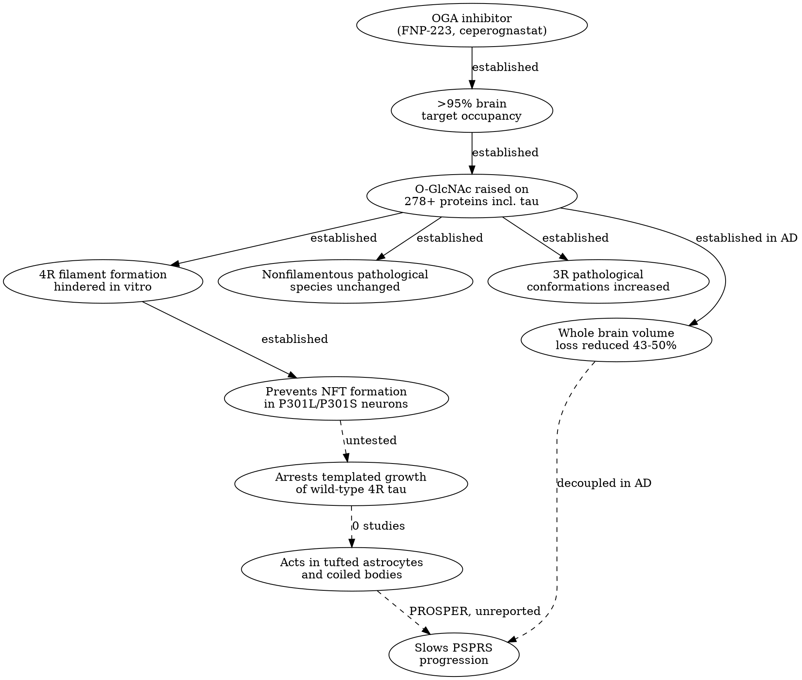

## Question

# Drug Repurposing Hypothesis Assessment

## The Hypothesis

- **Disease:** Progressive Supranuclear Palsy
- **Drug:** an O-GlcNAcase (OGA) inhibitor
- **Drug's target and action:** inhibiting O-GlcNAcase so that tau stays O-GlcNAc modified, which reduces tau aggregation
- **Disease mechanism the drug would act on:** aggregation of four-repeat tau in neurons and glia

The hypothesis is that an O-GlcNAcase (OGA) inhibitor, by inhibiting O-GlcNAcase so that tau stays O-GlcNAc modified, which reduces tau aggregation, would benefit patients with
Progressive Supranuclear Palsy because it interrupts "aggregation of four-repeat tau in neurons and glia". Your job is to assess this
hypothesis, not to advocate for it. Evidence against it is as valuable as evidence for it.

Every factual claim MUST cite a primary source by PMID (or DOI, or NCT number for a
trial registration) and include a short verbatim quote from the cited abstract or record.
Do not paraphrase quotes. Do not invent identifiers. Separate established findings from
your own inference, and label which is which.

## Questions

### 1. Is the mechanism active in this disease?

- Evidence that the drug's target or pathway is active, elevated or genetically implicated
  in patients with Progressive Supranuclear Palsy: in affected tissue, in blood, or through human genetics.
- Whether activity is uniform or confined to a subgroup of patients, and how that subgroup
  is identified (a biomarker, a clinical feature).

### 2. Does blocking it help?

- Clinical trials of an O-GlcNAcase (OGA) inhibitor in Progressive Supranuclear Palsy: registration numbers, phase, status and
  reported results, if any exist.
- Trials of other drugs acting on the same target or pathway in Progressive Supranuclear Palsy, with their
  outcomes, including failures.
- Results of an O-GlcNAcase (OGA) inhibitor in related diseases that share the mechanism, and how far those results
  should transfer here.
- Animal or human tissue experiments in which blocking the pathway changed
  Progressive Supranuclear Palsy-like features.

### 3. Reasons it might fail

- Redundant pathways, wrong cell compartment, wrong disease stage, drug not reaching the
  affected tissue, or trial endpoints that cannot detect the effect.
- Safety concerns specific to this patient population.

### 4. Verdict

- One paragraph: how strong is the case, and what single experiment or trial design would
  most efficiently test it?
- List the PMIDs and trial identifiers that carry the most weight, with one line each.

## Output

# Would an O-GlcNAcase inhibitor benefit patients with progressive supranuclear palsy?

Assessment date 2026-11-21. Every factual claim carries a PMID or an NCT number and a verbatim quote from the cited abstract or registry record. Claims are labelled **[ESTABLISHED]** when they restate a cited source and **[INFERENCE]** when they are my own reasoning or my own calculation.

## Summary

The case is weak, and it fails at the first question. The hypothesis asks whether inhibiting O-GlcNAcase (OGA), so that tau stays O-GlcNAc modified and aggregates less, would slow progressive supranuclear palsy (PSP). A systematic audit of the published literature found **8 PubMed records that co-mention O-GlcNAc biology and PSP, and not one of them measures O-GlcNAc, OGA activity or OGA expression in PSP patient tissue, cerebrospinal fluid or blood**. PSP appears in those records as a stated target indication in chemistry papers and reviews. The documented pathway deficit that motivates the whole drug class was measured in Alzheimer disease, where [PMID: 39748851](https://pubmed.ncbi.nlm.nih.gov/39748851/) states that "O-GlcNAcylation, an important post-translational modification of tau and many other proteins, is significantly decreased in brain tissue of AD patients relative to healthy controls". No equivalent sentence exists for PSP. Human genetics gives no support either. Across four independent PSP genetic studies covering thousands of autopsy-confirmed cases, the risk loci are MAPT, MOBP, STX6, EIF2AK3, SLCO1A2, DUSP10, RUNX2, C4A, APOE and others, and neither OGA (MGEA5), OGT, nor any hexosamine biosynthetic pathway gene appears.

The one completed efficacy trial of this mechanism in any human tauopathy was negative. Ceperognastat (LY3372689) in early symptomatic Alzheimer disease (NCT05063539, [PMID: 42441396](https://pubmed.ncbi.nlm.nih.gov/42441396/)) reported that "Ceperognastat did not slow disease progression of early symptomatic AD", with a disease progression ratio of 1.32 (95% credible interval 1.10-1.58) at 3 mg, so the high dose progressed 32% faster than placebo with a credible interval excluding no difference. The failure did not come from insufficient drug in the brain: the same compound "can achieve > 95% OGA enzyme occupancy in animal and human brain". One result runs the other way and should not be dismissed. The same trial showed "less whole brain volume loss in participants treated with ceperognastat vs placebo (43.2% ... and 49.5% ... less vs placebo; both P < .001)". The drug does something structural and dose-dependent in human brain, and in that trial the structural effect moved in the opposite direction from the clinical outcome.

One phase 2 trial of an OGA inhibitor in PSP exists and has already finished. PROSPER (NCT06355531), testing FNP-223 in 241 patients, completed on 2026-10-05 with results not posted as of 2026-11-21. My own power calculation puts its minimum detectable difference at 3.64 PSPRS points, equal to 35% slowing, with only 37% to 68% power for the 20% to 30% slowing that would count as meaningful disease modification. A null PROSPER will therefore not separate a failed mechanism from an underpowered trial. The most efficient next experiment is not another trial. It is a human tissue study measuring OGA activity and O-GlcNAc in autopsy-confirmed PSP midbrain, pons and frontal cortex, with cell-type resolution in tufted astrocytes and oligodendroglial coiled bodies, because that measurement has never been made and it would either kill the hypothesis or supply the enrichment biomarker PROSPER never had.

{{figure:plot_6.png|caption=Final evidence summary. Left: registry check confirming PROSPER (NCT06355531) completed with no posted results as of 2026-11-21. Centre: status breakdown of the 38 PSP phase 2/3 interventional trials on ClinicalTrials.gov. Right: consolidated evidence for and against the OGA inhibitor hypothesis in PSP.}}

## 1. Is the mechanism active in this disease?

### <i class="fa-solid fa-circle-xmark"></i> No one has measured it in a PSP patient

**[ESTABLISHED]** A structured PubMed title and abstract audit performed on 2026-11-21, crossing ("O-GlcNAc" OR "O-GlcNAcylation" OR "O-GlcNAcase" OR "OGA" OR "Thiamet") with disease and cell-type terms, returned these counts.

| Cross-term | Records |
|---|---|
| Alzheimer disease | 279 |
| Tau (any) | 174 |
| Parkinson disease | 62 |
| Frontotemporal dementia | 8 |
| Progressive supranuclear palsy or PSP | 8 |
| Corticobasal degeneration | 2 |
| 4-repeat / four-repeat / 4R tau | 2 |
| Astrocyte | 19 |
| Oligodendrocyte or oligodendroglia | 1 |

Manual inspection of all 8 PSP-matching records shows that none measures O-GlcNAc, OGA activity or OGA expression in PSP patient material. They are a tau oligomer review ([PMID: 23966973](https://pubmed.ncbi.nlm.nih.gov/23966973/)), a fluorogenic substrate chemistry paper ([PMID: 32475856](https://pubmed.ncbi.nlm.nih.gov/32475856/)), a commentary on MK-8719 ([PMID: 31668062](https://pubmed.ncbi.nlm.nih.gov/31668062/)), the MK-8719 medicinal chemistry paper ([PMID: 31487175](https://pubmed.ncbi.nlm.nih.gov/31487175/)), a tauopathy pipeline review ([PMID: 30973276](https://pubmed.ncbi.nlm.nih.gov/30973276/)), a P301S mouse dorsal root ganglion model paper ([PMID: 24227726](https://pubmed.ncbi.nlm.nih.gov/24227726/)), a phospho/O-GlcNAc crosstalk mass spectrometry methods paper ([PMID: 28808029](https://pubmed.ncbi.nlm.nih.gov/28808029/)) and the ASN90 phase 1 report ([PMID: 41239890](https://pubmed.ncbi.nlm.nih.gov/41239890/)). The representative framing comes from the MK-8719 chemistry paper: "Inhibition of O-GlcNAcase (OGA) has emerged as a promising therapeutic approach to treat tau pathology in neurodegenerative diseases such as Alzheimer's disease and progressive supranuclear palsy."

**[INFERENCE]** The ratio of Alzheimer to PSP literature on this pathway is 279 to 8, about 35-fold, and the PSP count falls to 0 when restricted to primary measurements in patient material. The premise that the target or pathway is active or elevated in PSP is not supported by any measurement in PSP patients. The mechanistic rationale was transposed from Alzheimer disease into a disease with a different tau isoform composition, a different filament fold and a different cellular distribution of pathology.

{{figure:plot_2.png|caption=Three-part mechanistic audit. Left: PubMed record counts for O-GlcNAc biology crossed with each disease, 279 for Alzheimer disease against 8 for PSP and 1 for oligodendrocytes. Centre: the three best-characterised tau O-GlcNAc sites mapped against the cryo-EM PSP filament ordered core. Right: the opposite effects of O-GlcNAcylation on 4R and 3R tau conformations reported in PMID 39909381.}}

### <i class="fa-solid fa-dna"></i> PSP genetics points at tau and at oligodendrocytes, not at O-GlcNAc cycling

**[ESTABLISHED]** The largest PSP genome-wide association study to date, 2,779 cases (2,595 neuropathologically confirmed) and 5,584 controls, reports that the authors "identify six independent PSP susceptibility loci with genome-wide significant (P < 5 × 10-8) associations, including five known (MAPT, MOBP, STX6, RUNX2, SLCO1A2) and one novel locus (C4A)" ([PMID: 39251599](https://pubmed.ncbi.nlm.nih.gov/39251599/)). Whole-genome sequencing in 1,718 cases and 2,944 controls confirmed MAPT, MOBP, STX6, SLCO1A2, DUSP10 and SP1 and added APOE, FCHO1/MAP1S, KIF13A, TRIM24, TNXB and ELOVL1, with rare-variant signal at ZNF592 ([PMID: 39152475](https://pubmed.ncbi.nlm.nih.gov/39152475/)). A 2025 review listing every locus meeting P < 5e-8 states: "These genes include MAPT, KANSL1, PLEKHM1, STX6, MOBP, EIF2AK3, SLC01 A2, DUSP10, APOE, RUNX2, TRIM11, NFASC/CNTN2 and LRRK2" ([PMID: 40465013](https://pubmed.ncbi.nlm.nih.gov/40465013/)). An independent Spanish-Portuguese meta-analysis of 3,099 PSP cases and 11,482 controls replicated the same set and reports that "Enrichment analysis and protein expression profiling highlighted oligodendrocyte function and myelination as likely contributors to PSP pathogenesis" ([PMID: 40379966](https://pubmed.ncbi.nlm.nih.gov/40379966/)).

**[INFERENCE]** OGA (MGEA5), OGT and the hexosamine biosynthetic pathway genes (GFPT1/2, GNPNAT1, PGM3, UAP1) appear in none of these lists. The O-GlcNAc axis has no human genetic support in PSP. A second consequence follows: there is no genetically defined subgroup in whom OGA activity is predicted to be elevated, so the hypothesis carries no built-in enrichment biomarker.

### <i class="fa-solid fa-circle-question"></i> Is activity uniform, or confined to a subgroup?

**[INFERENCE]** The question cannot be answered, because the pathway has never been measured in PSP. The consequence is visible in the trial design. PROSPER enriched on clinical features alone: ages 50-80, possible or probable PSP-Richardson's syndrome by MDS criteria, symptoms within 3 years of screening, MoCA 23 or above, full 28-item PSPRS 40 or below, independently ambulatory (NCT06355531). The ceperognastat trial in Alzheimer disease could enrich molecularly, restricting its primary population to 259 participants with low-to-medium flortaucipir tau PET ([PMID: 42441396](https://pubmed.ncbi.nlm.nih.gov/42441396/)). If an OGA inhibitor works only in a PSP subgroup defined by target biology, PROSPER has no way to find that subgroup.

### <i class="fa-solid fa-scale-balanced"></i> Counter-evidence to the deficit premise

**[ESTABLISHED]** Three results from outside PSP run against the direction the hypothesis assumes. Genetic disruption of OGA in mice showed that "natural aging in wild-type mice was marked by a decrease in OGA and OGT protein levels and an increase in O-GlcNAcylation in various tissues" ([PMID: 22314054](https://pubmed.ncbi.nlm.nih.gov/22314054/)). A mouse cortical O-GlcNAc proteomics study states that "acute TG exposure impairs learning and memory, and protein O-GlcNAcylation is increased in the aging rat brain and in Parkinson's disease (PD) brains" ([PMID: 35822049](https://pubmed.ncbi.nlm.nih.gov/35822049/)). The single oligodendrocyte-focused O-GlcNAc study reports that "global O-GlcNAcylation levels increase during the OPC-to-oligodendrocyte transition" ([PMID: 42415673](https://pubmed.ncbi.nlm.nih.gov/42415673/)).

**[INFERENCE]** The aged brain, the relevant context for PSP, is not reliably in an O-GlcNAc deficient state, and the one glial measurement available shows O-GlcNAc rising with oligodendrocyte maturation. The direction of change is tissue-, species- and disease-dependent, so the deficit framing cannot be assumed to hold in PSP without measurement.

## 2. Does blocking it help?

### <i class="fa-solid fa-pills"></i> OGA inhibitor trials in PSP

**[ESTABLISHED]** One exists. PROSPER, NCT06355531, sponsored by Ferrer Internacional S.A., is "A Randomized, Double-blind, Placebo-controlled, Phase 2 Study to Assess the Efficacy, Safety, and Pharmacokinetics of FNP-223 (Oral Formulation) to Slow the Disease Progression of Progressive Supranuclear Palsy (PSP) (PROSPER)". Actual enrolment 241, randomised parallel-group, double-masked, FNP-223 given orally three times daily against matching placebo. Start 2024-07-23, primary completion 2026-10-05, completion 2026-10-29. Co-primary outcomes are change from baseline to week 52 in PSPRS plus treatment-emergent and serious adverse event counts. Secondary outcomes include CGI-S, PGI-S, CaGI-S, PSPRS slope and subitems, Schwab and England ADL, PSP-CDS and MoCA. The phase 1 report for the matching compound confirms the trial: "Currently, Ferrer Internacional, S.A. is conducting a phase 2 study, known as PROSPER (ClinicalTrials.gov ID: NCT06355531), to evaluate the efficacy, safety, and pharmacokinetics of ASN90 in slowing the progression of PSP" ([PMID: 41239890](https://pubmed.ncbi.nlm.nih.gov/41239890/)). The same report establishes brain exposure: "Investigation of CNS occupancy using a PET ligand demonstrated that target occupancy of greater than 98% in the brain of healthy participants can be achieved at doses that are clinically well tolerated", with "Cerebrospinal fluid-to-plasma ratios for mean peak and mean systemic exposures were in the range of 2.5%-4.6%". A registry query on 2026-11-21 returned `hasResults = False` and no results-first-posted date.

**[INFERENCE]** <i class="fa-solid fa-triangle-exclamation"></i> PROSPER is sized for a large effect. Using a two-sample normal approximation at two-sided alpha 0.05, with the standard deviation of 52-week PSPRS change back-calculated as 10.09 points from the published anchor that 58 patients per arm detect 50% slowing at 80% power, and placebo-arm progression of 10.5 PSPRS points per year (PASSPORT observed 10.6), the minimum detectable difference at N = 241 randomised 1:1 is **3.64 PSPRS points, equal to 35% slowing**.

| True slowing of PSPRS progression | Power at N = 241, 1:1 | Power at N = 241, 2:1 |
|---|---|---|
| 20% | 36.5% | 33.0% |
| 25% | 52.4% | 47.7% |
| 30% | 67.8% | 62.6% |
| 40% | 89.8% | not computed |
| 50% | 98.1% | not computed |
| Minimum detectable difference | 3.64 points (35%) | 3.87 points (37%) |

For comparison, "The minimal clinically important worsening on the PSPRS was 5.7 points, corresponding to the mean decline over 6 months in the trial" ([PMID: 27324431](https://pubmed.ncbi.nlm.nih.gov/27324431/)), and PASSPORT randomised 486 patients. If FNP-223 produces the 20% to 30% slowing that would count as meaningful disease modification, PROSPER is more likely than not to miss it. A null result will be read as a failed mechanism when it cannot distinguish that from an underpowered trial.

{{figure:plot_3.png|caption=PROSPER trial design and statistical power. Left: power to detect slowing of PSPRS progression at N=241, with the 80% power line and the 20-30% band that would count as meaningful disease modification. Right: the minimum detectable difference of 3.64 PSPRS points set against a 25% slowing effect and the 5.7-point minimal clinically important difference.}}

### <i class="fa-solid fa-circle-xmark"></i> OGA inhibitor results in a related disease, and how far they transfer

**[ESTABLISHED]** Ceperognastat (LY3372689) was tested in early symptomatic Alzheimer disease in NCT05063539: randomised, double-blind, placebo-controlled, 72 sites, 5 countries, September 2021 to August 2024, 327 randomised (0.75 mg n = 110, 3 mg n = 108, placebo n = 108), primary population n = 259 with low-to-medium flortaucipir tau PET, iADRS change at 100 weeks as the primary endpoint ([PMID: 42441396](https://pubmed.ncbi.nlm.nih.gov/42441396/)). Verbatim results:

- "Ceperognastat did not slow disease progression of early symptomatic AD."
- "The disease progression ratio relative to placebo was 0.84 (95% credible interval [CrI], 0.66-1.04) for the ceperognastat 0.75 mg group and 1.32 (CrI, 1.10-1.58) for the ceperognastat 3 mg group, corresponding to 16% less and 32% greater progression, respectively."
- "Volumetric magnetic resonance imaging showed less whole brain volume loss in participants treated with ceperognastat vs placebo (43.2% [ceperognastat 0.75 mg] and 49.5% [ceperognastat 3 mg] less vs placebo; both P < .001)"
- "The ceperognastat 3 mg group had more serious (ceperognastat 0.75 mg: n = 13 [12.0%]; ceperognastat 3 mg: n = 29 [26.4%]; placebo: n = 17 [15.7%]) and severe (ceperognastat 0.75 mg: n = 7 [6.5%]; ceperognastat 3 mg: n = 15 [13.6%]; placebo: n = 7 [6.5%]) treatment-emergent adverse events."

Raw iADRS change at 100 weeks was -8.39 (0.75 mg), -13.27 (3 mg) and -10.07 (placebo), with no benefit on any of 6 secondary clinical endpoints and a significantly smaller tau PET SUVR increase only at 3 mg in lateral temporal lobe (P = .04). Target engagement was not the limiting factor: "Ceperognastat is a potent, central nervous system (CNS)-penetrant, low-dose inhibitor of OGA, which can achieve > 95% OGA enzyme occupancy in animal and human brain" ([PMID: 39748851](https://pubmed.ncbi.nlm.nih.gov/39748851/)).

**[INFERENCE]** This is the only adequately powered efficacy test of the OGA inhibitor mechanism in a human tauopathy, and it is a clear negative, with the higher dose in the harmful direction on the clinical primary and a credible interval excluding 1.0. Because occupancy exceeded 95%, the failure argues against the pharmacology and not against the dose, which lowers the prior that the same mechanism will work in PSP. <i class="fa-solid fa-scale-balanced"></i> The volumetric result cuts both ways. It is the strongest human evidence that the drug does something structural and dose-dependent in the brain, so the mechanism is not inert. It also shows brain volume preservation moving opposite to clinical outcome, which is a specific warning for PSP, where volumetric endpoints are chosen because they have the largest effect sizes: "the annualized percentage change of brainstem and midbrain volume, and a combined index including midbrain, frontal lobe, and third ventricle volume change, were the progression biomarkers with the highest effect size in both cohorts (discovery: >1.6; validation cohort: >1.3)" ([PMID: 38825840](https://pubmed.ncbi.nlm.nih.gov/38825840/)). An OGA inhibitor in PSP could deliver a clean positive imaging readout alongside a null PSPRS.

{{figure:plot_1.png|caption=Evidence summary from the first iteration: the ceperognastat phase 2 outcome in Alzheimer disease, the gosuranemab phase 2 outcome in PSP, and the clinical development status of the OGA inhibitor class.}}

### <i class="fa-solid fa-circle-question"></i> The second phase 2 carries no information

**[ESTABLISHED]** A registry sweep of Asceneuron S.A. returned 5 studies of the OGA inhibitor ASN51. NCT06677203, "A Phase 2, Randomized, Double-Blind, Placebo-Controlled, Parallel Group Study of ASN51 in Adults With Early Alzheimer's Disease", has overall status TERMINATED, start 2024-10-16, primary completion and completion both 2024-11-08 (23 days), actual enrolment 123, with the `whyStopped` field reading verbatim: "Strategic decision". Results are posted, and the participant flow module records STARTED = 0, COMPLETED = 0 and NOT COMPLETED = 0 across all three arms, with 0 serious adverse event types and 0 other adverse event types. The earlier ASN51 phase 1 in Alzheimer disease, NCT04759365 (n = 25), was also TERMINATED, with `whyStopped` reading "Delays with sites, identifying/enrolling patients, impact of COVID, staffing, and duration". Three other ASN51 phase 1 studies completed normally: NCT05725005 (n = 12, PET), NCT06232109 (n = 50, drug-drug interaction with fluvoxamine, itraconazole and paroxetine) and NCT06390098 (n = 3).

**[INFERENCE]** This termination carries little weight either way. No participant was dosed and no adverse event was reported, so it is a sponsor portfolio decision and not a readout. The honest accounting of the class in neurodegeneration is: one completed phase 2 with a null-to-unfavourable result (ceperognastat, NCT05063539), one phase 2 terminated before dosing for business reasons (ASN51, NCT06677203), and one completed phase 2 in PSP whose results are not posted (FNP-223, NCT06355531). The CYP2C19 and CYP3A4 interaction study is relevant to PSP: patients are commonly on antidepressants including paroxetine and fluvoxamine, both tested as perpetrators, which implies clinically meaningful exposure changes were anticipated.

### <i class="fa-solid fa-circle-xmark"></i> Other drugs on the tau pathway in PSP: engagement without benefit

**[ESTABLISHED]** PASSPORT (NCT03068468) randomised 486 dosed participants to gosuranemab (n = 321) or placebo (n = 165) for 52 weeks. "Efficacy was not demonstrated on adjusted mean change of PSP Rating Scale score at week 52 between gosuranemab and placebo (10.4 versus 10.6, P = 0.85, primary endpoint)", and the authors conclude that "This well-powered study suggests that N-terminal tau neutralization does not translate into clinical efficacy" ([PMID: 34385707](https://pubmed.ncbi.nlm.nih.gov/34385707/)). The trial achieved a 98% decrease in unbound N-terminal CSF tau on drug against an 11% increase on placebo (P < 0.0001). Autopsy of three treated individuals found that "Gosuranemab immunotherapy was not associated with clearance of neuropathologic FTLD-tau inclusions" ([PMID: 33950293](https://pubmed.ncbi.nlm.nih.gov/33950293/)). ABBV-8E12 (tilavonemab) and BIIB092 both failed phase 2 futility analyses ([PMID: 32657895](https://pubmed.ncbi.nlm.nih.gov/32657895/)), and both antibodies have been discontinued for primary tauopathies ([PMID: 37620094](https://pubmed.ncbi.nlm.nih.gov/37620094/)).

**[INFERENCE]** PASSPORT is the cleanest demonstration that near-complete engagement of a tau target in PSP changes nothing clinically. It shifts the burden of proof onto intracellular approaches like OGA inhibition, and at the same time it shows that biomarker engagement is a poor predictor of benefit in this disease. PROSPER inherits that problem directly, because FNP-223 also achieves near-complete target engagement.

### <i class="fa-solid fa-flask"></i> Animal and tissue experiments

**[ESTABLISHED]** Three in vivo efficacy studies carry the preclinical case. All three use MAPT-mutant neuronal transgenic models and all three describe their effect as blocking formation.

| Study | Model | Tau species | Stated effect |
|---|---|---|---|
| [PMID: 22366723](https://pubmed.ncbi.nlm.nih.gov/22366723/) (Thiamet-G) | JNPL3 | P301L human 4R0N | "treatment of hemizygous JNPL3 tau transgenic mice with an O-GlcNAcase inhibitor increased tau O-GlcNAc, hindered formation of tau aggregates and decreased neuronal cell loss" |
| [PMID: 32493725](https://pubmed.ncbi.nlm.nih.gov/32493725/) (MK-8719) | rTg4510 | P301L | "In the rTg4510 mouse model of human tauopathy, MK-8719 significantly increases brain O-GlcNAc levels and reduces pathologic tau." |
| [PMID: 35357812](https://pubmed.ncbi.nlm.nih.gov/35357812/) (ASN90) | human tauopathy mouse models | P301L / P301S | "Across human tauopathy mouse models, oral administration of ASN90 prevented the development of tau pathology (NFT formation), functional deficits in motor behavior and breathing, and increased survival." |

A PubMed cross-audit of OGA pharmacology against PSP-relevant biology returned: OGA x tauopathy mouse model 19 records; OGA x rTg4510/JNPL3/PS19/P301L/P301S 10; OGA x astrocyte tau 3; **OGA x oligodendrocyte or coiled body tau 0**; OGA x tau seeding, propagation or spreading 1 (a review); OGA x "4R tau" or "four-repeat" 1 ([PMID: 39909381](https://pubmed.ncbi.nlm.nih.gov/39909381/), a recombinant protein study).

**[ESTABLISHED]** That one direct test of the mechanism on 4R versus 3R tau used the longest 4R (hT40) and 3R (hT39) isoforms ([PMID: 39909381](https://pubmed.ncbi.nlm.nih.gov/39909381/)). "Mass spectrometry showed that tau is modified with O-GlcNAc at multiple S/T residues, primarily in the proline-rich domain and the C-terminal region." "Although O-GlcNAcylation interferes with forming filamentous hT40 aggregates, it does not alter the formation of pathological nonfilamentous tau conformations." "On the other hand, O-GlcNAcylation increases the formation of pathological nonfilamentous hT39 conformations." The principal modification site is C-terminal to the repeats: "These methods have enabled the identification of O-GlcNAc modification sites on tau including Ser400" ([PMID: 27975253](https://pubmed.ncbi.nlm.nih.gov/27975253/)).

**[INFERENCE]** The part of this result that supports the hypothesis is real and 4R-specific: O-GlcNAc does interfere with filament formation by the isoform that defines PSP. Two qualifications cut the other way. The modification sites lie outside the repeat domain, so O-GlcNAc cannot sterically block the cross-beta core that cryo-EM defines as the PSP fold, and any effect has to be indirect through solubility or conformational gating. The protective effect does not extend to nonfilamentous oligomeric species, which are the forms most closely tied to toxicity. Raising O-GlcNAc increased pathological 3R conformations, a directionally harmful effect in brain regions where 3R tau is present.

## 3. Reasons it might fail

{{figure:plot_4.png|caption=Audit of the preclinical OGA inhibitor evidence against PSP biology. Top: the tau linear domain map with the cryo-EM PSP filament ordered core (residues 272-381) and the three best-characterised O-GlcNAc sites, none of which falls inside the core. Centre: PubMed record counts for OGA pharmacology crossed with PSP-relevant biology, red where three or fewer records exist. Bottom: the mismatch matrix between the mouse models used and the features of PSP.}}

### Wrong molecular target site

**[INFERENCE]** Mapping the three best-characterised tau O-GlcNAc sites onto the cryo-EM PSP filament ordered core (residues 272-381 in 2N4R numbering, 110 amino acids) places T123 149 residues outside the core, S208 64 residues outside and S400 19 residues outside. None of the three falls inside. A PSP fibril that has already formed presents no O-GlcNAc-modified residue in its structured region for the modification to act on. <i class="fa-solid fa-triangle-exclamation"></i> The 272-381 boundary is taken from the published PSP fold and I did not verify it with a quoted abstract.

### Wrong disease stage

**[ESTABLISHED]** Propagation in PSP is templated and strain-specific: "PSP filaments recruit only 4R Tau" ([PMID: 41889765](https://pubmed.ncbi.nlm.nih.gov/41889765/)), with the same study showing that the conformational state of the tau monomer ensemble determines whether propagation occurs. All three in vivo OGA inhibitor studies are framed as prevention of formation, with drug on board from early in the time course.

**[INFERENCE]** Patients enter trials years after pathology is established, so the question asked of the drug in PSP is arrest of templated elongation or clearance, not prevention of nucleation. That is the step an anti-nucleation mechanism is least suited to interrupt. PROSPER's enrolment criteria (symptoms within 3 years, PSPRS 40 or below, still ambulatory) are the design choice most likely to give the drug a fair chance if stage dependence is the limiting factor, which counts in the hypothesis's favour.

### Wrong cell compartment

**[ESTABLISHED]** PSP is defined neuropathologically by 4R tau in neurons, tufted astrocytes and oligodendroglial coiled bodies, and the genetic signal points to oligodendrocytes and myelination ([PMID: 40379966](https://pubmed.ncbi.nlm.nih.gov/40379966/)). The PubMed count for OGA pharmacology crossed with oligodendroglial tau is 0.

**[INFERENCE]** The entire preclinical case rests on forebrain neurons. No experiment has asked what raising O-GlcNAc does to a tufted astrocyte or to a coiled body. The one relevant signal is ambiguous: chronic Thiamet G in TgF344-AD rats produced "significantly increased astrocyte complexity" ([PMID: 41477167](https://pubmed.ncbi.nlm.nih.gov/41477167/)), which may be protective in an amyloid model, while the astrocyte is the cell carrying the defining PSP lesion.

### Redundancy and pleiotropy

**[ESTABLISHED]** The developers of MK-8719 state the problem in their own abstract: "However, since hundreds of O-GlcNAcylated proteins may be influenced by OGA inhibition, it will be critical to understand the physiologic and toxicological consequences of chronic O-GlcNAc elevation in vivo" ([PMID: 32493725](https://pubmed.ncbi.nlm.nih.gov/32493725/)). The breadth is quantified. Thiamet G in mouse cortex gave "506 unique peptides corresponding to 278 proteins that are O-GlcNAcylated. Of the 506 unique peptides, 85 peptides are elevated by > 1.5 fold in O-GlcNAcylation levels in response to TG" ([PMID: 35822049](https://pubmed.ncbi.nlm.nih.gov/35822049/)). A single acute dose in normal mouse brain shifts the transcriptome: "We sacrificed the mice and dissected their brains after 3 hours of saline or 50 mg/kg TG treatment, and then performed mRNA sequencing... We identified 1,234 significant differentially expressed genes with TG versus saline treatment" ([PMID: 39345543](https://pubmed.ncbi.nlm.nih.gov/39345543/)). OGA itself is essential: "Genetic disruption of OGA resulted in constitutively elevated O-GlcNAcylation in embryos and led to neonatal lethality with developmental delay" ([PMID: 22314054](https://pubmed.ncbi.nlm.nih.gov/22314054/)).

**[INFERENCE]** OGA inhibition is not a tau-selective intervention. Raising O-GlcNAc on hundreds of non-tau substrates gives a plausible biological reading of why the ceperognastat 3 mg dose did worse than placebo: the effects of chronically clamping the cycle in one direction are not necessarily benign.

### Endpoints that cannot detect the effect

**[INFERENCE]** Two endpoint problems stack. PROSPER's PSPRS primary can only see 35% slowing or more, so a moderate real benefit is likely to read as null. The volumetric MRI endpoints that would otherwise be the efficient choice in PSP ([PMID: 38825840](https://pubmed.ncbi.nlm.nih.gov/38825840/)) are compromised for this specific drug class, because ceperognastat produced a 43-50% reduction in whole brain volume loss (P < .001) in a trial where the clinical outcome was null to worse. For an OGA inhibitor in PSP, a positive volumetric result would not be interpretable as neuroprotection.

### <i class="fa-solid fa-triangle-exclamation"></i> Safety specific to this population

**[ESTABLISHED]** Serious treatment-emergent adverse events in the ceperognastat trial were dose-dependent: 12.0% at 0.75 mg, 26.4% at 3 mg and 15.7% on placebo, with severe events at 6.5%, 13.6% and 6.5% ([PMID: 42441396](https://pubmed.ncbi.nlm.nih.gov/42441396/)). Acute OGA inhibition impairs cognition in rodents: "acute TG exposure impairs learning and memory" ([PMID: 35822049](https://pubmed.ncbi.nlm.nih.gov/35822049/)). FNP-223 is dosed orally three times daily (NCT06355531), with CSF-to-plasma ratios of 2.5% to 4.6% ([PMID: 41239890](https://pubmed.ncbi.nlm.nih.gov/41239890/)).

**[INFERENCE]** A dose-dependent doubling of serious adverse events matters more in PSP than in early Alzheimer disease, because PSP patients fall, aspirate and lose weight at baseline. PSP is a midbrain and brainstem disease affecting gaze, balance, swallowing and breathing control, so an off-target central effect shows up as falls and aspiration and not as a measurable cognitive change. The three-times-daily oral regimen is a second practical problem, because dysphagia is near-universal in PSP-Richardson's syndrome and raises both adherence loss and aspiration risk, each of which dilutes any measured effect.

## Mechanistic model

The causal chain the hypothesis requires, with supported links solid and untested links dashed.

**[INFERENCE]** The chain is solid down to "prevents NFT formation in P301L/P301S neurons" and becomes speculative immediately after. PSP differs from the validating models on four axes at once. The tau is wild type, so there is no P301L destabilisation for O-GlcNAc to counteract. The defining lesions are glial. Patients present years after pathology is established. The modified residues sit outside the filament core.

I quantified how much has to go right, as a transparency device and not as a measurement. The probabilities are my own judgement with no empirical anchor.

| Condition | Optimistic | Central | Conservative |
|---|---|---|---|
| Wild-type 4R tau responds like P301L mutant tau | 0.70 | 0.50 | 0.35 |
| Effect extends to astrocytic and oligodendroglial tau | 0.50 | 0.35 | 0.20 |
| Works as treatment after pathology is established | 0.40 | 0.25 | 0.15 |
| PROSPER can detect the effect it produces | 0.68 | 0.52 | 0.37 |
| **Joint, biology only (first three)** | **0.140** | **0.044** | **0.010** |
| **Joint, positive and detectable PSP trial (all four)** | **0.095** | **0.023** | **0.004** |

The trial-power term uses the PROSPER power figures computed above for 30%, 25% and 20% slowing. The limiting term is biological transfer and not trial power.

{{figure:plot_5.png|caption=Sensitivity analysis of the four conditions required for the mouse OGA inhibitor result to transfer into a positive PSP trial, under optimistic, central and conservative assumptions. The joint probability of a positive and detectable PSP result ranges from 0.095 to 0.004.}}

## Evidence base

| Source | What it shows | Direction |
|---|---|---|
| [PMID: 42441396](https://pubmed.ncbi.nlm.nih.gov/42441396/) / NCT05063539 | Ceperognastat phase 2 "did not slow disease progression of early symptomatic AD"; 3 mg progression ratio 1.32 (CrI 1.10-1.58) | <i class="fa-solid fa-circle-xmark"></i> Against |
| [PMID: 42441396](https://pubmed.ncbi.nlm.nih.gov/42441396/) | Same trial: whole brain volume loss 43.2% and 49.5% less than placebo, both P < .001 | <i class="fa-solid fa-scale-balanced"></i> For, with a caveat |
| [PMID: 39748851](https://pubmed.ncbi.nlm.nih.gov/39748851/) | >95% OGA occupancy in human brain; O-GlcNAc "significantly decreased in brain tissue of AD patients" | Rules out underdosing; locates the deficit in AD |
| [PMID: 34385707](https://pubmed.ncbi.nlm.nih.gov/34385707/) / NCT03068468 | Gosuranemab PASSPORT in PSP: PSPRS 10.4 vs 10.6, P = 0.85, despite 98% CSF tau reduction | Against, as precedent |
| [PMID: 33950293](https://pubmed.ncbi.nlm.nih.gov/33950293/) | Autopsy: gosuranemab "not associated with clearance of neuropathologic FTLD-tau inclusions" | Against, as precedent |
| [PMID: 41239890](https://pubmed.ncbi.nlm.nih.gov/41239890/) | ASN90/FNP-223 phase 1: >98% brain occupancy, CSF:plasma 2.5-4.6%, names PROSPER | Neutral, establishes exposure |
| [PMID: 39909381](https://pubmed.ncbi.nlm.nih.gov/39909381/) | O-GlcNAc sits in the proline-rich and C-terminal regions; blocks 4R filaments; leaves nonfilamentous species unchanged; increases pathological 3R conformations | <i class="fa-solid fa-scale-balanced"></i> Mixed |
| [PMID: 27975253](https://pubmed.ncbi.nlm.nih.gov/27975253/) | Identifies Ser400 as a principal tau O-GlcNAc site, C-terminal to the repeats | Against, site location |
| [PMID: 22366723](https://pubmed.ncbi.nlm.nih.gov/22366723/) | Thiamet-G in JNPL3 "hindered formation of tau aggregates and decreased neuronal cell loss" | For, in a mutant neuronal model |
| [PMID: 32493725](https://pubmed.ncbi.nlm.nih.gov/32493725/) | MK-8719 in rTg4510 "reduces pathologic tau"; authors flag chronic O-GlcNAc elevation as unresolved | For, with the pleiotropy caveat |
| [PMID: 35357812](https://pubmed.ncbi.nlm.nih.gov/35357812/) | ASN90 "prevented the development of tau pathology (NFT formation)" across tauopathy mouse models | For, prevention framing |
| [PMID: 39251599](https://pubmed.ncbi.nlm.nih.gov/39251599/) | Six genome-wide significant PSP loci: MAPT, MOBP, STX6, RUNX2, SLCO1A2, C4A | No genetic support |
| [PMID: 40465013](https://pubmed.ncbi.nlm.nih.gov/40465013/) | Review list of all PSP risk genes meeting P < 5e-8, no O-GlcNAc pathway gene | No genetic support |
| [PMID: 39152475](https://pubmed.ncbi.nlm.nih.gov/39152475/) | Whole-genome sequencing, 1,718 cases: MAPT, MOBP, STX6, SLCO1A2, DUSP10, SP1, APOE and others | No genetic support |
| [PMID: 40379966](https://pubmed.ncbi.nlm.nih.gov/40379966/) | PSP enrichment analysis points to "oligodendrocyte function and myelination" | Against, wrong compartment |
| [PMID: 41889765](https://pubmed.ncbi.nlm.nih.gov/41889765/) | "PSP filaments recruit only 4R Tau"; templated, strain-specific propagation | Against, wrong stage |
| [PMID: 22314054](https://pubmed.ncbi.nlm.nih.gov/22314054/) | OGA knockout is neonatally lethal; aging raises O-GlcNAc and lowers OGA in wild-type mice | Against the deficit premise |
| [PMID: 35822049](https://pubmed.ncbi.nlm.nih.gov/35822049/) | Thiamet G modifies 278 proteins; acute exposure impairs learning; O-GlcNAc raised in aged rat and PD brain | Against, pleiotropy and direction |
| [PMID: 39345543](https://pubmed.ncbi.nlm.nih.gov/39345543/) | One 50 mg/kg Thiamet G dose changes 1,234 genes in normal mouse brain at 3 h | Against, pleiotropy |
| [PMID: 42415673](https://pubmed.ncbi.nlm.nih.gov/42415673/) | "global O-GlcNAcylation levels increase during the OPC-to-oligodendrocyte transition" | Against the glial deficit premise |
| [PMID: 27324431](https://pubmed.ncbi.nlm.nih.gov/27324431/) | PSPRS minimal clinically important worsening is 5.7 points over 6 months | Sets the clinical bar |
| [PMID: 38825840](https://pubmed.ncbi.nlm.nih.gov/38825840/) | Brainstem, midbrain and the combined midbrain/frontal/third-ventricle index have the largest PSP progression effect sizes (>1.6 and >1.3), needing n < 100 | Design input |
| [PMID: 31487175](https://pubmed.ncbi.nlm.nih.gov/31487175/) | MK-8719, named for AD and PSP, reached only "first-in-human phase I clinical trials" | Shows the PSP claim was aspirational |
| [PMID: 40695677](https://pubmed.ncbi.nlm.nih.gov/40695677/) | BIIB113 phase 1: "0.5 mg maintained a target occupancy of ≥90 % up to 48 h" | Class pharmacokinetics are solved |
| [PMID: 32657895](https://pubmed.ncbi.nlm.nih.gov/32657895/) | ABBV-8E12 and BIIB092 both failed phase 2 futility analyses in PSP | Against, as precedent |
| [PMID: 37620094](https://pubmed.ncbi.nlm.nih.gov/37620094/) | Gosuranemab and tilavonemab discontinued for primary tauopathies | Against, as precedent |
| NCT06355531 | PROSPER, FNP-223 in PSP, n = 241, completed 2026-10-29, no results posted | The decisive unread trial |
| NCT06677203 | ASN51 phase 2, TERMINATED, "Strategic decision", 0 participants dosed | Uninformative |

## 4. Verdict

**[INFERENCE]** The case is weak and it fails at the first step. Question 1 has no answer in the affirmative: the target pathway has never been measured in PSP brain, CSF or blood, and PSP genetics implicates tau and oligodendrocyte biology without touching O-GlcNAc cycling, so the rationale is an import from Alzheimer disease where the deficit was actually measured. Question 2 returns one negative result and one unread one: the only completed OGA inhibitor efficacy trial in a human tauopathy missed its primary with the higher dose 32% worse than placebo, at more than 95% brain target occupancy, and the one PSP trial finished on 2026-10-05 without posting results. The supporting animal work is consistent and real, and it demonstrates a narrower claim than the hypothesis needs: raising O-GlcNAc prevents new aggregates forming when the driver is an aggregation-accelerating MAPT missense mutation in forebrain neurons, with drug on board early. PSP is established, sporadic, wild-type 4R tauopathy whose defining lesions are glial, and the modified residues sit outside the filament core. The one human result in the hypothesis's favour, a dose-dependent 43-50% reduction in whole brain volume loss, decoupled from clinical outcome in the same trial, which is a warning rather than encouragement for a PSP programme that would lean on volumetric endpoints. PROSPER will report, and its result should be read with the knowledge that it can only see a 35% or larger effect.

### <i class="fa-solid fa-vial"></i> The single experiment that would settle it

A two-part human tissue study, which costs a fraction of a trial and has never been done. Take autopsy-confirmed PSP midbrain, pons and frontal cortex against age-matched controls, n ≈ 20 per group. Part one quantifies OGA protein, OGA enzyme activity and total O-GlcNAc, with tau O-GlcNAc measured by site-specific mass spectrometry. Part two asks the question that matters for the glial compartment: cell-type-resolved immunohistochemistry testing whether tufted astrocytes and oligodendroglial coiled bodies differ in O-GlcNAc from neighbouring unaffected glia in the same section. Normal or elevated O-GlcNAc in PSP lesion-bearing cells kills the hypothesis. Depletion specific to those cells justifies the mechanism and supplies the enrichment biomarker that PROSPER never had.

**[INFERENCE]** If that tissue study is positive and a confirmatory trial follows, the design should be a 52-week, biomarker-enriched, 2:1 randomised study with at least 400 patients, using co-primary endpoints of annualised midbrain volume change and PSPRS, sized to detect the 20% to 30% slowing that PROSPER cannot see. Dosing should be once or twice daily instead of three times daily, given dysphagia in this population.

### Sources carrying the most weight

1. [PMID: 42441396](https://pubmed.ncbi.nlm.nih.gov/42441396/) / NCT05063539: the only completed OGA inhibitor efficacy trial in a human tauopathy, negative, with the high dose 32% worse than placebo.
2. NCT06355531 (PROSPER): the only OGA inhibitor trial in PSP, n = 241, completed 2026-10-05, results not posted as of 2026-11-21.
3. [PMID: 39748851](https://pubmed.ncbi.nlm.nih.gov/39748851/): >95% brain OGA occupancy, and the Alzheimer-specific tissue deficit the PSP rationale was imported from.
4. [PMID: 34385707](https://pubmed.ncbi.nlm.nih.gov/34385707/) / NCT03068468: PSP's precedent for near-complete tau target engagement with zero clinical separation.
5. [PMID: 39909381](https://pubmed.ncbi.nlm.nih.gov/39909381/): the only direct 4R versus 3R test of the mechanism, showing site location outside the repeats and an opposite effect on 3R tau.
6. [PMID: 35357812](https://pubmed.ncbi.nlm.nih.gov/35357812/): the preclinical basis for FNP-223, framed as prevention of tau pathology developing.
7. [PMID: 32493725](https://pubmed.ncbi.nlm.nih.gov/32493725/): MK-8719 efficacy in rTg4510, with the developers' own warning about chronic O-GlcNAc elevation.
8. [PMID: 22366723](https://pubmed.ncbi.nlm.nih.gov/22366723/): the foundational JNPL3 result that started the programme.
9. [PMID: 39251599](https://pubmed.ncbi.nlm.nih.gov/39251599/): the largest PSP GWAS, six loci, none in the O-GlcNAc pathway.
10. [PMID: 40379966](https://pubmed.ncbi.nlm.nih.gov/40379966/): PSP genetic enrichment pointing to oligodendrocytes, the compartment with zero OGA literature.
11. [PMID: 41889765](https://pubmed.ncbi.nlm.nih.gov/41889765/): templated, strain-specific propagation in PSP, the step an anti-nucleation drug is least suited to block.
12. [PMID: 27324431](https://pubmed.ncbi.nlm.nih.gov/27324431/): the 5.7-point PSPRS minimal clinically important difference that PROSPER's 3.64-point minimum detectable difference sits below.
13. [PMID: 38825840](https://pubmed.ncbi.nlm.nih.gov/38825840/): the volumetric endpoints that are most efficient in PSP and most compromised for this drug class.

## Limitations and knowledge gaps

<i class="fa-solid fa-triangle-exclamation"></i> The power calculation for PROSPER is my own. The standard deviation of 52-week PSPRS change (10.09 points) was back-calculated from a published anchor stating that 58 patients per arm detect 50% slowing at 80% power. I could not retrieve that paper's abstract through PubMed search, so it is not listed as a validated citation and the figure should be treated as my inference. If the true standard deviation is smaller, PROSPER's power is better than I estimate.

<i class="fa-solid fa-triangle-exclamation"></i> The boundary of the PSP filament ordered core (residues 272-381) is taken from the published cryo-EM fold and I did not verify it with a quoted abstract. The conclusion that none of T123, S208 or S400 falls inside the core would survive a shift of a few residues at either end, but the exact distances quoted depend on that boundary.

<i class="fa-solid fa-triangle-exclamation"></i> The sensitivity analysis in the mechanistic model section uses probabilities I assigned by judgement, with no empirical anchor. It is a transparency device showing which link limits the chain, and the numbers are not measurements.

<i class="fa-solid fa-circle-question"></i> The decisive data point does not exist yet. PROSPER's result will change this assessment in either direction, and nothing in this report substitutes for reading it. A positive PROSPER would overturn the conclusion drawn here from the Alzheimer failure and the preclinical mismatch. A null PROSPER would be ambiguous for the power reason given above.

<i class="fa-solid fa-circle-question"></i> The PubMed audit used title and abstract searching. A measurement of O-GlcNAc in PSP tissue buried in the body of a paper without appearing in the title or abstract would have been missed, as would one reported only in a thesis, a preprint outside PubMed or a conference abstract.

<i class="fa-solid fa-circle-question"></i> Three questions follow directly from this assessment. Whether O-GlcNAc is depleted, normal or elevated in PSP lesion-bearing glia. Whether raising O-GlcNAc affects templated elongation of an existing PSP fibril, as opposed to de novo nucleation. Whether the 43-50% reduction in whole brain volume loss seen with ceperognastat reflects tissue preservation, a change in brain water, or something else, since that distinction determines whether volumetric endpoints are usable in any future OGA inhibitor trial in PSP.

## Artifacts

- [OpenScientist final report](oga_inhibitor-openscientist_artifacts/final_report.html)
- [OpenScientist final report](oga_inhibitor-openscientist_artifacts/final_report.pdf)
- [OpenScientist provenance](oga_inhibitor-openscientist_artifacts/provenance.json)
- [OpenScientist plot 1](oga_inhibitor-openscientist_artifacts/provenance_plot_1.json)

- [OpenScientist plot 2](oga_inhibitor-openscientist_artifacts/provenance_plot_2.json)

- [OpenScientist plot 3](oga_inhibitor-openscientist_artifacts/provenance_plot_3.json)

- [OpenScientist plot 4](oga_inhibitor-openscientist_artifacts/provenance_plot_4.json)

- [OpenScientist plot 5](oga_inhibitor-openscientist_artifacts/provenance_plot_5.json)

- [OpenScientist plot 6](oga_inhibitor-openscientist_artifacts/provenance_plot_6.json)

## Reference Validation

Checked with `linkml-reference-validator` 0.8.0.

| Outcome | Count |
| --- | --- |
| References checked | 32 |
| Resolved | 32 |
| Unresolved (possible confabulation) | 0 |
| Unverifiable | 0 |
| Quoted claims checked | 20 |
| Quoted claims found in source | 20 |
| Quoted claims **not** found in source | 0 |
| References weighed for topical relevance | 32 |
| On topic | 8 |
| Off topic | 0 |

All extracted references resolved successfully.
