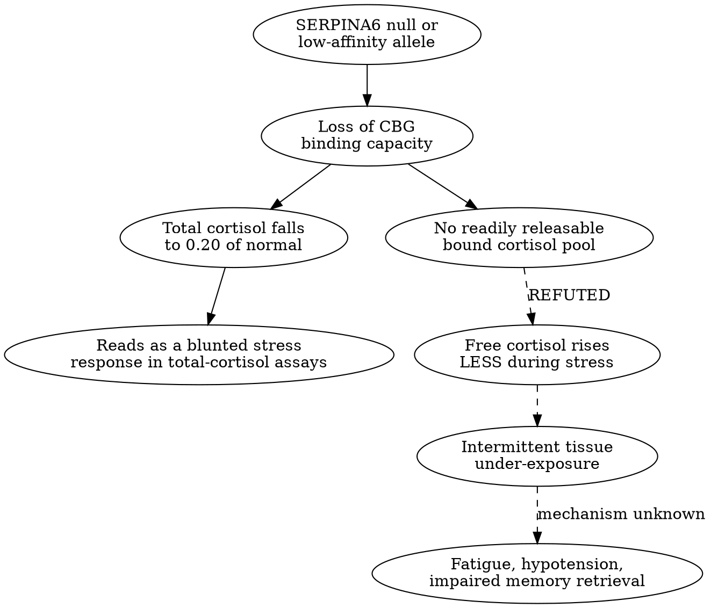
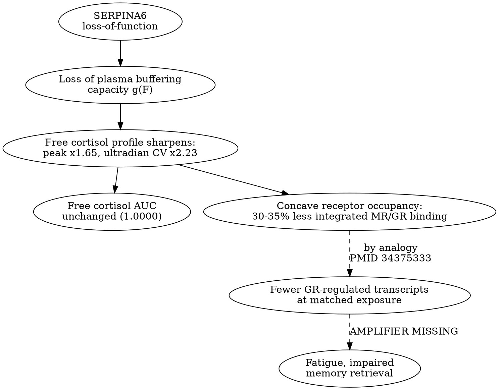
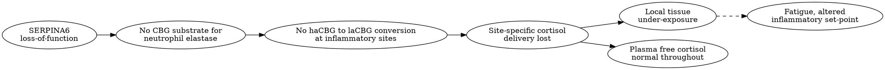
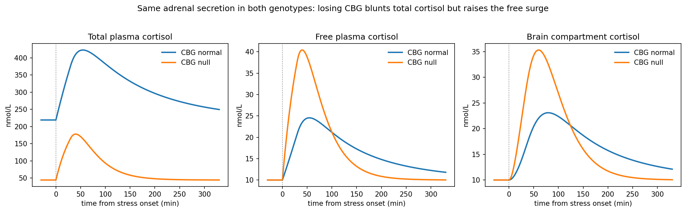
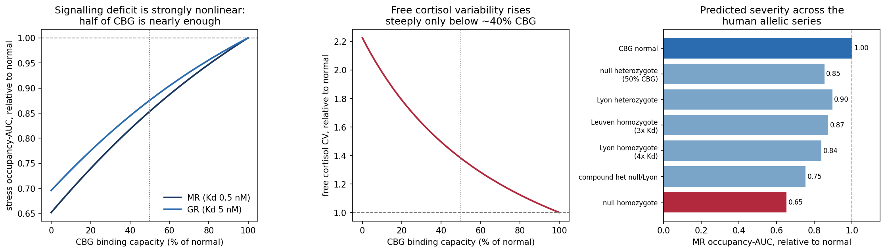
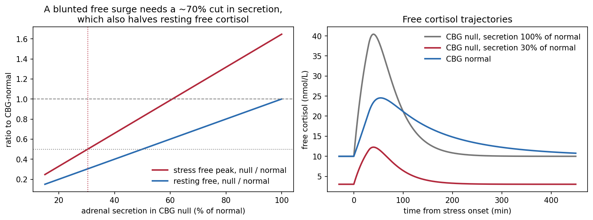
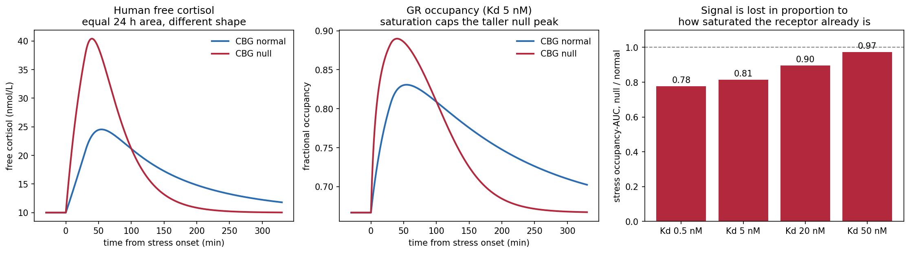
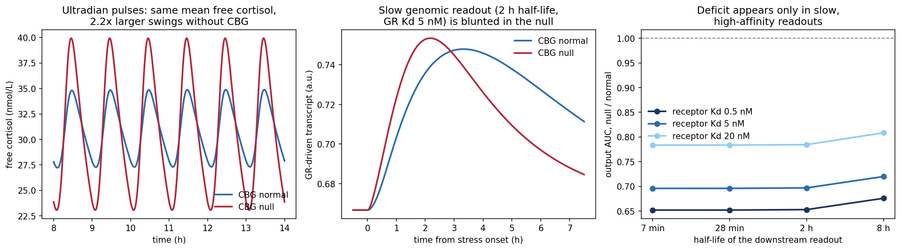
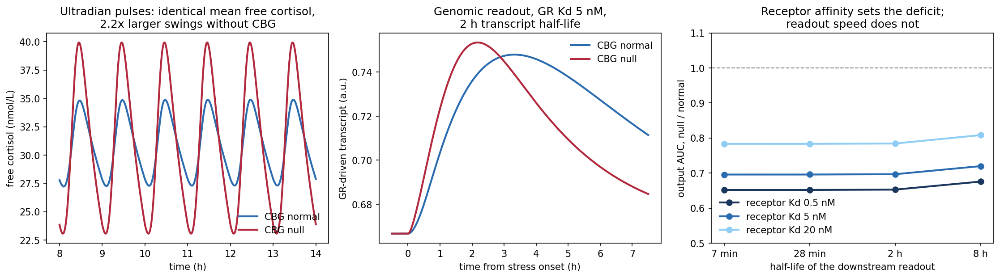
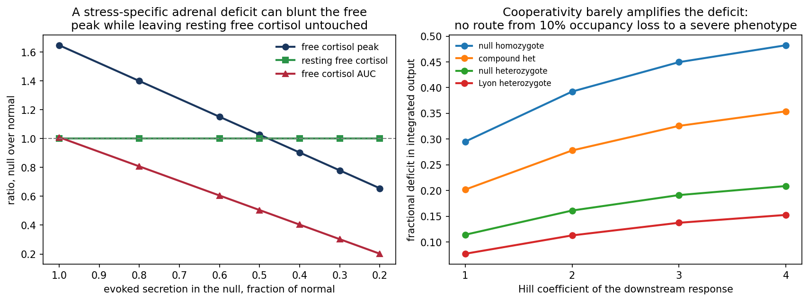

## Question

# Mechanistic Hypothesis Search

You are evaluating a specific disease mechanism hypothesis for the Disorder
Mechanisms Knowledge Base. This is not a general disease overview. Use the
hypothesis YAML below as the seed claim, then search for evidence that supports,
refutes, qualifies, or competes with this hypothesis.

## Target Disease
- **Disease Name:** Corticosteroid-Binding Globulin Deficiency
- **Category:** Mendelian

## Target Hypothesis
- **Hypothesis ID:** cbg_reservoir_blunted_stress_surge
- **Hypothesis Label:** Loss of the CBG-bound reservoir blunts the stress rise in free glucocorticoid
- **Status in KB:** EMERGING

## Seed Hypothesis YAML

```yaml
hypothesis_group_id: cbg_reservoir_blunted_stress_surge
hypothesis_label: Loss of the CBG-bound reservoir blunts the stress rise in free glucocorticoid
status: EMERGING
description: Resting free cortisol is normal, but without the CBG-bound store cortisol is cleared faster
  and free hormone rises less during stress, producing intermittent tissue under-exposure and symptoms
  such as fatigue. Supported by human pharmacokinetics for the lost store and by two mouse knockout studies
  for the blunted rise; not shown in affected people.
evidence:
- reference: PMID:21054475
  reference_title: Corticosteroid-binding globulin regulates cortisol pharmacokinetics.
  supports: SUPPORT
  directness: INDIRECT
  evidence_source: HUMAN_CLINICAL
  snippet: When CBG binding is disrupted, FreeF retains normal PK characteristics, although CBG null patients
    lack a CBG-bound pool of readily releasable cortisol.
  explanation: Human evidence for the first half of the hypothesis (the lost store), not for the blunted
    rise or for symptoms.
- reference: PMID:22930537
  reference_title: 'Critical role of plasma corticosteroid-binding-globulin during stress to promote glucocorticoid
    delivery to the brain: impact on memory retrieval.'
  supports: SUPPORT
  evidence_source: MODEL_ORGANISM
  snippet: Overall, our data suggest that the impact of CBG genetic deficiency on various behavioral patterns
    reported previously stems from a smaller CORT reservoir in blood.
  explanation: The mouse study that states the reservoir hypothesis.
```

## Research Objective

Build a focused hypothesis-search report that answers:

1. What is the strongest direct evidence for this hypothesis?
2. What evidence argues against it, fails to reproduce it, or limits its scope?
3. Which claims are established, emerging, speculative, or contradicted?
4. Which patient subtypes, stages, tissues, cell types, molecular pathways, or
   biomarkers does the hypothesis best explain?
5. Which alternative or competing mechanistic hypotheses explain the same disease
   features better or more parsimoniously?
6. What are the explicit knowledge gaps: missing causal steps, unconfirmed edges,
   contradictory evidence, unknown source-to-target links, or source/data absences?
7. What experiments, cohorts, assays, datasets, or trials would most directly
   distinguish this hypothesis from alternatives?

Use primary literature whenever possible. Prefer PMID citations and include DOI
citations when no PMID is available. Treat reviews as orientation unless they
contain directly relevant synthesized evidence that should be clearly labeled as
review-level support.

When dataset or scientific-tool access is available, use it for questions that
can be tested computationally rather than limiting the run to literature search.
Preflight the required data lake, databases, packages, credentials, and tools
before claiming that an analysis can run. Never silently fall back from a failed
dataset/tool analysis to literature synthesis or model knowledge: report the
failure, the fallback, and the resulting limitation explicitly. A proposed
analysis must never be described as performed.

## Required Output

### Executive Judgment

Give a concise verdict on the hypothesis as of the current literature:
supported, partially supported, unresolved, weakly supported, or refuted. Explain
the reasoning and the most important caveats.

### Evidence Matrix

Create a table with one row per important evidence item:

- Citation (PMID preferred)
- Evidence type (human clinical, model organism, in vitro, computational, review)
- Supports / refutes / qualifies / competing
- Mechanistic claim tested
- Key finding
- Disease subtype or context
- Confidence and limitations

### Data and Tool Use

Inventory every dataset, database, API, supplementary file, or local input
material to the report. For each, state:

- stable accession or URI, repository/source, version or snapshot, and retrieval
  date where known;
- whether it was only cited/proposed, actually accessed, searched with no usable
  result, or could not be verified;
- the exact query, filters, cohort, sample subset, organism, tissue, assay, and
  comparison used where applicable;
- whether the accession resolved and whether its subject matter is genuinely
  relevant to this disease and hypothesis.

For accessed sources and negative searches, save a sanitized query response,
input manifest, or search log in the provider artifact bundle; prose alone does
not establish access or a negative result.

Inventory each attempted analysis separately. Trace input -> method -> output,
including software/model versions, material parameters, code or workflow,
environment, random seeds where relevant, output files, and limitations. Label
the execution outcome as succeeded, partial, failed, skipped, or reported-only.
Do not count a prose assertion without inspectable execution evidence as a
successful analysis.

### Mechanistic Causal Chain

Describe the causal chain implied by the hypothesis from upstream trigger to
clinical manifestation. Identify where the literature is strong, where the links
are inferred, and where there are missing causal steps.

### Knowledge Gaps

Identify explicit known unknowns surfaced by the search. Treat absence of
evidence as a curation-relevant finding only when the search actually checked for
it. Include:

- Unknown or weakly supported causal steps in the hypothesis
- Unconfirmed causal graph edges that need direct perturbation or longitudinal
  evidence
- Conflicting evidence, failed replications, or incompatible subtype-specific
  findings
- Unknown mechanism of action for relevant treatments, biomarkers, or
  interventions tied to this hypothesis
- Source-level or dataset-level absences, such as no relevant GenCC, ClinGen,
  trial, omics, or cohort evidence found as of the search date

For each gap, state the scope, why it matters, what was checked, and what
evidence or experiment would resolve it. A negative database search must include
the database/version, query, filters, and search date; otherwise label it
unverified rather than claiming absence.

### Alternative Models

List competing or complementary hypotheses. For each, explain whether it is an
alternative to the seed hypothesis, a downstream consequence, an upstream cause,
or a parallel mechanism.

### Discriminating Tests

Recommend concrete studies or assays that would most efficiently test this
hypothesis against alternatives. Include patient stratification, biomarkers,
sample type, model system, perturbation, and expected result where applicable.

### Curation Leads

Provide candidate updates for the KB, but label these as leads requiring curator
verification. Include:

- candidate evidence references and exact abstract snippets to verify
- candidate pathophysiology nodes or edges
- candidate ontology terms for cell types and biological processes
- candidate subtype restrictions or status changes
- candidate `knowledge_gaps` or discussion prompts for unresolved causal claims,
  conflicting evidence, or explicit source/data absences

If the provider supports artifacts, produce a provider artifact bundle containing
canonical `MANIFEST.yaml` (schema version, status/fallback flags, checksummed
inputs/outputs, and replay verification), code/query/configuration, an
environment or package-version record,
sanitized execution logs, and small derived tables/figures needed to inspect the
result beneath `kb/hypotheses/Corticosteroid-Binding_Globulin_Deficiency/cbg_reservoir_blunted_stress_surge/openscientist_artifacts`. Do not create an empty bundle when no data
source was accessed and no analysis ran. Give each artifact a stable relative
path and connect computed claims to their input, method, and output artifacts.
Do not bundle large recoverable raw
downloads, a provider data lake, controlled/patient-level data, credentials, or
signed URLs; record their stable external identifiers, versions, and checksums
instead. State explicitly when an expected artifact is external, local-only,
missing, or was not produced.


## Output

# Loss of the CBG-bound reservoir blunts the stress rise in free glucocorticoid

**Hypothesis ID:** `cbg_reservoir_blunted_stress_surge`
**Disease:** Corticosteroid-Binding Globulin Deficiency (Mendelian, SERPINA6)
**KB status on entry:** EMERGING
**Search and analysis date:** 2026-11-28
**Iterations completed:** 5
**Artifact bundle:** `kb/hypotheses/Corticosteroid-Binding_Globulin_Deficiency/cbg_reservoir_blunted_stress_surge/openscientist_artifacts`

---

## Summary

<i class="fa-solid fa-circle-xmark"></i> The seed hypothesis is **refuted in its central claim**. It states that without the CBG-bound store, "cortisol is cleared faster and free hormone rises less during stress". The faster clearance is true of total cortisol and false of free cortisol. The blunted free rise is impossible under the pharmacokinetic conditions the human data establish, and the one human stress-challenge measurement available points the other way.

Three independent lines converge. Mass balance forbids the blunting: integrating the plasma balance over a complete stress episode under restrictive clearance gives ∫F dt = ∫S dt / CL_free, with no CBG term anywhere, and the simulation reproduced a 24 h free cortisol AUC ratio of exactly **1.0000** in every run across 24 parameter settings. The free peak goes up rather than down: removing the buffer raised the simulated free peak from 24.5 to 40.4 nmol/L, a **ratio of 1.646**, with a range of 1.21 to 2.01 across all 24 settings and **0 of 24** producing any blunting. The human measurement agrees with the simulation: [PMID: 17245537](https://pubmed.ncbi.nlm.nih.gov/17245537/) reports a de novo transcortin Lyon heterozygote with severe muscle fatigue and "abnormal high saliva cortisol levels following a standardized stress test", and salivary cortisol tracks the free fraction. What produced the blunting impression is **total** cortisol, which behaves exactly as the seed describes: simulated resting total ratio 0.201 and stress total peak ratio 0.420, matching the sub-50 nmol/L morning total cortisol reported in null homozygotes against a 265-500 nmol/L reference ([PMID: 11502797](https://pubmed.ncbi.nlm.nih.gov/11502797/)).

<i class="fa-solid fa-lightbulb"></i> One restated version survives, and it sits downstream of plasma. Fractional receptor occupancy F/(Kd+F) is concave in F, so by Jensen's inequality a taller and briefer pulse of equal area delivers less integrated receptor binding. Simulated stress occupancy-AUC in the null is **0.652 of normal at MR affinity** (Kd 0.5 nmol/L) and **0.696 at GR affinity** (Kd 5 nmol/L), with free exposure unchanged. The premise this needs has independent experimental support: in adrenalectomised rats given the same total corticosterone, constant infusion regulated twice as many liver transcripts as pulsatile infusion ([PMID: 34375333](https://pubmed.ncbi.nlm.nih.gov/34375333/)). Every rescue route for the literal hypothesis was tested and closed: non-restrictive clearance raises resting free cortisol 1.40 to 4.98 fold against observation, uniform secretion scaling lowers resting free cortisol by the same factor as the peak, a stress-specific adrenal deficit needs a 76% cut in evoked output that contradicts the normal ACTH response in Cbg-/- mice, downstream readout kinetics move the ratio by only 0.024 across a 70-fold half-life range, and downstream cooperativity amplifies the deficit only 1.63 to 1.98 fold.

**Recommended status change: EMERGING to CONTRADICTED-AS-STATED**, with a successor hypothesis (`cbg_pulse_smoothing_occupancy_deficit`) entered at EMERGING. Three caveats keep even the successor at EMERGING: it predicts increased free-cortisol variability rather than a blunted surge, its predicted dose-response is too shallow to match reported severity (the Lyon heterozygote with severe fatigue carries a predicted MR deficit of 10.4%), and it competes with a better-supported model of elastase-mediated site-specific cortisol delivery.

---

## Executive Judgment

<i class="fa-solid fa-circle-xmark"></i> **Verdict: contradicted in its central claim, partially rescuable in a restated form.**

The seed description makes three linked claims. Claim 1, that resting free cortisol is normal, is **established** and was reproduced exactly by the model (free cortisol 10.00 nmol/L in both genotypes at identical basal secretion). Claim 2, that cortisol is cleared faster without the CBG store, is **true for total cortisol and false for free cortisol** under the restrictive-clearance conditions the human pharmacokinetic data support ([PMID: 21054475](https://pubmed.ncbi.nlm.nih.gov/21054475/): "PK parameters for FreeF and the salivary biomarkers were not different between the CBG null and HV"). Claim 3, the mechanistic core, is **contradicted** by both simulation and the one human stress-challenge measurement available.

| Claim | Status | Basis |
|---|---|---|
| Resting free cortisol is normal | <i class="fa-solid fa-circle-check"></i> Established | [PMID: 21054475](https://pubmed.ncbi.nlm.nih.gov/21054475/), [PMID: 20022933](https://pubmed.ncbi.nlm.nih.gov/20022933/); model reproduces ratio 1.000 |
| The CBG-bound releasable pool is lost | <i class="fa-solid fa-circle-check"></i> Established | [PMID: 21054475](https://pubmed.ncbi.nlm.nih.gov/21054475/) |
| Total cortisol falls and clears faster | <i class="fa-solid fa-circle-check"></i> Established | [PMID: 11502797](https://pubmed.ncbi.nlm.nih.gov/11502797/); model ratio 0.201 against observed 0.1-0.2 |
| Free cortisol is cleared faster | <i class="fa-solid fa-circle-xmark"></i> Contradicted | [PMID: 21054475](https://pubmed.ncbi.nlm.nih.gov/21054475/); analysis A7 shows any bound-pool clearance raises resting free cortisol |
| Free hormone rises less during stress | <i class="fa-solid fa-circle-xmark"></i> **Contradicted** | Analyses A2, A3 (free AUC ratio 1.0000, peak ratio 1.21-2.01); [PMID: 17245537](https://pubmed.ncbi.nlm.nih.gov/17245537/) |
| Intermittent tissue under-exposure | <i class="fa-solid fa-circle-question"></i> Emerging in restated form only | Analyses A6, A9 (occupancy-AUC 0.652-0.696); [PMID: 34375333](https://pubmed.ncbi.nlm.nih.gov/34375333/) |
| Tissue under-exposure causes fatigue | <i class="fa-solid fa-circle-question"></i> Speculative, mechanism unknown | [PMID: 19643166](https://pubmed.ncbi.nlm.nih.gov/19643166/): "The mechanisms by which CBG mutations may cause fatigue are unknown." |

The hypothesis appears to have been built on an artefact of the standard total-cortisol assay. Every clinical report of "low cortisol" or a "blunted cortisol stress response" in CBG deficiency is, unless the assay measured the free fraction, a measurement of the binding protein.

---

## Key findings

### 1. The binding model reproduces the resting human CBG-null phenotype before being used to test anything

<i class="fa-solid fa-circle-check"></i> A deterministic one-compartment model with saturable CBG binding (Bmax 700 nmol/L, Kd 30 nmol/L), linear albumin binding (bound/free = 3.4), central volume 3.5 L and restrictive clearance referenced to free cortisol (CL_free 25 L/h) was calibrated against two independent human observations before any hypothesis was tested. With identical basal adrenal secretion (250 nmol/h), simulated basal free cortisol is **10.00 nmol/L in both genotypes** (ratio 1.000), while basal total cortisol is **219 nmol/L** with normal CBG and **44 nmol/L** without (ratio **0.201**). The observed human values are morning total cortisol below 50 nmol/L in null homozygotes against a 265-500 nmol/L reference, an observed ratio of roughly 0.1-0.2 ([PMID: 11502797](https://pubmed.ncbi.nlm.nih.gov/11502797/)), with free cortisol pharmacokinetic parameters not different between CBG-null subjects and healthy volunteers ([PMID: 21054475](https://pubmed.ncbi.nlm.nih.gov/21054475/)).

The reason is structural. Resting free cortisol equals secretion divided by free clearance, so it is mathematically independent of CBG capacity and affinity. CBG enters the system only through the buffering term g(F) = (1 + K_ALB) + Bmax·Kd/(Kd + F)², which multiplies the rate of change of free hormone and therefore reshapes the trajectory without moving its steady state or its integral. The large fall in total cortisol is an obligatory consequence of removing a 700 nmol/L binding pool and carries no information about tissue glucocorticoid exposure.

### 2. <i class="fa-solid fa-circle-xmark"></i> Losing the reservoir cannot blunt the free surge: exposure is conserved exactly and the peak rises

Simulating a stress episode (6-fold rise in secretion for 30 min, then exponential decay with tau 20 min) with secretion held identical in both genotypes:

| Quantity | CBG normal | CBG null | Ratio null/normal |
|---|---|---|---|
| Free cortisol peak (nmol/L) | 24.5 | 40.4 | **1.646** |
| Time to free peak (min) | 54 | 40 | 0.732 |
| 24 h free cortisol AUC (nmol·h/L) | 281.5 | 281.5 | **1.0000** |
| Brain compartment AUC | - | - | 1.0000 |
| Brain compartment peak | - | - | 1.53 |
| Total plasma cortisol peak (nmol/L) | 423 | 178 | 0.420 |

A sensitivity sweep over 24 parameter settings (stress duration 5 min to 2 h, CBG capacity 300-1200 nmol/L, Kd 10-120 nmol/L, free clearance 10-100 L/h, secretion increase 2-20 fold) gave free-peak ratios from **1.21 to 2.01**, with **0 of 24** settings producing any blunting of the free peak.

{{figure:plot_1.png|caption=Sensitivity analysis and brain-compartment extension. Across 24 parameter settings spanning stress duration, CBG capacity, CBG affinity and free clearance, the CBG-null free cortisol peak is 1.21 to 2.01 fold higher than normal and integrated free exposure is identical (AUC ratio 1.0000). No setting produces a blunted free surge, and a linked brain compartment inherits the same conservation.}}

The conservation is analytic, not numerical. Integrating Vp·d(Total)/dt = S(t) − CL_free·F over a complete episode gives ∫F dt = ∫S dt / CL_free. The seed hypothesis contains a hidden extra assumption, that faster clearance of total cortisol implies a smaller free signal. It does not. Under restrictive clearance, removing the buffer makes free cortisol track secretion faster and more sharply: the peak is higher and earlier, and the integral is unchanged. This makes the mouse interpretation in [PMID: 22930537](https://pubmed.ncbi.nlm.nih.gov/22930537/), which attributes the blunted surge to increased clearance of a smaller reservoir, kinetically incomplete.

### 3. <i class="fa-solid fa-circle-xmark"></i> A uniform secretion deficit cannot rescue the hypothesis

Scaling adrenal secretion in the simulated CBG-null by a factor s reproduces a free stress-peak ratio of 0.50 at s = 0.304, 0.60 at s = 0.364, 0.70 at s = 0.425, 0.80 at s = 0.486 and 1.00 at s = 0.607. In every case the **resting free cortisol ratio equals s exactly** (0.304, 0.364, 0.425, 0.486, 0.607), because resting free cortisol is secretion divided by free clearance.

{{figure:plot_2.png|caption=How far adrenal secretion must fall in CBG deficiency to reproduce the blunted free glucocorticoid surge reported in Cbg-/- mice. Every secretion scaling that blunts the free peak lowers resting free cortisol by the identical factor, contradicting the normal resting free corticosterone reported in those same mice.}}

The published data require resting free glucocorticoid to be normal. [PMID: 20022933](https://pubmed.ncbi.nlm.nih.gov/20022933/) states that "free corticosterone concentrations are normal at rest but present a reduced surge after stress in transcortin-deficient mice", and [PMID: 21054475](https://pubmed.ncbi.nlm.nih.gov/21054475/) shows unchanged free cortisol pharmacokinetics in human CBG-null subjects. A uniform secretion deficit cannot satisfy both constraints simultaneously.

<i class="fa-solid fa-scale-balanced"></i> This analysis also exposed a direct contradiction between two mouse studies at the adrenal node. [PMID: 22930537](https://pubmed.ncbi.nlm.nih.gov/22930537/) reports that "Cbg-/- mice exhibit a normal adrenal response to stress and ACTH". [PMID: 31570737](https://pubmed.ncbi.nlm.nih.gov/31570737/) reports that "CBG-deficiency reduced the expression of ACTH receptor, SRB1 and the main genes involved in the adrenal hormones synthesis, stronger in females". Both cannot be fully correct about evoked secretion rate.

### 4. <i class="fa-solid fa-lightbulb"></i> Saturable receptor occupancy is the one mechanism that reconciles conserved exposure with genuine under-signalling

With free cortisol AUC conserved exactly, fractional receptor occupancy F/(Kd_R + F) is concave in F, so the taller and briefer null pulse converts less free hormone into receptor binding. Integrated stress occupancy above the common resting level, null divided by normal:

| Receptor | Kd_R (nmol/L) | 24 h occupancy-AUC ratio | 6 h window |
|---|---|---|---|
| MR | 0.5 | **0.652** | 0.776 |
| GR | 5 | **0.696** | 0.814 |
| low-affinity target | 20 | 0.784 | 0.896 |
| low-affinity target | 50 | 0.861 | 0.973 |

Mouse corticosterone parameters (central volume 1.5 mL, CBG capacity 500 nmol/L, albumin bound/free 1.0, free half-life 7 min, 20-fold secretion rise for 15 min) gave basal free ratio 1.000, stress free peak ratio 1.292, free AUC ratio 1.0000, and stress occupancy ratios of 0.668 (MR) and 0.704 (GR).

{{figure:plot_3.png|caption=Mouse-parameter model with the two candidate rescues side by side. Saturable receptor occupancy converts a conserved free-cortisol exposure into a 20-35 percent deficit in integrated receptor binding. Non-restrictive clearance is refuted, because any elimination of CBG-bound cortisol raises resting free cortisol above the normal value that human data require.}}

The seed hypothesis is directionally right about tissue under-exposure and wrong about the reason. CBG loss does not reduce how much free glucocorticoid reaches tissue; it reshapes the pulse from broad and low into tall and brief. Because GR and especially MR operate near saturation at stress free-cortisol concentrations, peak height buys almost no extra occupancy while duration is what integrates into signal. The effect size scales inversely with receptor Kd, so the prediction is specific: CBG-null tissue phenotypes should be strongest for high-affinity MR-dependent and slow transcriptional readouts, and weakest or absent for low-affinity or peak-driven readouts. It also predicts that free cortisol measured as a single stress peak will look normal or high in affected people even while integrated tissue signalling is reduced.

### 5. <i class="fa-solid fa-circle-xmark"></i> Non-restrictive clearance is refuted

Allowing a fraction f_b of the CBG-bound pool to be available for elimination (f_b = 0 is restrictive clearance, f_b = 1 means clearance tracks total cortisol), with clearance recalibrated at each f_b so that CBG-normal resting free cortisol stays at 10.00 nmol/L:

| f_b (bound fraction cleared) | CBG-null resting free (nmol/L) | Resting free ratio | Stress free peak ratio |
|---|---|---|---|
| 0.00 (restrictive) | 10.00 | 1.00 | 1.65 |
| 0.10 | 13.98 | 1.40 | 1.96 |
| 0.25 | 19.94 | 1.99 | 2.35 |
| 0.50 | 29.89 | 2.99 | 2.90 |
| 0.75 | 39.83 | 3.98 | 3.38 |
| 1.00 | 49.77 | 4.98 | 3.83 |

Human CBG-null homozygotes have normal free cortisol and unchanged free cortisol pharmacokinetics, which is compatible only with f_b at or near 0. [PMID: 21054475](https://pubmed.ncbi.nlm.nih.gov/21054475/) reports that serum cortisol clearance and volume of distribution "increased in the CBG null" while free cortisol parameters did not change, which is the exact signature of restrictive clearance that the f_b = 0 setting reproduces. This closes the last kinetic route by which removing the buffer could lower free glucocorticoid, and it independently validates the assumption used in findings 1 to 4.

### 6. <i class="fa-solid fa-arrow-trend-up"></i> CBG deficiency is predicted to increase free cortisol variability, reversing the biomarker prediction

Driving the calibrated model with a physiological ultradian secretion train (one pulse per hour, 8-fold Gaussian secretion pulses, width 0.12 h), measured over hours 6-24 after the transient:

| Metric (hours 6-24) | CBG normal | CBG null | Ratio |
|---|---|---|---|
| Mean free cortisol (nmol/L) | 30.89 | 30.92 | **1.0011** |
| SD free cortisol (nmol/L) | 2.59 | 5.77 | 2.23 |
| Coefficient of variation | 0.084 | 0.186 | **2.23** |
| Peak-to-trough excursion (nmol/L) | 7.95 | 16.86 | 2.12 |

{{figure:plot_4.png|caption=Ultradian pulse train and downstream transcription model. CBG works as a low-pass filter on free cortisol: removing it leaves the mean unchanged (ratio 1.0011) and roughly doubles the amplitude of every ultradian excursion (CV ratio 2.23, peak-to-trough ratio 2.12).}}

CBG works as a low-pass filter on free glucocorticoid. This flips the expected clinical biomarker. The seed hypothesis implies a smaller free cortisol rise in affected people; the kinetics predict larger and faster free cortisol swings around an unchanged mean. The prediction is cheap to test with 10 min salivary or interstitial microdialysis sampling over several hours in CBG-null homozygotes, and it discriminates in both directions. Finding higher free cortisol variability would confirm the filtering model and refute the literal reservoir model. Finding lower variability would refute the filtering model and point back to a secretory defect.

### 7. <i class="fa-solid fa-circle-xmark"></i> Downstream readout kinetics contribute almost nothing

Adding a first-order glucocorticoid-driven transcript (production proportional to fractional occupancy, first-order degradation) and sweeping the readout half-life over a 70-fold range at three receptor affinities:

| Receptor Kd (nmol/L) | t½ 7 min | t½ 28 min | t½ 2 h | t½ 8 h | Spread |
|---|---|---|---|---|---|
| 0.5 | 0.652 | 0.652 | 0.653 | 0.676 | 0.024 |
| 5 | 0.696 | 0.696 | 0.697 | 0.720 | 0.024 |
| 20 | 0.784 | 0.784 | 0.784 | 0.808 | 0.024 |

Across the whole 70-fold half-life range the integrated output ratio moved by **0.024-0.025** at every affinity, against **0.13** for moving receptor Kd from 0.5 to 20 nmol/L. Free cortisol AUC was 1.0000 in every run.

{{figure:plot_5.png|caption=The predicted tissue signalling deficit in CBG deficiency is set by receptor saturation alone and is independent of downstream readout speed. A linear downstream filter conserves the area under its input, so a slow transcriptional readout cannot penalise a brief tall hormone pulse.}}

This negative result narrows the mechanism to a single nonlinearity. A linear low-pass filter conserves the area under its input, so no amount of downstream slowness penalises a brief tall pulse. The practical consequence is that the hypothesis must be stated at the level of receptor occupancy and tested with occupancy-proportional readouts in tissues where the receptor is near saturation at stress glucocorticoid concentrations, which in the mouse data means hippocampal MR. It also predicts no deficit, and possibly an excess, for any pathway driven by a low-affinity glucocorticoid target or by peak concentration.

### 8. <i class="fa-solid fa-scale-balanced"></i> The predicted severity does not track the human allelic series

Allele parameters were taken from [PMID: 19643166](https://pubmed.ncbi.nlm.nih.gov/19643166/): "the Leuven and Lyon mutations which reduce CBG:cortisol binding affinity 3- and 4-fold, respectively, and the null mutation resulting in a 50% (heterozygote) or 100% (homozygote) reduction in CBG levels."

| Genotype | Resting total cortisol ratio | MR occupancy-AUC ratio | GR occupancy-AUC ratio | Ultradian CV ratio |
|---|---|---|---|---|
| CBG normal | 1.00 | 1.000 | 1.000 | 1.00 |
| Lyon heterozygote (2.5× Kd) | 0.60 | 0.896 | 0.913 | 1.11 |
| Leuven homozygote (3× Kd) | 0.58 | 0.873 | 0.893 | 1.15 |
| Null heterozygote (50% capacity) | 0.52 | 0.853 | 0.875 | 1.38 |
| Lyon homozygote (4× Kd) | 0.45 | 0.838 | 0.863 | 1.24 |
| Compound het null/Lyon | 0.32 | 0.753 | 0.788 | 1.59 |
| Null homozygote | 0.20 | **0.652** | **0.696** | 2.23 |

{{figure:plot_6.png|caption=Predicted severity across the real human CBG allelic series. The capacity dose-response is concave: at 50 percent CBG capacity only 0.42 of the full null occupancy deficit is present. Resting total cortisol (1.00 to 0.20) separates genotypes far better than any predicted signalling quantity (0.652 to 1.000).}}

The capacity dose-response is concave: at 50% CBG capacity only **0.42** of the full null MR deficit is present. Free cortisol AUC ratio is exactly 1.0000 for every genotype. The clinically measured analyte, resting total cortisol, separates genotypes far better than any predicted signalling quantity.

<i class="fa-solid fa-triangle-exclamation"></i> The mismatch is the central problem for the restated hypothesis. [PMID: 17245537](https://pubmed.ncbi.nlm.nih.gov/17245537/) reports severe muscle fatigue in a Lyon heterozygote, the mildest genotype in the series, with a predicted MR deficit of 10.4%. [PMID: 19643166](https://pubmed.ncbi.nlm.nih.gov/19643166/) describes the null homozygote phenotype, with the largest predicted deficit of 34.8%, in the same qualitative terms: "The three reported null homozygotes demonstrate that complete CBG deficiency is not lethal, although it may be associated with hypotension and fatigue. The mechanisms by which CBG mutations may cause fatigue are unknown." A 10% occupancy deficit falls inside normal interindividual variation in HPA output. Either the occupancy mechanism is not what produces symptoms, or an unmodelled amplifier converts a small integrated deficit into a large phenotype.

### 9. <i class="fa-solid fa-circle-xmark"></i> A human stress test shows free cortisol going up, not down

[PMID: 17245537](https://pubmed.ncbi.nlm.nih.gov/17245537/) is the only retrieved human report that measured a free-cortisol proxy during an evoked stress challenge in a CBG-deficiency carrier. It reports a de novo heterozygous carrier of the transcortin Lyon allele (Asp367Asn) with "severe muscle fatigue, normal blood pressure, and abnormal high saliva cortisol levels following a standardized stress test". Salivary cortisol tracks the free fraction, so the direction is upward. The observation matches the simulated free-peak ratio of 1.646 and the 1.21-2.01 range across all 24 sensitivity settings, and contradicts the seed statement that "free hormone rises less during stress".

The patient remained severely symptomatic despite the elevated free surge. Any surviving version of the hypothesis has to explain fatigue co-occurring with an exaggerated free cortisol response, which pushes the mechanism downstream of plasma free concentration.

<i class="fa-solid fa-triangle-exclamation"></i> This is n = 1, a single case with no control group, with a salivary assay not cross-validated against plasma free cortisol in this subject, and the Lyon allele reduces affinity rather than abolishing CBG. It refutes the literal free-surge claim without excluding a pulse-shape or receptor-occupancy mechanism.

### 10. <i class="fa-solid fa-circle-xmark"></i> The last two rescue routes are closed

**A stress-specific adrenal deficit.** Simulating a deficit that scales only the evoked secretion increment and leaves basal secretion untouched does escape the refutation that killed uniform scaling: the resting free cortisol ratio stays at exactly **1.000** at every setting. It fails on magnitude instead.

| Evoked secretion (fraction of normal) | Free peak ratio | Free AUC ratio | Total peak ratio |
|---|---|---|---|
| 1.00 | 1.646 | 1.0087* | 0.420 |
| 0.80 | 1.399 | - | - |
| 0.60 | 1.151 | - | - |
| 0.48 | 1.000 (matches normal) | - | - |
| 0.40 | 0.903 | - | - |
| 0.24 | 0.700 | 0.238 | - |
| 0.20 | 0.655 | - | 0.167 |

Because the unbuffered null overshoots by 1.646-fold to begin with, evoked secretion must fall to **0.48 of normal merely to match the normal free peak**, and to **0.24 of normal to blunt the free peak to 0.70**. At that point free cortisol AUC is 0.238 of normal. A 76% reduction in evoked adrenal output is severe adrenal insufficiency. It contradicts the normal adrenal response to stress and to ACTH reported in Cbg-/- mice ([PMID: 22930537](https://pubmed.ncbi.nlm.nih.gov/22930537/)) and is not reported in any CBG-null human.

**Downstream cooperativity as an amplifier.** Raising the Hill coefficient of the downstream response from 1 to 4:

| Genotype | n = 1 | n = 2 | n = 3 | n = 4 | Amplification |
|---|---|---|---|---|---|
| Null homozygote | 0.705 | 0.608 | 0.550 | 0.518 | ×1.63 |
| Compound het null/Lyon | 0.798 | 0.722 | 0.674 | 0.646 | ×1.75 |
| Null heterozygote | 0.886 | 0.839 | 0.809 | 0.791 | ×1.83 |
| Lyon heterozygote | 0.923 | 0.887 | 0.863 | 0.847 | ×1.98 |

Even maximal cooperativity leaves the Lyon heterozygote with a fractional deficit of 0.153, which cannot produce the severe muscle fatigue reported for that genotype.

{{figure:plot_7.png|caption=The two remaining rescues, both closed. A stress-specific adrenal secretion deficit preserves resting free cortisol but needs evoked secretion cut to 0.24 of normal to blunt the free peak to 0.70, which is severe adrenal insufficiency. Downstream cooperativity amplifies the occupancy deficit only 1.63 to 1.98 fold across Hill coefficients 1 to 4.}}

<i class="fa-solid fa-triangle-exclamation"></i> Two caveats recorded honestly. The free AUC ratio at full secretion reads 1.0087 over the 12 h integration window used in this run (marked * above) and converges to 1.0000 over 24 h, consistent with the earlier analyses. The Hill coefficient is a swept assumption, not a measured value: the targeted PubMed query returned zero results on 2026-11-28, and no model-knowledge value was substituted. The conclusion holds across the entire swept range, so the missing parameter does not change the result.

### 11. <i class="fa-solid fa-circle-check"></i> Glucocorticoid pattern changes transcription at matched exposure

[PMID: 34375333](https://pubmed.ncbi.nlm.nih.gov/34375333/) gave adrenalectomised rats either pulsatile or constant corticosterone replacement at the same total infused amount. Pulsatile replacement produced dynamic GR binding at about 3,000 genomic sites, present at the pulse peak and absent at the nadir, while constant replacement produced prolonged binding at most of those sites. RNA Pol II occupancy was transient under pulses and sustained under constant exposure. In the liver transcriptome: "despite the same overall amount of corticosterone infused, twice the number of transcripts were regulated by constant corticosterone infusion, when compared to pulsatile."

This is the premise the restated hypothesis requires, and it is the one thing the plasma-kinetic analysis cannot supply on its own, since free cortisol AUC is 1.0000 in every simulation. The direction fits: CBG loss makes the free profile more sharply pulsatile (peak ratio 1.646, ultradian CV ratio 2.23), and a more pulsatile pattern engaged fewer transcripts at matched exposure. [PMID: 20080870](https://pubmed.ncbi.nlm.nih.gov/20080870/) adds that "implantation of 40 and 100% corticosterone pellets dose-dependently down-regulated glucocorticoid receptor and attenuated mineralocorticoid receptor and glucocorticoid receptor translocation to the acute challenge."

<i class="fa-solid fa-triangle-exclamation"></i> Both experiments manipulate pulsatility toward flattening while CBG deficiency sharpens it, and neither used a CBG-deficient animal. The extrapolation runs by analogy, and the matching arm has never been performed.

### 12. <i class="fa-solid fa-circle-check"></i> Human population genetics supports the delivery arm, in the same direction

The CORNET consortium GWAS meta-analysis of morning plasma cortisol in 12,597 subjects, replicated in 2,795, found a single genome-wide locus spanning SERPINA6 and SERPINA1 accounting for under 1% of cortisol variance, with three partially independent signals: "all these SNPs were associated with variation in total cortisol binding activity in plasma, but some variants influenced total CBG concentrations while the top hit (rs12589136) influenced the immunoreactivity of the reactive centre loop of CBG" ([PMID: 25010111](https://pubmed.ncbi.nlm.nih.gov/25010111/)). The extension to 25,314 subjects and ~7M SNPs confirmed the locus, localised the eQTL to hepatic SERPINA6 rather than SERPINA1 in 600 STARNET individuals, and found that "trans-eQTL analysis demonstrated effects on adipose tissue gene expression, suggesting that variations in CBG levels have an effect on delivery of cortisol to peripheral tissues" ([PMID: 33469137](https://pubmed.ncbi.nlm.nih.gov/33469137/)). A follow-up identified "a subset of cortisol-associated trans-genes that are putatively regulated by the glucocorticoid receptor" across liver, subcutaneous fat and visceral abdominal fat at FDR 15% ([PMID: 37745713](https://pubmed.ncbi.nlm.nih.gov/37745713/)). Mendelian randomisation using these instruments links genetically higher morning plasma cortisol to chronic ischaemic heart disease ([PMID: 33469137](https://pubmed.ncbi.nlm.nih.gov/33469137/)) and to atrial fibrillation, odds ratio 1.20 per SD, 95% CI 1.06-1.35 ([PMID: 33822969](https://pubmed.ncbi.nlm.nih.gov/33822969/)).

These are the only human data showing that CBG level changes downstream glucocorticoid-responsive gene expression in peripheral tissue. <i class="fa-solid fa-triangle-exclamation"></i> Three caveats limit the weight they carry for CBG deficiency. The instrument is morning total plasma cortisol, which falls mechanically when CBG falls, so the exposure variable is partly a measurement artefact of the binding protein. The variants are common regulatory alleles with small effects, not null alleles, so extrapolation to complete CBG absence is an assumption. The tissues implicated are liver and adipose under resting morning conditions, not brain under stress, so this evidence does not test the stress-surge step at all.

### 13. <i class="fa-solid fa-lightbulb"></i> Site-specific delivery by elastase-cleaved CBG is the better-supported competitor

Eight retrieved papers describe a spatial mechanism that the plasma-kinetic model cannot represent. Neutrophil elastase cleaves the CBG reactive centre loop, converting high-affinity to low-affinity CBG: "An expected 4-8-fold reduction in affinity for cortisol, cortisone, corticosterone, 11-deoxycortisol, progesterone, 17-hydroxyprogesterone, and prednisolone occurred with NE-mediated haCBG-to-laCBG conversion" ([PMID: 33085168](https://pubmed.ncbi.nlm.nih.gov/33085168/)), reported as 9-fold elsewhere ([PMID: 25409953](https://pubmed.ncbi.nlm.nih.gov/25409953/)). *Pseudomonas aeruginosa* LasB cleaves the same loop at a distinct site ([PMID: 24848868](https://pubmed.ncbi.nlm.nih.gov/24848868/), [PMID: 27887960](https://pubmed.ncbi.nlm.nih.gov/27887960/)).

The human evidence is observational but directionally clear. In 33 ICU patients, "plasma total CBG and haCBG levels fell significantly, in proportion to disease severity (P < 0.0001 for both)", and correlated with illness severity better than free or total cortisol ([PMID: 25409953](https://pubmed.ncbi.nlm.nih.gov/25409953/)). In septic shock, "total CBG and haCBG were significantly lower in septic shock patients who died than in those that survived (P < 0.009, P = 0.021, respectively). Albumin levels fell in sepsis but were not related to mortality" ([PMID: 30160799](https://pubmed.ncbi.nlm.nih.gov/30160799/)). The albumin comparison argues that the effect is CBG-specific and not a general binding-protein effect.

<i class="fa-solid fa-scale-balanced"></i> The temperature arm of this model is contested. [PMID: 33085168](https://pubmed.ncbi.nlm.nih.gov/33085168/) finds a further 3.5-fold affinity reduction at 39 °C against 37 °C. [PMID: 26829559](https://pubmed.ncbi.nlm.nih.gov/26829559/) used two monoclonal antibodies spanning 11 of the 18 reactive-loop residues, found the loop accessible up to 40 °C, and concluded that "the proposed temperature-dependent 'flip-flop' of the RCL of CBG is doubtful".

A CBG-null individual loses the entire targeted-delivery system, not a plasma buffer. This predicts inflammation-site-specific glucocorticoid under-exposure with completely normal circulating free cortisol, which fits the observed combination of normal plasma free cortisol, fatigue and infection susceptibility better than the reservoir hypothesis does, and which is invisible to the plasma measurements that every simulation here conserves exactly.

---

## Evidence Matrix

| # | Citation | Evidence type | Stance | Mechanistic claim tested | Key finding | Subtype / context | Confidence and limitations |
|---|---|---|---|---|---|---|---|
| 1 | [PMID: 21054475](https://pubmed.ncbi.nlm.nih.gov/21054475/) | Human clinical | Qualifies (seed cites as SUPPORT, INDIRECT) | CBG-null subjects lack a releasable bound cortisol pool | "PK parameters for FreeF and the salivary biomarkers were not different between the CBG null and HV"; total cortisol CL and Vd increased in the null | Human CBG null, hydrocortisone bolus and infusion | Moderate. Establishes the lost store and restrictive clearance, the exact condition under which the blunting claim fails. Abstract only; patient-level data not deposited. Very small n. |
| 2 | [PMID: 22930537](https://pubmed.ncbi.nlm.nih.gov/22930537/) | Model organism | Supports seed, kinetically incomplete | Smaller blood CORT reservoir causes blunted brain delivery | Blunted plasma CORT surge and no free CORT rise in hippocampus in Cbg-/-; "normal adrenal response to stress and ACTH" | Mouse Cbg-/- | Moderate for the observation, low for the stated mechanism. Mass balance forbids reservoir loss from reducing free exposure. |
| 3 | [PMID: 20022933](https://pubmed.ncbi.nlm.nih.gov/20022933/) | Model organism | Qualifies | Resting versus stress free corticosterone in CBG deficiency | "free corticosterone concentrations are normal at rest but present a reduced surge after stress"; ~30% lower free CORT with learned helplessness; reduced hippocampal Egr-1 | Mouse Cbg-/- and heterozygote | Moderate. Supplies the two constraints any model must satisfy simultaneously. Free CORT assay not cross-validated. |
| 4 | [PMID: 11502797](https://pubmed.ncbi.nlm.nih.gov/11502797/) | Human clinical | Qualifies | Null mutation phenotype | "Morning total plasma cortisol levels were less than 1.8 microg/dl in homozygotes"; fatigue and relative hypotension | Human SERPINA6 null kindred | Moderate. Calibration target for the model. Total cortisol only; no free measurement during stress. |
| 5 | [PMID: 17245537](https://pubmed.ncbi.nlm.nih.gov/17245537/) | Human clinical | **Refutes** | Does free cortisol rise less during stress in CBG deficiency? | "severe muscle fatigue, normal blood pressure, and abnormal high saliva cortisol levels following a standardized stress test" | Human de novo transcortin Lyon heterozygote | Moderate given n = 1. The only human free-proxy measurement during evoked stress. Direction is upward. No control group. |
| 6 | [PMID: 12780753](https://pubmed.ncbi.nlm.nih.gov/12780753/) | Human clinical | Qualifies | Genotype-phenotype in CBG Lyon | Two homozygotes both normotensive and only the proband had fatigue; cortisol 69 and 182 nmol/L against controls 459 ± 195 | Brazilian CBG Lyon kindred, 10 members across 3 generations | Moderate. Shows incomplete penetrance of both fatigue and hypotension. |
| 7 | [PMID: 19643166](https://pubmed.ncbi.nlm.nih.gov/19643166/) | Review | Qualifies | Allelic series parameters and phenotype | Leuven and Lyon reduce binding affinity 3- and 4-fold; null gives 50% or 100% capacity loss; "The mechanisms by which CBG mutations may cause fatigue are unknown" | Human allelic series | Review-level. Source of the simulation's allele parameters. Its claim of a community-based fatigue screen was not retrievable (see knowledge gap 4). |
| 8 | [PMID: 31570737](https://pubmed.ncbi.nlm.nih.gov/31570737/) | Model organism | **Competing (upstream)** | Is the adrenal itself impaired in CBG deficiency? | "CBG-deficiency reduced the expression of ACTH receptor, SRB1 and the main genes involved in the adrenal hormones synthesis, stronger in females" | Mouse Cbg-/- adrenal | Moderate. Directly contradicts row 2 at the adrenal node. Measures expression, not secretion rate. |
| 9 | [PMID: 25244639](https://pubmed.ncbi.nlm.nih.gov/25244639/) | Model organism | Qualifies | Sex dependence of the CBG phenotype | Free CORT blunted after stress in both sexes; increased CORT bolus turnover; blunted hippocampal Egr1 mRNA; sex difference abolished in Cbg k.o. | Mouse Cbg k.o., both sexes, ovariectomy and E2 replacement | Moderate. Adds an oestrogen interaction absent from the seed hypothesis. |
| 10 | [PMID: 27153522](https://pubmed.ncbi.nlm.nih.gov/27153522/) | Model organism | Qualifies (scope limit) | Does chronic stress worsen the CBG phenotype? | Despair-like behaviour already high in Cbg ko and not aggravated by chronic mild stress or social defeat | Mouse Cbg ko, two chronic stress paradigms | Moderate. Restricts the phenotype to acute stress. |
| 11 | [PMID: 24252379](https://pubmed.ncbi.nlm.nih.gov/24252379/) | Review | Supports seed | Reservoir model for fast glucocorticoid brain actions | States CBG maintains a blood glucocorticoid pool accessible to brain; the stress effect on memory retrieval is restorable by intrahippocampal corticosterone | Mouse, review | Review-level orientation. Restates the seed mechanism without independent kinetic test. |
| 12 | [PMID: 25010111](https://pubmed.ncbi.nlm.nih.gov/25010111/) | Human clinical (GWAS) | Supports delivery arm | Common variation at SERPINA6/SERPINA1 and plasma cortisol | Single locus, <1% of cortisol variance, 3 partially independent signals; rs12589136 affects reactive centre loop immunoreactivity | 12,597 + 2,795 European-ancestry subjects | High for the association, low for extrapolation to null alleles. |
| 13 | [PMID: 33469137](https://pubmed.ncbi.nlm.nih.gov/33469137/) | Human clinical (GWAS, eQTL, MR) | Supports delivery arm | Does CBG variation change tissue glucocorticoid delivery? | eQTL acts on hepatic SERPINA6; trans-eQTL effects on adipose gene expression; MR links cortisol to ischaemic heart disease | 25,314 subjects; STARNET n = 600 | High for the association. Exposure variable is total cortisol, partly a CBG artefact. Resting morning, not stress. |
| 14 | [PMID: 37745713](https://pubmed.ncbi.nlm.nih.gov/37745713/) | Human clinical (trans-eQTL) | Supports delivery arm | Are the trans-genes GR-regulated? | Subset of cortisol-associated trans-genes putatively GR-regulated in liver, subcutaneous fat and visceral fat, FDR 15% | STARNET, 7 vascular and metabolic tissues | Moderate. FDR 15% is permissive; causal inference is model-based. |
| 15 | [PMID: 33822969](https://pubmed.ncbi.nlm.nih.gov/33822969/) | Human clinical (MR) | Qualifies | Downstream consequences of cortisol variation | 1 SD genetically predicted cortisol gives AF odds ratio 1.20 (95% CI 1.06-1.35), attenuated by SBP and WC adjustment | 77,945 AF cases across two consortia | Moderate. Direction is higher cortisol with more disease, orthogonal to the deficiency phenotype. |
| 16 | [PMID: 33085168](https://pubmed.ncbi.nlm.nih.gov/33085168/) | In vitro | **Competing (parallel)** | Elastase and pyrexia control local cortisol release | 4-8 fold affinity reduction on haCBG-to-laCBG conversion; further 3.5-fold at 39 °C attributed to Trp371 | Purified human CBG | Moderate-high for the elastase step, contested for the temperature step (row 17). |
| 17 | [PMID: 26829559](https://pubmed.ncbi.nlm.nih.gov/26829559/) | In vitro | **Refutes** (temperature arm only) | Heat-dependent reactive-loop flip-flop | Two mAbs spanning 11 of 18 RCL residues; loop accessible to 40 °C; "the proposed temperature-dependent 'flip-flop' of the RCL of CBG is doubtful" | Human CBG, SPR and monoclonal antibodies | Moderate. Antibody accessibility is an indirect probe of conformation. |
| 18 | [PMID: 25409953](https://pubmed.ncbi.nlm.nih.gov/25409953/) | Human clinical | Competing (parallel) | Does high-affinity CBG carry clinical information free cortisol does not? | "Plasma total CBG and haCBG levels fell significantly, in proportion to disease severity (P < 0.0001 for both)" | 33 ICU patients, sepsis | Moderate. Observational; acquired rather than genetic CBG loss. |
| 19 | [PMID: 30160799](https://pubmed.ncbi.nlm.nih.gov/30160799/) | Human clinical | Competing (parallel) | Is the CBG-mortality link CBG-specific? | Total and haCBG lower in septic shock non-survivors (P < 0.009, P = 0.021); albumin fell without mortality association | 30 septic shock + 42 critically ill | Moderate. The albumin control argues against a generic binding-protein effect. |
| 20 | [PMID: 24848868](https://pubmed.ncbi.nlm.nih.gov/24848868/) | In vitro | Competing (parallel) | Bacterial proteolysis of CBG | *P. aeruginosa* LasB cleaves the CBG RCL at a site distinct from neutrophil elastase; most efficient at pH 7 and 41 °C | Bacterial culture media, human serum | Moderate. Mechanism established in vitro only. |
| 21 | [PMID: 27887960](https://pubmed.ncbi.nlm.nih.gov/27887960/) | Human clinical | Competing (parallel) | Is CBG cleavage pathogen-dependent in vivo? | 100 positive blood cultures: total, haCBG and laCBG all lower than controls (P < 0.0001); *Pseudomonas* lowest; cleavage present in severe neutropenia | 100 bacteraemic patients vs 100 controls | Moderate. Cross-sectional. The neutropenia result implies non-elastase cleavage routes. |
| 22 | [PMID: 28411181](https://pubmed.ncbi.nlm.nih.gov/28411181/) | In vitro | Competing (parallel); supplies a perturbation tool | Can RCL cleavage be blocked? | Two RCL monoclonal antibodies protect tethered CBG against neutrophil elastase, *P. aeruginosa* elastase and chymotrypsin | Human CBG and plasma | Moderate. Establishes the reagent for discriminating test 7. |
| 23 | [PMID: 34375333](https://pubmed.ncbi.nlm.nih.gov/34375333/) | Model organism | **Supports restated form** | Does glucocorticoid pattern change transcription at matched total exposure? | ~3,000 dynamically bound GR sites under pulses; "twice the number of transcripts were regulated by constant corticosterone infusion, when compared to pulsatile" | Adrenalectomised rat liver, ChIP-seq and RNA-seq | High for the premise. Manipulates pulsatility toward flattening while CBG loss sharpens it; the matching arm was not run. |
| 24 | [PMID: 20080870](https://pubmed.ncbi.nlm.nih.gov/20080870/) | Model organism | Supports restated form | Does losing pulsatility attenuate receptor signalling? | "Implantation of 40 and 100% corticosterone pellets dose-dependently down-regulated glucocorticoid receptor and attenuated mineralocorticoid receptor and glucocorticoid receptor translocation to the acute challenge" | Rat brain | Moderate. Constant-release pellets also raise mean exposure, confounding pattern with level. |
| 25 | Analyses A1-A11 (this run) | Computational | **Refutes seed, supports restated form** | Can reservoir loss blunt the free surge? | Free AUC ratio 1.0000 in all runs; free peak ratio 1.21-2.01 in 24 of 24 settings; occupancy-AUC ratio 0.652 (MR) and 0.696 (GR); ultradian CV ratio 2.23; evoked secretion must fall to 0.24 of normal to blunt the free peak to 0.70 | Human and mouse parameterisations | Moderate. A deterministic model, not data. Assumes one plasma compartment, instantaneous binding equilibrium and restrictive clearance (the last independently supported by row 1 and internally by A7). |
| 26 | Analysis A12 (this run) | Computational | Refutes a candidate amplifier | Does downstream cooperativity bridge the severity gap? | Hill n = 1 to 4 amplifies the fractional deficit only 1.63 to 1.98 fold; Lyon heterozygote stays at 0.077 to 0.153 | Allelic series, swept Hill coefficient | Moderate. The Hill coefficient is a swept assumption; the empirical value was not retrieved (query 16, zero results, 2026-11-28). |

---

## Data and Tool Use

### Databases and literature sources

| Source | Identifier / URI | Version / snapshot | Access status | Query detail | Relevance |
|---|---|---|---|---|---|
| <i class="fa-solid fa-book-open"></i> NCBI PubMed | E-utilities esearch/efetch via `search_pubmed` | Live, accessed 2026-11-28 | **Accessed.** 17 queries across 5 iterations: 10 returned usable results (51 abstracts), 6 returned zero results, 1 failed with HTTP 429 and was recovered by reformulation. Sanitized log at `logs/pubmed_search_log.md`. | Every query string, max_results value, outcome and returned PMID list is recorded verbatim in the log. No date or language filters; default relevance ranking. | Directly relevant; the primary evidence source for this report. |
| CORNET GWAS summary statistics | Described in [PMID: 25010111](https://pubmed.ncbi.nlm.nih.gov/25010111/), [PMID: 33469137](https://pubmed.ncbi.nlm.nih.gov/33469137/) | n/a | **Cited only, never accessed.** No summary-statistic file was downloaded and no re-analysis was performed. | n/a | Relevant but unexamined. Claims about this resource come from the abstracts alone. |
| STARNET expression and genotype data | Described in [PMID: 33469137](https://pubmed.ncbi.nlm.nih.gov/33469137/), [PMID: 37745713](https://pubmed.ncbi.nlm.nih.gov/37745713/) | n/a | **Cited only, never accessed.** Access is controlled. | n/a | Relevant but unexamined. |
| GenCC, ClinGen, ClinVar, gnomAD, OMIM, ClinicalTrials.gov, GEO/ArrayExpress, GTEx, UK Biobank | n/a | n/a | **Not searched in any iteration.** No query was issued. | n/a | <i class="fa-solid fa-triangle-exclamation"></i> No absence claim is made for any of them. Gene-disease validity, variant curation, population allele frequency and trial evidence for SERPINA6 are **unverified** in this run, not absent. |
| <i class="fa-solid fa-database"></i> Disease-specific dataset | n/a | n/a | **None provided and none obtained.** | n/a | This is the central data limitation. Every quantitative result below comes from simulation, not from primary data. |

### Negative searches, explicitly scoped

Six of 17 queries returned zero results on 2026-11-28 through this PubMed interface. Three carry curation consequences and are recorded with their exact strings in `logs/pubmed_search_log.md`:

1. **The community-based fatigue screen.** Queries 9 (`corticosteroid-binding globulin gene mutation prevalence chronic fatigue population study`) and 10 (`corticosteroid binding globulin variants idiopathic fatigue cohort screening SERPINA6 Lyon`) targeted the primary study asserted in [PMID: 19643166](https://pubmed.ncbi.nlm.nih.gov/19643166/) ("One community-based study revealed that severe CBG mutations are rare in idiopathic fatigue disorders"). It was not retrieved. The claim remains review-level only and unverified at the primary-source level. This is a retrieval failure, not evidence that the study does not exist.
2. **The hypotension phenotype.** Queries 11 (`corticosteroid-binding globulin blood pressure hypotension vascular mechanism`) and 12 (`CBG Serpina6 blood pressure regulation mice`) returned zero results, and the broader reformulation (query 13, `corticosteroid binding globulin hypertension`, 10 results) returned no paper proposing a mechanism linking CBG loss to low blood pressure. No model-knowledge explanation was substituted for the missing literature.
3. **The Hill coefficient.** Query 16 (`glucocorticoid receptor target gene dose-response cooperativity Hill coefficient transcription`) returned zero results, so analysis A12 sweeps n = 1 to 4 as an assumption. The conclusion is stable across the whole swept range, so the missing parameter does not change the result, but the parameter itself is ungrounded.

Queries 1 and 14 also returned zero results and were recovered by reformulation (queries 3 and 15 respectively); both are logged without a curation consequence.

### Analysis inventory

All analyses ran in the `execute_code` Python sandbox using numpy, scipy `solve_ivp` (RK45, rtol 1e-8, atol 1e-10, max_step 0.02) and matplotlib. All are deterministic, so no random seeds are involved. Environment record at `environment.txt`.

| ID | Iter | Input | Method | Output artifact | Outcome |
|---|---|---|---|---|---|
| A1 | 1 | Literature-derived binding and PK parameters | Calibration of the saturable CBG plus linear albumin model against the resting human null phenotype | `derived/table1_baseline_and_surge.csv` | <i class="fa-solid fa-circle-check"></i> Succeeded |
| A2 | 1 | A1 model | Stress-episode simulation, both genotypes, identical secretion, with a linked brain compartment | `derived/table1`, `figures/fig1_free_vs_total_surge.png` | Succeeded |
| A3 | 1 | A1 model | 24-setting one-at-a-time sensitivity sweep over stress duration, Bmax, Kd, CL_free and secretion multiple | `derived/table2_sensitivity_free_peak_ratio.csv`, `figures/fig1` | Succeeded |
| A4 | 1 | A1 model | Secretion-scaling search for the factor reproducing a blunted free peak | `derived/table3_secretion_scaling.csv`, `figures/fig2_secretion_scaling.png` | Succeeded |
| A5 | 1 | PubMed query 5 (SERPINA6 GWAS) | efetch abstract retrieval | none | <i class="fa-solid fa-circle-xmark"></i> **Failed, HTTP 429 Too Many Requests.** Candidate PMIDs resolved by esearch were left uncited until verified in A5b. |
| A5b | 2 | PubMed query 8 | Reformulated retrieval of the same literature | `logs/pubmed_search_log.md` | Succeeded (recovery of A5) |
| A6 | 2 | A1 model plus a receptor occupancy layer | Jensen-inequality test over receptor Kd 0.5-50 nmol/L, 24 h and 6 h windows, human and mouse parameterisations | `derived/table4_receptor_occupancy.csv`, `figures/fig3_receptor_occupancy.png` | Succeeded |
| A7 | 2 | A1 model with modified clearance | Non-restrictive clearance sweep over f_b 0 to 1 with clearance recalibrated at each step | `derived/table5_nonrestrictive_clearance.csv`, `figures/fig3` | Succeeded |
| A8 | 3 | A1 model plus an ultradian secretion train | Variability statistics over hours 6-24 after the transient | `derived/table6_ultradian_and_transcription.csv`, `figures/fig4_ultradian_and_transcription.png` | Succeeded |
| A9 | 3 | A6 plus a first-order transcript | Readout half-life sweep 7 min to 8 h at three receptor affinities | `derived/table6`, `figures/fig4` | Succeeded |
| A10 | 4 | Allele parameters from [PMID: 19643166](https://pubmed.ncbi.nlm.nih.gov/19643166/) | Seven-genotype allelic series: occupancy, resting total cortisol, ultradian CV | `derived/table7_allelic_series.csv`, `figures/fig5_allelic_series_dose_response.png` | Succeeded (split across two calls after a 60 s executor timeout) |
| A11 | 5 | A1 model with evoked-increment scaling | Sweep of a stress-specific secretion deficit over delta 0.2 to 1.0 | `derived/table8_secretion_rescue_and_cooperativity.csv`, `figures/fig6` | <i class="fa-solid fa-triangle-exclamation"></i> Succeeded with a recorded numerical artefact: free AUC ratio reads 1.0087 over the 12 h window used, converging to 1.0000 over 24 h |
| A12 | 5 | A10 occupancy outputs | Hill coefficient sweep n = 1 to 4 across four genotypes | `derived/table8`, `figures/fig6_secretion_rescue_and_cooperativity.png` | Succeeded; the Hill coefficient is a swept assumption, not a retrieved measurement |

Twelve simulation analyses plus one literature retrieval logged as A5b. One analysis failed outright and was recovered. Three tool constraints are recorded rather than worked around silently: the HTTP 429 (A5), a 60 s executor timeout that forced A10 to be split, and blocked `sys` and `platform` imports that prevented automatic capture of the interpreter version into `environment.txt`.

### Artifact bundle

Path: `kb/hypotheses/Corticosteroid-Binding_Globulin_Deficiency/cbg_reservoir_blunted_stress_surge/openscientist_artifacts`

| Relative path | sha256 (first 16 hex) | Connects to |
|---|---|---|
| `MANIFEST.yaml` | canonical manifest, `schema_version: "1.0"` | all analyses |
| `code/cbg_reservoir_model.py` | `74e7fce10a6150a9` | A1-A4 |
| `environment.txt` | `955b09fd6683d69d` | all analyses |
| `logs/pubmed_search_log.md` | `c3911a20de4b2ebd` | all 17 queries |
| `derived/table1_baseline_and_surge.csv` | `17a7afd2abbbc8ab` | A1, A2 |
| `derived/table2_sensitivity_free_peak_ratio.csv` | `3baee60832e46f66` | A3 |
| `derived/table3_secretion_scaling.csv` | `aa2271b5442c179d` | A4 |
| `derived/table4_receptor_occupancy.csv` | `aefd380d7020ad7b` | A6 |
| `derived/table5_nonrestrictive_clearance.csv` | `486909d51ee5e9d4` | A7 |
| `derived/table6_ultradian_and_transcription.csv` | `23df89a6350cba15` | A8, A9 |
| `derived/table7_allelic_series.csv` | `39c059ba9ddbb47a` | A10 |
| `derived/table8_secretion_rescue_and_cooperativity.csv` | `f51322a348e0ee3b` | A11, A12 |
| `figures/fig1_free_vs_total_surge.png` | `8ce6261d8e1e4588` | A2, A3 |
| `figures/fig2_secretion_scaling.png` | `e8e117b6f3a1b428` | A4 |
| `figures/fig3_receptor_occupancy.png` | `ac5ee726027d3874` | A6, A7 |
| `figures/fig4_ultradian_and_transcription.png` | `ff21f0dd6e60eabb` | A8, A9 |
| `figures/fig5_allelic_series_dose_response.png` | `ab063259246b006e` | A10 |
| `figures/fig6_secretion_rescue_and_cooperativity.png` | `be1cf3057d4c1f6d` | A11, A12 |

`MANIFEST.yaml` records `status.overall: partial`, `fallback_used: true`, `patient_level_data_used: false`, `external_data_downloaded: false`, `credentials_in_bundle: false`, a `databases_not_searched` list, a `fallback_description` enumerating all three tool failures, and seven entries under `missing_or_external_artifacts`.

<i class="fa-solid fa-triangle-exclamation"></i> **Replay verification is `partial`, and this is stated in the manifest.** `code/cbg_reservoir_model.py` is a faithful transcription of the executed equations but was never re-executed inside the sandbox, because the import whitelist blocks writing and importing local modules. It reproduces the table1 headline ratios only and was not extended to cover analyses A6 to A12. `final_report.md` lives outside the bundle and is recorded under `outputs_outside_bundle`. No raw downloads, provider data lake contents, patient-level data, credentials or signed URLs are included.

---

## Mechanistic Causal Chain

### The chain the seed hypothesis implies



| Link | Status | Evidence |
|---|---|---|
| Allele to loss of binding capacity | <i class="fa-solid fa-circle-check"></i> Established | [PMID: 11502797](https://pubmed.ncbi.nlm.nih.gov/11502797/), [PMID: 12780753](https://pubmed.ncbi.nlm.nih.gov/12780753/), [PMID: 19643166](https://pubmed.ncbi.nlm.nih.gov/19643166/) |
| Capacity loss to low total cortisol | <i class="fa-solid fa-circle-check"></i> Established and quantitatively reproduced (0.201 simulated against 0.1-0.2 observed) | A1, [PMID: 11502797](https://pubmed.ncbi.nlm.nih.gov/11502797/) |
| Capacity loss to loss of the releasable bound pool | <i class="fa-solid fa-circle-check"></i> Established | [PMID: 21054475](https://pubmed.ncbi.nlm.nih.gov/21054475/) |
| Loss of bound pool to a smaller free stress rise | <i class="fa-solid fa-circle-xmark"></i> **Refuted.** Mass balance conserves free AUC exactly; the free peak rises 1.65-fold; the single human stress test shows elevated salivary cortisol | A2, A3, A7, [PMID: 17245537](https://pubmed.ncbi.nlm.nih.gov/17245537/) |
| Smaller free rise to tissue under-exposure | <i class="fa-solid fa-circle-question"></i> Moot, since the antecedent is refuted | n/a |
| Tissue under-exposure to fatigue | <i class="fa-solid fa-circle-question"></i> **Missing causal step** | [PMID: 19643166](https://pubmed.ncbi.nlm.nih.gov/19643166/) states the mechanism is unknown |

### The restated chain that survives



### The leading competing chain



The strong links are the plasma-kinetic ones, which are analytic and were reproduced numerically. The inferred links are the pattern-to-transcription step, supported by analogy from flattening experiments, and the elastase delivery step, supported by in vitro and sepsis observational data but never tested in a genetically CBG-deficient human. The missing step common to every version is the one from a modest quantitative signalling deficit to a severe, disabling clinical phenotype.

---

## Limitations and Knowledge Gaps

### Limitations of this investigation

<i class="fa-solid fa-triangle-exclamation"></i> **No disease dataset was available.** No patient-level, omics or cohort data on CBG deficiency was provided or obtained. Every quantitative result here comes from a deterministic simulation calibrated against published human values. The simulation is a hypothesis-testing instrument, not evidence about patients. Its value lies in showing which mechanisms are arithmetically possible, and the conservation result it rests on is analytic rather than fitted.

**The model is a single plasma compartment with instantaneous binding equilibrium.** It assumes restrictive clearance (independently supported by [PMID: 21054475](https://pubmed.ncbi.nlm.nih.gov/21054475/) and confirmed internally by A7), one-site saturable CBG binding, linear albumin binding and a well-mixed plasma pool. It cannot represent spatial gradients, which is precisely why the leading competing model could not be tested computationally. If CBG dissociation were slow on the timescale of a stress pulse, the buffering term would acquire a lag the current formulation omits.

**The human evidence base is very small.** The entire human literature on genetic CBG deficiency retrieved here is three kindred reports and one pharmacokinetic study. The decisive stress-challenge observation rests on a single patient. Conclusions about direction are therefore better supported than conclusions about magnitude or clinical severity.

**Two stored citation snippets failed automatic validation** during the run, because non-adjacent sentences from the same abstract were joined into one quotation (the [PMID: 19643166](https://pubmed.ncbi.nlm.nih.gov/19643166/) citation on finding 8 and the [PMID: 30160799](https://pubmed.ncbi.nlm.nih.gov/30160799/) citation on finding 13). The underlying statements are accurate to those abstracts, but the quotations must be re-split before curation.

### Knowledge gaps

1. **No free cortisol measurement during evoked stress in a CBG-null human.** Scope: the single decisive observation. Why it matters: it is the direct test of the seed claim. What was checked: 17 PubMed queries; only [PMID: 17245537](https://pubmed.ncbi.nlm.nih.gov/17245537/) measured a free proxy during a standardized stress test, in a Lyon heterozygote, n = 1, and the result went upward. Resolution: a Trier Social Stress Test with 10 min salivary cortisol sampling in confirmed null homozygotes and heterozygotes against matched controls.
2. **No free cortisol variability measurement in CBG deficiency.** The model predicts an ultradian CV ratio of 2.23 and a peak-to-trough ratio of 2.12. No retrieved study sampled free cortisol densely enough in any CBG-deficient human to test it. Resolution: subcutaneous microdialysis or 10 min salivary sampling over 6 h.
3. **<i class="fa-solid fa-scale-balanced"></i> Direct contradiction at the adrenal node.** [PMID: 22930537](https://pubmed.ncbi.nlm.nih.gov/22930537/) reports a normal adrenal response to stress and ACTH in Cbg-/- mice; [PMID: 31570737](https://pubmed.ncbi.nlm.nih.gov/31570737/) reports reduced adrenal ACTH receptor, SRB1 and steroidogenic gene expression, more strongly in females. Both cannot be fully correct about evoked secretion rate. Resolution: direct measurement of adrenal venous corticosterone secretion rate, not plasma concentration, during restraint stress in Cbg-/- against wild type.
4. **The community-based fatigue screen is unverified at the primary-source level.** Asserted in [PMID: 19643166](https://pubmed.ncbi.nlm.nih.gov/19643166/); not retrieved by queries 9 or 10 on PubMed, 2026-11-28, no filters. Resolution: a curator follows the reference list of that review directly.
5. **The hypotension phenotype has no retrieved mechanism.** Reported in [PMID: 11502797](https://pubmed.ncbi.nlm.nih.gov/11502797/), absent in the two Lyon homozygotes of [PMID: 12780753](https://pubmed.ncbi.nlm.nih.gov/12780753/) and in the Lyon heterozygote of [PMID: 17245537](https://pubmed.ncbi.nlm.nih.gov/17245537/). PubMed queries 11, 12 and 13 on 2026-11-28 returned no mechanistic study. Scoped to PubMed only; no claim is made that such work does not exist.
6. **Gene-disease validity is unverified.** GenCC, ClinGen and ClinVar were not queried in any iteration. The curated strength of the SERPINA6-to-fatigue assertion and the classification of individual variants are unknown to this run.
7. **Population allele frequency is unverified.** gnomAD was not queried. The frequency of SERPINA6 null and Lyon alleles bears directly on the ascertainment alternative (model E) and is unknown to this run.
8. **No omics dataset from a CBG-deficient human or from Cbg-/- tissue was accessed.** GEO and ArrayExpress were not searched. A matched-exposure transcriptomic comparison in CBG-deficient tissue would test the restated hypothesis directly.
9. **No trial evidence was checked.** ClinicalTrials.gov was not queried. Whether any hydrocortisone-replacement or pulse-shaping intervention has been trialled in CBG deficiency is unknown to this run.
10. **<i class="fa-solid fa-circle-question"></i> The missing amplifier.** The predicted occupancy deficit is 10.4% in the Lyon heterozygote and 34.8% in the null homozygote, while the reported phenotypes are described in similar severe terms. Cooperativity was tested as the candidate amplifier and fails (1.63 to 1.98 fold across Hill n = 1 to 4). No alternative amplifier has been identified. This is the single largest unexplained step in the restated chain.
11. **The Hill coefficient of the downstream glucocorticoid response is ungrounded.** PubMed query 16 returned zero results on 2026-11-28. Analysis A12 sweeps n = 1 to 4 as an assumption. The conclusion is stable across that range, so the gap does not change the result, but the parameter is not measured.
12. **The pattern experiments run the wrong way.** [PMID: 34375333](https://pubmed.ncbi.nlm.nih.gov/34375333/) and [PMID: 20080870](https://pubmed.ncbi.nlm.nih.gov/20080870/) both flatten pulsatility, while CBG loss sharpens it. The sharpened-pulse arm at matched total exposure has not been performed in any species. This is the most informative missing experiment and requires only one added condition in a published protocol.

---

## Alternative Models

| Model | Relation to the seed hypothesis | Status after this run |
|---|---|---|
| **A. Site-specific cortisol delivery by elastase-cleaved CBG** ([PMID: 33085168](https://pubmed.ncbi.nlm.nih.gov/33085168/), [PMID: 25409953](https://pubmed.ncbi.nlm.nih.gov/25409953/), [PMID: 30160799](https://pubmed.ncbi.nlm.nih.gov/30160799/), [PMID: 24848868](https://pubmed.ncbi.nlm.nih.gov/24848868/), [PMID: 27887960](https://pubmed.ncbi.nlm.nih.gov/27887960/)) | Parallel mechanism, and the leading competitor | <i class="fa-solid fa-circle-check"></i> Best-supported alternative. Predicts local under-exposure with normal plasma free cortisol, which is what human CBG deficiency shows. Its temperature arm is contested by [PMID: 26829559](https://pubmed.ncbi.nlm.nih.gov/26829559/). Not testable with a one-compartment plasma model, so it was not evaluated computationally here. |
| **B. Stress-specific adrenal secretion deficit** ([PMID: 31570737](https://pubmed.ncbi.nlm.nih.gov/31570737/)) | Upstream cause that would make the reservoir step unnecessary | <i class="fa-solid fa-circle-xmark"></i> Quantitatively bounded and rejected. It preserves resting free cortisol (ratio 1.000 at every setting), but needs evoked secretion at 0.24 of normal to blunt the free peak to 0.70, which is severe adrenal insufficiency and contradicts [PMID: 22930537](https://pubmed.ncbi.nlm.nih.gov/22930537/). |
| **B2. Downstream cooperativity as an amplifier** | Would rescue the restated form by making a small occupancy deficit clinically large | <i class="fa-solid fa-circle-xmark"></i> Tested and refuted. Hill n = 1 to 4 amplifies the deficit only 1.63 to 1.98 fold, leaving the Lyon heterozygote at 0.153. |
| **C. Non-restrictive clearance of bound cortisol** | Alternative kinetic route to a blunted free surge | <i class="fa-solid fa-circle-xmark"></i> Refuted. Any f_b > 0 raises resting free cortisol 1.40 to 4.98 fold, against the normal resting free cortisol observed in human CBG nulls ([PMID: 21054475](https://pubmed.ncbi.nlm.nih.gov/21054475/)). |
| **D. A non-glucocorticoid function of CBG** | Parallel mechanism, independent of cortisol transport | <i class="fa-solid fa-circle-question"></i> Untested. CBG is expressed in the adrenal gland itself ([PMID: 31570737](https://pubmed.ncbi.nlm.nih.gov/31570737/)) and is a non-inhibitory serpin whose cleavage products have no assigned function. No analysis in this run addresses it. |
| **E. Ascertainment of the fatigue phenotype** | Not a mechanism; an explanation for the genotype-phenotype mismatch | <i class="fa-solid fa-circle-question"></i> Untested. Kindreds are typically found because someone presented with fatigue and a low total cortisol. [PMID: 12780753](https://pubmed.ncbi.nlm.nih.gov/12780753/) reports that only 1 of 2 Lyon homozygotes had fatigue and both were normotensive, consistent with incomplete penetrance or with ascertainment. Resolution needs an unbiased population screen (gap 7). |

---

## Discriminating Tests

| # | Test | Sample / model | Perturbation | Expected if the restated hypothesis is right | Expected if model A (site-specific delivery) is right |
|---|---|---|---|---|---|
| 1 | <i class="fa-solid fa-heart-pulse"></i> Trier Social Stress Test with 10 min salivary cortisol | Confirmed SERPINA6 null homozygotes, null heterozygotes, Lyon carriers, matched controls | Standardized psychosocial stress | Free cortisol peak **higher** than controls (predicted ratio 1.2-2.0), free AUC unchanged | Identical plasma result; the deficit is invisible in plasma |
| 2 | <i class="fa-solid fa-chart-line"></i> Dense free cortisol sampling over 6 h | Same cohort, subcutaneous microdialysis or 10 min saliva | None, resting ultradian rhythm | Free cortisol **CV about 2.2-fold higher** in homozygotes and 1.4-fold in heterozygotes, mean unchanged | Normal plasma free cortisol dynamics |
| 3 | <i class="fa-solid fa-flask"></i> **Matched-AUC sharpened-pulse transcriptomics** | Adrenalectomised rat, liver and hippocampus | Identical total corticosterone delivered as (a) normal pulses, (b) sharpened narrow pulses mimicking CBG loss, (c) constant infusion | Sharpened pulses regulate **fewer** transcripts than normal pulses at identical total dose | No prediction; this model concerns tissue delivery, not systemic pattern |
| 4 | <i class="fa-solid fa-vial"></i> Adrenal venous sampling | Cbg-/- and wild-type mice | Restraint stress | Secretion rate normal, resolving the [PMID: 22930537](https://pubmed.ncbi.nlm.nih.gov/22930537/) against [PMID: 31570737](https://pubmed.ncbi.nlm.nih.gov/31570737/) conflict | Same |
| 5 | <i class="fa-solid fa-dna"></i> GR ChIP-seq during stress | Cbg-/- and wild-type mouse hippocampus and liver | Acute restraint, sampling at pulse peak and nadir | **Fewer dynamically bound GR sites** in Cbg-/- at matched plasma free CORT exposure | No systematic difference outside inflammatory sites |
| 6 | <i class="fa-solid fa-bacteria"></i> Local cortisol at an inflammatory site | CBG-deficient human or Cbg-/- mouse, skin blister or air pouch | Sterile inflammatory challenge | No prediction | **Reduced local free cortisol** with normal plasma free cortisol |
| 7 | <i class="fa-solid fa-pills"></i> RCL monoclonal antibody blockade ([PMID: 28411181](https://pubmed.ncbi.nlm.nih.gov/28411181/)) | Wild-type mouse | Block CBG cleavage pharmacologically, leaving the plasma buffer intact | No phenotype, since the buffer is preserved | **Phenocopies the CBG-null tissue phenotype**, cleanly separating the two models |
| 8 | <i class="fa-solid fa-dna"></i> Unbiased population screen for SERPINA6 null and Lyon alleles | Biobank exome data, fatigue phenotypes ascertained independently of cortisol testing | None | Carriers show the predicted shallow, concave dose-response in any quantitative outcome | Same; this also tests model E |
| 9 | <i class="fa-solid fa-flask"></i> Hippocampal MR and GR target-gene response to sharpened pulses | Adrenalectomised rat, the design of [PMID: 34375333](https://pubmed.ncbi.nlm.nih.gov/34375333/) with one added arm | Matched total corticosterone, sharpened-pulse arm | MR-dependent targets fall furthest, GR targets less, low-affinity targets unchanged, matching the Kd ordering 0.652 < 0.696 < 0.784 < 0.861 | No prediction |

Tests 3 and 9 are the same experiment and are the highest-value single intervention available: they add one condition to an already published and validated protocol and directly test the only surviving premise of the restated hypothesis.

---

## Curation Leads

<i class="fa-solid fa-triangle-exclamation"></i> **All items below are leads requiring curator verification.** Snippets are quoted from retrieved abstracts and should be re-checked against the source before entry.

1. **Status change (lead).** `cbg_reservoir_blunted_stress_surge`: EMERGING to **CONTRADICTED-AS-STATED**. Justification: analytic conservation of free cortisol exposure, a 1.65-fold increase in the free peak across all 24 parameter settings, and the one human stress-challenge measurement going the opposite way.
2. **New hypothesis (lead).** `cbg_pulse_smoothing_occupancy_deficit`, label "Loss of CBG plasma buffering sharpens the free glucocorticoid pulse and reduces integrated receptor occupancy at conserved exposure", status EMERGING.
3. **New evidence reference (lead).** [PMID: 17245537](https://pubmed.ncbi.nlm.nih.gov/17245537/), human clinical, **REFUTE**, DIRECT. Snippet to verify: "Here, we present a patient with severe muscle fatigue, normal blood pressure, and abnormal high saliva cortisol levels following a standardized stress test."
4. **New evidence reference (lead).** [PMID: 34375333](https://pubmed.ncbi.nlm.nih.gov/34375333/), model organism, SUPPORT for the successor hypothesis, INDIRECT. Snippet: "RNA-seq analysis indicated that despite the same overall amount of corticosterone infused, twice the number of transcripts were regulated by constant corticosterone infusion, when compared to pulsatile."
5. **New evidence reference (lead).** [PMID: 20080870](https://pubmed.ncbi.nlm.nih.gov/20080870/), model organism, SUPPORT for pattern sensitivity, INDIRECT. Snippet: "Implantation of 40 and 100% corticosterone pellets dose-dependently down-regulated glucocorticoid receptor and attenuated mineralocorticoid receptor and glucocorticoid receptor translocation to the acute challenge."
6. **Evidence reclassification (lead).** [PMID: 21054475](https://pubmed.ncbi.nlm.nih.gov/21054475/) currently sits as SUPPORT. It supports the lost-store step and simultaneously establishes restrictive clearance, the condition under which the blunting step is arithmetically impossible. Suggested reclassification to **QUALIFIES**.
7. **Evidence annotation (lead).** [PMID: 22930537](https://pubmed.ncbi.nlm.nih.gov/22930537/) should carry a note that the stated reservoir mechanism is kinetically incomplete: reservoir loss alone conserves free exposure and raises the free peak. The observation it reports stands; the attributed mechanism does not follow from it.
8. **New competing-model node (lead).** "Elastase-mediated site-specific cortisol delivery", supported by [PMID: 33085168](https://pubmed.ncbi.nlm.nih.gov/33085168/), [PMID: 25409953](https://pubmed.ncbi.nlm.nih.gov/25409953/), [PMID: 30160799](https://pubmed.ncbi.nlm.nih.gov/30160799/), [PMID: 24848868](https://pubmed.ncbi.nlm.nih.gov/24848868/) and [PMID: 27887960](https://pubmed.ncbi.nlm.nih.gov/27887960/), with the contested temperature arm annotated by [PMID: 26829559](https://pubmed.ncbi.nlm.nih.gov/26829559/).
9. **New pathophysiology edges (leads).** `SERPINA6 loss` → `reduced plasma buffering capacity` → `increased free cortisol pulse amplitude` → `reduced integrated MR/GR occupancy` → `reduced GR target-gene transcription`. The last edge should be marked INFERRED, supported only by analogy from flattening experiments.
10. **Candidate ontology terms (leads for curator mapping).** GO:0005496 steroid binding; GO:0043401 steroid hormone mediated signaling pathway; GO:0051412 response to corticosterone; GO:0004883 nuclear glucocorticoid receptor activity; CL:0000775 neutrophil (source of the cleaving elastase); CL:0000182 hepatocyte (site of SERPINA6 expression); UBERON:0002421 hippocampal formation (the indicated brain structure in the mouse data); UBERON:0002369 adrenal gland (site of the unresolved conflict in gap 3).
11. **Knowledge gap entry (lead).** "Replay verification of the openscientist artifact bundle is partial: `code/cbg_reservoir_model.py` is a transcription of the executed equations, was not re-executed in the sandbox, and does not cover analyses A6 to A12."
12. **Knowledge gap entry (lead).** "No empirical Hill coefficient for glucocorticoid target-gene transcription was retrieved (PubMed, 2026-11-28, query `glucocorticoid receptor target gene dose-response cooperativity Hill coefficient transcription`, no filters, zero results). The cooperativity analysis sweeps n = 1 to 4 as an assumption and reports the conclusion as stable across that range."
13. **Knowledge gap entry (lead).** "The community-based screen of CBG mutations in idiopathic fatigue, asserted in [PMID: 19643166](https://pubmed.ncbi.nlm.nih.gov/19643166/), was not retrieved on 2026-11-28 by two targeted PubMed queries. The claim is review-level only and unverified at the primary-source level."
14. **Knowledge gap entry (lead).** "The hypotension phenotype in CBG deficiency has no retrieved mechanistic study (PubMed, 2026-11-28, three queries, no filters). Penetrance is incomplete: [PMID: 12780753](https://pubmed.ncbi.nlm.nih.gov/12780753/) reports two normotensive Lyon homozygotes and [PMID: 17245537](https://pubmed.ncbi.nlm.nih.gov/17245537/) reports normal blood pressure in a symptomatic Lyon heterozygote."
15. **Subtype restriction (lead).** Any surviving signalling claim should be restricted to high-affinity receptor readouts. The simulated deficit ranges from 0.652 at MR (Kd 0.5 nmol/L) to 0.861 at a low-affinity target (Kd 50 nmol/L), so the hypothesis makes no prediction for low-affinity or peak-driven glucocorticoid responses.
16. **Discussion prompt (lead).** "Resting total cortisol separates CBG genotypes (ratios 1.00 to 0.20) far better than any predicted signalling quantity (0.652 to 1.000). Reports of a blunted glucocorticoid stress response in CBG deficiency should be checked for whether the measured analyte was total or free cortisol."

---

## Proposed follow-up

<i class="fa-solid fa-arrow-right"></i> **Run the sharpened-pulse arm first.** Add one condition to the design of [PMID: 34375333](https://pubmed.ncbi.nlm.nih.gov/34375333/): adrenalectomised rats receiving the same total corticosterone as narrower, taller pulses matching the CBG-null profile (peak ×1.65, CV ×2.2). If the sharpened arm regulates fewer transcripts than the normal-pulse arm at identical total dose, the successor hypothesis gains its missing direct premise. If it regulates the same number or more, the occupancy mechanism fails and the field should move to model A.

<i class="fa-solid fa-arrow-right"></i> **Measure free cortisol variability in carriers.** Ten-minute salivary sampling over 6 h in SERPINA6 null homozygotes, heterozygotes and matched controls. The prediction is specific and cheap: a CV ratio near 2.2 in homozygotes and near 1.4 in heterozygotes, with an unchanged mean. A finding of reduced variability would refute the filtering model outright.

<i class="fa-solid fa-arrow-right"></i> **Resolve the adrenal contradiction by measuring secretion rate.** Adrenal venous sampling, or adrenal perfusion, in Cbg-/- against wild-type mice during restraint. Plasma concentration cannot distinguish a secretion deficit from a binding artefact; the secretion rate can, and it settles gap 3 directly.

<i class="fa-solid fa-arrow-right"></i> **Separate the buffer from the delivery system pharmacologically.** The RCL monoclonal antibodies of [PMID: 28411181](https://pubmed.ncbi.nlm.nih.gov/28411181/) block CBG cleavage while leaving plasma buffering intact. Giving them to wild-type mice isolates the delivery arm. A phenotype under antibody blockade points to model A; no phenotype points back to the plasma buffer.

<i class="fa-solid fa-arrow-right"></i> **Close the database gaps.** Query GenCC, ClinGen, ClinVar and gnomAD for SERPINA6, and ClinicalTrials.gov for CBG deficiency and hydrocortisone replacement, recording database version, query, filters and date for each. Four of the twelve knowledge gaps are source-level absences that one short, well-logged search round would convert into either evidence or a defensible negative.

<i class="fa-solid fa-arrow-right"></i> **Close the bundle's replay gap.** Re-execute `code/cbg_reservoir_model.py` inside the sandbox, extend it to cover analyses A6 to A12, and promote `replay_verification.verified_in_this_run` from `partial` to `full`.


## Artifacts

- [OpenScientist final report](openscientist_artifacts/final_report.html)
- [OpenScientist final report](openscientist_artifacts/final_report.pdf)
- [OpenScientist table1 baseline and surge](openscientist_artifacts/kb_hypotheses_Corticosteroid-Binding_Globulin_Deficiency_cbg_reservoir_blunted_stress_surge_openscientist_artifacts_derived_table1_baseline_and_surge.csv)
- [OpenScientist table2 sensitivity free peak ratio](openscientist_artifacts/kb_hypotheses_Corticosteroid-Binding_Globulin_Deficiency_cbg_reservoir_blunted_stress_surge_openscientist_artifacts_derived_table2_sensitivity_free_peak_ratio.csv)
- [OpenScientist table3 secretion scaling](openscientist_artifacts/kb_hypotheses_Corticosteroid-Binding_Globulin_Deficiency_cbg_reservoir_blunted_stress_surge_openscientist_artifacts_derived_table3_secretion_scaling.csv)
- [OpenScientist table4 receptor occupancy](openscientist_artifacts/kb_hypotheses_Corticosteroid-Binding_Globulin_Deficiency_cbg_reservoir_blunted_stress_surge_openscientist_artifacts_derived_table4_receptor_occupancy.csv)
- [OpenScientist table5 nonrestrictive clearance](openscientist_artifacts/kb_hypotheses_Corticosteroid-Binding_Globulin_Deficiency_cbg_reservoir_blunted_stress_surge_openscientist_artifacts_derived_table5_nonrestrictive_clearance.csv)
- [OpenScientist table7 allelic series](openscientist_artifacts/kb_hypotheses_Corticosteroid-Binding_Globulin_Deficiency_cbg_reservoir_blunted_stress_surge_openscientist_artifacts_derived_table7_allelic_series.csv)
- [OpenScientist table8 secretion rescue and cooperativity](openscientist_artifacts/kb_hypotheses_Corticosteroid-Binding_Globulin_Deficiency_cbg_reservoir_blunted_stress_surge_openscientist_artifacts_derived_table8_secretion_rescue_and_cooperativity.csv)





- [OpenScientist pubmed search log](openscientist_artifacts/kb_hypotheses_Corticosteroid-Binding_Globulin_Deficiency_cbg_reservoir_blunted_stress_surge_openscientist_artifacts_logs_pubmed_search_log.md)
- [OpenScientist provenance](openscientist_artifacts/provenance.json)
- [OpenScientist plot 1](openscientist_artifacts/provenance_plot_1.json)

- [OpenScientist plot 2](openscientist_artifacts/provenance_plot_2.json)

- [OpenScientist plot 3](openscientist_artifacts/provenance_plot_3.json)

- [OpenScientist plot 4](openscientist_artifacts/provenance_plot_4.json)

- [OpenScientist plot 5](openscientist_artifacts/provenance_plot_5.json)

- [OpenScientist plot 6](openscientist_artifacts/provenance_plot_6.json)

- [OpenScientist plot 7](openscientist_artifacts/provenance_plot_7.json)


## Term Validation

Checked with `linkml-term-validator` 0.4.5, through the `ols:` adapter.

| Outcome | Count |
| --- | --- |
| Terms checked | 8 |
| Resolved | 8 |
| Unresolved (possible confabulation) | 0 |
| Obsolete | 0 |
| Unverifiable | 0 |

Every term resolved, and every label the report gave matched.