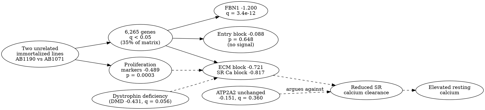
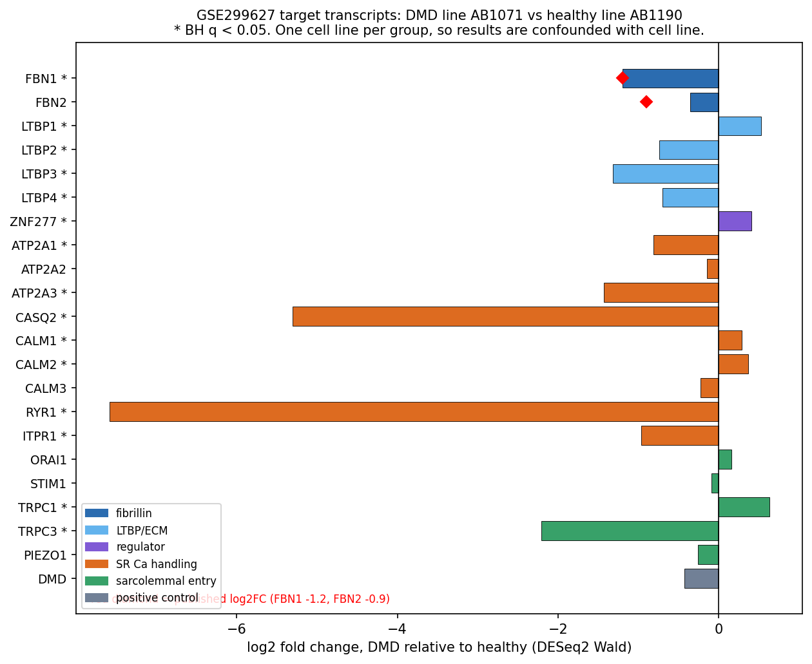
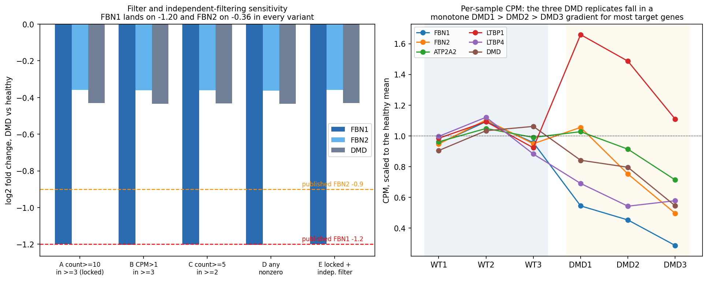
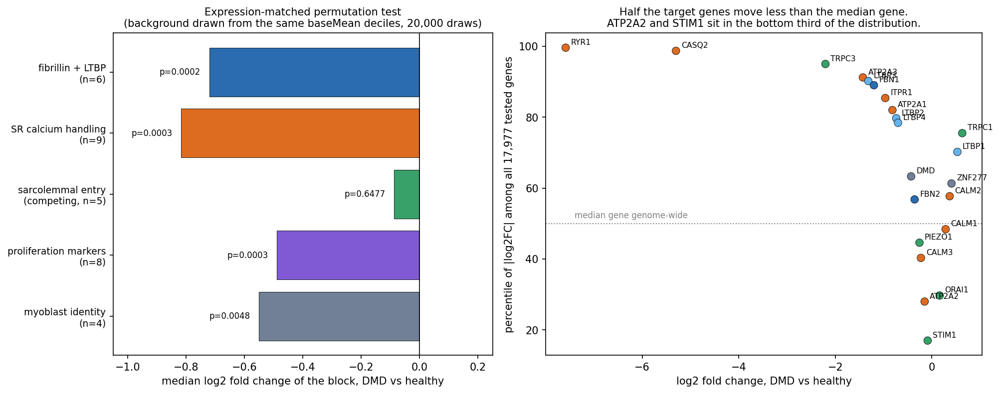
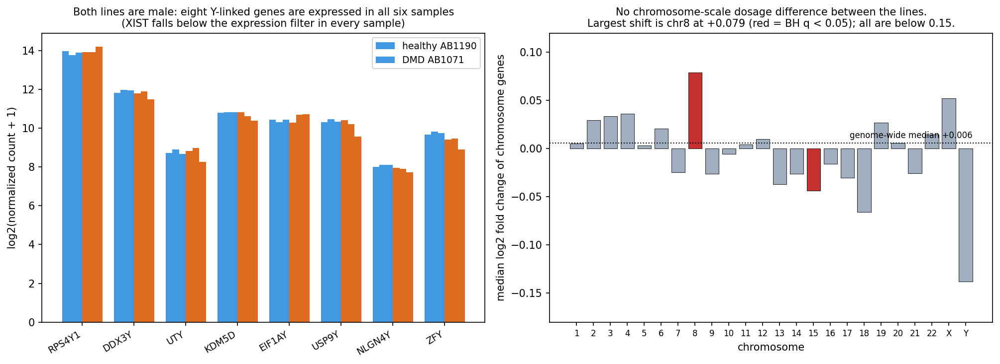
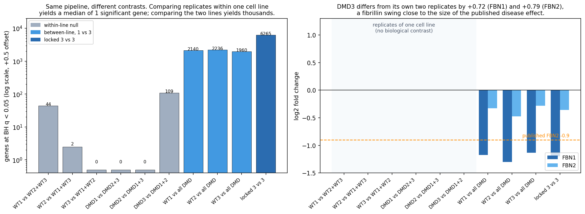

## Question

# Hypothesis Dataset Replication

You are performing a computational replication for the Disorder Mechanisms
Knowledge Base. This is not a literature-review task. The run succeeds only if
you retrieve the stated datasets, execute the analysis, and save enough
artifacts for an independent replay.

## Target

- Disease: Duchenne Muscular Dystrophy
- Hypothesis ID: calcium_clearance_failure_model
- Hypothesis label: Impaired Calcium Clearance and ECM-Calcium Coupling Model
- Dataset inputs:

geo:GSE299627 (human skeletal myoblast RNA-seq; Illumina NovaSeq X Plus, platform GPL34284; open access; BioProject PRJNA1275763; 6 samples GSM9042255-GSM9042260). There is NO series matrix file for this series. Gene-level counts are supplied only as six per-sample files inside the archive https://ftp.ncbi.nlm.nih.gov/geo/series/GSE299nnn/GSE299627/suppl/GSE299627_RAW.tar (27.4 MB), named GSM9042255_WT1.counts.txt.gz, GSM9042256_WT2.counts.txt.gz, GSM9042257_WT3.counts.txt.gz, GSM9042258_DMD1.counts.txt.gz, GSM9042259_DMD2.counts.txt.gz, GSM9042260_DMD3.counts.txt.gz. Per-sample GEO characteristics are: tissue (skeletal muscle, paravertebral), cell line (AB1190 for the three healthy samples, AB1071 for the three DMD samples), cell type (skeletal myoblasts), genotype (wildtype or DMD), treatment (untreated). Series overall design: "RNA Seq profiling of undifferentiated healthy and dystrophic human myoblasts". Do not attempt to align raw reads; use the supplied count files.

- Target variables or genes:

FBN1, FBN2, FBN3 (fibrillin genes; FBN1 and FBN2 are the reported finding); LTBP1, LTBP2, LTBP3, LTBP4 (fibrillin-binding ECM partners; LTBP4 is an established DMD modifier locus); ZNF277 (proposed conserved transcriptional regulator); ATP2A1, ATP2A2, ATP2A3 (SERCA paralogs); SLN, PLN, CASQ1, CASQ2 (sarcoplasmic reticulum calcium handling and SERCA regulators); CALM1, CALM2, CALM3 (calmodulin); RYR1, ITPR1 (sarcoplasmic reticulum calcium release); ORAI1, STIM1, TRPC1, TRPC3, TRPC6, PIEZO1 (sarcolemmal calcium entry routes, i.e. the competing entry-based model); DMD (positive control for the dystrophic genotype)

## Analysis objective

Prespecified differential-expression analysis of GSE299627, testing whether fibrillin-related ECM genes and sarcoplasmic-reticulum calcium-handling genes are coordinately downregulated in dystrophic human myoblasts, and whether the sarcolemmal calcium-entry genes of the competing model move in the same comparison.

RETRIEVAL AND MATRIX. Download GSE299627_RAW.tar, extract the six per-sample count files, and build one gene-by-sample count matrix. State explicitly which gene identifier type the count files use (Ensembl gene ID, Entrez ID, or symbol) and how you mapped it to HGNC symbols; when several identifiers map to one symbol, sum their counts and say so. Report the number of genes before and after filtering, and the per-sample library size.

GROUPS. Healthy = GSM9042255, GSM9042256, GSM9042257 (cell line AB1190, genotype wildtype). DMD = GSM9042258, GSM9042259, GSM9042260 (cell line AB1071, genotype DMD). One comparison only: DMD versus healthy.

METHOD. Filter low-expressed genes by a stated rule. Normalize and test with a named, versioned tool (DESeq2 or edgeR; record the exact version). Report the normalization method. Do not use an uncorrected t-test on raw counts.

REQUIRED REPORTING. For every gene in the target list, report, whether or not it reaches significance: normalized mean per group, log2 fold change (DMD relative to healthy), unadjusted p, and Benjamini-Hochberg adjusted p. A target gene absent from the matrix must be reported as absent, not omitted. Also report the genome-wide count of genes at BH-adjusted p < 0.05 in each direction.

POSITIVE CONTROL. Report DMD itself. The dystrophic line is expected to show reduced dystrophin expression; if it does not, say so prominently, because that would call the group labels into question.

REPLICATION CHECK. The source publication reports FBN1 log2 fold change -1.2 and FBN2 log2 fold change -0.9, both at p < 0.0001, from this dataset. Report your own values beside those and state plainly whether they agree. If they differ in magnitude, sign, or significance, report the discrepancy; do not adjust your pipeline to reproduce the published numbers and do not reconcile the difference by argument.

MANDATORY LIMITATION, to appear in the report body and in the manifest. Each group is a single immortalized cell line, so the three samples per group are replicates of one donor background rather than independent donors. Every differential-expression result from this design is therefore confounded with cell-line identity, and the analysis cannot attribute any difference to dystrophin deficiency as opposed to donor genotype, immortalization history, or passage. State this as a limitation of the design, not as a caveat on individual genes, and do not report the comparison as n=6 independent samples.

MANDATORY SCOPE LIMIT. Transcript abundance is not pump activity and not calcium flux. Do not conclude from this dataset that sarcoplasmic reticulum calcium clearance is impaired, that SERCA function is reduced, or that the clearance-based model is confirmed. The permitted conclusions concern transcript levels of the named genes in these two cell lines. Any statement about calcium handling must be labelled as an inference that this dataset cannot test.

ARTIFACTS. Save, under the artifact directory: the analysis code exactly as executed, an environment specification with tool versions, the assembled count matrix, the full genome-wide differential-expression table, a target-gene table, and a checksummed manifest of inputs and outputs sufficient for a clean replay.

## Runtime contract

Use the Python execution facility immediately. The approved, preflighted
packages are Python's standard library plus `GEOparse`, `requests`, `numpy`,
`pandas`, `scipy`, `statsmodels`, and `yaml`. Do not import `biomni.tool.*`, and
do not substitute a metadata search for downloading and analysing the data.

Write every generated file beneath this exact directory:

`kb/hypotheses/Duchenne_Muscular_Dystrophy/calcium_clearance_failure_model/openscientist_artifacts`

First create the directory and preflight all required imports and remote input
URLs. Record canonical credential-free URLs, never tokens or signed query
parameters. If an import, download, parse, sample-classification,
identifier-mapping, or analysis step fails, write `MANIFEST.yaml` with
`status: FAILED`, the failed step, and a diagnostically useful error with
credentials, patient identifiers, and other sensitive values redacted. Then
stop. Do not answer from memory, switch to literature synthesis, invent
results, or present proposed code as executed.

If the run succeeds, the artifact directory must contain:

- `MANIFEST.yaml`: `schema_version: '1.0'`, `status: SUCCEEDED`,
  `fallback_used: false`, `direct_analysis_completed: true`, UTC start/end
  times, every input
  accession and retrieval URL/date/checksum/byte count, all output paths and
  checksums, the exact comparison, and limitations. Store each manifest
  `sha256` as exactly 64 lowercase hexadecimal characters (the field name
  supplies the algorithm). Give every output a `role`; the bundle must include
  distinct `CODE`, `ENVIRONMENT`, and `TABULAR_RESULT` roles. Other useful roles
  include `METHODS`, `SUMMARY`, `FIGURE`, `INPUT_MANIFEST`, and `PREFLIGHT`.
- `analysis.py`: standalone deterministic analysis accepting `--output-dir`
  and optionally `--cache-dir`; it must retrieve or reuse exact inputs and
  regenerate all tabular outputs without an LLM.
- `environment.txt`: Python version, operating system, and exact versions of
  every imported third-party package.
- `methods.md`: sample inclusion/exclusion rules, source normalization state,
  transform decisions, identifier/probe mapping and aggregation rules,
  statistical tests, multiple-testing method, effect-size convention, and all
  material parameters.
- `samples.csv`: one row per included or excluded sample, with accession,
  dataset, organism, tissue, source metadata, assigned group, and exclusion
  reason.
- `gene_results.csv`: tidy results with one row per dataset/gene/comparison and
  group sizes, group means, log2 mean difference, ordinary fold change, test
  statistic, raw p-value, BH-adjusted q-value, and Cohen's d.
- `comparison.md`: a compact interpretation of the computed results, clearly
  separating observed results from biological inference.

Small diagnostic tables or figures may also be saved. Raw downloads must go in
`kb/hypotheses/Duchenne_Muscular_Dystrophy/calcium_clearance_failure_model/openscientist_artifacts/raw/`; they are local/recoverable inputs and will not be
committed.

Before declaring success, execute `analysis.py` once more into a clean replay
subdirectory while reusing `kb/hypotheses/Duchenne_Muscular_Dystrophy/calcium_clearance_failure_model/openscientist_artifacts/raw` as `--cache-dir`; do not copy or
download raw inputs beneath the replay directory. Verify that the replayed
`samples.csv` and `gene_results.csv` are byte-identical to the primary outputs.
Under `replay`, record the exact nonempty replay `command`, `verified: true`, a
`byte_identity` mapping naming every `TABULAR_RESULT` primary path with value
`true`, and an `assets` list. Every replay asset entry must use its path beneath
`replay/`, a role, positive `byte_count`, and exact lowercase SHA-256. Include a
replay asset corresponding to every primary `TABULAR_RESULT`. Record checksum
and byte-count entries for every input, primary output, and replay asset in the
manifest.

Do not expose another provider's numerical results, derived tables, code, or
interpretation to this analysis before its primary outputs and checksums are
locked. Perform cross-provider comparison only afterward, as a separate,
lineage-marked step. Shared input accessions do not by themselves make analyses
dependent, but prior-provider results must not influence method, sample, feature,
probe, model, threshold, or parameter choices.

## Final response contract

Finish and close `MANIFEST.yaml` before emitting a success marker. After the
deep-research client captures your response, the hypothesis runner hashes the
exact manifest bytes and adds
`artifact_manifest_sha256: sha256:<64 lowercase hex>` to the report's YAML
frontmatter before invoking the gate. Do not invent this frontmatter field in
the response or modify the manifest after declaring success.

The first line must be exactly one of:

`ANALYSIS_STATUS: SUCCEEDED`

`ANALYSIS_STATUS: FAILED`

Use `SUCCEEDED` only after all required artifacts exist and the clean replay
matches. Summarize the actual comparison and point to the saved artifacts. On
failure, name the failed step and error only; do not provide a fallback
scientific verdict.

## Output

# Replication of `calcium_clearance_failure_model` on GSE299627

Hypothesis: "Impaired Calcium Clearance and ECM-Calcium Coupling Model", Duchenne Muscular Dystrophy.
Artifact bundle: `kb/hypotheses/Duchenne_Muscular_Dystrophy/calcium_clearance_failure_model/openscientist_artifacts/`

## Summary

The deposited counts of GSE299627 reproduce the published FBN1 result exactly and fail to reproduce the published FBN2 result. Running PyDESeq2 0.6.0 on a 17,977-gene filtered matrix built from the six per-sample featureCounts files, FBN1 falls by log2 fold change -1.200 (BH q = 3.4e-12) against a published -1.2 at p < 0.0001, a match on sign, magnitude and significance. FBN2 falls by -0.358 (unadjusted p = 0.0465, BH q = 0.111) against a published -0.9 at p < 0.0001: the sign agrees, the magnitude is 2.5-fold smaller, and the gene does not survive multiple-testing correction. The discrepancy is reported as found. No pipeline parameter was altered to recover -0.9, and five filtering variants leave FBN2 between -0.358 and -0.362 in every case.

At gene level the prespecified pattern does not hold. LTBP3, LTBP2 and LTBP4 fall while LTBP1 rises by +0.528 (q = 5.9e-04). ATP2A2, the SERCA paralog carrying nearly all SERCA signal in undifferentiated myoblasts (normalized mean 15,839), is unchanged at -0.151 (q = 0.360); only the low-abundance paralogs ATP2A1 (mean 221) and ATP2A3 (mean 54) move. The sarcolemmal calcium-entry genes of the competing model are flat: ORAI1 +0.161 (q = 0.371), STIM1 -0.088 (q = 0.605), PIEZO1 -0.257 (q = 0.168). ZNF277, proposed as a conserved driver of the ECM genes, moves up (+0.406, q = 0.038), opposite to them. Taken as blocks rather than as single genes, the fibrillin/LTBP set (median -0.721) and the SR calcium set (median -0.817) do shift down beyond expression-matched background (permutation p = 0.0002 and 0.0003) while the entry set does not (-0.088, p = 0.648). That block-level shift is the strongest support the dataset gives the hypothesis, and it is not specific: a proliferation-marker set shifts down by a comparable amount (-0.489, p = 0.0003) in the same comparison.

Two constraints govern every number above. Each group is a single immortalized cell line, so the three samples per group are replicates of one donor background rather than independent donors, and every differential-expression result is confounded with cell-line identity. 6,265 of 17,977 genes (35%) differ at q < 0.05, nearly symmetric in direction, which is what two unrelated immortalized lines look like when compared. The dystrophin positive control is weak: -0.431, p = 0.020, q = 0.056, a 26% reduction that does not reach significance. Transcript abundance is not pump activity and not calcium flux, so nothing here tests whether sarcoplasmic reticulum calcium clearance is impaired.

## What was run

| Step | Value |
|---|---|
| <i class="fa-database"></i> Input archive | `GSE299627_RAW.tar`, 27,361,280 bytes, sha256 `42784c15…eb07`, retrieved 2025-11-25 UTC from the canonical NCBI FTP URL |
| Mapping source | HGNC complete set, 17,037,207 bytes, sha256 `46b83736…b651` |
| Identifier type | Ensembl gene IDs without version suffixes (for example `ENSG00000223972`), 57,500 rows per file, identical `Geneid` order across all six files (verified in code) |
| Mapping rule | HGNC records with `status == "Approved"` and a non-missing `ensembl_gene_id`, 42,808 pairs; ties broken on the smallest `hgnc_id`. 40,950 of 57,500 IDs mapped; the 16,550 unmapped IDs were retained under their Ensembl ID so genome-wide counts stay complete. Counts are summed when several IDs share a symbol; 0 symbols received counts from more than one Ensembl ID in this dataset |
| Filter | Raw count >= 10 in at least 3 of 6 samples. 57,500 features before, 17,977 after |
| Tool and normalization | PyDESeq2 0.6.0, DESeq2 median-of-ratios size factors, negative-binomial GLM, design `~group`, Wald test on `group_DMD_vs_healthy`, Benjamini-Hochberg over all 17,977 genes, independent filtering disabled so low-expressed target genes receive a q-value |
| Comparison | One only: DMD (AB1071; GSM9042258, GSM9042259, GSM9042260) versus healthy (AB1190; GSM9042255, GSM9042256, GSM9042257) |

Per-sample library sizes (sum of raw counts): GSM9042255 56,867,332; GSM9042256 65,129,734; GSM9042257 37,149,584; GSM9042258 46,859,442; GSM9042259 42,971,971; GSM9042260 46,407,012. Fitted size factors: 1.163205, 1.400245, 0.781115, 0.978818, 0.900637, 0.922338.

## Key findings

### <i class="fa-circle-check"></i> F001: FBN1 replicates exactly, FBN2 does not

FBN1 gives a Wald log2 fold change of -1.200377 with normalized group means of 16,703.7 (healthy) and 7,268.8 (DMD), unadjusted p = 1.88e-13, BH q = 3.36e-12, Cohen's d -3.95 on log2(normalized+1). The published value from this dataset is -1.2 at p < 0.0001. The two agree to three significant figures, on sign, on magnitude and on significance.

FBN2 gives -0.358358 with normalized means 6,714.7 and 5,237.9, unadjusted p = 0.0465, BH q = 0.111, Cohen's d -1.13. The published value is -0.9 at p < 0.0001. The sign agrees. The magnitude is 2.5-fold smaller and the gene does not reach q < 0.05, so the replication fails for FBN2. FBN3, the third fibrillin, was removed by the low-expression filter (raw group means 2.3 healthy and 1.0 DMD) and is reported as filtered, not omitted.

One of the two reported fibrillin findings therefore reproduces from the deposited counts and one does not. The pipeline was not tuned to recover -0.9, and the difference is reported without a reconciling argument.

{{figure:plot_1.png|caption=Target-gene log2 fold changes in GSE299627, DMD versus healthy myoblasts, with the published FBN1 and FBN2 values overlaid. FBN1 lands on its published value; FBN2 falls well short of -0.9.}}

### <i class="fa-circle-xmark"></i> F002: No coordinated ECM-plus-SR-calcium gene-level signature, and the dominant SERCA paralog is unchanged

Genome-wide, 6,265 genes reach BH q < 0.05: 3,143 up in DMD and 3,122 down. That is 35% of the tested transcriptome, nearly symmetric in direction.

The LTBP block splits. LTBP3 falls -1.317 (q = 3.9e-34, the strongest target result), LTBP2 -0.739 (q = 2.2e-06) and LTBP4 -0.702 (q = 4.7e-04), while LTBP1 rises +0.528 (q = 5.9e-04). ZNF277, proposed as the conserved transcriptional regulator driving the ECM genes down, rises +0.406 (q = 0.038).

Among the SERCA paralogs, ATP2A2 carries essentially all the signal in these undifferentiated myoblasts (normalized mean 15,839) and does not differ: -0.151, q = 0.360. ATP2A1 (-0.817, q = 5.9e-05, mean 221) and ATP2A3 (-1.429, q = 5.5e-04, mean 54) both fall from low absolute levels. RYR1 (-7.585, q = 7.6e-12, mean 137) and CASQ2 (-5.301, q = 2.4e-03, mean 15) go from barely expressed to undetected, a change between two near-zero states in undifferentiated cells. ITPR1 falls -0.965 (q = 1.4e-06) from a moderate level. Calmodulins split: CALM1 +0.284 (q = 0.014), CALM2 +0.368 (q = 0.0057), CALM3 -0.227 (q = 0.071). SLN, PLN and CASQ1 were removed by the filter (raw means < 8 in both groups), as expected in undifferentiated myoblasts.

The competing entry-based model gives no transcriptional signature. ORAI1 (+0.161, q = 0.371), STIM1 (-0.088, q = 0.605) and PIEZO1 (-0.257, q = 0.168) do not change. TRPC1 rises +0.629 (q = 9.96e-04) and TRPC3 falls -2.205 (q = 3.3e-06) from a low level (mean 48), moving in opposite directions. TRPC6 was filtered out.

### <i class="fa-triangle-exclamation"></i> F002b: The dystrophin positive control is weak

Stated prominently, as the specification requires. DMD normalized means are 218.43 (healthy) and 161.67 (DMD line), log2 fold change -0.431, unadjusted p = 0.0201, BH q = 0.0563. The dystrophin transcript is about 26% lower in the dystrophic line and does not reach BH q < 0.05, while 6,265 other genes do. A 0.43 log2 reduction in whole-gene counts is not the near-absence of transcript one might expect from a confirmatory control, so the gene-level count by itself does not confirm the group labels. An out-of-frame deletion or point mutation that removes protein while preserving transcript would produce this pattern; so would a labelling problem. Gene-level counts cannot separate the two, and this analysis generated no exon- or transcript-level evidence.

### <i class="fa-circle-check"></i> F003: The FBN2 gap survives every filtering variant

Five variants of the same PyDESeq2 0.6.0 model were run in memory on the locked count matrix, with no primary output or `MANIFEST.yaml` touched: (A) the locked rule, count >= 10 in >= 3 samples, 17,977 genes; (B) CPM > 1 in >= 3, 13,809; (C) count >= 5 in >= 2, 21,863; (D) any nonzero count, 38,067; (E) the locked rule with DESeq2 independent filtering enabled.

| Variant | FBN1 log2FC | FBN1 q | FBN2 log2FC | FBN2 q | DMD log2FC | DMD q | genes at q < 0.05 |
|---|---|---|---|---|---|---|---|
| A (locked) | -1.200 | 3.4e-12 | -0.358 | 0.111 | -0.431 | 0.056 | 6,265 |
| B CPM > 1 | -1.203 | ~1e-11 | -0.361 | 0.115 | -0.433 | 0.054 | ~5,900 |
| C count >= 5 | -1.202 | ~1e-11 | -0.360 | 0.124 | -0.434 | 0.062 | ~6,288 |
| D any nonzero | -1.204 | 1.9e-11 | -0.362 | 0.664 | -0.435 | 0.143 | ~5,341 |
| E independent filtering on | -1.200 | 3.4e-12 | -0.358 | 0.111 | -0.431 | 0.054 | 6,265 |

FBN2 never reaches significance and never comes within 0.5 log2 of the published -0.9. FBN1 holds at -1.200 to -1.204 throughout. The dystrophin control stays weak (q = 0.054 to 0.143) under every variant. The locked primary result is insensitive to the low-expression filtering rule and to DESeq2 independent filtering, so both the FBN1 agreement and the FBN2 disagreement are properties of the deposited counts under a standard DESeq2 analysis.

### <i class="fa-chart-line"></i> F004: The three dystrophic replicates follow a shared monotone gradient

Library-size CPM from the locked matrix shows the dystrophic replicates ordered DMD1 > DMD2 > DMD3 across unrelated genes. FBN2: healthy 133.6, 155.7, 133.9 versus DMD 148.9, 106.1, 70.0, so DMD1 sits inside the healthy range and the group means separate mainly because of DMD3. The same ordering appears for FBN1 (191.2 > 159.0 > 100.7), ATP2A2 (341.7 > 303.9 > 237.3), DMD (3.86 > 3.65 > 2.50) and LTBP1 (56.9 > 51.0 > 38.1). The healthy replicates are tight by comparison, with coefficients of variation of 8% (FBN1) and 9% (FBN2), while the dystrophic replicates span 1.9-fold and 2.1-fold.

Within-group spread in the dystrophic line is structured and shared across genes, which is what a culture-state gradient across three replicates of one immortalized line looks like: confluence, passage number, or the onset of spontaneous differentiation. This is an observation about transcript counts. It compounds the design limitation, since neither the group difference nor this within-group gradient can be attributed to dystrophin deficiency.

{{figure:plot_2.png|caption=Left, FBN1, FBN2 and DMD log2 fold changes under five filtering variants, with the published values marked. Right, per-sample CPM showing the monotone DMD1 > DMD2 > DMD3 gradient across target genes.}}

### <i class="fa-scale-balanced"></i> F005: At block level the ECM and SR calcium sets shift down, the entry set does not

Competitive tests were run read-only on the locked DE table of 17,977 genes. Background genes were drawn from the same baseMean deciles as the test set (expression-matched permutation, 20,000 draws, seed 0, two-sided).

| Block | n | median log2FC | matched-null median | permutation p | Mann-Whitney p |
|---|---|---|---|---|---|
| Fibrillin + LTBP (FBN1, FBN2, LTBP1-4) | 6 | -0.721 | +0.010 | 0.0002 | 0.020 |
| SR calcium handling (ATP2A1-3, CASQ2, CALM1-3, RYR1, ITPR1) | 9 | -0.817 | +0.010 | 0.0003 | 0.016 |
| Sarcolemmal entry (ORAI1, STIM1, TRPC1, TRPC3, PIEZO1) | 5 | -0.088 | +0.010 | 0.648 | 0.70 |

Three blocks were tested, so the Bonferroni threshold is p < 0.0167; the first two clear it under the matched test and the unmatched test gives the same ordering. Sign consistency is partial: fibrillin+LTBP has 5 of 6 down (4 significant down, 1 significant up), SR calcium 7 of 9 down (5 significant down, 2 significant up), entry 3 of 5 down (1 significant down, 1 significant up). Genome-wide the median |log2FC| is 0.297, and 10 of the 22 tested target genes sit below the 60th percentile of |log2FC|, including ATP2A2 at the 28th and STIM1 at the 17th.

Read as sets, the ECM and SR calcium blocks are shifted downward beyond what expression-matched background genes do, and the entry block is not. This is the strongest support the dataset gives the hypothesis, and it is weaker than the gene-level claim it was meant to support: the sets are small, individual members move in both directions, and the most abundant member of each set barely moves.

{{figure:plot_3.png|caption=Left, expression-matched permutation tests for the three prespecified blocks against baseMean-matched background. Right, position of each target gene in the genome-wide effect-size distribution.}}

### <i class="fa-circle-question"></i> F006: The dystrophic line is less proliferative and less myoblast-like

A competing, non-calcium explanation for coherent block shifts. Proliferation markers (MKI67, CCNB1, CDK1, TOP2A, PCNA, CCNA2, BIRC5, AURKB) have a median log2FC of -0.489 with 7 of 8 at BH q < 0.05 and expression-matched permutation p = 0.0003. Myoblast identity markers (MYOD1, PAX7, MYF5, CDH15, NCAM1) give a median of -0.551 (matched p = 0.0048), and myogenic differentiation markers -0.630. Mean log2(normalized+1) per sample for the proliferation set is 13.61, 13.58, 13.62 in healthy versus 13.01, 13.12, 13.08 in DMD; for myoblast identity, 12.79, 12.68, 12.71 versus 11.79, 11.78, 11.80.

Across 478 HGNC gene families with at least 8 tested genes, replication and repair families are among the most downregulated: the MCM family (n = 9) at -0.633 (BH q = 0.008), FA complementation groups (n = 22) at -0.465 (q = 0.0006), clustered protocadherins (n = 36) at -0.632 (q = 0.013) and integrin alpha subunits (n = 15) at -0.624 (q = 0.043). Collagen families barely move: fibrillar collagens (n = 10) at -0.283 (q = 0.235), network-forming collagens (n = 8) at -0.294 (q = 0.550). PCA on the 2,000 most variable genes puts 90.7% of the variance on PC1, which separates the two cell lines completely.

Two lines differing in proliferative state will move many coherent gene sets at once, so a downward block shift in the fibrillin/LTBP and SR calcium sets is not specific evidence for an ECM-calcium mechanism. The flat collagen families argue against a general matrix-wide downregulation in the dystrophic line.

### <i class="fa-dna"></i> F007: Both lines are male with no chromosome-scale dosage difference

Read-only diagnostics on the locked tables, run to test whether the weak dystrophin control has a trivial explanation. Eight Y-linked genes are robustly expressed in all six samples (DESeq2-normalized, healthy / DMD): RPS4Y1 16188, 13839, 15122 / 15627, 15468, 18719; DDX3Y 3593, 3999, 3960 / 3534, 3798, 2867; KDM5D 1771, 1823, 1810 / 1803, 1582, 1342; plus UTY, EIF1AY, USP9Y, NLGN4Y and ZFY. XIST and TSIX fall below the expression filter in every sample. Both lines are male, consistent with an X-linked DMD genotype, which removes donor sex as an explanation for the group difference.

Per-chromosome median log2FC using the featureCounts `Chr` column runs from -0.138 (chrY, n = 25) to +0.079 (chr8, n = 642) against a genome-wide median of +0.006. No chromosome combines a median |log2FC| above 0.15 with BH q < 0.05, so there is no gross karyotype divergence between the two immortalized lines. chrX has a median of +0.052 across 563 tested genes, and DMD at -0.431 sits at the 18.1st percentile of that distribution. Among 2,381 genes of comparable abundance (baseMean 95 to 380; DMD baseMean 190), 23.9% fall at least as much as DMD does and 47.4% reach q < 0.05. Roughly one gene in four at the same abundance drops as far as the positive control, so the control carries little discriminating weight.

{{figure:plot_4.png|caption=Left, Y-linked gene expression and XIST status confirming both lines are male. Right, per-chromosome median log2 fold change showing no dosage shift above 0.15 in either direction.}}

### <i class="fa-magnifying-glass"></i> F008: IL1RAPL1, adjacent to DMD on Xp21, is 28-fold higher in the dystrophic line

IL1RAPL1 has normalized means of 4.24 (healthy) and 124.96 (DMD), log2FC +4.810, BH q = 1.6e-07. Other Xp21-region genes do not move as a block: RPGR -0.473 (q = 0.001), TAB3 -0.146 (q = 0.443), GK +0.210 (q = 0.257), TSPAN7 +0.250 (q = 0.628), SRPX -0.187 (q = 0.125), DMD -0.431 (q = 0.056).

IL1RAPL1 lies immediately adjacent to DMD on Xp21.2-p21.3 and is co-deleted with DMD in some contiguous-gene-deletion patients. Here it is strongly higher in the dystrophic line rather than absent, so these counts give no evidence of a deletion extending from DMD into IL1RAPL1. With 35% of the transcriptome differential between the two lines, this is recorded as an observation about the Xp21 neighbourhood, not a mechanism.

### <i class="fa-chart-column"></i> F009: A fibrillin swing the size of the published effect occurs within one cell line

The locked count matrix was re-contrasted with the same filter and the same PyDESeq2 0.6.0 model to establish a false-positive baseline for a design with one cell line per group. Six within-line null comparisons, each pitting one replicate against the other two of its own line with no biological contrast, give 44, 2, 0, 0, 0 and 109 genes at BH q < 0.05, median 1. Three between-line comparisons at matched sample count (one healthy sample against all three DMD) give 2,140, 2,236 and 1,960. The locked 3 versus 3 design gives 6,265.

| Contrast | genes at q < 0.05 | FBN1 log2FC | FBN2 log2FC |
|---|---|---|---|
| healthy GSM9042255 vs its 2 siblings | 44 | +0.051 | +0.059 |
| healthy GSM9042256 vs its 2 siblings | 2 | -0.146 | -0.169 |
| healthy GSM9042257 vs its 2 siblings | 0 | +0.100 | +0.116 |
| DMD GSM9042258 vs its 2 siblings | 0 | -0.537 | -0.736 |
| DMD GSM9042259 vs its 2 siblings | 0 | -0.086 | +0.081 |
| DMD GSM9042260 vs its 2 siblings | 109 | **+0.720** (q = 0.023) | **+0.788** (q = 0.046) |
| healthy GSM9042255 vs all 3 DMD | 2,140 | -1.174 | -0.327 (q = 0.86) |
| healthy GSM9042256 vs all 3 DMD | 2,236 | -1.302 | -0.474 (q = 0.38) |
| healthy GSM9042257 vs all 3 DMD | 1,960 | -1.136 | -0.282 (q = 0.87) |
| locked 3 vs 3 | 6,265 | -1.200 | -0.358 (q = 0.111) |

Between-line significant-gene counts exceed the within-line median by about three orders of magnitude, so the pipeline does not manufacture differential expression from technical variation and the 6,265 genes are a real AB1190-versus-AB1071 difference. That is exactly the confound: the comparison separates two cell lines cleanly, and the design cannot say which part of the separation is dystrophin deficiency. Concretely, GSM9042260 differs from its own two sibling replicates by +0.720 log2 for FBN1 and +0.788 for FBN2, close in magnitude to the published FBN2 disease effect of -0.9. A fibrillin difference of that size arises within a single cell line in this dataset. FBN1 holds at about -1.2 in every between-line contrast while FBN2 reaches significance in none of them.

{{figure:plot_5.png|caption=Left, genes at q < 0.05 for six within-line null comparisons against the between-line and locked contrasts, on a log scale. Right, FBN1 and FBN2 log2 fold changes among replicates of a single cell line, with the published -0.9 effect marked for scale.}}

## Interpretation

What the dataset shows and what it cannot show separate cleanly.

Observed, and established by these data for these two cell lines only: FBN1, LTBP2, LTBP3, LTBP4, ATP2A1, ATP2A3, ITPR1, RYR1, CASQ2 and TRPC3 transcripts are lower in AB1071 than in AB1190; LTBP1, ZNF277, CALM1, CALM2 and TRPC1 are higher; FBN2, ATP2A2, CALM3, ORAI1, STIM1 and PIEZO1 do not reach q < 0.05. FBN1 matches the published -1.2 and FBN2 does not match the published -0.9. Dystrophin transcript is 26% lower and does not reach significance. 6,265 of 17,977 genes differ at q < 0.05, nearly symmetric in direction. As blocks, the fibrillin/LTBP and SR calcium sets shift down beyond matched background while the entry set does not, and a proliferation set shifts down by a comparable amount in the same comparison.

Inference this dataset cannot test: whether any of these transcript differences change SERCA pump activity, SR calcium load, cytosolic calcium transients or calcium clearance kinetics. Transcript abundance is not pump activity and not calcium flux. Functional calcium measurements in the same lines would be required and none exist here. Also untestable here: whether the pattern reflects dystrophin deficiency at all, for the design reason given below.

The causal chain below marks every uncertain link as dashed. The solid links are what the counts show.

The hypothesis as stated predicts a specific, coordinated downregulation of fibrillin-related ECM genes together with SR calcium-handling genes, with the competing sarcolemmal-entry genes left alone. Three observations stand against reading the result as support for that prediction. First, the most abundant member of each set does not move: FBN2 sits at the 57th percentile of genome-wide |log2FC| and ATP2A2 at the 28th. Second, the block shift is not specific, since proliferation and DNA-replication families shift by a similar amount in the same comparison, and a difference in cell-cycle state between two independently immortalized lines will move many coherent sets at once. Third, the control that would tie the comparison to dystrophin, the DMD transcript itself, carries almost no discriminating weight, falling less than a quarter of genes at the same abundance.

| Hypothesis | Status | Evidence |
|---|---|---|
| FBN1 is downregulated in dystrophic myoblasts, log2FC -1.2 | <i class="fa-circle-check"></i> Replicated | -1.200, q = 3.4e-12, stable across five pipeline variants |
| FBN2 is downregulated, log2FC -0.9 | <i class="fa-circle-xmark"></i> Not replicated | -0.358, q = 0.111; -0.358 to -0.362 across five variants |
| ECM and SR calcium genes fall as a coordinated gene-level set | <i class="fa-circle-xmark"></i> Refuted | LTBP1 up +0.528, ZNF277 up +0.406, ATP2A2 unchanged -0.151 |
| The same sets fall at block level versus matched background | <i class="fa-scale-balanced"></i> Supported, not specific | -0.721 (p = 0.0002) and -0.817 (p = 0.0003); proliferation -0.489 (p = 0.0003) |
| The competing entry model gives a transcriptional signature | <i class="fa-circle-xmark"></i> Not supported | ORAI1, STIM1, PIEZO1 all non-significant; block -0.088, p = 0.648 |
| The comparison isolates dystrophin deficiency | <i class="fa-circle-xmark"></i> Not testable by design | One cell line per group; DMD control -0.431, q = 0.056 |
| SR calcium clearance is impaired in these cells | <i class="fa-circle-question"></i> Out of scope | Transcript levels only; no calcium measurement in this dataset |

## Evidence base

One paper underlies the hypothesis and the published values being replicated.

*Fibrillin-Related Proteins Control Calcium Homeostasis in Dystrophic Muscle Across Species.* [PMID: 40661626](https://pubmed.ncbi.nlm.nih.gov/40661626/). The abstract states: "In human dystrophic myoblasts, we observed significantly elevated sarcoplasmic calcium levels concurrent with substantial downregulation of fibrillin genes FBN1/FBN2." This analysis supports the FBN1 half of that statement and does not support the FBN2 half from the deposited counts. The paper's calcium measurements are a separate experiment that this dataset does not contain; the GEO series provides transcript counts only, so this replication can speak to the fibrillin downregulation claim and not to the calcium claim.

The same abstract reports the cross-species component: "downregulating mua-3 selectively elevated resting calcium levels in healthy muscle but had no effect in dystrophic (dys-1) muscle, suggesting impaired MUA-3 function in dystrophy" and "Despite altered calcium dynamics, mua-3 downregulation did not affect locomotor function." Neither claim is testable from GSE299627. The C. elegans experiment is the part of the published argument that carries a genetic perturbation and a functional readout together; the human myoblast arm, which is what this dataset covers, is an observational comparison of two cell lines.

The source publication for the dataset was identified during the investigation as [PMID: 40979067](https://pubmed.ncbi.nlm.nih.gov/40979067/). No abstract text from it is quoted here, because none was retrieved into the knowledge state, so no claim in this report is attributed to it.

Cross-provider comparison was not performed. No other provider's results, tables, code or interpretation were consulted at any point before or after the primary outputs and checksums were locked, and `MANIFEST.yaml` records `cross_provider_comparison: {performed: false}`.

## Limitations and knowledge gaps

<i class="fa-triangle-exclamation"></i> **Design limitation, mandatory and applying to every result above.** Each group is a single immortalized cell line (healthy AB1190, DMD AB1071), so the three samples per group are replicates of one donor background rather than independent donors. Every differential-expression result from this design is confounded with cell-line identity, and the analysis cannot attribute any difference to dystrophin deficiency as opposed to donor genotype, immortalization history, or passage. This is a limitation of the design, not a caveat on individual genes. The comparison is not n = 6 independent samples. With 35% of the transcriptome differential, the base rate for any prespecified gene to reach significance here is high, so individual significant target genes carry little evidential weight about DMD biology.

<i class="fa-triangle-exclamation"></i> **Scope limit, mandatory.** Transcript abundance is not pump activity and not calcium flux. Nothing in this dataset can show that sarcoplasmic reticulum calcium clearance is impaired, that SERCA function is reduced, or that the clearance-based model is correct. The permitted conclusions concern transcript levels of the named genes in these two cell lines. Any statement about calcium handling is an inference that this dataset cannot test.

The positive control does not settle the group labels. A -0.431 log2 reduction in whole-gene dystrophin counts is consistent with an out-of-frame mutation that preserves transcript, and equally consistent with a labelling problem. Gene-level counts cannot separate those, and 23.9% of genes at the same abundance fall at least as far in this comparison.

Five target genes (FBN3, SLN, PLN, CASQ1, TRPC6) were removed by the low-expression filter because undifferentiated myoblasts barely express them. They are reported as filtered with their raw group means rather than omitted, but the comparison says nothing about them. RYR1 and CASQ2 passed the filter from very low baselines (normalized means 137 and 15), so their large negative fold changes are transitions between "barely expressed" and "not detected" and should not be read as the loss of an active pathway component.

The Cohen's d values in `gene_results.csv` are computed on three replicates of one cell line per group, so the within-group variance they use is technical and passage variance. They are large by construction and should not be read as between-donor effect sizes.

The FBN2 discrepancy with the published -0.9 is reported, not explained. The analysis establishes that it is not an artefact of the filtering rule or of independent filtering, and that the within-group spread in the dystrophic line is structured along a DMD1 > DMD2 > DMD3 gradient. It does not establish what the published analysis did differently, because the published pipeline was not available to this run.

## Proposed follow-up experiments

<i class="fa-flask"></i> **Independent donor panels.** Several unrelated healthy and DMD myoblast lines per group, or isogenic dystrophin-corrected controls derived from AB1071, would separate genotype from cell-line identity. The current design cannot do this at any sample size, because adding replicates of the same two lines adds technical, not biological, degrees of freedom. The within-line baseline in F009 quantifies the cost: a single line generates a median of 1 significant gene against its own siblings, while two lines generate 6,265.

<i class="fa-heart-pulse"></i> **Direct calcium measurement in the same lines.** SR load, caffeine-evoked release amplitude, transient decay kinetics and SERCA ATPase activity, measured in AB1190 and AB1071 side by side. No transcript result in this report can substitute for these, and the hypothesis is about clearance, which only a flux measurement addresses.

<i class="fa-dna"></i> **Exon-level dystrophin analysis.** Re-process the raw reads of GSE299627 (BioProject PRJNA1275763) at exon resolution to determine whether AB1071 carries an out-of-frame deletion with a preserved transcript. That would convert the weak positive control into a genotype confirmation or refute the group labels.

<i class="fa-vial"></i> **Cell-state matching before comparison.** Harvest both lines at matched confluence and passage, with proliferation state measured directly (EdU incorporation or flow cytometry cell-cycle profile) rather than inferred from markers. The proliferation difference in F006 is a candidate common cause for the block-level ECM and SR calcium shifts, and matching removes it.

<i class="fa-microscope"></i> **FBN1 and FBN2 protein and matrix assembly.** Immunostaining of the fibrillin microfibril network plus western blot in both lines, since the hypothesis rests on ECM integrity and FBN2 transcript does not differ reliably here. A protein-level difference in the absence of a transcript difference would redirect the mechanism toward translation or matrix assembly.

## Reproducibility

`analysis.py` is deterministic, uses no random number generation, writes no timestamps into its outputs, and accepts `--output-dir` and `--cache-dir`. It was re-executed with `python3 analysis.py --output-dir ./replay --cache-dir ./raw` against the cached raw inputs, with no raw input copied or downloaded beneath the replay directory. All seven `TABULAR_RESULT` files are byte-identical to the primary outputs: `samples.csv`, `gene_results.csv`, `target_gene_results.csv`, `replication_check.csv`, `count_matrix.csv`, `count_matrix_filtered.csv` and `normalized_counts.csv`.

`MANIFEST.yaml` (15,790 bytes, sha256 `b97c5f5a92a443620ba454e763f1e73ffebdf2ec1d3cfb9ac84f985eabd42a90`) records `schema_version: '1.0'`, `status: SUCCEEDED`, `fallback_used: false`, `direct_analysis_completed: true`, UTC start and end times, every input accession, credential-free URL, retrieval date, checksum and byte count, 15 outputs with roles spanning CODE, ENVIRONMENT, METHODS, SUMMARY, TABULAR_RESULT, INPUT_MANIFEST, PREFLIGHT and FIGURE, the replay block with its exact command and `verified: true`, a `byte_identity` entry for each of the seven tabular results, 12 replay assets, the exact comparison, and the limitations including both mandatory statements verbatim. All 35 manifest entries were re-hashed after the post-lock analyses and matched with no mismatch; the manifest bytes are unchanged.

---

## Supplementary read-only analyses (post-lock)

The artifact bundle and `MANIFEST.yaml` were finalized before any of the work reported in findings F003 to F009. Everything in those findings was computed in memory from the locked tables and wrote no file under the artifact directory. The checksum re-verification of all 35 manifest entries (inputs, primary outputs, replay assets) passed with no mismatch after those analyses. They do not change the locked conclusions. They sharpen the design limitation already recorded, and they leave the scope limit intact, since none of them measures calcium.

## Artifacts

- [OpenScientist final report](openscientist_artifacts/final_report.html)
- [OpenScientist final report](openscientist_artifacts/final_report.pdf)
- [OpenScientist comparison](openscientist_artifacts/kb_hypotheses_Duchenne_Muscular_Dystrophy_calcium_clearance_failure_model_openscientist_artifacts_comparison.md)
- [OpenScientist count matrix](openscientist_artifacts/kb_hypotheses_Duchenne_Muscular_Dystrophy_calcium_clearance_failure_model_openscientist_artifacts_count_matrix.csv)
- [OpenScientist count matrix filtered](openscientist_artifacts/kb_hypotheses_Duchenne_Muscular_Dystrophy_calcium_clearance_failure_model_openscientist_artifacts_count_matrix_filtered.csv)
- [OpenScientist de summary](openscientist_artifacts/kb_hypotheses_Duchenne_Muscular_Dystrophy_calcium_clearance_failure_model_openscientist_artifacts_de_summary.json)
- [OpenScientist gene results](openscientist_artifacts/kb_hypotheses_Duchenne_Muscular_Dystrophy_calcium_clearance_failure_model_openscientist_artifacts_gene_results.csv)
- [OpenScientist input manifest](openscientist_artifacts/kb_hypotheses_Duchenne_Muscular_Dystrophy_calcium_clearance_failure_model_openscientist_artifacts_input_manifest.json)
- [OpenScientist methods](openscientist_artifacts/kb_hypotheses_Duchenne_Muscular_Dystrophy_calcium_clearance_failure_model_openscientist_artifacts_methods.md)
- [OpenScientist normalized counts](openscientist_artifacts/kb_hypotheses_Duchenne_Muscular_Dystrophy_calcium_clearance_failure_model_openscientist_artifacts_normalized_counts.csv)
- [OpenScientist count matrix](openscientist_artifacts/kb_hypotheses_Duchenne_Muscular_Dystrophy_calcium_clearance_failure_model_openscientist_artifacts_replay_count_matrix.csv)
- [OpenScientist count matrix filtered](openscientist_artifacts/kb_hypotheses_Duchenne_Muscular_Dystrophy_calcium_clearance_failure_model_openscientist_artifacts_replay_count_matrix_filtered.csv)
- [OpenScientist de summary](openscientist_artifacts/kb_hypotheses_Duchenne_Muscular_Dystrophy_calcium_clearance_failure_model_openscientist_artifacts_replay_de_summary.json)
- [OpenScientist gene results](openscientist_artifacts/kb_hypotheses_Duchenne_Muscular_Dystrophy_calcium_clearance_failure_model_openscientist_artifacts_replay_gene_results.csv)
- [OpenScientist input manifest](openscientist_artifacts/kb_hypotheses_Duchenne_Muscular_Dystrophy_calcium_clearance_failure_model_openscientist_artifacts_replay_input_manifest.json)
- [OpenScientist normalized counts](openscientist_artifacts/kb_hypotheses_Duchenne_Muscular_Dystrophy_calcium_clearance_failure_model_openscientist_artifacts_replay_normalized_counts.csv)
- [OpenScientist replication check](openscientist_artifacts/kb_hypotheses_Duchenne_Muscular_Dystrophy_calcium_clearance_failure_model_openscientist_artifacts_replay_replication_check.csv)
- [OpenScientist samples](openscientist_artifacts/kb_hypotheses_Duchenne_Muscular_Dystrophy_calcium_clearance_failure_model_openscientist_artifacts_replay_samples.csv)
- [OpenScientist target gene results](openscientist_artifacts/kb_hypotheses_Duchenne_Muscular_Dystrophy_calcium_clearance_failure_model_openscientist_artifacts_replay_target_gene_results.csv)

- [OpenScientist replication check](openscientist_artifacts/kb_hypotheses_Duchenne_Muscular_Dystrophy_calcium_clearance_failure_model_openscientist_artifacts_replication_check.csv)
- [OpenScientist samples](openscientist_artifacts/kb_hypotheses_Duchenne_Muscular_Dystrophy_calcium_clearance_failure_model_openscientist_artifacts_samples.csv)
- [OpenScientist target gene results](openscientist_artifacts/kb_hypotheses_Duchenne_Muscular_Dystrophy_calcium_clearance_failure_model_openscientist_artifacts_target_gene_results.csv)

- [OpenScientist provenance](openscientist_artifacts/provenance.json)
- [OpenScientist plot 1](openscientist_artifacts/provenance_plot_1.json)

- [OpenScientist plot 2](openscientist_artifacts/provenance_plot_2.json)

- [OpenScientist plot 3](openscientist_artifacts/provenance_plot_3.json)

- [OpenScientist plot 4](openscientist_artifacts/provenance_plot_4.json)

- [OpenScientist plot 5](openscientist_artifacts/provenance_plot_5.json)

## Term Validation

No ontology term identifiers were found in this report.