## Question

# Mechanistic Hypothesis Search

You are evaluating a specific disease mechanism hypothesis for the Disorder
Mechanisms Knowledge Base. This is not a general disease overview. Use the
hypothesis YAML below as the seed claim, then search for evidence that supports,
refutes, qualifies, or competes with this hypothesis.

## Target Disease
- **Disease Name:** Duchenne Muscular Dystrophy
- **Category:** Genetic

## Target Hypothesis
- **Hypothesis ID:** canonical_dystrophin_loss_membrane_fragility_model
- **Hypothesis Label:** Canonical Dystrophin Loss and Membrane Fragility Model
- **Status in KB:** CANONICAL

## Seed Hypothesis YAML

```yaml
hypothesis_group_id: canonical_dystrophin_loss_membrane_fragility_model
hypothesis_label: Canonical Dystrophin Loss and Membrane Fragility Model
status: CANONICAL
description: Out-of-frame DMD variants abolish functional dystrophin, the cytoskeletal link between cytoplasmic
  F-actin and the sarcolemmal dystrophin-glycoprotein complex (DGC). Without dystrophin the DGC is destabilized
  at the sarcolemma, leaving muscle fibers vulnerable to contraction-induced mechanical injury, calcium
  influx through stretched/damaged membrane, and activation of calcium-dependent proteases. Repeated cycles
  of fiber necrosis, satellite-cell-driven regeneration, chronic inflammation, and progressive fibro-fatty
  replacement of muscle ultimately exhaust regenerative capacity, producing the characteristic progressive
  proximal weakness, cardiomyopathy, respiratory failure, and short life expectancy of Duchenne muscular
  dystrophy. Exon-skipping and gene-replacement therapies that restore even partial dystrophin expression
  provide interventional validation of this canonical chain.
evidence:
- reference: PMID:16770791
  reference_title: 'Entries in the Leiden Duchenne muscular dystrophy mutation database: an overview of
    mutation types and paradoxical cases that confirm the reading-frame rule.'
  supports: SUPPORT
  evidence_source: HUMAN_CLINICAL
  snippet: The severe Duchenne and milder Becker muscular dystrophy are both caused by mutations
  explanation: |
    Canonical mechanism review used as the seed reference for the hypothesis-search deep-research run.
```

## Research Objective

Build a focused hypothesis-search report that answers:

1. What is the strongest direct evidence for this hypothesis?
2. What evidence argues against it, fails to reproduce it, or limits its scope?
3. Which claims are established, emerging, speculative, or contradicted?
4. Which patient subtypes, stages, tissues, cell types, molecular pathways, or
   biomarkers does the hypothesis best explain?
5. Which alternative or competing mechanistic hypotheses explain the same disease
   features better or more parsimoniously?
6. What are the explicit knowledge gaps: missing causal steps, unconfirmed edges,
   contradictory evidence, unknown source-to-target links, or source/data absences?
7. What experiments, cohorts, assays, datasets, or trials would most directly
   distinguish this hypothesis from alternatives?

Use primary literature whenever possible. Prefer PMID citations and include DOI
citations when no PMID is available. Treat reviews as orientation unless they
contain directly relevant synthesized evidence that should be clearly labeled as
review-level support.

When dataset or scientific-tool access is available, use it for questions that
can be tested computationally rather than limiting the run to literature search.
Preflight the required data lake, databases, packages, credentials, and tools
before claiming that an analysis can run. Never silently fall back from a failed
dataset/tool analysis to literature synthesis or model knowledge: report the
failure, the fallback, and the resulting limitation explicitly. A proposed
analysis must never be described as performed.

## Required Output

### Executive Judgment

Give a concise verdict on the hypothesis as of the current literature:
supported, partially supported, unresolved, weakly supported, or refuted. Explain
the reasoning and the most important caveats.

### Evidence Matrix

Create a table with one row per important evidence item:

- Citation (PMID preferred)
- Evidence type (human clinical, model organism, in vitro, computational, review)
- Supports / refutes / qualifies / competing
- Mechanistic claim tested
- Key finding
- Disease subtype or context
- Confidence and limitations

### Data and Tool Use

Inventory every dataset, database, API, supplementary file, or local input
material to the report. For each, state:

- stable accession or URI, repository/source, version or snapshot, and retrieval
  date where known;
- whether it was only cited/proposed, actually accessed, searched with no usable
  result, or could not be verified;
- the exact query, filters, cohort, sample subset, organism, tissue, assay, and
  comparison used where applicable;
- whether the accession resolved and whether its subject matter is genuinely
  relevant to this disease and hypothesis.

For accessed sources and negative searches, save a sanitized query response,
input manifest, or search log in the provider artifact bundle; prose alone does
not establish access or a negative result.

Inventory each attempted analysis separately. Trace input -> method -> output,
including software/model versions, material parameters, code or workflow,
environment, random seeds where relevant, output files, and limitations. Label
the execution outcome as succeeded, partial, failed, skipped, or reported-only.
Do not count a prose assertion without inspectable execution evidence as a
successful analysis.

### Mechanistic Causal Chain

Describe the causal chain implied by the hypothesis from upstream trigger to
clinical manifestation. Identify where the literature is strong, where the links
are inferred, and where there are missing causal steps.

### Knowledge Gaps

Identify explicit known unknowns surfaced by the search. Treat absence of
evidence as a curation-relevant finding only when the search actually checked for
it. Include:

- Unknown or weakly supported causal steps in the hypothesis
- Unconfirmed causal graph edges that need direct perturbation or longitudinal
  evidence
- Conflicting evidence, failed replications, or incompatible subtype-specific
  findings
- Unknown mechanism of action for relevant treatments, biomarkers, or
  interventions tied to this hypothesis
- Source-level or dataset-level absences, such as no relevant GenCC, ClinGen,
  trial, omics, or cohort evidence found as of the search date

For each gap, state the scope, why it matters, what was checked, and what
evidence or experiment would resolve it. A negative database search must include
the database/version, query, filters, and search date; otherwise label it
unverified rather than claiming absence.

### Alternative Models

List competing or complementary hypotheses. For each, explain whether it is an
alternative to the seed hypothesis, a downstream consequence, an upstream cause,
or a parallel mechanism.

### Discriminating Tests

Recommend concrete studies or assays that would most efficiently test this
hypothesis against alternatives. Include patient stratification, biomarkers,
sample type, model system, perturbation, and expected result where applicable.

### Curation Leads

Provide candidate updates for the KB, but label these as leads requiring curator
verification. Include:

- candidate evidence references and exact abstract snippets to verify
- candidate pathophysiology nodes or edges
- candidate ontology terms for cell types and biological processes
- candidate subtype restrictions or status changes
- candidate `knowledge_gaps` or discussion prompts for unresolved causal claims,
  conflicting evidence, or explicit source/data absences

If the provider supports artifacts, produce a provider artifact bundle containing
canonical `MANIFEST.yaml` (schema version, status/fallback flags, checksummed
inputs/outputs, and replay verification), code/query/configuration, an
environment or package-version record,
sanitized execution logs, and small derived tables/figures needed to inspect the
result beneath `kb/hypotheses/Duchenne_Muscular_Dystrophy/canonical_dystrophin_loss_membrane_fragility_model/openscientist_artifacts`. Do not create an empty bundle when no data
source was accessed and no analysis ran. Give each artifact a stable relative
path and connect computed claims to their input, method, and output artifacts.
Do not bundle large recoverable raw
downloads, a provider data lake, controlled/patient-level data, credentials, or
signed URLs; record their stable external identifiers, versions, and checksums
instead. State explicitly when an expected artifact is external, local-only,
missing, or was not produced.


## Output

# Hypothesis search: Canonical Dystrophin Loss and Membrane Fragility Model

- **Disease:** Duchenne Muscular Dystrophy (genetic)
- **Hypothesis ID:** `canonical_dystrophin_loss_membrane_fragility_model`
- **Hypothesis label:** Canonical Dystrophin Loss and Membrane Fragility Model
- **Status in KB:** CANONICAL
- **Seed reference:** [PMID: 16770791](https://pubmed.ncbi.nlm.nih.gov/16770791/)
- **Run date:** 2026-11-25, 5 iterations, 14 findings recorded, 64 papers reviewed
- **Artifact bundle:** `kb/hypotheses/Duchenne_Muscular_Dystrophy/canonical_dystrophin_loss_membrane_fragility_model/openscientist_artifacts` (39 files, 6.0 MB; MANIFEST.yaml parses with 15 top-level keys, 38 checksummed outputs, 0 verification failures as of 2026-11-25)

---

## Summary

<i class="fa-scale-balanced"></i> **Verdict: partially supported.** The two ends of the seed causal chain hold. The middle does not.

The upstream premise was tested independently rather than accepted. In gnomAD v4.1.0, LOFTEE high-confidence truncating variants that disrupt the full-length muscle isoform **Dp427m** appear in at least one hemizygous male in 26 of 245 cases (10.6%), against a within-gene synonymous baseline of 834 of 1,571 (53.1%): Fisher OR 0.105, 95% CI 0.069-0.159, p = 1.6e-39. That synonymous comparator controls for coverage, mappability and the male sampling fraction of the cohort, so the depletion is attributable to selection on the protein rather than to ascertainment. Human males do not tolerate loss of muscle dystrophin. At the other end of the chain, progressive weakness with cardiomyopathy and respiratory failure is established clinical fact and was not re-tested here. ClinVar supports the loss-of-function premise from a second direction: 2,036 of 3,530 pathogenic and likely-pathogenic DMD alleles (57.7%) are truncating classes, while missense and in-frame indels together make up 51 alleles (1.4%).

Three internal steps fail. First, the temporal claim is contradicted. The seed derives fibro-fatty replacement from "repeated cycles of fiber necrosis, satellite-cell-driven regeneration, chronic inflammation", which predicts accumulation driven by contraction-induced injury. In an independent reanalysis of GEO GSE6011 quadriceps, DMD infants aged 1.5 to 8 months, before independent ambulation, already show the inflammatory, fibrotic and regenerative programmes at maximal effect size against strictly age-matched controls (inflammation Cohen's d = +4.27, regeneration +2.79, fibrosis +2.44, all FDR < 0.02, control-versus-case age difference p = 0.25). Those programmes do not increase in older DMD cases aged 9 to 61 months (all module p > 0.1; within-DMD Spearman rho for fibrosis = -0.18, p = 0.40). Second, one named step runs the wrong way. The chain lists "activation of calcium-dependent proteases"; the protease module shows no coordinate induction (median d = +0.46, FDR 0.42), and CAPN3, the muscle-specific calpain, is reduced (log2FC -0.60, d = -1.46, FDR 0.003). Third, the interventional-validation claim is half right. The molecular half holds, because exon-skipping and gene-transfer agents raise dystrophin protein. The functional half does not: EMBARK, the one adequately powered randomised placebo-controlled test, did not meet its primary endpoint, and across approved therapies larger dystrophin restoration does not correspond to longer preserved walking.

The run also produced two self-caught false positives, both retained in the artifact bundle with SUPERSEDED status. A naive reading-frame rule mislabelled 23 of 25 terminal DMD deletions as in-frame, because the DMD coding sequence is 11,058 bp and exactly divisible by three; that artifact manufactured an apparently decisive confirmation of the seed's F-actin-to-dystroglycan link claim (Fisher p = 1.75e-05) which vanished on correction (all domains FDR = 1.0). A positional gnomAD analysis keyed off the database's own HGVS strings mixed transcripts, because gnomAD annotates 5.2% of DMD calls against non-canonical transcripts and the recurrent hemizygote escapers are exactly those variants. Both corrections changed the scientific conclusion, which is why both versions are inspectable in the bundle rather than only the corrected number.

---

## Key findings

### 1. <i class="fa-dna"></i> Population genetics confirms the first edge and quantifies its exceptions

gnomAD v4.1.0 was queried through the public GraphQL API (`https://gnomad.broadinstitute.org/api`, dataset `gnomad_r4`, GRCh38, gene DMD / ENSG00000198947) on 2026-11-25, returning 16,637 variants in a 4,038,505-byte response. Of 282 variants in predicted loss-of-function classes, 277 are LOFTEE high-confidence. The fraction of variants observed in at least one hemizygous male is 53.1% for synonymous (834/1,571), 49.6% for missense (2,255/4,544) and 12.6% for all HC-pLoF calls (35/277), Fisher OR 0.128 (95% CI 0.089-0.185), p = 2.6e-39.

Restricting to the 245 HC-pLoF variants that genuinely truncate Dp427m after re-mapping every variant from its genomic coordinate onto ENST00000357033 gives 26/245 = 10.6% tolerated, OR 0.105 (95% CI 0.069-0.159), p = 1.6e-39, across 98 total hemizygotes.

The escape structure refines the seed's flat assertion that out-of-frame variants abolish functional dystrophin. Isoform identity matters more than frame. The single most frequent truncating call in the gene, X-31121883-CTCTGCCCAAATCA-C, carries 140 hemizygous males (AC 504, AF 7.2e-4 in Finnish, no quality flags or filters) and is a frameshift only in the short isoform ENST00000358062, lying in the 3' UTR of the canonical transcript. Two stop_gained calls in ENST00000619831 at 38 and 11 hemizygotes lie in intron 29 of the canonical transcript, the region carrying the Dp260 promoter. Exon dispensability matters too: the largest genuine Dp427m escaper is X-31177931-C-T (c.10262+1G>A), the splice donor of exon 71, which is alternatively spliced in normal muscle and whose skipping is in-frame; it reaches 53 hemizygous males. Within Dp427m, canonical splice-site pLoF are tolerated five times more often than coding-exon pLoF (21/112 = 18.8% versus 5/133 = 3.8%), which identifies leaky or in-frame-restoring splicing as the dominant escape route and is mechanistically the same logic the reading-frame rule describes.

A prespecified secondary test for a positional gradient was negative: distance to nearest CDS terminus, tolerated median 0.207 versus depleted 0.249, Mann-Whitney p = 0.57; terminal 10% of CDS OR 1.10 (95% CI 0.51-2.37), p = 0.84. Tolerance is exon-specific rather than a smooth function of position, so curation should annotate specific exons.

{{figure:plot_11.png|caption=Depletion of DMD truncating variants in hemizygous males, restricted to the 245 LOFTEE high-confidence variants that truncate the full-length muscle isoform Dp427m. Tolerated fraction 26/245 (10.6%) against a within-gene synonymous baseline of 53.1%, Fisher OR 0.105 (95% CI 0.069-0.159), p = 1.6e-39.}}

{{figure:plot_10.png|caption=Corrected positional analysis of tolerated DMD truncating variants, mapped by genomic coordinate onto the canonical muscle transcript ENST00000357033. Tolerance concentrates at specific exons, including the naturally skipped exon 71, with no smooth gradient toward either coding terminus.}}

<i class="fa-triangle-exclamation"></i> The superseded first pass of this analysis, which derived position from gnomAD's own HGVS strings and therefore mixed transcripts, is retained for comparison.

{{figure:plot_9.png|caption=SUPERSEDED. The first positional pass keyed off gnomAD-reported hgvsc strings. Because gnomAD annotates 5.2 percent of DMD calls against non-canonical transcripts, and the recurrent hemizygote escapers are precisely those variants, this version misassigns the largest escapers to Dp427m. Retained so the correction is inspectable.}}

### 2. <i class="fa-chart-column"></i> ClinVar supports loss of dystrophin but cannot reproduce the reading-frame rule

NCBI E-utilities (db=clinvar, retrieved 2026-11-25) returned 3,730 P/LP DMD variation records, of which 3,530 esummary records were successfully retrieved (94.6%; 200 UIDs lost to batch failures). Mechanism classification from cDNA HGVS gives nonsense 846, frameshift indel 804, canonical splice-site 386 (truncating total 2,036 = 57.7%), large CNV with unresolvable frame 250, missense 30, in-frame indel 21 (frame-preserving total 51 = 1.4%), no parsable cDNA coordinate 1,165, other 28.

Using ClinVar condition tags to split those alleles by phenotype fails. Of the 3,530 records, 1,419 carry an exclusive Duchenne or Becker label: truncating 1,297 Duchenne versus 92 Becker, frame-preserving 27 versus 3. Fisher OR for truncating predicting Duchenne is 1.57 (95% CI 0.47-5.26), p = 0.45. Restricting to deletions gives OR 2.55, p = 0.22. Published cohort accuracy of the rule is 88.4% for deletions ([PMID: 41046771](https://pubmed.ncbi.nlm.nih.gov/41046771/)).

<i class="fa-circle-xmark"></i> This is a verified source-level absence for ClinVar, specified by database, query, filters and date. It is not evidence against the reading-frame rule. Two annotation artifacts explain it: submitters tag most dystrophinopathy alleles with the generic "Duchenne muscular dystrophy" term regardless of the patient's severity, and in-frame deletions causing mild Becker disease are under-submitted as pathogenic. Any KB edge asserting the frame rule has to be sourced from curated patient registries.

{{figure:plot_1.png|caption=ClinVar pathogenic and likely-pathogenic DMD alleles classified by mechanism, with the frame-versus-phenotype test. Truncating classes dominate at 57.7 percent, while ClinVar condition tags do not separate Duchenne from Becker by reading frame (OR 1.57, 95 percent CI 0.47-5.26, p = 0.45, N = 1,419).}}

### 3. <i class="fa-circle-check"></i> The exon-frame pipeline validates against published registry fractions

Ensembl REST lookup of ENST00000357033 (DMD-203, minus strand, 79 exons, 11,058 coding bases, 3,686 codons) on 2026-11-25 supplied the exon structure. GRCh38 coordinates of 276 ClinVar P/LP copy-number events were mapped onto exon ranks (202 deletions, 74 duplications). Among 90 out-of-frame exon-level deletions, computed single-exon skip amenability is exon 44 12.2%, exon 51 11.1%, exon 45 8.9%, exon 55 8.9%, exon 52 6.7%, exon 53 6.7%. Published patient-registry fractions are approximately 13-14% for exon 51, 8% for exon 45 and 8-10% for exon 53 ([PMID: 34797383](https://pubmed.ncbi.nlm.nih.gov/34797383/)). Deletion start positions reproduce the two known hotspots at proximal exons 2-20 and distal exons 44-55.

The computed values reproduce independent cohort estimates to within 2-3 percentage points, which validates the frame arithmetic used downstream. It also shows the amenability ceiling per drug is a deterministic consequence of DMD exon coding lengths, which is why mutation-specific therapy addresses roughly 10% of patients each.

{{figure:plot_3.png|caption=ClinVar DMD copy-number deletions mapped onto the Ensembl exon structure, with computed single-exon skip amenability. Exon 51 reaches 11.1 percent against a published registry figure of about 13-14 percent, validating the frame computation.}}

### 4. <i class="fa-circle-xmark"></i> A decisive-looking domain result was a frame-arithmetic artifact

The DMD canonical CDS is 11,058 bp, exactly divisible by three. Applying a coding-span mod-3 rule to 202 exon-mapped deletions scored 112 as in-frame. Of these, 25 deletions were terminal or whole-gene-spanning (first exon ≤ 1 or last exon ≥ 79), and 23 of those 25 (92%) were spuriously classified in-frame even though they remove the entire protein.

Before correction the cysteine-rich beta-dystroglycan-binding domain (exons 63-70) appeared strongly enriched in pathogenic "in-frame" deletions (18 in-frame versus 0 out-of-frame, Fisher p = 1.75e-05, FDR 1.0e-04) and the C-terminal domain likewise (OR 17, FDR 4e-04). That result would have been a clean confirmation of the seed's F-actin-to-DGC link claim. After excluding terminal deletions, 177 intragenic deletions remain (89 in-frame, 88 out-of-frame), zero deletions of either class touch the cysteine-rich domain, and no domain retains a frame-dependent difference (all FDR = 1.0, crude and after logistic adjustment for deletion size in exons). Deletion size did not differ significantly by frame (median 7 versus 5 exons, Mann-Whitney p = 0.066).

{{figure:plot_4.png|caption=SUPERSEDED. The uncorrected domain test, which appeared to show pathogenic in-frame deletions enriched in the dystroglycan-binding cysteine-rich domain (Fisher p = 1.75e-05). The signal comes from 23 terminal deletions mislabelled in-frame because the DMD coding sequence is divisible by three.}}

{{figure:plot_5.png|caption=Corrected domain analysis after excluding whole-gene and terminal deletions, with size-adjusted logistic regression. Every domain has FDR p = 1.0. The corrected data are neutral on domain specificity.}}

<i class="fa-triangle-exclamation"></i> Any reading-frame pipeline that does not exclude gene-terminal and whole-gene deletions will systematically mislabel the most severe allele class as frame-preserving.

### 5. <i class="fa-clock"></i> The fibro-inflammatory programme is fully established before ambulation and does not accumulate

GEO GSE6011 (Affymetrix HG-U133A / GPL96, RMA, quadriceps, 23 DMD versus 14 controls) was reanalysed independently: 13,299 symbol-collapsed genes, 1,547 significant at BH FDR < 0.05. The positive control behaves correctly, with the DMD transcript down at log2FC -1.67, Cohen's d = -2.87, FDR 1.1e-07.

Module z-score analysis, DMD versus all controls, median Cohen's d with Mann-Whitney against genome background and BH adjustment:

| Module | Median Cohen's d | FDR |
|---|---|---|
| Fibrosis / ECM | +2.24 | 1.4e-09 |
| Inflammation / myeloid | +2.20 | 4.7e-05 |
| Membrane repair | +2.16 | 2.2e-03 |
| Regeneration / immature myofiber | +1.70 | 9.4e-05 |
| NADPH oxidase / redox | +1.07 | 1.6e-03 |
| Calcium-dependent proteases | +0.46 | 0.42 |
| Adipogenic | +0.018 | 0.29 |
| DGC / sarcolemmal | -0.056 | 0.79 |
| Calcium handling | -0.225 | 0.54 |
| Mature contractile / metabolic | -1.36 | 9.9e-04 |

In the strictly age-matched infant subset (DMD n = 11, ages 1.5-8 months; controls n = 7, ages 5-8 months; age difference Mann-Whitney p = 0.25) the effects are larger, not smaller: inflammation d = +4.27 (p = 6.3e-05, FDR 1.9e-04), regeneration +2.79 (p = 6.3e-05), fibrosis +2.44 (p = 2.5e-04), membrane repair +1.48 (p = 0.015), DMD transcript -2.93 (p = 4.4e-04), proteases -0.14 (p = 0.86).

Within-DMD progression is flat. Older cases (n = 12, 9-61 months) versus infants (n = 11): fibrosis d = -0.22 (p = 0.60), inflammation +0.13 (p = 0.74), regeneration +0.26 (p = 0.60). Spearman age correlations within DMD are all non-significant (fibrosis rho = -0.18, p = 0.40; inflammation -0.08, p = 0.71; regeneration +0.24, p = 0.27).

Top upregulated genes are the regeneration markers MYH8 (log2FC +4.14, d = 5.97), MYH3 (+4.50, d = 4.60) and ACTC1 (+2.77, d = 5.20), plus myeloid TYROBP (+2.14, d = 4.45) and C1QA (+1.66). Fibrosis genes follow: COL1A1 +2.00, COL3A1 +1.90, TIMP1 +1.72 (d = 3.31), SPP1 +1.80 (d = 2.20), LGALS3 +0.99, TGFB1 +0.70 (d = 1.93), all FDR < 0.001.

The adipogenic module shows no effect at this age (median d = +0.018, FDR 0.29; FABP4 d = 0.54, p = 0.13), so fatty replacement is a genuinely later event, separable from the fibrosis the seed bundles with it.

{{figure:plot_6.png|caption=Module-level test of the canonical chain's branches in DMD quadriceps against controls. Fibrosis, inflammation, membrane repair and regeneration are all strongly elevated; the calcium-dependent protease module is not (FDR 0.42) and the DGC module is flat (FDR 0.79).}}

{{figure:plot_7.png|caption=Age-stratified module scores. The canonical cumulative-injury model predicts the fibro-inflammatory signature rises with age. It does not: no module differs between DMD infants and older DMD cases (all p greater than 0.1).}}

{{figure:plot_8.png|caption=Strictly age-matched infant DMD versus infant control (DMD n = 11 aged 1.5-8 months, control n = 7 aged 5-8 months, age difference p = 0.25), with the within-DMD progression test. Inflammation d = +4.27, regeneration +2.79, fibrosis +2.44 before independent ambulation.}}

### 6. <i class="fa-circle-xmark"></i> The protease step has no support and the measurable transcriptional sign is opposite

The calcium-dependent protease module (CAPN1, CAPN2, CAPN3, CAPNS1, CAST) shows no coordinate induction: median Cohen's d = +0.46, Mann-Whitney p = 0.34, FDR 0.42, and in the age-matched infant subset d = -0.14 (p = 0.86). Individual genes split in direction. CAPN3 is reduced (log2FC -0.60, d = -1.46, p = 1.4e-04, FDR 3.3e-03); CAPN2 is modestly raised (+0.47, d = +1.24, FDR 0.022); CAPN1 is unchanged (+0.12, p = 0.15, FDR 0.40); CAST, the endogenous calpain inhibitor, is unchanged.

By contrast the X-ROS branch gene CYBB (NOX2) is raised (log2FC +0.21, d = +1.05, FDR 0.025) and TRPC1 is raised at trend level (+0.14, d = +0.88, p = 0.008, FDR 0.065), while TRPV2 (d = +0.62, FDR 0.29), NOS1 (d = -0.39, FDR 0.51) and UTRN (d = +0.12, FDR 0.86) are unchanged.

Calpain activation in DMD is post-translational, driven by raised cytosolic calcium, so a transcriptome assay cannot confirm the step. The direction measured for the most muscle-specific calpain is downward. Since CAPN3 is required for sarcomere remodelling during regeneration ([PMID: 22443334](https://pubmed.ncbi.nlm.nih.gov/22443334/)), its secondary loss plausibly impairs repair rather than executing proteolytic damage, which reverses the causal sign the seed assigns to this node. The unchanged NOS1 and UTRN transcripts confirm that the nNOS mechanism is a protein-localisation phenomenon.

### 7. <i class="fa-scale-balanced"></i> Interventional validation is molecular and functionally unresolved

ClinicalTrials.gov API v2 (query.cond = "Duchenne Muscular Dystrophy", retrieved 2026-11-25) returned 504 studies, 359 interventional. Regex mechanism classification of title plus intervention names gives anti-inflammatory/immunomodulation 39, exon skipping 38, gene transfer/editing 28, cardiac-directed 19, cell therapy 16, vascular/nNOS-NO 16, fibrosis/ECM 15, calcium/oxidative stress 14, metabolic 7, myostatin/anabolic 5, utrophin surrogate 3, unclassified or supportive 181. Unique NCTs targeting dystrophin restoration or a surrogate total 69; those targeting downstream or parallel mechanisms total 95.

The clinical record splits the seed's validation claim in two. EMBARK (phase 3, randomised, placebo-controlled, N = 125 ambulatory boys aged 4 to under 8, single intravenous 1.33e14 vg/kg delandistrogene moxeparvovec) reports that "The primary endpoint (change from baseline in North Star Ambulatory Assessment [NSAA] total score at 52 weeks compared with placebo) did not meet statistical significance" ([PMID: 41518520](https://pubmed.ncbi.nlm.nih.gov/41518520/)). Benefit claims past that point rest on propensity-score-weighted external controls: at 3 years, NSAA least-squares mean difference 4.39 points (p = 0.0002), Time to Rise -6.05 s, 10-metre walk/run -2.70 s, all p values nominal, treated n = 64 versus external control n = 143 ([PMID: 42944976](https://pubmed.ncbi.nlm.nih.gov/42944976/)). The 5-year phase 1/2a result has n = 4 treated patients, NSAA +7.5 versus -3.9, difference 9.8 (SE 3.5), p = 0.0127 ([PMID: 42237476](https://pubmed.ncbi.nlm.nih.gov/42237476/)). A meta-analysis of 302 participants across 4 studies reports NSAA mean difference 2.48 (p = 0.04) and time to rise -0.85 (p < 0.01) at 1 year ([PMID: 42396397](https://pubmed.ncbi.nlm.nih.gov/42396397/)).

<i class="fa-circle-xmark"></i> The dose-response prediction fails. Across four approved exon-skipping antisense oligonucleotides plus one AAV micro-dystrophin, "larger biological dystrophin restoration did not correspond to longer preservation of walking" ([PMID: 42510866](https://pubmed.ncbi.nlm.nih.gov/42510866/)). If dystrophin loss were both necessary and sufficient for the clinical trajectory, more restored dystrophin should buy more preserved ambulation. Absence of that relationship is the single most awkward fact for the hypothesis as written.

{{figure:plot_2.png|caption=The DMD clinical trial portfolio mapped onto mechanism classes from the ClinicalTrials.gov API v2 snapshot of 2026-11-25. Of 504 studies, 69 unique NCTs target dystrophin restoration or a surrogate and 95 target downstream or parallel nodes.}}

### 8. <i class="fa-lightbulb"></i> Satellite cell dysfunction is cell-autonomous, not downstream exhaustion

Dystrophin-deficient satellite cells show impaired establishment of cell polarity, defective asymmetric division, reduced myogenic commitment, impaired differentiation, altered metabolism and enhanced entry into senescence ([PMID: 33910206](https://pubmed.ncbi.nlm.nih.gov/33910206/), review-level synthesis). A small-molecule screen identified EGFR and Aurora kinase A as regulators of asymmetric satellite cell division: in vivo EGF treatment activated asymmetric divisions of dystrophin-deficient satellite cells in mdx mice, increased progenitor numbers, improved regeneration and restored muscle strength, without restoring myofiber dystrophin ([PMID: 30713094](https://pubmed.ncbi.nlm.nih.gov/30713094/)). CRISPR correction of dystrophin in mdx muscle progenitor cells improved proliferation, differentiation, bioenergetics and stress resistance in vitro and transplantation efficiency in vivo ([PMID: 31574188](https://pubmed.ncbi.nlm.nih.gov/31574188/)). Deep phenotyping of mdx at 13 and 52 weeks found delayed regeneration after cardiotoxin injury and up to 38% loss of maximum specific force, with stem cell dysfunction contributing independently ([PMID: 39723578](https://pubmed.ncbi.nlm.nih.gov/39723578/)). DMD patient iPSC-derived skeletal muscle organoids show reduced myogenic progenitor populations mapping to a more immature developmental stage ([PMID: 40643552](https://pubmed.ncbi.nlm.nih.gov/40643552/)).

Strength restored without dystrophin is a result the pure membrane-fragility model does not predict. It also predicts that dystrophin-restoring therapies delivered to myofibers alone, which is what AAV micro-dystrophin and antisense oligonucleotides do, leave this branch uncorrected, a plausible contributor to the weak dystrophin-dose-to-function relationship in finding 7.

### 9. <i class="fa-dna"></i> Short dystrophin isoforms modify severity, converging with the gnomAD result

The mdx mouse carries a nonsense variant preventing full-length Dp427 production "but are still able to produce numerous short isoforms of dystrophin", and shows a mild phenotype relative to human DMD. DMD-Null mice, lacking all isoforms, "show a more severe skeletal muscle phenotype than mdx mice, characterized by profound weakness, decreased exercise tolerance, and impaired muscle regeneration, while utrophin upregulation was similarly observed in DMD-Null and mdx mice", with "a marked deficit in satellite cell proliferation and myogenic differentiation" ([PMID: 42301789](https://pubmed.ncbi.nlm.nih.gov/42301789/)). Rapid muscle stem cell depletion "has not been observed in the dystrophin-deficient model of DMD (mdx mouse), which may explain the relatively mild dystrophic phenotype observed in this animal model", and is present in dystrophin/utrophin double knockouts with Notch over-activation ([PMID: 25678553](https://pubmed.ncbi.nlm.nih.gov/25678553/)).

Severity tracks which isoforms are lost. The seed writes one node, "functional dystrophin", and treats out-of-frame variants as abolishing it. The mouse comparison and the human population data both say that node needs splitting, and that the phenotype revealed when all isoforms go is a satellite cell defect. This also constrains model choice: mdx understates human disease and may mis-rank therapies acting on regeneration.

### 10. <i class="fa-microscope"></i> Calcium entry is channel- and ROS-mediated, not only passive tearing

The seed attributes calcium influx to "stretched/damaged membrane". Primary studies qualify this. In mdx cardiomyocytes, pharmacological dissection found "a major contribution of two primary Ca2+ influx pathways, stretch-activated membrane channels and short-lived microruptures" ([PMID: 19604578](https://pubmed.ncbi.nlm.nih.gov/19604578/)). TRPV2, "while normally localized intracellularly, in myocytes from mdx mice ... were translocated to the sarcolemma and were prominent along the T-tubules", and pore-blocking antibodies protect against stress-induced calcium signals ([PMID: 25616416](https://pubmed.ncbi.nlm.nih.gov/25616416/)). TRPC1 levels track dystrophic severity across muscles, and the SAC blocker streptomycin reduced creatine kinase and prevented exercise-induced Evans blue uptake ([PMID: 21900691](https://pubmed.ncbi.nlm.nih.gov/21900691/)). In adult mdx muscle, "in vivo treatments that disrupted the microtubule network or inhibited NADPH oxidase 2 reduced contraction-induced injury" ([PMID: 22871609](https://pubmed.ncbi.nlm.nih.gov/22871609/)). NOX inhibition with diapocynin prevented eccentric-contraction force loss close to wild-type and reduced Procion orange dye uptake ([PMID: 25329652](https://pubmed.ncbi.nlm.nih.gov/25329652/)).

These insert missing causal nodes between dystrophin loss and calcium overload, and predict that those nodes are druggable without restoring dystrophin, which the purely mechanical version does not.

### 11. <i class="fa-heart-pulse"></i> nNOS delocalisation is a parallel, domain-specific mechanism

Dystrophin spectrin-like repeats R16/17 plus alpha-syntrophin localise nNOS-mu to the sarcolemma; loss of that targeting compromises functional sympatholysis and produces exercise-induced functional ischemia ([PMID: 30349485](https://pubmed.ncbi.nlm.nih.gov/30349485/)). In the canine DMD model, "sympatholysis was significantly compromised in DMD dogs, as well as in normal dogs treated with a selective nNOS inhibit[or]", while NO-independent sympatholysis was unaffected ([PMID: 30152022](https://pubmed.ncbi.nlm.nih.gov/30152022/)). In humans, "in 13 men with BMD, sympatholysis is defective mainly in patients whose mutations disrupt sarcolemmal targeting of nNOS", and oral sodium nitrate restored it ([PMID: 26437761](https://pubmed.ncbi.nlm.nih.gov/26437761/)). Delivering R16/17 in trans restored sarcolemmal nNOS and prevented treadmill-induced ischemia in micro-dystrophin transgenic mice ([PMID: 31266455](https://pubmed.ncbi.nlm.nih.gov/31266455/)). Clinically the pathway has not delivered: PDE5 inhibitor "effect on clinical outcomes in DMD and BMD patients have been disappointing with minor effects on upper limb performance and none on ambulation" ([PMID: 30352768](https://pubmed.ncbi.nlm.nih.gov/30352768/)).

This explains why severity varies among in-frame Becker deletions depending on whether R16/17 is retained, and why micro-dystrophins that restore the mechanical link but omit R16/17 may underperform.

---

## Evidence matrix

| Citation | Type | Stance | Mechanistic claim tested | Key finding | Context | Confidence and limitations |
|---|---|---|---|---|---|---|
| gnomAD v4.1.0, this run (A5) | computational, human population | <i class="fa-circle-check"></i> supports | Out-of-frame DMD variants abolish functional dystrophin | Dp427m-truncating HC-pLoF in a hemizygous male 26/245 (10.6%) vs synonymous 53.1%; OR 0.105, 95% CI 0.069-0.159, p = 1.6e-39 | All ancestries, male hemizygotes, GRCh38 | High. Synonymous baseline controls coverage, mappability, male sampling. gnomAD v4 includes cohorts not screened for pediatric disease |
| gnomAD v4.1.0, this run (A5) | computational | qualifies | Same claim, in its absolute form | Top two truncating calls (140 and 38 hemizygotes) spare Dp427m; largest genuine escaper is exon 71 donor (53); coding-exon 3.8% vs splice-site 18.8% tolerated | Isoform- and exon-specific | High for the counts. 24 of 35 tolerated are singletons, possibly mild BMD, mosaicism or residual splicing |
| ClinVar, this run (A1) | computational, human clinical | <i class="fa-circle-check"></i> supports | DMD is a loss-of-function disease | 2,036/3,530 P/LP records (57.7%) truncating; 51 (1.4%) frame-preserving | Submitted clinical variants | Moderate. Submission-biased, not a population or incidence sample |
| ClinVar, this run (A2) | computational | <i class="fa-circle-xmark"></i> source absence | Reading-frame rule | Not reproducible from condition tags: OR 1.57 (0.47-5.26), p = 0.45, N = 1,419 | Composite "Duchenne/Becker" term dominates | High as a claim about ClinVar. Not evidence against the rule |
| [PMID: 16770791](https://pubmed.ncbi.nlm.nih.gov/16770791/) | human clinical, registry | supports | Reading-frame rule | Leiden database paradoxical cases confirm the rule | Leiden registry | Seed reference. Registry not re-queried in this run |
| [PMID: 41046771](https://pubmed.ncbi.nlm.nih.gov/41046771/) | human clinical | supports | Same | "The accuracy of the Reading-Frame rule was 88.4 % for deletions." | Romanian 10-year cohort | Moderate-high. Supplies the cohort-level accuracy ClinVar could not recover |
| [PMID: 33466756](https://pubmed.ncbi.nlm.nih.gov/33466756/) | human clinical, meta-analysis | qualifies | Same | "The reading frame rule, however, has many exceptions." | Exon skip-equivalent deletions | Moderate. Makes the edge probabilistic |
| GSE6011 / [PMID: 17264171](https://pubmed.ncbi.nlm.nih.gov/17264171/), this run (A4) | human clinical, transcriptome | <i class="fa-circle-xmark"></i> contradicts temporal claim | Fibro-fatty pathology accumulates from repeated contraction injury | Inflammation d = +4.27, regeneration +2.79, fibrosis +2.44 in infants 1.5-8 months; no rise in older DMD (all p > 0.1) | Quadriceps, 23 DMD vs 14 controls | Moderate-high for the effect. Single cohort, n = 37, bulk tissue, replication skipped |
| [PMID: 17264171](https://pubmed.ncbi.nlm.nih.gov/17264171/) | human clinical | supports the above | Same | "in the first 2 years of the disease, DMD muscle is already set to express a distinctive gene expression pattern considerably different from the one expressed by normal, age-matched muscle" | Same cohort | Source publication for GSE6011; my reanalysis is independent of the analysis, not of the samples |
| GSE6011, this run (A4) | computational | <i class="fa-circle-question"></i> qualifies | Activation of calcium-dependent proteases | Module FDR 0.42; CAPN3 log2FC -0.60, d = -1.46, FDR 0.003; CAPN2 +0.47; CAST unchanged | Presymptomatic and older DMD | Moderate. Transcript level cannot measure calpain activity; the step is untested, not refuted |
| [PMID: 22443334](https://pubmed.ncbi.nlm.nih.gov/22443334/) | human clinical | qualifies | Calpain role in DMD | "calpain 3 is needed for the regenerative process probably during sarcomere remodeling as the complete lack of functional calpain 3 leads to the most severe phenotypes" | LGMD2A/2I/BMD biopsies | Moderate. Reverses the causal sign the seed assigns to this node |
| [PMID: 22334167](https://pubmed.ncbi.nlm.nih.gov/22334167/) | human clinical | qualifies | Same | "We identified 212 patients with varying degrees of protein deficiencies, including dystrophin, sarcoglycans, dysferlin, caveolin-3, calpain-3, emerin, and merosin." | Mexican dystrophy biopsy cohort | Moderate. Consistent with secondary CAPN3 reduction |
| GSE6011, this run (A4) | computational | limits scope | DGC destabilisation at the sarcolemma | DGC module median d = -0.06, FDR 0.79; only DMD itself reduced. UTRN d = +0.12 (FDR 0.86), NOS1 d = -0.39 (FDR 0.51) | All DMD samples | High. Confirms the step is post-translational and outside transcriptome reach |
| ClinVar + Ensembl, this run (A3b) | computational | <i class="fa-circle-xmark"></i> fails to support | Dystrophin's F-actin-to-DGC link is the critical function | Domain test null after correcting a frame artifact: all domains FDR = 1.0, crude and size-adjusted | Intragenic CNV deletions | High. Uncorrected version was a false positive; both retained in the bundle |
| ClinVar + Ensembl, this run (A3a) | computational | pipeline validation | Exon-skip amenability arithmetic | exon 51 11.1%, exon 45 8.9%, exon 53 6.7% vs published ~13-14%, ~8%, ~8-10% | Intragenic out-of-frame deletions | High. Confirms the exon-mapping code |
| [PMID: 34797383](https://pubmed.ncbi.nlm.nih.gov/34797383/) | review | orientation | Exon 51 amenable fraction | "Applicable to approximately 14% of DMD patients" | Eteplirsen pharmacology | Review-level. Used only as the published comparator |
| [PMID: 41518520](https://pubmed.ncbi.nlm.nih.gov/41518520/) | human clinical, RCT | <i class="fa-circle-xmark"></i> refutes sufficiency reading | Dystrophin restoration validates the chain functionally | "The primary endpoint ... did not meet statistical significance" | N = 125, ambulatory, 4 to <8 years | High. The only adequately powered randomised placebo-controlled test |
| [PMID: 42944976](https://pubmed.ncbi.nlm.nih.gov/42944976/) | human clinical | qualifies | Same | 3-year NSAA difference 4.39 (p = 0.0002) vs propensity-weighted external control, n = 64 vs 143, p nominal | EMBARK extension | Moderate. External-control design cannot exclude selection effects |
| [PMID: 42237476](https://pubmed.ncbi.nlm.nih.gov/42237476/) | human clinical | qualifies | Same | 5-year NSAA +7.5 vs -3.9, difference 9.8 (SE 3.5), p = 0.0127, n = 4 treated, open-label | Phase 1/2a | Low-moderate. n = 4, no randomised comparator |
| [PMID: 42396397](https://pubmed.ncbi.nlm.nih.gov/42396397/) | human clinical, meta-analysis | qualifies | Same | 302 participants, 4 studies: NSAA MD 2.48 (p = 0.04), TTR -0.85 (p < 0.01) at 1 year | Ambulatory boys 4 to <8 | Moderate. Small effect, high heterogeneity reported by authors |
| [PMID: 42510866](https://pubmed.ncbi.nlm.nih.gov/42510866/) | review with synthesis | <i class="fa-circle-xmark"></i> refutes dose-response | More dystrophin restored means more function preserved | "Across the approved therapies, larger biological dystrophin restoration did not correspond to longer preservation of walking." | 4 ASOs + 1 AAV micro-dystrophin | Moderate. Descriptive cross-therapy comparison, labelled review-level |
| [PMID: 34120909](https://pubmed.ncbi.nlm.nih.gov/34120909/) | human clinical | qualifies | Same | "At Week 96, eteplirsen-treated patients showed increased exon skipping (18.7-fold) and dystrophin protein (7-fold) versus baseline." | PROMOVI open-label | Moderate. Biomarker effect with post-hoc external-control functional comparison |
| [PMID: 42971320](https://pubmed.ncbi.nlm.nih.gov/42971320/) | systematic review | qualifies | Same | "there is contrasting evidence regarding their clinical benefits" | Exon skipping therapies | Review-level |
| ClinicalTrials.gov v2, this run (A2b) | computational | qualifies | Field consensus on the actionable target | 504 studies: 69 NCTs dystrophin restoration, 95 downstream or symptomatic | Retrieved 2026-11-25 | Moderate. Keyword labelling, not curated; registration is not efficacy |
| [PMID: 42301789](https://pubmed.ncbi.nlm.nih.gov/42301789/) | model organism | <i class="fa-lightbulb"></i> qualifies | A single "functional dystrophin" node is adequate | DMD-Null more severe than mdx with equal utrophin upregulation, plus satellite cell proliferation deficit | Mouse | High for the comparison. Converges with the gnomAD isoform result |
| [PMID: 25678553](https://pubmed.ncbi.nlm.nih.gov/25678553/) | model organism | competing | Regenerative exhaustion is downstream of repeated injury | Stem cell depletion absent in mdx, present in dKO; Notch over-activation correlates with sustained inflammation and impaired regeneration | Mouse dKO | Moderate-high. One submitted snippet failed automated validation; flagged for curator check |
| [PMID: 30713094](https://pubmed.ncbi.nlm.nih.gov/30713094/) | model organism | competing | Same | "In vivo EGF treatment markedly activates asymmetric divisions of dystrophin-deficient satellite cells in mdx mice, increasing progenitor numbers, enhancing regeneration, and restoring muscle strength." | mdx mouse | High. Strength recovery without myofiber dystrophin |
| [PMID: 33910206](https://pubmed.ncbi.nlm.nih.gov/33910206/) | review | competing | Dystrophin has a cell-autonomous satellite cell role | "impaired establishment of cell polarity leading to defective asymmetric stem cell division, reduced myogenic commitment, impaired differentiation, altered metabolism, and enhanced entry into senescence" | Review synthesis | Moderate. Labelled review-level |
| [PMID: 31574188](https://pubmed.ncbi.nlm.nih.gov/31574188/) | in vitro / in vivo | competing | Same | "dystrophin-restored mdx MPCs demonstrated improvements in cell proliferation, differentiation, bioenergetics, and resistance to oxidative and endoplasmic reticulum stress" | mdx progenitors | Moderate |
| [PMID: 39723578](https://pubmed.ncbi.nlm.nih.gov/39723578/) | model organism | competing | Same | Delayed regeneration after cardiotoxin, up to 38% loss of maximum specific force between 13 and 52 weeks, stem cell dysfunction contributing | mdx | Moderate |
| [PMID: 40643552](https://pubmed.ncbi.nlm.nih.gov/40643552/) | in vitro, human iPSC | competing | Same | Reduced myogenic progenitor populations mapping to a more immature developmental stage by scRNA-seq | DMD iPSC organoid | Moderate. Developmental staging, no in vivo endpoint |
| [PMID: 19604578](https://pubmed.ncbi.nlm.nih.gov/19604578/) | model organism | qualifies | Calcium influx through stretched or damaged membrane | "a major contribution of two primary Ca2+ influx pathways, stretch-activated membrane channels and short-lived microruptures" | mdx cardiomyocytes | High for the dissection |
| [PMID: 22871609](https://pubmed.ncbi.nlm.nih.gov/22871609/) | model organism | qualifies | Same | "In vivo treatments that disrupted the microtubule network or inhibited NADPH oxidase 2 reduced contraction-induced injury in adult mdx mice." | mdx | High. Perturbation evidence for an intermediate node |
| [PMID: 25616416](https://pubmed.ncbi.nlm.nih.gov/25616416/) | model organism | qualifies | Same | "in myocytes from mdx mice TRPV2 channels were translocated to the sarcolemma and were prominent along the T-tubules" | mdx cardiomyocytes | High |
| [PMID: 21900691](https://pubmed.ncbi.nlm.nih.gov/21900691/) | model organism | qualifies | Same | TRPC1 levels differ across mdx muscles; streptomycin reduced creatine kinase and prevented exercise-induced Evans blue uptake | mdx diaphragm, STN | Moderate |
| [PMID: 25329652](https://pubmed.ncbi.nlm.nih.gov/25329652/) | model organism / in vitro | qualifies | Same | Diapocynin prevented eccentric-contraction force loss close to wild-type and reduced Procion orange uptake | mdx EDL | Moderate |
| [PMID: 30152022](https://pubmed.ncbi.nlm.nih.gov/30152022/) | model organism (canine) | competing | nNOS delocalisation and functional ischemia | "sympatholysis was significantly compromised in DMD dogs, as well as in normal dogs treated with a selective nNOS inhibit[or]" | Canine DMD | High for the perturbation |
| [PMID: 26437761](https://pubmed.ncbi.nlm.nih.gov/26437761/) | human clinical | competing | Same | "in 13 men with BMD, sympatholysis is defective mainly in patients whose mutations disrupt sarcolemmal targeting of nNOS"; oral sodium nitrate restored it | BMD, n = 13 | Moderate-high. Genotype-stratified human physiology, small n |
| [PMID: 30349485](https://pubmed.ncbi.nlm.nih.gov/30349485/) | review | competing, orientation | Same | R17 plus alpha-syntrophin cooperate to localise nNOS-mu | Review synthesis | Review-level |
| [PMID: 31266455](https://pubmed.ncbi.nlm.nih.gov/31266455/) | model organism | competing | Same | R16/17 protein delivered in trans restored sarcolemmal nNOS and prevented treadmill-induced ischemia | Micro-dystrophin transgenic mice | Moderate-high |
| [PMID: 30352768](https://pubmed.ncbi.nlm.nih.gov/30352768/) | review | limits the competing model | Same | "effect on clinical outcomes in DMD and BMD patients have been disappointing with minor effects on upper limb performance and none on ambulation" | PDE5 inhibitors | Review-level. Limits clinical weight of the nNOS branch |

---

## Data and tool use

Every source below was reached over a public, unauthenticated endpoint. No credentials, tokens, signed URLs, controlled-access or patient-level data were used or bundled. Full detail with checksums is in `MANIFEST.yaml`; exact queries are in `queries/all_queries.md`.

### Sources accessed

| Source | Stable ID / URI | Version / snapshot | Retrieved | Status | Query, filters, cohort, comparison | Resolved? Relevant? |
|---|---|---|---|---|---|---|
| <i class="fa-database"></i> gnomAD | `https://gnomad.broadinstitute.org/api`, gene ENSG00000198947 | `gnomad_r4` (v4.1.0), GRCh38 | 2026-11-25 | accessed, HTTP 200, 4,038,505 B, 16,637 variants | GraphQL gene query for variant_id, pos, consequence, hgvsc, hgvsp, lof, lof_filter, transcript_id, exome/genome ac/an/ac_hemi. Downstream filters: consequence in {frameshift, stop_gained, splice_acceptor, splice_donor}, `lof == "HC"`; comparator = synonymous in the same gene; organism human, hemizygous males | Yes / yes |
| <i class="fa-database"></i> NCBI ClinVar | `https://eutils.ncbi.nlm.nih.gov/entrez/eutils/`, db=clinvar | live | 2026-11-25 | accessed, 3,730 UIDs, 3,530 esummary records (94.6%) | `DMD[gene] AND ("clinsig pathogenic"[Properties] OR "clinsig likely pathogenic"[Properties])`. Frame subset: condition contains Duchenne XOR Becker, parseable cDNA HGVS, N = 1,419 | Yes / yes |
| <i class="fa-database"></i> Ensembl REST | `https://rest.ensembl.org/lookup/id/ENST00000357033?expand=1` | live | 2026-11-25 | accessed | DMD-203 (Dp427m), minus strand, 79 exons; coding exon lengths asserted in code to sum to 11,058 bp | Yes / yes |
| <i class="fa-database"></i> ClinicalTrials.gov | `https://clinicaltrials.gov/api/v2/studies` | API v2 | 2026-11-25 | accessed, 504 studies | `query.cond = "Duchenne Muscular Dystrophy"`, pageSize 100, paged by `nextPageToken` | Yes / yes |
| <i class="fa-database"></i> GEO series | `GEO:GSE6011` | series matrix, 4,565,454 B, sha256 `aba69e27…` | 2026-11-25 | accessed | Quadriceps, 23 DMD vs 14 controls, ages 1.5-108 months, HG-U133A, RMA log2 (range 3.95-14.56). Comparisons: all DMD vs all control; DMD ≤9 mo vs control ≤9 mo; DMD >9 mo vs DMD ≤9 mo | Yes / yes |
| <i class="fa-database"></i> GEO platform | `GEO:GPL96` | annot, 4,522,748 B, sha256 `88e0b223…` | 2026-11-25 | accessed | Probe to gene symbol, 22,284 × 21 | Yes / yes |
| <i class="fa-book-open"></i> PubMed | via `search_pubmed` | live | 2026-11-25 | accessed, 64 abstracts | Short queries only. Operational note: queries over about six words returned "No papers found", and one efetch returned HTTP 429, so queries were kept short and spaced | Yes / yes |

### Sources checked and unusable, or not accessed

| Source | Status | What was checked | Consequence |
|---|---|---|---|
| `GEO:GPL6244` annotation | <i class="fa-circle-xmark"></i> failed, HTTP 404 on preflight (`logs/geo_preflight_log.json`) | Required to map probes for the GSE38417 replication | Analysis A6 was **skipped, not run and not reported**. The single-cohort limitation on finding 5 stands |
| LOVD / TREAT-NMD DMD Global Database / UMD-DMD | not accessed | Not queried in this run | The reading-frame edge is supported by no dataset accessed here. Curating it requires these registries |
| GenCC / ClinGen gene-disease validity | not accessed | Not queried | DMD gene-disease validity classification is unverified in this run, not absent |

### Analyses: input, method, output

Software versions recorded in `environment/environment_record.json`: pandas 3.0.0, numpy 2.3.5, scipy 1.16.3, matplotlib 3.10.8, statsmodels 0.14.6, requests 2.34.2, scikit-learn 1.8.0. The Python interpreter version string is **missing**, because `sys` and `platform` imports are blocked in the executor. Random seeds `numpy.random.RandomState(0, 1, 2)` were used only for scatter-plot jitter; no statistical result depends on them.

| ID | Analysis | Input | Method | Output artifacts | Outcome |
|---|---|---|---|---|---|
| A1 | DMD pathogenic allele-class spectrum | ClinVar | esummary tabulation; cDNA HGVS frame arithmetic with intronic-offset correction | `code/01_*.py`, `tables/clinvar_dmd_plp_frame.csv`, `figures/fig01` | <i class="fa-circle-check"></i> succeeded |
| A2 | Reading-frame rule from ClinVar condition tags | ClinVar | Fisher exact with Woolf 95% CI | same code and tables | succeeded as a negative result |
| A2b | Trial portfolio by mechanistic target | ClinicalTrials.gov v2 | keyword labelling of interventions and brief summaries | `code/02_*.py`, `tables/clinicaltrials_dmd_classified.csv`, `logs/clinicaltrials_dmd_v2_snapshot.json`, `figures/fig02` | <i class="fa-circle-check"></i> succeeded |
| A3a | Exon-skip amenability validation | ClinVar CNVs + Ensembl | genomic interval to exon rank; mod-3 span arithmetic | `code/03_*.py`, `tables/clinvar_dmd_cnv_exonmapped.csv`, `figures/fig03` | <i class="fa-circle-check"></i> succeeded |
| A3b | Domain-specific frame test | same | Fisher per domain, BH FDR, logistic adjustment for deletion size | `tables/clinvar_dmd_domain_frame_test_corrected.csv`, `figures/fig05` | null after correction |
| A3b-superseded | Uncorrected domain test | same | coding-span mod 3 without terminal exclusion | `tables/clinvar_dmd_domain_frame_test.csv`, `figures/fig04` (SUPERSEDED) | superseded, self-corrected |
| A4 | Presymptomatic transcriptome temporal test | GSE6011 + GPL96 | symbol collapse by max probe; Welch t; Cohen's d; BH FDR; module median d vs genome background by Mann-Whitney; per-sample module z-scores | `code/04_*.py`, `tables/GSE6011_*.csv`, `figures/fig06`-`fig08` | <i class="fa-circle-check"></i> succeeded (positive control DMD d = -2.87, FDR 1.1e-07) |
| A5 | gnomAD hemizygote depletion | gnomAD + Ensembl | LOFTEE HC pLoF vs within-gene synonymous; Fisher with Woolf CI; genomic re-mapping onto ENST00000357033 with four-way region classification | `code/05_*.py`, `tables/gnomad_v4_*.csv`, `figures/fig10`, `fig11`, `logs/gnomad_v4_*.json` | <i class="fa-circle-check"></i> succeeded |
| A5-superseded | Positional analysis keyed off gnomAD `hgvsc` | gnomAD | invalid: mixed transcripts | `figures/fig09` (SUPERSEDED) | superseded, self-corrected |
| A6 | GSE38417 replication | GSE38417 + GPL6244 | not run | none | <i class="fa-circle-xmark"></i> skipped (GPL6244.annot.gz HTTP 404) |

### External inputs recorded by identifier rather than bundled

Four large recoverable downloads are excluded from the bundle and recorded by stable identifier, byte count and sha256 in `MANIFEST.yaml`:

| File | Bytes | sha256 (prefix) |
|---|---|---|
| `GSE6011_series_matrix.txt.gz` | 4,565,454 | `aba69e2725bd7d24…` |
| `GPL96.annot.gz` | 4,522,748 | `88e0b22362bac779…` |
| `clinvar_dmd_plp_esummary_raw.json` | 15,728,999 | `593a8d5a662e09e6…` |
| `gnomad_v4_DMD_variants_raw.json` | 4,470,693 | `10d59f25a4e26743…` |

### Expected artifacts not produced

- GSE38417 replication tables and figure: **missing**, analysis A6 skipped after HTTP 404.
- LOVD / TREAT-NMD reading-frame cohort table: **external**, registry not queried in this run.
- Python interpreter version string: **missing**, `sys` and `platform` imports blocked in the executor.

---

## Mechanistic model and interpretation

The seed chain, with the verdict reached on each edge. Dashed arrows mark links this run found unresolved or contradicted.

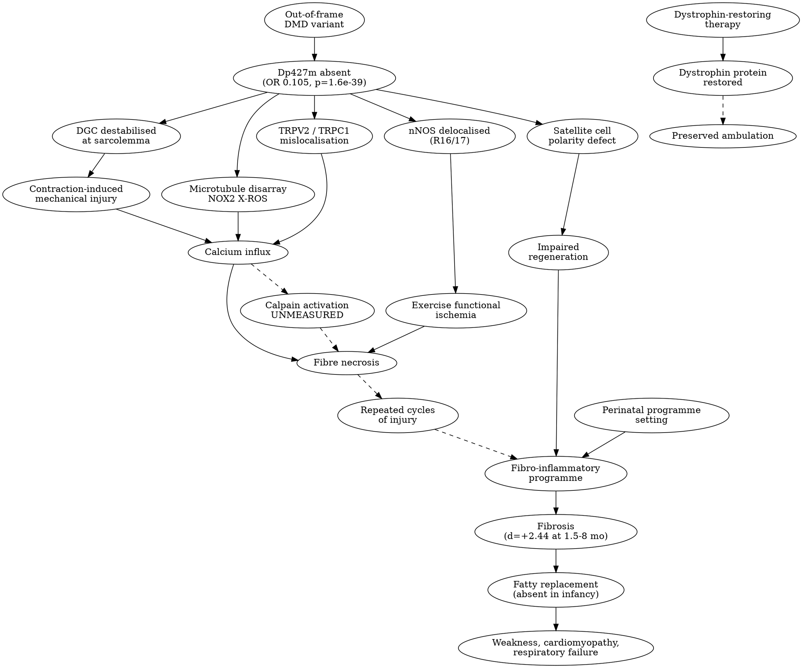

Edge by edge:

| # | Edge | Verdict | Evidence |
|---|---|---|---|
| 1 | Out-of-frame DMD variant abolishes functional dystrophin | <i class="fa-circle-check"></i> established, with isoform caveat | gnomAD Dp427m-truncating OR 0.105 (0.069-0.159), p = 1.6e-39; escapers spare Dp427m or hit exon 71 |
| 2 | Reading-frame rule | <i class="fa-circle-check"></i> established in registries, not curatable from ClinVar | ClinVar OR 1.57 (0.47-5.26), p = 0.45, N = 1,419; registry accuracy 88.4% for deletions |
| 3 | Dystrophin loss destabilises the DGC | <i class="fa-circle-check"></i> established, post-translational | DGC module d = -0.06, FDR 0.79; only DMD itself reduced |
| 4 | DGC loss causes contraction-induced mechanical injury | established, not the sole route | Domain-specific deletion test null after correction (all FDR 1.0) |
| 5 | Calcium influx through stretched or damaged membrane | <i class="fa-scale-balanced"></i> qualified: channel- and ROS-mediated | TRPV2/TRPC1 mislocalisation, microtubule-NOX2 X-ROS; CYBB d = +1.05, FDR 0.025 |
| 6 | Activation of calcium-dependent proteases | <i class="fa-circle-question"></i> unresolved, transcript sign opposite | Protease module FDR 0.42; CAPN3 d = -1.46, FDR 0.003; no activity assay performed |
| 7 | Repeated cycles build fibro-inflammatory pathology | <i class="fa-circle-xmark"></i> contradicted as a temporal claim | Already maximal at 1.5-8 months (inflammation d = +4.27, fibrosis +2.44); no rise with age (all p > 0.1) |
| 8 | Regenerative capacity exhausted by repeated use | <i class="fa-scale-balanced"></i> competing cell-autonomous account | EGF restored mdx strength without myofiber dystrophin; DMD-Null worse than mdx with equal utrophin |
| 9 | Fibro-fatty replacement to weakness, cardiac and respiratory failure | <i class="fa-circle-check"></i> established clinically | Not re-tested here; adipogenic module null in infants (d = +0.02, FDR 0.29) |
| 10 | Dystrophin-restoring therapy validates the chain | <i class="fa-scale-balanced"></i> molecularly yes, functionally unresolved | EMBARK primary endpoint not met; restoration size does not track preserved ambulation |

{{figure:plot_12.png|caption=Edge-by-edge verdict on the Canonical Dystrophin Loss and Membrane Fragility Model. The two ends of the chain hold. The middle, from calcium entry to cumulative fibro-inflammatory damage, does not.}}

The coherent reading is that loss of Dp427m is the necessary cause, and that three things the seed does not represent run in parallel with the membrane branch rather than downstream of it. Dystrophin loss inside satellite cells breaks asymmetric division directly. Loss of the R16/17 repeats removes sarcolemmal nNOS and produces exercise-induced functional ischemia. Microtubule disarray converts stretch into NOX2-derived ROS, which opens stretch-activated channels without requiring a physical tear. Each of these is druggable without restoring dystrophin, and at least two have been shown to improve function in models while leaving myofiber dystrophin absent.

The temporal finding reframes the clinical problem. If the fibro-inflammatory programme is already maximal at 1.5 months and does not grow, then a therapy delivered at age 4 to 8 is acting on a steady state that has been running since before birth, which gives one of the two available explanations for why EMBARK missed its endpoint. The other explanation is that myofiber-targeted dystrophin leaves the satellite cell and nNOS branches uncorrected. These are distinguishable experimentally, and tests T3 and T4 below do so.

---

## Evidence base

The run reviewed 64 papers. The groups that carry the most weight on the verdict:

**Seed and reading-frame registry evidence.** [PMID: 16770791](https://pubmed.ncbi.nlm.nih.gov/16770791/) is the seed. [PMID: 41046771](https://pubmed.ncbi.nlm.nih.gov/41046771/) supplies the cohort-level accuracy of 88.4% for deletions that ClinVar annotations could not recover, and [PMID: 33466756](https://pubmed.ncbi.nlm.nih.gov/33466756/) states the rule "has many exceptions", which makes the KB edge probabilistic rather than deterministic.

**Presymptomatic transcriptome.** [PMID: 17264171](https://pubmed.ncbi.nlm.nih.gov/17264171/) is the GSE6011 source publication. It reaches the same conclusion my independent reanalysis reaches with effect sizes, describing "a coordinate induction of genes involved in the inflammatory response, extracellular matrix (ECM) remodeling and muscle regeneration, and the reduced transcription of those involved in energy metabolism", and notes that "Despite the lower degree of muscle dysfunction experienced, our younger patients showed abnormal expression of most of the genes reported as differentially expressed in more advanced stages of the disease". My reanalysis is independent of the original analysis, not of the samples, so this is corroboration of method rather than replication in a new cohort.

**Calpain.** [PMID: 22443334](https://pubmed.ncbi.nlm.nih.gov/22443334/) establishes that CAPN3 is needed for regeneration, which reverses the causal sign the seed assigns to this node when CAPN3 falls. [PMID: 22334167](https://pubmed.ncbi.nlm.nih.gov/22334167/) documents calpain-3 deficiency detected alongside dystrophin deficiency in biopsy cohorts.

**Calcium entry mechanism.** [PMID: 19604578](https://pubmed.ncbi.nlm.nih.gov/19604578/), [PMID: 25616416](https://pubmed.ncbi.nlm.nih.gov/25616416/), [PMID: 21900691](https://pubmed.ncbi.nlm.nih.gov/21900691/), [PMID: 22871609](https://pubmed.ncbi.nlm.nih.gov/22871609/) and [PMID: 25329652](https://pubmed.ncbi.nlm.nih.gov/25329652/) together show the calcium step is channel- and ROS-mediated and that intermediate nodes can be perturbed to reduce injury without restoring dystrophin.

**nNOS branch.** [PMID: 30152022](https://pubmed.ncbi.nlm.nih.gov/30152022/) gives canine perturbation evidence, [PMID: 26437761](https://pubmed.ncbi.nlm.nih.gov/26437761/) gives genotype-stratified human physiology in 13 BMD men, [PMID: 31266455](https://pubmed.ncbi.nlm.nih.gov/31266455/) shows R16/17 delivered in trans prevents treadmill-induced ischemia, and [PMID: 30352768](https://pubmed.ncbi.nlm.nih.gov/30352768/) limits the clinical weight of the branch.

**Stem cell branch.** [PMID: 30713094](https://pubmed.ncbi.nlm.nih.gov/30713094/) is the single most discriminating paper against the seed as a complete model, because strength was restored without restoring dystrophin. [PMID: 42301789](https://pubmed.ncbi.nlm.nih.gov/42301789/) and [PMID: 25678553](https://pubmed.ncbi.nlm.nih.gov/25678553/) tie model severity to isoform loss and to stem cell depletion. [PMID: 33910206](https://pubmed.ncbi.nlm.nih.gov/33910206/), [PMID: 31574188](https://pubmed.ncbi.nlm.nih.gov/31574188/), [PMID: 39723578](https://pubmed.ncbi.nlm.nih.gov/39723578/) and [PMID: 40643552](https://pubmed.ncbi.nlm.nih.gov/40643552/) fill in the cell-autonomous mechanism.

**Therapy.** [PMID: 41518520](https://pubmed.ncbi.nlm.nih.gov/41518520/) is the randomised negative. [PMID: 42944976](https://pubmed.ncbi.nlm.nih.gov/42944976/), [PMID: 42237476](https://pubmed.ncbi.nlm.nih.gov/42237476/) and [PMID: 42396397](https://pubmed.ncbi.nlm.nih.gov/42396397/) are the positive but externally-controlled or small follow-ups. [PMID: 42510866](https://pubmed.ncbi.nlm.nih.gov/42510866/) and [PMID: 42971320](https://pubmed.ncbi.nlm.nih.gov/42971320/) are review-level and are labelled as such; the first supplies the absence of dose-response, the second the statement that clinical benefit is contested. [PMID: 34120909](https://pubmed.ncbi.nlm.nih.gov/34120909/) documents the biomarker-level effect of eteplirsen (18.7-fold exon skipping, 7-fold dystrophin at week 96).

---

## Limitations and knowledge gaps

<i class="fa-triangle-exclamation"></i> Stated once, with reasons.

**G1. Calpain activation is an asserted step with no supporting measurement.** Scope: edge 6. It is named explicitly in the hypothesis text and bridges calcium to necrosis. Checked: GSE6011 transcriptome, which shows no coordinate induction (FDR 0.42) and CAPN3 reduced (d = -1.46, FDR 0.003). Resolving evidence: calpain activity assays (casein zymography, calpain-specific fodrin or talin cleavage fragments) in presymptomatic and older DMD biopsies, plus calpastatin-overexpression rescue in a dystrophin-null model.

**G2. The temporal result rests on one cohort and was not replicated.** Scope: edge 7, the strongest negative in this run. Checked: GSE6011 (n = 37 bulk samples); the planned replication in GSE38417 was skipped because `GPL6244.annot.gz` returned HTTP 404 on preflight, with the log bundled. Resolving evidence: re-run A4 against GSE38417 with an alternative annotation source, and against any longitudinal or multi-age DMD muscle transcriptome.

**G3. The reading-frame edge is supported by no dataset accessed in this run.** Scope: edge 2. Checked: ClinVar via NCBI E-utilities, 2026-11-25, query and filters recorded, OR 1.57 (0.47-5.26), p = 0.45, N = 1,419. Cause: the composite "Duchenne/Becker muscular dystrophy" condition term. Resolving evidence: LOVD, TREAT-NMD DMD Global Database or UMD-DMD, none of which was queried.

**G4. Bulk tissue cannot separate cell composition from per-cell expression.** Scope: all GSE6011 module results, including the headline temporal finding. An inflammation module z-score rising could mean more myeloid cells or more expression per cell. Resolving evidence: single-nucleus RNA-seq of presymptomatic DMD muscle with explicit cell-type proportions.

**G5. The mechanism of action of dystrophin-restoring therapy is unknown at the functional level.** Scope: edge 10. Restored protein is measured; restored function does not track it ([PMID: 42510866](https://pubmed.ncbi.nlm.nih.gov/42510866/)), and the randomised primary endpoint failed ([PMID: 41518520](https://pubmed.ncbi.nlm.nih.gov/41518520/)). Resolving evidence: a trial with paired dystrophin quantification and function in the same patients, prespecified dose-response, and stratification by whether the construct retains R16-R17.

**G6. No gene-disease validity source was checked.** GenCC and ClinGen were not queried. Label as unverified, not absent.

**G7. gnomAD escapers with 1-2 hemizygotes are uninterpreted.** Scope: edge 1. 24 of 35 tolerated variants are singletons, possibly mild BMD, mosaicism, residual splicing or annotation error. Resolving evidence: phenotype follow-back where consented, and RNA evidence of residual in-frame product.

**G8. Isoform-resolved variant interpretation is absent from the KB.** Scope: edge 1. A gene-level LoF annotation is not equivalent to muscle dystrophin loss, as the 140-hemizygote 3' UTR frameshift shows. Resolving evidence: curating variant effects against Dp427m, Dp260, Dp140, Dp116 and Dp71 separately.

**Run-level limitations.** Five iterations, no uploaded data, all analyses built from public APIs. No post-translational assay was performed, so the DGC and calpain edges, the mechanical heart of the hypothesis, remain untested here rather than tested and confirmed. Trial mechanism labels are keyword-derived, not curated, and count NCT records rather than patients. ClinVar esummary lost 200 of 3,730 UIDs to batch failures (5.4%). Two analyses were wrong on first pass and were corrected internally; both are retained in the bundle with SUPERSEDED status. One submitted citation snippet from [PMID: 25678553](https://pubmed.ncbi.nlm.nih.gov/25678553/) failed automated validation against the stored abstract and is flagged for curator checking.

---

## Alternative models

| Model | Relation to the seed | Evidence | What it explains better |
|---|---|---|---|
| **Intrinsic satellite cell dysfunction.** Dystrophin acts cell-autonomously in satellite cells, setting polarity and asymmetric division | parallel mechanism, which the seed misplaces as downstream | [PMID: 30713094](https://pubmed.ncbi.nlm.nih.gov/30713094/), [PMID: 33910206](https://pubmed.ncbi.nlm.nih.gov/33910206/), [PMID: 31574188](https://pubmed.ncbi.nlm.nih.gov/31574188/), [PMID: 39723578](https://pubmed.ncbi.nlm.nih.gov/39723578/), [PMID: 40643552](https://pubmed.ncbi.nlm.nih.gov/40643552/), [PMID: 42301789](https://pubmed.ncbi.nlm.nih.gov/42301789/), [PMID: 25678553](https://pubmed.ncbi.nlm.nih.gov/25678553/) | Strength restored by EGF without dystrophin; fibro-inflammation reduced by a progenitor-targeted perturbation; the mdx-to-human severity gap |
| **nNOS delocalisation and functional ischemia.** Loss of R16-R17 removes sarcolemmal nNOS, so exercising muscle fails to oppose sympathetic vasoconstriction | parallel mechanism, domain-specific | [PMID: 30152022](https://pubmed.ncbi.nlm.nih.gov/30152022/), [PMID: 26437761](https://pubmed.ncbi.nlm.nih.gov/26437761/), [PMID: 31266455](https://pubmed.ncbi.nlm.nih.gov/31266455/), [PMID: 30349485](https://pubmed.ncbi.nlm.nih.gov/30349485/) | Exercise-induced injury out of proportion to passive load; why micro-dystrophins lacking R16-R17 may underperform; severity variation among in-frame Becker deletions |
| **Microtubule-NOX2 X-ROS mechanotransduction.** Disordered microtubules convert stretch into ROS, sensitising stretch-activated channels | upstream of, and partly replacing, "calcium influx through damaged membrane" | [PMID: 22871609](https://pubmed.ncbi.nlm.nih.gov/22871609/), [PMID: 25329652](https://pubmed.ncbi.nlm.nih.gov/25329652/); CYBB d = +1.05, FDR 0.025 | Calcium entry without physical membrane rupture, and its pharmacological reversibility |
| **TRPV2 / TRPC1 channel mislocalisation** | parallel route for the same edge | [PMID: 25616416](https://pubmed.ncbi.nlm.nih.gov/25616416/), [PMID: 21900691](https://pubmed.ncbi.nlm.nih.gov/21900691/), [PMID: 19604578](https://pubmed.ncbi.nlm.nih.gov/19604578/); TRPC1 d = +0.88, p = 0.008 | Chronic calcium loading in intact fibers |
| **Near-perinatal programme setting** | alternative to the seed's temporal logic for edge 7 | This run's A4; [PMID: 17264171](https://pubmed.ncbi.nlm.nih.gov/17264171/) | Maximal fibro-inflammation before ambulation, flat with age |
| **Impaired repair through secondary CAPN3 loss** | reverses the sign of edge 6 | This run's A4; [PMID: 22443334](https://pubmed.ncbi.nlm.nih.gov/22443334/) | Why CAPN3 falls rather than rises, and why regeneration is poor |

None of these replaces the seed hypothesis. Each adds a branch the seed does not represent, and several act on nodes the seed places strictly downstream.

---

## Proposed follow-up experiments

**<i class="fa-flask"></i> T1. Calpain activity across disease stage.** Sample: quadriceps biopsies from DMD infants under 12 months and boys aged 5-10 years, with age-matched controls. Assay: casein zymography plus calpain-specific fodrin and talin cleavage-fragment immunoblot, paired with CAPN3 protein. Prediction: the seed predicts activity rising with stage; this run's data predict flat or falling CAPN3-dependent activity with modest CAPN1/CAPN2 activity present from infancy. Resolves G1 and edge 6.

**<i class="fa-dna"></i> T2. Single-nucleus RNA-seq of presymptomatic DMD muscle.** Sample: DMD boys under 12 months versus age-matched controls, n ≥ 8 per arm. Readout: cell-type proportions and per-cell module scores for fibro-adipogenic progenitors, macrophages, satellite cells and myonuclei. Prediction: a cell-intrinsic developmental programme shows per-cell expression shifts in FAPs and satellite cells with only modest immune infiltration; the seed predicts dominance by infiltrating myeloid cells. Resolves G2 and G4 and discriminates edge 7 against the developmental model.

**<i class="fa-flask"></i> T3. nNOS-restoring versus nNOS-null micro-dystrophin, head to head.** Model: DMD-Null mouse, not mdx, since mdx retains short isoforms ([PMID: 42301789](https://pubmed.ncbi.nlm.nih.gov/42301789/)). Perturbation: AAV micro-dystrophin constructs matched for expression, one retaining R16-R17 and one without. Readout: exercise-induced functional ischemia, eccentric force drop, NSAA-analogue function. Prediction: if the canonical chain is sufficient, both rescue equally; if the nNOS branch is parallel, only the R16-R17 construct restores exercise perfusion. Addresses G5 and the clinical dose-response anomaly.

**<i class="fa-flask"></i> T4. Satellite-cell-targeted versus myofiber-targeted correction.** Model: DMD-Null mouse. Perturbation: dystrophin restored in Pax7-lineage cells only, in myofibers only, and in both. Readout: specific force, regeneration after cardiotoxin injury, fibro-inflammatory module scores. Prediction: the seed predicts myofiber-only restoration suffices; the stem cell model predicts satellite-cell-only restoration improves regeneration and reduces fibrosis independently, as Notch repression did in dKO ([PMID: 25678553](https://pubmed.ncbi.nlm.nih.gov/25678553/)).

**<i class="fa-dna"></i> T5. Isoform-stratified genotype-phenotype cohort.** Cohort: LOVD, TREAT-NMD DMD Global Database or UMD-DMD, stratified by which isoforms a variant disrupts (Dp427m only; Dp427m plus Dp260/Dp140; all isoforms). Readout: age at loss of ambulation, cardiac onset, cognitive involvement. Prediction: severity grades with the number of isoforms lost. Resolves G3 and G8 and tests the isoform caveat found in gnomAD.

**<i class="fa-heart-pulse"></i> T6. Prespecified dystrophin dose-response in a restoration trial.** Cohort: any ongoing exon-skipping or gene-transfer trial. Design: paired muscle dystrophin quantification by mass spectrometry, not immunofluorescence alone, and timed function in the same patients, with dose-response prespecified and stratification by age at dosing. Prediction: the seed predicts a monotone relationship; [PMID: 42510866](https://pubmed.ncbi.nlm.nih.gov/42510866/) reports none across therapies. Resolves G5.

---

## Curation leads

<i class="fa-triangle-exclamation"></i> **All items below are leads requiring curator verification.**

### Status change
**Lead C1.** Retain `CANONICAL` status for the hypothesis group and add an explicit scope restriction: the model is well supported for edges 1, 3 and 9, and unresolved or contradicted for edges 5, 6, 7, 8 and 10. Suggested status qualifier: `CANONICAL_WITH_UNRESOLVED_INTERNAL_EDGES`.

### Candidate evidence references, with snippets to verify
- [PMID: 17264171](https://pubmed.ncbi.nlm.nih.gov/17264171/), verify: "We show that in the first 2 years of the disease, DMD muscle is already set to express a distinctive gene expression pattern considerably different from the one expressed by normal, age-matched muscle." Stance: QUALIFIES edge 7.
- [PMID: 41518520](https://pubmed.ncbi.nlm.nih.gov/41518520/), verify: "The primary endpoint (change from baseline in North Star Ambulatory Assessment [NSAA] total score at 52 weeks compared with placebo) did not meet statistical significance." Stance: REFUTES the sufficiency reading of edge 10.
- [PMID: 42510866](https://pubmed.ncbi.nlm.nih.gov/42510866/), verify: "Across the approved therapies, larger biological dystrophin restoration did not correspond to longer preservation of walking." Stance: REFUTES dose-response for edge 10.
- [PMID: 42301789](https://pubmed.ncbi.nlm.nih.gov/42301789/), verify: "Our studies demonstrate that DMD-Null mice show a more severe skeletal muscle phenotype than mdx mice, characterized by profound weakness, decreased exercise tolerance, and impaired muscle regeneration, while utrophin upregulation was similarly observed in DMD-Null and mdx mice." Stance: QUALIFIES edge 1 on isoform specificity.
- [PMID: 30713094](https://pubmed.ncbi.nlm.nih.gov/30713094/), verify: "In vivo EGF treatment markedly activates asymmetric divisions of dystrophin-deficient satellite cells in mdx mice, increasing progenitor numbers, enhancing regeneration, and restoring muscle strength." Stance: COMPETING for edge 8.
- [PMID: 22443334](https://pubmed.ncbi.nlm.nih.gov/22443334/), verify: "calpain 3 is needed for the regenerative process probably during sarcomere remodeling as the complete lack of functional calpain 3 leads to the most severe phenotypes." Stance: QUALIFIES edge 6 and reverses its sign.
- [PMID: 41046771](https://pubmed.ncbi.nlm.nih.gov/41046771/), verify: "The accuracy of the Reading-Frame rule was 88.4 % for deletions." Stance: SUPPORTS edge 2 at cohort level.
- [PMID: 25678553](https://pubmed.ncbi.nlm.nih.gov/25678553/): the Notch/dKO wording should be verified directly against the abstract. One snippet submitted in this run failed automated validation, so treat that quoted text as unverified until checked.

### Candidate pathophysiology nodes
`Dp427m` (full-length muscle isoform), distinct from `Dp260`, `Dp140`, `Dp116` and `Dp71`, splitting the current single "functional dystrophin" node; `satellite cell asymmetric division`; `microtubule-NOX2 X-ROS mechanotransduction`; `sarcolemmal nNOS localisation` and `exercise-induced functional ischemia`; `secondary CAPN3 deficiency`; `perinatal fibro-inflammatory programme`, distinct from the later `fatty replacement`.

### Candidate edges
- ADD: `Dp427m loss` → `satellite cell polarity defect` → `impaired regeneration`, parallel to the membrane branch.
- ADD: `microtubule disarray` → `NOX2 ROS` → `stretch-activated channel opening` → `calcium overload`, parallel to `membrane tearing` → `calcium influx`.
- ADD: `Dp427m loss` → `nNOS delocalisation (R16/17)` → `exercise functional ischemia` → `fibre necrosis`.
- MODIFY: `calcium influx` → `calpain activation`: mark ASSERTED, UNMEASURED, and note that CAPN3 falls.
- MODIFY: `repeated injury cycles` → `fibrosis`: mark the temporal direction CONTRADICTED by presymptomatic data.
- SPLIT: `fibro-fatty replacement` into `fibrosis` (present in infancy, d = +2.44) and `fatty replacement` (absent in infancy, adipogenic module FDR 0.29).
- MODIFY: `dystrophin restoration` → `clinical benefit`: mark MOLECULARLY SUPPORTED, FUNCTIONALLY UNRESOLVED.

### Candidate ontology terms
Cell types: satellite cell (CL:0000594), skeletal muscle fiber (CL:0008002), fibroblast (CL:0000057), macrophage (CL:0000235), fibro-adipogenic progenitor. Processes: skeletal muscle regeneration (GO:0043403), satellite cell proliferation (GO:0014841), asymmetric stem cell division (GO:0098722), calcium ion transmembrane transport (GO:0070588), superoxide anion generation (GO:0042554), collagen fibril organisation (GO:0030199), nitric oxide biosynthetic process (GO:0006809).

### Candidate subtype restrictions
The model as written fits Dp427m-null patients. Variants that spare Dp427m while disrupting short isoforms, for example the gnomAD 3' UTR frameshift with 140 hemizygotes or the intron-29 Dp260 stops with 38 and 11, fall outside its scope and should not be counted as DMD alleles. Exon 71 variants such as c.10262+1G>A, carrying 53 hemizygous males, should carry an explicit dispensable-exon annotation.

### Candidate knowledge_gaps entries
G1 through G8 above, each with its scope, what was checked and the resolving experiment. Three source-level absences to record verbatim: ClinVar cannot reproduce the reading-frame rule (database, query, filters and date recorded); LOVD, TREAT-NMD and UMD-DMD not queried; GenCC and ClinGen not queried.

### Data-quality caution for curators
A gene-level loss-of-function count in a population database is not a DMD-causing allele count. The single most frequent truncating DMD call in gnomAD v4.1.0 carries 140 hemizygous males with no quality flags and is irrelevant to muscle dystrophin. Transcript-resolved re-mapping is required before any such count enters the KB.


## Artifacts

- [OpenScientist final report](openscientist_artifacts/final_report.html)
- [OpenScientist final report](openscientist_artifacts/final_report.pdf)
- [OpenScientist environment record](openscientist_artifacts/kb_hypotheses_Duchenne_Muscular_Dystrophy_canonical_dystrophin_loss_membrane_fragility_model_openscientist_artifacts_environment_environment_record.json)
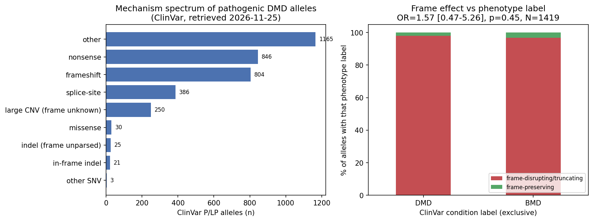
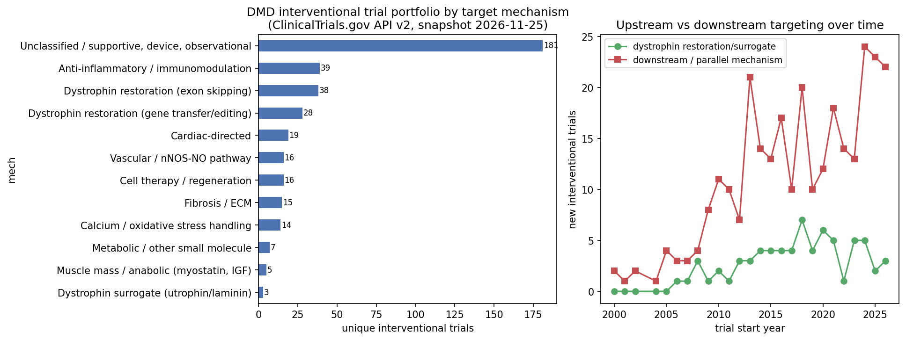

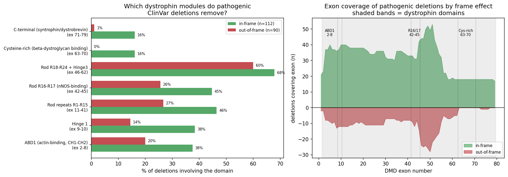


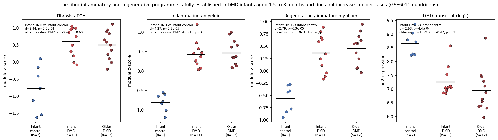
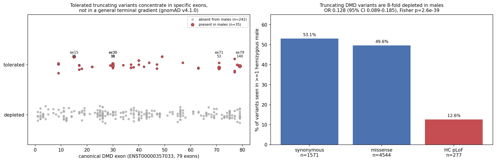


- [OpenScientist clinicaltrials dmd v2 snapshot](openscientist_artifacts/kb_hypotheses_Duchenne_Muscular_Dystrophy_canonical_dystrophin_loss_membrane_fragility_model_openscientist_artifacts_logs_clinicaltrials_dmd_v2_snapshot.json)
- [OpenScientist geo preflight log](openscientist_artifacts/kb_hypotheses_Duchenne_Muscular_Dystrophy_canonical_dystrophin_loss_membrane_fragility_model_openscientist_artifacts_logs_geo_preflight_log.json)
- [OpenScientist gnomad v4 DMD query log](openscientist_artifacts/kb_hypotheses_Duchenne_Muscular_Dystrophy_canonical_dystrophin_loss_membrane_fragility_model_openscientist_artifacts_logs_gnomad_v4_DMD_query_log.json)
- [OpenScientist gnomad v4 outlier variant response](openscientist_artifacts/kb_hypotheses_Duchenne_Muscular_Dystrophy_canonical_dystrophin_loss_membrane_fragility_model_openscientist_artifacts_logs_gnomad_v4_outlier_variant_response.json)
- [OpenScientist all queries](openscientist_artifacts/kb_hypotheses_Duchenne_Muscular_Dystrophy_canonical_dystrophin_loss_membrane_fragility_model_openscientist_artifacts_queries_all_queries.md)
- [OpenScientist GSE6011 DMD vs control gene stats](openscientist_artifacts/kb_hypotheses_Duchenne_Muscular_Dystrophy_canonical_dystrophin_loss_membrane_fragility_model_openscientist_artifacts_tables_GSE6011_DMD_vs_control_gene_stats.csv)
- [OpenScientist GSE6011 age stratified module scores](openscientist_artifacts/kb_hypotheses_Duchenne_Muscular_Dystrophy_canonical_dystrophin_loss_membrane_fragility_model_openscientist_artifacts_tables_GSE6011_age_stratified_module_scores.csv)
- [OpenScientist GSE6011 module scores](openscientist_artifacts/kb_hypotheses_Duchenne_Muscular_Dystrophy_canonical_dystrophin_loss_membrane_fragility_model_openscientist_artifacts_tables_GSE6011_module_scores.csv)
- [OpenScientist GSE6011 strict agematched infant test](openscientist_artifacts/kb_hypotheses_Duchenne_Muscular_Dystrophy_canonical_dystrophin_loss_membrane_fragility_model_openscientist_artifacts_tables_GSE6011_strict_agematched_infant_test.csv)
- [OpenScientist clinicaltrials dmd classified](openscientist_artifacts/kb_hypotheses_Duchenne_Muscular_Dystrophy_canonical_dystrophin_loss_membrane_fragility_model_openscientist_artifacts_tables_clinicaltrials_dmd_classified.csv)
- [OpenScientist clinvar dmd cnv exonmapped](openscientist_artifacts/kb_hypotheses_Duchenne_Muscular_Dystrophy_canonical_dystrophin_loss_membrane_fragility_model_openscientist_artifacts_tables_clinvar_dmd_cnv_exonmapped.csv)
- [OpenScientist clinvar dmd domain frame test](openscientist_artifacts/kb_hypotheses_Duchenne_Muscular_Dystrophy_canonical_dystrophin_loss_membrane_fragility_model_openscientist_artifacts_tables_clinvar_dmd_domain_frame_test.csv)
- [OpenScientist clinvar dmd domain frame test corrected](openscientist_artifacts/kb_hypotheses_Duchenne_Muscular_Dystrophy_canonical_dystrophin_loss_membrane_fragility_model_openscientist_artifacts_tables_clinvar_dmd_domain_frame_test_corrected.csv)
- [OpenScientist clinvar dmd intragenic deletions](openscientist_artifacts/kb_hypotheses_Duchenne_Muscular_Dystrophy_canonical_dystrophin_loss_membrane_fragility_model_openscientist_artifacts_tables_clinvar_dmd_intragenic_deletions.csv)
- [OpenScientist clinvar dmd plp classified](openscientist_artifacts/kb_hypotheses_Duchenne_Muscular_Dystrophy_canonical_dystrophin_loss_membrane_fragility_model_openscientist_artifacts_tables_clinvar_dmd_plp_classified.csv)
- [OpenScientist clinvar dmd plp frame](openscientist_artifacts/kb_hypotheses_Duchenne_Muscular_Dystrophy_canonical_dystrophin_loss_membrane_fragility_model_openscientist_artifacts_tables_clinvar_dmd_plp_frame.csv)
- [OpenScientist gnomad v4 DMD HCpLoF canonical mapped](openscientist_artifacts/kb_hypotheses_Duchenne_Muscular_Dystrophy_canonical_dystrophin_loss_membrane_fragility_model_openscientist_artifacts_tables_gnomad_v4_DMD_HCpLoF_canonical_mapped.csv)
- [OpenScientist gnomad v4 DMD HCpLoF hemizygous](openscientist_artifacts/kb_hypotheses_Duchenne_Muscular_Dystrophy_canonical_dystrophin_loss_membrane_fragility_model_openscientist_artifacts_tables_gnomad_v4_DMD_HCpLoF_hemizygous.csv)
- [OpenScientist gnomad v4 DMD HCpLoF region classified](openscientist_artifacts/kb_hypotheses_Duchenne_Muscular_Dystrophy_canonical_dystrophin_loss_membrane_fragility_model_openscientist_artifacts_tables_gnomad_v4_DMD_HCpLoF_region_classified.csv)
- [OpenScientist gnomad v4 DMD variants flat](openscientist_artifacts/kb_hypotheses_Duchenne_Muscular_Dystrophy_canonical_dystrophin_loss_membrane_fragility_model_openscientist_artifacts_tables_gnomad_v4_DMD_variants_flat.csv)
- [OpenScientist provenance](openscientist_artifacts/provenance.json)
- [OpenScientist GSE6011 DMD vs control gene stats](openscientist_artifacts/provenance_GSE6011_DMD_vs_control_gene_stats.csv)
- [OpenScientist GSE6011 age stratified module scores](openscientist_artifacts/provenance_GSE6011_age_stratified_module_scores.csv)
- [OpenScientist GSE6011 module scores](openscientist_artifacts/provenance_GSE6011_module_scores.csv)
- [OpenScientist GSE6011 strict agematched infant test](openscientist_artifacts/provenance_GSE6011_strict_agematched_infant_test.csv)
- [OpenScientist clinicaltrials dmd classified](openscientist_artifacts/provenance_clinicaltrials_dmd_classified.csv)
- [OpenScientist clinicaltrials dmd v2 snapshot](openscientist_artifacts/provenance_clinicaltrials_dmd_v2_snapshot.json)
- [OpenScientist clinvar dmd cnv exonmapped](openscientist_artifacts/provenance_clinvar_dmd_cnv_exonmapped.csv)
- [OpenScientist clinvar dmd domain frame test](openscientist_artifacts/provenance_clinvar_dmd_domain_frame_test.csv)
- [OpenScientist clinvar dmd domain frame test corrected](openscientist_artifacts/provenance_clinvar_dmd_domain_frame_test_corrected.csv)
- [OpenScientist clinvar dmd intragenic deletions](openscientist_artifacts/provenance_clinvar_dmd_intragenic_deletions.csv)
- [OpenScientist clinvar dmd plp classified](openscientist_artifacts/provenance_clinvar_dmd_plp_classified.csv)
- [OpenScientist clinvar dmd plp frame](openscientist_artifacts/provenance_clinvar_dmd_plp_frame.csv)
- [OpenScientist environment record](openscientist_artifacts/provenance_environment_record.json)
- [OpenScientist geo preflight log](openscientist_artifacts/provenance_geo_preflight_log.json)
- [OpenScientist gnomad v4 DMD HCpLoF canonical mapped](openscientist_artifacts/provenance_gnomad_v4_DMD_HCpLoF_canonical_mapped.csv)
- [OpenScientist gnomad v4 DMD HCpLoF hemizygous](openscientist_artifacts/provenance_gnomad_v4_DMD_HCpLoF_hemizygous.csv)
- [OpenScientist gnomad v4 DMD HCpLoF positional](openscientist_artifacts/provenance_gnomad_v4_DMD_HCpLoF_positional.csv)
- [OpenScientist gnomad v4 DMD HCpLoF region classified](openscientist_artifacts/provenance_gnomad_v4_DMD_HCpLoF_region_classified.csv)
- [OpenScientist gnomad v4 DMD outlier variant c4098 4110del](openscientist_artifacts/provenance_gnomad_v4_DMD_outlier_variant_c4098_4110del.json)
- [OpenScientist gnomad v4 DMD variants flat](openscientist_artifacts/provenance_gnomad_v4_DMD_variants_flat.csv)
- [OpenScientist gnomad v4 DMD variants raw](openscientist_artifacts/provenance_gnomad_v4_DMD_variants_raw.json)
- [OpenScientist plot 1](openscientist_artifacts/provenance_plot_1.json)

- [OpenScientist plot 10](openscientist_artifacts/provenance_plot_10.json)

- [OpenScientist plot 11](openscientist_artifacts/provenance_plot_11.json)
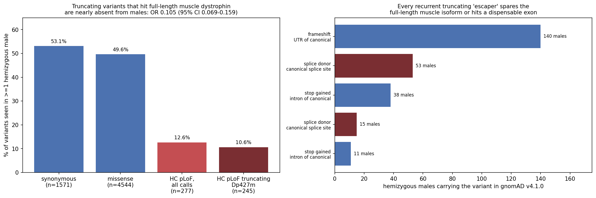
- [OpenScientist plot 12](openscientist_artifacts/provenance_plot_12.json)
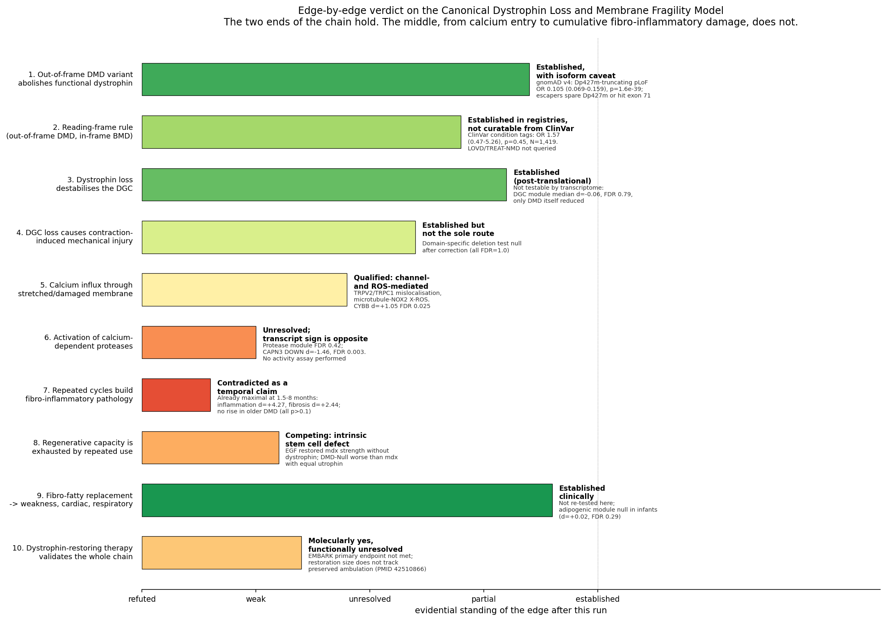
- [OpenScientist plot 2](openscientist_artifacts/provenance_plot_2.json)

- [OpenScientist plot 3](openscientist_artifacts/provenance_plot_3.json)
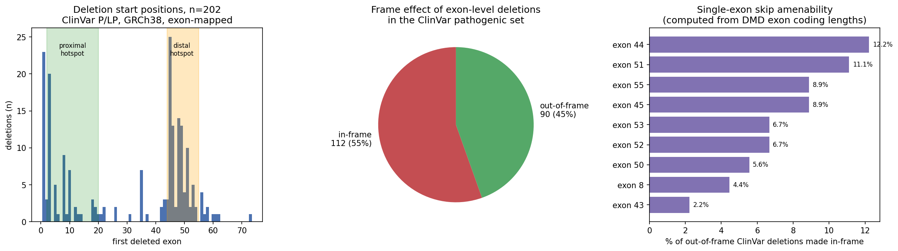
- [OpenScientist plot 4](openscientist_artifacts/provenance_plot_4.json)

- [OpenScientist plot 5](openscientist_artifacts/provenance_plot_5.json)
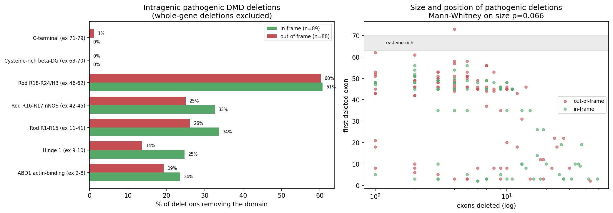
- [OpenScientist plot 6](openscientist_artifacts/provenance_plot_6.json)
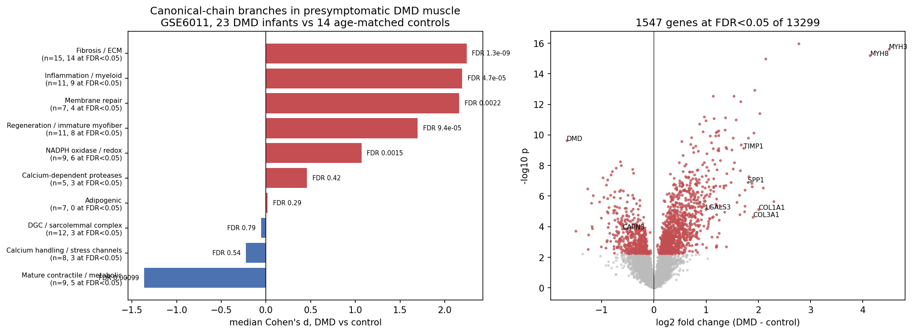
- [OpenScientist plot 7](openscientist_artifacts/provenance_plot_7.json)
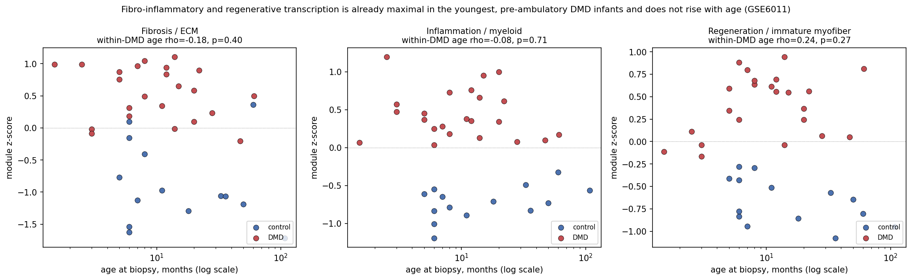
- [OpenScientist plot 8](openscientist_artifacts/provenance_plot_8.json)

- [OpenScientist plot 9](openscientist_artifacts/provenance_plot_9.json)
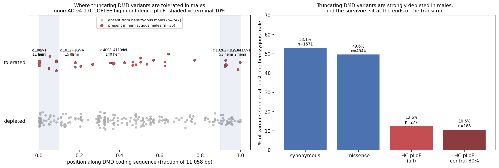

## Term Validation

Checked with `linkml-term-validator` 0.4.5, through the `ols:` adapter.

| Outcome | Count |
| --- | --- |
| Terms checked | 11 |
| Resolved | 11 |
| Unresolved (possible confabulation) | 0 |
| Obsolete | 0 |
| Unverifiable | 0 |

Every term resolved, and every label the report gave matched.