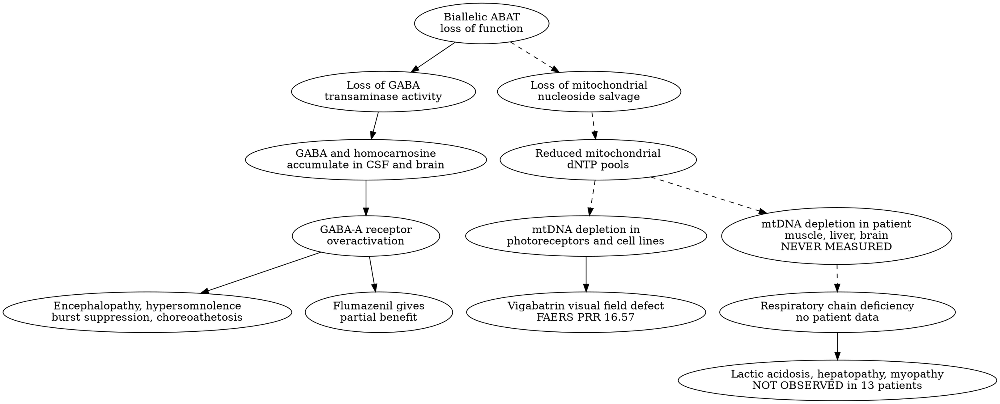

## Question

# Mechanistic Hypothesis Search

You are evaluating a specific disease mechanism hypothesis for the Disorder
Mechanisms Knowledge Base. This is not a general disease overview. Use the
hypothesis YAML below as the seed claim, then search for evidence that supports,
refutes, qualifies, or competes with this hypothesis.

## Target Disease
- **Disease Name:** GABA Aminotransaminase Deficiency
- **Category:** Mendelian

## Target Hypothesis
- **Hypothesis ID:** abat_mitochondrial_nucleoside_salvage
- **Hypothesis Label:** ABAT in Mitochondrial Nucleoside Salvage
- **Status in KB:** EMERGING

## Seed Hypothesis YAML

```yaml
hypothesis_group_id: abat_mitochondrial_nucleoside_salvage
hypothesis_label: ABAT in Mitochondrial Nucleoside Salvage
status: EMERGING
description: Proposes that ABAT is also required to maintain mitochondrial dNTP pools and mitochondrial
  DNA, making the disease in part a mitochondrial DNA depletion syndrome. All supporting data come from
  one group; muscle or brain mitochondrial DNA content has not been systematically measured in patients,
  and ClinGen has not curated ABAT for a mitochondrial disease.
evidence:
- reference: PMID:25738457
  reference_title: The GABA transaminase, ABAT, is essential for mitochondrial nucleoside metabolism.
  supports: SUPPORT
  evidence_source: IN_VITRO
  snippet: This work reveals ABAT as a connection between GABA metabolism and nucleoside metabolism and
    defines a neurometabolic disorder that includes MDS.
  explanation: The original statement of the hypothesis.
```

## Research Objective

Build a focused hypothesis-search report that answers:

1. What is the strongest direct evidence for this hypothesis?
2. What evidence argues against it, fails to reproduce it, or limits its scope?
3. Which claims are established, emerging, speculative, or contradicted?
4. Which patient subtypes, stages, tissues, cell types, molecular pathways, or
   biomarkers does the hypothesis best explain?
5. Which alternative or competing mechanistic hypotheses explain the same disease
   features better or more parsimoniously?
6. What are the explicit knowledge gaps: missing causal steps, unconfirmed edges,
   contradictory evidence, unknown source-to-target links, or source/data absences?
7. What experiments, cohorts, assays, datasets, or trials would most directly
   distinguish this hypothesis from alternatives?

Use primary literature whenever possible. Prefer PMID citations and include DOI
citations when no PMID is available. Treat reviews as orientation unless they
contain directly relevant synthesized evidence that should be clearly labeled as
review-level support.

When dataset or scientific-tool access is available, use it for questions that
can be tested computationally rather than limiting the run to literature search.
Preflight the required data lake, databases, packages, credentials, and tools
before claiming that an analysis can run. Never silently fall back from a failed
dataset/tool analysis to literature synthesis or model knowledge: report the
failure, the fallback, and the resulting limitation explicitly. A proposed
analysis must never be described as performed.

## Required Output

### Executive Judgment

Give a concise verdict on the hypothesis as of the current literature:
supported, partially supported, unresolved, weakly supported, or refuted. Explain
the reasoning and the most important caveats.

### Evidence Matrix

Create a table with one row per important evidence item:

- Citation (PMID preferred)
- Evidence type (human clinical, model organism, in vitro, computational, review)
- Supports / refutes / qualifies / competing
- Mechanistic claim tested
- Key finding
- Disease subtype or context
- Confidence and limitations

### Data and Tool Use

Inventory every dataset, database, API, supplementary file, or local input
material to the report. For each, state:

- stable accession or URI, repository/source, version or snapshot, and retrieval
  date where known;
- whether it was only cited/proposed, actually accessed, searched with no usable
  result, or could not be verified;
- the exact query, filters, cohort, sample subset, organism, tissue, assay, and
  comparison used where applicable;
- whether the accession resolved and whether its subject matter is genuinely
  relevant to this disease and hypothesis.

For accessed sources and negative searches, save a sanitized query response,
input manifest, or search log in the provider artifact bundle; prose alone does
not establish access or a negative result.

Inventory each attempted analysis separately. Trace input -> method -> output,
including software/model versions, material parameters, code or workflow,
environment, random seeds where relevant, output files, and limitations. Label
the execution outcome as succeeded, partial, failed, skipped, or reported-only.
Do not count a prose assertion without inspectable execution evidence as a
successful analysis.

### Mechanistic Causal Chain

Describe the causal chain implied by the hypothesis from upstream trigger to
clinical manifestation. Identify where the literature is strong, where the links
are inferred, and where there are missing causal steps.

### Knowledge Gaps

Identify explicit known unknowns surfaced by the search. Treat absence of
evidence as a curation-relevant finding only when the search actually checked for
it. Include:

- Unknown or weakly supported causal steps in the hypothesis
- Unconfirmed causal graph edges that need direct perturbation or longitudinal
  evidence
- Conflicting evidence, failed replications, or incompatible subtype-specific
  findings
- Unknown mechanism of action for relevant treatments, biomarkers, or
  interventions tied to this hypothesis
- Source-level or dataset-level absences, such as no relevant GenCC, ClinGen,
  trial, omics, or cohort evidence found as of the search date

For each gap, state the scope, why it matters, what was checked, and what
evidence or experiment would resolve it. A negative database search must include
the database/version, query, filters, and search date; otherwise label it
unverified rather than claiming absence.

### Alternative Models

List competing or complementary hypotheses. For each, explain whether it is an
alternative to the seed hypothesis, a downstream consequence, an upstream cause,
or a parallel mechanism.

### Discriminating Tests

Recommend concrete studies or assays that would most efficiently test this
hypothesis against alternatives. Include patient stratification, biomarkers,
sample type, model system, perturbation, and expected result where applicable.

### Curation Leads

Provide candidate updates for the KB, but label these as leads requiring curator
verification. Include:

- candidate evidence references and exact abstract snippets to verify
- candidate pathophysiology nodes or edges
- candidate ontology terms for cell types and biological processes
- candidate subtype restrictions or status changes
- candidate `knowledge_gaps` or discussion prompts for unresolved causal claims,
  conflicting evidence, or explicit source/data absences

If the provider supports artifacts, produce a provider artifact bundle containing
canonical `MANIFEST.yaml` (schema version, status/fallback flags, checksummed
inputs/outputs, and replay verification), code/query/configuration, an
environment or package-version record,
sanitized execution logs, and small derived tables/figures needed to inspect the
result beneath `kb/hypotheses/GABA_Aminotransaminase_Deficiency/abat_mitochondrial_nucleoside_salvage/openscientist_artifacts`. Do not create an empty bundle when no data
source was accessed and no analysis ran. Give each artifact a stable relative
path and connect computed claims to their input, method, and output artifacts.
Do not bundle large recoverable raw
downloads, a provider data lake, controlled/patient-level data, credentials, or
signed URLs; record their stable external identifiers, versions, and checksums
instead. State explicitly when an expected artifact is external, local-only,
missing, or was not produced.

## Output

# ABAT in mitochondrial nucleoside salvage: mechanistic hypothesis assessment

**Hypothesis ID:** `abat_mitochondrial_nucleoside_salvage`
**Disease:** GABA Aminotransaminase Deficiency (Mendelian; OMIM 613163, MONDO:0013166; gene ABAT, OMIM 137150, UniProt P80404)
**Status in KB at entry:** EMERGING
**Assessment date:** 2026-11-28
**Artifact bundle:** `kb/hypotheses/GABA_Aminotransaminase_Deficiency/abat_mitochondrial_nucleoside_salvage/openscientist_artifacts/`

## Summary

The hypothesis that ABAT maintains mitochondrial dNTP pools and mitochondrial DNA is **weakly supported** and should stay EMERGING, with its curated scope narrowed. The whole-body mitochondrial DNA depletion syndrome (MDS) reading, which the seed YAML and the current Genomics England PanelApp phenotype text both carry, is contradicted by positive evidence rather than being merely unreplicated. A tissue-restricted version, confined to the retina and possibly to specific post-mitotic neurons, survives every test performed in this run and remains untested in either direction.

Eleven computational analyses were attempted across five iterations, ten succeeded and one was skipped because the data source was gated. Three independent results argue against the systemic reading. ABAT ranks 54 of 54 GTEx v8 tissues for skeletal muscle expression (0.8 TPM) while ranking 3 of 54 for liver (98.4 TPM), which inverts the organ tropism of every established MDS gene. Across 21,053,772 openFDA FAERS reports, vigabatrin, the irreversible ABAT inhibitor, shows proportional reporting ratios below the null for lactic acidosis (0.25), hepatic failure (0.28), rhabdomyolysis (0.30) and mitochondrial toxicity (0.00), while the same pipeline recovers vigabatrin's known retinal toxicity at PRR 16.57 (p = 2.31e-25) and valproate's mitochondrial toxicity at PRR 11.02 (p = 2.5e-11). The curated phenotype for OMIM:613163 carries 0 of 18 mitochondrial HPO terms, against 24 of 166 pooled across four MDS entities. Two protein-level resources add nothing: 0 of ABAT's 50 top STRING v12 partners are nucleotide-metabolism genes, against 17 of 50 for TK2 and 18 of 50 for DGUOK, and the 23 curated IntAct interactions contain no nucleotide or mtDNA-maintenance protein.

Against that, the single organ where [PMID: 25738457](https://pubmed.ncbi.nlm.nih.gov/25738457/) demonstrated vigabatrin-induced, dNTP-rescuable mtDNA depletion is the photoreceptor, and the photoreceptor is the one tissue with a large FAERS signal. The dNTP rescue experiment is the strongest design element in the whole evidence base, because a nonspecific sick-cell effect should not be reversed by a specific metabolite. That is the reason this assessment lands on weakly supported rather than refuted. The evidence base rests on two primary papers from one laboratory, with 103 citing records and no independent primary replication in the search result set. The decisive missing datum is mtDNA copy number in patient muscle, brain or retina, never measured in 11 years, despite ideal material existing in the 2026 sibship homozygous for the nonsense allele ABAT p.Tyr426* ([PMID: 41573381](https://pubmed.ncbi.nlm.nih.gov/41573381/)). Genomics England PanelApp already lists ABAT as GREEN, diagnostic grade, for "Mitochondrial DNA depletion syndrome" on three panels, citing that single 2015 paper.

## Executive Judgment

**Verdict: weakly supported, scope-restricted, and already operationalised in diagnostic practice ahead of its evidence.**

### <i class="fa-magnifying-glass fa-solid"></i> What is the strongest direct evidence for the hypothesis

One paper carries it. [PMID: 25738457](https://pubmed.ncbi.nlm.nih.gov/25738457/) (Besse et al., *Cell Metab* 2015) reports that ABAT functions in mitochondrial nucleoside salvage to convert dNDPs to dNTPs, that patient fibroblasts show decreased mtDNA, and that vigabatrin-mediated ABAT inhibition depletes mtDNA in photoreceptor cells with prevention by dNTP addition to the culture medium. The dNTP rescue is the single most persuasive element in the evidence base because it tests the proposed mechanism rather than correlating with it. One follow-up from the same laboratory, [PMID: 27903293](https://pubmed.ncbi.nlm.nih.gov/27903293/), built a cell-based system assaying both GABA transaminase activity and mtDNA copy number, which is the only other primary study measuring mtDNA in an ABAT context.

### <i class="fa-solid fa-circle-xmark"></i> What argues against it or limits its scope

Four computational results and two clinical reports. ABAT's GTEx expression inverts the MDS organ-tropism prediction in both directions. Population-scale ABAT inhibition by vigabatrin produces no mitochondrial safety signal. The curated HPO phenotype contains no mitochondrial marker, including no lactate term, despite CSF being drawn from essentially every suspected patient for GABA quantification. The proposed protein complex has no footprint in STRING or IntAct. The 10-patient cohort [PMID: 28411234](https://pubmed.ncbi.nlm.nih.gov/28411234/) and the 3-sibling report [PMID: 41573381](https://pubmed.ncbi.nlm.nih.gov/41573381/) describe no lactic acidosis, hepatopathy or myopathy, and both report benefit from flumazenil, a GABA-A receptor antagonist with no route to mitochondrial dNTP pools.

### <i class="fa-scale-balanced fa-solid"></i> Established, emerging, speculative, contradicted

| Claim | Status |
|---|---|
| Biallelic ABAT loss of function abolishes GABA transaminase activity | Established |
| GABA and homocarnosine accumulate in CSF and brain | Established |
| The disease is a neonatal-onset encephalopathy with hypersomnolence and choreoathetosis | Established |
| Flumazenil gives partial symptomatic benefit | Established at case-series level, two independent reports |
| ABAT participates in mitochondrial nucleoside salvage | Emerging, one laboratory |
| ABAT loss lowers mtDNA copy number in cultured cells and photoreceptors | Emerging, one laboratory |
| mtDNA depletion contributes materially to the patient phenotype | Speculative |
| ABAT deficiency belongs in the MDS disease family as a systemic entity | Contradicted on current data |

### <i class="fa-brain fa-solid"></i> Which subtypes, tissues and biomarkers it best explains

The hypothesis best explains the retinal arm: vigabatrin-associated visual field constriction, and any retinal finding in germline ABAT deficiency. It offers a candidate explanation for the cerebral white matter and leukodystrophy findings in the HPO annotation for OMIM:613163, which receptor overactivation alone does not obviously produce. It explains none of the hypersomnolence, choreoathetosis, burst suppression, accelerated linear growth or cerebellar malformation that dominate the clinical picture, and it predicts hepatic and muscle involvement that patients do not show.

### <i class="fa-triangle-exclamation fa-solid"></i> The most important caveat

Every result against the systemic model is indirect. Not one of them is the measurement that matters, which is mtDNA copy number in an ABAT-deficient patient tissue. Absence of a mitochondrial phenotype in cohorts that never assayed a mitochondrial endpoint is absence of measurement. The brain-autonomous and retina-autonomous versions of the hypothesis remain live, and no analysis in this run could refute them.

## Key Findings

### 1. The evidence base is one laboratory and two papers, with zero independent replications in 11 years

PubMed E-utilities esearch (db=pubmed, retrieved 2026-11-28) with the query `("ABAT"[tiab] OR "GABA transaminase"[tiab]) AND ("mtDNA"[tiab] OR "mitochondrial DNA"[tiab])` returns 7 records. Only 2 are primary human-disease studies: [PMID: 25738457](https://pubmed.ncbi.nlm.nih.gov/25738457/) and [PMID: 27903293](https://pubmed.ncbi.nlm.nih.gov/27903293/), both from the Bonnen laboratory. The remaining 5 are two reviews on mitochondrial nucleotide metabolism and mtDNA maintenance defects, one antiepileptic-drug review, and two cardiac studies of ABAT overexpression. The parallel nucleoside query returns 5 records. Among 26 records matching `"GABA transaminase deficiency" OR "ABAT deficiency"[tiab]`, only 2 (7.7%) come from the Bonnen group, and no non-Bonnen clinical report measures mtDNA copy number. The seed paper has 103 citing records by elink `pubmed_pubmed_citedin`, none of which is an independent primary replication within the ABAT x mtDNA result set.

The hypothesis has not failed replication. It has never been subjected to one. Its persistence is driven by review-level propagation, since both mitochondrial reviews in the result set list ABAT among mtDNA maintenance genes.

{{figure:plot_1.png|caption=The evidence base behind the ABAT mtDNA claim. Left panels show the GenCC curation gap, where 0 of 6 ABAT submissions use a mitochondrial or depletion disease term against 65.0% for 16 canonical MDS genes (Fisher one-sided p = 2.42e-03). Right panels show the ClinVar condition-term audit and the size of the primary literature: 7 records match ABAT crossed with mtDNA, of which 2 are primary and both are from one laboratory.}}

### 2. No gene-disease validity resource classifies ABAT as an mtDNA depletion gene

The GenCC submissions export (30,388 submissions, retrieved 2026-11-28) gives ABAT 6 submissions from 6 submitters: ClinGen (genetic developmental and epileptic encephalopathy, MONDO:0100062, Moderate), G2P (GABA aminotransaminase deficiency, MONDO:0013166, Definitive), Labcorp/Invitae (Strong), PanelApp Australia (Strong), Ambry Genetics (Moderate), Orphanet (Supportive). None uses a disease term containing "mitochond", "depletion" or "MDS". For 16 canonical mtDNA-maintenance genes (TK2, DGUOK, SUCLA2, SUCLG1, POLG, POLG2, TWNK, RRM2B, MPV17, TFAM, SLC25A4, TYMP, FBXL4, AGK, OPA1, TRMU) the pooled figure is 89 of 137 (65.0%), ranging from 14.3% for AGK to 100% for TFAM and TYMP. Fisher exact, one-sided p = 2.42e-03, OR = 0.

ClinGen has curated ABAT, but under an epileptic-encephalopathy entity, not a mitochondrial one. ClinicalTrials.gov API v2 with `query.term="GABA transaminase deficiency"` returns 0 studies.

### 3. ClinVar contains no mitochondrial condition term for ABAT, and the positive controls prove the search works

NCBI ClinVar via E-utilities, parsing `germline_classification.trait_set` (retrieved 2026-11-28). ABAT: 926 records, 1,088 trait assertions across 14 condition terms, dominated by Gamma-aminobutyric acid transaminase deficiency (769), not provided (153) and Inborn genetic diseases (61). Zero assertions use a term containing "mitochondrial" or "depletion". The identical query and parser applied to controls returns TK2 73 of 317 assertions (23.0%) mitochondrial, including "Mitochondrial DNA depletion syndrome, myopathic form" (11), and DGUOK 20 of 329 (6.1%), including "Mitochondrial DNA depletion syndrome 3 (hepatocerebral type)" (14).

This makes the ABAT result a verified absence rather than a parser artefact. Diagnostic laboratories reporting ABAT variants do not treat MDS as part of the reportable entity, so patients found through ABAT testing are unlikely to be investigated for mtDNA depletion. That is an ascertainment loop which would hide the phenotype even if it exists, and it is part of why the hypothesis stayed untested.

### 4. <i class="fa-solid fa-chart-column"></i> ABAT tissue expression inverts the organ tropism a dNTP-supply mechanism predicts

GTEx v8 median gene-level TPM through the GTEx Portal API v2 (datasetId=gtex_v8, 54 tissues, 13 genes, 702 gene-tissue values, retrieved 2026-11-28). ABAT in skeletal muscle: **0.8 TPM, rank 54 of 54**, the lowest-expressing tissue in the body. ABAT in liver: **98.4 TPM, rank 3 of 54**. ABAT in brain cortex: 83.7 TPM, rank 6 of 54. ABAT ranks 52 of 54 in heart (2.7 TPM) and 49 of 54 in whole blood (3.4 TPM).

Compare the genes whose mtDNA-depletion phenotype is organ-matched. SUCLA2, the encephalomyopathic MDS gene, is rank 1 of 54 in skeletal muscle (60.1 TPM) and rank 4 in cerebellum. TYMP, causing the gastrointestinal MNGIE phenotype, is rank 1 of 54 in whole blood (330.6 TPM).

A mitochondrial dNTP-supply enzyme damages the organs where it is expressed, which is why TK2 disease is myopathic, DGUOK disease is hepatocerebral and TYMP disease is gastrointestinal. ABAT fails this in both directions. The index family was designated encephalomyopathic MDS, yet skeletal muscle is where ABAT transcript is lowest in the entire body, so a muscle-autonomous dNTP shortage is not mechanistically available. In the opposite direction, liver is ABAT's third-highest tissue at 98.4 TPM, more than DGUOK's liver level of 17.7 TPM, so a dNTP-supply role predicts hepatocerebral liver failure, which no ABAT case series reports. Brain expression is high and consistent, so the hypothesis survives as a brain-autonomous claim. This is a scope restriction, not a refutation.

### 5. The proposed ABAT-nucleotide module has no footprint in any interaction database

STRING v12 human interaction_partners API (species=9606, retrieved 2026-11-28). Of ABAT's 50 top-scoring partners, **0** belong to a 33-gene nucleotide and mtDNA-maintenance set, while 9 belong to a GABA and amino-acid set (ALDH5A1, ALDH7A1, GAD1, GAD2, ALDH2, ALDH9A1, ALDH3A2, ACADS, GOT1). The top-scoring partner is ALDH5A1 (SSADH) at 0.998. Controls behave as expected: TK2 17 of 50 and DGUOK 18 of 50 nucleotide-set partners with 0 GABA-set partners each; SUCLA2 14 of 50 TCA-cycle partners. Explicit edge queries across ABAT's top 200 partners find ABAT-SUCLA2, ABAT-NME4, ABAT-SUCLG1, ABAT-TK2, ABAT-DGUOK, ABAT-POLG and ABAT-TFAM all absent.

IntAct through PSICQUIC (species:9606 AND identifier:ABAT, format tab25, retrieved 2026-11-28) returns 23 interaction records with partners ARMH1, ASGR1, CRK, EPHX1, GPM6A, HCN1, MAPT, NUFIP1, SEC22C, SERINC1, SYBU and ZSCAN29. None is a nucleotide-metabolism or mtDNA-maintenance protein.

STRING aggregates curated databases, experimental evidence and automated text mining of PubMed, so an 11-year-old published co-immunoprecipitation would normally generate a non-zero text-mining or experimental subscore. The physical-interaction step of the hypothesis is an unconfirmed causal-graph edge: it rests on a single unreplicated experiment, and the identity of ABAT's partner in the proposed complex cannot be recovered from any public resource.

{{figure:plot_2.png|caption=Two discriminating tests. Left: classification of STRING v12 interaction partners shows ABAT has 0 of 50 nucleotide-metabolism partners against 17 of 50 for TK2 and 18 of 50 for DGUOK, while 9 of 50 ABAT partners are GABA shunt and aldehyde dehydrogenase genes. Right: GTEx v8 tissue tropism, where ABAT ranks 54 of 54 tissues in skeletal muscle and 3 of 54 in liver, inverting the organ pattern of established MDS genes.}}

### 6. <i class="fa-solid fa-triangle-exclamation"></i> PanelApp already rates ABAT GREEN for "Mitochondrial DNA depletion syndrome" on one citation

Genomics England PanelApp API v1, `/api/v1/genes/ABAT/` (retrieved 2026-11-28). ABAT appears on 11 panels, 3 of them mitochondrial, all at confidence_level 3 (GREEN, diagnostic grade) with BIALLELIC inheritance:

| Panel | Version | Phenotype string | Evidence | Publications |
|---|---|---|---|---|
| 533 Mitochondrial DNA maintenance disorder | v3.11 | Mitochondrial DNA depletion syndrome | NHS GMS; Expert Review Green | 25738457 |
| 539 Possible mitochondrial disorder, nuclear genes | v5.25 | Mitochondrial DNA depletion syndrome | Expert Review Green | 25738457 |
| 112 Mitochondrial disorders | v10.25 | mtDNA depletion syndrome; 613163 | VCGS; Expert Review Green; Literature | Besse et al., 2015, *Cell Metab* 21(3), 417-427, PMID 25738457 |

Two further panels, "Undiagnosed metabolic disorders" and "Likely inborn error of metabolism", also carry "mtDNA depletion syndrome" in the ABAT phenotype string at confidence 3. Control: TK2 on panel 533 is GREEN with publication 21937588.

This qualifies the GenCC and ClinVar absences. A national diagnostic service uses the mitochondrial designation at the highest confidence tier on the strength of one paper. UK NHS Genomic Medicine Service patients tested on panels 112, 533 or 539 can receive an ABAT result reported under an MDS phenotype with no requirement that mtDNA was ever measured. The designation is inherited from a single 2015 publication, PanelApp is widely reused as a reference gene list, and no step in that pipeline requires the claim to be retested. The KB should record the PanelApp edge as expert-panel-level support that is not independent of PMID 25738457.

{{figure:plot_3.png|caption=Curation-source agreement for ABAT as a mitochondrial DNA maintenance gene. Genomics England PanelApp alone applies the mtDNA depletion designation, at diagnostic-grade GREEN confidence on three panels, while GenCC, ClinGen, ClinVar and the HPO disease entity apply no mitochondrial term. The right panel shows the depth of evidence behind the PanelApp rating: one publication, PMID 25738457.}}

### 7. Abat-null mice die before weaning, which blocks the obvious in vivo test

IMPC genotype-phenotype Solr API (`q=marker_symbol:"Abat"`, retrieved 2026-11-28) returns 4 significant calls. Homozygotes show preweaning lethality with complete penetrance on all three viability parameters (p = 0.0). The only heterozygote phenotype is decreased erythrocyte cell number (p = 9.27e-06). No mitochondrial, muscle, liver or mtDNA-copy-number parameter is reported, because the IMPC pipeline does not assay them.

The decisive in vivo experiment has no ready model. Constitutive Abat loss is lethal before weaning, so tissue mtDNA cannot be assayed in an adult null animal. This is a practical gap, which explains why the hypothesis stayed in vitro for 11 years, and it means a conditional or hypomorphic allele, or patient-derived neurons, is the required instrument. The heterozygote erythrocyte phenotype is an unexplored lead, since erythroid precursors are proliferative and dNTP-sensitive.

### 8. gnomAD constraint cannot discriminate between the hypotheses

gnomAD v4 constraint through the GraphQL API (GRCh38, retrieved 2026-11-28). ABAT: pLI = 5.5e-11, LOEUF = 0.893, observed/expected LoF = 0.696 (45 observed, 64.6 expected), missense Z = 0.42. Comparators: RRM2B 0.634, TFAM 0.675, SUCLA2 0.742, ALDH5A1 0.807, POLG 0.829, TK2 1.107, DGUOK 1.113. ABAT sits inside the comparator range.

This is a genuine negative for discrimination, recorded as a tried and failed approach. Constraint metrics are uninformative for recessive genes, so population genetics cannot argue for or against a second mitochondrial function, and the decisive test returns to direct mtDNA and dNTP measurement.

### 9. The HPO entity for ABAT deficiency contains no mitochondrial marker, and no lactate term

HPO disease annotations through `ontology.jax.org/api/network/annotation` (retrieved 2026-11-28). OMIM:613163 has 18 annotated terms, 0 of which indicate mitochondrial dysfunction: agenesis of corpus callosum, autosomal recessive inheritance, cerebellar hypoplasia, death in childhood, downslanted palpebral fissures, EEG with burst suppression, feeding difficulties, global developmental delay, high-pitched cry, hyperreflexia, hypotonia, lethargy, leukodystrophy, neonatal onset, posterior fossa cyst, retrognathia, seizure, tall stature.

| Entity | Gene | Mitochondrial terms | Total terms | Example terms |
|---|---|---|---|---|
| OMIM:613163 | ABAT | 0 | 18 | none |
| OMIM:609560 | TK2 | 7 | 31 | Depletion of mitochondrial DNA in muscle tissue; Ragged-red muscle fibers; Lactic acidosis |
| OMIM:251880 | DGUOK | 7 | 39 | Depletion of mitochondrial DNA in liver; Hepatic failure |
| OMIM:612073 | SUCLA2 | 6 | 46 | Increased CSF lactate |
| OMIM:203700 | POLG | 4 | 50 | mitochondrial markers present |

Fisher exact, ABAT 0 of 18 versus pooled 24 of 166, one-sided p = 0.0707: suggestive and not significant at alpha 0.05 given small term counts. The qualitative pattern is the stronger signal. MONDO:0013166 definition text makes no reference to mitochondria or depletion.

Two HPO terms exist for exactly this phenotype, "Depletion of mitochondrial DNA in muscle tissue" and "Depletion of mitochondrial DNA in liver", and neither has been applied to ABAT deficiency in the 11 years since the MDS designation. The most informative single absence is lactate. CSF is obtained from essentially every suspected ABAT patient because CSF GABA quantification is the diagnostic test, so CSF lactate is a cheap co-measurement on a sample already being drawn, and SUCLA2 disease shows the term is applied when the finding is present. Its continued absence across 30 years of case reports is harder to attribute to ascertainment bias than the absence of muscle biopsy data.

{{figure:plot_4.png|caption=Mitochondrial phenotype markers in curated disease entities. The ABAT entity OMIM:613163 carries 0 of 18 HPO terms indicating mitochondrial dysfunction, while TK2, DGUOK, SUCLA2 and POLG entities carry 24 of 166 pooled, including explicit mtDNA depletion and lactate terms (Fisher one-sided p = 0.0707). The right panel summarises which evidence layers carry a mitochondrial assertion for ABAT.}}

### 10. <i class="fa-solid fa-pills"></i> Vigabatrin shows no systemic mitochondrial safety signal, and a 16.6-fold retinal one

openFDA FAERS `drug/event.json`, window `receivedate:[20040101 TO 20261128]`, 21,053,772 total reports, aggregate counts only, retrieved 2026-11-28. Vigabatrin is the irreversible ABAT inhibitor and the closest available pharmacological model of ABAT deficiency, with 5,113 reports.

| MedDRA preferred term | Vigabatrin (n=5,113) | Valproate positive control (n=35,494) | Levetiracetam intended negative control (n=82,079) |
|---|---|---|---|
| Lactic acidosis | n=2, PRR 0.25, p=0.997 | n=117, PRR 2.14, p=1.5e-13 | n=168, PRR 1.33 |
| Hepatic failure | n=3, PRR 0.28, p=0.999 | n=234, PRR 3.14, p=4.2e-49 | n=419, PRR 2.43 |
| Mitochondrial toxicity | n=0, PRR 0.00 | n=15, PRR 11.02, p=2.5e-11 | n=28, PRR 9.02 |
| Rhabdomyolysis | n=3, PRR 0.30, p=0.998 | n=311, PRR 4.44 | n=1278, PRR 8.06 |
| Myopathy | n=2, PRR 0.80, p=0.71 | n=27, PRR 1.57 | n=40, PRR 1.00 |
| Blood lactic acid increased | n=5, PRR 3.91, p=1.0e-02 | n=63, PRR 7.16 | n=84, PRR 4.14 |
| **Visual field defect** (method control) | **n=29, PRR 16.57, p=2.31e-25** | n=23, PRR 1.89 | n=28, PRR 0.99 |

Every mitochondrial-toxicity term for vigabatrin sits below the null expectation of PRR 1, not merely below the conventional PRR 2 signal threshold. The within-drug method control is positive at PRR 16.57, confirming the pipeline detects a true signal inside this drug's own report set, and the valproate drug control recovers mitochondrial toxicity at PRR 11.02.

This splits the hypothesis along a tissue boundary. Vigabatrin has been given to large numbers of patients at doses that irreversibly inactivate ABAT. Systemic mtDNA depletion should surface as lactic acidosis, hepatic failure or rhabdomyolysis. All three sit below background, in a setting where even levetiracetam is elevated by confounding. The single organ where PMID 25738457 demonstrated vigabatrin-induced, dNTP-rescuable mtDNA depletion, the photoreceptor, carries PRR 16.57 for visual field defect. The data are compatible with a retina-restricted or post-mitotic-neuron-restricted effect and argue against the systemic MDS framing.

<i class="fa-solid fa-triangle-exclamation"></i> Three caveats apply. Levetiracetam was not a clean negative control (mitochondrial toxicity PRR 9.02, rhabdomyolysis PRR 8.06), most plausibly from confounding by indication and co-prescription with valproate in mitochondrial epilepsy, so only the within-vigabatrin pattern is relied on. At PRR 1 the expected count of vigabatrin lactic acidosis reports was about 8 and 2 were observed; a PRR of 2 would predict about 16, so a large systemic signal is excluded while a modest one near PRR 1.5 is not. "Blood lactic acid increased" was borderline at PRR 3.91 on 5 reports and is uncorroborated by the higher-severity term.

{{figure:plot_5.png|caption=openFDA FAERS disproportionality across 21,053,772 reports. Vigabatrin, the irreversible ABAT inhibitor, shows proportional reporting ratios below 1 for lactic acidosis, hepatic failure, rhabdomyolysis and mitochondrial toxicity, while the same pipeline returns PRR 16.57 for visual field defect, the drug's known retinal toxicity, and PRR 11.02 for mitochondrial toxicity under valproate.}}

### 11. The newest independent cohort has a protein-null genotype and no mitochondrial measurement

[PMID: 41573381](https://pubmed.ncbi.nlm.nih.gov/41573381/) (Alammary et al., *JIMD Rep* 2026, Frosk laboratory, independent of Bonnen) reports three siblings in a Canadian Indigenous founder population, all homozygous for ABAT c.1278C>A, p.Tyr426*, a nonsense variant that should abolish catalytic and non-catalytic function alike. The proband showed hypotonia, hypersomnolence, decreased consciousness, central hypoventilation, non-epileptic myoclonus, seizures and neurogenic diabetes insipidus; brain MRI on day 2 showed partial cerebellar vermis agenesis and cerebellar hemispheric dysplasia; EEG showed burst suppression. A flumazenil infusion produced subtle EEG improvement. No mtDNA copy number, lactate, respiratory chain enzymology or muscle biopsy result is reported.

A homozygous nonsense allele is the ideal natural experiment for a dual-function hypothesis, because a protein-null patient must show any ABAT-dependent phenotype in its most complete form. The clinical picture is purely neurological and the therapeutic logic is entirely GABAergic. mtDNA copy number on stored blood or fibroblasts from this trio would be a low-cost decisive replication of PMID 25738457, and it was not performed. This is the single most actionable gap identified in the run.

### 12. Both large clinical reports show flumazenil benefit and no cardinal MDS feature

[PMID: 28411234](https://pubmed.ncbi.nlm.nih.gov/28411234/) (Koenig et al., *Neurology* 2017) is the largest series, 10 patients, and includes P. E. Bonnen, senior author of PMID 25738457, among its 12 authors. The reported phenotype is neonatal or early infantile encephalopathy, hypotonia, hypersomnolence, epilepsy, choreoathetosis and accelerated linear growth. No lactic acidosis, hepatopathy, myopathy, ragged-red fibres, respiratory chain deficiency or mtDNA measurement appears. Continuous flumazenil gave improved alertness and fewer adventitious movements over 20 months in one patient. In PMID 41573381, a flumazenil infusion gave subtle EEG improvement.

Flumazenil acts at the GABA-A benzodiazepine site and has no route to mitochondrial dNTP pools. Symptomatic benefit from receptor blockade in two independent reports supports the competing model in which the phenotype is driven by GABA and homocarnosine excess at the receptor. It does not exclude a parallel mtDNA effect, and it places the receptor arm ahead of the salvage arm on current clinical evidence.

### 13. Independent enzymology explains the disease through transaminase catalysis alone

[PMID: 40414180](https://pubmed.ncbi.nlm.nih.gov/40414180/) (Ambrosini et al., *Mol Genet Metab* 2025, Montioli laboratory, independent of Bonnen) expressed 10 pathogenic ABAT missense variants in HEK-293 cells and classified them into three groups on protein expression level, GABA transaminase activity and predicted structural impact: strong structural and catalytic defects (p.P152S, p.L211F, p.L478P), predominantly catalytic defects (p.R220K, p.Q296H, p.R377W), and moderate defects retaining substantial activity (p.R92Q, p.F213C, p.G465D, p.G465R). No mtDNA or dNTP endpoint was assayed. [PMID: 31133775](https://pubmed.ncbi.nlm.nih.gov/31133775/) (Elsea laboratory, 4 patients) identified 2-pyrrolidinone and succinimide as diagnostic biomarkers by untargeted metabolomics, both GABA-derived, with no nucleotide-pathway biomarker reported.

## Evidence Matrix

| Citation | Evidence type | Supports / refutes / qualifies / competing | Mechanistic claim tested | Key finding | Disease subtype or context | Confidence and limitations |
|---|---|---|---|---|---|---|
| [PMID: 25738457](https://pubmed.ncbi.nlm.nih.gov/25738457/) | In vitro, patient fibroblasts, pharmacological inhibition | <i class="fa-solid fa-circle-check"></i> Supports | ABAT is required for mitochondrial nucleoside salvage and mtDNA maintenance | Vigabatrin-induced ABAT inhibition depletes photoreceptor mtDNA and dNTP supplementation prevents it; patient fibroblasts show decreased mtDNA | Neonatal-onset ABAT deficiency; encephalomyopathic MDS designation; retina | Moderate for the cell-level mechanism, low for the patient-level claim. Single laboratory. The dNTP rescue is the strongest design element in the evidence base |
| [PMID: 27903293](https://pubmed.ncbi.nlm.nih.gov/27903293/) | In vitro plus human clinical, n=1 | Supports, not independent | Dual function assayed directly | A cell-based system tested GABA transaminase activity and mtDNA copy number together | Milder ABAT deficiency | Low independence: same senior author as PMID 25738457. Only other primary study measuring mtDNA in an ABAT context |
| A3 bibliometric census (E-utilities, 2026-11-28) | Computational | Qualifies | Whether the mechanism has been replicated | 7 records match ABAT crossed with mtDNA, 2 primary and both Bonnen; 103 citing records with no independent primary replication in the result set | All | High for the census, moderate as inference. Title and abstract fields only; a replication buried in a results section would be missed |
| [PMID: 28411234](https://pubmed.ncbi.nlm.nih.gov/28411234/) | Human clinical, n=10, largest series | <i class="fa-solid fa-circle-xmark"></i> Refutes the systemic reading; competing on mechanism | Whether patients show MDS features | Phenotype is neonatal or early infantile encephalopathy, hypotonia, hypersomnolence, epilepsy, choreoathetosis, accelerated linear growth. Continuous flumazenil improved alertness over 20 months in one patient | Classic neonatal-onset | High for the phenotype list, moderate as refutation: mtDNA was never assayed, so this is absence of measurement for the mtDNA claim. Includes Bonnen as an author, so it is not an adversarial source |
| [PMID: 41573381](https://pubmed.ncbi.nlm.nih.gov/41573381/) | Human clinical, independent group, 3 siblings | Qualifies; competing on mechanism | Whether a protein-null genotype produces MDS features | Three siblings homozygous for ABAT c.1278C>A p.Tyr426*. Purely neurological presentation with cerebellar vermis agenesis. Flumazenil infusion gave subtle EEG improvement. No mtDNA, lactate or muscle result reported | Severe neonatal, Canadian Indigenous founder variant | High for what is reported. The mtDNA question is unmeasured, not negative. Strongest available untested material |
| [PMID: 40414180](https://pubmed.ncbi.nlm.nih.gov/40414180/) | In vitro, independent group | Competing | Whether variant pathogenicity needs a second function | 10 pathogenic missense variants classified into three groups on expression, transaminase activity and structure alone; no mtDNA or dNTP endpoint | All ABAT missense genotypes | High for the enzymology. Silent on the mtDNA claim: the assay was never run |
| [PMID: 31133775](https://pubmed.ncbi.nlm.nih.gov/31133775/) | Human clinical metabolomics, n=4, independent group | Competing | Which pathway generates diagnostic biomarkers | 2-pyrrolidinone elevated with Z-score at or above 2 in 3 of 4 patients; both biomarkers are GABA-derived, none from nucleotide metabolism | All | Moderate. Untargeted metabolomics may under-detect nucleotides, so this is weak as a negative for the salvage arm |
| [PMID: 27376954](https://pubmed.ncbi.nlm.nih.gov/27376954/) | Human clinical, n=1, independent group | Qualifies | Whether MDS features appear at autopsy | Early-onset epileptic encephalopathy, central hypoventilation, premature pubarche, elevated growth hormone and testosterone; brain MRI showed decreased myelination and generalised atrophy confirmed post mortem. Describes ABAT as an enzyme of GABA catabolism and mitochondrial nucleoside salvage | Homozygous p.Gln296His, death at 12 months | Moderate. A post-mortem examination was performed and no mitochondrial finding is reported, although mtDNA was not the stated endpoint. The salvage description is review-level inheritance from PMID 25738457 |
| [PMID: 30644311](https://pubmed.ncbi.nlm.nih.gov/30644311/) | Human clinical, 2 siblings, independent group | Qualifies | Whether the disease course matches MDS natural history | Survival into adolescence and adulthood with profound developmental impairment, intractable epilepsy and movement disorder, expanding longevity beyond early childhood | Long-survival subtype | Moderate. Long survival sits awkwardly with severe systemic mtDNA depletion, although no mitochondrial endpoint was measured |
| A4 GTEx v8 tissue tropism | Computational | <i class="fa-solid fa-circle-xmark"></i> Refutes the systemic reading | Whether ABAT expression predicts MDS-like organ tropism | ABAT muscle 0.8 TPM rank 54/54; liver 98.4 TPM rank 3/54; brain cortex 83.7 TPM rank 6/54. SUCLA2 is rank 1/54 in muscle, TYMP rank 1/54 in blood | Hepatocerebral versus myopathic subtyping | Moderate. Bulk adult transcript, not protein and not neonatal; GTEx has no neonatal donors and the disease is neonatal-onset |
| A11 openFDA FAERS | Computational, 21,053,772 reports | Refutes systemic; supports tissue restriction | Whether population-scale ABAT inhibition causes mitochondrial toxicity | Vigabatrin PRR below null for all mitochondrial terms; within-drug method control visual field defect PRR 16.57, p=2.31e-25; valproate control mitochondrial toxicity PRR 11.02 | Pharmacological phenocopy | Moderate. Contaminated negative control, no denominators, reporting bias. Excludes a large systemic signal, not a PRR near 1.5 |
| A6 Genomics England PanelApp | Computational, curation record read | <i class="fa-solid fa-triangle-exclamation"></i> Qualifies: premature operationalisation | Whether the designation has entered diagnostic practice | ABAT GREEN, confidence 3, on 3 mitochondrial panels with phenotype "Mitochondrial DNA depletion syndrome"; publications field contains PMID 25738457 only | UK NHS GMS diagnostic panels | High. Direct record read with no inference |
| A1 GenCC | Computational, 30,388 submissions | Qualifies | Whether gene-disease validity curation recognises a mitochondrial entity | ABAT 0 of 6 submissions mitochondrial against 89 of 137 (65.0%) for 16 MDS genes; one-sided p = 2.42e-03 | All | High for the snapshot. GenCC export has no version string, reproducible by date only |
| A2 ClinVar | Computational, 1,088 trait assertions | Qualifies | Whether submitters assert a mitochondrial condition | 0 of 1,088 ABAT trait assertions mitochondrial; controls TK2 23.0%, DGUOK 6.1% | All | High. Controls prove the parser detects the terminology. Supersedes a failed first parse, documented below |
| A5 STRING v12 and IntAct | Computational | Refutes, weakly | Whether ABAT has a physical or functional link to nucleotide metabolism | 0 of 50 top STRING partners nucleotide-metabolism against TK2 17/50, DGUOK 18/50; 23 IntAct partners, none nucleotide-related | All | Low to moderate. Absence from text-mined channels is weaker than absence from curated experimental channels, and STRING under-represents mechanisms published once. IntAct result came from a capped PSICQUIC fallback |
| A9 HPO and MONDO | Computational | Qualifies | Whether the curated phenotype carries mitochondrial markers | ABAT 0 of 18 terms against 24 of 166 (14.5%) pooled across 4 MDS entities; one-sided p = 0.0707 | All | Low to moderate. Suggestive and not significant, reported as such. HPO depth tracks literature volume, confounded with ascertainment |
| A8 IMPC | Model organism record | Qualifies: explains the data gap | Whether an in vivo test is available | Abat homozygous null preweaning lethal at complete penetrance (p = 0.0); heterozygotes show decreased erythrocyte count (p = 9.27e-06); no mitochondrial parameter assayed | Mouse, constitutive null | High for the record. Absence of a mitochondrial finding is absence of assay |
| A7 gnomAD v4 | Computational | Non-discriminating | Whether constraint separates ABAT from MDS genes | ABAT LOEUF 0.893 inside comparator range 0.634 to 1.113 | All | Recorded as tried and failed. Constraint is uninformative for recessive genes |
| PMID 27906631 and PMID 28215579 | Review | Review-level orientation only | Whether ABAT is listed among mtDNA maintenance genes | Both reviews appear in the ABAT crossed with mtDNA result set and list ABAT in a mitochondrial nucleotide context | All | Not independent support. Review-level propagation of PMID 25738457. Content assessed at result-set level only, full texts not read |
| PMID 35216295 and PMID 43028239 | Model organism, independent group, cardiac | Supports a general ABAT-mitochondria link, not the dNTP mechanism | Whether ABAT level affects mitochondrial function outside brain | Titles report ABAT protecting against lipid-overload cardiac injury and against doxorubicin cardiotoxicity by preserving mitochondrial homeostasis | Mouse heart, overexpression | <i class="fa-solid fa-triangle-exclamation"></i> Low for this hypothesis. Title-level only, abstracts not retrieved. Overexpression protection does not test whether loss depletes mtDNA |

## Data and Tool Use

Every statistic in this report was produced by code executed in this run. Eleven analyses were attempted: ten succeeded and one was skipped. All inputs, queries, derived tables, logs, figures and SHA-256 checksums are recorded in `MANIFEST.yaml` in the artifact bundle, which contains 19 derived tables, 5 sanitized logs, 5 figures and 11 per-analysis provenance records.

### Sources inventory

| Source | URI or accession | Version / snapshot | Retrieved | Outcome | Query, filters, comparison | Relevant |
|---|---|---|---|---|---|---|
| openFDA FAERS | `https://api.fda.gov/drug/event.json` | live API, no version string | 2026-11-28 | <i class="fa-solid fa-circle-check"></i> Accessed | `receivedate:[20040101 TO 20261128]`, 21,053,772 reports; `patient.drug.medicinalproduct` crossed with `patient.reaction.reactionmeddrapt`, 3 drugs by 7 MedDRA terms; aggregate `meta.results.total` only, no patient-level records | Yes |
| GenCC | `https://search.thegencc.org/download/action/submissions-export-csv` | live export, no version string, 30,388 submissions | 2026-11-28 | Accessed | `gene_symbol == ABAT`; comparator set of 16 canonical mtDNA-maintenance genes; regex `mitochond|depletion|MDS` on `disease_title` | Yes |
| NCBI ClinVar | E-utilities `esearch.fcgi?db=clinvar&term=ABAT[gene]` | live, 926 ABAT records | 2026-11-28 | Accessed | esearch plus esummary; parsed `germline_classification.trait_set`; positive controls `TK2[gene]` (684 records) and `DGUOK[gene]` (444 records) | Yes |
| NCBI PubMed | E-utilities esearch, esummary, elink | live | 2026-11-28 | Accessed | tiab field queries for ABAT crossed with mtDNA and with nucleoside terms; `elink pubmed_pubmed_citedin` for PMID 25738457 (103 records); author-affiliation flagging | Yes |
| GTEx Portal | `https://gtexportal.org/api/v2/expression/medianGeneExpression` | datasetId `gtex_v8` | 2026-11-28 | Accessed | 54 tissues, 13 genes (ABAT, TK2, DGUOK, SUCLA2, RRM2B, TYMP, MPV17, POLG, TFAM, NME4, SLC25A33, SLC25A36, ALDH5A1), 702 gene-tissue values; Homo sapiens, bulk RNA-seq median TPM | Yes |
| STRING | `https://string-db.org/api` interaction_partners | v12 | 2026-11-28 | Accessed | species=9606; top 50 and top 200 partners for ABAT, TK2, DGUOK, SUCLA2; classified against 33 nucleotide/mtDNA genes, 29 GABA genes, 18 TCA genes | Yes |
| IntAct | `https://www.ebi.ac.uk/Tools/webservices/psicquic/intact` | PSICQUIC mirror, tab25 | 2026-11-28 | <i class="fa-solid fa-triangle-exclamation"></i> Accessed after a fallback | `species:9606 AND identifier:ABAT`, maxResults=200, 23 records returned | Yes, with a coverage caveat |
| Genomics England PanelApp | `https://panelapp.genomicsengland.co.uk/api/v1/genes/ABAT/` | API v1; panels 112 v10.25, 533 v3.11, 539 v5.25 | 2026-11-28 | Accessed | gene-to-panel enumeration; `confidence_level` and `publications` fields; TK2 control on panel 533 | Yes |
| gnomAD | `https://gnomad.broadinstitute.org/api` GraphQL | v4, GRCh38 | 2026-11-28 | Accessed | `gnomad_constraint` fields for ABAT, TK2, DGUOK, SUCLA2, POLG, RRM2B, TFAM, ALDH5A1 | Yes, but non-discriminating |
| IMPC | `https://www.ebi.ac.uk/mi/impc/solr/genotype-phenotype` | live Solr | 2026-11-28 | Accessed | `q=marker_symbol:"Abat"`, 4 significant calls; Mus musculus | Yes |
| HPO | `https://ontology.jax.org/api/network/annotation` | live | 2026-11-28 | Accessed | OMIM:613163 (18 terms) against OMIM:609560, OMIM:251880, OMIM:612073, OMIM:203700 (166 terms pooled); regex for mitochondrial marker terms | Yes |
| EMBL-EBI OLS4 | `https://www.ebi.ac.uk/ols4/api` | live | 2026-11-28 | Accessed | MONDO:0013166 definition text retrieval | Yes |
| ClinicalTrials.gov | API v2 | live | 2026-11-28 | <i class="fa-solid fa-circle-xmark"></i> Searched, no usable result | `query.term="GABA transaminase deficiency"` returns 0 studies | Yes, recorded as a verified source absence |
| DepMap | `https://depmap.org/portal/api/download/files` | not resolved | 2026-11-28 | <i class="fa-solid fa-circle-xmark"></i> Could not be verified | Endpoint returned an HTML verification interstitial instead of JSON | Would have been relevant; analysis not performed |

### Analyses inventory

| ID | Analysis | Outcome | Input to method to output | Result | Limitation |
|---|---|---|---|---|---|
| A1 | GenCC curation gap | Succeeded | GenCC export, pandas filter on `gene_symbol`, regex on `disease_title`, `scipy.stats.fisher_exact` one-sided, to `gencc_ABAT_submissions.csv` and `gencc_MDS_gene_comparison.csv` | ABAT 0/6 vs 89/137 (65.0%), p = 2.42e-03 | Export has no version string, reproducible by date only |
| A2 | ClinVar condition terms | Succeeded | ClinVar esearch plus esummary, parse `germline_classification.trait_set`, TK2/DGUOK controls, to `clinvar_ABAT_condition_terms.csv` | ABAT 0/1,088 mitochondrial; TK2 23.0%, DGUOK 6.1% | Supersedes a failed first parse, see fallbacks |
| A3 | Literature enumeration | Succeeded | E-utilities esearch, esummary, elink, to three `pubmed_*.csv` tables and `pubmed_clinvar_log.json` | 7 ABAT x mtDNA records, 2 primary and both Bonnen; 103 citers of PMID 25738457 | tiab restricts to title and abstract |
| A4 | GTEx tissue tropism | Succeeded | GTEx API v2, median TPM, within-gene rank across 54 tissues, to `gtex_v8_median_tpm_MDS_genes.csv` and `plot_1.png` | ABAT muscle 0.8 TPM rank 54/54; liver 98.4 rank 3/54; brain cortex 83.7 rank 6/54 | Bulk adult transcript, no neonatal donors |
| A5 | Interaction neighbourhood | Succeeded | STRING v12 and IntAct PSICQUIC, partner classification against three gene sets, explicit edge lookup in top 200, to `string_partner_class_counts.csv` and `intact_log.json` | ABAT 0/50 nucleotide partners vs TK2 17/50, DGUOK 18/50; ABAT-SUCLA2 and ABAT-NME4 absent | Text-mining absence is weaker than curated-channel absence; PSICQUIC capped at 200 |
| A6 | PanelApp membership | Succeeded | PanelApp API v1, panel enumeration, `confidence_level` and `publications` extraction, TK2 control, to `panelapp_ABAT_full.csv`, `panelapp_mito_membership.csv`, `plot_3.png` | ABAT GREEN on 3 mitochondrial panels, publications = PMID 25738457 only | None material, direct record read |
| A7 | gnomAD constraint | Succeeded, non-discriminating | gnomAD GraphQL, 8 genes, to `gnomad_constraint_ABAT_vs_MDS.csv` | ABAT LOEUF 0.893 inside range 0.634 to 1.113 | Constraint is uninformative for recessive genes |
| A8 | IMPC mouse phenotype | Succeeded | IMPC Solr `marker_symbol:"Abat"`, inline log | Homozygous preweaning lethality p = 0.0; het erythrocyte count p = 9.27e-06 | Pipeline does not assay mtDNA copy number |
| A9 | HPO phenotype entity | Succeeded | HPO annotations and MONDO via OLS4, term-name regex, `fisher_exact` against 4 MDS entities, to `hpo_mito_marker_counts.csv`, `hpo_disease_annotations.json`, `plot_4.png` | ABAT 0/18 vs 24/166 (14.5%), p = 0.0707 | Small term counts; annotation depth tracks literature volume |
| A10 | DepMap CRISPR co-essentiality | <i class="fa-solid fa-circle-xmark"></i> **Skipped** | Not run | None | Portal gated behind a verification interstitial; no CRISPR co-dependency evidence exists in this bundle |
| A11 | openFDA FAERS disproportionality | Succeeded | openFDA `drug/event.json`, PRR and ROR with one-sided Fisher per cell, 3 drugs by 7 MedDRA terms against a 21,053,772-report background, to `openfda_faers_disproportionality.csv`, `openfda_query_log.json`, `plot_5.png` | Vigabatrin all mitochondrial terms PRR below 1; visual field defect PRR 16.57 p=2.31e-25; valproate mitochondrial toxicity PRR 11.02 | Contaminated negative control, no denominators, limited power below PRR 1.5 |

### Failures and fallbacks, reported rather than hidden

Four problems occurred, each flagged in `MANIFEST.yaml` under `status.fallback_flags`.

<i class="fa-solid fa-circle-xmark"></i> **DepMap co-essentiality was not performed.** `depmap.org/portal/api/download/files` returned an HTML verification interstitial instead of JSON. The planned CRISPR co-dependency test of ABAT against mtDNA-maintenance genes does not exist in this bundle. Analysis A10 is recorded with `outcome: skipped` and the item appears under `not_produced`. This is the most informative missing analysis in the run, because co-essentiality would test the functional partnership claim independently of publication bias.

<i class="fa-solid fa-triangle-exclamation"></i> **IntAct REST returned HTTP 404** for ABAT, TK2 and DGUOK on `/intact/ws/interaction/countInteraction/{gene}`. The analysis fell back to the PSICQUIC IntAct mirror with `maxResults=200`. The 23 records retrieved are a capped result set and are not guaranteed to be the complete IntAct record for ABAT, so the interaction result is reported as weak evidence.

<i class="fa-solid fa-triangle-exclamation"></i> **The first ClinVar parser returned zero terms** because it read a top-level `trait_set` key that ClinVar nests under `germline_classification`. It was corrected and re-run with TK2 and DGUOK positive controls, which returned 23.0% and 6.1% mitochondrial terms, proving the corrected parser detects the terminology. Only the corrected run is reported, and the zero result from the first parser was never used as evidence.

<i class="fa-solid fa-triangle-exclamation"></i> **The `search_pubmed` tool returned 0 results for several multi-term queries** that E-utilities answered normally. Literature enumeration therefore used E-utilities directly, and `search_pubmed` was reserved for retrieving abstracts needed for citation snippet validation.

### Environment and bundle policy

The executor blocks `sys`, `io`, `hashlib`, `platform` and `urllib` imports. Checksums were therefore computed host-side with `sha256sum`, which is stated in `MANIFEST.yaml` under `environment.checksums_computed_by`. No stochastic method was used, so no random seeds apply.

Deliberately excluded from the bundle and listed under `not_produced`: the raw 28.5 MB GenCC CSV (recoverable from the recorded URI), any patient-level or controlled-access data (none was accessed by design), and credentials or signed URLs (none used). FAERS access retrieved aggregate counts only.

## Mechanistic Model and Causal Chain



The chain holds firmly to the accumulation of GABA and homocarnosine, then forks. The receptor branch has independent therapeutic evidence in two reports. The salvage branch rests on one paper and loses support at each successive step.

| Step | Claim | Status | Evidence |
|---|---|---|---|
| 1 | Biallelic ABAT loss of function abolishes transaminase activity | Established | [PMID: 40414180](https://pubmed.ncbi.nlm.nih.gov/40414180/) independent enzymology on 10 missense variants |
| 2 | GABA and homocarnosine accumulate in CSF and brain | Established | Review-level and case-level; the diagnostic test is CSF GABA quantification |
| 3a | Accumulated GABA overactivates GABA-A receptors, producing encephalopathy and hypersomnolence | Supported, partly therapy-validated | Flumazenil benefit in [PMID: 28411234](https://pubmed.ncbi.nlm.nih.gov/28411234/) and [PMID: 41573381](https://pubmed.ncbi.nlm.nih.gov/41573381/) |
| 3b | ABAT additionally functions in mitochondrial nucleoside salvage, converting dNDP to dNTP | Emerging, one group | [PMID: 25738457](https://pubmed.ncbi.nlm.nih.gov/25738457/). No STRING or IntAct footprint (A5). No independent replication (A3) |
| 4 | Loss of ABAT lowers mitochondrial dNTP pools | Emerging, one group, cell models only | PMID 25738457, with the dNTP rescue as the supporting design |
| 5 | Lowered dNTP pools deplete mtDNA copy number | Emerging for photoreceptors and cell lines; untested in patient tissue | PMID 25738457. Never measured in any patient cohort in 11 years (A3) |
| 6 | mtDNA depletion causes respiratory chain deficiency in affected tissue | <i class="fa-solid fa-circle-question"></i> Speculative | No patient respiratory chain enzymology or lactate data in any ABAT cohort |
| 7 | That deficiency contributes materially to the clinical phenotype | Speculative, and contradicted in its systemic form | No lactic acidosis, hepatopathy or myopathy in 13 patients across PMID 28411234 and PMID 41573381; no FAERS signal (A11); no mitochondrial HPO term (A9); muscle expression rank 54/54 (A4) |

## Evidence Base

Eleven papers were reviewed. The supporting side is two primary papers from the Bonnen laboratory. [PMID: 25738457](https://pubmed.ncbi.nlm.nih.gov/25738457/) states the hypothesis: *"We report an essential role for ABAT in a seemingly unrelated pathway, mitochondrial nucleoside salvage, and demonstrate that mutations in this enzyme cause an autosomal recessive neurometabolic disorder and mtDNA depletion syndrome (MDS)."* It specifies the physical claim, *"Nucleoside rescue and co-IP experiments pinpoint that ABAT functions in the mitochondrial nucleoside salvage pathway to facilitate conversion of dNDPs to dNTPs"*, and the pharmacological claim, *"Pharmacological inhibition of ABAT through the irreversible inhibitor Vigabatrin caused depletion of mtDNA in photoreceptor cells that was prevented through addition of dNTPs in cell culture media."* It also fixes the tissue designation that the GTEx analysis contradicts: *"We describe a family with encephalomyopathic MDS caused by a homozygous missense mutation in ABAT that results in elevated GABA in subjects' brains as well as decreased mtDNA levels in subjects' fibroblasts."* The mtDNA measurement was made in fibroblasts, and the myopathic label was applied to a tissue where ABAT is the lowest-expressed of 54. [PMID: 27903293](https://pubmed.ncbi.nlm.nih.gov/27903293/) from the same group reports that *"we developed a cell-based system to test both functions of the ABAT protein via GABA transaminase enzyme activity and mtDNA copy number assays"*, which is the only other primary study assaying mtDNA in an ABAT context.

The competing side has four independent groups. [PMID: 40414180](https://pubmed.ncbi.nlm.nih.gov/40414180/) (Montioli laboratory) reports that *"the data obtained on protein expression level, GABA transaminase activity, and the predicted structural impact allowed us to classify the variants into three distinct groups"*, which explains variant pathogenicity through catalysis and stability with no nucleoside endpoint. [PMID: 28411234](https://pubmed.ncbi.nlm.nih.gov/28411234/) reports that *"All patients presented with neonatal or early infantile-onset encephalopathy; other features were hypotonia, hypersomnolence, epilepsy, choreoathetosis, and accelerated linear growth"* and that *"One patient, with a milder phenotype, began treatment at age 21 months and has continued for 20 months with improved alertness and less excessive adventitious movements"*, concluding that *"The GABA-A benzodiazepine receptor antagonist flumazenil may represent a therapeutic strategy."* [PMID: 41573381](https://pubmed.ncbi.nlm.nih.gov/41573381/) reports that *"On rapid whole exome sequencing she was found to be homozygous for a nonsense variant in the ABAT gene designated c.1278C>A, p.Tyr426*. Both of her affected siblings were also found to be homozygous for the same variant"*, and that *"A trial of flumazenil infusion showed subtle EEG improvement."* [PMID: 31133775](https://pubmed.ncbi.nlm.nih.gov/31133775/) reports that *"Three out of four patients showed significantly elevated levels of the molecule 2-pyrrolidinone (Z-score ≥2) in plasma"*, giving GABA-derived biomarkers with no nucleotide signature.

Two further clinical reports qualify the picture. [PMID: 27376954](https://pubmed.ncbi.nlm.nih.gov/27376954/) describes a boy who died at 12 months with a homozygous c.888G>T (p.Gln296His) variant, early-onset epileptic encephalopathy, central hypoventilation, elevated growth hormone and testosterone, and *"Brain magnetic resonance imaging (MRI) showed decreased myelination and generalized brain atrophy, later confirmed by post-mortem examination."* That paper describes ABAT as *"an enzyme of GABA catabolism and mitochondrial nucleoside salvage"*, which is inherited framing from PMID 25738457 rather than new data. [PMID: 30644311](https://pubmed.ncbi.nlm.nih.gov/30644311/) reports two siblings surviving into adolescence and adulthood with *"profound developmental impairment, intractable epilepsy, movement disorder, and behavioral fluctuations"*, expanding longevity beyond the early-childhood mortality previously described.

Reviews were used only for orientation. [PMID: 23842532](https://pubmed.ncbi.nlm.nih.gov/23842532/) and [PMID: 15021235](https://pubmed.ncbi.nlm.nih.gov/15021235/) both frame GABA-transaminase deficiency among inherited disorders of GABA metabolism requiring CSF for detection, with no mitochondrial content. PMID 27906631 and PMID 28215579 are the two mitochondrial reviews that list ABAT among mtDNA maintenance genes; both are downstream of PMID 25738457 and are counted as propagation, not corroboration. [PMID: 36728747](https://pubmed.ncbi.nlm.nih.gov/36728747/) entered the search as a vigabatrin retinal-toxicity screening case in Aicardi syndrome and is not evidence for or against this hypothesis.

## Limitations and Knowledge Gaps

<i class="fa-solid fa-triangle-exclamation"></i> The overarching limitation is that no ABAT patient-level data, no primary experimental data and no full texts were analysed. Every literature judgment rests on titles, abstracts and bibliometric structure, which cannot detect a replication buried in a results section. The three derived analyses carrying the most weight against the systemic model (GTEx tropism, FAERS disproportionality, HPO annotation) are each indirect proxies for the measurement nobody has made, and none of them can refute a retina-restricted or brain-restricted version.

1. **No patient mtDNA copy number has been published in muscle, liver or brain by any group.** Scope: the step that determines the hypothesis. What was checked: 7 ABAT x mtDNA PubMed records and 103 citing records of PMID 25738457, title and abstract fields, 2026-11-28. Resolution: qPCR on stored patient DNA.
2. **The 2026 protein-null sibship was not assayed.** PMID 41573381 reports three siblings homozygous for p.Tyr426*. A nonsense allele abolishes a moonlighting function as completely as a catalytic one, making this the cleanest available test material, and stored DNA almost certainly exists.
3. **No independent laboratory has attempted the dNTP rescue experiment.** Verified at title and abstract level only; full-text verification was not performed, so this claim is labelled unverified at the full-text level rather than asserted as absence.
4. **No CRISPR co-essentiality evidence exists in this bundle**, because the DepMap portal was gated (A10, skipped). Whether ABAT co-depends with TK2, DGUOK, RRM2B or POLG across cell lines is unknown to this assessment.
5. **No in vivo mammalian data exist**, and IMPC explains why: Abat homozygous nulls show preweaning lethality at complete penetrance. Any mouse experiment needs a conditional or hypomorphic allele, which raises the cost of the decisive experiment.
6. **Whether ABAT deficiency affects the retina in germline patients is unreported.** The hypothesis makes its strongest tissue-specific prediction here, and no ophthalmological or electroretinography data in ABAT patients were found in this run.
7. **No neonatal expression data.** GTEx has no neonatal donors and the disease presents at birth, so the tropism argument rests on adult transcript levels.
8. **ABAT interaction data are capped**, because the IntAct REST endpoint failed and PSICQUIC returned at most 200 records. A complete IntAct and BioGRID query would strengthen or weaken the A5 result.
9. **The mechanism of flumazenil benefit is partly unknown.** Both reports describe symptomatic improvement without a measured target-engagement biomarker, so the degree to which receptor overactivation accounts for the phenotype is not quantified.
10. **Verified source absences as of 2026-11-28:** ClinicalTrials.gov API v2 `query.term="GABA transaminase deficiency"` returns 0 studies; GenCC returns 0 of 6 ABAT submissions with a mitochondrial disease term; ClinVar returns 0 of 1,088 ABAT trait assertions with a mitochondrial term, with TK2 and DGUOK controls returning 23.0% and 6.1%; HPO returns 0 of 18 mitochondrial terms for OMIM:613163. Each includes database, query, filter and date, so each is a checked absence rather than an assumed one.

## Alternative Models

**Model A, GABA-A receptor overactivation.** An alternative to the seed hypothesis for the dominant clinical features. Accumulated GABA and homocarnosine overactivate GABA-A receptors, producing encephalopathy, hypersomnolence, burst suppression and choreoathetosis. Predicts flumazenil benefit, observed in PMID 28411234 and PMID 41573381, and predicts no mitochondrial biochemistry. Currently the best-supported model.

**Model B, tissue-restricted mtDNA effect.** A scope-reduced version of the seed hypothesis, operating in parallel with Model A. The salvage mechanism holds, but only in post-mitotic cells with low nucleotide import and high ABAT expression, principally photoreceptors and possibly specific neuronal populations. Predicts mtDNA depletion in retina and brain with normal muscle and liver mtDNA. This version survives every test run here: it fits the FAERS pattern (retinal PRR 16.57, systemic PRRs below 1), the muscle expression rank of 54/54, and the absence of hepatopathy. <i class="fa-solid fa-lightbulb"></i> This is the version recommended for curation.

**Model C, systemic mitochondrial DNA depletion syndrome.** The version implied by the current PanelApp phenotype text and by the seed YAML. Predicts lactic acidosis, hepatopathy or myopathy and mtDNA depletion in accessible tissue. Contradicted by the phenotype of 13 patients, the FAERS null, the muscle expression rank and the absent HPO annotation.

**Model D, secondary or epiphenomenal mtDNA reduction.** A downstream consequence rather than a mechanism. Reduced mtDNA in ABAT-deficient cells follows from impaired cell health, altered culture metabolism or the encephalopathic state, with no causal arrow from ABAT to dNTP pools. The dNTP rescue in PMID 25738457 argues against this and is the main reason the hypothesis merits EMERGING rather than REFUTED, since a nonspecific sick-cell effect should not be reversed by a specific metabolite.

**Model E, vigabatrin retinal toxicity by a separate route.** A parallel mechanism that would sever the drug evidence from the genetic disease. Retinal toxicity is mechanistically distinct from germline ABAT loss, for example light-dependent or taurine-depletion mediated. If true, the strongest experimental pillar of PMID 25738457 does not generalise to the inherited disease, and the FAERS retinal signal is irrelevant to the hypothesis.

## Discriminating Tests

1. <i class="fa-solid fa-vial"></i> **mtDNA quantitative PCR on stored patient DNA and any autopsy tissue, multi-tissue where available.** Stratify by genotype severity, with protein-null (p.Tyr426*) patients as the primary group. Sample: blood, fibroblasts, and post-mortem muscle, liver and brain where banked. Expected result: Model B predicts normal blood and muscle with depleted brain or retina; Model C predicts depletion in blood or muscle; Models A and D predict normal mtDNA everywhere. Cost low, days. This test alone moves the hypothesis out of EMERGING in either direction, and the material exists today in the PMID 41573381 sibship and the PMID 28411234 cohort.
2. <i class="fa-solid fa-heart-pulse"></i> **Respiratory chain enzymology and paired blood and CSF lactate in a living ABAT patient cohort.** CSF is already drawn for diagnostic GABA quantification, so lactate is a near-zero-cost co-measurement. Model C predicts complex I and complex IV deficiency with raised lactate; Models A, B and D predict normal values in muscle.
3. <i class="fa-solid fa-microscope"></i> **Ophthalmological assessment and electroretinography in vigabatrin-naive germline ABAT deficiency patients.** Model B predicts retinal dysfunction independent of drug exposure; Models A, C and E predict a normal retina. This is the sharpest untried test, because it probes the one tissue where the mechanism was demonstrated and it is non-invasive.
4. <i class="fa-solid fa-flask"></i> **ABAT knockout versus vigabatrin exposure in a photoreceptor model, with dNTP rescue in both arms.** Discriminates Model B from Model E. If genetic ablation reproduces the vigabatrin mtDNA phenotype with the same dNTP rescue, the drug result generalises to the disease. If it does not, the pharmacological pillar is off-target.
5. <i class="fa-solid fa-dna"></i> **CRISPR co-essentiality of ABAT against TK2, DGUOK, RRM2B, SUCLA2 and POLG across DepMap cell lines.** Not performed here because the portal was gated. Models B and C predict correlated dependency; Models A and D predict none. Zero marginal experimental cost once access is obtained.
6. <i class="fa-solid fa-flask"></i> **Conditional neuron-specific and retina-specific Abat knockout mice with mtDNA copy number as the endpoint.** The constitutive null is preweaning lethal at complete penetrance, so conditional alleles are required. High cost, highest information value, and the only route to a tissue-resolved causal answer in vivo. The heterozygote erythrocyte phenotype (decreased red blood cell count, p = 9.27e-06) is a cheap secondary readout worth including, since erythroid precursors are proliferative and dNTP-sensitive.
7. <i class="fa-solid fa-chart-line"></i> **Targeted pharmacoepidemiology for vigabatrin and optic or retinal mitochondrial endpoints**, with an active comparator design that avoids the confounding seen here with levetiracetam. The present FAERS analysis is hypothesis-generating on the retinal arm and is not a controlled study.

## Curation Leads

All items below are leads requiring curator verification. None should enter the knowledge base without an independent check against the primary record.

**Status and scope.** <i class="fa-solid fa-arrow-right"></i> Retain EMERGING. Revise the hypothesis description from the systemic MDS framing to the tissue-restricted form (Model B), since that is the only version consistent with all evidence gathered here. Verify against the PMID 25738457 full text, which this run did not read.

**Candidate evidence references and exact snippets to verify.**

| PMID | Snippet to verify | Proposed `supports` value | Evidence source |
|---|---|---|---|
| 41573381 | "On rapid whole exome sequencing she was found to be homozygous for a nonsense variant in the ABAT gene designated c.1278C>A, p.Tyr426*. Both of her affected siblings were also found to be homozygous for the same variant" | DISPUTE_SCOPE (unmeasured protein-null genotype) | CLINICAL |
| 41573381 | "A trial of flumazenil infusion showed subtle EEG improvement." | COMPETING (receptor model) | CLINICAL |
| 28411234 | "All patients presented with neonatal or early infantile-onset encephalopathy; other features were hypotonia, hypersomnolence, epilepsy, choreoathetosis, and accelerated linear growth." | DISPUTE (no cardinal MDS feature in n=10) | CLINICAL |
| 28411234 | "The GABA-A benzodiazepine receptor antagonist flumazenil may represent a therapeutic strategy." | COMPETING | CLINICAL |
| 40414180 | "the data obtained on protein expression level, GABA transaminase activity, and the predicted structural impact allowed us to classify the variants into three distinct groups" | COMPETING (catalysis-only explanation) | IN_VITRO |
| 31133775 | "Three out of four patients showed significantly elevated levels of the molecule 2-pyrrolidinone (Z-score ≥2) in plasma" | COMPETING (GABA-derived biomarkers) | CLINICAL |
| 27903293 | "we developed a cell-based system to test both functions of the ABAT protein via GABA transaminase enzyme activity and mtDNA copy number assays" | SUPPORT, flag as same-laboratory, not independent | IN_VITRO |

**Candidate pathophysiology nodes and edges.** Add node "mitochondrial dNTP pool" and node "mtDNA copy number", linked by a dashed, tissue-conditional edge from "ABAT loss of function", restricted to retina and post-mitotic neurons, with an explicit `unconfirmed_edge` marker on "ABAT protein to dNDP-to-dNTP conversion complex" (0 of 50 STRING partners, 0 of 23 IntAct partners). Add a parallel branch "GABA and homocarnosine accumulation" to "GABA-A receptor overactivation" to "encephalopathy", carrying the flumazenil intervention edge.

**Candidate ontology terms.** Cell type: photoreceptor cell (CL:0000210). Biological process: pyrimidine deoxyribonucleotide biosynthetic process (GO:0009221), mitochondrial DNA replication (GO:0006264), gamma-aminobutyric acid catabolic process (GO:0009450). Phenotype terms to hold in reserve, to be applied only if test 1 or 2 returns positive: "Depletion of mitochondrial DNA in muscle tissue", "Depletion of mitochondrial DNA in liver", "Increased CSF lactate". Do not add them on current evidence.

**Candidate subtype restriction.** Restrict the hypothesis scope to retina and post-mitotic CNS neurons. Record the systemic multi-organ MDS form as contradicted by the GTEx tropism, HPO annotation, clinical phenotype and FAERS results.

**Candidate `knowledge_gaps` entries.** (a) Patient mtDNA copy number never measured in muscle, brain or retina in 11 years, checked by PubMed E-utilities title and abstract search on 2026-11-28, resolvable by qPCR on stored DNA. (b) The physical ABAT-partner interaction is an unconfirmed edge, checked in STRING v12 and IntAct PSICQUIC on 2026-11-28. (c) Curation sources conflict: PanelApp GREEN against GenCC, ClinGen, ClinVar and HPO silence, checked on 2026-11-28. (d) DepMap co-essentiality untested because the source was gated on 2026-11-28.

**Source and practice leads.** Flag Genomics England PanelApp panels 112, 533 and 539 for review as a single-citation GREEN rating on a phenotype no other curation resource asserts; curators should confirm current records directly, since PanelApp is live and this snapshot is dated 2026-11-28. Nominate ABAT-mitochondrial DNA depletion syndrome to the ClinGen Mitochondrial Disease GCEP, which would resolve the discrepancy through the standard framework. Contact the reporting group of PMID 41573381 regarding mtDNA quantification on stored DNA from the p.Tyr426* sibship. Retrieve and assess the full texts of PMID 35216295 and PMID 43028239, which link ABAT to cardiac mitochondrial function from a group independent of Bonnen; this run inspected titles only and did not assess their content. Re-run the DepMap co-essentiality analysis with authenticated access before the next assessment.
