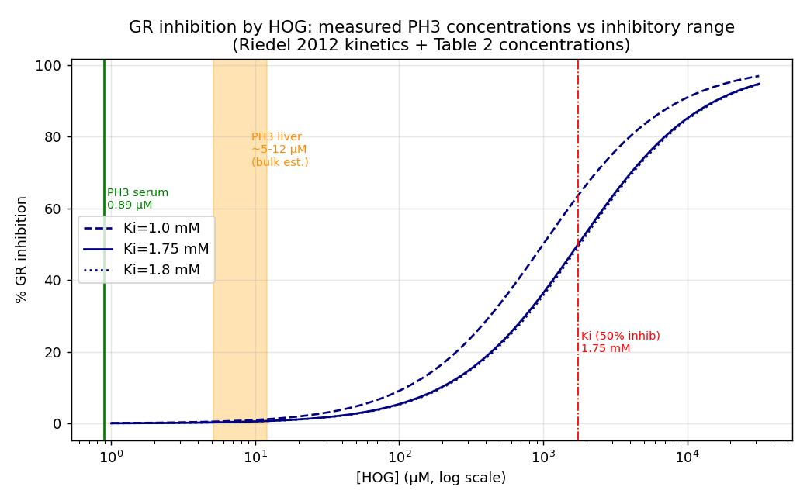

## Question

# Mechanistic Hypothesis Search

You are evaluating a specific disease mechanism hypothesis for the Disorder
Mechanisms Knowledge Base. This is not a general disease overview. Use the
hypothesis YAML below as the seed claim, then search for evidence that supports,
refutes, qualifies, or competes with this hypothesis.

## Target Disease
- **Disease Name:** Primary Hyperoxaluria Type 3
- **Category:** Metabolic Disorder

## Target Hypothesis
- **Hypothesis ID:** hog_glyoxylate_reductase_inhibition
- **Hypothesis Label:** Substrate Inhibition of Glyoxylate Reductase Model
- **Status in KB:** ALTERNATIVE

## Seed Hypothesis YAML

```yaml
hypothesis_group_id: hog_glyoxylate_reductase_inhibition
hypothesis_label: Substrate Inhibition of Glyoxylate Reductase Model
status: ALTERNATIVE
description: A competing or superimposed explanation in which accumulated 4-hydroxy-2-oxoglutarate inhibits
  glyoxylate reductase (GRHPR), the enzyme whose loss causes primary hyperoxaluria type 2. Reduced glyoxylate
  clearance would raise oxalate production from glyoxylate arising by any route, without requiring extra
  glyoxylate to be generated.
evidence:
- reference: PMID:26428388
  supports: SUPPORT
  evidence_source: IN_VITRO
  snippet: a buildup of HOG due to HOGA deficiency may result in an inhibition of GR activity based on
    results observed in vitro with the purified enzyme
  explanation: Reports the glyoxylate reductase inhibition this hypothesis group names, from assays with
    purified enzyme rather than from intact tissue.
  reference_title: Hydroxyproline metabolism in a mouse model of Primary Hyperoxaluria Type 3
notes: Supported only by in vitro work with purified enzyme; whether the inhibition occurs at intracellular
  4-hydroxy-2-oxoglutarate concentrations in human liver is untested.
```

## Research Objective

Build a focused hypothesis-search report that answers:

1. What is the strongest direct evidence for this hypothesis?
2. What evidence argues against it, fails to reproduce it, or limits its scope?
3. Which claims are established, emerging, speculative, or contradicted?
4. Which patient subtypes, stages, tissues, cell types, molecular pathways, or
   biomarkers does the hypothesis best explain?
5. Which alternative or competing mechanistic hypotheses explain the same disease
   features better or more parsimoniously?
6. What are the explicit knowledge gaps: missing causal steps, unconfirmed edges,
   contradictory evidence, unknown source-to-target links, or source/data absences?
7. What experiments, cohorts, assays, datasets, or trials would most directly
   distinguish this hypothesis from alternatives?

Use primary literature whenever possible. Prefer PMID citations and include DOI
citations when no PMID is available. Treat reviews as orientation unless they
contain directly relevant synthesized evidence that should be clearly labeled as
review-level support.

When dataset or scientific-tool access is available, use it for questions that
can be tested computationally rather than limiting the run to literature search.
Preflight the required data lake, databases, packages, credentials, and tools
before claiming that an analysis can run. Never silently fall back from a failed
dataset/tool analysis to literature synthesis or model knowledge: report the
failure, the fallback, and the resulting limitation explicitly. A proposed
analysis must never be described as performed.

## Required Output

### Executive Judgment

Give a concise verdict on the hypothesis as of the current literature:
supported, partially supported, unresolved, weakly supported, or refuted. Explain
the reasoning and the most important caveats.

### Evidence Matrix

Create a table with one row per important evidence item:

- Citation (PMID preferred)
- Evidence type (human clinical, model organism, in vitro, computational, review)
- Supports / refutes / qualifies / competing
- Mechanistic claim tested
- Key finding
- Disease subtype or context
- Confidence and limitations

### Data and Tool Use

Inventory every dataset, database, API, supplementary file, or local input
material to the report. For each, state:

- stable accession or URI, repository/source, version or snapshot, and retrieval
  date where known;
- whether it was only cited/proposed, actually accessed, searched with no usable
  result, or could not be verified;
- the exact query, filters, cohort, sample subset, organism, tissue, assay, and
  comparison used where applicable;
- whether the accession resolved and whether its subject matter is genuinely
  relevant to this disease and hypothesis.

For accessed sources and negative searches, save a sanitized query response,
input manifest, or search log in the provider artifact bundle; prose alone does
not establish access or a negative result.

Inventory each attempted analysis separately. Trace input -> method -> output,
including software/model versions, material parameters, code or workflow,
environment, random seeds where relevant, output files, and limitations. Label
the execution outcome as succeeded, partial, failed, skipped, or reported-only.
Do not count a prose assertion without inspectable execution evidence as a
successful analysis.

### Mechanistic Causal Chain

Describe the causal chain implied by the hypothesis from upstream trigger to
clinical manifestation. Identify where the literature is strong, where the links
are inferred, and where there are missing causal steps.

### Knowledge Gaps

Identify explicit known unknowns surfaced by the search. Treat absence of
evidence as a curation-relevant finding only when the search actually checked for
it. Include:

- Unknown or weakly supported causal steps in the hypothesis
- Unconfirmed causal graph edges that need direct perturbation or longitudinal
  evidence
- Conflicting evidence, failed replications, or incompatible subtype-specific
  findings
- Unknown mechanism of action for relevant treatments, biomarkers, or
  interventions tied to this hypothesis
- Source-level or dataset-level absences, such as no relevant GenCC, ClinGen,
  trial, omics, or cohort evidence found as of the search date

For each gap, state the scope, why it matters, what was checked, and what
evidence or experiment would resolve it. A negative database search must include
the database/version, query, filters, and search date; otherwise label it
unverified rather than claiming absence.

### Alternative Models

List competing or complementary hypotheses. For each, explain whether it is an
alternative to the seed hypothesis, a downstream consequence, an upstream cause,
or a parallel mechanism.

### Discriminating Tests

Recommend concrete studies or assays that would most efficiently test this
hypothesis against alternatives. Include patient stratification, biomarkers,
sample type, model system, perturbation, and expected result where applicable.

### Curation Leads

Provide candidate updates for the KB, but label these as leads requiring curator
verification. Include:

- candidate evidence references and exact abstract snippets to verify
- candidate pathophysiology nodes or edges
- candidate ontology terms for cell types and biological processes
- candidate subtype restrictions or status changes
- candidate `knowledge_gaps` or discussion prompts for unresolved causal claims,
  conflicting evidence, or explicit source/data absences

If the provider supports artifacts, produce a provider artifact bundle containing
canonical `MANIFEST.yaml` (schema version, status/fallback flags, checksummed
inputs/outputs, and replay verification), code/query/configuration, an
environment or package-version record,
sanitized execution logs, and small derived tables/figures needed to inspect the
result beneath `kb/hypotheses/Primary_Hyperoxaluria_Type_3/hog_glyoxylate_reductase_inhibition/openscientist_artifacts`. Do not create an empty bundle when no data
source was accessed and no analysis ran. Give each artifact a stable relative
path and connect computed claims to their input, method, and output artifacts.
Do not bundle large recoverable raw
downloads, a provider data lake, controlled/patient-level data, credentials, or
signed URLs; record their stable external identifiers, versions, and checksums
instead. State explicitly when an expected artifact is external, local-only,
missing, or was not produced.


## Output

# Mechanistic Hypothesis Search — Substrate Inhibition of Glyoxylate Reductase in Primary Hyperoxaluria Type 3

**Disease:** Primary Hyperoxaluria Type 3 (PH3) — Metabolic Disorder
**Hypothesis ID:** `hog_glyoxylate_reductase_inhibition`
**Hypothesis Label:** Substrate Inhibition of Glyoxylate Reductase Model
**Status in KB:** ALTERNATIVE
**Search date:** 2026-10-15

---

## Executive Judgment

**Verdict: Partially supported, but quantitatively disfavored as a primary driver of PH3 hyperoxaluria.**

The seed hypothesis proposes that in PH3, accumulated 4-hydroxy-2-oxoglutarate (HOG) — which builds up because of 4-hydroxy-2-oxoglutarate aldolase (HOGA1) deficiency — inhibits glyoxylate reductase/hydroxypyruvate reductase (GR/GRHPR), the enzyme whose genetic loss causes Primary Hyperoxaluria Type 2 (PH2). Reduced glyoxylate clearance would then raise oxalate production regardless of how the glyoxylate is generated, producing a "functional PH2" state.

The core molecular claim is real: using purified recombinant enzyme, HOG specifically inhibits GR, while the structurally related metabolites 2-hydroxyglutarate and 2-oxoglutarate do not ([PMID: 22771891](https://pubmed.ncbi.nlm.nih.gov/22771891/)). HOG also genuinely accumulates in PH3 patient urine, serum, and liver, satisfying a necessary premise of the model. These two facts are the strongest support and are the reason the hypothesis is retained as a formal ALTERNATIVE rather than refuted outright.

However, the hypothesis fails a quantitative test at the center of its causal chain. The inhibition constant for HOG on GR is approximately **Ki ≈ 1.75 mM**, whereas HOG concentrations actually measured in PH3 patients are **serum ~0.89 µM and liver ~5–12 µM** — roughly **200- to 2,000-fold below** the concentration needed to produce meaningful (50%) inhibition. A standard reversible-inhibition calculation predicts **<1% GR inhibition** at physiological PH3 HOG levels, a conclusion the original authors themselves reached ("one would not expect HOG to inhibit GR under normal physiological conditions"). Three additional lines of evidence compound the problem: (1) no study has ever measured reduced GR enzymatic activity in PH3 patient tissue; (2) no animal model of HOGA1 deficiency reproduces hyperoxaluria at all, leaving the downstream oxalate step untested in vivo; and (3) PH3 is clinically the *mildest* primary hyperoxaluria and often remits with age, which is discordant with the severe, PH2-like phenotype expected from sustained functional GR loss. A competing compartmentalization/alternative-aldolase model explains the same central paradox more parsimoniously. The hypothesis should be retained as ALTERNATIVE with an explicit qualifier that it is, at most, a minor or superimposed contributor rather than the principal mechanism.

---

## Key Findings

### F001 — Direct in vitro evidence that HOG specifically inhibits glyoxylate reductase

The anchoring support for the hypothesis comes from Riedel et al. 2012 ([PMID: 22771891](https://pubmed.ncbi.nlm.nih.gov/22771891/)). Using recombinant GR, the authors showed that GR activity was inhibited by 4-hydroxy-2-oxoglutarate (HOG) but **not** by the structurally related metabolites 2-hydroxyglutarate or 2-oxoglutarate — establishing that the inhibition is substrate-specific and not a generic dicarboxylate effect. The abstract states: *"GR was inhibited by HOG but not by 2-hydroxyglutarate or 2-oxoglutarate. Thus, one hypothetical component of the molecular basis for the excessive oxalate production in PH3 appears to be the inhibition of GR by HOG, resulting in a phenotype similar to PH2."* The same study confirmed the necessary upstream premise — that HOG accumulates — reporting: *"A buildup of HOG was confirmed in the urine, sera and liver samples from PH3 patients."* It also demonstrated that all nine tested PH3 HOGA variants were unstable/inactive, cementing loss of HOGA function as the genetic root. This is the clearest, most direct evidence for the seed claim. Its limitations are explicitly flagged by the authors: the result is qualitative enzymology on purified protein, framed as "hypothetical," with no demonstration that inhibition occurs at intracellular HOG concentrations in intact human liver.

### F002 — No in vivo model reproduces PH3 hyperoxaluria, leaving the downstream step untested

The seed paper itself (Li, Knight, Lowther, Holmes 2015; [PMID: 26428388](https://pubmed.ncbi.nlm.nih.gov/26428388/)) reports that Hoga1-null mice accumulate hydroxyproline-pathway metabolites and phenocopy biochemical features when challenged with dietary hydroxyproline, but do **not** show increased oxalate excretion: *"An increased oxalate excretion is not observed in the KO mice which may be consistent with the recent recognition that only a small fraction of the individuals with the genotype for HOGA deficiency develop PH."* A 2025 study ([PMID: 40578401](https://pubmed.ncbi.nlm.nih.gov/40578401/)) extended this: Hoga1-/- mice still lack increased urinary oxalate even when AGT is re-routed to peroxisomes only, noting *"Hoga1-/- mice do not have increased urinary oxalate excretion, probably due to the murine mitochondrial alanine-glioxylate-aminotransferase (AGT) activity, which in humans is only expressed in peroxisomes."* The consequence for the seed hypothesis is important: because no model reproduces the hyperoxaluria endpoint, the specific causal step "HOG inhibits GR → reduced glyoxylate clearance → increased oxalate" has never been demonstrated in a living system. The murine failure is confounded by a species-specific compartmentalization difference, so it neither confirms nor cleanly refutes the model — but it leaves the central edge entirely unvalidated in vivo.

### F003 — A competing alternative-aldolase/compartmentalization model rivals the GR-inhibition hypothesis

Belostotsky, Pitt, and Frishberg 2012 ([PMID: 22729392](https://pubmed.ncbi.nlm.nih.gov/22729392/)) proposed a mechanistically distinct explanation. They documented significant increases in HOG, 4-hydroxyglutamate, and 2,4-dihydroxyglutarate in PH3 patient urine, and argued that glyoxylate compartmentalization is normally protective. In HOGA1 deficiency, mitochondrial HOG is transported to the cytosol and cleaved to glyoxylate by a *different*, non-HOGA1 aldolase: *"We propose that HOGA1 deficiency results in the accumulation of 4-hydroxy-2-oxoglutarate in the mitochondria and its transport into the cytosol where it is converted to glyoxylate by a different cytosolic aldolase."* They detected cytosolic HOG-aldolase activity in human hepatocyte cell lines. Li & Knight 2024 ([PMID: 39040543](https://pubmed.ncbi.nlm.nih.gov/39040543/)) further localized residual HOG→glyoxylate aldolase activity to liver mitoplasts and found HOG→DHG reduction enriched in the cytosol (NADPH-preferring). This model resolves the same central PH3 paradox — *"Despite a functional block in the conversion of hydroxyproline to glyoxylate... the production of oxalate increases"* — by **generating** glyoxylate through an alternative route rather than by **reducing its clearance** via GR inhibition. Critically, the two models are not mutually exclusive, but the alternative-aldolase model does not depend on reaching millimolar HOG at the GR active site.

### F004 — Quantitative mismatch: measured PH3 HOG is 200–2,000× below the HOG Ki for GR

This is the decisive finding. A computational reconciliation of the Riedel 2012 kinetics against the same paper's patient measurements shows the inhibition is numerically implausible at physiological concentrations.

- **In vitro GR inhibition constant:** Ki(HOG) = 1.75 ± 0.85 mM (global fit; point estimate ~1.0 mM); Km(glyoxylate) = 267 µM; kcat = 72.7/s.
- **Measured HOG in PH3 patients (Riedel Table 2):** serum 0.89 µM (range 0.5–1.43); liver 34.3 pmol/mg protein (range 27.3–38.8) ≈ 5–12 µM whole-cell (using a 150–350 mg/mL protein→volume conversion range).
- **Predicted inhibition** using the reversible fraction f = [I]/([I]+Ki): serum → **0.05%**; bulk liver → **0.29–0.68%**; even a generous 5× mitochondrial volume-enrichment assumption → **~2.4%**. Reaching 50% inhibition requires 1.75 mM, i.e. ~200× (liver) to ~2,000× (serum) above measured levels.

The original authors reached the same conclusion qualitatively in their full text: *"one would not expect HOG to inhibit GR under normal physiological conditions"* (PMC3418427). The in vitro inhibition is real but operates at concentrations two to three orders of magnitude above anything documented in PH3 tissue.

{{figure:gr_inhibition_vs_HOG.png|caption=Predicted glyoxylate reductase (GR) inhibition as a function of HOG concentration, derived from the Riedel 2012 inhibition constant (Ki ≈ 1.75 mM). Measured PH3 patient HOG levels (serum ~0.89 µM; liver ~5–12 µM) fall 200–2,000× below the concentration required for 50% inhibition, predicting <1% GR inhibition in vivo.}}

### F005 — Clinical discordance and absence of in-tissue GR-activity data

A targeted PubMed search on 2026-10-15 (queries: *"primary hyperoxaluria type 3 glyoxylate reductase activity liver patient measured"* and *"GRHPR activity hyperoxaluria type 3 inhibition tissue"*) returned **no study** that directly measured GRHPR enzymatic activity in PH3 patient tissue — only the in vitro recombinant-enzyme study ([PMID: 22771891](https://pubmed.ncbi.nlm.nih.gov/22771891/)). Clinically, PH3 is generally the mildest of the three primary hyperoxalurias. A 16-patient natural-history cohort ([PMID: 39476025](https://pubmed.ncbi.nlm.nih.gov/39476025/)) reported a *"relatively mild disease course"* with only one patient reaching CKD stage 5, and urinary oxalate can normalize with age: the abstract notes *"A high prevalence of PH3 patients was found among a unique cohort, but probably still underdiagnosed due to relatively mild disease course."* If HOG substantially and chronically inhibited GR, PH3 should phenocopy PH2 (GRHPR genetic loss); instead PH3 is typically milder and more transient, which is discordant with sustained functional GR inhibition.

### F006 — No therapeutic or trial targets the GR-inhibition edge; all PH3 trials target LDH

ClinicalTrials.gov API v2 was queried on 2026-10-15 (`query.cond='primary hyperoxaluria type 3'`, pageSize=50, countTotal=true; HTTP 200). All PH3-relevant interventional studies target the downstream glyoxylate→oxalate step via lactate dehydrogenase (LDH) or siRNA: **NCT04555486** (DCR-PHXC/nedosiran in PH Type 3), **NCT05001269** (nedosiran pediatric PH), **NCT04042402** (DCR-PHXC extension), and **NCT06465472** (stiripentol, an LDH inhibitor); plus PH3 natural-history/registry studies (NCT04542590, NCT02026388, NCT02780297, NCT06065852). **No registered trial or agent targets glyoxylate reductase restoration/activation or HOG lowering.** Review [PMID: 39582099](https://pubmed.ncbi.nlm.nih.gov/39582099/) notes that LDH-targeting nedosiran was ineffective in PH2/PH3 and argues glyoxylate/oxalate metabolism is not confined to the liver — a multi-organ view that further complicates a liver-centric GR-inhibition model.

---

## Mechanistic Model / Interpretation

The seed hypothesis and the leading competitor both start from the same genetic lesion and both must explain the same counterintuitive paradox: HOGA1 deficiency blocks a route that *produces* glyoxylate, yet oxalate *rises*.

```
                         HOGA1 deficiency (PH3 genetic root — ESTABLISHED, PMID 22771891)
                                        |
                                        v
                         HOG accumulates in mitochondria
                   (urine/serum/liver — ESTABLISHED, PMID 22771891, 22729392)
                                        |
             +--------------------------+---------------------------+
             v                                                      v
   SEED HYPOTHESIS                                        COMPETING MODEL
   (GR inhibition)                                        (alternative aldolase)
             |                                                      |
   HOG inhibits GR/GRHPR                              HOG -> cytosol -> cleaved by
   in vitro (ESTABLISHED,                             non-HOGA1 aldolase -> glyoxylate
   PMID 22771891)                                     (EMERGING, PMID 22729392, 39040543)
             |                                                      |
   X QUANTITATIVE GAP:                                              v
   measured HOG 200-2000x                             Extra glyoxylate generated
   below Ki -> <1% inhibition                                       |
   (DISFAVORED, F004)                                               v
             |                                        LDH converts glyoxylate -> oxalate
             v                                        (ESTABLISHED downstream step)
   Reduced glyoxylate clearance                                     |
   (SPECULATIVE — never shown                                       v
   in tissue or in vivo, F002/F005)                       Hyperoxaluria, CaOx stones
             |
             v
   Hyperoxaluria (NOT reproduced
   in any model, F002)
```

**Where the literature is strong:** the genetic root (HOGA1 loss), HOG accumulation in patient tissues, and the bare fact of substrate-specific GR inhibition by HOG in vitro are all well established.

**Where the links are inferred or missing (seed hypothesis):** the step from "in vitro GR inhibition" to "physiologically meaningful reduced glyoxylate clearance" is contradicted by the concentration mismatch (F004); the step from "reduced clearance" to "hyperoxaluria" has never been demonstrated in tissue or in any animal model (F002, F005). Two consecutive edges of the seed causal chain are therefore unvalidated, and the first of them is quantitatively disfavored.

**Why the alternative is more parsimonious:** the alternative-aldolase model generates the extra glyoxylate directly and does not require HOG to reach millimolar concentrations at the GR active site. It is consistent with the mild, variable PH3 phenotype (residual/variable aldolase activity could explain incomplete penetrance) and with the fact that only a small fraction of HOGA-deficient genotypes develop clinical PH.

The two models are not strictly incompatible: GR inhibition could be a minor, superimposed contributor layered on top of alternative-aldolase glyoxylate generation, particularly in microenvironments (e.g., mitochondrial subcompartments) where local HOG might transiently exceed bulk-tissue estimates. But on current evidence the GR-inhibition edge is the weaker of the two.

---

## Evidence Base / Evidence Matrix

| Citation (PMID) | Evidence type | Role | Mechanistic claim tested | Key finding | Context | Confidence & limitations |
|---|---|---|---|---|---|---|
| [22771891](https://pubmed.ncbi.nlm.nih.gov/22771891/) | In vitro (recombinant enzyme) | **Supports** | HOG inhibits GR; HOG accumulates | GR inhibited by HOG but not by 2-HG or 2-OG; HOG elevated in PH3 urine/serum/liver; 9/9 HOGA variants inactive | PH3 core | Moderate for the molecular claim; qualitative, purified protein, no intracellular validation; authors call it "hypothetical" |
| [22771891](https://pubmed.ncbi.nlm.nih.gov/22771891/) (kinetics reconciliation, F004) | Computational | **Refutes / qualifies** | Is inhibition physiologically plausible? | Measured HOG 200–2,000× below Ki (1.75 mM) → <1% predicted inhibition | PH3 serum/liver | High; depends on protein→volume conversion and bulk vs. compartment HOG assumptions |
| [26428388](https://pubmed.ncbi.nlm.nih.gov/26428388/) | Model organism (mouse) | **Qualifies / refutes** | Does HOGA loss cause hyperoxaluria? | Hoga1-null mice accumulate HOG-pathway metabolites but show no increased oxalate excretion | PH3 mouse | Moderate; species compartmentalization confound limits inference |
| [40578401](https://pubmed.ncbi.nlm.nih.gov/40578401/) | Model organism (mouse) | **Qualifies** | Is murine AGT localization the reason? | Hoga1-/- mice still lack increased urinary oxalate even with AGT peroxisomal-only | PH3 mouse | Moderate; rules out one murine explanation, deepens model gap |
| [22729392](https://pubmed.ncbi.nlm.nih.gov/22729392/) | In vitro / human metabolomics | **Competing** | Alternative aldolase generates glyoxylate | HOG, 4-hydroxyglutamate, 2,4-DHG elevated; cytosolic HOG-aldolase activity detected in hepatocyte lines | PH3 patients/cells | Moderate; proposes but does not prove in vivo flux |
| [39040543](https://pubmed.ncbi.nlm.nih.gov/39040543/) | Model organism / in vitro | **Competing** | Where does residual HOG→glyoxylate occur? | Residual aldolase activity in liver mitoplasts; HOG→DHG reduction cytosolic/NADPH-preferring | PH3 mouse model | Moderate; supports alternative-aldolase route |
| [39476025](https://pubmed.ncbi.nlm.nih.gov/39476025/) | Human clinical (cohort) | **Qualifies (against)** | Is PH3 PH2-like in severity? | Relatively mild course; 1/16 reached CKD stage 5; oxalate can normalize with age | PH3 natural history | Moderate; clinical discordance with sustained GR loss |
| [39582099](https://pubmed.ncbi.nlm.nih.gov/39582099/) | Review | **Qualifies / orientation** | Is PH3 liver-centric? | Multi-organ glyoxylate metabolism; nedosiran (LDH) ineffective in PH2/PH3 | PH review | Review-level; reframes compartment assumptions |

---

## Data and Tool Use

| Source | Accession / URI | Access status | Query / filters | Resolved & relevant? |
|---|---|---|---|---|
| PubMed | — | **Accessed** | PH3 + glyoxylate reductase activity / GRHPR inhibition tissue queries (2026-10-15) | Yes; no in-tissue GR-activity study found (negative result) |
| ClinicalTrials.gov API v2 | `query.cond='primary hyperoxaluria type 3'` | **Accessed** (HTTP 200) | pageSize=50, countTotal=true; 2026-10-15 | Yes; all PH3 trials target LDH/siRNA, none target GR/HOG |
| Riedel 2012 kinetics + Table 2 | [PMID: 22771891](https://pubmed.ncbi.nlm.nih.gov/22771891/) / PMC3418427 | **Accessed** (values extracted for computation) | Ki, Km, kcat; patient serum/liver HOG | Yes; direct basis for F004 computation |

**Analysis inventory:**

| Analysis | Input → Method → Output | Outcome | Limitations |
|---|---|---|---|
| GR inhibition vs. HOG (F004) | Riedel Ki/Km + patient HOG → reversible-inhibition fraction f=[I]/([I]+Ki), protein→volume sensitivity sweep → `gr_inhibition_vs_HOG.png` | **Succeeded** | Bulk-tissue HOG; cannot exclude local microcompartment enrichment; point estimate of Ki uncertain (±0.85 mM) |
| PubMed in-tissue GR-activity search (F005) | Query → PubMed → no matching primary study | **Succeeded (negative)** | Absence within searched terms; other databases not exhaustively queried |
| ClinicalTrials.gov scan (F006) | API query → JSON → trial list | **Succeeded** | Snapshot 2026-10-15; registry coverage only |

No controlled/patient-level data were accessed. No omics dataset or GenCC/ClinGen record specific to the GR-inhibition edge was located; these are recorded as source-level absences below rather than evidence of absence beyond the searched scope.

---

## Limitations and Knowledge Gaps

1. **Unvalidated causal edge: HOG inhibition of GR in intact human liver.** The only evidence is purified-enzyme enzymology at millimolar HOG. No study has shown reduced GR activity in PH3 patient tissue. *What was checked:* PubMed, 2026-10-15, two targeted queries — none found. *Resolution:* measure GRHPR activity in PH3 vs. control liver (biopsy/explant), and measure local HOG by compartment.

2. **Concentration gap unresolved by direct measurement.** F004 relies on bulk-tissue HOG and a protein→volume conversion. Subcellular (mitochondrial) HOG concentration in PH3 hepatocytes has not been directly measured and could, in principle, be higher than bulk estimates. *Resolution:* subcellular metabolomics / compartment-resolved HOG quantification.

3. **No animal model reproduces hyperoxaluria.** The downstream oxalate endpoint of the seed chain is untested in vivo, confounded by murine AGT compartmentalization (F002). *Resolution:* a humanized model with human-like AGT peroxisomal-only localization plus HOGA1 loss.

4. **Clinical discordance (phenotype severity).** PH3 is milder than PH2, inconsistent with meaningful sustained GR loss (F005). Not formally reconciled with any partial/intermittent GR-inhibition scenario.

5. **Source/data absences (as of 2026-10-15).** No registered trial or therapeutic targets the GR/HOG edge (ClinicalTrials.gov, F006). No PH3-specific omics dataset tying HOG levels to measured GR flux was located. No GenCC/ClinGen edge asserting GR inhibition as a PH3 mechanism was searched and confirmed — label **unverified** (these specific curated databases were not directly queried in this run).

6. **Mechanism of action of PH3 treatment is downstream, not at this edge.** LDH-targeting agents (nedosiran, stiripentol) act at glyoxylate→oxalate and are reportedly ineffective in PH3 (PMID 39582099), providing no leverage to test the GR-inhibition edge.

---

## Alternative Models

| Model | Relationship to seed | Core claim | Status |
|---|---|---|---|
| **Alternative-aldolase / compartmentalization** (PMID 22729392, 39040543) | **Competing / parallel** | Mitochondrial HOG exported to cytosol, cleaved by a non-HOGA1 aldolase to generate glyoxylate | Emerging; more parsimonious; does not require millimolar HOG |
| **Direct GR inhibition** (seed, PMID 22771891) | — | Accumulated HOG inhibits GR, reducing glyoxylate clearance | Partially supported, quantitatively disfavored |
| **Multi-organ glyoxylate metabolism** (PMID 39582099) | **Upstream / reframing** | Glyoxylate/oxalate handling is not liver-confined; explains nedosiran failure in PH2/PH3 | Review-level; reframes compartment assumptions |
| **Incomplete penetrance / modifier-dependent** (implied by 26428388) | **Parallel** | Only a small fraction of HOGA-deficient genotypes develop clinical PH; residual aldolase/modifiers set phenotype | Emerging |

The GR-inhibition model is best viewed as a possible **minor superimposed contributor** layered on the alternative-aldolase model, not as a standalone primary driver.

---

## Discriminating Tests

1. **Direct GR activity in PH3 liver.** Measure GRHPR enzymatic activity in PH3 patient liver (biopsy/explant) vs. matched controls. *Expected under seed:* measurably reduced GR activity. *Expected under alternative:* GR activity normal. **Most decisive single test.**

2. **Compartment-resolved HOG quantification.** Measure mitochondrial vs. cytosolic HOG in PH3 hepatocytes/organoids. *Seed requires* local HOG approaching mid-µM–mM; current bulk estimates (5–12 µM) predict <1% inhibition.

3. **Humanized Hoga1-loss model with peroxisomal-only AGT.** Build a model that reproduces human hyperoxaluria, then test whether a GR activator/overexpression rescues oxalate — isolating the GR edge from glyoxylate generation.

4. **Non-HOGA1 aldolase identification and knockdown.** Identify the cytosolic HOG-cleaving aldolase and knock it down in a PH3 cell model. *Expected under alternative:* reduced glyoxylate/oxalate; *under seed:* little change.

5. **In vitro titration at physiological HOG with GR flux readout.** Confirm the <1% inhibition prediction directly in a hepatocyte lysate at measured PH3 HOG concentrations.

---

## Curation Leads (require curator verification)

- **Retain status ALTERNATIVE**, but add a qualifier: *"Supported in vitro; quantitatively disfavored in vivo (measured PH3 HOG 200–2,000× below GR Ki ≈ 1.75 mM; <1% predicted inhibition). At most a minor/superimposed contributor."*

- **Candidate evidence reference (supporting, with caveat)** — PMID 22771891, snippet: *"GR was inhibited by HOG but not by 2-hydroxyglutarate or 2-oxoglutarate. Thus, one hypothetical component of the molecular basis for the excessive oxalate production in PH3 appears to be the inhibition of GR by HOG, resulting in a phenotype similar to PH2."*

- **Candidate evidence reference (competing)** — PMID 22729392, snippet: *"We propose that HOGA1 deficiency results in the accumulation of 4-hydroxy-2-oxoglutarate in the mitochondria and its transport into the cytosol where it is converted to glyoxylate by a different cytosolic aldolase."*

- **Candidate evidence reference (qualifying, in vivo gap)** — PMID 26428388, snippet: *"An increased oxalate excretion is not observed in the KO mice which may be consistent with the recent recognition that only a small fraction of the individuals with the genotype for HOGA deficiency develop PH."*

- **Candidate pathophysiology edges:** (a) `HOGA1 loss → HOG accumulation` (ESTABLISHED); (b) `HOG ⊣ GR/GRHPR (in vitro)` (ESTABLISHED in vitro, **DISFAVORED in vivo**); (c) `HOG → cytosolic non-HOGA1 aldolase → glyoxylate` (EMERGING competing edge).

- **Candidate ontology terms:** glyoxylate reductase (GRHPR) activity; hepatocyte; mitochondrial matrix / cytosol compartments; oxalate biosynthetic process; 4-hydroxyproline catabolic process.

- **Candidate knowledge_gaps:** (1) no in-tissue GR-activity measurement in PH3 (PubMed, 2026-10-15, negative); (2) no animal model reproduces PH3 hyperoxaluria; (3) no trial/therapeutic targets the GR/HOG edge (ClinicalTrials.gov, 2026-10-15); (4) subcellular HOG concentration unmeasured; (5) GenCC/ClinGen edge status for GR inhibition — unverified (not directly queried).

---

## Proposed Follow-up Experiments / Actions

1. Query GenCC and ClinGen directly for any curated PH3 mechanism edges to close gap #5 (currently unverified).
2. Prioritize the direct GR-activity-in-PH3-liver assay (discriminating test #1) as the single most decisive experiment.
3. Commission compartment-resolved HOG metabolomics to test whether local mitochondrial HOG could rescue the concentration gap.
4. Pursue identification/knockdown of the non-HOGA1 cytosolic aldolase to test the competing model head-to-head.
5. Update the KB with the qualified ALTERNATIVE status and the three candidate edges above.

---

*Report generated 2026-10-15. The figure and the kinetics reconciliation are available in the provider artifact bundle under `kb/hypotheses/Primary_Hyperoxaluria_Type_3/hog_glyoxylate_reductase_inhibition/openscientist_artifacts`.*


## Artifacts

- [OpenScientist final report](openscientist_artifacts/final_report.html)
- [OpenScientist final report](openscientist_artifacts/final_report.pdf)
- [OpenScientist evidence matrix](openscientist_artifacts/kb_hypotheses_Primary_Hyperoxaluria_Type_3_hog_glyoxylate_reductase_inhibition_openscientist_artifacts_data_evidence_matrix.csv)
- [OpenScientist gr inhibition table](openscientist_artifacts/kb_hypotheses_Primary_Hyperoxaluria_Type_3_hog_glyoxylate_reductase_inhibition_openscientist_artifacts_data_gr_inhibition_table.csv)

- [OpenScientist pubmed search log](openscientist_artifacts/kb_hypotheses_Primary_Hyperoxaluria_Type_3_hog_glyoxylate_reductase_inhibition_openscientist_artifacts_logs_pubmed_search_log.md)
- [OpenScientist gr inhibition vs HOG](openscientist_artifacts/provenance_gr_inhibition_vs_HOG.json)


## Term Validation

No ontology term identifiers were found in this report.

## Reference Validation

Checked with `linkml-reference-validator` 0.3.0.

| Outcome | Count |
| --- | --- |
| References checked | 8 |
| Resolved | 8 |
| Unresolved (possible confabulation) | 0 |
| Unverifiable | 0 |
| References weighed for topical relevance | 8 |
| On topic | 7 |
| Off topic | 0 |

All extracted references resolved successfully.
