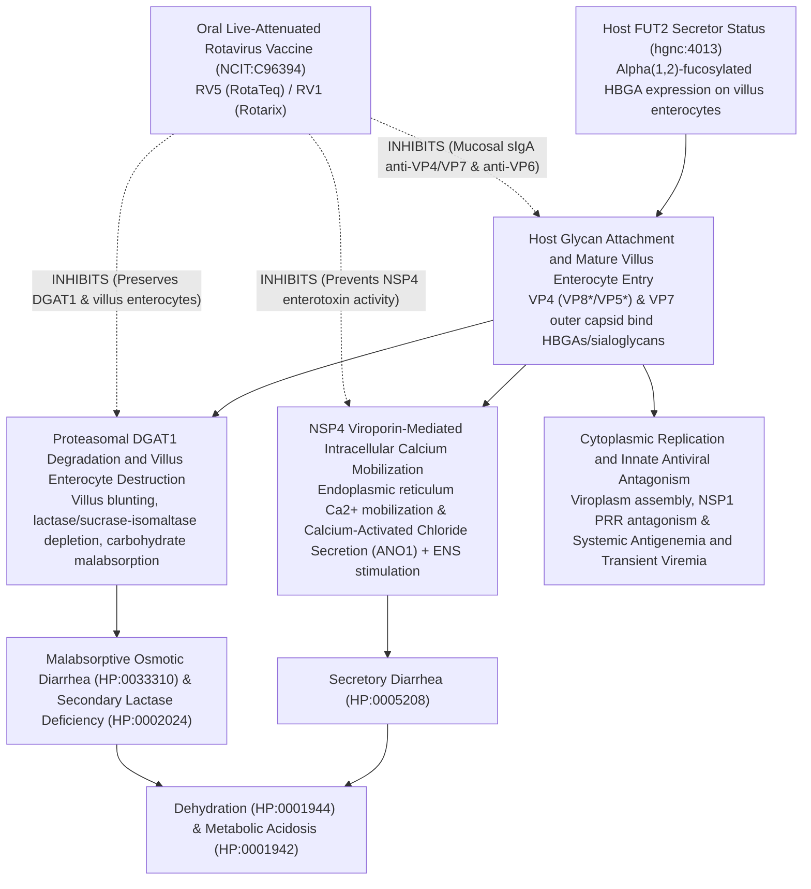

# Vaccine Mechanisms & Immunization Curation

## Overview & Design Principle

In **dismech**, vaccines are not modeled as opaque "preventive checkboxes" detached from disease biology. Instead, every vaccine entry in a disorder's `treatments:` block is modeled as a **causal intervention (`MechanismLink`) that inhibits, modulates, or activates a specific node in the disorder's `pathophysiology:` causal graph**.

Whether a vaccine induces secretory IgA that neutralizes viral attachment at the brush border, systemic IgG that neutralizes a bacterial exotoxin without preventing mucosal colonization, opsonizing antibodies against a polysaccharide capsule, or cytotoxic CD8+ T cells targeting viral oncoproteins or tumor neoantigens, the `target_mechanisms:` edge explicitly records **which step of the pathograph the vaccine intercepts** and **why**.

---

## 0. Ontology & Schema Architecture (Why Not `VO`?)

### Why We Use `NCIT` Instead of the Vaccine Ontology (`VO`)

Dismech deliberately consolidates all medical actions, procedures, and biological/vaccine agents onto **NCI Thesaurus (`NCIT`)**, **ChEBI (`CHEBI`)**, and **MAXO (`MAXO`)** rather than importing the OBO Vaccine Ontology (`VO`):

1. **Unified medical action hierarchy (`TreatmentDescriptor`)**: In `src/dismech/schema/model.yaml`, `treatment_term.term` is validated against `NCIT` medical procedures (`Vaccination` `NCIT:C15346`, `Passive Immunization` `NCIT:C15259`) or `MAXO`, while specific vaccine formulations and biologics sit under `NCIT:C1909` (*Pharmacologic Substance* $\rightarrow$ `NCIT:C923` *Vaccine*) in `treatment_term.therapeutic_agent`.
2. **Avoids OAK / BioPortal cache fragmentation**: Maintaining a single OAK validation surface (`cache/ncit/terms.csv`) covers small molecules, monoclonal antibodies, toxoids, conjugate vaccines, mRNA-LNP vaccines, and live-attenuated viral vaccines without cross-ontology duplication.
3. **Environmental / adverse-event exposures use `ECTO`**: When vaccination is modeled as an environmental exposure or trigger (e.g., live-vaccine disseminated disease in an inborn error of immunity, or post-vaccination immune-mediated sequelae), dismech uses `ECTO:2000129` (`exposure to vaccination`) in the `environmental:` block.

### Canonical YAML Pattern for Vaccine Treatments

```yaml
treatments:
- name: Rotavirus Vaccination
  description: Oral live-attenuated rotavirus vaccines (pentavalent human-bovine reassortant
    RV5 or monovalent human-attenuated RV1) administered in infancy induce mucosal
    secretory IgA and neutralizing antibodies against outer-capsid proteins VP4 and
    VP7, preventing severe dehydrating rotaviral gastroenteritis.
  therapeutic_modality: VACCINE
  delivery_system: VIRAL_VECTOR # Optional: LIPID_NANOPARTICLE, VIRAL_VECTOR, PROTEIN_CONJUGATE, etc.
  treatment_term:
    preferred_term: vaccination
    term:
      id: NCIT:C15346
      label: Vaccination
    therapeutic_agent:
    - preferred_term: rotavirus vaccine
      term:
        id: NCIT:C96394
        label: Rotavirus Vaccine
  target_mechanisms:
  - target: Rotavirus Attachment and Mature Enterocyte Invasion
    treatment_effect: INHIBITS
    description: Mucosal secretory IgA and serum neutralizing antibodies against VP4
      (VP8*/VP5*) and VP7 block virion attachment and entry into mature small-intestinal
      villus enterocytes and neutralize NSP4 enterotoxin activity.
    evidence:
    - reference: PMID:32644377
      supports: SUPPORT
      evidence_source: HUMAN_CLINICAL
      snippet: "Vaccination is the best way to prevent rotavirus disease."
      explanation: Supports oral rotavirus vaccination as the primary prophylactic
        intervention preventing rotavirus infection and severe dehydrating enteritis.
```

### Schema Slots Touching Vaccines

| Schema Location | Slot / Enum / Value | Role |
|---|---|---|
| `Treatment.therapeutic_modality` | `VACCINE`, `BIOLOGIC` (`TherapeuticModalityEnum`) | Distinguishes active vaccines (`VACCINE`) from passive antibodies/antitoxins (`BIOLOGIC`). |
| `Treatment.delivery_system` | `LIPID_NANOPARTICLE`, `VIRAL_VECTOR`, `PROTEIN_CONJUGATE`, `POLYMER_NANOPARTICLE` | Captures LNP-encapsulated mRNA vaccines, adenoviral/vesicular stomatitis vectors, or carrier-protein conjugates. |
| `TreatmentDescriptor.term` | `NCIT:C15346` (`Vaccination`), `NCIT:C15259` (`Passive Immunization`) | Primary medical-action term required on `treatment_term`. |
| `TreatmentDescriptor.therapeutic_agent` | `NCIT:C96394` (`Rotavirus Vaccine`), `NCIT:C181140` (`mRNA COVID-19 Vaccine`), `NCIT:C1951` (`Human Papilloma Virus Vaccine`), `NCIT:C198514` (`Rabies Vaccine`), `NCIT:C91718` (`Diphtheria Toxoid/Tetanus Toxoid Vaccine Adsorbed`), `NCIT:C298` (`BCG Vaccine`) | Specific vaccine formulation or agent under `NCIT:C1909` (*Pharmacologic Substance*). |
| `Treatment.target_mechanisms` | `list[MechanismLink]` (`target`, `treatment_effect: INHIBITS \| ACTIVATES \| MODULATES`, `description`, `evidence`) | Connects the vaccine directly to the named `Pathophysiology` node it blocks or modifies. |
| `TreatmentEffectModifier.mhc_term` & `Genetic.mhc_term` | `MHCDescriptor` (`MHCTerm`: `MRO` / `GO:0042611`) | Binds HLA serotypes, heterodimers (`HLA-DQ2.5` `MRO:0000019`), and allele-specific MHC restriction complexes (`HLA-DRB1*03:01 protein complex` `MRO:0001284`) on genetic associations and vaccine subgroup effect modifiers (`effect_modifier_type: GENOTYPE`). |
| `Pathophysiology.protein_complexes` | `ProteinComplexDescriptor` (`GO:0042611` + `MRO:*`) | Because `MRO` roots its MHC protein complexes under `GO:0042611` (*MHC protein complex*), `protein_complexes` accepts allele-specific `MRO` complexes directly in antigen-presentation pathograph nodes. |
| `Environmental.exposure_term` | `ECTO:2000129` (`exposure to vaccination`) | Models vaccination as an exposure (e.g., protective epidemiological factor or live-vaccine adverse event). |
| `kb/surrogate_endpoints/fda_surrogate_endpoints.yaml` | `vaccine_preventable_disease_neutralizing_titer` | Captures FDA traditional-approval surrogate correlates of protection (serum bactericidal antibody, anti-PRP IgG, hemagglutination inhibition, neutralizing titer, seroconversion). |

---

## 0b. MHC Restriction Ontology (`MRO`) & IEDB Integration

### Why `MRO` (IEDB's MHC Restriction Ontology) Was Integrated

Across vaccine-preventable diseases, autoimmune diseases, infectious diseases, and drug hypersensitivity entries, MHC/HLA restriction is one of the strongest genetic determinants of both **disease susceptibility** and **vaccine / immunotherapy responsiveness**:
- Many clinically important HLA entities are **multi-gene heterodimers** (`HLA-DQ2.5` encoded by *HLA-DQA1\*05:01* + *HLA-DQB1\*02:01*, `MRO:0000019`) or **multi-locus serotypes** (`HLA-DQ2 serotype` `MRO:0000283`, `HLA-B27 serotype` `MRO:0000129`, `HLA-DR4 serotype` `MRO:0000303`) that cannot be faithfully represented by a single HGNC gene CURIE.
- **IEDB (Immune Epitope Database)** maintains **MRO (`http://purl.obolibrary.org/obo/MRO_`)** specifically to represent MHC protein complexes, serotypes, mutant complexes, and alpha/beta chains, and anchors its hierarchy directly under **`GO:0042611` (`MHC protein complex`)**.

### How `MRO` Works in the Dismech Schema

1. **`Pathophysiology.protein_complexes` (`ProteinComplexTerm`)**: Because `ProteinComplexTerm` already has `GO:0042611` (*MHC protein complex*) in `reachable_from`, routing `MRO: ols:mro` in `conf/oak_config.yaml` automatically enables `protein_complexes` to bind any `MRO` MHC class I/II protein complex (`MRO:0001284` `HLA-DRB1*03:01 protein complex`, `MRO:0001007` `HLA-B*57:01 protein complex`, `MRO:0000019` `HLA-DQA1*05:01/DQB1*02:01 protein complex`).
2. **`Genetic.mhc_term` (`MHCDescriptor` $\rightarrow$ `MHCTerm`)**: Allows `genetic:` entries to pair a locus `gene_term` (`hgnc:4942` `HLA-DQA1`) with the exact serotype or heterodimer (`MRO:0000283` `HLA-DQ2 serotype`) or to bind a multi-locus serotype directly.
3. **`TreatmentEffectModifier.mhc_term` (`MHCDescriptor` $\rightarrow$ `MHCTerm`)**: Allows `treatments[].effect_modifiers[]` with `effect_modifier_type: GENOTYPE` to bind the exact HLA restriction complex that modifies vaccine seroconversion (e.g., `HLA-DRB1*03:01` / `HLA-DRB1*07:01` non-responder haplotypes in `Hepatitis_B` vaccination) or requires an HLA-restricted peptide/TCR vaccine (e.g., `HLA-A*02:01`-restricted cancer vaccines).

```yaml
treatments:
- name: Hepatitis B Vaccination
  therapeutic_modality: VACCINE
  effect_modifiers:
  - effect_modifier_type: GENOTYPE
    stratum: HLA-DRB1*03:01 carriers
    mhc_term:
      preferred_term: HLA-DRB1*03:01 protein complex
      term:
        id: MRO:0001284
        label: HLA-DRB1*03:01 protein complex
    comparator_stratum: non-carriers
    modified_outcome: anti-HBs seroprotection rate
    effect_in_stratum: SMALLER_EFFECT
```

### Broader IEDB Opportunities
- **Structured Source (`IEDB:<epitope_id>`)**: Extending `StructuredSourceId` in `src/dismech/schema/common.yaml` to support `IEDB:\d+` for experimentally validated neutralizing B-cell and T-cell epitopes (e.g., Rotavirus VP8\*/VP7, SARS-CoV-2 Spike RBD, HPV E6/E7, `DNAJB1-PRKACA` fusion neoantigen).
- **Molecular Mimicry & Cross-Reactivity**: Linking pathogen epitope IDs to host autoantigen mimics in `Guillain-Barre_Syndrome`, `Acute_Rheumatic_Fever`, `Type_1_Diabetes`, and `Celiac_Disease`.
- **Cross-Repo Bridge to `~/repos/ai-gene-review`**: Mapping viral protein UniProt accessions (`ROTA/VP4`, `ROTA/VP7`, `SARS2/SPIKE`) to IEDB parent protein immunodominant regions.

---

## 1. Six Mechanistic Archetypes for Vaccines in Dismech

Connecting a vaccine via `target_mechanisms:` forces the curator to distinguish *where* in the pathograph immunity acts:

1. **Viral Attachment, Entry & Mucosal Establishment Blockade**
   - *Mechanism*: Neutralizing antibodies (secretory IgA at mucosal surfaces or systemic IgG) bind viral attachment/fusion proteins (e.g., HPV L1 capsid, SARS-CoV-2 Spike RBD, Rotavirus VP4/VP7, Rabies glycoprotein G, HAV capsid), blocking host-receptor engagement (`ACE2`, `HSPG`, `HBGA`, `NCAM1`/`CHRN`) and early cellular entry.
   - *Exemplars*: `Human_Papillomavirus_Infection` (Prophylactic L1 VLP vaccine), `Immunodeficiency_74_COVID-19-related_X-linked` (SARS-CoV-2 mRNA vaccine), `Rabies` (post-exposure vaccine blocking retrograde axonal transport), `Hepatitis_A`, `Hepatitis_D` (HBV vaccine preventing HBsAg helper virus acquisition).

2. **Toxoid / Antitoxin Neutralization (Disease Prevention Without Colonization Blockade)**
   - *Mechanism*: Formalin-inactivated or genetically detoxified bacterial/plant toxoids elicit systemic IgG against the secreted A-B exotoxin or superantigen (`Diphtheria toxin`, `Tetanus neurotoxin`, `Pertussis toxin`, `Anthrax protective antigen`, `TSST-1`, `Ricin A chain`). Crucially, the vaccine targets the **toxin-mediated tissue injury or receptor-entry node**, *not* the mucosal colonization node.
   - *Exemplars*: `Diphtheria`, `Anthrax`, `Toxic_Shock_Syndrome`, `Ricin_Poisoning`.

3. **Polysaccharide-Protein Conjugate Opsonophagocytosis & Mucosal Carriage Reduction**
   - *Mechanism*: Conjugating a bacterial capsular polysaccharide (T-cell-independent antigen, e.g., Hib PRP, pneumococcal serotypes, meningococcal A/C/W/Y) to a carrier protein (`CRM197`, tetanus toxoid) recruits CD4+ Tfh cells (`germinal_center_reaction` module), driving class-switched, affinity-matured anti-capsular IgG and mucosal IgA that overcome capsular complement evasion and reduce nasopharyngeal carriage.
   - *Exemplars*: `Haemophilus_Meningitis`, `Pneumococcal_Meningitis`, `Streptococcal_Meningitis`.

4. **Therapeutic & Neoantigen Vaccines (Cell-Mediated Clearance of Infected or Transformed Cells)**
   - *Mechanism*: Once viral genomes integrate or somatic driver mutations establish a clone, neutralizing antibodies against surface capsids are ineffective. Therapeutic peptide/mRNA/DC vaccines target intracellular oncoproteins or fusion neoantigens (`HPV E6/E7`, `DNAJB1-PRKACA` chimera, `MUC1`) presented on MHC class I/II to prime CD8+ cytotoxic T lymphocytes and Th1 cells.
   - *Exemplars*: `Human_Papillomavirus_Infection` (`Therapeutic HPV Vaccination (E6/E7-directed)`), `Fibrolamellar_Hepatocellular_Carcinoma` (`DNAJB1-PRKACA Fusion-Neoantigen Peptide Vaccine`), `Colon_Adenocarcinoma` (`MUC1 Peptide Vaccine`).

5. **Host-Vulnerability Bypass & Decompensation-Trigger Prevention**
   - *Mechanism*: In inborn errors of immunity (`TLR7`, `MyD88`, `C1Q`, `C2` deficiencies) or acute febrile/viral decompensation syndromes (`RANBP2` ANE1, `LARS1` ILFS1, `TNNI3K` cardiomyopathy), vaccination either bypasses the defective innate sensor via an orthogonal adjuvant/PRR pathway (`MDA5`/`TLR3` for mRNA-LNP in `TLR7` deficiency) or prevents the upstream febrile/viral infection trigger that initiates organ failure.
   - *Exemplars*: `Immunodeficiency_74_COVID-19-related_X-linked`, `C1Q_Deficiency`, `Complement_Component_2_Deficiency`, `MyD88_Deficiency`, `Familial_Acute_Necrotizing_Encephalopathy`, `Infantile_Liver_Failure_Syndrome_1`.

6. **Live-Vaccine Pathogenicity & Contraindication in Primary Immunodeficiencies**
   - *Mechanism*: Live-attenuated vaccines (`BCG`, oral poliovirus, rotavirus, MMR, yellow fever) replicate unchecked when a critical host restriction pathway is absent (e.g., `IFN-gamma`/`IL-12` axis in Mendelian Susceptibility to Mycobacterial Disease, `STAT1`/`STAT2`/`IRF9` type I IFN signaling, or severe combined immunodeficiency). Here, the vaccine strain is represented in `pathophysiology:` / `environmental:` (`ECTO:2000129`) as a causal trigger of disseminated vaccine-strain infection.

---

## 2. Exemplar Entries Currently in the KB

| Disorder Entry | Vaccine Treatment(s) | Targeted Pathophysiology Node(s) | Why It Is an Exemplar |
|---|---|---|---|
| `Human_Papillomavirus_Infection` | **Prophylactic HPV Vaccination** (L1 VLP) vs. **Therapeutic HPV Vaccination (E6/E7-directed)** | `Basal Keratinocyte Infection and Genome Establishment` (prophylactic) vs. `High-Risk Persistence and Transformation` & `Immune Evasion and Persistence` (therapeutic) | Cleanly contrasts humoral capsid-neutralizing prophylaxis (ineffective after infection) with cell-mediated E6/E7 oncoprotein clearance in the same causal graph. |
| `Immunodeficiency_74_COVID-19-related_X-linked` | **SARS-CoV-2 mRNA vaccination** (`NCIT:C181140`, `delivery_system: LIPID_NANOPARTICLE`) | `Unrestrained Early SARS-CoV-2 Replication in the Respiratory Tract` | Demonstrates how a vaccine bypasses a monogenic host innate defect (pDC `TLR7` loss) by priming adaptive anti-Spike IgG via LNP/cytosolic RNA sensing (`MDA5`), with full `therapeutic_agent` and `delivery_system` typing. |
| `Diphtheria` | **Diphtheria Toxoid Vaccination** (`NCIT:C91718`) & **Diphtheria Antitoxin** (`NCIT:C15259`) | `Absent or Waning Antitoxin Immunity` $\rightarrow$ `Diphtheria Toxin Production and Local Tissue Necrosis` | Explicitly models how toxoid immunization neutralizes phage-encoded exotoxin pathology while leaving mucosal *C. diphtheriae* colonization intact; pairs active toxoid with passive antitoxin. |
| `Haemophilus_Meningitis` | **Hib PRP-protein conjugate vaccination** | `PRP Capsule Immune Evasion` | Captures the immunological mechanism of polysaccharide-protein conjugation (converting a T-independent capsule into a T-dependent antigen to restore opsonophagocytosis and eliminate carriage). |
| `Rabies` | **Rabies post-exposure vaccination** (`NCIT:C198514`) & **Rabies immunoglobulin** (`NCIT:C15259`) | `Retrograde Axonal Transport to the Central Nervous System` | Shows post-exposure prophylaxis intercepting a time-windowed anatomical transition node (peripheral muscle/nerve entry before CNS invasion). |

---

## 3. Flagship New-Disorder Trial: Rotaviral Enteritis (`MONDO:0005194`)

`Rotaviral_Enteritis` (`MONDO:0005194`, *rotaviral enteritis*) is our primary end-to-end curation trial integrating:
1. **Viral pathogenesis** across dual secretory + osmotic diarrhea mechanisms,
2. **Host genetic receptor dependency** (`FUT2` secretor status), and
3. **Vaccine mechanism links** (`NCIT:C96394` `Rotavirus Vaccine`).

### Planned Causal Pathograph (`kb/disorders/Rotaviral_Enteritis.yaml`)



---

## 4. Coordination with `~/repos/ai-gene-review` (Host vs. Viral Genes)

Dismech integrates with `~/repos/ai-gene-review` via `src/dismech/ingest/genes.py` (`just genes-ingest-build`, outputting `app/genes-data.js`), which joins gene symbols across both repositories. Because `dismech` currently validates `GeneDescriptor.term` against the **human HGNC cache (`cache/hgnc/terms.csv`)**, host and viral genes follow a coordinated two-sided convention:

### Side A: Host Receptor, Restriction & Susceptibility Genes (Direct HGNC $\leftrightarrow$ UniProt Join)

Human host genes that mediate viral attachment, entry, innate sensing, or vaccine responsiveness are curated in `kb/genes/<SPECIES>/<SYMBOL>/<SYMBOL>-ai-review.yaml` (`HUMAN` taxon `NCBITaxon:9606`) in `ai-gene-review` and referenced via `hgnc:<ID>` in the `dismech` disorder's `genetic:` and `pathophysiology[].genes:` blocks:

| Disorder | Human Host Gene (`hgnc`) | Role in Pathograph & Vaccine Biology | Coordination Target in `ai-gene-review` |
|---|---|---|---|
| `Rotaviral_Enteritis` | `FUT2` (`hgnc:4013`, `Q10981`) | Fucosyltransferase 2 synthesizes mucosal type 1 HBGAs bound by rotavirus P[8]/P[4] `VP8*`; non-secretors (`FUT2` null) are genetically resistant to P[8] infection *and* exhibit lower take/seroconversion to live oral P[8] vaccines (Rotarix). | `kb/genes/HUMAN/FUT2/` (`GO:0046718` viral entry into host cell; `GO:0008417` fucosyltransferase activity) |
| `Rotaviral_Enteritis` | `ANO1` (`hgnc:21625`, `Q5XXA6`) | Ca2+-activated chloride channel (`TMEM16A`) activated by rotavirus `NSP4` enterotoxin to drive secretory diarrhea. | `kb/genes/HUMAN/ANO1/` (`GO:0005229` intracellularly calcium-gated chloride channel activity) |
| `COVID-19` | `ACE2` (`hgnc:13557`), `TMPRSS2` (`hgnc:11876`) | Host entry receptor and Spike-priming serine protease blocked by anti-Spike vaccine antibodies. | `kb/genes/HUMAN/ACE2/`, `kb/genes/HUMAN/TMPRSS2/` |
| `Immunodeficiency_74_COVID-19-related_X-linked` | `TLR7` (`hgnc:15631`) | Endosomal ssRNA sensor on pDCs; loss-of-function causes life-threatening COVID-19 bypassed by mRNA-LNP vaccination. | `kb/genes/HUMAN/TLR7/` |

### Side B: Viral Antigen & Effector Genes (Viral Taxon Directories in `ai-gene-review`)

In `~/repos/ai-gene-review/kb/genes/`, viral proteins are curated under their viral taxon proteome codes (e.g., `SARS2/SPIKE`, `TYPH/E6`, `TYPH/E7`, `EBVG/LMP1`, and for Rotavirus A: `ROTA/VP4`, `ROTA/VP7`, `ROTA/NSP4`, `ROTA/NSP1`).

- **Current Rule in Dismech**: Never force a viral gene symbol into `genes:` with a fake `hgnc:` CURIE. Instead:
  1. Name the viral protein and its UniProt accession in the `Pathophysiology.description` and `Treatment.target_mechanisms[].description` (e.g., `VP4 [VP8*/VP5*]`, `VP7`, `NSP4`).
  2. Bind the **exact shared GO biological_processes terms** on the `Pathophysiology` node that `ai-gene-review` annotates as `core_functions` on the viral gene (`GO:0046718` *viral entry into host cell*, `GO:0019062` *virion attachment to host cell*, `GO:0039503` *suppression by virus of host innate immune response*).
- **Planned Schema & Ingest Enhancement**: Add an optional `pathogen_genes` (or `uniprot:`-backed `GeneDescriptor`) slot on `Pathophysiology` and `MechanismLink` and extend `src/dismech/ingest/genes.py` (`load_gene_kb`) to join non-human viral UniProt records from `ai-gene-review` directly onto disorder pathograph nodes and vaccine `target_mechanisms`.

---

## 5. Conserved Mechanism Modules (`kb/modules/`)

Vaccine mechanisms reuse and motivate conserved modules in `kb/modules/`:

- **Existing Modules**:
  - `germinal_center_reaction`: Tfh-driven B-cell somatic hypermutation, affinity maturation, and generation of long-lived plasma cells (`NIH_HT_22_short_lived_long_lived_plasma_cells`) and memory B cells; underlies conjugate and protein/mRNA vaccine durability.
  - `cgas_sting_pathway_activation` & `innate_antiviral_interferon_response`: Innate nucleic-acid sensing pathways activated by viral infection and vaccine adjuvants.
  - `host_directed_antiviral_dependency`: Host factor dependency (entry receptors, proteases, replication factors) shared with viral entry blockade.
- **Vaccine-Specific Modules (`kb/modules/`)**:
  - `vaccine_induced_mucosal_iga_neutralization`: Oral/intranasal vaccine priming of Peyer's patch / NALT B cells, polymeric IgA transcytosis via `PIGR`, and luminal neutralization of enteric/respiratory pathogens (`Rotaviral_Enteritis`, `Cholera`, `Paralytic_Poliomyelitis`).
  - `polysaccharide_conjugate_t_dependent_switching`: Carrier-protein conjugation converting bacterial capsular polysaccharides from T-independent B-cell antigens into MHC-II-restricted Tfh-dependent germinal center responses (`Haemophilus_Meningitis`, `Meningococcal_Meningitis`, `Pneumococcal_Meningitis`, `Pneumococcal_Pneumonia`).
  - `toxoid_neutralizing_humoral_immunity`: Systemic IgG neutralization of secreted bacterial A-B exotoxins decoupling colonization from toxin-mediated organ injury (`Diphtheria`, `Tetanus`, `Pertussis`).

---

## 6. KB Audit: Vaccine-Preventable Diseases Wired with `target_mechanisms`

We audited all disorder entries with vaccine treatments and curated/enriched **28 vaccine-preventable disease (VPD) entries** (including 6 newly curated VPD disorder entries: `Rotaviral_Enteritis`, `Tick-Borne_Encephalitis`, `Yellow_Fever`, `Meningococcal_Meningitis`, `Herpes_Zoster`, and `Japanese_Encephalitis`) so their vaccine treatments carry `therapeutic_modality: VACCINE` and explicit `target_mechanisms:` (`treatment_effect: INHIBITS`) pointing to the exact upstream nodes in `pathophysiology:`.

| Disorder (`kb/disorders/`) | Vaccine Treatment(s) | Status | Targeted Pathophysiology Node(s) |
|---|---|---|---|
| `Rotaviral_Enteritis` | `Rotavirus Vaccination` (`NCIT:C96394`) | **Completed (New Entry)** | `Host Glycan Attachment and Mature Villus Enterocyte Entry`, `NSP4 Viroporin-Mediated Intracellular Calcium Mobilization`, `Proteasomal DGAT1 Degradation and Villus Enterocyte Destruction` (+ `FUT2` `effect_modifiers`) |
| `Tick-Borne_Encephalitis` | `Inactivated Tick-Borne Encephalitis Vaccination` | **Completed (New Entry)** | `Tick-Borne Cutaneous Inoculation and Primary Viremia`, `Blood-Brain Barrier Crossing and Neuronal Infection` |
| `Yellow_Fever` | `Yellow Fever 17D Live-Attenuated Vaccination` (`NCIT:C96396`) | **Completed (New Entry)** | `Mosquito Inoculation, Dendritic Cell Infection, and Regional Lymphoid Replication`, `Hepatocyte Tropism, Midzonal Apoptosis, and Acute Hepatic Necrosis` |
| `Meningococcal_Meningitis` | `MenACWY Conjugate Vaccination`, `MenB Subunit Vaccination` | **Completed (New Entry)** | `Nasopharyngeal Invasion, Meningococcemia, and Terminal Complement Evasion` |
| `Herpes_Zoster` | `Recombinant Zoster Vaccine (RZV, Shingrix)` | **Completed (New Entry)** | `Waning VZV-Specific Cell-Mediated Immunity and Dorsal Root Ganglion Reactivation`, `Anterograde Axonal Transport and Cutaneous Dermatomal Replication` |
| `Japanese_Encephalitis` | `Japanese Encephalitis Vaccination` | **Completed (New Entry)** | `Mosquito Inoculation, Cutaneous Amplification, and Primary Viremia`, `Blood-Brain Barrier Disruption and Thalamic/Basal Ganglia Neuronal Tropism` |
| `COVID-19` | `COVID-19 Vaccination` (`NCIT:C181140`) | **Completed** | `Viral Entry and Replication in Respiratory Epithelium` |
| `Influenza` | `Annual Vaccination` | **Completed** | `Respiratory Epithelial Infection and Cytopathic Effect`, `Triggering of Acute Myocardial Infarction` |
| `Respiratory_Syncytial_Virus_Infection` | `Vaccination` | **Completed** | `RSV Infection of Airway Epithelial Cells` |
| `Measles` | `Measles vaccination` | **Completed** | `Respiratory entry and SLAM-mediated immune cell infection`, `Lymphotropic replication and viremia`, `Immune amnesia (measles-induced immunosuppression)` |
| `Mumps` | `Mumps vaccination` | **Completed** | `Respiratory replication and lymphatic spread` |
| `Rubella` | `Rubella vaccination` | **Completed** | `Respiratory entry and lymphatic replication`, `Transplacental transmission and congenital rubella syndrome` |
| `Chickenpox` | `Varicella Vaccination` | **Completed** | `Primary Respiratory Entry and T-Cell-Associated Viremia`, `Latent Infection in Sensory Ganglia` |
| `Paralytic_Poliomyelitis` | `Poliovirus vaccination (IPV/OPV)` (`NCIT:C96387`) | **Completed** | `Viremia and CNS Invasion`, `Anterior Horn Motor Neuron Tropism and Lysis` |
| `Pertussis` | `Maternal Tdap Vaccination`, `Pertussis Vaccination` (`NCIT:C91718`) | **Completed** | `Bordetella pertussis Respiratory Colonization`, `Pertussis Toxin-Mediated Disruption of Host Gi Signaling` |
| `Tetanus` | `Active Immunization` (`NCIT:C91718`), `Tetanus Immunoglobulin` (`NCIT:C2701`) | **Completed** | `Tetanospasmin Production and Retrograde Axonal Transport`, `SNARE Cleavage and Loss of Inhibitory Neurotransmission` |
| `Pneumococcal_Pneumonia` | `Pneumococcal Vaccination` (`NCIT:C80473`) | **Completed** | `Pneumococcal Colonization and Lower Airway Invasion` |
| `Hepatitis_B` | `Vaccination` (+ `MRO:0001284` `effect_modifiers`), `Hepatitis B Immune Globulin (HBIG)` (`NCIT:C80829`) | **Completed** | `Hepatocyte Infection and cccDNA Formation`, `HBV DNA Integration` |
| `Cholera` | `Oral Cholera Vaccination` | **Completed** | `Small Intestinal Colonization and Toxin Production`, `Cholera Toxin-Mediated Adenylate Cyclase Activation` |
| `Typhoid_Fever` | `Typhoid Vaccination` | **Completed** | `Intestinal Invasion via M Cells`, `Intracellular Survival in Macrophages and Systemic Dissemination` |
| `Ebola_Virus_Disease_EVD` | `rVSV-ZEBOV Vaccination (Ervebo)` (`NCIT:C183179`, `VIRAL_VECTOR`) | **Completed** | `Initial Mononuclear Phagocyte Infection`, `Viral Entry via NPC1 Receptor` |
| `Malaria` | `Pre-erythrocytic malaria vaccination (RTS,S and R21)` | **Completed** | `Mosquito inoculation and pre-erythrocytic liver-stage infection` |
| `Transitional_Cell_Carcinoma` | `Intravesical BCG Immunotherapy` (`NCIT:C298`) | **Completed** | `Immune Evasion` |
| `Dengue` | `Live-Attenuated Tetravalent Dengue Vaccination` | **Completed** | `Viral Entry and Primary Replication in Mononuclear Phagocytes`, `NS1-Mediated Endothelial Hyperpermeability` (+ baseline serostatus `effect_modifiers` referencing `Antibody-Dependent Enhancement (ADE)`) |
| `Chikungunya` | `Chikungunya Vaccination (Live-Attenuated VLA1553 and VLP PXVX0317)` | **Completed** | `Viral Entry and Dermal Dissemination`, `Persistence in Joint-Associated Tissues` |
| `Monkeypox` | `MVA-BN Vaccination (Jynneos / Imvanex)` | **Completed** | `Viral Entry and Systemic Dissemination`, `Evasion of Host Antiviral Immunity` |
| `Bacterial_meningitis` | `Conjugate Vaccination (Hib, Pneumococcal, Meningococcal)` (`NCIT:C80473`) | **Completed** | `Blood-Brain Barrier Penetration`, `Intrathecal Bacterial Replication` |
| `Tuberculosis` | `BCG Vaccination` (`NCIT:C298`) | **Completed** | `Alveolar Macrophage Entry and Phagosome Maturation Arrest`, `Extrapulmonary Hematogenous Dissemination` |
| `Congenital_Rubella_Syndrome` | `Pre-Conception and Childhood Live-Attenuated Rubella Vaccination (MMR)` (`NCIT:C103063`) | **Completed (New Entry)** | `Maternal Rubella Viremia and Transplacental Viral Entry` |
| `Hepatitis_E` | `Recombinant Hepatitis E Capsid Vaccine (HEV 239 / Hecolin)` | **Completed** | `Enteric HEV Entry and Quasi-Enveloped Viremia` |
| `Buruli_Ulcer` | `Bacillus Calmette-Guerin (BCG) Cross-Protective Vaccination` (`NCIT:C15346`) | **Completed** | *(Preventive treatment entry; `Subcutaneous Inoculation and Intracellular Macrophage Phase` conformed to `vaccine_induced_mucosal_iga_neutralization`)* |
| `Clostridioides_difficile_Infection` | `Investigational Toxoid Vaccination (PF-06425090 / VLA84)` (`NCIT:C15346`) | **Completed** | `Clostridial Toxin Production` |
| `Prostate_Adenocarcinoma` | `Sipuleucel-T Autologous Cellular Immunotherapy` (`NCIT:C15262`, `CELL_THERAPY`) | **Completed** | *(Autologous cellular immunotherapy treatment entry)* |
| `Cutaneous_Melanoma` | `Personalized mRNA Neoantigen Vaccine (mRNA-4157 / V940) Plus Pembrolizumab` (`NCIT:C15262`, `VACCINE`) | **Completed** | `Melanoma Progression and Metastasis` |

---

# STATUS

## Phase 1: Flagship New Vaccine-Preventable Disease (VPD) Curations
- [x] Curate `Rotaviral_Enteritis` (`MONDO:0005194`) with `NCIT:C96394` (`Rotavirus Vaccine`), `FUT2` (`hgnc:4013`) host secretor receptor dependency, `ANO1` (`hgnc:21625`) chloride channel effector, and `NSP4`/`VP4`/`VP7` pathograph nodes
- [x] Curate `Yellow_Fever` (`MONDO:0020502`) with live-attenuated 17D vaccine (`NCIT:C96396`) and viscerotropic/hepatocyte pathograph
- [x] Curate `Herpes_Zoster` (`MONDO:0005609`) with recombinant gE/AS01B subunit vaccine (Shingrix) restoring VZV-specific CD4+ T-cell immunity to inhibit dorsal-root-ganglion reactivation
- [x] Curate `Meningococcal_Meningitis` (`MONDO:0018059`) with MenACWY polysaccharide-protein conjugate and MenB factor H-binding protein (`fHbp`) vaccines
- [x] Curate `Monkeypox` (`MONDO:0005849`) with MVA-BN (`Jynneos`) orthopoxvirus cross-protective vaccination
- [x] Curate `Japanese_Encephalitis` (`MONDO:0019209`) and `Tick-Borne_Encephalitis` (`MONDO:0017572`) with inactivated/live-attenuated flavivirus vaccines
- [x] Curate `Congenital_Rubella_Syndrome` (`MONDO:0017361`) with live-attenuated rubella vaccination (`MMR`) inhibiting maternal viremia and transplacental teratogenesis

## Phase 2: Wire Existing VPD Entries with `target_mechanisms` & `therapeutic_agent`
- [x] `Human_Papillomavirus_Infection` — Prophylactic L1 VLP vs. Therapeutic E6/E7 vaccination wired to distinct pathograph nodes
- [x] `Immunodeficiency_74_COVID-19-related_X-linked` — `NCIT:C181140` (`mRNA COVID-19 Vaccine`) wired to early SARS-CoV-2 replication node
- [x] `Diphtheria` — `NCIT:C91718` (`Diphtheria Toxoid/Tetanus Toxoid Vaccine Adsorbed`) & `NCIT:C15259` (`Passive Immunization`) wired to antitoxin immunity node
- [x] `Haemophilus_Meningitis`, `Pneumococcal_Meningitis`, `Streptococcal_Meningitis`, `Bacterial_meningitis` — Conjugate vaccines wired to capsular evasion / colonization / BBB invasion nodes
- [x] `Rabies`, `Anthrax`, `Hepatitis_A`, `Hepatitis_D`, `Toxic_Shock_Syndrome`, `Ricin_Poisoning` — Vaccines wired via `target_mechanisms`
- [x] `Fibrolamellar_Hepatocellular_Carcinoma`, `Colon_Adenocarcinoma`, `Vulvar_Carcinoma` — Neoantigen / oncoviral cancer vaccines wired via `target_mechanisms`
- [x] Enrich `COVID-19`, `Influenza`, and `Respiratory_Syncytial_Virus_Infection` vaccine treatments with `therapeutic_modality: VACCINE`, specific `NCIT` `therapeutic_agent` terms, and `target_mechanisms`
- [x] Enrich childhood viral VPDs (`Measles`, `Mumps`, `Rubella`, `Chickenpox`, `Paralytic_Poliomyelitis`) with `target_mechanisms`
- [x] Enrich bacterial toxoid & enteric VPDs (`Pertussis`, `Tetanus`, `Pneumococcal_Pneumonia`, `Cholera`, `Typhoid_Fever`) with `target_mechanisms` and `NCIT` vaccine agent CURIEs
- [x] Enrich `Hepatitis_B`, `Ebola_Virus_Disease_EVD`, `Malaria`, and `Transitional_Cell_Carcinoma` (intravesical BCG) with `therapeutic_modality: VACCINE` and `target_mechanisms`
- [x] Add vaccine treatments and `target_mechanisms` to `Dengue`, `Chikungunya`, `Monkeypox`, `Bacterial_meningitis`, and `Tuberculosis` (BCG)
- [x] Batch 2 Track 1: Wire `target_mechanisms` (`treatment_effect: INHIBITS`) with verified `evidence:` blocks across 10 KB disorders with pathogen-matched `VACCINE` treatments (`Adenovirus_Respiratory_Infection`, `Anal_Canal_Carcinoma`, `Cervical_Squamous_Cell_Carcinoma`, `Glanders`, `Gonorrhea`, `Hand_Foot_and_Mouth_Disease`, `Hantavirus_Hemorrhagic_Fever_with_Renal_Syndrome`, `Late_Complement_Component_Deficiency`, `Penile_Cancer`, and `Viral_Encephalitis`) plus `Rubella` evidence grading repair
- [x] Batch 2 Track 2: Add evidence-backed vaccine/immunoprophylaxis entries and module conformance hooks across `Hepatitis_E`, `Buruli_Ulcer`, `Clostridioides_difficile_Infection`, `Prostate_Adenocarcinoma`, and `Cutaneous_Melanoma`

## Phase 3: Cross-Repo `ai-gene-review`, `MRO` / IEDB & Module Integration
- [x] Integrate `MRO` (MHC Restriction Ontology, IEDB's native MHC ontology) into `conf/oak_config.yaml`, `src/dismech/schema/dismech.yaml` (`MHCTerm`, `MHCDescriptor`, `Genetic.mhc_term`, `TreatmentEffectModifier.mhc_term`, plus `ProteinComplexTerm` via `GO:0042611`), `src/dismech/term_tooltips.py`, and `src/dismech/templates/disorder.html.j2`
- [x] Seed `cache/mro/terms.csv` and annotate `mhc_term` on key HLA-restricted vaccine effect modifiers (`Hepatitis_B` `HLA-DRB1*03:01` `MRO:0001284` and `HLA class II protein complex` `MRO:0001356`)
- [ ] Coordinate `HUMAN/FUT2` and `ROTA/VP4`, `ROTA/VP7`, `ROTA/NSP4` gene reviews in `~/repos/ai-gene-review` alongside `Rotaviral_Enteritis.yaml`
- [x] Create `kb/modules/polysaccharide_conjugate_t_dependent_switching.yaml`, `kb/modules/vaccine_induced_mucosal_iga_neutralization.yaml`, and `kb/modules/toxoid_neutralizing_humoral_immunity.yaml` and wire `conforms_to` across 10 VPD entries
- [ ] Prototype optional `pathogen_genes` (`uniprot:` CURIE) support in `src/dismech/schema/model.yaml` and `src/dismech/ingest/genes.py` so viral antigen targets join directly to `ai-gene-review`

# NOTES

## Useful Commands
```bash
# Validate a disorder entry after adding vaccine target_mechanisms
just validate kb/disorders/Rotaviral_Enteritis.yaml

# Verify term labels against NCIT / HGNC / GO caches
just validate-terms-file kb/disorders/Rotaviral_Enteritis.yaml

# Rebuild browser + project pages
just render-projects
```
