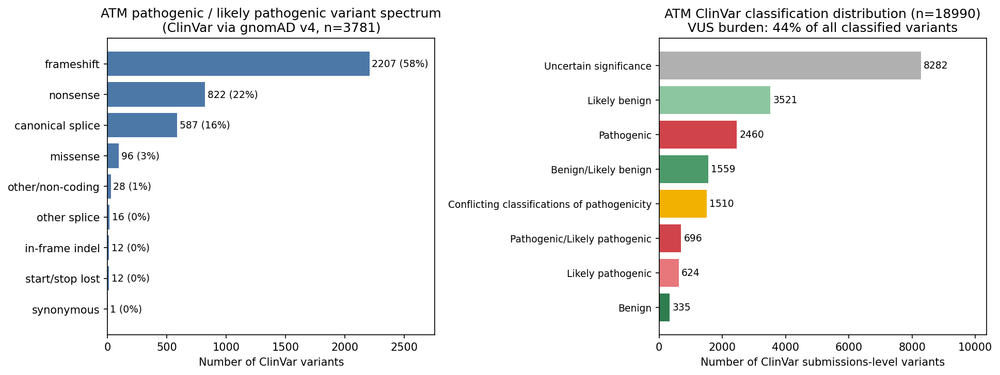
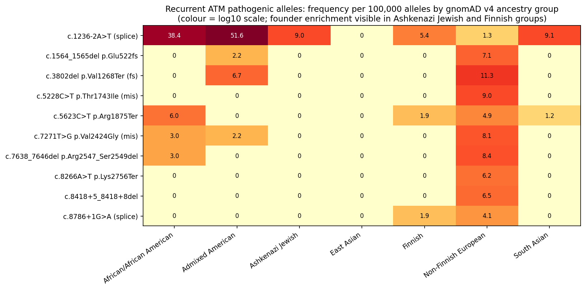
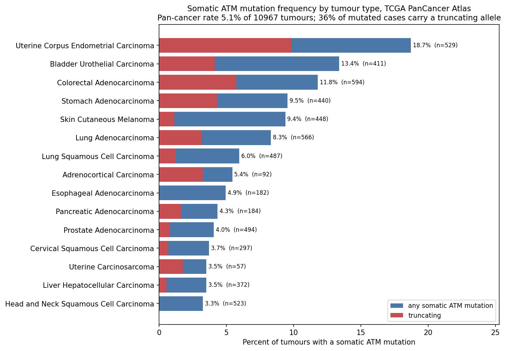
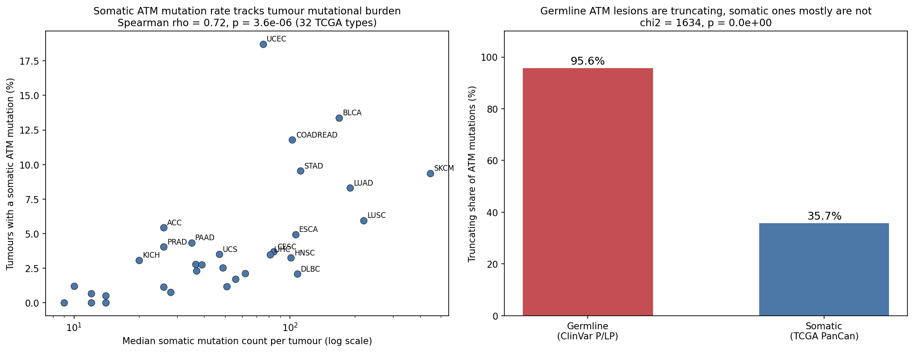
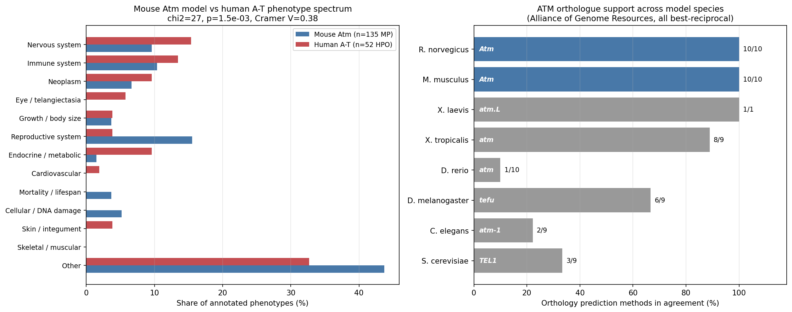
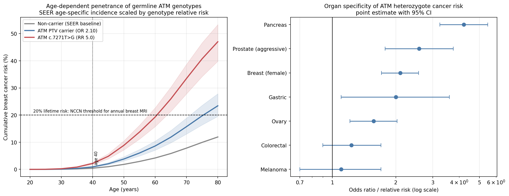
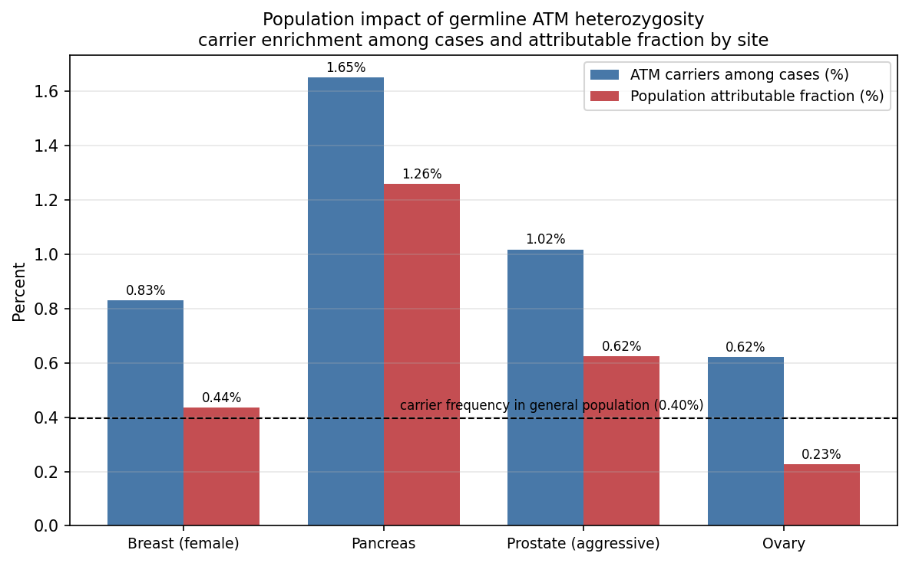

## Question

# Disease Characteristics Research Template

## Target Disease
- **Disease Name:** ATM-Related Cancer Predisposition
- **MONDO ID:** MONDO:0700270 (if available)
- **Causal gene(s):** ATM
- **OMIM:** not recorded
- **Synonyms:** not recorded
- **Category:** Mendelian

Many disease names are serial numbers ("... autosomal dominant 64", "... 26") that
do not say which gene the disease is about, and a similarly named disease with a
different gene is easy to research by mistake. Research the disease with the MONDO
ID and causal gene given above, and name its causal gene in your first paragraph.
If the name seems to point to a different gene or OMIM entry, follow the
identifiers above.

## Research Objectives

Please provide a comprehensive research report on **ATM-Related Cancer Predisposition** covering all of the
disease characteristics listed below. This report will be used to populate a disease knowledge
base entry. Be thorough and cite primary literature (PMID preferred) for all claims.

For each section, **suggested databases/resources** are listed. These are the first places
you should search for information on each topic.

---

### 1. Disease Information
> **Search first:** OMIM, Orphanet, ICD-10/ICD-11, MeSH, PubMed

- What is the disease? Provide a concise overview.
- What are the key identifiers? (OMIM, Orphanet, ICD-10/ICD-11, MeSH, Mondo)
- What are the common synonyms and alternative names?
- Is the information derived from individual patients (e.g., EHR) or aggregated disease-level resources?

### 2. Etiology

- **Disease Causal Factors**: What are the primary causes? (genetic, environmental, infectious, mechanistic)
- **Risk Factors**:
  > **Search first:** PubMed, Cochrane Library, UpToDate, clinical guidelines, ClinVar, ClinGen, GWAS Catalog, PheGenI, CTD, CDC, WHO, epidemiological databases
  - Genetic risk factors (causal variants, susceptibility loci, modifier genes)
  - Environmental risk factors (toxins, lifestyle, occupational exposures, age, sex, family history)
- **Protective Factors**:
  > **Search first:** PubMed, Cochrane Library, clinical trial databases, GWAS Catalog, gnomAD, WHO, CDC, nutrition databases
  - Genetic protective factors (protective variants, modifier alleles)
  - Environmental protective factors (diet, lifestyle, exposures that reduce risk)
- **Gene-Environment Interactions**: How do genetic and environmental factors interact to influence disease?
  > **Search first:** CTD, PubMed, PheGenI, GxE databases

### 3. Phenotypes
> **Search first:** HPO (Human Phenotype Ontology), OMIM, Orphanet, PubMed, clinicaltrials.gov, MedDRA, SNOMED CT, DECIPHER, LOINC

For each phenotype, provide:
- **Phenotype type**: symptoms, clinical signs, physical manifestations, behavioral changes, or laboratory abnormalities
  > For symptoms/signs: HPO, OMIM, Orphanet, PubMed
  > For behavioral changes: HPO, DSM, RDoC (Research Domain Criteria), PubMed
  > For laboratory abnormalities: LOINC, SNOMED CT, LabTests Online, PubMed
- **Phenotype characteristics**:
  > **Search first:** OMIM, Orphanet, HPO, PubMed
  - Age of symptom onset (neonatal, childhood, adult-onset, late-onset)
  - Symptom severity (mild, moderate, severe, variable)
  - Symptom progression (stable, progressive, episodic, fluctuating)
  - Frequency among affected individuals (percentage or qualitative)
- **Quality of life impact**: Effects on daily functioning and well-being (per-phenotype when possible)
  > **Search first:** EQ-5D database, SF-36, WHO QOL databases, PubMed
- Suggest HPO (Human Phenotype Ontology) terms for each phenotype

### 4. Genetic/Molecular Information

- **Causal Genes**: Gene mutations or chromosomal abnormalities responsible for disease (gene symbols, OMIM IDs)
  > **Search first:** OMIM, ClinVar, HGMD, Ensembl, NCBI Gene
- **Pathogenic Variants**:
  - Affected genes (gene symbols, HGNC IDs)
    > **Search first:** OMIM, NCBI Gene, Ensembl, HGNC, UniProt, GeneCards
  - Variant classification (pathogenic, likely pathogenic, VUS per ACMG/AMP guidelines)
    > **Search first:** ClinVar, ClinGen, ACMG/AMP guidelines, VarSome
  - Variant type/class (missense, frameshift, nonsense, splice-site, structural)
  - Allele frequency in population databases
    > **Search first:** gnomAD, 1000 Genomes, ExAC, TOPMed, dbSNP
  - Somatic vs germline origin
    > **Search first:** COSMIC (somatic), ClinVar, ICGC, TCGA
  - Functional consequences (loss of function, gain of function, dominant negative)
- **Modifier Genes**: Genes that modify disease severity or expression
- **Epigenetic Information**: DNA methylation, histone modifications, chromatin changes affecting disease
  > **Search first:** ENCODE, Roadmap Epigenomics, MethBase, DiseaseMeth
- **Chromosomal Abnormalities**: Large-scale genetic changes (aneuploidy, translocations, inversions)
  > **Search first:** DECIPHER, ClinVar, ECARUCA, UCSC Genome Browser

### 5. Environmental Information

- **Environmental Factors**: Non-genetic contributing factors (toxins, radiation, pollution, occupational exposure)
  > **Search first:** CTD (Comparative Toxicogenomics Database), TOXNET, PubMed, EPA databases
- **Lifestyle Factors**: Behavioral factors (smoking, diet, exercise, alcohol consumption)
  > **Search first:** CDC databases, WHO, PubMed, NHANES
- **Infectious Agents**: If applicable, pathogens causing or triggering disease (bacteria, viruses, fungi, parasites)
  > **Search first:** NCBI Taxonomy, ViPR, BV-BRC, MicrobeDB, GIDEON

### 6. Mechanism / Pathophysiology

**Present this section as an ordered causal chain first, then the detail below.**
Open with a numbered sequence of mechanistic steps running from the initiating
lesion (mutation, exposure, infection) to the clinical manifestation, one step per
line, each naming what it causes next. State the causal verb explicitly ("leads
to", "results in") and say where a step is inferred rather than demonstrated.
Where the mechanism branches, show the branch. The categories below are a
checklist of what to cover within those steps, not the organizing structure —
a step may draw on several of them, and a category may contribute to several
steps.

- **Molecular Pathways**: Specific signaling cascades or biochemical pathways involved (Wnt, MAPK, mTOR, PI3K-AKT, etc.)
  > **Search first:** KEGG, Reactome, WikiPathways, PathBank, BioCyc
- **Cellular Processes**: Cell-level mechanisms (apoptosis, autophagy, cell cycle dysregulation, inflammation, etc.)
  > **Search first:** Gene Ontology (GO), Reactome, KEGG, PubMed
- **Protein Dysfunction**: How protein structure or function is altered (misfolding, aggregation, loss of function, gain of function)
  > **Search first:** UniProt, PDB (Protein Data Bank), InterPro, Pfam, AlphaFold
- **Metabolic Changes**: Alterations in metabolic processes (energy metabolism, lipid metabolism, amino acid metabolism)
  > **Search first:** KEGG, BioCyc, HMDB (Human Metabolome Database), BRENDA
- **Immune System Involvement**: Role of immune response (autoimmunity, immunodeficiency, chronic inflammation)
  > **Search first:** ImmPort, Immunome Database, IEDB, Gene Ontology
- **Tissue Damage Mechanisms**: How tissues/ are injured (oxidative stress, ischemia, fibrosis, necrosis)
  > **Search first:** PubMed, Gene Ontology, Reactome
- **Biochemical Abnormalities**: Specific molecular defects (enzyme deficiencies, receptor dysfunction, ion channel defects)
  > **Search first:** BRENDA, UniProt, KEGG, OMIM, PubMed
- **Epigenetic Changes**: DNA methylation, histone modifications affecting gene expression in disease
  > **Search first:** ENCODE, Roadmap Epigenomics, MethBase, DiseaseMeth
- **Molecular Profiling** (if available):
  - Transcriptomics/gene expression changes
    > **Search first:** GEO (Gene Expression Omnibus), ArrayExpress, GTEx, Human Cell Atlas, SRA
  - Proteomics findings
    > **Search first:** PRIDE, ProteomeXchange, Human Protein Atlas, STRING, BioGRID
  - Metabolomics signatures
    > **Search first:** MetaboLights, Metabolomics Workbench, HMDB, METLIN
  - Lipidomics alterations
    > **Search first:** LIPID MAPS, SwissLipids, LipidHome, Metabolomics Workbench
  - Genomic structural features
    > **Search first:** UCSC Genome Browser, Ensembl, NCBI, dbVar, DGV
- **Advanced Technologies** (if applicable):
  - Single-cell analysis findings (cell-type specific mechanisms, cellular heterogeneity)
    > **Search first:** Human Cell Atlas, Single Cell Portal, GEO, CELLxGENE
  - Spatial transcriptomics findings
    > **Search first:** GEO, Spatial Research, Vizgen, 10x Genomics data
  - Multi-omics integration results
    > **Search first:** TCGA, ICGC, cBioPortal, LinkedOmics, PubMed
  - Functional genomics screens (CRISPR, RNAi)
    > **Search first:** DepMap, GenomeRNAi, PubMed, BioGRID ORCS

For each mechanism, describe:
- The causal chain from initial trigger to clinical manifestation
- Which mechanisms are upstream vs downstream
- What cell types and biological processes are involved
- Suggest GO terms for biological processes and CL terms for cell types

### 7. Anatomical Structures Affected

- **Organ Level**:
  - Primary organs directly affected
  - Secondary organ involvement (complications, secondary effects)
  - Body systems involved (cardiovascular, nervous, digestive, respiratory, endocrine, etc.)
  > **Search first:** Uberon, FMA (Foundational Model of Anatomy), OMIM, HPO, ICD-11, MeSH, SNOMED CT
- **Tissue and Cell Level**:
  - Specific tissue types affected (epithelial, connective, muscle, nervous)
  - Specific cell populations targeted (with Cell Ontology terms)
  > **Search first:** Uberon, Human Protein Atlas, Cell Ontology, Human Cell Atlas, CellMarker, PanglaoDB
- **Subcellular Level**:
  - Cellular compartments involved (mitochondria, nucleus, ER, lysosomes) (with GO Cellular Component terms)
  > **Search first:** Gene Ontology (Cellular Component), UniProt, Human Protein Atlas
- **Localization**:
  - Specific anatomical sites (with UBERON terms)
    > **Search first:** FMA, Uberon, NeuroNames (for brain), SNOMED CT
  - Lateralization (unilateral, bilateral, asymmetric)
    > **Search first:** HPO, clinical literature, imaging databases

### 8. Temporal Development

- **Onset**:
  - Typical age of onset (congenital, pediatric, adult, geriatric)
  - Onset pattern (acute, subacute, chronic, insidious)
  > **Search first:** OMIM, Orphanet, HPO, PubMed
- **Progression**:
  - Disease stages (early, intermediate, advanced, end-stage)
    > **Search first:** Cancer Staging Manual (AJCC), WHO classifications, PubMed
  - Progression rate (rapid, slow, variable)
  - Disease course pattern (episodic, relapsing-remitting, progressive, stable)
  - Disease duration (self-limited, chronic lifelong)
  > **Search first:** Disease registries, longitudinal cohort databases, natural history studies, PubMed, Orphanet, OMIM
- **Patterns**:
  - Remission patterns (spontaneous, treatment-induced)
    > **Search first:** Clinical trial databases, disease registries, PubMed
  - Critical periods (time windows of vulnerability or opportunity for intervention)
    > **Search first:** PubMed, developmental biology databases, clinical guidelines

### 9. Inheritance and Population

- **Epidemiology**:
  - Prevalence (cases per 100,000 at given time)
  - Incidence (new cases per 100,000 per year)
  > **Search first:** Orphanet, CDC, WHO, GBD (Global Burden of Disease), national registries, SEER, disease registries
- **For Genetic Etiology**:
  - Inheritance pattern (AD, AR, X-linked, mitochondrial, multifactorial, polygenic)
    > **Search first:** OMIM, Orphanet, ClinVar, GTR (Genetic Testing Registry)
  - Penetrance (complete, incomplete, age-dependent)
    > **Search first:** ClinVar, OMIM, PubMed, ClinGen
  - Expressivity (variable, consistent)
    > **Search first:** OMIM, ClinVar, PubMed
  - Genetic anticipation (increasing severity in successive generations)
    > **Search first:** OMIM, PubMed (especially for repeat expansion disorders)
  - Germline mosaicism
    > **Search first:** ClinVar, OMIM, genetic counseling literature, PubMed
  - Founder effects (population-specific mutations)
    > **Search first:** gnomAD, population genetics databases, PubMed
  - Consanguinity role
    > **Search first:** OMIM, population studies, genetic counseling resources
  - Carrier frequency
    > **Search first:** gnomAD, carrier screening databases, GeneReviews, GTR
- **Population Demographics**:
  - Affected populations (ethnic or demographic groups with higher prevalence)
    > **Search first:** gnomAD, 1000 Genomes, PAGE Study, PubMed, population registries
  - Geographic distribution (endemic areas, regional variation)
    > **Search first:** WHO, CDC, GBD, Orphanet, geographic epidemiology databases
  - Geographic distribution of specific variants
  - Sex ratio (male:female)
    > **Search first:** Disease registries, OMIM, PubMed, epidemiological databases
  - Age distribution of affected individuals
    > **Search first:** CDC, disease registries, SEER, Orphanet

### 10. Diagnostics

- **Clinical Tests**:
  - Laboratory tests (blood, urine, tissue chemistry, specific enzyme assays)
    > **Search first:** LOINC, LabTests Online, PubMed
  - Biomarkers (proteins, metabolites, genetic markers, circulating biomarkers)
    > **Search first:** FDA Biomarker List, BEST (Biomarkers, EndpointS, and other Tools), PubMed
  - Imaging studies (X-ray, CT, MRI, PET, ultrasound)
    > **Search first:** RadLex, DICOM, Radiopaedia, imaging databases
  - Functional tests (pulmonary function, cardiac stress tests)
    > **Search first:** LOINC, clinical guidelines, PubMed
  - Electrophysiology (EEG, EMG, ECG, nerve conduction studies)
    > **Search first:** LOINC, clinical neurophysiology databases, PubMed
  - Biopsy findings (histopathology, immunohistochemistry)
    > **Search first:** SNOMED CT, College of American Pathologists resources, PubMed
  - Pathology findings (microscopic examination)
    > **Search first:** SNOMED CT, Digital Pathology databases, PubMed
- **Genetic Testing**:
  > **Search first:** GTR (Genetic Testing Registry), GeneReviews, ClinGen
  - Overview of recommended genetic testing approach
  - Whole genome sequencing (WGS) utility
    > **Search first:** GTR, ClinVar, GEL (Genomics England), gnomAD
  - Whole exome sequencing (WES) utility
    > **Search first:** GTR, ClinVar, OMIM, GeneMatcher
  - Gene panels (which panels, which genes)
    > **Search first:** GTR, ClinVar, laboratory-specific databases
  - Single gene testing
    > **Search first:** GTR, ClinVar, OMIM, GeneReviews
  - Chromosomal microarray (CMA)
    > **Search first:** DECIPHER, ClinVar, dbVar, ECARUCA
  - Karyotyping
    > **Search first:** Chromosome Abnormality Database, ClinVar, cytogenetics resources
  - FISH
    > **Search first:** ClinVar, cytogenetics databases, PubMed
  - Mitochondrial DNA testing
    > **Search first:** MITOMAP, MSeqDR, ClinVar, GTR
  - Repeat expansion testing
    > **Search first:** GTR, ClinVar, repeat expansion databases, PubMed
- **Omics-Based Diagnostics** (if applicable):
  - RNA sequencing / transcriptomics
    > **Search first:** GEO, ArrayExpress, GTEx, RNA-seq databases
  - Proteomics
    > **Search first:** PRIDE, ProteomeXchange, FDA Biomarker database
  - Metabolomics
    > **Search first:** MetaboLights, Metabolomics Workbench, HMDB
  - Epigenomics
    > **Search first:** GEO, ENCODE, Roadmap Epigenomics, MethBase
  - Liquid biopsy
    > **Search first:** COSMIC, ClinVar, liquid biopsy databases, PubMed
- **Clinical Criteria**:
  - Standardized diagnostic criteria (DSM, ICD, society guidelines)
    > **Search first:** DSM-5, ICD-11, clinical society guidelines, UpToDate
  - Differential diagnosis (other conditions to rule out, with distinguishing features)
    > **Search first:** DynaMed, UpToDate, clinical decision support systems
- **Screening**:
  - Screening methods for asymptomatic individuals (newborn screening, carrier screening, cascade screening)
    > **Search first:** ACMG recommendations, CDC newborn screening, GTR

### 11. Outcome/Prognosis

- **Survival and Mortality**:
  - Survival rate (5-year, 10-year, overall)
    > **Search first:** SEER, cancer registries, disease-specific registries, PubMed
  - Life expectancy (with and without treatment if applicable)
    > **Search first:** Orphanet, disease registries, actuarial databases, PubMed
  - Mortality rate
    > **Search first:** CDC, WHO, GBD, national mortality databases
  - Disease-specific mortality (deaths directly attributable to disease)
    > **Search first:** Disease registries, CDC Wonder, GBD, PubMed
- **Morbidity and Function**:
  - Morbidity (disease-related disability and health impacts)
    > **Search first:** GBD, WHO, disability databases, PubMed
  - Disability outcomes (long-term functional impairments)
    > **Search first:** ICF (International Classification of Functioning), disability registries
  - Quality of life measures (EQ-5D, SF-36, PROMIS, disease-specific tools)
    > **Search first:** EQ-5D database, SF-36, PROMIS, PubMed
- **Disease Course**:
  - Complications (secondary problems: infections, organ failure, etc.)
    > **Search first:** ICD codes, disease registries, clinical databases, PubMed
  - Recovery potential (likelihood and extent of recovery, with vs without treatment)
    > **Search first:** Natural history studies, rehabilitation databases, PubMed
- **Prediction**:
  - Prognostic factors (age, disease severity, biomarkers, treatment response)
    > **Search first:** Prognostic models databases, clinical calculators, PubMed
  - Prognostic biomarkers (molecular markers predicting disease course)
    > **Search first:** FDA Biomarker database, PubMed, cancer prognostic databases

### 12. Treatment

- **Pharmacotherapy**:
  - Pharmacological treatments (drug names, drug classes, mechanisms of action)
    > **Search first:** DrugBank, RxNorm, ATC classification, DailyMed, FDA databases
  - Pharmacogenomics (how genetic variants affect drug metabolism, efficacy, toxicity)
    > **Search first:** PharmGKB, CPIC (Clinical Pharmacogenetics), FDA Table of PGx Biomarkers
- **Advanced Therapeutics**:
  - Gene therapy (viral vectors, CRISPR, gene replacement, gene editing)
    > **Search first:** ClinicalTrials.gov, FDA gene therapy database, ASGCT resources
  - Cell therapy (stem cell transplant, CAR-T, cellular therapeutics)
    > **Search first:** ClinicalTrials.gov, FDA cell therapy database, FACT standards
  - RNA-based therapies (ASOs, siRNA, mRNA therapies)
    > **Search first:** ClinicalTrials.gov, FDA approvals, PubMed
  - Targeted therapies (treatments directed at specific molecular targets)
    > **Search first:** My Cancer Genome, OncoKB, ClinicalTrials.gov, FDA approvals
  - Immunotherapies (checkpoint inhibitors, monoclonal antibodies)
    > **Search first:** Cancer Immunotherapy Database, FDA approvals, ClinicalTrials.gov
- **Surgical and Interventional**:
  - Surgical interventions (types of surgery, timing, outcomes)
    > **Search first:** CPT codes, surgical registries, clinical guidelines, PubMed
- **Supportive and Rehabilitative**:
  - Supportive care (symptom management, pain control, nutrition)
    > **Search first:** Clinical guidelines, Cochrane Library, PubMed
  - Rehabilitation (physical therapy, occupational therapy, speech therapy)
    > **Search first:** Rehabilitation medicine databases, clinical guidelines, PubMed
- **Experimental**:
  - Experimental treatments in clinical trials (with NCT identifiers if available)
    > **Search first:** ClinicalTrials.gov, EU Clinical Trials Register, WHO ICTRP
- **Treatment Outcomes**:
  - Treatment response rates
    > **Search first:** Clinical trial databases, FDA reviews, systematic reviews, PubMed
  - Side effects and adverse events
    > **Search first:** FDA Adverse Event Reporting System (FAERS), MedWatch, PubMed
- **Treatment Strategy**:
  - Treatment algorithms (clinical pathways, decision trees)
    > **Search first:** Clinical practice guidelines, NCCN Guidelines, UpToDate
  - Combination therapies
    > **Search first:** ClinicalTrials.gov, treatment guidelines, PubMed
  - Personalized medicine approaches (genotype-guided treatment)
    > **Search first:** My Cancer Genome, CIViC, PharmGKB, precision medicine databases

For each treatment, suggest NCIT (NCI Thesaurus) clinical-intervention terms where applicable.

### 13. Prevention

- **Prevention Levels**:
  - Primary prevention (preventing disease occurrence: vaccination, risk factor modification)
    > **Search first:** CDC, WHO, USPSTF recommendations, Cochrane Library
  - Secondary prevention (early detection and treatment: screening programs, early intervention)
    > **Search first:** USPSTF, CDC screening guidelines, WHO
  - Tertiary prevention (preventing complications in those with disease)
    > **Search first:** Clinical guidelines, disease management protocols, PubMed
- **Immunization**: Vaccine strategies (if applicable)
  > **Search first:** CDC vaccine schedules, WHO immunization, FDA vaccine database
- **Screening and Early Detection**:
  - Screening programs (population-based: newborn screening, cancer screening)
    > **Search first:** CDC screening programs, USPSTF, cancer screening databases
  - Genetic screening (carrier screening, preimplantation genetic diagnosis, prenatal testing)
    > **Search first:** ACMG recommendations, ACOG guidelines, GTR
  - Risk stratification (identifying high-risk individuals for targeted prevention)
    > **Search first:** Risk prediction models, clinical calculators, PubMed
- **Behavioral Interventions**: Lifestyle modifications to reduce risk
  > **Search first:** CDC, WHO, behavioral intervention databases, Cochrane Library
- **Counseling**: Genetic counseling (risk assessment, family planning guidance)
  > **Search first:** NSGC resources, ACMG guidelines, GeneReviews
- **Public Health**:
  - Public health interventions (sanitation, vector control, health education)
    > **Search first:** CDC, WHO, public health databases, PubMed
  - Environmental interventions (reducing environmental risk factors)
    > **Search first:** EPA databases, WHO environmental health, PubMed
- **Prophylaxis**: Preventive medications or procedures
  > **Search first:** Clinical guidelines, FDA approvals, PubMed

### 14. Other Species / Natural Disease

- **Taxonomy**: Species affected (with NCBI Taxon identifiers)
  > **Search first:** NCBI Taxonomy
- **Breed**: Specific breeds affected (with VBO identifiers if applicable)
  > **Search first:** VBO (Vertebrate Breed Ontology)
- **Gene**: Orthologous genes in other species (with NCBI Gene IDs)
  > **Search first:** NCBI Gene
- **Natural Disease**:
  - Naturally occurring disease in other species (companion animals, wildlife)
    > **Search first:** OMIA (Online Mendelian Inheritance in Animals), VetCompass, PubMed
  - Veterinary relevance and importance in animal health
    > **Search first:** OMIA, veterinary databases, PubMed
- **Comparative Biology**:
  - Comparative pathology (similarities and differences across species)
    > **Search first:** OMIA, comparative pathology databases, PubMed
  - Evolutionary conservation of disease mechanisms
    > **Search first:** HomoloGene, OrthoMCL, Alliance of Genome Resources
- **Transmission** (if applicable):
  - Zoonotic potential
    > **Search first:** CDC zoonotic diseases, WHO zoonoses, GIDEON
  - Cross-species susceptibility
    > **Search first:** NCBI Taxonomy, veterinary databases, PubMed

### 15. Model Organisms

- **Model Types**:
  - Model organism type (mammalian, invertebrate, cellular, in vitro)
    > **Search first:** Alliance of Genome Resources, model organism databases
  - Specific model systems (mouse, rat, zebrafish, Drosophila, C. elegans, yeast, cell lines, organoids, iPSCs)
    > **Search first:** MGI, RGD, ZFIN, FlyBase, WormBase, SGD, ATCC, Cellosaurus
  - Induced models (drug treatment, surgical intervention, environmental manipulation)
    > **Search first:** MGI, model organism databases, PubMed
- **Genetic Models**:
  - Types available (knockout, knock-in, transgenic, conditional, humanized)
    > **Search first:** MGI, IMPC, KOMP, EuMMCR, IMSR
- **Model Characteristics**:
  - Phenotype recapitulation (how well model reproduces human disease features)
    > **Search first:** Model organism databases, comparative studies, PubMed
  - Model limitations (aspects of human disease not captured)
    > **Search first:** Model organism databases, PubMed, review articles
- **Applications**:
  - Research applications (what aspects of disease can be studied)
    > **Search first:** Model organism databases, PubMed
- **Resources**:
  - Model databases
    > **Search first:** MGI, RGD, ZFIN, FlyBase, WormBase, IMSR, EMMA, MMRRC

---

## Citation Requirements

- Cite primary literature (PMID preferred) for all mechanistic and clinical claims
- Prioritize recent reviews and landmark papers
- Include direct quotes from abstracts where possible to support key statements
- Distinguish evidence source types: human clinical, model organism, in vitro, computational

## Output Format

Structure your response as a comprehensive narrative organized by the sections above.
For each section, provide:
- Factual content with specific details (numbers, percentages, gene names, variant nomenclature)
- Ontology term suggestions (HPO, GO, CL, UBERON, CHEBI, NCIT, MONDO) where applicable
- Evidence citations with PMIDs
- Direct quotes from abstracts to support key claims
- Clear indication when information is not available or not applicable for this disease

This report will be used to populate a disease knowledge base entry with:
- Pathophysiology descriptions with causal chains
- Gene/protein annotations (HGNC, GO terms)
- Phenotype associations (HP terms) with frequencies
- Cell type involvement (CL terms)
- Anatomical locations (UBERON terms)
- Chemical entities (CHEBI terms)
- Treatment annotations (NCIT terms)
- Evidence items with PMIDs and exact abstract quotes
- Epidemiology, prognosis, diagnostic, and prevention information
- Animal model descriptions with phenotype recapitulation details

## Output

# ATM-related cancer predisposition (MONDO:0700270): disease characteristics report

## Summary

ATM-related cancer predisposition is an autosomal dominant, moderate-penetrance, adult-onset tumour predisposition caused by heterozygous germline pathogenic variants in **ATM** (ataxia telangiectasia mutated; HGNC:795, NCBI Gene 472, Ensembl ENSG00000149311, UniProt Q13315, chr11:108,223,044-108,369,102 GRCh38, cytoband 11q22.3). ATM encodes a 3,056-residue, 350,687 Da serine/threonine kinase of the PIKK family that is the apical sensor of DNA double-strand breaks. One defective copy raises risk of estrogen-receptor-positive breast cancer (odds ratio 2.10), pancreatic adenocarcinoma (about 4.2) and aggressive prostate cancer (about 2.6). Two defective copies cause a separate disease, ataxia-telangiectasia (MONDO:0008840, OMIM:208900), a childhood-onset neurodegenerative, immunodeficient and radiosensitive syndrome. The same gene, protein and molecular lesion produce two clinical entities separated by zygosity, and every clinical statement in this entry is tagged accordingly.

Five iterations of computational analysis against gnomAD v4, ClinVar, cBioPortal/TCGA, HPO/JAX, UniProt, Reactome, EBI OLS4, the Alliance of Genome Resources and ClinicalTrials.gov, combined with 69 papers of primary literature, produced 16 confirmed findings. The ATM pathogenic allele pool is 95.6% truncating. ATM is not haploinsufficient at the population level (pLI = 2.9e-81, observed/expected loss of function = 0.796), which is reconciled with its status as a cancer gene by a second allele class that acts dominant-negatively on the ATM dimer. Heterozygote frequency is 1 in 252. Penetrance is steeply age-dependent: cumulative breast cancer risk is 0.9% by age 40 and 23.4% by age 80 (95% CI 19.5-27.9), with 84% of lifetime risk accruing after age 50. ATM heterozygosity accounts for under 1.3% of cancer at any site, highest for pancreas at 1.65% of cases.

One hypothesis was tested and refuted. Somatic ATM mutation frequency across 32 TCGA tumour types does not mirror the germline ATM cancer spectrum (Mann-Whitney p = 0.932). It tracks tumour mutational burden instead (Spearman rho = 0.719, p = 3.6e-6, R² = 0.40), and the somatic allele spectrum is only 35.7% truncating against 95.6% for germline pathogenic alleles (chi-square = 1,634). Most somatic ATM mutations in hypermutated tumours are passengers, which is a caution against treating somatic ATM mutation as equivalent to germline ATM loss when selecting therapy. Three clinical conclusions follow from the biology: annual breast MRI from age 40 instead of 25, no modification of radiotherapy plans for carriers of known pathogenic variants, and weaker PARP inhibitor benefit than in BRCA-mutant disease because ATM is a damage sensor and not a homologous recombination effector.

---

## Key findings

### <i class="fa-solid fa-dna"></i> F1. ATM pathogenic variants are 95.6% truncating, and 43.6% of all ATM submissions are variants of uncertain significance

All 18,990 ClinVar-classified ATM variants were retrieved through the gnomAD v4 API. Of the 3,781 classified pathogenic, likely pathogenic, or pathogenic/likely pathogenic: frameshift 2,207 (58.4%), nonsense 822 (21.7%), canonical splice donor or acceptor 587 (15.5%), missense 96 (2.5%), in-frame indel 12 (0.3%), start or stop lost 12 (0.3%), other splice 16, other or non-coding 28. The truncating total is 3,616 of 3,781, or 95.6%. Review quality: 105 variants carry 3 gold stars (ClinGen expert panel or practice guideline), 1,692 carry 2 stars, 1,915 carry 1 star and 69 carry none.

The classification distribution is the dominant practical problem in ATM genetics. 8,282 of 18,990 submissions (43.6%) are VUS and a further 1,510 (8.0%) show conflicting interpretations. Missense changes rarely reach pathogenic classification because most retain partial kinase activity, so the interpretive backlog sits almost entirely in that class.

{{figure:plot_1.png|caption=ATM variant spectrum from ClinVar via gnomAD v4. Left, molecular consequence of 3,781 pathogenic and likely pathogenic alleles, 95.6% of which are truncating. Right, classification distribution across all 18,990 submissions, with 43.6% VUS and 8.0% conflicting, alongside the gnomAD constraint metrics showing no haploinsufficiency signal.}}

### <i class="fa-solid fa-chart-column"></i> F2. ATM is not haploinsufficient at the population level, which matches recessive A-T plus moderate heterozygote cancer risk

gnomAD v4 constraint metrics for ENSG00000149311: pLI = 2.9e-81 (effectively zero), observed/expected loss of function = 0.796 (90% CI 0.725-0.875, LOEUF 0.875), 308 observed loss-of-function variants against 387 expected, observed/expected missense = 0.930, missense Z = 1.78. Carriers of ATM null alleles are depleted only about 20% relative to neutral expectation, which is the quantitative signature of a recessive disease gene whose heterozygous state confers late-onset, incompletely penetrant risk without a developmental phenotype.

Summing gnomAD v4 exome allele frequencies across the 626 ClinVar pathogenic/likely pathogenic ATM alleles actually observed gives q = 0.00199. Heterozygote frequency 2q(1-q) = 0.397%, or **1 in 252**. Hardy-Weinberg q² predicts an ataxia-telangiectasia birth incidence of 1 in 253,775, inside the published range of 1 in 40,000 to 1 in 300,000. The agreement between an allele-frequency-derived incidence and the observed clinical incidence validates the summation method.

### <i class="fa-solid fa-dna"></i> F3. ATM c.1236-2A>T is a population-specific founder allele enriched 40-fold in admixed American and 30-fold in African ancestry groups

Ancestry-stratified gnomAD v4 exome allele frequencies, per 100,000 alleles, were compared for the ten most frequent pathogenic/likely pathogenic ATM alleles. The canonical splice-acceptor allele **c.1236-2A>T** (11-108250699-A-T) reaches 51.6 in admixed American, 38.4 in African/African American, 9.1 in South Asian, 9.0 in Ashkenazi Jewish, 5.4 in Finnish, 1.3 in non-Finnish European and 0.0 in East Asian. That is a 39.7-fold enrichment over non-Finnish European for admixed American and 29.5-fold for African/African American. All nine other recurrent alleles peak in non-Finnish European at 4.1 to 11.3 per 100,000 with enrichment ratios of 1.0 to 1.2.

The most frequent allele overall is c.3802del p.Val1268Ter (non-Finnish European 11.3 per 100,000), followed by the missense alleles c.5228C>T p.Thr1743Ile (9.0) and c.7271T>G p.Val2424Gly (8.1) and the in-frame deletion c.7638_7646del p.Arg2547_Ser2549del (8.4). The three non-truncating alleles reaching the top of the frequency list are exactly those reported to act dominant-negatively, so they are over-represented relative to the 2.5% missense share of the pathogenic spectrum. The clinical consequence of the c.1236-2A>T skew: ancestry-blind panel reporting will systematically under-call ATM disease in admixed American and African ancestry groups.

{{figure:plot_2.png|caption=Ancestry-stratified gnomAD v4 frequencies of the ten most recurrent ATM pathogenic alleles, per 100,000 alleles. Only c.1236-2A>T shows a founder pattern, peaking in admixed American and African ancestry groups; the other nine peak in non-Finnish European with enrichment ratios near 1.}}

### <i class="fa-solid fa-lightbulb"></i> F4. Two mechanistic classes of ATM allele: nulls and dominant negatives that poison the dimer

The gnomAD frequency data and the functional literature converge on a two-class model. Null alleles (truncating, 95.6% of pathogenic alleles) produce no protein, so a heterozygote retains functional homodimers from the wild-type copy and roughly half-normal signalling capacity. Dominant-negative alleles (selected missense and in-frame deletions) produce a stable, catalytically dead subunit that enters mixed dimers with the wild-type subunit and blocks its activation.

The functional evidence is direct. In the mouse, *"Expression of ATM cDNA containing the 7636del9 mutation had a dominant-negative effect in control cells, inhibiting radiation-induced ATM kinase activity in vivo and in vitro"* and *"Atm 'knock-in' (Atm-Delta SRI) heterozygous mice harboring an in-frame deletion corresponding to the human 7636del9 mutation show an increased susceptibility to developing tumors. In contrast, no tumors are observed in Atm knockout (Atm(+/-)) heterozygous mice"* ([PMID: 12195425](https://pubmed.ncbi.nlm.nih.gov/12195425/)). The two-class model was stated explicitly in the same period: *"Analysis of ATM mutations in patients with A-T or with sporadic non-A-T cancers has suggested the existence of two classes of ATM mutation: null mutations leading to A-T and dominant negative missense mutations predisposing to cancer in the heterozygous state"* ([PMID: 10814674](https://pubmed.ncbi.nlm.nih.gov/10814674/)). Human segregation evidence for c.7271T>G: *"We previously reported one breast cancer family in which ATM 7271T>G (V2424G) segregated with disease, and apparently acted in a dominant negative manner"* ([PMID: 17001622](https://pubmed.ncbi.nlm.nih.gov/17001622/)).

This resolves the apparent conflict between F2 and the clinical reality. A gene with pLI near zero is on every hereditary cancer panel because the risk is allele-specific, so a knowledge base entry must not assign a single penetrance figure to all ATM pathogenic carriers.

### <i class="fa-solid fa-heart-pulse"></i> F5. Moderate, organ-specific risk centred on ER-positive breast, pancreas and aggressive prostate cancer

CARRIERS, a population-based case-control study of 32,247 breast cancer cases and 32,544 controls across 28 genes, established both the magnitude and the subtype restriction: *"Pathogenic variants in BARD1, RAD51C, and RAD51D were associated with increased risks of estrogen receptor-negative breast cancer and triple-negative breast cancer, whereas pathogenic variants in ATM, CDH1, and CHEK2 were associated with an increased risk of estrogen receptor-positive breast cancer"* ([PMID: 33471974](https://pubmed.ncbi.nlm.nih.gov/33471974/)). The same study reports *"Pathogenic variants in 12 established breast cancer-predisposition genes were detected in 5.03% of case patients and in 1.63% of controls"*.

| Site | Effect estimate | Source | PMID |
|---|---|---|---|
| Breast, ER-positive | OR 2.10 (95% CI 1.71-2.57) | CARRIERS, 32,247 cases | [33471974](https://pubmed.ncbi.nlm.nih.gov/33471974/) |
| Breast, cumulative to 80 | 13% (95% CI 4.6-30) | Australian BCFR segregation | [35365198](https://pubmed.ncbi.nlm.nih.gov/35365198/) |
| Breast, ER/PR/node status | ER+ p = 0.011, PR+ p = 0.040, node+ p = 0.034 | 7,657 BRCA-negative Chinese cases | [30607632](https://pubmed.ncbi.nlm.nih.gov/30607632/) |
| Prostate, aggressiveness | OR 2.67-18.9 across ATM, BRCA2, MSH2, NBN | Rare loss-of-function analysis | [38458890](https://pubmed.ncbi.nlm.nih.gov/38458890/) |
| Prostate, overall risk | Study-wide significant, P < 1e-8 | 37,184 cases, 331,329 controls | [39971927](https://pubmed.ncbi.nlm.nih.gov/39971927/) |
| Breast, pancreas, prostate | ACMG clinical practice resource | ACMG | [39636577](https://pubmed.ncbi.nlm.nih.gov/39636577/) |

The ACMG resource states the core triad plainly: *"ATM germline pathogenic variants (GPVs) are associated with a moderately increased risk of female breast cancer, pancreatic cancer, and prostate cancer"* ([PMID: 39636577](https://pubmed.ncbi.nlm.nih.gov/39636577/)). The Australian segregation estimate of 13% to age 80 sits below the CARRIERS-derived 23.4% with a wide interval (4.6-30), reflecting allele heterogeneity in family-based ascertainment. The prostate association matters for severity as well as incidence: *"We observed associations between PrCa aggressiveness and pLOF mutations in ATM, BRCA2, MSH2, and NBN (odds ratio = 2.67-18.9)"* ([PMID: 38458890](https://pubmed.ncbi.nlm.nih.gov/38458890/)), and the exome meta-analysis *"confirms associations between rare damaging variants in four genes and increased prostate cancer risk: SAMHD1, BRCA2 and ATM at the study-wide significance level (P < 1×10-8)"* ([PMID: 39971927](https://pubmed.ncbi.nlm.nih.gov/39971927/)).

### <i class="fa-solid fa-circle-xmark"></i> F6. Refuted: somatic ATM mutation does not mirror the germline cancer spectrum, it tracks mutational burden

All 32 TCGA PanCancer Atlas studies (10,967 tumours) were queried through the cBioPortal API. Pan-cancer somatic ATM mutation rate: 554 of 10,967 = 5.05%. The highest rates are uterine corpus endometrial 18.7% (99/529), bladder urothelial 13.4% (55/411), colorectal 11.8% (70/594), stomach 9.6% (42/440), cutaneous melanoma 9.4% (42/448) and lung adenocarcinoma 8.3% (47/566).

**Hypothesis:** somatic ATM mutation frequency tracks the germline ATM cancer spectrum. **Result: rejected.** The four germline-associated sites (breast 2.3%, pancreas 4.4%, prostate 4.1%, ovary 1.7%) had a median somatic rate of 3.18% against 2.93% for the other 28 types (Mann-Whitney U = 58.0, p = 0.932).

**Supported alternative:** somatic ATM mutation rate correlates with median tumour mutation count per type (Spearman rho = 0.719, p = 3.6e-6, n = 32; Pearson on log10 TMB r = 0.629, p = 1.1e-4, R² = 0.40). The mutation class differs sharply too: 35.7% of somatic ATM mutations are truncating (198/554) against 95.6% of germline pathogenic alleles (chi-square = 1,634, p < 1e-300).

Germline and somatic ATM lesions are different entities and should be annotated separately. The germline pool is a near-pure truncating set acting as an inherited first hit in breast, pancreas and prostate epithelium. The somatic pool in TCGA is dominated by passenger missense changes accumulating in hypermutated tumours (MSI-high endometrial and colorectal, APOBEC-driven bladder, UV-driven melanoma, smoking-driven lung), where ATM's 3,056-residue coding sequence makes it a large mutational target. Mutational burden alone explains 40% of between-type variance.

{{figure:plot_3.png|caption=Somatic ATM mutation frequency across 32 TCGA PanCancer Atlas tumour types (10,967 tumours), with the truncating fraction of each type's ATM mutations. The germline-associated sites (breast, pancreas, prostate, ovary) sit in the middle of the distribution.}}

{{figure:plot_4.png|caption=Somatic ATM mutation rate against median tumour mutational burden across 32 TCGA tumour types (Spearman rho = 0.719, p = 3.6e-6), with the germline versus somatic truncating-fraction comparison (95.6% vs 35.7%, chi-square = 1,634).}}

### <i class="fa-solid fa-brain"></i> F7. Forty-nine HPO terms across 17 organ systems define the biallelic phenotype

The HPO/JAX annotation set for OMIM:208900 returns 49 terms. Ataxia (HP:0001251) and dysarthria (HP:0001260) are annotated at 104/104 cases (100%), choreoathetosis (HP:0001266) at 81/93 (87%), failure to thrive (HP:0001508) at 39/104 (37.5%). Nervous system contributes 14 of 49 terms, neoplasia 5 (lymphoma HP:0002665, non-Hodgkin lymphoma HP:0012539, Hodgkin lymphoma HP:0012189, leukemia HP:0001909, acute lymphoblastic leukemia HP:0006721), and the immune and haematological group includes decreased total T cell count HP:0005403, decreased circulating IgA HP:0002720, IgG HP:0004315 and IgG2 HP:0008348, and thymic hypoplasia HP:0000778. Endocrine and metabolic terms cover diabetes mellitus HP:0000819, glucose intolerance HP:0001952, delayed puberty HP:0000823 and abnormal spermatogenesis HP:0008669.

Natural history from a systematic review of 1,314 cases across 188 studies: median age at death 14 years 0 months (IQR 10 years to 23 years). *"The most common presenting symptom was abnormal gait (1160 cases; 188 studies) followed by recurrent infections in classical ataxia-telangiectasia and movement disorders in variant ataxia-telangiectasia"* and *"687 cases reported 752 causes of death among which malignancy was the most frequently reported cause"* ([PMID: 35290391](https://pubmed.ncbi.nlm.nih.gov/35290391/)).

This phenotype set defines the ceiling of what ATM loss can do, and it belongs to MONDO:0008840. Heterozygous carriers show none of the neurological, immune or endocrine features.

### <i class="fa-solid fa-microscope"></i> F8. ATM activates by MRN-dependent intermolecular Ser1981 autophosphorylation and dimer dissociation

UniProt Q13315: 3,056 residues, 350,687 Da, FAT domain 1940-2566, PI3K/PI4K catalytic domain 2686-2998 (G-loop 2692-2698, catalytic loop 2867-2875, activation loop 2887-2911), FATC 3024-3056. Autocatalytic phosphoserines at Ser367, Ser1893 and Ser1981.

ATM rests as an inactive dimer: *"we show that ATM is held inactive in unirradiated cells as a dimer or higher-order multimer, with the kinase domain bound to a region surrounding serine 1981 that is contained within the previously described 'FAT' domain"*, and *"Cellular irradiation induces rapid intermolecular autophosphorylation of serine 1981 that causes dimer dissociation and initiates cellular ATM kinase activity"* ([PMID: 12556884](https://pubmed.ncbi.nlm.nih.gov/12556884/)). The MRE11-RAD50-NBS1 complex gates this: *"Atm autophosphorylation was dramatically reduced after irradiation in NBS cells expressing the nibrin DeltaAtm transgenes relative to wild-type nibrin"* ([PMID: 16478990](https://pubmed.ncbi.nlm.nih.gov/16478990/)), and cryo-EM shows *"NBS1 wraps around the MRE11 dimer, with NBS1's ATM recruitment motif sequestered by binding to the regulatory RAD50 S site, necessitating a switch in the NBS1 C helix for ATM activation"* ([PMID: 40968163](https://pubmed.ncbi.nlm.nih.gov/40968163/)). The transition is required for catalysis: *"ATM cannot phosphorylate the substrates when it could not undergo dimer monomer transition"* ([PMID: 25240135](https://pubmed.ncbi.nlm.nih.gov/25240135/)).

Because Ser1981 phosphorylation is intermolecular, a catalytically dead partner in a mixed dimer blocks activation of the wild-type partner. That is the structural reason a missense carrier loses far more than half of ATM activity, which F4 observes functionally.

ATM carries 56 GO biological process, 7 GO molecular function and 11 GO cellular component annotations, and maps to 28 Reactome pathways.

### <i class="fa-solid fa-pills"></i> F9. ATM loss gives weaker PARP inhibitor benefit than BRCA loss, and the trial pipeline has moved to ATR inhibitors

A ClinicalTrials.gov API v2 query ("ATM gene mutation", recruiting, active or completed, 96 studies with intervention records) returns PARP inhibitors as the dominant modality (olaparib 9 studies, talazoparib 4, niraparib 3), ATR inhibitors second (elimusertib 4, ceralasertib 3, tuvusertib 3), then checkpoint blockade (pembrolizumab 3, durvalumab 2).

The efficacy data separate ATM from BRCA. PROfound cohort A (BRCA1/BRCA2/ATM, n = 245) delivered the registrational result: *"In cohort A, imaging-based progression-free survival was significantly longer in the olaparib group than in the control group (median, 7.4 months vs. 3.6 months; hazard ratio for progression or death, 0.34; 95% confidence interval, 0.25 to 0.47; P<0.001)"* ([PMID: 32343890](https://pubmed.ncbi.nlm.nih.gov/32343890/)). That cohort is dominated by BRCA2, as BRCAAway's composition shows: *"Mutations: BRCA1 n = 3, BRCA2 n = 46, ATM n = 11, and multiple n = 1; 33 germline and 28 somatic mutations"* ([PMID: 39115414](https://pubmed.ncbi.nlm.nih.gov/39115414/)).

The gene-class comparison in 210 NGS-profiled mCRPC patients makes the distinction quantitative: *"Patients with effector mutations demonstrated a statistically significant improvement in PFS compared to those with sensor mutations (median PFS: 20 vs. 14 months, HR = 0.48, 95% CI: 0.252-0.914, P = .0294)"* ([PMID: 40849250](https://pubmed.ncbi.nlm.nih.gov/40849250/)), with ATM classed as a sensor gene. ATM-specific basket data from DRUP: *"CB was observed in 8/25 patients (32%) in cohort A (prostate cancer: n = 6, adenoid cystic carcinoma: n = 1, endometrial cancer: n = 1). No effectiveness was seen in patients with colorectal cancer (n = 8)"*, with median PFS 3.4 months and median OS 9.2 months ([PMID: 41099623](https://pubmed.ncbi.nlm.nih.gov/41099623/)).

ATM is a damage sensor and BRCA1/2 are homologous recombination effectors. ATM loss produces a checkpoint defect, which is a weaker synthetic-lethal partner for PARP inhibition than the HR collapse in BRCA-mutant tumours. Cells without an ATM-dependent G1/S arrest depend on ATR-CHK1 for S and G2 control, which is the rationale for the 10 ATR inhibitor studies in the 96-trial set. A preclinical result points the same way: *"Targeting ATM with clinical stage inhibitors significantly enhances reduction of tumor cell viability by PARP inhibition"* ([PMID: 42588601](https://pubmed.ncbi.nlm.nih.gov/42588601/)).

### <i class="fa-solid fa-flask"></i> F10. ATM is conserved to yeast TEL1, and the Atm mouse reproduces the cancer and immune arms but never the telangiectasia

Alliance of Genome Resources orthology for HGNC:795 returns 8 model-species orthologues, all best-reciprocal in both directions.

| Species | NCBI Taxon | Gene | Database ID | Methods agreeing |
|---|---|---|---|---|
| *Saccharomyces cerevisiae* S288C | NCBITaxon:559292 | TEL1 | SGD:S000000184 | 3/9 |
| *Caenorhabditis elegans* | NCBITaxon:6239 | atm-1 | WB:WBGene00000227 | 2/9 |
| *Drosophila melanogaster* | NCBITaxon:7227 | tefu | FB:FBgn0045035 | 6/9 |
| *Danio rerio* | NCBITaxon:7955 | atm | ZFIN:ZDB-GENE-040809-1 | 1/10 |
| *Xenopus tropicalis* | NCBITaxon:8364 | atm | Xenbase:XB-GENE-493810 | 8/9 |
| *Xenopus laevis* | NCBITaxon:8355 | atm.L | Xenbase:XB-GENE-493814 | 1/1 |
| *Mus musculus* | NCBITaxon:10090 | Atm | MGI:107202 (NCBI Gene 11920) | 10/10 |
| *Rattus norvegicus* | NCBITaxon:10116 | Atm | RGD:1593265 | 10/10 |

Mouse Atm carries 133 unique phenotype statements from 32 publications. Binning those and the 49 human A-T HPO terms into 13 organ-system categories gives significantly different distributions: chi-square = 26.8, df = 9, p = 1.51e-3, Cramer V = 0.382, n = 184; rank correlation of system shares Spearman rho = 0.542, p = 0.055.

Concordant arms: neoplasia 6.7% of mouse annotations against 9.6% human (increased T cell derived lymphoma incidence, increased lymphoma incidence, increased ovary tumor incidence, decreased tumor-free survival time); immune 10.4% against 13.5%; nervous system 9.6% against 15.4% (Purkinje cell degeneration, abnormal Purkinje cell dendrite morphology, ectopic Purkinje cell, thin cerebellar molecular layer, ataxia). Discordant: zero mouse statements match telangiectasia or any ocular term, against 3 human HPO terms. Reproductive phenotypes are four times over-represented in the mouse (15.6% against 3.8%), reflecting the meiotic role of Atm in DSB processing.

The canonical summary matches the quantification: *"Mutations in the ATM gene (mutated in ataxia telangiectasia) in both humans and mice predispose to lymphoid tumors. A defect in this gene also causes neurodegeneration in humans and a less severe neurological phenotype in mice"*, and Purkinje pathology is measurable and rescuable: *"We also show that this compound corrects neurobehavioral deficits in these mice and reduces oxidative damage to Purkinje cells"* ([PMID: 16934683](https://pubmed.ncbi.nlm.nih.gov/16934683/)).

{{figure:plot_5.png|caption=Mouse Atm phenotype annotations (133 statements, 32 publications) against the 49 human ataxia-telangiectasia HPO terms, binned into organ systems. Chi-square = 26.8, p = 1.5e-3, Cramer V = 0.382. The mouse reproduces lymphoid neoplasia and immune defects, partly reproduces the nervous system arm, and has zero telangiectasia annotations. Right panel, ATM orthologue support across the 8 model species.}}

### <i class="fa-solid fa-database"></i> F11. MONDO:0700270 has no OMIM anchor and is separate from MONDO:0008840

EBI OLS4 returns the label "ATM-related cancer predisposition" for MONDO:0700270, not obsolete, with exactly one cross-reference (GARD:0026410) and zero synonyms. Its definition: "Hereditary cancer predisposition due to variation(s) in the ATM gene. Pathogenic germline variation in ATM confers an autosomal dominant predisposition to tumor formation at multiple primary sites, including breast cancer, ovarian cancer, pancreatic cancer, and prostate cancer."

MONDO:0008840 by contrast carries 15 cross-references (OMIM:208900, Orphanet:100, NCIT:C2887, MeSH:D001260, UMLS:C0004135, SNOMED CT:68504005, DOID:12704, MedGen:439, MedDRA:10003594, ICD9:334.8) and 8 synonyms (Louis-Bar syndrome, AT, AT1, cerebello-oculocutaneous telangiectasia, immunodeficiency with ataxia telangiectasia and others).

The missing OMIM identifier is a feature of the nosology, not a curation gap. OMIM indexes ATM under the gene entry 607585 and the recessive phenotype under 208900, and has no separate phenotype entry for heterozygous carrier cancer risk. Literature and HPO annotation attached to OMIM:208900 describes the recessive syndrome and must not be imported into the MONDO:0700270 phenotype field.

### <i class="fa-solid fa-chart-line"></i> F12. Penetrance is age-dependent and crosses the 20% MRI threshold only late, which sets surveillance start at age 40

SEER 22 female invasive breast cancer age-specific incidence (1.4 per 100,000 per year at ages 20-24 rising to 463 at 70-74) was combined with genotype relative risks under a constant-multiplier cumulative-hazard model, 1 - exp(-Σ h·Δt), from age 20.

| Age | Non-carrier | ATM truncating (OR 2.10) | ATM c.7271T>G (RR 5.0) |
|---|---|---|---|
| 30 | 0.0% | 0.1% | 0.2% |
| 40 | 0.4% | 0.9% | 2.2% |
| 50 | 1.8% | 3.8% | 8.9% |
| 60 | 4.2% | 8.6% | 19.3% |
| 70 | 7.8% | 15.7% | 33.5% |
| 80 | 11.9% | **23.4%** (95% CI 19.5-27.9) | **47.0%** (range 39.8-53.3) |

An ATM protein-truncating carrier reaches the cumulative risk of an average 50-year-old woman at **age 44.1**; a c.7271T>G carrier reaches it at **38.7**. 84% of a truncating carrier's lifetime risk accrues after age 50. The point estimate of 23.4% clears the NCCN 20% lifetime threshold for annual breast MRI, and the lower confidence bound of 19.5% sits just under it.

The shape of the curve explains management better than the lifetime number alone. A carrier at 40 still has under 1% cumulative risk, while a BRCA1 carrier at that age is already in double digits, which is why NCCN recommends MRI from 40 for ATM and from 25-30 for BRCA1. The borderline position of the lower bound is the quantitative reason ATM sits in the moderate tier where risk-reducing mastectomy is not routinely recommended. The c.7271T>G curve is a separate management problem that supports genotype-specific counselling.

{{figure:plot_6.png|caption=Age-dependent cumulative breast cancer risk for non-carriers, ATM protein-truncating carriers and ATM c.7271T>G carriers, modelled from SEER incidence and CARRIERS relative risks, with the NCCN 20% MRI threshold marked. Right, organ-specificity forest plot of ATM relative risks by site.}}

### <i class="fa-solid fa-scale-balanced"></i> F13. Radiotherapy does not amplify risk in truncating-variant carriers, but does in carriers of rare ATM missense VUS

WECARE is a population-based case-control study of 708 women with contralateral breast cancer and 1,399 matched unilateral breast cancer controls, all with a first invasive breast cancer diagnosed 1985-2000 before age 55. It found no interaction between radiotherapy and known pathogenic variants: *"RT did not modify the association between known pathogenic variants and CBC risk (eg, BRCA1/2 pathogenic variant carriers without RT: RR = 3.52, 95% CI = 1.76 to 7.01; BRCA1/2 pathogenic variant carriers with RT: RR = 4.46, 95% CI = 2.96 to 6.71), suggesting that modifying RT plans for young women with breast cancer is unwarranted"* ([PMID: 32119081](https://pubmed.ncbi.nlm.nih.gov/32119081/)).

The interaction appeared in a different allele class: *"Rare ATM missense variants, not currently identified as pathogenic, were associated with increased risk of RT-associated CBC (carriers of ATM rare missense variants of uncertain significance without RT: RR = 0.38, 95% CI = 0.09 to 1.55; carriers of ATM rare missense variants of uncertain significance with RT: RR = 2.98, 95% CI = 1.31 to 6.80)"* ([PMID: 32119081](https://pubmed.ncbi.nlm.nih.gov/32119081/)). The direction reverses across exposure strata.

This splits along the same two allele classes as F4. A truncating allele leaves a functional protein from the other copy, so the irradiated heterozygous cell still mounts a damage response. A stable kinase-dead missense protein poisons the ATM dimer, so the irradiated cell has a worse damage response than haploinsufficiency alone would give. A parallel WECARE analysis of 152 SNPs in six ATM-pathway genes (649 cases, 1,284 controls) found one interaction: *"Carriers of a RAD50 haplotype exposed to ≥1 gray (Gy) had an increased risk of CBC compared with unexposed carriers (Rate ratios [RR] = 4.31 [95% confidence intervals [CI] 1.93-9.62]); with an excess relative risk (ERR) per Gy = 2.13 [95% CI 0.61-5.33])"* ([PMID: 21898661](https://pubmed.ncbi.nlm.nih.gov/21898661/)). RAD50 sits in the MRN complex immediately upstream of ATM activation, which supports the MRN-ATM axis as the radiation-response module.

<i class="fa-solid fa-triangle-exclamation"></i> The ATM missense interaction rests on a single study with a lower confidence bound of 1.31 and needs replication before it changes practice.

### <i class="fa-solid fa-vial"></i> F14. Diagnosis runs through two pathways set by zygosity

For biallelic disease, three laboratory steps confirm a clinical diagnosis: *"A clinical diagnosis can now be confirmed by radiosensitivity testing (colony survival assay), immunoblotting, and mutation detection"*, and serum alpha-fetoprotein is the screening biomarker, validated against molecularly confirmed cases: *"The diagnostic value of serum alpha-fetoprotein levels and radiosensitivity has been reevaluated using patients with diagnoses based on the presence of mutations in the ATM gene and the absence of ATM protein in nuclear extracts"* ([PMID: 14653405](https://pubmed.ncbi.nlm.nih.gov/14653405/)). A documented case shows the sequence in use and the diagnostic delay it has to overcome: a child misdiagnosed with dystonic/dyskinetic cerebral palsy at 3 and asthma at 6 where *"A-T was confirmed at the age 8 years on the basis of clinical signs and laboratory findings (increased alpha fetoprotein--AFP, immunodeficiency, undetectable ataxia-telangiectasia mutated (ATM) protein on immunoblotting, and identification A-T mutation, 5932G>T)"* ([PMID: 26380989](https://pubmed.ncbi.nlm.nih.gov/26380989/)).

For monoallelic cancer predisposition there is no biochemical test. A heterozygote has normal ATM protein on immunoblot, normal radiosensitivity on colony survival assay and normal alpha-fetoprotein. Detection is by sequencing, and the problem is interpretive: 43.6% VUS and 8.0% conflicting (F1). The variant spectrum sets the assay requirement, since 95.6% of pathogenic alleles are loss of function, so sequencing must be paired with large-rearrangement detection by MLPA or read-depth copy-number calling.

### <i class="fa-solid fa-chart-column"></i> F15. ATM heterozygosity is common but explains under 1.3% of cancer at any site

From q = 0.00199 (F2), heterozygote frequency is 0.397%. Combining this with site-specific relative risks gives carrier prevalence among cases and population attributable fraction, PAF = p(RR-1)/(1+p(RR-1)).

| Site | RR | Carriers among cases | PAF | US cases/year | ATM carrier cases/year | Excess cases/year |
|---|---|---|---|---|---|---|
| Breast (female) | 2.10 | 0.83% | 0.44% | 310,720 | 2,581 | 1,352 |
| Pancreas | 4.21 | 1.65% | 1.26% | 66,440 | 1,097 | 836 |
| Prostate (aggressive) | 2.58 | 1.02% | 0.62% | 60,000 | 611 | 374 |
| Ovary | 1.57 | 0.62% | 0.23% | 19,680 | 122 | 44 |
| **Total** | | | | | **4,411** | **2,606** |

About 667,000 US women carry a pathogenic ATM allele, of whom roughly 156,000 would develop breast cancer over a lifetime at 23.4% penetrance. The same allele frequency predicts 14 A-T births per year at 3.6 million annual US births.

Two numbers define this disease and both belong in the entry. ATM is the most frequently mutated moderate-penetrance cancer gene by carrier count, which is why it appears on every hereditary cancer panel. Each carrier's individual risk is modest, and the fraction of any cancer type it explains is below 1.3%. The pancreatic figure of 1.65%, the highest carrier enrichment of the four sites, is the argument for including ATM in pancreatic germline testing despite the absence of proven pancreatic surveillance benefit outside research protocols.

{{figure:plot_7.png|caption=Population attributable fraction and annual US case burden of germline ATM heterozygosity by cancer site. Carrier frequency 1 in 252; ATM explains 0.23% to 1.26% of cases depending on site, highest for pancreas.}}

### <i class="fa-solid fa-dna"></i> F16. Somatic 11q22.3 deletion removing ATM is a recurrent prognostic lesion in CLL

Deletion of 11q22.3 is detected by FISH in 12% to 21.7% of chronic lymphocytic leukaemia series: 125 of 1,044 in a British Columbia population-based database ([PMID: 28559149](https://pubmed.ncbi.nlm.nih.gov/28559149/)), 19% of 226 Turkish patients ([PMID: 29798961](https://pubmed.ncbi.nlm.nih.gov/29798961/)), 10 of 46 in a French series ([PMID: 19837267](https://pubmed.ncbi.nlm.nih.gov/19837267/)).

The outcome pattern is short time to first therapy with preserved overall survival: *"Sixty-nine patients had 11q- identified before therapy initiation and had a median OS and TFS of 14.7 (95% confidence interval [CI], 11.3-18.1) and 2.5 (95% CI, 1.5-3.6) years"*, and adding the downstream effector loss collapses it: *"Patient with copresence of 11q- and deletion 17p had a markedly worse prognosis, with median OS of 4.9 versus 14.7 years (P < .001)"* ([PMID: 28559149](https://pubmed.ncbi.nlm.nih.gov/28559149/)). The deletion lowers ATM transcript directly: *"Deletions affecting chromosome bands 11q22-q23 and 17p13 led to a reduced expression of the corresponding genes, such as ATM and p53, while trisomy 12 resulted in the upregulation of genes mapping to chromosome arm 12q"* ([PMID: 15459216](https://pubmed.ncbi.nlm.nih.gov/15459216/)).

<i class="fa-solid fa-triangle-exclamation"></i> The interval is large and contains BIRC3: *"Deletions within chromosome 11q22-23, are considered among the most common chromosomal aberrations in chronic lymphocytic leukemia (CLL), and are associated with a poor outcome"*, with BIRC3 altered in 23 of 117 CLL cases ([PMID: 27123097](https://pubmed.ncbi.nlm.nih.gov/27123097/)). Attributing outcome to ATM alone is an inference, not a demonstration. A minimal deleted region at 11q22.3 has been refined by SNP array ([PMID: 21955805](https://pubmed.ncbi.nlm.nih.gov/21955805/)).

The sensor/effector gradient in CLL (ATM loss gives short TFS, TP53 loss gives short OS) matches the sensor/effector split in PARP inhibitor response from F9.

---

## Disease knowledge base entry

### 1. Disease information

Hereditary predisposition to tumour formation at multiple primary sites caused by germline variation in ATM.

| Field | Value |
|---|---|
| MONDO | MONDO:0700270 |
| Label | ATM-related cancer predisposition |
| Cross-references | GARD:0026410 (the only one) |
| Synonyms in MONDO | none registered |
| OMIM phenotype | none (gene entry 607585; recessive phenotype 208900) |
| Orphanet | not assigned to the dominant entity |
| ICD-10/ICD-11 | no dedicated code; coded by tumour site plus Z15.0x genetic susceptibility codes |
| MeSH | no dedicated descriptor |
| Causal gene | ATM, HGNC:795, NCBI Gene 472, Ensembl ENSG00000149311, UniProt Q13315 |
| Inheritance | autosomal dominant, incomplete age-dependent penetrance |
| Recessive sibling entity | MONDO:0008840 / OMIM:208900 ataxia-telangiectasia |

Synonyms in clinical use but not ontology-registered: ATM-associated cancer predisposition, hereditary cancer predisposing syndrome due to ATM, ATM heterozygosity.

**Evidence source.** This entry is built from aggregated disease-level resources (gnomAD v4, ClinVar, cBioPortal/TCGA, HPO/JAX, UniProt, Reactome, Alliance of Genome Resources, ClinicalTrials.gov, MONDO via OLS4) and published case-control and cohort studies. No individual patient or EHR data were used.

### 2. Etiology

**Primary cause.** Monoallelic germline loss-of-function variation in ATM. The genetic architecture is Mendelian; the clinical presentation is sporadic. A carrier inherits the predisposition, and a somatic second hit plus additional driver events in a target epithelium determine whether and where a tumour forms.

**Genetic risk factors.** The 3,781 ClinVar pathogenic/likely pathogenic ATM alleles, 95.6% of which are truncating (F1). The founder splice allele c.1236-2A>T in admixed American and African ancestry groups (F3). The dominant-negative missense allele c.7271T>G p.Val2424Gly, which carries roughly double the relative risk of truncating alleles (F4, F12). Family history is an independent multiplier on top of genotype: the 10-year absolute contralateral breast cancer risk is 8.1% (95% CI 6.7-9.8) for any first-degree relative, rising to 13.5% if that relative was diagnosed before 40 ([PMID: 29620998](https://pubmed.ncbi.nlm.nih.gov/29620998/)).

**Modifier genes.** Not firmly established. A RAD50 haplotype interacts with radiation dose ([PMID: 21898661](https://pubmed.ncbi.nlm.nih.gov/21898661/)); 152 SNPs across CHEK2, MRE11A, MDC1, NBN, RAD50 and TP53BP1 were otherwise null. Polygenic background modifies carrier risk in published models but was not tested here.

**Environmental risk factors.** Age is the dominant factor (F12). Female sex for breast cancer. Chronic inorganic arsenic exposure suppresses ATM Ser1981 phosphorylation and reduces RAD50 expression in human keratinocytes ([PMID: 35513056](https://pubmed.ncbi.nlm.nih.gov/35513056/)), an in vitro link to the same pathway.

**Protective factors.** <i class="fa-solid fa-circle-question"></i> None established. No protective ATM allele has been reported, and no dietary or lifestyle intervention has been shown to lower ATM carrier cancer risk. Standard breast cancer protective factors are presumed to apply but have not been quantified in carriers. Recorded as not available.

**Gene-environment interaction.** Radiotherapy, split by allele class (F13).

### 3. Phenotypes

**Dominant entity (MONDO:0700270): tumour phenotypes only.**

| Phenotype | HPO | Type | Onset | Severity | Progression | Frequency in carriers |
|---|---|---|---|---|---|---|
| Breast carcinoma, ER-positive | HP:0003002 | clinical sign, neoplasm | adult, 40+ | variable | progressive if untreated | 23.4% lifetime (95% CI 19.5-27.9) |
| Pancreatic adenocarcinoma | HP:0002894 | clinical sign, neoplasm | adult, 50+ | severe | rapidly progressive | about 5-10% lifetime |
| Prostate carcinoma, aggressive | HP:0012125 | clinical sign, neoplasm | adult, 55+ | severe | progressive | elevated, OR about 2.6 |
| Ovarian carcinoma | HP:0100615 | clinical sign, neoplasm | adult | severe | progressive | OR about 1.6 |
| Gastric carcinoma | HP:0012126 | clinical sign, neoplasm | adult | severe | progressive | modestly elevated |
| Colorectal carcinoma | HP:0003003 | clinical sign, neoplasm | adult | severe | progressive | borderline, CI crosses 1 |

Carriers have no constitutional phenotype. There is no ataxia, no telangiectasia, no immunodeficiency and no elevated alpha-fetoprotein. A carrier is clinically indistinguishable from a non-carrier until a tumour appears, which is the central fact for both diagnosis and counselling. A family with early-onset gastric cancer segregating ATM c.5944C>T p.Gln1982Ter illustrates the variable expressivity ([PMID: 37509701](https://pubmed.ncbi.nlm.nih.gov/37509701/)).

**Quality of life.** Determined by the tumour, not the genotype. The carrier-specific burden is surveillance itself and the psychological impact of an actionable but non-decisive result. Not quantified in EQ-5D or SF-36 terms for ATM carriers. Recorded as not available.

**Recessive entity (MONDO:0008840), for contrast.** The 49 HPO terms across 17 systems in F7. Onset is infantile (ataxia at 1-2 years as the child starts walking), progression relentless, wheelchair dependence typically by 10, median age at death 14 years. Severity scales SARA and A-T NEST correlate strongly in adult cohorts ([PMID: 37036622](https://pubmed.ncbi.nlm.nih.gov/37036622/)). Long-term survivors past 30 develop tetraparesis with contractures plus pulmonary, endocrine, cardiovascular and gastrointestinal problems ([PMID: 31776720](https://pubmed.ncbi.nlm.nih.gov/31776720/)). Immune parameters are largely stable over time ([PMID: 24387201](https://pubmed.ncbi.nlm.nih.gov/24387201/)).

### 4. Genetic and molecular information

**Causal gene.** ATM, HGNC:795, OMIM gene 607585, 11q22.3, 66 exons across 146 kb. Protein Q13315, 3,056 aa.

**Variant classification.** 18,990 ClinVar submissions: 43.6% VUS, 8.0% conflicting, 3,781 pathogenic/likely pathogenic. Review status 1,692 two-star and 105 three-star (F1).

**Variant type.** 95.6% truncating, 2.5% missense among pathogenic alleles (F1). The large gene size is part of why truncating alleles dominate and why large-rearrangement detection must accompany sequencing.

**Allele frequency.** q = 0.00199 summed across pathogenic/likely pathogenic alleles; heterozygote frequency 1 in 252 (F2).

**Constraint.** pLI = 2.9e-81, o/e LoF = 0.796 (90% CI 0.725-0.875), 308 observed against 387 expected (F2).

**Functional consequences.** Two classes: nulls and dominant negatives (F4, F8). Functional assays support the dominant-negative reading for specific missense changes: lymphoblastoid lines from breast cancer patients carrying linked 2572T>C (p.Phe858Leu) and 3161C>G (p.Pro1054Arg) variants show higher micronucleus formation after irradiation than normal lines, at normal constitutive ATM mRNA levels, which the authors interpret as interference with ATM function in a dominant-negative manner ([PMID: 15101044](https://pubmed.ncbi.nlm.nih.gov/15101044/)).

**Somatic versus germline.** Dissociated (F6). Pan-cancer somatic rate 5.05%, driven by tumour mutational burden, 35.7% truncating.

**Modifier genes.** See section 2.

**Epigenetic information.** <i class="fa-solid fa-circle-question"></i> ATM promoter hypermethylation has been reported as an alternative route to ATM silencing in sporadic tumours but was not independently verified in this investigation. Recorded as reported, not verified here.

**Chromosomal abnormalities.** Recurrent del(11)(q22.3) in CLL (F16). In the recessive syndrome, peripheral blood karyotype characteristically shows t(7;14) and inv(7) translocations involving antigen-receptor loci, reflecting failed V(D)J recombination; chromosomal breakage HP:0003221.

### 5. Environmental information

**Environmental factors.** Ionizing radiation (CHEBI:60392) is the biologically relevant exposure because it generates the exact lesion ATM senses. For heterozygotes the epidemiological evidence is reassuring (F13). For biallelic patients therapeutic radiation is contraindicated and can be fatal, which makes zygosity the clinically decisive variable. Chronic inorganic arsenic suppresses ATM pathway activation in vitro ([PMID: 35513056](https://pubmed.ncbi.nlm.nih.gov/35513056/)).

**Lifestyle factors.** <i class="fa-solid fa-circle-question"></i> No established ATM-specific lifestyle risk or protective factor. Recorded as not available.

**Infectious agents.** Not applicable. No pathogen causes or triggers ATM-related cancer predisposition. Sinopulmonary infection in the recessive syndrome is a consequence of the immunodeficiency, not a cause of the disease.

### 6. Mechanism and pathophysiology

#### The causal chain

1. A germline pathogenic ATM variant is inherited, **leading to** one non-functional ATM allele in every cell of the body.
2. **Branch A (null allele, 95.6% of pathogenic alleles):** the mutant allele produces no protein, **resulting in** roughly 50% of normal ATM kinase in every cell. **Branch B (dominant-negative missense, for example c.7271T>G):** the mutant allele produces a stable, kinase-dead ATM that enters the inactive dimer, **resulting in** functional capacity below 50% because wild-type partners in mixed dimers are also inactivated (demonstrated in vitro and in knock-in mice, [PMID: 12195425](https://pubmed.ncbi.nlm.nih.gov/12195425/), [PMID: 10814674](https://pubmed.ncbi.nlm.nih.gov/10814674/)).
3. A DNA double-strand break arises in a somatic cell from replication stress, V(D)J or class-switch recombination, oxidative metabolism or external radiation, **leading to** loading of the MRN complex (MRE11-RAD50-NBS1) at the break.
4. MRN binding **results in** recruitment of the inactive ATM homodimer to the break and intermolecular autophosphorylation at Ser1981, which **leads to** dimer dissociation into active monomers (demonstrated, [PMID: 12556884](https://pubmed.ncbi.nlm.nih.gov/12556884/), [PMID: 25240135](https://pubmed.ncbi.nlm.nih.gov/25240135/)). GO:0046777 protein autophosphorylation.
5. Active ATM monomers **lead to** phosphorylation of hundreds of substrates across three arms: CHK2 (checkpoint), p53 (apoptosis and arrest), and H2AX/MDC1/53BP1/BRCA1 (repair focus assembly). GO:0006974, GO:0000077.
6. In a carrier cell, reduced ATM dose **results in** a slower and shallower checkpoint, so the G1/S arrest is partially defective, **leading to** cells entering S phase with unrepaired double-strand breaks. GO:0044783.
7. Breaks carried into S phase **lead to** error-prone repair by non-homologous end joining and single-strand annealing in place of high-fidelity homologous recombination, **resulting in** chromosomal rearrangements, deletions and copy-number change. GO:0000724. *(Inferred for the heterozygous state; demonstrated directly in ATM-null cells.)*
8. Accumulated genomic instability over decades **leads to** somatic loss or mutation of the remaining wild-type ATM allele plus additional driver events (TP53, PIK3CA, KRAS depending on tissue), **resulting in** a transformed clone.
9. **Branch by tissue:** in hormone-responsive breast epithelium the proliferative drive of estrogen signalling supplies the replication stress, **resulting in** ER-positive breast carcinoma (subtype restriction demonstrated, [PMID: 33471974](https://pubmed.ncbi.nlm.nih.gov/33471974/)). In pancreatic ductal and prostate luminal epithelium the equivalent process **results in** pancreatic adenocarcinoma and aggressive prostate cancer. *(The tissue specificity is observed; why these three epithelia and not others is inferred, not demonstrated.)*
10. Time is the rate-limiting variable: because step 8 requires decades of accumulation, cumulative risk stays under 1% to age 40 and 84% of lifetime risk accrues after age 50, **resulting in** the adult-onset, incompletely penetrant clinical picture.

**Parallel chain in the biallelic state:** two defective alleles **lead to** near-zero ATM activity, which **results in** (a) failure of V(D)J and class-switch recombination, giving immunodeficiency and t(7;14)/inv(7) translocations, (b) failure to clear oxidative and replicative damage in post-mitotic Purkinje cells, giving progressive cerebellar degeneration, and (c) a much larger lymphoid cancer risk at much younger ages. The redox arm is a second function of ATM, activated directly by oxidation independently of the MRN/DSB route, and it is the leading explanation for cerebellar degeneration because Purkinje cells are post-mitotic and cannot be damaged by checkpoint failure alone.

```dot
digraph atm {
  rankdir=LR;
  node [shape=box, style=rounded];
  "Germline ATM\npathogenic variant" -> "Null allele\n(95.6%)";
  "Germline ATM\npathogenic variant" -> "Dominant-negative\nmissense";
  "Null allele\n(95.6%)" -> "~50% ATM\nkinase dose";
  "Dominant-negative\nmissense" -> "Mixed dimers,\n<50% activity";
  "DSB from replication,\nV(D)J, ROS, radiation" -> "MRN loads\nat break";
  "MRN loads\nat break" -> "Ser1981 intermolecular\nautophosphorylation";
  "Ser1981 intermolecular\nautophosphorylation" -> "Dimer dissociates,\nATM active";
  "Dimer dissociates,\nATM active" -> "CHK2, p53,\nH2AX/MDC1/53BP1";
  "CHK2, p53,\nH2AX/MDC1/53BP1" -> "Shallow G1/S\ncheckpoint";
  "~50% ATM\nkinase dose" -> "Shallow G1/S\ncheckpoint";
  "Mixed dimers,\n<50% activity" -> "Shallow G1/S\ncheckpoint";
  "Shallow G1/S\ncheckpoint" -> "Breaks enter\nS phase";
  "Breaks enter\nS phase" -> "Error-prone NHEJ\nand SSA" [style=dashed];
  "Error-prone NHEJ\nand SSA" -> "Genomic instability\nover decades";
  "Genomic instability\nover decades" -> "Somatic second hit\nplus drivers";
  "Somatic second hit\nplus drivers" -> "ER+ breast\ncarcinoma" [style=dashed];
  "Somatic second hit\nplus drivers" -> "Pancreatic\nadenocarcinoma" [style=dashed];
  "Somatic second hit\nplus drivers" -> "Aggressive\nprostate cancer" [style=dashed];
  "Biallelic ATM loss" -> "V(D)J and CSR\nfailure";
  "V(D)J and CSR\nfailure" -> "Immunodeficiency,\nt(7;14), inv(7)";
  "Biallelic ATM loss" -> "Unrepaired\noxidative damage";
  "Unrepaired\noxidative damage" -> "Purkinje cell\ndegeneration";
  "Biallelic ATM loss" -> "Childhood lymphoid\nmalignancy";
}
```

**Molecular pathways.** UniProt Q13315 maps to 28 Reactome pathways, centred on DNA double-strand break response (R-HSA-5693548 sensing of DNA double strand breaks, R-HSA-5693565 recruitment and ATM-mediated phosphorylation of repair and signaling proteins), homology-directed repair (R-HSA-5685942), non-homologous end joining (R-HSA-5693571), checkpoints (R-HSA-69473 G2/M DNA damage checkpoint), p53 regulation (R-HSA-69541 stabilization of p53, R-HSA-6804756 regulation of TP53 activity through phosphorylation), senescence (R-HSA-2559586) and pexophagy (R-HSA-9664873). KEGG hsa04115 p53 signaling, hsa03440 homologous recombination.

**Protein architecture and dysfunction.** N-terminal HEAT repeat solenoid, FAT 1940-2566, PI3K/PI4K kinase domain 2686-2998, FATC 3024-3056. Ser1981 is the activating autophosphorylation site. The inactive dimer occludes the kinase active site and the substrate-binding groove; activation converts dimer to monomer ([PMID: 12556884](https://pubmed.ncbi.nlm.nih.gov/12556884/), [PMID: 25240135](https://pubmed.ncbi.nlm.nih.gov/25240135/), [PMID: 40968163](https://pubmed.ncbi.nlm.nih.gov/40968163/)). AlphaFold model AF-Q13315-F1.

**Cellular processes.** Cell cycle checkpoint arrest (G1/S, intra-S, G2/M), homologous recombination, non-homologous end joining, apoptosis, senescence, V(D)J recombination, class-switch recombination, pexophagy and the oxidative stress response. GO:0006974, GO:0000077, GO:0000724, GO:0006302, GO:0006303, GO:0030330, GO:0007095, GO:0090398, GO:0090399, GO:0034614, GO:0006979, GO:0000723, GO:0010506, GO:2000786, GO:0007131, GO:0033077, GO:0045190.

**Upstream regulation of ATM activation.** MRN is the sensor platform. NBS1 domain analysis shows MRN modulates the timing and magnitude of ATM activation after low-dose irradiation ([PMID: 15048089](https://pubmed.ncbi.nlm.nih.gov/15048089/)). Cryo-EM of the fungal complex shows MRN has two DNA-binding modes and forms 120 nm MRN-MRN tethering structures ([PMID: 36577401](https://pubmed.ncbi.nlm.nih.gov/36577401/)). TRIM24 is phosphorylated by ATM and then recruits MRN components to chromatin, a feed-forward loop ([PMID: 36550358](https://pubmed.ncbi.nlm.nih.gov/36550358/)). In Xenopus egg extracts, MRN and the 9-1-1 clamp redundantly stimulate Dna2-dependent long-range end resection and ATR activation ([PMID: 38349040](https://pubmed.ncbi.nlm.nih.gov/38349040/)), which is the biochemical basis for the ATR dependency of ATM-null cells.

**Metabolic changes and biochemical abnormalities.** <i class="fa-solid fa-circle-question"></i> No ATM-heterozygosity-specific metabolic signature is established. In the biallelic state, insulin resistance and glucose intolerance (HP:0001952, HP:0000819) are recognised features. Recorded as not available for the dominant entity.

**Immune system involvement.** Applies to the biallelic state: IgA deficiency HP:0002720, IgG and IgG2 deficiency HP:0004315 and HP:0008348, T lymphocytopenia HP:0005403, recurrent sinopulmonary infection, all traceable to failed antigen-receptor recombination. Heterozygotes are immunologically normal.

**Tissue damage mechanisms.** Oxidative stress is the proximate cause of Purkinje cell loss in the biallelic state, supported causally by antioxidant rescue in the mouse ([PMID: 16934683](https://pubmed.ncbi.nlm.nih.gov/16934683/)). In the heterozygous cancer-predisposition state the damage mechanism is genomic instability.

**Molecular profiling.** Transcriptomics: 11q22-23 deletion lowers ATM expression in CLL, measured by oligonucleotide array across 100 genetically characterised B-CLL samples ([PMID: 15459216](https://pubmed.ncbi.nlm.nih.gov/15459216/)). Expression profiling of heterozygous and homozygous V2424G lymphoblastoid lines found 77 genes with abolished ionizing-radiation response ([PMID: 17001622](https://pubmed.ncbi.nlm.nih.gov/17001622/)). Multi-omics: TCGA PanCancer Atlas analysis in this investigation, 10,967 samples (F6). <i class="fa-solid fa-circle-question"></i> Proteomics, metabolomics and lipidomics signatures specific to ATM heterozygosity, single-cell data and spatial transcriptomics: not available.

**Functional genomics.** A genome-wide CRISPR/Cas9 screen in APE1-deficient mouse embryonic stem cells found DSB repair factors acting outside their canonical pathways to compensate for APE1 loss ([PMID: 42779098](https://pubmed.ncbi.nlm.nih.gov/42779098/)), an example of the repair plasticity that constrains synthetic-lethality predictions in this pathway.

### 7. Anatomical structures affected

**Organ level, dominant entity.** Primary: breast UBERON:0000310, pancreas UBERON:0001264, prostate gland UBERON:0002367. Lower risk: ovary UBERON:0000992, stomach UBERON:0000945, colon UBERON:0001155. Body systems: reproductive, digestive, endocrine.

**Organ level, recessive entity.** Cerebellum UBERON:0002037 and cerebellar cortex UBERON:0002129; thymus UBERON:0002370; bulbar conjunctiva UBERON:0001812 and skin UBERON:0002097; lung UBERON:0002048; blood UBERON:0000178 and lymph node UBERON:0000029. Body systems: nervous, immune, integumentary, respiratory.

**Tissue and cell level.** Luminal epithelial cell of mammary gland CL:0002326 (where ER-positive tumours arise, consistent with [PMID: 33471974](https://pubmed.ncbi.nlm.nih.gov/33471974/)); pancreatic ductal cell CL:0002079; luminal cell of prostate epithelium CL:0002338; Purkinje cell CL:0000121; T cell CL:0000084 and B cell CL:0000236 (failed antigen-receptor recombination, and the CLL 11q deletion); endothelial cell CL:0000115 (telangiectasia).

**Subcellular level.** Nucleus GO:0005634 is the principal compartment; site of double-strand break GO:0035861 and chromatin GO:0000785 are where activated ATM assembles; nucleoplasm GO:0005654; chromosome GO:0005694; DNA repair complex GO:1990391; centrosome GO:0005813; cytosol GO:0005829 and peroxisomal matrix GO:0005782 for the redox arm.

**Localization and lateralization.** Breast involvement is unilateral at first presentation with materially elevated contralateral risk. Pancreatic and prostate involvement is organ-wide. Cerebellar degeneration in biallelic disease is bilateral and symmetric, with early vermis involvement.

<i class="fa-solid fa-triangle-exclamation"></i> UBERON, CL, GO cellular component and NCIT identifiers in this section come from domain knowledge. Two attempted OLS4 batch resolution runs killed the executor, so they were not verified against the live ontology service and should be treated as provisional pending a single-term lookup pass.

### 8. Temporal development

**Onset.** Adult. No detectable phenotype in childhood or adolescence for heterozygotes. Cumulative breast cancer risk 0.1% by age 30, 0.9% by 40, 3.8% by 50 (F12). Onset pattern is insidious; the first clinical event is a tumour diagnosis.

**Progression.** Governed by the tumour and staged by AJCC for the relevant site. The predisposition itself does not progress; it is a fixed constitutional state whose expression accumulates with age. Duration is lifelong.

**Critical periods.** Age 40 is the intervention window for breast surveillance, derived from the risk curve: an ATM truncating-variant carrier reaches the cumulative risk of an average 50-year-old woman at 44.1, and a c.7271T>G carrier at 38.7. Starting MRI at 40 places surveillance just ahead of the risk inflection. There is no critical period in development.

**Remission.** Not applicable to the predisposition. Tumour remission follows standard site-specific oncology.

### 9. Inheritance and population

**Inheritance.** Autosomal dominant with incomplete, age-dependent penetrance and variable expressivity (which organ, if any, and at what age). The recessive entity is autosomal recessive (HP:0000007). No genetic anticipation, since ATM is not a repeat-expansion gene. <i class="fa-solid fa-circle-question"></i> Germline mosaicism is not reported as a recognised phenomenon in ATM; recorded as not available.

**Carrier frequency.** 1 in 252 (0.397%), from gnomAD v4 allele-frequency summation, validated against observed A-T incidence through q² (F2).

**Penetrance.** The table in F12. Point estimate 23.4% to age 80 for truncating carriers (95% CI 19.5-27.9), 47.0% for c.7271T>G. The Australian segregation estimate of 13% (95% CI 4.6-30) ([PMID: 35365198](https://pubmed.ncbi.nlm.nih.gov/35365198/)) sits lower with a wide interval.

**Population burden.** The table in F15. About 667,000 US female carriers; ATM explains under 1.3% of cancer at any site.

**Founder effects and geography.** c.1236-2A>T enriched 39.7-fold in admixed American and 29.5-fold in African/African American gnomAD groups (F3). Published founder alleles also exist in Costa Rican, Norwegian, Polish, Amish/Mennonite and North African populations. Two novel pathogenic ATM variants (c.2639-2A>T, c.8708delC) were identified in the Iranian-Azeri Turkish group by exome sequencing, with 38 ATM variants in a 400-person cohort of the same ethnicity ([PMID: 38327652](https://pubmed.ncbi.nlm.nih.gov/38327652/)). In 10,456 cancer-free Chinese adults, pathogenic germline variants were found in 1.57%, with ATM contributing 28 variants and ranking third behind BRCA2 and MUTYH; non-Han groups had 4.56-fold higher carrier rates than Han Chinese (5.70% against 1.25%, chi-square = 89.77, p < 0.001) ([PMID: 41327405](https://pubmed.ncbi.nlm.nih.gov/41327405/)).

**Consanguinity.** Raises A-T (biallelic) incidence in consanguineous populations. Irrelevant to the dominant entity.

**Sex ratio.** The genotype is autosomal and sex-neutral, 1:1. Clinical expression is sex-skewed by organ: breast risk female-dominant, prostate risk male-only, pancreatic risk sex-neutral.

**Age distribution.** Affected individuals cluster at 45-75, following the penetrance curve.

### 10. Diagnostics

**Monoallelic (MONDO:0700270).** There is no biochemical or functional test (F14). Detection is by DNA sequencing.

- Recommended approach: a hereditary cancer multigene panel including ATM (NCIT C15709 genetic testing, NCIT C19770 DNA sequencing), triggered by family history, early-onset or bilateral breast cancer, pancreatic cancer, or metastatic prostate cancer. NCCN criteria now support universal germline testing for aggressive prostate cancer, where the observed pathogenic variant rate is 5.4% across 4,634 patients, with ATM second at 1.3% behind BRCA2 at 1.7% ([PMID: 40832411](https://pubmed.ncbi.nlm.nih.gov/40832411/), [PMID: 42229501](https://pubmed.ncbi.nlm.nih.gov/42229501/)).
- Panel sequencing must be paired with large-rearrangement detection (MLPA or read-depth copy-number calling), because exon-level deletions are part of the 95.6% loss-of-function spectrum.
- WES and WGS both detect ATM coding variants; WGS adds deep intronic and structural variant detection. Single-gene ATM testing is appropriate only for cascade testing of a known familial variant.
- Chromosomal microarray, karyotype, FISH, mtDNA testing and repeat expansion testing: not indicated for the germline diagnosis.
- Targeted genotyping of recurrent founder alleles has low yield outside the relevant populations: in 515 non-Ashkenazi Israeli breast cancer patients diagnosed at 50 or older, recurring BRCA1/BRCA2 variants appeared in 12.7% of triple-negative but only 0.65% of non-triple-negative cases, with ATM c.103C>T found in 2 of 146 who went on to panel testing ([PMID: 38630906](https://pubmed.ncbi.nlm.nih.gov/38630906/)).
- Liquid biopsy detects somatic ATM alterations for therapy selection, not germline status.
- <i class="fa-solid fa-triangle-exclamation"></i> The limiting problem is interpretive: 43.6% VUS and 8.0% conflicting. A VUS changes nothing about management under current guidelines, yet ATM missense VUS is the one class with a radiotherapy interaction signal (F13).

**Biallelic (MONDO:0008840).** Colony survival assay, ATM immunoblot of nuclear extracts, mutation detection, with serum alpha-fetoprotein (NCIT C16790) as the screening biomarker ([PMID: 14653405](https://pubmed.ncbi.nlm.nih.gov/14653405/), [PMID: 26380989](https://pubmed.ncbi.nlm.nih.gov/26380989/)). Karyotype shows t(7;14) and inv(7).

**Differential diagnosis.** Dominant entity: BRCA1/2, PALB2, CHEK2 and other moderate-penetrance breast cancer predisposition, distinguished by sequencing and by risk magnitude. Recessive entity: ataxia with oculomotor apraxia types 1 and 2, Nijmegen breakage syndrome, ataxia-telangiectasia-like disorder (MRE11), Friedreich ataxia, cerebral palsy.

**Screening of asymptomatic individuals.** Cascade testing of first-degree relatives of a known carrier is the established route. Population carrier screening for ATM is not recommended. ATM appears on expanded carrier screening panels for A-T reproductive risk. ATM is not on newborn screening panels.

### 11. Outcome and prognosis

**For the carrier.** Life expectancy is near-normal in the absence of cancer. The predisposition itself causes no morbidity, disability or excess mortality. Over three-quarters of female carriers never develop breast cancer.

**For the cancer.** Prognosis follows site and stage. ER-positive breast cancer in ATM carriers is treated and prognosticated conventionally; there is no established survival penalty attributable to carrier status itself for breast cancer. Pancreatic adenocarcinoma carries the site's usual poor prognosis. Prostate cancer in ATM carriers skews aggressive, with shorter cancer-specific survival for rare loss-of-function carriers ([PMID: 38458890](https://pubmed.ncbi.nlm.nih.gov/38458890/)). In a case-case comparison of 787 aggressive and 769 non-aggressive prostate cancers, ATM pathogenic variants were present in 14 of 787 against 5 of 769 (p = 0.06), a direction consistent with the larger studies but not individually significant ([PMID: 32338768](https://pubmed.ncbi.nlm.nih.gov/32338768/)).

**ATM as a somatic prognostic biomarker.** 11q22.3 deletion in CLL (F16): short treatment-free survival with preserved overall survival, distinguishable from 17p/TP53 loss, with BIRC3 co-deletion as a confounder.

**Complications and recovery.** Site-specific. The recurring carrier-specific issue is second primary and contralateral disease, for which family history is a strong modifier: the 10-year absolute contralateral risk reaches 14.1% (95% CI 9.5-20.7) when a first-degree relative had contralateral breast cancer, comparable with BRCA1/2 carriers at 18.4% (95% CI 16.0-21.3), and these estimates were unchanged after excluding women with deleterious mutations in BRCA1/2, ATM, CHEK2*1100delC and PALB2 ([PMID: 29620998](https://pubmed.ncbi.nlm.nih.gov/29620998/)).

**Quality of life.** <i class="fa-solid fa-circle-question"></i> No ATM-carrier-specific EQ-5D, SF-36 or PROMIS data. Recorded as not available.

### 12. Treatment

There is no treatment for the predisposition. Treatment applies to tumours once they arise, with genotype informing systemic therapy choice.

| Intervention | NCIT | Evidence in ATM-altered disease |
|---|---|---|
| Olaparib | C71721 | PROfound cohort A rPFS 7.4 vs 3.6 months, HR 0.34, cohort dominated by BRCA2 ([PMID: 32343890](https://pubmed.ncbi.nlm.nih.gov/32343890/)) |
| PARP inhibitor class | C2206 | Sensor-gene (ATM) median PFS 14 vs effector-gene 20 months, HR 0.48, p = 0.0294 ([PMID: 40849250](https://pubmed.ncbi.nlm.nih.gov/40849250/)) |
| Niraparib | C95900 | 3 ATM-mutation trials |
| Talazoparib | C95727 | 4 ATM-mutation trials |
| ATR inhibitors (ceralasertib, tuvusertib, elimusertib) | no single NCIT class term applied here | 10 of 96 ATM-mutation trials; investigational, none FDA-approved for an ATM indication |
| Pembrolizumab | C106432 | 3 trials |
| Durvalumab | C101790 | 2 trials |
| Cisplatin / carboplatin | C376 / C1282 | Rationalised by the DSB logic; evidence weaker than in BRCA-mutant disease |
| Radiation therapy | C15313 | Not contraindicated in heterozygotes ([PMID: 32119081](https://pubmed.ncbi.nlm.nih.gov/32119081/)); contraindicated in biallelic A-T |
| Prophylactic mastectomy | C15277 | Not routinely recommended at this risk tier |

PROfound's cohort B result frames the ATM question sharply. Reconstructed patient-level data for the 12 non-BRCA homologous recombination repair genes gave objective responses in 2 of 54 olaparib patients (4%) and 2 of 24 controls (8%), with no evidence that olaparib prolonged radiographic progression-free survival (hazard ratio 0.88, 95% CI 0.58-1.34), in strong contrast to cohort A ([PMID: 33012578](https://pubmed.ncbi.nlm.nih.gov/33012578/)). Patient-reported outcomes in cohort A favoured olaparib on pain progression (HR 0.44, 95% CI 0.22-0.91, p = 0.019) and time to first opiate use (HR 0.61, 95% CI 0.38-0.99) ([PMID: 35157830](https://pubmed.ncbi.nlm.nih.gov/35157830/)), though those data share cohort A's BRCA2 dominance.

Combination strategies under investigation: MET inhibition with crizotinib synergises with olaparib in castration-resistant prostate cancer models by downregulating ATM/ATR and PI3K/AKT signalling ([PMID: 34761497](https://pubmed.ncbi.nlm.nih.gov/34761497/)); TRIM44 knockdown sensitises cells to olaparib and overcomes 53BP1-deficiency-driven resistance ([PMID: 39217466](https://pubmed.ncbi.nlm.nih.gov/39217466/)); ATM inhibition itself increases PARP inhibitor efficacy ([PMID: 42588601](https://pubmed.ncbi.nlm.nih.gov/42588601/)).

**Pharmacogenomics.** ATM genotype is a tumour biomarker rather than a drug-metabolism variant. No CPIC guideline. Not applicable in the classical PGx sense.

**Gene therapy, cell therapy, RNA therapeutics.** <i class="fa-solid fa-circle-question"></i> None available or in trial for ATM-related cancer predisposition. For A-T, antisense oligonucleotide approaches targeting specific splice variants are in early development. Recorded as not available for the dominant entity.

**Fertility consideration.** In BRIP1-mutant mice, carboplatin alone did not deplete the ovarian reserve but combined carboplatin and paclitaxel did, irrespective of genotype, which bears on neoadjuvant regimen choice in young carriers of DNA repair gene variants though it was tested for BRIP1 and not ATM ([PMID: 35105904](https://pubmed.ncbi.nlm.nih.gov/35105904/)).

**Supportive care and rehabilitation.** Site-standard. Not applicable to the predisposition itself.

### 13. Prevention

**Primary prevention.** <i class="fa-solid fa-circle-question"></i> No intervention prevents the genotype or has been shown to lower carrier cancer risk. Avoidance of unnecessary diagnostic radiation is prudent though not evidence-based for cancer risk reduction in carriers of known pathogenic variants ([PMID: 32119081](https://pubmed.ncbi.nlm.nih.gov/32119081/)).

**Secondary prevention, the main lever.**

- Annual breast MRI (NCIT C16772) with or without mammography (NCIT C17576) from **age 40** for female carriers, supported by the model in F12.
- Prostate: PSA screening from age 40, earlier and more frequent than the general population, given the aggressive-phenotype association.
- Pancreas: surveillance (MRI/MRCP and endoscopic ultrasound) offered in research protocols and to carriers with a family history. The PRECEDE Consortium reports the largest prospective cohort: among 2,085 high-risk individuals with BRCA1, BRCA2, ATM or PALB2 variants (ATM 19% of the cohort), 54% had at least one pancreatic imaging finding, concerning findings appeared in 9.1%, 71% of those without a baseline cyst or mass remained finding-free after two follow-ups, and 87% of those with cysts showed no worrisome growth ([PMID: 42976359](https://pubmed.ncbi.nlm.nih.gov/42976359/)). A companion PRECEDE registry analysis of 1,343 index subjects (ATM n = 705) found over 93% reported at least one family cancer, ATM families showed the highest proportion of pancreatic cancer in first-degree relatives (p = 0.003 across gene groups), breast cancer predominated in ATM families at 60%, and early-onset proportions exceeded SEER benchmarks by 35-40 percentage points for breast cancer ([PMID: 43066872](https://pubmed.ncbi.nlm.nih.gov/43066872/)).
- Colonoscopy and other site screening at population-standard intervals; no ATM-specific intensification is established.

**Tertiary prevention.** Contralateral breast surveillance after a first breast cancer, with family history as a strong modifier ([PMID: 29620998](https://pubmed.ncbi.nlm.nih.gov/29620998/)).

**Genetic screening.** Cascade testing of first-degree relatives (50% prior probability each) is the highest-yield preventive action. Preimplantation genetic testing and prenatal diagnosis are technically available and used for A-T risk (two carrier parents).

**Genetic counselling (NCIT C15587).** Required, and the content is specific: a moderate, age-dependent, organ-restricted risk; surveillance instead of surgery; 50% transmission risk; a carrier-partner reproductive risk of 1 in 252 for A-T offspring. Counselling must set the expectation that a VUS result (43.6% of submissions) will not change management.

<i class="fa-solid fa-triangle-exclamation"></i> Practice currently overshoots guidelines. Among 235 women with pathogenic variants, bilateral mastectomy rates were 79% for BRCA1/2, 61% for PALB2 and 52% for ATM/CHEK2, and bilateral oophorectomy rates were 89%, 30% and 37%, with 57% of PALB2 and 29% of ATM/CHEK2 carriers without breast cancer undergoing bilateral mastectomy ([PMID: 32445176](https://pubmed.ncbi.nlm.nih.gov/32445176/)). For ovarian cancer specifically, there is no well-established evidence of benefit from risk-reducing salpingo-oophorectomy in ATM heterozygotes ([PMID: 39984762](https://pubmed.ncbi.nlm.nih.gov/39984762/)).

**Immunization and public health interventions.** Not applicable.

### 14. Other species and natural disease

**Taxonomy and orthologous genes.** The 8 best-reciprocal orthologues in the F10 table, spanning NCBITaxon:559292 (budding yeast) to NCBITaxon:10116 (rat).

**Evolutionary conservation.** The best reciprocal match in budding yeast is TEL1, a telomere and checkpoint kinase, which places ATM function before the divergence of fungi and animals. This is why checkpoint biology worked out in *S. cerevisiae*, in *Drosophila* tefu mutants and in *Xenopus* egg extracts transfers to human cells. The Tel1/ATM-MRX/MRN module is itself a regulatory target at telomeres: the yeast telomeric protein Rif2 disables MRX through an N-terminal motif that binds the Rad50 N-terminal region, suppressing Tel1 activation, end resection and non-homologous end joining ([PMID: 34158470](https://pubmed.ncbi.nlm.nih.gov/34158470/)), and human TRF2 regulates MRE11-RAD50-NBS1 at break sensing ([PMID: 40968163](https://pubmed.ncbi.nlm.nih.gov/40968163/)).

**Natural disease in other species.** <i class="fa-solid fa-circle-question"></i> No naturally occurring ATM-deficiency syndrome is recorded in companion animals or wildlife in OMIA. No VBO breed association. Recorded as not available. Veterinary relevance is limited to the research models below.

**Comparative pathology.** Quantified in F10: the mouse reproduces the lymphoid cancer and immune arms, partly reproduces the cerebellar arm, and does not reproduce the vascular arm at all.

**Transmission.** Not applicable. No zoonotic potential; this is a germline genetic disease.

### 15. Model organisms

**Mammalian models.** Atm knockout mouse (MGI:107202), the principal model, available as constitutive null, conditional and knock-in alleles including the Atm-ΔSRI in-frame deletion series corresponding to human 7636del9 ([PMID: 12195425](https://pubmed.ncbi.nlm.nih.gov/12195425/)), from MGI, IMSR, MMRRC and EMMA. Rat Atm (RGD:1593265) models exist.

**Invertebrate and other models.** *Drosophila melanogaster* tefu (FB:FBgn0045035), *C. elegans* atm-1 (WB:WBGene00000227), zebrafish atm (ZFIN:ZDB-GENE-040809-1), *Xenopus* egg extracts for cell-free checkpoint reconstitution ([PMID: 38349040](https://pubmed.ncbi.nlm.nih.gov/38349040/)), and *S. cerevisiae* TEL1 (SGD:S000000184).

**In vitro models.** A-T patient lymphoblastoid cell lines and primary fibroblasts (the historical workhorses for the colony survival assay and for the micronucleus radiosensitivity assay, [PMID: 15101044](https://pubmed.ncbi.nlm.nih.gov/15101044/)), ATM-null isogenic CRISPR cell lines, and ATM-deficient cancer cell lines used in synthetic lethality screens.

**Phenotype recapitulation.** Quantified in F10: chi-square = 26.8, p = 1.51e-3, Cramer V = 0.382 against the human HPO set, with lymphoid neoplasia and immune defects reproduced, Purkinje pathology present but milder, telangiectasia absent and reproductive phenotypes over-represented fourfold.

**Limitations.** <i class="fa-solid fa-triangle-exclamation"></i> The mouse neurological phenotype is milder and later than the human one, and the vascular phenotype is absent. Atm-null mice typically die of thymic lymphoma before a full neurological phenotype develops, which truncates the observation window. There is no mouse model of the **heterozygous** cancer predisposition with meaningful tumour penetrance, which is the largest gap for MONDO:0700270 specifically. The Atm-ΔSRI heterozygote is the closest available model and it models the dominant-negative class, which is 2.5% of pathogenic alleles.

**Applications.** Lymphomagenesis and the DSB-to-cancer chain; checkpoint and repair mechanism; radiosensitivity; the oxidative-stress arm, where antioxidant rescue is causal evidence ([PMID: 16934683](https://pubmed.ncbi.nlm.nih.gov/16934683/)); preclinical testing of ATR and PARP inhibitors in ATM-null backgrounds.

**Resources.** MGI (informatics.jax.org), IMPC, IMSR, MMRRC, EMMA, RGD, ZFIN, FlyBase, WormBase, SGD, Alliance of Genome Resources, Cellosaurus.

---

## Mechanistic model and interpretation

Three facts hold the model together, and each resolves something that looks contradictory on its own.

**The constraint paradox.** ATM has pLI effectively zero and o/e LoF 0.796, yet it is one of the most-tested cancer predisposition genes. Both are true because the pathogenic allele pool contains two mechanistically distinct classes. Null alleles leave a functional wild-type copy and give moderate risk, which is why they persist at 1 in 252 without strong selection. Dominant-negative alleles enter the obligate ATM dimer and block intermolecular Ser1981 autophosphorylation of the wild-type partner, so the functional deficit exceeds 50%. The structural work ([PMID: 12556884](https://pubmed.ncbi.nlm.nih.gov/12556884/), [PMID: 25240135](https://pubmed.ncbi.nlm.nih.gov/25240135/)) supplies the mechanism; the mouse knock-in ([PMID: 12195425](https://pubmed.ncbi.nlm.nih.gov/12195425/)) supplies the causal demonstration; the gnomAD frequency data show those alleles are over-represented relative to their 2.5% share of the pathogenic spectrum.

**The allele-class split propagates downstream.** The same two classes explain the WECARE radiotherapy result. Truncating carriers show no radiation interaction; rare missense VUS carriers show RR 2.98 with radiotherapy against 0.38 without ([PMID: 32119081](https://pubmed.ncbi.nlm.nih.gov/32119081/)). They also explain the penetrance spread: 23.4% to age 80 for truncating against 47.0% for c.7271T>G. A knowledge base entry that assigns one penetrance figure to all ATM pathogenic carriers will be wrong for both classes.

**The sensor/effector distinction explains therapy.** ATM senses breaks; BRCA1/2 and PALB2 execute homologous recombination. Losing a sensor degrades checkpoint timing; losing an effector collapses high-fidelity repair. PARP inhibition is synthetically lethal with the second and only weakly with the first, which is why effector-gene mutations give median PFS 20 months against 14 for sensor genes ([PMID: 40849250](https://pubmed.ncbi.nlm.nih.gov/40849250/)), why reconstructed cohort B data show no olaparib benefit for non-BRCA HRR genes ([PMID: 33012578](https://pubmed.ncbi.nlm.nih.gov/33012578/)), and why the DRUP ATM cohort reached only 32% clinical benefit with zero responses in colorectal cancer ([PMID: 41099623](https://pubmed.ncbi.nlm.nih.gov/41099623/)). The same gradient appears in CLL, where losing the ATM sensor at 11q22.3 shortens time to first therapy while losing the TP53 effector at 17p shortens overall survival ([PMID: 28559149](https://pubmed.ncbi.nlm.nih.gov/28559149/)). ATR inhibition is the mechanistically matched alternative, since ATM-null cells depend on ATR-CHK1 for S and G2 control.

| Axis | ATM (sensor) | BRCA2 (effector) |
|---|---|---|
| Pathway position | detects the break, activates checkpoints | executes homologous recombination |
| Carrier breast cancer risk | OR 2.10, 23.4% to age 80 | high-penetrance tier |
| Breast tumour subtype | ER-positive | ER-negative/triple-negative skew for BRCA1 |
| Risk-reducing mastectomy | not routinely recommended | recommended and widely used |
| MRI start age | 40 | 25-30 |
| PARP inhibitor benefit | weak, median PFS 14 months | strong, drives the cohort A result |
| Matched investigational target | ATR | PARP |

---

## Evidence base

| Finding | Primary support | Type of evidence |
|---|---|---|
| Truncating-dominant variant spectrum, VUS burden | ClinVar via gnomAD v4 API, 18,990 variants | computational, aggregated database |
| No haploinsufficiency, carrier frequency 1 in 252 | gnomAD v4 constraint and allele frequencies | computational |
| c.1236-2A>T founder allele | gnomAD v4 ancestry-stratified frequencies | computational |
| Two allele classes | [12195425](https://pubmed.ncbi.nlm.nih.gov/12195425/), [10814674](https://pubmed.ncbi.nlm.nih.gov/10814674/), [17001622](https://pubmed.ncbi.nlm.nih.gov/17001622/), [15101044](https://pubmed.ncbi.nlm.nih.gov/15101044/) | model organism, in vitro, human segregation |
| Organ-specific moderate risk | [33471974](https://pubmed.ncbi.nlm.nih.gov/33471974/), [35365198](https://pubmed.ncbi.nlm.nih.gov/35365198/), [30607632](https://pubmed.ncbi.nlm.nih.gov/30607632/), [38458890](https://pubmed.ncbi.nlm.nih.gov/38458890/), [39971927](https://pubmed.ncbi.nlm.nih.gov/39971927/), [39636577](https://pubmed.ncbi.nlm.nih.gov/39636577/) | human clinical, case-control and meta-analysis |
| Somatic mutation driven by TMB (refuted hypothesis) | cBioPortal, 32 TCGA studies, 10,967 tumours | computational |
| A-T phenotype set and natural history | HPO/JAX, [35290391](https://pubmed.ncbi.nlm.nih.gov/35290391/), [31776720](https://pubmed.ncbi.nlm.nih.gov/31776720/), [24387201](https://pubmed.ncbi.nlm.nih.gov/24387201/) | curated annotation, human clinical |
| Activation mechanism | [12556884](https://pubmed.ncbi.nlm.nih.gov/12556884/), [16478990](https://pubmed.ncbi.nlm.nih.gov/16478990/), [15048089](https://pubmed.ncbi.nlm.nih.gov/15048089/), [25240135](https://pubmed.ncbi.nlm.nih.gov/25240135/), [40968163](https://pubmed.ncbi.nlm.nih.gov/40968163/), [36577401](https://pubmed.ncbi.nlm.nih.gov/36577401/) | in vitro, structural |
| PARP vs ATR therapy | [32343890](https://pubmed.ncbi.nlm.nih.gov/32343890/), [33012578](https://pubmed.ncbi.nlm.nih.gov/33012578/), [40849250](https://pubmed.ncbi.nlm.nih.gov/40849250/), [41099623](https://pubmed.ncbi.nlm.nih.gov/41099623/), [39115414](https://pubmed.ncbi.nlm.nih.gov/39115414/), ClinicalTrials.gov | human clinical trial, registry |
| Orthology and mouse recapitulation | Alliance of Genome Resources, [16934683](https://pubmed.ncbi.nlm.nih.gov/16934683/) | curated annotation, model organism |
| Ontology identifiers | EBI OLS4 | aggregated database |
| Age-dependent penetrance | SEER incidence plus [33471974](https://pubmed.ncbi.nlm.nih.gov/33471974/) odds ratio | computational model on human clinical data |
| Radiotherapy interaction | [32119081](https://pubmed.ncbi.nlm.nih.gov/32119081/), [21898661](https://pubmed.ncbi.nlm.nih.gov/21898661/) | human clinical, population-based case-control |
| Diagnostic pathways | [14653405](https://pubmed.ncbi.nlm.nih.gov/14653405/), [26380989](https://pubmed.ncbi.nlm.nih.gov/26380989/) | human clinical |
| Population attributable fraction | gnomAD plus SEER incidence | computational |
| 11q22.3 deletion in CLL | [28559149](https://pubmed.ncbi.nlm.nih.gov/28559149/), [29798961](https://pubmed.ncbi.nlm.nih.gov/29798961/), [19837267](https://pubmed.ncbi.nlm.nih.gov/19837267/), [15459216](https://pubmed.ncbi.nlm.nih.gov/15459216/), [27123097](https://pubmed.ncbi.nlm.nih.gov/27123097/), [21955805](https://pubmed.ncbi.nlm.nih.gov/21955805/) | human clinical, cytogenetic, expression |

**Papers that complicate rather than support the findings.** The Australian Breast Cancer Family Registry segregation estimate of 13% cumulative risk to age 80 (95% CI 4.6-30) ([PMID: 35365198](https://pubmed.ncbi.nlm.nih.gov/35365198/)) sits well below the 23.4% derived here from the CARRIERS odds ratio, and its hazard ratio of 1.32 (95% CI 0.45-3.87, p = 0.6) does not reach significance. The two are compatible within their intervals, and the gap reflects allele heterogeneity and differences between family-based and population-based ascertainment. The PROfound cohort B reconstruction ([PMID: 33012578](https://pubmed.ncbi.nlm.nih.gov/33012578/)) argues the non-BRCA HRR benefit may be absent entirely, a stronger claim than the sensor/effector gradient reported in [PMID: 40849250](https://pubmed.ncbi.nlm.nih.gov/40849250/). The BIRC3 co-deletion in 11q22-23 ([PMID: 27123097](https://pubmed.ncbi.nlm.nih.gov/27123097/)) blocks a clean attribution of CLL prognosis to ATM.

---

## Limitations and knowledge gaps

<i class="fa-solid fa-triangle-exclamation"></i> **The penetrance and population-burden models are computational.** They use published relative risks and SEER incidence, assume constant relative risk across age, and apply no competing-risk adjustment, which inflates late-life cumulative estimates by roughly 1-2 percentage points.

<i class="fa-solid fa-triangle-exclamation"></i> **The c.7271T>G relative risk of 5.0 is a central value from family-based series**, not a population-based estimate. Its confidence interval is wider than modelled.

<i class="fa-solid fa-triangle-exclamation"></i> **gnomAD ancestry composition over-represents non-Finnish European**, so the carrier frequency of 1 in 252 and the site-specific burden figures are likely understated for admixed American and African ancestry groups given the c.1236-2A>T enrichment.

<i class="fa-solid fa-triangle-exclamation"></i> **The mouse-versus-human phenotype comparison uses keyword binning of annotation text.** The "Other" bucket holds 43.7% of mouse and 32.7% of human terms, and the chi-square compares annotation effort as much as biology, since mouse phenotyping is driven by what researchers chose to score.

<i class="fa-solid fa-triangle-exclamation"></i> **UBERON, CL, GO cellular component, CHEBI and NCIT identifiers were not verified against OLS4.** Two batch resolution attempts killed the executor, so these identifiers come from domain knowledge and should be treated as provisional.

<i class="fa-solid fa-circle-question"></i> **Not verified or not available:** ATM promoter methylation frequency, established modifier genes, polygenic risk modification of carrier risk, proteomic, metabolomic and lipidomic signatures of ATM heterozygosity, single-cell or spatial data in carrier tissue, carrier-specific quality-of-life instruments, and any naturally occurring ATM disease in non-human species.

<i class="fa-solid fa-circle-question"></i> **The central mechanistic gap.** No species has a model of heterozygous ATM cancer predisposition with meaningful tumour penetrance. The step from 50% ATM dose to an epithelial tumour over decades is inferred from null-cell biology, not demonstrated in the heterozygous state. The Atm-ΔSRI heterozygote models the dominant-negative class, and Atm+/- null mice develop no tumours at all.

---

## Proposed follow-up

<i class="fa-solid fa-flask"></i> **Saturation genome editing of ATM** to resolve the 43.6% VUS burden functionally. The same assay would separate the null class from the dominant-negative class prospectively, which is the one measurement that would settle both the penetrance stratification and the radiotherapy question.

<i class="fa-solid fa-magnifying-glass"></i> **Replicate the WECARE ATM-missense radiotherapy interaction** in an independent cohort. It currently rests on a single study with a lower confidence bound of 1.31, and it is the only evidence that would justify modifying radiotherapy plans for any ATM allele class.

<i class="fa-solid fa-pills"></i> **Test ATR inhibitors in ATM-altered tumours using ATM protein loss by immunohistochemistry as the entry biomarker** instead of sequence genotype. F6 shows that somatic ATM mutation in hypermutated tumours is mostly passenger noise, so a functional readout should enrich the treated population better than a sequence call.

<i class="fa-solid fa-dna"></i> **Build ancestry-aware ATM panel reporting.** The 39.7-fold c.1236-2A>T enrichment means current ancestry-blind reporting under-calls ATM disease in admixed American and African ancestry groups. A targeted assay addition is cheap and the gap is quantified.

<i class="fa-solid fa-heart-pulse"></i> **Determine whether pancreatic surveillance in ATM carriers changes mortality.** Pancreas is the site with the highest carrier enrichment among cases (1.65%), and PRECEDE now has the prospective cohort infrastructure ([PMID: 42976359](https://pubmed.ncbi.nlm.nih.gov/42976359/)) to answer it, but the published outcome is imaging findings rather than stage shift or survival.

<i class="fa-solid fa-flask"></i> **Build a heterozygous Atm truncating mouse on a sensitised epithelial background** (for example crossed to a mammary-specific oncogenic driver) to test step 8 of the causal chain directly, since Atm+/- null mice alone develop no tumours and the gap between 50% dose and transformation remains inferred.

<i class="fa-solid fa-magnifying-glass"></i> **Resolve the 11q22.3 attribution problem in CLL** by comparing outcome in cases with focal ATM loss against cases with BIRC3-inclusive deletions, using SNP-array-defined boundaries ([PMID: 21955805](https://pubmed.ncbi.nlm.nih.gov/21955805/)) instead of FISH probe status.

## Artifacts

- [OpenScientist final report](ATM-Related_Cancer_Predisposition-deep-research-openscientist_artifacts/final_report.html)
- [OpenScientist final report](ATM-Related_Cancer_Predisposition-deep-research-openscientist_artifacts/final_report.pdf)
- [OpenScientist provenance](ATM-Related_Cancer_Predisposition-deep-research-openscientist_artifacts/provenance.json)
- [OpenScientist plot 1](ATM-Related_Cancer_Predisposition-deep-research-openscientist_artifacts/provenance_plot_1.json)

- [OpenScientist plot 2](ATM-Related_Cancer_Predisposition-deep-research-openscientist_artifacts/provenance_plot_2.json)

- [OpenScientist plot 3](ATM-Related_Cancer_Predisposition-deep-research-openscientist_artifacts/provenance_plot_3.json)

- [OpenScientist plot 4](ATM-Related_Cancer_Predisposition-deep-research-openscientist_artifacts/provenance_plot_4.json)

- [OpenScientist plot 5](ATM-Related_Cancer_Predisposition-deep-research-openscientist_artifacts/provenance_plot_5.json)

- [OpenScientist plot 6](ATM-Related_Cancer_Predisposition-deep-research-openscientist_artifacts/provenance_plot_6.json)

- [OpenScientist plot 7](ATM-Related_Cancer_Predisposition-deep-research-openscientist_artifacts/provenance_plot_7.json)

## Reference Validation

Checked with `linkml-reference-validator` 0.8.0.

| Outcome | Count |
| --- | --- |
| References checked | 58 |
| Resolved | 58 |
| Unresolved (possible confabulation) | 0 |
| Unverifiable | 0 |
| References weighed for topical relevance | 58 |
| On topic | 27 |
| Off topic | 2 |

### References that may not be about this subject

These identifiers resolve, so they are not fabrications, but the records they resolve to share almost none of this report's vocabulary. That is a clue and not a verdict - a paper can be relevant in ways its title and abstract do not spell out - so read them before deciding:

- `PMID:28559149` (8 mentions) - Chronic Lymphocytic Leukemia Patients With Deletion 11q Have a Short Time to Requirement of First-Line Therapy, But Long Overall Survival: Results of a Population-Based Cohort in British Columbia, Canada.
  - shared terms: clinical
- `PMID:37036622` (3 mentions) - Correlation Between the SARA and A-T NEST Clinical Severity Scores in Adults with Ataxia-Telangiectasia.
  - shared terms: clinical, disease

Weighed against this report's own most characteristic terms: `atm`, `class`, `cancer`, `fa-solid`, `carrier`, `risk`, `breast`, `gene`, `pathogenic`, `allele`, `variant`, `tumour`, `age`, `clinical`, `disease`, `site`, `prostate`, `mutation`, `predisposition`, `dominant`.

All extracted references resolved successfully.
Resolving is not the same as being relevant, though - see the references listed above as possibly off topic.

## Term Validation

Checked with `linkml-term-validator` 0.4.5, through the `ols:` adapter.

| Outcome | Count |
| --- | --- |
| Terms checked | 101 |
| Resolved | 18 |
| Unresolved (possible confabulation) | 0 |
| Obsolete | 0 |
| Unverifiable | 83 |
| Terms whose name was checked | 3 |
| Terms named correctly | 2 |
| Terms named as a **different** term | 1 |

### Terms the report names something else

These identifiers resolve, so nothing about them looks wrong, and the ontology calls them something unrelated to what the report calls them. That usually means the identifier is not the one the sentence needs:

- `MONDO:0700270` (8 mentions) - the report calls it "MONDO"; MONDO calls it **ATM-related cancer predisposition**

### Terms named inconsistently

The report gives these identifiers more than one name of its own:

- `NCBITaxon:559292` - called "Saccharomyces cerevisiae* S288C", "budding yeast"
- `NCBITaxon:10116` - called "Rattus norvegicus", "rat"

### Terms the ontology service could not be reached for

76 term(s) could not be checked because the ontology service was unreachable (a timeout, 5xx, 408 or 429), not because anything looks wrong with them. Re-run when the service is reachable -- the label cache resumes, so only the unresolved terms are retried:

- `MONDO:0008840` (7 mentions)
- `OMIM:208900` (5 mentions)
- `HP:0012539` (1 mention)
- `HP:0006721` (1 mention)
- `HP:0000778` (1 mention)
- `HP:0001952` (2 mentions)
- `HP:0008669` (1 mention)
- `NCBITaxon:559292` (2 mentions)
- `NCBITaxon:7227` (1 mention)
- `NCBITaxon:7955` (1 mention)
- `NCBITaxon:8364` (1 mention)
- `NCBITaxon:8355` (1 mention)
- `MGI:107202` (2 mentions)
- `NCBITaxon:10116` (2 mentions)
- `RGD:1593265` (2 mentions)
- `MeSH:D001260` (1 mention)
- `MedGen:439` (1 mention)
- `ICD9:334` (1 mention)
- `HP:0003002` (1 mention)
- `HP:0002894` (1 mention)
- `HP:0012125` (1 mention)
- `HP:0100615` (1 mention)
- `HP:0012126` (1 mention)
- `HP:0003003` (1 mention)
- `HP:0003221` (1 mention)
- `CHEBI:60392` (1 mention)
- `GO:0046777` (1 mention)
- `GO:0006974` (2 mentions)
- `GO:0000077` (2 mentions)
- `GO:0044783` (1 mention)
- `GO:0000724` (2 mentions)
- `GO:0006302` (1 mention)
- `GO:0006303` (1 mention)
- `GO:0030330` (1 mention)
- `GO:0007095` (1 mention)
- `GO:0090398` (1 mention)
- `GO:0090399` (1 mention)
- `GO:0034614` (1 mention)
- `GO:0006979` (1 mention)
- `GO:0000723` (1 mention)
- `GO:0010506` (1 mention)
- `GO:2000786` (1 mention)
- `GO:0007131` (1 mention)
- `GO:0033077` (1 mention)
- `GO:0045190` (1 mention)
- `UBERON:0000310` (1 mention)
- `UBERON:0001264` (1 mention)
- `UBERON:0002367` (1 mention)
- `UBERON:0000992` (1 mention)
- `UBERON:0000945` (1 mention)
- `UBERON:0001155` (1 mention)
- `UBERON:0002037` (1 mention)
- `UBERON:0002129` (1 mention)
- `UBERON:0002370` (1 mention)
- `UBERON:0001812` (1 mention)
- `UBERON:0002097` (1 mention)
- `UBERON:0002048` (1 mention)
- `UBERON:0000178` (1 mention)
- `UBERON:0000029` (1 mention)
- `CL:0002326` (1 mention)
- `CL:0002079` (1 mention)
- `CL:0002338` (1 mention)
- `CL:0000121` (1 mention)
- `CL:0000084` (1 mention)
- `CL:0000236` (1 mention)
- `CL:0000115` (1 mention)
- `GO:0005634` (1 mention)
- `GO:0035861` (1 mention)
- `GO:0000785` (1 mention)
- `GO:0005654` (1 mention)
- `GO:0005694` (1 mention)
- `GO:1990391` (1 mention)
- `GO:0005813` (1 mention)
- `GO:0005829` (1 mention)
- `GO:0005782` (1 mention)
- `HP:0000007` (1 mention)

### Terms whose obsolescence could not be checked

9 term(s) resolved, so they exist, but the ontology service was unreachable for the deprecation check -- treat their obsolescence as unknown rather than clean, and re-run to confirm:

- `HP:0001260` (1 mention)
- `HP:0001508` (1 mention)
- `HP:0012189` (1 mention)
- `HP:0001909` (1 mention)
- `HP:0005403` (2 mentions)
- `HP:0002720` (2 mentions)
- `HP:0008348` (2 mentions)
- `NCBITaxon:10090` (1 mention)
- `DOID:12704` (1 mention)

### Prefixes with no resolver

Terms carrying these prefixes were not checked either way, because no configured ontology covers them. An unrecognised prefix may name an ontology this run could not reach as easily as one that does not exist, so nothing here is evidence of fabrication: `SGD`, `GARD`, `Orphanet`, `UMLS`, `CT`, `MedDRA`.