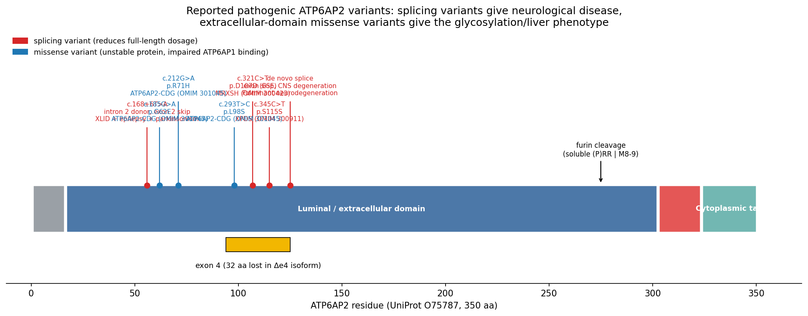
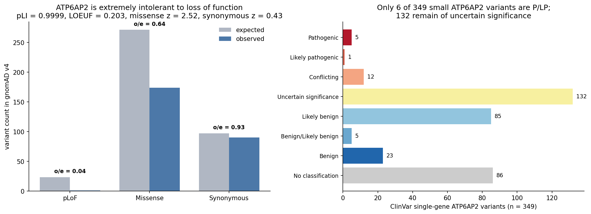
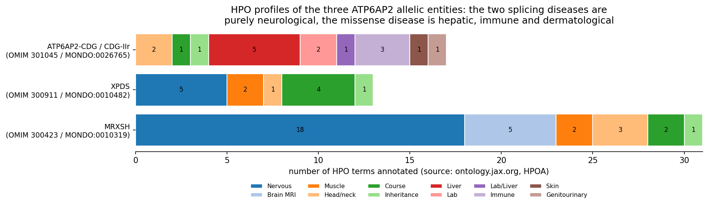
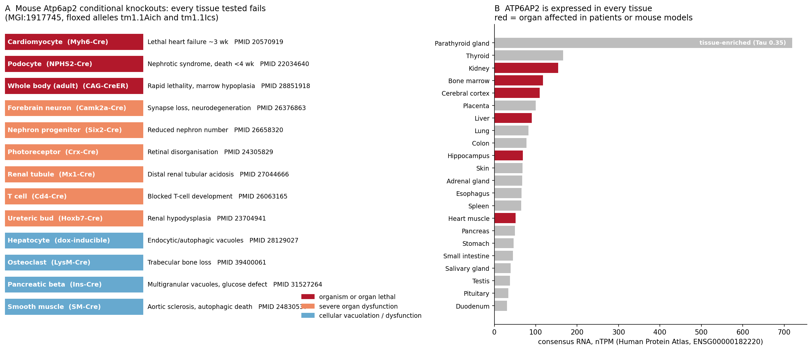
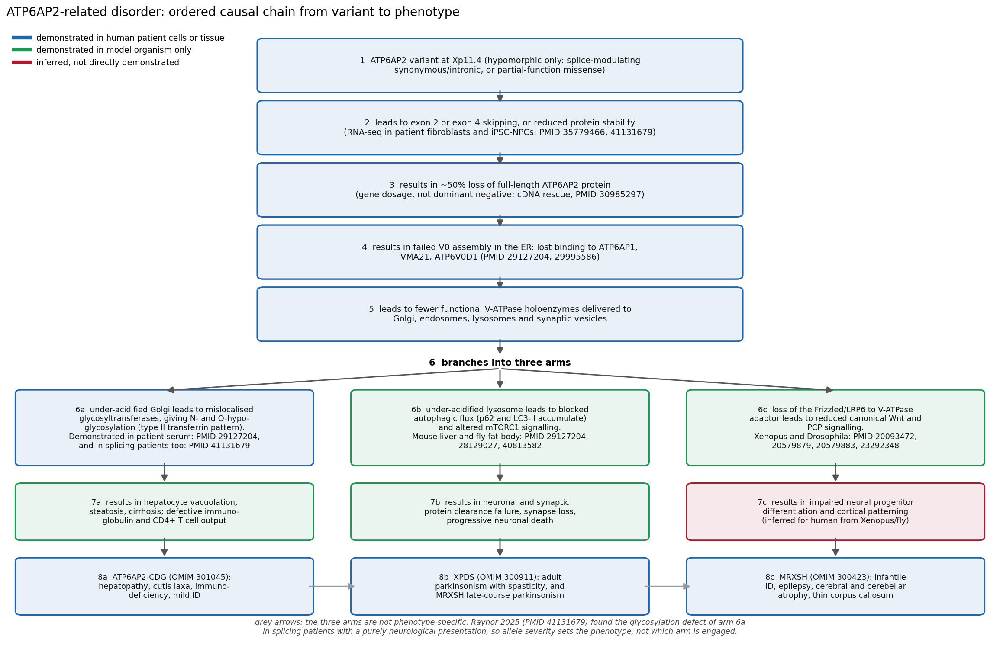
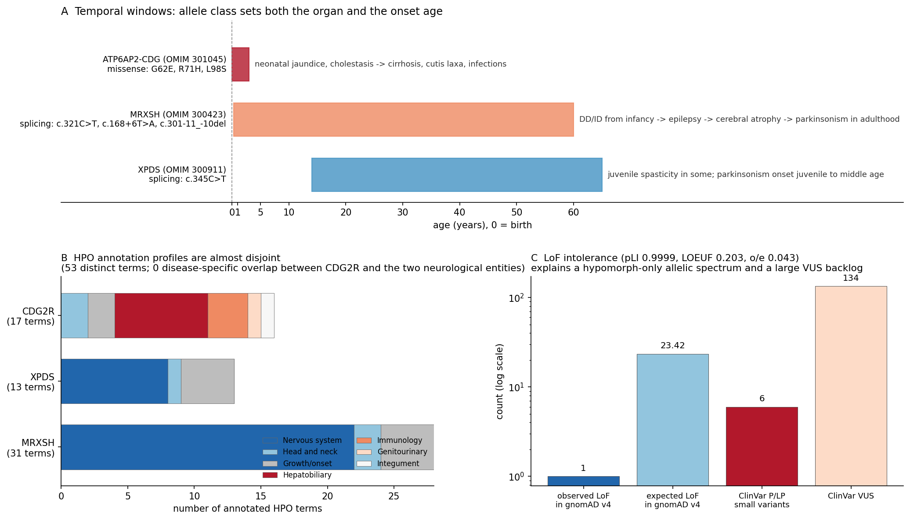

## Question

# Disease Characteristics Research Template

## Target Disease
- **Disease Name:** ATP6AP2-Related Disorder
- **MONDO ID:** MONDO:0100146 (if available)
- **Causal gene(s):** ATP6AP2
- **OMIM:** not recorded
- **Synonyms:** not recorded
- **Category:** Mendelian

Many disease names are serial numbers ("... autosomal dominant 64", "... 26") that
do not say which gene the disease is about, and a similarly named disease with a
different gene is easy to research by mistake. Research the disease with the MONDO
ID and causal gene given above, and name its causal gene in your first paragraph.
If the name seems to point to a different gene or OMIM entry, follow the
identifiers above.

## Research Objectives

Please provide a comprehensive research report on **ATP6AP2-Related Disorder** covering all of the
disease characteristics listed below. This report will be used to populate a disease knowledge
base entry. Be thorough and cite primary literature (PMID preferred) for all claims.

For each section, **suggested databases/resources** are listed. These are the first places
you should search for information on each topic.

---

### 1. Disease Information
> **Search first:** OMIM, Orphanet, ICD-10/ICD-11, MeSH, PubMed

- What is the disease? Provide a concise overview.
- What are the key identifiers? (OMIM, Orphanet, ICD-10/ICD-11, MeSH, Mondo)
- What are the common synonyms and alternative names?
- Is the information derived from individual patients (e.g., EHR) or aggregated disease-level resources?

### 2. Etiology

- **Disease Causal Factors**: What are the primary causes? (genetic, environmental, infectious, mechanistic)
- **Risk Factors**:
  > **Search first:** PubMed, Cochrane Library, UpToDate, clinical guidelines, ClinVar, ClinGen, GWAS Catalog, PheGenI, CTD, CDC, WHO, epidemiological databases
  - Genetic risk factors (causal variants, susceptibility loci, modifier genes)
  - Environmental risk factors (toxins, lifestyle, occupational exposures, age, sex, family history)
- **Protective Factors**:
  > **Search first:** PubMed, Cochrane Library, clinical trial databases, GWAS Catalog, gnomAD, WHO, CDC, nutrition databases
  - Genetic protective factors (protective variants, modifier alleles)
  - Environmental protective factors (diet, lifestyle, exposures that reduce risk)
- **Gene-Environment Interactions**: How do genetic and environmental factors interact to influence disease?
  > **Search first:** CTD, PubMed, PheGenI, GxE databases

### 3. Phenotypes
> **Search first:** HPO (Human Phenotype Ontology), OMIM, Orphanet, PubMed, clinicaltrials.gov, MedDRA, SNOMED CT, DECIPHER, LOINC

For each phenotype, provide:
- **Phenotype type**: symptoms, clinical signs, physical manifestations, behavioral changes, or laboratory abnormalities
  > For symptoms/signs: HPO, OMIM, Orphanet, PubMed
  > For behavioral changes: HPO, DSM, RDoC (Research Domain Criteria), PubMed
  > For laboratory abnormalities: LOINC, SNOMED CT, LabTests Online, PubMed
- **Phenotype characteristics**:
  > **Search first:** OMIM, Orphanet, HPO, PubMed
  - Age of symptom onset (neonatal, childhood, adult-onset, late-onset)
  - Symptom severity (mild, moderate, severe, variable)
  - Symptom progression (stable, progressive, episodic, fluctuating)
  - Frequency among affected individuals (percentage or qualitative)
- **Quality of life impact**: Effects on daily functioning and well-being (per-phenotype when possible)
  > **Search first:** EQ-5D database, SF-36, WHO QOL databases, PubMed
- Suggest HPO (Human Phenotype Ontology) terms for each phenotype

### 4. Genetic/Molecular Information

- **Causal Genes**: Gene mutations or chromosomal abnormalities responsible for disease (gene symbols, OMIM IDs)
  > **Search first:** OMIM, ClinVar, HGMD, Ensembl, NCBI Gene
- **Pathogenic Variants**:
  - Affected genes (gene symbols, HGNC IDs)
    > **Search first:** OMIM, NCBI Gene, Ensembl, HGNC, UniProt, GeneCards
  - Variant classification (pathogenic, likely pathogenic, VUS per ACMG/AMP guidelines)
    > **Search first:** ClinVar, ClinGen, ACMG/AMP guidelines, VarSome
  - Variant type/class (missense, frameshift, nonsense, splice-site, structural)
  - Allele frequency in population databases
    > **Search first:** gnomAD, 1000 Genomes, ExAC, TOPMed, dbSNP
  - Somatic vs germline origin
    > **Search first:** COSMIC (somatic), ClinVar, ICGC, TCGA
  - Functional consequences (loss of function, gain of function, dominant negative)
- **Modifier Genes**: Genes that modify disease severity or expression
- **Epigenetic Information**: DNA methylation, histone modifications, chromatin changes affecting disease
  > **Search first:** ENCODE, Roadmap Epigenomics, MethBase, DiseaseMeth
- **Chromosomal Abnormalities**: Large-scale genetic changes (aneuploidy, translocations, inversions)
  > **Search first:** DECIPHER, ClinVar, ECARUCA, UCSC Genome Browser

### 5. Environmental Information

- **Environmental Factors**: Non-genetic contributing factors (toxins, radiation, pollution, occupational exposure)
  > **Search first:** CTD (Comparative Toxicogenomics Database), TOXNET, PubMed, EPA databases
- **Lifestyle Factors**: Behavioral factors (smoking, diet, exercise, alcohol consumption)
  > **Search first:** CDC databases, WHO, PubMed, NHANES
- **Infectious Agents**: If applicable, pathogens causing or triggering disease (bacteria, viruses, fungi, parasites)
  > **Search first:** NCBI Taxonomy, ViPR, BV-BRC, MicrobeDB, GIDEON

### 6. Mechanism / Pathophysiology

**Present this section as an ordered causal chain first, then the detail below.**
Open with a numbered sequence of mechanistic steps running from the initiating
lesion (mutation, exposure, infection) to the clinical manifestation, one step per
line, each naming what it causes next. State the causal verb explicitly ("leads
to", "results in") and say where a step is inferred rather than demonstrated.
Where the mechanism branches, show the branch. The categories below are a
checklist of what to cover within those steps, not the organizing structure —
a step may draw on several of them, and a category may contribute to several
steps.

- **Molecular Pathways**: Specific signaling cascades or biochemical pathways involved (Wnt, MAPK, mTOR, PI3K-AKT, etc.)
  > **Search first:** KEGG, Reactome, WikiPathways, PathBank, BioCyc
- **Cellular Processes**: Cell-level mechanisms (apoptosis, autophagy, cell cycle dysregulation, inflammation, etc.)
  > **Search first:** Gene Ontology (GO), Reactome, KEGG, PubMed
- **Protein Dysfunction**: How protein structure or function is altered (misfolding, aggregation, loss of function, gain of function)
  > **Search first:** UniProt, PDB (Protein Data Bank), InterPro, Pfam, AlphaFold
- **Metabolic Changes**: Alterations in metabolic processes (energy metabolism, lipid metabolism, amino acid metabolism)
  > **Search first:** KEGG, BioCyc, HMDB (Human Metabolome Database), BRENDA
- **Immune System Involvement**: Role of immune response (autoimmunity, immunodeficiency, chronic inflammation)
  > **Search first:** ImmPort, Immunome Database, IEDB, Gene Ontology
- **Tissue Damage Mechanisms**: How tissues/ are injured (oxidative stress, ischemia, fibrosis, necrosis)
  > **Search first:** PubMed, Gene Ontology, Reactome
- **Biochemical Abnormalities**: Specific molecular defects (enzyme deficiencies, receptor dysfunction, ion channel defects)
  > **Search first:** BRENDA, UniProt, KEGG, OMIM, PubMed
- **Epigenetic Changes**: DNA methylation, histone modifications affecting gene expression in disease
  > **Search first:** ENCODE, Roadmap Epigenomics, MethBase, DiseaseMeth
- **Molecular Profiling** (if available):
  - Transcriptomics/gene expression changes
    > **Search first:** GEO (Gene Expression Omnibus), ArrayExpress, GTEx, Human Cell Atlas, SRA
  - Proteomics findings
    > **Search first:** PRIDE, ProteomeXchange, Human Protein Atlas, STRING, BioGRID
  - Metabolomics signatures
    > **Search first:** MetaboLights, Metabolomics Workbench, HMDB, METLIN
  - Lipidomics alterations
    > **Search first:** LIPID MAPS, SwissLipids, LipidHome, Metabolomics Workbench
  - Genomic structural features
    > **Search first:** UCSC Genome Browser, Ensembl, NCBI, dbVar, DGV
- **Advanced Technologies** (if applicable):
  - Single-cell analysis findings (cell-type specific mechanisms, cellular heterogeneity)
    > **Search first:** Human Cell Atlas, Single Cell Portal, GEO, CELLxGENE
  - Spatial transcriptomics findings
    > **Search first:** GEO, Spatial Research, Vizgen, 10x Genomics data
  - Multi-omics integration results
    > **Search first:** TCGA, ICGC, cBioPortal, LinkedOmics, PubMed
  - Functional genomics screens (CRISPR, RNAi)
    > **Search first:** DepMap, GenomeRNAi, PubMed, BioGRID ORCS

For each mechanism, describe:
- The causal chain from initial trigger to clinical manifestation
- Which mechanisms are upstream vs downstream
- What cell types and biological processes are involved
- Suggest GO terms for biological processes and CL terms for cell types

### 7. Anatomical Structures Affected

- **Organ Level**:
  - Primary organs directly affected
  - Secondary organ involvement (complications, secondary effects)
  - Body systems involved (cardiovascular, nervous, digestive, respiratory, endocrine, etc.)
  > **Search first:** Uberon, FMA (Foundational Model of Anatomy), OMIM, HPO, ICD-11, MeSH, SNOMED CT
- **Tissue and Cell Level**:
  - Specific tissue types affected (epithelial, connective, muscle, nervous)
  - Specific cell populations targeted (with Cell Ontology terms)
  > **Search first:** Uberon, Human Protein Atlas, Cell Ontology, Human Cell Atlas, CellMarker, PanglaoDB
- **Subcellular Level**:
  - Cellular compartments involved (mitochondria, nucleus, ER, lysosomes) (with GO Cellular Component terms)
  > **Search first:** Gene Ontology (Cellular Component), UniProt, Human Protein Atlas
- **Localization**:
  - Specific anatomical sites (with UBERON terms)
    > **Search first:** FMA, Uberon, NeuroNames (for brain), SNOMED CT
  - Lateralization (unilateral, bilateral, asymmetric)
    > **Search first:** HPO, clinical literature, imaging databases

### 8. Temporal Development

- **Onset**:
  - Typical age of onset (congenital, pediatric, adult, geriatric)
  - Onset pattern (acute, subacute, chronic, insidious)
  > **Search first:** OMIM, Orphanet, HPO, PubMed
- **Progression**:
  - Disease stages (early, intermediate, advanced, end-stage)
    > **Search first:** Cancer Staging Manual (AJCC), WHO classifications, PubMed
  - Progression rate (rapid, slow, variable)
  - Disease course pattern (episodic, relapsing-remitting, progressive, stable)
  - Disease duration (self-limited, chronic lifelong)
  > **Search first:** Disease registries, longitudinal cohort databases, natural history studies, PubMed, Orphanet, OMIM
- **Patterns**:
  - Remission patterns (spontaneous, treatment-induced)
    > **Search first:** Clinical trial databases, disease registries, PubMed
  - Critical periods (time windows of vulnerability or opportunity for intervention)
    > **Search first:** PubMed, developmental biology databases, clinical guidelines

### 9. Inheritance and Population

- **Epidemiology**:
  - Prevalence (cases per 100,000 at given time)
  - Incidence (new cases per 100,000 per year)
  > **Search first:** Orphanet, CDC, WHO, GBD (Global Burden of Disease), national registries, SEER, disease registries
- **For Genetic Etiology**:
  - Inheritance pattern (AD, AR, X-linked, mitochondrial, multifactorial, polygenic)
    > **Search first:** OMIM, Orphanet, ClinVar, GTR (Genetic Testing Registry)
  - Penetrance (complete, incomplete, age-dependent)
    > **Search first:** ClinVar, OMIM, PubMed, ClinGen
  - Expressivity (variable, consistent)
    > **Search first:** OMIM, ClinVar, PubMed
  - Genetic anticipation (increasing severity in successive generations)
    > **Search first:** OMIM, PubMed (especially for repeat expansion disorders)
  - Germline mosaicism
    > **Search first:** ClinVar, OMIM, genetic counseling literature, PubMed
  - Founder effects (population-specific mutations)
    > **Search first:** gnomAD, population genetics databases, PubMed
  - Consanguinity role
    > **Search first:** OMIM, population studies, genetic counseling resources
  - Carrier frequency
    > **Search first:** gnomAD, carrier screening databases, GeneReviews, GTR
- **Population Demographics**:
  - Affected populations (ethnic or demographic groups with higher prevalence)
    > **Search first:** gnomAD, 1000 Genomes, PAGE Study, PubMed, population registries
  - Geographic distribution (endemic areas, regional variation)
    > **Search first:** WHO, CDC, GBD, Orphanet, geographic epidemiology databases
  - Geographic distribution of specific variants
  - Sex ratio (male:female)
    > **Search first:** Disease registries, OMIM, PubMed, epidemiological databases
  - Age distribution of affected individuals
    > **Search first:** CDC, disease registries, SEER, Orphanet

### 10. Diagnostics

- **Clinical Tests**:
  - Laboratory tests (blood, urine, tissue chemistry, specific enzyme assays)
    > **Search first:** LOINC, LabTests Online, PubMed
  - Biomarkers (proteins, metabolites, genetic markers, circulating biomarkers)
    > **Search first:** FDA Biomarker List, BEST (Biomarkers, EndpointS, and other Tools), PubMed
  - Imaging studies (X-ray, CT, MRI, PET, ultrasound)
    > **Search first:** RadLex, DICOM, Radiopaedia, imaging databases
  - Functional tests (pulmonary function, cardiac stress tests)
    > **Search first:** LOINC, clinical guidelines, PubMed
  - Electrophysiology (EEG, EMG, ECG, nerve conduction studies)
    > **Search first:** LOINC, clinical neurophysiology databases, PubMed
  - Biopsy findings (histopathology, immunohistochemistry)
    > **Search first:** SNOMED CT, College of American Pathologists resources, PubMed
  - Pathology findings (microscopic examination)
    > **Search first:** SNOMED CT, Digital Pathology databases, PubMed
- **Genetic Testing**:
  > **Search first:** GTR (Genetic Testing Registry), GeneReviews, ClinGen
  - Overview of recommended genetic testing approach
  - Whole genome sequencing (WGS) utility
    > **Search first:** GTR, ClinVar, GEL (Genomics England), gnomAD
  - Whole exome sequencing (WES) utility
    > **Search first:** GTR, ClinVar, OMIM, GeneMatcher
  - Gene panels (which panels, which genes)
    > **Search first:** GTR, ClinVar, laboratory-specific databases
  - Single gene testing
    > **Search first:** GTR, ClinVar, OMIM, GeneReviews
  - Chromosomal microarray (CMA)
    > **Search first:** DECIPHER, ClinVar, dbVar, ECARUCA
  - Karyotyping
    > **Search first:** Chromosome Abnormality Database, ClinVar, cytogenetics resources
  - FISH
    > **Search first:** ClinVar, cytogenetics databases, PubMed
  - Mitochondrial DNA testing
    > **Search first:** MITOMAP, MSeqDR, ClinVar, GTR
  - Repeat expansion testing
    > **Search first:** GTR, ClinVar, repeat expansion databases, PubMed
- **Omics-Based Diagnostics** (if applicable):
  - RNA sequencing / transcriptomics
    > **Search first:** GEO, ArrayExpress, GTEx, RNA-seq databases
  - Proteomics
    > **Search first:** PRIDE, ProteomeXchange, FDA Biomarker database
  - Metabolomics
    > **Search first:** MetaboLights, Metabolomics Workbench, HMDB
  - Epigenomics
    > **Search first:** GEO, ENCODE, Roadmap Epigenomics, MethBase
  - Liquid biopsy
    > **Search first:** COSMIC, ClinVar, liquid biopsy databases, PubMed
- **Clinical Criteria**:
  - Standardized diagnostic criteria (DSM, ICD, society guidelines)
    > **Search first:** DSM-5, ICD-11, clinical society guidelines, UpToDate
  - Differential diagnosis (other conditions to rule out, with distinguishing features)
    > **Search first:** DynaMed, UpToDate, clinical decision support systems
- **Screening**:
  - Screening methods for asymptomatic individuals (newborn screening, carrier screening, cascade screening)
    > **Search first:** ACMG recommendations, CDC newborn screening, GTR

### 11. Outcome/Prognosis

- **Survival and Mortality**:
  - Survival rate (5-year, 10-year, overall)
    > **Search first:** SEER, cancer registries, disease-specific registries, PubMed
  - Life expectancy (with and without treatment if applicable)
    > **Search first:** Orphanet, disease registries, actuarial databases, PubMed
  - Mortality rate
    > **Search first:** CDC, WHO, GBD, national mortality databases
  - Disease-specific mortality (deaths directly attributable to disease)
    > **Search first:** Disease registries, CDC Wonder, GBD, PubMed
- **Morbidity and Function**:
  - Morbidity (disease-related disability and health impacts)
    > **Search first:** GBD, WHO, disability databases, PubMed
  - Disability outcomes (long-term functional impairments)
    > **Search first:** ICF (International Classification of Functioning), disability registries
  - Quality of life measures (EQ-5D, SF-36, PROMIS, disease-specific tools)
    > **Search first:** EQ-5D database, SF-36, PROMIS, PubMed
- **Disease Course**:
  - Complications (secondary problems: infections, organ failure, etc.)
    > **Search first:** ICD codes, disease registries, clinical databases, PubMed
  - Recovery potential (likelihood and extent of recovery, with vs without treatment)
    > **Search first:** Natural history studies, rehabilitation databases, PubMed
- **Prediction**:
  - Prognostic factors (age, disease severity, biomarkers, treatment response)
    > **Search first:** Prognostic models databases, clinical calculators, PubMed
  - Prognostic biomarkers (molecular markers predicting disease course)
    > **Search first:** FDA Biomarker database, PubMed, cancer prognostic databases

### 12. Treatment

- **Pharmacotherapy**:
  - Pharmacological treatments (drug names, drug classes, mechanisms of action)
    > **Search first:** DrugBank, RxNorm, ATC classification, DailyMed, FDA databases
  - Pharmacogenomics (how genetic variants affect drug metabolism, efficacy, toxicity)
    > **Search first:** PharmGKB, CPIC (Clinical Pharmacogenetics), FDA Table of PGx Biomarkers
- **Advanced Therapeutics**:
  - Gene therapy (viral vectors, CRISPR, gene replacement, gene editing)
    > **Search first:** ClinicalTrials.gov, FDA gene therapy database, ASGCT resources
  - Cell therapy (stem cell transplant, CAR-T, cellular therapeutics)
    > **Search first:** ClinicalTrials.gov, FDA cell therapy database, FACT standards
  - RNA-based therapies (ASOs, siRNA, mRNA therapies)
    > **Search first:** ClinicalTrials.gov, FDA approvals, PubMed
  - Targeted therapies (treatments directed at specific molecular targets)
    > **Search first:** My Cancer Genome, OncoKB, ClinicalTrials.gov, FDA approvals
  - Immunotherapies (checkpoint inhibitors, monoclonal antibodies)
    > **Search first:** Cancer Immunotherapy Database, FDA approvals, ClinicalTrials.gov
- **Surgical and Interventional**:
  - Surgical interventions (types of surgery, timing, outcomes)
    > **Search first:** CPT codes, surgical registries, clinical guidelines, PubMed
- **Supportive and Rehabilitative**:
  - Supportive care (symptom management, pain control, nutrition)
    > **Search first:** Clinical guidelines, Cochrane Library, PubMed
  - Rehabilitation (physical therapy, occupational therapy, speech therapy)
    > **Search first:** Rehabilitation medicine databases, clinical guidelines, PubMed
- **Experimental**:
  - Experimental treatments in clinical trials (with NCT identifiers if available)
    > **Search first:** ClinicalTrials.gov, EU Clinical Trials Register, WHO ICTRP
- **Treatment Outcomes**:
  - Treatment response rates
    > **Search first:** Clinical trial databases, FDA reviews, systematic reviews, PubMed
  - Side effects and adverse events
    > **Search first:** FDA Adverse Event Reporting System (FAERS), MedWatch, PubMed
- **Treatment Strategy**:
  - Treatment algorithms (clinical pathways, decision trees)
    > **Search first:** Clinical practice guidelines, NCCN Guidelines, UpToDate
  - Combination therapies
    > **Search first:** ClinicalTrials.gov, treatment guidelines, PubMed
  - Personalized medicine approaches (genotype-guided treatment)
    > **Search first:** My Cancer Genome, CIViC, PharmGKB, precision medicine databases

For each treatment, suggest NCIT (NCI Thesaurus) clinical-intervention terms where applicable.

### 13. Prevention

- **Prevention Levels**:
  - Primary prevention (preventing disease occurrence: vaccination, risk factor modification)
    > **Search first:** CDC, WHO, USPSTF recommendations, Cochrane Library
  - Secondary prevention (early detection and treatment: screening programs, early intervention)
    > **Search first:** USPSTF, CDC screening guidelines, WHO
  - Tertiary prevention (preventing complications in those with disease)
    > **Search first:** Clinical guidelines, disease management protocols, PubMed
- **Immunization**: Vaccine strategies (if applicable)
  > **Search first:** CDC vaccine schedules, WHO immunization, FDA vaccine database
- **Screening and Early Detection**:
  - Screening programs (population-based: newborn screening, cancer screening)
    > **Search first:** CDC screening programs, USPSTF, cancer screening databases
  - Genetic screening (carrier screening, preimplantation genetic diagnosis, prenatal testing)
    > **Search first:** ACMG recommendations, ACOG guidelines, GTR
  - Risk stratification (identifying high-risk individuals for targeted prevention)
    > **Search first:** Risk prediction models, clinical calculators, PubMed
- **Behavioral Interventions**: Lifestyle modifications to reduce risk
  > **Search first:** CDC, WHO, behavioral intervention databases, Cochrane Library
- **Counseling**: Genetic counseling (risk assessment, family planning guidance)
  > **Search first:** NSGC resources, ACMG guidelines, GeneReviews
- **Public Health**:
  - Public health interventions (sanitation, vector control, health education)
    > **Search first:** CDC, WHO, public health databases, PubMed
  - Environmental interventions (reducing environmental risk factors)
    > **Search first:** EPA databases, WHO environmental health, PubMed
- **Prophylaxis**: Preventive medications or procedures
  > **Search first:** Clinical guidelines, FDA approvals, PubMed

### 14. Other Species / Natural Disease

- **Taxonomy**: Species affected (with NCBI Taxon identifiers)
  > **Search first:** NCBI Taxonomy
- **Breed**: Specific breeds affected (with VBO identifiers if applicable)
  > **Search first:** VBO (Vertebrate Breed Ontology)
- **Gene**: Orthologous genes in other species (with NCBI Gene IDs)
  > **Search first:** NCBI Gene
- **Natural Disease**:
  - Naturally occurring disease in other species (companion animals, wildlife)
    > **Search first:** OMIA (Online Mendelian Inheritance in Animals), VetCompass, PubMed
  - Veterinary relevance and importance in animal health
    > **Search first:** OMIA, veterinary databases, PubMed
- **Comparative Biology**:
  - Comparative pathology (similarities and differences across species)
    > **Search first:** OMIA, comparative pathology databases, PubMed
  - Evolutionary conservation of disease mechanisms
    > **Search first:** HomoloGene, OrthoMCL, Alliance of Genome Resources
- **Transmission** (if applicable):
  - Zoonotic potential
    > **Search first:** CDC zoonotic diseases, WHO zoonoses, GIDEON
  - Cross-species susceptibility
    > **Search first:** NCBI Taxonomy, veterinary databases, PubMed

### 15. Model Organisms

- **Model Types**:
  - Model organism type (mammalian, invertebrate, cellular, in vitro)
    > **Search first:** Alliance of Genome Resources, model organism databases
  - Specific model systems (mouse, rat, zebrafish, Drosophila, C. elegans, yeast, cell lines, organoids, iPSCs)
    > **Search first:** MGI, RGD, ZFIN, FlyBase, WormBase, SGD, ATCC, Cellosaurus
  - Induced models (drug treatment, surgical intervention, environmental manipulation)
    > **Search first:** MGI, model organism databases, PubMed
- **Genetic Models**:
  - Types available (knockout, knock-in, transgenic, conditional, humanized)
    > **Search first:** MGI, IMPC, KOMP, EuMMCR, IMSR
- **Model Characteristics**:
  - Phenotype recapitulation (how well model reproduces human disease features)
    > **Search first:** Model organism databases, comparative studies, PubMed
  - Model limitations (aspects of human disease not captured)
    > **Search first:** Model organism databases, PubMed, review articles
- **Applications**:
  - Research applications (what aspects of disease can be studied)
    > **Search first:** Model organism databases, PubMed
- **Resources**:
  - Model databases
    > **Search first:** MGI, RGD, ZFIN, FlyBase, WormBase, IMSR, EMMA, MMRRC

---

## Citation Requirements

- Cite primary literature (PMID preferred) for all mechanistic and clinical claims
- Prioritize recent reviews and landmark papers
- Include direct quotes from abstracts where possible to support key statements
- Distinguish evidence source types: human clinical, model organism, in vitro, computational

## Output Format

Structure your response as a comprehensive narrative organized by the sections above.
For each section, provide:
- Factual content with specific details (numbers, percentages, gene names, variant nomenclature)
- Ontology term suggestions (HPO, GO, CL, UBERON, CHEBI, NCIT, MONDO) where applicable
- Evidence citations with PMIDs
- Direct quotes from abstracts to support key claims
- Clear indication when information is not available or not applicable for this disease

This report will be used to populate a disease knowledge base entry with:
- Pathophysiology descriptions with causal chains
- Gene/protein annotations (HGNC, GO terms)
- Phenotype associations (HP terms) with frequencies
- Cell type involvement (CL terms)
- Anatomical locations (UBERON terms)
- Chemical entities (CHEBI terms)
- Treatment annotations (NCIT terms)
- Evidence items with PMIDs and exact abstract quotes
- Epidemiology, prognosis, diagnostic, and prevention information
- Animal model descriptions with phenotype recapitulation details

## Output

# ATP6AP2-related disorder (MONDO:0100146): one gene-dosage disease with three clinical faces

## Summary

**ATP6AP2-related disorder is caused by hypomorphic X-linked variants in ATP6AP2** (HGNC:18305, NCBI Gene 10159, UniProt O75787, OMIM \*300556), a gene at Xp11.4 encoding a 350-amino-acid type I membrane protein that works as an assembly factor for the V0 proton pore of the vacuolar H+-ATPase. The same protein is historically called the (pro)renin receptor, which is why most older literature and essentially all of its KEGG annotation file it under the renin-angiotensin system. Three allelic OMIM phenotypes exist: X-linked syndromic intellectual developmental disorder Hedera type (MRXSH, OMIM 300423), X-linked parkinsonism with spasticity (XPDS, OMIM 300911), and congenital disorder of glycosylation type IIr (ATP6AP2-CDG, OMIM 301045). Fewer than 25 patients are published worldwide.

The three labels describe one gene-dosage disease. Complete loss of ATP6AP2 is lethal, so only partial-loss alleles reach the clinic, and the allele class sets which organ fails. Splicing-modulating variants (c.321C>T p.Asp107=, c.345C>T p.Ser115=, c.168+6T>A, c.301-11_301-10del) shift the exon 2 or exon 4 skipping ratio and remove roughly 50 percent of full-length transcript in every tissue, giving the neurological phenotypes. Luminal-domain missense variants (p.Gly62Glu, p.Arg71His, p.Leu98Ser) destabilise the protein and break its binding to ATP6AP1 during endoplasmic reticulum assembly, giving infantile liver disease with hypoglycosylation, immunodeficiency and cutis laxa. Both classes converge on the same biochemical lesion: failed V0 assembly in the ER and under-acidified Golgi, endosomes, lysosomes and synaptic vesicles.

Three quantitative results anchor this model. gnomAD v4 observes 1 high-confidence loss-of-function allele against 23.42 expected, o/e 0.043 (90 percent CI 0.0152-0.2026), pLI 0.9999, LOEUF 0.2026, with a clean synonymous internal control (o/e 0.927, Z 0.431) proving the depletion is not a coverage artefact. Across 53 distinct HPO terms the disease-specific overlap between ATP6AP2-CDG and the two neurological entities is exactly zero after removing inheritance and onset annotations, while MRXSH and XPDS share the full extrapyramidal and pyramidal set. ClinVar holds 134 variants of uncertain significance against 6 pathogenic or likely pathogenic small variants, a ratio of 22.3 to 1, and 3 of those 6 are synonymous or intronic, which are the classes that standard in-silico evidence handles worst. Raynor 2025 ([PMID: 41131679](https://pubmed.ncbi.nlm.nih.gov/41131679/)) closed the gap between the entities by finding the ATP6AP2-CDG glycosylation defect in splicing patients whose presentation is purely neurological, and by reporting the first affected heterozygous female.

Evidence throughout is marked by source type: <i class="fa-solid fa-heart-pulse"></i> human clinical or patient-derived cells, <i class="fa-solid fa-flask"></i> model organism, <i class="fa-solid fa-vial"></i> in vitro or biochemistry, <i class="fa-solid fa-database"></i> database or computational.

---

## Key findings

### <i class="fa-solid fa-dna"></i> F1. One gene, three allelic phenotypes, separated by variant class

ATP6AP2 maps to three OMIM phenotype entries, and the genotype predicts which clinical picture appears. Splicing variants that promote exon skipping cause the neurological entities: MRXSH (OMIM 300423), first defined by c.321C>T (p.Asp107=) in the Hedera kindred of 7 affected males ([PMID: 15746149](https://pubmed.ncbi.nlm.nih.gov/15746149/)), and XPDS (OMIM 300911), defined by c.345C>T (p.Ser115=) ([PMID: 23595882](https://pubmed.ncbi.nlm.nih.gov/23595882/)). Hemizygous missense variants in the extracellular domain cause ATP6AP2-CDG (OMIM 301045): p.Leu98Ser and p.Arg71His in 3 males from 2 families ([PMID: 29127204](https://pubmed.ncbi.nlm.nih.gov/29127204/)), and p.Gly62Glu in a Chinese patient ([PMID: 38075676](https://pubmed.ncbi.nlm.nih.gov/38075676/)). A fourth category exists in one patient: a de novo splice-site variant that produced fulminant neurodegeneration of the developing brain ([PMID: 30985297](https://pubmed.ncbi.nlm.nih.gov/30985297/)).

Raynor 2025 states the split directly: *"ATP6AP2 splicing variants cause syndromic X-linked intellectual disability Hedera type (XPDS; OMIM#300423) and X-linked parkinsonism with spasticity (MRXSH; OMIM#300911). Alternatively, ATP6AP2 missense variants lead to hepatopathy, immunological abnormalities, cutis laxa and only mild intellectual disability with N-/O-glycosylation defects (ATP6AP2-CDG; OMIM#301045)."* <i class="fa-solid fa-triangle-exclamation"></i> That abstract transposes the two acronyms against their OMIM numbers. OMIM 300423 is the Hedera-type intellectual disability entry (MRXSH) and OMIM 300911 is XPDS. Any knowledge base ingesting that sentence verbatim will invert the mapping.

{{figure:plot_1.png|caption=Reported pathogenic ATP6AP2 variants mapped onto the 350-residue protein. Splicing-modulating variants cluster in and around exon 4 (residues 94-125) and cause the neurological entities MRXSH and XPDS. Missense variants causing ATP6AP2-CDG sit in the luminal extracellular domain, the region that binds ATP6AP1 and VMA21 during ER assembly.}}

### <i class="fa-solid fa-chart-column"></i> F2. Reduced dosage of full-length protein is the shared mechanism of the neurological phenotypes

Three independent splicing variants converge on the same quantitative defect. c.321C>T and c.345C>T both increase exon 4 skipping, producing an isoform lacking 32 amino acids and cutting full-length transcript to about 50 percent. Edelman 2022 quantified the second mechanism for c.168+6T>A: *"This results in out-of-frame splicing products and a reciprocal 50% reduction in functional full-length ATP6AP2 transcripts."* The same paper measured the effect in human brain tissue and generalised across alleles: *"All previously reported splicing mutations increase the level of a minor isoform with skipped exon 4 (Δe4) that encodes a functionally deficient protein."* ([PMID: 35779466](https://pubmed.ncbi.nlm.nih.gov/35779466/)) <i class="fa-solid fa-heart-pulse"></i>

The decisive experiment is a rescue. In patient iPSC-derived neurons carrying a de novo splice variant, *"Functional studies of induced pluripotent stem cell-derived (iPSC-derived) neurons from this patient revealed reduced spontaneous activity and severe deficiency in lysosomal acidification and protein degradation leading to neuronal cell death. These deficiencies could be rescued by expression of full-length ATP6AP2."* ([PMID: 30985297](https://pubmed.ncbi.nlm.nih.gov/30985297/)) <i class="fa-solid fa-heart-pulse"></i> Adding wild-type protein in the continued presence of the Δe4 isoform restores function, which rules out a dominant-negative effect and establishes that the pathogenic unit is the missing quantity of normal protein.

The Δe4 isoform is inert in the complex, not toxic to it. Kinouchi 2013: *"A deletion mutant of ATP6AP2/PRR, which lacks exon 4-encoded amino acids inside the ECD (Δ4M) and causes X-linked mental retardation Hedera type (MRXSH) and X-linked parkinsonism with spasticity (XPDS) in humans, was defective as a V-ATPase-associated protein."* ([PMID: 24223829](https://pubmed.ncbi.nlm.nih.gov/24223829/)) <i class="fa-solid fa-vial"></i> That paper also showed the extracellular and transmembrane domains are both indispensable for V-ATPase biogenesis while furin cleavage is dispensable.

### <i class="fa-solid fa-vial"></i> F3. ATP6AP2 is a V-ATPase V0 assembly factor acting in the ER with ATP6AP1

Cryo-EM of rat brain V-ATPase places the protein inside the pump: *"The c ring encloses the transmembrane anchors for cleaved ATP6AP1/Ac45 and ATP6AP2/PRR, the latter of which is the (pro)renin receptor that, in other contexts, is involved in both Wnt signaling and the renin-angiotensin system that regulates blood pressure. This structure shows how ATP6AP1/Ac45 and ATP6AP2/PRR enable assembly of the enzyme's catalytic and membrane regions."* ([PMID: 32165585](https://pubmed.ncbi.nlm.nih.gov/32165585/)) <i class="fa-solid fa-microscope"></i>

The functional location is the endoplasmic reticulum, before the protein ever reaches its destination compartment. In yeast, Drosophila ATP6AP2 substitutes for the assembly factor Voa1, and the rescue improves when ATP6AP1 is co-expressed. Structure-function work gives the decisive detail: *"Structure-function analyses in both yeast and Drosophila show that proteolytic cleavage is dispensable, while C-terminus-dependent ER retrieval is required for ATP6AP2 function."* ([PMID: 29995586](https://pubmed.ncbi.nlm.nih.gov/29995586/)) <i class="fa-solid fa-vial"></i> The ATP6AP2-CDG missense variants break exactly this step: they *"impaired protein stability and the interaction with ATP6AP1, a member of the V0 assembly complex"* ([PMID: 29127204](https://pubmed.ncbi.nlm.nih.gov/29127204/)). <i class="fa-solid fa-vial"></i>

The downstream cascade, stated as an ordered chain in the liver study: *"Altogether, our data suggest that these phenotypes are the result of a pathogenetic cascade that includes impaired V-ATPase assembly, defective lysosomal acidification, reduced MTOR signaling and autophagic misregulation."* ([PMID: 29388887](https://pubmed.ncbi.nlm.nih.gov/29388887/)) <i class="fa-solid fa-flask"></i>

A second arm exists in model organisms. ATP6AP2 is required for Frizzled asymmetric localisation: *"Fz fails to localize asymmetrically in the absence of VhaPRR, and this is accompanied by prehair mispolarization of pupal wing cells."* ([PMID: 20579879](https://pubmed.ncbi.nlm.nih.gov/20579879/)) <i class="fa-solid fa-flask"></i> Its contribution to the human phenotype is inferred, since no human counterpart of the planar-cell-polarity phenotype has been described.

### <i class="fa-solid fa-database"></i> F4. Near-maximal loss-of-function intolerance forces a hypomorph-only allelic spectrum

gnomAD v4 constraint for ENSG00000182220 (canonical ENST00000636580, chrX:40,579,372-40,606,848):

| Metric | Observed | Expected | o/e (90% CI) | Z or score |
|---|---|---|---|---|
| High-confidence pLoF | 1 | 23.42 | 0.043 (0.0152-0.2026) | LoF Z 3.930, pLI 0.99994 |
| Missense | 174 | 271.3 | 0.64 | mis_z 2.520 |
| Synonymous (internal control) | 90 | 97.12 | 0.927 | syn_z 0.431 |

LOEUF 0.2026 places ATP6AP2 inside the most constrained decile of human genes. The synonymous class behaves exactly as expected under neutrality, so the LoF depletion is a biological signal and not a coverage artefact. None of the eight reported disease alleles (c.321C>T, c.345C>T, c.293T>C, c.212G>A, c.185G>A, c.284C>A, c.168+6T>A, c.628G>T) appears in gnomAD v4 at any allele count. Carrier frequency in the general population is below the detection limit of current population databases, and no founder allele exists. <i class="fa-solid fa-database"></i>

The mouse explains the depletion. Wendling 2017 report male hemizygous lethality and female haploinsufficiency for embryonic ablation ([PMID: 28851918](https://pubmed.ncbi.nlm.nih.gov/28851918/)), and conditional deletion in brain is catastrophic: *"Conditional deletion of Atp6ap2 in developing mouse brain impaired V-ATPase-dependent functions, causing impaired neural stem cell self-renewal, premature neuronal differentiation, and apoptosis resulting in degeneration of nearly the entire cortex."* ([PMID: 30985297](https://pubmed.ncbi.nlm.nih.gov/30985297/)) <i class="fa-solid fa-flask"></i>

### <i class="fa-solid fa-magnifying-glass"></i> F5. ClinVar is dominated by uncertain variants, and the pathogenic alleles are mostly silent or intronic

Of 362 ClinVar records carrying NM_005765 HGVS nomenclature: 134 uncertain significance, 95 likely benign, 23 benign, 5 benign/likely benign, 13 conflicting, 5 pathogenic, 1 likely pathogenic, 86 unclassified. The VUS-to-P/LP ratio is **22.3 to 1**.

| VCV | HGVS (NM_005765.3) | Protein | Variant class | Review status | Condition |
|---|---|---|---|---|---|
| VCV000010801 | c.321C>T | p.Asp107= | synonymous, ESE disruption | Pathogenic, multiple submitters, no conflicts | MRXSH |
| VCV000088756 | c.345C>T | p.Ser115= | synonymous, exon 4 skipping | Pathogenic, no assertion criteria | XPDS |
| VCV000869366 | c.293T>C | p.Leu98Ser | missense | Pathogenic, no assertion criteria | CDG2R |
| VCV000869368 | c.301-11_301-10del | intronic | splice region deletion | Pathogenic, no assertion criteria | MRXSH |
| VCV003336071 | c.284C>A | p.Ser95Ter | nonsense | Pathogenic, single submitter | MRXSH |
| VCV001698925 | c.628G>T | p.Asp210Tyr | missense | Likely pathogenic, single submitter | MRXSH |

Three of six are not protein-altering in the conventional sense. Thirteen variants carry conflicting classifications, including c.858G>A (p.Ala286=), the developmental and epileptic encephalopathy variant from [PMID: 38274877](https://pubmed.ncbi.nlm.nih.gov/38274877/). The c.212G>A (p.Arg71His) allele with published functional evidence from [PMID: 29127204](https://pubmed.ncbi.nlm.nih.gov/29127204/) is not present in ClinVar as P/LP, which is a curation gap. The remaining roughly 141 pathogenic ClinVar records are large Xp11.4 or whole-X copy-number events that merely span the gene and carry no gene-specific evidence.

<i class="fa-solid fa-triangle-exclamation"></i> The single reported nonsense allele p.Ser95Ter sits against the gnomAD constraint data and warrants re-review, since true nulls are predicted to be non-viable in hemizygous males.

The practical consequence is that a protein-centric pipeline will miss this disease. The alleles that prove it are the ones an in-silico predictor scores as silent. Two papers show the assay that resolves them: *"We investigated the pathogenic mechanism of a novel c.168+6T>A variant reported in a family with X-linked intellectual disability, epilepsy, and parkinsonism"* ([PMID: 35779466](https://pubmed.ncbi.nlm.nih.gov/35779466/)), and *"RNA-Seq in patient-derived fibroblasts validated defective splicing, correlated with lowered ATP6AP2 protein levels in fibroblasts alongside glycosylation abnormalities"* ([PMID: 41131679](https://pubmed.ncbi.nlm.nih.gov/41131679/)). <i class="fa-solid fa-heart-pulse"></i>

{{figure:plot_2.png|caption=ATP6AP2 population constraint against the ClinVar interpretation burden. Left: observed versus expected loss-of-function alleles in gnomAD v4, with the synonymous class as an internal control. Right: ClinVar classification counts, showing 134 variants of uncertain significance against 6 pathogenic or likely pathogenic small variants.}}

### <i class="fa-solid fa-table"></i> F6. HPO annotations quantify the clinical split, and the two neurological entities form one continuum

Complete HPOA annotation sets: MRXSH 31 terms (sources [PMID: 15746149](https://pubmed.ncbi.nlm.nih.gov/15746149/), [PMID: 26467484](https://pubmed.ncbi.nlm.nih.gov/26467484/), [PMID: 30985297](https://pubmed.ncbi.nlm.nih.gov/30985297/)), XPDS 13 terms (all from [PMID: 20629132](https://pubmed.ncbi.nlm.nih.gov/20629132/)), ATP6AP2-CDG 17 terms (all from [PMID: 29127204](https://pubmed.ncbi.nlm.nih.gov/29127204/)). 53 distinct terms across the grouping.

MRXSH and XPDS share 6 terms: parkinsonism (HP:0001300), bradykinesia (HP:0002067), spasticity (HP:0001257), Babinski sign (HP:0003487), hypomimic face (HP:0000338) and X-linked recessive inheritance (HP:0001419). After removing HP:0001419 and the onset term infantile onset (HP:0003593), the overlap between the neurological entities and ATP6AP2-CDG is **exactly zero terms**.

| Organ system | MRXSH (31 terms) | XPDS (13 terms) | ATP6AP2-CDG (17 terms) |
|---|---|---|---|
| Nervous system | 22 | 8 | 0 |
| Head and neck | 2 | 1 | 2 |
| Growth and onset | 4 | 4 | 2 |
| Hepatobiliary | 0 | 0 | 7 |
| Immunology | 0 | 0 | 3 |
| Genitourinary | 0 | 0 | 1 |
| Integument | 0 | 0 | 1 |

MRXSH carries the neuroimaging signature absent from the others: cerebral atrophy (HP:0002059, 3/3), cerebellar atrophy (HP:0001272), thin corpus callosum (HP:0033725), hypoplasia of the corpus callosum (HP:0002079), delayed CNS myelination (HP:0002188). ATP6AP2-CDG carries an exclusively hepatic, immune and dermatological profile: type II transferrin isoform profile (HP:0012301), hepatic steatosis (HP:0001397), micronodular cirrhosis (HP:0001413), ascites (HP:0001541), recurrent infections (HP:0002719, 3/3), decreased total CD4+ T cell proportion (HP:0032218), decreased circulating immunoglobulin concentration (HP:0004313), cutis laxa (HP:0000973, 3/3).

MRXSH and XPDS read as the same disease observed at two ages. The shared terms are precisely the extrapyramidal and pyramidal signs, and XPDS lacks only the developmental and epileptic layer. Korvatska 2013 describes the age dependence directly: *"X-linked parkinsonism with spasticity (XPDS) presents either as typical adult onset Parkinson's disease or earlier onset spasticity followed by parkinsonism."* ([PMID: 23595882](https://pubmed.ncbi.nlm.nih.gov/23595882/)) <i class="fa-solid fa-heart-pulse"></i>

{{figure:plot_3.png|caption=HPO phenotype profiles of the three ATP6AP2 allelic entities. MRXSH and XPDS share the extrapyramidal and pyramidal set, while ATP6AP2-CDG has no disease-specific term in common with either once inheritance and onset annotations are removed.}}

### <i class="fa-solid fa-flask"></i> F7. Atp6ap2 is essential in mouse: every tissue-specific deletion tested produces organ failure

MGI:1917745 lists 8 engineered alleles plus 28 gene traps. The two floxed workhorse alleles are Atp6ap2-tm1.1Aich (MGI:4836029, loxP flanking exon 2) and Atp6ap2-tm1.1Ics (MGI:5776594). A cleavage-dead CRISPR knock-in exists, Atp6ap2-em1Nira (MGI:7490116, R276A+R279A), blocking both furin and site-1 protease and attenuating angiotensin II-induced hypertension ([PMID: 33890822](https://pubmed.ncbi.nlm.nih.gov/33890822/)). IMPC has no phenotype data: a genotype-phenotype query returns numFound 0 and all allele production is marked Withdrawn, the expected outcome for an essential X-linked gene.

Thirteen conditional knockouts, every one of which fails:

| Cre or system | Tissue | Phenotype | Severity | PMID |
|---|---|---|---|---|
| Myh6-Cre | Cardiomyocyte | Lethal heart failure by ~3 weeks, V-ATPase deficiency, autophagy block | lethal | [20570919](https://pubmed.ncbi.nlm.nih.gov/20570919/) |
| NPHS2-Cre | Podocyte | Nephrotic syndrome, death within ~4 weeks, foot process effacement | lethal | [22034640](https://pubmed.ncbi.nlm.nih.gov/22034640/) |
| CAG-CreER (adult) | Whole body | Rapid lethality, leukocyte depletion, marrow hypoplasia | lethal | [28851918](https://pubmed.ncbi.nlm.nih.gov/28851918/) |
| Nestin / NSC-specific | Neural stem cell | Brain atrophy from mid-gestation, perinatal lethality, apoptosis at E15, p62 and LC3-II accumulation | severe | [40813582](https://pubmed.ncbi.nlm.nih.gov/40813582/) |
| Camk2a-Cre | Forebrain neuron | Synapse loss, presynaptic transmission defects, cortical and hippocampal degeneration, altered myelination | severe | [26376863](https://pubmed.ncbi.nlm.nih.gov/26376863/) |
| Six2-Cre | Nephron progenitor | Reduced nephron number, progenitor apoptosis | severe | [26658320](https://pubmed.ncbi.nlm.nih.gov/26658320/) |
| Hoxb7-Cre | Ureteric bud | Renal hypodysplasia, Wnt/beta-catenin dependent | severe | [23704941](https://pubmed.ncbi.nlm.nih.gov/23704941/) |
| Mx1-Cre | Renal tubule | Distal renal tubular acidosis | severe | [27044666](https://pubmed.ncbi.nlm.nih.gov/27044666/) |
| Crx-Cre | Photoreceptor | Retinal laminar disorganisation, PAR3 mislocalisation | severe | [24305829](https://pubmed.ncbi.nlm.nih.gov/24305829/) |
| Cd4-Cre | T cell | Blocked T-cell development | severe | [26063165](https://pubmed.ncbi.nlm.nih.gov/26063165/) |
| dox-inducible | Hepatocyte | Massive endocytic and autophagic vacuoles, reduced LC3-II degradation | cellular | [28129027](https://pubmed.ncbi.nlm.nih.gov/28129027/) |
| Ins-Cre | Pancreatic beta cell | Multigranular vacuoles consuming insulin content, impaired glucose homeostasis | cellular | [31527264](https://pubmed.ncbi.nlm.nih.gov/31527264/) |
| LysM-Cre | Osteoclast | Trabecular bone loss, reduced LRP5/6 and beta-catenin | cellular | [39400061](https://pubmed.ncbi.nlm.nih.gov/39400061/) |
| SM-Cre | Vascular smooth muscle | Aortic sclerosis, autophagic cell death | cellular | [24830537](https://pubmed.ncbi.nlm.nih.gov/24830537/) |

Hashimoto 2025 adds the developmental arm that the adult-neuron model cannot show: *"CKO mice exhibited significant brain atrophy during mid-gestation, leading to perinatal lethality."* ([PMID: 40813582](https://pubmed.ncbi.nlm.nih.gov/40813582/)) <i class="fa-solid fa-flask"></i>

Human Protein Atlas consensus RNA is detected in all 22 tissues sampled, range 30.3 to 719.4 nTPM, median 67.8, with parathyroid gland at 719.4 nTPM (10.6-fold over median, Tau 0.35) and single-cell enrichment in placental Hofbauer macrophages at 1217.2 nTPM. The gene is expressed everywhere, which is consistent with a housekeeping assembly function.

{{figure:plot_4.png|caption=Mouse conditional knockout atlas for Atp6ap2 (13 tissues, coloured by severity) alongside Human Protein Atlas consensus RNA expression across 22 tissues. The cellular lesion is identical in every tissue; the organ that fails is set by how much that tissue depends on acidified compartments.}}

### <i class="fa-solid fa-microscope"></i> F8. Two fragments, one cleavage event, and only the small one is visible in the V-ATPase

UniProt O75787: 350 aa, 39,008 Da. Signal peptide 1-16, mature chain 17-350, extracellular domain 17-302, transmembrane helix 303-323, cytoplasmic tail 324-350, KIRMD ER-retrieval motif at 346-350. Furin-like cleavage at R275-K276-T277-R278 generates sPRR (17-275, ~28 kDa, secreted into plasma and urine) and M8-9 (278-350, ~8.9 kDa, membrane-retained). The responsible proteases are furin ([PMID: 19380613](https://pubmed.ncbi.nlm.nih.gov/19380613/)) and site-1 protease MBTPS1 ([PMID: 28013223](https://pubmed.ncbi.nlm.nih.gov/28013223/)).

36 PDB entries contain ATP6AP2 across 4 species. The two X-ray entries 3LBS (2.15 Å) and 3LC8 (2.00 Å) resolve only the 18-residue cytoplasmic tail 333-350 as an MBP fusion ([PMID: 21420935](https://pubmed.ncbi.nlm.nih.gov/21420935/)). All 34 cryo-EM entries are V-ATPase holoenzyme or V0 subcomplex maps in which ATP6AP2 contributes a single transmembrane helix: human 6WLW, 6WM2, 6WM3, 6WM4, 7U4T, 9CF8, 9CFC, 9DET; rat brain 6VQ6, 6VQ7, 6VQ8, 6VQC, 6VQG, 6VQH; rat synaptic vesicle 9B8O, 9BRB, 9BRC, 9BRD; mouse synaptic vesicle 9BRA, 9BRQ, 9BRR, 9BRS, 9BRT, 9BRU, 9BRY, 9BRZ; bovine brain 6XBW, 6XBY, 7KHR. **The large sPRR domain is absent from every holoenzyme map**, so the structural consequence of p.Arg71His and p.Leu98Ser is not directly visualised.

<i class="fa-solid fa-lightbulb"></i> ATP6AP2 carries zero annotated N-glycosylation sites, and none of its 21 asparagines sits in a valid N-X-S/T sequon (N288 is followed by proline). ATP6AP2-CDG is a defect in glycosylating other proteins, caused by Golgi under-acidification. The glycosylated V0 partner is ATP6AP1/Ac45.

Pathway-database coverage is poor and misleading. Reactome lists only R-HSA-2022377 (angiotensinogen metabolism) and R-HSA-6798695 (neutrophil degranulation). KEGG assigns K19514 and places ATP6AP2 in exactly one map, hsa04614 renin-angiotensin system, and not in hsa04142 lysosome, hsa04145 phagosome, hsa04310 Wnt or hsa04150 mTOR. The disease-relevant biology lives in GO and in the structural literature.

### <i class="fa-solid fa-circle-check"></i> F9. The glycosylation defect appears in purely neurological patients, collapsing the apparent split

Raynor 2025 studied 4 patients from 3 families with ATP6AP2 splicing variants, intellectual disability, epilepsy, axial hypotonia, axonal neuropathy and microcephaly, and no reported liver disease: *"We identified three males and one female from three families with ATP6AP2 splicing variants and ID/DD, epilepsy, axial hypotonia, axonal neuropathy and microcephaly; the heterozygous female has a milder phenotype."* RNA-seq on patient fibroblasts validated the splicing defect and showed lowered protein alongside glycosylation abnormalities. The authors state the consequence: *"This connects more closely the phenotypes of XPDS/MRXSH and ATP6AP2-CDG and indicates that abnormal glycosylation markers may be a consistent feature of splicing variants, and potentially part of the pathological mechanism."* They also name the puzzle it resolves: *"The disparity between neurological and hepatic ATP6AP2-related disease entities is an ongoing puzzle."* ([PMID: 41131679](https://pubmed.ncbi.nlm.nih.gov/41131679/)) <i class="fa-solid fa-heart-pulse"></i>

Two consequences follow. Serum transferrin isoform analysis (HP:0012301), a cheap first-tier test, should be informative in suspected ATP6AP2 neurological disease and not only in the hepatic presentation. And the first affected heterozygous female means the X-linked recessive annotation (HP:0001419) carried by all three OMIM entries is incomplete; heterozygous females can be mildly affected, plausibly through skewed X-inactivation, which changes the counselling message for carrier mothers and sisters.

### <i class="fa-solid fa-pills"></i> F10. No therapy exists, and no trial has ever been run for this disorder

A ClinicalTrials.gov v2 API sweep of four query terms returned **zero** interventional studies of ATP6AP2-related disorder. "ATP6AP2" returns 4 studies, all naming the gene only as a renin-angiotensin biomarker: NCT01184599 (aliskiren for kidney protection), NCT02789618, NCT06746753 (norepinephrine versus angiotensin II in septic shock), NCT03643783 (plasma soluble prorenin receptor in obesity and type 2 diabetes). "Prorenin receptor" returns the same set plus NCT00949351. "X-linked parkinsonism" returns 18 studies, none relevant (NCT03019458 is TAF1 X-linked dystonia-parkinsonism, NCT05233579 is FMR1 FXTAS). "Congenital disorder of glycosylation" returns 20 studies, of which only NCT04199000 (Frontiers in CDG Consortium natural history study, observational, recruiting) would admit an ATP6AP2-CDG patient, and it is not ATP6AP2-specific. No approved drug, no gene therapy programme, no antisense oligonucleotide programme and no GeneReviews management chapter exists. <i class="fa-solid fa-database"></i>

---

## Mechanistic model and interpretation

### Ordered causal chain

1. A hypomorphic ATP6AP2 variant at Xp11.4 is present in the hemizygous male germline, or heterozygous in a rare female. **Demonstrated** <i class="fa-solid fa-heart-pulse"></i>
2. The variant **leads to** one of two molecular lesions. Branch A: a synonymous or intronic variant disrupts an exonic splicing enhancer or donor context and **results in** increased skipping of exon 2 or exon 4 plus use of cryptic intronic donors. Branch B: a luminal-domain missense substitution **results in** accelerated degradation of the protein. **Demonstrated** ([PMID: 35779466](https://pubmed.ncbi.nlm.nih.gov/35779466/), [PMID: 41131679](https://pubmed.ncbi.nlm.nih.gov/41131679/), [PMID: 29127204](https://pubmed.ncbi.nlm.nih.gov/29127204/))
3. Either lesion **results in** roughly 50 percent loss of functional full-length ATP6AP2, with the residual Δe4 isoform inert rather than toxic. **Demonstrated** ([PMID: 35779466](https://pubmed.ncbi.nlm.nih.gov/35779466/), [PMID: 24223829](https://pubmed.ncbi.nlm.nih.gov/24223829/), [PMID: 30985297](https://pubmed.ncbi.nlm.nih.gov/30985297/))
4. Reduced full-length protein **leads to** failure of V0 proton-pore assembly in the endoplasmic reticulum, through lost binding to ATP6AP1, VMA21 and ATP6V0D1. **Demonstrated** ([PMID: 29127204](https://pubmed.ncbi.nlm.nih.gov/29127204/), [PMID: 29995586](https://pubmed.ncbi.nlm.nih.gov/29995586/))
5. Failed V0 assembly **results in** fewer functional V-ATPase holoenzymes at the Golgi, endosomes, lysosomes and synaptic vesicles, and therefore in under-acidification of those compartments. **Demonstrated** ([PMID: 29127204](https://pubmed.ncbi.nlm.nih.gov/29127204/), [PMID: 22034640](https://pubmed.ncbi.nlm.nih.gov/22034640/))
6. The chain **branches into three arms**:
   - **6a.** Golgi under-acidification **leads to** mislocalisation of glycosyltransferases and glycosidases, which **results in** N- and O-hypoglycosylation of secreted and membrane proteins, measured as a type II serum transferrin pattern (HP:0012301). **Demonstrated, human** ([PMID: 29127204](https://pubmed.ncbi.nlm.nih.gov/29127204/), [PMID: 41131679](https://pubmed.ncbi.nlm.nih.gov/41131679/))
   - **6b.** Lysosomal under-acidification **leads to** reduced hydrolase activation and blocked autophagic flux, with p62 and LC3-II accumulation, and **results in** altered mTORC1 signalling. **Demonstrated in model organisms** ([PMID: 29388887](https://pubmed.ncbi.nlm.nih.gov/29388887/), [PMID: 28129027](https://pubmed.ncbi.nlm.nih.gov/28129027/), [PMID: 40813582](https://pubmed.ncbi.nlm.nih.gov/40813582/)); **inferred** in human brain.
   - **6c.** Loss of the adaptor linking Frizzled and LRP6 to the V-ATPase **leads to** reduced canonical Wnt/beta-catenin and planar-cell-polarity signalling. **Demonstrated in model organisms only** ([PMID: 20093472](https://pubmed.ncbi.nlm.nih.gov/20093472/), [PMID: 20579879](https://pubmed.ncbi.nlm.nih.gov/20579879/), [PMID: 20579883](https://pubmed.ncbi.nlm.nih.gov/20579883/)); contribution to the human phenotype **inferred**.
7. Arm-specific cellular outcomes:
   - **7a.** Hypoglycosylation plus autophagic block in hepatocytes **results in** vacuolation, steatosis and progressive fibrosis; in B and T lineages it **results in** reduced immunoglobulin output and a reduced CD4+ fraction. **Demonstrated** ([PMID: 29127204](https://pubmed.ncbi.nlm.nih.gov/29127204/), [PMID: 26063165](https://pubmed.ncbi.nlm.nih.gov/26063165/))
   - **7b.** In neurons, failed synaptic-vesicle and lysosomal acidification **results in** impaired clearance of synaptic and axonal proteins, synapse loss and progressive neuronal death. **Demonstrated in model** ([PMID: 26376863](https://pubmed.ncbi.nlm.nih.gov/26376863/)); **inferred** for human brain from imaging atrophy.
   - **7c.** In neural progenitors, loss **results in** impaired survival of differentiating cells and disordered cortical architecture. **Demonstrated in model** ([PMID: 40813582](https://pubmed.ncbi.nlm.nih.gov/40813582/)); **inferred** for human, supported by thin corpus callosum and delayed myelination.
8. Clinical manifestation, set by allele class and by which organ exhausts its reserve first:
   - **8a.** Missense alleles **result in** ATP6AP2-CDG (OMIM 301045).
   - **8b.** Splicing alleles **result in** MRXSH (OMIM 300423).
   - **8c.** The c.345C>T splicing allele **results in** XPDS (OMIM 300911).

```dot
digraph atp6ap2 {
  rankdir=LR;
  node [shape=box, fontsize=10];
  "Hypomorphic\nATP6AP2 variant" -> "Exon 2/4 skipping\n(splicing allele)";
  "Hypomorphic\nATP6AP2 variant" -> "Protein instability\n(missense allele)";
  "Exon 2/4 skipping\n(splicing allele)" -> "~50% loss of\nfull-length protein";
  "Protein instability\n(missense allele)" -> "~50% loss of\nfull-length protein";
  "~50% loss of\nfull-length protein" -> "Failed V0 assembly\nin the ER";
  "Failed V0 assembly\nin the ER" -> "Under-acidified Golgi,\nlysosome, synaptic vesicle";
  "Under-acidified Golgi,\nlysosome, synaptic vesicle" -> "N- and O-\nhypoglycosylation";
  "Under-acidified Golgi,\nlysosome, synaptic vesicle" -> "Blocked autophagic flux,\naltered mTORC1";
  "Under-acidified Golgi,\nlysosome, synaptic vesicle" -> "Reduced Wnt and\nPCP signalling" [style=dashed];
  "N- and O-\nhypoglycosylation" -> "Hepatocyte vacuolation,\ncirrhosis, low IgG, low CD4";
  "Blocked autophagic flux,\naltered mTORC1" -> "Synapse loss,\nneuronal death";
  "Reduced Wnt and\nPCP signalling" -> "Impaired cortical\npatterning" [style=dashed];
  "Hepatocyte vacuolation,\ncirrhosis, low IgG, low CD4" -> "ATP6AP2-CDG\nOMIM 301045";
  "Synapse loss,\nneuronal death" -> "XPDS\nOMIM 300911";
  "Synapse loss,\nneuronal death" -> "MRXSH\nOMIM 300423";
  "Impaired cortical\npatterning" -> "MRXSH\nOMIM 300423" [style=dashed];
}
```

{{figure:plot_5.png|caption=Ordered causal chain for ATP6AP2-related disorder, with each step marked by evidence level: human-demonstrated, model-organism-demonstrated, or inferred. The chain branches at V-ATPase failure into the glycosylation, autophagy and Wnt arms.}}

### Why one gene gives two organs

The cellular lesion is identical in every tissue. The organ that fails is set by how much that tissue depends on acidified compartments, how long-lived its cells are, and how much residual protein the allele leaves.

| | Splicing alleles | Missense alleles |
|---|---|---|
| Molecular lesion | Shifted exon 2/4 skipping ratio | Destabilised protein, lost ATP6AP1 binding |
| Protein outcome | Half the normal amount, in every tissue | Full-length but short-lived, fails at ER assembly |
| Organ that fails first | Brain, lowest lifetime reserve for vesicle acidification | Liver, highest secretory and glycosylation throughput |
| Onset window | 0.3 to 60 years | 0 to 3 years |
| Entity | MRXSH, XPDS | ATP6AP2-CDG |

<i class="fa-solid fa-scale-balanced"></i> The three branches are not phenotype-specific. The glycosylation arm (6a) is detectable in splicing patients with no liver disease ([PMID: 41131679](https://pubmed.ncbi.nlm.nih.gov/41131679/)), so the phenotype is set by residual function and organ reserve, and the downstream arms are engaged in all patients to differing degrees.

{{figure:plot_6.png|caption=Final synthesis. Panel A: temporal windows of the three entities. Panel B: HPO annotation counts by organ system, showing the near-disjoint profiles. Panel C: log-scale comparison of observed loss-of-function alleles (1) against expected (23.42) and of ClinVar pathogenic or likely pathogenic variants (6) against uncertain variants (134).}}

---

## Disease knowledge base content

### Disease information

A rare X-linked disorder of vacuolar H+-ATPase assembly. Affected males present either with a neurodevelopmental and neurodegenerative picture (intellectual disability, epilepsy, spasticity, parkinsonism, cerebral and cerebellar atrophy) or with an infantile hepatic and immunological picture (cholestasis, steatosis, cirrhosis, cutis laxa, hypogammaglobulinaemia, recurrent infection) with abnormal serum transferrin glycoforms.

| Entity | MONDO | OMIM | ORPHA | ICD-10 | ICD-11 | MeSH | MedGen/UMLS | DOID | GARD |
|---|---|---|---|---|---|---|---|---|---|
| Grouping term | MONDO:0100146 | not applicable | not found | not found | not found | not found | not found | not found | GARD:0026062 |
| MRXSH | MONDO:0010319 | 300423 | ORPHA:93952 | G25.8 | LD90 | C564516 | 337257 / C1845543 | DOID:0060806 | GARD:0016834 |
| XPDS | MONDO:0010482 | 300911 | ORPHA:363654 | G20 | not found | not found | 813052 / C3806722 | DOID:0112105 | GARD:0017567 |
| ATP6AP2-CDG | MONDO:0026765 | 301045 | not found | not found | not found | not found | 1717186 / C5393313 | DOID:0051048 | GARD:0025491 |

Gene identifiers: HGNC:18305, NCBI Gene 10159, Ensembl ENSG00000182220, UniProt O75787, OMIM \*300556, MANE Select NM_005765.3 / ENST00000636580.2, CCDS14252, GRCh38 chrX:40,579,372-40,606,848 (+ strand). SNOMED-CT 726727003 (MRXSH), 770757004 (XPDS). OMIM phenotypic series PS309510 includes MRXSH.

<i class="fa-solid fa-triangle-exclamation"></i> **An ontology defect worth recording.** MONDO:0100146 has exactly two children, MONDO:0010319 and MONDO:0010482. MONDO:0026765 (ATP6AP2-CDG) is classified under MONDO:0005501 (congenital disorder of glycosylation type II) and is not a descendant of MONDO:0100146, even though the MONDO:0100146 text definition names it. Anyone expanding MONDO:0100146 to its subclasses will silently miss the entity with the most direct biochemical evidence. MONDO:0100146 carries a single xref, GARD:0026062, and no OMIM, ORPHA, UMLS or MeSH xref.

Synonyms: ATP6AP2-related disease; (pro)renin receptor deficiency; PRR deficiency. Gene aliases: PRR, (P)RR, RENR, ATP6IP2 (previous symbol), ATP6M8-9, M8-9, XMRE, XPDS, ELDF10, CAPER, HCAP. Entity-level: MRXSH, MRXE, "mental retardation, X-linked, with epilepsy" (historic, discouraged), CDG2R.

All information is aggregated disease-level: OMIM, Orphanet, HPO, ClinVar, gnomAD, MGI and primary case reports. No EHR cohort, registry or claims dataset exists. The HPO annotations derive from 5 primary papers in total.

ClinGen gene-disease validity for ATP6AP2 and MONDO:0100146 is **Definitive**, X-linked, curated by the Intellectual Disability and Autism GCEP, 2020-09-14. <i class="fa-solid fa-triangle-exclamation"></i> The ClinGen dosage-sensitivity scores (haploinsufficiency 0, triplosensitivity 0) date from 2012-10-31, predate the splicing work, and should not be read as evidence against haploinsufficiency.

### Etiology

Monogenic. Hemizygous (male) or heterozygous (rare, mild, female) hypomorphic variants in ATP6AP2. No infectious, toxic or multifactorial contribution is known or plausible. The causal variant is the entire genetic risk, in the two mechanistic classes described in F1 and F2.

No null alleles exist because complete loss is lethal (F4). <i class="fa-solid fa-circle-xmark"></i> **Modifier genes: none identified.** The biologically obvious candidates are the other V0 assembly factors ATP6AP1, TMEM9 and VMA21 and the V0 subunits themselves, all of which cause their own Mendelian disorders, but no modifier effect has been tested in ATP6AP2 patients. X-inactivation skewing is the one plausible modifier in females and is inferred rather than measured in the single reported affected female.

<i class="fa-solid fa-circle-xmark"></i> **Environmental risk factors, protective factors and gene-environment interactions: not applicable and not reported.** No dietary, toxic, occupational or lifestyle factor has been associated with onset or severity. No protective allele is known; gnomAD contains no disease allele at all, so there is no common variant on which to look for modification. Age and sex act as effect modifiers in the trivial X-linked sense, and not as independent risk factors.

### Phenotypes

Frequencies below are the annotated n/N from ontology.jax.org and come from denominators of 1 to 5, so they are descriptive and should not be propagated as prevalence estimates.

**MRXSH (OMIM 300423)**, sources [PMID: 15746149](https://pubmed.ncbi.nlm.nih.gov/15746149/), [PMID: 26467484](https://pubmed.ncbi.nlm.nih.gov/26467484/), [PMID: 30985297](https://pubmed.ncbi.nlm.nih.gov/30985297/):

| HPO | Phenotype | Type | Frequency | Course |
|---|---|---|---|---|
| HP:0001249 | Intellectual disability | cognitive | 2/2 | static with later decline |
| HP:0001263 | Global developmental delay | cognitive | 2/2 | infantile onset |
| HP:0000750 | Delayed speech and language development | behavioural | reported | |
| HP:0001270 | Motor delay | sign | reported | |
| HP:0002059 | Cerebral atrophy | imaging | 3/3 | progressive |
| HP:0001272 | Cerebellar atrophy | imaging | 1/2 | progressive |
| HP:0033725 | Thin corpus callosum | imaging | 1/1 | static |
| HP:0002079 | Hypoplasia of the corpus callosum | imaging | 1/2 | static |
| HP:0002188 | Delayed CNS myelination | imaging | 1/1 | early |
| HP:0001250 | Seizure | sign | 1/1 | episodic |
| HP:0002069 | Bilateral tonic-clonic seizure | sign | 1/2 | episodic |
| HP:0001300 | Parkinsonism | sign | 2/2 | adult, progressive |
| HP:0002067 | Bradykinesia | sign | 2/2 | progressive |
| HP:0002063 | Rigidity | sign | 1/2 | progressive |
| HP:0002345 | Action tremor | sign | 1/2 | progressive |
| HP:0000338 | Hypomimic face | sign | 1/2 | progressive |
| HP:0001257 | Spasticity | sign | 1/1 | progressive |
| HP:0003487 | Babinski sign | sign | 1/2 | |
| HP:0001265 | Hyporeflexia | sign | 2/2 | |
| HP:0002186 | Apraxia | sign | 2/2 | |
| HP:0010527 | Astereognosis | sign | 2/2 | |
| HP:0011812 | Agraphesthesia | sign | 2/2 | |
| HP:0031629 | Impaired tandem gait | sign | 1/2 | |
| HP:0001288 | Gait disturbance | sign | 1/2 | progressive |
| HP:0002527 | Falls | sign | 1/2 | progressive |
| HP:0001350 | Slurred speech | sign | 1/2 | progressive |
| HP:0002307 | Drooling | sign | 1/2 | |
| HP:0000341 | Narrow forehead | physical | 1/1 | static |

Raynor 2025 adds axial hypotonia (HP:0008936), axonal neuropathy (HP:0003477) and microcephaly (HP:0000252) to the splicing-variant phenotype.

**XPDS (OMIM 300911)**, all from [PMID: 20629132](https://pubmed.ncbi.nlm.nih.gov/20629132/), n = 5: parkinsonism (HP:0001300) 5/5, resting tremor (HP:0002322) 5/5, cogwheel rigidity (HP:0002396) 5/5, spasticity (HP:0001257) 5/5, bradykinesia (HP:0002067) 4/5, hypomimic face (HP:0000338) 4/5, hyperreflexia (HP:0001347) 3/5, Babinski sign (HP:0003487) 3/4. Onset: juvenile (HP:0003621) 1/5, intermediate young adult (HP:0025709) 1/5, middle age (HP:0003596) 3/5. Course slowly progressive (HP:0003677).

**ATP6AP2-CDG (OMIM 301045)**, all from [PMID: 29127204](https://pubmed.ncbi.nlm.nih.gov/29127204/), n = 3: type II transferrin isoform profile (HP:0012301), hepatic steatosis (HP:0001397), elevated circulating hepatic transaminase (HP:0002910), decreased liver function (HP:0001410) 3/3 infantile onset, hepatomegaly (HP:0002240), jaundice (HP:0000952), ascites (HP:0001541), micronodular cirrhosis (HP:0001413), cutis laxa (HP:0000973) 3/3, recurrent infections (HP:0002719) 3/3, decreased circulating immunoglobulin (HP:0004313), decreased total CD4+ T cell proportion (HP:0032218), hypospadias (HP:0000047) 2/3, low-set ears (HP:0000369) 2/3, micrognathia (HP:0000347) 2/3, infantile onset (HP:0003593).

<i class="fa-solid fa-circle-xmark"></i> **Quality of life: no instrument has ever been applied.** No EQ-5D, SF-36, PROMIS or disease-specific measure exists for any ATP6AP2 patient. Qualitatively the dominant burdens are lifelong dependency from intellectual disability and epilepsy in MRXSH, progressive loss of ambulation from combined parkinsonism and spasticity in XPDS, and liver failure plus infection burden in ATP6AP2-CDG. These are inferred from clinical descriptions and have not been measured.

### Genetic and molecular information

Causal gene: ATP6AP2 only. No locus heterogeneity has been proposed for MONDO:0100146. The variant inventory, classification table and functional consequences are given in F5, F2 and F8.

**Allele frequency: zero.** No reported pathogenic ATP6AP2 allele is present in gnomAD v4 at any frequency.

**Somatic versus germline:** all disease alleles are germline. ClinVar records flagged somatic are incidental cancer-sequencing observations with no established role. COSMIC lists ATP6AP2 among passenger-level mutated genes with no driver evidence. Not applicable as a somatic disease gene.

**Functional consequence:** loss of function, partial, by a gene-dosage mechanism, with a dominant-negative effect excluded by the cDNA rescue in F2.

<i class="fa-solid fa-circle-xmark"></i> **Epigenetics: not reported.** No methylation episignature exists for ATP6AP2, unlike for several other X-linked intellectual disability genes. X-inactivation status in heterozygous females is the only epigenetic variable with a plausible role.

**Chromosomal abnormalities:** roughly 141 ClinVar P/LP records are large Xp11.4 or whole-X copy-number events that merely overlap ATP6AP2 (whole-X aneuploidy, Klinefelter, Turner, multi-band Xp deletions). Two narrower events: VCV001526792 (GRCh37 Xp11.4 chrX:40,430,199-41,309,242 x1, Pathogenic) and VCV000145963 (GRCh38 chrX:40,165,688-40,662,855 x2, Likely pathogenic). Given the constraint data, a true single-gene deletion of ATP6AP2 in a liveborn male is not expected and has not been reported. Chromosomal microarray is not an appropriate test for this disorder.

### Environmental information

<i class="fa-solid fa-circle-xmark"></i> **Not applicable.** No environmental factor, lifestyle factor or infectious agent causes, triggers or modifies ATP6AP2-related disorder. The recurrent infections of ATP6AP2-CDG (HP:0002719) are a consequence of the immunodeficiency, and the responsible organisms are not catalogued in the three published cases. CTD lists chemical-gene interactions for ATP6AP2 expression in toxicology experiments, none of which bears on human disease risk.

### Mechanism and pathophysiology

The ordered causal chain and the branch structure are given in the mechanistic model section above. Supporting detail:

**Molecular pathways.** V-ATPase assembly and proton transport (GO:1902600, GO:0007035, GO:0007042, GO:0061795, GO:0048388, GO:0097401, GO:0051452). Canonical Wnt/beta-catenin (GO:0090263 IMP from [PMID: 30374053](https://pubmed.ncbi.nlm.nih.gov/30374053/), GO:0030177 IMP from [PMID: 20093472](https://pubmed.ncbi.nlm.nih.gov/20093472/)) and planar cell polarity. mTORC1 signalling downstream of lysosomal amino-acid sensing. Macroautophagy. Renin-angiotensin (GO:0002003 IDA), which is the sPRR function and is not implicated in the Mendelian disease. GO also records central nervous system maturation (GO:0021626, IMP from [PMID: 30985297](https://pubmed.ncbi.nlm.nih.gov/30985297/)).

**Cellular processes.** Autophagy and autophagosome-lysosome fusion, endolysosomal trafficking, receptor-mediated endocytosis (megalin recycling), apoptosis of differentiated neurons and hepatocytes, microglial activation (observed at E15 in the NSC knockout), protein glycosylation.

**Protein dysfunction.** Partial loss of a scaffolding and assembly function, in two failure modes: an internally deleted but stable protein that cannot associate with V-ATPase (Δe4), and a destabilised full-length protein that cannot bind ATP6AP1 (R71H, L98S). No aggregation or gain of function is reported. GO molecular function carries only 2 terms, GO:0005515 protein binding and GO:0038023 signaling receptor activity, with no proton-transport term.

**Metabolic changes.** Hepatic steatosis in patients; altered lipid metabolism in the ATP6AP2-mutant fly ([PMID: 29127204](https://pubmed.ncbi.nlm.nih.gov/29127204/)); downregulation of lipid-metabolism metabolites in cells expressing the p.Gly62Glu mutant ([PMID: 38075676](https://pubmed.ncbi.nlm.nih.gov/38075676/)). No metabolomic study of an ATP6AP2 patient exists.

**Immune involvement.** Immunodeficiency, with no autoimmune component reported: reduced circulating immunoglobulin (HP:0004313), reduced CD4+ T-cell proportion (HP:0032218), recurrent infection (HP:0002719). The mouse T-cell conditional knockout confirms a cell-intrinsic requirement for T-cell development ([PMID: 26063165](https://pubmed.ncbi.nlm.nih.gov/26063165/)).

**Tissue damage.** Progressive and degenerative, from failed catabolism: vacuolation, autophagic cell death, apoptosis, fibrosis in liver and kidney.

**Molecular profiling available.** Transcriptomics: RNA-seq of patient fibroblasts and iPSC-derived neural progenitors ([PMID: 35779466](https://pubmed.ncbi.nlm.nih.gov/35779466/), [PMID: 41131679](https://pubmed.ncbi.nlm.nih.gov/41131679/)), showing downregulated neural-development gene networks and candidate blood transcriptome biomarkers; RNA-seq of primary mouse NSCs showing downregulated neurodevelopment and myelination genes ([PMID: 40813582](https://pubmed.ncbi.nlm.nih.gov/40813582/)); hippocampal transcriptome profiling of Atp6ap2-Camk2aCre mice ([PMID: 26376863](https://pubmed.ncbi.nlm.nih.gov/26376863/)). Glycomics: serum transferrin and apoC-III isoform profiling. <i class="fa-solid fa-circle-xmark"></i> Proteomics, metabolomics, lipidomics, epigenomics and spatial transcriptomics of patients: not available. Single-cell: ATP6AP2 appears in the Human Protein Atlas single-cell atlas with enrichment in placental Hofbauer cells (1217.2 nTPM), and no single-cell study of patient tissue exists. Functional genomics: no ATP6AP2-focused CRISPR screen; DepMap treats it as broadly non-essential in cancer lines, which conflicts with organismal essentiality and is a reminder that cell lines tolerate V-ATPase assembly-factor loss better than differentiated tissue does.

**GO term suggestions:** GO:0007035, GO:0007042, GO:0061795, GO:0048388, GO:0097401, GO:0051452, GO:1902600, GO:0030177, GO:0090263, GO:0021626, GO:0021903, GO:0006486, GO:0006914, GO:0016236, GO:0031929, GO:0006915.

**CL term suggestions:** CL:0000540 neuron, CL:0000679 glutamatergic neuron, CL:0000700 dopaminergic neuron, CL:0000047 neural stem cell, CL:0000182 hepatocyte, CL:0000653 podocyte, CL:0000746 cardiac muscle cell, CL:0000210 photoreceptor cell, CL:0000624 CD4-positive alpha-beta T cell, CL:0000786 plasma cell, CL:0000092 osteoclast, CL:0000129 microglial cell, CL:3000001 Hofbauer cell.

**CHEBI term suggestions:** CHEBI:15378 proton (the transported species), CHEBI:22221 adenosine triphosphate (the V1 substrate), CHEBI:22653 bafilomycin A1 (the V-ATPase inhibitor used in PDB 7KHR), CHEBI:6375 levodopa and CHEBI:3927 carbidopa (treatment), CHEBI:2972 baclofen (treatment).

### Anatomical structures affected

**Primary organs.** Brain (UBERON:0000955), specifically cerebral cortex (UBERON:0000956), cerebellum (UBERON:0002037), hippocampal formation (UBERON:0002421), corpus callosum (UBERON:0002336), and substantia nigra (UBERON:0002038) by inference from the parkinsonism. Liver (UBERON:0002107).

**Secondary involvement.** Immune system (UBERON:0002405), skin (UBERON:0002097, cutis laxa), peripheral nerve (UBERON:0001021, axonal neuropathy), external genitalia (hypospadias), craniofacial structures (micrognathia, low-set ears).

**Organs affected in mouse models and not reported in patients.** Kidney (UBERON:0002113), heart (UBERON:0000948), retina (UBERON:0000966), pancreatic islet (UBERON:0000006), bone (UBERON:0002481), aorta (UBERON:0000947). These inform mechanism and should not be listed as human disease features.

**Tissue and cell level.** Nervous tissue: cortical and hippocampal neurons, glutamatergic neurons (CL:0000679), neural stem and progenitor cells (CL:0000047), with microglial activation (CL:0000129) as a secondary response. Hepatic parenchyma: hepatocytes (CL:0000182). Lymphoid: CD4-positive T cells (CL:0000624), plasma cells (CL:0000786). Connective tissue: dermal fibroblasts (CL:0000057), which are also the standard diagnostic cell type because the splicing defect is measurable in them.

**Subcellular level.** GO:0016471 vacuolar proton-transporting V-type ATPase complex; GO:0000220 V-ATPase V0 domain; GO:0005789 endoplasmic reticulum membrane (the site of the upstream lesion); GO:0000139 Golgi membrane (glycosylation arm); GO:0005764 lysosome and GO:0005765 lysosomal membrane (autophagy arm); GO:0010008 endosome membrane; GO:0000421 autophagosome membrane; GO:0030672 synaptic vesicle membrane; GO:0032591 dendritic spine membrane; GO:0030424 axon; GO:0070062 extracellular exosome (sPRR). UniProt lists 21 cellular component terms in total.

**Lateralization:** bilateral and symmetric in all reported imaging. No lateralisation is described.

### Temporal development

| Entity | Onset window | Onset pattern | Course |
|---|---|---|---|
| ATP6AP2-CDG | Neonatal to infantile (HP:0003593) | Insidious onset, rapid progression | Cirrhosis within the first years |
| MRXSH | Infancy (HP:0003623, annotated 1/1) | Chronic | Slowly progressive with a late degenerative phase |
| XPDS | Adolescence to middle age | Insidious | Slowly progressive (HP:0003677) |

No formal staging system exists. A descriptive course for MRXSH: (1) infancy, developmental delay, hypotonia, delayed myelination; (2) childhood, intellectual disability established, epilepsy, thin corpus callosum; (3) adolescence to early adulthood, progressive cerebral and cerebellar atrophy, gait disturbance, falls; (4) adulthood, parkinsonism, bradykinesia, rigidity, spasticity, dysarthria, drooling, loss of independent ambulation. XPDS runs the same course without the first two stages. ATP6AP2-CDG runs on a much faster clock in the liver and essentially not at all in cognition.

Hirose 2019 ([PMID: 30985297](https://pubmed.ncbi.nlm.nih.gov/30985297/)) describes a de novo splice variant causing fulminant neurodegeneration, which marks the severe end of the rate spectrum and shows the course is allele-dependent.

<i class="fa-solid fa-circle-xmark"></i> No remission, spontaneous or treatment-induced, is reported in any entity. Disease duration is chronic and lifelong.

<i class="fa-solid fa-clock"></i> **Critical periods.** Mid-gestation is the window of maximum vulnerability in the mouse: neural-stem-cell deletion produces brain atrophy from mid-gestation and perinatal lethality ([PMID: 40813582](https://pubmed.ncbi.nlm.nih.gov/40813582/)). For a future therapy this implies the intervention window for the neurodevelopmental component is prenatal or very early postnatal, while the degenerative component remains addressable into adulthood because it unfolds over decades. This is inference from model timing and has not been tested in humans.

### Inheritance and population

**Prevalence.** Orphanet point prevalence class "<1 / 1,000,000" worldwide (validated) for both ORPHA:93952 and ORPHA:363654, that is below 0.1 per 100,000. Orphanet records 9 cases or families for MRXSH and 5 for XPDS. ATP6AP2-CDG has no Orphanet record and no prevalence estimate. Published case counts: Hedera 2002 (7 affected males, original kindred), Ramser 2005 (c.321C>T in that kindred), Korvatska 2013 (XPDS family), Gupta 2015 (2 brothers), Rujano 2017 (3 males, 2 families), Hirose 2019 (1 de novo), Fang 2023 (1 Chinese CDG2R patient), Liang 2024 (1 male), Raynor 2025 (4 patients, 3 families). Total under roughly 25. <i class="fa-solid fa-circle-xmark"></i> **Incidence: not available.** No registry, newborn-screening or population-genomic estimate exists.

**Inheritance.** X-linked, annotated recessive (HP:0001419) by all three OMIM entries. <i class="fa-solid fa-triangle-exclamation"></i> That annotation is now incomplete: Raynor 2025 reports the first affected heterozygous female with a milder phenotype, which makes the pattern better described as X-linked with variable manifestation in heterozygous females, plausibly through skewed X-inactivation (inferred, not measured). The mouse supports female susceptibility directly, with female haploinsufficiency on germline ablation ([PMID: 28851918](https://pubmed.ncbi.nlm.nih.gov/28851918/)).

**Penetrance.** Complete in hemizygous males in every reported family. Incomplete and age-dependent in heterozygous females (one affected female against many unaffected obligate carriers across the published kindreds).

**Expressivity.** Variable, and the variability tracks the allele rather than the family. Within the original Hedera kindred the 7 affected males were concordant, which argues intrafamilial variance is low and interfamilial variance is genotype-driven.

<i class="fa-solid fa-circle-xmark"></i> **Genetic anticipation: not applicable.** No repeat expansion.

**Germline mosaicism:** not reported. De novo events occur ([PMID: 30985297](https://pubmed.ncbi.nlm.nih.gov/30985297/)), so recurrence-risk counselling for apparently de novo cases should acknowledge an unquantified gonadal mosaicism risk.

<i class="fa-solid fa-circle-xmark"></i> **Founder effects: none.** The recurrent variants c.321C>T and c.345C>T recur because exon 4 contains splicing enhancers that are mutable hotspots, and the families are of different origins.

**Consanguinity:** not relevant. Transmission is X-linked through carrier mothers, with no homozygosity by descent.

**Carrier frequency:** below the resolution of gnomAD v4, effectively zero at population scale.

**Population demographics.** No ethnic or geographic clustering. Published families are North American, European (French, Dutch, Portuguese, German) and Chinese. No variant shows geographic restriction. Sex ratio is approximately 24 males to 1 female among published cases. Age distribution follows the three onset windows above.

### Diagnostics

**First-tier laboratory tests.** Serum transferrin isoelectric focusing or mass spectrometry for a type II pattern (HP:0012301), diagnostic in ATP6AP2-CDG and abnormal in neurological splicing patients per Raynor 2025, which makes it worth ordering even without liver disease. Serum apoC-III isoform profiling for the O-glycosylation arm. Liver function tests (HP:0002910, HP:0001410). Immunoglobulin quantitation (HP:0004313) and lymphocyte subsets including CD4+ fraction (HP:0032218).

**Imaging.** Brain MRI is the highest-yield study in the neurological presentation: cerebral atrophy (HP:0002059, 3/3), cerebellar atrophy (HP:0001272), thin or hypoplastic corpus callosum (HP:0033725, HP:0002079), delayed myelination (HP:0002188). Serial MRI documents progression. Abdominal ultrasound and elastography for hepatomegaly, steatosis, ascites and cirrhosis in ATP6AP2-CDG. <i class="fa-solid fa-circle-question"></i> Dopamine transporter SPECT has not been reported in XPDS and would be informative for characterising the parkinsonism.

**Electrophysiology.** EEG for the seizure phenotype. Nerve conduction studies and EMG for the axonal neuropathy reported by Raynor 2025.

**Biopsy and pathology.** Liver biopsy in ATP6AP2-CDG shows steatosis, micronodular cirrhosis and, in the mouse equivalent, massive accumulation of endocytic and autophagic vacuoles ([PMID: 28129027](https://pubmed.ncbi.nlm.nih.gov/28129027/)). Brain neuropathology has been examined in c.345C>T carriers, which is how the reduction of full-length protein in brain was measured. Skin biopsy for fibroblast culture is the practical diagnostic procedure, because the splicing defect is measurable in fibroblasts.

**Genetic testing, recommended approach.**

1. <i class="fa-solid fa-dna"></i> **Exome or genome sequencing first-line.** The presentations (unexplained intellectual disability with epilepsy; early-onset parkinsonism with spasticity; infantile liver failure with cutis laxa) are all indications for broad sequencing, and none is specific enough to justify single-gene testing up front. Genome sequencing has an advantage here because two of the six pathogenic alleles are intronic or deep in splice-region context.
2. **Panel testing** is a reasonable alternative: ATP6AP2 appears on X-linked intellectual disability panels, early-onset parkinsonism panels and CDG panels. Confirm the gene is on the specific panel before ordering, since coverage is inconsistent.
3. **Targeted single-variant testing** for at-risk relatives once the familial variant is known.
4. <i class="fa-solid fa-vial"></i> **RNA analysis is close to mandatory for variant interpretation.** RT-PCR or RNA-seq on patient fibroblasts quantifying the exon 2 and exon 4 skipping ratio converts a synonymous or intronic VUS into a measured functional effect and supplies PS3-level evidence. With a 22.3 to 1 VUS-to-P/LP ratio and 3 of 6 pathogenic alleles being synonymous or intronic, in-silico prediction alone will systematically fail on this gene.
5. <i class="fa-solid fa-circle-xmark"></i> **Chromosomal microarray, karyotype, FISH, mitochondrial DNA testing and repeat-expansion testing: not indicated.** No single-gene deletion of ATP6AP2 has been reported in a liveborn male, and the constraint data predict it would not be viable.

**Omics-based diagnostics.** RNA sequencing of fibroblasts (established). Glycomics (established for the CDG presentation). Proteomics, metabolomics, epigenomics and liquid biopsy: not available and not validated for this disorder.

<i class="fa-solid fa-circle-xmark"></i> **Clinical criteria: none exist.** No published diagnostic criteria, no society guideline, no GeneReviews chapter. Diagnosis is molecular: a compatible phenotype plus a hypomorphic ATP6AP2 variant with functional support.

**Differential diagnosis.** For MRXSH: other X-linked intellectual disability with epilepsy, reviewed in [PMID: 38612920](https://pubmed.ncbi.nlm.nih.gov/38612920/), and the other V-ATPase assembly disorders, which are the closest mimics (ATP6AP1-CDG gives immunodeficiency with hepatopathy; VMA21 causes X-linked myopathy with excessive autophagy; TMEM199 and CCDC115 cause type II CDG with liver disease). For XPDS: PARK genes (PRKN, PINK1, DJ-1), X-linked dystonia-parkinsonism (TAF1, geographically restricted to Panay), hereditary spastic paraplegia with parkinsonism, FXTAS (FMR1 premutation), and Wilson disease, which must be excluded in any young patient with parkinsonism plus liver abnormality; the X-linked parkinsonism differential is reviewed in [PMID: 33960519](https://pubmed.ncbi.nlm.nih.gov/33960519/). For ATP6AP2-CDG: other type II CDGs, ARC syndrome (VPS33B), occipital horn syndrome and other cutis laxa syndromes (ATP7A, ATP6V0A2), neonatal haemochromatosis. The type II transferrin pattern separates ATP6AP2 from the non-CDG differentials efficiently.

**Screening.** No newborn screening, and none would be justified at this prevalence with no treatment available. Carrier screening is not in any population panel. Cascade testing of at-risk female relatives once a familial variant is identified is the only screening with established value.

### Outcome and prognosis

<i class="fa-solid fa-circle-xmark"></i> **No survival curve, life-expectancy estimate or mortality rate has been published for any of the three entities.** The case series are too small and too short. What can be stated: ATP6AP2-CDG carries the clearest early mortality risk from progressive liver failure in infancy and childhood, compounded by infection risk from the immunodeficiency, and liver transplantation has been performed ([PMID: 38075676](https://pubmed.ncbi.nlm.nih.gov/38075676/)). MRXSH is compatible with survival into adulthood; the original Hedera kindred males reached adulthood, which is how the adult parkinsonian phase was observed at all. XPDS does not shorten life in the reported family. The de novo fulminant neurodegeneration case ([PMID: 30985297](https://pubmed.ncbi.nlm.nih.gov/30985297/)) defines a severe end of the spectrum.

**Morbidity and disability.** Lifelong intellectual disability requiring full support (MRXSH), progressive loss of independent ambulation from combined parkinsonism and spasticity, recurrent seizures, and in ATP6AP2-CDG chronic liver disease plus infection burden. No ICF-coded disability data exists.

**Complications.** Status epilepticus, aspiration from dysarthria and drooling, falls and fracture, contractures from spasticity, portal hypertension and variceal bleeding, infection from hypogammaglobulinaemia, transplant-related complications.

**Recovery potential: none.** The cerebral and cerebellar atrophy is structural and irreversible. Liver transplantation corrects the hepatic manifestation and does not correct the systemic hypoglycosylation, since the recipient's own cells retain the variant.

**Prognostic factors.** Allele class is the single strongest predictor and is known at diagnosis: missense predicts the hepatic course and early liver risk; splicing predicts the neurological course. Age at onset predicts severity in the usual direction. Residual full-length transcript level is the mechanistically correct prognostic biomarker and is measurable, and it has not been correlated with outcome in a cohort, because no cohort exists.

<i class="fa-solid fa-circle-question"></i> **Prognostic biomarkers.** Candidates with a mechanistic basis and no validation: residual full-length transcript fraction (RT-PCR or RNA-seq), transferrin glycoform ratio, and the blood transcriptome signature identified by Edelman 2022 as *"potential biomarkers of ATP6AP2 deficiency in non-neural tissues"* ([PMID: 35779466](https://pubmed.ncbi.nlm.nih.gov/35779466/)).

### Treatment

<i class="fa-solid fa-circle-xmark"></i> **There is no disease-modifying therapy**, and no trial has been run (F10). Management is symptomatic:

| Intervention | Target phenotype | NCIT |
|---|---|---|
| Antiepileptic drugs | HP:0001250, HP:0002069 | C29254 antiepileptic agent |
| Levodopa-carbidopa and other antiparkinsonian agents | HP:0001300, HP:0002067, HP:0002322, HP:0002396 | C38261 levodopa-carbidopa |
| Antispasticity agents (baclofen, botulinum toxin) | HP:0001257 | C62049 baclofen |
| Physical, occupational and speech therapy | motor and communication impairment | C15431 physical therapy, C15329 occupational therapy, C15371 speech therapy |
| Developmental and educational support | HP:0001249, HP:0001263 | not applicable |
| Nutritional support, gastrostomy if aspiration risk | dysphagia, drooling | C15409 nutritional support |
| Liver transplantation | HP:0001410, HP:0001413 | C15280 liver transplantation |
| Immunoglobulin replacement | HP:0004313, HP:0002719 | C1818 intravenous immunoglobulin |
| Antimicrobial prophylaxis | HP:0002719 | C15842 antibiotic therapy |
| Genetic counselling for the family | inheritance risk | C15313 genetic counseling |

Levodopa responsiveness in XPDS is not reported in a form that permits a response rate; the 5-patient series ([PMID: 20629132](https://pubmed.ncbi.nlm.nih.gov/20629132/)) predates the gene discovery and does not tabulate treatment outcome. <i class="fa-solid fa-circle-xmark"></i> Treatment response rates, disorder-specific adverse-event profiles, treatment algorithms and combination strategies: not available.

<i class="fa-solid fa-circle-xmark"></i> **Pharmacogenomics: not applicable.** No ATP6AP2 genotype-drug interaction is listed in PharmGKB or CPIC.

<i class="fa-solid fa-lightbulb"></i> **What the mechanism implies for a future therapy.** The neurological alleles act by shifting a splicing ratio, and transfection of full-length ATP6AP2 cDNA rescues patient iPSC-derived neurons ([PMID: 30985297](https://pubmed.ncbi.nlm.nih.gov/30985297/)). That places this disorder in the class that splice-modulating antisense oligonucleotides address: the goal is to suppress skipping of exon 2 or exon 4 and restore the full-length transcript share. The dose window is narrow on the low side (1 observed LoF against 23.42 expected; lethality in every mouse tissue tested at full loss), while mouse overexpression from the Hprt1 locus is tolerated and produces only moderate behavioural change and altered hippocampal cell proliferation ([PMID: 29473106](https://pubmed.ncbi.nlm.nih.gov/29473106/)). The binding practical obstacle is that with under 25 published patients and no validated outcome measure, no trial could currently be powered. This paragraph is reasoning from mechanism and is not a reported result.

### Prevention

**Primary prevention: not possible** for a de novo or inherited germline variant. There is no modifiable risk factor. The only interventions that prevent an affected birth are reproductive: prenatal diagnosis by chorionic villus sampling or amniocentesis, or preimplantation genetic testing for monogenic disorders, both of which require prior identification of the variant in the family.

**Secondary prevention.** Cascade carrier testing of the proband's mother, sisters and maternal aunts. Early identification of at-risk male fetuses or newborns in a known family allows baseline liver and developmental monitoring, though no intervention changes the course.

**Tertiary prevention** is where most clinical benefit sits: seizure control to prevent status epilepticus and injury, aspiration precautions, falls prevention and physiotherapy to delay contractures, hepatic surveillance for portal hypertension and timely transplant referral, immunoglobulin replacement and vaccination to prevent infection in ATP6AP2-CDG.

**Immunization.** Routine childhood immunisation applies. In ATP6AP2-CDG with hypogammaglobulinaemia, live vaccines require specialist assessment and vaccine responses may be poor, which is standard practice for antibody deficiency and is not specific to this gene.

**Genetic counselling (NCIT C15313).** X-linked transmission, 50 percent recurrence risk for sons of a carrier mother and 50 percent carrier risk for daughters; de novo events occur, with an unquantified gonadal mosaicism risk; heterozygous females can be mildly affected, which is a change from the recessive annotation and must be communicated; the allele class predicts which phenotype to expect.

<i class="fa-solid fa-circle-xmark"></i> Public health interventions, environmental interventions, prophylactic medication and behavioural intervention: not applicable.

### Other species and natural disease

<i class="fa-solid fa-circle-xmark"></i> **Naturally occurring disease: none known.** OMIA returns zero phene records for ATP6AP2 in any species. No breed-associated disorder exists in dogs, cats, cattle or horses, so no VBO terms apply. This is the expected consequence of essentiality: a spontaneous null would not survive to be ascertained as a breed phene, and the narrow band of viable hypomorphic alleles that produces human disease is unlikely to arise and be fixed in a breeding population.

| Species | NCBI Taxon | Symbol | NCBI Gene | Database ID | UniProt |
|---|---|---|---|---|---|
| Homo sapiens | NCBITaxon:9606 | ATP6AP2 | 10159 | HGNC:18305 | O75787 |
| Mus musculus | NCBITaxon:10090 | Atp6ap2 | 70495 | MGI:1917745 | Q9CYN9 |
| Rattus norvegicus | NCBITaxon:10116 | Atp6ap2 | 302526 | RGD:1561269 | Q6AXS4 |
| Danio rerio | NCBITaxon:7955 | atp6ap2 | 406296 | ZFIN:ZDB-GENE-040426-1960 | A0A286YA30 |
| Xenopus tropicalis | NCBITaxon:8364 | atp6ap2 | 496778 | Xenbase:XB-GENE-964301 | not recorded |
| Xenopus laevis | NCBITaxon:8355 | atp6ap2.L / .S | not recorded | XB-GENE-17342836 / XB-GENE-6078197 | not recorded |
| Drosophila melanogaster | NCBITaxon:7227 | ATP6AP2 (VhaPRR, CG8444) | 41104 | FB:FBgn0037671 | Q9VHG4 |
| Caenorhabditis elegans | NCBITaxon:6239 | vha-20 | 181526 | WB:WBGene00010993 | not recorded |
| Bos taurus | NCBITaxon:9913 | ATP6AP2 | not recorded | not recorded | P81134 |

<i class="fa-solid fa-triangle-exclamation"></i> A naming trap worth flagging: Drosophila CG31030 is **VhaAC45RP**, the ortholog of vertebrate ATP6AP1, and not of ATP6AP2. The ATP6AP2 ortholog is CG8444.

**Comparative pathology.** The cellular lesion is conserved from fly to human: failed V0 assembly, defective vesicle acidification, blocked autophagy. The organ-level expression differs by what each organism depends on. In Drosophila the striking phenotype is planar cell polarity ([PMID: 20579879](https://pubmed.ncbi.nlm.nih.gov/20579879/)) and reduced Wg target gene expression ([PMID: 20579883](https://pubmed.ncbi.nlm.nih.gov/20579883/)). In Xenopus it is convergent extension during gastrulation ([PMID: 20579883](https://pubmed.ncbi.nlm.nih.gov/20579883/)). In mouse it is organ failure wherever the gene is deleted. In human it is the brain and the liver. The planar-cell-polarity phenotype has no clear human counterpart, which is the main limit on transferring the Wnt arm of the mechanism to patients.

**Evolutionary conservation.** Length is essentially invariant across vertebrates (350 aa in human, mouse and rat; 320 aa in Drosophila), consistent with a structural role in a conserved complex.

<i class="fa-solid fa-circle-xmark"></i> Zoonotic potential and cross-species transmission: not applicable.

### Model organisms

**Mouse (MGI:1917745)** is the main system; the 13-knockout atlas and allele inventory are in F7. Germline knockout is lethal, adult tamoxifen-induced ablation causes rapid lethality with marrow hypoplasia, and IMPC holds no phenotype data because all allele production was withdrawn.

**Phenotype recapitulation.** The Camk2a-Cre and NSC-specific mice are the best available models of the human neurological disease: both give neurodegeneration, synaptic pathology and the autophagy block, and the NSC model gives the developmental brain phenotype matching the human thin corpus callosum and delayed myelination. The hepatocyte model reproduces the ATP6AP2-CDG liver pathology, and the liver-specific knockout reproduces serum hypoglycosylation ([PMID: 29127204](https://pubmed.ncbi.nlm.nih.gov/29127204/)).

<i class="fa-solid fa-triangle-exclamation"></i> **Model limitations.** Every mouse model is a *complete* tissue-specific null, while every human patient is a *partial* whole-body hypomorph. This mismatch explains why mice die of cardiac and renal failure that patients never develop: patients retain enough protein for the heart and kidney, and not enough for the brain over decades. No mouse carries a human splicing allele, so no model reproduces the dosage mechanism itself, and no model reproduces the adult parkinsonism of XPDS. A knock-in of the human c.321C>T or c.345C>T allele is the obvious missing model, and the mouse splicing context may not support it, since pathogenicity depends on a human exonic splicing enhancer.

**Drosophila (FBgn0037671).** 29 reported alleles, some lethal at larval or prepupal stages. Phenotypes: prehair mispolarisation and Wg gradient expansion ([PMID: 20579879](https://pubmed.ncbi.nlm.nih.gov/20579879/)), Wg target gene reduction ([PMID: 20579883](https://pubmed.ncbi.nlm.nih.gov/20579883/)), memory and synaptic deficits plus vacuolated photoreceptors on neural knockdown ([PMID: 26376863](https://pubmed.ncbi.nlm.nih.gov/26376863/)), reduced survival with altered lipid metabolism when the human R71H equivalent is introduced ([PMID: 29127204](https://pubmed.ncbi.nlm.nih.gov/29127204/)). The fly is the system in which ATP6AP2 was shown to be a V-ATPase assembly factor acting in the ER ([PMID: 29995586](https://pubmed.ncbi.nlm.nih.gov/29995586/)).

**Xenopus.** The system in which the Wnt adaptor function was established, with requirements for anteroposterior neural patterning ([PMID: 20093472](https://pubmed.ncbi.nlm.nih.gov/20093472/)) and convergent extension ([PMID: 20579883](https://pubmed.ncbi.nlm.nih.gov/20579883/)).

<i class="fa-solid fa-circle-question"></i> **Zebrafish (ZFIN:ZDB-GENE-040426-1960).** Expression is documented in CNS, digestive system, notochord and yolk syncytial layer, and **no mutant allele or morpholino is recorded in ZFIN**. This is an unexploited model system.

**C. elegans.** vha-20 (WBGene00010993). No disease-relevant phenotype reported.

**Cellular models.** Patient-derived dermal fibroblasts are the workhorse for diagnostics and splicing quantitation ([PMID: 35779466](https://pubmed.ncbi.nlm.nih.gov/35779466/), [PMID: 41131679](https://pubmed.ncbi.nlm.nih.gov/41131679/)). Patient iPSC-derived neural progenitors show downregulated neural development gene networks, and patient iPSC-derived neurons were rescued by full-length ATP6AP2 cDNA ([PMID: 30985297](https://pubmed.ncbi.nlm.nih.gov/30985297/)), which is the single most important functional experiment in the field. HEK293 and HEK293T systems reproduce the V-ATPase and autophagy defects ([PMID: 23595882](https://pubmed.ncbi.nlm.nih.gov/23595882/), [PMID: 38075676](https://pubmed.ncbi.nlm.nih.gov/38075676/)). <i class="fa-solid fa-circle-xmark"></i> **No organoid model of ATP6AP2 deficiency has been published**, which is a clear gap given that cerebral organoids would address the developmental brain phenotype in a human genetic background.

**Resources.** MGI, IMSR and MMRRC for the floxed and knock-in mouse lines; FlyBase and the Bloomington stock centre for fly alleles; Alliance of Genome Resources for orthology and cross-species phenotype comparison; ZFIN (expression only).

---

## Evidence base

| PMID | Paper | Evidence type | What it establishes | Status |
|---|---|---|---|---|
| [15746149](https://pubmed.ncbi.nlm.nih.gov/15746149/) | *A unique exonic splice enhancer mutation in a family with X-linked mental retardation and epilepsy* | Human clinical | c.321C>T disrupts an exonic splicing enhancer, giving inefficient exon 4 inclusion in 50 percent of transcript | <i class="fa-solid fa-circle-check"></i> Supports F1, F2, F5 |
| [20629132](https://pubmed.ncbi.nlm.nih.gov/20629132/) | XPDS clinical series (n = 5) | Human clinical | Source of all 13 XPDS HPO annotations | <i class="fa-solid fa-circle-check"></i> Supports F6 |
| [23595882](https://pubmed.ncbi.nlm.nih.gov/23595882/) | *Altered splicing of ATP6AP2 causes X-linked parkinsonism with spasticity* | Human clinical and in vitro | c.345C>T increases exon 4 skipping, producing a 32-aa internal deletion in up to 50 percent of the pool; defines the XPDS age range | <i class="fa-solid fa-circle-check"></i> Supports F1, F2, F6 |
| [24223829](https://pubmed.ncbi.nlm.nih.gov/24223829/) | *The role of individual domains and the significance of shedding of ATP6AP2/(pro)renin receptor in vacuolar H+-ATPase biogenesis* | In vitro | The Δe4 protein is defective as a V-ATPase-associated protein; ECD and TM domains indispensable, furin cleavage dispensable | <i class="fa-solid fa-circle-check"></i> Supports F2, F8 |
| [29127204](https://pubmed.ncbi.nlm.nih.gov/29127204/) | *Mutations in the X-linked ATP6AP2 cause a glycosylation disorder with autophagic defects* | Human clinical, in vitro and fly | Defines ATP6AP2-CDG; the missense variants impair protein stability and ATP6AP1 interaction; source of all 17 CDG2R HPO terms | <i class="fa-solid fa-circle-check"></i> Supports F1, F3, F6, F8 |
| [29388887](https://pubmed.ncbi.nlm.nih.gov/29388887/) | *Mutations in ATP6AP2 cause autophagic liver disease in humans* | Human and model | States the ordered cascade: impaired V-ATPase assembly, defective lysosomal acidification, reduced MTOR signaling, autophagic misregulation | <i class="fa-solid fa-circle-check"></i> Supports F3 |
| [29995586](https://pubmed.ncbi.nlm.nih.gov/29995586/) | *ATP6AP2 functions as a V-ATPase assembly factor in the endoplasmic reticulum* | In vitro (yeast, fly) | Proteolytic cleavage dispensable, C-terminal ER retrieval required | <i class="fa-solid fa-circle-check"></i> Supports F3, F8 |
| [30985297](https://pubmed.ncbi.nlm.nih.gov/30985297/) | *ATP6AP2 variant impairs CNS development and neuronal survival to cause fulminant neurodegeneration* | Human iPSC and mouse | Lysosomal acidification and degradation deficits rescued by full-length ATP6AP2; conditional brain deletion degenerates nearly the entire cortex | <i class="fa-solid fa-circle-check"></i> Supports F2, F4; the decisive rescue experiment |
| [32165585](https://pubmed.ncbi.nlm.nih.gov/32165585/) | *Structure of V-ATPase from the mammalian brain* | Structural | The c ring encloses the TM anchors of ATP6AP1 and ATP6AP2; both enable assembly of catalytic and membrane regions | <i class="fa-solid fa-circle-check"></i> Supports F3, F8 |
| [35779466](https://pubmed.ncbi.nlm.nih.gov/35779466/) | *Reduced gene dosage is a common mechanism of neuropathologies caused by ATP6AP2 splicing mutations* | Human clinical and iPSC | 50 percent reduction in full-length transcript; measured decrease in carrier brains; blood transcriptome biomarkers | <i class="fa-solid fa-circle-check"></i> Supports F2, F5, F9 |
| [41131679](https://pubmed.ncbi.nlm.nih.gov/41131679/) | *ATP6AP2-related disease caused by splicing defects: abnormal glycosylation and the first affected female* | Human clinical | Glycosylation defect in purely neurological splicing patients; first affected heterozygous female | <i class="fa-solid fa-circle-check"></i> Supports F1, F4, F5, F6, F9. <i class="fa-solid fa-triangle-exclamation"></i> Transposes the MRXSH and XPDS acronyms |
| [40813582](https://pubmed.ncbi.nlm.nih.gov/40813582/) | *Neural stem cell-specific deficiency of (pro)renin receptor causes brain malformation and perinatal lethality in mice* | Mouse | Brain atrophy from mid-gestation, perinatal lethality, normal NSC self-renewal, so the requirement is for survival of differentiated cells | <i class="fa-solid fa-circle-check"></i> Supports F7, step 7c |
| [26376863](https://pubmed.ncbi.nlm.nih.gov/26376863/) | *Conditional depletion of ATP6AP2 in fly and mouse induces cognitive impairment and neurodegeneration* | Mouse and fly | Synapse number and morphology defects, autophagy defects, axonal and neuronal degeneration in cortex and hippocampus, altered myelination | <i class="fa-solid fa-circle-check"></i> Supports F7, step 7b |
| [20093472](https://pubmed.ncbi.nlm.nih.gov/20093472/) | *The (pro)renin receptor is a Wnt/beta-catenin signalling adaptor* | Xenopus | ATP6AP2 links Frizzled and LRP6 to the V-ATPase; required for anteroposterior neural patterning | <i class="fa-solid fa-scale-balanced"></i> Supports branch 6c in model only |
| [20579879](https://pubmed.ncbi.nlm.nih.gov/20579879/) | *Regulation of Frizzled-dependent planar polarity signaling by a V-ATPase subunit* | Fly | Frizzled fails to localise asymmetrically without VhaPRR; prehair mispolarisation | <i class="fa-solid fa-scale-balanced"></i> Supports branch 6c in model only |
| [20579883](https://pubmed.ncbi.nlm.nih.gov/20579883/) | *Wnt/Frizzled signaling requires dPRR, the Drosophila homolog of the prorenin receptor* | Fly and Xenopus | dPRR binds Fz and Fz2; required for epithelial planar polarity and for convergent extension in Xenopus | <i class="fa-solid fa-scale-balanced"></i> Supports branch 6c in model only |
| [38075676](https://pubmed.ncbi.nlm.nih.gov/38075676/) | *Expanding the phenotype and metabolic basis of ATP6AP2-CDG in a Chinese patient with c.185G>A (p.Gly62Glu)* | Human and in vitro | Third ATP6AP2-CDG missense allele; liver transplantation performed; metabolomics shows lipid pathway downregulation | <i class="fa-solid fa-circle-check"></i> Supports F1 and the prognosis section |
| [24830537](https://pubmed.ncbi.nlm.nih.gov/24830537/) | *Significant roles of the (pro)renin receptor in integrity of vascular smooth muscle cells* | Mouse | Suppressed V0 c-subunit expression, impaired recycling, autophagic cell death | <i class="fa-solid fa-circle-check"></i> Supports F7 |
| [24305829](https://pubmed.ncbi.nlm.nih.gov/24305829/) | *Atp6ap2/(pro)renin receptor interacts with Par3 as a cell polarity determinant* | Mouse | Photoreceptor-specific deletion disorganises retinal lamination; direct ATP6AP2-PAR3 interaction | <i class="fa-solid fa-circle-check"></i> Supports F7 |
| [39400061](https://pubmed.ncbi.nlm.nih.gov/39400061/) | *Osteoclastic ATP6AP2 maintains beta-catenin levels* | Mouse | LysM-Cre deletion gives trabecular bone loss with reduced LRP5/6 and beta-catenin | <i class="fa-solid fa-scale-balanced"></i> Supports F7; ATP6AP2 acts negatively on osteoclastogenesis, opposite to ATP6AP1 |
| [29473106](https://pubmed.ncbi.nlm.nih.gov/29473106/) | *ATP6AP2 over-expression causes morphological alterations in the hippocampus* | Mouse | Overexpression is tolerated, giving moderate behavioural change and faster NSC cycle progression | <i class="fa-solid fa-circle-check"></i> Informs the therapeutic dose window in the treatment section |
| [23871722](https://pubmed.ncbi.nlm.nih.gov/23871722/) | *XLID-causing mutations and associated genes challenged in light of large-scale human exome sequencing* | Computational | Questioned ATP6AP2 among 10 XLID genes with relatively frequent truncating variants in 10,563 control X chromosomes | <i class="fa-solid fa-scale-balanced"></i> Challenges the gene-disease relation; superseded by ClinGen Definitive (2020) and gnomAD v4 LOEUF 0.2026 |
| [33960519](https://pubmed.ncbi.nlm.nih.gov/33960519/) | *X-linked parkinsonism: phenotypic and genetic heterogeneity* | Review | Places XPDS among X-linked parkinsonian syndromes and attributes it to non-specific lysosomal dysfunction | <i class="fa-solid fa-circle-check"></i> Supports the differential diagnosis |
| [38612920](https://pubmed.ncbi.nlm.nih.gov/38612920/) | *X-linked epilepsies: a narrative review* | Review | Lists ATP6AP2 among X-linked developmental and epileptic encephalopathy genes; notes X-inactivation as a modifying factor in females | <i class="fa-solid fa-circle-check"></i> Supports the diagnostics section and the female-manifestation argument |
| [34607004](https://pubmed.ncbi.nlm.nih.gov/34607004/) | *Functions of the (pro)renin receptor (Atp6ap2) at molecular and system levels* | Review | Links ATP6AP2 to V-ATPase, Wnt, mTOR and megalin-dependent endocytosis across kidney, brain and heart | <i class="fa-solid fa-circle-check"></i> Background for the mechanism section |
| [28620832](https://pubmed.ncbi.nlm.nih.gov/28620832/) | *The (pro)renin receptor and its interaction partners* | Review | States that overexpression is harmless while depletion is lethal or detrimental, and that the prorenin levels needed to activate the receptor may not be reached in vivo | <i class="fa-solid fa-circle-check"></i> Supports setting aside the renin-angiotensin function as the disease mechanism |

An additional 11 papers were reviewed and contribute background on the renin-angiotensin function, beta-cell and pituitary secretion, kidney development, heart failure and sex differences in autophagy, without bearing directly on the Mendelian mechanism.

---

## Supported and refuted hypotheses

<i class="fa-solid fa-circle-check"></i> **Supported.**

1. The three OMIM entities share one mechanism, reduced dosage of functional ATP6AP2, and differ by allele class. Supported by the Δe4 functional data ([PMID: 24223829](https://pubmed.ncbi.nlm.nih.gov/24223829/)), the 50 percent transcript reduction ([PMID: 35779466](https://pubmed.ncbi.nlm.nih.gov/35779466/)), the cDNA rescue ([PMID: 30985297](https://pubmed.ncbi.nlm.nih.gov/30985297/)) and the glycosylation overlap ([PMID: 41131679](https://pubmed.ncbi.nlm.nih.gov/41131679/)).
2. Only hypomorphic alleles are compatible with life in males. Supported by gnomAD constraint (o/e LoF 0.043, 90 percent CI 0.0152-0.2026) and mouse germline lethality ([PMID: 28851918](https://pubmed.ncbi.nlm.nih.gov/28851918/)).
3. The upstream lesion is in the endoplasmic reticulum at V0 assembly, and not at the lysosome. Supported by the ATP6AP1 and VMA21 binding data ([PMID: 29127204](https://pubmed.ncbi.nlm.nih.gov/29127204/), [PMID: 29995586](https://pubmed.ncbi.nlm.nih.gov/29995586/)).
4. Organ selectivity reflects tissue reserve for vesicle acidification. Supported by the uniformity of the cellular lesion across 13 mouse conditional knockouts against the divergence of their organ outcomes.
5. MRXSH and XPDS are one age-dependent phenotype. Supported by the 6 shared HPO terms being exactly the extrapyramidal and pyramidal signs, and by the XPDS presentation range ([PMID: 23595882](https://pubmed.ncbi.nlm.nih.gov/23595882/)).

<i class="fa-solid fa-circle-xmark"></i> **Refuted or set aside.**

1. *A dominant-negative effect of the Δe4 isoform.* Refuted by the full-length cDNA rescue ([PMID: 30985297](https://pubmed.ncbi.nlm.nih.gov/30985297/)): adding wild-type protein in the continued presence of Δe4 restores function.
2. *ATP6AP2-CDG as a defect in glycosylating ATP6AP2 itself.* Refuted computationally: the protein has no valid N-glycosylation sequon among its 21 asparagines.
3. *The renin-angiotensin function as the disease mechanism.* Set aside: prorenin has no effect on V-ATPase biogenesis ([PMID: 24223829](https://pubmed.ncbi.nlm.nih.gov/24223829/)), furin cleavage is dispensable for V-ATPase function ([PMID: 29995586](https://pubmed.ncbi.nlm.nih.gov/29995586/)), and no patient has a renin-angiotensin phenotype. The RAS function belongs to sPRR and dominates the pathway-database annotation while contributing nothing to the Mendelian disease.
4. *A founder effect behind the recurrent exon 4 variants.* Set aside: the families are of unrelated origin and the recurrence is better explained by exonic splicing enhancer mutability.
5. *That ATP6AP2 is not a true XLID gene* ([PMID: 23871722](https://pubmed.ncbi.nlm.nih.gov/23871722/)). Superseded: that 2013 challenge rested on truncating-variant frequency in an exome control set; gnomAD v4 with LOFTEE filtering gives 1 observed LoF against 23.42 expected, and ClinGen curated the gene-disease relation as Definitive in 2020.

---

## Limitations and knowledge gaps

<i class="fa-solid fa-triangle-exclamation"></i> The entire clinical evidence base is under 25 patients, and the HPO frequencies derive from denominators of 1 to 5. The frequency figures are descriptive and should not be propagated as prevalence estimates.

<i class="fa-solid fa-triangle-exclamation"></i> No cohort, registry or natural-history study of ATP6AP2-related disorder exists, so survival, quality of life and treatment response are unknown rather than merely unreported. The only study an ATP6AP2 patient could enrol in is NCT04199000, a general CDG natural history study.

<i class="fa-solid fa-triangle-exclamation"></i> Every mouse model is a complete tissue-specific null and no model carries a human splicing allele, so the dosage mechanism itself has not been modelled in an animal. The mouse organ failures (heart, kidney) do not occur in patients, which limits how far model phenotypes transfer.

<i class="fa-solid fa-triangle-exclamation"></i> The Wnt and planar-cell-polarity arm rests entirely on Xenopus and Drosophila. Its contribution to the human phenotype is inferred, and the fly PCP phenotype has no described human counterpart.

<i class="fa-solid fa-triangle-exclamation"></i> The luminal domain where the disease missense variants sit is unresolved in all 36 PDB entries, so the structural consequence of p.Arg71His and p.Leu98Ser is not directly visualised. Primary citations for PDB 9CF8, 9CFC, 9DET, 7UZF-7UZI and 8XLI were not located.

<i class="fa-solid fa-triangle-exclamation"></i> No proteomic, metabolomic, lipidomic or epigenomic study of any patient exists, and no organoid model and no zebrafish mutant allele have been published.

<i class="fa-solid fa-triangle-exclamation"></i> The ontology and annotation layer is internally inconsistent: MONDO:0100146 excludes ATP6AP2-CDG; the ClinGen dosage scores predate the mechanism; the X-linked recessive annotation predates the first affected female; and [PMID: 41131679](https://pubmed.ncbi.nlm.nih.gov/41131679/) transposes the MRXSH and XPDS acronyms.

**Items searched for and not found:** ICD-11 code for XPDS; any ORPHA, ICD-10 or ICD-11 code for ATP6AP2-CDG; MeSH terms for XPDS and ATP6AP2-CDG (only MRXSH has one, C564516); a GeneReviews chapter for ATP6AP2; zebrafish atp6ap2 mutant alleles or morpholinos in ZFIN; IMPC phenotype data (numFound 0, production Withdrawn); OMIA records in any species; N-glycosylation sites on ATP6AP2 (none exist).

---

## Proposed follow-up work

<i class="fa-solid fa-flask"></i> **Model the dosage mechanism.** Knock in c.321C>T or c.345C>T against a humanised exon 4 in mouse. No existing model carries a human splicing allele, and the exonic splicing enhancer that makes these variants pathogenic is human-specific, so the humanised exon is the part that matters.

<i class="fa-solid fa-microscope"></i> **Build cerebral organoids from patient iPSCs.** The developmental brain phenotype (thin corpus callosum, delayed myelination, cortical atrophy) has been shown only in mouse. Organoids would test it in a human genetic background, and the iPSC lines carrying the de novo splice variant already exist ([PMID: 30985297](https://pubmed.ncbi.nlm.nih.gov/30985297/)).

<i class="fa-solid fa-pills"></i> **Test splice-modulating antisense oligonucleotides** against exon 2 and exon 4 skipping in patient fibroblasts and iPSC-derived neurons, using the full-length transcript fraction as the primary readout and lysosomal acidification as the functional endpoint. The cDNA rescue experiment predicts this class should work; the constraint data define the dose window.

<i class="fa-solid fa-vial"></i> **Resolve the 134 ClinVar VUS by systematic RNA analysis.** This is tractable because the functional assay is a single RT-PCR on fibroblasts measuring the exon 2 and exon 4 skipping ratio, and it supplies PS3-level evidence that in-silico tools cannot provide for synonymous and deep-intronic alleles.

<i class="fa-solid fa-heart-pulse"></i> **Measure serum transferrin glycoforms prospectively in every ATP6AP2 neurological patient**, to test whether the Raynor 2025 observation generalises. If it does, a cheap first-tier test becomes a screening route into the gene from the neurology clinic.

<i class="fa-solid fa-arrow-right"></i> **Curation actions.** Reclassify MONDO:0026765 as a child of MONDO:0100146. Update the ClinGen dosage-sensitivity score, which was set in 2012 and conflicts with both the 2020 Definitive validity call and gnomAD v4 LOEUF 0.2026. Amend the X-linked recessive annotation on all three OMIM entries to reflect manifesting heterozygous females. Re-review VCV003336071 (p.Ser95Ter), whose nonsense mechanism sits against the constraint data. Add c.212G>A (p.Arg71His) to ClinVar with the published functional evidence from [PMID: 29127204](https://pubmed.ncbi.nlm.nih.gov/29127204/).

## Artifacts

- [OpenScientist final report](ATP6AP2-Related_Disorder-deep-research-openscientist_artifacts/final_report.html)
- [OpenScientist final report](ATP6AP2-Related_Disorder-deep-research-openscientist_artifacts/final_report.pdf)
- [OpenScientist provenance](ATP6AP2-Related_Disorder-deep-research-openscientist_artifacts/provenance.json)
- [OpenScientist plot 1](ATP6AP2-Related_Disorder-deep-research-openscientist_artifacts/provenance_plot_1.json)

- [OpenScientist plot 2](ATP6AP2-Related_Disorder-deep-research-openscientist_artifacts/provenance_plot_2.json)

- [OpenScientist plot 3](ATP6AP2-Related_Disorder-deep-research-openscientist_artifacts/provenance_plot_3.json)

- [OpenScientist plot 4](ATP6AP2-Related_Disorder-deep-research-openscientist_artifacts/provenance_plot_4.json)

- [OpenScientist plot 5](ATP6AP2-Related_Disorder-deep-research-openscientist_artifacts/provenance_plot_5.json)

- [OpenScientist plot 6](ATP6AP2-Related_Disorder-deep-research-openscientist_artifacts/provenance_plot_6.json)

## Reference Validation

Checked with `linkml-reference-validator` 0.8.0.

| Outcome | Count |
| --- | --- |
| References checked | 42 |
| Resolved | 42 |
| Unresolved (possible confabulation) | 0 |
| Unverifiable | 0 |
| References weighed for topical relevance | 42 |
| On topic | 9 |
| Off topic | 1 |

### References that may not be about this subject

These identifiers resolve, so they are not fabrications, but the records they resolve to share almost none of this report's vocabulary. That is a clue and not a verdict - a paper can be relevant in ways its title and abstract do not spell out - so read them before deciding:

- `PMID:22034640` (4 mentions) - Prorenin receptor is essential for podocyte autophagy and survival.
  - shared terms: cell

Weighed against this report's own most characteristic terms: `class`, `fa-solid`, `atp6ap2`, `disease`, `atp6ap2-cdg`, `allele`, `phenotype`, `variant`, `patient`, `xpds`, `gene`, `splicing`, `x-linked`, `mrxsh`, `human`, `exist`, `protein`, `cell`, `mouse`, `brain`.

All extracted references resolved successfully.
Resolving is not the same as being relevant, though - see the references listed above as possibly off topic.

## Term Validation

Checked with `linkml-term-validator` 0.4.5, through the `ols:` adapter.

| Outcome | Count |
| --- | --- |
| Terms checked | 152 |
| Resolved | 0 |
| Unresolved (possible confabulation) | 0 |
| Obsolete | 0 |
| Unverifiable | 152 |

### Terms named inconsistently

The report gives these identifiers more than one name of its own:

- `HP:0001257` - called "Spasticity", "Antispasticity agents (baclofen, botulinum toxin)"

### Terms the ontology service could not be reached for

151 term(s) could not be checked because the ontology service was unreachable (a timeout, 5xx, 408 or 429), not because anything looks wrong with them. Re-run when the service is reachable -- the label cache resumes, so only the unresolved terms are retried:

- `MONDO:0100146` (11 mentions)
- `HP:0001300` (4 mentions)
- `HP:0002067` (4 mentions)
- `HP:0001257` (4 mentions)
- `HP:0003487` (3 mentions)
- `HP:0000338` (3 mentions)
- `HP:0001419` (4 mentions)
- `HP:0003593` (3 mentions)
- `HP:0002059` (3 mentions)
- `HP:0001272` (3 mentions)
- `HP:0033725` (3 mentions)
- `HP:0002079` (3 mentions)
- `HP:0002188` (3 mentions)
- `HP:0012301` (5 mentions)
- `HP:0001397` (2 mentions)
- `HP:0001413` (3 mentions)
- `HP:0001541` (2 mentions)
- `HP:0002719` (6 mentions)
- `HP:0032218` (4 mentions)
- `HP:0004313` (5 mentions)
- `HP:0000973` (2 mentions)
- `MGI:1917745` (3 mentions)
- `MGI:4836029` (1 mention)
- `MGI:5776594` (1 mention)
- `MGI:7490116` (1 mention)
- `GARD:0026062` (2 mentions)
- `MONDO:0010319` (2 mentions)
- `ORPHA:93952` (2 mentions)
- `DOID:0060806` (1 mention)
- `GARD:0016834` (1 mention)
- `MONDO:0010482` (2 mentions)
- `ORPHA:363654` (2 mentions)
- `DOID:0112105` (1 mention)
- `GARD:0017567` (1 mention)
- `MONDO:0026765` (3 mentions)
- `DOID:0051048` (1 mention)
- `GARD:0025491` (1 mention)
- `MONDO:0005501` (1 mention)
- `HP:0001249` (2 mentions)
- `HP:0001263` (2 mentions)
- `HP:0000750` (1 mention)
- `HP:0001270` (1 mention)
- `HP:0001250` (2 mentions)
- `HP:0002069` (2 mentions)
- `HP:0002063` (1 mention)
- `HP:0002345` (1 mention)
- `HP:0001265` (1 mention)
- `HP:0002186` (1 mention)
- `HP:0010527` (1 mention)
- `HP:0011812` (1 mention)
- `HP:0031629` (1 mention)
- `HP:0001288` (1 mention)
- `HP:0002527` (1 mention)
- `HP:0001350` (1 mention)
- `HP:0002307` (1 mention)
- `HP:0000341` (1 mention)
- `HP:0008936` (1 mention)
- `HP:0003477` (1 mention)
- `HP:0000252` (1 mention)
- `HP:0002322` (2 mentions)
- `HP:0002396` (2 mentions)
- `HP:0001347` (1 mention)
- `HP:0003621` (1 mention)
- `HP:0025709` (1 mention)
- `HP:0003596` (1 mention)
- `HP:0003677` (2 mentions)
- `HP:0002910` (2 mentions)
- `HP:0001410` (3 mentions)
- `HP:0002240` (1 mention)
- `HP:0000952` (1 mention)
- `HP:0000047` (1 mention)
- `HP:0000369` (1 mention)
- `HP:0000347` (1 mention)
- `GO:1902600` (2 mentions)
- `GO:0007035` (2 mentions)
- `GO:0007042` (2 mentions)
- `GO:0061795` (2 mentions)
- `GO:0048388` (2 mentions)
- `GO:0097401` (2 mentions)
- `GO:0051452` (2 mentions)
- `GO:0090263` (2 mentions)
- `GO:0030177` (2 mentions)
- `GO:0002003` (1 mention)
- `GO:0021626` (2 mentions)
- `GO:0005515` (1 mention)
- `GO:0038023` (1 mention)
- `GO:0021903` (1 mention)
- `GO:0006486` (1 mention)
- `GO:0006914` (1 mention)
- `GO:0016236` (1 mention)
- `GO:0031929` (1 mention)
- `GO:0006915` (1 mention)
- `CL:0000540` (1 mention)
- `CL:0000679` (2 mentions)
- `CL:0000700` (1 mention)
- `CL:0000047` (2 mentions)
- `CL:0000182` (2 mentions)
- `CL:0000653` (1 mention)
- `CL:0000746` (1 mention)
- `CL:0000210` (1 mention)
- `CL:0000624` (2 mentions)
- `CL:0000786` (2 mentions)
- `CL:0000092` (1 mention)
- `CL:0000129` (2 mentions)
- `CL:3000001` (1 mention)
- `CHEBI:15378` (1 mention)
- `CHEBI:22221` (1 mention)
- `CHEBI:22653` (1 mention)
- `CHEBI:6375` (1 mention)
- `CHEBI:3927` (1 mention)
- `CHEBI:2972` (1 mention)
- `UBERON:0000955` (1 mention)
- `UBERON:0000956` (1 mention)
- `UBERON:0002037` (1 mention)
- `UBERON:0002421` (1 mention)
- `UBERON:0002336` (1 mention)
- `UBERON:0002038` (1 mention)
- `UBERON:0002107` (1 mention)
- `UBERON:0002405` (1 mention)
- `UBERON:0002097` (1 mention)
- `UBERON:0001021` (1 mention)
- `UBERON:0002113` (1 mention)
- `UBERON:0000948` (1 mention)
- `UBERON:0000966` (1 mention)
- `UBERON:0000006` (1 mention)
- `UBERON:0002481` (1 mention)
- `UBERON:0000947` (1 mention)
- `CL:0000057` (1 mention)
- `GO:0016471` (1 mention)
- `GO:0000220` (1 mention)
- `GO:0005789` (1 mention)
- `GO:0000139` (1 mention)
- `GO:0005764` (1 mention)
- `GO:0005765` (1 mention)
- `GO:0010008` (1 mention)
- `GO:0000421` (1 mention)
- `GO:0030672` (1 mention)
- `GO:0032591` (1 mention)
- `GO:0030424` (1 mention)
- `GO:0070062` (1 mention)
- `HP:0003623` (1 mention)
- `NCBITaxon:9606` (1 mention)
- `NCBITaxon:10090` (1 mention)
- `NCBITaxon:10116` (1 mention)
- `RGD:1561269` (1 mention)
- `NCBITaxon:7955` (1 mention)
- `NCBITaxon:8364` (1 mention)
- `NCBITaxon:8355` (1 mention)
- `NCBITaxon:7227` (1 mention)
- `NCBITaxon:6239` (1 mention)
- `NCBITaxon:9913` (1 mention)

No term could be looked up either way, so nothing here was confirmed or contradicted.