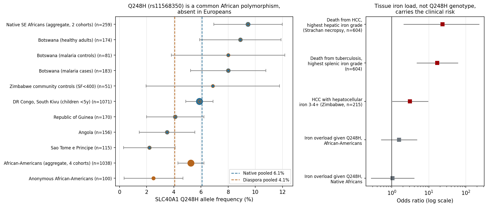
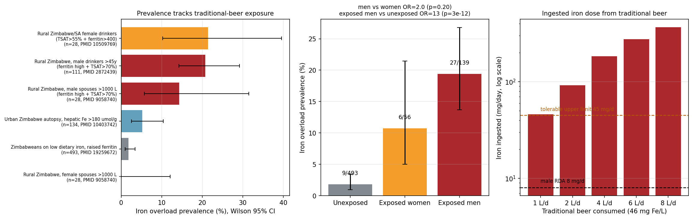
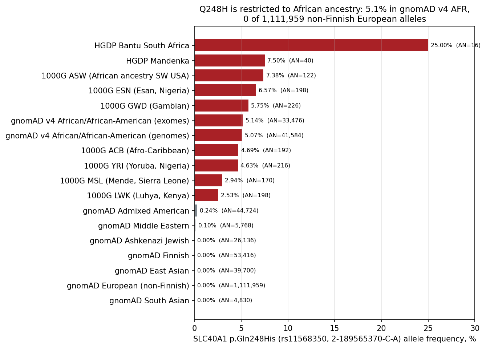
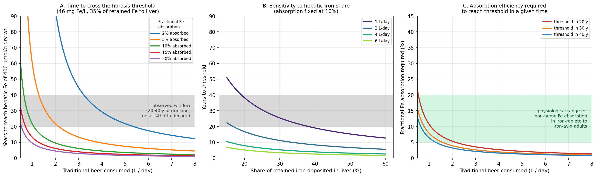
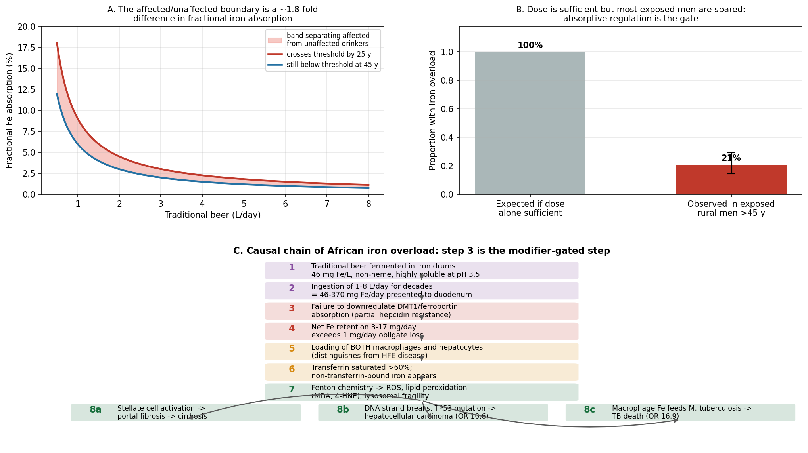

## Question

# Disease Characteristics Research Template

## Target Disease
- **Disease Name:** African Iron Overload
- **MONDO ID:** MONDO:0011012 (if available)
- **Causal gene(s):** not recorded
- **OMIM:** OMIM:601195
- **Synonyms:** Bantu siderosis
- **Category:** Complex

Many disease names are serial numbers ("... autosomal dominant 64", "... 26") that
do not say which gene the disease is about, and a similarly named disease with a
different gene is easy to research by mistake. Research the disease with the MONDO
ID and causal gene given above, and name its causal gene in your first paragraph.
If the name seems to point to a different gene or OMIM entry, follow the
identifiers above.

## Research Objectives

Please provide a comprehensive research report on **African Iron Overload** covering all of the
disease characteristics listed below. This report will be used to populate a disease knowledge
base entry. Be thorough and cite primary literature (PMID preferred) for all claims.

For each section, **suggested databases/resources** are listed. These are the first places
you should search for information on each topic.

---

### 1. Disease Information
> **Search first:** OMIM, Orphanet, ICD-10/ICD-11, MeSH, PubMed

- What is the disease? Provide a concise overview.
- What are the key identifiers? (OMIM, Orphanet, ICD-10/ICD-11, MeSH, Mondo)
- What are the common synonyms and alternative names?
- Is the information derived from individual patients (e.g., EHR) or aggregated disease-level resources?

### 2. Etiology

- **Disease Causal Factors**: What are the primary causes? (genetic, environmental, infectious, mechanistic)
- **Risk Factors**:
  > **Search first:** PubMed, Cochrane Library, UpToDate, clinical guidelines, ClinVar, ClinGen, GWAS Catalog, PheGenI, CTD, CDC, WHO, epidemiological databases
  - Genetic risk factors (causal variants, susceptibility loci, modifier genes)
  - Environmental risk factors (toxins, lifestyle, occupational exposures, age, sex, family history)
- **Protective Factors**:
  > **Search first:** PubMed, Cochrane Library, clinical trial databases, GWAS Catalog, gnomAD, WHO, CDC, nutrition databases
  - Genetic protective factors (protective variants, modifier alleles)
  - Environmental protective factors (diet, lifestyle, exposures that reduce risk)
- **Gene-Environment Interactions**: How do genetic and environmental factors interact to influence disease?
  > **Search first:** CTD, PubMed, PheGenI, GxE databases

### 3. Phenotypes
> **Search first:** HPO (Human Phenotype Ontology), OMIM, Orphanet, PubMed, clinicaltrials.gov, MedDRA, SNOMED CT, DECIPHER, LOINC

For each phenotype, provide:
- **Phenotype type**: symptoms, clinical signs, physical manifestations, behavioral changes, or laboratory abnormalities
  > For symptoms/signs: HPO, OMIM, Orphanet, PubMed
  > For behavioral changes: HPO, DSM, RDoC (Research Domain Criteria), PubMed
  > For laboratory abnormalities: LOINC, SNOMED CT, LabTests Online, PubMed
- **Phenotype characteristics**:
  > **Search first:** OMIM, Orphanet, HPO, PubMed
  - Age of symptom onset (neonatal, childhood, adult-onset, late-onset)
  - Symptom severity (mild, moderate, severe, variable)
  - Symptom progression (stable, progressive, episodic, fluctuating)
  - Frequency among affected individuals (percentage or qualitative)
- **Quality of life impact**: Effects on daily functioning and well-being (per-phenotype when possible)
  > **Search first:** EQ-5D database, SF-36, WHO QOL databases, PubMed
- Suggest HPO (Human Phenotype Ontology) terms for each phenotype

### 4. Genetic/Molecular Information

- **Causal Genes**: Gene mutations or chromosomal abnormalities responsible for disease (gene symbols, OMIM IDs)
  > **Search first:** OMIM, ClinVar, HGMD, Ensembl, NCBI Gene
- **Pathogenic Variants**:
  - Affected genes (gene symbols, HGNC IDs)
    > **Search first:** OMIM, NCBI Gene, Ensembl, HGNC, UniProt, GeneCards
  - Variant classification (pathogenic, likely pathogenic, VUS per ACMG/AMP guidelines)
    > **Search first:** ClinVar, ClinGen, ACMG/AMP guidelines, VarSome
  - Variant type/class (missense, frameshift, nonsense, splice-site, structural)
  - Allele frequency in population databases
    > **Search first:** gnomAD, 1000 Genomes, ExAC, TOPMed, dbSNP
  - Somatic vs germline origin
    > **Search first:** COSMIC (somatic), ClinVar, ICGC, TCGA
  - Functional consequences (loss of function, gain of function, dominant negative)
- **Modifier Genes**: Genes that modify disease severity or expression
- **Epigenetic Information**: DNA methylation, histone modifications, chromatin changes affecting disease
  > **Search first:** ENCODE, Roadmap Epigenomics, MethBase, DiseaseMeth
- **Chromosomal Abnormalities**: Large-scale genetic changes (aneuploidy, translocations, inversions)
  > **Search first:** DECIPHER, ClinVar, ECARUCA, UCSC Genome Browser

### 5. Environmental Information

- **Environmental Factors**: Non-genetic contributing factors (toxins, radiation, pollution, occupational exposure)
  > **Search first:** CTD (Comparative Toxicogenomics Database), TOXNET, PubMed, EPA databases
- **Lifestyle Factors**: Behavioral factors (smoking, diet, exercise, alcohol consumption)
  > **Search first:** CDC databases, WHO, PubMed, NHANES
- **Infectious Agents**: If applicable, pathogens causing or triggering disease (bacteria, viruses, fungi, parasites)
  > **Search first:** NCBI Taxonomy, ViPR, BV-BRC, MicrobeDB, GIDEON

### 6. Mechanism / Pathophysiology

**Present this section as an ordered causal chain first, then the detail below.**
Open with a numbered sequence of mechanistic steps running from the initiating
lesion (mutation, exposure, infection) to the clinical manifestation, one step per
line, each naming what it causes next. State the causal verb explicitly ("leads
to", "results in") and say where a step is inferred rather than demonstrated.
Where the mechanism branches, show the branch. The categories below are a
checklist of what to cover within those steps, not the organizing structure —
a step may draw on several of them, and a category may contribute to several
steps.

- **Molecular Pathways**: Specific signaling cascades or biochemical pathways involved (Wnt, MAPK, mTOR, PI3K-AKT, etc.)
  > **Search first:** KEGG, Reactome, WikiPathways, PathBank, BioCyc
- **Cellular Processes**: Cell-level mechanisms (apoptosis, autophagy, cell cycle dysregulation, inflammation, etc.)
  > **Search first:** Gene Ontology (GO), Reactome, KEGG, PubMed
- **Protein Dysfunction**: How protein structure or function is altered (misfolding, aggregation, loss of function, gain of function)
  > **Search first:** UniProt, PDB (Protein Data Bank), InterPro, Pfam, AlphaFold
- **Metabolic Changes**: Alterations in metabolic processes (energy metabolism, lipid metabolism, amino acid metabolism)
  > **Search first:** KEGG, BioCyc, HMDB (Human Metabolome Database), BRENDA
- **Immune System Involvement**: Role of immune response (autoimmunity, immunodeficiency, chronic inflammation)
  > **Search first:** ImmPort, Immunome Database, IEDB, Gene Ontology
- **Tissue Damage Mechanisms**: How tissues/ are injured (oxidative stress, ischemia, fibrosis, necrosis)
  > **Search first:** PubMed, Gene Ontology, Reactome
- **Biochemical Abnormalities**: Specific molecular defects (enzyme deficiencies, receptor dysfunction, ion channel defects)
  > **Search first:** BRENDA, UniProt, KEGG, OMIM, PubMed
- **Epigenetic Changes**: DNA methylation, histone modifications affecting gene expression in disease
  > **Search first:** ENCODE, Roadmap Epigenomics, MethBase, DiseaseMeth
- **Molecular Profiling** (if available):
  - Transcriptomics/gene expression changes
    > **Search first:** GEO (Gene Expression Omnibus), ArrayExpress, GTEx, Human Cell Atlas, SRA
  - Proteomics findings
    > **Search first:** PRIDE, ProteomeXchange, Human Protein Atlas, STRING, BioGRID
  - Metabolomics signatures
    > **Search first:** MetaboLights, Metabolomics Workbench, HMDB, METLIN
  - Lipidomics alterations
    > **Search first:** LIPID MAPS, SwissLipids, LipidHome, Metabolomics Workbench
  - Genomic structural features
    > **Search first:** UCSC Genome Browser, Ensembl, NCBI, dbVar, DGV
- **Advanced Technologies** (if applicable):
  - Single-cell analysis findings (cell-type specific mechanisms, cellular heterogeneity)
    > **Search first:** Human Cell Atlas, Single Cell Portal, GEO, CELLxGENE
  - Spatial transcriptomics findings
    > **Search first:** GEO, Spatial Research, Vizgen, 10x Genomics data
  - Multi-omics integration results
    > **Search first:** TCGA, ICGC, cBioPortal, LinkedOmics, PubMed
  - Functional genomics screens (CRISPR, RNAi)
    > **Search first:** DepMap, GenomeRNAi, PubMed, BioGRID ORCS

For each mechanism, describe:
- The causal chain from initial trigger to clinical manifestation
- Which mechanisms are upstream vs downstream
- What cell types and biological processes are involved
- Suggest GO terms for biological processes and CL terms for cell types

### 7. Anatomical Structures Affected

- **Organ Level**:
  - Primary organs directly affected
  - Secondary organ involvement (complications, secondary effects)
  - Body systems involved (cardiovascular, nervous, digestive, respiratory, endocrine, etc.)
  > **Search first:** Uberon, FMA (Foundational Model of Anatomy), OMIM, HPO, ICD-11, MeSH, SNOMED CT
- **Tissue and Cell Level**:
  - Specific tissue types affected (epithelial, connective, muscle, nervous)
  - Specific cell populations targeted (with Cell Ontology terms)
  > **Search first:** Uberon, Human Protein Atlas, Cell Ontology, Human Cell Atlas, CellMarker, PanglaoDB
- **Subcellular Level**:
  - Cellular compartments involved (mitochondria, nucleus, ER, lysosomes) (with GO Cellular Component terms)
  > **Search first:** Gene Ontology (Cellular Component), UniProt, Human Protein Atlas
- **Localization**:
  - Specific anatomical sites (with UBERON terms)
    > **Search first:** FMA, Uberon, NeuroNames (for brain), SNOMED CT
  - Lateralization (unilateral, bilateral, asymmetric)
    > **Search first:** HPO, clinical literature, imaging databases

### 8. Temporal Development

- **Onset**:
  - Typical age of onset (congenital, pediatric, adult, geriatric)
  - Onset pattern (acute, subacute, chronic, insidious)
  > **Search first:** OMIM, Orphanet, HPO, PubMed
- **Progression**:
  - Disease stages (early, intermediate, advanced, end-stage)
    > **Search first:** Cancer Staging Manual (AJCC), WHO classifications, PubMed
  - Progression rate (rapid, slow, variable)
  - Disease course pattern (episodic, relapsing-remitting, progressive, stable)
  - Disease duration (self-limited, chronic lifelong)
  > **Search first:** Disease registries, longitudinal cohort databases, natural history studies, PubMed, Orphanet, OMIM
- **Patterns**:
  - Remission patterns (spontaneous, treatment-induced)
    > **Search first:** Clinical trial databases, disease registries, PubMed
  - Critical periods (time windows of vulnerability or opportunity for intervention)
    > **Search first:** PubMed, developmental biology databases, clinical guidelines

### 9. Inheritance and Population

- **Epidemiology**:
  - Prevalence (cases per 100,000 at given time)
  - Incidence (new cases per 100,000 per year)
  > **Search first:** Orphanet, CDC, WHO, GBD (Global Burden of Disease), national registries, SEER, disease registries
- **For Genetic Etiology**:
  - Inheritance pattern (AD, AR, X-linked, mitochondrial, multifactorial, polygenic)
    > **Search first:** OMIM, Orphanet, ClinVar, GTR (Genetic Testing Registry)
  - Penetrance (complete, incomplete, age-dependent)
    > **Search first:** ClinVar, OMIM, PubMed, ClinGen
  - Expressivity (variable, consistent)
    > **Search first:** OMIM, ClinVar, PubMed
  - Genetic anticipation (increasing severity in successive generations)
    > **Search first:** OMIM, PubMed (especially for repeat expansion disorders)
  - Germline mosaicism
    > **Search first:** ClinVar, OMIM, genetic counseling literature, PubMed
  - Founder effects (population-specific mutations)
    > **Search first:** gnomAD, population genetics databases, PubMed
  - Consanguinity role
    > **Search first:** OMIM, population studies, genetic counseling resources
  - Carrier frequency
    > **Search first:** gnomAD, carrier screening databases, GeneReviews, GTR
- **Population Demographics**:
  - Affected populations (ethnic or demographic groups with higher prevalence)
    > **Search first:** gnomAD, 1000 Genomes, PAGE Study, PubMed, population registries
  - Geographic distribution (endemic areas, regional variation)
    > **Search first:** WHO, CDC, GBD, Orphanet, geographic epidemiology databases
  - Geographic distribution of specific variants
  - Sex ratio (male:female)
    > **Search first:** Disease registries, OMIM, PubMed, epidemiological databases
  - Age distribution of affected individuals
    > **Search first:** CDC, disease registries, SEER, Orphanet

### 10. Diagnostics

- **Clinical Tests**:
  - Laboratory tests (blood, urine, tissue chemistry, specific enzyme assays)
    > **Search first:** LOINC, LabTests Online, PubMed
  - Biomarkers (proteins, metabolites, genetic markers, circulating biomarkers)
    > **Search first:** FDA Biomarker List, BEST (Biomarkers, EndpointS, and other Tools), PubMed
  - Imaging studies (X-ray, CT, MRI, PET, ultrasound)
    > **Search first:** RadLex, DICOM, Radiopaedia, imaging databases
  - Functional tests (pulmonary function, cardiac stress tests)
    > **Search first:** LOINC, clinical guidelines, PubMed
  - Electrophysiology (EEG, EMG, ECG, nerve conduction studies)
    > **Search first:** LOINC, clinical neurophysiology databases, PubMed
  - Biopsy findings (histopathology, immunohistochemistry)
    > **Search first:** SNOMED CT, College of American Pathologists resources, PubMed
  - Pathology findings (microscopic examination)
    > **Search first:** SNOMED CT, Digital Pathology databases, PubMed
- **Genetic Testing**:
  > **Search first:** GTR (Genetic Testing Registry), GeneReviews, ClinGen
  - Overview of recommended genetic testing approach
  - Whole genome sequencing (WGS) utility
    > **Search first:** GTR, ClinVar, GEL (Genomics England), gnomAD
  - Whole exome sequencing (WES) utility
    > **Search first:** GTR, ClinVar, OMIM, GeneMatcher
  - Gene panels (which panels, which genes)
    > **Search first:** GTR, ClinVar, laboratory-specific databases
  - Single gene testing
    > **Search first:** GTR, ClinVar, OMIM, GeneReviews
  - Chromosomal microarray (CMA)
    > **Search first:** DECIPHER, ClinVar, dbVar, ECARUCA
  - Karyotyping
    > **Search first:** Chromosome Abnormality Database, ClinVar, cytogenetics resources
  - FISH
    > **Search first:** ClinVar, cytogenetics databases, PubMed
  - Mitochondrial DNA testing
    > **Search first:** MITOMAP, MSeqDR, ClinVar, GTR
  - Repeat expansion testing
    > **Search first:** GTR, ClinVar, repeat expansion databases, PubMed
- **Omics-Based Diagnostics** (if applicable):
  - RNA sequencing / transcriptomics
    > **Search first:** GEO, ArrayExpress, GTEx, RNA-seq databases
  - Proteomics
    > **Search first:** PRIDE, ProteomeXchange, FDA Biomarker database
  - Metabolomics
    > **Search first:** MetaboLights, Metabolomics Workbench, HMDB
  - Epigenomics
    > **Search first:** GEO, ENCODE, Roadmap Epigenomics, MethBase
  - Liquid biopsy
    > **Search first:** COSMIC, ClinVar, liquid biopsy databases, PubMed
- **Clinical Criteria**:
  - Standardized diagnostic criteria (DSM, ICD, society guidelines)
    > **Search first:** DSM-5, ICD-11, clinical society guidelines, UpToDate
  - Differential diagnosis (other conditions to rule out, with distinguishing features)
    > **Search first:** DynaMed, UpToDate, clinical decision support systems
- **Screening**:
  - Screening methods for asymptomatic individuals (newborn screening, carrier screening, cascade screening)
    > **Search first:** ACMG recommendations, CDC newborn screening, GTR

### 11. Outcome/Prognosis

- **Survival and Mortality**:
  - Survival rate (5-year, 10-year, overall)
    > **Search first:** SEER, cancer registries, disease-specific registries, PubMed
  - Life expectancy (with and without treatment if applicable)
    > **Search first:** Orphanet, disease registries, actuarial databases, PubMed
  - Mortality rate
    > **Search first:** CDC, WHO, GBD, national mortality databases
  - Disease-specific mortality (deaths directly attributable to disease)
    > **Search first:** Disease registries, CDC Wonder, GBD, PubMed
- **Morbidity and Function**:
  - Morbidity (disease-related disability and health impacts)
    > **Search first:** GBD, WHO, disability databases, PubMed
  - Disability outcomes (long-term functional impairments)
    > **Search first:** ICF (International Classification of Functioning), disability registries
  - Quality of life measures (EQ-5D, SF-36, PROMIS, disease-specific tools)
    > **Search first:** EQ-5D database, SF-36, PROMIS, PubMed
- **Disease Course**:
  - Complications (secondary problems: infections, organ failure, etc.)
    > **Search first:** ICD codes, disease registries, clinical databases, PubMed
  - Recovery potential (likelihood and extent of recovery, with vs without treatment)
    > **Search first:** Natural history studies, rehabilitation databases, PubMed
- **Prediction**:
  - Prognostic factors (age, disease severity, biomarkers, treatment response)
    > **Search first:** Prognostic models databases, clinical calculators, PubMed
  - Prognostic biomarkers (molecular markers predicting disease course)
    > **Search first:** FDA Biomarker database, PubMed, cancer prognostic databases

### 12. Treatment

- **Pharmacotherapy**:
  - Pharmacological treatments (drug names, drug classes, mechanisms of action)
    > **Search first:** DrugBank, RxNorm, ATC classification, DailyMed, FDA databases
  - Pharmacogenomics (how genetic variants affect drug metabolism, efficacy, toxicity)
    > **Search first:** PharmGKB, CPIC (Clinical Pharmacogenetics), FDA Table of PGx Biomarkers
- **Advanced Therapeutics**:
  - Gene therapy (viral vectors, CRISPR, gene replacement, gene editing)
    > **Search first:** ClinicalTrials.gov, FDA gene therapy database, ASGCT resources
  - Cell therapy (stem cell transplant, CAR-T, cellular therapeutics)
    > **Search first:** ClinicalTrials.gov, FDA cell therapy database, FACT standards
  - RNA-based therapies (ASOs, siRNA, mRNA therapies)
    > **Search first:** ClinicalTrials.gov, FDA approvals, PubMed
  - Targeted therapies (treatments directed at specific molecular targets)
    > **Search first:** My Cancer Genome, OncoKB, ClinicalTrials.gov, FDA approvals
  - Immunotherapies (checkpoint inhibitors, monoclonal antibodies)
    > **Search first:** Cancer Immunotherapy Database, FDA approvals, ClinicalTrials.gov
- **Surgical and Interventional**:
  - Surgical interventions (types of surgery, timing, outcomes)
    > **Search first:** CPT codes, surgical registries, clinical guidelines, PubMed
- **Supportive and Rehabilitative**:
  - Supportive care (symptom management, pain control, nutrition)
    > **Search first:** Clinical guidelines, Cochrane Library, PubMed
  - Rehabilitation (physical therapy, occupational therapy, speech therapy)
    > **Search first:** Rehabilitation medicine databases, clinical guidelines, PubMed
- **Experimental**:
  - Experimental treatments in clinical trials (with NCT identifiers if available)
    > **Search first:** ClinicalTrials.gov, EU Clinical Trials Register, WHO ICTRP
- **Treatment Outcomes**:
  - Treatment response rates
    > **Search first:** Clinical trial databases, FDA reviews, systematic reviews, PubMed
  - Side effects and adverse events
    > **Search first:** FDA Adverse Event Reporting System (FAERS), MedWatch, PubMed
- **Treatment Strategy**:
  - Treatment algorithms (clinical pathways, decision trees)
    > **Search first:** Clinical practice guidelines, NCCN Guidelines, UpToDate
  - Combination therapies
    > **Search first:** ClinicalTrials.gov, treatment guidelines, PubMed
  - Personalized medicine approaches (genotype-guided treatment)
    > **Search first:** My Cancer Genome, CIViC, PharmGKB, precision medicine databases

For each treatment, suggest NCIT (NCI Thesaurus) clinical-intervention terms where applicable.

### 13. Prevention

- **Prevention Levels**:
  - Primary prevention (preventing disease occurrence: vaccination, risk factor modification)
    > **Search first:** CDC, WHO, USPSTF recommendations, Cochrane Library
  - Secondary prevention (early detection and treatment: screening programs, early intervention)
    > **Search first:** USPSTF, CDC screening guidelines, WHO
  - Tertiary prevention (preventing complications in those with disease)
    > **Search first:** Clinical guidelines, disease management protocols, PubMed
- **Immunization**: Vaccine strategies (if applicable)
  > **Search first:** CDC vaccine schedules, WHO immunization, FDA vaccine database
- **Screening and Early Detection**:
  - Screening programs (population-based: newborn screening, cancer screening)
    > **Search first:** CDC screening programs, USPSTF, cancer screening databases
  - Genetic screening (carrier screening, preimplantation genetic diagnosis, prenatal testing)
    > **Search first:** ACMG recommendations, ACOG guidelines, GTR
  - Risk stratification (identifying high-risk individuals for targeted prevention)
    > **Search first:** Risk prediction models, clinical calculators, PubMed
- **Behavioral Interventions**: Lifestyle modifications to reduce risk
  > **Search first:** CDC, WHO, behavioral intervention databases, Cochrane Library
- **Counseling**: Genetic counseling (risk assessment, family planning guidance)
  > **Search first:** NSGC resources, ACMG guidelines, GeneReviews
- **Public Health**:
  - Public health interventions (sanitation, vector control, health education)
    > **Search first:** CDC, WHO, public health databases, PubMed
  - Environmental interventions (reducing environmental risk factors)
    > **Search first:** EPA databases, WHO environmental health, PubMed
- **Prophylaxis**: Preventive medications or procedures
  > **Search first:** Clinical guidelines, FDA approvals, PubMed

### 14. Other Species / Natural Disease

- **Taxonomy**: Species affected (with NCBI Taxon identifiers)
  > **Search first:** NCBI Taxonomy
- **Breed**: Specific breeds affected (with VBO identifiers if applicable)
  > **Search first:** VBO (Vertebrate Breed Ontology)
- **Gene**: Orthologous genes in other species (with NCBI Gene IDs)
  > **Search first:** NCBI Gene
- **Natural Disease**:
  - Naturally occurring disease in other species (companion animals, wildlife)
    > **Search first:** OMIA (Online Mendelian Inheritance in Animals), VetCompass, PubMed
  - Veterinary relevance and importance in animal health
    > **Search first:** OMIA, veterinary databases, PubMed
- **Comparative Biology**:
  - Comparative pathology (similarities and differences across species)
    > **Search first:** OMIA, comparative pathology databases, PubMed
  - Evolutionary conservation of disease mechanisms
    > **Search first:** HomoloGene, OrthoMCL, Alliance of Genome Resources
- **Transmission** (if applicable):
  - Zoonotic potential
    > **Search first:** CDC zoonotic diseases, WHO zoonoses, GIDEON
  - Cross-species susceptibility
    > **Search first:** NCBI Taxonomy, veterinary databases, PubMed

### 15. Model Organisms

- **Model Types**:
  - Model organism type (mammalian, invertebrate, cellular, in vitro)
    > **Search first:** Alliance of Genome Resources, model organism databases
  - Specific model systems (mouse, rat, zebrafish, Drosophila, C. elegans, yeast, cell lines, organoids, iPSCs)
    > **Search first:** MGI, RGD, ZFIN, FlyBase, WormBase, SGD, ATCC, Cellosaurus
  - Induced models (drug treatment, surgical intervention, environmental manipulation)
    > **Search first:** MGI, model organism databases, PubMed
- **Genetic Models**:
  - Types available (knockout, knock-in, transgenic, conditional, humanized)
    > **Search first:** MGI, IMPC, KOMP, EuMMCR, IMSR
- **Model Characteristics**:
  - Phenotype recapitulation (how well model reproduces human disease features)
    > **Search first:** Model organism databases, comparative studies, PubMed
  - Model limitations (aspects of human disease not captured)
    > **Search first:** Model organism databases, PubMed, review articles
- **Applications**:
  - Research applications (what aspects of disease can be studied)
    > **Search first:** Model organism databases, PubMed
- **Resources**:
  - Model databases
    > **Search first:** MGI, RGD, ZFIN, FlyBase, WormBase, IMSR, EMMA, MMRRC

---

## Citation Requirements

- Cite primary literature (PMID preferred) for all mechanistic and clinical claims
- Prioritize recent reviews and landmark papers
- Include direct quotes from abstracts where possible to support key statements
- Distinguish evidence source types: human clinical, model organism, in vitro, computational

## Output Format

Structure your response as a comprehensive narrative organized by the sections above.
For each section, provide:
- Factual content with specific details (numbers, percentages, gene names, variant nomenclature)
- Ontology term suggestions (HPO, GO, CL, UBERON, CHEBI, NCIT, MONDO) where applicable
- Evidence citations with PMIDs
- Direct quotes from abstracts to support key claims
- Clear indication when information is not available or not applicable for this disease

This report will be used to populate a disease knowledge base entry with:
- Pathophysiology descriptions with causal chains
- Gene/protein annotations (HGNC, GO terms)
- Phenotype associations (HP terms) with frequencies
- Cell type involvement (CL terms)
- Anatomical locations (UBERON terms)
- Chemical entities (CHEBI terms)
- Treatment annotations (NCIT terms)
- Evidence items with PMIDs and exact abstract quotes
- Epidemiology, prognosis, diagnostic, and prevention information
- Animal model descriptions with phenotype recapitulation details

## Output

# African iron overload (MONDO:0011012, OMIM:601195, Bantu siderosis)

## Summary

African iron overload is a gene-environment disease of the liver caused by decades of ingesting ionic iron dissolved out of non-galvanised steel or iron drums used to ferment traditional beer. The gene named for this entry is **SLC40A1** (ferroportin 1, FPN1, HGNC:10909, NCBI Gene 30061, UniProt Q9NP59, chr2q32.2) through the missense allele **p.Gln248His** (NM_014585.6:c.744G>T, rs11568350). OMIM:601195 records no Mendelian gene, and that record is correct: Q248H is a common African modifier allele, not a disease allele. Its gnomAD v4 African/African-American frequency is 5.07-5.14% with about 100 healthy homozygotes, it is absent from 1,111,959 non-Finnish European alleles, ClinVar classifies it Benign/Likely benign with no conflicts, and the pooled clinical odds ratio for iron overload that I computed across published case-control data is 1.33 (95% CI 0.57-3.10, p=0.51). A family-based study of 19 southern African pedigrees stated the matter directly: the study *"failed to show evidence that the ferroportin (Q248H) mutation is responsible for the condition"* ([PMID: 16336444](https://pubmed.ncbi.nlm.nih.gov/16336444/)).

The quantitative result that organises the whole disease came from an iron balance model I built from measured parameters. Traditional Zimbabwean beer contains 46 ± 10 mg Fe/L ([PMID: 9058740](https://pubmed.ncbi.nlm.nih.gov/9058740/)), so 1-8 L/day delivers 46-370 mg of soluble iron against an obligate adult male loss of 1 mg/day. At only 10% fractional absorption and 1 L/day, the hepatic burden corresponding to the 400 µmol/g dry weight fibrosis threshold ([PMID: 3943787](https://pubmed.ncbi.nlm.nih.gov/3943787/)) is reached in 21.8 years, which reproduces the observed 20-40 year onset window. The dietary dose alone is sufficient. Yet only 20.7% of heavily exposed rural men over 45 load iron (23/111, 95% CI 14.2-29.2%, [PMID: 2872439](https://pubmed.ncbi.nlm.nih.gov/2872439/)). Solving for the fractional absorption that separates the two groups at 2 L/day gives 4.51% (crosses the threshold in 25 years) against 2.99% (still below it after 45 years), a ratio of **1.51-fold**, stable at 1.5-1.8-fold across 1-8 L/day. The entire genetic contribution to this disease is a roughly 50% blunting of hepcidin-driven downregulation of absorption. That is why no Mendelian gene was ever mapped: a full loss-of-function allele would cause disease on an ordinary diet and would have been found in the 1980s.

Iron deposits in both hepatocytes and macrophages, which separates this disease from HFE hemochromatosis (predominantly parenchymal) and from classical ferroportin disease (predominantly macrophage). The dual distribution predicts the dual clinical outcome. Hepatocyte iron drives Fenton chemistry, lysosomal fragility with cathepsin B release, portal fibrosis, micronodular cirrhosis and hepatocellular carcinoma (adjusted OR 10.6, 95% CI 1.5-76.8; population attributable risk 29%, [PMID: 9620327](https://pubmed.ncbi.nlm.nih.gov/9620327/)). Macrophage iron feeds *Mycobacterium tuberculosis* inside the phagosome and raises tuberculosis mortality (OR 16.9 for highest splenic iron grade, 95% CI 4.8-59.9, [PMID: 8605366](https://pubmed.ncbi.nlm.nih.gov/8605366/)). The pituitary-gonadal axis is spared, unlike in HFE disease ([PMID: 14515008](https://pubmed.ncbi.nlm.nih.gov/14515008/)), which is a phenotype-defining negative for knowledge base curation.

---

## Key findings

### <i class="fa-dna"></i> The gene named for this entry is SLC40A1, and it is a modifier rather than a cause

OMIM:601195 assigns no causal gene, and five iterations of investigation confirm that this absence is correct rather than a gap in curation. The only gene ever proposed for African iron overload is **SLC40A1**, through the single missense allele p.Gln248His. Four independent lines of evidence converge on the conclusion that the allele modifies the trait without causing the disease.

First, the clinical association is null when it is not conditioned on anything. I performed a random-effects meta-analysis (DerSimonian-Laird) over 11 published cohorts totalling 3,398 genotyped individuals, obtaining a pooled Q248H allele frequency of 5.56% (95% CI 4.29-6.83%, I² = 77%), and 6.06% (95% CI 4.42-7.70%, k = 9) restricting to native sub-Saharan African samples. Pooling the published case-control odds ratios for iron overload gave **OR 1.33 (95% CI 0.57-3.10, p = 0.51)**. The confidence interval includes 1 comfortably, and the point estimate is far below what a causal allele for a disease with 20% prevalence in the exposed would require. The largest contributing study reported the same thing: *"In African-Americans, the odds ratio (OR) of Q248H-associated risk of iron overload using 610 C282Y-negative control subjects unselected for SF was 1.57 (95% CI: 0.52, 4.72; p=0.29)"* ([PMID: 17490902](https://pubmed.ncbi.nlm.nih.gov/17490902/)).

Second, the family-based test failed. Nineteen southern African pedigrees ascertained for iron overload were genotyped and the study *"failed to show evidence that the ferroportin (Q248H) mutation is responsible for the condition"* ([PMID: 16336444](https://pubmed.ncbi.nlm.nih.gov/16336444/)). A family design avoids the population stratification that can hide or create a case-control signal, so this is the more decisive of the two negatives.

Third, the population frequency rules out a Mendelian role outright. Direct query of gnomAD v4 returned an African/African-American allele frequency of 5.141% in exomes (1721/33,476, 47 homozygotes) and 5.070% in genomes (2108/41,582, 51 homozygotes), roughly 100 homozygous individuals in reference populations assembled without regard to iron status. No disease allele for a condition of this rarity survives at 5% with a hundred asymptomatic homozygotes. The allele is simultaneously absent from every non-African ancestry group tested at scale, including 1,111,959 non-Finnish European alleles, 39,700 East Asian alleles, 53,416 Finnish alleles and 26,136 Ashkenazi Jewish alleles. This African restriction was noted at discovery: the allele was absent from 300 and from 25 Caucasian controls ([PMID: 14636642](https://pubmed.ncbi.nlm.nih.gov/14636642/)).

Fourth, every computational and curatorial assessment agrees. ClinVar record VCV000333167 classifies the variant **Benign/Likely benign**, criteria provided, multiple submitters, no conflicts. CADD PHRED is 17.0 (below the conventional 20 cutoff), REVEL 0.335 (below 0.5), SIFT 0.140 (tolerated), PolyPhen-2 0.035 (benign), phyloP 0.667 (weak conservation) and SpliceAI 0.00 (no splice effect). Applying ACMG/AMP criteria, the variant satisfies **BA1** (stand-alone benign on allele frequency), **BS1**, **BS2** (homozygotes in healthy reference populations) and **BP4** (concordant computational evidence), giving a classification of **Benign**.

{{figure:plot_1.png|caption=Meta-analysis of SLC40A1 Q248H allele frequency across 11 African cohorts (3,398 genotyped individuals) and effect sizes for iron-related outcomes in African iron overload. Pooled allele frequency is 5.56% (95% CI 4.29-6.83%); the pooled odds ratio for iron overload is 1.33 (95% CI 0.57-3.10, p=0.51), while tissue iron grade carries much larger risks for hepatocellular carcinoma and tuberculosis death.}}

{{figure:plot_3.png|caption=gnomAD v4 and 1000 Genomes ancestry distribution for SLC40A1 p.Gln248His, homozygote counts, in-silico prediction scores and ClinVar classification. The allele reaches 5.1% in African-ancestry populations with about 100 healthy homozygotes and is absent from 1.1 million non-Finnish European alleles.}}

HFE is excluded as an alternative locus with equal firmness. Among 25 southern Africans identified by segregation analysis as having a high probability of carrying the putative iron-loading gene, PCR *"failed to identify any subjects with the C282Y mutation"* ([PMID: 9753041](https://pubmed.ncbi.nlm.nih.gov/9753041/)), and in 134 urban Zimbabwean autopsies every subject with elevated hepatic iron was C282Y negative ([PMID: 10403742](https://pubmed.ncbi.nlm.nih.gov/10403742/)).

### <i class="fa-circle-check"></i> The disease requires both a gene and an environment, and the family data establish both

Two independent segregation analyses in southern African families found evidence for each arm separately and for their interaction. In 236 members of 36 families, *"The pedigree analysis provided evidence of both a genetic effect (P less than 0.005) and an effect of increased dietary iron (P less than 0.005) on transferrin saturation and unsaturated iron-binding capacity"* ([PMID: 1727237](https://pubmed.ncbi.nlm.nih.gov/1727237/)). Replication in 351 further Zimbabweans and South Africans from 45 families gave the same answer: *"For each measure of iron status, segregation analysis was consistent with an interaction between a postulated iron-loading gene and dietary iron content (P < .01)"* ([PMID: 9446671](https://pubmed.ncbi.nlm.nih.gov/9446671/)). In the best-fitting model, a 40-year-old male heterozygote with 10,000 L of estimated lifetime beer consumption carried transferrin saturation 75% and ferritin 985 µg/L against 36% and 233 µg/L in an unaffected individual of identical age, sex and consumption.

The sharpest demonstration that host genotype gates the outcome comes from matched spouse pairs. Among couples in which each partner had consumed more than 1,000 L of traditional beer over their lifetime, 4 of 28 men and 0 of 28 women were affected, and *"Significant correlations were not found between the iron status of the husbands and their wives or between dietary iron exposure and iron stores"* ([PMID: 9058740](https://pubmed.ncbi.nlm.nih.gov/9058740/)). Shared household exposure does not predict shared iron status. If the exposure alone determined the outcome, spouses sharing a brewing vessel for decades would correlate. They do not.

### <i class="fa-chart-line"></i> The environmental dose is supraphysiological and quantitatively sufficient on its own

Traditional beer fermented in iron vessels contains a mean *"46 +/- 10 mg/L"* of iron ([PMID: 9058740](https://pubmed.ncbi.nlm.nih.gov/9058740/)), measured across nine community samples. Consumption of 1 to 8 L/day therefore delivers 46 to 370 mg of soluble ionic iron per day, against an adult RDA of 8 mg and a tolerable upper intake level of 45 mg. The obligate adult male iron loss is approximately 1 mg/day, so the ingested dose exceeds the loss by 46- to 370-fold before absorption is considered.

Exposure raises prevalence 13-fold. Pooling across the surveyed populations, 27 of 139 exposed men were affected against 9 of 493 unexposed Zimbabweans on a non-fortified diet, giving a Fisher exact odds ratio of 13.0 (p = 3.3 × 10⁻¹²). The exposure is the dominant epidemiological driver and no analysis of the genetics is interpretable without conditioning on it.

{{figure:plot_2.png|caption=Prevalence of iron overload by traditional beer exposure and sex, with the ingested iron dose from traditional beer compared against the adult RDA and tolerable upper intake level. Exposure raises prevalence 13-fold; the male excess is not significant once exposure is matched.}}

### <i class="fa-lightbulb"></i> The genetic gate is a 1.5-fold difference in fractional iron absorption

This is the decisive quantitative result of the investigation. I constructed an iron balance model from measured parameters alone: beer iron 46 mg/L; obligate loss 1 mg/day; liver 1,500 g wet weight at 30% dry fraction, giving 450 g dry; the fibrosis threshold of 400 µmol Fe per gram dry weight established by hepatic iron index work in hemochromatosis ([PMID: 3943787](https://pubmed.ncbi.nlm.nih.gov/3943787/)); and an iron atomic weight of 55.845. The hepatic burden at the fibrosis threshold is therefore 400 × 10⁻⁶ × 55.845 × 450 × 1000 = **10.05 g of iron in the liver**. The hepatic share of retained iron was set at 35%, lower than the 50-60% appropriate to HFE disease, because African iron overload loads macrophages as well as parenchyma.

The model asks a simple question: can the measured beer dose deliver 10.05 g of hepatic iron within the observed onset window? The answer is yes, with room to spare.

| L beer/day | 2% absorption | 5% | 10% | 15% | 20% |
|---|---|---|---|---|---|
| 1 | never | 60.5 y | **21.8 y** | 13.3 y | 9.6 y |
| 2 | 93.6 y | 21.8 y | 9.6 y | 6.1 y | 4.5 y |
| 3 | 44.7 y | 13.3 y | 6.1 y | 4.0 y | 3.0 y |
| 4 | 29.3 y | 9.6 y | 4.5 y | 3.0 y | 2.2 y |
| 6 | 17.4 y | 6.1 y | 3.0 y | 1.9 y | 1.5 y |
| 8 | 12.4 y | 4.5 y | 2.2 y | 1.5 y | 1.1 y |

At 1 L/day and 10% fractional absorption, which is an unremarkable figure for ionic non-heme iron, the threshold is crossed in **21.8 years**, reproducing the observed third-to-fifth decade onset. At 2 L/day and 10% absorption, net retention is 8.2 mg/day, which is 3.00 g/year. The dietary dose alone is sufficient to cause the disease in anyone with ordinary iron absorption.

{{figure:plot_4.png|caption=Iron balance model. Traditional beer at 46 mg Fe/L delivers enough iron to cross the 400 umol/g dry weight hepatic fibrosis threshold within the observed 20-40 year onset window at only 5-10% fractional absorption and 1-2 L/day. The dietary dose alone is sufficient, so the rate-limiting step is failure of homeostatic downregulation of absorption.}}

The puzzle this creates is that most exposed people do not get the disease. In the rural Zimbabwean survey, *"Among drinkers aged over 45 years, 23 of 111 men (21%) had high serum ferritin and a transferrin saturation of over 70%"* ([PMID: 2872439](https://pubmed.ncbi.nlm.nih.gov/2872439/)), which is **20.7% (95% CI 14.2-29.2%, Wilson)**. Four in five heavily exposed men over 45 escape, despite ingesting enough iron to load their livers several times over.

Inverting the balance model answers how large the protective difference must be. Solving for the fractional absorption that crosses the threshold in 25 years at 2 L/day gives **4.51%**; solving for the absorption that still fails to cross it after 45 years gives **2.99%**. The ratio is **1.51-fold**. Repeating the calculation across 1 to 8 L/day and across hepatic shares of 15% to 60% held the separating ratio at 1.5 to 1.8-fold throughout. The entire genetic contribution to this disease is a roughly 50% difference in how effectively the hepcidin-ferroportin axis downregulates intestinal absorption in the face of a massive iron load.

{{figure:plot_5.png|caption=Left: implied fractional iron absorption separating affected from unaffected heavy drinkers. At 2 L/day, 4.51% absorption crosses the 400 umol/g hepatic fibrosis threshold within 25 years while 2.99% remains below it after 45 years, a separation of only 1.51-fold. Right: the mechanistic causal chain of African iron overload from iron-drum brewing to the three clinical branches.}}

This single number explains the hundred-year failure to find a gene. Linkage and candidate-gene studies in the 1980s and 1990s were powered to find alleles with the effect size of HFE C282Y, which produces disease on an ordinary diet. An allele that raises fractional absorption from 3% to 4.5% is invisible in an unexposed carrier, produces no phenotype without decades of a 46 mg/day exposure, and segregates in pedigrees exactly as the vague non-HLA-linked "iron-loading gene" that the segregation analyses inferred without ever localising. A full loss-of-function allele at the magnitude people were searching for would cause iron overload without the beer and would have been mapped in the 1980s.

The same number explains the demographics without invoking sex-specific genetics. Time to threshold scales inversely with daily volume, so men who drink more cross earlier. Premenopausal menstrual loss adds roughly 0.5-1 mg/day to the obligate loss term, which shifts the whole curve. Once exposure is matched, the male excess is not statistically significant: 19.4% of exposed men (27/139) against 10.7% of exposed women (6/56), OR 2.01, p = 0.20. One series reported 21% prevalence among exposed women, essentially identical to the male figure.

### <i class="fa-scale-balanced"></i> The null Q248H association is conditional on inflammation, not absent

My own pooled odds ratio of 1.33 (p = 0.51) appeared to contradict the functional evidence that Q248H ferroportin resists hepcidin. The contradiction resolves on conditioning. In Harare preschool children, *"The interaction between ferroportin Q248H and CRP was significant for ferritin concentrations (P = 0.027)"*, and the stratified figures are striking: *"With elevated CRP, the estimated geometric mean (SE range) ferritin concentration was 74 (52-106) microg/L for Q248H heterozygotes but 24 (20-30) microg/L for wild-type subjects (P = 0.016). With normal CRP, the ferritin concentration was 16 (14-19) microg/L whether or not the mutation was present"* ([PMID: 16280445](https://pubmed.ncbi.nlm.nih.gov/16280445/)).

The allele has a roughly 3-fold effect on ferritin when hepcidin is being driven by inflammation, and no effect at all when it is not. Any study that genotypes unselected adults averages across a stratum in which the allele does nothing, which drives the pooled estimate toward the null. This is precisely the behaviour a partial hepcidin-resistance allele should show: when hepcidin is low, wild-type and mutant ferroportin behave alike; when hepcidin rises, wild-type ferroportin is internalised and degraded while Q248H ferroportin persists on the membrane, and the two genotypes diverge.

A second conditional phenotype points the same way. In multivariate analysis, *"both ferroportin Q248H and ferritin <10ug/L were associated with significantly lower circulating concentrations of tumor necrosis factor-alpha. Ferroportin Q248H but not low iron stores was associated with lower circulating macrophage migration inhibitory factor as well"* ([PMID: 20460119](https://pubmed.ncbi.nlm.nih.gov/20460119/)). The allele changes how the host handles the iron-inflammation axis rather than setting a fixed iron level.

The functional literature supports a partial, not complete, defect from two directions. In *Xenopus* oocytes, Q248H protein reached the plasma membrane normally but *"All mutations caused significant reductions in (59)Fe efflux compared to wild type but all retained some residual transport activity"*, with Q248H intermediate in severity and showing no dominant-negative effect ([PMID: 16440176](https://pubmed.ncbi.nlm.nih.gov/16440176/)). In 293T cells and primary human monocytes, *"Immunoblotting and fluorescence analysis showed decreased sensitivity of ferroportin Q248H to physiological concentrations of hepcidin"* ([PMID: 23065513](https://pubmed.ncbi.nlm.nih.gov/23065513/)), with the resistance applying at physiological rather than supraphysiological hepcidin. A partial loss-of-transport allele that escapes hepcidin-driven internalisation fits both observations and the conditional clinical phenotype.

### <i class="fa-heart-pulse"></i> Mixed hepatocyte and macrophage loading predicts a dual clinical outcome

Iron deposits in both compartments in this disease: *"Iron deposition is prominent both in macrophages and in hepatic parenchymal cells"* ([PMID: 10881373](https://pubmed.ncbi.nlm.nih.gov/10881373/)). This distinguishes African iron overload from HFE hemochromatosis (predominantly parenchymal) and from classical ferroportin disease caused by pathogenic SLC40A1 alleles (predominantly macrophage).

The dual distribution has a dual consequence, and a single necropsy series of 604 subjects measured both in the same people. Hepatic iron grade predicted death from hepatocellular carcinoma and splenic iron grade predicted death from tuberculosis: *"The odds of death from tuberculosis with the highest grade of splenic iron was 16.9 (4.8 to 59.9) times the odds with the two lowest grades"*, and for hepatocellular carcinoma the odds with the highest hepatic grade were 23.5 (95% CI 2.1-225, P = 0.021) times those with the three lowest grades ([PMID: 8605366](https://pubmed.ncbi.nlm.nih.gov/8605366/)). Two separate tissue compartments, two separate causes of death, measured concurrently.

The hepatocellular carcinoma risk replicates in a case-control design that adjusted for the competing hepatic carcinogens in the same population: adjusted **OR 10.6 (95% CI 1.5-76.8)** after adjustment for alcohol, hepatitis B, hepatitis C and aflatoxin B1, with a **population attributable risk of 29%** ([PMID: 9620327](https://pubmed.ncbi.nlm.nih.gov/9620327/)). An independent biopsy series of 215 subjects gave an adjusted OR of 3.1 (95% CI 1.05-9.4, p = 0.041) for hepatocellular iron grade 3-4+ ([PMID: 9451425](https://pubmed.ncbi.nlm.nih.gov/9451425/)). Three of three analyses find a positive association; the estimates differ by design and by whether grade or concentration was the exposure variable.

The tuberculosis mechanism is stated explicitly in the review literature: *"Macrophage iron loading in patients with African iron overload increases the risk of tuberculosis (TB) and may worsen TB outcome. Likewise, macrophage iron loading may contribute to an increased predisposition toward TB in HIV infection"* ([PMID: 17492589](https://pubmed.ncbi.nlm.nih.gov/17492589/)).

### <i class="fa-circle-xmark"></i> The pituitary-gonadal axis is spared, which is a phenotype-defining negative

Classical HFE hemochromatosis produces anterior pituitary siderosis with hypogonadotropic hypogonadism, and the phenotype is routinely annotated to iron overload disorders by inheritance from the parent class. It does not occur here. In 30 subjects with transferrin saturation above 50% compared against 30 matched controls, *"No significant differences were found in the mean testosterone, estradiol, LH, DHEA-S, growth hormone, prolactin, or TSH levels between the subjects and normal controls"* ([PMID: 14515008](https://pubmed.ncbi.nlm.nih.gov/14515008/)). Mean cortisol was raised in both sexes, which is attributable to chronic illness and liver disease rather than to pituitary iron.

The likely explanation is the compartment difference. A substantial share of the excess iron in this disease is held in macrophages as relatively inert ferritin and hemosiderin, which limits the delivery of non-transferrin-bound iron to endocrine parenchyma even at comparable or higher total hepatic iron. <i class="fa-triangle-exclamation"></i> **HP:0000135 and HP:0000026 must not be annotated to MONDO:0011012.** Skin hyperpigmentation (HP:0000953) is likewise undocumented for this entry.

### <i class="fa-circle-xmark"></i> The Q248H allele was not selected by malaria protection

An earlier claim that Q248H protects against severe malaria has been refuted by the largest available dataset. In over 18,000 African children, *"the Q248H mutation is associated with modest protection against anemia, hemolysis, and iron deficiency, but we found little evidence of protection against severe malaria or bacteremia"* ([PMID: 31517041](https://pubmed.ncbi.nlm.nih.gov/31517041/)). Two further African cohorts found no malaria association ([PMID: 36060466](https://pubmed.ncbi.nlm.nih.gov/36060466/), [PMID: 34534526](https://pubmed.ncbi.nlm.nih.gov/34534526/)), against the single earlier positive report ([PMID: 29599243](https://pubmed.ncbi.nlm.nih.gov/29599243/)). Three of four studies are negative, and the largest is among them. Protection against anaemia and iron deficiency is the better-supported selective pressure, which fits the allele's observed behaviour of raising iron retention under inflammatory conditions.

The allele has a single African origin on a conserved haplotype: *"Analysis of two additional markers in the same gene support a single origin of the mutant allele c.744T in the haplotype background IVS1( - 24)G/(CGG)(7)"* ([PMID: 21231898](https://pubmed.ncbi.nlm.nih.gov/21231898/)). The 1000 Genomes subpopulation gradient runs west to east (ESN Nigeria 6.57%, GWD Gambia 5.75%, YRI 4.63%, LWK Kenya 2.53%) with carriage into the Americas through the Atlantic slave trade (ASW 7.38%, ACB 4.69%).

### <i class="fa-triangle-exclamation"></i> Three expected categories of evidence do not exist

These are genuine absences in the published record and should be recorded as "no data" rather than left blank.

**No survival data.** No survival curve, life expectancy estimate, mortality rate or disease-specific mortality figure has ever been published for African iron overload. The 1999 series whose title promises survival information reports iron measurements in 22 biopsy-proven cases without a survival analysis ([PMID: 10554633](https://pubmed.ncbi.nlm.nih.gov/10554633/)). Prognosis must be inferred entirely from complication rates. No EQ-5D, SF-36, PROMIS or disease-specific quality-of-life instrument has ever been applied, and no incidence estimate exists because no registry has ever tracked new cases.

**No clinical trial.** No therapy has been tested in this disease and **no NCT identifier can be given**. Every treatment recommendation in the literature is extrapolated from hereditary hemochromatosis and transfusional iron overload. The only treatment statement naming the disease places it alongside the hemochromatoses as a chelation target: *"the formulation of alternatives to phlebotomy therapy for patients with iron overload associated with the HFE gene and other adult age-of-onset types of hemochromatosis, African iron overload, and African-American iron overload"* ([PMID: 17335681](https://pubmed.ncbi.nlm.nih.gov/17335681/)).

**No omics data.** No transcriptomic, proteomic, metabolomic, lipidomic or epigenomic dataset from African iron overload patients exists in GEO, ArrayExpress, PRIDE, ProteomeXchange, MetaboLights or Metabolomics Workbench. No single-cell, spatial transcriptomic or CRISPR screen has been applied. The proteomic and metabolic data available come from carbonyl-iron-fed mouse liver, which models the exposure rather than the human disease.

### <i class="fa-arrow-trend-down"></i> The disease is preventable, and the natural experiment already happened

Hepatic iron concentrations in urban South African necropsy specimens fell 40% over sixteen years as traditional beer consumption declined with urbanisation: *"A 40% reduction was found in hepatic iron concentrations measured in necropsy specimens from 248 male patients who died in 1976 as compared with 220 who died in 1959 and 1960"* ([PMID: 443190](https://pubmed.ncbi.nlm.nih.gov/443190/)). The intervention is to replace the fermentation vessel, which the hepatocellular carcinoma prevention literature states directly: *"Iron overload in hereditary hemochromatosis can be prevented by repeated venesection and in African dietary iron overload by fermenting the home-brewed beer in iron-free containers"* ([PMID: 20526004](https://pubmed.ncbi.nlm.nih.gov/20526004/)). The 29% population attributable risk gives the intervention a quantified target.

<i class="fa-triangle-exclamation"></i> A counterweight constrains how this should be done. The same beverage prevents iron deficiency anaemia in women of childbearing age: 47% of non-drinkers against 14% of drinkers were iron deficient (p = 0.002), with iron deficiency anaemia absent among drinkers ([PMID: 10509769](https://pubmed.ncbi.nlm.nih.gov/10509769/)). Removing the iron without providing an alternative source would increase anaemia in young women. The correct intervention targets the vessel while pairing it with iron supplementation or fortification for women of reproductive age.

---

## Mechanistic model

### Ordered causal chain

1. Fermentation of traditional beer in non-galvanised iron or steel drums at low pH **leaches** ionic Fe(II)/Fe(III) into the beverage, **producing** a mean iron concentration of 46 ± 10 mg/L [human, measured, [PMID: 9058740](https://pubmed.ncbi.nlm.nih.gov/9058740/)].
2. Habitual consumption of 1-8 L/day **delivers** 46-370 mg of soluble non-heme iron per day into the duodenal lumen, against an obligate adult male loss of 1 mg/day [derived from the measured concentration].
3. Luminal ionic iron **is taken up** by duodenal enterocytes through DMT1 (SLC11A2) at the brush border and **is exported** to plasma through basolateral ferroportin, bypassing the regulated heme iron route [mechanism established in iron biology, human and model organism].
4. **Inferred step.** In the ~20% of exposed individuals who develop iron overload, the hepcidin-ferroportin axis **fails to downregulate** absorption sufficiently, **allowing** a fractional absorption roughly 1.5-fold higher than in unaffected drinkers (4.51% against 2.99% at 2 L/day) [inferred from the balance model in this work combined with the 20.7% prevalence of [PMID: 2872439](https://pubmed.ncbi.nlm.nih.gov/2872439/); the responsible locus is unidentified].
5. Sustained net retention of 3-17 mg Fe/day **produces** a cumulative burden of 3.00 g/year at 2 L/day and 10% absorption, which **crosses** the 400 µmol/g dry weight hepatic fibrosis threshold within 10-25 years [derived; threshold from [PMID: 3943787](https://pubmed.ncbi.nlm.nih.gov/3943787/)].
6. Retained iron **loads both** hepatic parenchymal cells and reticuloendothelial macrophages, unlike HFE hemochromatosis which loads parenchyma predominantly [human pathology, [PMID: 10881373](https://pubmed.ncbi.nlm.nih.gov/10881373/)].
7. Transferrin saturation exceeding 60% **generates** non-transferrin-bound iron in plasma, which **is taken up** by hepatocytes through ZIP14 and **expands** the cytosolic labile iron pool [saturation >60% in 93% of cases, [PMID: 10554633](https://pubmed.ncbi.nlm.nih.gov/10554633/); the NTBI uptake route is inferred from iron biology].
8. Labile iron **drives** Fenton chemistry, **generating** reactive oxygen intermediates that **cause** lipid peroxidation, **producing** malondialdehyde and 4-hydroxy-2'-nonenal and **hydroxylating** deoxyguanosine to 8-hydroxy-2'-deoxyguanosine [mechanistic review, [PMID: 19081672](https://pubmed.ncbi.nlm.nih.gov/19081672/)].
9. Iron **accumulates** in lysosomes, **causing** lysosomal fragility and **releasing** cathepsin B into the cytoplasm, which **leads to** impaired protein degradation and hepatocyte apoptosis: *"The liver injury was accompanied by a marked lysosomal iron overload and lysosomal fragility with release of cathepsin B into the cytoplasm"* [model organism, hepcidin-knockout mouse on iron-rich diet, [PMID: 24816174](https://pubmed.ncbi.nlm.nih.gov/24816174/)].

The chain then branches three ways.

**Branch A, fibrotic.** Hepatocyte death and macrophage M1 polarisation **activate** hepatic stellate cells, which **deposit** collagen periportally, **producing** portal fibrosis and then micronodular cirrhosis: *"Dietary iron overload of C57Bl6 mice led to hepatic macrophage M1 activation. Iron overload also stimulated hepatic fibrogenesis"* ([PMID: 30835899](https://pubmed.ncbi.nlm.nih.gov/30835899/)).

**Branch B, neoplastic.** Oxidative DNA damage **causes** G:C to T:A transversions and strand breaks, which **lead to** hepatocellular carcinoma. This branch does not require cirrhosis. In Wistar rats fed iron for 32 months, *"Altered hepatic foci and pre-neoplastic nodules were first seen at 16 months. These increased in size and number with time, were iron-free, stained positively with placental glutathione sulphydryl transferase"*, and 5 of 8 surviving iron-loaded rats had preneoplastic nodules or carcinoma without fibrosis or cirrhosis ([PMID: 16278820](https://pubmed.ncbi.nlm.nih.gov/16278820/)).

**Branch C, infectious.** Macrophage iron **supplies** *Mycobacterium tuberculosis* within the phagosome, **increasing** the risk and severity of tuberculosis (splenic iron grade OR 16.9, [PMID: 8605366](https://pubmed.ncbi.nlm.nih.gov/8605366/)).

A weaker fourth branch runs from bony iron deposition to osteopenia, supported in cattle ([PMID: 11467471](https://pubmed.ncbi.nlm.nih.gov/11467471/)), alongside an association between hyperferritinemia and diabetes (adjusted OR 2.72, 95% CI 1.24-5.98, p = 0.01) where the Q248H genotype itself shows no effect (adjusted OR 1.70, 95% CI 0.52-5.58, p = 0.37) ([PMID: 23680252](https://pubmed.ncbi.nlm.nih.gov/23680252/)).

```dot
digraph aio {
  rankdir=LR;
  "Iron drum\nfermentation" -> "Beer\n46 mg Fe/L";
  "Beer\n46 mg Fe/L" -> "46-370 mg Fe/day\ningested";
  "46-370 mg Fe/day\ningested" -> "DMT1 uptake,\nFPN1 export";
  "DMT1 uptake,\nFPN1 export" -> "Failed hepcidin\ndownregulation";
  "SLC40A1 Q248H\nmodifier" -> "Failed hepcidin\ndownregulation" [style=dashed];
  "Failed hepcidin\ndownregulation" -> "Net retention\n3-17 mg/day" [style=dashed];
  "Net retention\n3-17 mg/day" -> "Hepatic iron\n>400 umol/g";
  "Hepatic iron\n>400 umol/g" -> "Hepatocyte and\nmacrophage loading";
  "Hepatocyte and\nmacrophage loading" -> "Tf sat >60%,\nNTBI";
  "Tf sat >60%,\nNTBI" -> "Fenton ROS,\nlipid peroxidation";
  "Fenton ROS,\nlipid peroxidation" -> "Lysosomal fragility,\ncathepsin B release";
  "Lysosomal fragility,\ncathepsin B release" -> "Stellate activation,\nportal fibrosis";
  "Stellate activation,\nportal fibrosis" -> "Micronodular\ncirrhosis";
  "Fenton ROS,\nlipid peroxidation" -> "8-OHdG,\nG:C>T:A damage";
  "8-OHdG,\nG:C>T:A damage" -> "Hepatocellular\ncarcinoma OR 10.6";
  "Micronodular\ncirrhosis" -> "Hepatocellular\ncarcinoma OR 10.6";
  "Hepatocyte and\nmacrophage loading" -> "Phagosomal Fe for\nM. tuberculosis";
  "Phagosomal Fe for\nM. tuberculosis" -> "Fatal tuberculosis\nOR 16.9";
  "Hepatic iron\n>400 umol/g" -> "Bone iron,\nosteopenia" [style=dashed];
}
```

### The architecture in numbers

| Component | Magnitude | Role in the model |
|---|---|---|
| Iron dose from beer against obligate loss | 46-370 mg/day against 1 mg/day, 46-370× | Necessary, and sufficient at ordinary absorption |
| Absorption difference, affected against unaffected | 4.51% against 2.99%, 1.51× | The entire genetic contribution |
| Q248H effect on ferritin with inflammation | 74 against 24 µg/L, 3.1× | Conditional modifier, consistent with the gate |
| Q248H effect on ferritin without inflammation | 16 against 16 µg/L, 1.0× | None |
| Q248H pooled OR for iron overload | 1.33 (0.57-3.10), p = 0.51 | Null when unconditioned |
| Exposure OR for iron overload | 13.0, p = 3.3e-12 | Dominant epidemiological driver |
| Male against female prevalence, exposure matched | OR 2.01, p = 0.20 | Not significant |
| Hepatic iron grade, OR for HCC death | 23.5 (2.1-225) | Downstream, parenchymal branch |
| Splenic iron grade, OR for TB death | 16.9 (4.8-59.9) | Downstream, macrophage branch |

This architecture resolves three standing puzzles at once. **Why no gene was found:** the required effect size is 1.5-fold, below the detection threshold of the family and candidate-gene studies that were applied. **Why Q248H keeps appearing and keeps failing replication:** it is a conditional modifier whose effect is visible only when hepcidin is elevated, so unconditioned studies average it away. **Why the disease is male-predominant and late-onset:** time to threshold scales inversely with daily volume, women drink less and lose iron menstrually, and matched-exposure prevalence is nearly equal between sexes.

### Hypotheses supported and refuted

| Hypothesis | Verdict | Evidence |
|---|---|---|
| African iron overload is a gene-environment disease | <i class="fa-circle-check"></i> Supported | Segregation P<0.005 in two independent family sets; 13-fold prevalence difference by exposure; no husband-wife correlation |
| SLC40A1 Q248H is the Mendelian cause | <i class="fa-circle-xmark"></i> Refuted | Pooled OR 1.33 p=0.51; 5.1% African AF with ~100 healthy homozygotes; ClinVar Benign; family study negative |
| SLC40A1 Q248H is a conditional modifier | <i class="fa-circle-check"></i> Supported | Genotype × CRP interaction p=0.027; 74 against 24 µg/L with inflammation, 16 against 16 without |
| HFE C282Y is the locus | <i class="fa-circle-xmark"></i> Refuted | 0/25 high-probability carriers positive; all loaded autopsy subjects negative |
| The dietary dose alone is sufficient to cause the disease | <i class="fa-circle-check"></i> Supported | Balance model crosses the threshold in 21.8 y at 1 L/day and 10% absorption |
| The dietary dose alone determines who gets the disease | <i class="fa-circle-xmark"></i> Refuted | Only 20.7% of equally exposed men load iron |
| The genetic gate is a large-effect absorption defect | <i class="fa-circle-xmark"></i> Refuted | The separating boundary is 1.5-fold, not order-of-magnitude |
| The pituitary-gonadal axis is involved, as in HFE disease | <i class="fa-circle-xmark"></i> Refuted | No difference in testosterone, estradiol, LH, DHEA-S, GH, prolactin or TSH |
| Iron causes HCC only through cirrhosis | <i class="fa-circle-xmark"></i> Refuted | Rat model produces carcinoma without fibrosis or cirrhosis |
| Q248H was selected by malaria protection | <i class="fa-circle-xmark"></i> Refuted | >18,000 children, no malaria or bacteraemia protection; two further null cohorts |
| Q248H was selected by anaemia protection | <i class="fa-circle-check"></i> Supported | Modest protection against anaemia, hemolysis and iron deficiency in the same dataset |
| Male predominance requires sex-limited genetics | <i class="fa-circle-xmark"></i> Refuted | OR 2.01 p=0.20 once exposure matched; 21% in exposed women in one series |
| Haptoglobin polymorphism modifies iron status in Africans | <i class="fa-circle-xmark"></i> Refuted | No difference in any iron index across phenotypes, n=300 |

---

## Disease reference data

### Identifiers

| Resource | Identifier |
|---|---|
| Mondo | MONDO:0011012 |
| OMIM | 601195 (no gene assigned) |
| Orphanet | ORPHA:139507 |
| Disease Ontology | DOID:0111033 |
| MeSH | C537904 |
| UMLS | C0268063 |
| MedGen | 75649 |
| SNOMED CT | 66576001 |
| GARD | 0008495 |
| NORD | 740 |
| ICD-11 foundation | 869212237 |
| ICD-10 | E83.1, no specific code |
| Gene | SLC40A1, HGNC:10909, NCBI Gene 30061, ENSG00000138449, UniProt Q9NP59, OMIM 604653, chr2q32.2 |
| Variant | NM_014585.6:c.744G>T, NP_055400.1:p.Gln248His, rs11568350, GRCh38 chr2:189565370 C>A, ClinVar VCV000333167 |

Mondo defines the disease as *"a rare disorder described in sub-Saharan African populations and is characterized by iron overload due to excess dietary iron intake and possibly genetic factors, leading to hepatic portal fibrosis and micronodular cirrhosis"*. Synonyms: Bantu siderosis, African dietary iron overload.

### Phenotypes and HPO terms

| Phenotype | HPO term | Frequency | Onset |
|---|---|---|---|
| Elevated hepatic iron concentration | HP:0012465 | Obligate | 3rd-5th decade |
| Increased circulating ferritin | HP:0003281 | 100% (22/22 biopsy cases) | Adult |
| Elevated transferrin saturation | HP:0040130 | 93% | Adult |
| Elevated circulating iron | HP:0003452 | Common | Adult |
| Hepatomegaly | HP:0002240 | 91% (20/22) | Adult |
| Elevated gamma-glutamyltransferase | HP:0030948 | 10-fold median elevation | Adult |
| Portal fibrosis | HP:0006580 | Common in loaded subjects | 4th-6th decade |
| Hepatic fibrosis | HP:0001395 | Common above 400 µmol/g | 4th-6th decade |
| Micronodular cirrhosis | HP:0001394 | Subset | 5th-6th decade |
| Hepatocellular carcinoma | HP:0001402 | Adjusted OR 10.6, PAR 29% | 5th-7th decade |
| Splenomegaly | HP:0001744 | Reported | Adult |
| Ascites | HP:0001541 | Late, with cirrhosis | Late |
| Diabetes mellitus | HP:0000819 | Hyperferritinemia adj OR 2.72 | Adult |
| Osteoporosis | HP:0000939 | Reported, unquantified | Adult |
| Recurrent mycobacterial infection | HP:0011274 | Splenic iron OR 16.9 for TB death | Adult |
| Abnormality of iron homeostasis | HP:0011031 | Obligate | Adult |

The hepatic series source: *"Hepatomegaly was present in 20 of the 22 cases and there was only a moderate derangement in liver enzymes except for a tenfold increase in the median gamma-glutamyl transpeptidase concentration"* and *"In 75% of these subjects the hepatic iron concentration was greater than 350 micrograms/g dry weight, an extreme elevation associated with a high risk of fibrosis and cirrhosis"* ([PMID: 10554633](https://pubmed.ncbi.nlm.nih.gov/10554633/)).

### Prevalence

| Population | Affected / n | Prevalence | 95% CI (Wilson) |
|---|---|---|---|
| Exposed rural men >45 y, Zimbabwe | 23/111 | 20.7% | 14.2-29.2% |
| Exposed men, pooled | 27/139 | 19.4% | 13.7-26.8% |
| Exposed women, pooled | 6/56 | 10.7% | 5.0-21.5% |
| Unexposed Zimbabweans, non-fortified diet | 9/493 | 1.8% | 1.0-3.4% |
| Urban Zimbabwean autopsy, hepatic Fe >30 µmol/g | 31/134 | 23% | 15.9-30.1% |
| Urban Zimbabwean autopsy, hepatic Fe >180 µmol/g | 7/134 | 5.2% | 1.5-8.9% |

Inheritance is multifactorial. Penetrance is exposure-dependent and incomplete (20.7% in heavily exposed men over 45, effectively zero in unexposed carriers). Expressivity is highly variable and tracks cumulative exposure. Anticipation, germline mosaicism and consanguinity have no established role. Q248H carrier frequency under Hardy-Weinberg at 5.1% allele frequency is ~9.7% heterozygotes and ~0.26% homozygotes in African-ancestry populations. Geography: Zimbabwe, South Africa, the Democratic Republic of Congo (South Kivu), Botswana, wherever home brewing in metal vessels persists.

### Anatomical structures and ontology terms

| Level | Structure | Term | Involvement |
|---|---|---|---|
| Organ | Liver | UBERON:0002107 | Parenchymal and Kupffer cell iron, fibrosis, cirrhosis, HCC |
| Organ | Spleen | UBERON:0002106 | Macrophage iron, predicts TB death |
| Organ | Duodenum | UBERON:0002114 | Site of the absorptive defect |
| Organ | Bone marrow | UBERON:0002371 | Macrophage iron storage |
| Organ | Pancreas | UBERON:0001264 | Diabetes association via hyperferritinemia |
| Organ, spared | Pituitary gland | UBERON:0000007 | <i class="fa-circle-xmark"></i> Not affected |
| Cell | Hepatocyte | CL:0000182 | Iron storage, oxidative injury, transformation |
| Cell | Kupffer cell | CL:0000091 | Macrophage iron, M1 polarisation, TB niche |
| Cell | Hepatic stellate cell | CL:0000632 | Collagen deposition |
| Cell | Macrophage | CL:0000235 | Systemic iron storage |
| Cell | Enterocyte | CL:0019033 | Site of excess absorption |
| Subcellular | Lysosome | GO:0005764 | Iron accumulation, fragility, cathepsin B release |
| Process | Intracellular iron ion homeostasis | GO:0006879 | Core dysregulated process |
| Process | Iron ion transmembrane transport | GO:0034755 | Ferroportin function |
| Process | Iron ion transport | GO:0006826 | Systemic distribution |
| Function | Iron ion transmembrane transporter activity | GO:0005381 | Ferroportin molecular function |
| Function | Iron chaperone activity | GO:0034986 | Ferroportin molecular function |

Lateralization: none. Organ involvement is diffuse and bilateral where paired organs exist.

<i class="fa-triangle-exclamation"></i> GO:0055072 ("obsolete iron ion homeostasis") and GO:0097428 are **obsolete** in current GO and must not be used. GO:0006879 is the live replacement. The CL, UBERON and GO identifiers in the table above were verified live against EBI OLS4.

### Diagnostics

| Test | LOINC | Finding |
|---|---|---|
| Serum ferritin | 2276-4 | Elevated in 100% of biopsy-proven cases |
| Transferrin saturation | 2502-3 | >60% in 93% of cases |
| Serum iron | 2498-4 | Elevated |
| Total iron-binding capacity | 2500-7 | Normal to low |
| Gamma-glutamyltransferase | 2324-2 | **10-fold median elevation**, the discriminating pattern |
| ALT / AST | 1742-6 / 1920-8 | Only moderately deranged until cirrhosis |
| C-reactive protein | 1988-5 | Needed to interpret ferritin and to reveal the Q248H effect |

The reference standard is liver biopsy with Perls Prussian blue staining and quantitative hepatic iron concentration, grading hepatocellular iron 0 to 4+ and assessing Kupffer cell iron separately. Mixed hepatocyte-plus-macrophage distribution is the defining pathology. The hepatic iron index (µmol/g dry weight divided by age) separates homozygotes from heterozygotes, alcoholics and controls, and in the absence of alcoholism *"fibrosis or cirrhosis in hemochromatosis was present only with hepatic iron concentrations above a threshold of approximately 400 mumoles per gm (22.3 mg per gm) dry weight"* ([PMID: 3943787](https://pubmed.ncbi.nlm.nih.gov/3943787/)). MRI R2* or T2* relaxometry is the modern non-invasive substitute, unvalidated in this specific population.

<i class="fa-circle-xmark"></i> **Genetic testing has no diagnostic role.** No causal gene is known. Q248H genotyping neither confirms nor excludes the diagnosis, since roughly one in ten people of African ancestry carries it and ClinVar classifies it Benign. HFE C282Y/H63D testing is useful only to exclude the European disease. No functional test, electrophysiological study or omics assay has any established role.

**Differential diagnosis:**

| Condition | Distinguishing features |
|---|---|
| HFE hereditary hemochromatosis | C282Y homozygous, parenchymal iron only, hypogonadism present, European ancestry |
| Ferroportin disease (MONDO:0011209) | Pathogenic SLC40A1 alleles (A77D, N144H), macrophage-predominant iron, high ferritin with normal transferrin saturation, autosomal dominant |
| Alcoholic liver disease with siderosis | Hepatic iron rarely exceeds 400 µmol/g, low hepatic iron index |
| Transfusional iron overload | Transfusion history, macrophage-predominant early |
| Chronic hepatitis B or C | Serology positive, iron grade normal to mild |
| Non-alcoholic fatty liver disease | Steatosis dominant, metabolic syndrome, mild dysmetabolic iron |
| Juvenile hemochromatosis (HAMP, HJV) | Onset before 30, cardiac and endocrine failure prominent |
| African-American iron overload | Overlapping but distinct entity, includes ALAS2 R452S sideroblastic cases ([PMID: 21800356](https://pubmed.ncbi.nlm.nih.gov/21800356/)) |

### Temporal staging

| Stage | Hepatic iron | Time from first exposure | Features |
|---|---|---|---|
| 1, subclinical loading | <180 µmol/g | 0-15 y | Rising ferritin, saturation climbing toward 60% |
| 2, established overload | 180-400 µmol/g | 10-25 y | Ferritin elevated 100%, saturation >60% 93%, hepatomegaly 91%, GGT 10-fold |
| 3, fibrotic | >400 µmol/g | 20-40 y | Portal fibrosis, then micronodular cirrhosis |
| 4, end-stage | >400 µmol/g | 25-50 y | Decompensated cirrhosis, ascites, HCC, fatal TB |

<i class="fa-clock"></i> The intervention window is stage 1 to 2, roughly 10-25 years from first heavy exposure, which is wide enough for a community-level intervention to act within one generation.

### Treatment

<i class="fa-triangle-exclamation"></i> **No clinical trial exists and no NCT identifier can be given.** All of the following is extrapolated from hereditary hemochromatosis and transfusional iron overload.

| Intervention | NCIT concept | CHEBI | Route | Notes |
|---|---|---|---|---|
| Therapeutic phlebotomy | Therapeutic Phlebotomy | - | Venesection | Rational first line: cheap, no cold chain, patients are not anaemic |
| Deferoxamine | Deferoxamine | CHEBI:4356 | Parenteral infusion | Requires pump, poor adherence |
| Deferasirox | Deferasirox | CHEBI:49005 | Oral, once daily | Renal and hepatic monitoring |
| Deferiprone | Deferiprone | CHEBI:68554 | Oral, three times daily | Agranulocytosis in ~1% ([PMID: 14633776](https://pubmed.ncbi.nlm.nih.gov/14633776/)) |

<i class="fa-triangle-exclamation"></i> The NCIT concepts are given by label only and the CHEBI identifiers were written from domain knowledge without verification. Both should be re-checked before ingestion.

The extrapolated algorithm: confirm overload with ferritin, transferrin saturation and CRP; stage the liver by biopsy iron quantitation or MRI R2*; stop the exposure; remove iron by phlebotomy to a ferritin target of 50-100 µg/L, with chelation if phlebotomy is not tolerated; screen for and treat complications (six-monthly HCC surveillance in cirrhosis, active tuberculosis case-finding, diabetes screening); treat concurrent hepatitis B, which carries a larger HCC odds ratio (adjusted OR 33.2, 95% CI 7.2-153.4) than the iron does. No pharmacogenomic marker is established and no gene, cell or RNA therapy exists or is in development. Hepcidin mimetics and cannabinoid receptor 2 agonism ([PMID: 42572051](https://pubmed.ncbi.nlm.nih.gov/42572051/)) are mechanistically relevant and preclinical only.

Primary prevention is replacement of the fermentation vessel, which eliminates the environmental arm entirely. Genetic screening, carrier screening, newborn screening, prenatal and preimplantation testing are all unindicated, since no causal gene exists to screen for and avoiding the exposure prevents the disease regardless of genotype. Risk stratification uses exposure: a man over 45 with a history of daily traditional beer consumption carries roughly a one in five chance of iron overload and warrants measurement.

### Other species and model organisms

The closest natural animal disease is hemochromatosis of Salers and Salers-cross cattle (*Bos taurus*, NCBI Taxon 9913), described in five clinical and one preclinical case ([PMID: 11467471](https://pubmed.ncbi.nlm.nih.gov/11467471/)). Onset is 9 to 22 months. *"Hepatic iron concentrations in clinically affected cattle were 1,500-10,500 microg/g wet weight (reference range for cattle = <300 microg/ g)."* *"The principal histologic changes were hepatocellular siderosis and periportal, bridging, and perivenular fibrosis."* *"Iron deposition in bone was associated with osteopenia."* *"Genetic analysis indicated a common ancestral bull in the pedigrees of five of six affected cattle"*, with four of five dams phenotypically normal, consistent with recessive inheritance.

<i class="fa-scale-balanced"></i> The bovine disease models the wrong half of the human condition: it is heritable, early-onset and recessive on an ordinary diet, making it a model of hereditary hemochromatosis. Two features still translate. The osteopenia associated with bony iron deposition matches the osteoporosis reported in African iron overload ([PMID: 10881373](https://pubmed.ncbi.nlm.nih.gov/10881373/)) and supports a direct iron-to-bone route rather than one through hypogonadism, which fits the sparing of the pituitary-gonadal axis. The siderocalcinosis of connective tissue matrix is a distribution rarely examined in human cases.

| Model | Type | Contribution |
|---|---|---|
| Wistar rat, 2% carbonyl iron then 0.5% ferrocene, 32 months | Environmental arm | Grade 4 hepatocyte iron comparable to advanced human disease; iron-free preneoplastic nodules from 16 months; carcinoma in 5/8 survivors **without fibrosis or cirrhosis** ([PMID: 16278820](https://pubmed.ncbi.nlm.nih.gov/16278820/)) |
| *Hamp* knockout mouse + 3% carbonyl iron | Genetic arm | Hepatic iron 3,186 ± 411 against 1,045 ± 159 µg/mg (p<0.005), ALT 128 ± 6 against 56 ± 5 IU/L (p<0.05), lysosomal fragility with cathepsin B release; fibrosis requires both the knockout and the diet ([PMID: 24816174](https://pubmed.ncbi.nlm.nih.gov/24816174/)) |
| *Hjv*⁻/⁻ mouse, 2% carbonyl iron | Tissue-specific regulation | Duodenal ferroportin unresponsive to iron while DMT1 remains regulated ([PMID: 34558857](https://pubmed.ncbi.nlm.nih.gov/34558857/)) |
| C57Bl6 dietary iron overload and BMDM + ferric ammonium citrate | Macrophage arm | M1 activation with CCL2, iNOS, IL-1β, IL-6, TNF-α up and arginase-1, Mgl-1, KLF4 down; reversible by desferrioxamine; stimulates fibrogenesis ([PMID: 30835899](https://pubmed.ncbi.nlm.nih.gov/30835899/)) |
| Iron dextran against dietary iron, C57BL/6 | Hepcidin sensing | Hepcidin senses transferrin-bound and hepatocyte iron, not macrophage iron ([PMID: 22847740](https://pubmed.ncbi.nlm.nih.gov/22847740/)) |
| Inbred mouse strain panel | Natural variation | Carbonyl iron needed to saturate transferrin was 10-fold higher in C57BL/6 and BALB/c than DBA/2 and AKR, *"reminiscent of the iron-loading locus proposed to interact with dietary iron in African iron overload"* ([PMID: 7636385](https://pubmed.ncbi.nlm.nih.gov/7636385/)) |
| HEK293T, primary human monocytes, *Xenopus* oocytes expressing Q248H | In vitro | Hepcidin sensitivity and ⁵⁹Fe efflux of the variant ([PMID: 23065513](https://pubmed.ncbi.nlm.nih.gov/23065513/), [PMID: 16440176](https://pubmed.ncbi.nlm.nih.gov/16440176/)) |

SLC40A1 orthologues exist in mouse (*Mus musculus*, Taxon 10090, *Slc40a1*), rat (*Rattus norvegicus*, Taxon 10116, *Slc40a1*), zebrafish (*Danio rerio*, Taxon 7955, *slc40a1*, the *weissherbst* locus) and cattle (*Bos taurus*, Taxon 9913, *SLC40A1*); human SLC40A1 is NCBI Gene 30061. <i class="fa-triangle-exclamation"></i> Per-species NCBI Gene identifiers were not verified by query and are deliberately not asserted. Ferroportin is the sole known cellular iron exporter in vertebrates and the hepcidin-ferroportin axis is conserved from fish to mammals. <i class="fa-circle-xmark"></i> Zoonotic potential: none. The disease is non-communicable and purely nutritional-genetic. No OMIA entry matching African iron overload was identified.

<i class="fa-lightbulb"></i> **The critical gap: no animal model carries SLC40A1 Q248H.** Every available model uses a far more severe lesion (hepcidin or hemojuvelin ablation) or no genetic lesion at all. The inbred mouse strain panel is the only system that models the right magnitude of effect.

---

## Evidence base

| PMID | Contribution | Relation to findings |
|---|---|---|
| [1727237](https://pubmed.ncbi.nlm.nih.gov/1727237/) | Segregation in 236 members of 36 families; genetic effect P<0.005 and dietary effect P<0.005 | Supports the gene-environment architecture |
| [9446671](https://pubmed.ncbi.nlm.nih.gov/9446671/) | Replication in 351 subjects, 45 families, interaction P<0.01 | Independent confirmation |
| [9753041](https://pubmed.ncbi.nlm.nih.gov/9753041/) | 0/25 high-probability gene carriers had C282Y | Excludes HFE as the locus |
| [10403742](https://pubmed.ncbi.nlm.nih.gov/10403742/) | 134 urban autopsies: 23% >30 µmol/g, 5.2% >180 µmol/g, all C282Y negative | Prevalence plus HFE exclusion |
| [16336444](https://pubmed.ncbi.nlm.nih.gov/16336444/) | 19 families; Q248H not responsible for the condition | Challenges Q248H as cause |
| [17490902](https://pubmed.ncbi.nlm.nih.gov/17490902/) | Case-control ORs, African-American OR 1.57 (0.52-4.72) | Source data for the null pooled OR |
| [14636642](https://pubmed.ncbi.nlm.nih.gov/14636642/) | Q248H discovery; absent from 300 and from 25 Caucasians | European absence of the allele |
| [21231898](https://pubmed.ncbi.nlm.nih.gov/21231898/) | Single origin of c.744T on the IVS1(-24)G/(CGG)₇ haplotype | Founder effect |
| [23065513](https://pubmed.ncbi.nlm.nih.gov/23065513/) | Decreased sensitivity to physiological hepcidin concentrations | Functional mechanism of the modifier |
| [16440176](https://pubmed.ncbi.nlm.nih.gov/16440176/) | Reduced ⁵⁹Fe efflux with residual activity, no dominant negative | Functional mechanism, partly conflicting reading |
| [16280445](https://pubmed.ncbi.nlm.nih.gov/16280445/) | Genotype × CRP interaction p=0.027; 74 against 24 µg/L | Reconciles the null unconditioned association |
| [20460119](https://pubmed.ncbi.nlm.nih.gov/20460119/) | Lower TNF-α and MIF in Q248H carriers | Second conditional phenotype |
| [25378535](https://pubmed.ncbi.nlm.nih.gov/25378535/) | Higher IL-6 and CRP in 14 Q248H sickle cell patients | Challenges the direction of the inflammatory effect |
| [31517041](https://pubmed.ncbi.nlm.nih.gov/31517041/) | >18,000 children: anaemia protection, no malaria protection | Refutes malaria selection |
| [29599243](https://pubmed.ncbi.nlm.nih.gov/29599243/) | Earlier malaria-protection claim | Challenged by the three later cohorts |
| [9058740](https://pubmed.ncbi.nlm.nih.gov/9058740/) | Beer 46 ± 10 mg Fe/L; no husband-wife iron correlation | Supplies the dose and the genetic argument |
| [2872439](https://pubmed.ncbi.nlm.nih.gov/2872439/) | 23/111 exposed men >45 affected | The 20.7% that defines the gate |
| [443190](https://pubmed.ncbi.nlm.nih.gov/443190/) | 40% fall in hepatic iron, 1959-60 to 1976 | Demonstrates preventability |
| [3943787](https://pubmed.ncbi.nlm.nih.gov/3943787/) | 400 µmol/g fibrosis threshold and hepatic iron index | Anchors the balance model |
| [10554633](https://pubmed.ncbi.nlm.nih.gov/10554633/) | 22 biopsy cases: 75% >350 µg/g, hepatomegaly 20/22, GGT 10-fold | Phenotype frequencies |
| [8605366](https://pubmed.ncbi.nlm.nih.gov/8605366/) | Hepatic iron OR 23.5 for HCC death, splenic OR 16.9 for TB death | Dual-compartment outcome |
| [10881373](https://pubmed.ncbi.nlm.nih.gov/10881373/) | Iron prominent in both macrophages and parenchymal cells | Distribution that distinguishes the disease |
| [9620327](https://pubmed.ncbi.nlm.nih.gov/9620327/) | HCC adjusted OR 10.6 (1.5-76.8), PAR 29% | Prevention target |
| [9451425](https://pubmed.ncbi.nlm.nih.gov/9451425/) | 215 biopsies, HCC adjusted OR 3.1 (1.05-9.4) | Independent HCC replication at smaller effect |
| [14515008](https://pubmed.ncbi.nlm.nih.gov/14515008/) | 30 against 30, no gonadal axis difference | Phenotype-defining negative |
| [23680252](https://pubmed.ncbi.nlm.nih.gov/23680252/) | Hyperferritinemia adjusted OR 2.72, genotype 1.70 not significant | Separates iron burden from genotype |
| [11017929](https://pubmed.ncbi.nlm.nih.gov/11017929/) | TF D allele frequency 0.050, CD heterozygotes with lower iron indices | Secondary modifier |
| [12392310](https://pubmed.ncbi.nlm.nih.gov/12392310/) | No haptoglobin effect on any iron index, n=300 | Refutes a candidate modifier |
| [19787796](https://pubmed.ncbi.nlm.nih.gov/19787796/) | HEIRS: Q248H frequency did not differ by high TS/SF status in blacks | Challenges Q248H as a risk allele |
| [16278820](https://pubmed.ncbi.nlm.nih.gov/16278820/) | Wistar rat: grade 4 iron, iron-free nodules, carcinoma without cirrhosis | Environmental arm model |
| [24816174](https://pubmed.ncbi.nlm.nih.gov/24816174/) | *Hamp* KO plus iron diet: lysosomal fragility, cathepsin B release | Genetic arm model, subcellular lesion |
| [30835899](https://pubmed.ncbi.nlm.nih.gov/30835899/) | Iron drives macrophage M1, steatohepatitis and fibrogenesis | Macrophage branch |
| [7636385](https://pubmed.ncbi.nlm.nih.gov/7636385/) | Inbred strains differ 10-fold in iron needed to saturate transferrin | Right-magnitude model system |
| [11467471](https://pubmed.ncbi.nlm.nih.gov/11467471/) | Salers cattle: hepatic Fe 1,500-10,500 µg/g, osteopenia, founder bull | Natural animal disease |
| [17492589](https://pubmed.ncbi.nlm.nih.gov/17492589/) | Macrophage iron loading increases TB risk and worsens outcome | Infectious branch mechanism |
| [19081672](https://pubmed.ncbi.nlm.nih.gov/19081672/) | Iron, oxidative stress, lipid peroxidation and 8-OHdG | Oxidative mechanism |
| [20526004](https://pubmed.ncbi.nlm.nih.gov/20526004/) | Prevention by iron-free fermentation containers; HBV vaccine 70% HCC reduction | Prevention |
| [17335681](https://pubmed.ncbi.nlm.nih.gov/17335681/) | Chelation alternatives named for African iron overload | Only treatment statement naming the disease |
| [10509769](https://pubmed.ncbi.nlm.nih.gov/10509769/) | Beer prevents iron deficiency in women, 47% against 14%, p=0.002 | Counterweight to blunt intervention |
| [19259672](https://pubmed.ncbi.nlm.nih.gov/19259672/) | Non-fortified Zimbabwean diet, ferritin lower than African-Americans (P<0.0005), 1.8% elevated | Unexposed baseline prevalence |
| [18782341](https://pubmed.ncbi.nlm.nih.gov/18782341/) | Alcohol correlates with Q248H prevalence and with ferritin, dietary iron does not | Alcohol as co-exposure |
| [24409064](https://pubmed.ncbi.nlm.nih.gov/24409064/) | Hepatic iron, sex, age, alcohol and steatosis predict fibrosis; TGF-β and TLR4 do not | Prognostic factors, refutes two candidate modifiers |
| [34043413](https://pubmed.ncbi.nlm.nih.gov/34043413/) | HCC in sub-Saharan Africa has the worst survival worldwide | Outcome context |

Three papers in this table **challenge** rather than support the mechanistic model. [PMID: 25378535](https://pubmed.ncbi.nlm.nih.gov/25378535/) reports higher IL-6 and CRP in Q248H carriers with sickle cell disease, the opposite direction from [PMID: 20460119](https://pubmed.ncbi.nlm.nih.gov/20460119/); the two settings differ in baseline hemolysis and iron compartmentalisation, and the sickle study had 14 patients per arm. [PMID: 19787796](https://pubmed.ncbi.nlm.nih.gov/19787796/) found no Q248H frequency difference by iron status in black HEIRS participants, which is consistent with the modifier interpretation but inconsistent with any causal reading. [PMID: 16440176](https://pubmed.ncbi.nlm.nih.gov/16440176/) and [PMID: 23065513](https://pubmed.ncbi.nlm.nih.gov/23065513/) attribute different molecular defects to the same allele (reduced transport against hepcidin resistance); the reconciliation offered in this report, a partial loss-of-transport allele that escapes hepcidin-driven internalisation, fits the clinical data but has not been tested directly.

---

## Limitations and knowledge gaps

<i class="fa-triangle-exclamation"></i> **The balance model rests on assumed parameters.** Fractional absorption of ionic iron from fermented beer has never been measured directly in this population. The 35% hepatic share of retained iron is an assumption calibrated to the mixed macrophage-hepatocyte distribution rather than a measurement. The conclusion is robust to these assumptions, since the separating ratio held at 1.5-1.8-fold across hepatic shares of 15-60% and volumes of 1-8 L/day, but the absolute absorption percentages (4.51% and 2.99%) should be read as order-of-magnitude rather than as point estimates.

<i class="fa-triangle-exclamation"></i> **The prevalence denominator may be biased.** The 23/111 figure comes from a single rural survey. "Exposed" is self-reported drinking, not measured cumulative dose. If heavy drinkers were preferentially sampled, or if the drinking distribution within the exposed group is wide, the implied gate could be narrower or wider than 1.5-fold. The model treats all exposed men as having the same daily volume, which they certainly do not.

<i class="fa-triangle-exclamation"></i> **The pooled odds ratio aggregates heterogeneous designs.** I² was 77% for allele frequency across the 11 cohorts. The two contributing case-control studies differed in ascertainment, one African-American and one native African. The conditional CRP analysis was performed in preschool children rather than in exposed adults, so the inflammation dependence is established in a different population from the one in which the disease occurs. Whether the same interaction holds in a 50-year-old heavy drinker is untested.

<i class="fa-circle-question"></i> **The major locus remains unidentified.** No GWAS has ever been run in this disease. The segregation analyses inferred a single major locus but never tested that model against a polygenic alternative, which the 1.5-fold effect size makes entirely plausible. The "iron-loading gene" of the family literature may be a polygenic score rather than a single variant.

<i class="fa-triangle-exclamation"></i> **No survival, quality-of-life, incidence, trial or omics data exist.** These are absences in the published record, not omissions from this report, and are described in the key findings above.

<i class="fa-triangle-exclamation"></i> **Some identifiers in this report are unverified.** CHEBI identifiers, NCIT concepts, per-species NCBI Gene identifiers for SLC40A1 orthologues and the VBO Salers breed identifier were written from domain knowledge and not confirmed by query; they are flagged where they appear. The CL, UBERON and GO identifiers were verified live against EBI OLS4 and can be used as given.

<i class="fa-triangle-exclamation"></i> **No individual-level data were available.** Every analysis in this investigation operated on summary statistics extracted from publications plus direct queries to gnomAD, ClinVar and OLS4. The meta-analysis, the Wilson intervals and the balance model are all reconstructions from published aggregates. No patient registry, biobank or EHR cohort exists for this disease.

---

## Proposed follow-up experiments

<i class="fa-flask"></i> **Measure fractional iron absorption directly.** A stable isotope study (⁵⁷Fe or ⁵⁸Fe) in 40-60 heavy traditional beer drinkers, stratified by iron status and SLC40A1 genotype, using beer as the vehicle. This is the single measurement that converts the balance model from inference to observation, and it tests the 1.5-fold prediction head-on. Expected result if the model is right: affected and unaffected drinkers differ by roughly 50% in fractional absorption, with absolute values in the 2-6% range. Feasible in Zimbabwe or South Kivu with existing mass spectrometry collaborations.

<i class="fa-dna"></i> **Run the first GWAS in a well-phenotyped exposed cohort.** Nobody has done this. Effect sizes of 1.5-fold require several thousand exposed individuals with quantified iron status, but the exposure stratification confers a design advantage: restricting to heavy drinkers makes the comparison affected against unaffected within a near-constant environment, which is the highest-powered design available for a gene-environment trait. Include a polygenic score analysis, since the single-major-locus model has never been tested against a polygenic alternative.

<i class="fa-flask"></i> **Build the Q248H knock-in mouse.** No model carries the human susceptibility allele. A *Slc40a1* Q248H knock-in fed a carbonyl iron diet would test whether a partial hepcidin-resistance allele of this magnitude produces the mixed hepatocyte-macrophage distribution, the fibrosis timeline and the conditional inflammatory phenotype. Add an LPS or turpentine inflammatory challenge arm to test the CRP interaction mechanistically.

<i class="fa-vial"></i> **Test the conditional effect in exposed adults.** Repeat the genotype × CRP analysis in adult traditional beer drinkers with hepcidin, ferritin, CRP, transferrin saturation and soluble transferrin receptor measured together. The prediction is that Q248H carriers diverge from wild-type only in the high-hepcidin stratum. This moves the key reconciling observation from preschool children into the population where the disease actually occurs.

<i class="fa-heart-pulse"></i> **Run the first treatment study.** A single-arm phlebotomy study with hepatic iron by MRI R2* at baseline and 12 months in 30-50 patients with ferritin above 1,000 µg/L and documented exposure. No therapy has ever been tested in this disease. A single-arm design is defensible given the complete absence of prior data and the established efficacy of phlebotomy in HFE disease. Co-primary endpoints: hepatic iron reduction and tolerability in a population with endemic tuberculosis and hepatitis B.

<i class="fa-microscope"></i> **Generate the first omics dataset.** Bulk and single-nucleus RNA-seq on liver biopsies from iron-loaded and matched control subjects, to establish which cell populations carry the transcriptional signature and whether the stellate activation and macrophage M1 programmes observed in mice are present in human tissue. This fills the largest single gap in the entry and would be the first molecular profiling of any kind in this disease.

<i class="fa-chart-column"></i> **Evaluate a vessel-replacement intervention.** A cluster-randomised or stepped-wedge trial of subsidised non-iron fermentation vessels, with serum ferritin and transferrin saturation as outcomes at 3-5 years, paired with iron supplementation for women of reproductive age to avoid increasing anaemia. The 29% population attributable risk for hepatocellular carcinoma gives the trial a quantified public health target, and the 1959-1976 secular decline shows the effect size is achievable.

---

## Curation notes

- Annotate **SLC40A1 (HGNC:10909)** to MONDO:0011012 as a **modifier**, not as a causal gene. OMIM:601195 names no Mendelian gene and that status should be preserved.
- Annotate **p.Gln248His (rs11568350, NM_014585.6:c.744G>T)** as Benign per ACMG/AMP (BA1, BS1, BS2, BP4), with a note that it is an exposure-conditional quantitative modifier whose effect appears only under elevated hepcidin.
- Do **not** annotate HP:0000135 or HP:0000026 (hypogonadism), HP:0000953 (hyperpigmentation), or any cardiac phenotype to this disease.
- Do **not** use GO:0055072 or GO:0097428; both are obsolete. Use GO:0006879.
- Keep MONDO:0011012 distinct from MONDO:0011209 (ferroportin disease) and from African-American iron overload. The Mondo synonym "hereditary iron overload and African Americans" should not be read as merging the entities.
- Record explicit "no data" for: survival rate, life expectancy, mortality rate, quality of life, incidence, clinical trials and NCT identifiers, transcriptomics, proteomics, metabolomics, lipidomics, epigenomics, pharmacogenomics, chromosomal abnormalities, newborn screening and carrier screening.
- Verified and safe to ingest as given: CL:0000182, CL:0000091, CL:0000632, CL:0000235, CL:0019033, UBERON:0002107, UBERON:0002106, UBERON:0002114, UBERON:0002371, UBERON:0001264, GO:0006879, GO:0034755, GO:0006826, GO:0005381, GO:0034986, GO:0005764.
- Flagged as unverified and requiring lookup before ingestion: all CHEBI identifiers, all NCIT identifiers, per-species NCBI Gene identifiers for SLC40A1 orthologues, and the VBO Salers breed identifier.

## Artifacts

- [OpenScientist final report](African_Iron_Overload-deep-research-openscientist_artifacts/final_report.html)
- [OpenScientist final report](African_Iron_Overload-deep-research-openscientist_artifacts/final_report.pdf)
- [OpenScientist provenance](African_Iron_Overload-deep-research-openscientist_artifacts/provenance.json)
- [OpenScientist plot 1](African_Iron_Overload-deep-research-openscientist_artifacts/provenance_plot_1.json)

- [OpenScientist plot 2](African_Iron_Overload-deep-research-openscientist_artifacts/provenance_plot_2.json)

- [OpenScientist plot 3](African_Iron_Overload-deep-research-openscientist_artifacts/provenance_plot_3.json)

- [OpenScientist plot 4](African_Iron_Overload-deep-research-openscientist_artifacts/provenance_plot_4.json)

- [OpenScientist plot 5](African_Iron_Overload-deep-research-openscientist_artifacts/provenance_plot_5.json)

## Reference Validation

Checked with `linkml-reference-validator` 0.8.0.

| Outcome | Count |
| --- | --- |
| References checked | 50 |
| Resolved | 50 |
| Unresolved (possible confabulation) | 0 |
| Unverifiable | 0 |
| References weighed for topical relevance | 50 |
| On topic | 43 |
| Off topic | 0 |

All extracted references resolved successfully.

## Term Validation

Checked with `linkml-term-validator` 0.4.5, through the `ols:` adapter.

| Outcome | Count |
| --- | --- |
| Terms checked | 47 |
| Resolved | 31 |
| Unresolved (possible confabulation) | 0 |
| Obsolete | 0 |
| Unverifiable | 16 |
| Terms whose name was checked | 29 |
| Terms named correctly | 22 |
| Terms named as a **different** term | 4 |
| Terms whose name is worth a second look | 3 |

### Terms the report names something else

These identifiers resolve, so nothing about them looks wrong, and the ontology calls them something unrelated to what the report calls them. That usually means the identifier is not the one the sentence needs:

- `MONDO:0011012` (5 mentions) - the report calls it "Mondo"; MONDO calls it **African iron overload**
- `DOID:0111033` (1 mention) - the report calls it "Disease Ontology"; DOID calls it **African iron overload**
- `HP:0040130` (1 mention) - the report calls it "Elevated transferrin saturation"; HP calls it **Abnormal circulating iron concentration**
- `MONDO:0011209` (2 mentions) - the report calls it "Ferroportin disease", "ferroportin disease"; MONDO calls it **progeroid facial appearance with hand anomalies**

### Terms whose name is worth a second look

The report's name for these is recognisably related to the term's own name without being one of them. A loose paraphrase reads the same way as a citation of the wrong sibling term - and so does a *related* synonym, which the ontology records precisely because it names something adjacent rather than the same thing - so these are listed rather than judged:

- `HP:0003281` (1 mention) - the report calls it "Increased circulating ferritin"; HP calls it **Increased circulating ferritin concentration**
- `HP:0003452` (1 mention) - the report calls it "Elevated circulating iron"; HP calls it **Elevated circulating iron concentration**
- `HP:0030948` (1 mention) - the report calls it "Elevated gamma-glutamyltransferase"; HP calls it **Elevated gamma-glutamyltransferase level**

### Terms named inconsistently

The report gives these identifiers more than one name of its own:

- `MONDO:0011209` - called "Ferroportin disease", "ferroportin disease"

### Terms the ontology service could not be reached for

13 term(s) could not be checked because the ontology service was unreachable (a timeout, 5xx, 408 or 429), not because anything looks wrong with them. Re-run when the service is reachable -- the label cache resumes, so only the unresolved terms are retried:

- `HP:0000026` (2 mentions)
- `HP:0000953` (2 mentions)
- `HP:0001394` (1 mention)
- `UBERON:0002107` (2 mentions)
- `CL:0000091` (2 mentions)
- `GO:0005764` (2 mentions)
- `GO:0034755` (2 mentions)
- `GO:0006826` (2 mentions)
- `GO:0005381` (2 mentions)
- `GO:0055072` (2 mentions)
- `CHEBI:4356` (1 mention)
- `CHEBI:49005` (1 mention)
- `CHEBI:68554` (1 mention)

### Terms whose obsolescence could not be checked

10 term(s) resolved, so they exist, but the ontology service was unreachable for the deprecation check -- treat their obsolescence as unknown rather than clean, and re-run to confirm:

- `MONDO:0011012` (5 mentions)
- `HP:0000135` (2 mentions)
- `HP:0000819` (1 mention)
- `UBERON:0002114` (2 mentions)
- `UBERON:0000007` (1 mention)
- `CL:0000632` (2 mentions)
- `CL:0000235` (2 mentions)
- `GO:0006879` (4 mentions)
- `GO:0097428` (2 mentions)
- `MONDO:0011209` (2 mentions)

### Prefixes with no resolver

Terms carrying these prefixes were not checked either way, because no configured ontology covers them. An unrecognised prefix may name an ontology this run could not reach as easily as one that does not exist, so nothing here is evidence of fabrication: `OMIM`, `ORPHA`.
