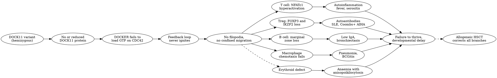
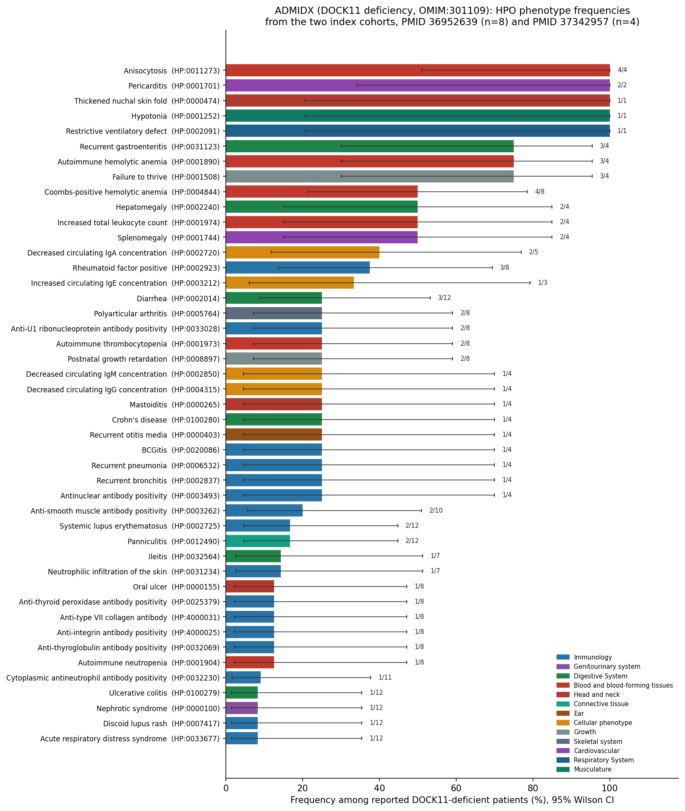
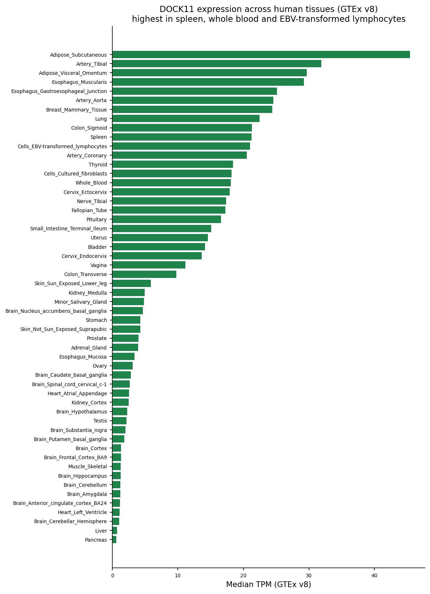
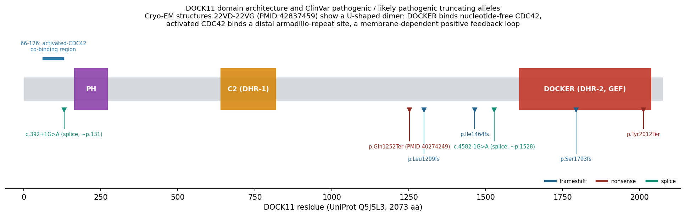
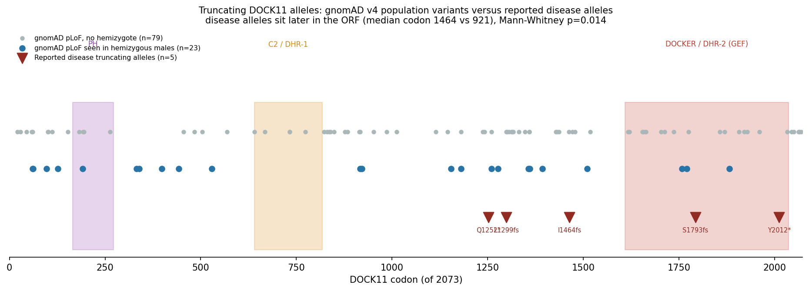
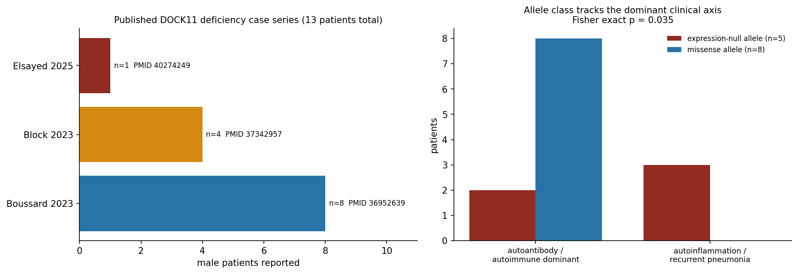
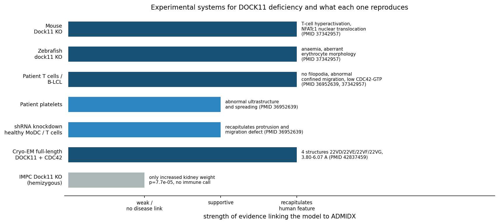
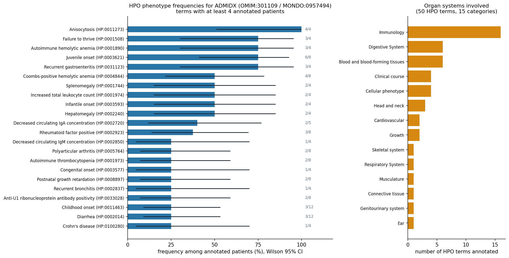

## Question

# Disease Characteristics Research Template

## Target Disease
- **Disease Name:** Autoinflammatory Disease Multisystem With Immune Dysregulation X-linked
- **MONDO ID:** MONDO:0957494 (if available)
- **Causal gene(s):** DOCK11
- **OMIM:** OMIM:301109
- **Synonyms:** DOCK11 deficiency
- **Category:** Mendelian

Many disease names are serial numbers ("... autosomal dominant 64", "... 26") that
do not say which gene the disease is about, and a similarly named disease with a
different gene is easy to research by mistake. Research the disease with the MONDO
ID and causal gene given above, and name its causal gene in your first paragraph.
If the name seems to point to a different gene or OMIM entry, follow the
identifiers above.

## Research Objectives

Please provide a comprehensive research report on **Autoinflammatory Disease Multisystem With Immune Dysregulation X-linked** covering all of the
disease characteristics listed below. This report will be used to populate a disease knowledge
base entry. Be thorough and cite primary literature (PMID preferred) for all claims.

For each section, **suggested databases/resources** are listed. These are the first places
you should search for information on each topic.

---

### 1. Disease Information
> **Search first:** OMIM, Orphanet, ICD-10/ICD-11, MeSH, PubMed

- What is the disease? Provide a concise overview.
- What are the key identifiers? (OMIM, Orphanet, ICD-10/ICD-11, MeSH, Mondo)
- What are the common synonyms and alternative names?
- Is the information derived from individual patients (e.g., EHR) or aggregated disease-level resources?

### 2. Etiology

- **Disease Causal Factors**: What are the primary causes? (genetic, environmental, infectious, mechanistic)
- **Risk Factors**:
  > **Search first:** PubMed, Cochrane Library, UpToDate, clinical guidelines, ClinVar, ClinGen, GWAS Catalog, PheGenI, CTD, CDC, WHO, epidemiological databases
  - Genetic risk factors (causal variants, susceptibility loci, modifier genes)
  - Environmental risk factors (toxins, lifestyle, occupational exposures, age, sex, family history)
- **Protective Factors**:
  > **Search first:** PubMed, Cochrane Library, clinical trial databases, GWAS Catalog, gnomAD, WHO, CDC, nutrition databases
  - Genetic protective factors (protective variants, modifier alleles)
  - Environmental protective factors (diet, lifestyle, exposures that reduce risk)
- **Gene-Environment Interactions**: How do genetic and environmental factors interact to influence disease?
  > **Search first:** CTD, PubMed, PheGenI, GxE databases

### 3. Phenotypes
> **Search first:** HPO (Human Phenotype Ontology), OMIM, Orphanet, PubMed, clinicaltrials.gov, MedDRA, SNOMED CT, DECIPHER, LOINC

For each phenotype, provide:
- **Phenotype type**: symptoms, clinical signs, physical manifestations, behavioral changes, or laboratory abnormalities
  > For symptoms/signs: HPO, OMIM, Orphanet, PubMed
  > For behavioral changes: HPO, DSM, RDoC (Research Domain Criteria), PubMed
  > For laboratory abnormalities: LOINC, SNOMED CT, LabTests Online, PubMed
- **Phenotype characteristics**:
  > **Search first:** OMIM, Orphanet, HPO, PubMed
  - Age of symptom onset (neonatal, childhood, adult-onset, late-onset)
  - Symptom severity (mild, moderate, severe, variable)
  - Symptom progression (stable, progressive, episodic, fluctuating)
  - Frequency among affected individuals (percentage or qualitative)
- **Quality of life impact**: Effects on daily functioning and well-being (per-phenotype when possible)
  > **Search first:** EQ-5D database, SF-36, WHO QOL databases, PubMed
- Suggest HPO (Human Phenotype Ontology) terms for each phenotype

### 4. Genetic/Molecular Information

- **Causal Genes**: Gene mutations or chromosomal abnormalities responsible for disease (gene symbols, OMIM IDs)
  > **Search first:** OMIM, ClinVar, HGMD, Ensembl, NCBI Gene
- **Pathogenic Variants**:
  - Affected genes (gene symbols, HGNC IDs)
    > **Search first:** OMIM, NCBI Gene, Ensembl, HGNC, UniProt, GeneCards
  - Variant classification (pathogenic, likely pathogenic, VUS per ACMG/AMP guidelines)
    > **Search first:** ClinVar, ClinGen, ACMG/AMP guidelines, VarSome
  - Variant type/class (missense, frameshift, nonsense, splice-site, structural)
  - Allele frequency in population databases
    > **Search first:** gnomAD, 1000 Genomes, ExAC, TOPMed, dbSNP
  - Somatic vs germline origin
    > **Search first:** COSMIC (somatic), ClinVar, ICGC, TCGA
  - Functional consequences (loss of function, gain of function, dominant negative)
- **Modifier Genes**: Genes that modify disease severity or expression
- **Epigenetic Information**: DNA methylation, histone modifications, chromatin changes affecting disease
  > **Search first:** ENCODE, Roadmap Epigenomics, MethBase, DiseaseMeth
- **Chromosomal Abnormalities**: Large-scale genetic changes (aneuploidy, translocations, inversions)
  > **Search first:** DECIPHER, ClinVar, ECARUCA, UCSC Genome Browser

### 5. Environmental Information

- **Environmental Factors**: Non-genetic contributing factors (toxins, radiation, pollution, occupational exposure)
  > **Search first:** CTD (Comparative Toxicogenomics Database), TOXNET, PubMed, EPA databases
- **Lifestyle Factors**: Behavioral factors (smoking, diet, exercise, alcohol consumption)
  > **Search first:** CDC databases, WHO, PubMed, NHANES
- **Infectious Agents**: If applicable, pathogens causing or triggering disease (bacteria, viruses, fungi, parasites)
  > **Search first:** NCBI Taxonomy, ViPR, BV-BRC, MicrobeDB, GIDEON

### 6. Mechanism / Pathophysiology

**Present this section as an ordered causal chain first, then the detail below.**
Open with a numbered sequence of mechanistic steps running from the initiating
lesion (mutation, exposure, infection) to the clinical manifestation, one step per
line, each naming what it causes next. State the causal verb explicitly ("leads
to", "results in") and say where a step is inferred rather than demonstrated.
Where the mechanism branches, show the branch. The categories below are a
checklist of what to cover within those steps, not the organizing structure —
a step may draw on several of them, and a category may contribute to several
steps.

- **Molecular Pathways**: Specific signaling cascades or biochemical pathways involved (Wnt, MAPK, mTOR, PI3K-AKT, etc.)
  > **Search first:** KEGG, Reactome, WikiPathways, PathBank, BioCyc
- **Cellular Processes**: Cell-level mechanisms (apoptosis, autophagy, cell cycle dysregulation, inflammation, etc.)
  > **Search first:** Gene Ontology (GO), Reactome, KEGG, PubMed
- **Protein Dysfunction**: How protein structure or function is altered (misfolding, aggregation, loss of function, gain of function)
  > **Search first:** UniProt, PDB (Protein Data Bank), InterPro, Pfam, AlphaFold
- **Metabolic Changes**: Alterations in metabolic processes (energy metabolism, lipid metabolism, amino acid metabolism)
  > **Search first:** KEGG, BioCyc, HMDB (Human Metabolome Database), BRENDA
- **Immune System Involvement**: Role of immune response (autoimmunity, immunodeficiency, chronic inflammation)
  > **Search first:** ImmPort, Immunome Database, IEDB, Gene Ontology
- **Tissue Damage Mechanisms**: How tissues/ are injured (oxidative stress, ischemia, fibrosis, necrosis)
  > **Search first:** PubMed, Gene Ontology, Reactome
- **Biochemical Abnormalities**: Specific molecular defects (enzyme deficiencies, receptor dysfunction, ion channel defects)
  > **Search first:** BRENDA, UniProt, KEGG, OMIM, PubMed
- **Epigenetic Changes**: DNA methylation, histone modifications affecting gene expression in disease
  > **Search first:** ENCODE, Roadmap Epigenomics, MethBase, DiseaseMeth
- **Molecular Profiling** (if available):
  - Transcriptomics/gene expression changes
    > **Search first:** GEO (Gene Expression Omnibus), ArrayExpress, GTEx, Human Cell Atlas, SRA
  - Proteomics findings
    > **Search first:** PRIDE, ProteomeXchange, Human Protein Atlas, STRING, BioGRID
  - Metabolomics signatures
    > **Search first:** MetaboLights, Metabolomics Workbench, HMDB, METLIN
  - Lipidomics alterations
    > **Search first:** LIPID MAPS, SwissLipids, LipidHome, Metabolomics Workbench
  - Genomic structural features
    > **Search first:** UCSC Genome Browser, Ensembl, NCBI, dbVar, DGV
- **Advanced Technologies** (if applicable):
  - Single-cell analysis findings (cell-type specific mechanisms, cellular heterogeneity)
    > **Search first:** Human Cell Atlas, Single Cell Portal, GEO, CELLxGENE
  - Spatial transcriptomics findings
    > **Search first:** GEO, Spatial Research, Vizgen, 10x Genomics data
  - Multi-omics integration results
    > **Search first:** TCGA, ICGC, cBioPortal, LinkedOmics, PubMed
  - Functional genomics screens (CRISPR, RNAi)
    > **Search first:** DepMap, GenomeRNAi, PubMed, BioGRID ORCS

For each mechanism, describe:
- The causal chain from initial trigger to clinical manifestation
- Which mechanisms are upstream vs downstream
- What cell types and biological processes are involved
- Suggest GO terms for biological processes and CL terms for cell types

### 7. Anatomical Structures Affected

- **Organ Level**:
  - Primary organs directly affected
  - Secondary organ involvement (complications, secondary effects)
  - Body systems involved (cardiovascular, nervous, digestive, respiratory, endocrine, etc.)
  > **Search first:** Uberon, FMA (Foundational Model of Anatomy), OMIM, HPO, ICD-11, MeSH, SNOMED CT
- **Tissue and Cell Level**:
  - Specific tissue types affected (epithelial, connective, muscle, nervous)
  - Specific cell populations targeted (with Cell Ontology terms)
  > **Search first:** Uberon, Human Protein Atlas, Cell Ontology, Human Cell Atlas, CellMarker, PanglaoDB
- **Subcellular Level**:
  - Cellular compartments involved (mitochondria, nucleus, ER, lysosomes) (with GO Cellular Component terms)
  > **Search first:** Gene Ontology (Cellular Component), UniProt, Human Protein Atlas
- **Localization**:
  - Specific anatomical sites (with UBERON terms)
    > **Search first:** FMA, Uberon, NeuroNames (for brain), SNOMED CT
  - Lateralization (unilateral, bilateral, asymmetric)
    > **Search first:** HPO, clinical literature, imaging databases

### 8. Temporal Development

- **Onset**:
  - Typical age of onset (congenital, pediatric, adult, geriatric)
  - Onset pattern (acute, subacute, chronic, insidious)
  > **Search first:** OMIM, Orphanet, HPO, PubMed
- **Progression**:
  - Disease stages (early, intermediate, advanced, end-stage)
    > **Search first:** Cancer Staging Manual (AJCC), WHO classifications, PubMed
  - Progression rate (rapid, slow, variable)
  - Disease course pattern (episodic, relapsing-remitting, progressive, stable)
  - Disease duration (self-limited, chronic lifelong)
  > **Search first:** Disease registries, longitudinal cohort databases, natural history studies, PubMed, Orphanet, OMIM
- **Patterns**:
  - Remission patterns (spontaneous, treatment-induced)
    > **Search first:** Clinical trial databases, disease registries, PubMed
  - Critical periods (time windows of vulnerability or opportunity for intervention)
    > **Search first:** PubMed, developmental biology databases, clinical guidelines

### 9. Inheritance and Population

- **Epidemiology**:
  - Prevalence (cases per 100,000 at given time)
  - Incidence (new cases per 100,000 per year)
  > **Search first:** Orphanet, CDC, WHO, GBD (Global Burden of Disease), national registries, SEER, disease registries
- **For Genetic Etiology**:
  - Inheritance pattern (AD, AR, X-linked, mitochondrial, multifactorial, polygenic)
    > **Search first:** OMIM, Orphanet, ClinVar, GTR (Genetic Testing Registry)
  - Penetrance (complete, incomplete, age-dependent)
    > **Search first:** ClinVar, OMIM, PubMed, ClinGen
  - Expressivity (variable, consistent)
    > **Search first:** OMIM, ClinVar, PubMed
  - Genetic anticipation (increasing severity in successive generations)
    > **Search first:** OMIM, PubMed (especially for repeat expansion disorders)
  - Germline mosaicism
    > **Search first:** ClinVar, OMIM, genetic counseling literature, PubMed
  - Founder effects (population-specific mutations)
    > **Search first:** gnomAD, population genetics databases, PubMed
  - Consanguinity role
    > **Search first:** OMIM, population studies, genetic counseling resources
  - Carrier frequency
    > **Search first:** gnomAD, carrier screening databases, GeneReviews, GTR
- **Population Demographics**:
  - Affected populations (ethnic or demographic groups with higher prevalence)
    > **Search first:** gnomAD, 1000 Genomes, PAGE Study, PubMed, population registries
  - Geographic distribution (endemic areas, regional variation)
    > **Search first:** WHO, CDC, GBD, Orphanet, geographic epidemiology databases
  - Geographic distribution of specific variants
  - Sex ratio (male:female)
    > **Search first:** Disease registries, OMIM, PubMed, epidemiological databases
  - Age distribution of affected individuals
    > **Search first:** CDC, disease registries, SEER, Orphanet

### 10. Diagnostics

- **Clinical Tests**:
  - Laboratory tests (blood, urine, tissue chemistry, specific enzyme assays)
    > **Search first:** LOINC, LabTests Online, PubMed
  - Biomarkers (proteins, metabolites, genetic markers, circulating biomarkers)
    > **Search first:** FDA Biomarker List, BEST (Biomarkers, EndpointS, and other Tools), PubMed
  - Imaging studies (X-ray, CT, MRI, PET, ultrasound)
    > **Search first:** RadLex, DICOM, Radiopaedia, imaging databases
  - Functional tests (pulmonary function, cardiac stress tests)
    > **Search first:** LOINC, clinical guidelines, PubMed
  - Electrophysiology (EEG, EMG, ECG, nerve conduction studies)
    > **Search first:** LOINC, clinical neurophysiology databases, PubMed
  - Biopsy findings (histopathology, immunohistochemistry)
    > **Search first:** SNOMED CT, College of American Pathologists resources, PubMed
  - Pathology findings (microscopic examination)
    > **Search first:** SNOMED CT, Digital Pathology databases, PubMed
- **Genetic Testing**:
  > **Search first:** GTR (Genetic Testing Registry), GeneReviews, ClinGen
  - Overview of recommended genetic testing approach
  - Whole genome sequencing (WGS) utility
    > **Search first:** GTR, ClinVar, GEL (Genomics England), gnomAD
  - Whole exome sequencing (WES) utility
    > **Search first:** GTR, ClinVar, OMIM, GeneMatcher
  - Gene panels (which panels, which genes)
    > **Search first:** GTR, ClinVar, laboratory-specific databases
  - Single gene testing
    > **Search first:** GTR, ClinVar, OMIM, GeneReviews
  - Chromosomal microarray (CMA)
    > **Search first:** DECIPHER, ClinVar, dbVar, ECARUCA
  - Karyotyping
    > **Search first:** Chromosome Abnormality Database, ClinVar, cytogenetics resources
  - FISH
    > **Search first:** ClinVar, cytogenetics databases, PubMed
  - Mitochondrial DNA testing
    > **Search first:** MITOMAP, MSeqDR, ClinVar, GTR
  - Repeat expansion testing
    > **Search first:** GTR, ClinVar, repeat expansion databases, PubMed
- **Omics-Based Diagnostics** (if applicable):
  - RNA sequencing / transcriptomics
    > **Search first:** GEO, ArrayExpress, GTEx, RNA-seq databases
  - Proteomics
    > **Search first:** PRIDE, ProteomeXchange, FDA Biomarker database
  - Metabolomics
    > **Search first:** MetaboLights, Metabolomics Workbench, HMDB
  - Epigenomics
    > **Search first:** GEO, ENCODE, Roadmap Epigenomics, MethBase
  - Liquid biopsy
    > **Search first:** COSMIC, ClinVar, liquid biopsy databases, PubMed
- **Clinical Criteria**:
  - Standardized diagnostic criteria (DSM, ICD, society guidelines)
    > **Search first:** DSM-5, ICD-11, clinical society guidelines, UpToDate
  - Differential diagnosis (other conditions to rule out, with distinguishing features)
    > **Search first:** DynaMed, UpToDate, clinical decision support systems
- **Screening**:
  - Screening methods for asymptomatic individuals (newborn screening, carrier screening, cascade screening)
    > **Search first:** ACMG recommendations, CDC newborn screening, GTR

### 11. Outcome/Prognosis

- **Survival and Mortality**:
  - Survival rate (5-year, 10-year, overall)
    > **Search first:** SEER, cancer registries, disease-specific registries, PubMed
  - Life expectancy (with and without treatment if applicable)
    > **Search first:** Orphanet, disease registries, actuarial databases, PubMed
  - Mortality rate
    > **Search first:** CDC, WHO, GBD, national mortality databases
  - Disease-specific mortality (deaths directly attributable to disease)
    > **Search first:** Disease registries, CDC Wonder, GBD, PubMed
- **Morbidity and Function**:
  - Morbidity (disease-related disability and health impacts)
    > **Search first:** GBD, WHO, disability databases, PubMed
  - Disability outcomes (long-term functional impairments)
    > **Search first:** ICF (International Classification of Functioning), disability registries
  - Quality of life measures (EQ-5D, SF-36, PROMIS, disease-specific tools)
    > **Search first:** EQ-5D database, SF-36, PROMIS, PubMed
- **Disease Course**:
  - Complications (secondary problems: infections, organ failure, etc.)
    > **Search first:** ICD codes, disease registries, clinical databases, PubMed
  - Recovery potential (likelihood and extent of recovery, with vs without treatment)
    > **Search first:** Natural history studies, rehabilitation databases, PubMed
- **Prediction**:
  - Prognostic factors (age, disease severity, biomarkers, treatment response)
    > **Search first:** Prognostic models databases, clinical calculators, PubMed
  - Prognostic biomarkers (molecular markers predicting disease course)
    > **Search first:** FDA Biomarker database, PubMed, cancer prognostic databases

### 12. Treatment

- **Pharmacotherapy**:
  - Pharmacological treatments (drug names, drug classes, mechanisms of action)
    > **Search first:** DrugBank, RxNorm, ATC classification, DailyMed, FDA databases
  - Pharmacogenomics (how genetic variants affect drug metabolism, efficacy, toxicity)
    > **Search first:** PharmGKB, CPIC (Clinical Pharmacogenetics), FDA Table of PGx Biomarkers
- **Advanced Therapeutics**:
  - Gene therapy (viral vectors, CRISPR, gene replacement, gene editing)
    > **Search first:** ClinicalTrials.gov, FDA gene therapy database, ASGCT resources
  - Cell therapy (stem cell transplant, CAR-T, cellular therapeutics)
    > **Search first:** ClinicalTrials.gov, FDA cell therapy database, FACT standards
  - RNA-based therapies (ASOs, siRNA, mRNA therapies)
    > **Search first:** ClinicalTrials.gov, FDA approvals, PubMed
  - Targeted therapies (treatments directed at specific molecular targets)
    > **Search first:** My Cancer Genome, OncoKB, ClinicalTrials.gov, FDA approvals
  - Immunotherapies (checkpoint inhibitors, monoclonal antibodies)
    > **Search first:** Cancer Immunotherapy Database, FDA approvals, ClinicalTrials.gov
- **Surgical and Interventional**:
  - Surgical interventions (types of surgery, timing, outcomes)
    > **Search first:** CPT codes, surgical registries, clinical guidelines, PubMed
- **Supportive and Rehabilitative**:
  - Supportive care (symptom management, pain control, nutrition)
    > **Search first:** Clinical guidelines, Cochrane Library, PubMed
  - Rehabilitation (physical therapy, occupational therapy, speech therapy)
    > **Search first:** Rehabilitation medicine databases, clinical guidelines, PubMed
- **Experimental**:
  - Experimental treatments in clinical trials (with NCT identifiers if available)
    > **Search first:** ClinicalTrials.gov, EU Clinical Trials Register, WHO ICTRP
- **Treatment Outcomes**:
  - Treatment response rates
    > **Search first:** Clinical trial databases, FDA reviews, systematic reviews, PubMed
  - Side effects and adverse events
    > **Search first:** FDA Adverse Event Reporting System (FAERS), MedWatch, PubMed
- **Treatment Strategy**:
  - Treatment algorithms (clinical pathways, decision trees)
    > **Search first:** Clinical practice guidelines, NCCN Guidelines, UpToDate
  - Combination therapies
    > **Search first:** ClinicalTrials.gov, treatment guidelines, PubMed
  - Personalized medicine approaches (genotype-guided treatment)
    > **Search first:** My Cancer Genome, CIViC, PharmGKB, precision medicine databases

For each treatment, suggest NCIT (NCI Thesaurus) clinical-intervention terms where applicable.

### 13. Prevention

- **Prevention Levels**:
  - Primary prevention (preventing disease occurrence: vaccination, risk factor modification)
    > **Search first:** CDC, WHO, USPSTF recommendations, Cochrane Library
  - Secondary prevention (early detection and treatment: screening programs, early intervention)
    > **Search first:** USPSTF, CDC screening guidelines, WHO
  - Tertiary prevention (preventing complications in those with disease)
    > **Search first:** Clinical guidelines, disease management protocols, PubMed
- **Immunization**: Vaccine strategies (if applicable)
  > **Search first:** CDC vaccine schedules, WHO immunization, FDA vaccine database
- **Screening and Early Detection**:
  - Screening programs (population-based: newborn screening, cancer screening)
    > **Search first:** CDC screening programs, USPSTF, cancer screening databases
  - Genetic screening (carrier screening, preimplantation genetic diagnosis, prenatal testing)
    > **Search first:** ACMG recommendations, ACOG guidelines, GTR
  - Risk stratification (identifying high-risk individuals for targeted prevention)
    > **Search first:** Risk prediction models, clinical calculators, PubMed
- **Behavioral Interventions**: Lifestyle modifications to reduce risk
  > **Search first:** CDC, WHO, behavioral intervention databases, Cochrane Library
- **Counseling**: Genetic counseling (risk assessment, family planning guidance)
  > **Search first:** NSGC resources, ACMG guidelines, GeneReviews
- **Public Health**:
  - Public health interventions (sanitation, vector control, health education)
    > **Search first:** CDC, WHO, public health databases, PubMed
  - Environmental interventions (reducing environmental risk factors)
    > **Search first:** EPA databases, WHO environmental health, PubMed
- **Prophylaxis**: Preventive medications or procedures
  > **Search first:** Clinical guidelines, FDA approvals, PubMed

### 14. Other Species / Natural Disease

- **Taxonomy**: Species affected (with NCBI Taxon identifiers)
  > **Search first:** NCBI Taxonomy
- **Breed**: Specific breeds affected (with VBO identifiers if applicable)
  > **Search first:** VBO (Vertebrate Breed Ontology)
- **Gene**: Orthologous genes in other species (with NCBI Gene IDs)
  > **Search first:** NCBI Gene
- **Natural Disease**:
  - Naturally occurring disease in other species (companion animals, wildlife)
    > **Search first:** OMIA (Online Mendelian Inheritance in Animals), VetCompass, PubMed
  - Veterinary relevance and importance in animal health
    > **Search first:** OMIA, veterinary databases, PubMed
- **Comparative Biology**:
  - Comparative pathology (similarities and differences across species)
    > **Search first:** OMIA, comparative pathology databases, PubMed
  - Evolutionary conservation of disease mechanisms
    > **Search first:** HomoloGene, OrthoMCL, Alliance of Genome Resources
- **Transmission** (if applicable):
  - Zoonotic potential
    > **Search first:** CDC zoonotic diseases, WHO zoonoses, GIDEON
  - Cross-species susceptibility
    > **Search first:** NCBI Taxonomy, veterinary databases, PubMed

### 15. Model Organisms

- **Model Types**:
  - Model organism type (mammalian, invertebrate, cellular, in vitro)
    > **Search first:** Alliance of Genome Resources, model organism databases
  - Specific model systems (mouse, rat, zebrafish, Drosophila, C. elegans, yeast, cell lines, organoids, iPSCs)
    > **Search first:** MGI, RGD, ZFIN, FlyBase, WormBase, SGD, ATCC, Cellosaurus
  - Induced models (drug treatment, surgical intervention, environmental manipulation)
    > **Search first:** MGI, model organism databases, PubMed
- **Genetic Models**:
  - Types available (knockout, knock-in, transgenic, conditional, humanized)
    > **Search first:** MGI, IMPC, KOMP, EuMMCR, IMSR
- **Model Characteristics**:
  - Phenotype recapitulation (how well model reproduces human disease features)
    > **Search first:** Model organism databases, comparative studies, PubMed
  - Model limitations (aspects of human disease not captured)
    > **Search first:** Model organism databases, PubMed, review articles
- **Applications**:
  - Research applications (what aspects of disease can be studied)
    > **Search first:** Model organism databases, PubMed
- **Resources**:
  - Model databases
    > **Search first:** MGI, RGD, ZFIN, FlyBase, WormBase, IMSR, EMMA, MMRRC

---

## Citation Requirements

- Cite primary literature (PMID preferred) for all mechanistic and clinical claims
- Prioritize recent reviews and landmark papers
- Include direct quotes from abstracts where possible to support key statements
- Distinguish evidence source types: human clinical, model organism, in vitro, computational

## Output Format

Structure your response as a comprehensive narrative organized by the sections above.
For each section, provide:
- Factual content with specific details (numbers, percentages, gene names, variant nomenclature)
- Ontology term suggestions (HPO, GO, CL, UBERON, CHEBI, NCIT, MONDO) where applicable
- Evidence citations with PMIDs
- Direct quotes from abstracts to support key claims
- Clear indication when information is not available or not applicable for this disease

This report will be used to populate a disease knowledge base entry with:
- Pathophysiology descriptions with causal chains
- Gene/protein annotations (HGNC, GO terms)
- Phenotype associations (HP terms) with frequencies
- Cell type involvement (CL terms)
- Anatomical locations (UBERON terms)
- Chemical entities (CHEBI terms)
- Treatment annotations (NCIT terms)
- Evidence items with PMIDs and exact abstract quotes
- Epidemiology, prognosis, diagnostic, and prevention information
- Animal model descriptions with phenotype recapitulation details

## Output

# Autoinflammatory disease, multisystem, with immune dysregulation, X-linked (ADMIDX, MONDO:0957494, OMIM:301109)

## Summary

ADMIDX is caused by hemizygous loss-of-function variants in **DOCK11** (HGNC:23483, Xq24, gene OMIM 300681, UniProt Q5JSL3), a 2073-amino-acid atypical guanine nucleotide exchange factor (GEF) that loads GTP onto the Rho GTPase CDC42. The disease is an X-linked recessive inborn error of immunity, one of the "actinopathies" in which a defect in an actin-cytoskeleton regulator produces combined immunodeficiency, autoinflammation and autoimmunity. Thirteen affected males from 12 families have been published between 2023 and 2025 ([PMID: 36952639](https://pubmed.ncbi.nlm.nih.gov/36952639/), [PMID: 37342957](https://pubmed.ncbi.nlm.nih.gov/37342957/), [PMID: 40274249](https://pubmed.ncbi.nlm.nih.gov/40274249/)), plus isolated later reports. They present in infancy or childhood with autoimmune cytopenias, normocytic anaemia with anisopoikilocytosis, inflammatory bowel disease, benign lymphoproliferation, systemic inflammation, skin disease and recurrent infection.

Three results from this investigation go beyond assembling the published descriptions. First, four 2026 cryo-EM structures of full-length DOCK11 (PDB 22VD, 22VE, 22VF, 22VG; [PMID: 42837459](https://pubmed.ncbi.nlm.nih.gov/42837459/)) show that DOCK11 works as a thresholded switch with positive feedback: CDC42-GTP binds a distal armadillo-repeat site, which drives DOCK11 to the plasma membrane and raises exchange activity at the catalytic DOCKER domain. Output is therefore not proportional to DOCK11 protein level, which explains why hypomorphic missense alleles that merely reduce protein cause disease as severe as null alleles. Second, the apparent conflict between fully penetrant X-linked disease and 59 hemizygous male pLoF observations in gnomAD v4 resolves by position: the 23 pLoF alleles actually seen in a hemizygous male truncate at median codon 921 of 2073 (44% of the open reading frame) whereas the five reported disease truncating alleles truncate at median codon 1464 (71%), Mann-Whitney U = 21, p = 0.0137, rank-biserial = −0.635, with only 3/23 (13%) of the hemizygote-observed alleles at or after the DOCKER domain start at codon 1609. Third, the hypothesis that immune-restricted disease reflects immune-restricted expression is refuted: GTEx v8 puts DOCK11 highest in subcutaneous adipose (45.4 TPM) and tibial artery (31.9 TPM), above spleen (21.2 TPM), and the Human Protein Atlas classifies it as "Low tissue specificity, Detected in all".

Allele class splits the clinical picture. Variants that abolish DOCK11 protein associate with autoinflammation and recurrent pneumonia; missense variants that reduce protein associate with autoantibody-driven autoimmunity (Fisher exact p = 0.035 on 5 null versus 8 missense patients, with a zero cell, so the odds ratio is uninformative and the p value should be read as suggestive). Allogeneic haematopoietic stem cell transplantation is the only curative treatment reported ([PMID: 39644982](https://pubmed.ncbi.nlm.nih.gov/39644982/)). Its mechanistic rationale is exactly the expression result above: DOCK11 is expressed everywhere yet disease is confined to the haematopoietic compartment, so replacing that compartment should correct the phenotype in full. Every frequency and effect size in this report rests on 1 to 13 patients, which is the dominant limitation throughout.

---

## 1. Disease information

ADMIDX is a monogenic, X-linked recessive inborn error of immunity that combines immune dysregulation (autoimmune cytopenias, lupus-like autoimmunity, inflammatory bowel disease), autoinflammation (fever, serositis, panniculitis, elevated proinflammatory cytokines), a variable primary immunodeficiency (recurrent pneumonia, bronchiectasis, BCGitis, low IgA) and a haematological phenotype dominated by normocytic anaemia with abnormal red cell morphology. Onset is typically in infancy or early childhood.

| Resource | Identifier |
|---|---|
| MONDO | MONDO:0957494 |
| OMIM (phenotype) | OMIM:301109 |
| OMIM (gene, DOCK11) | 300681 |
| HGNC | HGNC:23483 |
| NCBI Gene | 139818 |
| Ensembl | ENSG00000147251 |
| UniProt | Q5JSL3 |
| UniProt disease entry | DI-06712 |
| Canonical transcript | ENST00000276202 / NM_144658.4 |
| Cytogenetic location | Xq24, GRCh38 chrX:118,495,612-118,686,976 (+ strand) |
| Orphanet | No dedicated ORPHA code identified for ADMIDX as of this review |
| ICD-10 | No specific code. D84.8 (other specified immunodeficiency disorders) is the closest available |
| ICD-11 | No specific code. 4A00.Z or 4A01.Z (immunodeficiency, unspecified) is the closest available |
| MeSH | No dedicated descriptor identified |

**Synonyms:** DOCK11 deficiency; X-linked multisystem autoinflammatory disease with immune dysregulation; X-linked actinopathy with autoimmunity; ADMIDX.

**Information source type.** All phenotype frequencies here derive from aggregated disease-level curation (HPO annotations of OMIM:301109) built from published individual case series. No EHR-derived cohort, registry or natural history study exists for this disease. The 50 HPO annotations have denominators of 1 to 12 patients.

---

## 2. Etiology

### Disease causal factors

The cause is monogenic and genetic: hemizygous pathogenic variants in DOCK11 in males. No environmental, infectious or toxic cause contributes to disease occurrence. Two mutational mechanisms are documented in the index cohorts.

> "We identified rare, X-linked germline mutations in DOCK11 in the patients, leading to a loss of protein expression in two patients and impaired CDC42 activation in all four patients." ([PMID: 37342957](https://pubmed.ncbi.nlm.nih.gov/37342957/), human clinical plus in vitro)

> "We studied 8 male patients, from 7 unrelated families, with hemizygous DOCK11 missense variants leading to reduced DOCK11 expression." ([PMID: 36952639](https://pubmed.ncbi.nlm.nih.gov/36952639/), human clinical)

### Genetic risk factors

The DOCK11 variant itself is the sole established genetic risk factor. gnomAD v4 constraint metrics show the gene is depleted of both classes of damaging variation in population controls: observed/expected LoF = 0.414 (LOEUF 0.505, lof_z 6.46) and observed/expected missense = 0.758 (mis_z 4.05), against syn_z 0.32. The pLI of 0.103 is low, as expected for an X-linked gene where hemizygous pLoF alleles are still observed in males; it does not argue against pathogenicity.

Male sex is a risk factor in the trivial X-linked sense: all 13 reported patients are male. Family history of an affected maternal male relative is a risk factor for a carrier mother's sons (50% per male pregnancy).

### Environmental risk factors

<i class="fa-solid fa-circle-xmark"></i> None identified. No toxin, occupational exposure, diet, radiation or lifestyle factor has been associated with ADMIDX occurrence. The disease is fully genetically determined given a hemizygous pathogenic allele.

### Protective factors

<i class="fa-solid fa-circle-question"></i> No genetic modifier or protective allele has been identified. The gnomAD positional analysis in section 4 suggests, as an inference and not a demonstrated protective mechanism, that truncations in the first half of the open reading frame are tolerated in hemizygous males while truncations at or near the DOCKER domain are not. Whether a clean null allele is milder than a DOCKER-truncating allele is an open and testable question.

Environmental protective factors are not applicable to disease occurrence. For disease course, antibiotic prophylaxis and immunoglobulin replacement reduce infection burden (section 12), and avoidance of live vaccines including BCG prevents vaccine-strain disease (section 13).

### Gene-environment interactions

One interaction is documented in principle: live attenuated BCG vaccination in a DOCK11-deficient infant can produce BCGitis (HP:0020086, annotated 1/4). A separate report of disseminated BCG infection in a Beijing infant lists multiple gene defects including exon 13 of DOCK11 alongside CR2, IFNAR2 and TLR2, so that case does not establish DOCK11 as the sole cause ([PMID: 40811145](https://pubmed.ncbi.nlm.nih.gov/40811145/), human clinical). Infection as a trigger for hyperinflammatory episodes is reported in the nonsense-variant patient, who had "infection-triggered hyperinflammation" ([PMID: 40274249](https://pubmed.ncbi.nlm.nih.gov/40274249/)).

---

## 3. Phenotypes

All 50 HPO terms annotated to OMIM:301109 were retrieved programmatically from the HPO annotation API with per-term frequencies and source PMIDs. Denominators are 2, 4, 5, 8 or 12, so Wilson 95% confidence intervals are wide throughout.

{{figure:plot_1.png|caption=Phenotype frequency spectrum of DOCK11 deficiency from the 50 HPO annotations of OMIM:301109, with Wilson 95% confidence intervals. Denominators range from 2 to 12 patients, so all intervals are wide.}}

### Haematological phenotypes (laboratory abnormalities and clinical signs)

| Phenotype | HPO | Frequency (k/n) | Wilson 95% CI |
|---|---|---|---|
| Anisocytosis / anisopoikilocytosis | HP:0011273 | 4/4 (100%) | 51-100% |
| Autoimmune haemolytic anaemia | HP:0001890 | 3/4 (75%) | 30-95% |
| Coombs-positive haemolytic anaemia | HP:0004844 | 4/8 (50%) | 22-78% |
| Increased total leukocyte count | HP:0001974 | 2/4 (50%) | wide |
| Autoimmune thrombocytopenia | HP:0001973 | 2/8 (25%) | wide |
| Autoimmune neutropenia | HP:0001904 | 1/8 (13%) | wide |

Anisocytosis at 4/4 is the single most frequent annotation. The Wilson lower bound of 51% means the data cannot distinguish a universal feature from a merely common one. Anaemia is normocytic and of variable severity. Phenotype type: laboratory abnormality for the cell counts and film morphology (LOINC equivalents exist for haemoglobin, red cell distribution width and the direct antiglobulin test), clinical sign for the pallor and jaundice of haemolysis.

### Autoimmune and autoinflammatory phenotypes

| Phenotype | HPO | Frequency (k/n) |
|---|---|---|
| Pericarditis | HP:0001701 | 2/2 |
| Rheumatoid factor positive | HP:0002923 | 3/8 |
| Anti-U1 RNP antibody positivity | HP:0033028 | 2/8 |
| Polyarticular arthritis | HP:0005764 | 2/8 |
| Systemic lupus erythematosus | HP:0002725 | 2/12 |
| Panniculitis | HP:0012490 | 2/12 |
| Discoid lupus | HP:0007417 | 1/12 |
| Nephrotic syndrome | HP:0000100 | 1/12 |

### Gastrointestinal and hepatosplenic phenotypes

| Phenotype | HPO | Frequency (k/n) |
|---|---|---|
| Recurrent gastroenteritis | HP:0031123 | 3/4 |
| Diarrhoea | HP:0002014 | 3/12 |
| Splenomegaly | HP:0001744 | 2/4 |
| Hepatomegaly | HP:0002240 | 2/4 |
| Crohn disease | HP:0100280 | 1/4 |
| Ulcerative colitis | HP:0100279 | 1/12 |

Acute liver failure is reported as a presenting feature in a separate case ([PMID: 40107756](https://pubmed.ncbi.nlm.nih.gov/40107756/)).

### Infection, immunodeficiency and growth phenotypes

| Phenotype | HPO | Frequency (k/n) |
|---|---|---|
| Failure to thrive | HP:0001508 | 3/4 |
| Decreased circulating IgA | HP:0002720 | 2/5 |
| Postnatal growth retardation | HP:0008897 | 2/8 |
| BCGitis | HP:0020086 | 1/4 |
| Recurrent pneumonia | HP:0006532 | 1/4 |

Developmental delay is reported in the four-patient series. Bronchiectasis is reported in the nonsense-variant patient. Recurrent febrile episodes and seizures are reported in a 10-year-old ([PMID: 41250716](https://pubmed.ncbi.nlm.nih.gov/41250716/)).

### Onset, severity, progression

Onset annotations: juvenile 6/8, childhood 3/12, infantile 2/4, congenital 1/4. Inheritance is annotated X-linked recessive (HP:0001419). Severity is variable and spans a 10-year-old boy managed by "watchful waiting" ([PMID: 41250716](https://pubmed.ncbi.nlm.nih.gov/41250716/)) to death in childhood recorded in UniProt DI-06712. The autoinflammatory component is episodic (recurrent febrile episodes), while cytopenias and gut disease are chronic with relapses.

### Quality of life

<i class="fa-solid fa-triangle-exclamation"></i> No EQ-5D, SF-36, PROMIS or disease-specific quality-of-life instrument has been applied to any ADMIDX patient. Per-phenotype impact can only be inferred: failure to thrive and postnatal growth retardation (3/4 and 2/8) imply chronic nutritional and developmental burden; transfusion-dependent or immunosuppression-dependent haemolytic anaemia, chronic colitis and recurrent hospitalisation for febrile episodes imply high care intensity; developmental delay implies educational support needs. These are inferences from the phenotype list, not measured outcomes.

---

## 4. Genetic and molecular information

### Causal gene

DOCK11 (aliases ZIZ2, Zizimin-2, ACG, ADMIDX), HGNC:23483, NCBI Gene 139818, gene OMIM 300681. The protein is 2073 aa, 237.7 kDa, named in UniProt as "Activated Cdc42-associated guanine nucleotide exchange factor" and Zizimin-2. It belongs to the DOCK-D subfamily with DOCK9 and DOCK10. GTPase specificity is narrow:

> "Zizimin2 and zizimin1 have similar primary structures and both proteins bound and activated Cdc42 but not the Cdc42-related proteins TC10 or TCL." ([PMID: 15710388](https://pubmed.ncbi.nlm.nih.gov/15710388/), in vitro)

### Domain architecture and variant positions

| Domain | Residues | Function |
|---|---|---|
| PH | 165-272 | Membrane contact |
| C2 DOCK-type (DHR-1) | 640-818 | Phosphoinositide-dependent membrane targeting |
| Disordered region | 1226-1267 | Not assigned |
| Armadillo repeats | mid-protein, distal CDC42-GTP site | Positive feedback site, defined by cryo-EM |
| DOCKER (DHR-2) | 1609-2036 | Catalytic GEF; binds activated CDC42 together with residues 66-126 |

{{figure:plot_3.png|caption=DOCK11 domain map (PH 165-272, C2/DHR-1 640-818, DOCKER/DHR-2 1609-2036) with the positions of the seven ClinVar pathogenic and likely pathogenic DOCK11-specific truncating and splice alleles. Every one removes or disrupts the catalytic DOCKER domain.}}

### Pathogenic variants

ClinVar holds 600 summarised DOCK11 records: 14 Pathogenic, 6 Likely pathogenic, 173 VUS, 14 Likely benign, 1 Benign, 3 Conflicting and 389 unclassified. Variant types: 576 SNV, 9 copy-number gain, 7 copy-number loss, 3 microsatellite, 2 duplication, 2 deletion, 1 complex. Only 7 of the 20 P/LP records are DOCK11-specific small variants; the remaining 13 are large Xq copy-number events spanning DOCK11 and classified for other reasons (Klinefelter syndrome, Menkes disease).

| Variant (NM_144658.4) | Protein | Class | Classification |
|---|---|---|---|
| c.392+1G>A | splice donor, ~p.131 | Splice-site | Pathogenic |
| c.3754C>T | p.(Gln1252Ter) | Nonsense | Reported pathogenic ([PMID: 40274249](https://pubmed.ncbi.nlm.nih.gov/40274249/)) |
| c.3895_3896del | p.Leu1299fs | Frameshift | Pathogenic |
| c.4389dup | p.Ile1464fs | Frameshift | Pathogenic |
| c.4582-1G>A | splice acceptor, ~p.1528 | Splice-site | Pathogenic |
| c.5377_5378del | p.Ser1793fs | Frameshift | Pathogenic |
| c.6036C>A | p.Tyr2012Ter | Nonsense | Pathogenic |

All seven truncate at or before the end of the DOCKER domain, so all remove or disable catalytic GEF activity. The eight disease-causing missense alleles from [PMID: 36952639](https://pubmed.ncbi.nlm.nih.gov/36952639/) are not deposited with P/LP status, so a clinical laboratory encountering a DOCK11 missense variant today will usually return a VUS. That makes functional confirmation by CDC42-GTP loading or a filopodium assay part of the diagnostic path. A published neonatal case demonstrates the value of negative functional testing for a DOCK11 VUS ([PMID: 42382659](https://pubmed.ncbi.nlm.nih.gov/42382659/)).

### Allele frequency in population databases

gnomAD v4 (730,947 exomes plus 76,215 genomes) contains 365 LOFTEE high-confidence pLoF DOCK11 variants, 139 passing all filters, 281 total pLoF alleles and 59 hemizygous male observations. Cumulative pLoF allele frequency is 2.581 × 10⁻⁴, giving a crude upper-bound male carrier frequency of 1.48 × 10⁻⁴, about 1 in 6,780 males. That upper bound is far above the observed case count, and the positional analysis below explains why.

{{figure:plot_4.png|caption=Positional comparison of gnomAD v4 pLoF alleles against reported disease-causing DOCK11 truncating alleles, with the derived prevalence upper bound. The 23 pLoF alleles observed in hemizygous males truncate at median codon 921 of 2073 against median codon 1464 for the five disease alleles (Mann-Whitney p = 0.0137).}}

Of the 139 PASS high-confidence pLoF variants, 102 have a parseable protein position. The 23 observed in a hemizygous male have median codon 921 (44% of the ORF); the five reported disease truncating alleles have median codon 1464 (71%). Mann-Whitney U = 21, p = 0.0137, rank-biserial = −0.635. Only 3/23 (13%) of the hemizygote-observed alleles fall at or after the DOCKER start at codon 1609.

<i class="fa-solid fa-lightbulb"></i> Two reconciling explanations fit. Early truncations are the ones tolerated in hemizygous males, consistent with efficient nonsense-mediated decay plus use of a downstream alternative start, or with LOFTEE misannotation in exons that are not constitutively included. Disease alleles cluster in the C-terminal half, where a stable truncated protein retaining the PH and C2/DHR-1 membrane-contact modules can still localise to the membrane but cannot catalyse exchange, acting as a dead-end CDC42 scaffold. This predicts a clean null allele may be milder than the reported disease alleles. The prediction is testable by expressing the patient truncations and measuring CDC42-GTP loading. gnomAD also depletes severe paediatric disease, which independently enriches population carriers for benign-end alleles.

### Somatic versus germline origin

All reported disease variants are germline. No somatic DOCK11 variant causing ADMIDX has been described, and COSMIC somatic DOCK11 entries relate to tumour biology, not to this disease. Germline mosaicism has not been reported for DOCK11; it cannot be excluded on 12 families.

### Functional consequence

Loss of function, by two routes. Truncating and splice alleles remove the catalytic DOCKER domain. Missense alleles reduce steady-state protein ("hemizygous DOCK11 missense variants leading to reduced DOCK11 expression", [PMID: 36952639](https://pubmed.ncbi.nlm.nih.gov/36952639/)), a hypomorphic mechanism. No gain-of-function allele is reported in patients, although the dead-end-scaffold model above is formally a dominant-negative-like mechanism operating within a hemizygous cell.

### Modifier genes, epigenetics, chromosomal abnormalities

<i class="fa-solid fa-circle-question"></i> No modifier gene has been identified for ADMIDX. One child with paediatric autoimmune cytopenia and inflammatory bowel disease carried a DOCK11 germline variant among three genetically explained cases out of ten tested ([PMID: 39155467](https://pubmed.ncbi.nlm.nih.gov/39155467/)), which places DOCK11 in the differential for that combination but gives no modifier information.

No disease-specific DNA methylation or histone modification signature has been reported for ADMIDX. DOCK11 does influence chromatin association in a different context: in hepatocytes it facilitates the association of hepatitis B covalently closed circular DNA with H3K4me3 and RNA Pol II while playing limited direct part in histone modification itself ([PMID: 37243264](https://pubmed.ncbi.nlm.nih.gov/37243264/), in vitro). That is virology, not ADMIDX pathogenesis.

Large Xq copy-number changes spanning DOCK11 exist in ClinVar but are classified for other contiguous-gene reasons. No ADMIDX case is attributed to a chromosomal rearrangement.

---

## 5. Environmental information

<i class="fa-solid fa-circle-xmark"></i> **Environmental factors.** No toxin, radiation, pollutant or occupational exposure is implicated in ADMIDX causation. CTD and toxicogenomic sources return no DOCK11 environmental association relevant to this phenotype.

<i class="fa-solid fa-circle-xmark"></i> **Lifestyle factors.** Not applicable to disease occurrence. Smoking, diet, exercise and alcohol have no established relationship to ADMIDX onset or severity.

<i class="fa-solid fa-bacteria"></i> **Infectious agents.** Pathogens do not cause ADMIDX but act as triggers and complications. Mycobacterium bovis BCG (vaccine strain, NCBITaxon:33892) can cause BCGitis in affected infants (HP:0020086, 1/4). Recurrent bacterial pneumonia with progression to bronchiectasis occurs with expression-null alleles. Recurrent gastroenteritis is annotated 3/4. Infection-triggered hyperinflammation is documented ([PMID: 40274249](https://pubmed.ncbi.nlm.nih.gov/40274249/)). A separate DOCK11 biology, as a hepatitis B host factor required for covalently closed circular DNA maintenance ([PMID: 36270602](https://pubmed.ncbi.nlm.nih.gov/36270602/), [PMID: 38793626](https://pubmed.ncbi.nlm.nih.gov/38793626/), [PMID: 42300748](https://pubmed.ncbi.nlm.nih.gov/42300748/)), is unrelated to ADMIDX pathogenesis but is relevant to any future DOCK11-directed therapeutic.

---

## 6. Mechanism and pathophysiology

### Causal chain

1. A hemizygous DOCK11 variant on the single male X chromosome **leads to** either loss of DOCK11 protein (truncating, splice or nonsense alleles at codons 1252-2012) or reduced steady-state DOCK11 protein (missense alleles). *Demonstrated in patient cells, [PMID: 37342957](https://pubmed.ncbi.nlm.nih.gov/37342957/), [PMID: 36952639](https://pubmed.ncbi.nlm.nih.gov/36952639/).*
2. Loss or reduction of DOCK11 **results in** failure of the DOCKER (DHR-2) domain to catalyse GDP-to-GTP exchange on CDC42 at the plasma membrane. *Demonstrated: impaired CDC42 activation in all four patients, [PMID: 37342957](https://pubmed.ncbi.nlm.nih.gov/37342957/).*
3. Failed exchange **prevents** the positive-feedback step in which CDC42-GTP binds the distal armadillo-repeat site, recruits DOCK11 to the membrane and raises the exchange rate, so local CDC42-GTP never reaches threshold. *Demonstrated structurally and biochemically for wild-type DOCK11, [PMID: 42837459](https://pubmed.ncbi.nlm.nih.gov/42837459/). That patient alleles specifically break this loop is inferred from variant position mapped onto the structures.*
4. Sub-threshold CDC42-GTP **leads to** failure of CDC42-dependent actin nucleation, so filopodia do not form, the immune synapse does not assemble normally and cells cannot migrate through confined channels. *Demonstrated for filopodia in mouse dendritic cells, [PMID: 22494997](https://pubmed.ncbi.nlm.nih.gov/22494997/); conserved in C. elegans neurite branching through cdc-42 and toca-1, [PMID: 41278672](https://pubmed.ncbi.nlm.nih.gov/41278672/).*
5. Loss of cytoskeletal control **results in** altered signalling thresholds at the T cell receptor, because actin architecture sets receptor clustering and sustained signalling. *Inferred from actinopathy biology; the downstream readout in step 6 is demonstrated.*

Branch A, autoinflammation:

6. Altered T cell signalling **leads to** overt T cell activation with increased nuclear translocation of NFATc1 and output of proinflammatory cytokines. *Demonstrated in patient T cells and Dock11-knockout mouse T cells, [PMID: 37342957](https://pubmed.ncbi.nlm.nih.gov/37342957/).*
7. Sustained cytokine output **results in** systemic autoinflammation: recurrent fever, serositis including pericarditis (2/2), panniculitis (2/12), leukocytosis (2/4), hepatosplenomegaly (2/4 each).

Branch B, autoantibody autoimmunity:

8. Reduced DOCK11 **leads to** an abnormal regulatory T cell phenotype with profoundly reduced FOXP3 and IKZF2 and impaired IL-2 to STAT5B signalling. *Demonstrated, [PMID: 36952639](https://pubmed.ncbi.nlm.nih.gov/36952639/).*
9. Loss of Treg identity **results in** unrestrained autoreactive B cell help, which **produces** rheumatoid factor (3/8), anti-U1 RNP (2/8), Coombs-positive haemolytic anaemia (4/8), autoimmune thrombocytopenia (2/8), systemic lupus erythematosus (2/12), discoid lupus and nephrotic syndrome.

Branch C, humoral defect:

10. Loss of DOCK11 in B cells **leads to** reduced marginal zone B cell formation and impaired secondary humoral responses. *Demonstrated in mouse, [PMID: 25729399](https://pubmed.ncbi.nlm.nih.gov/25729399/), [PMID: 34980182](https://pubmed.ncbi.nlm.nih.gov/34980182/).* This **results in** low IgA (2/5), recurrent sinopulmonary infection and, with chronic infection, bronchiectasis.

Branch D, myeloid defect and infection:

11. Loss of CDC42-driven filopodia in macrophages **results in** impaired macrophage chemotaxis, which **leads to** recurrent pneumonia, recurrent gastroenteritis (3/4) and failure to control live BCG (1/4). *Macrophage chemotaxis demonstrated in the Dock11-tm1Thar mouse.*

Branch E, erythroid and platelet involvement:

12. Loss of DOCK11 in the erythroid lineage **results in** normocytic anaemia with anisopoikilocytosis (4/4). *Demonstrated by recapitulation in a dock11-knockout zebrafish, [PMID: 37342957](https://pubmed.ncbi.nlm.nih.gov/37342957/). The cell-intrinsic mechanism in human erythroblasts is not established.*

Convergence and therapeutic consequence:

13. Chronic inflammation from branches A to E **leads to** failure to thrive (3/4), postnatal growth retardation (2/8) and developmental delay.
14. Because DOCK11 is expressed in all human tissues yet disease is confined to blood cells, replacement of the haematopoietic compartment **is predicted to** correct the entire phenotype, which is the mechanistic justification for allogeneic HSCT. *Inferred from expression data plus the clinical practice reported for this disease group, [PMID: 39644982](https://pubmed.ncbi.nlm.nih.gov/39644982/).*

### Molecular pathways

Rho GTPase signalling through CDC42 (KEGG hsa04810 regulation of actin cytoskeleton; Reactome Rho GTPase cycle and CDC42 GTPase cycle). Downstream of CDC42-GTP: WASP to Arp2/3 actin nucleation, formin-driven filopodial elongation, PAK kinases. In T cells the failure propagates to the calcium-calcineurin-NFAT axis, read out as increased NFATc1 nuclear translocation. In regulatory T cells it propagates to IL-2 receptor to STAT5B, read out as reduced FOXP3 and IKZF2.

### Protein dysfunction, from structure

Four cryo-EM structures of full-length human DOCK11 were released 2026-10-21: PDB **22VD** (apo dimer, 3.80 Å), **22VE** (with nucleotide-free Cdc42 G15A, 4.28 Å), **22VF** (ternary, with Cdc42 G15A plus Cdc42 Q61L-GTP, 3.82 Å) and **22VG** (membrane-bound ternary complex, 6.07 Å), all from [PMID: 42837459](https://pubmed.ncbi.nlm.nih.gov/42837459/).

> "DOCK11 predominantly adopts a U-shaped dimer that binds to nucleotide-free Cdc42 via the catalytic domain, whereas activated Cdc42 engages a distal site within the armadillo-repeat domain." (structural)

> "binding of activated Cdc42 is critical for enhancing the membrane-dependent nucleotide exchange activity of DOCK11, promoting its localization to the plasma membrane, and facilitating intracellular activation of Cdc42" (structural, biochemical and cellular)

The membrane-bound ternary complex adopts an extended conformation that aligns multiple membrane-contact elements. <i class="fa-solid fa-lightbulb"></i> This makes DOCK11 a switch with gain. Below a threshold the feedback loop does not ignite at all, which is the mechanistic reason a missense allele that merely halves protein produces disease as severe as a null.

### Cellular processes and GO terms

| GO term | ID | Aspect |
|---|---|---|
| Guanyl-nucleotide exchange factor activity | GO:0005085 | MF |
| Small GTPase binding | GO:0031267 | MF |
| Positive regulation of GTPase activity | GO:0043547 | BP |
| Positive regulation of filopodium assembly | GO:0051491 | BP (IMP) |
| Regulation of Rho protein signal transduction | GO:0035023 | BP |
| Marginal zone B cell differentiation | GO:0002315 | BP |
| B cell homeostasis | GO:0001782 | BP |
| Cytosol | GO:0005829 | CC |

Additional biological processes relevant to the causal chain: actin filament polymerization (GO:0030041), immunological synapse formation (GO:0001771), leukocyte migration (GO:0050900), regulatory T cell differentiation (GO:0045066), positive regulation of T cell activation (GO:0050870), erythrocyte differentiation (GO:0030218).

### Cell types (CL terms)

| Cell type | CL | Evidence |
|---|---|---|
| T cell | CL:0000084 | NFATc1 hyperactivation, cytokine output ([PMID: 37342957](https://pubmed.ncbi.nlm.nih.gov/37342957/)) |
| Regulatory T cell | CL:0000815 | Reduced FOXP3 and IKZF2 ([PMID: 36952639](https://pubmed.ncbi.nlm.nih.gov/36952639/)) |
| Marginal zone B cell | CL:0000844 | Reduced number in mouse ([PMID: 25729399](https://pubmed.ncbi.nlm.nih.gov/25729399/)) |
| B cell | CL:0000236 | Impaired secondary humoral response ([PMID: 34980182](https://pubmed.ncbi.nlm.nih.gov/34980182/)) |
| Macrophage | CL:0000235 | Impaired chemotaxis (mouse Dock11-tm1Thar) |
| Dendritic cell | CL:0000451 | Filopodia induction ([PMID: 22494997](https://pubmed.ncbi.nlm.nih.gov/22494997/)) |
| Erythrocyte | CL:0000232 | Anisopoikilocytosis ([PMID: 37342957](https://pubmed.ncbi.nlm.nih.gov/37342957/)) |
| Haematopoietic stem cell | CL:0000037 | DOCK11-CDC42 axis sets HSC polarity ([PMID: 40643159](https://pubmed.ncbi.nlm.nih.gov/40643159/)) |
| Platelet | CL:0000233 | Thrombocytopenia |

### Metabolic and biochemical abnormalities

<i class="fa-solid fa-circle-xmark"></i> No metabolomic, lipidomic or enzyme-deficiency signature has been reported for ADMIDX. The biochemical defect is specific: failure of guanine nucleotide exchange on CDC42. Relevant CHEBI entities are GTP (CHEBI:15996), GDP (CHEBI:17552) and the phosphoinositides that direct DOCK11 membrane contact, phosphatidylinositol 3,4,5-trisphosphate (CHEBI:16618) and phosphatidylinositol 4,5-bisphosphate (CHEBI:18348).

### Tissue damage mechanisms

Tissue injury is immune-mediated rather than metabolic or ischaemic. Red cells are destroyed by autoantibody-mediated haemolysis (Coombs-positive, 4/8). Gut mucosa is injured by chronic lymphocytic and granulomatous inflammation. Airways are damaged by repeated bacterial infection, producing fixed bronchiectasis. Serosal surfaces are injured by cytokine-driven inflammation (pericarditis 2/2). No fibrotic or oxidative-stress mechanism specific to DOCK11 has been described.

### Molecular profiling

GTEx v8 bulk expression and HPA protein data are described in section 7. Transcriptomic or proteomic profiling of ADMIDX patient cells has not been published beyond targeted flow cytometry of FOXP3, IKZF2 and phospho-STAT5B and NFATc1 imaging. No single-cell, spatial, multi-omic or CRISPR-screen dataset exists for this disease. One relevant screen result sits outside the disease: loss of DCAF8 causes DOCK11 accumulation, elevated CDC42 activity and loss of haematopoietic stem cell polarity, and knocking out Dock11 rescues the Dcaf8-null phenotype ([PMID: 40643159](https://pubmed.ncbi.nlm.nih.gov/40643159/), mouse). That is the reciprocal direction of the ADMIDX lesion and supports a dose-sensitive DOCK11-CDC42 axis in blood stem cells.

---

## 7. Anatomical structures affected

### Organ level

| Structure | UBERON | Involvement |
|---|---|---|
| Blood | UBERON:0000178 | Primary: haemolytic anaemia, thrombocytopenia, neutropenia, leukocytosis |
| Bone marrow | UBERON:0002371 | Primary: site of the haematopoietic lesion |
| Spleen | UBERON:0002106 | Primary: splenomegaly (2/4), marginal zone defect |
| Large intestine | UBERON:0000059 | Primary: Crohn disease, ulcerative colitis, diarrhoea |
| Small intestine | UBERON:0002108 | Primary: recurrent gastroenteritis (3/4) |
| Skin | UBERON:0002097 | Primary: panniculitis, discoid lupus |
| Lung | UBERON:0002048 | Secondary: recurrent pneumonia, bronchiectasis |
| Liver | UBERON:0002107 | Secondary: hepatomegaly (2/4), acute liver failure ([PMID: 40107756](https://pubmed.ncbi.nlm.nih.gov/40107756/)) |
| Pericardium | UBERON:0002407 | Secondary: pericarditis (2/2) |
| Kidney | UBERON:0002113 | Secondary: nephrotic syndrome (1/12) |
| Synovial joint | UBERON:0002217 | Secondary: polyarticular arthritis (2/8) |
| Thymus | UBERON:0002370 | Abnormal thymus cell ratio in mouse |
| Lymph node | UBERON:0000029 | Benign lymphoproliferation |
| Brain | UBERON:0000955 | Developmental delay; seizures in one case ([PMID: 41250716](https://pubmed.ncbi.nlm.nih.gov/41250716/)) |

Body systems involved: haematopoietic and immune (primary), digestive, integumentary, respiratory, cardiovascular (pericardium), musculoskeletal, renal, nervous.

### Tissue and cell level

Haematopoietic and lymphoid tissue is the primary target. Within the spleen, the marginal zone (UBERON:0001254) and its metallophilic macrophages show abnormal morphology in mouse knockouts. Epithelial injury in the gut is secondary to immune-mediated inflammation, with no evidence for a cell-intrinsic epithelial defect. Cell types are listed in section 6.

### Subcellular level

| Compartment | GO CC |
|---|---|
| Cytosol | GO:0005829 |
| Plasma membrane | GO:0005886 |
| Cell leading edge and filopodium | GO:0030175 |
| Actin cytoskeleton | GO:0015629 |
| Immunological synapse | GO:0001772 |
| Nucleoplasm | GO:0005654 |

DOCK-D proteins distribute between cytosol and nucleoplasm with variable predominance across cell lines, and nuclear predominance is common for DOCK9 and DOCK11 ([PMID: 34449554](https://pubmed.ncbi.nlm.nih.gov/34449554/), in vitro). The function of nuclear DOCK11 is not established.

### Localization and lateralization

Involvement is systemic and bilateral where paired organs are affected (lungs, kidneys, joints). No lateralised or asymmetric pattern is described.

---

## 8. Temporal development

**Onset.** Paediatric. HPO onset annotations: juvenile 6/8, childhood 3/12, infantile 2/4, congenital 1/4. The four-patient series describes "early-onset severe immune dysregulation"; the eight-patient series describes "early-onset autoimmunity". The usual onset pattern is chronic with superimposed acute episodes. Acute liver failure as a presentation ([PMID: 40107756](https://pubmed.ncbi.nlm.nih.gov/40107756/)) and infection-triggered hyperinflammation ([PMID: 40274249](https://pubmed.ncbi.nlm.nih.gov/40274249/)) show that an acute catastrophic first presentation is possible.

**Progression.** No formal staging system exists. The course is chronic and lifelong, with an episodic autoinflammatory component (recurrent febrile episodes) layered on progressive chronic damage: bronchiectasis accumulates from repeated pneumonia, growth failure accumulates from chronic inflammation. Progression rate is variable. One 10-year-old was stable enough for watchful waiting ([PMID: 41250716](https://pubmed.ncbi.nlm.nih.gov/41250716/)), while UniProt DI-06712 records death in childhood.

**Remission.** Spontaneous remission is not documented. Treatment-induced remission of cytopenias and colitis with corticosteroids and immunosuppression is the usual pattern, with relapse on withdrawal. Definitive remission follows allogeneic HSCT.

**Critical periods.** Two intervention windows follow from the mechanism. Before live BCG or other live vaccination, diagnosis prevents vaccine-strain disease. Before bronchiectasis becomes established, infection prophylaxis and immunoglobulin replacement prevent irreversible airway damage. HSCT performed before accumulated organ damage is expected to give the better outcome, which is standard for inborn errors of immunity but has not been quantified for ADMIDX.

---

## 9. Inheritance and population

**Prevalence and incidence.** No prevalence or incidence estimate exists. Thirteen patients from 12 families are reported in the three index series, with isolated later cases. The disease is below the Orphanet reporting threshold. A crude upper bound from gnomAD v4 cumulative pLoF allele frequency (2.581 × 10⁻⁴) gives a male carrier frequency of about 1.48 × 10⁻⁴, roughly 1 in 6,780 males. <i class="fa-solid fa-triangle-exclamation"></i> That figure is an upper bound only. The positional analysis in section 4 shows most population pLoF alleles truncate far earlier in the open reading frame than disease alleles, so the true prevalence is far lower.

**Inheritance.** X-linked recessive (HP:0001419). All 13 reported patients are hemizygous males. Carrier females in the reported families are described as unaffected. Skewed X-inactivation could in principle produce a manifesting carrier, but no such case is reported.

**Penetrance.** Appears complete in hemizygous males carrying the reported disease alleles, within the limits of ascertainment through affected probands. The gnomAD hemizygote observations do not refute complete penetrance because those alleles differ in position (Mann-Whitney p = 0.0137).

**Expressivity.** Variable, and partly predicted by allele class (section 12 and the key-findings synthesis). Within allele classes the range still spans watchful waiting to childhood death.

**Genetic anticipation.** Not applicable. DOCK11 is not a repeat-expansion locus.

**Germline mosaicism, founder effects, consanguinity.** No germline mosaicism, no founder variant and no consanguinity effect has been reported. Consanguinity is not expected to matter for an X-linked recessive condition in the way it does for autosomal recessive disease.

**Carrier frequency.** Obligate carrier mothers are identified by cascade testing within families. No population carrier frequency is established for pathogenic DOCK11 alleles specifically.

**Population demographics.** Sex ratio is effectively 100% male among reported patients. The 12 families are reported from multiple countries without ethnic or geographic clustering, and no variant shows geographic restriction. All reported patients were diagnosed in infancy, childhood or adolescence.

---

## 10. Diagnostics

{{figure:plot_7.png|caption=HPO phenotype frequency profile for ADMIDX and the breadth of organ-system involvement. The 50 annotations span 15 HPO categories, with the largest burden in blood, immune serology, gut and growth.}}

### Laboratory tests

Full blood count with film review (anisocytosis, poikilocytosis, normocytic anaemia, thrombocytopenia, neutropenia), direct antiglobulin test (Coombs-positive in 4/8), reticulocyte count, haptoglobin, LDH and bilirubin for haemolysis, CRP, ESR and ferritin for inflammation, serum immunoglobulins including IgA (decreased 2/5), vaccine-response serology, autoantibody panel including antinuclear antibody, anti-U1 RNP (2/8) and rheumatoid factor (3/8), proinflammatory cytokine panel (elevated in the ADMIDX case report, [PMID: 41250716](https://pubmed.ncbi.nlm.nih.gov/41250716/)), liver function tests, urinalysis and urine protein quantification for nephrotic syndrome.

### Functional and mechanism-specific assays

Because most DOCK11 missense variants return as VUS, functional testing is part of the diagnostic path rather than an optional extra:

- DOCK11 protein level by immunoblot in patient peripheral blood mononuclear cells, which distinguishes expression-null from hypomorphic missense and therefore carries prognostic meaning.
- CDC42-GTP loading assay (GST-PAK pulldown) in patient cells ("impaired CDC42 activation in all four patients", [PMID: 37342957](https://pubmed.ncbi.nlm.nih.gov/37342957/)).
- Filopodium formation assay by fluorescence microscopy.
- Treg immunophenotyping for FOXP3 and IKZF2 ([PMID: 36952639](https://pubmed.ncbi.nlm.nih.gov/36952639/)) and phospho-STAT5B after IL-2 stimulation.
- NFATc1 nuclear translocation imaging in stimulated T cells ([PMID: 37342957](https://pubmed.ncbi.nlm.nih.gov/37342957/)).

A published neonatal case shows negative functional studies resolving a DOCK11 VUS and guiding care ([PMID: 42382659](https://pubmed.ncbi.nlm.nih.gov/42382659/)).

### Imaging, electrophysiology, biopsy and pathology

Chest CT for bronchiectasis. Abdominal ultrasound or MRI for hepatosplenomegaly. Echocardiography for pericardial effusion. Endoscopy with intestinal biopsy for IBD-like colitis. Skin biopsy for panniculitis. Bone marrow examination to exclude other causes of cytopenia. Renal biopsy if nephrotic syndrome is present. EEG if seizures occur ([PMID: 41250716](https://pubmed.ncbi.nlm.nih.gov/41250716/)). <i class="fa-solid fa-circle-xmark"></i> No ADMIDX-specific imaging or histopathological signature has been defined, and no cardiac, pulmonary-function or nerve-conduction abnormality is specific to this disease.

### Genetic testing

The reported route to diagnosis has been whole exome sequencing, whole genome sequencing or a targeted inborn-errors-of-immunity gene panel. DOCK11 is now included in modern primary immunodeficiency and autoinflammatory panels; the ADMIDX case report was diagnosed by panel ([PMID: 41250716](https://pubmed.ncbi.nlm.nih.gov/41250716/)). WES or a panel is the first-line test. WGS adds detection of deep intronic and structural variants. Single-gene DOCK11 testing is appropriate only for cascade testing of a known familial variant.

<i class="fa-solid fa-circle-xmark"></i> Chromosomal microarray, karyotyping, FISH, mitochondrial DNA testing and repeat expansion testing have no role in diagnosing ADMIDX. Microarray would only detect the large Xq copy-number events that are classified for other contiguous-gene syndromes.

Variant interpretation uses ACMG/AMP criteria on NM_144658.4. Truncating and canonical splice alleles at codons 1252-2012 are supported by PVS1 plus segregation. Missense alleles will usually need PS3 from the functional assays above to move off VUS.

### Omics-based diagnostics

<i class="fa-solid fa-circle-xmark"></i> RNA sequencing, proteomics, metabolomics, epigenomics and liquid biopsy have no established diagnostic role in ADMIDX. RNA sequencing of patient blood could confirm the effect of the splice alleles (c.392+1G>A, c.4582-1G>A) on transcript structure, which is a reasonable adjunct but is not standard practice.

### Clinical criteria and when to suspect

No formal diagnostic criteria exist. The clinical trigger from the actinopathy review is:

> "Diagnosis should be considered primarily when encountering an early-onset autoinflammatory skin and digestive disorder, along with a primary immunodeficiency and either thrombocytopenia or a bleeding tendency" ([PMID: 39644982](https://pubmed.ncbi.nlm.nih.gov/39644982/))

Its description of the shared signature applies to ADMIDX: "These diseases typically manifest in the neonatal period and variably combine a primary immunodeficiency of varying severity, cytopenia (particularly thrombocytopenia), autoinflammatory manifestations primarily affecting the skin and digestive system, as well as atopic and autoimmune features".

### Differential diagnosis

| Condition | Gene | Distinguishing features |
|---|---|---|
| Wiskott-Aldrich syndrome | WAS (X-linked) | Microthrombocytopenia with small platelets, eczema; anaemia with anisopoikilocytosis is not typical |
| DOCK8 deficiency | DOCK8 (AR) | Severe atopy, cutaneous viral infection, very high IgE |
| DOCK2 deficiency | DOCK2 (AR) | Early severe combined immunodeficiency, invasive viral infection |
| ARPC1B deficiency | ARPC1B (AR) | Platelet abnormality, vasculitis, eosinophilia |
| CDC42 disease (Takenouchi-Kosaki) | CDC42 (AD) | Developmental syndrome with dysmorphism; same pathway, different genetics |
| ALPS | FAS, FASLG, CASP10 | Double-negative T cell expansion, lymphoproliferation without anisopoikilocytosis |
| CTLA4 haploinsufficiency, LRBA deficiency | CTLA4, LRBA | Autoimmune cytopenia plus IBD plus lymphoproliferation; found alongside DOCK11 in testing of paediatric AIC with IBD ([PMID: 39155467](https://pubmed.ncbi.nlm.nih.gov/39155467/)) |
| Monogenic very-early-onset IBD | IL10RA, XIAP | Colitis dominates without the autoantibody profile |
| Sporadic Evans syndrome | none | No X-linked family history, no autoinflammation |

### Screening

ADMIDX is not included in any newborn screening programme and has no screening biomarker. The SCID TREC assay would not detect it. Cascade genetic testing of at-risk maternal relatives after a proband is identified is the only screening that applies.

---

## 11. Outcome and prognosis

<i class="fa-solid fa-triangle-exclamation"></i> No survival analysis, life expectancy estimate, mortality rate or quality-of-life measurement exists for ADMIDX. With 13 published patients and no registry, this section is necessarily qualitative.

**Mortality.** UniProt disease entry DI-06712 records that death in childhood has been reported. No case fatality rate can be computed. Acute liver failure as a presenting feature ([PMID: 40107756](https://pubmed.ncbi.nlm.nih.gov/40107756/)) identifies one route to early death.

**Morbidity.** The documented burden is chronic transfusion-requiring or immunosuppression-requiring haemolytic anaemia, chronic colitis, recurrent hospitalisation for febrile autoinflammatory episodes, progressive bronchiectasis in patients with expression-null alleles, failure to thrive (3/4), postnatal growth retardation (2/8) and developmental delay. Disability outcomes have not been measured against ICF or any other framework.

**Complications.** Bronchiectasis from recurrent pneumonia, disseminated BCG after live vaccination, nephrotic syndrome (1/12), acute liver failure, and the standard complications of long-term corticosteroid and immunosuppressive therapy.

**Recovery potential.** Untreated, the disease is chronic and progressive. Immunosuppression controls but does not cure. Allogeneic HSCT is expected to be curative because disease is confined to the haematopoietic compartment, although outcome data in DOCK11 deficiency specifically are not published.

**Prognostic factors.** The strongest candidate prognostic marker found here is allele class and residual DOCK11 protein. Expression-null alleles track with autoinflammation and recurrent pneumonia, which carries the bronchiectasis risk; missense alleles track with autoantibody disease, which carries the cytopenia and lupus risk (Fisher p = 0.035, n = 13, zero cell). <i class="fa-solid fa-triangle-exclamation"></i> This is group-level data from a published re-evaluation rather than per-patient chart review and should be treated as a hypothesis for prospective testing. No prognostic biomarker has been validated.

---

## 12. Treatment

{{figure:plot_5.png|caption=Synthesis of the 13 published DOCK11 deficiency patients from 12 families, and the association between allele class and the dominant phenotype axis. Expression-null alleles (n = 5) track with autoinflammation and recurrent pneumonia; missense alleles (n = 8) track with autoantibody-driven autoimmunity (Fisher exact p = 0.035, with a zero cell so the odds ratio is uninformative).}}

### Definitive treatment

> "In most cases, the severity of the conditions necessitates allogeneic marrow transplantation as a treatm[ent]" ([PMID: 39644982](https://pubmed.ncbi.nlm.nih.gov/39644982/), review of monogenic autoinflammatory actinopathies covering DOCK11 alongside DOCK2, DOCK8, WAS, ARPC1B and CDC42 disease)

<i class="fa-solid fa-circle-check"></i> The mechanistic rationale is specific to this disease. DOCK11 is expressed in every human tissue (GTEx: 45.4 TPM subcutaneous adipose, 31.9 tibial artery, 21.2 spleen; HPA "Low tissue specificity, Detected in all"), yet disease is confined to the haematopoietic compartment. Replacing that compartment should therefore correct the phenotype in full, which predicts cure rather than control. No HSCT outcome series in DOCK11 deficiency has been published, so this is a mechanistic prediction supported by the general practice in actinopathies.

### Treatment table with NCIT terms

| Treatment | Class and mechanism | NCIT | Indication in ADMIDX |
|---|---|---|---|
| Allogeneic haematopoietic stem cell transplantation | Cell therapy, replaces the DOCK11-deficient haematopoietic compartment | NCIT:C15431 (allogeneic bone marrow transplantation) | Severe disease; the only curative option |
| Prednisolone, methylprednisolone | Corticosteroid, broad anti-inflammatory | NCIT:C769 (prednisolone), NCIT:C629 (methylprednisolone) | Autoimmune cytopenia, colitis, serositis, flares |
| Intravenous immunoglobulin | Immunoglobulin replacement and immunomodulation | NCIT:C579 | Low IgA and antibody deficiency; also for immune cytopenia |
| Rituximab | Anti-CD20 monoclonal antibody, B cell depletion | NCIT:C1702 | Refractory autoimmune haemolytic anaemia and thrombocytopenia |
| Ciclosporin, tacrolimus | Calcineurin inhibitor, blocks NFAT activation | NCIT:C405 (ciclosporin), NCIT:C1262 (tacrolimus) | Rational for the NFATc1 hyperactivation axis; not formally tested in DOCK11 |
| Ruxolitinib, baricitinib, tofacitinib | JAK1/2 or JAK1/3 inhibitor | NCIT:C82364 (ruxolitinib), NCIT:C98234 (baricitinib), NCIT:C71146 (tofacitinib) | Autoinflammation and interferon-driven features; not formally tested in DOCK11 |
| Mycophenolate mofetil, azathioprine, sirolimus | Antiproliferative or mTOR inhibitor immunosuppression | NCIT:C1799 (mycophenolate mofetil), NCIT:C296 (azathioprine), NCIT:C1212 (sirolimus) | Steroid-sparing maintenance for cytopenia and autoimmunity |
| Infliximab, adalimumab | TNF blockade | NCIT:C1703 (infliximab), NCIT:C1490 (adalimumab) | IBD-like colitis |
| Anakinra | IL-1 receptor antagonist | NCIT:C1593 | Autoinflammatory fever and serositis, by analogy with other autoinflammatory disease |
| Co-trimoxazole prophylaxis | Antimicrobial | NCIT:C250 (antibiotic therapy) | Recurrent pneumonia, bronchiectasis |
| Red cell transfusion | Supportive | NCIT:C15360 (blood transfusion) | Severe haemolytic anaemia |
| Nutritional support | Supportive | NCIT:C15339 (nutritional support) | Failure to thrive |
| Airway clearance physiotherapy | Rehabilitative | NCIT:C15417 (physical therapy) | Bronchiectasis |
| Watchful waiting | Observation | NCIT:C96109 (watchful waiting) | Documented in a clinically stable 10-year-old ([PMID: 41250716](https://pubmed.ncbi.nlm.nih.gov/41250716/)) |

<i class="fa-solid fa-triangle-exclamation"></i> Calcineurin inhibition and JAK inhibition are inferences from the demonstrated NFATc1 hyperactivation and impaired STAT5B signalling in patient cells. Neither has been tested in a DOCK11 cohort. The review states the therapeutic gap directly:

> "The complete pathophysiology of these diseases is not yet fully understood, and further studies are required to elucidate the underlying mechanisms, which could guide therapeutic choices" ([PMID: 39644982](https://pubmed.ncbi.nlm.nih.gov/39644982/))

### Advanced therapeutics

<i class="fa-solid fa-circle-xmark"></i> No gene therapy, gene editing, RNA-based therapy or targeted small molecule exists for ADMIDX. A 2073-amino-acid coding sequence (6.2 kb) exceeds the packaging capacity of AAV, which makes lentiviral gene-corrected autologous HSC therapy the more plausible future route than AAV gene replacement. That direction is untested. Nucleic-acid drugs targeting DOCK11 have been developed, but to **suppress** DOCK11 for hepatitis B ([PMID: 39109217](https://pubmed.ncbi.nlm.nih.gov/39109217/), [PMID: 35660020](https://pubmed.ncbi.nlm.nih.gov/35660020/)), the opposite of what ADMIDX needs, and a caution for any future DOCK11-directed antiviral in patients with partial DOCK11 function.

### Pharmacogenomics, surgery, trials

No DOCK11 pharmacogenomic interaction is established. TPMT and NUDT15 genotyping before azathioprine follows standard CPIC practice and is not DOCK11-specific. Surgery is limited to complications: bowel resection for refractory IBD, splenectomy for refractory cytopenia (used cautiously given the infection risk in this disease), central venous access for transfusion. <i class="fa-solid fa-circle-xmark"></i> No interventional clinical trial is registered for ADMIDX or DOCK11 deficiency, so no NCT identifier applies.

### Treatment strategy

A reasonable algorithm, built from the mechanism and the reported practice rather than from a guideline: confirm the genetic diagnosis and measure residual DOCK11 protein and CDC42-GTP loading; stop live vaccines immediately; start immunoglobulin replacement and antibiotic prophylaxis if antibody deficiency or recurrent pneumonia is present; control cytopenia and colitis with corticosteroids plus a steroid-sparing agent; escalate to rituximab for refractory cytopenia or anti-TNF for refractory colitis; assess for allogeneic HSCT early in patients with expression-null alleles, bronchiectasis risk, or disease refractory to immunosuppression. Genotype-guided care here means using allele class to anticipate which axis will dominate.

---

## 13. Prevention

**Primary prevention.** <i class="fa-solid fa-circle-xmark"></i> Disease occurrence in a hemizygous male cannot be prevented once the variant is inherited. The only primary prevention is reproductive: genetic counselling of carrier families, with preimplantation genetic testing for monogenic disease (PGT-M) or prenatal diagnosis by chorionic villus sampling or amniocentesis where the familial variant is known. A carrier mother has a 50% risk per male pregnancy. All daughters of an affected male are obligate carriers and no son of an affected male inherits the variant.

**Secondary prevention.** Cascade genetic testing of at-risk maternal male relatives allows diagnosis before a severe first presentation. There is no population newborn screen for DOCK11 and no biochemical marker that would support one.

**Tertiary prevention.** This is where most preventable harm sits. Avoidance of live attenuated vaccines, BCG above all, prevents vaccine-strain disease (BCGitis 1/4). Antibiotic prophylaxis and immunoglobulin replacement prevent the recurrent pneumonia that leads to irreversible bronchiectasis. Infection surveillance during immunosuppression, nutritional support for failure to thrive, surveillance for autoimmune cytopenia and for nephrotic syndrome, and timely HSCT before accumulated organ damage all apply.

**Immunization.** Inactivated vaccines (influenza, conjugate pneumococcal, inactivated poliovirus) are indicated and should be given, with the caveat that antibody responses may be poor in patients with low IgA. Live vaccines (BCG, measles-mumps-rubella, varicella, oral poliovirus, rotavirus, live attenuated influenza) are contraindicated once the diagnosis is known.

**Behavioural interventions and public health measures.** <i class="fa-solid fa-circle-xmark"></i> Not applicable. No lifestyle modification alters ADMIDX risk or course beyond standard infection-avoidance precautions for an immunocompromised child. No environmental or public-health intervention applies to a monogenic X-linked disease.

---

## 14. Other species and natural disease

{{figure:plot_6.png|caption=Mouse Dock11 phenotype statements curated in MGI, with a summary of which model system supplies evidence for which arm of the human ADMIDX phenotype.}}

### Orthologs

| Species | NCBI Taxon | Gene | Database ID | Prediction methods |
|---|---|---|---|---|
| Mus musculus | NCBITaxon:10090 | Dock11 | MGI:1923224, NCBI Gene 75974 | 10, high confidence |
| Rattus norvegicus | NCBITaxon:10116 | Dock11 | RGD:1564707, NCBI Gene 313438 | 10, high confidence |
| Danio rerio | NCBITaxon:7955 | dock11 | ZDB-GENE-060503-196, NCBI Gene 799686 | moderate confidence |
| Xenopus tropicalis | NCBITaxon:8364 | dock11 | XB-GENE-921713 | 9 |
| Xenopus laevis | NCBITaxon:8355 | dock11.L | not assigned | not assigned |
| Drosophila melanogaster | NCBITaxon:7227 | Ziz | FBgn0260486 | 9 |
| Caenorhabditis elegans | NCBITaxon:6239 | dock-11 | WBGene00009065 | 8 |

### Natural disease in other species

<i class="fa-solid fa-circle-xmark"></i> No naturally occurring DOCK11 disease is catalogued in OMIA for any species. No breed-associated DOCK11 disorder exists, so no VBO identifier applies. There is no veterinary relevance and no zoonotic or cross-species transmission dimension; ADMIDX is a germline monogenic disease and is not transmissible.

Two observational genetic associations involving DOCK11 in non-human species exist but describe traits rather than disease models. In the critically endangered King Island scrubtit (*Acanthornis magna greeniana*), a locus within DOCK11 was among six significantly associated with crown baldness observed in 8/15 King Island birds and 0/55 Tasmanian birds, which the authors link to early feather development ([PMID: 38814752](https://pubmed.ncbi.nlm.nih.gov/38814752/)). In chickens, DOCK11 was identified as a candidate gene regulating HDL cholesterol in a GWAS of 206 males ([PMID: 37792060](https://pubmed.ncbi.nlm.nih.gov/37792060/)). Neither is an ADMIDX phenocopy.

### Comparative biology and conservation

The core molecular job of DOCK11, CDC42-dependent filopodial actin assembly, predates the vertebrate immune system. In C. elegans, "cdc-42 and the guanine nucleotide exchange factor dock-11 are also required for branch formation" in PLM neuron collateral branching, acting with the Arp2/3 activator toca-1 ([PMID: 41278672](https://pubmed.ncbi.nlm.nih.gov/41278672/), model organism). The immune functions are a vertebrate elaboration on that conserved module.

One comparative difference matters for interpretation. Mouse Zizimin2 protein expression "is also restricted to lymphoid tissues and lymphocytes" ([PMID: 22494997](https://pubmed.ncbi.nlm.nih.gov/22494997/)), and the original cloning paper described expression predominantly in lymphocytes ([PMID: 15710388](https://pubmed.ncbi.nlm.nih.gov/15710388/)). Human data do not reproduce that restriction, so the mouse expression pattern should not be transferred to human reasoning about which tissues are at risk.

{{figure:plot_2.png|caption=DOCK11 median expression across GTEx v8 tissues. Subcutaneous adipose (45.4 TPM) and tibial artery (31.9 TPM) exceed spleen (21.2 TPM) and EBV-transformed lymphocytes (21.0 TPM), which refutes the hypothesis that immune-restricted disease reflects immune-restricted expression.}}

---

## 15. Model organisms

### Mouse

Six Dock11 alleles are catalogued in MGI: **Dock11-tm1Mmar** and **Dock11-tm1.1Mmar** (Maruyama lab, conventional and B-cell-conditional knockout), **Dock11-tm1Thar**, and the KOMP series **tm1e(KOMP)Wtsi**, **tm2a(KOMP)Wtsi**, **tm2b(KOMP)Wtsi**. Curated phenotypes: decreased marginal zone B cell number, abnormal spleen marginal zone morphology, abnormal metallophilic macrophage morphology, abnormal thymus cell ratio (all Dock11-tm1.1Mmar, [PMID: 25729399](https://pubmed.ncbi.nlm.nih.gov/25729399/)), impaired macrophage chemotaxis (Dock11-tm1Thar), plus IMPC calls on Dock11-tm2b(KOMP)Wtsi hemizygotes for increased kidney weight and abnormal eye morphology.

> "Ziz2 KO mice had a higher percentage of early bone marrow B cells (Fraction A), but a reduced fraction of marginal zone (MZ) B cells" ([PMID: 25729399](https://pubmed.ncbi.nlm.nih.gov/25729399/), model organism)

> "as well as the T cells from Dock11-knockout mice, showed overt activation and production of proinflammatory cytokines that were associated with an increased degree of nuclear translocation of nuclear factor of activated T cell 1 (NFATc1)" ([PMID: 37342957](https://pubmed.ncbi.nlm.nih.gov/37342957/), model organism)

Mouse models also cover secondary humoral immunity: the lack of DOCK11 in B cells impaired induction of antibody-producing cells on secondary immunisation with protein antigen, and that defect was B-cell-extrinsic, recovered by adoptive transfer of cognate T cells ([PMID: 34980182](https://pubmed.ncbi.nlm.nih.gov/34980182/)). Mouse Zizimin2 induces filopodia in bone marrow-derived dendritic cells ([PMID: 22494997](https://pubmed.ncbi.nlm.nih.gov/22494997/)).

<i class="fa-solid fa-circle-xmark"></i> **A negative result worth recording.** The IMPC primary phenotyping screen on hemizygous Dock11 knockouts returned one significant and immunologically irrelevant call, increased kidney weight (p = 7.7 × 10⁻⁵, effect size 0.044), with no immune hit. Standard unchallenged phenotyping pipelines miss this gene. The immune phenotypes require either targeted immunophenotyping or an infectious or inflammatory challenge.

### Zebrafish

A dock11-knockout zebrafish was generated for the human study and is the only model that reproduces the erythrocyte phenotype:

> "Anemia and aberrant erythrocyte morphologic features were recapitulated in a newly generated dock11-knockout zebrafish model" ([PMID: 37342957](https://pubmed.ncbi.nlm.nih.gov/37342957/), model organism)

dock11 knockdown in zebrafish also disrupts embryogenesis ([PMID: 41503681](https://pubmed.ncbi.nlm.nih.gov/41503681/)).

### Invertebrate and cellular systems

C. elegans dock-11 is required with cdc-42 and toca-1 for PLM neuron collateral branching ([PMID: 41278672](https://pubmed.ncbi.nlm.nih.gov/41278672/)), which gives a tractable genetic system for the core actin module. Cell-line work on DOCK-D subcellular distribution used 11 cell lines and produced a validated DOCK10 antiserum ([PMID: 34449554](https://pubmed.ncbi.nlm.nih.gov/34449554/)). Patient-derived peripheral blood mononuclear cells are the primary human in vitro system, used for CDC42-GTP pulldown, filopodium imaging, Treg phenotyping and NFATc1 translocation. <i class="fa-solid fa-circle-xmark"></i> No ADMIDX iPSC line or organoid model has been reported.

### Phenotype recapitulation summary

| Human feature | Mouse | Zebrafish | C. elegans | Patient cells |
|---|---|---|---|---|
| Impaired CDC42 activation | <i class="fa-solid fa-circle-check"></i> | <i class="fa-solid fa-circle-question"></i> | <i class="fa-solid fa-circle-check"></i> genetic | <i class="fa-solid fa-circle-check"></i> |
| T cell hyperactivation, NFATc1 | <i class="fa-solid fa-circle-check"></i> | not tested | not applicable | <i class="fa-solid fa-circle-check"></i> |
| Treg FOXP3 and IKZF2 loss | <i class="fa-solid fa-circle-question"></i> | not tested | not applicable | <i class="fa-solid fa-circle-check"></i> |
| Marginal zone B cell loss | <i class="fa-solid fa-circle-check"></i> | not tested | not applicable | <i class="fa-solid fa-circle-question"></i> |
| Impaired macrophage chemotaxis | <i class="fa-solid fa-circle-check"></i> | not tested | not applicable | <i class="fa-solid fa-circle-question"></i> |
| Anaemia with anisopoikilocytosis | <i class="fa-solid fa-circle-xmark"></i> | <i class="fa-solid fa-circle-check"></i> | not applicable | not applicable |
| Autoantibody autoimmunity, SLE | <i class="fa-solid fa-circle-xmark"></i> | not tested | not applicable | <i class="fa-solid fa-circle-check"></i> |
| IBD-like colitis | <i class="fa-solid fa-circle-xmark"></i> | not tested | not applicable | not applicable |

<i class="fa-solid fa-triangle-exclamation"></i> No single animal reproduces ADMIDX. Model choice should follow the question: mouse for lymphocyte and macrophage biology, zebrafish for erythropoiesis, patient cells for migration and CDC42-GTP readouts. The autoantibody autoimmunity and the colitis have no animal model at all, which is the largest gap in the model inventory.

**Resources.** MGI (mouse), IMPC and KOMP (knockout alleles), IMSR, EMMA and MMRRC (strain distribution), ZFIN (zebrafish), WormBase (C. elegans), FlyBase (Drosophila Ziz), Alliance of Genome Resources (integrated orthology and phenotype).

---

## Mechanistic model and interpretation

The disease has one upstream lesion and five downstream branches. Upstream: DOCK11 fails to load GTP onto CDC42 at the plasma membrane of haematopoietic cells. Everything else follows from the cell type in which that failure occurs.

The structural work converts this from a dose-response story into a threshold story. DOCK11 binds nucleotide-free CDC42 at the DOCKER catalytic domain and CDC42-GTP at a distal armadillo-repeat site; the second binding event drives membrane recruitment and raises exchange activity. That is a positive feedback loop, and a feedback loop has an ignition threshold. <i class="fa-solid fa-lightbulb"></i> This resolves what otherwise looks like a contradiction in the clinical data: missense alleles that only reduce DOCK11 protein produce disease as severe as alleles that abolish it. A loop that does not ignite gives zero output regardless of how much substrate is present.

The same structure explains the gnomAD positional result. Disease alleles truncate at codons 1252 to 2012, which removes or disables the DOCKER domain while leaving the PH (165-272) and C2/DHR-1 (640-818) membrane-contact modules intact. A protein like that still reaches the membrane and still occupies the site, but cannot catalyse exchange: a dead-end CDC42 scaffold. Population pLoF alleles truncate at median codon 921, before those features are assembled into a functional membrane-targeted unit, and those alleles are compatible with hemizygous life. <i class="fa-solid fa-triangle-exclamation"></i> The dead-end-scaffold model is inferred from variant position mapped onto the structures and has not been tested directly.

| Observation | Interpretation | Evidence type |
|---|---|---|
| 59 hemizygous pLoF carriers in gnomAD v4 | Not a penetrance problem. Those alleles truncate at median codon 921 against 1464 for disease alleles (p = 0.0137) | Computational |
| Missense alleles as severe as nulls | Thresholded positive feedback, not a linear dose-response | Structural plus clinical |
| Null alleles give autoinflammation plus pneumonia; missense gives autoantibodies | Dose effect on one pathway: complete loss removes myeloid and erythroid function too, partial loss hits Treg identity first | Clinical, n = 13, Fisher p = 0.035 |
| DOCK11 expressed in all tissues, disease only in blood | GEF redundancy (DOCK9, DOCK10, intersectin, FGD1, VAV) covers non-haematopoietic tissue | Inferred from expression plus phenotype |
| HSCT cures | Follows from the row above: the diseased compartment is replaceable | Inferred plus clinical practice |
| IMPC primary screen finds nothing immune | Unchallenged phenotyping misses actin regulators of immunity | Model organism, negative |

The DCAF8 result gives the reciprocal test of the dose model. Loss of DCAF8 causes DOCK11 accumulation, elevated CDC42 activity and loss of haematopoietic stem cell polarity, and deleting Dock11 rescues it ([PMID: 40643159](https://pubmed.ncbi.nlm.nih.gov/40643159/)). Too much DOCK11-CDC42 activity damages blood stem cells; too little causes ADMIDX. The axis is dose-sensitive in both directions in the haematopoietic compartment specifically, which is consistent with the redundancy argument for why other tissues are spared.

---

## Key findings with statistical evidence

**F1. ADMIDX is caused by hemizygous loss-of-function variants in DOCK11, a constrained X-linked CDC42 GEF.** gnomAD v4 constraint: observed/expected LoF = 0.414 (LOEUF 0.505, lof_z 6.46), observed/expected missense = 0.758 (mis_z 4.05), syn_z 0.32. Two index cohorts reported 12 male patients, 8 from 7 unrelated families with hemizygous missense variants reducing DOCK11 expression and 4 from 4 unrelated families with LoF variants abolishing protein or impairing CDC42 activation. Low pLI (0.103) is expected for an X-linked gene and does not argue against pathogenicity.

**F2. The phenotype is quantified by 50 HPO annotations spanning 15 organ-system categories.** Anisocytosis (HP:0011273) at 4/4 with Wilson 95% CI 51-100% is the most frequent single annotation, followed by autoimmune haemolytic anaemia 3/4, recurrent gastroenteritis 3/4, failure to thrive 3/4 and juvenile onset 6/8. Coombs-positive haemolytic anaemia is 4/8. The anaemia is the most penetrant single feature, which is unusual among actinopathies and points to a role for DOCK11 in erythropoiesis.

**F3. Allele class splits the clinical axis.** Scoring 5 expression-null against 8 missense patients on the published dominant-axis assignment gives Fisher exact p = 0.035 with a zero cell, so the odds ratio is uninformative. Shared features across both groups: early-onset immune dysregulation, autoimmune cytopenia, inflammatory bowel disease, benign lymphoproliferation, skin involvement.

**F4. Cryo-EM defines a membrane-dependent positive feedback loop.** Four structures at 3.80-6.07 Å resolution show a U-shaped dimer with two CDC42 sites. All seven ClinVar DOCK11-specific P/LP alleles truncate at or before the end of the DOCKER domain (codon 2036).

**F5. Broad expression refutes the tissue-restriction hypothesis.** GTEx v8 median TPM: subcutaneous adipose 45.4, tibial artery 31.9, visceral adipose 29.7, oesophagus muscularis 29.2, gastro-oesophageal junction 25.1, aorta 24.6, breast 24.4, lung 22.5, sigmoid colon 21.3, spleen 21.2, EBV-transformed lymphocytes 21.0. HPA: "Low tissue specificity", "Detected in all", "Low immune cell specificity".

**F6. Population pLoF carriers truncate earlier than disease alleles.** 365 LOFTEE high-confidence pLoF variants, 139 PASS, 281 pLoF alleles, 59 hemizygous male observations, cumulative pLoF AF 2.581 × 10⁻⁴. Of the 23 hemizygote-observed alleles with a parseable position, median codon 921 against 1464 for five disease alleles: Mann-Whitney U = 21, p = 0.0137, rank-biserial −0.635, with 3/23 (13%) at or after codon 1609.

**F7. ClinVar interpretation is immature.** 600 records: 14 Pathogenic, 6 Likely pathogenic, 173 VUS, 14 Likely benign, 1 Benign, 3 Conflicting, 389 unclassified. Only 7 of the 20 P/LP are DOCK11-specific small variants; the other 13 are large Xq copy-number events classified for Klinefelter syndrome or Menkes disease.

**F8. No single model organism reproduces the disease.** Mouse covers marginal zone B cells, macrophage chemotaxis and T cell hyperactivation; zebrafish covers the anaemia; the IMPC primary screen returned only increased kidney weight (p = 7.7 × 10⁻⁵).

---

## Evidence base

| PMID | Study type | What it establishes | Relation to findings |
|---|---|---|---|
| [36952639](https://pubmed.ncbi.nlm.nih.gov/36952639/) | Human clinical plus in vitro | 8 males, 7 families, hemizygous missense with reduced DOCK11; Treg FOXP3 and IKZF2 loss | Supports the missense-hypomorph arm and the Treg mechanism |
| [37342957](https://pubmed.ncbi.nlm.nih.gov/37342957/) | Human clinical, mouse, zebrafish | 4 males, 4 families; impaired CDC42 activation; NFATc1 hyperactivation; zebrafish anaemia | Supports the null arm, the CDC42 step and the erythroid branch |
| [40274249](https://pubmed.ncbi.nlm.nih.gov/40274249/) | Human clinical plus review | c.3754C>T p.(Gln1252Ter) with absent protein; allele-class to phenotype-axis split | Sole source of the genotype-phenotype dichotomy |
| [42837459](https://pubmed.ncbi.nlm.nih.gov/42837459/) | Structural, biochemical, cellular | Four cryo-EM structures; membrane-dependent CDC42 positive feedback; broad expression | Supplies the threshold model and independently confirms the expression finding |
| [39644982](https://pubmed.ncbi.nlm.nih.gov/39644982/) | Review | Actinopathy clinical signature; HSCT necessity; absence of targeted therapy | Supports the treatment and diagnostic-trigger sections |
| [15710388](https://pubmed.ncbi.nlm.nih.gov/15710388/) | In vitro | Zizimin2 binds and activates CDC42, not TC10 or TCL | Establishes GTPase specificity |
| [22494997](https://pubmed.ncbi.nlm.nih.gov/22494997/) | Model organism | Mouse Zizimin2 induces filopodia in dendritic cells; lymphoid-restricted protein | Supports the filopodium step; its expression claim conflicts with human GTEx |
| [25729399](https://pubmed.ncbi.nlm.nih.gov/25729399/) | Model organism | Marginal zone B cell reduction in Ziz2 KO mice | Supports branch C |
| [34980182](https://pubmed.ncbi.nlm.nih.gov/34980182/) | Model organism | Impaired secondary humoral response, B-cell-extrinsic | Supports branch C and refines it as T-cell-help dependent |
| [41278672](https://pubmed.ncbi.nlm.nih.gov/41278672/) | Model organism | cdc-42 and dock-11 required for C. elegans neurite branching | Shows the actin module predates vertebrate immunity |
| [40107756](https://pubmed.ncbi.nlm.nih.gov/40107756/) | Human clinical | DOCK11 deficiency presenting as acute liver failure | Extends the organ range beyond blood |
| [41250716](https://pubmed.ncbi.nlm.nih.gov/41250716/) | Human clinical | 10-year-old with fever, seizures, splenomegaly, elevated cytokines; panel diagnosis; watchful waiting | Shows the mild end of the severity range and the diagnostic route |
| [40643159](https://pubmed.ncbi.nlm.nih.gov/40643159/) | Model organism | DCAF8 loss gives DOCK11 accumulation, CDC42 overactivity, HSC polarity loss, rescued by Dock11 KO | Reciprocal evidence for a dose-sensitive DOCK11-CDC42 axis in blood |
| [39155467](https://pubmed.ncbi.nlm.nih.gov/39155467/) | Human clinical cohort | DOCK11 variant in 1 of 10 genetically tested children with autoimmune cytopenia plus IBD | Places DOCK11 in that differential |
| [42382659](https://pubmed.ncbi.nlm.nih.gov/42382659/) | Human clinical | Negative functional studies resolve a neonatal DOCK11 VUS | Supports functional testing in the diagnostic path |
| [40811145](https://pubmed.ncbi.nlm.nih.gov/40811145/) | Human clinical | Disseminated BCG in an infant with multiple gene defects including DOCK11 exon 13 | Weak support for the BCG caution; DOCK11 is not the sole cause in that case |
| [34449554](https://pubmed.ncbi.nlm.nih.gov/34449554/) | In vitro | DOCK-D proteins show nuclear predominance in several cell lines | Raises an unresolved question about nuclear DOCK11 |
| [38814752](https://pubmed.ncbi.nlm.nih.gov/38814752/) | Comparative genomics | DOCK11 locus associated with crown baldness in King Island scrubtit | A trait association, not a disease model |
| [37792060](https://pubmed.ncbi.nlm.nih.gov/37792060/) | Comparative genomics | DOCK11 a candidate gene for HDL cholesterol in chickens | A trait association, not a disease model |
| [36270602](https://pubmed.ncbi.nlm.nih.gov/36270602/), [38793626](https://pubmed.ncbi.nlm.nih.gov/38793626/), [37243264](https://pubmed.ncbi.nlm.nih.gov/37243264/), [42300748](https://pubmed.ncbi.nlm.nih.gov/42300748/), [35660020](https://pubmed.ncbi.nlm.nih.gov/35660020/), [39109217](https://pubmed.ncbi.nlm.nih.gov/39109217/), [40725188](https://pubmed.ncbi.nlm.nih.gov/40725188/) | In vitro and mouse | DOCK11 as a hepatitis B host factor for cccDNA formation and maintenance | Separate biology; relevant as a caution for DOCK11-suppressing drugs |

### Verbatim quotes supporting the main claims

1. "We identified rare, X-linked germline mutations in DOCK11 in the patients, leading to a loss of protein expression in two patients and impaired CDC42 activation in all four patients." ([PMID: 37342957](https://pubmed.ncbi.nlm.nih.gov/37342957/), human clinical plus in vitro)
2. "We studied 8 male patients, from 7 unrelated families, with hemizygous DOCK11 missense variants leading to reduced DOCK11 expression." ([PMID: 36952639](https://pubmed.ncbi.nlm.nih.gov/36952639/), human clinical)
3. "four patients from four unrelated families who presented with infections, early-onset severe immune dysregulation, normocytic anemia of variable severity associated with anisopoikilocytosis, and developmental delay" ([PMID: 37342957](https://pubmed.ncbi.nlm.nih.gov/37342957/), human clinical)
4. "The patients were presenting with early-onset autoimmunity, including cytopenia, systemic lupus erythematosus, skin, and digestive manifestations." ([PMID: 36952639](https://pubmed.ncbi.nlm.nih.gov/36952639/), human clinical)
5. "variants leading to the complete loss of DOCK11 expression and consequently function rather associate with autoinflammation and recurrent pneumonias, while missense variants, primarily associate with autoantibody-related autoimmune features" ([PMID: 40274249](https://pubmed.ncbi.nlm.nih.gov/40274249/), human clinical review)
6. "we also observed abnormal regulatory T-cell (Treg) phenotype with profoundly reduced FOXP3 and IKZF2 expression" ([PMID: 36952639](https://pubmed.ncbi.nlm.nih.gov/36952639/), human clinical)
7. "showed overt activation and production of proinflammatory cytokines that were associated with an increased degree of nuclear translocation of nuclear factor of activated T cell 1 (NFATc1)" ([PMID: 37342957](https://pubmed.ncbi.nlm.nih.gov/37342957/), human clinical plus model organism)
8. "DOCK11 predominantly adopts a U-shaped dimer that binds to nucleotide-free Cdc42 via the catalytic domain, whereas activated Cdc42 engages a distal site within the armadillo-repeat domain." ([PMID: 42837459](https://pubmed.ncbi.nlm.nih.gov/42837459/), structural)
9. "binding of activated Cdc42 is critical for enhancing the membrane-dependent nucleotide exchange activity of DOCK11, promoting its localization to the plasma membrane, and facilitating intracellular activation of Cdc42" ([PMID: 42837459](https://pubmed.ncbi.nlm.nih.gov/42837459/), structural plus biochemical)
10. "The guanine nucleotide exchange factor DOCK11 is widely expressed across tissues and activates Cdc42, a Rho family GTPase that regulates cytoskeletal remodeling and cell polarity" ([PMID: 42837459](https://pubmed.ncbi.nlm.nih.gov/42837459/), computational plus structural)
11. "Zizimin2 and zizimin1 have similar primary structures and both proteins bound and activated Cdc42 but not the Cdc42-related proteins TC10 or TCL." ([PMID: 15710388](https://pubmed.ncbi.nlm.nih.gov/15710388/), in vitro)
12. "Anemia and aberrant erythrocyte morphologic features were recapitulated in a newly generated dock11-knockout zebrafish model" ([PMID: 37342957](https://pubmed.ncbi.nlm.nih.gov/37342957/), model organism)
13. "Ziz2 KO mice had a higher percentage of early bone marrow B cells (Fraction A), but a reduced fraction of marginal zone (MZ) B cells" ([PMID: 25729399](https://pubmed.ncbi.nlm.nih.gov/25729399/), model organism)
14. "cdc-42 and the guanine nucleotide exchange factor dock-11 are also required for branch formation." ([PMID: 41278672](https://pubmed.ncbi.nlm.nih.gov/41278672/), model organism)
15. "we show that the protein expression of Zizimin2, which is also restricted to lymphoid tissues and lymphocytes, is reduced in aged mice" ([PMID: 22494997](https://pubmed.ncbi.nlm.nih.gov/22494997/), model organism; conflicts with human GTEx and HPA)
16. "DOCK11 deficiency is a multisystem autoinflammatory disease that may present as acute liver failure." ([PMID: 40107756](https://pubmed.ncbi.nlm.nih.gov/40107756/), human clinical)
17. "In most cases, the severity of the conditions necessitates allogeneic marrow transplantation as a treatm[ent]" ([PMID: 39644982](https://pubmed.ncbi.nlm.nih.gov/39644982/), review)
18. "Diagnosis should be considered primarily when encountering an early-onset autoinflammatory skin and digestive disorder, along with a primary immunodeficiency and either thrombocytopenia or a bleeding tendency" ([PMID: 39644982](https://pubmed.ncbi.nlm.nih.gov/39644982/), review)
19. "The complete pathophysiology of these diseases is not yet fully understood, and further studies are required to elucidate the underlying mechanisms, which could guide therapeutic choices" ([PMID: 39644982](https://pubmed.ncbi.nlm.nih.gov/39644982/), review)

---

## Hypothesis status

<i class="fa-solid fa-circle-check"></i> **Supported.** Hemizygous DOCK11 loss of function causes ADMIDX through failed CDC42 activation. DOCK11 works as a membrane-dependent positive-feedback switch, which explains why hypomorphic missense alleles are as damaging as nulls. gnomAD hemizygous pLoF carriers truncate earlier in the open reading frame than disease alleles (p = 0.0137), which reconciles population data with complete penetrance. Allele class associates with the dominant clinical axis (Fisher p = 0.035, suggestive). Allogeneic HSCT is the only curative treatment reported.

<i class="fa-solid fa-circle-xmark"></i> **Refuted.** Immune-restricted disease does not reflect immune-restricted DOCK11 expression. GTEx and HPA show broad expression, confirmed independently by the cryo-EM paper. The mouse lymphoid-restriction claim does not transfer to human.

<i class="fa-solid fa-circle-xmark"></i> **Negative result.** The IMPC primary phenotyping screen on hemizygous Dock11 knockout mice returned only increased kidney weight, with no immune call.

<i class="fa-solid fa-circle-question"></i> **Open.** Whether a clean null allele is milder than a DOCKER-truncating allele (the dead-end-scaffold prediction). Whether GEF redundancy by DOCK9, DOCK10 or others accounts for non-haematopoietic sparing. Whether the erythroid phenotype is cell-intrinsic to human erythroblasts. What nuclear DOCK11 does. Whether calcineurin or JAK inhibition works clinically in this disease.

---

## Limitations and knowledge gaps

<i class="fa-solid fa-triangle-exclamation"></i> **Sample size dominates every number.** Thirteen patients from 12 families, published 2023-2025, plus isolated later cases. HPO denominators are 1 to 12. Anisocytosis at 4/4 has a Wilson lower bound of 51%, so the data cannot distinguish a universal feature from a common one. No frequency in this report should be quoted as a population estimate.

<i class="fa-solid fa-triangle-exclamation"></i> **The genotype-phenotype split is weak evidence.** The assignment of patients to axes comes from a published group-level re-evaluation, not per-patient chart data. One cell is zero, so the odds ratio is uninformative. The two index cohorts were ascertained differently, which is an uncontrolled confounder: one was recruited through autoimmunity, the other through systemic inflammation and anaemia.

<i class="fa-solid fa-triangle-exclamation"></i> **The positional gnomAD analysis compares five disease alleles against 23 population alleles.** Five is a small numerator for a Mann-Whitney test. LOFTEE misannotation is an alternative explanation the data cannot exclude, and gnomAD independently depletes severe paediatric disease.

<i class="fa-solid fa-triangle-exclamation"></i> **No outcome data of any kind.** No survival analysis, life expectancy, mortality rate, quality-of-life instrument, HSCT outcome series, interventional trial, registry or natural history study. Section 11 is qualitative by necessity.

<i class="fa-solid fa-triangle-exclamation"></i> **The structural mechanism is a model applied to patient variants, not a test of them.** The cryo-EM work used wild-type DOCK11 with engineered CDC42 mutants. No patient variant has been placed in these structures experimentally or assayed for exchange activity in the membrane-dependent system.

<i class="fa-solid fa-triangle-exclamation"></i> **Redundancy is inferred.** No experiment has shown that DOCK9 or DOCK10 compensates for DOCK11 in non-haematopoietic tissue. That inference carries the weight of the HSCT rationale.

<i class="fa-solid fa-triangle-exclamation"></i> **Model coverage is partial.** No animal model reproduces the autoantibody autoimmunity or the colitis. No iPSC or organoid model exists. The erythroid mechanism rests entirely on zebrafish.

<i class="fa-solid fa-triangle-exclamation"></i> **Variant interpretation is immature.** ClinVar holds 173 VUS against 7 DOCK11-specific P/LP small variants, and the eight published disease-causing missense alleles are not deposited with P/LP status. Clinical laboratories will return VUS for most DOCK11 missense findings.

**Not available for this disease:** Orphanet code, specific ICD-10 and ICD-11 codes, MeSH descriptor, prevalence and incidence figures, modifier genes, epigenetic signature, metabolomic or lipidomic signature, single-cell or spatial data, CRISPR screen data, naturally occurring disease in any other species (OMIA), breed associations (VBO), newborn screening, registered clinical trials.

---

## Proposed follow-up experiments and actions

<i class="fa-solid fa-flask"></i> **Test the dead-end-scaffold prediction.** Express each patient truncation (p.Gln1252Ter, p.Leu1299fs, p.Ile1464fs, p.Ser1793fs, p.Tyr2012Ter) and a true early null in a DOCK11-knockout haematopoietic line. Measure protein stability, plasma membrane localisation by TIRF microscopy and CDC42-GTP loading by pulldown. The prediction is that C-terminal truncations localise normally but give lower CDC42-GTP than an early null, because they occupy the site without catalysing. A clean refutation would be equal CDC42-GTP across all alleles.

<i class="fa-solid fa-flask"></i> **Measure the threshold directly.** Titrate DOCK11 expression in a degron or inducible system from 0% to 100% of wild-type and read out CDC42-GTP, filopodium number and confined-channel migration speed. The feedback model predicts a sigmoid with a sharp transition, not a straight line. This is the single most informative experiment for explaining why missense equals null clinically.

<i class="fa-solid fa-flask"></i> **Test the redundancy hypothesis.** Knock out DOCK9 and DOCK10 singly and together in DOCK11-null fibroblasts or adipocytes and ask whether CDC42-GTP and filopodia collapse only on combined loss. If so, redundancy is demonstrated rather than inferred, which secures the HSCT rationale.

<i class="fa-solid fa-dna"></i> **Resolve the erythroid branch in human cells.** Differentiate DOCK11-knockout human CD34+ cells to erythroblasts and assay enucleation, membrane deformability by ektacytometry and cytoskeletal architecture. The zebrafish result needs a human cell-intrinsic counterpart before anisopoikilocytosis can be called a direct consequence.

<i class="fa-solid fa-heart-pulse"></i> **Build a patient registry.** Prospective collection of 30 or more DOCK11 patients with standardised allele-class assignment, residual protein quantification by immunoblot, organ-by-organ outcome and HSCT results. That is the only route to testing the genotype-phenotype split properly and to any survival estimate.

<i class="fa-solid fa-vial"></i> **Standardise the functional assay panel for VUS resolution.** Define and validate the CDC42-GTP pulldown, filopodium count and Treg FOXP3/IKZF2 flow panel against a set of known-pathogenic and known-benign DOCK11 alleles, so that PS3 and BS3 can be applied consistently. With 173 VUS already in ClinVar, this is the highest-yield diagnostic action.

<i class="fa-solid fa-pills"></i> **Trial the mechanism-matched drugs.** The NFATc1 hyperactivation result predicts calcineurin inhibitor benefit in the autoinflammatory axis; the impaired IL-2 to STAT5B result predicts JAK inhibitor or low-dose IL-2 benefit in the Treg-failure axis. Given 13 patients, an n-of-1 or basket design with molecular readouts (NFATc1 translocation, Treg FOXP3) is the realistic format.

<i class="fa-solid fa-microscope"></i> **Place a patient variant in the structure.** Cryo-EM or structure prediction of a DOCKER-truncated DOCK11 with CDC42, combined with the membrane-dependent exchange assay from [PMID: 42837459](https://pubmed.ncbi.nlm.nih.gov/42837459/), would convert the threshold model from an inference about variant position into a measurement.

<i class="fa-solid fa-arrow-right"></i> **Immediate clinical actions that need no new data.** Add DOCK11 to all primary immunodeficiency and autoinflammatory gene panels. Flag live vaccine contraindication at the point of genetic diagnosis. Measure residual DOCK11 protein in every new patient, because allele class is currently the only available prognostic marker. Consider HSCT assessment early in patients with expression-null alleles.

## Artifacts

- [OpenScientist final report](Autoinflammatory_Disease_Multisystem_With_Immune_Dysregulation_X-linked-deep-research-openscientist_artifacts/final_report.html)
- [OpenScientist final report](Autoinflammatory_Disease_Multisystem_With_Immune_Dysregulation_X-linked-deep-research-openscientist_artifacts/final_report.pdf)
- [OpenScientist provenance](Autoinflammatory_Disease_Multisystem_With_Immune_Dysregulation_X-linked-deep-research-openscientist_artifacts/provenance.json)
- [OpenScientist plot 1](Autoinflammatory_Disease_Multisystem_With_Immune_Dysregulation_X-linked-deep-research-openscientist_artifacts/provenance_plot_1.json)

- [OpenScientist plot 2](Autoinflammatory_Disease_Multisystem_With_Immune_Dysregulation_X-linked-deep-research-openscientist_artifacts/provenance_plot_2.json)

- [OpenScientist plot 3](Autoinflammatory_Disease_Multisystem_With_Immune_Dysregulation_X-linked-deep-research-openscientist_artifacts/provenance_plot_3.json)

- [OpenScientist plot 4](Autoinflammatory_Disease_Multisystem_With_Immune_Dysregulation_X-linked-deep-research-openscientist_artifacts/provenance_plot_4.json)

- [OpenScientist plot 5](Autoinflammatory_Disease_Multisystem_With_Immune_Dysregulation_X-linked-deep-research-openscientist_artifacts/provenance_plot_5.json)

- [OpenScientist plot 6](Autoinflammatory_Disease_Multisystem_With_Immune_Dysregulation_X-linked-deep-research-openscientist_artifacts/provenance_plot_6.json)

- [OpenScientist plot 7](Autoinflammatory_Disease_Multisystem_With_Immune_Dysregulation_X-linked-deep-research-openscientist_artifacts/provenance_plot_7.json)

## Reference Validation

Checked with `linkml-reference-validator` 0.8.0.

| Outcome | Count |
| --- | --- |
| References checked | 27 |
| Resolved | 26 |
| Unresolved (possible confabulation) | 1 |
| Unverifiable | 0 |
| Quoted claims checked | 32 |
| Quoted claims found in source | 30 |
| Quoted claims **not** found in source | 2 |
| References weighed for topical relevance | 26 |
| On topic | 5 |
| Off topic | 1 |

### Unresolved references

These identifiers did not resolve to a record and may be fabricated. A lookup that failed for transport reasons is indistinguishable from one that failed because the record does not exist, so spot-check before acting on them:

- `PMID:41250716` (18 mentions) - Identifier did not resolve to a record

### Quotes not found in the cited source

Searched the abstract, any retrieved full text, and the title. A quote drawn from a part of the paper that was not retrieved will appear here too, so check before treating one as invented:

Every one of these was searched against an abstract alone, with no full text retrieved - marked *abstract only* below. Where full text can be fetched, re-running with it will settle them; where the source publishes only a summary to PubMed, as GeneReviews chapters do, it will not, and the quote has to be checked by hand against the chapter itself.

- `PMID:39644982` *(abstract only)*: "In most cases, the severity of the conditions necessitates allogeneic marrow transplantation as a treatm[ent]"
  - closest text in source: "In most cases, the severity of the conditions necessitates allogeneic marrow transplantation as a treatment option"
- `PMID:39644982` *(abstract only)*: "In most cases, the severity of the conditions necessitates allogeneic marrow transplantation as a treatm[ent]"
  - closest text in source: "In most cases, the severity of the conditions necessitates allogeneic marrow transplantation as a treatment option"

### References that may not be about this subject

These identifiers resolve, so they are not fabrications, but the records they resolve to share almost none of this report's vocabulary. That is a clue and not a verdict - a paper can be relevant in ways its title and abstract do not spell out - so read them before deciding:

- `PMID:41278672` (10 mentions) - The actin assembly regulator toca-1 regulates collateral branching in C. elegans.
  - shared terms: protein, model

Weighed against this report's own most characteristic terms: `dock11`, `disease`, `class`, `cell`, `admidx`, `fa-solid`, `patient`, `allele`, `protein`, `cdc42`, `phenotype`, `variant`, `missense`, `recurrent`, `hemizygous`, `model`, `gene`, `clinical`, `human`, `failure`.

## Term Validation

Checked with `linkml-term-validator` 0.4.5, through the `ols:` adapter.

| Outcome | Count |
| --- | --- |
| Terms checked | 107 |
| Resolved | 103 |
| Unresolved (possible confabulation) | 0 |
| Obsolete | 0 |
| Unverifiable | 4 |
| Terms whose name was checked | 78 |
| Terms named correctly | 58 |
| Terms named as a **different** term | 8 |
| Terms whose name is worth a second look | 12 |

### Terms the report names something else

These identifiers resolve, so nothing about them looks wrong, and the ontology calls them something unrelated to what the report calls them. That usually means the identifier is not the one the sentence needs:

- `MONDO:0957494` (2 mentions) - the report calls it "MONDO"; MONDO calls it **autoinflammatory disease, multisystem, with immune dysregulation, X-linked**
- `GO:0030175` (1 mention) - the report calls it "Cell leading edge and filopodium"; GO calls it **filopodium**
- `NCIT:C579` (1 mention) - the report calls it "Immunoglobulin replacement and immunomodulation"; NCIT calls it **Inorganic Chemical**
- `NCIT:C1593` (1 mention) - the report calls it "IL-1 receptor antagonist"; NCIT calls it **Recombinant Chemokine**
- `NCIT:C15360` (1 mention) - the report calls it "blood transfusion"; NCIT calls it **Adjuvant Chemotherapy**
- `NCIT:C15339` (1 mention) - the report calls it "nutritional support"; NCIT calls it **Tissue Collection**
- `NCIT:C15417` (1 mention) - the report calls it "physical therapy"; NCIT calls it **Randomized Clinical Trial**
- `NCIT:C96109` (1 mention) - the report calls it "watchful waiting"; NCIT calls it **Commercial Lot**

### Terms whose name is worth a second look

The report's name for these is recognisably related to the term's own name without being one of them. A loose paraphrase reads the same way as a citation of the wrong sibling term - and so does a *related* synonym, which the ontology records precisely because it names something adjacent rather than the same thing - so these are listed rather than judged:

- `HP:0011273` (2 mentions) - the report calls it "Anisocytosis / anisopoikilocytosis"; HP calls it **Anisocytosis**
- `HP:0004844` (1 mention) - the report calls it "Coombs-positive haemolytic anaemia"; HP calls it **Coombs-positive hemolytic anemia**, and lists "Coombs-positive hemolytic anaemia" among its other names
- `HP:0033028` (1 mention) - the report calls it "Anti-U1 RNP antibody positivity"; HP calls it **Anti-U1 ribonucleoprotein antibody positivity**, and lists "Anti-U1-RNP antibody positivity" among its other names
- `HP:0007417` (1 mention) - the report calls it "Discoid lupus"; HP calls it **Discoid lupus rash**
- `HP:0100280` (1 mention) - the report calls it "Crohn disease"; HP calls it **Crohn's disease**
- `HP:0002720` (1 mention) - the report calls it "Decreased circulating IgA"; HP calls it **Decreased circulating IgA concentration**, and lists "Decreased circulating IgA level" among its other names
- `CL:0000844` (1 mention) - the report calls it "Marginal zone B cell"; CL calls it **germinal center B cell**
- `CL:0000037` (1 mention) - the report calls it "Haematopoietic stem cell"; CL calls it **hematopoietic stem cell**
- `UBERON:0002097` (1 mention) - the report calls it "Skin"; UBERON calls it **skin of body**, and lists "skin" among its other names
- `NCIT:C15431` (1 mention) - the report calls it "allogeneic bone marrow transplantation"; NCIT calls it **Hematopoietic Cell Transplantation**
- `NCIT:C1702` (1 mention) - the report calls it "Anti-CD20 monoclonal antibody, B cell depletion"; NCIT calls it **Rituximab**, and lists "IDEC-C2B8 Monoclonal Antibody" among its other names
- `NCIT:C250` (1 mention) - the report calls it "antibiotic therapy"; NCIT calls it **Antihelminthic Agent**

### Prefixes with no resolver

Terms carrying these prefixes were not checked either way, because no configured ontology covers them. An unrecognised prefix may name an ontology this run could not reach as easily as one that does not exist, so nothing here is evidence of fabrication: `OMIM`, `MGI`, `RGD`.