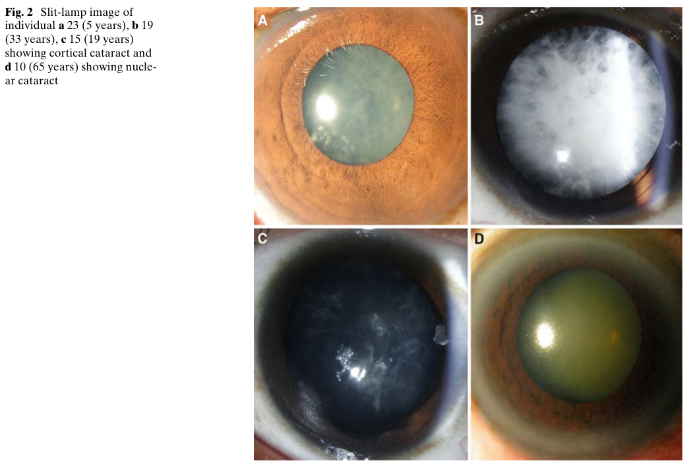

## Question

# Disease Characteristics Research Template

## Target Disease
- **Disease Name:** Cataract 33
- **MONDO ID:** MONDO:0012665 (if available)
- **Category:** Mendelian

## Research Objectives

Please provide a comprehensive research report on **Cataract 33** covering all of the
disease characteristics listed below. This report will be used to populate a disease knowledge
base entry. Be thorough and cite primary literature (PMID preferred) for all claims.

For each section, **suggested databases/resources** are listed. These are the first places
you should search for information on each topic.

---

### 1. Disease Information
> **Search first:** OMIM, Orphanet, ICD-10/ICD-11, MeSH, PubMed

- What is the disease? Provide a concise overview.
- What are the key identifiers? (OMIM, Orphanet, ICD-10/ICD-11, MeSH, Mondo)
- What are the common synonyms and alternative names?
- Is the information derived from individual patients (e.g., EHR) or aggregated disease-level resources?

### 2. Etiology

- **Disease Causal Factors**: What are the primary causes? (genetic, environmental, infectious, mechanistic)
- **Risk Factors**:
  > **Search first:** PubMed, Cochrane Library, UpToDate, clinical guidelines, ClinVar, ClinGen, GWAS Catalog, PheGenI, CTD, CDC, WHO, epidemiological databases
  - Genetic risk factors (causal variants, susceptibility loci, modifier genes)
  - Environmental risk factors (toxins, lifestyle, occupational exposures, age, sex, family history)
- **Protective Factors**:
  > **Search first:** PubMed, Cochrane Library, clinical trial databases, GWAS Catalog, gnomAD, WHO, CDC, nutrition databases
  - Genetic protective factors (protective variants, modifier alleles)
  - Environmental protective factors (diet, lifestyle, exposures that reduce risk)
- **Gene-Environment Interactions**: How do genetic and environmental factors interact to influence disease?
  > **Search first:** CTD, PubMed, PheGenI, GxE databases

### 3. Phenotypes
> **Search first:** HPO (Human Phenotype Ontology), OMIM, Orphanet, PubMed, clinicaltrials.gov, MedDRA, SNOMED CT, DECIPHER, LOINC

For each phenotype, provide:
- **Phenotype type**: symptoms, clinical signs, physical manifestations, behavioral changes, or laboratory abnormalities
  > For symptoms/signs: HPO, OMIM, Orphanet, PubMed
  > For behavioral changes: HPO, DSM, RDoC (Research Domain Criteria), PubMed
  > For laboratory abnormalities: LOINC, SNOMED CT, LabTests Online, PubMed
- **Phenotype characteristics**:
  > **Search first:** OMIM, Orphanet, HPO, PubMed
  - Age of symptom onset (neonatal, childhood, adult-onset, late-onset)
  - Symptom severity (mild, moderate, severe, variable)
  - Symptom progression (stable, progressive, episodic, fluctuating)
  - Frequency among affected individuals (percentage or qualitative)
- **Quality of life impact**: Effects on daily functioning and well-being (per-phenotype when possible)
  > **Search first:** EQ-5D database, SF-36, WHO QOL databases, PubMed
- Suggest HPO (Human Phenotype Ontology) terms for each phenotype

### 4. Genetic/Molecular Information

- **Causal Genes**: Gene mutations or chromosomal abnormalities responsible for disease (gene symbols, OMIM IDs)
  > **Search first:** OMIM, ClinVar, HGMD, Ensembl, NCBI Gene
- **Pathogenic Variants**:
  - Affected genes (gene symbols, HGNC IDs)
    > **Search first:** OMIM, NCBI Gene, Ensembl, HGNC, UniProt, GeneCards
  - Variant classification (pathogenic, likely pathogenic, VUS per ACMG/AMP guidelines)
    > **Search first:** ClinVar, ClinGen, ACMG/AMP guidelines, VarSome
  - Variant type/class (missense, frameshift, nonsense, splice-site, structural)
  - Allele frequency in population databases
    > **Search first:** gnomAD, 1000 Genomes, ExAC, TOPMed, dbSNP
  - Somatic vs germline origin
    > **Search first:** COSMIC (somatic), ClinVar, ICGC, TCGA
  - Functional consequences (loss of function, gain of function, dominant negative)
- **Modifier Genes**: Genes that modify disease severity or expression
- **Epigenetic Information**: DNA methylation, histone modifications, chromatin changes affecting disease
  > **Search first:** ENCODE, Roadmap Epigenomics, MethBase, DiseaseMeth
- **Chromosomal Abnormalities**: Large-scale genetic changes (aneuploidy, translocations, inversions)
  > **Search first:** DECIPHER, ClinVar, ECARUCA, UCSC Genome Browser

### 5. Environmental Information

- **Environmental Factors**: Non-genetic contributing factors (toxins, radiation, pollution, occupational exposure)
  > **Search first:** CTD (Comparative Toxicogenomics Database), TOXNET, PubMed, EPA databases
- **Lifestyle Factors**: Behavioral factors (smoking, diet, exercise, alcohol consumption)
  > **Search first:** CDC databases, WHO, PubMed, NHANES
- **Infectious Agents**: If applicable, pathogens causing or triggering disease (bacteria, viruses, fungi, parasites)
  > **Search first:** NCBI Taxonomy, ViPR, BV-BRC, MicrobeDB, GIDEON

### 6. Mechanism / Pathophysiology

**Present this section as an ordered causal chain first, then the detail below.**
Open with a numbered sequence of mechanistic steps running from the initiating
lesion (mutation, exposure, infection) to the clinical manifestation, one step per
line, each naming what it causes next. State the causal verb explicitly ("leads
to", "results in") and say where a step is inferred rather than demonstrated.
Where the mechanism branches, show the branch. The categories below are a
checklist of what to cover within those steps, not the organizing structure —
a step may draw on several of them, and a category may contribute to several
steps.

- **Molecular Pathways**: Specific signaling cascades or biochemical pathways involved (Wnt, MAPK, mTOR, PI3K-AKT, etc.)
  > **Search first:** KEGG, Reactome, WikiPathways, PathBank, BioCyc
- **Cellular Processes**: Cell-level mechanisms (apoptosis, autophagy, cell cycle dysregulation, inflammation, etc.)
  > **Search first:** Gene Ontology (GO), Reactome, KEGG, PubMed
- **Protein Dysfunction**: How protein structure or function is altered (misfolding, aggregation, loss of function, gain of function)
  > **Search first:** UniProt, PDB (Protein Data Bank), InterPro, Pfam, AlphaFold
- **Metabolic Changes**: Alterations in metabolic processes (energy metabolism, lipid metabolism, amino acid metabolism)
  > **Search first:** KEGG, BioCyc, HMDB (Human Metabolome Database), BRENDA
- **Immune System Involvement**: Role of immune response (autoimmunity, immunodeficiency, chronic inflammation)
  > **Search first:** ImmPort, Immunome Database, IEDB, Gene Ontology
- **Tissue Damage Mechanisms**: How tissues/ are injured (oxidative stress, ischemia, fibrosis, necrosis)
  > **Search first:** PubMed, Gene Ontology, Reactome
- **Biochemical Abnormalities**: Specific molecular defects (enzyme deficiencies, receptor dysfunction, ion channel defects)
  > **Search first:** BRENDA, UniProt, KEGG, OMIM, PubMed
- **Epigenetic Changes**: DNA methylation, histone modifications affecting gene expression in disease
  > **Search first:** ENCODE, Roadmap Epigenomics, MethBase, DiseaseMeth
- **Molecular Profiling** (if available):
  - Transcriptomics/gene expression changes
    > **Search first:** GEO (Gene Expression Omnibus), ArrayExpress, GTEx, Human Cell Atlas, SRA
  - Proteomics findings
    > **Search first:** PRIDE, ProteomeXchange, Human Protein Atlas, STRING, BioGRID
  - Metabolomics signatures
    > **Search first:** MetaboLights, Metabolomics Workbench, HMDB, METLIN
  - Lipidomics alterations
    > **Search first:** LIPID MAPS, SwissLipids, LipidHome, Metabolomics Workbench
  - Genomic structural features
    > **Search first:** UCSC Genome Browser, Ensembl, NCBI, dbVar, DGV
- **Advanced Technologies** (if applicable):
  - Single-cell analysis findings (cell-type specific mechanisms, cellular heterogeneity)
    > **Search first:** Human Cell Atlas, Single Cell Portal, GEO, CELLxGENE
  - Spatial transcriptomics findings
    > **Search first:** GEO, Spatial Research, Vizgen, 10x Genomics data
  - Multi-omics integration results
    > **Search first:** TCGA, ICGC, cBioPortal, LinkedOmics, PubMed
  - Functional genomics screens (CRISPR, RNAi)
    > **Search first:** DepMap, GenomeRNAi, PubMed, BioGRID ORCS

For each mechanism, describe:
- The causal chain from initial trigger to clinical manifestation
- Which mechanisms are upstream vs downstream
- What cell types and biological processes are involved
- Suggest GO terms for biological processes and CL terms for cell types

### 7. Anatomical Structures Affected

- **Organ Level**:
  - Primary organs directly affected
  - Secondary organ involvement (complications, secondary effects)
  - Body systems involved (cardiovascular, nervous, digestive, respiratory, endocrine, etc.)
  > **Search first:** Uberon, FMA (Foundational Model of Anatomy), OMIM, HPO, ICD-11, MeSH, SNOMED CT
- **Tissue and Cell Level**:
  - Specific tissue types affected (epithelial, connective, muscle, nervous)
  - Specific cell populations targeted (with Cell Ontology terms)
  > **Search first:** Uberon, Human Protein Atlas, Cell Ontology, Human Cell Atlas, CellMarker, PanglaoDB
- **Subcellular Level**:
  - Cellular compartments involved (mitochondria, nucleus, ER, lysosomes) (with GO Cellular Component terms)
  > **Search first:** Gene Ontology (Cellular Component), UniProt, Human Protein Atlas
- **Localization**:
  - Specific anatomical sites (with UBERON terms)
    > **Search first:** FMA, Uberon, NeuroNames (for brain), SNOMED CT
  - Lateralization (unilateral, bilateral, asymmetric)
    > **Search first:** HPO, clinical literature, imaging databases

### 8. Temporal Development

- **Onset**:
  - Typical age of onset (congenital, pediatric, adult, geriatric)
  - Onset pattern (acute, subacute, chronic, insidious)
  > **Search first:** OMIM, Orphanet, HPO, PubMed
- **Progression**:
  - Disease stages (early, intermediate, advanced, end-stage)
    > **Search first:** Cancer Staging Manual (AJCC), WHO classifications, PubMed
  - Progression rate (rapid, slow, variable)
  - Disease course pattern (episodic, relapsing-remitting, progressive, stable)
  - Disease duration (self-limited, chronic lifelong)
  > **Search first:** Disease registries, longitudinal cohort databases, natural history studies, PubMed, Orphanet, OMIM
- **Patterns**:
  - Remission patterns (spontaneous, treatment-induced)
    > **Search first:** Clinical trial databases, disease registries, PubMed
  - Critical periods (time windows of vulnerability or opportunity for intervention)
    > **Search first:** PubMed, developmental biology databases, clinical guidelines

### 9. Inheritance and Population

- **Epidemiology**:
  - Prevalence (cases per 100,000 at given time)
  - Incidence (new cases per 100,000 per year)
  > **Search first:** Orphanet, CDC, WHO, GBD (Global Burden of Disease), national registries, SEER, disease registries
- **For Genetic Etiology**:
  - Inheritance pattern (AD, AR, X-linked, mitochondrial, multifactorial, polygenic)
    > **Search first:** OMIM, Orphanet, ClinVar, GTR (Genetic Testing Registry)
  - Penetrance (complete, incomplete, age-dependent)
    > **Search first:** ClinVar, OMIM, PubMed, ClinGen
  - Expressivity (variable, consistent)
    > **Search first:** OMIM, ClinVar, PubMed
  - Genetic anticipation (increasing severity in successive generations)
    > **Search first:** OMIM, PubMed (especially for repeat expansion disorders)
  - Germline mosaicism
    > **Search first:** ClinVar, OMIM, genetic counseling literature, PubMed
  - Founder effects (population-specific mutations)
    > **Search first:** gnomAD, population genetics databases, PubMed
  - Consanguinity role
    > **Search first:** OMIM, population studies, genetic counseling resources
  - Carrier frequency
    > **Search first:** gnomAD, carrier screening databases, GeneReviews, GTR
- **Population Demographics**:
  - Affected populations (ethnic or demographic groups with higher prevalence)
    > **Search first:** gnomAD, 1000 Genomes, PAGE Study, PubMed, population registries
  - Geographic distribution (endemic areas, regional variation)
    > **Search first:** WHO, CDC, GBD, Orphanet, geographic epidemiology databases
  - Geographic distribution of specific variants
  - Sex ratio (male:female)
    > **Search first:** Disease registries, OMIM, PubMed, epidemiological databases
  - Age distribution of affected individuals
    > **Search first:** CDC, disease registries, SEER, Orphanet

### 10. Diagnostics

- **Clinical Tests**:
  - Laboratory tests (blood, urine, tissue chemistry, specific enzyme assays)
    > **Search first:** LOINC, LabTests Online, PubMed
  - Biomarkers (proteins, metabolites, genetic markers, circulating biomarkers)
    > **Search first:** FDA Biomarker List, BEST (Biomarkers, EndpointS, and other Tools), PubMed
  - Imaging studies (X-ray, CT, MRI, PET, ultrasound)
    > **Search first:** RadLex, DICOM, Radiopaedia, imaging databases
  - Functional tests (pulmonary function, cardiac stress tests)
    > **Search first:** LOINC, clinical guidelines, PubMed
  - Electrophysiology (EEG, EMG, ECG, nerve conduction studies)
    > **Search first:** LOINC, clinical neurophysiology databases, PubMed
  - Biopsy findings (histopathology, immunohistochemistry)
    > **Search first:** SNOMED CT, College of American Pathologists resources, PubMed
  - Pathology findings (microscopic examination)
    > **Search first:** SNOMED CT, Digital Pathology databases, PubMed
- **Genetic Testing**:
  > **Search first:** GTR (Genetic Testing Registry), GeneReviews, ClinGen
  - Overview of recommended genetic testing approach
  - Whole genome sequencing (WGS) utility
    > **Search first:** GTR, ClinVar, GEL (Genomics England), gnomAD
  - Whole exome sequencing (WES) utility
    > **Search first:** GTR, ClinVar, OMIM, GeneMatcher
  - Gene panels (which panels, which genes)
    > **Search first:** GTR, ClinVar, laboratory-specific databases
  - Single gene testing
    > **Search first:** GTR, ClinVar, OMIM, GeneReviews
  - Chromosomal microarray (CMA)
    > **Search first:** DECIPHER, ClinVar, dbVar, ECARUCA
  - Karyotyping
    > **Search first:** Chromosome Abnormality Database, ClinVar, cytogenetics resources
  - FISH
    > **Search first:** ClinVar, cytogenetics databases, PubMed
  - Mitochondrial DNA testing
    > **Search first:** MITOMAP, MSeqDR, ClinVar, GTR
  - Repeat expansion testing
    > **Search first:** GTR, ClinVar, repeat expansion databases, PubMed
- **Omics-Based Diagnostics** (if applicable):
  - RNA sequencing / transcriptomics
    > **Search first:** GEO, ArrayExpress, GTEx, RNA-seq databases
  - Proteomics
    > **Search first:** PRIDE, ProteomeXchange, FDA Biomarker database
  - Metabolomics
    > **Search first:** MetaboLights, Metabolomics Workbench, HMDB
  - Epigenomics
    > **Search first:** GEO, ENCODE, Roadmap Epigenomics, MethBase
  - Liquid biopsy
    > **Search first:** COSMIC, ClinVar, liquid biopsy databases, PubMed
- **Clinical Criteria**:
  - Standardized diagnostic criteria (DSM, ICD, society guidelines)
    > **Search first:** DSM-5, ICD-11, clinical society guidelines, UpToDate
  - Differential diagnosis (other conditions to rule out, with distinguishing features)
    > **Search first:** DynaMed, UpToDate, clinical decision support systems
- **Screening**:
  - Screening methods for asymptomatic individuals (newborn screening, carrier screening, cascade screening)
    > **Search first:** ACMG recommendations, CDC newborn screening, GTR

### 11. Outcome/Prognosis

- **Survival and Mortality**:
  - Survival rate (5-year, 10-year, overall)
    > **Search first:** SEER, cancer registries, disease-specific registries, PubMed
  - Life expectancy (with and without treatment if applicable)
    > **Search first:** Orphanet, disease registries, actuarial databases, PubMed
  - Mortality rate
    > **Search first:** CDC, WHO, GBD, national mortality databases
  - Disease-specific mortality (deaths directly attributable to disease)
    > **Search first:** Disease registries, CDC Wonder, GBD, PubMed
- **Morbidity and Function**:
  - Morbidity (disease-related disability and health impacts)
    > **Search first:** GBD, WHO, disability databases, PubMed
  - Disability outcomes (long-term functional impairments)
    > **Search first:** ICF (International Classification of Functioning), disability registries
  - Quality of life measures (EQ-5D, SF-36, PROMIS, disease-specific tools)
    > **Search first:** EQ-5D database, SF-36, PROMIS, PubMed
- **Disease Course**:
  - Complications (secondary problems: infections, organ failure, etc.)
    > **Search first:** ICD codes, disease registries, clinical databases, PubMed
  - Recovery potential (likelihood and extent of recovery, with vs without treatment)
    > **Search first:** Natural history studies, rehabilitation databases, PubMed
- **Prediction**:
  - Prognostic factors (age, disease severity, biomarkers, treatment response)
    > **Search first:** Prognostic models databases, clinical calculators, PubMed
  - Prognostic biomarkers (molecular markers predicting disease course)
    > **Search first:** FDA Biomarker database, PubMed, cancer prognostic databases

### 12. Treatment

- **Pharmacotherapy**:
  - Pharmacological treatments (drug names, drug classes, mechanisms of action)
    > **Search first:** DrugBank, RxNorm, ATC classification, DailyMed, FDA databases
  - Pharmacogenomics (how genetic variants affect drug metabolism, efficacy, toxicity)
    > **Search first:** PharmGKB, CPIC (Clinical Pharmacogenetics), FDA Table of PGx Biomarkers
- **Advanced Therapeutics**:
  - Gene therapy (viral vectors, CRISPR, gene replacement, gene editing)
    > **Search first:** ClinicalTrials.gov, FDA gene therapy database, ASGCT resources
  - Cell therapy (stem cell transplant, CAR-T, cellular therapeutics)
    > **Search first:** ClinicalTrials.gov, FDA cell therapy database, FACT standards
  - RNA-based therapies (ASOs, siRNA, mRNA therapies)
    > **Search first:** ClinicalTrials.gov, FDA approvals, PubMed
  - Targeted therapies (treatments directed at specific molecular targets)
    > **Search first:** My Cancer Genome, OncoKB, ClinicalTrials.gov, FDA approvals
  - Immunotherapies (checkpoint inhibitors, monoclonal antibodies)
    > **Search first:** Cancer Immunotherapy Database, FDA approvals, ClinicalTrials.gov
- **Surgical and Interventional**:
  - Surgical interventions (types of surgery, timing, outcomes)
    > **Search first:** CPT codes, surgical registries, clinical guidelines, PubMed
- **Supportive and Rehabilitative**:
  - Supportive care (symptom management, pain control, nutrition)
    > **Search first:** Clinical guidelines, Cochrane Library, PubMed
  - Rehabilitation (physical therapy, occupational therapy, speech therapy)
    > **Search first:** Rehabilitation medicine databases, clinical guidelines, PubMed
- **Experimental**:
  - Experimental treatments in clinical trials (with NCT identifiers if available)
    > **Search first:** ClinicalTrials.gov, EU Clinical Trials Register, WHO ICTRP
- **Treatment Outcomes**:
  - Treatment response rates
    > **Search first:** Clinical trial databases, FDA reviews, systematic reviews, PubMed
  - Side effects and adverse events
    > **Search first:** FDA Adverse Event Reporting System (FAERS), MedWatch, PubMed
- **Treatment Strategy**:
  - Treatment algorithms (clinical pathways, decision trees)
    > **Search first:** Clinical practice guidelines, NCCN Guidelines, UpToDate
  - Combination therapies
    > **Search first:** ClinicalTrials.gov, treatment guidelines, PubMed
  - Personalized medicine approaches (genotype-guided treatment)
    > **Search first:** My Cancer Genome, CIViC, PharmGKB, precision medicine databases

For each treatment, suggest NCIT (NCI Thesaurus) clinical-intervention terms where applicable.

### 13. Prevention

- **Prevention Levels**:
  - Primary prevention (preventing disease occurrence: vaccination, risk factor modification)
    > **Search first:** CDC, WHO, USPSTF recommendations, Cochrane Library
  - Secondary prevention (early detection and treatment: screening programs, early intervention)
    > **Search first:** USPSTF, CDC screening guidelines, WHO
  - Tertiary prevention (preventing complications in those with disease)
    > **Search first:** Clinical guidelines, disease management protocols, PubMed
- **Immunization**: Vaccine strategies (if applicable)
  > **Search first:** CDC vaccine schedules, WHO immunization, FDA vaccine database
- **Screening and Early Detection**:
  - Screening programs (population-based: newborn screening, cancer screening)
    > **Search first:** CDC screening programs, USPSTF, cancer screening databases
  - Genetic screening (carrier screening, preimplantation genetic diagnosis, prenatal testing)
    > **Search first:** ACMG recommendations, ACOG guidelines, GTR
  - Risk stratification (identifying high-risk individuals for targeted prevention)
    > **Search first:** Risk prediction models, clinical calculators, PubMed
- **Behavioral Interventions**: Lifestyle modifications to reduce risk
  > **Search first:** CDC, WHO, behavioral intervention databases, Cochrane Library
- **Counseling**: Genetic counseling (risk assessment, family planning guidance)
  > **Search first:** NSGC resources, ACMG guidelines, GeneReviews
- **Public Health**:
  - Public health interventions (sanitation, vector control, health education)
    > **Search first:** CDC, WHO, public health databases, PubMed
  - Environmental interventions (reducing environmental risk factors)
    > **Search first:** EPA databases, WHO environmental health, PubMed
- **Prophylaxis**: Preventive medications or procedures
  > **Search first:** Clinical guidelines, FDA approvals, PubMed

### 14. Other Species / Natural Disease

- **Taxonomy**: Species affected (with NCBI Taxon identifiers)
  > **Search first:** NCBI Taxonomy
- **Breed**: Specific breeds affected (with VBO identifiers if applicable)
  > **Search first:** VBO (Vertebrate Breed Ontology)
- **Gene**: Orthologous genes in other species (with NCBI Gene IDs)
  > **Search first:** NCBI Gene
- **Natural Disease**:
  - Naturally occurring disease in other species (companion animals, wildlife)
    > **Search first:** OMIA (Online Mendelian Inheritance in Animals), VetCompass, PubMed
  - Veterinary relevance and importance in animal health
    > **Search first:** OMIA, veterinary databases, PubMed
- **Comparative Biology**:
  - Comparative pathology (similarities and differences across species)
    > **Search first:** OMIA, comparative pathology databases, PubMed
  - Evolutionary conservation of disease mechanisms
    > **Search first:** HomoloGene, OrthoMCL, Alliance of Genome Resources
- **Transmission** (if applicable):
  - Zoonotic potential
    > **Search first:** CDC zoonotic diseases, WHO zoonoses, GIDEON
  - Cross-species susceptibility
    > **Search first:** NCBI Taxonomy, veterinary databases, PubMed

### 15. Model Organisms

- **Model Types**:
  - Model organism type (mammalian, invertebrate, cellular, in vitro)
    > **Search first:** Alliance of Genome Resources, model organism databases
  - Specific model systems (mouse, rat, zebrafish, Drosophila, C. elegans, yeast, cell lines, organoids, iPSCs)
    > **Search first:** MGI, RGD, ZFIN, FlyBase, WormBase, SGD, ATCC, Cellosaurus
  - Induced models (drug treatment, surgical intervention, environmental manipulation)
    > **Search first:** MGI, model organism databases, PubMed
- **Genetic Models**:
  - Types available (knockout, knock-in, transgenic, conditional, humanized)
    > **Search first:** MGI, IMPC, KOMP, EuMMCR, IMSR
- **Model Characteristics**:
  - Phenotype recapitulation (how well model reproduces human disease features)
    > **Search first:** Model organism databases, comparative studies, PubMed
  - Model limitations (aspects of human disease not captured)
    > **Search first:** Model organism databases, PubMed, review articles
- **Applications**:
  - Research applications (what aspects of disease can be studied)
    > **Search first:** Model organism databases, PubMed
- **Resources**:
  - Model databases
    > **Search first:** MGI, RGD, ZFIN, FlyBase, WormBase, IMSR, EMMA, MMRRC

---

## Citation Requirements

- Cite primary literature (PMID preferred) for all mechanistic and clinical claims
- Prioritize recent reviews and landmark papers
- Include direct quotes from abstracts where possible to support key statements
- Distinguish evidence source types: human clinical, model organism, in vitro, computational

## Output Format

Structure your response as a comprehensive narrative organized by the sections above.
For each section, provide:
- Factual content with specific details (numbers, percentages, gene names, variant nomenclature)
- Ontology term suggestions (HPO, GO, CL, UBERON, CHEBI, NCIT, MONDO) where applicable
- Evidence citations with PMIDs
- Direct quotes from abstracts to support key claims
- Clear indication when information is not available or not applicable for this disease

This report will be used to populate a disease knowledge base entry with:
- Pathophysiology descriptions with causal chains
- Gene/protein annotations (HGNC, GO terms)
- Phenotype associations (HP terms) with frequencies
- Cell type involvement (CL terms)
- Anatomical locations (UBERON terms)
- Chemical entities (CHEBI terms)
- Treatment annotations (NCIT terms)
- Evidence items with PMIDs and exact abstract quotes
- Epidemiology, prognosis, diagnostic, and prevention information
- Animal model descriptions with phenotype recapitulation details

## Output

Question: You are an expert researcher providing comprehensive, well-cited information.

Provide detailed information focusing on:
1. Key concepts and definitions with current understanding
2. Recent developments and latest research (prioritize 2023-2024 sources)
3. Current applications and real-world implementations
4. Expert opinions and analysis from authoritative sources
5. Relevant statistics and data from recent studies

Format as a comprehensive research report with proper citations. Include URLs and publication dates where available.
Always prioritize recent, authoritative sources and provide specific citations for all major claims.

# Disease Characteristics Research Template

## Target Disease
- **Disease Name:** Cataract 33
- **MONDO ID:** MONDO:0012665 (if available)
- **Category:** Mendelian

## Research Objectives

Please provide a comprehensive research report on **Cataract 33** covering all of the
disease characteristics listed below. This report will be used to populate a disease knowledge
base entry. Be thorough and cite primary literature (PMID preferred) for all claims.

For each section, **suggested databases/resources** are listed. These are the first places
you should search for information on each topic.

---

### 1. Disease Information
> **Search first:** OMIM, Orphanet, ICD-10/ICD-11, MeSH, PubMed

- What is the disease? Provide a concise overview.
- What are the key identifiers? (OMIM, Orphanet, ICD-10/ICD-11, MeSH, Mondo)
- What are the common synonyms and alternative names?
- Is the information derived from individual patients (e.g., EHR) or aggregated disease-level resources?

### 2. Etiology

- **Disease Causal Factors**: What are the primary causes? (genetic, environmental, infectious, mechanistic)
- **Risk Factors**:
  > **Search first:** PubMed, Cochrane Library, UpToDate, clinical guidelines, ClinVar, ClinGen, GWAS Catalog, PheGenI, CTD, CDC, WHO, epidemiological databases
  - Genetic risk factors (causal variants, susceptibility loci, modifier genes)
  - Environmental risk factors (toxins, lifestyle, occupational exposures, age, sex, family history)
- **Protective Factors**:
  > **Search first:** PubMed, Cochrane Library, clinical trial databases, GWAS Catalog, gnomAD, WHO, CDC, nutrition databases
  - Genetic protective factors (protective variants, modifier alleles)
  - Environmental protective factors (diet, lifestyle, exposures that reduce risk)
- **Gene-Environment Interactions**: How do genetic and environmental factors interact to influence disease?
  > **Search first:** CTD, PubMed, PheGenI, GxE databases

### 3. Phenotypes
> **Search first:** HPO (Human Phenotype Ontology), OMIM, Orphanet, PubMed, clinicaltrials.gov, MedDRA, SNOMED CT, DECIPHER, LOINC

For each phenotype, provide:
- **Phenotype type**: symptoms, clinical signs, physical manifestations, behavioral changes, or laboratory abnormalities
  > For symptoms/signs: HPO, OMIM, Orphanet, PubMed
  > For behavioral changes: HPO, DSM, RDoC (Research Domain Criteria), PubMed
  > For laboratory abnormalities: LOINC, SNOMED CT, LabTests Online, PubMed
- **Phenotype characteristics**:
  > **Search first:** OMIM, Orphanet, HPO, PubMed
  - Age of symptom onset (neonatal, childhood, adult-onset, late-onset)
  - Symptom severity (mild, moderate, severe, variable)
  - Symptom progression (stable, progressive, episodic, fluctuating)
  - Frequency among affected individuals (percentage or qualitative)
- **Quality of life impact**: Effects on daily functioning and well-being (per-phenotype when possible)
  > **Search first:** EQ-5D database, SF-36, WHO QOL databases, PubMed
- Suggest HPO (Human Phenotype Ontology) terms for each phenotype

### 4. Genetic/Molecular Information

- **Causal Genes**: Gene mutations or chromosomal abnormalities responsible for disease (gene symbols, OMIM IDs)
  > **Search first:** OMIM, ClinVar, HGMD, Ensembl, NCBI Gene
- **Pathogenic Variants**:
  - Affected genes (gene symbols, HGNC IDs)
    > **Search first:** OMIM, NCBI Gene, Ensembl, HGNC, UniProt, GeneCards
  - Variant classification (pathogenic, likely pathogenic, VUS per ACMG/AMP guidelines)
    > **Search first:** ClinVar, ClinGen, ACMG/AMP guidelines, VarSome
  - Variant type/class (missense, frameshift, nonsense, splice-site, structural)
  - Allele frequency in population databases
    > **Search first:** gnomAD, 1000 Genomes, ExAC, TOPMed, dbSNP
  - Somatic vs germline origin
    > **Search first:** COSMIC (somatic), ClinVar, ICGC, TCGA
  - Functional consequences (loss of function, gain of function, dominant negative)
- **Modifier Genes**: Genes that modify disease severity or expression
- **Epigenetic Information**: DNA methylation, histone modifications, chromatin changes affecting disease
  > **Search first:** ENCODE, Roadmap Epigenomics, MethBase, DiseaseMeth
- **Chromosomal Abnormalities**: Large-scale genetic changes (aneuploidy, translocations, inversions)
  > **Search first:** DECIPHER, ClinVar, ECARUCA, UCSC Genome Browser

### 5. Environmental Information

- **Environmental Factors**: Non-genetic contributing factors (toxins, radiation, pollution, occupational exposure)
  > **Search first:** CTD (Comparative Toxicogenomics Database), TOXNET, PubMed, EPA databases
- **Lifestyle Factors**: Behavioral factors (smoking, diet, exercise, alcohol consumption)
  > **Search first:** CDC databases, WHO, PubMed, NHANES
- **Infectious Agents**: If applicable, pathogens causing or triggering disease (bacteria, viruses, fungi, parasites)
  > **Search first:** NCBI Taxonomy, ViPR, BV-BRC, MicrobeDB, GIDEON

### 6. Mechanism / Pathophysiology

**Present this section as an ordered causal chain first, then the detail below.**
Open with a numbered sequence of mechanistic steps running from the initiating
lesion (mutation, exposure, infection) to the clinical manifestation, one step per
line, each naming what it causes next. State the causal verb explicitly ("leads
to", "results in") and say where a step is inferred rather than demonstrated.
Where the mechanism branches, show the branch. The categories below are a
checklist of what to cover within those steps, not the organizing structure —
a step may draw on several of them, and a category may contribute to several
steps.

- **Molecular Pathways**: Specific signaling cascades or biochemical pathways involved (Wnt, MAPK, mTOR, PI3K-AKT, etc.)
  > **Search first:** KEGG, Reactome, WikiPathways, PathBank, BioCyc
- **Cellular Processes**: Cell-level mechanisms (apoptosis, autophagy, cell cycle dysregulation, inflammation, etc.)
  > **Search first:** Gene Ontology (GO), Reactome, KEGG, PubMed
- **Protein Dysfunction**: How protein structure or function is altered (misfolding, aggregation, loss of function, gain of function)
  > **Search first:** UniProt, PDB (Protein Data Bank), InterPro, Pfam, AlphaFold
- **Metabolic Changes**: Alterations in metabolic processes (energy metabolism, lipid metabolism, amino acid metabolism)
  > **Search first:** KEGG, BioCyc, HMDB (Human Metabolome Database), BRENDA
- **Immune System Involvement**: Role of immune response (autoimmunity, immunodeficiency, chronic inflammation)
  > **Search first:** ImmPort, Immunome Database, IEDB, Gene Ontology
- **Tissue Damage Mechanisms**: How tissues/ are injured (oxidative stress, ischemia, fibrosis, necrosis)
  > **Search first:** PubMed, Gene Ontology, Reactome
- **Biochemical Abnormalities**: Specific molecular defects (enzyme deficiencies, receptor dysfunction, ion channel defects)
  > **Search first:** BRENDA, UniProt, KEGG, OMIM, PubMed
- **Epigenetic Changes**: DNA methylation, histone modifications affecting gene expression in disease
  > **Search first:** ENCODE, Roadmap Epigenomics, MethBase, DiseaseMeth
- **Molecular Profiling** (if available):
  - Transcriptomics/gene expression changes
    > **Search first:** GEO (Gene Expression Omnibus), ArrayExpress, GTEx, Human Cell Atlas, SRA
  - Proteomics findings
    > **Search first:** PRIDE, ProteomeXchange, Human Protein Atlas, STRING, BioGRID
  - Metabolomics signatures
    > **Search first:** MetaboLights, Metabolomics Workbench, HMDB, METLIN
  - Lipidomics alterations
    > **Search first:** LIPID MAPS, SwissLipids, LipidHome, Metabolomics Workbench
  - Genomic structural features
    > **Search first:** UCSC Genome Browser, Ensembl, NCBI, dbVar, DGV
- **Advanced Technologies** (if applicable):
  - Single-cell analysis findings (cell-type specific mechanisms, cellular heterogeneity)
    > **Search first:** Human Cell Atlas, Single Cell Portal, GEO, CELLxGENE
  - Spatial transcriptomics findings
    > **Search first:** GEO, Spatial Research, Vizgen, 10x Genomics data
  - Multi-omics integration results
    > **Search first:** TCGA, ICGC, cBioPortal, LinkedOmics, PubMed
  - Functional genomics screens (CRISPR, RNAi)
    > **Search first:** DepMap, GenomeRNAi, PubMed, BioGRID ORCS

For each mechanism, describe:
- The causal chain from initial trigger to clinical manifestation
- Which mechanisms are upstream vs downstream
- What cell types and biological processes are involved
- Suggest GO terms for biological processes and CL terms for cell types

### 7. Anatomical Structures Affected

- **Organ Level**:
  - Primary organs directly affected
  - Secondary organ involvement (complications, secondary effects)
  - Body systems involved (cardiovascular, nervous, digestive, respiratory, endocrine, etc.)
  > **Search first:** Uberon, FMA (Foundational Model of Anatomy), OMIM, HPO, ICD-11, MeSH, SNOMED CT
- **Tissue and Cell Level**:
  - Specific tissue types affected (epithelial, connective, muscle, nervous)
  - Specific cell populations targeted (with Cell Ontology terms)
  > **Search first:** Uberon, Human Protein Atlas, Cell Ontology, Human Cell Atlas, CellMarker, PanglaoDB
- **Subcellular Level**:
  - Cellular compartments involved (mitochondria, nucleus, ER, lysosomes) (with GO Cellular Component terms)
  > **Search first:** Gene Ontology (Cellular Component), UniProt, Human Protein Atlas
- **Localization**:
  - Specific anatomical sites (with UBERON terms)
    > **Search first:** FMA, Uberon, NeuroNames (for brain), SNOMED CT
  - Lateralization (unilateral, bilateral, asymmetric)
    > **Search first:** HPO, clinical literature, imaging databases

### 8. Temporal Development

- **Onset**:
  - Typical age of onset (congenital, pediatric, adult, geriatric)
  - Onset pattern (acute, subacute, chronic, insidious)
  > **Search first:** OMIM, Orphanet, HPO, PubMed
- **Progression**:
  - Disease stages (early, intermediate, advanced, end-stage)
    > **Search first:** Cancer Staging Manual (AJCC), WHO classifications, PubMed
  - Progression rate (rapid, slow, variable)
  - Disease course pattern (episodic, relapsing-remitting, progressive, stable)
  - Disease duration (self-limited, chronic lifelong)
  > **Search first:** Disease registries, longitudinal cohort databases, natural history studies, PubMed, Orphanet, OMIM
- **Patterns**:
  - Remission patterns (spontaneous, treatment-induced)
    > **Search first:** Clinical trial databases, disease registries, PubMed
  - Critical periods (time windows of vulnerability or opportunity for intervention)
    > **Search first:** PubMed, developmental biology databases, clinical guidelines

### 9. Inheritance and Population

- **Epidemiology**:
  - Prevalence (cases per 100,000 at given time)
  - Incidence (new cases per 100,000 per year)
  > **Search first:** Orphanet, CDC, WHO, GBD (Global Burden of Disease), national registries, SEER, disease registries
- **For Genetic Etiology**:
  - Inheritance pattern (AD, AR, X-linked, mitochondrial, multifactorial, polygenic)
    > **Search first:** OMIM, Orphanet, ClinVar, GTR (Genetic Testing Registry)
  - Penetrance (complete, incomplete, age-dependent)
    > **Search first:** ClinVar, OMIM, PubMed, ClinGen
  - Expressivity (variable, consistent)
    > **Search first:** OMIM, ClinVar, PubMed
  - Genetic anticipation (increasing severity in successive generations)
    > **Search first:** OMIM, PubMed (especially for repeat expansion disorders)
  - Germline mosaicism
    > **Search first:** ClinVar, OMIM, genetic counseling literature, PubMed
  - Founder effects (population-specific mutations)
    > **Search first:** gnomAD, population genetics databases, PubMed
  - Consanguinity role
    > **Search first:** OMIM, population studies, genetic counseling resources
  - Carrier frequency
    > **Search first:** gnomAD, carrier screening databases, GeneReviews, GTR
- **Population Demographics**:
  - Affected populations (ethnic or demographic groups with higher prevalence)
    > **Search first:** gnomAD, 1000 Genomes, PAGE Study, PubMed, population registries
  - Geographic distribution (endemic areas, regional variation)
    > **Search first:** WHO, CDC, GBD, Orphanet, geographic epidemiology databases
  - Geographic distribution of specific variants
  - Sex ratio (male:female)
    > **Search first:** Disease registries, OMIM, PubMed, epidemiological databases
  - Age distribution of affected individuals
    > **Search first:** CDC, disease registries, SEER, Orphanet

### 10. Diagnostics

- **Clinical Tests**:
  - Laboratory tests (blood, urine, tissue chemistry, specific enzyme assays)
    > **Search first:** LOINC, LabTests Online, PubMed
  - Biomarkers (proteins, metabolites, genetic markers, circulating biomarkers)
    > **Search first:** FDA Biomarker List, BEST (Biomarkers, EndpointS, and other Tools), PubMed
  - Imaging studies (X-ray, CT, MRI, PET, ultrasound)
    > **Search first:** RadLex, DICOM, Radiopaedia, imaging databases
  - Functional tests (pulmonary function, cardiac stress tests)
    > **Search first:** LOINC, clinical guidelines, PubMed
  - Electrophysiology (EEG, EMG, ECG, nerve conduction studies)
    > **Search first:** LOINC, clinical neurophysiology databases, PubMed
  - Biopsy findings (histopathology, immunohistochemistry)
    > **Search first:** SNOMED CT, College of American Pathologists resources, PubMed
  - Pathology findings (microscopic examination)
    > **Search first:** SNOMED CT, Digital Pathology databases, PubMed
- **Genetic Testing**:
  > **Search first:** GTR (Genetic Testing Registry), GeneReviews, ClinGen
  - Overview of recommended genetic testing approach
  - Whole genome sequencing (WGS) utility
    > **Search first:** GTR, ClinVar, GEL (Genomics England), gnomAD
  - Whole exome sequencing (WES) utility
    > **Search first:** GTR, ClinVar, OMIM, GeneMatcher
  - Gene panels (which panels, which genes)
    > **Search first:** GTR, ClinVar, laboratory-specific databases
  - Single gene testing
    > **Search first:** GTR, ClinVar, OMIM, GeneReviews
  - Chromosomal microarray (CMA)
    > **Search first:** DECIPHER, ClinVar, dbVar, ECARUCA
  - Karyotyping
    > **Search first:** Chromosome Abnormality Database, ClinVar, cytogenetics resources
  - FISH
    > **Search first:** ClinVar, cytogenetics databases, PubMed
  - Mitochondrial DNA testing
    > **Search first:** MITOMAP, MSeqDR, ClinVar, GTR
  - Repeat expansion testing
    > **Search first:** GTR, ClinVar, repeat expansion databases, PubMed
- **Omics-Based Diagnostics** (if applicable):
  - RNA sequencing / transcriptomics
    > **Search first:** GEO, ArrayExpress, GTEx, RNA-seq databases
  - Proteomics
    > **Search first:** PRIDE, ProteomeXchange, FDA Biomarker database
  - Metabolomics
    > **Search first:** MetaboLights, Metabolomics Workbench, HMDB
  - Epigenomics
    > **Search first:** GEO, ENCODE, Roadmap Epigenomics, MethBase
  - Liquid biopsy
    > **Search first:** COSMIC, ClinVar, liquid biopsy databases, PubMed
- **Clinical Criteria**:
  - Standardized diagnostic criteria (DSM, ICD, society guidelines)
    > **Search first:** DSM-5, ICD-11, clinical society guidelines, UpToDate
  - Differential diagnosis (other conditions to rule out, with distinguishing features)
    > **Search first:** DynaMed, UpToDate, clinical decision support systems
- **Screening**:
  - Screening methods for asymptomatic individuals (newborn screening, carrier screening, cascade screening)
    > **Search first:** ACMG recommendations, CDC newborn screening, GTR

### 11. Outcome/Prognosis

- **Survival and Mortality**:
  - Survival rate (5-year, 10-year, overall)
    > **Search first:** SEER, cancer registries, disease-specific registries, PubMed
  - Life expectancy (with and without treatment if applicable)
    > **Search first:** Orphanet, disease registries, actuarial databases, PubMed
  - Mortality rate
    > **Search first:** CDC, WHO, GBD, national mortality databases
  - Disease-specific mortality (deaths directly attributable to disease)
    > **Search first:** Disease registries, CDC Wonder, GBD, PubMed
- **Morbidity and Function**:
  - Morbidity (disease-related disability and health impacts)
    > **Search first:** GBD, WHO, disability databases, PubMed
  - Disability outcomes (long-term functional impairments)
    > **Search first:** ICF (International Classification of Functioning), disability registries
  - Quality of life measures (EQ-5D, SF-36, PROMIS, disease-specific tools)
    > **Search first:** EQ-5D database, SF-36, PROMIS, PubMed
- **Disease Course**:
  - Complications (secondary problems: infections, organ failure, etc.)
    > **Search first:** ICD codes, disease registries, clinical databases, PubMed
  - Recovery potential (likelihood and extent of recovery, with vs without treatment)
    > **Search first:** Natural history studies, rehabilitation databases, PubMed
- **Prediction**:
  - Prognostic factors (age, disease severity, biomarkers, treatment response)
    > **Search first:** Prognostic models databases, clinical calculators, PubMed
  - Prognostic biomarkers (molecular markers predicting disease course)
    > **Search first:** FDA Biomarker database, PubMed, cancer prognostic databases

### 12. Treatment

- **Pharmacotherapy**:
  - Pharmacological treatments (drug names, drug classes, mechanisms of action)
    > **Search first:** DrugBank, RxNorm, ATC classification, DailyMed, FDA databases
  - Pharmacogenomics (how genetic variants affect drug metabolism, efficacy, toxicity)
    > **Search first:** PharmGKB, CPIC (Clinical Pharmacogenetics), FDA Table of PGx Biomarkers
- **Advanced Therapeutics**:
  - Gene therapy (viral vectors, CRISPR, gene replacement, gene editing)
    > **Search first:** ClinicalTrials.gov, FDA gene therapy database, ASGCT resources
  - Cell therapy (stem cell transplant, CAR-T, cellular therapeutics)
    > **Search first:** ClinicalTrials.gov, FDA cell therapy database, FACT standards
  - RNA-based therapies (ASOs, siRNA, mRNA therapies)
    > **Search first:** ClinicalTrials.gov, FDA approvals, PubMed
  - Targeted therapies (treatments directed at specific molecular targets)
    > **Search first:** My Cancer Genome, OncoKB, ClinicalTrials.gov, FDA approvals
  - Immunotherapies (checkpoint inhibitors, monoclonal antibodies)
    > **Search first:** Cancer Immunotherapy Database, FDA approvals, ClinicalTrials.gov
- **Surgical and Interventional**:
  - Surgical interventions (types of surgery, timing, outcomes)
    > **Search first:** CPT codes, surgical registries, clinical guidelines, PubMed
- **Supportive and Rehabilitative**:
  - Supportive care (symptom management, pain control, nutrition)
    > **Search first:** Clinical guidelines, Cochrane Library, PubMed
  - Rehabilitation (physical therapy, occupational therapy, speech therapy)
    > **Search first:** Rehabilitation medicine databases, clinical guidelines, PubMed
- **Experimental**:
  - Experimental treatments in clinical trials (with NCT identifiers if available)
    > **Search first:** ClinicalTrials.gov, EU Clinical Trials Register, WHO ICTRP
- **Treatment Outcomes**:
  - Treatment response rates
    > **Search first:** Clinical trial databases, FDA reviews, systematic reviews, PubMed
  - Side effects and adverse events
    > **Search first:** FDA Adverse Event Reporting System (FAERS), MedWatch, PubMed
- **Treatment Strategy**:
  - Treatment algorithms (clinical pathways, decision trees)
    > **Search first:** Clinical practice guidelines, NCCN Guidelines, UpToDate
  - Combination therapies
    > **Search first:** ClinicalTrials.gov, treatment guidelines, PubMed
  - Personalized medicine approaches (genotype-guided treatment)
    > **Search first:** My Cancer Genome, CIViC, PharmGKB, precision medicine databases

For each treatment, suggest NCIT (NCI Thesaurus) clinical-intervention terms where applicable.

### 13. Prevention

- **Prevention Levels**:
  - Primary prevention (preventing disease occurrence: vaccination, risk factor modification)
    > **Search first:** CDC, WHO, USPSTF recommendations, Cochrane Library
  - Secondary prevention (early detection and treatment: screening programs, early intervention)
    > **Search first:** USPSTF, CDC screening guidelines, WHO
  - Tertiary prevention (preventing complications in those with disease)
    > **Search first:** Clinical guidelines, disease management protocols, PubMed
- **Immunization**: Vaccine strategies (if applicable)
  > **Search first:** CDC vaccine schedules, WHO immunization, FDA vaccine database
- **Screening and Early Detection**:
  - Screening programs (population-based: newborn screening, cancer screening)
    > **Search first:** CDC screening programs, USPSTF, cancer screening databases
  - Genetic screening (carrier screening, preimplantation genetic diagnosis, prenatal testing)
    > **Search first:** ACMG recommendations, ACOG guidelines, GTR
  - Risk stratification (identifying high-risk individuals for targeted prevention)
    > **Search first:** Risk prediction models, clinical calculators, PubMed
- **Behavioral Interventions**: Lifestyle modifications to reduce risk
  > **Search first:** CDC, WHO, behavioral intervention databases, Cochrane Library
- **Counseling**: Genetic counseling (risk assessment, family planning guidance)
  > **Search first:** NSGC resources, ACMG guidelines, GeneReviews
- **Public Health**:
  - Public health interventions (sanitation, vector control, health education)
    > **Search first:** CDC, WHO, public health databases, PubMed
  - Environmental interventions (reducing environmental risk factors)
    > **Search first:** EPA databases, WHO environmental health, PubMed
- **Prophylaxis**: Preventive medications or procedures
  > **Search first:** Clinical guidelines, FDA approvals, PubMed

### 14. Other Species / Natural Disease

- **Taxonomy**: Species affected (with NCBI Taxon identifiers)
  > **Search first:** NCBI Taxonomy
- **Breed**: Specific breeds affected (with VBO identifiers if applicable)
  > **Search first:** VBO (Vertebrate Breed Ontology)
- **Gene**: Orthologous genes in other species (with NCBI Gene IDs)
  > **Search first:** NCBI Gene
- **Natural Disease**:
  - Naturally occurring disease in other species (companion animals, wildlife)
    > **Search first:** OMIA (Online Mendelian Inheritance in Animals), VetCompass, PubMed
  - Veterinary relevance and importance in animal health
    > **Search first:** OMIA, veterinary databases, PubMed
- **Comparative Biology**:
  - Comparative pathology (similarities and differences across species)
    > **Search first:** OMIA, comparative pathology databases, PubMed
  - Evolutionary conservation of disease mechanisms
    > **Search first:** HomoloGene, OrthoMCL, Alliance of Genome Resources
- **Transmission** (if applicable):
  - Zoonotic potential
    > **Search first:** CDC zoonotic diseases, WHO zoonoses, GIDEON
  - Cross-species susceptibility
    > **Search first:** NCBI Taxonomy, veterinary databases, PubMed

### 15. Model Organisms

- **Model Types**:
  - Model organism type (mammalian, invertebrate, cellular, in vitro)
    > **Search first:** Alliance of Genome Resources, model organism databases
  - Specific model systems (mouse, rat, zebrafish, Drosophila, C. elegans, yeast, cell lines, organoids, iPSCs)
    > **Search first:** MGI, RGD, ZFIN, FlyBase, WormBase, SGD, ATCC, Cellosaurus
  - Induced models (drug treatment, surgical intervention, environmental manipulation)
    > **Search first:** MGI, model organism databases, PubMed
- **Genetic Models**:
  - Types available (knockout, knock-in, transgenic, conditional, humanized)
    > **Search first:** MGI, IMPC, KOMP, EuMMCR, IMSR
- **Model Characteristics**:
  - Phenotype recapitulation (how well model reproduces human disease features)
    > **Search first:** Model organism databases, comparative studies, PubMed
  - Model limitations (aspects of human disease not captured)
    > **Search first:** Model organism databases, PubMed, review articles
- **Applications**:
  - Research applications (what aspects of disease can be studied)
    > **Search first:** Model organism databases, PubMed
- **Resources**:
  - Model databases
    > **Search first:** MGI, RGD, ZFIN, FlyBase, WormBase, IMSR, EMMA, MMRRC

---

## Citation Requirements

- Cite primary literature (PMID preferred) for all mechanistic and clinical claims
- Prioritize recent reviews and landmark papers
- Include direct quotes from abstracts where possible to support key statements
- Distinguish evidence source types: human clinical, model organism, in vitro, computational

## Output Format

Structure your response as a comprehensive narrative organized by the sections above.
For each section, provide:
- Factual content with specific details (numbers, percentages, gene names, variant nomenclature)
- Ontology term suggestions (HPO, GO, CL, UBERON, CHEBI, NCIT, MONDO) where applicable
- Evidence citations with PMIDs
- Direct quotes from abstracts to support key claims
- Clear indication when information is not available or not applicable for this disease

This report will be used to populate a disease knowledge base entry with:
- Pathophysiology descriptions with causal chains
- Gene/protein annotations (HGNC, GO terms)
- Phenotype associations (HP terms) with frequencies
- Cell type involvement (CL terms)
- Anatomical locations (UBERON terms)
- Chemical entities (CHEBI terms)
- Treatment annotations (NCIT terms)
- Evidence items with PMIDs and exact abstract quotes
- Epidemiology, prognosis, diagnostic, and prevention information
- Animal model descriptions with phenotype recapitulation details

# Cataract 33: disease-characteristics research report

**Scope and evidence.** Cataract 33 (MONDO:0012665) is a rare, **BFSP1-associated inherited lens opacity**. The strongest subtype-defining evidence is a 2007 study of autosomal-recessive, juvenile-onset cataract in an Indian family. Later reports associate other *BFSP1* variants with **autosomal-dominant** pediatric cataracts of different morphologies. Findings from congenital cataract generally should not be interpreted as measured frequencies, risks, or treatment effects for Cataract 33 specifically. The evidence summarized here comes from published families, experimental systems, and aggregated disease resources—not individual electronic health records. (OpenTargets Search: Cataract 33, ramachandran2007autosomalrecessivejuvenile pages 1-2, li2019novelmutationsidentified pages 1-2, jones2022pathogenicgeneticvariants pages 4-4)

## 1. Disease information and identifiers

*Cataract 33* denotes hereditary opacification of the crystalline lens associated with **BFSP1**, which encodes beaded filament structural protein 1, also called **filensin** or **CP115**. Its defining recessive presentation was developmental/juvenile cataract with predominantly cortical opacity; the broader gene-associated spectrum includes congenital total and posterior sutural/pulverulent cataracts. Thus, “congenital cataract” is not an accurate onset description for every affected person. *BFSP2* encodes the distinct partner protein phakinin/CP49 and should not be substituted for *BFSP1*. (shiels2024throughthecatmap pages 11-12, ramachandran2007autosomalrecessivejuvenile pages 1-2, ramachandran2007autosomalrecessivejuvenile pages 2-4, li2019novelmutationsidentified pages 1-2, jones2022pathogenicgeneticvariants pages 4-4)

| Identifier or term | Evidence-calibrated entry |
|---|---|
| MONDO | **MONDO:0012665**, cataract 33. |
| Causal gene | **BFSP1**; the 2019 primary report labels its gene-level OMIM entry **611391**. This is a **gene** identifier, not a verified disease-entry identifier. |
| Useful names | Cataract 33; *BFSP1*-associated cataract; filensin-associated hereditary cataract; autosomal-recessive juvenile-onset cataract for the original family. |
| Orphanet, subtype-specific OMIM, ICD-11, MeSH | A verified Cataract 33-specific identifier was **not established** from the retrieved evidence. Do not invent one. Broad congenital/developmental cataract coding may be used clinically, but does not encode the molecular subtype. |
| ICD-10 | **Q12.0**, congenital cataract, is documented in a pediatric cataract clinical cohort; its applicability depends on actual onset and should not automatically be assigned to juvenile-onset cases. |

The disease–gene and MONDO association comes from an aggregated Open Targets record; the individual-family phenotype and segregation evidence come from primary studies. (OpenTargets Search: Cataract 33, ramachandran2007autosomalrecessivejuvenile pages 1-2, li2019novelmutationsidentified pages 1-2)

## 2. Etiology, risk, protection, and environment

**Established causal factor:** a familial homozygous 3,343-bp deletion encompassing *BFSP1* exon 6 segregated with recessive juvenile cataract. The investigators examined **19 family members—11 affected and eight unaffected**—and identified the deletion in affected relatives; it was absent in **50 ethnically matched controls, or 100 control chromosomes**. The maximum two-point linkage LOD was **5.40** at D20S860 in a chromosome-20q interval containing *BFSP1*. Consanguinity was important to this family’s recessive segregation, but is not itself a molecular lesion. (ramachandran2007autosomalrecessivejuvenile pages 1-2, ramachandran2007autosomalrecessivejuvenile pages 4-7)

Other published *BFSP1* candidates segregate with dominant cataract; their interpretation must be variant-specific. A 2024 expert genetics review also discusses common variation near *BFSP1* in **age-related nuclear cataract**, but that association concerns a different, complex trait and does not establish an exposure or susceptibility factor for Mendelian Cataract 33. No protective *BFSP1* allele, validated modifier gene in human patients, genotype-specific dietary or environmental protection, or measured *BFSP1*–environment interaction was established. Smoking, ultraviolet exposure, diabetes, steroids, radiation, and maternal infection may matter in the **differential diagnosis of cataract**, but none was shown to cause or prevent this specific inherited condition in the cited pedigrees. (shiels2024throughthecatmap pages 11-12, ramachandran2007autosomalrecessivejuvenile pages 1-2, li2019novelmutationsidentified pages 8-10)

## 3. Phenotypes and their consequences

| Phenotype; suggested HPO search term | Type, timing, and evidence | Frequency and functional effect |
|---|---|---|
| **Cataract**; *Cataract* / *Juvenile cataract* | Clinical sign. In the original recessive family, opacities were generally documented by **age five**, with one documented at **age two**. Early-childhood onset is supported; onset at birth in this family is not established. | Cataract was the ascertainment phenotype in the **11 affected members**; 11/19 is a **pedigree proportion, not population prevalence**. Opacity can obstruct sight and require surgery. |
| **Cortical cataract**; *Cortical cataract* | Clinical sign. The three affected relatives still available for native-lens examination had fluffy, cotton-like cortical opacities, sometimes with anterior cortical grape-like cysts. | Observed in **three examined phakic affected relatives**; the others had already undergone surgery, so 3/11 is **not** a defensible phenotype frequency. |
| **Reduced visual acuity**; *Decreased visual acuity* / *Visual impairment* | Clinical functional manifestation. Family records include preoperative vision as poor as hand motion or light perception and variable acuities after intervention. | No rigorously estimated *BFSP1*-specific percentage. Impairs learning, mobility, and everyday visual tasks according to severity; subtype-specific quality-of-life scales were not reported. |
| **Total cataract**; *Total cataract* | Congenital clinical sign in the separate 2019 Chinese family carrying heterozygous p.Gly602Arg. | **Five affected relatives** were recorded as having total cataract from birth; this is a separate genotype and should not be pooled with the 2007 family. |
| **Posterior sutural/pulverulent cataract**; *Sutural cataract* / *Punctate cataract* | Pediatric clinical sign reported in a 2022 Australian family with a heterozygous *BFSP1* frameshift. | Consistent among the reported affected relatives, but a reliable numeric penetrance or frequency is unavailable. |

The first family’s clinical examination reported **normal corneal diameter and axial length** and no other detected ocular abnormality; that observation does not prove that every *BFSP1* case lacks extracocular disease. Older relatives with nuclear sclerosis beginning around **age 50** were treated as *unaffected* for the recessive linkage analysis, not as additional proven Cataract 33 cases. The original paper’s Figure 2 directly illustrates three cortical cases and one older nuclear case. Suggested HPO labels require verification against the current ontology release before assigning exact **HP identifiers**. (ramachandran2007autosomalrecessivejuvenile pages 1-2, ramachandran2007autosomalrecessivejuvenile pages 2-4, ramachandran2007autosomalrecessivejuvenile media 82382e04, ramachandran2007autosomalrecessivejuvenile media 07d9e375, li2019novelmutationsidentified pages 4-6, jones2022pathogenicgeneticvariants pages 4-4)

## 4. Genetics and molecular findings

| *BFSP1* finding | Human evidence and interpretation |
|---|---|
| **c.736-1384_c.957-66del**, 3,343 bp encompassing exon 6; reported predicted **p.Thr246fs** | **Homozygous** in affected members of the consanguineous Indian family and heterozygous in relatives predicted to be carriers. Removes exon 6, shifts reading frame, and predicts the first **245 normal amino acids**, six new amino acids, premature termination, and loss of the normal protein’s final **414 amino acids**. Strong recessive segregation evidence; RNA decay and protein behavior were **predicted, not measured**. The notation is the original authors’ and should be re-normalized against a named reference transcript before clinical reporting. |
| **c.625+3A>G** | Reported as a **heterozygous splice-region candidate** in family 19 of a 2017 Chinese cataract sequencing study. An experimental demonstration of aberrant *BFSP1* splicing was not established from the available evidence. |
| **NM_001195.3:c.1804G>C, p.Gly602Arg** | Heterozygous in a 2019 Chinese dominant-congenital-cataract family: **five affected and four unaffected** relatives supported segregation. Reported **ExAC frequency 0.000066**. Its residue was relatively poorly conserved and computational predictions conflicted; the investigators described **suspected** pathogenicity. Do not elevate this result to a verified pathogenic ClinVar/ACMG classification without current review. |
| **NM_001195.5:c.1124del, p.(Glu375GlyfsTer2)** | A **heterozygous** frameshift segregating with dominantly inherited posterior sutural/pulverulent pediatric cataract in Australian family **CSA182**. The 2022 investigators included this family among those with a disease-causing **likely pathogenic** variant. The study screened **37 families** and confirmed likely pathogenic variants across several genes in **eight**; those are cohort-wide figures, not a *BFSP1* diagnostic yield. |

These are **constitutional/germline family findings**, not evidence for a somatic cancer variant. A reliable subtype-wide carrier frequency, current gnomAD allele count for each variant, verified ClinVar assertion, HGNC numeric ID, founder effect, repeat expansion, aneuploidy, or separate disease-causing chromosome rearrangement was not established. The exon-6 **intragenic** deletion is the relevant structural variant; do not reinterpret its chromosome-20 linkage interval as a chromosomal deletion. Dominant frameshift inheritance also means one cannot assume that haploinsufficiency explains every *BFSP1* allele. (ramachandran2007autosomalrecessivejuvenile pages 4-7, ramachandran2007autosomalrecessivejuvenile pages 7-8, li2019novelmutationsidentified pages 1-2, li2019novelmutationsidentified pages 8-10, jones2022pathogenicgeneticvariants pages 3-3, jones2022pathogenicgeneticvariants pages 4-4, zhai2017targetedexomesequencing pages 1-2)

## 5. Environmental, lifestyle, and infectious information

No toxin, diet, occupational exposure, infectious agent, vaccine-preventable pathogen, or behavioral trigger has been demonstrated as necessary or sufficient for *BFSP1*-associated disease. Exposures relevant to **other** pediatric or age-related cataracts should be assessed when clinically indicated, rather than entered as established Cataract 33 causes. No disease-specific metabolite, circulating biomarker, or chemopreventive **ChEBI** entity was established. (ramachandran2007autosomalrecessivejuvenile pages 1-2, li2019novelmutationsidentified pages 8-10)

## 6. Mechanism and pathophysiology

**Ordered causal chain—supported steps and inferences:**

1. **A biallelic *BFSP1* exon-6 deletion leads to** an out-of-frame predicted transcript and premature stop; the alternate branch, **RNA degradation, is inferred** rather than demonstrated in patients. A surviving truncated-protein branch is likewise hypothetical. (ramachandran2007autosomalrecessivejuvenile pages 4-7, ramachandran2007autosomalrecessivejuvenile pages 7-8)
2. **Reduced functional filensin leads to** deficient assembly or maintenance of filensin–phakinin/**BFSP2** beaded filaments in **lens fiber cells**; this direction is supported by *Bfsp1*-deletion mouse observations, whereas direct measurement of filaments in the affected human family was unavailable. (ramachandran2007autosomalrecessivejuvenile pages 1-2, ramachandran2007autosomalrecessivejuvenile pages 7-8)
3. **Impaired beaded-filament cytoskeleton leads to** altered fiber-cell support, packing, biomechanics, and transparency. Mouse perturbation of the partner filament protein **CP49/Bfsp2**, especially together with **Tmod1**, demonstrates fiber-cell disorder, altered compressive properties, and light scattering; the precise contribution of each intermediate to a given human *BFSP1* allele remains **inferred**. (gokhin2012tmod1andcp49 pages 1-2, gokhin2012tmod1andcp49 pages 13-14, gokhin2012tmod1andcp49 pages 12-13)
4. **Increased lens light scattering results in** childhood cortical opacity and impaired visual acuity; sustained obstruction during visual development **can lead to** secondary deprivation amblyopia. The original family establishes the opacity and visual impairment, but not a quantified amblyopia rate or direct molecular-to-optical measurements. (ramachandran2007autosomalrecessivejuvenile pages 1-2, ramachandran2007autosomalrecessivejuvenile pages 2-4, ramachandran2007autosomalrecessivejuvenile pages 4-7)
5. **Alternative allele branch:** heterozygous missense, splice-region, and truncating alleles **are associated with** congenital total, lamellar, or sutural cataract in separate families; a shared dominant-negative, gain-of-function, or haploinsufficiency mechanism has **not** been demonstrated across them. (li2019novelmutationsidentified pages 8-10, jones2022pathogenicgeneticvariants pages 4-4, zhai2017targetedexomesequencing pages 1-2)

**Molecular context.** Filensin is a lens-enriched intermediate-filament-like cytoskeletal protein that associates with **BFSP2/phakinin** and α-crystallin-containing complexes; the principal supported process is **beaded-filament organization**, not a demonstrated disease-specific Wnt, MAPK, PI3K–AKT, or mTOR cascade. In experimental mouse lenses, Tmod1-linked spectrin–actin organization interacts functionally with the beaded-filament network, but **TMOD1 is a mechanistic partner, not a validated human Cataract 33 modifier**. No disease-specific enzyme deficiency, inflammatory/immune pathway, mitochondrial lesion, oxidative-stress measurement, or metabolomic/lipidomic signature was established. Suggested annotation concepts are **GO:0005882, intermediate filament** and **GO:0005856, cytoskeleton**, with a lens fiber-cell differentiation/organization biological-process term selected after ontology lookup; assign specific **GO process and CL identifiers only after database validation**. (shiels2024throughthecatmap pages 11-12, ramachandran2007autosomalrecessivejuvenile pages 1-2, ramachandran2007autosomalrecessivejuvenile pages 7-8, gokhin2012tmod1andcp49 pages 1-2, gokhin2012tmod1andcp49 pages 12-13)

**Profiling and advanced technologies—context, not patient data.** A 2022 **embryonic-chicken** lens epithelial-versus-fiber multi-omics study included *BFSP1* among genes associated with differentiation-related methylation, accessibility, and expression changes. Across the experiment, investigators found **7,621** differentially methylated regions; methylation versus expression had **r = −0.37**, and methylation versus chromatin accessibility **r = −0.86**. These are **genome-wide correlations in chick development**, not human Cataract 33 epigenetic lesions or *BFSP1*-specific effect sizes. No disease-specific single-cell, spatial-transcriptomic, proteomic, CRISPR-screen, or patient multi-omics diagnostic signature was established. (disatham2022changesindna pages 2-3, disatham2022changesindna pages 1-2)

## 7. Anatomy and localization

The **primary organ** is the eye’s **crystalline lens**; in the original family the visible lesion was chiefly the **lens cortex**, with some **anterior cortical** cyst-like opacities. Differentiating and mature **lens fiber cells** are the mechanistically implicated cells; the anterior lens epithelium supplies differentiating fiber cells but was not demonstrated to be the primary damaged cell population. The affected subcellular structures are **cytoplasmic and membrane-associated beaded filaments**. No primary brain, kidney, skin, or systemic organ lesion was established. Corneal dimensions and axial lengths were normal in the examined family. Suggested ontology concepts: **UBERON:0000963, lens of camera-type eye**, pending release verification; lens cortex and lens fiber cell should be mapped to appropriate current **UBERON/CL** entries rather than assigned unverified numbers. Laterality should be recorded **patient by patient**; avoid assigning a numerical bilateral frequency from incomplete clinical records. (ramachandran2007autosomalrecessivejuvenile pages 1-2, ramachandran2007autosomalrecessivejuvenile pages 2-4, ramachandran2007autosomalrecessivejuvenile pages 7-8, ramachandran2007autosomalrecessivejuvenile media 82382e04)

## 8. Temporal development

For the original recessive phenotype, this is a **persistent, early-childhood/developmental cataract**, often first documented at five years and in one child at two years; the paper describes maturation of the opacities in early childhood. The separate dominant p.Gly602Arg family instead reported opacities **from birth**. There is no validated Cataract 33 staging system, subtype-wide annual progression rate, spontaneous-remission frequency, or lifetime natural-history curve. Removal of an opaque lens corrects the optical obstruction but does not reverse the genotype; timely visual rehabilitation matters most when opacity threatens developing vision. Older heterozygous carriers’ nuclear sclerosis does **not** establish age-dependent penetrance for the Mendelian subtype. (ramachandran2007autosomalrecessivejuvenile pages 2-4, ramachandran2007autosomalrecessivejuvenile pages 7-8, li2019novelmutationsidentified pages 4-6)

## 9. Inheritance and population

**Autosomal recessive inheritance** is firmly documented for the original homozygous exon-6 deletion. **Autosomal dominant segregation** is reported for certain other *BFSP1* variants; the evidential strength differs among alleles. Although the 2007 linkage model assumed complete penetrance, that is an **analysis assumption**, not a measured population penetrance estimate. Cataract morphology and onset differ among the described families, supporting gene-level phenotypic variability. No subtype-specific incidence per 100,000/year, prevalence per 100,000, population carrier frequency, male:female ratio, anticipation, germline mosaicism, or founder mutation has been established. Reported Indian, Chinese, and Australian families demonstrate geographical occurrence, **not** differential population risk. Broad congenital-cataract prevalence estimates are not a valid substitute for Cataract 33 epidemiology. (ramachandran2007autosomalrecessivejuvenile pages 1-2, ramachandran2007autosomalrecessivejuvenile pages 2-4, li2019novelmutationsidentified pages 1-2, li2019novelmutationsidentified pages 8-10, jones2022pathogenicgeneticvariants pages 1-2, jones2022pathogenicgeneticvariants pages 4-4)

## 10. Diagnosis, differential diagnosis, and screening

**Clinical evaluation:** a pediatric ophthalmologist assesses the red reflex, dilated lens and anterior segment by **slit lamp**, visual acuity or age-appropriate visual behavior, refraction, intraocular pressure, and fundus where visible. The original investigators used slit-lamp examination, Snellen acuity, tonometry, fundus examination, and pediatric retinoscopy. Ultrasound/A-scan can support biometry or evaluation when opacity prevents a satisfactory posterior view; in the original family **A-scan determined intraocular-lens power**, not *BFSP1* genotype. Clinical appearance alone does not distinguish reliably among the many hereditary cataract genes. (ramachandran2007autosomalrecessivejuvenile pages 1-2, ramachandran2007autosomalrecessivejuvenile pages 2-4, li2019novelmutationsidentified pages 1-2)

**Molecular workflow:** document phenotype and pedigree; offer a comprehensive pediatric-cataract **NGS panel containing BFSP1 and BFSP2** and other established crystallin, gap-junction, membrane, and developmental genes, or use **WES/WGS** when the panel is unrevealing or the phenotype suggests a broader disorder. **Assess exon-level copy-number changes and structural breakpoints**: sequencing that detects only single-nucleotide variants could miss the defining 3,343-bp deletion. Confirm candidate findings, test familial segregation, and interpret each allele under current ACMG/AMP and laboratory standards; use RNA studies where a splice-region candidate needs functional clarification. WGS can help characterize structural/noncoding variants; neither WES nor WGS has a demonstrated Cataract 33-specific diagnostic-yield estimate. Targeted NGS was used in the Chinese families, and genome sequencing in the Australian families. (ramachandran2007autosomalrecessivejuvenile pages 1-2, ramachandran2007autosomalrecessivejuvenile pages 4-7, li2019novelmutationsidentified pages 1-2, jones2022pathogenicgeneticvariants pages 1-2, jones2022pathogenicgeneticvariants pages 4-4, zhai2017targetedexomesequencing pages 1-2)

**Differential diagnosis:** *BFSP2*, crystallin, *GJA3/GJA8*, *MIP*, and other hereditary cataracts; metabolic, infectious, traumatic, developmental, and syndromic cataracts according to history and examination. Routine blood enzymes, electrophysiology, biopsy, karyotype, FISH, mitochondrial sequencing, and repeat-expansion testing are **not established as subtype-specific tests**; deploy alternatives when a different suspected cause warrants them. There is no validated liquid-biopsy or epigenomic assay for Cataract 33. Targeted testing and cascade examination/genotyping may identify relatives at risk; a normal neonatal red reflex cannot definitively exclude the original **juvenile-onset** phenotype. (shiels2024throughthecatmap pages 11-12, ramachandran2007autosomalrecessivejuvenile pages 1-2, li2019novelmutationsidentified pages 1-2, jones2022pathogenicgeneticvariants pages 1-2)

## 11. Outcomes and prognosis

The principal morbidity is **potentially substantial visual impairment**, with risk of lasting visual-development consequences when a dense childhood opacity is untreated. In the original family, many affected relatives had already undergone surgery; individual outcomes varied, so neither a gene-specific surgical-response percentage nor a quality-of-life score can be calculated. No Cataract 33-specific mortality, reduced life expectancy, systemic failure, or disease-specific survival statistic was identified. Prognosis is plausibly affected by opacity density and timing of detection, surgery, optical correction, and amblyopia care, but genotype-specific prognostic biomarkers and validated risk models are unavailable. Cataract recurrence as a genetically affected *native lens* is not relevant once that lens is removed; postoperative visual-axis opacification or glaucoma are distinct **treatment complications** requiring follow-up, not established primary *BFSP1* phenotypes. (ramachandran2007autosomalrecessivejuvenile pages 1-2, ramachandran2007autosomalrecessivejuvenile pages 2-4, ramachandran2007autosomalrecessivejuvenile media 07d9e375)

## 12. Treatment and current applications

**Established management treats the opacity and visual consequences, not the causal allele.** Observe an opacity only if its visual significance allows; otherwise perform pediatric cataract removal/lensectomy with age- and anatomy-appropriate **intraocular lens** or aphakic optical correction, followed by refraction, amblyopia management, and long-term surveillance. In the original family, two examined relatives underwent **small-incision cataract surgery with intraocular-lens implantation**. Suggested **NCIT intervention labels** for verification are *Cataract Extraction*, *Intraocular Lens Implantation*, *Visual Rehabilitation*, and *Genetic Counseling*; do not attach unverified NCIT codes. (ramachandran2007autosomalrecessivejuvenile pages 1-2, ramachandran2007autosomalrecessivejuvenile pages 2-4)

**Contemporary, non-genotype-specific evidence:** a 2024 prospective Kinshasa cohort of **91 children with bilateral congenital or juvenile cataracts** reported improvement in WHO visual-acuity category in **93/182 eyes (51.1%)**, unchanged category in **63/182 (34.6%)**, and secondary cataract in **26.37% of operated eyes**. These are real-world pediatric-care figures, **not outcomes measured in Cataract 33**. Registered pediatric cataract studies include **NCT00212134** (Infant Aphakia Treatment Study), **NCT01297153** (bilateral surgery: aphakia versus pseudophakia), and **NCT03908359** (minimally invasive versus traditional surgery); no *BFSP1*-specific intervention trial was found in the trial search. No proven *BFSP1*-directed pharmacotherapy, pharmacogenomic protocol, gene editing, cell therapy, RNA therapy, or approved molecularly targeted treatment was established. (shiels2024throughthecatmap pages 22-23)

## 13. Prevention and counseling

**Primary:** there is no vaccine, medication, dietary measure, or exposure avoidance proven to prevent a pathogenic *BFSP1* genotype from causing cataract. Genetic counseling, family-variant testing, and informed reproductive planning can clarify familial risk; in a recessive family where **both parents are confirmed carriers of the same pathogenic allele**, the standard Mendelian probability for each pregnancy is **25% biallelic affected**, **50% carrier**, and **25% neither inherited familial allele**. These probabilities do **not** apply unchanged to a confirmed dominant family. (ramachandran2007autosomalrecessivejuvenile pages 1-2, ramachandran2007autosomalrecessivejuvenile pages 4-7, jones2022pathogenicgeneticvariants pages 4-4)

**Secondary:** newborn eye examination and age-appropriate follow-up of at-risk children can detect early lens opacity; a family with juvenile onset requires observation beyond birth. **Tertiary:** prompt assessment of visually significant opacity, optical correction, amblyopia care, and postsurgical monitoring seek to limit avoidable visual disability. Prenatal or preimplantation testing is conceptually possible once the familial variant is rigorously established and appropriate counseling is provided; no subtype-specific screening program was identified. (ramachandran2007autosomalrecessivejuvenile pages 1-2, ramachandran2007autosomalrecessivejuvenile pages 2-4, li2019novelmutationsidentified pages 1-2)

## 14. Other species and natural disease

The cited comparative evidence concerns **experimental mouse lens phenotypes**, not a confirmed naturally occurring veterinary condition caused by the orthologous *BFSP1* allele. No defensible breed-specific **VBO** term, OMIA condition, animal carrier frequency, cross-species transmission, or zoonotic risk was established. A Mendelian lens-cytoskeleton defect is **not infectious or zoonotic**. Suggested taxonomic identifiers: human **NCBI Taxon 9606**, laboratory mouse **10090**; ortholog-specific NCBI Gene identifiers require database verification before knowledge-base ingestion. (ramachandran2007autosomalrecessivejuvenile pages 1-2, ramachandran2007autosomalrecessivejuvenile pages 7-8, gokhin2012tmod1andcp49 pages 1-2)

## 15. Model organisms and experimental systems

**Mouse:** targeted deletion of *Bfsp1*/filensin was reported to prevent lens-fiber beaded-filament formation; lens light scattering increased with age, supporting a role in **maintaining** transparency rather than initiating lens formation. *Bfsp2*/CP49 knockout is a **related-pathway model**, not an exact *BFSP1* allele model. In a separate mouse experiment, removing **Tmod1**, **CP49**, or both tested cytoskeletal cooperation; combined loss produced greater fiber-cell disorganization and optical effects than could be inferred from either network alone. These models illuminate filament organization and biomechanics but do not reproduce the specific human 3,343-bp deletion, all human inheritance modes, or the complete clinical course. (ramachandran2007autosomalrecessivejuvenile pages 7-8, gokhin2012tmod1andcp49 pages 1-2, gokhin2012tmod1andcp49 pages 13-14, gokhin2012tmod1andcp49 pages 12-13)

**Other systems:** embryonic-chicken lens-cell multi-omics profiles normal differentiation rather than a disease model. Human stem-cell-derived lentoid bodies are an emerging **general cataract-model platform**, but a validated patient-derived *BFSP1* Cataract 33 organoid or allele-specific rescue experiment was not established in the retrieved evidence. Relevant model-resource suggestions are **MGI/IMPC** for mouse alleles and **GEO** for lens-expression datasets; accession numbers need independent verification. (disatham2022changesindna pages 2-3, disatham2022changesindna pages 1-2)

### Selected primary and recent sources; abstract excerpts

- **Ramachandran RD, Perumalsamy V, Hejtmancik JF.** *Human Genetics* **121:475–482**, published online **16 January 2007**. DOI: https://doi.org/10.1007/s00439-006-0319-6. Original abstract: “**Direct sequencing revealed a 3343 bp deletion including exon 6 ... predicted to result in a shift of the open reading frame.**” This is the key **human clinical/genetic** source for the recessive phenotype. The corresponding PubMed record should be checked for its PMID before database import rather than assigning an unverified number. (ramachandran2007autosomalrecessivejuvenile pages 1-2)
- **Zhai Y et al.** *Scientific Reports* **7**, **April 2017**. DOI: https://doi.org/10.1038/s41598-017-01182-9. **Human family sequencing**, including a heterozygous *BFSP1* splice-region candidate; experimental splice validation was not established here. (zhai2017targetedexomesequencing pages 1-2, zhai2017targetedexomesequencing pages 2-4)
- **Li S et al.** *BMC Medical Genetics* **20:196**, **December 2019**. DOI: https://doi.org/10.1186/s12881-019-0933-5. Original abstract calls the reported alleles “**five potential causative mutations**,” appropriately qualifying the **human clinical/computational** p.Gly602Arg finding. (li2019novelmutationsidentified pages 1-2, li2019novelmutationsidentified pages 8-10)
- **Jones JL et al.** *BMJ Open Ophthalmology* **7:e001064**, accepted **5 August 2022**. DOI: https://doi.org/10.1136/bmjophth-2022-001064. Its abstract states that likely pathogenic findings included “**BFSP1 p.(Glu375GlyfsTer2)**.” This is **human genome-sequencing** evidence for a dominant, different-morphology family. (jones2022pathogenicgeneticvariants pages 1-2, jones2022pathogenicgeneticvariants pages 4-4)
- **Gokhin DS et al.** *PLoS ONE* **7:e48734**, **November 2012**. DOI: https://doi.org/10.1371/journal.pone.0048734. The abstract concludes that spectrin–actin and beaded filaments show “**a novel functional synergy critical for regulating lens fiber cell geometry, transparency, and mechanical stiffness**.” This is **experimental mouse**, not patient evidence. (gokhin2012tmod1andcp49 pages 1-2)
- **Disatham J et al.** *Epigenetics & Chromatin* **15:8**, **March 2022**. DOI: https://doi.org/10.1186/s13072-022-00440-z. Original abstract: “**Whole genome bisulfite sequencing identified 7621 genomic loci**” differing between lens-cell states. This is **embryonic-chick developmental multi-omics**, not disease-specific human epigenetics. (disatham2022changesindna pages 2-3, disatham2022changesindna pages 1-2)
- **Shiels A.** *Genes* **15:785**, **June 2024**. DOI: https://doi.org/10.3390/genes15060785. This **expert review**, rather than a new Cataract 33 case series, places *BFSP1* within the now broad inherited-cataract gene landscape and distinguishes recessive *BFSP1* discovery from dominant *BFSP2* discovery. (shiels2024throughthecatmap pages 11-12, shiels2024throughthecatmap pages 23-25)

**Knowledge-base ingestion caution:** retain the exact evidence distinctions—**human recessive deletion versus separately reported dominant alleles; directly observed versus predicted molecular effects; patient data versus mouse/chick models; gene-level versus disease-level identifiers**. Exact PMIDs, HGNC/HP/GO/CL/NCIT codes, present-day ClinVar classifications, and currently indexed population allele frequencies were not independently verified in the retrieved records and should remain unset rather than guessed. (ramachandran2007autosomalrecessivejuvenile pages 1-2, ramachandran2007autosomalrecessivejuvenile pages 4-7, li2019novelmutationsidentified pages 8-10, jones2022pathogenicgeneticvariants pages 4-4, disatham2022changesindna pages 2-3)

References

1. (OpenTargets Search: Cataract 33): Open Targets Query (Cataract 33, 41 results). Buniello, A. et al. (2025). Open Targets Platform: facilitating therapeutic hypotheses building in drug discovery. Nucleic Acids Research.

2. (ramachandran2007autosomalrecessivejuvenile pages 1-2): Ramya Devi Ramachandran, Ramya Devi Ramachandran, Vijayalakshmi Perumalsamy, and J. Hejtmancik. Autosomal recessive juvenile onset cataract associated with mutation in bfsp1. Human Genetics, 121:475-482, Jan 2007. URL: https://doi.org/10.1007/s00439-006-0319-6, doi:10.1007/s00439-006-0319-6. This article has 127 citations and is from a peer-reviewed journal.

3. (li2019novelmutationsidentified pages 1-2): Shan Li, Jianfei Zhang, Yixuan Cao, Yi You, and Xiuli Zhao. Novel mutations identified in chinese families with autosomal dominant congenital cataracts by targeted next-generation sequencing. BMC Medical Genetics, Dec 2019. URL: https://doi.org/10.1186/s12881-019-0933-5, doi:10.1186/s12881-019-0933-5. This article has 18 citations and is from a peer-reviewed journal.

4. (jones2022pathogenicgeneticvariants pages 4-4): Johanna L Jones, Bennet J McComish, Sandra E Staffieri, Emmanuelle Souzeau, Lisa S Kearns, James E Elder, Jac C Charlesworth, David A Mackey, Jonathan B Ruddle, Deepa Taranath, John Pater, Theresa Casey, Jamie E Craig, and Kathryn P Burdon. Pathogenic genetic variants identified in australian families with paediatric cataract. BMJ Open Ophthalmology, 7:e001064, Aug 2022. URL: https://doi.org/10.1136/bmjophth-2022-001064, doi:10.1136/bmjophth-2022-001064. This article has 18 citations and is from a peer-reviewed journal.

5. (shiels2024throughthecatmap pages 11-12): Alan Shiels. Through the cat-map gateway: a brief history of cataract genetics. Genes, 15:785, Jun 2024. URL: https://doi.org/10.3390/genes15060785, doi:10.3390/genes15060785. This article has 25 citations.

6. (ramachandran2007autosomalrecessivejuvenile pages 2-4): Ramya Devi Ramachandran, Ramya Devi Ramachandran, Vijayalakshmi Perumalsamy, and J. Hejtmancik. Autosomal recessive juvenile onset cataract associated with mutation in bfsp1. Human Genetics, 121:475-482, Jan 2007. URL: https://doi.org/10.1007/s00439-006-0319-6, doi:10.1007/s00439-006-0319-6. This article has 127 citations and is from a peer-reviewed journal.

7. (ramachandran2007autosomalrecessivejuvenile pages 4-7): Ramya Devi Ramachandran, Ramya Devi Ramachandran, Vijayalakshmi Perumalsamy, and J. Hejtmancik. Autosomal recessive juvenile onset cataract associated with mutation in bfsp1. Human Genetics, 121:475-482, Jan 2007. URL: https://doi.org/10.1007/s00439-006-0319-6, doi:10.1007/s00439-006-0319-6. This article has 127 citations and is from a peer-reviewed journal.

8. (li2019novelmutationsidentified pages 8-10): Shan Li, Jianfei Zhang, Yixuan Cao, Yi You, and Xiuli Zhao. Novel mutations identified in chinese families with autosomal dominant congenital cataracts by targeted next-generation sequencing. BMC Medical Genetics, Dec 2019. URL: https://doi.org/10.1186/s12881-019-0933-5, doi:10.1186/s12881-019-0933-5. This article has 18 citations and is from a peer-reviewed journal.

9. (ramachandran2007autosomalrecessivejuvenile media 82382e04): Ramya Devi Ramachandran, Ramya Devi Ramachandran, Vijayalakshmi Perumalsamy, and J. Hejtmancik. Autosomal recessive juvenile onset cataract associated with mutation in bfsp1. Human Genetics, 121:475-482, Jan 2007. URL: https://doi.org/10.1007/s00439-006-0319-6, doi:10.1007/s00439-006-0319-6. This article has 127 citations and is from a peer-reviewed journal.

10. (ramachandran2007autosomalrecessivejuvenile media 07d9e375): Ramya Devi Ramachandran, Ramya Devi Ramachandran, Vijayalakshmi Perumalsamy, and J. Hejtmancik. Autosomal recessive juvenile onset cataract associated with mutation in bfsp1. Human Genetics, 121:475-482, Jan 2007. URL: https://doi.org/10.1007/s00439-006-0319-6, doi:10.1007/s00439-006-0319-6. This article has 127 citations and is from a peer-reviewed journal.

11. (li2019novelmutationsidentified pages 4-6): Shan Li, Jianfei Zhang, Yixuan Cao, Yi You, and Xiuli Zhao. Novel mutations identified in chinese families with autosomal dominant congenital cataracts by targeted next-generation sequencing. BMC Medical Genetics, Dec 2019. URL: https://doi.org/10.1186/s12881-019-0933-5, doi:10.1186/s12881-019-0933-5. This article has 18 citations and is from a peer-reviewed journal.

12. (ramachandran2007autosomalrecessivejuvenile pages 7-8): Ramya Devi Ramachandran, Ramya Devi Ramachandran, Vijayalakshmi Perumalsamy, and J. Hejtmancik. Autosomal recessive juvenile onset cataract associated with mutation in bfsp1. Human Genetics, 121:475-482, Jan 2007. URL: https://doi.org/10.1007/s00439-006-0319-6, doi:10.1007/s00439-006-0319-6. This article has 127 citations and is from a peer-reviewed journal.

13. (jones2022pathogenicgeneticvariants pages 3-3): Johanna L Jones, Bennet J McComish, Sandra E Staffieri, Emmanuelle Souzeau, Lisa S Kearns, James E Elder, Jac C Charlesworth, David A Mackey, Jonathan B Ruddle, Deepa Taranath, John Pater, Theresa Casey, Jamie E Craig, and Kathryn P Burdon. Pathogenic genetic variants identified in australian families with paediatric cataract. BMJ Open Ophthalmology, 7:e001064, Aug 2022. URL: https://doi.org/10.1136/bmjophth-2022-001064, doi:10.1136/bmjophth-2022-001064. This article has 18 citations and is from a peer-reviewed journal.

14. (zhai2017targetedexomesequencing pages 1-2): Yi Zhai, Jinyu Li, Wangshu Yu, Sha Zhu, Yinhui Yu, Menghan Wu, Guizhen Sun, Xiaohua Gong, and Ke Yao. Targeted exome sequencing of congenital cataracts related genes: broadening the mutation spectrum and genotype–phenotype correlations in 27 chinese han families. Scientific Reports, Apr 2017. URL: https://doi.org/10.1038/s41598-017-01182-9, doi:10.1038/s41598-017-01182-9. This article has 60 citations and is from a peer-reviewed journal.

15. (gokhin2012tmod1andcp49 pages 1-2): David S. Gokhin, Roberta B. Nowak, Nancy E. Kim, Ernest E. Arnett, Albert C. Chen, Robert L. Sah, John I. Clark, and Velia M. Fowler. Tmod1 and cp49 synergize to control the fiber cell geometry, transparency, and mechanical stiffness of the mouse lens. PLoS ONE, 7:e48734, Nov 2012. URL: https://doi.org/10.1371/journal.pone.0048734, doi:10.1371/journal.pone.0048734. This article has 82 citations and is from a peer-reviewed journal.

16. (gokhin2012tmod1andcp49 pages 13-14): David S. Gokhin, Roberta B. Nowak, Nancy E. Kim, Ernest E. Arnett, Albert C. Chen, Robert L. Sah, John I. Clark, and Velia M. Fowler. Tmod1 and cp49 synergize to control the fiber cell geometry, transparency, and mechanical stiffness of the mouse lens. PLoS ONE, 7:e48734, Nov 2012. URL: https://doi.org/10.1371/journal.pone.0048734, doi:10.1371/journal.pone.0048734. This article has 82 citations and is from a peer-reviewed journal.

17. (gokhin2012tmod1andcp49 pages 12-13): David S. Gokhin, Roberta B. Nowak, Nancy E. Kim, Ernest E. Arnett, Albert C. Chen, Robert L. Sah, John I. Clark, and Velia M. Fowler. Tmod1 and cp49 synergize to control the fiber cell geometry, transparency, and mechanical stiffness of the mouse lens. PLoS ONE, 7:e48734, Nov 2012. URL: https://doi.org/10.1371/journal.pone.0048734, doi:10.1371/journal.pone.0048734. This article has 82 citations and is from a peer-reviewed journal.

18. (disatham2022changesindna pages 2-3): Joshua Disatham, Lisa Brennan, Xiaodong Jiao, Zhiwei Ma, J. Fielding Hejtmancik, and Marc Kantorow. Changes in dna methylation hallmark alterations in chromatin accessibility and gene expression for eye lens differentiation. Epigenetics & Chromatin, Mar 2022. URL: https://doi.org/10.1186/s13072-022-00440-z, doi:10.1186/s13072-022-00440-z. This article has 22 citations and is from a peer-reviewed journal.

19. (disatham2022changesindna pages 1-2): Joshua Disatham, Lisa Brennan, Xiaodong Jiao, Zhiwei Ma, J. Fielding Hejtmancik, and Marc Kantorow. Changes in dna methylation hallmark alterations in chromatin accessibility and gene expression for eye lens differentiation. Epigenetics & Chromatin, Mar 2022. URL: https://doi.org/10.1186/s13072-022-00440-z, doi:10.1186/s13072-022-00440-z. This article has 22 citations and is from a peer-reviewed journal.

20. (jones2022pathogenicgeneticvariants pages 1-2): Johanna L Jones, Bennet J McComish, Sandra E Staffieri, Emmanuelle Souzeau, Lisa S Kearns, James E Elder, Jac C Charlesworth, David A Mackey, Jonathan B Ruddle, Deepa Taranath, John Pater, Theresa Casey, Jamie E Craig, and Kathryn P Burdon. Pathogenic genetic variants identified in australian families with paediatric cataract. BMJ Open Ophthalmology, 7:e001064, Aug 2022. URL: https://doi.org/10.1136/bmjophth-2022-001064, doi:10.1136/bmjophth-2022-001064. This article has 18 citations and is from a peer-reviewed journal.

21. (shiels2024throughthecatmap pages 22-23): Alan Shiels. Through the cat-map gateway: a brief history of cataract genetics. Genes, 15:785, Jun 2024. URL: https://doi.org/10.3390/genes15060785, doi:10.3390/genes15060785. This article has 25 citations.

22. (zhai2017targetedexomesequencing pages 2-4): Yi Zhai, Jinyu Li, Wangshu Yu, Sha Zhu, Yinhui Yu, Menghan Wu, Guizhen Sun, Xiaohua Gong, and Ke Yao. Targeted exome sequencing of congenital cataracts related genes: broadening the mutation spectrum and genotype–phenotype correlations in 27 chinese han families. Scientific Reports, Apr 2017. URL: https://doi.org/10.1038/s41598-017-01182-9, doi:10.1038/s41598-017-01182-9. This article has 60 citations and is from a peer-reviewed journal.

23. (shiels2024throughthecatmap pages 23-25): Alan Shiels. Through the cat-map gateway: a brief history of cataract genetics. Genes, 15:785, Jun 2024. URL: https://doi.org/10.3390/genes15060785, doi:10.3390/genes15060785. This article has 25 citations.

## Artifacts

## Reference Validation

Checked with `linkml-reference-validator` 0.3.0.

| Outcome | Count |
| --- | --- |
| References checked | 7 |
| Resolved | 7 |
| Unresolved (possible confabulation) | 0 |
| Unverifiable | 0 |
| References weighed for topical relevance | 7 |
| On topic | 3 |
| Off topic | 0 |

All extracted references resolved successfully.

## Term Validation

Checked with `linkml-term-validator` 0.4.5, through the `ols:` adapter.

| Outcome | Count |
| --- | --- |
| Terms checked | 4 |
| Resolved | 4 |
| Unresolved (possible confabulation) | 0 |
| Obsolete | 0 |
| Unverifiable | 0 |
| Terms whose name was checked | 1 |
| Terms named correctly | 0 |
| Terms named as a **different** term | 1 |

### Terms the report names something else

These identifiers resolve, so nothing about them looks wrong, and the ontology calls them something unrelated to what the report calls them. That usually means the identifier is not the one the sentence needs:

- `MONDO:0012665` (3 mentions) - the report calls it "if available"; MONDO calls it **cataract 33**