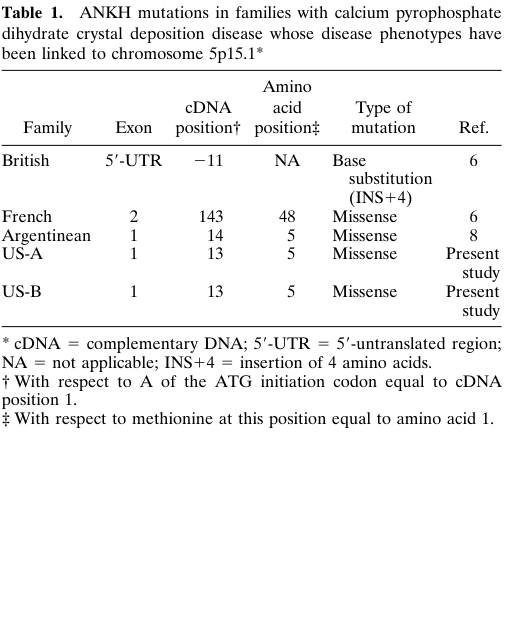

## Question

# Disease Characteristics Research Template

## Target Disease
- **Disease Name:** Chondrocalcinosis 2
- **MONDO ID:** MONDO:0007319 (if available)
- **Category:** Mendelian

## Research Objectives

Please provide a comprehensive research report on **Chondrocalcinosis 2** covering all of the
disease characteristics listed below. This report will be used to populate a disease knowledge
base entry. Be thorough and cite primary literature (PMID preferred) for all claims.

For each section, **suggested databases/resources** are listed. These are the first places
you should search for information on each topic.

---

### 1. Disease Information
> **Search first:** OMIM, Orphanet, ICD-10/ICD-11, MeSH, PubMed

- What is the disease? Provide a concise overview.
- What are the key identifiers? (OMIM, Orphanet, ICD-10/ICD-11, MeSH, Mondo)
- What are the common synonyms and alternative names?
- Is the information derived from individual patients (e.g., EHR) or aggregated disease-level resources?

### 2. Etiology

- **Disease Causal Factors**: What are the primary causes? (genetic, environmental, infectious, mechanistic)
- **Risk Factors**:
  > **Search first:** PubMed, Cochrane Library, UpToDate, clinical guidelines, ClinVar, ClinGen, GWAS Catalog, PheGenI, CTD, CDC, WHO, epidemiological databases
  - Genetic risk factors (causal variants, susceptibility loci, modifier genes)
  - Environmental risk factors (toxins, lifestyle, occupational exposures, age, sex, family history)
- **Protective Factors**:
  > **Search first:** PubMed, Cochrane Library, clinical trial databases, GWAS Catalog, gnomAD, WHO, CDC, nutrition databases
  - Genetic protective factors (protective variants, modifier alleles)
  - Environmental protective factors (diet, lifestyle, exposures that reduce risk)
- **Gene-Environment Interactions**: How do genetic and environmental factors interact to influence disease?
  > **Search first:** CTD, PubMed, PheGenI, GxE databases

### 3. Phenotypes
> **Search first:** HPO (Human Phenotype Ontology), OMIM, Orphanet, PubMed, clinicaltrials.gov, MedDRA, SNOMED CT, DECIPHER, LOINC

For each phenotype, provide:
- **Phenotype type**: symptoms, clinical signs, physical manifestations, behavioral changes, or laboratory abnormalities
  > For symptoms/signs: HPO, OMIM, Orphanet, PubMed
  > For behavioral changes: HPO, DSM, RDoC (Research Domain Criteria), PubMed
  > For laboratory abnormalities: LOINC, SNOMED CT, LabTests Online, PubMed
- **Phenotype characteristics**:
  > **Search first:** OMIM, Orphanet, HPO, PubMed
  - Age of symptom onset (neonatal, childhood, adult-onset, late-onset)
  - Symptom severity (mild, moderate, severe, variable)
  - Symptom progression (stable, progressive, episodic, fluctuating)
  - Frequency among affected individuals (percentage or qualitative)
- **Quality of life impact**: Effects on daily functioning and well-being (per-phenotype when possible)
  > **Search first:** EQ-5D database, SF-36, WHO QOL databases, PubMed
- Suggest HPO (Human Phenotype Ontology) terms for each phenotype

### 4. Genetic/Molecular Information

- **Causal Genes**: Gene mutations or chromosomal abnormalities responsible for disease (gene symbols, OMIM IDs)
  > **Search first:** OMIM, ClinVar, HGMD, Ensembl, NCBI Gene
- **Pathogenic Variants**:
  - Affected genes (gene symbols, HGNC IDs)
    > **Search first:** OMIM, NCBI Gene, Ensembl, HGNC, UniProt, GeneCards
  - Variant classification (pathogenic, likely pathogenic, VUS per ACMG/AMP guidelines)
    > **Search first:** ClinVar, ClinGen, ACMG/AMP guidelines, VarSome
  - Variant type/class (missense, frameshift, nonsense, splice-site, structural)
  - Allele frequency in population databases
    > **Search first:** gnomAD, 1000 Genomes, ExAC, TOPMed, dbSNP
  - Somatic vs germline origin
    > **Search first:** COSMIC (somatic), ClinVar, ICGC, TCGA
  - Functional consequences (loss of function, gain of function, dominant negative)
- **Modifier Genes**: Genes that modify disease severity or expression
- **Epigenetic Information**: DNA methylation, histone modifications, chromatin changes affecting disease
  > **Search first:** ENCODE, Roadmap Epigenomics, MethBase, DiseaseMeth
- **Chromosomal Abnormalities**: Large-scale genetic changes (aneuploidy, translocations, inversions)
  > **Search first:** DECIPHER, ClinVar, ECARUCA, UCSC Genome Browser

### 5. Environmental Information

- **Environmental Factors**: Non-genetic contributing factors (toxins, radiation, pollution, occupational exposure)
  > **Search first:** CTD (Comparative Toxicogenomics Database), TOXNET, PubMed, EPA databases
- **Lifestyle Factors**: Behavioral factors (smoking, diet, exercise, alcohol consumption)
  > **Search first:** CDC databases, WHO, PubMed, NHANES
- **Infectious Agents**: If applicable, pathogens causing or triggering disease (bacteria, viruses, fungi, parasites)
  > **Search first:** NCBI Taxonomy, ViPR, BV-BRC, MicrobeDB, GIDEON

### 6. Mechanism / Pathophysiology

**Present this section as an ordered causal chain first, then the detail below.**
Open with a numbered sequence of mechanistic steps running from the initiating
lesion (mutation, exposure, infection) to the clinical manifestation, one step per
line, each naming what it causes next. State the causal verb explicitly ("leads
to", "results in") and say where a step is inferred rather than demonstrated.
Where the mechanism branches, show the branch. The categories below are a
checklist of what to cover within those steps, not the organizing structure —
a step may draw on several of them, and a category may contribute to several
steps.

- **Molecular Pathways**: Specific signaling cascades or biochemical pathways involved (Wnt, MAPK, mTOR, PI3K-AKT, etc.)
  > **Search first:** KEGG, Reactome, WikiPathways, PathBank, BioCyc
- **Cellular Processes**: Cell-level mechanisms (apoptosis, autophagy, cell cycle dysregulation, inflammation, etc.)
  > **Search first:** Gene Ontology (GO), Reactome, KEGG, PubMed
- **Protein Dysfunction**: How protein structure or function is altered (misfolding, aggregation, loss of function, gain of function)
  > **Search first:** UniProt, PDB (Protein Data Bank), InterPro, Pfam, AlphaFold
- **Metabolic Changes**: Alterations in metabolic processes (energy metabolism, lipid metabolism, amino acid metabolism)
  > **Search first:** KEGG, BioCyc, HMDB (Human Metabolome Database), BRENDA
- **Immune System Involvement**: Role of immune response (autoimmunity, immunodeficiency, chronic inflammation)
  > **Search first:** ImmPort, Immunome Database, IEDB, Gene Ontology
- **Tissue Damage Mechanisms**: How tissues/ are injured (oxidative stress, ischemia, fibrosis, necrosis)
  > **Search first:** PubMed, Gene Ontology, Reactome
- **Biochemical Abnormalities**: Specific molecular defects (enzyme deficiencies, receptor dysfunction, ion channel defects)
  > **Search first:** BRENDA, UniProt, KEGG, OMIM, PubMed
- **Epigenetic Changes**: DNA methylation, histone modifications affecting gene expression in disease
  > **Search first:** ENCODE, Roadmap Epigenomics, MethBase, DiseaseMeth
- **Molecular Profiling** (if available):
  - Transcriptomics/gene expression changes
    > **Search first:** GEO (Gene Expression Omnibus), ArrayExpress, GTEx, Human Cell Atlas, SRA
  - Proteomics findings
    > **Search first:** PRIDE, ProteomeXchange, Human Protein Atlas, STRING, BioGRID
  - Metabolomics signatures
    > **Search first:** MetaboLights, Metabolomics Workbench, HMDB, METLIN
  - Lipidomics alterations
    > **Search first:** LIPID MAPS, SwissLipids, LipidHome, Metabolomics Workbench
  - Genomic structural features
    > **Search first:** UCSC Genome Browser, Ensembl, NCBI, dbVar, DGV
- **Advanced Technologies** (if applicable):
  - Single-cell analysis findings (cell-type specific mechanisms, cellular heterogeneity)
    > **Search first:** Human Cell Atlas, Single Cell Portal, GEO, CELLxGENE
  - Spatial transcriptomics findings
    > **Search first:** GEO, Spatial Research, Vizgen, 10x Genomics data
  - Multi-omics integration results
    > **Search first:** TCGA, ICGC, cBioPortal, LinkedOmics, PubMed
  - Functional genomics screens (CRISPR, RNAi)
    > **Search first:** DepMap, GenomeRNAi, PubMed, BioGRID ORCS

For each mechanism, describe:
- The causal chain from initial trigger to clinical manifestation
- Which mechanisms are upstream vs downstream
- What cell types and biological processes are involved
- Suggest GO terms for biological processes and CL terms for cell types

### 7. Anatomical Structures Affected

- **Organ Level**:
  - Primary organs directly affected
  - Secondary organ involvement (complications, secondary effects)
  - Body systems involved (cardiovascular, nervous, digestive, respiratory, endocrine, etc.)
  > **Search first:** Uberon, FMA (Foundational Model of Anatomy), OMIM, HPO, ICD-11, MeSH, SNOMED CT
- **Tissue and Cell Level**:
  - Specific tissue types affected (epithelial, connective, muscle, nervous)
  - Specific cell populations targeted (with Cell Ontology terms)
  > **Search first:** Uberon, Human Protein Atlas, Cell Ontology, Human Cell Atlas, CellMarker, PanglaoDB
- **Subcellular Level**:
  - Cellular compartments involved (mitochondria, nucleus, ER, lysosomes) (with GO Cellular Component terms)
  > **Search first:** Gene Ontology (Cellular Component), UniProt, Human Protein Atlas
- **Localization**:
  - Specific anatomical sites (with UBERON terms)
    > **Search first:** FMA, Uberon, NeuroNames (for brain), SNOMED CT
  - Lateralization (unilateral, bilateral, asymmetric)
    > **Search first:** HPO, clinical literature, imaging databases

### 8. Temporal Development

- **Onset**:
  - Typical age of onset (congenital, pediatric, adult, geriatric)
  - Onset pattern (acute, subacute, chronic, insidious)
  > **Search first:** OMIM, Orphanet, HPO, PubMed
- **Progression**:
  - Disease stages (early, intermediate, advanced, end-stage)
    > **Search first:** Cancer Staging Manual (AJCC), WHO classifications, PubMed
  - Progression rate (rapid, slow, variable)
  - Disease course pattern (episodic, relapsing-remitting, progressive, stable)
  - Disease duration (self-limited, chronic lifelong)
  > **Search first:** Disease registries, longitudinal cohort databases, natural history studies, PubMed, Orphanet, OMIM
- **Patterns**:
  - Remission patterns (spontaneous, treatment-induced)
    > **Search first:** Clinical trial databases, disease registries, PubMed
  - Critical periods (time windows of vulnerability or opportunity for intervention)
    > **Search first:** PubMed, developmental biology databases, clinical guidelines

### 9. Inheritance and Population

- **Epidemiology**:
  - Prevalence (cases per 100,000 at given time)
  - Incidence (new cases per 100,000 per year)
  > **Search first:** Orphanet, CDC, WHO, GBD (Global Burden of Disease), national registries, SEER, disease registries
- **For Genetic Etiology**:
  - Inheritance pattern (AD, AR, X-linked, mitochondrial, multifactorial, polygenic)
    > **Search first:** OMIM, Orphanet, ClinVar, GTR (Genetic Testing Registry)
  - Penetrance (complete, incomplete, age-dependent)
    > **Search first:** ClinVar, OMIM, PubMed, ClinGen
  - Expressivity (variable, consistent)
    > **Search first:** OMIM, ClinVar, PubMed
  - Genetic anticipation (increasing severity in successive generations)
    > **Search first:** OMIM, PubMed (especially for repeat expansion disorders)
  - Germline mosaicism
    > **Search first:** ClinVar, OMIM, genetic counseling literature, PubMed
  - Founder effects (population-specific mutations)
    > **Search first:** gnomAD, population genetics databases, PubMed
  - Consanguinity role
    > **Search first:** OMIM, population studies, genetic counseling resources
  - Carrier frequency
    > **Search first:** gnomAD, carrier screening databases, GeneReviews, GTR
- **Population Demographics**:
  - Affected populations (ethnic or demographic groups with higher prevalence)
    > **Search first:** gnomAD, 1000 Genomes, PAGE Study, PubMed, population registries
  - Geographic distribution (endemic areas, regional variation)
    > **Search first:** WHO, CDC, GBD, Orphanet, geographic epidemiology databases
  - Geographic distribution of specific variants
  - Sex ratio (male:female)
    > **Search first:** Disease registries, OMIM, PubMed, epidemiological databases
  - Age distribution of affected individuals
    > **Search first:** CDC, disease registries, SEER, Orphanet

### 10. Diagnostics

- **Clinical Tests**:
  - Laboratory tests (blood, urine, tissue chemistry, specific enzyme assays)
    > **Search first:** LOINC, LabTests Online, PubMed
  - Biomarkers (proteins, metabolites, genetic markers, circulating biomarkers)
    > **Search first:** FDA Biomarker List, BEST (Biomarkers, EndpointS, and other Tools), PubMed
  - Imaging studies (X-ray, CT, MRI, PET, ultrasound)
    > **Search first:** RadLex, DICOM, Radiopaedia, imaging databases
  - Functional tests (pulmonary function, cardiac stress tests)
    > **Search first:** LOINC, clinical guidelines, PubMed
  - Electrophysiology (EEG, EMG, ECG, nerve conduction studies)
    > **Search first:** LOINC, clinical neurophysiology databases, PubMed
  - Biopsy findings (histopathology, immunohistochemistry)
    > **Search first:** SNOMED CT, College of American Pathologists resources, PubMed
  - Pathology findings (microscopic examination)
    > **Search first:** SNOMED CT, Digital Pathology databases, PubMed
- **Genetic Testing**:
  > **Search first:** GTR (Genetic Testing Registry), GeneReviews, ClinGen
  - Overview of recommended genetic testing approach
  - Whole genome sequencing (WGS) utility
    > **Search first:** GTR, ClinVar, GEL (Genomics England), gnomAD
  - Whole exome sequencing (WES) utility
    > **Search first:** GTR, ClinVar, OMIM, GeneMatcher
  - Gene panels (which panels, which genes)
    > **Search first:** GTR, ClinVar, laboratory-specific databases
  - Single gene testing
    > **Search first:** GTR, ClinVar, OMIM, GeneReviews
  - Chromosomal microarray (CMA)
    > **Search first:** DECIPHER, ClinVar, dbVar, ECARUCA
  - Karyotyping
    > **Search first:** Chromosome Abnormality Database, ClinVar, cytogenetics resources
  - FISH
    > **Search first:** ClinVar, cytogenetics databases, PubMed
  - Mitochondrial DNA testing
    > **Search first:** MITOMAP, MSeqDR, ClinVar, GTR
  - Repeat expansion testing
    > **Search first:** GTR, ClinVar, repeat expansion databases, PubMed
- **Omics-Based Diagnostics** (if applicable):
  - RNA sequencing / transcriptomics
    > **Search first:** GEO, ArrayExpress, GTEx, RNA-seq databases
  - Proteomics
    > **Search first:** PRIDE, ProteomeXchange, FDA Biomarker database
  - Metabolomics
    > **Search first:** MetaboLights, Metabolomics Workbench, HMDB
  - Epigenomics
    > **Search first:** GEO, ENCODE, Roadmap Epigenomics, MethBase
  - Liquid biopsy
    > **Search first:** COSMIC, ClinVar, liquid biopsy databases, PubMed
- **Clinical Criteria**:
  - Standardized diagnostic criteria (DSM, ICD, society guidelines)
    > **Search first:** DSM-5, ICD-11, clinical society guidelines, UpToDate
  - Differential diagnosis (other conditions to rule out, with distinguishing features)
    > **Search first:** DynaMed, UpToDate, clinical decision support systems
- **Screening**:
  - Screening methods for asymptomatic individuals (newborn screening, carrier screening, cascade screening)
    > **Search first:** ACMG recommendations, CDC newborn screening, GTR

### 11. Outcome/Prognosis

- **Survival and Mortality**:
  - Survival rate (5-year, 10-year, overall)
    > **Search first:** SEER, cancer registries, disease-specific registries, PubMed
  - Life expectancy (with and without treatment if applicable)
    > **Search first:** Orphanet, disease registries, actuarial databases, PubMed
  - Mortality rate
    > **Search first:** CDC, WHO, GBD, national mortality databases
  - Disease-specific mortality (deaths directly attributable to disease)
    > **Search first:** Disease registries, CDC Wonder, GBD, PubMed
- **Morbidity and Function**:
  - Morbidity (disease-related disability and health impacts)
    > **Search first:** GBD, WHO, disability databases, PubMed
  - Disability outcomes (long-term functional impairments)
    > **Search first:** ICF (International Classification of Functioning), disability registries
  - Quality of life measures (EQ-5D, SF-36, PROMIS, disease-specific tools)
    > **Search first:** EQ-5D database, SF-36, PROMIS, PubMed
- **Disease Course**:
  - Complications (secondary problems: infections, organ failure, etc.)
    > **Search first:** ICD codes, disease registries, clinical databases, PubMed
  - Recovery potential (likelihood and extent of recovery, with vs without treatment)
    > **Search first:** Natural history studies, rehabilitation databases, PubMed
- **Prediction**:
  - Prognostic factors (age, disease severity, biomarkers, treatment response)
    > **Search first:** Prognostic models databases, clinical calculators, PubMed
  - Prognostic biomarkers (molecular markers predicting disease course)
    > **Search first:** FDA Biomarker database, PubMed, cancer prognostic databases

### 12. Treatment

- **Pharmacotherapy**:
  - Pharmacological treatments (drug names, drug classes, mechanisms of action)
    > **Search first:** DrugBank, RxNorm, ATC classification, DailyMed, FDA databases
  - Pharmacogenomics (how genetic variants affect drug metabolism, efficacy, toxicity)
    > **Search first:** PharmGKB, CPIC (Clinical Pharmacogenetics), FDA Table of PGx Biomarkers
- **Advanced Therapeutics**:
  - Gene therapy (viral vectors, CRISPR, gene replacement, gene editing)
    > **Search first:** ClinicalTrials.gov, FDA gene therapy database, ASGCT resources
  - Cell therapy (stem cell transplant, CAR-T, cellular therapeutics)
    > **Search first:** ClinicalTrials.gov, FDA cell therapy database, FACT standards
  - RNA-based therapies (ASOs, siRNA, mRNA therapies)
    > **Search first:** ClinicalTrials.gov, FDA approvals, PubMed
  - Targeted therapies (treatments directed at specific molecular targets)
    > **Search first:** My Cancer Genome, OncoKB, ClinicalTrials.gov, FDA approvals
  - Immunotherapies (checkpoint inhibitors, monoclonal antibodies)
    > **Search first:** Cancer Immunotherapy Database, FDA approvals, ClinicalTrials.gov
- **Surgical and Interventional**:
  - Surgical interventions (types of surgery, timing, outcomes)
    > **Search first:** CPT codes, surgical registries, clinical guidelines, PubMed
- **Supportive and Rehabilitative**:
  - Supportive care (symptom management, pain control, nutrition)
    > **Search first:** Clinical guidelines, Cochrane Library, PubMed
  - Rehabilitation (physical therapy, occupational therapy, speech therapy)
    > **Search first:** Rehabilitation medicine databases, clinical guidelines, PubMed
- **Experimental**:
  - Experimental treatments in clinical trials (with NCT identifiers if available)
    > **Search first:** ClinicalTrials.gov, EU Clinical Trials Register, WHO ICTRP
- **Treatment Outcomes**:
  - Treatment response rates
    > **Search first:** Clinical trial databases, FDA reviews, systematic reviews, PubMed
  - Side effects and adverse events
    > **Search first:** FDA Adverse Event Reporting System (FAERS), MedWatch, PubMed
- **Treatment Strategy**:
  - Treatment algorithms (clinical pathways, decision trees)
    > **Search first:** Clinical practice guidelines, NCCN Guidelines, UpToDate
  - Combination therapies
    > **Search first:** ClinicalTrials.gov, treatment guidelines, PubMed
  - Personalized medicine approaches (genotype-guided treatment)
    > **Search first:** My Cancer Genome, CIViC, PharmGKB, precision medicine databases

For each treatment, suggest NCIT (NCI Thesaurus) clinical-intervention terms where applicable.

### 13. Prevention

- **Prevention Levels**:
  - Primary prevention (preventing disease occurrence: vaccination, risk factor modification)
    > **Search first:** CDC, WHO, USPSTF recommendations, Cochrane Library
  - Secondary prevention (early detection and treatment: screening programs, early intervention)
    > **Search first:** USPSTF, CDC screening guidelines, WHO
  - Tertiary prevention (preventing complications in those with disease)
    > **Search first:** Clinical guidelines, disease management protocols, PubMed
- **Immunization**: Vaccine strategies (if applicable)
  > **Search first:** CDC vaccine schedules, WHO immunization, FDA vaccine database
- **Screening and Early Detection**:
  - Screening programs (population-based: newborn screening, cancer screening)
    > **Search first:** CDC screening programs, USPSTF, cancer screening databases
  - Genetic screening (carrier screening, preimplantation genetic diagnosis, prenatal testing)
    > **Search first:** ACMG recommendations, ACOG guidelines, GTR
  - Risk stratification (identifying high-risk individuals for targeted prevention)
    > **Search first:** Risk prediction models, clinical calculators, PubMed
- **Behavioral Interventions**: Lifestyle modifications to reduce risk
  > **Search first:** CDC, WHO, behavioral intervention databases, Cochrane Library
- **Counseling**: Genetic counseling (risk assessment, family planning guidance)
  > **Search first:** NSGC resources, ACMG guidelines, GeneReviews
- **Public Health**:
  - Public health interventions (sanitation, vector control, health education)
    > **Search first:** CDC, WHO, public health databases, PubMed
  - Environmental interventions (reducing environmental risk factors)
    > **Search first:** EPA databases, WHO environmental health, PubMed
- **Prophylaxis**: Preventive medications or procedures
  > **Search first:** Clinical guidelines, FDA approvals, PubMed

### 14. Other Species / Natural Disease

- **Taxonomy**: Species affected (with NCBI Taxon identifiers)
  > **Search first:** NCBI Taxonomy
- **Breed**: Specific breeds affected (with VBO identifiers if applicable)
  > **Search first:** VBO (Vertebrate Breed Ontology)
- **Gene**: Orthologous genes in other species (with NCBI Gene IDs)
  > **Search first:** NCBI Gene
- **Natural Disease**:
  - Naturally occurring disease in other species (companion animals, wildlife)
    > **Search first:** OMIA (Online Mendelian Inheritance in Animals), VetCompass, PubMed
  - Veterinary relevance and importance in animal health
    > **Search first:** OMIA, veterinary databases, PubMed
- **Comparative Biology**:
  - Comparative pathology (similarities and differences across species)
    > **Search first:** OMIA, comparative pathology databases, PubMed
  - Evolutionary conservation of disease mechanisms
    > **Search first:** HomoloGene, OrthoMCL, Alliance of Genome Resources
- **Transmission** (if applicable):
  - Zoonotic potential
    > **Search first:** CDC zoonotic diseases, WHO zoonoses, GIDEON
  - Cross-species susceptibility
    > **Search first:** NCBI Taxonomy, veterinary databases, PubMed

### 15. Model Organisms

- **Model Types**:
  - Model organism type (mammalian, invertebrate, cellular, in vitro)
    > **Search first:** Alliance of Genome Resources, model organism databases
  - Specific model systems (mouse, rat, zebrafish, Drosophila, C. elegans, yeast, cell lines, organoids, iPSCs)
    > **Search first:** MGI, RGD, ZFIN, FlyBase, WormBase, SGD, ATCC, Cellosaurus
  - Induced models (drug treatment, surgical intervention, environmental manipulation)
    > **Search first:** MGI, model organism databases, PubMed
- **Genetic Models**:
  - Types available (knockout, knock-in, transgenic, conditional, humanized)
    > **Search first:** MGI, IMPC, KOMP, EuMMCR, IMSR
- **Model Characteristics**:
  - Phenotype recapitulation (how well model reproduces human disease features)
    > **Search first:** Model organism databases, comparative studies, PubMed
  - Model limitations (aspects of human disease not captured)
    > **Search first:** Model organism databases, PubMed, review articles
- **Applications**:
  - Research applications (what aspects of disease can be studied)
    > **Search first:** Model organism databases, PubMed
- **Resources**:
  - Model databases
    > **Search first:** MGI, RGD, ZFIN, FlyBase, WormBase, IMSR, EMMA, MMRRC

---

## Citation Requirements

- Cite primary literature (PMID preferred) for all mechanistic and clinical claims
- Prioritize recent reviews and landmark papers
- Include direct quotes from abstracts where possible to support key statements
- Distinguish evidence source types: human clinical, model organism, in vitro, computational

## Output Format

Structure your response as a comprehensive narrative organized by the sections above.
For each section, provide:
- Factual content with specific details (numbers, percentages, gene names, variant nomenclature)
- Ontology term suggestions (HPO, GO, CL, UBERON, CHEBI, NCIT, MONDO) where applicable
- Evidence citations with PMIDs
- Direct quotes from abstracts to support key claims
- Clear indication when information is not available or not applicable for this disease

This report will be used to populate a disease knowledge base entry with:
- Pathophysiology descriptions with causal chains
- Gene/protein annotations (HGNC, GO terms)
- Phenotype associations (HP terms) with frequencies
- Cell type involvement (CL terms)
- Anatomical locations (UBERON terms)
- Chemical entities (CHEBI terms)
- Treatment annotations (NCIT terms)
- Evidence items with PMIDs and exact abstract quotes
- Epidemiology, prognosis, diagnostic, and prevention information
- Animal model descriptions with phenotype recapitulation details

## Output

Question: You are an expert researcher providing comprehensive, well-cited information.

Provide detailed information focusing on:
1. Key concepts and definitions with current understanding
2. Recent developments and latest research (prioritize 2023-2024 sources)
3. Current applications and real-world implementations
4. Expert opinions and analysis from authoritative sources
5. Relevant statistics and data from recent studies

Format as a comprehensive research report with proper citations. Include URLs and publication dates where available.
Always prioritize recent, authoritative sources and provide specific citations for all major claims.

# Disease Characteristics Research Template

## Target Disease
- **Disease Name:** Chondrocalcinosis 2
- **MONDO ID:** MONDO:0007319 (if available)
- **Category:** Mendelian

## Research Objectives

Please provide a comprehensive research report on **Chondrocalcinosis 2** covering all of the
disease characteristics listed below. This report will be used to populate a disease knowledge
base entry. Be thorough and cite primary literature (PMID preferred) for all claims.

For each section, **suggested databases/resources** are listed. These are the first places
you should search for information on each topic.

---

### 1. Disease Information
> **Search first:** OMIM, Orphanet, ICD-10/ICD-11, MeSH, PubMed

- What is the disease? Provide a concise overview.
- What are the key identifiers? (OMIM, Orphanet, ICD-10/ICD-11, MeSH, Mondo)
- What are the common synonyms and alternative names?
- Is the information derived from individual patients (e.g., EHR) or aggregated disease-level resources?

### 2. Etiology

- **Disease Causal Factors**: What are the primary causes? (genetic, environmental, infectious, mechanistic)
- **Risk Factors**:
  > **Search first:** PubMed, Cochrane Library, UpToDate, clinical guidelines, ClinVar, ClinGen, GWAS Catalog, PheGenI, CTD, CDC, WHO, epidemiological databases
  - Genetic risk factors (causal variants, susceptibility loci, modifier genes)
  - Environmental risk factors (toxins, lifestyle, occupational exposures, age, sex, family history)
- **Protective Factors**:
  > **Search first:** PubMed, Cochrane Library, clinical trial databases, GWAS Catalog, gnomAD, WHO, CDC, nutrition databases
  - Genetic protective factors (protective variants, modifier alleles)
  - Environmental protective factors (diet, lifestyle, exposures that reduce risk)
- **Gene-Environment Interactions**: How do genetic and environmental factors interact to influence disease?
  > **Search first:** CTD, PubMed, PheGenI, GxE databases

### 3. Phenotypes
> **Search first:** HPO (Human Phenotype Ontology), OMIM, Orphanet, PubMed, clinicaltrials.gov, MedDRA, SNOMED CT, DECIPHER, LOINC

For each phenotype, provide:
- **Phenotype type**: symptoms, clinical signs, physical manifestations, behavioral changes, or laboratory abnormalities
  > For symptoms/signs: HPO, OMIM, Orphanet, PubMed
  > For behavioral changes: HPO, DSM, RDoC (Research Domain Criteria), PubMed
  > For laboratory abnormalities: LOINC, SNOMED CT, LabTests Online, PubMed
- **Phenotype characteristics**:
  > **Search first:** OMIM, Orphanet, HPO, PubMed
  - Age of symptom onset (neonatal, childhood, adult-onset, late-onset)
  - Symptom severity (mild, moderate, severe, variable)
  - Symptom progression (stable, progressive, episodic, fluctuating)
  - Frequency among affected individuals (percentage or qualitative)
- **Quality of life impact**: Effects on daily functioning and well-being (per-phenotype when possible)
  > **Search first:** EQ-5D database, SF-36, WHO QOL databases, PubMed
- Suggest HPO (Human Phenotype Ontology) terms for each phenotype

### 4. Genetic/Molecular Information

- **Causal Genes**: Gene mutations or chromosomal abnormalities responsible for disease (gene symbols, OMIM IDs)
  > **Search first:** OMIM, ClinVar, HGMD, Ensembl, NCBI Gene
- **Pathogenic Variants**:
  - Affected genes (gene symbols, HGNC IDs)
    > **Search first:** OMIM, NCBI Gene, Ensembl, HGNC, UniProt, GeneCards
  - Variant classification (pathogenic, likely pathogenic, VUS per ACMG/AMP guidelines)
    > **Search first:** ClinVar, ClinGen, ACMG/AMP guidelines, VarSome
  - Variant type/class (missense, frameshift, nonsense, splice-site, structural)
  - Allele frequency in population databases
    > **Search first:** gnomAD, 1000 Genomes, ExAC, TOPMed, dbSNP
  - Somatic vs germline origin
    > **Search first:** COSMIC (somatic), ClinVar, ICGC, TCGA
  - Functional consequences (loss of function, gain of function, dominant negative)
- **Modifier Genes**: Genes that modify disease severity or expression
- **Epigenetic Information**: DNA methylation, histone modifications, chromatin changes affecting disease
  > **Search first:** ENCODE, Roadmap Epigenomics, MethBase, DiseaseMeth
- **Chromosomal Abnormalities**: Large-scale genetic changes (aneuploidy, translocations, inversions)
  > **Search first:** DECIPHER, ClinVar, ECARUCA, UCSC Genome Browser

### 5. Environmental Information

- **Environmental Factors**: Non-genetic contributing factors (toxins, radiation, pollution, occupational exposure)
  > **Search first:** CTD (Comparative Toxicogenomics Database), TOXNET, PubMed, EPA databases
- **Lifestyle Factors**: Behavioral factors (smoking, diet, exercise, alcohol consumption)
  > **Search first:** CDC databases, WHO, PubMed, NHANES
- **Infectious Agents**: If applicable, pathogens causing or triggering disease (bacteria, viruses, fungi, parasites)
  > **Search first:** NCBI Taxonomy, ViPR, BV-BRC, MicrobeDB, GIDEON

### 6. Mechanism / Pathophysiology

**Present this section as an ordered causal chain first, then the detail below.**
Open with a numbered sequence of mechanistic steps running from the initiating
lesion (mutation, exposure, infection) to the clinical manifestation, one step per
line, each naming what it causes next. State the causal verb explicitly ("leads
to", "results in") and say where a step is inferred rather than demonstrated.
Where the mechanism branches, show the branch. The categories below are a
checklist of what to cover within those steps, not the organizing structure —
a step may draw on several of them, and a category may contribute to several
steps.

- **Molecular Pathways**: Specific signaling cascades or biochemical pathways involved (Wnt, MAPK, mTOR, PI3K-AKT, etc.)
  > **Search first:** KEGG, Reactome, WikiPathways, PathBank, BioCyc
- **Cellular Processes**: Cell-level mechanisms (apoptosis, autophagy, cell cycle dysregulation, inflammation, etc.)
  > **Search first:** Gene Ontology (GO), Reactome, KEGG, PubMed
- **Protein Dysfunction**: How protein structure or function is altered (misfolding, aggregation, loss of function, gain of function)
  > **Search first:** UniProt, PDB (Protein Data Bank), InterPro, Pfam, AlphaFold
- **Metabolic Changes**: Alterations in metabolic processes (energy metabolism, lipid metabolism, amino acid metabolism)
  > **Search first:** KEGG, BioCyc, HMDB (Human Metabolome Database), BRENDA
- **Immune System Involvement**: Role of immune response (autoimmunity, immunodeficiency, chronic inflammation)
  > **Search first:** ImmPort, Immunome Database, IEDB, Gene Ontology
- **Tissue Damage Mechanisms**: How tissues/ are injured (oxidative stress, ischemia, fibrosis, necrosis)
  > **Search first:** PubMed, Gene Ontology, Reactome
- **Biochemical Abnormalities**: Specific molecular defects (enzyme deficiencies, receptor dysfunction, ion channel defects)
  > **Search first:** BRENDA, UniProt, KEGG, OMIM, PubMed
- **Epigenetic Changes**: DNA methylation, histone modifications affecting gene expression in disease
  > **Search first:** ENCODE, Roadmap Epigenomics, MethBase, DiseaseMeth
- **Molecular Profiling** (if available):
  - Transcriptomics/gene expression changes
    > **Search first:** GEO (Gene Expression Omnibus), ArrayExpress, GTEx, Human Cell Atlas, SRA
  - Proteomics findings
    > **Search first:** PRIDE, ProteomeXchange, Human Protein Atlas, STRING, BioGRID
  - Metabolomics signatures
    > **Search first:** MetaboLights, Metabolomics Workbench, HMDB, METLIN
  - Lipidomics alterations
    > **Search first:** LIPID MAPS, SwissLipids, LipidHome, Metabolomics Workbench
  - Genomic structural features
    > **Search first:** UCSC Genome Browser, Ensembl, NCBI, dbVar, DGV
- **Advanced Technologies** (if applicable):
  - Single-cell analysis findings (cell-type specific mechanisms, cellular heterogeneity)
    > **Search first:** Human Cell Atlas, Single Cell Portal, GEO, CELLxGENE
  - Spatial transcriptomics findings
    > **Search first:** GEO, Spatial Research, Vizgen, 10x Genomics data
  - Multi-omics integration results
    > **Search first:** TCGA, ICGC, cBioPortal, LinkedOmics, PubMed
  - Functional genomics screens (CRISPR, RNAi)
    > **Search first:** DepMap, GenomeRNAi, PubMed, BioGRID ORCS

For each mechanism, describe:
- The causal chain from initial trigger to clinical manifestation
- Which mechanisms are upstream vs downstream
- What cell types and biological processes are involved
- Suggest GO terms for biological processes and CL terms for cell types

### 7. Anatomical Structures Affected

- **Organ Level**:
  - Primary organs directly affected
  - Secondary organ involvement (complications, secondary effects)
  - Body systems involved (cardiovascular, nervous, digestive, respiratory, endocrine, etc.)
  > **Search first:** Uberon, FMA (Foundational Model of Anatomy), OMIM, HPO, ICD-11, MeSH, SNOMED CT
- **Tissue and Cell Level**:
  - Specific tissue types affected (epithelial, connective, muscle, nervous)
  - Specific cell populations targeted (with Cell Ontology terms)
  > **Search first:** Uberon, Human Protein Atlas, Cell Ontology, Human Cell Atlas, CellMarker, PanglaoDB
- **Subcellular Level**:
  - Cellular compartments involved (mitochondria, nucleus, ER, lysosomes) (with GO Cellular Component terms)
  > **Search first:** Gene Ontology (Cellular Component), UniProt, Human Protein Atlas
- **Localization**:
  - Specific anatomical sites (with UBERON terms)
    > **Search first:** FMA, Uberon, NeuroNames (for brain), SNOMED CT
  - Lateralization (unilateral, bilateral, asymmetric)
    > **Search first:** HPO, clinical literature, imaging databases

### 8. Temporal Development

- **Onset**:
  - Typical age of onset (congenital, pediatric, adult, geriatric)
  - Onset pattern (acute, subacute, chronic, insidious)
  > **Search first:** OMIM, Orphanet, HPO, PubMed
- **Progression**:
  - Disease stages (early, intermediate, advanced, end-stage)
    > **Search first:** Cancer Staging Manual (AJCC), WHO classifications, PubMed
  - Progression rate (rapid, slow, variable)
  - Disease course pattern (episodic, relapsing-remitting, progressive, stable)
  - Disease duration (self-limited, chronic lifelong)
  > **Search first:** Disease registries, longitudinal cohort databases, natural history studies, PubMed, Orphanet, OMIM
- **Patterns**:
  - Remission patterns (spontaneous, treatment-induced)
    > **Search first:** Clinical trial databases, disease registries, PubMed
  - Critical periods (time windows of vulnerability or opportunity for intervention)
    > **Search first:** PubMed, developmental biology databases, clinical guidelines

### 9. Inheritance and Population

- **Epidemiology**:
  - Prevalence (cases per 100,000 at given time)
  - Incidence (new cases per 100,000 per year)
  > **Search first:** Orphanet, CDC, WHO, GBD (Global Burden of Disease), national registries, SEER, disease registries
- **For Genetic Etiology**:
  - Inheritance pattern (AD, AR, X-linked, mitochondrial, multifactorial, polygenic)
    > **Search first:** OMIM, Orphanet, ClinVar, GTR (Genetic Testing Registry)
  - Penetrance (complete, incomplete, age-dependent)
    > **Search first:** ClinVar, OMIM, PubMed, ClinGen
  - Expressivity (variable, consistent)
    > **Search first:** OMIM, ClinVar, PubMed
  - Genetic anticipation (increasing severity in successive generations)
    > **Search first:** OMIM, PubMed (especially for repeat expansion disorders)
  - Germline mosaicism
    > **Search first:** ClinVar, OMIM, genetic counseling literature, PubMed
  - Founder effects (population-specific mutations)
    > **Search first:** gnomAD, population genetics databases, PubMed
  - Consanguinity role
    > **Search first:** OMIM, population studies, genetic counseling resources
  - Carrier frequency
    > **Search first:** gnomAD, carrier screening databases, GeneReviews, GTR
- **Population Demographics**:
  - Affected populations (ethnic or demographic groups with higher prevalence)
    > **Search first:** gnomAD, 1000 Genomes, PAGE Study, PubMed, population registries
  - Geographic distribution (endemic areas, regional variation)
    > **Search first:** WHO, CDC, GBD, Orphanet, geographic epidemiology databases
  - Geographic distribution of specific variants
  - Sex ratio (male:female)
    > **Search first:** Disease registries, OMIM, PubMed, epidemiological databases
  - Age distribution of affected individuals
    > **Search first:** CDC, disease registries, SEER, Orphanet

### 10. Diagnostics

- **Clinical Tests**:
  - Laboratory tests (blood, urine, tissue chemistry, specific enzyme assays)
    > **Search first:** LOINC, LabTests Online, PubMed
  - Biomarkers (proteins, metabolites, genetic markers, circulating biomarkers)
    > **Search first:** FDA Biomarker List, BEST (Biomarkers, EndpointS, and other Tools), PubMed
  - Imaging studies (X-ray, CT, MRI, PET, ultrasound)
    > **Search first:** RadLex, DICOM, Radiopaedia, imaging databases
  - Functional tests (pulmonary function, cardiac stress tests)
    > **Search first:** LOINC, clinical guidelines, PubMed
  - Electrophysiology (EEG, EMG, ECG, nerve conduction studies)
    > **Search first:** LOINC, clinical neurophysiology databases, PubMed
  - Biopsy findings (histopathology, immunohistochemistry)
    > **Search first:** SNOMED CT, College of American Pathologists resources, PubMed
  - Pathology findings (microscopic examination)
    > **Search first:** SNOMED CT, Digital Pathology databases, PubMed
- **Genetic Testing**:
  > **Search first:** GTR (Genetic Testing Registry), GeneReviews, ClinGen
  - Overview of recommended genetic testing approach
  - Whole genome sequencing (WGS) utility
    > **Search first:** GTR, ClinVar, GEL (Genomics England), gnomAD
  - Whole exome sequencing (WES) utility
    > **Search first:** GTR, ClinVar, OMIM, GeneMatcher
  - Gene panels (which panels, which genes)
    > **Search first:** GTR, ClinVar, laboratory-specific databases
  - Single gene testing
    > **Search first:** GTR, ClinVar, OMIM, GeneReviews
  - Chromosomal microarray (CMA)
    > **Search first:** DECIPHER, ClinVar, dbVar, ECARUCA
  - Karyotyping
    > **Search first:** Chromosome Abnormality Database, ClinVar, cytogenetics resources
  - FISH
    > **Search first:** ClinVar, cytogenetics databases, PubMed
  - Mitochondrial DNA testing
    > **Search first:** MITOMAP, MSeqDR, ClinVar, GTR
  - Repeat expansion testing
    > **Search first:** GTR, ClinVar, repeat expansion databases, PubMed
- **Omics-Based Diagnostics** (if applicable):
  - RNA sequencing / transcriptomics
    > **Search first:** GEO, ArrayExpress, GTEx, RNA-seq databases
  - Proteomics
    > **Search first:** PRIDE, ProteomeXchange, FDA Biomarker database
  - Metabolomics
    > **Search first:** MetaboLights, Metabolomics Workbench, HMDB
  - Epigenomics
    > **Search first:** GEO, ENCODE, Roadmap Epigenomics, MethBase
  - Liquid biopsy
    > **Search first:** COSMIC, ClinVar, liquid biopsy databases, PubMed
- **Clinical Criteria**:
  - Standardized diagnostic criteria (DSM, ICD, society guidelines)
    > **Search first:** DSM-5, ICD-11, clinical society guidelines, UpToDate
  - Differential diagnosis (other conditions to rule out, with distinguishing features)
    > **Search first:** DynaMed, UpToDate, clinical decision support systems
- **Screening**:
  - Screening methods for asymptomatic individuals (newborn screening, carrier screening, cascade screening)
    > **Search first:** ACMG recommendations, CDC newborn screening, GTR

### 11. Outcome/Prognosis

- **Survival and Mortality**:
  - Survival rate (5-year, 10-year, overall)
    > **Search first:** SEER, cancer registries, disease-specific registries, PubMed
  - Life expectancy (with and without treatment if applicable)
    > **Search first:** Orphanet, disease registries, actuarial databases, PubMed
  - Mortality rate
    > **Search first:** CDC, WHO, GBD, national mortality databases
  - Disease-specific mortality (deaths directly attributable to disease)
    > **Search first:** Disease registries, CDC Wonder, GBD, PubMed
- **Morbidity and Function**:
  - Morbidity (disease-related disability and health impacts)
    > **Search first:** GBD, WHO, disability databases, PubMed
  - Disability outcomes (long-term functional impairments)
    > **Search first:** ICF (International Classification of Functioning), disability registries
  - Quality of life measures (EQ-5D, SF-36, PROMIS, disease-specific tools)
    > **Search first:** EQ-5D database, SF-36, PROMIS, PubMed
- **Disease Course**:
  - Complications (secondary problems: infections, organ failure, etc.)
    > **Search first:** ICD codes, disease registries, clinical databases, PubMed
  - Recovery potential (likelihood and extent of recovery, with vs without treatment)
    > **Search first:** Natural history studies, rehabilitation databases, PubMed
- **Prediction**:
  - Prognostic factors (age, disease severity, biomarkers, treatment response)
    > **Search first:** Prognostic models databases, clinical calculators, PubMed
  - Prognostic biomarkers (molecular markers predicting disease course)
    > **Search first:** FDA Biomarker database, PubMed, cancer prognostic databases

### 12. Treatment

- **Pharmacotherapy**:
  - Pharmacological treatments (drug names, drug classes, mechanisms of action)
    > **Search first:** DrugBank, RxNorm, ATC classification, DailyMed, FDA databases
  - Pharmacogenomics (how genetic variants affect drug metabolism, efficacy, toxicity)
    > **Search first:** PharmGKB, CPIC (Clinical Pharmacogenetics), FDA Table of PGx Biomarkers
- **Advanced Therapeutics**:
  - Gene therapy (viral vectors, CRISPR, gene replacement, gene editing)
    > **Search first:** ClinicalTrials.gov, FDA gene therapy database, ASGCT resources
  - Cell therapy (stem cell transplant, CAR-T, cellular therapeutics)
    > **Search first:** ClinicalTrials.gov, FDA cell therapy database, FACT standards
  - RNA-based therapies (ASOs, siRNA, mRNA therapies)
    > **Search first:** ClinicalTrials.gov, FDA approvals, PubMed
  - Targeted therapies (treatments directed at specific molecular targets)
    > **Search first:** My Cancer Genome, OncoKB, ClinicalTrials.gov, FDA approvals
  - Immunotherapies (checkpoint inhibitors, monoclonal antibodies)
    > **Search first:** Cancer Immunotherapy Database, FDA approvals, ClinicalTrials.gov
- **Surgical and Interventional**:
  - Surgical interventions (types of surgery, timing, outcomes)
    > **Search first:** CPT codes, surgical registries, clinical guidelines, PubMed
- **Supportive and Rehabilitative**:
  - Supportive care (symptom management, pain control, nutrition)
    > **Search first:** Clinical guidelines, Cochrane Library, PubMed
  - Rehabilitation (physical therapy, occupational therapy, speech therapy)
    > **Search first:** Rehabilitation medicine databases, clinical guidelines, PubMed
- **Experimental**:
  - Experimental treatments in clinical trials (with NCT identifiers if available)
    > **Search first:** ClinicalTrials.gov, EU Clinical Trials Register, WHO ICTRP
- **Treatment Outcomes**:
  - Treatment response rates
    > **Search first:** Clinical trial databases, FDA reviews, systematic reviews, PubMed
  - Side effects and adverse events
    > **Search first:** FDA Adverse Event Reporting System (FAERS), MedWatch, PubMed
- **Treatment Strategy**:
  - Treatment algorithms (clinical pathways, decision trees)
    > **Search first:** Clinical practice guidelines, NCCN Guidelines, UpToDate
  - Combination therapies
    > **Search first:** ClinicalTrials.gov, treatment guidelines, PubMed
  - Personalized medicine approaches (genotype-guided treatment)
    > **Search first:** My Cancer Genome, CIViC, PharmGKB, precision medicine databases

For each treatment, suggest NCIT (NCI Thesaurus) clinical-intervention terms where applicable.

### 13. Prevention

- **Prevention Levels**:
  - Primary prevention (preventing disease occurrence: vaccination, risk factor modification)
    > **Search first:** CDC, WHO, USPSTF recommendations, Cochrane Library
  - Secondary prevention (early detection and treatment: screening programs, early intervention)
    > **Search first:** USPSTF, CDC screening guidelines, WHO
  - Tertiary prevention (preventing complications in those with disease)
    > **Search first:** Clinical guidelines, disease management protocols, PubMed
- **Immunization**: Vaccine strategies (if applicable)
  > **Search first:** CDC vaccine schedules, WHO immunization, FDA vaccine database
- **Screening and Early Detection**:
  - Screening programs (population-based: newborn screening, cancer screening)
    > **Search first:** CDC screening programs, USPSTF, cancer screening databases
  - Genetic screening (carrier screening, preimplantation genetic diagnosis, prenatal testing)
    > **Search first:** ACMG recommendations, ACOG guidelines, GTR
  - Risk stratification (identifying high-risk individuals for targeted prevention)
    > **Search first:** Risk prediction models, clinical calculators, PubMed
- **Behavioral Interventions**: Lifestyle modifications to reduce risk
  > **Search first:** CDC, WHO, behavioral intervention databases, Cochrane Library
- **Counseling**: Genetic counseling (risk assessment, family planning guidance)
  > **Search first:** NSGC resources, ACMG guidelines, GeneReviews
- **Public Health**:
  - Public health interventions (sanitation, vector control, health education)
    > **Search first:** CDC, WHO, public health databases, PubMed
  - Environmental interventions (reducing environmental risk factors)
    > **Search first:** EPA databases, WHO environmental health, PubMed
- **Prophylaxis**: Preventive medications or procedures
  > **Search first:** Clinical guidelines, FDA approvals, PubMed

### 14. Other Species / Natural Disease

- **Taxonomy**: Species affected (with NCBI Taxon identifiers)
  > **Search first:** NCBI Taxonomy
- **Breed**: Specific breeds affected (with VBO identifiers if applicable)
  > **Search first:** VBO (Vertebrate Breed Ontology)
- **Gene**: Orthologous genes in other species (with NCBI Gene IDs)
  > **Search first:** NCBI Gene
- **Natural Disease**:
  - Naturally occurring disease in other species (companion animals, wildlife)
    > **Search first:** OMIA (Online Mendelian Inheritance in Animals), VetCompass, PubMed
  - Veterinary relevance and importance in animal health
    > **Search first:** OMIA, veterinary databases, PubMed
- **Comparative Biology**:
  - Comparative pathology (similarities and differences across species)
    > **Search first:** OMIA, comparative pathology databases, PubMed
  - Evolutionary conservation of disease mechanisms
    > **Search first:** HomoloGene, OrthoMCL, Alliance of Genome Resources
- **Transmission** (if applicable):
  - Zoonotic potential
    > **Search first:** CDC zoonotic diseases, WHO zoonoses, GIDEON
  - Cross-species susceptibility
    > **Search first:** NCBI Taxonomy, veterinary databases, PubMed

### 15. Model Organisms

- **Model Types**:
  - Model organism type (mammalian, invertebrate, cellular, in vitro)
    > **Search first:** Alliance of Genome Resources, model organism databases
  - Specific model systems (mouse, rat, zebrafish, Drosophila, C. elegans, yeast, cell lines, organoids, iPSCs)
    > **Search first:** MGI, RGD, ZFIN, FlyBase, WormBase, SGD, ATCC, Cellosaurus
  - Induced models (drug treatment, surgical intervention, environmental manipulation)
    > **Search first:** MGI, model organism databases, PubMed
- **Genetic Models**:
  - Types available (knockout, knock-in, transgenic, conditional, humanized)
    > **Search first:** MGI, IMPC, KOMP, EuMMCR, IMSR
- **Model Characteristics**:
  - Phenotype recapitulation (how well model reproduces human disease features)
    > **Search first:** Model organism databases, comparative studies, PubMed
  - Model limitations (aspects of human disease not captured)
    > **Search first:** Model organism databases, PubMed, review articles
- **Applications**:
  - Research applications (what aspects of disease can be studied)
    > **Search first:** Model organism databases, PubMed
- **Resources**:
  - Model databases
    > **Search first:** MGI, RGD, ZFIN, FlyBase, WormBase, IMSR, EMMA, MMRRC

---

## Citation Requirements

- Cite primary literature (PMID preferred) for all mechanistic and clinical claims
- Prioritize recent reviews and landmark papers
- Include direct quotes from abstracts where possible to support key statements
- Distinguish evidence source types: human clinical, model organism, in vitro, computational

## Output Format

Structure your response as a comprehensive narrative organized by the sections above.
For each section, provide:
- Factual content with specific details (numbers, percentages, gene names, variant nomenclature)
- Ontology term suggestions (HPO, GO, CL, UBERON, CHEBI, NCIT, MONDO) where applicable
- Evidence citations with PMIDs
- Direct quotes from abstracts to support key claims
- Clear indication when information is not available or not applicable for this disease

This report will be used to populate a disease knowledge base entry with:
- Pathophysiology descriptions with causal chains
- Gene/protein annotations (HGNC, GO terms)
- Phenotype associations (HP terms) with frequencies
- Cell type involvement (CL terms)
- Anatomical locations (UBERON terms)
- Chemical entities (CHEBI terms)
- Treatment annotations (NCIT terms)
- Evidence items with PMIDs and exact abstract quotes
- Epidemiology, prognosis, diagnostic, and prevention information
- Animal model descriptions with phenotype recapitulation details

# Chondrocalcinosis 2 (CCAL2): disease-characteristics research report

**Scope and evidence convention.** Chondrocalcinosis 2 is the **inherited, ANKH-associated** form of calcium pyrophosphate deposition (CPPD) linked to the CCAL2 locus. It must not be equated with all radiographic chondrocalcinosis or all CPPD: most recent cohorts, treatment studies and experimental crystal-injection models are **not selected by ANKH genotype**. Accordingly, findings below are labeled *familial human*, *general human CPPD*, *experimental*, or *inference* where that distinction matters. Bibliographic links are supplied where available; a PubMed identifier is not assigned when it could not be verified from retrieved sources. (williams2003mutationsinthe pages 1-3, williams2003mutationsinthe pages 4-6, pascart2024featuresassociatedwitha pages 1-3)

The following evidence comparison provides a compact distinction between the inherited condition and the much broader CPPD literature. (williams2003mutationsinthe pages 1-3, pascart2024featuresassociatedwitha pages 1-3)

| Evidence population/system | Finding | Interpretation/limits | Source DOI and year |
|---|---|---|---|
| Two U.S. CCAL2 pedigrees with autosomal-dominant CPPD | Across three generations, 9 relatives were clinically affected and 15 were unaffected. All affected relatives were heterozygous for the **ANKH p.Pro5Thr (P5T)** variant; three younger carriers had not yet developed CPPD. The variant was absent from 204 control alleles. In US-A, recurrent pseudogout began in the third decade; in US-B, approximately half of affected relatives had acute attacks superimposed on chronic joint disease. (williams2003mutationsinthe pages 1-3, williams2003mutationsinthe pages 3-4, williams2003mutationsinthe pages 4-6, williams2003mutationsinthe media da924bf4) | Primary, genotype-specific human evidence for CCAL2. The young asymptomatic carriers support age-dependent expression and preclude an inference of complete penetrance from this cross-sectional study. The sample was too small to estimate population prevalence or variant penetrance precisely. | [10.1002/art.11133](https://doi.org/10.1002/art.11133), 2003 |
| 2023 ACR/EULAR CPPD classification validation cohort | The validation cohort included 251 definite CPPD cases and 162 mimickers. The complete framework—entry and exclusion rules, sufficient criteria, and a score **>56** when needed—had **99.2% sensitivity and 92.5% specificity**. (abhishek2023the2023american pages 6-8, abhishek2023the2023american pages 1-3) | Validated for symptomatic CPPD generally, not specifically for genetically confirmed CCAL2. These are research classification rather than clinical diagnostic criteria. The abstract's derivation figures of 92.2% sensitivity and 87.9% specificity refer to the scored subgroup; application of the entire derivation framework yielded 97.8% sensitivity and 87.9% specificity. | [10.1002/art.42619](https://doi.org/10.1002/art.42619), 2023 |
| International ACR/EULAR CPPD cohort; **618 participants**, not genetically selected | Mean age was **74.0 years** and 56% were female; **53.7%** had recurrent acute CPP crystal arthritis, **25.6%** persistent inflammatory arthritis, and **7.3%** crowned dens syndrome. (pascart2024featuresassociatedwitha pages 1-3) | Contemporary description of symptomatic CPPD phenotypes, but not CCAL2 natural history: participants were predominantly older and were not selected for pathogenic **ANKH** variants. Frequencies must not be interpreted as penetrance or phenotype prevalence in hereditary CCAL2 families. | [10.1002/art.42962](https://doi.org/10.1002/art.42962), 2024 |
| Experimental mouse systems: spontaneous **ank/ank** mutant and CPP-crystal injection model | Recessive **ank/ank** mice develop early arthritis, progressive ankylosis, ectopic calcification, and vertebral fusion, but deposits are **hydroxyapatite rather than calcium pyrophosphate**. Direct CPP-crystal ankle injection causes swelling within hours, peaking near 48 hours and persisting beyond six days, with neutrophil/macrophage infiltration and possible cartilage injury. (luisetto2024thetranslationalvalue pages 2-3, luisetto2024thetranslationalvalue pages 1-2) | The **ank/ank** model does not faithfully phenocopy heterozygous human ANKH-associated CCAL2. Crystal-injection models reproduce downstream acute sterile inflammation, not inherited ANKH dysfunction, spontaneous CPP formation, chronic progression, or age-dependent disease. | [10.3389/fmed.2024.1417318](https://doi.org/10.3389/fmed.2024.1417318), 2024 |

*Table: A compact comparison of genotype-specific human pedigrees, general CPPD classification and phenotype cohorts, and experimental mouse models. The table explicitly separates evidence directly applicable to ANKH-associated CCAL2 from findings that apply only indirectly to CPPD generally.*

## 1. Disease information

**Definition.** CCAL2 is a usually autosomal-dominant familial mineralization disorder in which calcium pyrophosphate crystals accumulate in articular hyaline cartilage and fibrocartilage. Manifestations range from radiographic calcification without symptoms to recurrent acute CPP crystal arthritis—historically called *pseudogout*—and chronic, sometimes destructive arthropathy. **Chondrocalcinosis** describes cartilage calcification on imaging, whereas **CPPD disease** denotes clinically relevant crystal-associated disease; radiographic calcification alone does not invariably identify the crystal species or establish symptomatic CPPD. (williams2003mutationsinthe pages 1-3, williams2003mutationsinthe pages 3-4, williams2003mutationsinthe pages 4-6, voulgari2024recentadvancesin pages 1-2)

**Identifiers and synonyms.** Disease: **MONDO:0007319**; **OMIM/MIM 118600**; locus symbol **CCAL2**, chromosome **5p15.1**. Causal gene: **ANKH**, OMIM **605145**, Ensembl **ENSG00000154122**; current gene name *ANKH inorganic pyrophosphate transport regulator*. Search synonyms include *chondrocalcinosis, familial, 2*; *familial calcium pyrophosphate dihydrate deposition disease, CCAL2-linked*; and *hereditary CPPD*. “Pseudogout” refers to an acute manifestation rather than the complete genetic disorder. A unique disease-subtype-specific ICD-10/ICD-11, MeSH, Orphanet, HGNC or NCIT code was **not verified** in the available evidence; generic CPPD codes should not be represented as specific CCAL2 identifiers. This report synthesizes **published pedigree observations and aggregated literature**, not an individual’s EHR. (OpenTargets Search: Chondrocalcinosis 2-ANKH, williams2003mutationsinthe pages 1-3, williams2003mutationsinthe pages 4-6)

**Primary-source abstract quotation.** Williams and colleagues state: “The two US families displayed the same mutation at position 5 of the ANKH gene product (P5T). All affected members were heterozygous for the P-to-T variant, and the mutation was not seen in 204 control alleles.” *Arthritis & Rheumatism*, **September 2003**, https://doi.org/10.1002/art.11133. (williams2003mutationsinthe pages 1-3)

## 2. Etiology, risk and protection

**Established cause—familial human evidence.** Heterozygous germline ANKH variants segregate with autosomal-dominant CPPD in linked pedigrees. In two unrelated US families, the same exon-1 **p.Pro5Thr (P5T)** substitution occurred on distinct disease haplotypes; the absence of this change from **204 control alleles** is historical segregation evidence, **not** a modern gnomAD frequency or ACMG/AMP classification. Other reported familial changes include **p.Pro5Leu**, **p.Met48Thr**, and an upstream initiation-region substitution producing an ANKH protein four residues longer. Different variants may perturb ANKH activity differently; neither a universal biochemical effect nor pathogenicity of every ANKH variant can be assumed. (williams2003mutationsinthe pages 1-3, williams2003mutationsinthe pages 3-4, williams2003mutationsinthe pages 4-6, williams2003mutationsinthe media da924bf4)

**Contextual modifiers—general CPPD, not proven CCAL2-specific penetrance factors.** Older age, preceding joint injury, osteoarthritis and metabolic abnormalities—particularly **hypomagnesemia, primary hyperparathyroidism, hemochromatosis and hypophosphatasia**—are associated with CPPD generally. They can coexist with an inherited predisposition, but studies retrieved here do not quantify ANKH-by-environment interactions. Hypomagnesemia and altered extracellular phosphate–pyrophosphate balance provide mechanistic plausibility; neither proves that an exposure caused a particular carrier’s symptoms. No reproducibly established **protective ANKH allele**, protective diet, smoking/alcohol effect, toxin exposure or infectious cause specific to CCAL2 was identified. Treating relevant metabolic illness is sensible clinical care but has not been shown to prevent inherited ANKH disease. (sirotti2024calciumpyrophosphatecrystal pages 2-4, zhang2011eularrecommendationsfor pages 2-3, voulgari2024recentadvancesin pages 1-2)

## 3. Phenotypes and consequences for daily life

| Phenotype; proposed HPO search label* | Type, course and familial evidence | Function and frequency limitations |
|---|---|---|
| Cartilage calcification / **chondrocalcinosis** | Imaging sign in hyaline and fibrocartilage, notably knees and feet in US-A; may precede symptoms; typically persistent. | Some US-B relatives had radiographic disease without reported symptoms; no reliable CCAL2-wide percentage. (williams2003mutationsinthe pages 3-4) |
| Acute inflammatory arthritis / **recurrent arthritis**, **joint swelling**, **arthralgia** | Episodic painful, swollen joints; in US-A, attacks began as early as the **third decade**. Approximately **one-half of affected US-B relatives** had acute episodes; denominator within that family was not specified. | Attacks impair mobility and activity; do not apply the percentage to all CCAL2 families. (williams2003mutationsinthe pages 3-4, williams2003mutationsinthe pages 4-6) |
| Chronic joint pain / **joint stiffness**, **polyarthritis** | Chronic symptoms were reported in affected US-A members; most affected US-B members had polyarticular disease. Course and severity vary. | Persistent pain and restricted joint use can compromise work, walking and well-being; a genotype-specific EQ-5D/SF-36 estimate was not found. (williams2003mutationsinthe pages 3-4, williams2003mutationsinthe pages 4-6) |
| Degenerative joint disease / **osteoarthritis** | Later osteoarthritis in US-A; radiographically confirmed degenerative disease in US-B. Can become structurally progressive. | Advanced disease may cause lasting disability; prognosis cannot be quantified from these pedigrees. (williams2003mutationsinthe pages 3-4, williams2003mutationsinthe pages 4-6) |
| CPP crystals in joint fluid / **abnormal synovial-fluid crystal finding** | Laboratory/pathology sign documented in aspirates from affected US-A members. | Useful diagnostic evidence, not itself a patient-reported symptom. (williams2003mutationsinthe pages 3-4) |

*HPO phrases are **candidate mapping labels**, not verified exact HPO preferred terms or IDs; an ontology service should validate them before database import. There is no basis to add a behavioral or psychiatric phenotype. In a **2024 general, genetically unselected CPPD cohort** of 618 people, 53.7% had recurrent acute arthritis, 25.6% persistent inflammatory arthritis and 7.3% crowned dens syndrome; these figures **must not** populate CCAL2-specific phenotype frequencies. (pascart2024featuresassociatedwitha pages 1-3)

## 4. Genetic and molecular information

**Gene and variant representation.** Record **ANKH, OMIM 605145, 5p15.1**, with **autosomal-dominant germline** transmission. The strongest directly inspected familial variant is **p.Pro5Thr**, a missense CCG→ACG codon substitution in exon 1 that cosegregated with affected relatives in two unrelated families. The original publication lists a coding-DNA *position 13* using its own numbering; **do not automatically convert that historical numbering to a modern HGVS c. notation without a reference transcript and genomic build**. The study additionally describes an Argentine **p.Pro5Leu**, French **p.Met48Thr** and British upstream variant generating four additional N-terminal residues. The original variant table and pedigree visually corroborate those descriptions. (williams2003mutationsinthe pages 1-3, williams2003mutationsinthe pages 3-4, williams2003mutationsinthe pages 4-6, williams2003mutationsinthe media da924bf4)

**Interpretation boundaries.** Segregation, independent disease haplotypes and rarity in historical controls support a causal role, but the retrieved sources do **not** establish a current variant-by-variant ClinVar expert-panel classification, exact modern allele frequencies, penetrance estimates or HGNC identifier. P5T mutant mRNA was demonstrated; the same pedigree study did **not** demonstrate a P5T-specific increase in ATP export or extracellular pyrophosphate. Functional “gain of function” is a broader working interpretation of familial CPPD variants, not an experimentally established effect for every allele. ANKH variants causing **craniometaphyseal dysplasia** may have different functional consequences and must not be annotated indiscriminately as CCAL2 alleles. No established CCAL2-specific modifier gene, methylation signature, recurrent structural rearrangement, somatic origin or repeat expansion was demonstrated. **ENPP1** and tissue-nonspecific alkaline phosphatase (**ALPL/TNAP**) are important *pathway participants*, not established second causal genes for this particular MONDO entity. (sirotti2024calciumpyrophosphatecrystal pages 2-4, vijen2021functionalcharacterisationof pages 236-240, vijen2021functionalcharacterisationof pages 35-39, williams2003mutationsinthe pages 4-6)

## 5. Environmental information

CCAL2 is a **noninfectious, inherited** disorder. Mechanical joint damage, aging and metabolic disorders may increase susceptibility to **CPPD generally**, but evidence was not found for a specific occupational chemical, pollutant, radiation dose, pathogen, smoking habit, alcohol exposure, diet or exercise regimen causing or preventing **ANKH-associated** disease. A history of surgery, trauma or metabolic illness should be documented as potential **cofactors rather than alternate definitions of CCAL2**. (zhang2011eularrecommendationsfor pages 2-3, voulgari2024recentadvancesin pages 1-2)

## 6. Mechanism and pathophysiology

**Ordered causal chain—distinguishing demonstration from inference**

1. **A heterozygous inherited ANKH change leads to altered ANKH function** in the joint-cartilage environment; cosegregation is demonstrated in familial humans, whereas the precise P5T transport effect remains **inferred**. (williams2003mutationsinthe pages 1-3, williams2003mutationsinthe pages 4-6)
2. **Altered ANKH-dependent nucleotide handling is proposed to lead to increased extracellular ATP availability** in susceptible cartilage; ANKH-mediated ATP export is supported by modern general mechanistic work, but its magnitude for an individual CCAL2 allele is **not established**. (sirotti2024calciumpyrophosphatecrystal pages 2-4)
3. **ENPP1 hydrolysis of extracellular ATP leads to extracellular inorganic pyrophosphate (PPi)**; **reduced TNAP-mediated PPi breakdown, if present, may lead to still higher local PPi**. This branch is a plausible pathway modifier, **not** a demonstrated universal CCAL2 lesion. (sirotti2024calciumpyrophosphatecrystal pages 2-4)
4. **Excess extracellular PPi together with calcium leads to calcium pyrophosphate nucleation and growth** in chondrocyte-derived vesicles and cartilage extracellular matrix, producing fibrocartilage/hyaline-cartilage calcification. Extrapolation from general CPPD biology to each family is **inferred**. (sirotti2024calciumpyrophosphatecrystal pages 2-4, sirotti2024calciumpyrophosphatecrystal pages 1-2)
5. **Deposits retained in cartilage lead to altered matrix mechanics and progressive joint damage**; the **branch in which crystals enter synovial fluid leads to innate-immune activation**. (sirotti2024calciumpyrophosphatecrystal pages 1-2, voulgari2024recentadvancesin pages 1-2)
6. **Phagocytosis/lysosomal injury and ion flux lead to NLRP3 inflammasome activation, IL-1β signaling and neutrophil/macrophage recruitment**, which **result in episodic inflammatory arthritis**. Parallel synoviocyte/chondrocyte matrix-degrading responses **lead to persistent synovitis and degeneration**. These downstream processes are supported principally by *in-vitro/general CPPD and induced-mouse* evidence, **not familial allele-specific proof**. (luisetto2024thetranslationalvalue pages 3-5, sirotti2024calciumpyrophosphatecrystal pages 1-2, voulgari2024recentadvancesin pages 1-2)

**Cellular and biochemical detail.** ANKH is a **multipass plasma-membrane protein**. Earlier work modeled it as a direct PPi exporter; newer work emphasizes **ATP efflux followed by extracellular ENPP1 conversion to PPi**. Chondrocytes and their articular cartilage vesicles are upstream crystal-forming systems; synovial macrophages, neutrophils and fibroblasts participate downstream in inflammation, while osteoclast-related TGF-β effects, MAPK/ERK signaling, matrix composition and senescence are proposed in broader CPPD—not established CCAL2-specific mandatory steps. Mouse ank loss of function instead lowers extracellular PPi and produces **hydroxyapatite**, illustrating why “ANKH mutation” cannot be assigned one uniform mechanism. Suggested GO concepts for **ontology verification** are ATP transmembrane transport, inorganic diphosphate metabolism, biomineralization, inflammatory response and IL-1β production; suggested CL concepts are chondrocyte, synovial fibroblast, macrophage, neutrophil and osteoclast; suggested chemical concepts are ATP, pyrophosphate, calcium ion and calcium pyrophosphate. Their exact GO/CL/ChEBI IDs require lookup before annotation. No reproducible **CCAL2-specific** single-cell, spatial-transcriptomic, proteomic, metabolomic, lipidomic, epigenomic or CRISPR-screen signature was established; exploratory Raman spectroscopy and omics are promising **general CPPD** research directions rather than approved tests. (sirotti2024calciumpyrophosphatecrystal pages 2-4, luisetto2024thetranslationalvalue pages 2-3, luisetto2024thetranslationalvalue pages 3-5, sirotti2024calciumpyrophosphatecrystal pages 1-2)

## 7. Anatomical structures affected

**Primary system:** synovial joints—particularly **hyaline articular cartilage, meniscal/fibrocartilaginous tissue, synovial fluid and synovium**. The directly observed US-A distribution favored **knees and feet**; US-B was often polyarticular. Other general CPPD sites include wrists, ankles, shoulders, hips and cervical peri-odontoid tissues; their appearance in unselected cohorts does not prove equal involvement in CCAL2. In US-A, **no extra-articular calcification** was found. Cartilage **extracellular matrix/articular vesicles** and the chondrocyte **plasma membrane** are the most relevant subcellular locations; **phagolysosomes and inflammasome-associated cytosol** belong to the downstream inflammatory branch. Candidate anatomy mappings for validation are UBERON *articular cartilage*, *knee joint*, *foot*, *synovial membrane*, *synovial fluid* and *intervertebral/cervical region* only if observed; candidate GO cellular-component mappings are *plasma membrane*, *extracellular region* and *lysosome*. No consistent laterality, cardiac, renal or neurologic **CCAL2-specific** organ phenotype was established. (sirotti2024calciumpyrophosphatecrystal pages 2-4, williams2003mutationsinthe pages 3-4, sirotti2024calciumpyrophosphatecrystal pages 1-2, voulgari2024recentadvancesin pages 1-2)

## 8. Temporal development

CCAL2 is genetically present from conception, but **clinical disease is age-dependent**, not necessarily congenital. Some US-A relatives had recurrent attacks beginning in their **twenties**; three younger P5T carriers in the studied pedigrees did not yet display CPPD when sampled. Episodes may recur over years and coexist with chronic symptoms; osteoarthritis can develop later. These observations imply **variable, age-dependent clinical expression**, but do not yield a median onset, standardized stage scheme, annual progression rate, remission probability or critical treatment window. The **1–3-week** spontaneous duration reported for untreated acute CPP arthritis is from general CPPD literature, not measured as CCAL2 natural history. (williams2003mutationsinthe pages 3-4, williams2003mutationsinthe pages 4-6, luisetto2024thetranslationalvalue pages 2-3)

## 9. Inheritance and population

**Autosomal dominant** inheritance is supported by linked multigeneration families; affected people in the 2003 report were heterozygous for P5T. The two US families, one of British and one of German/Swiss ancestry, had different disease haplotypes; the independently reported Argentine kindred of northern Italian ancestry had P5L at the same amino-acid position. This is evidence for recurrent mutation at a residue, **not** proof of a shared founder. **Nine clinically affected and 15 clinically unaffected people across the two US families** constitute an ascertained pedigree, **not** a prevalence sample. The younger asymptomatic variant carriers prevent any sound assertion of complete lifetime penetrance, while asymptomatic imaging-positive relatives demonstrate variable clinical expression. A CCAL2-specific population **prevalence, incidence, carrier frequency, sex ratio, anticipation rate, germline-mosaicism rate and consanguinity effect are unavailable**. (williams2003mutationsinthe pages 1-3, williams2003mutationsinthe pages 3-4, williams2003mutationsinthe pages 4-6)

**Do not substitute general CPPD epidemiology:** a 2023 consensus paper reports radiographic chondrocalcinosis in approximately **4% to at least 10% of older adults**, while a 2024 review quotes about **15% in adults aged ≥60** using another definition/source. Neither estimates prevalence of pathogenic ANKH-associated CCAL2 or even necessarily symptomatic CPPD. In the 2024 symptomatic CPPD cohort, **56% were female** and mean age was **74.0 years**; those are selected, genetically unstratified patients. (pascart2024featuresassociatedwitha pages 1-3, abhishek2023the2023american pages 1-3, voulgari2024recentadvancesin pages 1-2)

## 10. Diagnostics

**Clinical assessment.** In an inflamed joint, aspirate synovial fluid when feasible for **compensated polarized-light identification of CPP crystals** and simultaneously evaluate for **infection** and other crystals when clinically indicated. Crystal analysis has meaningful false-negative and observer-variability limitations; negative findings do not automatically rule out CPPD. Conventional radiographs may show **linear or punctate cartilage calcification**; ultrasound can detect deposits in hyaline cartilage or fibrocartilage, and CT is useful for atypical/cervical sites. **Imaging-only chondrocalcinosis does not prove a pathogenic ANKH variant.** Review serum calcium, magnesium and relevant metabolic causes when evaluating unexpectedly early or polyarticular CPPD. Functional electrophysiology, liquid biopsy and omics testing are not established routine CCAL2 investigations. (williams2003mutationsinthe pages 3-4, abhishek2023the2023american pages 8-9, voulgari2024recentadvancesin pages 1-2, abhishek2023the2023american pages 1-3)

**2023 ACR/EULAR research classification.** Entry requires joint pain, tenderness or swelling not fully explained by an alternative illness. **Crowned dens syndrome or CPP crystals in symptomatic-joint fluid** suffice for CPPD classification; joint-tissue histopathology may also suffice under the stated conditions. Otherwise, assess clinical, laboratory and imaging domains, image **at least one symptomatic peripheral joint**, and require a score **>56**. The framework yielded **99.2% sensitivity and 92.5% specificity** in its full validation sample of **251 definite cases and 162 mimickers**. These are *research classification* criteria, **not** an ANKH-genotyping algorithm or substitute for diagnosing septic arthritis. Notably, the abstract reports **92.2% derivation sensitivity** for its scored comparison, while the full framework’s derivation sensitivity in the body text was **97.8%**; these different analyses should not be conflated. Abhishek et al., *Arthritis & Rheumatology*, **October 2023**, https://doi.org/10.1002/art.42619. Abstract quotation: “the presence of crowned dens syndrome or CPP crystals in synovial fluid are sufficient to classify as CPPD disease.” (abhishek2023the2023american pages 1-3, abhishek2023the2023american pages 6-8)

**Genetic testing and differential.** When there is a clear multigeneration pattern or unusually early crystal-proven disease, consider **clinical genetics referral and ANKH sequencing**, with segregation testing for a well-characterized familial variant; a broader inherited-mineralization panel or exome/genome sequencing may be appropriate if phenotype and family history are compelling but single-gene testing is unrevealing. Those are **reasoned testing approaches**, not a retrieved formal CCAL2-specific practice guideline. Interpret rare variants under current ACMG/AMP criteria and validate transcript, allele frequency and phenotype. CMA, karyotype, FISH, mitochondrial testing and repeat-expansion testing have **no established routine role** for this point-variant disorder. Differentials include **sporadic CPPD, gout, septic arthritis, osteoarthritis, hemochromatosis, hypomagnesemia-associated CPPD and other familial chondrocalcinosis loci**; crystal chemistry, metabolic investigations and pedigree/genotype provide distinction. Cascade evaluation of relatives is more appropriate than general-population or newborn screening. (williams2003mutationsinthe pages 1-3, williams2003mutationsinthe pages 4-6, abhishek2023the2023american pages 8-9, zhang2011eularrecommendationsfor pages 2-3, voulgari2024recentadvancesin pages 1-2)

## 11. Outcome and prognosis

The principal documented morbidity is **recurrent painful arthritis plus chronic symptoms and later degenerative joint disease**; in severe familial cases, functional loss can be considerable. No CCAL2-specific prospective survival curve, mortality rate, reduction in life expectancy, EQ-5D/SF-36 score, validated prognostic biomarker, or treatment-specific recovery probability was identified. The sometimes quoted fracture associations and other adverse outcomes derive from **general CPPD** populations and should not be transferred to a Mendelian CCAL2 entry as variant-specific prognosis. Asymptomatic calcification in some relatives also cautions against predicting disability from genotype or radiography alone. (williams2003mutationsinthe pages 3-4, williams2003mutationsinthe pages 4-6, sirotti2024calciumpyrophosphatecrystal pages 4-6)

## 12. Treatment and implementation

**No approved ANKH-correcting treatment or proven crystal-dissolving therapy** was identified. Manage the **manifestation** rather than presume that a drug changes the inherited cause. Appropriate NCIT mapping labels for validation include *arthrocentesis*, *intra-articular corticosteroid therapy*, *nonsteroidal anti-inflammatory drug therapy*, *colchicine therapy*, *glucocorticoid therapy*, *physical therapy* and *joint replacement surgery*; no exact NCIT identifier was verified. (turlej2024treatmentstrategiesfor pages 1-3, zhang2011eularrecommendationsfor pages 2-3, voulgari2024recentadvancesin pages 1-2)

* **Asymptomatic chondrocalcinosis:** generally no anti-inflammatory treatment. **Acute one/few-joint arthritis:** rest, ice, aspiration and, **after excluding infection**, consider local glucocorticoid injection. (turlej2024treatmentstrategiesfor pages 1-3, turlej2024treatmentstrategiesfor pages 5-6, voulgari2024recentadvancesin pages 2-3)
* **Acute polyarticular disease or unsuitable injection:** choose an NSAID, low-dose colchicine or a short systemic glucocorticoid course according to kidney function, ulcer/bleeding risk, cardiovascular disease, diabetes, drug interactions and frailty. NSAIDs inhibit cyclooxygenase; colchicine disrupts microtubules and leukocyte recruitment; glucocorticoids suppress inflammation. The **111-enrollee phase-3 NCT03128905** compared colchicine with prednisone for acute **general CPPD**; later reviews describe broadly similar early efficacy, with **more diarrhea on colchicine** and **more hypertension/hyperglycemia on prednisone**. The registry lists completion in **May 2022**; this is not an ANKH-stratified trial. https://clinicaltrials.gov/study/NCT03128905. (voulgari2024recentadvancesin pages 3-5, turlej2024treatmentstrategiesfor pages 5-6, NCT03128905 chunk 2, NCT03128905 chunk 1)
* **Recurrent/chronic inflammatory CPPD:** consider low-dose colchicine or NSAIDs where safe; low-dose steroids, hydroxychloroquine or methotrexate have limited or mixed evidence. A **26-patient randomized crossover methotrexate study** did not demonstrate significant benefit in the review; **anakinra**, an IL-1 receptor antagonist, is an off-label refractory option supported mainly by small general-CPPD studies. Reported response figures from heterogeneous small series are **not CCAL2 response rates**. Physical/occupational therapy can address pain and mobility; standard orthopedic intervention may be considered for advanced structural damage, without evidence that it prevents ongoing crystal formation. (turlej2024treatmentstrategiesfor pages 5-6, turlej2024treatmentstrategiesfor pages 6-8, voulgari2024recentadvancesin pages 1-2)
* **Mechanism-directed research, not established care:** early-phase **NCT02243631** tested **probenecid** as an inhibitor of ANK-related ATP release in CPPD; it enrolled **eight** participants, completed in **2021**, and did not establish genotype-specific clinical benefit. https://clinicaltrials.gov/study/NCT02243631. The **NCT06768294** baricitinib study and **NCT06855433** colchicine study enroll general CPPD populations, not genetically verified CCAL2; registry status and start dates may change and should be checked directly before reuse. No supported ANKH-specific pharmacogenomic protocol, gene editing, RNA therapy or cell therapy was found. (sirotti2024calciumpyrophosphatecrystal pages 2-4, NCT06855433 chunk 1, NCT06768294 chunk 1, NCT02243631 chunk 1)

## 13. Prevention

**Primary prevention:** inherited pathogenic variants cannot presently be prevented by a validated drug, vaccine, diet or environmental intervention. **Secondary prevention:** obtain pedigree and consider appropriately counseled familial-variant testing and clinical assessment of at-risk adult relatives; identify and treat coexisting metabolic abnormalities. A variant-positive person can be **asymptomatic when young**, so negative symptoms at one visit do not resolve lifetime risk. Reproductive genetic counseling can discuss the approximately **one-in-two chance of transmitting an autosomal-dominant allele per pregnancy**, while emphasizing that this is a transmission probability, **not a proven 50% chance of clinical disease**. **Tertiary prevention:** promptly assess flares, exclude infection when appropriate, limit recurrent inflammation and preserve function using individualized arthritis management. Population or newborn screening, prophylactic medication in unaffected carriers and immunization against CCAL2 have no established role. (williams2003mutationsinthe pages 1-3, williams2003mutationsinthe pages 4-6, turlej2024treatmentstrategiesfor pages 1-3, zhang2011eularrecommendationsfor pages 2-3)

## 14. Other species and naturally occurring disease

Relevant comparative taxa are **Homo sapiens—NCBI Taxon 9606**, **Mus musculus—10090**, and **Danio rerio—7955**; taxon identifiers are standard ontology suggestions, not evidence of equivalent natural disease. Naturally occurring **ank/ank** mutant mice have a progressive calcifying/ankylosing phenotype, but their deposits are **hydroxyapatite rather than human CCAL2-type CPP**. A genetically verified, naturally occurring ANKH-associated CPPD syndrome in a named animal breed, corresponding VBO breed identifier, veterinary carrier frequency or zoonotic transmission was **not established**. Zebrafish *ankha* and *ankhb* are conserved paralogs, but expression homology does not itself imply naturally occurring disease; orthologous **NCBI Gene IDs were not verified**. This mineralization disorder is **not transmissible between species**. (luisetto2024thetranslationalvalue pages 2-3, wathuliyadde2024evolutionandspatiotemporal pages 12-13, wathuliyadde2024evolutionandspatiotemporal pages 1-2, wathuliyadde2024evolutionandspatiotemporal pages 9-12)

## 15. Model organisms and research applications

**Genetic mouse model:** recessive, spontaneous **ank/ank** mice permit investigation of ANK-related nucleotide/PPi handling, but show early severe arthritis, ankylosis and hydroxyapatite deposition—not spontaneous CPP crystals or a faithful heterozygous CCAL2 phenotype. **Induced mouse models:** injecting CPP crystals into the ankle, dorsal air pouch or peritoneum reproduces **downstream acute sterile inflammation**. Intra-ankle swelling peaks around **48 hours** and can persist **beyond six days**; NLRP3/IL-1-linked inflammation and neutrophil/macrophage recruitment are experimentally tractable. These models do **not** test an inherited ANKH lesion, spontaneous crystal nucleation or decades of human joint degeneration. Luisetto and Scanu, *Frontiers in Medicine*, **May 2024**, https://doi.org/10.3389/fmed.2024.1417318. Their abstract cautions that genetically modified models “do not reproduce phenotypes overlapping with the human disease.” (luisetto2024thetranslationalvalue pages 2-3, luisetto2024thetranslationalvalue pages 1-2, luisetto2024thetranslationalvalue pages 3-5)

**Other systems:** engineered ANKH-mutant cell systems can assay localization and extracellular PPi, but allele-specific results should not be generalized across human variants. A **2024 zebrafish** study established overlapping *ankha/ankhb* developmental expression and found *ankhb* closer to human ANKH; it **did not generate or validate a CPPD-phenocopying zebrafish line**. Wathuliyadde et al., *Journal of Developmental Biology*, **September 2024**, https://doi.org/10.3390/jdb12030023. Verified disease-specific organoid, iPSC, humanized-knock-in, single-cell or spatial models were **not identified** in the retrieved literature. Appropriate resources to verify future mouse lines include MGI/IMSR and, for zebrafish, ZFIN. (vijen2021functionalcharacterisationof pages 236-240, wathuliyadde2024evolutionandspatiotemporal pages 12-13, wathuliyadde2024evolutionandspatiotemporal pages 1-2, wathuliyadde2024evolutionandspatiotemporal pages 9-12)

**Knowledge-base curation priority.** Assign the **ANKH–CCAL2** gene–disease association, inheritance, P5T-family segregation, early onset and cartilage/arthritis findings as direct human evidence. Tag general-CPPD phenotype percentages, treatment effects, mechanistic pathways and animal-induced inflammation as **supportive but indirect**. Verify all proposed HPO/GO/CL/UBERON/ChEBI/NCIT identifiers and any new ClinVar or population-frequency claims against live ontology and variant databases before importing them as exact annotations. (OpenTargets Search: Chondrocalcinosis 2-ANKH, williams2003mutationsinthe pages 1-3, pascart2024featuresassociatedwitha pages 1-3, abhishek2023the2023american pages 1-3)

References

1. (williams2003mutationsinthe pages 1-3): Charlene J. Williams, Adrian Pendleton, Gina Bonavita, Antonio J. Reginato, Anne E. Hughes, Shelly Peariso, Michael Doherty, Daniel J. McCarty, and Lawrence M. Ryan. Mutations in the amino terminus of ankh in two us families with calcium pyrophosphate dihydrate crystal deposition disease. Arthritis and rheumatism, 48 9:2627-31, Sep 2003. URL: https://doi.org/10.1002/art.11133, doi:10.1002/art.11133. This article has 94 citations.

2. (williams2003mutationsinthe pages 4-6): Charlene J. Williams, Adrian Pendleton, Gina Bonavita, Antonio J. Reginato, Anne E. Hughes, Shelly Peariso, Michael Doherty, Daniel J. McCarty, and Lawrence M. Ryan. Mutations in the amino terminus of ankh in two us families with calcium pyrophosphate dihydrate crystal deposition disease. Arthritis and rheumatism, 48 9:2627-31, Sep 2003. URL: https://doi.org/10.1002/art.11133, doi:10.1002/art.11133. This article has 94 citations.

3. (pascart2024featuresassociatedwitha pages 1-3): T Pascart, A Latourte, and SK Tedeschi. Features associated with different inflammatory phenotypes of calcium pyrophosphate. Unknown journal, 2024.

4. (williams2003mutationsinthe pages 3-4): Charlene J. Williams, Adrian Pendleton, Gina Bonavita, Antonio J. Reginato, Anne E. Hughes, Shelly Peariso, Michael Doherty, Daniel J. McCarty, and Lawrence M. Ryan. Mutations in the amino terminus of ankh in two us families with calcium pyrophosphate dihydrate crystal deposition disease. Arthritis and rheumatism, 48 9:2627-31, Sep 2003. URL: https://doi.org/10.1002/art.11133, doi:10.1002/art.11133. This article has 94 citations.

5. (williams2003mutationsinthe media da924bf4): Charlene J. Williams, Adrian Pendleton, Gina Bonavita, Antonio J. Reginato, Anne E. Hughes, Shelly Peariso, Michael Doherty, Daniel J. McCarty, and Lawrence M. Ryan. Mutations in the amino terminus of ankh in two us families with calcium pyrophosphate dihydrate crystal deposition disease. Arthritis and rheumatism, 48 9:2627-31, Sep 2003. URL: https://doi.org/10.1002/art.11133, doi:10.1002/art.11133. This article has 94 citations.

6. (abhishek2023the2023american pages 6-8): A. Abhishek, Sara K. Tedeschi, Tristan Pascart, A. Latourte, N. Dalbeth, T. Neogi, A. Fuller, A. Rosenthal, F. Becce, T. Bardin, H. Ea, G. Filippou, J. Fitzgerald, A. Iagnocco, F. Lioté, G. Mccarthy, R. Ramonda, P. Richette, F. Sivera, M. Andrés, E. Cipolletta, M. Doherty, E. Pascual, F. Pérez-Ruiz, A. So, T. Jansen, Minna J. Kohler, L. Stamp, Janeth Yinh, A. Adinolfi, U. Arad, Thanda Aung, E. Benillouche, A. Bortoluzzi, J. Dau, Ernest Maningding, Mei-Ka A. Fang, F. Figus, E. Filippucci, J. Haslett, M. Janssen, Marian Kaldas, Maryann Kimoto, K. Leamy, Geraldine M Navarro, P. Sarzi-Puttini, C. Scirè, E. Silvagni, S. Sirotti, J. Stack, L. Truong, Chen Xie, C. Yokose, Alison M. Hendry, R. Terkeltaub, W. Taylor, and Hyon K. Choi. The 2023 american college of rheumatology/european alliance of associations for rheumatology classification criteria for calcium pyrophosphate deposition (cppd) disease. Annals of the rheumatic diseases, 82:1248-1257, Jul 2023. URL: https://doi.org/10.1002/art.42619, doi:10.1002/art.42619. This article has 121 citations and is from a highest quality peer-reviewed journal.

7. (abhishek2023the2023american pages 1-3): A. Abhishek, Sara K. Tedeschi, Tristan Pascart, A. Latourte, N. Dalbeth, T. Neogi, A. Fuller, A. Rosenthal, F. Becce, T. Bardin, H. Ea, G. Filippou, J. Fitzgerald, A. Iagnocco, F. Lioté, G. Mccarthy, R. Ramonda, P. Richette, F. Sivera, M. Andrés, E. Cipolletta, M. Doherty, E. Pascual, F. Pérez-Ruiz, A. So, T. Jansen, Minna J. Kohler, L. Stamp, Janeth Yinh, A. Adinolfi, U. Arad, Thanda Aung, E. Benillouche, A. Bortoluzzi, J. Dau, Ernest Maningding, Mei-Ka A. Fang, F. Figus, E. Filippucci, J. Haslett, M. Janssen, Marian Kaldas, Maryann Kimoto, K. Leamy, Geraldine M Navarro, P. Sarzi-Puttini, C. Scirè, E. Silvagni, S. Sirotti, J. Stack, L. Truong, Chen Xie, C. Yokose, Alison M. Hendry, R. Terkeltaub, W. Taylor, and Hyon K. Choi. The 2023 american college of rheumatology/european alliance of associations for rheumatology classification criteria for calcium pyrophosphate deposition (cppd) disease. Annals of the rheumatic diseases, 82:1248-1257, Jul 2023. URL: https://doi.org/10.1002/art.42619, doi:10.1002/art.42619. This article has 121 citations and is from a highest quality peer-reviewed journal.

8. (luisetto2024thetranslationalvalue pages 2-3): Roberto Luisetto and Anna Scanu. The translational value of calcium pyrophosphate deposition disease experimental mouse models. Frontiers in Medicine, May 2024. URL: https://doi.org/10.3389/fmed.2024.1417318, doi:10.3389/fmed.2024.1417318. This article has 5 citations.

9. (luisetto2024thetranslationalvalue pages 1-2): Roberto Luisetto and Anna Scanu. The translational value of calcium pyrophosphate deposition disease experimental mouse models. Frontiers in Medicine, May 2024. URL: https://doi.org/10.3389/fmed.2024.1417318, doi:10.3389/fmed.2024.1417318. This article has 5 citations.

10. (voulgari2024recentadvancesin pages 1-2): Paraskevi V. Voulgari, Aliki I. Venetsanopoulou, and Alexandros A. Drosos. Recent advances in the therapeutic management of calcium pyrophosphate deposition disease. Frontiers in Medicine, Mar 2024. URL: https://doi.org/10.3389/fmed.2024.1327715, doi:10.3389/fmed.2024.1327715. This article has 22 citations.

11. (OpenTargets Search: Chondrocalcinosis 2-ANKH): Open Targets Query (Chondrocalcinosis 2-ANKH, 3 results). Buniello, A. et al. (2025). Open Targets Platform: facilitating therapeutic hypotheses building in drug discovery. Nucleic Acids Research.

12. (sirotti2024calciumpyrophosphatecrystal pages 2-4): Silvia Sirotti, Anna Scanu, Tristan Pascart, Tom Niessink, Paola Maroni, Giovanni Lombardi, and Georgios Filippou. Calcium pyrophosphate crystal formation and deposition: where do we stand and what does the future hold? Current Rheumatology Reports, 26:354-365, Aug 2024. URL: https://doi.org/10.1007/s11926-024-01161-w, doi:10.1007/s11926-024-01161-w. This article has 11 citations and is from a peer-reviewed journal.

13. (zhang2011eularrecommendationsfor pages 2-3): Wei-Ya Zhang, M. Doherty, E. Pascual, V. Barskova, P. Guerne, T. L. Th.A. Jansen, B. Leeb, F. Pérez-Ruiz, J. Pimentão, L. Punzi, P. Richette, F. Sivera, T. Uhlig, I. Watt, and T. Bardin. Eular recommendations for calcium pyrophosphate deposition. part ii: management. Annals of the Rheumatic Diseases, 70:571-575, Apr 2011. URL: https://doi.org/10.1136/ard.2010.139360, doi:10.1136/ard.2010.139360. This article has 228 citations and is from a highest quality peer-reviewed journal.

14. (vijen2021functionalcharacterisationof pages 236-240): Sunny Vijen. Functional characterisation of ankh mutants in the pathology of cppdd and cmd. Dissertation, 2021. URL: https://doi.org/10.24384/86wj-gw21, doi:10.24384/86wj-gw21. This article has 0 citations.

15. (vijen2021functionalcharacterisationof pages 35-39): Sunny Vijen. Functional characterisation of ankh mutants in the pathology of cppdd and cmd. Dissertation, 2021. URL: https://doi.org/10.24384/86wj-gw21, doi:10.24384/86wj-gw21. This article has 0 citations.

16. (sirotti2024calciumpyrophosphatecrystal pages 1-2): Silvia Sirotti, Anna Scanu, Tristan Pascart, Tom Niessink, Paola Maroni, Giovanni Lombardi, and Georgios Filippou. Calcium pyrophosphate crystal formation and deposition: where do we stand and what does the future hold? Current Rheumatology Reports, 26:354-365, Aug 2024. URL: https://doi.org/10.1007/s11926-024-01161-w, doi:10.1007/s11926-024-01161-w. This article has 11 citations and is from a peer-reviewed journal.

17. (luisetto2024thetranslationalvalue pages 3-5): Roberto Luisetto and Anna Scanu. The translational value of calcium pyrophosphate deposition disease experimental mouse models. Frontiers in Medicine, May 2024. URL: https://doi.org/10.3389/fmed.2024.1417318, doi:10.3389/fmed.2024.1417318. This article has 5 citations.

18. (abhishek2023the2023american pages 8-9): A. Abhishek, Sara K. Tedeschi, Tristan Pascart, A. Latourte, N. Dalbeth, T. Neogi, A. Fuller, A. Rosenthal, F. Becce, T. Bardin, H. Ea, G. Filippou, J. Fitzgerald, A. Iagnocco, F. Lioté, G. Mccarthy, R. Ramonda, P. Richette, F. Sivera, M. Andrés, E. Cipolletta, M. Doherty, E. Pascual, F. Pérez-Ruiz, A. So, T. Jansen, Minna J. Kohler, L. Stamp, Janeth Yinh, A. Adinolfi, U. Arad, Thanda Aung, E. Benillouche, A. Bortoluzzi, J. Dau, Ernest Maningding, Mei-Ka A. Fang, F. Figus, E. Filippucci, J. Haslett, M. Janssen, Marian Kaldas, Maryann Kimoto, K. Leamy, Geraldine M Navarro, P. Sarzi-Puttini, C. Scirè, E. Silvagni, S. Sirotti, J. Stack, L. Truong, Chen Xie, C. Yokose, Alison M. Hendry, R. Terkeltaub, W. Taylor, and Hyon K. Choi. The 2023 american college of rheumatology/european alliance of associations for rheumatology classification criteria for calcium pyrophosphate deposition (cppd) disease. Annals of the rheumatic diseases, 82:1248-1257, Jul 2023. URL: https://doi.org/10.1002/art.42619, doi:10.1002/art.42619. This article has 121 citations and is from a highest quality peer-reviewed journal.

19. (sirotti2024calciumpyrophosphatecrystal pages 4-6): Silvia Sirotti, Anna Scanu, Tristan Pascart, Tom Niessink, Paola Maroni, Giovanni Lombardi, and Georgios Filippou. Calcium pyrophosphate crystal formation and deposition: where do we stand and what does the future hold? Current Rheumatology Reports, 26:354-365, Aug 2024. URL: https://doi.org/10.1007/s11926-024-01161-w, doi:10.1007/s11926-024-01161-w. This article has 11 citations and is from a peer-reviewed journal.

20. (turlej2024treatmentstrategiesfor pages 1-3): Anna J. Turlej and Angelo L. Gaffo. Treatment strategies for calcium pyrophosphate deposition disease. Exploration of Musculoskeletal Diseases, 2:279-292, Jul 2024. URL: https://doi.org/10.37349/emd.2024.00056, doi:10.37349/emd.2024.00056. This article has 2 citations.

21. (turlej2024treatmentstrategiesfor pages 5-6): Anna J. Turlej and Angelo L. Gaffo. Treatment strategies for calcium pyrophosphate deposition disease. Exploration of Musculoskeletal Diseases, 2:279-292, Jul 2024. URL: https://doi.org/10.37349/emd.2024.00056, doi:10.37349/emd.2024.00056. This article has 2 citations.

22. (voulgari2024recentadvancesin pages 2-3): Paraskevi V. Voulgari, Aliki I. Venetsanopoulou, and Alexandros A. Drosos. Recent advances in the therapeutic management of calcium pyrophosphate deposition disease. Frontiers in Medicine, Mar 2024. URL: https://doi.org/10.3389/fmed.2024.1327715, doi:10.3389/fmed.2024.1327715. This article has 22 citations.

23. (voulgari2024recentadvancesin pages 3-5): Paraskevi V. Voulgari, Aliki I. Venetsanopoulou, and Alexandros A. Drosos. Recent advances in the therapeutic management of calcium pyrophosphate deposition disease. Frontiers in Medicine, Mar 2024. URL: https://doi.org/10.3389/fmed.2024.1327715, doi:10.3389/fmed.2024.1327715. This article has 22 citations.

24. (NCT03128905 chunk 2):  Trial of Colchicine Versus Prednisone for the Treatment of Acute CPPD Arthritis. Lille Catholic University. 2018. ClinicalTrials.gov Identifier: NCT03128905

25. (NCT03128905 chunk 1):  Trial of Colchicine Versus Prednisone for the Treatment of Acute CPPD Arthritis. Lille Catholic University. 2018. ClinicalTrials.gov Identifier: NCT03128905

26. (turlej2024treatmentstrategiesfor pages 6-8): Anna J. Turlej and Angelo L. Gaffo. Treatment strategies for calcium pyrophosphate deposition disease. Exploration of Musculoskeletal Diseases, 2:279-292, Jul 2024. URL: https://doi.org/10.37349/emd.2024.00056, doi:10.37349/emd.2024.00056. This article has 2 citations.

27. (NCT06855433 chunk 1): Sara Tedeschi, M.D., M.P.H.. Colchicine to Reduce Your SympToms And Lower Levels of Inflammation, Zeroing in on Effective CPPD Disease Treatment. Brigham and Women's Hospital. 2026. ClinicalTrials.gov Identifier: NCT06855433

28. (NCT06768294 chunk 1):  Baricitinib in CPPD - the BAPTIST Study. I.R.C.C.S Ospedale Galeazzi-Sant'Ambrogio. 2025. ClinicalTrials.gov Identifier: NCT06768294

29. (NCT02243631 chunk 1):  Effect of Probenecid on Synovial Fluid ATP Levels in CPPD. VA Office of Research and Development. 2014. ClinicalTrials.gov Identifier: NCT02243631

30. (wathuliyadde2024evolutionandspatiotemporal pages 12-13): Nuwanthika Wathuliyadde, Katherine E. Willmore, and Gregory M. Kelly. Evolution and spatiotemporal expression of ankha and ankhb in zebrafish. Journal of Developmental Biology, 12:23, Sep 2024. URL: https://doi.org/10.3390/jdb12030023, doi:10.3390/jdb12030023. This article has 2 citations.

31. (wathuliyadde2024evolutionandspatiotemporal pages 1-2): Nuwanthika Wathuliyadde, Katherine E. Willmore, and Gregory M. Kelly. Evolution and spatiotemporal expression of ankha and ankhb in zebrafish. Journal of Developmental Biology, 12:23, Sep 2024. URL: https://doi.org/10.3390/jdb12030023, doi:10.3390/jdb12030023. This article has 2 citations.

32. (wathuliyadde2024evolutionandspatiotemporal pages 9-12): Nuwanthika Wathuliyadde, Katherine E. Willmore, and Gregory M. Kelly. Evolution and spatiotemporal expression of ankha and ankhb in zebrafish. Journal of Developmental Biology, 12:23, Sep 2024. URL: https://doi.org/10.3390/jdb12030023, doi:10.3390/jdb12030023. This article has 2 citations.

## Artifacts

- [Edison artifact artifact-00](Chondrocalcinosis_2-deep-research-falcon_artifacts/artifact-00.md)

## Reference Validation

Checked with `linkml-reference-validator` 0.3.0.

| Outcome | Count |
| --- | --- |
| References checked | 10 |
| Resolved | 10 |
| Unresolved (possible confabulation) | 0 |
| Unverifiable | 0 |
| References weighed for topical relevance | 10 |
| On topic | 5 |
| Off topic | 0 |

All extracted references resolved successfully.

## Term Validation

Checked with `linkml-term-validator` 0.4.5, through the `ols:` adapter.

| Outcome | Count |
| --- | --- |
| Terms checked | 1 |
| Resolved | 1 |
| Unresolved (possible confabulation) | 0 |
| Obsolete | 0 |
| Unverifiable | 0 |
| Terms whose name was checked | 1 |
| Terms named correctly | 0 |
| Terms named as a **different** term | 0 |
| Terms whose name is worth a second look | 1 |

### Terms whose name is worth a second look

The report's name for these is recognisably related to the term's own name without being one of them. A loose paraphrase reads the same way as a citation of the wrong sibling term - and so does a *related* synonym, which the ontology records precisely because it names something adjacent rather than the same thing - so these are listed rather than judged:

- `MONDO:0007319` (2 mentions) - the report calls it "if available"; MONDO calls it **chondrocalcinosis 2**, and lists "familial CC" among its other names

Every term resolved, and every label the report gave matched.