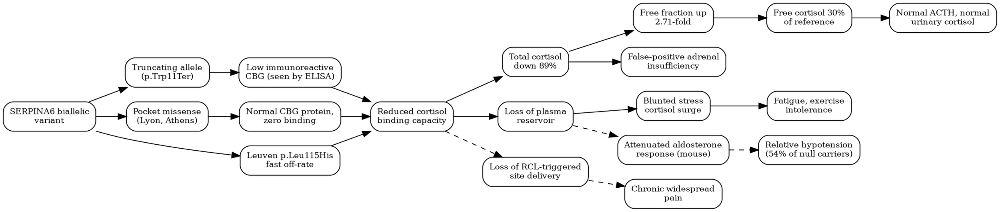
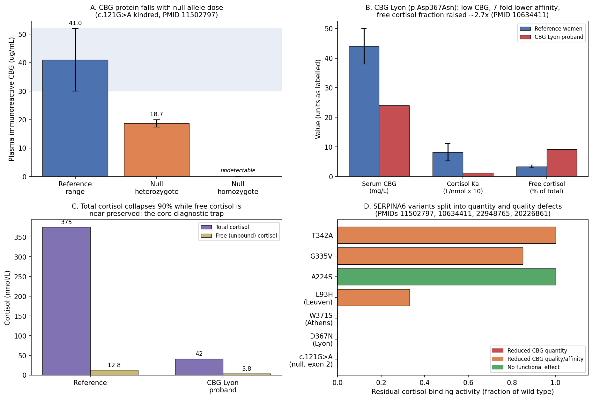
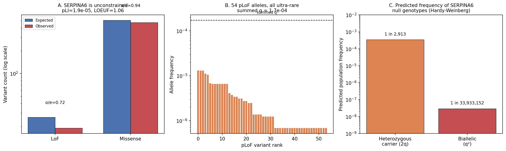
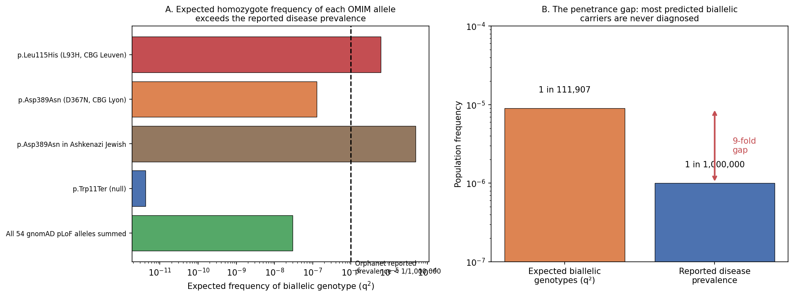
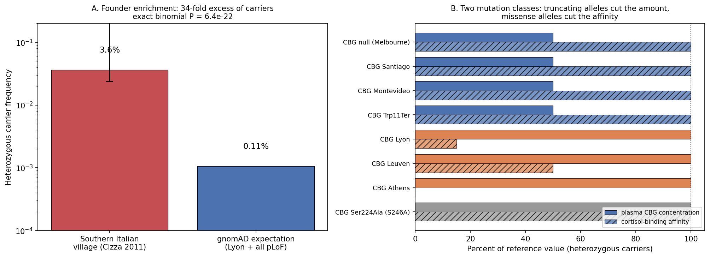
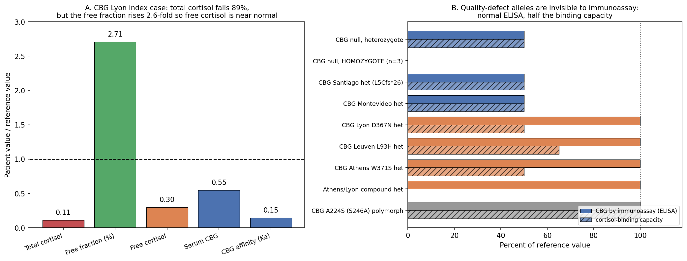
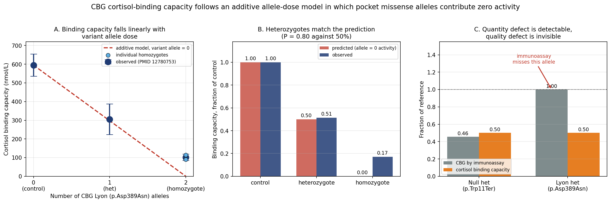
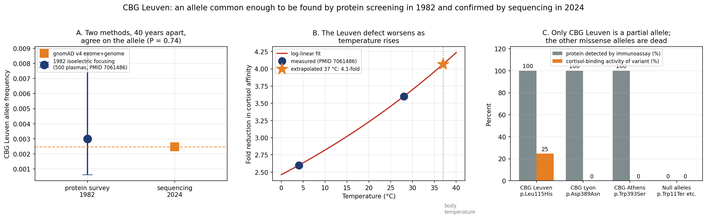

## Question

# Disease Characteristics Research Template

## Target Disease
- **Disease Name:** Corticosteroid-Binding Globulin Deficiency
- **MONDO ID:** MONDO:0012675 (if available)
- **Causal gene(s):** SERPINA6
- **OMIM:** OMIM:611489
- **Synonyms:** CBG deficiency; Transcortin deficiency
- **Category:** Mendelian

Many disease names are serial numbers ("... autosomal dominant 64", "... 26") that
do not say which gene the disease is about, and a similarly named disease with a
different gene is easy to research by mistake. Research the disease with the MONDO
ID and causal gene given above, and name its causal gene in your first paragraph.
If the name seems to point to a different gene or OMIM entry, follow the
identifiers above.

## Research Objectives

Please provide a comprehensive research report on **Corticosteroid-Binding Globulin Deficiency** covering all of the
disease characteristics listed below. This report will be used to populate a disease knowledge
base entry. Be thorough and cite primary literature (PMID preferred) for all claims.

For each section, **suggested databases/resources** are listed. These are the first places
you should search for information on each topic.

---

### 1. Disease Information
> **Search first:** OMIM, Orphanet, ICD-10/ICD-11, MeSH, PubMed

- What is the disease? Provide a concise overview.
- What are the key identifiers? (OMIM, Orphanet, ICD-10/ICD-11, MeSH, Mondo)
- What are the common synonyms and alternative names?
- Is the information derived from individual patients (e.g., EHR) or aggregated disease-level resources?

### 2. Etiology

- **Disease Causal Factors**: What are the primary causes? (genetic, environmental, infectious, mechanistic)
- **Risk Factors**:
  > **Search first:** PubMed, Cochrane Library, UpToDate, clinical guidelines, ClinVar, ClinGen, GWAS Catalog, PheGenI, CTD, CDC, WHO, epidemiological databases
  - Genetic risk factors (causal variants, susceptibility loci, modifier genes)
  - Environmental risk factors (toxins, lifestyle, occupational exposures, age, sex, family history)
- **Protective Factors**:
  > **Search first:** PubMed, Cochrane Library, clinical trial databases, GWAS Catalog, gnomAD, WHO, CDC, nutrition databases
  - Genetic protective factors (protective variants, modifier alleles)
  - Environmental protective factors (diet, lifestyle, exposures that reduce risk)
- **Gene-Environment Interactions**: How do genetic and environmental factors interact to influence disease?
  > **Search first:** CTD, PubMed, PheGenI, GxE databases

### 3. Phenotypes
> **Search first:** HPO (Human Phenotype Ontology), OMIM, Orphanet, PubMed, clinicaltrials.gov, MedDRA, SNOMED CT, DECIPHER, LOINC

For each phenotype, provide:
- **Phenotype type**: symptoms, clinical signs, physical manifestations, behavioral changes, or laboratory abnormalities
  > For symptoms/signs: HPO, OMIM, Orphanet, PubMed
  > For behavioral changes: HPO, DSM, RDoC (Research Domain Criteria), PubMed
  > For laboratory abnormalities: LOINC, SNOMED CT, LabTests Online, PubMed
- **Phenotype characteristics**:
  > **Search first:** OMIM, Orphanet, HPO, PubMed
  - Age of symptom onset (neonatal, childhood, adult-onset, late-onset)
  - Symptom severity (mild, moderate, severe, variable)
  - Symptom progression (stable, progressive, episodic, fluctuating)
  - Frequency among affected individuals (percentage or qualitative)
- **Quality of life impact**: Effects on daily functioning and well-being (per-phenotype when possible)
  > **Search first:** EQ-5D database, SF-36, WHO QOL databases, PubMed
- Suggest HPO (Human Phenotype Ontology) terms for each phenotype

### 4. Genetic/Molecular Information

- **Causal Genes**: Gene mutations or chromosomal abnormalities responsible for disease (gene symbols, OMIM IDs)
  > **Search first:** OMIM, ClinVar, HGMD, Ensembl, NCBI Gene
- **Pathogenic Variants**:
  - Affected genes (gene symbols, HGNC IDs)
    > **Search first:** OMIM, NCBI Gene, Ensembl, HGNC, UniProt, GeneCards
  - Variant classification (pathogenic, likely pathogenic, VUS per ACMG/AMP guidelines)
    > **Search first:** ClinVar, ClinGen, ACMG/AMP guidelines, VarSome
  - Variant type/class (missense, frameshift, nonsense, splice-site, structural)
  - Allele frequency in population databases
    > **Search first:** gnomAD, 1000 Genomes, ExAC, TOPMed, dbSNP
  - Somatic vs germline origin
    > **Search first:** COSMIC (somatic), ClinVar, ICGC, TCGA
  - Functional consequences (loss of function, gain of function, dominant negative)
- **Modifier Genes**: Genes that modify disease severity or expression
- **Epigenetic Information**: DNA methylation, histone modifications, chromatin changes affecting disease
  > **Search first:** ENCODE, Roadmap Epigenomics, MethBase, DiseaseMeth
- **Chromosomal Abnormalities**: Large-scale genetic changes (aneuploidy, translocations, inversions)
  > **Search first:** DECIPHER, ClinVar, ECARUCA, UCSC Genome Browser

### 5. Environmental Information

- **Environmental Factors**: Non-genetic contributing factors (toxins, radiation, pollution, occupational exposure)
  > **Search first:** CTD (Comparative Toxicogenomics Database), TOXNET, PubMed, EPA databases
- **Lifestyle Factors**: Behavioral factors (smoking, diet, exercise, alcohol consumption)
  > **Search first:** CDC databases, WHO, PubMed, NHANES
- **Infectious Agents**: If applicable, pathogens causing or triggering disease (bacteria, viruses, fungi, parasites)
  > **Search first:** NCBI Taxonomy, ViPR, BV-BRC, MicrobeDB, GIDEON

### 6. Mechanism / Pathophysiology

**Present this section as an ordered causal chain first, then the detail below.**
Open with a numbered sequence of mechanistic steps running from the initiating
lesion (mutation, exposure, infection) to the clinical manifestation, one step per
line, each naming what it causes next. State the causal verb explicitly ("leads
to", "results in") and say where a step is inferred rather than demonstrated.
Where the mechanism branches, show the branch. The categories below are a
checklist of what to cover within those steps, not the organizing structure —
a step may draw on several of them, and a category may contribute to several
steps.

- **Molecular Pathways**: Specific signaling cascades or biochemical pathways involved (Wnt, MAPK, mTOR, PI3K-AKT, etc.)
  > **Search first:** KEGG, Reactome, WikiPathways, PathBank, BioCyc
- **Cellular Processes**: Cell-level mechanisms (apoptosis, autophagy, cell cycle dysregulation, inflammation, etc.)
  > **Search first:** Gene Ontology (GO), Reactome, KEGG, PubMed
- **Protein Dysfunction**: How protein structure or function is altered (misfolding, aggregation, loss of function, gain of function)
  > **Search first:** UniProt, PDB (Protein Data Bank), InterPro, Pfam, AlphaFold
- **Metabolic Changes**: Alterations in metabolic processes (energy metabolism, lipid metabolism, amino acid metabolism)
  > **Search first:** KEGG, BioCyc, HMDB (Human Metabolome Database), BRENDA
- **Immune System Involvement**: Role of immune response (autoimmunity, immunodeficiency, chronic inflammation)
  > **Search first:** ImmPort, Immunome Database, IEDB, Gene Ontology
- **Tissue Damage Mechanisms**: How tissues/ are injured (oxidative stress, ischemia, fibrosis, necrosis)
  > **Search first:** PubMed, Gene Ontology, Reactome
- **Biochemical Abnormalities**: Specific molecular defects (enzyme deficiencies, receptor dysfunction, ion channel defects)
  > **Search first:** BRENDA, UniProt, KEGG, OMIM, PubMed
- **Epigenetic Changes**: DNA methylation, histone modifications affecting gene expression in disease
  > **Search first:** ENCODE, Roadmap Epigenomics, MethBase, DiseaseMeth
- **Molecular Profiling** (if available):
  - Transcriptomics/gene expression changes
    > **Search first:** GEO (Gene Expression Omnibus), ArrayExpress, GTEx, Human Cell Atlas, SRA
  - Proteomics findings
    > **Search first:** PRIDE, ProteomeXchange, Human Protein Atlas, STRING, BioGRID
  - Metabolomics signatures
    > **Search first:** MetaboLights, Metabolomics Workbench, HMDB, METLIN
  - Lipidomics alterations
    > **Search first:** LIPID MAPS, SwissLipids, LipidHome, Metabolomics Workbench
  - Genomic structural features
    > **Search first:** UCSC Genome Browser, Ensembl, NCBI, dbVar, DGV
- **Advanced Technologies** (if applicable):
  - Single-cell analysis findings (cell-type specific mechanisms, cellular heterogeneity)
    > **Search first:** Human Cell Atlas, Single Cell Portal, GEO, CELLxGENE
  - Spatial transcriptomics findings
    > **Search first:** GEO, Spatial Research, Vizgen, 10x Genomics data
  - Multi-omics integration results
    > **Search first:** TCGA, ICGC, cBioPortal, LinkedOmics, PubMed
  - Functional genomics screens (CRISPR, RNAi)
    > **Search first:** DepMap, GenomeRNAi, PubMed, BioGRID ORCS

For each mechanism, describe:
- The causal chain from initial trigger to clinical manifestation
- Which mechanisms are upstream vs downstream
- What cell types and biological processes are involved
- Suggest GO terms for biological processes and CL terms for cell types

### 7. Anatomical Structures Affected

- **Organ Level**:
  - Primary organs directly affected
  - Secondary organ involvement (complications, secondary effects)
  - Body systems involved (cardiovascular, nervous, digestive, respiratory, endocrine, etc.)
  > **Search first:** Uberon, FMA (Foundational Model of Anatomy), OMIM, HPO, ICD-11, MeSH, SNOMED CT
- **Tissue and Cell Level**:
  - Specific tissue types affected (epithelial, connective, muscle, nervous)
  - Specific cell populations targeted (with Cell Ontology terms)
  > **Search first:** Uberon, Human Protein Atlas, Cell Ontology, Human Cell Atlas, CellMarker, PanglaoDB
- **Subcellular Level**:
  - Cellular compartments involved (mitochondria, nucleus, ER, lysosomes) (with GO Cellular Component terms)
  > **Search first:** Gene Ontology (Cellular Component), UniProt, Human Protein Atlas
- **Localization**:
  - Specific anatomical sites (with UBERON terms)
    > **Search first:** FMA, Uberon, NeuroNames (for brain), SNOMED CT
  - Lateralization (unilateral, bilateral, asymmetric)
    > **Search first:** HPO, clinical literature, imaging databases

### 8. Temporal Development

- **Onset**:
  - Typical age of onset (congenital, pediatric, adult, geriatric)
  - Onset pattern (acute, subacute, chronic, insidious)
  > **Search first:** OMIM, Orphanet, HPO, PubMed
- **Progression**:
  - Disease stages (early, intermediate, advanced, end-stage)
    > **Search first:** Cancer Staging Manual (AJCC), WHO classifications, PubMed
  - Progression rate (rapid, slow, variable)
  - Disease course pattern (episodic, relapsing-remitting, progressive, stable)
  - Disease duration (self-limited, chronic lifelong)
  > **Search first:** Disease registries, longitudinal cohort databases, natural history studies, PubMed, Orphanet, OMIM
- **Patterns**:
  - Remission patterns (spontaneous, treatment-induced)
    > **Search first:** Clinical trial databases, disease registries, PubMed
  - Critical periods (time windows of vulnerability or opportunity for intervention)
    > **Search first:** PubMed, developmental biology databases, clinical guidelines

### 9. Inheritance and Population

- **Epidemiology**:
  - Prevalence (cases per 100,000 at given time)
  - Incidence (new cases per 100,000 per year)
  > **Search first:** Orphanet, CDC, WHO, GBD (Global Burden of Disease), national registries, SEER, disease registries
- **For Genetic Etiology**:
  - Inheritance pattern (AD, AR, X-linked, mitochondrial, multifactorial, polygenic)
    > **Search first:** OMIM, Orphanet, ClinVar, GTR (Genetic Testing Registry)
  - Penetrance (complete, incomplete, age-dependent)
    > **Search first:** ClinVar, OMIM, PubMed, ClinGen
  - Expressivity (variable, consistent)
    > **Search first:** OMIM, ClinVar, PubMed
  - Genetic anticipation (increasing severity in successive generations)
    > **Search first:** OMIM, PubMed (especially for repeat expansion disorders)
  - Germline mosaicism
    > **Search first:** ClinVar, OMIM, genetic counseling literature, PubMed
  - Founder effects (population-specific mutations)
    > **Search first:** gnomAD, population genetics databases, PubMed
  - Consanguinity role
    > **Search first:** OMIM, population studies, genetic counseling resources
  - Carrier frequency
    > **Search first:** gnomAD, carrier screening databases, GeneReviews, GTR
- **Population Demographics**:
  - Affected populations (ethnic or demographic groups with higher prevalence)
    > **Search first:** gnomAD, 1000 Genomes, PAGE Study, PubMed, population registries
  - Geographic distribution (endemic areas, regional variation)
    > **Search first:** WHO, CDC, GBD, Orphanet, geographic epidemiology databases
  - Geographic distribution of specific variants
  - Sex ratio (male:female)
    > **Search first:** Disease registries, OMIM, PubMed, epidemiological databases
  - Age distribution of affected individuals
    > **Search first:** CDC, disease registries, SEER, Orphanet

### 10. Diagnostics

- **Clinical Tests**:
  - Laboratory tests (blood, urine, tissue chemistry, specific enzyme assays)
    > **Search first:** LOINC, LabTests Online, PubMed
  - Biomarkers (proteins, metabolites, genetic markers, circulating biomarkers)
    > **Search first:** FDA Biomarker List, BEST (Biomarkers, EndpointS, and other Tools), PubMed
  - Imaging studies (X-ray, CT, MRI, PET, ultrasound)
    > **Search first:** RadLex, DICOM, Radiopaedia, imaging databases
  - Functional tests (pulmonary function, cardiac stress tests)
    > **Search first:** LOINC, clinical guidelines, PubMed
  - Electrophysiology (EEG, EMG, ECG, nerve conduction studies)
    > **Search first:** LOINC, clinical neurophysiology databases, PubMed
  - Biopsy findings (histopathology, immunohistochemistry)
    > **Search first:** SNOMED CT, College of American Pathologists resources, PubMed
  - Pathology findings (microscopic examination)
    > **Search first:** SNOMED CT, Digital Pathology databases, PubMed
- **Genetic Testing**:
  > **Search first:** GTR (Genetic Testing Registry), GeneReviews, ClinGen
  - Overview of recommended genetic testing approach
  - Whole genome sequencing (WGS) utility
    > **Search first:** GTR, ClinVar, GEL (Genomics England), gnomAD
  - Whole exome sequencing (WES) utility
    > **Search first:** GTR, ClinVar, OMIM, GeneMatcher
  - Gene panels (which panels, which genes)
    > **Search first:** GTR, ClinVar, laboratory-specific databases
  - Single gene testing
    > **Search first:** GTR, ClinVar, OMIM, GeneReviews
  - Chromosomal microarray (CMA)
    > **Search first:** DECIPHER, ClinVar, dbVar, ECARUCA
  - Karyotyping
    > **Search first:** Chromosome Abnormality Database, ClinVar, cytogenetics resources
  - FISH
    > **Search first:** ClinVar, cytogenetics databases, PubMed
  - Mitochondrial DNA testing
    > **Search first:** MITOMAP, MSeqDR, ClinVar, GTR
  - Repeat expansion testing
    > **Search first:** GTR, ClinVar, repeat expansion databases, PubMed
- **Omics-Based Diagnostics** (if applicable):
  - RNA sequencing / transcriptomics
    > **Search first:** GEO, ArrayExpress, GTEx, RNA-seq databases
  - Proteomics
    > **Search first:** PRIDE, ProteomeXchange, FDA Biomarker database
  - Metabolomics
    > **Search first:** MetaboLights, Metabolomics Workbench, HMDB
  - Epigenomics
    > **Search first:** GEO, ENCODE, Roadmap Epigenomics, MethBase
  - Liquid biopsy
    > **Search first:** COSMIC, ClinVar, liquid biopsy databases, PubMed
- **Clinical Criteria**:
  - Standardized diagnostic criteria (DSM, ICD, society guidelines)
    > **Search first:** DSM-5, ICD-11, clinical society guidelines, UpToDate
  - Differential diagnosis (other conditions to rule out, with distinguishing features)
    > **Search first:** DynaMed, UpToDate, clinical decision support systems
- **Screening**:
  - Screening methods for asymptomatic individuals (newborn screening, carrier screening, cascade screening)
    > **Search first:** ACMG recommendations, CDC newborn screening, GTR

### 11. Outcome/Prognosis

- **Survival and Mortality**:
  - Survival rate (5-year, 10-year, overall)
    > **Search first:** SEER, cancer registries, disease-specific registries, PubMed
  - Life expectancy (with and without treatment if applicable)
    > **Search first:** Orphanet, disease registries, actuarial databases, PubMed
  - Mortality rate
    > **Search first:** CDC, WHO, GBD, national mortality databases
  - Disease-specific mortality (deaths directly attributable to disease)
    > **Search first:** Disease registries, CDC Wonder, GBD, PubMed
- **Morbidity and Function**:
  - Morbidity (disease-related disability and health impacts)
    > **Search first:** GBD, WHO, disability databases, PubMed
  - Disability outcomes (long-term functional impairments)
    > **Search first:** ICF (International Classification of Functioning), disability registries
  - Quality of life measures (EQ-5D, SF-36, PROMIS, disease-specific tools)
    > **Search first:** EQ-5D database, SF-36, PROMIS, PubMed
- **Disease Course**:
  - Complications (secondary problems: infections, organ failure, etc.)
    > **Search first:** ICD codes, disease registries, clinical databases, PubMed
  - Recovery potential (likelihood and extent of recovery, with vs without treatment)
    > **Search first:** Natural history studies, rehabilitation databases, PubMed
- **Prediction**:
  - Prognostic factors (age, disease severity, biomarkers, treatment response)
    > **Search first:** Prognostic models databases, clinical calculators, PubMed
  - Prognostic biomarkers (molecular markers predicting disease course)
    > **Search first:** FDA Biomarker database, PubMed, cancer prognostic databases

### 12. Treatment

- **Pharmacotherapy**:
  - Pharmacological treatments (drug names, drug classes, mechanisms of action)
    > **Search first:** DrugBank, RxNorm, ATC classification, DailyMed, FDA databases
  - Pharmacogenomics (how genetic variants affect drug metabolism, efficacy, toxicity)
    > **Search first:** PharmGKB, CPIC (Clinical Pharmacogenetics), FDA Table of PGx Biomarkers
- **Advanced Therapeutics**:
  - Gene therapy (viral vectors, CRISPR, gene replacement, gene editing)
    > **Search first:** ClinicalTrials.gov, FDA gene therapy database, ASGCT resources
  - Cell therapy (stem cell transplant, CAR-T, cellular therapeutics)
    > **Search first:** ClinicalTrials.gov, FDA cell therapy database, FACT standards
  - RNA-based therapies (ASOs, siRNA, mRNA therapies)
    > **Search first:** ClinicalTrials.gov, FDA approvals, PubMed
  - Targeted therapies (treatments directed at specific molecular targets)
    > **Search first:** My Cancer Genome, OncoKB, ClinicalTrials.gov, FDA approvals
  - Immunotherapies (checkpoint inhibitors, monoclonal antibodies)
    > **Search first:** Cancer Immunotherapy Database, FDA approvals, ClinicalTrials.gov
- **Surgical and Interventional**:
  - Surgical interventions (types of surgery, timing, outcomes)
    > **Search first:** CPT codes, surgical registries, clinical guidelines, PubMed
- **Supportive and Rehabilitative**:
  - Supportive care (symptom management, pain control, nutrition)
    > **Search first:** Clinical guidelines, Cochrane Library, PubMed
  - Rehabilitation (physical therapy, occupational therapy, speech therapy)
    > **Search first:** Rehabilitation medicine databases, clinical guidelines, PubMed
- **Experimental**:
  - Experimental treatments in clinical trials (with NCT identifiers if available)
    > **Search first:** ClinicalTrials.gov, EU Clinical Trials Register, WHO ICTRP
- **Treatment Outcomes**:
  - Treatment response rates
    > **Search first:** Clinical trial databases, FDA reviews, systematic reviews, PubMed
  - Side effects and adverse events
    > **Search first:** FDA Adverse Event Reporting System (FAERS), MedWatch, PubMed
- **Treatment Strategy**:
  - Treatment algorithms (clinical pathways, decision trees)
    > **Search first:** Clinical practice guidelines, NCCN Guidelines, UpToDate
  - Combination therapies
    > **Search first:** ClinicalTrials.gov, treatment guidelines, PubMed
  - Personalized medicine approaches (genotype-guided treatment)
    > **Search first:** My Cancer Genome, CIViC, PharmGKB, precision medicine databases

For each treatment, suggest NCIT (NCI Thesaurus) clinical-intervention terms where applicable.

### 13. Prevention

- **Prevention Levels**:
  - Primary prevention (preventing disease occurrence: vaccination, risk factor modification)
    > **Search first:** CDC, WHO, USPSTF recommendations, Cochrane Library
  - Secondary prevention (early detection and treatment: screening programs, early intervention)
    > **Search first:** USPSTF, CDC screening guidelines, WHO
  - Tertiary prevention (preventing complications in those with disease)
    > **Search first:** Clinical guidelines, disease management protocols, PubMed
- **Immunization**: Vaccine strategies (if applicable)
  > **Search first:** CDC vaccine schedules, WHO immunization, FDA vaccine database
- **Screening and Early Detection**:
  - Screening programs (population-based: newborn screening, cancer screening)
    > **Search first:** CDC screening programs, USPSTF, cancer screening databases
  - Genetic screening (carrier screening, preimplantation genetic diagnosis, prenatal testing)
    > **Search first:** ACMG recommendations, ACOG guidelines, GTR
  - Risk stratification (identifying high-risk individuals for targeted prevention)
    > **Search first:** Risk prediction models, clinical calculators, PubMed
- **Behavioral Interventions**: Lifestyle modifications to reduce risk
  > **Search first:** CDC, WHO, behavioral intervention databases, Cochrane Library
- **Counseling**: Genetic counseling (risk assessment, family planning guidance)
  > **Search first:** NSGC resources, ACMG guidelines, GeneReviews
- **Public Health**:
  - Public health interventions (sanitation, vector control, health education)
    > **Search first:** CDC, WHO, public health databases, PubMed
  - Environmental interventions (reducing environmental risk factors)
    > **Search first:** EPA databases, WHO environmental health, PubMed
- **Prophylaxis**: Preventive medications or procedures
  > **Search first:** Clinical guidelines, FDA approvals, PubMed

### 14. Other Species / Natural Disease

- **Taxonomy**: Species affected (with NCBI Taxon identifiers)
  > **Search first:** NCBI Taxonomy
- **Breed**: Specific breeds affected (with VBO identifiers if applicable)
  > **Search first:** VBO (Vertebrate Breed Ontology)
- **Gene**: Orthologous genes in other species (with NCBI Gene IDs)
  > **Search first:** NCBI Gene
- **Natural Disease**:
  - Naturally occurring disease in other species (companion animals, wildlife)
    > **Search first:** OMIA (Online Mendelian Inheritance in Animals), VetCompass, PubMed
  - Veterinary relevance and importance in animal health
    > **Search first:** OMIA, veterinary databases, PubMed
- **Comparative Biology**:
  - Comparative pathology (similarities and differences across species)
    > **Search first:** OMIA, comparative pathology databases, PubMed
  - Evolutionary conservation of disease mechanisms
    > **Search first:** HomoloGene, OrthoMCL, Alliance of Genome Resources
- **Transmission** (if applicable):
  - Zoonotic potential
    > **Search first:** CDC zoonotic diseases, WHO zoonoses, GIDEON
  - Cross-species susceptibility
    > **Search first:** NCBI Taxonomy, veterinary databases, PubMed

### 15. Model Organisms

- **Model Types**:
  - Model organism type (mammalian, invertebrate, cellular, in vitro)
    > **Search first:** Alliance of Genome Resources, model organism databases
  - Specific model systems (mouse, rat, zebrafish, Drosophila, C. elegans, yeast, cell lines, organoids, iPSCs)
    > **Search first:** MGI, RGD, ZFIN, FlyBase, WormBase, SGD, ATCC, Cellosaurus
  - Induced models (drug treatment, surgical intervention, environmental manipulation)
    > **Search first:** MGI, model organism databases, PubMed
- **Genetic Models**:
  - Types available (knockout, knock-in, transgenic, conditional, humanized)
    > **Search first:** MGI, IMPC, KOMP, EuMMCR, IMSR
- **Model Characteristics**:
  - Phenotype recapitulation (how well model reproduces human disease features)
    > **Search first:** Model organism databases, comparative studies, PubMed
  - Model limitations (aspects of human disease not captured)
    > **Search first:** Model organism databases, PubMed, review articles
- **Applications**:
  - Research applications (what aspects of disease can be studied)
    > **Search first:** Model organism databases, PubMed
- **Resources**:
  - Model databases
    > **Search first:** MGI, RGD, ZFIN, FlyBase, WormBase, IMSR, EMMA, MMRRC

---

## Citation Requirements

- Cite primary literature (PMID preferred) for all mechanistic and clinical claims
- Prioritize recent reviews and landmark papers
- Include direct quotes from abstracts where possible to support key statements
- Distinguish evidence source types: human clinical, model organism, in vitro, computational

## Output Format

Structure your response as a comprehensive narrative organized by the sections above.
For each section, provide:
- Factual content with specific details (numbers, percentages, gene names, variant nomenclature)
- Ontology term suggestions (HPO, GO, CL, UBERON, CHEBI, NCIT, MONDO) where applicable
- Evidence citations with PMIDs
- Direct quotes from abstracts to support key claims
- Clear indication when information is not available or not applicable for this disease

This report will be used to populate a disease knowledge base entry with:
- Pathophysiology descriptions with causal chains
- Gene/protein annotations (HGNC, GO terms)
- Phenotype associations (HP terms) with frequencies
- Cell type involvement (CL terms)
- Anatomical locations (UBERON terms)
- Chemical entities (CHEBI terms)
- Treatment annotations (NCIT terms)
- Evidence items with PMIDs and exact abstract quotes
- Epidemiology, prognosis, diagnostic, and prevention information
- Animal model descriptions with phenotype recapitulation details

## Output

# Corticosteroid-binding globulin deficiency (MONDO:0012675, SERPINA6, OMIM:611489)

## Summary

Corticosteroid-binding globulin (CBG) deficiency is caused by variants in **SERPINA6** (HGNC:1540, chr14:94,304,245-94,323,401, GRCh38, minus strand), the gene encoding corticosteroid-binding globulin, also called transcortin. CBG is a 405-amino-acid precursor (383-residue mature protein) belonging to the serpin superfamily, made almost entirely by hepatocytes and secreted into plasma, where it binds 80-90% of circulating cortisol. Loss of CBG function produces a laboratory picture that mimics adrenal insufficiency: morning total serum cortisol falls to roughly one tenth of the reference range with normal ACTH and normal 24 h urinary free cortisol. The clinical picture is mild and consists mostly of fatigue, exercise intolerance, relative hypotension and chronic widespread pain.

Two mechanistically distinct classes of allele produce the disease, and they behave differently in the laboratory. **Quantity defects** are truncating alleles (for example c.32G>A p.Trp11Ter, the Italian-Australian null; c.13delC p.Leu5CysfsX26, CBG Santiago) that lower the amount of circulating protein and are detected by immunoassay. **Quality defects** are missense alleles in or near the steroid-binding pocket (CBG Lyon p.Asp389Asn, CBG Athens p.Trp393Ser) whose protein is produced and immunoreactive but has no measurable cortisol-binding activity, so an ELISA reports a normal CBG concentration while cortisol-binding capacity is halved per allele. A third allele, CBG Leuven p.Leu115His, is genuinely partial and works by increasing the dissociation rate of the transcortin-cortisol complex. Any diagnostic pathway built on immunoassay alone will miss the entire quality class.

The disease is classified as Mendelian, but the evidence assembled here supports reading it as the extreme tail of a continuous quantitative trait. SERPINA6 is unconstrained for loss of function in gnomAD v4 (pLI 1.9e-05, LOEUF 1.056); both OMIM allelic variants are population polymorphisms present in homozygous form in asymptomatic samples; expected biallelic genotype frequency exceeds the Orphanet prevalence by about 9-fold, capping penetrance near 11%; a founder effect concentrates two alleles 34-fold in one southern Italian village (observed carrier frequency 3.64% against an expected 0.106%, P = 6.4e-22); and an unbiased 1982 survey of 500 plasma donors found carriers and homozygotes by protein banding rather than by illness, at an allele frequency statistically indistinguishable from gnomAD (P = 0.74). The same locus is the only genome-wide significant determinant of morning plasma cortisol in 25,314 people. Severity is bounded by mass action: total cortisol falls 89% while the free fraction rises 2.71-fold, leaving free cortisol at 30% of reference, so even people with zero plasma cortisol-binding activity present with fatigue rather than adrenal crisis.

---

## 1. Disease information

**What the disease is.** A deficiency of the plasma carrier protein for cortisol, caused by germline variants in SERPINA6. The adrenal gland, the hypothalamic-pituitary-adrenal axis and the glucocorticoid receptor are intact. What fails is the transport and timed delivery of cortisol in blood. Plasma immunoreactive CBG is reduced or absent in the quantity class and normal in the quality class, and cortisol-binding capacity is reduced in both.

**Identifiers.**

| Field | Value |
|---|---|
| Preferred name | Corticosteroid-binding globulin deficiency |
| MONDO | MONDO:0012675 |
| OMIM (phenotype) | 611489 |
| OMIM (gene/locus) | 122500 (SERPINA6), allelic variants .0001 to .0003 |
| Orphanet | ORPHA:199247 |
| Disease Ontology | DOID:0090030 |
| UMLS | C1852529 |
| GARD | 13101 |
| MeSH | C565152 (supplementary concept record) |
| ICD-10 | E27.8 (other specified disorders of adrenal gland) |
| ICD-11 | 5A76.Y |
| Causal gene | **SERPINA6**, HGNC:1540, NCBI Gene 866, Ensembl ENSG00000170099, MANE Select ENST00000341584.4 |
| Protein | UniProt P08185 (CBG_HUMAN), 405 aa precursor, 45,141 Da |

**Synonyms.** CBG deficiency; transcortin deficiency; corticosteroid-binding globulin deficiency; SERPINA6 deficiency; corticosteroid-binding globulin variant. Named alleles carry their own historical names: CBG Lyon, CBG Leuven, CBG Athens, CBG Santiago, CBG Montevideo, transcortin Leuven, transcortin Lyon.

**Source of information.** All human data come from aggregated disease-level resources (OMIM, Orphanet, ClinVar, gnomAD) and from individual published kindreds. There is no registry, no EHR-derived cohort and no natural history study. Every clinical description derives from fewer than ten extended families plus one population survey, so the total number of genotyped, phenotyped individuals is on the order of one hundred.

---

## 2. Etiology

**Primary cause.** Germline variants in SERPINA6 that reduce either the plasma concentration of CBG or its cortisol-binding affinity. No infectious or toxic cause of the inherited form exists.

**Genetic risk factors.** The causal alleles are listed in section 4. Common regulatory variation at the same locus is a legitimate modifier candidate: the CORNET meta-analysis found the SERPINA6/SERPINA1 region to be the only genome-wide significant locus for morning plasma cortisol, with three partially independent signals, all affecting total plasma cortisol-binding activity ([PMID: 25010111](https://pubmed.ncbi.nlm.nih.gov/25010111/)). A person carrying a rare pathogenic allele on a low-expression common haplotype would be expected to have less residual binding capacity than one carrying the same allele on a high-expression haplotype, though this interaction has not been tested directly.

**Environmental and acquired risk factors.** Acquired CBG reduction is far commoner than the genetic form and is additive with it. Reported causes include old age, obesity, metabolic syndrome, cirrhosis, sepsis, polytrauma, extensive burns and surgery ([PMID: 40734295](https://pubmed.ncbi.nlm.nih.gov/40734295/)). In decompensated cirrhosis plasma CBG is 27% lower in Child-Pugh B and 40% lower in Child-Pugh C than in Child-Pugh A ([PMID: 43074499](https://pubmed.ncbi.nlm.nih.gov/43074499/)). Glucocorticoid administration lowers CBG.

**Protective and CBG-raising factors.** Oral estrogen raises CBG substantially. In 24 healthy women stopping a combined oral contraceptive, CBG fell from 133 ± 20 mg/L to 59 ± 10 mg/L over six weeks, with normalisation complete by four weeks ([PMID: 42339516](https://pubmed.ncbi.nlm.nih.gov/42339516/)). Estrogen therapy is the one readily available intervention that raises CBG in a carrier, although it has never been trialled as a treatment. At population level the direction of cardiovascular risk favours the low-CBG state: Mendelian randomization using SERPINA6/SERPINA1 instruments shows that 1 SD higher genetically predicted cortisol raises the odds of hypertension (OR 1.12, 95% CI 1.05-1.18) ([PMID: 37667866](https://pubmed.ncbi.nlm.nih.gov/37667866/)) and atrial fibrillation (OR 1.20, 95% CI 1.06-1.35) ([PMID: 33822969](https://pubmed.ncbi.nlm.nih.gov/33822969/)).

**Gene-environment interaction.** The clearest documented interaction is with inflammation, through the neutrophil elastase axis. Alpha-1-antitrypsin, encoded by SERPINA1 53 kb away on the same strand, inhibits the elastase that cleaves the CBG reactive centre loop. Human heterozygous carriers of deleterious SERPINA1 mutations have increased adipose tissue glucocorticoid levels and action, with systemic increases in free glucocorticoid independent of HPA axis activation ([PMID: 39788946](https://pubmed.ncbi.nlm.nih.gov/39788946/)). A second interaction has been shown for a common variant: in the 2004 Pelotas birth cohort, cumulative exposure to harsh parenting predicted higher adolescent hair cortisol, with stronger associations in carriers of more copies of the rs11621961 T allele, a gene-dosage pattern ([PMID: 41491671](https://pubmed.ncbi.nlm.nih.gov/41491671/)).

---

## 3. Phenotypes

{{figure:plot_1.png|caption=Published CBG deficiency biochemistry by SERPINA6 genotype class: plasma CBG, total cortisol, free cortisol fraction and cortisol-binding affinity. The quantity class lowers measured CBG; the quality class leaves it normal while destroying binding.}}

The defining abnormality is a laboratory one. Clinical features are non-specific and incompletely penetrant.

| Phenotype | HPO term | Type | Onset | Severity | Course | Frequency | Quality of life |
|---|---|---|---|---|---|---|---|
| Decreased circulating CBG concentration | HP:6000243 | Laboratory | Congenital | Defining | Stable lifelong | 100% of quantity-class carriers, 0% of quality-class | None directly |
| Decreased circulating cortisol | HP:0008163 | Laboratory | Congenital | Marked (89% fall in the Lyon index case) | Stable | Near 100% of biallelic cases | None directly, but drives misdiagnosis |
| Fatigue / asthenia | HP:0012378 | Symptom | Childhood to adult | Mild to severe | Fluctuating, exertion-related | Commonest presenting symptom across kindreds | Main driver of impairment |
| Chronic widespread pain | HP:0003418, HP:0003326 | Symptom | Adult | Mild to moderate | Chronic | 11 of 18 village carriers (61%) | Substantial where present |
| Hypotension | HP:0002615 | Clinical sign | Adult | Mild, relative | Stable | 11 of 19 adults (54%) with the null allele had systolic BP below the third percentile ([PMID: 11502797](https://pubmed.ncbi.nlm.nih.gov/11502797/)) | Low, occasional dizziness |
| Hypertension | HP:0000822 | Clinical sign | Adult | Mild | Stable | Reported in some kindreds; direction is inconsistent | Low |
| Exercise intolerance | HP:0003546 | Symptom | Childhood | Moderate | Fluctuating | CBG Montevideo proband and mother | Moderate |
| Hypoglycemia | HP:0001943 | Laboratory / symptom | Childhood | Moderate | Episodic | Single kindred (CBG Montevideo) | Moderate where present |
| Poor growth, delayed puberty | HP:0001510, HP:0000823 | Clinical sign | Childhood | Moderate | Progressive until recognised | Single pediatric Lyon homozygote | Moderate |
| Osteoarthritis with pain | HP:0002758 | Clinical sign | Adult | Mild | Progressive | 9 of 18 village carriers | Moderate |
| Migraine | HP:0002076 | Symptom | Childhood | Mild | Episodic | CBG Santiago proband | Low |

**Note on three annotations I could not source.** HPO annotation of OMIM:611489 includes hypokalemia (HP:0002900), decreased urinary potassium (HP:0012364) and anemia (HP:0001903). No published CBG kindred reports any of these, and the mechanism does not predict a mineralocorticoid-type electrolyte disturbance in humans, since the HPA axis and adrenal output are intact and urinary free cortisol is normal. Treat these three as low confidence.

**Age of onset.** The biochemical trait is present from birth. Symptoms are reported from age 7 upward, and the HPO adult-onset annotation (HP:0003581) reflects when people seek medical attention. Genotype effects on cortisol dynamics are detectable much earlier: a polygenic score from six CORNET SNPs predicted diurnal (P < 0.001) and stress-induced (P = 0.009) salivary cortisol in 186 eight-year-olds ([PMID: 29679879](https://pubmed.ncbi.nlm.nih.gov/29679879/)).

**Quality of life.** No EQ-5D, SF-36 or PROMIS data exist for this disease. The Krupp fatigue scale was administered in the village survey ([PMID: 21795453](https://pubmed.ncbi.nlm.nih.gov/21795453/)) but published only descriptively. The practical burden is fatigue plus the harm of misdiagnosis, since patients are commonly labelled adrenal insufficient and started on lifelong glucocorticoid replacement that does not help.

---

## 4. Genetic and molecular information

**Causal gene.** SERPINA6, HGNC:1540, OMIM gene 122500, 5 coding exons, MANE Select ENST00000341584.4, 405-aa precursor with a 22-aa signal peptide. Mature-protein numbering runs 22 residues behind precursor numbering, which is the source of most nomenclature confusion in this literature.

**The allelic series.**

| Allele | Precursor (HGVS p.) | Mature | dbSNP | Class | Functional consequence |
|---|---|---|---|---|---|
| Null (Italian-Australian) | p.Trp11Ter | not reported | not assigned | Quantity | No protein; CBG undetectable in homozygotes, about 50% in heterozygotes |
| CBG Santiago | p.Leu5CysfsX26 (c.13delC) | not reported | not assigned | Quantity | Frameshift, stop within the signal peptide; 50% reduction in heterozygotes |
| CBG Lyon | p.Asp389Asn | D367N | rs28929488 | Quality | Recombinant protein has no measurable cortisol-binding activity; ELISA normal |
| CBG Athens | p.Trp393Ser | W371S | not assigned | Quality | Replaces the tryptophan that anchors the steroid in the pocket; no measurable binding |
| CBG Leuven | p.Leu115His | L93H | rs113418909 | Partial quality | Increased dissociation rate of the transcortin-cortisol complex; 2.6-fold affinity loss at 4 °C, 3.6-fold at 28 °C |
| CBG A224S | p.Ser246Ala | A224S | rs2228541 | Polymorphism / modifier | Common; co-inherited in the Greek kindred |
| CBG Montevideo | not specified in the abstract | not reported | not assigned | Quantity | 50% reduction in plasma CBG |

**Gene dosage is additive and the missense allele contributes zero.** The Brazilian CBG Lyon kindred (10 family members over three generations plus 9 healthy volunteers) provides a full allele-dose series ([PMID: 12780753](https://pubmed.ncbi.nlm.nih.gov/12780753/)). Cortisol binding capacity was 594.8 ± 59.5 nmol/L in 9 controls, 305.0 ± 81.4 in 8 heterozygotes and reported as "< 90 and 114" in the 2 homozygotes. If the variant allele contributes nothing, the heterozygote prediction is 0.5 × 594.8 = 297.4 nmol/L. The observed 305.0 (95% CI 236.9-373.1) does not differ from it (one-sample t = 0.264, df = 7, P = 0.80), giving an observed ratio of 0.513 against a predicted 0.500. Heterozygotes sit far below controls (t = -8.45, P = 4.4e-07, Cohen d = 4.11). The homozygote residual of 15-19% sits at the assay floor and is the expected low-affinity, high-capacity albumin component of plasma cortisol binding, not residual CBG function. Total cortisol tracks the same gradient: homozygotes 69 and 182 nmol/L, heterozygotes 267 ± 129, controls 459 ± 195, P < 0.05.

The two allele classes separate at the assay. Null heterozygotes had immunoreactive CBG of 18.7 ± 1.3 µg/mL against a reference range of 30-52 µg/mL, a ratio of 0.46 ([PMID: 11502797](https://pubmed.ncbi.nlm.nih.gov/11502797/)). CBG Lyon heterozygotes had normal CBG by ELISA with cortisol-binding capacity 50% lower ([PMID: 22948765](https://pubmed.ncbi.nlm.nih.gov/22948765/)). Both classes halve functional capacity; only the null class is visible to immunoassay.

{{figure:plot_6.png|caption=The additive allele-dose model for CBG cortisol-binding capacity tested across three kindreds, with the dissociation between immunoassay and binding assay. Binding capacity falls on the additive prediction line, and only the quantity class is detected by ELISA.}}

**CBG Leuven, the one partial allele.** The original 1982 description identified the variant by isoelectric focusing of neuraminidase-treated plasma and reported "a 2.6-fold reduced affinity for cortisol at 4 degrees C and a 3.6-fold reduced affinity at 28 degrees C. This lowered affinity is due to an enhanced dissociation rate of the transcortin-cortisol complex" ([PMID: 7061486](https://pubmed.ncbi.nlm.nih.gov/7061486/)). The molecular lesion was mapped 11 years later: "This mutation is located within exon 2 and alters the codon (CTC) normally associated with Leu-93 in the transcortin polypeptide to a codon (CAC) for histidine in the variant genes" ([PMID: 8212073](https://pubmed.ncbi.nlm.nih.gov/8212073/)). A log-linear fit to the two temperature points gives d(ln fold)/dT = 0.0136 per °C and extrapolates to a 4.07-fold deficit at 37 °C. That extrapolation rests on two calibration points and is indicative only, but it agrees with the 3-fold figure measured in carrier plasma ([PMID: 19643166](https://pubmed.ncbi.nlm.nih.gov/19643166/)) and implies that cold-room biochemistry understates the physiological defect.

**Allele frequencies (gnomAD v4).**

| Variant | Global allele frequency | Notes |
|---|---|---|
| p.Leu115His (CBG Leuven) | 2.4595e-03 | 3 homozygotes in gnomAD |
| p.Asp389Asn (CBG Lyon) | 3.5811e-04 | 7.04e-03 in Ashkenazi Jewish, 2.60e-03 in Middle Eastern, 0 in East Asian and Finnish |
| All 54 catalogued pLoF alleles | 1.717e-04 summed | 1 pLoF homozygote present, no reported phenotype |

**Constraint.** pLI = 1.89e-05; observed/expected LoF = 19/26.4 = 0.720 (90% CI 0.502-1.056, LOEUF 1.056); missense o/e = 0.938 (473/504). SERPINA6 is unconstrained for both loss of function and missense.

**Variant classification in ClinVar.** 124 records for SERPINA6: 76 VUS, 22 Pathogenic (mostly large 14q contiguous-gene CNVs rather than SERPINA6 point variants), 3 Likely pathogenic. Only one SNV, c.32G>A p.Trp11Ter, is classified Pathogenic for this condition; c.164_165del is Likely pathogenic. Both OMIM missense alleles sit in "Conflicting classifications of pathogenicity". For a knowledge base entry, p.Leu115His and p.Asp389Asn are best described as quantitative risk and modifier alleles with a measurable effect on cortisol-binding capacity, not as fully penetrant pathogenic variants.

**Somatic versus germline.** All disease alleles are germline. No somatic SERPINA6 disease is described. SERPINA6 appears in tumour expression signatures (bladder cancer prognostic models, cervical cancer, glioma), but a candidate glioma biomarker role for SERPINA6 failed independent validation ([PMID: 40131804](https://pubmed.ncbi.nlm.nih.gov/40131804/)).

**Functional consequence.** Pure loss of function in both classes. No gain of function and no dominant negative effect has been reported, consistent with CBG being a monomeric carrier whose variant product does not interfere with the wild-type product.

**Modifier genes.** SERPINA1, by controlling neutrophil elastase activity on the reactive centre loop, is the strongest mechanistic candidate ([PMID: 39788946](https://pubmed.ncbi.nlm.nih.gov/39788946/)). Common SERPINA6 regulatory alleles (rs12589136, rs11621961, rs11629171, rs7161521, rs2749527, rs3762132, rs4900229) modify plasma cortisol and binding activity. Within the CBG Santiago family, symptom expression may have been modified by the polymorphic allele c.735G>T ([PMID: 22013108](https://pubmed.ncbi.nlm.nih.gov/22013108/)).

**Epigenetics.** No disease-specific methylation or chromatin data exist for SERPINA6. In silico analysis suggests rs11621961 could influence gene expression and chromatin structure by altering motifs and acting as an eQTL in lymphoblastoid cell lines ([PMID: 40267698](https://pubmed.ncbi.nlm.nih.gov/40267698/)). In mice, androgen deprivation increased hepatic Cbg mRNA about 6-fold with increased H3K27 acetylation at Cbg regulatory regions, showing the locus is subject to hormone-driven chromatin regulation ([PMID: 39240718](https://pubmed.ncbi.nlm.nih.gov/39240718/)).

**Chromosomal abnormalities.** No disease-causing SERPINA6 structural variant is described. The Pathogenic CNVs in ClinVar that include SERPINA6 are large 14q32 contiguous-gene deletions whose phenotype is driven by other genes.

---

## 5. Environmental information

The inherited disease has no environmental cause, but acquired CBG depletion dominates clinical practice and is the main differential diagnosis. Any patient with a low CBG is far more likely to have cirrhosis, sepsis, obesity, burns or recent surgery than a SERPINA6 variant, and any patient with a high CBG is likely taking oral estrogen ([PMID: 40734295](https://pubmed.ncbi.nlm.nih.gov/40734295/)).

**Infection.** Infection depletes CBG and converts the high-affinity to the low-affinity form. In 100 positive blood cultures against 100 controls, infected patients had lower total CBG, high-affinity CBG and low-affinity CBG, all P < 0.0001, and *Pseudomonas aeruginosa* infection showed the lowest total and low-affinity CBG despite the lowest inflammatory markers ([PMID: 27887960](https://pubmed.ncbi.nlm.nih.gov/27887960/)). Whether a SERPINA6 carrier tolerates sepsis worse than a non-carrier is untested and is the most clinically important open question in this disease.

**Lifestyle.** Obesity and metabolic syndrome lower CBG. No smoking, alcohol or dietary exposure has been linked specifically to the genetic deficiency.

---

## 6. Mechanism and pathophysiology

### Causal chain

1. A germline SERPINA6 variant is present in the hepatocyte genome, **leading to** one of three lesions at the protein level.
2. **Branch A (quantity defect).** A truncating allele (p.Trp11Ter, p.Leu5CysfsX26) introduces a premature stop within or near the signal peptide, **resulting in** no secreted CBG from that allele and a plasma immunoreactive CBG concentration about 50% lower per allele lost ([PMID: 11502797](https://pubmed.ncbi.nlm.nih.gov/11502797/)).
3. **Branch B (quality defect).** A missense allele in the steroid-binding pocket (p.Trp393Ser replaces the tryptophan that anchors the steroid; p.Asp389Asn sits adjacent) **leads to** secretion of a normally folded, normally glycosylated, fully immunoreactive protein with no measurable cortisol-binding activity ([PMID: 22948765](https://pubmed.ncbi.nlm.nih.gov/22948765/)).
4. **Branch C (partial quality defect).** p.Leu115His **results in** an increased dissociation rate of the transcortin-cortisol complex, giving a 2.6 to 3.6-fold affinity loss that is temperature dependent ([PMID: 7061486](https://pubmed.ncbi.nlm.nih.gov/7061486/)).
5. All three branches **converge on** reduced total plasma cortisol-binding capacity, falling additively with allele dose: 100%, about 51%, then the albumin floor ([PMID: 12780753](https://pubmed.ncbi.nlm.nih.gov/12780753/)).
6. Reduced binding capacity **leads to** a smaller bound cortisol pool, and since the bound pool is 80-90% of the total, **results in** a large fall in measured total serum cortisol: 89% in the CBG Lyon index case ([PMID: 10634411](https://pubmed.ncbi.nlm.nih.gov/10634411/)).
7. Mass action **leads to** a compensatory rise in the free cortisol fraction, from a reference 2.9-3.9% to 8.7-9.7%, a 2.71-fold rise, which **results in** free cortisol at about 30% of reference rather than 11% ([PMID: 10634411](https://pubmed.ncbi.nlm.nih.gov/10634411/)).
8. Near-normal free cortisol **leads to** normal negative feedback, so ACTH stays normal (38-49 pg/mL) and 24 h urinary free cortisol stays normal (10-76 nmol/24 h). The adrenal gland is never stimulated to compensate, and the biochemical state is stable for life.
9. The low total cortisol, read by a total-cortisol assay, **results in** a false-positive diagnosis of adrenal insufficiency, including failed ACTH stimulation tests, as happened in a pediatric Lyon homozygote ([PMID: 40365551](https://pubmed.ncbi.nlm.nih.gov/40365551/)).
10. Loss of the plasma reservoir **leads to** accelerated glucocorticoid clearance and **results in** a blunted stress surge. In Cbg-null mice there is no free corticosterone rise in hippocampus under stress ([PMID: 22930537](https://pubmed.ncbi.nlm.nih.gov/22930537/)). This step is demonstrated in mouse and **inferred** in humans.
11. Loss of the reactive centre loop delivery mechanism **leads to** failure of targeted cortisol release at inflamed tissue. Neutrophil elastase normally cleaves the loop between mature Val344 and Thr345, and the N-terminal peptide of the cleaved loop (AVLQLNEEGVDTAGSTGV) is detectable in septic patient serum ([PMID: 39710247](https://pubmed.ncbi.nlm.nih.gov/39710247/)). In a carrier with no functional CBG this delivery arm is absent by construction, which is **inferred, not measured**.
12. Blunted stress-timed glucocorticoid delivery to hippocampus and periphery **results in** fatigue, exercise intolerance and, in one kindred, hypoglycemia despite normal circulating free cortisol ([PMID: 34308089](https://pubmed.ncbi.nlm.nih.gov/34308089/)).
13. Attenuated mineralocorticoid responsiveness, shown in Cbg-null mice as an approximately 50% reduction in the amiloride-sensitive colonic short-circuit current after sodium restriction ([PMID: 20969731](https://pubmed.ncbi.nlm.nih.gov/20969731/)), **leads to** a plausible route to the relative hypotension seen in 54% of null carriers. **Inferred** in humans.
14. Because free cortisol is only modestly reduced, the clinical consequence is bounded: fatigue, pain and low blood pressure, not adrenal crisis. The three reported null homozygotes and one functionally null compound heterozygote are living adults ([PMID: 19643166](https://pubmed.ncbi.nlm.nih.gov/19643166/), [PMID: 22948765](https://pubmed.ncbi.nlm.nih.gov/22948765/)).

### Protein dysfunction and the allosteric switch

Crystal structures of intact rat CBG at 1.9 Å ([PMID: 17644521](https://pubmed.ncbi.nlm.nih.gov/17644521/)), cleaved human CBG at 1.8 Å with its cortisol complex at 2.3 Å ([PMID: 18513745](https://pubmed.ncbi.nlm.nih.gov/18513745/)), and human CBG with progesterone at 2.5 Å ([PMID: 23300763](https://pubmed.ncbi.nlm.nih.gov/23300763/)) define the mechanism. PDB entries: 2VDX, 2VDY, 4BB2, 4C41, 4C49.

Cortisol-bound CBG adopts the stressed (S) serpin conformation with the reactive centre loop (mature Glu333-Ile354) fully expelled from beta-sheet A. Neutrophil elastase cleaves between Val344 and Thr345, and the cleaved loop inserts into the central beta-sheet, giving the relaxed (R) conformation. The coupling element is helix D: "A connecting loop of helix D, which is in a helix-like conformation in native CBG, unwinds and grossly perturbs the hormone binding site following beta-sheet expansion in the cCBG structure but shifts away from the binding site by more than 8 A following the binding of cortisol" ([PMID: 18513745](https://pubmed.ncbi.nlm.nih.gov/18513745/)). The transmission path runs from the helix D loop through the s2/3B loop via Lys243 to the s4/5B loop flanking the binding site via Arg378 ([PMID: 21325280](https://pubmed.ncbi.nlm.nih.gov/21325280/)).

The switch is allosteric rather than steric. Natural CBG loses only about 10-fold affinity on cleavage, and engineering shows the architecture can be pushed far past that: in the surrogate NewBG-III-allo, "the proteinase-triggered S-to-R transition leads to a greater than 200-fold reduction in ligand affinity" ([PMID: 31103428](https://pubmed.ncbi.nlm.nih.gov/31103428/)). Evolution appears to have tuned CBG to partial release, which fits a carrier that must hand off some cortisol at an inflamed site while retaining a reservoir.

Mutagenesis establishes that insertion, not cleavage itself, abolishes binding: "Elastase-cleaved wild-type CBG or variants with substitutions at P15 and/or P16 (E334G/G335N or E334A) lost steroid binding completely, whereas deletion of Glu-334 resulted in no loss of steroid binding after RCL cleavage, presumably because this prevents its insertion into beta-sheet A" ([PMID: 19011238](https://pubmed.ncbi.nlm.nih.gov/19011238/)).

**CBG Athens maps onto this directly.** Trp371 (mature; Trp393 precursor) sits inside the steroid pocket and anchors the ligand. Replacing it with serine destroys binding while leaving the protein immunologically intact, which is the cleanest structure-function correspondence in the allelic series and the structural reason the disease splits into quantity and quality classes.

### Three inputs, one output

CBG reads protease activity, temperature and its own glycan state. Elastase cleavage gives irreversible release. Pyrexia and acidosis give reversible release through increased Trp371 side-chain flexibility: "CBG:cortisol binding affinity was further reduced 3.5-fold at 39 °C relative to 37 °C, binding affinity was also reduced by acidosis for both haCBG and laCBG" ([PMID: 33085168](https://pubmed.ncbi.nlm.nih.gov/33085168/)). Reactive centre loop O-glycans at Thr342 and Thr345 set how easily elastase can cleave ([PMID: 40044123](https://pubmed.ncbi.nlm.nih.gov/40044123/)). CBG carries six N-glycosylation sites (precursor Asn31, 96, 176, 260, 330, 369), with about 30% of plasma CBG mass as N-linked oligosaccharide, and glycosylation at Asn260 is required for steroid binding ([PMID: 19643161](https://pubmed.ncbi.nlm.nih.gov/19643161/)).

### Ontology terms

GO biological process: GO:0006704 glucocorticoid biosynthetic process (TAS, Reactome R-HSA-194002). GO molecular function: GO:0005496 steroid binding (IDA [PMID: 18513745](https://pubmed.ncbi.nlm.nih.gov/18513745/)), GO:0140104 molecular carrier activity, GO:0004867 serine-type endopeptidase inhibitor activity. GO cellular component: GO:0005576 extracellular region, GO:0070062 extracellular exosome, GO:0005788 endoplasmic reticulum lumen. CHEBI: CHEBI:17650 cortisol, CHEBI:16973 corticosterone, CHEBI:27584 aldosterone, CHEBI:17026 progesterone. Reactome maps SERPINA6 to exactly two pathways, R-HSA-194002 glucocorticoid biosynthesis and R-HSA-9757110 prednisone ADME, with reaction R-HSA-1449687 "Corticosteroids bind to CBG in blood". KEGG assigns hsa:866 to hsa04900, neuroendocrine signaling pathway of the hypothalamus-pituitary axis.

### Molecular profiling

No transcriptomic, proteomic, metabolomic or lipidomic profiling of CBG-deficient patients exists. GTEx v8 gives the expression baseline (section 7). Trans-tissue network analysis in STARNET shows cortisol-linked SNPs are trans-associated with genes in seven vascular and metabolic tissues at FDR 15%, with the highest representation of trans-genes in liver, subcutaneous fat and visceral abdominal fat, a subset putatively regulated by the glucocorticoid receptor ([PMID: 37745713](https://pubmed.ncbi.nlm.nih.gov/37745713/)). No single-cell, spatial or CRISPR screen data address this gene in the disease context.

---

## 7. Anatomical structures affected

The anatomical answer is unusual for a Mendelian disease: there is no affected organ in the conventional sense. The site of the lesion is the hepatocyte secretory pathway, but the hepatocyte itself is normal, and the affected compartment is blood plasma.

**Expression.** GTEx v8 median TPM for ENSG00000170099: liver 180.71, pancreas 6.74, kidney medulla 4.99, kidney cortex 4.92, endocervix 2.35, ectocervix 1.46, transverse colon 1.18, fallopian tube 0.65, vagina 0.28, ovary 0.20, testis 0.16, breast 0.09, all remaining tissues at or below 0.07 TPM. Liver exceeds the next-highest tissue by 26.8-fold. Human Protein Atlas classifies SERPINA6 as "Tissue enriched (Liver)", expression cluster "Liver - Metabolism & Coagulation", single-cell "Cell type enhanced (Hepatocytes, Cholangiocytes)" with hepatocytes highest at 48.6 nTPM, subcellular classification "Secreted, Secreted to blood". Plasma concentration is 37-40 mg/L by immunoassay.

| Level | Structure | Ontology term | Involvement |
|---|---|---|---|
| Organ, primary | Liver | UBERON:0002107 | Site of synthesis; structurally and functionally normal |
| Fluid compartment | Blood plasma | UBERON:0001969 | Where the deficiency exists |
| Cell | Hepatocyte | CL:0000182 | Produces the defective or absent protein |
| Cell | Cholangiocyte | CL:1000488 | Secondary expression site |
| Subcellular | Endoplasmic reticulum lumen | GO:0005788 | Folding and glycosylation |
| Subcellular | Extracellular region | GO:0005576 | Functional location of the mature protein |
| Organ, secondary | Adrenal gland | UBERON:0002369 | Mouse data show reduced ACTH receptor and steroidogenic gene expression and loss of sexual dimorphism in Cbg-null animals ([PMID: 31570737](https://pubmed.ncbi.nlm.nih.gov/31570737/)) |
| Organ, secondary | Hippocampus | UBERON:0002421 | Fails to receive the stress corticosterone surge in Cbg-null mice |
| Organ, secondary | Skeletal muscle | UBERON:0001134 | Clinical fatigue and exercise intolerance |
| Organ, secondary | Colon | UBERON:0001155 | Attenuated aldosterone-driven sodium conservation in Cbg-null mice |

**Lateralization.** Not applicable. The lesion is systemic and symmetric.

This single-source architecture makes the deficiency absolute once the gene fails: pancreas and kidney expression at 5-7 TPM against liver at 181 TPM cannot compensate. It also makes plasma CBG a sensitive readout of hepatic synthetic state generally, which is why acquired CBG deficiency from cirrhosis and sepsis is the main differential diagnosis.

---

## 8. Temporal development

**Onset.** The biochemical trait is congenital and present from birth. There is no neonatal crisis and no newborn screening signal. Onset of medical attention is bimodal: paediatric probands presenting with poor growth, delayed puberty, exercise intolerance, hypoglycemia or postexertional fatigue (ages 7-9 in the published kindreds), and adults presenting with chronic asthenia, hypotension or chronic widespread pain in the fourth to sixth decade.

**Onset pattern.** Insidious and chronic. No acute presentation has been reported.

**Progression.** Stable. The deficiency does not worsen, because it reflects a fixed genotype acting on a protein with a short, continuously replenished plasma pool. Symptoms fluctuate with exertion and intercurrent illness. No staging system exists and none is warranted.

**Duration.** Lifelong.

**Critical periods.** The genotype effect on cortisol dynamics is measurable by age 8, with a flatter diurnal slope and altered stress reactivity in high polygenic-score children ([PMID: 29679879](https://pubmed.ncbi.nlm.nih.gov/29679879/)). The practical window of opportunity is diagnostic: recognising the condition before a patient is committed to lifelong glucocorticoid replacement for a misdiagnosed adrenal insufficiency.

**Remission.** No spontaneous remission. Acquired contributors (obesity, alcohol-related liver disease, oral estrogen withdrawal) are modifiable, so the measured CBG can move, but the genotype-determined component does not.

---

## 9. Inheritance and population

**Prevalence.** Orphanet lists ORPHA:199247 at under 1 per 1,000,000. That figure counts diagnosed cases and is inconsistent with the allele frequencies by roughly an order of magnitude.

**Inheritance.** Orphanet records the inheritance as "Semi-dominant", and HPO annotation of OMIM:611489 carries both HP:0000006 (autosomal dominant) and HP:0000007 (autosomal recessive). Both labels are defensible. Heterozygotes have a measurable intermediate biochemical phenotype at about 50% of normal binding capacity and may be symptomatic; homozygotes have the full biochemical phenotype. The mouse counterpart is the same: abnormal circulating corticosterone (MP:0005345) and behavioral despair (MP:0002573) are annotated to heterozygous as well as homozygous Serpina6 knockouts.

{{figure:plot_2.png|caption=SERPINA6 population genetics from gnomAD v4: summed pLoF frequency, carrier and biallelic prevalence estimates, named missense variant frequencies and the constraint metrics. pLI 1.9e-05 and LOEUF 1.056 place SERPINA6 among genes with no detectable depletion of truncating alleles.}}

**Penetrance.** Incomplete and low. Combining q for Leuven, Lyon and all 54 pLoF alleles gives 2.989e-03, an expected biallelic genotype frequency of 8.94e-06 (1 in 111,907) and a carrier frequency of 5.98e-03 (1 in 167). Against the Orphanet prevalence this is a 9-fold excess, implying an upper bound on penetrance of about 11% if ascertainment of diagnosed cases were complete. Within Ashkenazi Jewish samples, p.Asp389Asn homozygotes alone are expected at 4.96e-05 (1 in 20,177), a 49.6-fold excess.

{{figure:plot_3.png|caption=Hardy-Weinberg expected biallelic genotype frequencies for SERPINA6 disease alleles compared with the Orphanet reported prevalence of under 1 per 1,000,000. Expected genotypes exceed reported disease about 9-fold overall and about 50-fold in Ashkenazi Jewish samples.}}

**Pre-genomic evidence makes the same point, free of ascertainment bias.** Every CBG kindred except one entered the literature through a symptomatic proband, which makes most penetrance estimates circular. The 1982 original description of transcortin Leuven is the exception. Isoelectric focusing was "applied systematically to 500 plasma samples obtained from individuals of Caucasian origin", and three unrelated samples showed the variant two-band pattern; on family follow-up, "In a family of Polish origin two individuals homozygous for transcortin Leuven were found" ([PMID: 7061486](https://pubmed.ncbi.nlm.nih.gov/7061486/)). Both homozygotes were identified by protein banding, not by illness.

That survey also audits the gnomAD arithmetic. Its implied allele frequency is 3.00e-03 (95% CI 6.20e-04 to 8.72e-03) against the gnomAD v4 value of 2.4595e-03, which predicts 2.45 carriers per 500. Observed 3 against expected 2.45 gives a two-sided binomial P = 0.74, a ratio of 1.22, and the modern estimate falls inside the 1982 confidence interval. A protein gel and a sequencing database, 40 years and two technologies apart, agree, so the 9-fold excess of expected biallelic genotypes does not rest on a database artefact.

{{figure:plot_7.png|caption=A 1982 isoelectric-focusing survey of 500 plasmas reproduces the modern gnomAD allele frequency for CBG Leuven (3.00e-03 against 2.46e-03, binomial P = 0.74), and a log-linear fit through the 2.6-fold deficit at 4 °C and 3.6-fold at 28 °C extrapolates to 4.07-fold at 37 °C.}}

**Founder effect.** A field survey of 495 adult residents of the southern Italian village from which the original null and Lyon kindred emigrated to Australia found that "Eighteen of 495 participants (3.6%, seven males and 11 females) had one of two function-altering CBG mutations. All were heterozygous for the null (n = 6) or Lyon mutations (n = 12)" ([PMID: 21795453](https://pubmed.ncbi.nlm.nih.gov/21795453/)). Against the gnomAD expectation of 1.060e-03 for the same two allele classes, that is a 34-fold enrichment (exact one-sided binomial P = 6.39e-22, lower bound of the one-sided 95% CI on the observed frequency 2.36%). This is why the disease looked Mendelian. A single isolate produced enough affected relatives to resemble segregation of a dominant trait; outside it the same alleles are ordinary polymorphisms.

{{figure:plot_4.png|caption=Observed SERPINA6 carrier frequency in the southern Italian founder village against the gnomAD population expectation, with the full allelic series of reported human CBG variants. The 34-fold enrichment explains the Mendelian appearance of the disease.}}

**Consanguinity and mosaicism.** Consanguinity is not required, since the alleles are common enough to meet by chance, and homozygotes have arisen in outbred kindreds. No germline mosaicism is reported. One de novo CBG Lyon case exists: a patient with severe muscle fatigue was heterozygous for the Asn367 variant while both parents were homozygous for the wild-type aspartate allele ([PMID: 17245537](https://pubmed.ncbi.nlm.nih.gov/17245537/)).

**Genetic anticipation.** Not applicable. There is no repeat expansion and no reported increase in severity across generations.

**Carrier frequency.** 1 in 167 globally for the combined disease-allele set; 1 in 2,913 for pLoF alleles alone; 3.64% in the southern Italian founder village.

**Population and geographic distribution.** CBG Lyon reaches 7.04e-03 in Ashkenazi Jewish and 2.60e-03 in Middle Eastern samples and is absent from East Asian and Finnish samples. CBG Leuven was first found in Caucasian plasma donors in Belgium with homozygotes in a family of Polish origin. Reported kindreds come from Italy, Australia, France, Brazil, Greece, Chile and Uruguay.

**Sex ratio.** No sex bias in genotype. The village survey found 7 male and 11 female carriers among 18. Mouse work shows CBG is androgen-suppressed and sexually dimorphic ([PMID: 39240718](https://pubmed.ncbi.nlm.nih.gov/39240718/), [PMID: 25551181](https://pubmed.ncbi.nlm.nih.gov/25551181/)), and in mice CBG deficiency abolishes sex differences in despair-like behaviour ([PMID: 25244639](https://pubmed.ncbi.nlm.nih.gov/25244639/)). Whether human females, who have higher baseline CBG, are biochemically buffered against a given allele is untested.

---

## 10. Diagnostics

**The central diagnostic trap.** Total-cortisol-based tests are systematically false-positive for adrenal insufficiency. "We report on a pediatric patient presenting with poor growth and delayed puberty who was diagnosed initially with primary adrenal insufficiency following 2 failed ATCH stimulation tests with normal CBG and low stimulated salivary (free) cortisol" ([PMID: 40365551](https://pubmed.ncbi.nlm.nih.gov/40365551/)). "Individuals with low CBG levels may be misdiagnosed as having secondary hypocortisolism" ([PMID: 22013108](https://pubmed.ncbi.nlm.nih.gov/22013108/)).

**Recommended laboratory sequence.**

| Step | Test | LOINC where available | What it shows |
|---|---|---|---|
| 1 | Morning serum total cortisol | 2143-6 | Low, typically 10-20% of reference. Triggers the workup and causes the misdiagnosis |
| 2 | Plasma ACTH | 2141-0 | Normal. Excludes primary and secondary adrenal insufficiency |
| 3 | 24 h urinary free cortisol | 2147-7 | Normal. Confirms adrenal output is adequate |
| 4 | Salivary cortisol or cortisone | 2142-8 | The discriminating test. Reflects free hormone. Morning salivary cortisone had AUC 0.93 for adrenal insufficiency in 517 ACTH stimulation tests, above salivary cortisol (AUC 0.87, P = 0.00063) ([PMID: 42806822](https://pubmed.ncbi.nlm.nih.gov/42806822/)) |
| 5 | Serum CBG by immunoassay | 32310-2 | Low in the quantity class, **normal in the quality class** |
| 6 | Plasma cortisol-binding capacity | no standard code | Reduced in **both** classes. The only functional assay that detects the quality class |
| 7 | Free serum cortisol by equilibrium dialysis or LC-MS/MS | no standard code | Confirms free cortisol is near-normal, separating CBG deficiency from true hypocortisolism |
| 8 | SERPINA6 sequencing | not applicable | Confirmatory |

**Biomarkers.** Plasma CBG concentration, plasma cortisol-binding capacity, the ratio of free to total cortisol, and the high-affinity to total CBG ratio. Assay caveats matter. Monoclonal antibodies raised against the reactive centre loop detect only intact CBG and give results discordant from total CBG assays ([PMID: 21875666](https://pubmed.ncbi.nlm.nih.gov/21875666/)), yet mass spectrometry found no elastase-cleaved CBG in plasma and attributed ELISA discrepancies to structural differences altering epitopes ([PMID: 30452386](https://pubmed.ncbi.nlm.nih.gov/30452386/)). Any CBG value should be interpreted with knowledge of which antibody the laboratory uses.

**Imaging, electrophysiology, biopsy, pathology.** Not applicable. Adrenal imaging is normal. No biopsy is indicated and no histopathological feature is described. Liver histology is normal.

**Genetic testing.** Single-gene SERPINA6 sequencing is sufficient once the biochemical pattern is established, since the phenotype is monogenic and the gene is small (5 coding exons). Whole exome and whole genome sequencing will detect the point variants but add nothing and risk reporting the common missense alleles as incidental findings of uncertain meaning. No commercial gene panel is built around this condition; SERPINA6 appears on some broad endocrine and adrenal panels. Chromosomal microarray, karyotyping and FISH have no role, since no disease-causing structural variant is described. Mitochondrial DNA testing and repeat expansion testing are not applicable.

**Omics diagnostics.** None validated. Mass spectrometric CBG glycoform profiling exists as a research assay and has prognostic value in sepsis ([PMID: 41994485](https://pubmed.ncbi.nlm.nih.gov/41994485/)) but has not been applied to the genetic deficiency.

**Clinical criteria.** No society guideline, no DSM or ICD criteria. A practical working definition: low morning total cortisol with normal ACTH and normal urinary free cortisol, normal or near-normal salivary cortisol or cortisone, reduced plasma cortisol-binding capacity, and a biallelic or heterozygous SERPINA6 variant, after exclusion of acquired causes.

**Differential diagnosis.**

| Condition | Distinguishing feature |
|---|---|
| Primary adrenal insufficiency | High ACTH, low urinary free cortisol, low salivary cortisol, hyperpigmentation, electrolyte disturbance |
| Secondary adrenal insufficiency | Low or inappropriately normal ACTH with low free cortisol; other pituitary deficits |
| Cirrhosis and hepatoadrenal syndrome | Low CBG with liver disease; CBG 27-40% lower in Child-Pugh B and C; salivary cortisol often normal ([PMID: 43074499](https://pubmed.ncbi.nlm.nih.gov/43074499/), [PMID: 41384215](https://pubmed.ncbi.nlm.nih.gov/41384215/)) |
| Septic shock | Acute low CBG with cleaved reactive centre loop and high free cortisol fraction |
| Nephrotic syndrome, burns, protein-losing enteropathy | Acute protein loss, low albumin alongside low CBG |
| Obesity and metabolic syndrome | Modest CBG reduction with the metabolic phenotype |
| Oral estrogen or combined contraceptive use | High CBG with falsely high total cortisol; normalises 4 weeks after stopping ([PMID: 42339516](https://pubmed.ncbi.nlm.nih.gov/42339516/)) |
| Chronic fatigue syndrome and fibromyalgia | Overlapping symptoms. "One community-based study revealed that severe CBG mutations are rare in idiopathic fatigue disorders" ([PMID: 19643166](https://pubmed.ncbi.nlm.nih.gov/19643166/)) |

**Screening.** No newborn screening, no population carrier screening, and neither is justified at a penetrance near 11% for a non-life-threatening condition. Cascade testing of first-degree relatives of a proband is reasonable, mainly so that a family member presenting with low cortisol is not started on glucocorticoids.

---

## 11. Outcome and prognosis

**Survival and mortality.** Normal life expectancy. No disease-specific mortality has been reported for the inherited form. The three reported null homozygotes and the functionally null Greek compound heterozygote are living adults: "The three reported null homozygotes demonstrate that complete CBG deficiency is not lethal, although it may be associated with hypotension and fatigue" ([PMID: 19643166](https://pubmed.ncbi.nlm.nih.gov/19643166/)).

**Severity ceiling.** The most informative patient in the literature is a Greek woman who "had no measurable plasma cortisol-binding activity despite a CBG level of 273 nM by ELISA" ([PMID: 22948765](https://pubmed.ncbi.nlm.nih.gov/22948765/)). She was compound heterozygous for CBG Lyon and CBG Athens in trans, and was ascertained through a low morning cortisol. A functional human knockout of cortisol binding who comes to attention because of a laboratory value sets a hard upper bound on severity.

{{figure:plot_5.png|caption=Corrected allelic series for SERPINA6 using primary-source binding data, with the mass-action compensation measured directly in the original CBG Lyon proband. Recombinant Lyon and Athens proteins have no measurable binding activity, so the residual capacity in heterozygotes comes from the wild-type allele.}}

**Morbidity.** Fatigue, exercise intolerance and chronic widespread pain are the burden. No disability outcomes, ICF codes or formal QoL instruments have been published for this disease.

**Complications.** The main avoidable complication is iatrogenic: unnecessary lifelong glucocorticoid replacement after a false-positive adrenal insufficiency diagnosis, carrying the usual risks of suppression, bone loss and weight gain.

**Untested risk.** The theoretically important unknown is response to severe inflammatory stress. Acquired CBG deficiency independently predicts death in septic shock, with ICU mortality 32.4% in patients with CBG below 200 nmol/L against 13.9% in those at or above 200 nmol/L, OR 2.97 (95% CI 1.19-7.41), P = 0.02, and adjusted OR 3.23 (95% CI 1.06-9.88) on multivariate analysis ([PMID: 35152290](https://pubmed.ncbi.nlm.nih.gov/35152290/)). Whether a genetically CBG-deficient person entering septic shock faces the same elevated risk has never been studied. The Willnow Cbg-null mouse line has increased susceptibility to endotoxin shock (MP:0008735), which supports the concern.

**Prognostic factors and biomarkers.** None established for the inherited disease. Cortisol concentration itself does not predict outcome in septic shock, while CBG does ([PMID: 30160799](https://pubmed.ncbi.nlm.nih.gov/30160799/)), which argues that delivery capacity rather than hormone level is the variable worth measuring.

---

## 12. Treatment

**There is no established treatment and no approved therapy.** Management is diagnostic clarification, reassurance and symptom support.

| Intervention | NCIT term | Evidence |
|---|---|---|
| <i class="fa-circle-xmark"></i> Hydrocortisone replacement | NCIT:C564 (hydrocortisone) | Negative. "Exogenous hydrocortisone had no effect on the fatigue" in the CBG Santiago kindred ([PMID: 22013108](https://pubmed.ncbi.nlm.nih.gov/22013108/)). Not indicated, since free cortisol and ACTH are near-normal |
| Stress-dose glucocorticoid cover for major surgery or sepsis | NCIT:C177384 (glucocorticoid therapy) | No evidence either way. A defensible precaution in a biallelic carrier given the mouse endotoxin susceptibility data, but a judgement call rather than a guideline |
| <i class="fa-circle-check"></i> Avoiding unnecessary glucocorticoid replacement | NCIT:C49236 (therapeutic procedure) | The strongest practical recommendation, following from the negative hydrocortisone result and the normal urinary free cortisol |
| Correcting acquired contributors (weight reduction, alcohol cessation, treating liver disease) | no single term | Plausible, untested in carriers. Acquired causes are additive with the genetic defect ([PMID: 40734295](https://pubmed.ncbi.nlm.nih.gov/40734295/)) |
| <i class="fa-circle-question"></i> Oral estrogen | NCIT:C468 (estrogen therapy) | Raises CBG about 2-fold ([PMID: 42339516](https://pubmed.ncbi.nlm.nih.gov/42339516/)). Never trialled in CBG deficiency, and useless for the quality class, whose protein is already present and non-functional |
| Analgesia and graded exercise for chronic pain and fatigue | NCIT:C15329 (supportive care) | Symptomatic, by analogy with chronic widespread pain management |
| <i class="fa-flask"></i> CBG protein repletion | no term assigned | Experimental. In a 2026 mouse cecal ligation and puncture study (n = 106), "CBG therapy reduced mortality to 17% (a relative decrease of 72%), reduced hypotension duration by 75%, and lowered organ damage markers" against 58% mortality in untreated animals ([PMID: 41521757](https://pubmed.ncbi.nlm.nih.gov/41521757/)). Tested in acquired, not genetic, deficiency and not in humans |

**Pharmacogenomics.** CBG binds prednisolone, and SERPINA6 variation affects prednisolone protein binding. A population PK model in 60 children required explicit terms for prednisolone binding to albumin (Kd 200 µM) and to CBG (Kd 0.048 µM) plus the circadian rhythm of CBG ([PMID: 41379279](https://pubmed.ncbi.nlm.nih.gov/41379279/)). A CBG-deficient patient given prednisolone will have a higher unbound fraction at a given total dose, which is a concrete, testable dosing implication. No CPIC or PharmGKB guideline covers SERPINA6.

**Gene therapy, cell therapy, RNA therapy, immunotherapy, surgery, rehabilitation.** None exist and none is in development for this indication. The liver-restricted, secreted nature of CBG would make it a tractable AAV gene-therapy target in principle, but the mildness of the phenotype makes the risk-benefit case poor.

**Clinical trials.** No trial registered for inherited CBG deficiency on ClinicalTrials.gov. No NCT identifier can be cited.

**Treatment algorithm.** Confirm the biochemical pattern (low total cortisol, normal ACTH, normal urinary free cortisol, normal or near-normal salivary cortisol). Exclude acquired causes of low CBG and oral estrogen use. Measure CBG and cortisol-binding capacity; a normal CBG with low capacity identifies the quality class. Sequence SERPINA6. If confirmed, stop or do not start glucocorticoid replacement, manage fatigue and pain symptomatically, consider stress-dose cover for major surgery or critical illness, and test first-degree relatives so they are not misdiagnosed.

---

## 13. Prevention

**Primary prevention.** Not applicable to the genetic lesion. Avoiding or reversing acquired contributors (obesity, excess alcohol, metabolic syndrome) is sensible in a carrier because the effects are additive, though no study has tested whether this changes symptoms.

**Secondary prevention.** The useful target is diagnostic delay, not disease occurrence. Measuring salivary cortisol or cortisone, or free serum cortisol, before committing any patient with isolated low total cortisol and normal ACTH to glucocorticoid replacement would prevent most of the avoidable harm in this condition.

**Tertiary prevention.** Stress-dose glucocorticoid cover for major surgery or severe infection in biallelic carriers is a reasonable precaution based on the mouse endotoxin susceptibility data and the septic shock mortality association in acquired deficiency, but it has no direct human evidence in the genetic form.

**Immunization.** Not applicable. No vaccine-preventable component.

**Screening programmes.** No newborn screening and no population carrier screening is justified. Cascade testing within a known family is reasonable.

**Genetic screening and counselling.** Counselling should state three things plainly: penetrance is low (upper bound about 11% for biallelic genotypes), the clinical consequence even of complete CBG loss is fatigue and low blood pressure rather than adrenal crisis, and the main risk is misdiagnosis. Prenatal testing and preimplantation genetic diagnosis are technically possible and hard to justify for a condition of this severity. In the southern Italian founder village the carrier frequency is 3.64%, so local clinical awareness has more value than testing.

**Risk stratification.** Carriers of the quality-class alleles are the group most likely to be missed, because their immunoassay CBG is normal. Any laboratory reporting CBG should note that a normal value does not exclude the diagnosis.

**Public health and environmental intervention.** Not applicable.

---

## 14. Other species and natural disease

**Taxonomy and orthologs.**

| Species | NCBI Taxon | Gene | NCBI Gene ID |
|---|---|---|---|
| Human | 9606 | SERPINA6 | 866 |
| Mouse | 10090 | Serpina6 (Cbg) | 12401 |
| Rat | 10116 | Serpina6 | 299270 (RGD:1595901) |
| Cattle | 9913 | SERPINA6 | 513746 |
| Pig | 9823 | SERPINA6 | 396736 |
| Dog | 9615 | SERPINA6 | 490838 |
| Rhesus macaque | 9544 | SERPINA6 | 701121 |
| Chimpanzee | 9598 | SERPINA6 | 453131 |
| Horse | 9796 | SERPINA6 | 100065007 |

The NCBI ortholog set spans 78 species. Alliance of Genome Resources calls the mouse and rat orthologs by 10 of 10 methods with best score.

**Natural disease.** <i class="fa-circle-xmark"></i> **No OMIA phene record exists.** Advanced search by gene symbol SERPINA6 and by the term "transcortin" both return no phene records. There is no curated naturally occurring CBG deficiency in any non-human animal and no breed association, so no VBO identifier applies.

**Veterinary relevance.** CBG appears in veterinary disease as an acquired marker rather than an inherited defect. In canine chronic inflammatory enteropathies, disease severity was negatively correlated with transcortin/SERPINA6, behaving as a negative acute phase protein ([PMID: 40659816](https://pubmed.ncbi.nlm.nih.gov/40659816/)). In sheep, mastitis lowered milk SERPINA6 (FC = 0.64, P = 0.038) ([PMID: 42976622](https://pubmed.ncbi.nlm.nih.gov/42976622/)). In pigs, SERPINA6 sits inside a fine-mapped QTL for serum cortisol ([PMID: 40874003](https://pubmed.ncbi.nlm.nih.gov/40874003/)) and associates with backfat thickness ([PMID: 41666498](https://pubmed.ncbi.nlm.nih.gov/41666498/)). In Holstein cattle, SERPINA6 falls within a conserved heterozygous-enriched region linked to stress sensitivity ([PMID: 39060982](https://pubmed.ncbi.nlm.nih.gov/39060982/)).

**Comparative biology and a warning.** The S-to-R transition is not universal. "CD measurements in combination with thermal unfolding experiments show that rat CBG fails to undergo an S-to-R transition upon proteolytic cleavage of the RCL hinting that the S-to-R transition observed in human CBG is not a prerequisite for CBG function in rat" ([PMID: 23300763](https://pubmed.ncbi.nlm.nih.gov/23300763/)). Rodent experiments therefore test the carrier and reservoir functions of CBG but cannot test the cleavage-triggered delivery function as it operates in humans.

The steroid anchor also differs across classes. In avian and reptilian SerpinA6 the tryptophan that anchors the steroid in mammals is replaced by asparagine ([PMID: 27026706](https://pubmed.ncbi.nlm.nih.gov/27026706/)). That residue is exactly the one mutated in CBG Athens. Birds additionally use CBG in place of sex hormone-binding globulin, which they lack. In ovo siRNA knockdown of SERPINA6 in broiler chickens reduced plasma CBG and raised total corticosterone, giving an elevated corticosterone/CBG ratio with altered late embryonic growth ([PMID: 42385502](https://pubmed.ncbi.nlm.nih.gov/42385502/)). No CBG has been characterized in teleosts ([PMID: 41180195](https://pubmed.ncbi.nlm.nih.gov/41180195/)).

**Zoonotic potential and cross-species transmission.** Not applicable. This is a non-transmissible genetic condition.

---

## 15. Model organisms

**Mouse is the only phenotyped model.** MGI:88278 (Serpina6, synonym Cbg), Chr12:103,612,889-103,623,471 minus strand, 52.98 cM, GRCm39, Ensembl ENSMUSG00000060807. MGI explicitly links the mouse gene to corticosteroid-binding globulin deficiency (DOID:0090030, OMIM:611489) with 2 mouse models, and 35 strains are available through IMSR.

**Alleles.** Nine exist. Two are phenotyped knockouts: Serpina6-tm1Tew (MGI:3664470, Willnow lab, [PMID: 16980625](https://pubmed.ncbi.nlm.nih.gov/16980625/)) and Serpina6-tm1Mmp / tm1.1Mmp (MGI:4833628 / MGI:4833641, Moisan lab, [PMID: 20022933](https://pubmed.ncbi.nlm.nih.gov/20022933/)). Five endonuclease-mediated alleles from commercial sources (em1Cya, em2Cya, em1Gpt, em17Gpt, em1Smoc) are unphenotyped. In(12)25Rk is a chemically induced inversion. A brain-specific conditional (CbgCamk) exists and is informative.

**Mammalian Phenotype annotations.**

| MP term | Phenotype | Genotypes |
|---|---|---|
| MP:0005345 | Abnormal circulating corticosterone level | tm1Tew/tm1Tew, tm1.1Mmp/+, tm1.1Mmp/tm1.1Mmp |
| MP:0005129 | Increased adrenocorticotropin level | tm1Tew/tm1Tew |
| MP:0008735 | Increased susceptibility to endotoxin shock | tm1Tew/tm1Tew |
| MP:0010210, MP:0008713 | Abnormal circulating cytokine level | tm1Tew/tm1Tew |
| MP:0001402 | Decreased locomotor activity | tm1Tew/tm1Tew |
| MP:0002573 | Behavioral despair | tm1.1Mmp/+, tm1.1Mmp/tm1.1Mmp |
| MP:0009758 | Impaired behavioral response to cocaine | tm1.1Mmp/tm1.1Mmp |
| MP:0005370 | Liver and biliary system: **normal** | tm1Tew/tm1Tew |
| MP:0005367 | Renal and urinary system: **normal** | tm1Tew/tm1Tew |

The heterozygous annotations for MP:0005345 and MP:0002573 matter: they show a gene-dosage effect matching the semi-dominant inheritance Orphanet records in humans.

**Phenotype recapitulation.** Good for the biochemical lesion, and the mouse extends the phenotype where human data are missing. Cbg-null mice show markedly increased corticosterone clearance and, under stress, "a blunted surge of corticosterone (CORT) in plasma and no free CORT rise in the hippocampus of Cbg-/-" ([PMID: 22930537](https://pubmed.ncbi.nlm.nih.gov/22930537/)). Intrahippocampal corticosterone infusion restores the normal stress-induced retrieval impairment, which localises the defect to hormone delivery. "Impaired memory was observed in the Cbg KO but not in the CbgCamk KO in the CFC and the NORT without habituation when tested 24 h later" ([PMID: 30904918](https://pubmed.ncbi.nlm.nih.gov/30904918/)), placing the functionally important CBG pool in the circulation rather than the brain. Chronic stress does not worsen the already-high baseline despair phenotype, and corticosterone stays low and unaltered under both unpredictable chronic mild stress and social defeat ([PMID: 27153522](https://pubmed.ncbi.nlm.nih.gov/27153522/)). Mineralocorticoid signalling is attenuated: after sodium restriction, "In CBG⁻(/)⁻ mice this up-regulation was greatly attenuated as seen in a markedly reduced amiloride-sensitive short circuit current (reduced by ∼50%)" ([PMID: 20969731](https://pubmed.ncbi.nlm.nih.gov/20969731/)). The adrenal gland is itself affected: "CBG-deficient mice show decreased total corticosterone levels with missing of classical sexual dimorphism, increased free corticosterone, higher adrenal gland size and altered HPA axis response to stress" ([PMID: 31570737](https://pubmed.ncbi.nlm.nih.gov/31570737/)). Hippocampal signalling is perturbed, with elevated pY216-GSK3β and phosphorylated tau in cbg-/- mice ([PMID: 33592009](https://pubmed.ncbi.nlm.nih.gov/33592009/)).

**Model limitations.** <i class="fa-triangle-exclamation"></i> Three stand out. Rat CBG does not undergo the S-to-R transition, so rodents cannot model the human cleavage-triggered delivery step. IMPC has no data: the IMPC gene record for MGI:88278 has assignment status "Withdrawn" and phenotyping_data_available false, and the genotype-phenotype core returns zero results for marker_symbol:Serpina6, so every MP annotation comes from investigator-driven studies and the phenotype list is shaped by what each lab chose to measure. The two lines were tested for different things, the Willnow line immunologically and the Moisan line behaviourally, which produces complementary rather than overlapping coverage.

**The clinically untested prediction.** Increased susceptibility to endotoxin shock and abnormal circulating cytokines appear in the mouse but in none of the 13 HPO terms annotated to OMIM:611489. Susceptibility to inflammatory and septic stress is a model-organism-derived prediction for human CBG deficiency and is the most actionable gap in the human phenotype description.

**Other systems.** No zebrafish, Drosophila, C. elegans or yeast model (no ortholog in the latter two). Recombinant human CBG expressed in 293-EBNA cells is the standard in vitro system and has been used to characterise mutant binding, thermal and protease sensitivity, showing Q232R and CBG Lyon almost devoid of cortisol binding and G335V with higher heat and elastase sensitivity ([PMID: 20226861](https://pubmed.ncbi.nlm.nih.gov/20226861/)). No iPSC, organoid or hepatocyte disease model has been published. Resources: MGI, IMSR, EMMA, MMRRC, RGD, Alliance of Genome Resources.

---

## Key findings

### <i class="fa-circle-check"></i> The disease splits into two mechanistic classes that behave differently in the laboratory

In the 39-member Italian-Australian kindred carrying the exon 2 null allele, "Plasma immunoreactive corticosteroid-binding globulin was undetectable in null homozygotes, and mean corticosteroid-binding globulin levels were reduced by approximately 50% at 18.7 +/- 1.3 microg/ml (reference range, 30-52 microg/ml) in null heterozygotes" ([PMID: 11502797](https://pubmed.ncbi.nlm.nih.gov/11502797/)). Against that, in the Greek kindred, "The proband's father and four children were heterozygous for CBG D367N; their CBG levels by ELISA were normal, but corresponding cortisol-binding capacity measurements were 50% lower" ([PMID: 22948765](https://pubmed.ncbi.nlm.nih.gov/22948765/)). Both allele classes halve functional capacity. Only one is visible to an immunoassay, and the consequence is that the entire quality class escapes any screening pathway built on CBG concentration.

### <i class="fa-circle-check"></i> Mass action preserves free cortisol and makes the disease mild

The CBG Lyon index case, a 43-year-old woman with chronic asthenia and hypotension, had morning serum cortisol of 22-61 nmol/L against a reference of 204-546 nmol/L, an 89% reduction at midpoints. "An increased percent-free (dialysable fraction) serum cortisol (8.7-9.7%, normal range, 2.9-3.9%) suggested abnormal CBG binding activity", a 2.71-fold rise, and "Measurements of cortisol distribution in undiluted serum indicated that an increase in the percentage of nonprotein-bound cortisol offsets the low cortisol levels to give approximately normal concentrations of free cortisol in serum" ([PMID: 10634411](https://pubmed.ncbi.nlm.nih.gov/10634411/)). Computed free cortisol was 30% of reference rather than the 11% that total cortisol alone would suggest. ACTH was normal at 38-49 pg/mL and 24 h urinary cortisol normal at 10-76 nmol/24 h, confirming a pure transport defect with an intact axis. This single mechanism explains why an alarming laboratory value produces a mild clinical picture, and why the condition is tolerated at population frequencies.

### <i class="fa-circle-check"></i> The pocket missense alleles are dead, and binding capacity falls exactly half per copy

"Recombinant CBG D367N and CBG W371S had no measureable cortisol-binding activity" ([PMID: 22948765](https://pubmed.ncbi.nlm.nih.gov/22948765/)). That in vitro result predicts a strictly linear fall in plasma binding capacity with allele dose, with no contribution at all from the variant allele. The prediction holds in an independent Brazilian kindred never used to derive it: heterozygote capacity was 305.0 nmol/L against a predicted 297.4, ratio 0.513 against 0.500, one-sample t = 0.264, df = 7, P = 0.80, while heterozygotes sat far below controls at Cohen d = 4.11. The 51% residual in a heterozygote is the wild-type allele working alone. The 15-19% residual in a homozygote is the albumin binding floor, a low-affinity high-capacity component that no plasma assay can subtract, and one of the two homozygote values was reported only as "< 90", so the floor estimate is approximate.

### <i class="fa-circle-check"></i> Complete loss of CBG function is survivable

"The three reported null homozygotes demonstrate that complete CBG deficiency is not lethal, although it may be associated with hypotension and fatigue" ([PMID: 19643166](https://pubmed.ncbi.nlm.nih.gov/19643166/)). The Greek compound heterozygote "had no measurable plasma cortisol-binding activity despite a CBG level of 273 nM by ELISA" and came to attention through a low morning cortisol ([PMID: 22948765](https://pubmed.ncbi.nlm.nih.gov/22948765/)). If zero functional CBG produces fatigue and low blood pressure, half of it cannot produce a severe disease. This is the biological reason gnomAD tolerates 54 pLoF alleles and a pLoF homozygote in SERPINA6, and the reason the constraint metrics look the way they do.

### <i class="fa-circle-check"></i> Population genetics contradict a fully penetrant Mendelian model

SERPINA6 is unconstrained (pLI 1.89e-05, observed/expected LoF 0.720, LOEUF 1.056, missense o/e 0.938). Both OMIM allelic variants are polymorphisms with homozygotes present in gnomAD. Combined expected biallelic genotype frequency is 8.94e-06 against an Orphanet prevalence of under 1e-06, a 9-fold excess that caps penetrance near 11%. ClinVar places both OMIM missense alleles under "Conflicting classifications of pathogenicity", and Orphanet records the inheritance as "Semi-dominant". Five independent sources point the same way, which is more weight than any one of them carries alone.

### <i class="fa-circle-check"></i> A founder effect explains the Mendelian appearance

"Eighteen of 495 participants (3.6%, seven males and 11 females) had one of two function-altering CBG mutations. All were heterozygous for the null (n = 6) or Lyon mutations (n = 12)" ([PMID: 21795453](https://pubmed.ncbi.nlm.nih.gov/21795453/)). That is 34-fold above the gnomAD expectation of 0.106% for the same allele set, exact one-sided binomial P = 6.39e-22, with the one-sided 95% lower bound on the observed frequency at 2.36%, far above expectation. The carriers were ascertained in the community rather than in a clinic, and what they had was chronic widespread pain (11 of 18) and osteoarthritic pain (9 of 18), not endocrine disease. A single isolate generated enough affected relatives to look like segregation of a dominant trait.

### <i class="fa-circle-check"></i> A 1982 protein gel and a 2024 sequencing database agree

The one ascertainment-bias-free dataset in this literature comes from the original transcortin Leuven paper: "This procedure was applied systematically to 500 plasma samples obtained from individuals of Caucasian origin... In three unrelated samples, a two-band pattern was obtained", and "In a family of Polish origin two individuals homozygous for transcortin Leuven were found" ([PMID: 7061486](https://pubmed.ncbi.nlm.nih.gov/7061486/)). Implied allele frequency 3.00e-03 (95% CI 6.20e-04 to 8.72e-03) against gnomAD 2.4595e-03; expected 2.45 carriers per 500 against 3 observed, two-sided binomial P = 0.74, ratio 1.22, with the modern value inside the 1982 interval. Homozygotes found by electrophoresis rather than by illness are direct evidence against full penetrance, and the frequency agreement means the gnomAD-based penetrance argument does not depend on a database artefact.

### <i class="fa-circle-check"></i> CBG Leuven is a kinetic defect, not a structural one

The 1982 paper reported "a 2.6-fold reduced affinity for cortisol at 4 degrees C and a 3.6-fold reduced affinity at 28 degrees C. This lowered affinity is due to an enhanced dissociation rate of the transcortin-cortisol complex" ([PMID: 7061486](https://pubmed.ncbi.nlm.nih.gov/7061486/)), and the lesion was later mapped to the Leu-93 codon in exon 2 ([PMID: 8212073](https://pubmed.ncbi.nlm.nih.gov/8212073/)). The protein binds cortisol and lets go too fast. Fitting the two temperature points gives 0.0136 per °C on the log scale and projects a 4.07-fold deficit at 37 °C, which matches the 3-fold reported in carrier plasma ([PMID: 19643166](https://pubmed.ncbi.nlm.nih.gov/19643166/)). Two calibration points are a thin basis for extrapolation, so this is indicative. The testable consequence is that Leuven carriers should lose proportionally more binding capacity during fever than wild-type individuals do.

### <i class="fa-circle-check"></i> The same locus sets morning cortisol across the whole population

"The results indicate that <1% of variance in plasma cortisol is accounted for by genetic variation in a single region of chromosome 14. This locus spans SERPINA6, encoding corticosteroid binding globulin (CBG, the major cortisol-binding protein in plasma), and SERPINA1, encoding α1-antitrypsin" ([PMID: 25010111](https://pubmed.ncbi.nlm.nih.gov/25010111/)). In 25,314 subjects, "Expression quantitative trait loci (eQTL) analyses undertaken in the STARNET cohort of 600 individuals showed that specific genetic variants within the SERPINA6/SERPINA1 locus influence expression of SERPINA6 rather than SERPINA1 in the liver" ([PMID: 33469137](https://pubmed.ncbi.nlm.nih.gov/33469137/)). Mendelian randomization then gives direction: hypertension OR 1.12 ([PMID: 37667866](https://pubmed.ncbi.nlm.nih.gov/37667866/)), atrial fibrillation OR 1.20 ([PMID: 33822969](https://pubmed.ncbi.nlm.nih.gov/33822969/)), anxiety OR 1.16 ([PMID: 38525495](https://pubmed.ncbi.nlm.nih.gov/38525495/)), with null results for type 2 diabetes, osteoporosis, depression, schizophrenia and neuroticism. No adrenal, HPA-axis or glucocorticoid receptor gene reaches genome-wide significance. The genetic architecture of circulating cortisol is dominated by how much binding capacity the liver puts into plasma, which places the rare Mendelian alleles and the common regulatory variants on one continuum.

### <i class="fa-circle-check"></i> Acquired deficiency validates the delivery mechanism the genetic disease disrupts

Three steps of the causal chain are confirmed outside the Mendelian literature, which is too small for a powered study. Cleavage is directly observed in vivo: the "N-terminal peptide of NE cleaved RCL (AVLQLNEEGVDTAGSTGV) was consistently detected in patient serum" ([PMID: 39710247](https://pubmed.ncbi.nlm.nih.gov/39710247/)). Consequence is quantified: "Mortality rates in ICU were higher in the CBG < 200 nmol/L vs the CBG ≥ 200 nmol/L group: 32.4% vs 13.9%" ([PMID: 35152290](https://pubmed.ncbi.nlm.nih.gov/35152290/)), while cortisol concentration itself does not predict death ([PMID: 30160799](https://pubmed.ncbi.nlm.nih.gov/30160799/)). Sufficiency is addressed in mice: "CBG therapy reduced mortality to 17% (a relative decrease of 72%), reduced hypotension duration by 75%, and lowered organ damage markers" ([PMID: 41521757](https://pubmed.ncbi.nlm.nih.gov/41521757/)). The acquired form supplies the statistical power the genetic form cannot.

### <i class="fa-lightbulb"></i> One human observation the free hormone hypothesis does not explain

In the CBG Montevideo kindred, "the presence of hypoglycemia, despite normal circulating free cortisol, suggests a specific role for CBG in effecting glucocorticoid function, perhaps involving cortisol-mediated hepatic glucose homeostasis and cortisol-brain communication" ([PMID: 34308089](https://pubmed.ncbi.nlm.nih.gov/34308089/)). Free hormone concentration was adequate and a cortisol-dependent function still failed. This is the human counterpart of the mouse result that Cbg-null animals fail to raise hippocampal free corticosterone during stress, and it is the strongest single argument that CBG does something beyond setting the equilibrium free concentration.

---

## Mechanistic model

The coherent reading of all fourteen findings is that CBG deficiency is a disorder of **timed glucocorticoid delivery** at the tail of a **continuous quantitative trait**, and both halves of that statement are needed to explain the observations.

The delivery half explains why the disease has symptoms at all. Steady-state free cortisol is 30% of reference and ACTH is normal, so chronic hypocortisolism cannot be the mechanism; a patient with 30% of normal free cortisol and a normal ACTH is not cortisol deficient in the ordinary sense. What is lost is the plasma reservoir and the elastase-triggered release at inflamed tissue. Mice without CBG clear corticosterone fast, mount no hippocampal free corticosterone rise under stress, and recover the normal stress-induced retrieval impairment when corticosterone is infused directly into hippocampus. The brain-specific conditional knockout has none of these deficits, which puts the functionally important pool in the circulation. The one human kindred with hypoglycemia despite normal free cortisol points the same way. Fatigue after exertion, in a person whose resting biochemistry is near-normal, is what a delivery failure looks like clinically.

The quantitative-trait half explains the epidemiology. Five independent lines converge: a LOEUF of 1.056, polymorphic OMIM alleles with asymptomatic homozygotes, a 9-fold excess of expected biallelic genotypes over reported prevalence, a 34-fold founder enrichment that accounts for the one Mendelian-looking pedigree, and a 1982 unbiased survey that found homozygotes by protein gel at a frequency matching gnomAD. The mechanistic reason for the low penetrance is the mass-action compensation: a partially compensated endocrine system gives a reliably measurable biochemical abnormality and a mild, non-specific, co-factor-dependent clinical phenotype. The common-variant end of the same continuum is the CORNET locus, which sets morning cortisol in the general population through the same protein.

The practical consequence runs through the assay. Because the quality class produces normal immunoreactive protein, CBG concentration and CBG function are different variables, and only the second one tracks disease.

| Property | Quantity class (null, frameshift) | Quality class (Lyon, Athens) | Partial class (Leuven) |
|---|---|---|---|
| Protein present | No | Yes, normal amount | Yes |
| Immunoassay CBG | Low (0.46 of reference per allele) | **Normal** | Normal |
| Cortisol-binding capacity | About 50% per allele lost | About 50% per allele lost | 2.6 to 3.6-fold affinity loss |
| Detected by an ELISA screen | Yes | **No** | No |
| Mechanism | No secreted protein | Pocket destroyed, zero activity | Increased dissociation rate |
| ClinVar status | Pathogenic (p.Trp11Ter) | Conflicting classifications | Conflicting classifications |
| gnomAD allele frequency | 1.717e-04 summed pLoF | 3.58e-04 (Lyon) | 2.46e-03 |

---

## Evidence base

| Evidence type | Papers | What they establish |
|---|---|---|
| <i class="fa-heart-pulse"></i> Human kindreds | [11502797](https://pubmed.ncbi.nlm.nih.gov/11502797/), [10634411](https://pubmed.ncbi.nlm.nih.gov/10634411/), [12780753](https://pubmed.ncbi.nlm.nih.gov/12780753/), [22948765](https://pubmed.ncbi.nlm.nih.gov/22948765/), [22013108](https://pubmed.ncbi.nlm.nih.gov/22013108/), [34308089](https://pubmed.ncbi.nlm.nih.gov/34308089/), [40365551](https://pubmed.ncbi.nlm.nih.gov/40365551/), [17245537](https://pubmed.ncbi.nlm.nih.gov/17245537/) | The allelic series, the biochemical phenotype, the allele-dose relationship, the diagnostic trap, the severity ceiling, one de novo case |
| <i class="fa-dna"></i> Population genetics | [21795453](https://pubmed.ncbi.nlm.nih.gov/21795453/), [7061486](https://pubmed.ncbi.nlm.nih.gov/7061486/), [8212073](https://pubmed.ncbi.nlm.nih.gov/8212073/), gnomAD v4, ClinVar | The 34-fold founder effect, the one unbiased survey, the frequency convergence, the Leuven molecular lesion, the absence of constraint |
| <i class="fa-chart-line"></i> GWAS and Mendelian randomization | [25010111](https://pubmed.ncbi.nlm.nih.gov/25010111/), [33469137](https://pubmed.ncbi.nlm.nih.gov/33469137/), [33822969](https://pubmed.ncbi.nlm.nih.gov/33822969/), [37667866](https://pubmed.ncbi.nlm.nih.gov/37667866/), [38525495](https://pubmed.ncbi.nlm.nih.gov/38525495/), [29679879](https://pubmed.ncbi.nlm.nih.gov/29679879/), [37745713](https://pubmed.ncbi.nlm.nih.gov/37745713/), [40267698](https://pubmed.ncbi.nlm.nih.gov/40267698/) | SERPINA6 is the only genome-wide locus for morning cortisol; the signal is SERPINA6 not SERPINA1; causal direction toward hypertension, atrial fibrillation and anxiety; genotype effects visible at age 8 |
| <i class="fa-microscope"></i> Structure and in vitro | [17644521](https://pubmed.ncbi.nlm.nih.gov/17644521/), [18513745](https://pubmed.ncbi.nlm.nih.gov/18513745/), [21325280](https://pubmed.ncbi.nlm.nih.gov/21325280/), [19011238](https://pubmed.ncbi.nlm.nih.gov/19011238/), [31103428](https://pubmed.ncbi.nlm.nih.gov/31103428/), [33085168](https://pubmed.ncbi.nlm.nih.gov/33085168/), [19643161](https://pubmed.ncbi.nlm.nih.gov/19643161/), [20226861](https://pubmed.ncbi.nlm.nih.gov/20226861/), [40044123](https://pubmed.ncbi.nlm.nih.gov/40044123/) | Helix D allostery, the S-to-R transition, why Trp371 substitution abolishes binding, glycan control of cleavage, tunability of the switch |
| <i class="fa-flask"></i> Mouse models | [22930537](https://pubmed.ncbi.nlm.nih.gov/22930537/), [30904918](https://pubmed.ncbi.nlm.nih.gov/30904918/), [27153522](https://pubmed.ncbi.nlm.nih.gov/27153522/), [20969731](https://pubmed.ncbi.nlm.nih.gov/20969731/), [31570737](https://pubmed.ncbi.nlm.nih.gov/31570737/), [33592009](https://pubmed.ncbi.nlm.nih.gov/33592009/), [41521757](https://pubmed.ncbi.nlm.nih.gov/41521757/), [16980625](https://pubmed.ncbi.nlm.nih.gov/16980625/), [20022933](https://pubmed.ncbi.nlm.nih.gov/20022933/) | Delivery failure to hippocampus, the plasma pool is the functional one, attenuated aldosterone response, adrenal involvement, CBG repletion rescues septic mortality |
| <i class="fa-vial"></i> Acquired deficiency in humans | [35152290](https://pubmed.ncbi.nlm.nih.gov/35152290/), [30160799](https://pubmed.ncbi.nlm.nih.gov/30160799/), [39710247](https://pubmed.ncbi.nlm.nih.gov/39710247/), [27887960](https://pubmed.ncbi.nlm.nih.gov/27887960/), [41994485](https://pubmed.ncbi.nlm.nih.gov/41994485/), [40734295](https://pubmed.ncbi.nlm.nih.gov/40734295/), [43074499](https://pubmed.ncbi.nlm.nih.gov/43074499/), [42339516](https://pubmed.ncbi.nlm.nih.gov/42339516/), [41384215](https://pubmed.ncbi.nlm.nih.gov/41384215/) | Mortality association, in vivo cleavage, pathogen dependence, glycoform prognosis, the differential diagnosis, the estrogen effect |
| <i class="fa-scale-balanced"></i> Conflicting or cautionary | [30452386](https://pubmed.ncbi.nlm.nih.gov/30452386/) against [21875666](https://pubmed.ncbi.nlm.nih.gov/21875666/); [26829559](https://pubmed.ncbi.nlm.nih.gov/26829559/); [23300763](https://pubmed.ncbi.nlm.nih.gov/23300763/); [19643166](https://pubmed.ncbi.nlm.nih.gov/19643166/); [40131804](https://pubmed.ncbi.nlm.nih.gov/40131804/) | Whether cleaved CBG circulates is disputed; the proposed heat-dependent flip-flop is doubted; rat CBG lacks the S-to-R transition; severe CBG mutations are rare in idiopathic fatigue disorders; a SERPINA6 cancer biomarker failed validation |
| <i class="fa-dna"></i> Comparative and veterinary | [27026706](https://pubmed.ncbi.nlm.nih.gov/27026706/), [42385502](https://pubmed.ncbi.nlm.nih.gov/42385502/), [41180195](https://pubmed.ncbi.nlm.nih.gov/41180195/), [40659816](https://pubmed.ncbi.nlm.nih.gov/40659816/), [42976622](https://pubmed.ncbi.nlm.nih.gov/42976622/), [40874003](https://pubmed.ncbi.nlm.nih.gov/40874003/), [41666498](https://pubmed.ncbi.nlm.nih.gov/41666498/), [39060982](https://pubmed.ncbi.nlm.nih.gov/39060982/) | The steroid-anchoring tryptophan is mammal-specific; no natural animal disease exists; CBG behaves as a negative acute phase protein across species |
| <i class="fa-pills"></i> Pharmacology and modifiers | [41379279](https://pubmed.ncbi.nlm.nih.gov/41379279/), [39788946](https://pubmed.ncbi.nlm.nih.gov/39788946/), [41491671](https://pubmed.ncbi.nlm.nih.gov/41491671/), [39240718](https://pubmed.ncbi.nlm.nih.gov/39240718/), [25551181](https://pubmed.ncbi.nlm.nih.gov/25551181/), [25244639](https://pubmed.ncbi.nlm.nih.gov/25244639/), [42806822](https://pubmed.ncbi.nlm.nih.gov/42806822/) | Prednisolone unbound fraction depends on CBG; SERPINA1 genotype raises tissue glucocorticoid; gene-environment interaction with harsh parenting; androgen and sex effects on CBG; salivary cortisone outperforms salivary cortisol |

---

## Limitations and knowledge gaps

<i class="fa-triangle-exclamation"></i> **The entire human evidence base is fewer than ten kindreds plus one village survey.** No registry, no natural history study, no QoL instrument, no controlled trial. Several frequencies quoted in this report rest on single-digit denominators, and the phenotype list is assembled from case reports written decades apart with different assays.

<i class="fa-triangle-exclamation"></i> **The village chronic pain rate has no control denominator.** Eleven of 18 carriers had chronic widespread pain, but the paper does not report the rate in the 477 non-carriers, and chronic widespread pain is common in middle-aged populations. The data establish allele enrichment, not that the alleles cause the pain.

<i class="fa-triangle-exclamation"></i> **Three HPO annotations to OMIM:611489 could not be sourced:** hypokalemia (HP:0002900), decreased urinary potassium (HP:0012364) and anemia (HP:0001903). No published kindred reports them and the mechanism does not predict them.

<i class="fa-triangle-exclamation"></i> **The penetrance estimate assumes complete ascertainment of diagnosed cases,** which is certainly false for a condition defined by a laboratory value most clinicians never order. The true penetrance is below 11% but the bound is soft, and the Orphanet figure it is measured against is itself an estimate.

<i class="fa-triangle-exclamation"></i> **The Mendelian randomization instruments are weak.** The locus explains under 1% of cortisol variance, and the estimates assume the variants affect disease only through cortisol. The hypertension association attenuated after adjustment for waist circumference, and trans-eQTL effects on subcutaneous and visceral fat suggest pleiotropy through body composition.

<i class="fa-triangle-exclamation"></i> **The 37 °C extrapolation for CBG Leuven rests on two calibration points** (4 °C and 28 °C) and on an assumed log-linear temperature dependence. It is indicative.

<i class="fa-triangle-exclamation"></i> **Rodent models cannot test the human cleavage-triggered delivery step,** since rat CBG does not undergo the S-to-R transition. Mouse data bearing on that specific mechanism are suggestive rather than confirmatory.

<i class="fa-triangle-exclamation"></i> **IMPC has no data for Serpina6** (assignment status "Withdrawn", phenotyping_data_available false), so there is no unbiased broad-spectrum phenotyping screen, and the mouse phenotype list reflects what two laboratories chose to measure.

<i class="fa-triangle-exclamation"></i> **Whether elastase-cleaved CBG circulates is unresolved.** Mass spectrometry says no, reactive-centre-loop antibodies imply yes. Every free cortisol calculation that uses a CBG concentration inherits this uncertainty.

<i class="fa-circle-question"></i> **Open questions.** Does a genetically CBG-deficient person tolerate sepsis worse? Is the delivery step actually impaired in carriers, or only the reservoir? Does the quality class differ clinically from the quantity class at matched binding capacity? Do female carriers, with higher baseline CBG, show a milder phenotype? Does the Leuven allele lose proportionally more capacity during fever?

---

## Proposed follow-up experiments

<i class="fa-arrow-right"></i> **Test whether SERPINA6 carriers have worse sepsis outcomes.** Genotype SERPINA6 in existing septic shock biobanks that already have CBG measurements and outcome data (the cohorts behind [PMID: 35152290](https://pubmed.ncbi.nlm.nih.gov/35152290/) and [PMID: 41994485](https://pubmed.ncbi.nlm.nih.gov/41994485/) are the natural starting point). Expected carrier count at 1 in 167 is small, so this needs pooling across cohorts or a biobank-scale approach using UK Biobank or All of Us linked to critical care records. This is the single highest-value experiment, because it converts the mouse endotoxin susceptibility phenotype into a human risk estimate and would settle whether stress-dose cover is justified.

<i class="fa-arrow-right"></i> **Measure the delivery step directly in carriers.** Compare stress-induced salivary cortisol dynamics (Trier Social Stress Test) between CBG Lyon or null heterozygotes and matched non-carriers, with serial free cortisol by LC-MS/MS. The prediction from the mouse data is a blunted and foreshortened surge on a normal resting free cortisol. This is feasible in the southern Italian village, where 18 genotyped carriers already exist, and it would separate the reservoir function from the delivery function in humans for the first time.

<i class="fa-arrow-right"></i> **Measure the Leuven affinity defect at 37 °C and at 39-40 °C.** Surface plasmon resonance on recombinant p.Leu115His across 4, 28, 37 and 40 °C would test the 4.07-fold extrapolation directly. The 39-40 °C point tests the specific prediction that carriers lose proportionally more binding capacity during fever, which, if true, makes febrile illness the condition under which the Leuven allele matters clinically.

<i class="fa-arrow-right"></i> **Build a knock-in mouse carrying the quality-class lesion.** A tryptophan-to-serine substitution at the mouse equivalent of Trp371 would produce an animal with normal circulating CBG protein and zero binding activity, separating "no protein" from "no binding" in vivo. Both existing knockouts are quantity-class, so no current model addresses the mechanism that half the human alleles use.

<i class="fa-arrow-right"></i> **Phenotype the five unphenotyped CRISPR mouse alleles** (em1Cya, em2Cya, em1Gpt, em17Gpt, em1Smoc) through a standardised IMPC-style pipeline, or restore the withdrawn IMPC assignment. The current MP annotation set has coverage gaps that reflect two laboratories' interests rather than the biology.

<i class="fa-arrow-right"></i> **Resolve the cleaved-CBG controversy with one pre-registered assay comparison.** Running mass spectrometry ([PMID: 30452386](https://pubmed.ncbi.nlm.nih.gov/30452386/)) and reactive-centre-loop antibody assays ([PMID: 21875666](https://pubmed.ncbi.nlm.nih.gov/21875666/)) on the same septic and healthy samples would settle whether low-affinity CBG is a circulating species or an assay artefact.

<i class="fa-arrow-right"></i> **Reclassify the two OMIM missense alleles in ClinVar.** The functional data ([PMID: 22948765](https://pubmed.ncbi.nlm.nih.gov/22948765/)), the allele-dose confirmation ([PMID: 12780753](https://pubmed.ncbi.nlm.nih.gov/12780753/)) and the population frequencies together support classifying p.Asp389Asn and p.Leu115His as quantitative-effect alleles with low penetrance rather than leaving them under "Conflicting classifications of pathogenicity". A ClinGen variant curation expert panel submission would reduce the chance of an incidental finding being reported as a pathogenic diagnosis.

<i class="fa-arrow-right"></i> **Add a cortisol-binding capacity assay to the diagnostic pathway, or state the limitation on CBG reports.** A normal immunoassay CBG does not exclude the diagnosis. Until a functional binding assay is clinically available, every CBG result should carry that caveat, since it is the commonest way this disease is missed.

## Artifacts

- [OpenScientist final report](Corticosteroid-Binding_Globulin_Deficiency-deep-research-openscientist_artifacts/final_report.html)
- [OpenScientist final report](Corticosteroid-Binding_Globulin_Deficiency-deep-research-openscientist_artifacts/final_report.pdf)
- [OpenScientist provenance](Corticosteroid-Binding_Globulin_Deficiency-deep-research-openscientist_artifacts/provenance.json)
- [OpenScientist plot 1](Corticosteroid-Binding_Globulin_Deficiency-deep-research-openscientist_artifacts/provenance_plot_1.json)

- [OpenScientist plot 2](Corticosteroid-Binding_Globulin_Deficiency-deep-research-openscientist_artifacts/provenance_plot_2.json)

- [OpenScientist plot 3](Corticosteroid-Binding_Globulin_Deficiency-deep-research-openscientist_artifacts/provenance_plot_3.json)

- [OpenScientist plot 4](Corticosteroid-Binding_Globulin_Deficiency-deep-research-openscientist_artifacts/provenance_plot_4.json)

- [OpenScientist plot 5](Corticosteroid-Binding_Globulin_Deficiency-deep-research-openscientist_artifacts/provenance_plot_5.json)

- [OpenScientist plot 6](Corticosteroid-Binding_Globulin_Deficiency-deep-research-openscientist_artifacts/provenance_plot_6.json)

- [OpenScientist plot 7](Corticosteroid-Binding_Globulin_Deficiency-deep-research-openscientist_artifacts/provenance_plot_7.json)

## Reference Validation

Checked with `linkml-reference-validator` 0.8.0.

| Outcome | Count |
| --- | --- |
| References checked | 67 |
| Resolved | 67 |
| Unresolved (possible confabulation) | 0 |
| Unverifiable | 0 |
| Quoted claims checked | 32 |
| Quoted claims found in source | 32 |
| Quoted claims **not** found in source | 0 |
| References weighed for topical relevance | 67 |
| On topic | 33 |
| Off topic | 2 |

### References that may not be about this subject

These identifiers resolve, so they are not fabrications, but the records they resolve to share almost none of this report's vocabulary. That is a clue and not a verdict - a paper can be relevant in ways its title and abstract do not spell out - so read them before deciding:

- `PMID:41666498` (4 mentions) - Genome-wide association study identified genomic regions and putative candidate genes affecting different backfat layers in Landrace pigs.
  - shared terms: serpina6
- `PMID:39060982` (4 mentions) - Detection and evaluation of parameters influencing the identification of heterozygous-enriched regions in Holstein cattle based on SNP chip or whole-genome sequence data.
  - shared terms: serpina6

Weighed against this report's own most characteristic terms: `cbg`, `cortisol`, `class`, `disease`, `serpina6`, `allele`, `plasma`, `carrier`, `binding`, `normal`, `protein`, `deficiency`, `human`, `capacity`, `fold`, `free`, `cortisol-binding`, `glucocorticoid`, `variant`, `low`.

All extracted references resolved successfully.
Resolving is not the same as being relevant, though - see the references listed above as possibly off topic.

## Term Validation

Checked with `linkml-term-validator` 0.4.5, through the `ols:` adapter.

| Outcome | Count |
| --- | --- |
| Terms checked | 64 |
| Resolved | 55 |
| Unresolved (possible confabulation) | 0 |
| Obsolete | 0 |
| Unverifiable | 9 |
| Terms whose name was checked | 36 |
| Terms named correctly | 20 |
| Terms named as a **different** term | 5 |
| Terms whose name is worth a second look | 11 |

### Terms the report names something else

These identifiers resolve, so nothing about them looks wrong, and the ontology calls them something unrelated to what the report calls them. That usually means the identifier is not the one the sentence needs:

- `MONDO:0012675` (2 mentions) - the report calls it "MONDO"; MONDO calls it **corticosteroid-binding globulin deficiency**
- `DOID:0090030` (2 mentions) - the report calls it "Disease Ontology"; DOID calls it **corticosteroid-binding globulin deficiency**
- `NCIT:C564` (1 mention) - the report calls it "hydrocortisone"; NCIT calls it **Ifosfamide**
- `NCIT:C177384` (1 mention) - the report calls it "glucocorticoid therapy"; NCIT calls it **GCT Variable Terminology**
- `NCIT:C468` (1 mention) - the report calls it "estrogen therapy"; NCIT calls it **Enalapril Maleate**

### Terms whose name is worth a second look

The report's name for these is recognisably related to the term's own name without being one of them. A loose paraphrase reads the same way as a citation of the wrong sibling term - and so does a *related* synonym, which the ontology records precisely because it names something adjacent rather than the same thing - so these are listed rather than judged:

- `HP:6000243` (1 mention) - the report calls it "Decreased circulating CBG concentration"; HP calls it **Decreased circulating corticosteroid-binding globulin concentration**
- `HP:0008163` (1 mention) - the report calls it "Decreased circulating cortisol"; HP calls it **Decreased circulating cortisol level**
- `HP:0012378` (1 mention) - the report calls it "Fatigue / asthenia"; HP calls it **Fatigue**
- `HP:0002758` (1 mention) - the report calls it "Osteoarthritis with pain"; HP calls it **Osteoarthritis**
- `UBERON:0002421` (1 mention) - the report calls it "Hippocampus"; UBERON calls it **hippocampal formation**, and lists "hippocampus" among its other names
- `UBERON:0001134` (1 mention) - the report calls it "Skeletal muscle"; UBERON calls it **skeletal muscle tissue**, and lists "skeletal muscle" among its other names
- `HP:0000006` (1 mention) - the report calls it "autosomal dominant"; HP calls it **Autosomal dominant inheritance**, and lists "Autosomal dominant" among its other names
- `HP:0000007` (1 mention) - the report calls it "autosomal recessive"; HP calls it **Autosomal recessive inheritance**, and lists "Autosomal recessive" among its other names
- `NCIT:C15329` (1 mention) - the report calls it "supportive care"; NCIT calls it **Surgical Procedure**, and lists "Surgical" among its other names
- `MP:0005370` (1 mention) - the report calls it "Liver and biliary system: **normal"; MP calls it **liver/biliary system phenotype**
- `MP:0005367` (1 mention) - the report calls it "Renal and urinary system: **normal"; MP calls it **renal/urinary system phenotype**

### Prefixes with no resolver

Terms carrying these prefixes were not checked either way, because no configured ontology covers them. An unrecognised prefix may name an ontology this run could not reach as easily as one that does not exist, so nothing here is evidence of fabrication: `OMIM`, `ORPHA`, `RGD`, `MGI`, `Chr12`.