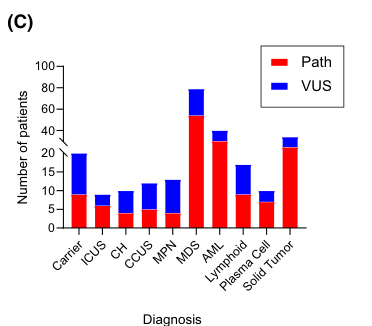

## Question

# Disease Characteristics Research Template

## Target Disease
- **Disease Name:** DDX41-related Hematologic Malignancy Predisposition Syndrome
- **MONDO ID:** MONDO:0014809 (if available)
- **Category:** Mendelian

## Research Objectives

Please provide a comprehensive research report on **DDX41-related Hematologic Malignancy Predisposition Syndrome** covering all of the
disease characteristics listed below. This report will be used to populate a disease knowledge
base entry. Be thorough and cite primary literature (PMID preferred) for all claims.

For each section, **suggested databases/resources** are listed. These are the first places
you should search for information on each topic.

---

### 1. Disease Information
> **Search first:** OMIM, Orphanet, ICD-10/ICD-11, MeSH, PubMed

- What is the disease? Provide a concise overview.
- What are the key identifiers? (OMIM, Orphanet, ICD-10/ICD-11, MeSH, Mondo)
- What are the common synonyms and alternative names?
- Is the information derived from individual patients (e.g., EHR) or aggregated disease-level resources?

### 2. Etiology

- **Disease Causal Factors**: What are the primary causes? (genetic, environmental, infectious, mechanistic)
- **Risk Factors**:
  > **Search first:** PubMed, Cochrane Library, UpToDate, clinical guidelines, ClinVar, ClinGen, GWAS Catalog, PheGenI, CTD, CDC, WHO, epidemiological databases
  - Genetic risk factors (causal variants, susceptibility loci, modifier genes)
  - Environmental risk factors (toxins, lifestyle, occupational exposures, age, sex, family history)
- **Protective Factors**:
  > **Search first:** PubMed, Cochrane Library, clinical trial databases, GWAS Catalog, gnomAD, WHO, CDC, nutrition databases
  - Genetic protective factors (protective variants, modifier alleles)
  - Environmental protective factors (diet, lifestyle, exposures that reduce risk)
- **Gene-Environment Interactions**: How do genetic and environmental factors interact to influence disease?
  > **Search first:** CTD, PubMed, PheGenI, GxE databases

### 3. Phenotypes
> **Search first:** HPO (Human Phenotype Ontology), OMIM, Orphanet, PubMed, clinicaltrials.gov, MedDRA, SNOMED CT, DECIPHER, LOINC

For each phenotype, provide:
- **Phenotype type**: symptoms, clinical signs, physical manifestations, behavioral changes, or laboratory abnormalities
  > For symptoms/signs: HPO, OMIM, Orphanet, PubMed
  > For behavioral changes: HPO, DSM, RDoC (Research Domain Criteria), PubMed
  > For laboratory abnormalities: LOINC, SNOMED CT, LabTests Online, PubMed
- **Phenotype characteristics**:
  > **Search first:** OMIM, Orphanet, HPO, PubMed
  - Age of symptom onset (neonatal, childhood, adult-onset, late-onset)
  - Symptom severity (mild, moderate, severe, variable)
  - Symptom progression (stable, progressive, episodic, fluctuating)
  - Frequency among affected individuals (percentage or qualitative)
- **Quality of life impact**: Effects on daily functioning and well-being (per-phenotype when possible)
  > **Search first:** EQ-5D database, SF-36, WHO QOL databases, PubMed
- Suggest HPO (Human Phenotype Ontology) terms for each phenotype

### 4. Genetic/Molecular Information

- **Causal Genes**: Gene mutations or chromosomal abnormalities responsible for disease (gene symbols, OMIM IDs)
  > **Search first:** OMIM, ClinVar, HGMD, Ensembl, NCBI Gene
- **Pathogenic Variants**:
  - Affected genes (gene symbols, HGNC IDs)
    > **Search first:** OMIM, NCBI Gene, Ensembl, HGNC, UniProt, GeneCards
  - Variant classification (pathogenic, likely pathogenic, VUS per ACMG/AMP guidelines)
    > **Search first:** ClinVar, ClinGen, ACMG/AMP guidelines, VarSome
  - Variant type/class (missense, frameshift, nonsense, splice-site, structural)
  - Allele frequency in population databases
    > **Search first:** gnomAD, 1000 Genomes, ExAC, TOPMed, dbSNP
  - Somatic vs germline origin
    > **Search first:** COSMIC (somatic), ClinVar, ICGC, TCGA
  - Functional consequences (loss of function, gain of function, dominant negative)
- **Modifier Genes**: Genes that modify disease severity or expression
- **Epigenetic Information**: DNA methylation, histone modifications, chromatin changes affecting disease
  > **Search first:** ENCODE, Roadmap Epigenomics, MethBase, DiseaseMeth
- **Chromosomal Abnormalities**: Large-scale genetic changes (aneuploidy, translocations, inversions)
  > **Search first:** DECIPHER, ClinVar, ECARUCA, UCSC Genome Browser

### 5. Environmental Information

- **Environmental Factors**: Non-genetic contributing factors (toxins, radiation, pollution, occupational exposure)
  > **Search first:** CTD (Comparative Toxicogenomics Database), TOXNET, PubMed, EPA databases
- **Lifestyle Factors**: Behavioral factors (smoking, diet, exercise, alcohol consumption)
  > **Search first:** CDC databases, WHO, PubMed, NHANES
- **Infectious Agents**: If applicable, pathogens causing or triggering disease (bacteria, viruses, fungi, parasites)
  > **Search first:** NCBI Taxonomy, ViPR, BV-BRC, MicrobeDB, GIDEON

### 6. Mechanism / Pathophysiology

**Present this section as an ordered causal chain first, then the detail below.**
Open with a numbered sequence of mechanistic steps running from the initiating
lesion (mutation, exposure, infection) to the clinical manifestation, one step per
line, each naming what it causes next. State the causal verb explicitly ("leads
to", "results in") and say where a step is inferred rather than demonstrated.
Where the mechanism branches, show the branch. The categories below are a
checklist of what to cover within those steps, not the organizing structure —
a step may draw on several of them, and a category may contribute to several
steps.

- **Molecular Pathways**: Specific signaling cascades or biochemical pathways involved (Wnt, MAPK, mTOR, PI3K-AKT, etc.)
  > **Search first:** KEGG, Reactome, WikiPathways, PathBank, BioCyc
- **Cellular Processes**: Cell-level mechanisms (apoptosis, autophagy, cell cycle dysregulation, inflammation, etc.)
  > **Search first:** Gene Ontology (GO), Reactome, KEGG, PubMed
- **Protein Dysfunction**: How protein structure or function is altered (misfolding, aggregation, loss of function, gain of function)
  > **Search first:** UniProt, PDB (Protein Data Bank), InterPro, Pfam, AlphaFold
- **Metabolic Changes**: Alterations in metabolic processes (energy metabolism, lipid metabolism, amino acid metabolism)
  > **Search first:** KEGG, BioCyc, HMDB (Human Metabolome Database), BRENDA
- **Immune System Involvement**: Role of immune response (autoimmunity, immunodeficiency, chronic inflammation)
  > **Search first:** ImmPort, Immunome Database, IEDB, Gene Ontology
- **Tissue Damage Mechanisms**: How tissues/ are injured (oxidative stress, ischemia, fibrosis, necrosis)
  > **Search first:** PubMed, Gene Ontology, Reactome
- **Biochemical Abnormalities**: Specific molecular defects (enzyme deficiencies, receptor dysfunction, ion channel defects)
  > **Search first:** BRENDA, UniProt, KEGG, OMIM, PubMed
- **Epigenetic Changes**: DNA methylation, histone modifications affecting gene expression in disease
  > **Search first:** ENCODE, Roadmap Epigenomics, MethBase, DiseaseMeth
- **Molecular Profiling** (if available):
  - Transcriptomics/gene expression changes
    > **Search first:** GEO (Gene Expression Omnibus), ArrayExpress, GTEx, Human Cell Atlas, SRA
  - Proteomics findings
    > **Search first:** PRIDE, ProteomeXchange, Human Protein Atlas, STRING, BioGRID
  - Metabolomics signatures
    > **Search first:** MetaboLights, Metabolomics Workbench, HMDB, METLIN
  - Lipidomics alterations
    > **Search first:** LIPID MAPS, SwissLipids, LipidHome, Metabolomics Workbench
  - Genomic structural features
    > **Search first:** UCSC Genome Browser, Ensembl, NCBI, dbVar, DGV
- **Advanced Technologies** (if applicable):
  - Single-cell analysis findings (cell-type specific mechanisms, cellular heterogeneity)
    > **Search first:** Human Cell Atlas, Single Cell Portal, GEO, CELLxGENE
  - Spatial transcriptomics findings
    > **Search first:** GEO, Spatial Research, Vizgen, 10x Genomics data
  - Multi-omics integration results
    > **Search first:** TCGA, ICGC, cBioPortal, LinkedOmics, PubMed
  - Functional genomics screens (CRISPR, RNAi)
    > **Search first:** DepMap, GenomeRNAi, PubMed, BioGRID ORCS

For each mechanism, describe:
- The causal chain from initial trigger to clinical manifestation
- Which mechanisms are upstream vs downstream
- What cell types and biological processes are involved
- Suggest GO terms for biological processes and CL terms for cell types

### 7. Anatomical Structures Affected

- **Organ Level**:
  - Primary organs directly affected
  - Secondary organ involvement (complications, secondary effects)
  - Body systems involved (cardiovascular, nervous, digestive, respiratory, endocrine, etc.)
  > **Search first:** Uberon, FMA (Foundational Model of Anatomy), OMIM, HPO, ICD-11, MeSH, SNOMED CT
- **Tissue and Cell Level**:
  - Specific tissue types affected (epithelial, connective, muscle, nervous)
  - Specific cell populations targeted (with Cell Ontology terms)
  > **Search first:** Uberon, Human Protein Atlas, Cell Ontology, Human Cell Atlas, CellMarker, PanglaoDB
- **Subcellular Level**:
  - Cellular compartments involved (mitochondria, nucleus, ER, lysosomes) (with GO Cellular Component terms)
  > **Search first:** Gene Ontology (Cellular Component), UniProt, Human Protein Atlas
- **Localization**:
  - Specific anatomical sites (with UBERON terms)
    > **Search first:** FMA, Uberon, NeuroNames (for brain), SNOMED CT
  - Lateralization (unilateral, bilateral, asymmetric)
    > **Search first:** HPO, clinical literature, imaging databases

### 8. Temporal Development

- **Onset**:
  - Typical age of onset (congenital, pediatric, adult, geriatric)
  - Onset pattern (acute, subacute, chronic, insidious)
  > **Search first:** OMIM, Orphanet, HPO, PubMed
- **Progression**:
  - Disease stages (early, intermediate, advanced, end-stage)
    > **Search first:** Cancer Staging Manual (AJCC), WHO classifications, PubMed
  - Progression rate (rapid, slow, variable)
  - Disease course pattern (episodic, relapsing-remitting, progressive, stable)
  - Disease duration (self-limited, chronic lifelong)
  > **Search first:** Disease registries, longitudinal cohort databases, natural history studies, PubMed, Orphanet, OMIM
- **Patterns**:
  - Remission patterns (spontaneous, treatment-induced)
    > **Search first:** Clinical trial databases, disease registries, PubMed
  - Critical periods (time windows of vulnerability or opportunity for intervention)
    > **Search first:** PubMed, developmental biology databases, clinical guidelines

### 9. Inheritance and Population

- **Epidemiology**:
  - Prevalence (cases per 100,000 at given time)
  - Incidence (new cases per 100,000 per year)
  > **Search first:** Orphanet, CDC, WHO, GBD (Global Burden of Disease), national registries, SEER, disease registries
- **For Genetic Etiology**:
  - Inheritance pattern (AD, AR, X-linked, mitochondrial, multifactorial, polygenic)
    > **Search first:** OMIM, Orphanet, ClinVar, GTR (Genetic Testing Registry)
  - Penetrance (complete, incomplete, age-dependent)
    > **Search first:** ClinVar, OMIM, PubMed, ClinGen
  - Expressivity (variable, consistent)
    > **Search first:** OMIM, ClinVar, PubMed
  - Genetic anticipation (increasing severity in successive generations)
    > **Search first:** OMIM, PubMed (especially for repeat expansion disorders)
  - Germline mosaicism
    > **Search first:** ClinVar, OMIM, genetic counseling literature, PubMed
  - Founder effects (population-specific mutations)
    > **Search first:** gnomAD, population genetics databases, PubMed
  - Consanguinity role
    > **Search first:** OMIM, population studies, genetic counseling resources
  - Carrier frequency
    > **Search first:** gnomAD, carrier screening databases, GeneReviews, GTR
- **Population Demographics**:
  - Affected populations (ethnic or demographic groups with higher prevalence)
    > **Search first:** gnomAD, 1000 Genomes, PAGE Study, PubMed, population registries
  - Geographic distribution (endemic areas, regional variation)
    > **Search first:** WHO, CDC, GBD, Orphanet, geographic epidemiology databases
  - Geographic distribution of specific variants
  - Sex ratio (male:female)
    > **Search first:** Disease registries, OMIM, PubMed, epidemiological databases
  - Age distribution of affected individuals
    > **Search first:** CDC, disease registries, SEER, Orphanet

### 10. Diagnostics

- **Clinical Tests**:
  - Laboratory tests (blood, urine, tissue chemistry, specific enzyme assays)
    > **Search first:** LOINC, LabTests Online, PubMed
  - Biomarkers (proteins, metabolites, genetic markers, circulating biomarkers)
    > **Search first:** FDA Biomarker List, BEST (Biomarkers, EndpointS, and other Tools), PubMed
  - Imaging studies (X-ray, CT, MRI, PET, ultrasound)
    > **Search first:** RadLex, DICOM, Radiopaedia, imaging databases
  - Functional tests (pulmonary function, cardiac stress tests)
    > **Search first:** LOINC, clinical guidelines, PubMed
  - Electrophysiology (EEG, EMG, ECG, nerve conduction studies)
    > **Search first:** LOINC, clinical neurophysiology databases, PubMed
  - Biopsy findings (histopathology, immunohistochemistry)
    > **Search first:** SNOMED CT, College of American Pathologists resources, PubMed
  - Pathology findings (microscopic examination)
    > **Search first:** SNOMED CT, Digital Pathology databases, PubMed
- **Genetic Testing**:
  > **Search first:** GTR (Genetic Testing Registry), GeneReviews, ClinGen
  - Overview of recommended genetic testing approach
  - Whole genome sequencing (WGS) utility
    > **Search first:** GTR, ClinVar, GEL (Genomics England), gnomAD
  - Whole exome sequencing (WES) utility
    > **Search first:** GTR, ClinVar, OMIM, GeneMatcher
  - Gene panels (which panels, which genes)
    > **Search first:** GTR, ClinVar, laboratory-specific databases
  - Single gene testing
    > **Search first:** GTR, ClinVar, OMIM, GeneReviews
  - Chromosomal microarray (CMA)
    > **Search first:** DECIPHER, ClinVar, dbVar, ECARUCA
  - Karyotyping
    > **Search first:** Chromosome Abnormality Database, ClinVar, cytogenetics resources
  - FISH
    > **Search first:** ClinVar, cytogenetics databases, PubMed
  - Mitochondrial DNA testing
    > **Search first:** MITOMAP, MSeqDR, ClinVar, GTR
  - Repeat expansion testing
    > **Search first:** GTR, ClinVar, repeat expansion databases, PubMed
- **Omics-Based Diagnostics** (if applicable):
  - RNA sequencing / transcriptomics
    > **Search first:** GEO, ArrayExpress, GTEx, RNA-seq databases
  - Proteomics
    > **Search first:** PRIDE, ProteomeXchange, FDA Biomarker database
  - Metabolomics
    > **Search first:** MetaboLights, Metabolomics Workbench, HMDB
  - Epigenomics
    > **Search first:** GEO, ENCODE, Roadmap Epigenomics, MethBase
  - Liquid biopsy
    > **Search first:** COSMIC, ClinVar, liquid biopsy databases, PubMed
- **Clinical Criteria**:
  - Standardized diagnostic criteria (DSM, ICD, society guidelines)
    > **Search first:** DSM-5, ICD-11, clinical society guidelines, UpToDate
  - Differential diagnosis (other conditions to rule out, with distinguishing features)
    > **Search first:** DynaMed, UpToDate, clinical decision support systems
- **Screening**:
  - Screening methods for asymptomatic individuals (newborn screening, carrier screening, cascade screening)
    > **Search first:** ACMG recommendations, CDC newborn screening, GTR

### 11. Outcome/Prognosis

- **Survival and Mortality**:
  - Survival rate (5-year, 10-year, overall)
    > **Search first:** SEER, cancer registries, disease-specific registries, PubMed
  - Life expectancy (with and without treatment if applicable)
    > **Search first:** Orphanet, disease registries, actuarial databases, PubMed
  - Mortality rate
    > **Search first:** CDC, WHO, GBD, national mortality databases
  - Disease-specific mortality (deaths directly attributable to disease)
    > **Search first:** Disease registries, CDC Wonder, GBD, PubMed
- **Morbidity and Function**:
  - Morbidity (disease-related disability and health impacts)
    > **Search first:** GBD, WHO, disability databases, PubMed
  - Disability outcomes (long-term functional impairments)
    > **Search first:** ICF (International Classification of Functioning), disability registries
  - Quality of life measures (EQ-5D, SF-36, PROMIS, disease-specific tools)
    > **Search first:** EQ-5D database, SF-36, PROMIS, PubMed
- **Disease Course**:
  - Complications (secondary problems: infections, organ failure, etc.)
    > **Search first:** ICD codes, disease registries, clinical databases, PubMed
  - Recovery potential (likelihood and extent of recovery, with vs without treatment)
    > **Search first:** Natural history studies, rehabilitation databases, PubMed
- **Prediction**:
  - Prognostic factors (age, disease severity, biomarkers, treatment response)
    > **Search first:** Prognostic models databases, clinical calculators, PubMed
  - Prognostic biomarkers (molecular markers predicting disease course)
    > **Search first:** FDA Biomarker database, PubMed, cancer prognostic databases

### 12. Treatment

- **Pharmacotherapy**:
  - Pharmacological treatments (drug names, drug classes, mechanisms of action)
    > **Search first:** DrugBank, RxNorm, ATC classification, DailyMed, FDA databases
  - Pharmacogenomics (how genetic variants affect drug metabolism, efficacy, toxicity)
    > **Search first:** PharmGKB, CPIC (Clinical Pharmacogenetics), FDA Table of PGx Biomarkers
- **Advanced Therapeutics**:
  - Gene therapy (viral vectors, CRISPR, gene replacement, gene editing)
    > **Search first:** ClinicalTrials.gov, FDA gene therapy database, ASGCT resources
  - Cell therapy (stem cell transplant, CAR-T, cellular therapeutics)
    > **Search first:** ClinicalTrials.gov, FDA cell therapy database, FACT standards
  - RNA-based therapies (ASOs, siRNA, mRNA therapies)
    > **Search first:** ClinicalTrials.gov, FDA approvals, PubMed
  - Targeted therapies (treatments directed at specific molecular targets)
    > **Search first:** My Cancer Genome, OncoKB, ClinicalTrials.gov, FDA approvals
  - Immunotherapies (checkpoint inhibitors, monoclonal antibodies)
    > **Search first:** Cancer Immunotherapy Database, FDA approvals, ClinicalTrials.gov
- **Surgical and Interventional**:
  - Surgical interventions (types of surgery, timing, outcomes)
    > **Search first:** CPT codes, surgical registries, clinical guidelines, PubMed
- **Supportive and Rehabilitative**:
  - Supportive care (symptom management, pain control, nutrition)
    > **Search first:** Clinical guidelines, Cochrane Library, PubMed
  - Rehabilitation (physical therapy, occupational therapy, speech therapy)
    > **Search first:** Rehabilitation medicine databases, clinical guidelines, PubMed
- **Experimental**:
  - Experimental treatments in clinical trials (with NCT identifiers if available)
    > **Search first:** ClinicalTrials.gov, EU Clinical Trials Register, WHO ICTRP
- **Treatment Outcomes**:
  - Treatment response rates
    > **Search first:** Clinical trial databases, FDA reviews, systematic reviews, PubMed
  - Side effects and adverse events
    > **Search first:** FDA Adverse Event Reporting System (FAERS), MedWatch, PubMed
- **Treatment Strategy**:
  - Treatment algorithms (clinical pathways, decision trees)
    > **Search first:** Clinical practice guidelines, NCCN Guidelines, UpToDate
  - Combination therapies
    > **Search first:** ClinicalTrials.gov, treatment guidelines, PubMed
  - Personalized medicine approaches (genotype-guided treatment)
    > **Search first:** My Cancer Genome, CIViC, PharmGKB, precision medicine databases

For each treatment, suggest NCIT (NCI Thesaurus) clinical-intervention terms where applicable.

### 13. Prevention

- **Prevention Levels**:
  - Primary prevention (preventing disease occurrence: vaccination, risk factor modification)
    > **Search first:** CDC, WHO, USPSTF recommendations, Cochrane Library
  - Secondary prevention (early detection and treatment: screening programs, early intervention)
    > **Search first:** USPSTF, CDC screening guidelines, WHO
  - Tertiary prevention (preventing complications in those with disease)
    > **Search first:** Clinical guidelines, disease management protocols, PubMed
- **Immunization**: Vaccine strategies (if applicable)
  > **Search first:** CDC vaccine schedules, WHO immunization, FDA vaccine database
- **Screening and Early Detection**:
  - Screening programs (population-based: newborn screening, cancer screening)
    > **Search first:** CDC screening programs, USPSTF, cancer screening databases
  - Genetic screening (carrier screening, preimplantation genetic diagnosis, prenatal testing)
    > **Search first:** ACMG recommendations, ACOG guidelines, GTR
  - Risk stratification (identifying high-risk individuals for targeted prevention)
    > **Search first:** Risk prediction models, clinical calculators, PubMed
- **Behavioral Interventions**: Lifestyle modifications to reduce risk
  > **Search first:** CDC, WHO, behavioral intervention databases, Cochrane Library
- **Counseling**: Genetic counseling (risk assessment, family planning guidance)
  > **Search first:** NSGC resources, ACMG guidelines, GeneReviews
- **Public Health**:
  - Public health interventions (sanitation, vector control, health education)
    > **Search first:** CDC, WHO, public health databases, PubMed
  - Environmental interventions (reducing environmental risk factors)
    > **Search first:** EPA databases, WHO environmental health, PubMed
- **Prophylaxis**: Preventive medications or procedures
  > **Search first:** Clinical guidelines, FDA approvals, PubMed

### 14. Other Species / Natural Disease

- **Taxonomy**: Species affected (with NCBI Taxon identifiers)
  > **Search first:** NCBI Taxonomy
- **Breed**: Specific breeds affected (with VBO identifiers if applicable)
  > **Search first:** VBO (Vertebrate Breed Ontology)
- **Gene**: Orthologous genes in other species (with NCBI Gene IDs)
  > **Search first:** NCBI Gene
- **Natural Disease**:
  - Naturally occurring disease in other species (companion animals, wildlife)
    > **Search first:** OMIA (Online Mendelian Inheritance in Animals), VetCompass, PubMed
  - Veterinary relevance and importance in animal health
    > **Search first:** OMIA, veterinary databases, PubMed
- **Comparative Biology**:
  - Comparative pathology (similarities and differences across species)
    > **Search first:** OMIA, comparative pathology databases, PubMed
  - Evolutionary conservation of disease mechanisms
    > **Search first:** HomoloGene, OrthoMCL, Alliance of Genome Resources
- **Transmission** (if applicable):
  - Zoonotic potential
    > **Search first:** CDC zoonotic diseases, WHO zoonoses, GIDEON
  - Cross-species susceptibility
    > **Search first:** NCBI Taxonomy, veterinary databases, PubMed

### 15. Model Organisms

- **Model Types**:
  - Model organism type (mammalian, invertebrate, cellular, in vitro)
    > **Search first:** Alliance of Genome Resources, model organism databases
  - Specific model systems (mouse, rat, zebrafish, Drosophila, C. elegans, yeast, cell lines, organoids, iPSCs)
    > **Search first:** MGI, RGD, ZFIN, FlyBase, WormBase, SGD, ATCC, Cellosaurus
  - Induced models (drug treatment, surgical intervention, environmental manipulation)
    > **Search first:** MGI, model organism databases, PubMed
- **Genetic Models**:
  - Types available (knockout, knock-in, transgenic, conditional, humanized)
    > **Search first:** MGI, IMPC, KOMP, EuMMCR, IMSR
- **Model Characteristics**:
  - Phenotype recapitulation (how well model reproduces human disease features)
    > **Search first:** Model organism databases, comparative studies, PubMed
  - Model limitations (aspects of human disease not captured)
    > **Search first:** Model organism databases, PubMed, review articles
- **Applications**:
  - Research applications (what aspects of disease can be studied)
    > **Search first:** Model organism databases, PubMed
- **Resources**:
  - Model databases
    > **Search first:** MGI, RGD, ZFIN, FlyBase, WormBase, IMSR, EMMA, MMRRC

---

## Citation Requirements

- Cite primary literature (PMID preferred) for all mechanistic and clinical claims
- Prioritize recent reviews and landmark papers
- Include direct quotes from abstracts where possible to support key statements
- Distinguish evidence source types: human clinical, model organism, in vitro, computational

## Output Format

Structure your response as a comprehensive narrative organized by the sections above.
For each section, provide:
- Factual content with specific details (numbers, percentages, gene names, variant nomenclature)
- Ontology term suggestions (HPO, GO, CL, UBERON, CHEBI, NCIT, MONDO) where applicable
- Evidence citations with PMIDs
- Direct quotes from abstracts to support key claims
- Clear indication when information is not available or not applicable for this disease

This report will be used to populate a disease knowledge base entry with:
- Pathophysiology descriptions with causal chains
- Gene/protein annotations (HGNC, GO terms)
- Phenotype associations (HP terms) with frequencies
- Cell type involvement (CL terms)
- Anatomical locations (UBERON terms)
- Chemical entities (CHEBI terms)
- Treatment annotations (NCIT terms)
- Evidence items with PMIDs and exact abstract quotes
- Epidemiology, prognosis, diagnostic, and prevention information
- Animal model descriptions with phenotype recapitulation details

## Output

Question: You are an expert researcher providing comprehensive, well-cited information.

Provide detailed information focusing on:
1. Key concepts and definitions with current understanding
2. Recent developments and latest research (prioritize 2023-2024 sources)
3. Current applications and real-world implementations
4. Expert opinions and analysis from authoritative sources
5. Relevant statistics and data from recent studies

Format as a comprehensive research report with proper citations. Include URLs and publication dates where available.
Always prioritize recent, authoritative sources and provide specific citations for all major claims.

# Disease Characteristics Research Template

## Target Disease
- **Disease Name:** DDX41-related Hematologic Malignancy Predisposition Syndrome
- **MONDO ID:** MONDO:0014809 (if available)
- **Category:** Mendelian

## Research Objectives

Please provide a comprehensive research report on **DDX41-related Hematologic Malignancy Predisposition Syndrome** covering all of the
disease characteristics listed below. This report will be used to populate a disease knowledge
base entry. Be thorough and cite primary literature (PMID preferred) for all claims.

For each section, **suggested databases/resources** are listed. These are the first places
you should search for information on each topic.

---

### 1. Disease Information
> **Search first:** OMIM, Orphanet, ICD-10/ICD-11, MeSH, PubMed

- What is the disease? Provide a concise overview.
- What are the key identifiers? (OMIM, Orphanet, ICD-10/ICD-11, MeSH, Mondo)
- What are the common synonyms and alternative names?
- Is the information derived from individual patients (e.g., EHR) or aggregated disease-level resources?

### 2. Etiology

- **Disease Causal Factors**: What are the primary causes? (genetic, environmental, infectious, mechanistic)
- **Risk Factors**:
  > **Search first:** PubMed, Cochrane Library, UpToDate, clinical guidelines, ClinVar, ClinGen, GWAS Catalog, PheGenI, CTD, CDC, WHO, epidemiological databases
  - Genetic risk factors (causal variants, susceptibility loci, modifier genes)
  - Environmental risk factors (toxins, lifestyle, occupational exposures, age, sex, family history)
- **Protective Factors**:
  > **Search first:** PubMed, Cochrane Library, clinical trial databases, GWAS Catalog, gnomAD, WHO, CDC, nutrition databases
  - Genetic protective factors (protective variants, modifier alleles)
  - Environmental protective factors (diet, lifestyle, exposures that reduce risk)
- **Gene-Environment Interactions**: How do genetic and environmental factors interact to influence disease?
  > **Search first:** CTD, PubMed, PheGenI, GxE databases

### 3. Phenotypes
> **Search first:** HPO (Human Phenotype Ontology), OMIM, Orphanet, PubMed, clinicaltrials.gov, MedDRA, SNOMED CT, DECIPHER, LOINC

For each phenotype, provide:
- **Phenotype type**: symptoms, clinical signs, physical manifestations, behavioral changes, or laboratory abnormalities
  > For symptoms/signs: HPO, OMIM, Orphanet, PubMed
  > For behavioral changes: HPO, DSM, RDoC (Research Domain Criteria), PubMed
  > For laboratory abnormalities: LOINC, SNOMED CT, LabTests Online, PubMed
- **Phenotype characteristics**:
  > **Search first:** OMIM, Orphanet, HPO, PubMed
  - Age of symptom onset (neonatal, childhood, adult-onset, late-onset)
  - Symptom severity (mild, moderate, severe, variable)
  - Symptom progression (stable, progressive, episodic, fluctuating)
  - Frequency among affected individuals (percentage or qualitative)
- **Quality of life impact**: Effects on daily functioning and well-being (per-phenotype when possible)
  > **Search first:** EQ-5D database, SF-36, WHO QOL databases, PubMed
- Suggest HPO (Human Phenotype Ontology) terms for each phenotype

### 4. Genetic/Molecular Information

- **Causal Genes**: Gene mutations or chromosomal abnormalities responsible for disease (gene symbols, OMIM IDs)
  > **Search first:** OMIM, ClinVar, HGMD, Ensembl, NCBI Gene
- **Pathogenic Variants**:
  - Affected genes (gene symbols, HGNC IDs)
    > **Search first:** OMIM, NCBI Gene, Ensembl, HGNC, UniProt, GeneCards
  - Variant classification (pathogenic, likely pathogenic, VUS per ACMG/AMP guidelines)
    > **Search first:** ClinVar, ClinGen, ACMG/AMP guidelines, VarSome
  - Variant type/class (missense, frameshift, nonsense, splice-site, structural)
  - Allele frequency in population databases
    > **Search first:** gnomAD, 1000 Genomes, ExAC, TOPMed, dbSNP
  - Somatic vs germline origin
    > **Search first:** COSMIC (somatic), ClinVar, ICGC, TCGA
  - Functional consequences (loss of function, gain of function, dominant negative)
- **Modifier Genes**: Genes that modify disease severity or expression
- **Epigenetic Information**: DNA methylation, histone modifications, chromatin changes affecting disease
  > **Search first:** ENCODE, Roadmap Epigenomics, MethBase, DiseaseMeth
- **Chromosomal Abnormalities**: Large-scale genetic changes (aneuploidy, translocations, inversions)
  > **Search first:** DECIPHER, ClinVar, ECARUCA, UCSC Genome Browser

### 5. Environmental Information

- **Environmental Factors**: Non-genetic contributing factors (toxins, radiation, pollution, occupational exposure)
  > **Search first:** CTD (Comparative Toxicogenomics Database), TOXNET, PubMed, EPA databases
- **Lifestyle Factors**: Behavioral factors (smoking, diet, exercise, alcohol consumption)
  > **Search first:** CDC databases, WHO, PubMed, NHANES
- **Infectious Agents**: If applicable, pathogens causing or triggering disease (bacteria, viruses, fungi, parasites)
  > **Search first:** NCBI Taxonomy, ViPR, BV-BRC, MicrobeDB, GIDEON

### 6. Mechanism / Pathophysiology

**Present this section as an ordered causal chain first, then the detail below.**
Open with a numbered sequence of mechanistic steps running from the initiating
lesion (mutation, exposure, infection) to the clinical manifestation, one step per
line, each naming what it causes next. State the causal verb explicitly ("leads
to", "results in") and say where a step is inferred rather than demonstrated.
Where the mechanism branches, show the branch. The categories below are a
checklist of what to cover within those steps, not the organizing structure —
a step may draw on several of them, and a category may contribute to several
steps.

- **Molecular Pathways**: Specific signaling cascades or biochemical pathways involved (Wnt, MAPK, mTOR, PI3K-AKT, etc.)
  > **Search first:** KEGG, Reactome, WikiPathways, PathBank, BioCyc
- **Cellular Processes**: Cell-level mechanisms (apoptosis, autophagy, cell cycle dysregulation, inflammation, etc.)
  > **Search first:** Gene Ontology (GO), Reactome, KEGG, PubMed
- **Protein Dysfunction**: How protein structure or function is altered (misfolding, aggregation, loss of function, gain of function)
  > **Search first:** UniProt, PDB (Protein Data Bank), InterPro, Pfam, AlphaFold
- **Metabolic Changes**: Alterations in metabolic processes (energy metabolism, lipid metabolism, amino acid metabolism)
  > **Search first:** KEGG, BioCyc, HMDB (Human Metabolome Database), BRENDA
- **Immune System Involvement**: Role of immune response (autoimmunity, immunodeficiency, chronic inflammation)
  > **Search first:** ImmPort, Immunome Database, IEDB, Gene Ontology
- **Tissue Damage Mechanisms**: How tissues/ are injured (oxidative stress, ischemia, fibrosis, necrosis)
  > **Search first:** PubMed, Gene Ontology, Reactome
- **Biochemical Abnormalities**: Specific molecular defects (enzyme deficiencies, receptor dysfunction, ion channel defects)
  > **Search first:** BRENDA, UniProt, KEGG, OMIM, PubMed
- **Epigenetic Changes**: DNA methylation, histone modifications affecting gene expression in disease
  > **Search first:** ENCODE, Roadmap Epigenomics, MethBase, DiseaseMeth
- **Molecular Profiling** (if available):
  - Transcriptomics/gene expression changes
    > **Search first:** GEO (Gene Expression Omnibus), ArrayExpress, GTEx, Human Cell Atlas, SRA
  - Proteomics findings
    > **Search first:** PRIDE, ProteomeXchange, Human Protein Atlas, STRING, BioGRID
  - Metabolomics signatures
    > **Search first:** MetaboLights, Metabolomics Workbench, HMDB, METLIN
  - Lipidomics alterations
    > **Search first:** LIPID MAPS, SwissLipids, LipidHome, Metabolomics Workbench
  - Genomic structural features
    > **Search first:** UCSC Genome Browser, Ensembl, NCBI, dbVar, DGV
- **Advanced Technologies** (if applicable):
  - Single-cell analysis findings (cell-type specific mechanisms, cellular heterogeneity)
    > **Search first:** Human Cell Atlas, Single Cell Portal, GEO, CELLxGENE
  - Spatial transcriptomics findings
    > **Search first:** GEO, Spatial Research, Vizgen, 10x Genomics data
  - Multi-omics integration results
    > **Search first:** TCGA, ICGC, cBioPortal, LinkedOmics, PubMed
  - Functional genomics screens (CRISPR, RNAi)
    > **Search first:** DepMap, GenomeRNAi, PubMed, BioGRID ORCS

For each mechanism, describe:
- The causal chain from initial trigger to clinical manifestation
- Which mechanisms are upstream vs downstream
- What cell types and biological processes are involved
- Suggest GO terms for biological processes and CL terms for cell types

### 7. Anatomical Structures Affected

- **Organ Level**:
  - Primary organs directly affected
  - Secondary organ involvement (complications, secondary effects)
  - Body systems involved (cardiovascular, nervous, digestive, respiratory, endocrine, etc.)
  > **Search first:** Uberon, FMA (Foundational Model of Anatomy), OMIM, HPO, ICD-11, MeSH, SNOMED CT
- **Tissue and Cell Level**:
  - Specific tissue types affected (epithelial, connective, muscle, nervous)
  - Specific cell populations targeted (with Cell Ontology terms)
  > **Search first:** Uberon, Human Protein Atlas, Cell Ontology, Human Cell Atlas, CellMarker, PanglaoDB
- **Subcellular Level**:
  - Cellular compartments involved (mitochondria, nucleus, ER, lysosomes) (with GO Cellular Component terms)
  > **Search first:** Gene Ontology (Cellular Component), UniProt, Human Protein Atlas
- **Localization**:
  - Specific anatomical sites (with UBERON terms)
    > **Search first:** FMA, Uberon, NeuroNames (for brain), SNOMED CT
  - Lateralization (unilateral, bilateral, asymmetric)
    > **Search first:** HPO, clinical literature, imaging databases

### 8. Temporal Development

- **Onset**:
  - Typical age of onset (congenital, pediatric, adult, geriatric)
  - Onset pattern (acute, subacute, chronic, insidious)
  > **Search first:** OMIM, Orphanet, HPO, PubMed
- **Progression**:
  - Disease stages (early, intermediate, advanced, end-stage)
    > **Search first:** Cancer Staging Manual (AJCC), WHO classifications, PubMed
  - Progression rate (rapid, slow, variable)
  - Disease course pattern (episodic, relapsing-remitting, progressive, stable)
  - Disease duration (self-limited, chronic lifelong)
  > **Search first:** Disease registries, longitudinal cohort databases, natural history studies, PubMed, Orphanet, OMIM
- **Patterns**:
  - Remission patterns (spontaneous, treatment-induced)
    > **Search first:** Clinical trial databases, disease registries, PubMed
  - Critical periods (time windows of vulnerability or opportunity for intervention)
    > **Search first:** PubMed, developmental biology databases, clinical guidelines

### 9. Inheritance and Population

- **Epidemiology**:
  - Prevalence (cases per 100,000 at given time)
  - Incidence (new cases per 100,000 per year)
  > **Search first:** Orphanet, CDC, WHO, GBD (Global Burden of Disease), national registries, SEER, disease registries
- **For Genetic Etiology**:
  - Inheritance pattern (AD, AR, X-linked, mitochondrial, multifactorial, polygenic)
    > **Search first:** OMIM, Orphanet, ClinVar, GTR (Genetic Testing Registry)
  - Penetrance (complete, incomplete, age-dependent)
    > **Search first:** ClinVar, OMIM, PubMed, ClinGen
  - Expressivity (variable, consistent)
    > **Search first:** OMIM, ClinVar, PubMed
  - Genetic anticipation (increasing severity in successive generations)
    > **Search first:** OMIM, PubMed (especially for repeat expansion disorders)
  - Germline mosaicism
    > **Search first:** ClinVar, OMIM, genetic counseling literature, PubMed
  - Founder effects (population-specific mutations)
    > **Search first:** gnomAD, population genetics databases, PubMed
  - Consanguinity role
    > **Search first:** OMIM, population studies, genetic counseling resources
  - Carrier frequency
    > **Search first:** gnomAD, carrier screening databases, GeneReviews, GTR
- **Population Demographics**:
  - Affected populations (ethnic or demographic groups with higher prevalence)
    > **Search first:** gnomAD, 1000 Genomes, PAGE Study, PubMed, population registries
  - Geographic distribution (endemic areas, regional variation)
    > **Search first:** WHO, CDC, GBD, Orphanet, geographic epidemiology databases
  - Geographic distribution of specific variants
  - Sex ratio (male:female)
    > **Search first:** Disease registries, OMIM, PubMed, epidemiological databases
  - Age distribution of affected individuals
    > **Search first:** CDC, disease registries, SEER, Orphanet

### 10. Diagnostics

- **Clinical Tests**:
  - Laboratory tests (blood, urine, tissue chemistry, specific enzyme assays)
    > **Search first:** LOINC, LabTests Online, PubMed
  - Biomarkers (proteins, metabolites, genetic markers, circulating biomarkers)
    > **Search first:** FDA Biomarker List, BEST (Biomarkers, EndpointS, and other Tools), PubMed
  - Imaging studies (X-ray, CT, MRI, PET, ultrasound)
    > **Search first:** RadLex, DICOM, Radiopaedia, imaging databases
  - Functional tests (pulmonary function, cardiac stress tests)
    > **Search first:** LOINC, clinical guidelines, PubMed
  - Electrophysiology (EEG, EMG, ECG, nerve conduction studies)
    > **Search first:** LOINC, clinical neurophysiology databases, PubMed
  - Biopsy findings (histopathology, immunohistochemistry)
    > **Search first:** SNOMED CT, College of American Pathologists resources, PubMed
  - Pathology findings (microscopic examination)
    > **Search first:** SNOMED CT, Digital Pathology databases, PubMed
- **Genetic Testing**:
  > **Search first:** GTR (Genetic Testing Registry), GeneReviews, ClinGen
  - Overview of recommended genetic testing approach
  - Whole genome sequencing (WGS) utility
    > **Search first:** GTR, ClinVar, GEL (Genomics England), gnomAD
  - Whole exome sequencing (WES) utility
    > **Search first:** GTR, ClinVar, OMIM, GeneMatcher
  - Gene panels (which panels, which genes)
    > **Search first:** GTR, ClinVar, laboratory-specific databases
  - Single gene testing
    > **Search first:** GTR, ClinVar, OMIM, GeneReviews
  - Chromosomal microarray (CMA)
    > **Search first:** DECIPHER, ClinVar, dbVar, ECARUCA
  - Karyotyping
    > **Search first:** Chromosome Abnormality Database, ClinVar, cytogenetics resources
  - FISH
    > **Search first:** ClinVar, cytogenetics databases, PubMed
  - Mitochondrial DNA testing
    > **Search first:** MITOMAP, MSeqDR, ClinVar, GTR
  - Repeat expansion testing
    > **Search first:** GTR, ClinVar, repeat expansion databases, PubMed
- **Omics-Based Diagnostics** (if applicable):
  - RNA sequencing / transcriptomics
    > **Search first:** GEO, ArrayExpress, GTEx, RNA-seq databases
  - Proteomics
    > **Search first:** PRIDE, ProteomeXchange, FDA Biomarker database
  - Metabolomics
    > **Search first:** MetaboLights, Metabolomics Workbench, HMDB
  - Epigenomics
    > **Search first:** GEO, ENCODE, Roadmap Epigenomics, MethBase
  - Liquid biopsy
    > **Search first:** COSMIC, ClinVar, liquid biopsy databases, PubMed
- **Clinical Criteria**:
  - Standardized diagnostic criteria (DSM, ICD, society guidelines)
    > **Search first:** DSM-5, ICD-11, clinical society guidelines, UpToDate
  - Differential diagnosis (other conditions to rule out, with distinguishing features)
    > **Search first:** DynaMed, UpToDate, clinical decision support systems
- **Screening**:
  - Screening methods for asymptomatic individuals (newborn screening, carrier screening, cascade screening)
    > **Search first:** ACMG recommendations, CDC newborn screening, GTR

### 11. Outcome/Prognosis

- **Survival and Mortality**:
  - Survival rate (5-year, 10-year, overall)
    > **Search first:** SEER, cancer registries, disease-specific registries, PubMed
  - Life expectancy (with and without treatment if applicable)
    > **Search first:** Orphanet, disease registries, actuarial databases, PubMed
  - Mortality rate
    > **Search first:** CDC, WHO, GBD, national mortality databases
  - Disease-specific mortality (deaths directly attributable to disease)
    > **Search first:** Disease registries, CDC Wonder, GBD, PubMed
- **Morbidity and Function**:
  - Morbidity (disease-related disability and health impacts)
    > **Search first:** GBD, WHO, disability databases, PubMed
  - Disability outcomes (long-term functional impairments)
    > **Search first:** ICF (International Classification of Functioning), disability registries
  - Quality of life measures (EQ-5D, SF-36, PROMIS, disease-specific tools)
    > **Search first:** EQ-5D database, SF-36, PROMIS, PubMed
- **Disease Course**:
  - Complications (secondary problems: infections, organ failure, etc.)
    > **Search first:** ICD codes, disease registries, clinical databases, PubMed
  - Recovery potential (likelihood and extent of recovery, with vs without treatment)
    > **Search first:** Natural history studies, rehabilitation databases, PubMed
- **Prediction**:
  - Prognostic factors (age, disease severity, biomarkers, treatment response)
    > **Search first:** Prognostic models databases, clinical calculators, PubMed
  - Prognostic biomarkers (molecular markers predicting disease course)
    > **Search first:** FDA Biomarker database, PubMed, cancer prognostic databases

### 12. Treatment

- **Pharmacotherapy**:
  - Pharmacological treatments (drug names, drug classes, mechanisms of action)
    > **Search first:** DrugBank, RxNorm, ATC classification, DailyMed, FDA databases
  - Pharmacogenomics (how genetic variants affect drug metabolism, efficacy, toxicity)
    > **Search first:** PharmGKB, CPIC (Clinical Pharmacogenetics), FDA Table of PGx Biomarkers
- **Advanced Therapeutics**:
  - Gene therapy (viral vectors, CRISPR, gene replacement, gene editing)
    > **Search first:** ClinicalTrials.gov, FDA gene therapy database, ASGCT resources
  - Cell therapy (stem cell transplant, CAR-T, cellular therapeutics)
    > **Search first:** ClinicalTrials.gov, FDA cell therapy database, FACT standards
  - RNA-based therapies (ASOs, siRNA, mRNA therapies)
    > **Search first:** ClinicalTrials.gov, FDA approvals, PubMed
  - Targeted therapies (treatments directed at specific molecular targets)
    > **Search first:** My Cancer Genome, OncoKB, ClinicalTrials.gov, FDA approvals
  - Immunotherapies (checkpoint inhibitors, monoclonal antibodies)
    > **Search first:** Cancer Immunotherapy Database, FDA approvals, ClinicalTrials.gov
- **Surgical and Interventional**:
  - Surgical interventions (types of surgery, timing, outcomes)
    > **Search first:** CPT codes, surgical registries, clinical guidelines, PubMed
- **Supportive and Rehabilitative**:
  - Supportive care (symptom management, pain control, nutrition)
    > **Search first:** Clinical guidelines, Cochrane Library, PubMed
  - Rehabilitation (physical therapy, occupational therapy, speech therapy)
    > **Search first:** Rehabilitation medicine databases, clinical guidelines, PubMed
- **Experimental**:
  - Experimental treatments in clinical trials (with NCT identifiers if available)
    > **Search first:** ClinicalTrials.gov, EU Clinical Trials Register, WHO ICTRP
- **Treatment Outcomes**:
  - Treatment response rates
    > **Search first:** Clinical trial databases, FDA reviews, systematic reviews, PubMed
  - Side effects and adverse events
    > **Search first:** FDA Adverse Event Reporting System (FAERS), MedWatch, PubMed
- **Treatment Strategy**:
  - Treatment algorithms (clinical pathways, decision trees)
    > **Search first:** Clinical practice guidelines, NCCN Guidelines, UpToDate
  - Combination therapies
    > **Search first:** ClinicalTrials.gov, treatment guidelines, PubMed
  - Personalized medicine approaches (genotype-guided treatment)
    > **Search first:** My Cancer Genome, CIViC, PharmGKB, precision medicine databases

For each treatment, suggest NCIT (NCI Thesaurus) clinical-intervention terms where applicable.

### 13. Prevention

- **Prevention Levels**:
  - Primary prevention (preventing disease occurrence: vaccination, risk factor modification)
    > **Search first:** CDC, WHO, USPSTF recommendations, Cochrane Library
  - Secondary prevention (early detection and treatment: screening programs, early intervention)
    > **Search first:** USPSTF, CDC screening guidelines, WHO
  - Tertiary prevention (preventing complications in those with disease)
    > **Search first:** Clinical guidelines, disease management protocols, PubMed
- **Immunization**: Vaccine strategies (if applicable)
  > **Search first:** CDC vaccine schedules, WHO immunization, FDA vaccine database
- **Screening and Early Detection**:
  - Screening programs (population-based: newborn screening, cancer screening)
    > **Search first:** CDC screening programs, USPSTF, cancer screening databases
  - Genetic screening (carrier screening, preimplantation genetic diagnosis, prenatal testing)
    > **Search first:** ACMG recommendations, ACOG guidelines, GTR
  - Risk stratification (identifying high-risk individuals for targeted prevention)
    > **Search first:** Risk prediction models, clinical calculators, PubMed
- **Behavioral Interventions**: Lifestyle modifications to reduce risk
  > **Search first:** CDC, WHO, behavioral intervention databases, Cochrane Library
- **Counseling**: Genetic counseling (risk assessment, family planning guidance)
  > **Search first:** NSGC resources, ACMG guidelines, GeneReviews
- **Public Health**:
  - Public health interventions (sanitation, vector control, health education)
    > **Search first:** CDC, WHO, public health databases, PubMed
  - Environmental interventions (reducing environmental risk factors)
    > **Search first:** EPA databases, WHO environmental health, PubMed
- **Prophylaxis**: Preventive medications or procedures
  > **Search first:** Clinical guidelines, FDA approvals, PubMed

### 14. Other Species / Natural Disease

- **Taxonomy**: Species affected (with NCBI Taxon identifiers)
  > **Search first:** NCBI Taxonomy
- **Breed**: Specific breeds affected (with VBO identifiers if applicable)
  > **Search first:** VBO (Vertebrate Breed Ontology)
- **Gene**: Orthologous genes in other species (with NCBI Gene IDs)
  > **Search first:** NCBI Gene
- **Natural Disease**:
  - Naturally occurring disease in other species (companion animals, wildlife)
    > **Search first:** OMIA (Online Mendelian Inheritance in Animals), VetCompass, PubMed
  - Veterinary relevance and importance in animal health
    > **Search first:** OMIA, veterinary databases, PubMed
- **Comparative Biology**:
  - Comparative pathology (similarities and differences across species)
    > **Search first:** OMIA, comparative pathology databases, PubMed
  - Evolutionary conservation of disease mechanisms
    > **Search first:** HomoloGene, OrthoMCL, Alliance of Genome Resources
- **Transmission** (if applicable):
  - Zoonotic potential
    > **Search first:** CDC zoonotic diseases, WHO zoonoses, GIDEON
  - Cross-species susceptibility
    > **Search first:** NCBI Taxonomy, veterinary databases, PubMed

### 15. Model Organisms

- **Model Types**:
  - Model organism type (mammalian, invertebrate, cellular, in vitro)
    > **Search first:** Alliance of Genome Resources, model organism databases
  - Specific model systems (mouse, rat, zebrafish, Drosophila, C. elegans, yeast, cell lines, organoids, iPSCs)
    > **Search first:** MGI, RGD, ZFIN, FlyBase, WormBase, SGD, ATCC, Cellosaurus
  - Induced models (drug treatment, surgical intervention, environmental manipulation)
    > **Search first:** MGI, model organism databases, PubMed
- **Genetic Models**:
  - Types available (knockout, knock-in, transgenic, conditional, humanized)
    > **Search first:** MGI, IMPC, KOMP, EuMMCR, IMSR
- **Model Characteristics**:
  - Phenotype recapitulation (how well model reproduces human disease features)
    > **Search first:** Model organism databases, comparative studies, PubMed
  - Model limitations (aspects of human disease not captured)
    > **Search first:** Model organism databases, PubMed, review articles
- **Applications**:
  - Research applications (what aspects of disease can be studied)
    > **Search first:** Model organism databases, PubMed
- **Resources**:
  - Model databases
    > **Search first:** MGI, RGD, ZFIN, FlyBase, WormBase, IMSR, EMMA, MMRRC

---

## Citation Requirements

- Cite primary literature (PMID preferred) for all mechanistic and clinical claims
- Prioritize recent reviews and landmark papers
- Include direct quotes from abstracts where possible to support key statements
- Distinguish evidence source types: human clinical, model organism, in vitro, computational

## Output Format

Structure your response as a comprehensive narrative organized by the sections above.
For each section, provide:
- Factual content with specific details (numbers, percentages, gene names, variant nomenclature)
- Ontology term suggestions (HPO, GO, CL, UBERON, CHEBI, NCIT, MONDO) where applicable
- Evidence citations with PMIDs
- Direct quotes from abstracts to support key claims
- Clear indication when information is not available or not applicable for this disease

This report will be used to populate a disease knowledge base entry with:
- Pathophysiology descriptions with causal chains
- Gene/protein annotations (HGNC, GO terms)
- Phenotype associations (HP terms) with frequencies
- Cell type involvement (CL terms)
- Anatomical locations (UBERON terms)
- Chemical entities (CHEBI terms)
- Treatment annotations (NCIT terms)
- Evidence items with PMIDs and exact abstract quotes
- Epidemiology, prognosis, diagnostic, and prevention information
- Animal model descriptions with phenotype recapitulation details

# DDX41-related hematologic malignancy predisposition syndrome: disease-characteristics report

**Scope and evidence standard.** This report concerns the predominantly **autosomal-dominant, heterozygous germline DDX41 predisposition** to myeloid neoplasia, not every cancer in which a somatic DDX41 variant is detected. Evidence is labeled as human clinical, population-genetic, animal-model, or cell-based where that distinction matters. Reported percentages from selected clinics are **not population prevalence or lifetime risk**. Publications from 2023–2025 receive emphasis; a DOI URL is supplied when available. PMID numbers and ontology cross-references that could not be independently verified are deliberately not invented. (kusne2025prevalenceofcytopenia(s) pages 1-2, badar2023clinicalandmolecular pages 1-2, hendricks2025genomefirstdeterminationof pages 3-3)

The principal studies and their denominators are summarized here before the disease-level synthesis. (kusne2025prevalenceofcytopenia(s) pages 1-2, badar2023clinicalandmolecular pages 1-2, hendricks2025genomefirstdeterminationof pages 3-3, korotev2025overallcancerrisk pages 4-8, tesi2025validationofguidelines pages 4-5)

| Source / year / DOI | Design and denominator | Exact key numerical observation | Main limitations |
|---|---|---|---|
| **Badar et al., 2023** — [10.3324/haematol.2023.282867](https://doi.org/10.3324/haematol.2023.282867) | Retrospective, clinically ascertained sequencing cohort: **4,524** patients evaluated for suspected/known myeloid neoplasms; **107** had DDX41 variants (**44 P/LP**, **63 VUS**, including 11 with both). (badar2023clinicalandmolecular pages 1-2) | DDX41 P/LP variants occurred in **44/4,524 (0.9%)** and VUS in **63/4,524 (1.4%)**. Among high-risk MDS/AML, median overall survival was **63.4 months** with P/LP versus **55.7 months** with VUS (*P*=0.93). (badar2023clinicalandmolecular pages 1-2, badar2023clinicalandmolecular pages 6-9) | Referral/testing cohort, not population-based; many variants were presumed germline from variant allele fraction rather than confirmed in nonhematopoietic tissue; VUS inclusion complicates causal inference. |
| **Kusne et al., 2025** — [10.1111/bjh.20018](https://doi.org/10.1111/bjh.20018) | Retrospective Mayo Clinic DDX41 germline-predisposition cohort: **195** individuals; **42.3% P/LP** and **57.6% VUS**. (kusne2025prevalenceofcytopenia(s) pages 1-2) | Within this selected cohort, diagnoses included **MDS 79/195 (40.5%)**, **AML 40/195 (20.5%)**, and **MPN 13/195 (6.7%)**; these are cohort case proportions, not population prevalence. Among myeloid-neoplasm patients, **78.8%** had a normal karyotype. (kusne2025prevalenceofcytopenia(s) pages 1-2, kusne2025prevalenceofcytopenia(s) pages 2-3) | Clinic-based ascertainment enriched for disease; most participants were White (**92%**); more than half carried VUS; retrospective categories overlap with other malignancy histories and do not establish longitudinal transition rates. |
| **Tesi et al., 2025** — [10.1158/1078-0432.CCR-24-4251](https://doi.org/10.1158/1078-0432.CCR-24-4251) | Prospective multicenter Swedish validation of Nordic germline-testing criteria: **85** selected patients with AML, MDS, thrombocytopenia, or related phenotypes. | P/LP germline variants were found in **30/85 (35%)**; **DDX41 accounted for 13/30 (43%)** positive cases. Yield was **6% (1/16)** under family-history criteria versus **52% (17/33)** under tumor cytogenetic/molecular criteria. (tesi2025validationofguidelines pages 4-5) | Only patients already meeting investigation criteria were enrolled; therefore, the 35% yield is not prevalence among all AML/MDS patients. Cohort size and national testing practices may limit generalizability. |
| **Hendricks et al., 2025**; online 6 Nov 2024 — [10.1038/s41375-024-02436-y](https://doi.org/10.1038/s41375-024-02436-y) | Genome-first population analysis; UK Biobank included **469,595** exomes and **815** DDX41 P/LP heterozygotes. | DDX41 P/LP-carrier frequency was **815/469,595**, approximately **1 in 576**. Hematologic malignancy was recorded in **43/815 (5.2%; 1 in 19)** carriers; myeloid-malignancy risk was elevated (**OR 5.7**, 95% CI 3.9–8.3). (hendricks2025genomefirstdeterminationof pages 3-3, hendricks2025genomefirstdeterminationof pages 1-2) | Electronic-record and tumor-registry outcomes may miss diagnoses; UK Biobank has healthy-volunteer and ancestry biases; 5.2% is observed record-based penetrance over available follow-up, not lifetime penetrance. |
| **Korotev et al., 2025** — [10.3324/haematol.2024.286887](https://doi.org/10.3324/haematol.2024.286887) | Family-based cohort: **93 P/LP DDX41 carriers from 43 families**; marrow was reviewed in 29 carriers. | Estimated hematologic-malignancy penetrance was **50/93 (54%) by age 90**. Among reviewed marrows, small hypolobated megakaryocytes and macrocytic erythrocytes were reported in **75%** and **50%**, respectively. (korotev2025overallcancerrisk pages 4-8) | Families were clinically selected for suspected predisposition, which can inflate penetrance; only a subset had marrow review; baseline dysplasia can cause MDS overdiagnosis and requires clinical context. |
| **Stepanchick et al., 2024** — [10.1038/s41375-024-02304-9](https://doi.org/10.1038/s41375-024-02304-9) | Primary experimental study using hematopoietic-specific **Ddx41+/−** mice, competitive bone-marrow transplantation, transcriptomics, and combined **Ddx41+/−;Trp53+/−** mice. | Ddx41 haploinsufficiency caused only mild persistent red-cell reduction at steady state, but transplantation stress exposed HSPC fitness defects and age-related hematopoietic failure; reduced *Trp53* dosage rescued fitness yet promoted MDS/AML-like malignancies. (stepanchick2024ddx41haploinsufficiencycauses pages 1-2, stepanchick2024ddx41haploinsufficiencycauses pages 11-11) | Mouse transplantation stress is not equivalent to natural human aging; heterozygous Ddx41 loss alone did not reproduce overt human malignancy; the cooperating *Trp53* model represents only one possible secondary pathway. |
| **Bi et al., 2025** — [10.1038/s41467-025-62307-7](https://doi.org/10.1038/s41467-025-62307-7) | Mechanistic study spanning conditional mouse knockouts, a DDX41-mutated human sample, and human iPSC-derived bone-marrow organoids. | DDX41 deficiency increased G-quadruplex accumulation, erythroid genome instability, ribosomal defects, and p53 signaling; **cGas deficiency rescued embryonic lethality** in hematopoietic-specific *Ddx41*-knockout mice. (bi2025ddx41resolvesgquadruplexes pages 1-2) | Primarily preclinical; complete knockout is more severe than typical human heterozygous germline disease; rescue of mouse lethality does not establish that cGAS inhibition prevents human MDS/AML. |

*Table: Primary clinical and experimental evidence is organized by design, denominator, exact quantitative finding, and major limitation. Cohort proportions are explicitly distinguished from population frequency and lifetime penetrance.*

## 1. Disease information

**Definition.** A pathogenic constitutional variant in *DDX41*, which encodes DEAD-box helicase 41, confers a usually late-onset predisposition to myelodysplastic neoplasms/syndromes (**MDS**) and acute myeloid leukemia (**AML**). Carriers can remain clinically well for decades; affected marrow often subsequently acquires a somatic alteration, commonly in the other *DDX41* allele. Related names in the literature include *germline DDX41-associated myeloid neoplasm*, *DDX41-associated susceptibility to myeloid neoplasms*, and *DDX41 mutant germline predisposition syndrome*. The predisposition and the eventual MDS/AML diagnosis should be recorded as related but distinct concepts. (arai2024germlinevariantsand pages 5-6, kusne2025prevalenceofcytopenia(s) pages 1-2, badar2023clinicalandmolecular pages 1-2, badar2022germlineandsomatic pages 1-3)

**Identifiers and provenance.** The requested **MONDO:0014809** is a proposed entry identifier requiring direct ontology verification before database ingestion. A syndrome-specific OMIM number, Orphanet number, MeSH descriptor, and dedicated ICD-10/ICD-11 code were **not verified** in the retrieved source material; do not substitute an MDS or AML code as though it uniquely identified inherited predisposition. The clinical-trial record maps the *manifestations* MDS and AML to MeSH **D009190** and **D015470**, respectively, not to a DDX41-specific syndrome descriptor. The numerical data below derive from aggregated publications, registries, family cohorts, experiments, and trial registrations—not a disclosed individual-patient EHR record. (NCT06022016 chunk 1, korotev2025overallcancerrisk pages 30-35)

## 2. Etiology and risk or protective factors

**Established cause:** an inherited, pathogenic/likely pathogenic heterozygous *DDX41* variant. Germline changes include start-loss, frameshift, nonsense, splice-site, and selected functionally consequential missense variants. An acquired second *DDX41* variant—often p.Arg525His—frequently accompanies overt disease, although other somatic drivers can participate and a demonstrable second *DDX41* hit is **not mandatory** in every case. Advancing age, male sex in several affected cohorts, and a pathogenic variant in a first-degree relative inform risk assessment. Because of late onset and incomplete penetrance, an apparently negative family history does not exclude the syndrome. (arai2024germlinevariantsand pages 5-6, kusne2025prevalenceofcytopenia(s) pages 1-2, stepanchick2024ddx41haploinsufficiencycauses pages 1-2, badar2022germlineandsomatic pages 1-3, lee2026germlineddx41mutations pages 4-5, tesi2025validationofguidelines pages 17-17)

**Modifiers and environment:** somatic alterations in *TP53*, *ASXL1*, *TET2*, and *DNMT3A* can accompany *DDX41*-associated neoplasia; *TP53* reduction experimentally cooperates with *Ddx41* haploinsufficiency, but no second germline gene has been validated as a generally predictive penetrance modifier. Transplantation stress reveals a phenotype in heterozygous mice, providing a **mechanistic hypothesis**, not evidence that ordinary physical stress causes the human syndrome. Infection and inflammation are proposed contributors to inherited leukemia progression generally, but no DDX41-specific pathogen, occupational toxin, radiation dose, smoking threshold, diet, or exercise exposure has an established syndrome-specific risk estimate. No validated protective DDX41 allele, diet, supplement, prophylactic medication, or lifestyle intervention prevents malignant transformation. Avoiding tobacco and unnecessary carcinogenic exposures remains reasonable general cancer prevention, **not demonstrated DDX41-specific protection**. (kusne2025prevalenceofcytopenia(s) pages 3-5, stepanchick2024ddx41haploinsufficiencycauses pages 1-2, stepanchick2024ddx41haploinsufficiencycauses pages 11-11, korotev2025overallcancerrisk pages 4-8)

## 3. Phenotypes

The following figures describe **195 selected Mayo Clinic individuals**, **42.3% with pathogenic variants and 57.6% with variants of uncertain significance (VUS)**. Categories therefore do not estimate the phenotype frequencies among *all* confirmed pathogenic-variant carriers. (kusne2025prevalenceofcytopenia(s) pages 1-2)

| Phenotype and suggested HPO concept | Type, onset and course | Observed frequency and impact |
|---|---|---|
| Asymptomatic predisposition; **no disease-sign HPO term should be assigned simply for carrier status** | Genetic risk present from birth; may remain clinically silent into late adulthood. | 20/195 (**10.2%**) in the Mayo clinical cohort; absence of symptoms does not mean absence of risk. (kusne2025prevalenceofcytopenia(s) pages 2-3, kusne2025prevalenceofcytopenia(s) pages 5-6) |
| Unexplained cytopenia; **Anemia**, **Macrocytic anemia**, **Neutropenia**, **Thrombocytopenia**, **Pancytopenia** | Laboratory abnormalities, generally adult onset; can be indolent or progressive. Anemia may cause fatigue and exertional dyspnea; neutropenia and thrombocytopenia can predispose to infection and bleeding. | ICUS 10/195 (**5.1%**); CCUS 12/195 (**6.1%**). Within the **12 CCUS cases**, initial macrocytic anemia was reported in **5**, thrombocytopenia in **4**, neutropenia in **3**, and pancytopenia in **2**; these findings can coexist and must **not** be extrapolated to all carriers. (kusne2025prevalenceofcytopenia(s) pages 2-3, kusne2025prevalenceofcytopenia(s) pages 8-9, wagner2023casereportof pages 1-2) |
| Clonal hematopoiesis; **Clonal hematopoiesis** as a proposed ontology mapping requiring verification | Molecular/laboratory finding, often preceding neoplasia; not itself AML. | 10/195 (**5.1%**) had CH and 12/195 had CCUS in the Mayo cohort; these selected clinical categories are not longitudinal transition probabilities. (kusne2025prevalenceofcytopenia(s) pages 2-3, kusne2025prevalenceofcytopenia(s) pages 5-6) |
| MDS; suggested **Myelodysplasia**, **Bone marrow hypocellularity**, **Abnormality of the megakaryocytes** | Marrow pathology with ineffective hematopoiesis and persistent cytopenias; severity and progression to AML vary. | 79/195 (**40.5%**); among affected myeloid-neoplasm patients, **78.8%** had normal karyotypes. Marrow need not be hypocellular: it can be hypo-, normo-, or hypercellular. Dysplasia can affect otherwise unaffected carriers and alone must not establish MDS. (kusne2025prevalenceofcytopenia(s) pages 1-2, kusne2025prevalenceofcytopenia(s) pages 3-5, li2022amlwithgermline pages 1-2, korotev2025overallcancerrisk pages 4-8) |
| AML; suggested **Acute myeloid leukemia** | Potentially life-threatening expansion of myeloid blasts, usually late adulthood; may arise after a prolonged cytopenic phase. | 40/195 (**20.5%**). In an independent 28-patient germline-DDX41 AML series, antecedent cytopenia averaged **11.2 months** and **75%** had normal karyotypes. (kusne2025prevalenceofcytopenia(s) pages 1-2, li2022amlwithgermline pages 1-2) |
| Less certain associated diagnoses; use disease-specific HPO/ontology mapping only after adjudication | Myeloproliferative, lymphoid, and plasma-cell disorders have been reported; attribution to DDX41 varies by variant and competing drivers. | Mayo cohort: MPN **13/195 (6.7%)**, lymphoid neoplasms **9.2%**, plasma-cell dyscrasias **6.1%**. Observed solid tumors **22.5%** are **not proof** that DDX41 directly causes each tumor. (kusne2025prevalenceofcytopenia(s) pages 1-2, kusne2025prevalenceofcytopenia(s) pages 8-9, korotev2025overallcancerrisk pages 14-17) |

These suggested HPO labels are **candidate mappings, not validated HP accession numbers**. Disease-specific EQ-5D, SF-36, PROMIS scores and symptom-by-symptom quality-of-life estimates were not established in the accessible studies. The chief functional consequences are those of cytopenias, malignancy and its treatment; a published familial AML patient reported reduced exercise tolerance and dyspnea. (kusne2025prevalenceofcytopenia(s) pages 8-9, wagner2023casereportof pages 1-2)

## 4. Genetic and molecular information

**Gene and location:** *DDX41*, chromosome **5q35**, encodes a DEAD-box RNA helicase implicated in RNA processing and nucleic-acid homeostasis. The *DDX41* HGNC and gene-OMIM accession numbers require authoritative database lookup before structured entry. Examples of germline changes documented in clinical series are the initiation-codon variant **p.Met1Ile** or more generally **p.Met1?**, frameshift **p.Asp140Glyfs*2**, and nonsense **p.Gln41***; reported splice-site and other missense alleles require independent, variant-specific ACMG/AMP assessment. Do not automatically classify *every* DDX41 missense change as pathogenic: **VUS is not a molecular diagnosis**. Individual-allele gnomAD frequencies and ClinVar accessions were not reliably available here. (kusne2025prevalenceofcytopenia(s) pages 1-2, badar2023clinicalandmolecular pages 1-2, badar2022germlineandsomatic pages 1-3, goyal2021clinicalandpathologic pages 6-8, kusne2025prevalenceofcytopenia(s) pages 8-9)

**Acquired genetics and biological effect:** somatic **p.Arg525His** is a recurrent helicase-domain second hit; p.Gly530Asp is another reported acquired alteration. In the Mayo cohort somatic *DDX41* alterations occurred in **67/195 (34.4%)**; **53.8% of these 67** were p.Arg525His. Other acquired variants included *TET2* **11.2%**, *DNMT3A* approximately **9.6%–9.7%**, and *ASXL1* **9.2%** of the overall selected cohort. Germline truncating variants commonly reduce functional dosage; the somatic missense hotspot impairs helicase-associated functions, but its precise consequences are context-dependent and should not be flattened into an established universal “complete loss-of-function” mechanism. Chromosomal **del(5q)** can affect the locus but is **not established as the characteristic second hit**: normal conventional karyotypes predominate. (kusne2025prevalenceofcytopenia(s) pages 1-2, kusne2025prevalenceofcytopenia(s) pages 3-5, stepanchick2024ddx41haploinsufficiencycauses pages 11-11, badar2022germlineandsomatic pages 1-3, maciejewski2017ddx41relatedmyeloidneoplasia. pages 1-3)

**Epigenetics:** a 2024 experiment concerns **N6-methyladenosine (m6A) on RNA** and its recognition in R-loop control; this is **not equivalent to demonstrating disease-specific DNA-methylation or histone-mark signatures**. Somatic mutations in epigenetic regulators can coexist but do not establish a diagnostic DDX41-specific epigenetic assay. (kusne2025prevalenceofcytopenia(s) pages 3-5, hwang2024impairedbindingaffinity pages 1-3)

## 5. Environmental information

No infectious agent is recognized as the **cause** of this Mendelian syndrome, and it has no infectious transmission. Pathogen sensing is a normal DDX41 protein function; it must not be mistaken for evidence that a particular infection initiates inherited DDX41 disease. Neither a disease-specific chemical exposure, pollution effect, radiation interaction, smoking effect, nor evidence-based dietary, alcohol, or exercise modifier was quantified in the retrieved human carrier studies. One individual case documents smoking history but cannot establish a gene–smoking interaction. (ma2024multifunctionalroleof pages 8-9, korotev2025overallcancerrisk pages 4-8, wagner2023casereportof pages 1-2)

## 6. Mechanism and pathophysiology

**Ordered causal chain—evidence varies by arrow:**

1. **Inherited heterozygous pathogenic *DDX41* alteration leads to** reduced or altered helicase function in hematopoietic cells; **experimentally supported** for several loss-of-function models, but the effect must be established variant by variant. (stepanchick2024ddx41haploinsufficiencycauses pages 1-2, ma2024multifunctionalroleof pages 8-9)
2. **Reduced DDX41 function leads to** vulnerability of hematopoietic stem/progenitor cells (**HSPCs**) and erythroid progenitors under proliferative stress; **demonstrated in mice and zebrafish**, with human penetrance and the initiating everyday stressor still uncertain. (stepanchick2024ddx41haploinsufficiencycauses pages 1-2, stepanchick2024ddx41haploinsufficiencycauses pages 5-5, weinreb2022clinicalandmechanistic pages 7-8)
3. **Branch A—impaired RNA splicing/transcription coordination and altered m6A–R-loop regulation lead to** excess RNA:DNA hybrids and transcription–replication conflicts; **demonstrated in cellular and experimental hematopoietic models**, with the m6A–METTL3/METTL14–YTHDC1 interaction demonstrated in 2024 knock-in/knockout cells and MDS specimens. (shinriki2022ddx41coordinatesrna pages 14-14, hwang2024impairedbindingaffinity pages 1-3)
4. **Branch B—defective G-quadruplex resolution leads to** erythroid genome stress and activation of p53 and cGAS–STING; **demonstrated predominantly in conditional mice, with supportive human patient and iPSC-organoid findings**. Whether this branch is the principal cause of common adult-onset carrier disease remains **inferred**. (bi2025ddx41resolvesgquadruplexes pages 1-2)
5. **Branch C—impaired RNA/snoRNA processing and protein-production programs lead to** reduced translational capacity and ineffective erythropoiesis; **experimentally supported**, although a complete quantitative metabolic signature for affected patients is unavailable. (stepanchick2024ddx41haploinsufficiencycauses pages 5-5, ma2024multifunctionalroleof pages 8-9)
6. **R-loop/genome or cell-cycle stress leads to** impaired erythroid-progenitor proliferation, DNA-damage signaling, arrest and cytopenia; **supported in models** and by genotype-integrated single-cell analysis of **one** human MDS patient’s erythroid colony-forming cells. (shinriki2022ddx41coordinatesrna pages 14-14, matsui2025genotypeintegratedsinglecelltranscriptome pages 1-2)
7. **An acquired second *DDX41* variant or another cooperating somatic alteration leads to** expansion/evolution of a predisposed marrow clone; the frequent germline–somatic association is **observed clinically**, while the exact selective steps in each person are **inferred**. In one mouse model, reduced *Trp53* dosage rescued HSPC fitness but led to MDS/AML-like malignancy. (kusne2025prevalenceofcytopenia(s) pages 3-5, stepanchick2024ddx41haploinsufficiencycauses pages 1-2, stepanchick2024ddx41haploinsufficiencycauses pages 11-11)
8. **Ineffective or dysplastic hematopoiesis leads to** circulating cytopenias and MDS; further malignant evolution **results in** AML in a subset. This final clinical linkage is **established**, but an individual carrier’s progression is not inevitable. (kusne2025prevalenceofcytopenia(s) pages 1-2, li2022amlwithgermline pages 1-2)

**Pathway and cell-level detail.** DDX41 links spliceosomal activity and RNA polymerase II pausing to RNA:DNA-hybrid homeostasis; loss can generate micronuclei and DNA damage. Hwang and colleagues’ 2024 primary work found that DDX41 deficiency disrupted **METTL3/METTL14–YTHDC1** interactions and increased m6A-associated R-loops. Stepanchick and colleagues observed p53 stress-response transcription and reduced HSPC translation after transplantation, but **did not observe increased DNA-damage foci as the dominant mechanism in their heterozygous model**—an important counterexample to assuming all models share the same upstream lesion. Innate-immune **cGAS–STING**, type-I interferon and **NF-κB** responses are biologically implicated, not a proven pathogen-driven clinical subtype. (stepanchick2024ddx41haploinsufficiencycauses pages 5-5, shinriki2022ddx41coordinatesrna pages 14-14, stepanchick2024ddx41haploinsufficiencycauses pages 11-11, hwang2024impairedbindingaffinity pages 1-3, bi2025ddx41resolvesgquadruplexes pages 1-2, korotev2025overallcancerrisk pages 14-17)

**Profiling and advanced methods.** A 2025 genotype-integrated single-cell study of **one human MDS patient** associated acquired p.Arg525His with **G2/M arrest, R-loop accumulation and DNA damage in colony-forming unit–erythroid cells**; stem/myeloid-progenitor expression was more similar between mutant and nonmutant cells, and proposed intercellular effects came from computational ligand–receptor analyses. In a separate study, transcriptomics of patient-derived lymphoblastoid lines implicated TNF/NF-κB inflammatory programs; UK Biobank **49-carrier versus 98-control** plasma-proteomic comparison suggested inflammatory dysregulation, not a clinically validated test. A disease-specific spatial-transcriptomic, metabolomic, or lipidomic diagnostic signature was not established. (matsui2025genotypeintegratedsinglecelltranscriptome pages 1-2, matsui2025genotypeintegratedsinglecelltranscriptome pages 8-10, korotev2025overallcancerrisk pages 4-8, korotev2025overallcancerrisk pages 14-17)

**Ontology suggestions, requiring accession validation:** GO biological processes—*mRNA splicing via spliceosome*, *RNA processing*, *ribosome biogenesis*, *regulation of DNA replication*, *DNA damage response*, *erythrocyte differentiation*, *innate immune response*; Cell Ontology (CL)—*hematopoietic stem cell*, *hematopoietic progenitor cell*, *erythroid progenitor cell/colony-forming unit–erythroid*, *myeloid progenitor cell*, and *dendritic cell*. These are process/cell-type annotations, **not claims that a specific GO or CL accession was checked**. (stepanchick2024ddx41haploinsufficiencycauses pages 1-2, shinriki2022ddx41coordinatesrna pages 14-14, hwang2024impairedbindingaffinity pages 1-3, matsui2025genotypeintegratedsinglecelltranscriptome pages 1-2)

## 7. Anatomical structures affected

The primary organ is **bone marrow**, particularly its hematopoietic stem/progenitor and erythroid-progenitor compartments; secondary clinical involvement is the **circulating blood**, where cytopenias manifest. Marrow megakaryocytes, erythroid precursors, and myeloid blasts are relevant according to disease stage. Suggested UBERON mappings are **bone marrow** and **blood**; suggested GO cellular-component mappings are **nucleus/nucleoplasm** and **spliceosomal complex** for RNA/genome-associated activity, plus **cytosol** for nucleic-acid sensing. Other organs can be affected secondarily by anemia, bleeding, infection, treatment, or leukemic infiltration but are **not a defining inherited anatomic malformation**. Laterality is not applicable. A rare **biallelic** DDX41 multisystem case involving bone dysplasia and ichthyosis should not be merged into the phenotype of typical heterozygous adult predisposition. (sharma2024biallelicgermlineddx41 pages 4-6, shinriki2022ddx41coordinatesrna pages 14-14, kusne2025prevalenceofcytopenia(s) pages 8-9, korotev2025overallcancerrisk pages 4-8)

## 8. Temporal development

The variant is congenital, but the cancer-predisposition phenotype is usually **adult or later-life onset**, commonly in the sixth to eighth decades; persistent cytopenias can precede neoplasia. The Mayo cohort’s median age was **68.6 years**, with a wide **16.2–93.4-year** range across its mixed clinical categories. Among Mayo patients with CCUS, first detected cytopenia occurred at a median **66.0 years**; five of 12 later developed pancytopenia after a median **3.2 years**. The process can remain clinically silent, progress through cytopenic/clonal states, or present as MDS or AML without a documented intermediate stage. These are **possible courses, not mandatory stages**. (kusne2025prevalenceofcytopenia(s) pages 1-2, kusne2025prevalenceofcytopenia(s) pages 2-3, kusne2025prevalenceofcytopenia(s) pages 8-9)

Spontaneous remission of an inherited predisposition is not established. Cancer remission can be treatment-induced; a pathogenic constitutional variant remains present outside the transplanted hematopoietic compartment. A clinically important intervention window is **before using a related transplant donor**, when familial genetic testing can prevent selection of a carrier donor. Long-term prospective timing and optimal age at surveillance initiation remain unresolved; longitudinal studies are registered. (NCT07019155 chunk 1, NCT06022016 chunk 1, wagner2023casereportof pages 1-2)

## 9. Inheritance and population epidemiology

**Inheritance:** autosomal dominant **predisposition with incomplete, age-dependent penetrance and variable expressivity**, rather than a guarantee of leukemia. Each child of a heterozygous carrier has a **50% probability of inheriting that variant**, not a 50% probability of developing malignancy. Evidence for genetic anticipation, clinically relevant germline mosaicism, or consanguinity as an established explanation of the usual adult syndrome was not found. Rare biallelic presentations should be assessed separately. Ancestry-associated recurrent variants are reported—particularly p.A500fs in Japanese cohorts and start-loss/p.Asp140 frameshifts in European-ancestry cohorts—but neither ethnicity nor an isolated recurrent variant is a substitute for molecular diagnosis. (sharma2024biallelicgermlineddx41 pages 4-6, kusne2025prevalenceofcytopenia(s) pages 1-2, badar2022germlineandsomatic pages 1-3, lee2026germlineddx41mutations pages 4-5)

**Different denominators produce different estimates.** In a large *affected-patient* analysis summarized in a recent review, **293/9,082 (3.2%)** myeloid-neoplasm patients had pathogenic/likely pathogenic germline *DDX41* variants; estimated malignancy penetrance approached **49.3% by age 90**, with higher reported male than female risk. Those original 2023 primary-study figures were not independently accessible here and should be treated as **secondary-reported estimates**. In contrast, the genome-first UK Biobank study identified **815 pathogenic/likely pathogenic heterozygotes among 469,595 participants**, approximately **1 in 576**, and recorded hematologic malignancy in **43/815 (5.2%)** over available records; myeloid-malignancy odds ratio was **5.7** (95% CI **3.9–8.3**). The record-based 5.2% and age-90 family/cohort estimates describe **different ascertainment, time horizons and outcomes** and must not be averaged. In another family-ascertained cohort, **50/93 (54%)** carriers from **43 families** had hematologic malignancy by age 90, subject to familial ascertainment bias. Disease-specific incidence or point prevalence per 100,000 people/year was **not verified**. (lee2026germlineddx41mutations pages 4-5, hendricks2025genomefirstdeterminationof pages 3-3, hendricks2025genomefirstdeterminationof pages 1-2, korotev2025overallcancerrisk pages 4-8)

Male predominance is common in clinically affected series—for example **64.1% male** in the selected 195-person Mayo cohort—but a genome-first cohort **did not establish the same carrier-sex predominance**. Thus observed clinical sex ratios should not be confused with allele frequency or treated as a universal penetrance coefficient. Geographic incidence and population-wide carrier frequency by specific HGVS allele remain incompletely established. (kusne2025prevalenceofcytopenia(s) pages 1-2, hendricks2025genomefirstdeterminationof pages 7-9, lee2026germlineddx41mutations pages 4-5)

## 10. Diagnostics and screening

**Clinical work-up:** personal and three-generation family history; serial **complete blood count with differential**, smear and examination for persistent cytopenias or other abnormalities; if indicated, marrow aspirate/biopsy for cellularity, dysplasia and blasts, plus conventional karyotype, appropriate FISH, flow cytometry and somatic myeloid sequencing. Normal karyotype and absent family history **do not rule out** DDX41-associated disease. Marrow dysplasia alone needs caution: in a 2025 family study, mild blood or marrow dysplasia appeared even in some individuals **without overt malignancy**. CT/MRI/PET, electrocardiography, electrophysiology and functional organ studies do not diagnose the inherited predisposition; they are used for particular complications or treatment planning. (kusne2025prevalenceofcytopenia(s) pages 1-2, badar2023clinicalandmolecular pages 1-2, goyal2021clinicalandpathologic pages 9-10, korotev2025overallcancerrisk pages 4-8, wagner2023casereportof pages 1-2)

**Molecular confirmation:** include *DDX41* in inherited MDS/AML predisposition panels; targeted single-gene familial-variant testing is appropriate for cascade screening. WES or WGS is useful if a broader inherited syndrome is suspected or panel testing is unresolved, provided coverage and copy-number assessment are appropriate. Tumor/blood sequencing may **raise suspicion** through variant allele fraction or a second hit, but it does **not establish constitutional origin**: confirm with a suitable **nonhematopoietic reference sample**, preferably cultured skin fibroblasts when feasible, with attention to hematopoietic contamination of buccal or saliva material. As a warning against rigid VAF cutoffs, one reported germline start-loss variant appeared at only **29%–35%** VAF because of amplification bias. Interpret pathogenicity using ACMG/AMP principles and curated gene-specific evidence; distinguish pathogenic/likely pathogenic from VUS. CMA, karyotyping and FISH characterize copy-number/cytogenetic findings but cannot replace sequence-based germline confirmation; mitochondrial DNA and repeat-expansion testing have no established routine role. RNA-seq, proteomics, metabolomics and liquid biopsy are **not validated stand-alone diagnostic tests** for this predisposition. (badar2023clinicalandmolecular pages 1-2, kusne2025prevalenceofcytopenia(s) pages 1-2, goyal2021clinicalandpathologic pages 9-10, goyal2021clinicalandpathologic pages 6-8, korotev2025overallcancerrisk pages 4-8)

**Clinical implementation:** in a prospective Swedish validation of selected germline-testing referrals, **30/85 (35%)** had a pathogenic/likely pathogenic germline result; **13/30 (43%)** positives were *DDX41*. Yield was **1/16 (6%)** under the family-history criterion versus **17/33 (52%)** in the tumor cytogenetic/molecular criterion subgroup. These are **testing yields in preselected referrals**, not prevalence among all patients. The 2022 WHO/ICC categories for myeloid neoplasms with germline predisposition inform malignancy classification; genetic testing establishes the inherited state separately from morphologic MDS/AML criteria. Key differentials include sporadic or therapy-related MDS/AML, non-neoplastic cytopenias, aplastic anemia, and other germline syndromes involving *RUNX1, GATA2, CEBPA, ETV6,* or *ANKRD26*. There is no routine population newborn-screening program established for DDX41 predisposition. (kusne2025prevalenceofcytopenia(s) pages 1-2, chen2026apatientwith pages 1-2, tesi2025validationofguidelines pages 4-5)

## 11. Outcomes and prognosis

An unaffected pathogenic-variant carrier does **not** have the prognosis of someone with AML. Prognosis after neoplasia depends on age, disease subtype/stage, cytogenetics, additional somatic lesions, treatment response and transplant risks. In one **28-patient** germline-DDX41 AML series, median overall survival was **not reached**, versus **21 months** in an age-matched DDX41-wild-type comparator; this nonrandomized result should not be turned into an untreated life-expectancy estimate. In Badar and colleagues’ selected high-risk MDS/AML groups, median survival was **63.4 months** with pathogenic variants versus **55.7 months** with VUS (**P=0.93**); this is not evidence that VUS are individually disease-causing. A universal five- or ten-year syndrome-wide survival or disease-specific mortality rate was not established. (badar2023clinicalandmolecular pages 1-2, badar2023clinicalandmolecular pages 6-9, li2022amlwithgermline pages 6-7)

Complications include marrow failure, transfusion requirements, bleeding/infection risk from cytopenias, AML progression, relapse, and treatment/transplant toxicity. In the 2025 Mayo CCUS subgroup, **2 patients** were reported to progress to MDS, but the underlying passage also gives a discordant percentage denominator; therefore **no reliable CCUS-to-MDS rate should be calculated from it**. Direct EQ-5D/SF-36 and long-term disability estimates specific to DDX41 are unavailable in these sources. (kusne2025prevalenceofcytopenia(s) pages 8-9, badar2023clinicalandmolecular pages 6-9)

## 12. Treatment and real-world implementation

**Treatment targets the manifested disease, not the inherited allele.** For higher-risk MDS, approaches include disease-appropriate hypomethylating agents (**azacitidine or decitabine**) and consideration of allogeneic hematopoietic-cell transplantation. For AML, treatment is individualized by fitness, disease genetics and goals: conventional cytarabine/anthracycline-based induction where appropriate; azacitidine or decitabine-based lower-intensity regimens, sometimes with the BCL2 inhibitor **venetoclax**; supportive transfusions and infection management. Selected low-risk MDS patients may receive erythropoiesis-stimulating or other indication-specific supportive therapy. None is established as a **DDX41-specific approved targeted drug**. Suggested intervention concepts for NCI Thesaurus mapping are *azacitidine*, *decitabine*, *venetoclax*, *cytarabine*, *erythropoiesis-stimulating agent*, *red blood cell transfusion*, *allogeneic hematopoietic stem cell transplantation*, and *genetic counseling*; confirm current **NCIT accessions** before importing. Suggested ChEBI substance mappings for the named drugs likewise require lookup. (kusne2025prevalenceofcytopenia(s) pages 8-9, badar2023clinicalandmolecular pages 6-9)

In the 2023 Mayo report, pathogenic-variant versus VUS groups received hypomethylating-agent-based treatment in **22/44 (50%) versus 5/63 (reported 18.5%)** and intensive chemotherapy in **7/44 (16%) versus 1/63**; **7/8 evaluable treated AML patients achieved complete remission (87.5%)**. The inconsistent quoted VUS denominator/percentage and small evaluable AML group caution against interpreting these as genotype-specific comparative efficacy. A 2021 systematic review reported approximately **70%** HMA response in its pooled MDS sample and **96%** AML chemotherapy complete remission, but heterogeneous treatment selection and small subgroups limit inference. Drug-specific pharmacogenomic rules, an approved gene-editing/ASO therapy, CAR-T indication, or preventive transplantation standard for an otherwise well DDX41 carrier were **not established**. (badar2023clinicalandmolecular pages 6-9, badar2022germlineandsomatic pages 1-3)

**Transplant-specific decision:** test a prospective **related donor for the familial pathogenic variant** and avoid using a carrier donor where possible because donor-derived leukemia has been reported. In a published family, **5/6 siblings** carried the variant and the initially selected HLA-matched sister was excluded as donor. Allogeneic transplantation may provide curative potential for the **hematologic malignancy**, but risks include graft-versus-host disease (GVHD), infection, non-relapse mortality and late relapse. A review summarizes a **21-patient** DDX41 transplant subgroup with severe acute GVHD in approximately **38%** and a possible reduction with post-transplant cyclophosphamide; because primary subgroup estimates were not directly verified here, these observations should **not** be treated as a DDX41-specific randomized prophylaxis recommendation. Conventional surgery does not treat the predisposition; rare procedures are complication-specific. (lee2026germlineddx41mutations pages 7-9, korotev2025overallcancerrisk pages 4-8, wagner2023casereportof pages 1-2, hu2026allogeneichematopoieticstem pages 16-21)

**Research registration, not proof of therapy:** [NCT06022016, LUCID](https://clinicaltrials.gov/study/NCT06022016), first posted **1 September 2023**, aims to quantify age-specific familial risk with planned enrollment **910**; its intervention is genetic assessment, not a drug. NIH [NCT07019155](https://clinicaltrials.gov/study/NCT07019155), first posted **13 June 2025**, is an observational natural-history protocol planning **510** participants and annual follow-up. Neither registration establishes a treatment response. (NCT07019155 chunk 1, NCT06022016 chunk 1)

## 13. Prevention

**Primary:** genetic counseling and family planning can clarify inherited risk, but there is **no established vaccine, preventive drug, proven lifestyle intervention, or routine prophylactic transplant** that prevents DDX41-associated MDS/AML. A normal childhood blood count does not exclude adult susceptibility. **Secondary:** cascade testing for an established familial pathogenic variant, baseline clinical/CBC assessment, and individualized longitudinal CBC surveillance can identify evolving cytopenias; marrow assessment is considered for concerning or persistent changes and may help establish an interpretive baseline, but its routine interval is not settled. The 2025 family study specifically cautions that mild baseline dysplasia can cause MDS overdiagnosis. **Tertiary:** treat established cytopenia or neoplasia and prevent treatment-related infection, bleeding and transplant complications; screen related transplant donors. No DDX41-specific immunization schedule exists—use vaccination appropriate to age, malignancy therapy and transplantation. Prenatal or preimplantation testing is technically discussable **after** variant confirmation, with counseling about adult onset and incomplete penetrance, but it is not a population screening recommendation. (lee2026germlineddx41mutations pages 9-10, korotev2025overallcancerrisk pages 4-8, wagner2023casereportof pages 1-2, wagner2023casereportof pages 5-6, li2022amlwithgermline pages 7-8)

## 14. Other species and naturally occurring disease

Experiments involve **human (*Homo sapiens*; NCBI Taxon 9606)**, **mouse (*Mus musculus*; 10090)** and **zebrafish (*Danio rerio*; 7955)** *DDX41/Ddx41/ddx41* orthologs; taxon IDs are suggested standard identifiers rather than independently retrieved database records here. Conserved hematopoietic and nucleic-acid-processing effects support comparative biology, **not** documentation of a naturally occurring veterinary syndrome. No spontaneous companion-animal or wildlife homolog, affected breed/VBO entry, animal-disease incidence, zoonotic transmission or cross-species infection applies on current evidence. Ortholog NCBI Gene IDs and any OMIA record require verification before database entry. (stepanchick2024ddx41haploinsufficiencycauses pages 1-2, weinreb2022clinicalandmechanistic pages 7-8, hwang2024impairedbindingaffinity pages 1-3)

## 15. Model organisms and experimental systems

- **Hematopoietic-specific heterozygous *Ddx41* mouse, 2024:** near-normal steady-state production apart from mild persistent red-cell reduction; transplantation revealed HSPC fitness failure, age-related marrow failure, stress transcription and reduced translation. Combined *Ddx41/Trp53* heterozygosity produced MDS/AML-like neoplasia. This is particularly informative about the need for secondary events, but transplantation pressure and engineered *Trp53* dosage do not reproduce every human carrier. [Stepanchick et al., *Leukemia*, 2024; DOI](https://doi.org/10.1038/s41375-024-02304-9). (stepanchick2024ddx41haploinsufficiencycauses pages 1-2, stepanchick2024ddx41haploinsufficiencycauses pages 5-5, stepanchick2024ddx41haploinsufficiencycauses pages 11-11)
- **Zebrafish *ddx41* loss-of-function:** defective erythroid-progenitor proliferation/differentiation, anemia, and ATM/ATR-associated cell-cycle arrest; kinase inhibition partially rescued anemia. Developmental loss in fish models erythropoietic vulnerability, **not decades-long human latency**. [Weinreb et al., *Haematologica*, published online 2021/in volume 2022; DOI](https://doi.org/10.3324/haematol.2020.257246). (weinreb2022clinicalandmechanistic pages 7-8)
- **Conditional *Ddx41* knockout mouse and human iPSC-derived marrow organoid, 2025:** G-quadruplex accumulation and erythroid genomic injury; **mouse cGas deletion rescued embryonic lethality**. Complete knockout and embryonic lethality should not be mistaken for the usual human heterozygous course. [Bi et al., *Nature Communications*, August 2025; DOI](https://doi.org/10.1038/s41467-025-62307-7). (bi2025ddx41resolvesgquadruplexes pages 1-2)
- **Engineered cell lines and primary MDS material, 2024:** *DDX41* knockout or p.Arg525His/p.Tyr259Cys knock-in interrogated m6A-associated R-loops and METTL3/METTL14–YTHDC1 interactions. **One-patient** genotype-resolved human single-cell RNA-seq in 2025 investigated erythroid arrest and possible non-cell-autonomous signaling. Models show biological plausibility but do not supply an independently validated risk-prediction test or therapy. [Hwang et al., *Leukemia*, March 2024; DOI](https://doi.org/10.1038/s41375-024-02228-4); [Matsui et al., *Scientific Reports*, July 2025; DOI](https://doi.org/10.1038/s41598-025-06477-w). (hwang2024impairedbindingaffinity pages 1-3, matsui2025genotypeintegratedsinglecelltranscriptome pages 1-2)

**Verbatim abstract evidence anchors, with source type.** The 2024 **mouse** study states: “Under normal steady-state conditions, there was minimal effect on lifelong hematopoiesis”; its stress/transplant findings explain why a carrier can be well for many years. The 2024 **cell/primary-sample** m6A study reports that “DDX41 KO and KI led to increased levels of m6A RNA methylated R-loop.” The 2025 **human single-patient** study reports that acquiring p.R525H “induced G2/M cell cycle arrest selectively in colony-forming unit-erythroid cells.” The 2025 **human family** study recommends “baseline bone marrow biopsies in people with germline DDX41LoF alleles to avoid over-diagnosis of myelodysplastic syndromes.” These quotations support their respective **experimental or clinically selected contexts**, not universal carrier-level frequencies. (stepanchick2024ddx41haploinsufficiencycauses pages 1-2, hwang2024impairedbindingaffinity pages 1-3, matsui2025genotypeintegratedsinglecelltranscriptome pages 1-2, korotev2025overallcancerrisk pages 4-8)

**Knowledge-base quality flags.** Verify MONDO/OMIM/Orphanet/HGNC/HP/GO/CL/UBERON/ChEBI/NCIT accessions against their live authorities before release; verify PMIDs through PubMed from the cited DOI links rather than guessing. Do not merge VUS with established pathogenic alleles, attribute all co-occurring solid tumors to DDX41, equate 5.2% observed biobank malignancy with 54% family-ascertained lifetime risk, classify all acquired DDX41 variants as germline, or promote preclinical cGAS/p53 findings to established preventive treatments. (badar2023clinicalandmolecular pages 1-2, hendricks2025genomefirstdeterminationof pages 3-3, stepanchick2024ddx41haploinsufficiencycauses pages 11-11, korotev2025overallcancerrisk pages 4-8)

References

1. (kusne2025prevalenceofcytopenia(s) pages 1-2): Yael Kusne, Talha Badar, Terra Lasho, Ludovica Marando, Abhishek A. Mangaonkar, Christy Finke, James M. Foran, Aref Al‐Kali, Jeanne Palmer, Cecilia Arana Yi, Hassan B. Alkhateeb, Naseema Gangat, David Viswanatha, Mark R. Litzow, Timothy Chlon, Alejandro Ferrer, and Mrinal M. Patnaik. Prevalence of cytopenia(s) and somatic variants in patients with ddx41 mutant germline predisposition syndrome. British Journal of Haematology, 206:1109-1120, Mar 2025. URL: https://doi.org/10.1111/bjh.20018, doi:10.1111/bjh.20018. This article has 13 citations and is from a domain leading peer-reviewed journal.

2. (badar2023clinicalandmolecular pages 1-2): Talha Badar, Ahmad Nanaa, James M. Foran, David Viswanatha, Aref Al-Kali, Terra Lasho, Christy Finke, Hassan B Alkhateeb, Rong He, Naseema Gangat, Mithun Shah, Ayalew Tefferi, Abhishek A Mangaonkar, Mark R Litzow, Laura J. Ongie, Timothy Chlon, Alejandro Ferrer, and Mrinal M. Patnaik. Clinical and molecular correlates of somatic and germline ddx41 variants in patients and families with myeloid neoplasms. Haematologica, 108:3033-3043, May 2023. URL: https://doi.org/10.3324/haematol.2023.282867, doi:10.3324/haematol.2023.282867. This article has 23 citations.

3. (hendricks2025genomefirstdeterminationof pages 3-3): Rachel M. Hendricks, Jung Kim, Jeremy S. Haley, Mark Louie Ramos, Uyenlinh L. Mirshahi, David J. Carey, Douglas R. Stewart, and Lisa J. McReynolds. Genome-first determination of the prevalence and penetrance of eight germline myeloid malignancy predisposition genes: a study of two population-based cohorts. Leukemia, 39:400-411, Nov 2025. URL: https://doi.org/10.1038/s41375-024-02436-y, doi:10.1038/s41375-024-02436-y. This article has 15 citations and is from a highest quality peer-reviewed journal.

4. (korotev2025overallcancerrisk pages 4-8): Sophia C. Korotev, Jason X. Cheng, Yogameenakshi Haribabu, Joshua Strauss, Salina Dominguez, Ashwin Koppayi, Melody Perpich, Madeline Pies, Luke Moma, Aelin Kim, Hatice Basdag, Courtnee Rodgers, Satyajit Kosuri, Ryunosuke Saiki, Hideki Makishima, Sanjukta Tawde, Shelly Galasinski, Priscilla Kandikatla, Hari Prasanna Subramanian, Kehan Ren, Honghao Bi, Mona Mohammadhosseini, Seishi Ogawa, Peng Ji, Anupriya Agarwal, Soma Das, and Lucy A. Godley. Overall cancer risk in people with deleterious germline ddx41 variants. Haematologica, Feb 2025. URL: https://doi.org/10.3324/haematol.2024.286887, doi:10.3324/haematol.2024.286887. This article has 12 citations.

5. (tesi2025validationofguidelines pages 4-5): Bianca Tesi, Anna Robelius, Berivan Baskin, Vladimir Lazarevic, Stefan Deneberg, Martin Höglund, Linda Fogelstrand, Johanna Ungerstedt, Tatjana Pandzic, Magnus Tobiasson, Hege Gravdahl Garelius, Ekaterina Kuchinskaya, Fredrik Persson, Helena Ågerstam, Helene Hallböök, Thoas Fioretos, Jessika Nordin, Anna Norberg, Ann-Charlotte Thuresson, Sören Lehmann, Claes Ladenvall, Gisela Barbany, Lovisa Vennström, Elisabeth Ejerblad, Lucia Cavelier, Jörg Cammenga, Martin Jädersten, Eva Hellström-Lindberg, and Panagiotis Baliakas. Validation of guidelines for genetic investigation of myeloid neoplasms with germline predisposition: results from a prospective cohort study. Clinical Cancer Research, 31:3062-3071, May 2025. URL: https://doi.org/10.1158/1078-0432.ccr-24-4251, doi:10.1158/1078-0432.ccr-24-4251. This article has 9 citations and is from a highest quality peer-reviewed journal.

6. (badar2023clinicalandmolecular pages 6-9): Talha Badar, Ahmad Nanaa, James M. Foran, David Viswanatha, Aref Al-Kali, Terra Lasho, Christy Finke, Hassan B Alkhateeb, Rong He, Naseema Gangat, Mithun Shah, Ayalew Tefferi, Abhishek A Mangaonkar, Mark R Litzow, Laura J. Ongie, Timothy Chlon, Alejandro Ferrer, and Mrinal M. Patnaik. Clinical and molecular correlates of somatic and germline ddx41 variants in patients and families with myeloid neoplasms. Haematologica, 108:3033-3043, May 2023. URL: https://doi.org/10.3324/haematol.2023.282867, doi:10.3324/haematol.2023.282867. This article has 23 citations.

7. (kusne2025prevalenceofcytopenia(s) pages 2-3): Yael Kusne, Talha Badar, Terra Lasho, Ludovica Marando, Abhishek A. Mangaonkar, Christy Finke, James M. Foran, Aref Al‐Kali, Jeanne Palmer, Cecilia Arana Yi, Hassan B. Alkhateeb, Naseema Gangat, David Viswanatha, Mark R. Litzow, Timothy Chlon, Alejandro Ferrer, and Mrinal M. Patnaik. Prevalence of cytopenia(s) and somatic variants in patients with ddx41 mutant germline predisposition syndrome. British Journal of Haematology, 206:1109-1120, Mar 2025. URL: https://doi.org/10.1111/bjh.20018, doi:10.1111/bjh.20018. This article has 13 citations and is from a domain leading peer-reviewed journal.

8. (hendricks2025genomefirstdeterminationof pages 1-2): Rachel M. Hendricks, Jung Kim, Jeremy S. Haley, Mark Louie Ramos, Uyenlinh L. Mirshahi, David J. Carey, Douglas R. Stewart, and Lisa J. McReynolds. Genome-first determination of the prevalence and penetrance of eight germline myeloid malignancy predisposition genes: a study of two population-based cohorts. Leukemia, 39:400-411, Nov 2025. URL: https://doi.org/10.1038/s41375-024-02436-y, doi:10.1038/s41375-024-02436-y. This article has 15 citations and is from a highest quality peer-reviewed journal.

9. (stepanchick2024ddx41haploinsufficiencycauses pages 1-2): Emily Stepanchick, Andrew Wilson, Analise M. Sulentic, Kwangmin Choi, Kathleen Hueneman, Daniel T. Starczynowski, and Timothy M. Chlon. Ddx41 haploinsufficiency causes inefficient hematopoiesis under stress and cooperates with p53 mutations to cause hematologic malignancy. Leukemia, 38:1787-1798, Jun 2024. URL: https://doi.org/10.1038/s41375-024-02304-9, doi:10.1038/s41375-024-02304-9. This article has 15 citations and is from a highest quality peer-reviewed journal.

10. (stepanchick2024ddx41haploinsufficiencycauses pages 11-11): Emily Stepanchick, Andrew Wilson, Analise M. Sulentic, Kwangmin Choi, Kathleen Hueneman, Daniel T. Starczynowski, and Timothy M. Chlon. Ddx41 haploinsufficiency causes inefficient hematopoiesis under stress and cooperates with p53 mutations to cause hematologic malignancy. Leukemia, 38:1787-1798, Jun 2024. URL: https://doi.org/10.1038/s41375-024-02304-9, doi:10.1038/s41375-024-02304-9. This article has 15 citations and is from a highest quality peer-reviewed journal.

11. (bi2025ddx41resolvesgquadruplexes pages 1-2): Honghao Bi, Kehan Ren, Pan Wang, Ermin Li, Xu Han, Wen Wang, Jing Yang, Inci Aydemir, Kara Tao, Renee Ma, Lucy A. Godley, Yan Liu, Vipul Shukla, Elizabeth T. Bartom, Yuefeng Tang, Lionel Blanc, Madina Sukhanova, and Peng Ji. Ddx41 resolves g-quadruplexes to maintain erythroid genome integrity and prevent cgas-mediated cell death. Nature Communications, Aug 2025. URL: https://doi.org/10.1038/s41467-025-62307-7, doi:10.1038/s41467-025-62307-7. This article has 18 citations and is from a highest quality peer-reviewed journal.

12. (arai2024germlinevariantsand pages 5-6): Hironori Arai, Hirotaka Matsui, SungGi Chi, Yoshikazu Utsu, Shinichi Masuda, Nobuyuki Aotsuka, and Yosuke Minami. Germline variants and characteristic features of hereditary hematological malignancy syndrome. International Journal of Molecular Sciences, Jan 2024. URL: https://doi.org/10.3390/ijms25010652, doi:10.3390/ijms25010652. This article has 18 citations.

13. (badar2022germlineandsomatic pages 1-3): Talha Badar and Timothy Chlon. Germline and somatic defects in ddx41 and its impact on myeloid neoplasms. Current Hematologic Malignancy Reports, 17:113-120, Jul 2022. URL: https://doi.org/10.1007/s11899-022-00667-3, doi:10.1007/s11899-022-00667-3. This article has 33 citations.

14. (NCT06022016 chunk 1):  Study of Families With an Hemopathies Predisposition Related to the DDX41 Gene.. Institut Claudius Regaud. 2023. ClinicalTrials.gov Identifier: NCT06022016

15. (korotev2025overallcancerrisk pages 30-35): Sophia C. Korotev, Jason X. Cheng, Yogameenakshi Haribabu, Joshua Strauss, Salina Dominguez, Ashwin Koppayi, Melody Perpich, Madeline Pies, Luke Moma, Aelin Kim, Hatice Basdag, Courtnee Rodgers, Satyajit Kosuri, Ryunosuke Saiki, Hideki Makishima, Sanjukta Tawde, Shelly Galasinski, Priscilla Kandikatla, Hari Prasanna Subramanian, Kehan Ren, Honghao Bi, Mona Mohammadhosseini, Seishi Ogawa, Peng Ji, Anupriya Agarwal, Soma Das, and Lucy A. Godley. Overall cancer risk in people with deleterious germline ddx41 variants. Haematologica, Feb 2025. URL: https://doi.org/10.3324/haematol.2024.286887, doi:10.3324/haematol.2024.286887. This article has 12 citations.

16. (lee2026germlineddx41mutations pages 4-5): Je-Hwan Lee, Eun-Hye Hur, and Young-Uk Cho. Germline ddx41 mutations in myeloid neoplasms: a comprehensive review. The Korean Journal of Internal Medicine, 41:396-410, May 2026. URL: https://doi.org/10.3904/kjim.2025.356, doi:10.3904/kjim.2025.356. This article has 1 citations and is from a peer-reviewed journal.

17. (tesi2025validationofguidelines pages 17-17): Bianca Tesi, Anna Robelius, Berivan Baskin, Vladimir Lazarevic, Stefan Deneberg, Martin Höglund, Linda Fogelstrand, Johanna Ungerstedt, Tatjana Pandzic, Magnus Tobiasson, Hege Gravdahl Garelius, Ekaterina Kuchinskaya, Fredrik Persson, Helena Ågerstam, Helene Hallböök, Thoas Fioretos, Jessika Nordin, Anna Norberg, Ann-Charlotte Thuresson, Sören Lehmann, Claes Ladenvall, Gisela Barbany, Lovisa Vennström, Elisabeth Ejerblad, Lucia Cavelier, Jörg Cammenga, Martin Jädersten, Eva Hellström-Lindberg, and Panagiotis Baliakas. Validation of guidelines for genetic investigation of myeloid neoplasms with germline predisposition: results from a prospective cohort study. Clinical Cancer Research, 31:3062-3071, May 2025. URL: https://doi.org/10.1158/1078-0432.ccr-24-4251, doi:10.1158/1078-0432.ccr-24-4251. This article has 9 citations and is from a highest quality peer-reviewed journal.

18. (kusne2025prevalenceofcytopenia(s) pages 3-5): Yael Kusne, Talha Badar, Terra Lasho, Ludovica Marando, Abhishek A. Mangaonkar, Christy Finke, James M. Foran, Aref Al‐Kali, Jeanne Palmer, Cecilia Arana Yi, Hassan B. Alkhateeb, Naseema Gangat, David Viswanatha, Mark R. Litzow, Timothy Chlon, Alejandro Ferrer, and Mrinal M. Patnaik. Prevalence of cytopenia(s) and somatic variants in patients with ddx41 mutant germline predisposition syndrome. British Journal of Haematology, 206:1109-1120, Mar 2025. URL: https://doi.org/10.1111/bjh.20018, doi:10.1111/bjh.20018. This article has 13 citations and is from a domain leading peer-reviewed journal.

19. (kusne2025prevalenceofcytopenia(s) pages 5-6): Yael Kusne, Talha Badar, Terra Lasho, Ludovica Marando, Abhishek A. Mangaonkar, Christy Finke, James M. Foran, Aref Al‐Kali, Jeanne Palmer, Cecilia Arana Yi, Hassan B. Alkhateeb, Naseema Gangat, David Viswanatha, Mark R. Litzow, Timothy Chlon, Alejandro Ferrer, and Mrinal M. Patnaik. Prevalence of cytopenia(s) and somatic variants in patients with ddx41 mutant germline predisposition syndrome. British Journal of Haematology, 206:1109-1120, Mar 2025. URL: https://doi.org/10.1111/bjh.20018, doi:10.1111/bjh.20018. This article has 13 citations and is from a domain leading peer-reviewed journal.

20. (kusne2025prevalenceofcytopenia(s) pages 8-9): Yael Kusne, Talha Badar, Terra Lasho, Ludovica Marando, Abhishek A. Mangaonkar, Christy Finke, James M. Foran, Aref Al‐Kali, Jeanne Palmer, Cecilia Arana Yi, Hassan B. Alkhateeb, Naseema Gangat, David Viswanatha, Mark R. Litzow, Timothy Chlon, Alejandro Ferrer, and Mrinal M. Patnaik. Prevalence of cytopenia(s) and somatic variants in patients with ddx41 mutant germline predisposition syndrome. British Journal of Haematology, 206:1109-1120, Mar 2025. URL: https://doi.org/10.1111/bjh.20018, doi:10.1111/bjh.20018. This article has 13 citations and is from a domain leading peer-reviewed journal.

21. (wagner2023casereportof pages 1-2): Jan Nicolai Wagner, Maximilian Al-Bazaz, Anika Forstreuter, Mohammad Ibrahim Hammada, Jurek Hille, Dzhoy Papingi, Carsten Bokemeyer, and Walter Fiedler. Case report of a ddx41 germline mutation in a family with multiple relatives suffering from leukemia. Biomedicines, 12:64, Dec 2023. URL: https://doi.org/10.3390/biomedicines12010064, doi:10.3390/biomedicines12010064. This article has 2 citations.

22. (li2022amlwithgermline pages 1-2): Peng Li, Thomas White, Wei Xie, Wei Cui, Deniz Peker, Gang Zeng, Huan-You Wang, Jennie Vagher, Sara Brown, Margaret Williams, Tibor Kovacsovics, and Jay L. Patel. Aml with germline ddx41 variants is a clinicopathologically distinct entity with an indolent clinical course and favorable outcome. Leukemia, 36:664-674, Oct 2022. URL: https://doi.org/10.1038/s41375-021-01404-0, doi:10.1038/s41375-021-01404-0. This article has 75 citations and is from a highest quality peer-reviewed journal.

23. (korotev2025overallcancerrisk pages 14-17): Sophia C. Korotev, Jason X. Cheng, Yogameenakshi Haribabu, Joshua Strauss, Salina Dominguez, Ashwin Koppayi, Melody Perpich, Madeline Pies, Luke Moma, Aelin Kim, Hatice Basdag, Courtnee Rodgers, Satyajit Kosuri, Ryunosuke Saiki, Hideki Makishima, Sanjukta Tawde, Shelly Galasinski, Priscilla Kandikatla, Hari Prasanna Subramanian, Kehan Ren, Honghao Bi, Mona Mohammadhosseini, Seishi Ogawa, Peng Ji, Anupriya Agarwal, Soma Das, and Lucy A. Godley. Overall cancer risk in people with deleterious germline ddx41 variants. Haematologica, Feb 2025. URL: https://doi.org/10.3324/haematol.2024.286887, doi:10.3324/haematol.2024.286887. This article has 12 citations.

24. (goyal2021clinicalandpathologic pages 6-8): Tanu Goyal, Zheng Jin Tu, Zhen Wang, and James R Cook. Clinical and pathologic spectrum of ddx41-mutated hematolymphoid neoplasms. American journal of clinical pathology, 156:829-838, Apr 2021. URL: https://doi.org/10.1093/ajcp/aqab027, doi:10.1093/ajcp/aqab027. This article has 30 citations and is from a peer-reviewed journal.

25. (maciejewski2017ddx41relatedmyeloidneoplasia. pages 1-3): Jaroslaw P. Maciejewski, Richard A. Padgett, Anna L. Brown, and Carsten Müller-Tidow. Ddx41-related myeloid neoplasia. Seminars in hematology, 54 2:94-97, Apr 2017. URL: https://doi.org/10.1053/j.seminhematol.2017.04.007, doi:10.1053/j.seminhematol.2017.04.007. This article has 76 citations and is from a peer-reviewed journal.

26. (hwang2024impairedbindingaffinity pages 1-3): Won Chan Hwang, Kibeom Park, Silvia Park, Na Young Cheon, Ja Yil Lee, Taejoo Hwang, Semin Lee, Jong-Mi Lee, Min Kyung Ju, Joo Rak Lee, Yong-Rim Kwon, Woo-Lam Jo, Myungshin Kim, Yoo-Jin Kim, and Hongtae Kim. Impaired binding affinity of ythdc1 with mettl3/mettl14 results in r-loop accumulation in myelodysplastic neoplasms with ddx41 mutation. Leukemia, 38:1353-1364, Mar 2024. URL: https://doi.org/10.1038/s41375-024-02228-4, doi:10.1038/s41375-024-02228-4. This article has 41 citations and is from a highest quality peer-reviewed journal.

27. (ma2024multifunctionalroleof pages 8-9): Jing Ma and Susan R. Ross. Multifunctional role of dead-box helicase 41 in innate immunity, hematopoiesis and disease. Frontiers in Immunology, Aug 2024. URL: https://doi.org/10.3389/fimmu.2024.1451705, doi:10.3389/fimmu.2024.1451705. This article has 14 citations and is from a peer-reviewed journal.

28. (stepanchick2024ddx41haploinsufficiencycauses pages 5-5): Emily Stepanchick, Andrew Wilson, Analise M. Sulentic, Kwangmin Choi, Kathleen Hueneman, Daniel T. Starczynowski, and Timothy M. Chlon. Ddx41 haploinsufficiency causes inefficient hematopoiesis under stress and cooperates with p53 mutations to cause hematologic malignancy. Leukemia, 38:1787-1798, Jun 2024. URL: https://doi.org/10.1038/s41375-024-02304-9, doi:10.1038/s41375-024-02304-9. This article has 15 citations and is from a highest quality peer-reviewed journal.

29. (weinreb2022clinicalandmechanistic pages 7-8): Joshua T. Weinreb and Teresa V. Bowman. Clinical and mechanistic insights into the roles of ddx41 in haematological malignancies. FEBS Letters, 596:2736-2745, Sep 2022. URL: https://doi.org/10.1002/1873-3468.14487, doi:10.1002/1873-3468.14487. This article has 12 citations and is from a peer-reviewed journal.

30. (shinriki2022ddx41coordinatesrna pages 14-14): Satoru Shinriki, Mayumi Hirayama, Akiko Nagamachi, Akihiko Yokoyama, Takeshi Kawamura, Akinori Kanai, Hidehiko Kawai, Junichi Iwakiri, Rin Liu, Manabu Maeshiro, Saruul Tungalag, Masayoshi Tasaki, Mitsuharu Ueda, Kazuhito Tomizawa, Naoyuki Kataoka, Takashi Ideue, Yutaka Suzuki, Kiyoshi Asai, Tokio Tani, Toshiya Inaba, and Hirotaka Matsui. Ddx41 coordinates rna splicing and transcriptional elongation to prevent dna replication stress in hematopoietic cells. Leukemia, 36:2605-2620, Oct 2022. URL: https://doi.org/10.1038/s41375-022-01708-9, doi:10.1038/s41375-022-01708-9. This article has 56 citations and is from a highest quality peer-reviewed journal.

31. (matsui2025genotypeintegratedsinglecelltranscriptome pages 1-2): Hirotaka Matsui, Akiko Nagamachi, Minori Koizumi, Rei Kudo, Masahiko Ajiro, Hironori Harada, Yuka Harada, Shigeyuki Shichino, and Akihide Yoshimi. Genotype-integrated single-cell transcriptome analysis reveals the role of ddx41 pr525h in a patient with myelodysplastic neoplasms. Scientific Reports, Jul 2025. URL: https://doi.org/10.1038/s41598-025-06477-w, doi:10.1038/s41598-025-06477-w. This article has 5 citations and is from a peer-reviewed journal.

32. (matsui2025genotypeintegratedsinglecelltranscriptome pages 8-10): Hirotaka Matsui, Akiko Nagamachi, Minori Koizumi, Rei Kudo, Masahiko Ajiro, Hironori Harada, Yuka Harada, Shigeyuki Shichino, and Akihide Yoshimi. Genotype-integrated single-cell transcriptome analysis reveals the role of ddx41 pr525h in a patient with myelodysplastic neoplasms. Scientific Reports, Jul 2025. URL: https://doi.org/10.1038/s41598-025-06477-w, doi:10.1038/s41598-025-06477-w. This article has 5 citations and is from a peer-reviewed journal.

33. (sharma2024biallelicgermlineddx41 pages 4-6): Prashant Sharma, Jason R. McFadden, F. Graeme Frost, Thomas C. Markello, Dorothy K. Grange, Wendy J. Introne, William A. Gahl, and May Christine V. Malicdan. Biallelic germline ddx41 variants in a patient with bone dysplasia, ichthyosis, and dysmorphic features. Human Genetics, 143:1445-1457, Oct 2024. URL: https://doi.org/10.1007/s00439-024-02708-8, doi:10.1007/s00439-024-02708-8. This article has 3 citations and is from a peer-reviewed journal.

34. (NCT07019155 chunk 1):  Study of Individuals and Families With Aberrations in DDX41 or Similar Cancer Predisposition Variants. National Cancer Institute (NCI). 2025. ClinicalTrials.gov Identifier: NCT07019155

35. (hendricks2025genomefirstdeterminationof pages 7-9): Rachel M. Hendricks, Jung Kim, Jeremy S. Haley, Mark Louie Ramos, Uyenlinh L. Mirshahi, David J. Carey, Douglas R. Stewart, and Lisa J. McReynolds. Genome-first determination of the prevalence and penetrance of eight germline myeloid malignancy predisposition genes: a study of two population-based cohorts. Leukemia, 39:400-411, Nov 2025. URL: https://doi.org/10.1038/s41375-024-02436-y, doi:10.1038/s41375-024-02436-y. This article has 15 citations and is from a highest quality peer-reviewed journal.

36. (goyal2021clinicalandpathologic pages 9-10): Tanu Goyal, Zheng Jin Tu, Zhen Wang, and James R Cook. Clinical and pathologic spectrum of ddx41-mutated hematolymphoid neoplasms. American journal of clinical pathology, 156:829-838, Apr 2021. URL: https://doi.org/10.1093/ajcp/aqab027, doi:10.1093/ajcp/aqab027. This article has 30 citations and is from a peer-reviewed journal.

37. (chen2026apatientwith pages 1-2): Xiao-Yong Chen, Chun Feng, Ji-Hao Zhou, and Xue-Yan Chen. A patient with myelodysplastic/myeloproliferative neoplasm with neutrophilia (mds/mpn-n) harboring a ddx41 germline mutation: a case report. Frontiers in Oncology, Jul 2026. URL: https://doi.org/10.3389/fonc.2026.1904341, doi:10.3389/fonc.2026.1904341. This article has 0 citations.

38. (li2022amlwithgermline pages 6-7): Peng Li, Thomas White, Wei Xie, Wei Cui, Deniz Peker, Gang Zeng, Huan-You Wang, Jennie Vagher, Sara Brown, Margaret Williams, Tibor Kovacsovics, and Jay L. Patel. Aml with germline ddx41 variants is a clinicopathologically distinct entity with an indolent clinical course and favorable outcome. Leukemia, 36:664-674, Oct 2022. URL: https://doi.org/10.1038/s41375-021-01404-0, doi:10.1038/s41375-021-01404-0. This article has 75 citations and is from a highest quality peer-reviewed journal.

39. (lee2026germlineddx41mutations pages 7-9): Je-Hwan Lee, Eun-Hye Hur, and Young-Uk Cho. Germline ddx41 mutations in myeloid neoplasms: a comprehensive review. The Korean Journal of Internal Medicine, 41:396-410, May 2026. URL: https://doi.org/10.3904/kjim.2025.356, doi:10.3904/kjim.2025.356. This article has 1 citations and is from a peer-reviewed journal.

40. (hu2026allogeneichematopoieticstem pages 16-21): Tiantian Hu, Wenli Zhang, Teng Zhang, Man Wang, Zongxuan Huang, and Yanling Tao. Allogeneic hematopoietic stem cell transplantation for a pediatric case of myelodysplastic syndrome with germline ddx41 mutation. Annals of Hematology, Jun 2026. URL: https://doi.org/10.1007/s00277-026-07154-2, doi:10.1007/s00277-026-07154-2. This article has 0 citations and is from a peer-reviewed journal.

41. (lee2026germlineddx41mutations pages 9-10): Je-Hwan Lee, Eun-Hye Hur, and Young-Uk Cho. Germline ddx41 mutations in myeloid neoplasms: a comprehensive review. The Korean Journal of Internal Medicine, 41:396-410, May 2026. URL: https://doi.org/10.3904/kjim.2025.356, doi:10.3904/kjim.2025.356. This article has 1 citations and is from a peer-reviewed journal.

42. (wagner2023casereportof pages 5-6): Jan Nicolai Wagner, Maximilian Al-Bazaz, Anika Forstreuter, Mohammad Ibrahim Hammada, Jurek Hille, Dzhoy Papingi, Carsten Bokemeyer, and Walter Fiedler. Case report of a ddx41 germline mutation in a family with multiple relatives suffering from leukemia. Biomedicines, 12:64, Dec 2023. URL: https://doi.org/10.3390/biomedicines12010064, doi:10.3390/biomedicines12010064. This article has 2 citations.

43. (li2022amlwithgermline pages 7-8): Peng Li, Thomas White, Wei Xie, Wei Cui, Deniz Peker, Gang Zeng, Huan-You Wang, Jennie Vagher, Sara Brown, Margaret Williams, Tibor Kovacsovics, and Jay L. Patel. Aml with germline ddx41 variants is a clinicopathologically distinct entity with an indolent clinical course and favorable outcome. Leukemia, 36:664-674, Oct 2022. URL: https://doi.org/10.1038/s41375-021-01404-0, doi:10.1038/s41375-021-01404-0. This article has 75 citations and is from a highest quality peer-reviewed journal.

## Artifacts

- [Edison artifact artifact-00](DDX41-related_Hematologic_Malignancy_Predisposition_Syndrome-deep-research-falcon_artifacts/artifact-00.md)

## Reference Validation

Checked with `linkml-reference-validator` 0.3.0.

| Outcome | Count |
| --- | --- |
| References checked | 24 |
| Resolved | 24 |
| Unresolved (possible confabulation) | 0 |
| Unverifiable | 0 |
| References weighed for topical relevance | 24 |
| On topic | 9 |
| Off topic | 0 |

All extracted references resolved successfully.

## Term Validation

Checked with `linkml-term-validator` 0.4.5, through the `ols:` adapter.

| Outcome | Count |
| --- | --- |
| Terms checked | 1 |
| Resolved | 1 |
| Unresolved (possible confabulation) | 0 |
| Obsolete | 0 |
| Unverifiable | 0 |
| Terms whose name was checked | 1 |
| Terms named correctly | 0 |
| Terms named as a **different** term | 1 |

### Terms the report names something else

These identifiers resolve, so nothing about them looks wrong, and the ontology calls them something unrelated to what the report calls them. That usually means the identifier is not the one the sentence needs:

- `MONDO:0014809` (2 mentions) - the report calls it "if available"; MONDO calls it **DDX41-related hematologic malignancy predisposition syndrome**