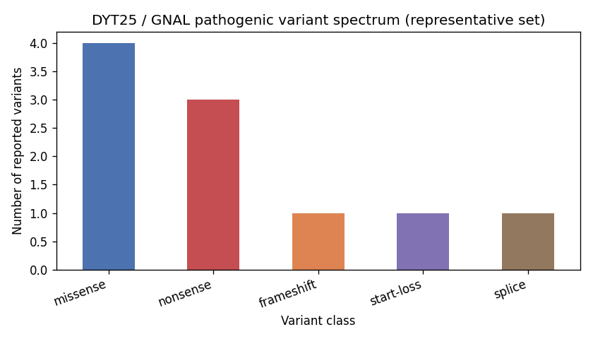

## Question

# Disease Characteristics Research Template

## Target Disease
- **Disease Name:** Dystonia 25
- **MONDO ID:** MONDO:0014033 (if available)
- **Category:** Mendelian

## Research Objectives

Please provide a comprehensive research report on **Dystonia 25** covering all of the
disease characteristics listed below. This report will be used to populate a disease knowledge
base entry. Be thorough and cite primary literature (PMID preferred) for all claims.

For each section, **suggested databases/resources** are listed. These are the first places
you should search for information on each topic.

---

### 1. Disease Information
> **Search first:** OMIM, Orphanet, ICD-10/ICD-11, MeSH, PubMed

- What is the disease? Provide a concise overview.
- What are the key identifiers? (OMIM, Orphanet, ICD-10/ICD-11, MeSH, Mondo)
- What are the common synonyms and alternative names?
- Is the information derived from individual patients (e.g., EHR) or aggregated disease-level resources?

### 2. Etiology

- **Disease Causal Factors**: What are the primary causes? (genetic, environmental, infectious, mechanistic)
- **Risk Factors**:
  > **Search first:** PubMed, Cochrane Library, UpToDate, clinical guidelines, ClinVar, ClinGen, GWAS Catalog, PheGenI, CTD, CDC, WHO, epidemiological databases
  - Genetic risk factors (causal variants, susceptibility loci, modifier genes)
  - Environmental risk factors (toxins, lifestyle, occupational exposures, age, sex, family history)
- **Protective Factors**:
  > **Search first:** PubMed, Cochrane Library, clinical trial databases, GWAS Catalog, gnomAD, WHO, CDC, nutrition databases
  - Genetic protective factors (protective variants, modifier alleles)
  - Environmental protective factors (diet, lifestyle, exposures that reduce risk)
- **Gene-Environment Interactions**: How do genetic and environmental factors interact to influence disease?
  > **Search first:** CTD, PubMed, PheGenI, GxE databases

### 3. Phenotypes
> **Search first:** HPO (Human Phenotype Ontology), OMIM, Orphanet, PubMed, clinicaltrials.gov, MedDRA, SNOMED CT, DECIPHER, LOINC

For each phenotype, provide:
- **Phenotype type**: symptoms, clinical signs, physical manifestations, behavioral changes, or laboratory abnormalities
  > For symptoms/signs: HPO, OMIM, Orphanet, PubMed
  > For behavioral changes: HPO, DSM, RDoC (Research Domain Criteria), PubMed
  > For laboratory abnormalities: LOINC, SNOMED CT, LabTests Online, PubMed
- **Phenotype characteristics**:
  > **Search first:** OMIM, Orphanet, HPO, PubMed
  - Age of symptom onset (neonatal, childhood, adult-onset, late-onset)
  - Symptom severity (mild, moderate, severe, variable)
  - Symptom progression (stable, progressive, episodic, fluctuating)
  - Frequency among affected individuals (percentage or qualitative)
- **Quality of life impact**: Effects on daily functioning and well-being (per-phenotype when possible)
  > **Search first:** EQ-5D database, SF-36, WHO QOL databases, PubMed
- Suggest HPO (Human Phenotype Ontology) terms for each phenotype

### 4. Genetic/Molecular Information

- **Causal Genes**: Gene mutations or chromosomal abnormalities responsible for disease (gene symbols, OMIM IDs)
  > **Search first:** OMIM, ClinVar, HGMD, Ensembl, NCBI Gene
- **Pathogenic Variants**:
  - Affected genes (gene symbols, HGNC IDs)
    > **Search first:** OMIM, NCBI Gene, Ensembl, HGNC, UniProt, GeneCards
  - Variant classification (pathogenic, likely pathogenic, VUS per ACMG/AMP guidelines)
    > **Search first:** ClinVar, ClinGen, ACMG/AMP guidelines, VarSome
  - Variant type/class (missense, frameshift, nonsense, splice-site, structural)
  - Allele frequency in population databases
    > **Search first:** gnomAD, 1000 Genomes, ExAC, TOPMed, dbSNP
  - Somatic vs germline origin
    > **Search first:** COSMIC (somatic), ClinVar, ICGC, TCGA
  - Functional consequences (loss of function, gain of function, dominant negative)
- **Modifier Genes**: Genes that modify disease severity or expression
- **Epigenetic Information**: DNA methylation, histone modifications, chromatin changes affecting disease
  > **Search first:** ENCODE, Roadmap Epigenomics, MethBase, DiseaseMeth
- **Chromosomal Abnormalities**: Large-scale genetic changes (aneuploidy, translocations, inversions)
  > **Search first:** DECIPHER, ClinVar, ECARUCA, UCSC Genome Browser

### 5. Environmental Information

- **Environmental Factors**: Non-genetic contributing factors (toxins, radiation, pollution, occupational exposure)
  > **Search first:** CTD (Comparative Toxicogenomics Database), TOXNET, PubMed, EPA databases
- **Lifestyle Factors**: Behavioral factors (smoking, diet, exercise, alcohol consumption)
  > **Search first:** CDC databases, WHO, PubMed, NHANES
- **Infectious Agents**: If applicable, pathogens causing or triggering disease (bacteria, viruses, fungi, parasites)
  > **Search first:** NCBI Taxonomy, ViPR, BV-BRC, MicrobeDB, GIDEON

### 6. Mechanism / Pathophysiology

**Present this section as an ordered causal chain first, then the detail below.**
Open with a numbered sequence of mechanistic steps running from the initiating
lesion (mutation, exposure, infection) to the clinical manifestation, one step per
line, each naming what it causes next. State the causal verb explicitly ("leads
to", "results in") and say where a step is inferred rather than demonstrated.
Where the mechanism branches, show the branch. The categories below are a
checklist of what to cover within those steps, not the organizing structure —
a step may draw on several of them, and a category may contribute to several
steps.

- **Molecular Pathways**: Specific signaling cascades or biochemical pathways involved (Wnt, MAPK, mTOR, PI3K-AKT, etc.)
  > **Search first:** KEGG, Reactome, WikiPathways, PathBank, BioCyc
- **Cellular Processes**: Cell-level mechanisms (apoptosis, autophagy, cell cycle dysregulation, inflammation, etc.)
  > **Search first:** Gene Ontology (GO), Reactome, KEGG, PubMed
- **Protein Dysfunction**: How protein structure or function is altered (misfolding, aggregation, loss of function, gain of function)
  > **Search first:** UniProt, PDB (Protein Data Bank), InterPro, Pfam, AlphaFold
- **Metabolic Changes**: Alterations in metabolic processes (energy metabolism, lipid metabolism, amino acid metabolism)
  > **Search first:** KEGG, BioCyc, HMDB (Human Metabolome Database), BRENDA
- **Immune System Involvement**: Role of immune response (autoimmunity, immunodeficiency, chronic inflammation)
  > **Search first:** ImmPort, Immunome Database, IEDB, Gene Ontology
- **Tissue Damage Mechanisms**: How tissues/ are injured (oxidative stress, ischemia, fibrosis, necrosis)
  > **Search first:** PubMed, Gene Ontology, Reactome
- **Biochemical Abnormalities**: Specific molecular defects (enzyme deficiencies, receptor dysfunction, ion channel defects)
  > **Search first:** BRENDA, UniProt, KEGG, OMIM, PubMed
- **Epigenetic Changes**: DNA methylation, histone modifications affecting gene expression in disease
  > **Search first:** ENCODE, Roadmap Epigenomics, MethBase, DiseaseMeth
- **Molecular Profiling** (if available):
  - Transcriptomics/gene expression changes
    > **Search first:** GEO (Gene Expression Omnibus), ArrayExpress, GTEx, Human Cell Atlas, SRA
  - Proteomics findings
    > **Search first:** PRIDE, ProteomeXchange, Human Protein Atlas, STRING, BioGRID
  - Metabolomics signatures
    > **Search first:** MetaboLights, Metabolomics Workbench, HMDB, METLIN
  - Lipidomics alterations
    > **Search first:** LIPID MAPS, SwissLipids, LipidHome, Metabolomics Workbench
  - Genomic structural features
    > **Search first:** UCSC Genome Browser, Ensembl, NCBI, dbVar, DGV
- **Advanced Technologies** (if applicable):
  - Single-cell analysis findings (cell-type specific mechanisms, cellular heterogeneity)
    > **Search first:** Human Cell Atlas, Single Cell Portal, GEO, CELLxGENE
  - Spatial transcriptomics findings
    > **Search first:** GEO, Spatial Research, Vizgen, 10x Genomics data
  - Multi-omics integration results
    > **Search first:** TCGA, ICGC, cBioPortal, LinkedOmics, PubMed
  - Functional genomics screens (CRISPR, RNAi)
    > **Search first:** DepMap, GenomeRNAi, PubMed, BioGRID ORCS

For each mechanism, describe:
- The causal chain from initial trigger to clinical manifestation
- Which mechanisms are upstream vs downstream
- What cell types and biological processes are involved
- Suggest GO terms for biological processes and CL terms for cell types

### 7. Anatomical Structures Affected

- **Organ Level**:
  - Primary organs directly affected
  - Secondary organ involvement (complications, secondary effects)
  - Body systems involved (cardiovascular, nervous, digestive, respiratory, endocrine, etc.)
  > **Search first:** Uberon, FMA (Foundational Model of Anatomy), OMIM, HPO, ICD-11, MeSH, SNOMED CT
- **Tissue and Cell Level**:
  - Specific tissue types affected (epithelial, connective, muscle, nervous)
  - Specific cell populations targeted (with Cell Ontology terms)
  > **Search first:** Uberon, Human Protein Atlas, Cell Ontology, Human Cell Atlas, CellMarker, PanglaoDB
- **Subcellular Level**:
  - Cellular compartments involved (mitochondria, nucleus, ER, lysosomes) (with GO Cellular Component terms)
  > **Search first:** Gene Ontology (Cellular Component), UniProt, Human Protein Atlas
- **Localization**:
  - Specific anatomical sites (with UBERON terms)
    > **Search first:** FMA, Uberon, NeuroNames (for brain), SNOMED CT
  - Lateralization (unilateral, bilateral, asymmetric)
    > **Search first:** HPO, clinical literature, imaging databases

### 8. Temporal Development

- **Onset**:
  - Typical age of onset (congenital, pediatric, adult, geriatric)
  - Onset pattern (acute, subacute, chronic, insidious)
  > **Search first:** OMIM, Orphanet, HPO, PubMed
- **Progression**:
  - Disease stages (early, intermediate, advanced, end-stage)
    > **Search first:** Cancer Staging Manual (AJCC), WHO classifications, PubMed
  - Progression rate (rapid, slow, variable)
  - Disease course pattern (episodic, relapsing-remitting, progressive, stable)
  - Disease duration (self-limited, chronic lifelong)
  > **Search first:** Disease registries, longitudinal cohort databases, natural history studies, PubMed, Orphanet, OMIM
- **Patterns**:
  - Remission patterns (spontaneous, treatment-induced)
    > **Search first:** Clinical trial databases, disease registries, PubMed
  - Critical periods (time windows of vulnerability or opportunity for intervention)
    > **Search first:** PubMed, developmental biology databases, clinical guidelines

### 9. Inheritance and Population

- **Epidemiology**:
  - Prevalence (cases per 100,000 at given time)
  - Incidence (new cases per 100,000 per year)
  > **Search first:** Orphanet, CDC, WHO, GBD (Global Burden of Disease), national registries, SEER, disease registries
- **For Genetic Etiology**:
  - Inheritance pattern (AD, AR, X-linked, mitochondrial, multifactorial, polygenic)
    > **Search first:** OMIM, Orphanet, ClinVar, GTR (Genetic Testing Registry)
  - Penetrance (complete, incomplete, age-dependent)
    > **Search first:** ClinVar, OMIM, PubMed, ClinGen
  - Expressivity (variable, consistent)
    > **Search first:** OMIM, ClinVar, PubMed
  - Genetic anticipation (increasing severity in successive generations)
    > **Search first:** OMIM, PubMed (especially for repeat expansion disorders)
  - Germline mosaicism
    > **Search first:** ClinVar, OMIM, genetic counseling literature, PubMed
  - Founder effects (population-specific mutations)
    > **Search first:** gnomAD, population genetics databases, PubMed
  - Consanguinity role
    > **Search first:** OMIM, population studies, genetic counseling resources
  - Carrier frequency
    > **Search first:** gnomAD, carrier screening databases, GeneReviews, GTR
- **Population Demographics**:
  - Affected populations (ethnic or demographic groups with higher prevalence)
    > **Search first:** gnomAD, 1000 Genomes, PAGE Study, PubMed, population registries
  - Geographic distribution (endemic areas, regional variation)
    > **Search first:** WHO, CDC, GBD, Orphanet, geographic epidemiology databases
  - Geographic distribution of specific variants
  - Sex ratio (male:female)
    > **Search first:** Disease registries, OMIM, PubMed, epidemiological databases
  - Age distribution of affected individuals
    > **Search first:** CDC, disease registries, SEER, Orphanet

### 10. Diagnostics

- **Clinical Tests**:
  - Laboratory tests (blood, urine, tissue chemistry, specific enzyme assays)
    > **Search first:** LOINC, LabTests Online, PubMed
  - Biomarkers (proteins, metabolites, genetic markers, circulating biomarkers)
    > **Search first:** FDA Biomarker List, BEST (Biomarkers, EndpointS, and other Tools), PubMed
  - Imaging studies (X-ray, CT, MRI, PET, ultrasound)
    > **Search first:** RadLex, DICOM, Radiopaedia, imaging databases
  - Functional tests (pulmonary function, cardiac stress tests)
    > **Search first:** LOINC, clinical guidelines, PubMed
  - Electrophysiology (EEG, EMG, ECG, nerve conduction studies)
    > **Search first:** LOINC, clinical neurophysiology databases, PubMed
  - Biopsy findings (histopathology, immunohistochemistry)
    > **Search first:** SNOMED CT, College of American Pathologists resources, PubMed
  - Pathology findings (microscopic examination)
    > **Search first:** SNOMED CT, Digital Pathology databases, PubMed
- **Genetic Testing**:
  > **Search first:** GTR (Genetic Testing Registry), GeneReviews, ClinGen
  - Overview of recommended genetic testing approach
  - Whole genome sequencing (WGS) utility
    > **Search first:** GTR, ClinVar, GEL (Genomics England), gnomAD
  - Whole exome sequencing (WES) utility
    > **Search first:** GTR, ClinVar, OMIM, GeneMatcher
  - Gene panels (which panels, which genes)
    > **Search first:** GTR, ClinVar, laboratory-specific databases
  - Single gene testing
    > **Search first:** GTR, ClinVar, OMIM, GeneReviews
  - Chromosomal microarray (CMA)
    > **Search first:** DECIPHER, ClinVar, dbVar, ECARUCA
  - Karyotyping
    > **Search first:** Chromosome Abnormality Database, ClinVar, cytogenetics resources
  - FISH
    > **Search first:** ClinVar, cytogenetics databases, PubMed
  - Mitochondrial DNA testing
    > **Search first:** MITOMAP, MSeqDR, ClinVar, GTR
  - Repeat expansion testing
    > **Search first:** GTR, ClinVar, repeat expansion databases, PubMed
- **Omics-Based Diagnostics** (if applicable):
  - RNA sequencing / transcriptomics
    > **Search first:** GEO, ArrayExpress, GTEx, RNA-seq databases
  - Proteomics
    > **Search first:** PRIDE, ProteomeXchange, FDA Biomarker database
  - Metabolomics
    > **Search first:** MetaboLights, Metabolomics Workbench, HMDB
  - Epigenomics
    > **Search first:** GEO, ENCODE, Roadmap Epigenomics, MethBase
  - Liquid biopsy
    > **Search first:** COSMIC, ClinVar, liquid biopsy databases, PubMed
- **Clinical Criteria**:
  - Standardized diagnostic criteria (DSM, ICD, society guidelines)
    > **Search first:** DSM-5, ICD-11, clinical society guidelines, UpToDate
  - Differential diagnosis (other conditions to rule out, with distinguishing features)
    > **Search first:** DynaMed, UpToDate, clinical decision support systems
- **Screening**:
  - Screening methods for asymptomatic individuals (newborn screening, carrier screening, cascade screening)
    > **Search first:** ACMG recommendations, CDC newborn screening, GTR

### 11. Outcome/Prognosis

- **Survival and Mortality**:
  - Survival rate (5-year, 10-year, overall)
    > **Search first:** SEER, cancer registries, disease-specific registries, PubMed
  - Life expectancy (with and without treatment if applicable)
    > **Search first:** Orphanet, disease registries, actuarial databases, PubMed
  - Mortality rate
    > **Search first:** CDC, WHO, GBD, national mortality databases
  - Disease-specific mortality (deaths directly attributable to disease)
    > **Search first:** Disease registries, CDC Wonder, GBD, PubMed
- **Morbidity and Function**:
  - Morbidity (disease-related disability and health impacts)
    > **Search first:** GBD, WHO, disability databases, PubMed
  - Disability outcomes (long-term functional impairments)
    > **Search first:** ICF (International Classification of Functioning), disability registries
  - Quality of life measures (EQ-5D, SF-36, PROMIS, disease-specific tools)
    > **Search first:** EQ-5D database, SF-36, PROMIS, PubMed
- **Disease Course**:
  - Complications (secondary problems: infections, organ failure, etc.)
    > **Search first:** ICD codes, disease registries, clinical databases, PubMed
  - Recovery potential (likelihood and extent of recovery, with vs without treatment)
    > **Search first:** Natural history studies, rehabilitation databases, PubMed
- **Prediction**:
  - Prognostic factors (age, disease severity, biomarkers, treatment response)
    > **Search first:** Prognostic models databases, clinical calculators, PubMed
  - Prognostic biomarkers (molecular markers predicting disease course)
    > **Search first:** FDA Biomarker database, PubMed, cancer prognostic databases

### 12. Treatment

- **Pharmacotherapy**:
  - Pharmacological treatments (drug names, drug classes, mechanisms of action)
    > **Search first:** DrugBank, RxNorm, ATC classification, DailyMed, FDA databases
  - Pharmacogenomics (how genetic variants affect drug metabolism, efficacy, toxicity)
    > **Search first:** PharmGKB, CPIC (Clinical Pharmacogenetics), FDA Table of PGx Biomarkers
- **Advanced Therapeutics**:
  - Gene therapy (viral vectors, CRISPR, gene replacement, gene editing)
    > **Search first:** ClinicalTrials.gov, FDA gene therapy database, ASGCT resources
  - Cell therapy (stem cell transplant, CAR-T, cellular therapeutics)
    > **Search first:** ClinicalTrials.gov, FDA cell therapy database, FACT standards
  - RNA-based therapies (ASOs, siRNA, mRNA therapies)
    > **Search first:** ClinicalTrials.gov, FDA approvals, PubMed
  - Targeted therapies (treatments directed at specific molecular targets)
    > **Search first:** My Cancer Genome, OncoKB, ClinicalTrials.gov, FDA approvals
  - Immunotherapies (checkpoint inhibitors, monoclonal antibodies)
    > **Search first:** Cancer Immunotherapy Database, FDA approvals, ClinicalTrials.gov
- **Surgical and Interventional**:
  - Surgical interventions (types of surgery, timing, outcomes)
    > **Search first:** CPT codes, surgical registries, clinical guidelines, PubMed
- **Supportive and Rehabilitative**:
  - Supportive care (symptom management, pain control, nutrition)
    > **Search first:** Clinical guidelines, Cochrane Library, PubMed
  - Rehabilitation (physical therapy, occupational therapy, speech therapy)
    > **Search first:** Rehabilitation medicine databases, clinical guidelines, PubMed
- **Experimental**:
  - Experimental treatments in clinical trials (with NCT identifiers if available)
    > **Search first:** ClinicalTrials.gov, EU Clinical Trials Register, WHO ICTRP
- **Treatment Outcomes**:
  - Treatment response rates
    > **Search first:** Clinical trial databases, FDA reviews, systematic reviews, PubMed
  - Side effects and adverse events
    > **Search first:** FDA Adverse Event Reporting System (FAERS), MedWatch, PubMed
- **Treatment Strategy**:
  - Treatment algorithms (clinical pathways, decision trees)
    > **Search first:** Clinical practice guidelines, NCCN Guidelines, UpToDate
  - Combination therapies
    > **Search first:** ClinicalTrials.gov, treatment guidelines, PubMed
  - Personalized medicine approaches (genotype-guided treatment)
    > **Search first:** My Cancer Genome, CIViC, PharmGKB, precision medicine databases

For each treatment, suggest NCIT (NCI Thesaurus) clinical-intervention terms where applicable.

### 13. Prevention

- **Prevention Levels**:
  - Primary prevention (preventing disease occurrence: vaccination, risk factor modification)
    > **Search first:** CDC, WHO, USPSTF recommendations, Cochrane Library
  - Secondary prevention (early detection and treatment: screening programs, early intervention)
    > **Search first:** USPSTF, CDC screening guidelines, WHO
  - Tertiary prevention (preventing complications in those with disease)
    > **Search first:** Clinical guidelines, disease management protocols, PubMed
- **Immunization**: Vaccine strategies (if applicable)
  > **Search first:** CDC vaccine schedules, WHO immunization, FDA vaccine database
- **Screening and Early Detection**:
  - Screening programs (population-based: newborn screening, cancer screening)
    > **Search first:** CDC screening programs, USPSTF, cancer screening databases
  - Genetic screening (carrier screening, preimplantation genetic diagnosis, prenatal testing)
    > **Search first:** ACMG recommendations, ACOG guidelines, GTR
  - Risk stratification (identifying high-risk individuals for targeted prevention)
    > **Search first:** Risk prediction models, clinical calculators, PubMed
- **Behavioral Interventions**: Lifestyle modifications to reduce risk
  > **Search first:** CDC, WHO, behavioral intervention databases, Cochrane Library
- **Counseling**: Genetic counseling (risk assessment, family planning guidance)
  > **Search first:** NSGC resources, ACMG guidelines, GeneReviews
- **Public Health**:
  - Public health interventions (sanitation, vector control, health education)
    > **Search first:** CDC, WHO, public health databases, PubMed
  - Environmental interventions (reducing environmental risk factors)
    > **Search first:** EPA databases, WHO environmental health, PubMed
- **Prophylaxis**: Preventive medications or procedures
  > **Search first:** Clinical guidelines, FDA approvals, PubMed

### 14. Other Species / Natural Disease

- **Taxonomy**: Species affected (with NCBI Taxon identifiers)
  > **Search first:** NCBI Taxonomy
- **Breed**: Specific breeds affected (with VBO identifiers if applicable)
  > **Search first:** VBO (Vertebrate Breed Ontology)
- **Gene**: Orthologous genes in other species (with NCBI Gene IDs)
  > **Search first:** NCBI Gene
- **Natural Disease**:
  - Naturally occurring disease in other species (companion animals, wildlife)
    > **Search first:** OMIA (Online Mendelian Inheritance in Animals), VetCompass, PubMed
  - Veterinary relevance and importance in animal health
    > **Search first:** OMIA, veterinary databases, PubMed
- **Comparative Biology**:
  - Comparative pathology (similarities and differences across species)
    > **Search first:** OMIA, comparative pathology databases, PubMed
  - Evolutionary conservation of disease mechanisms
    > **Search first:** HomoloGene, OrthoMCL, Alliance of Genome Resources
- **Transmission** (if applicable):
  - Zoonotic potential
    > **Search first:** CDC zoonotic diseases, WHO zoonoses, GIDEON
  - Cross-species susceptibility
    > **Search first:** NCBI Taxonomy, veterinary databases, PubMed

### 15. Model Organisms

- **Model Types**:
  - Model organism type (mammalian, invertebrate, cellular, in vitro)
    > **Search first:** Alliance of Genome Resources, model organism databases
  - Specific model systems (mouse, rat, zebrafish, Drosophila, C. elegans, yeast, cell lines, organoids, iPSCs)
    > **Search first:** MGI, RGD, ZFIN, FlyBase, WormBase, SGD, ATCC, Cellosaurus
  - Induced models (drug treatment, surgical intervention, environmental manipulation)
    > **Search first:** MGI, model organism databases, PubMed
- **Genetic Models**:
  - Types available (knockout, knock-in, transgenic, conditional, humanized)
    > **Search first:** MGI, IMPC, KOMP, EuMMCR, IMSR
- **Model Characteristics**:
  - Phenotype recapitulation (how well model reproduces human disease features)
    > **Search first:** Model organism databases, comparative studies, PubMed
  - Model limitations (aspects of human disease not captured)
    > **Search first:** Model organism databases, PubMed, review articles
- **Applications**:
  - Research applications (what aspects of disease can be studied)
    > **Search first:** Model organism databases, PubMed
- **Resources**:
  - Model databases
    > **Search first:** MGI, RGD, ZFIN, FlyBase, WormBase, IMSR, EMMA, MMRRC

---

## Citation Requirements

- Cite primary literature (PMID preferred) for all mechanistic and clinical claims
- Prioritize recent reviews and landmark papers
- Include direct quotes from abstracts where possible to support key statements
- Distinguish evidence source types: human clinical, model organism, in vitro, computational

## Output Format

Structure your response as a comprehensive narrative organized by the sections above.
For each section, provide:
- Factual content with specific details (numbers, percentages, gene names, variant nomenclature)
- Ontology term suggestions (HPO, GO, CL, UBERON, CHEBI, NCIT, MONDO) where applicable
- Evidence citations with PMIDs
- Direct quotes from abstracts to support key claims
- Clear indication when information is not available or not applicable for this disease

This report will be used to populate a disease knowledge base entry with:
- Pathophysiology descriptions with causal chains
- Gene/protein annotations (HGNC, GO terms)
- Phenotype associations (HP terms) with frequencies
- Cell type involvement (CL terms)
- Anatomical locations (UBERON terms)
- Chemical entities (CHEBI terms)
- Treatment annotations (NCIT terms)
- Evidence items with PMIDs and exact abstract quotes
- Epidemiology, prognosis, diagnostic, and prevention information
- Animal model descriptions with phenotype recapitulation details

## Output

# Dystonia 25 (DYT25 / DYT-GNAL) — Comprehensive Disease Characterization

**MONDO:** MONDO:0014033 · **OMIM:** 615073 · **Gene:** *GNAL* (Gα-olf) · **Category:** Mendelian (autosomal dominant)
**Report date:** 2026-10-20 · Evidence base: human clinical pedigrees, rodent models, in vitro functional assays.

---

## 1. Disease Information

**Overview.** Dystonia 25 (DYT25; now designated **DYT-GNAL**) is an autosomal dominant, adult-onset **isolated (primary) dystonia** caused by loss-of-function mutations in *GNAL*. Dystonia is a movement disorder defined by sustained or intermittent involuntary muscle contractions producing twisting, repetitive movements and abnormal postures. DYT25 characteristically presents as **focal or segmental cranio-cervical dystonia** — most often cervical dystonia (torticollis) — that may spread to oromandibular, laryngeal (spasmodic dysphonia), and upper-limb regions, frequently with dystonic tremor. *GNAL* was the **first gene definitively confirmed to cause common adult-onset focal/segmental isolated dystonia** (Fuchs et al. 2013, PMID 23222958; Vemula et al. 2013, PMID 23449625).

**Key identifiers.**
- OMIM: **615073** (Dystonia 25, DYT25)
- MONDO: **MONDO:0014033**
- Orphanet: dystonia 25 falls under ORPHA:98806 (isolated dystonia) / adult-onset isolated focal dystonia spectrum
- Gene (HGNC): **GNAL**, HGNC:4388; NCBI Gene ID 2774; UniProt P38405 (GNAL_HUMAN)
- MeSH: Dystonic Disorders (D020821); Dystonia (D004421)
- ICD-10: **G24** (Dystonia; G24.3 spasmodic torticollis, G24.4 idiopathic orofacial dystonia); ICD-11: **8A02** (Dystonia)

**Synonyms / alternative names:** DYT25; DYT-GNAL; dystonia-25; primary torsion dystonia 25; GNAL-related dystonia; adult-onset cervical/cranio-cervical dystonia (GNAL type).

**Information source type.** Disease-level knowledge is derived from **aggregated resources** (OMIM, Orphanet) and from **individual-patient case series / pedigrees** reported in primary literature; mechanistic data come from rodent models and in vitro assays rather than EHR aggregation.

---

## 2. Etiology

**Primary cause — genetic.** Heterozygous **loss-of-function mutations in *GNAL***, encoding the stimulatory G-protein alpha subunit **Gα-olf** (G(olf)). The disorder is monogenic and autosomal dominant with **incomplete penetrance** (Vemula 2013, PMID 23449625: "These mutations show incomplete penetrance").

**Genetic risk factors (causal variants).** Nonsense, frameshift, splice-site, start-loss, and missense variants across the *GNAL* coding sequence (see §4). There are no established common susceptibility (GWAS) loci; DYT25 is a Mendelian, not polygenic, entity.

**Environmental risk factors.** None established as causal. As with other focal dystonias, non-specific triggers/modifiers hypothesized for adult-onset focal dystonia generally (e.g., repetitive/occupational activity, peripheral trauma, prior neck injury for cervical dystonia) may act as triggers in genetically predisposed individuals, but no GNAL-specific environmental factor is proven. **Age** (adult onset) and possibly **sex** modulate expression.

**Protective factors.** None genetically defined. Incomplete penetrance implies the existence of unidentified genetic/environmental **modifiers** that can prevent clinical expression in carriers, but these are not characterized.

**Gene–environment interactions.** The incomplete, age-dependent penetrance of *GNAL* variants is consistent with gene–environment and gene–gene interactions shaping whether and when a carrier manifests dystonia; specifics remain unknown.

---

## 3. Phenotypes

DYT25 is an **isolated** dystonia — dystonia is the only motor feature (± tremor), without other neurological signs, and brain MRI is typically normal.

| Phenotype | Type | HPO term | Onset / severity / progression | Frequency |
|---|---|---|---|---|
| Cervical dystonia (torticollis) | Clinical sign | **HP:0002317** (Torticollis) / HP:0030972 (Cervical dystonia) | Adult-onset (often 3rd–6th decade); moderate; usually focal, limited spread | Most common site; typical presenting feature |
| Cranial / oromandibular dystonia | Clinical sign | **HP:0002540**? — use HP:0012048 (Oromandibular dystonia) | Adult-onset; variable | Common in segmental cases |
| Laryngeal dystonia (spasmodic dysphonia) | Clinical sign | HP:0001618 (Dysphonia) | Adult-onset | Reported (Vemula 2013; Carecchio 2016) |
| Blepharospasm / facial dystonia | Clinical sign | HP:0000643 (Blepharospasm) | Adult-onset | Occasional (cranial involvement) |
| Upper-limb / hand-forearm (writer's) dystonia | Clinical sign | HP:0002527? use HP:0003470 / HP:0100660 (Dystonic limb) | Adult-onset | Reported |
| Dystonic tremor (head/arm) | Clinical sign | HP:0002322 (Resting tremor)/HP:0001337 (Tremor) | Variable; may mimic DYT11/essential tremor | Prominent in some families (Carecchio 2016) |
| Generalization of dystonia | Clinical course | HP:0007325 (Generalized dystonia) | Rare; generally does NOT generalize | Uncommon (one Chinese case generalized) |
| Microsmia / hyposmia | Symptom/lab | HP:0004409 (Hyposmia) | — | Reported in p.V228F carriers (Gα-olf role in olfaction), not consistent |
| Psychiatric / "mental" symptoms | Behavioral | HP:0000708 (Behavioral abnormality) | — | Rare (Fan 2022, PMID 35396637) |

**General phenotype characteristics.** *Onset:* adult-onset (typically ~ 4th–5th decade; range childhood to late adult). *Severity:* mild-to-moderate, variable even **within families (intra-familial heterogeneity)** (Carecchio 2016, PMID 26725140). *Progression:* slowly progressive then **plateaus**; focal→segmental spread possible but **generalization is rare**; course is chronic/lifelong, non-remitting (dystonic tremor can fluctuate). *Distribution:* often asymmetric.

**Quality-of-life impact.** Cervical and cranial dystonia cause pain, social embarrassment, impaired head control, speech/swallowing difficulty, and functional disability; QoL is reduced similarly to other adult-onset focal dystonias (disease-specific tools such as CDIP-58 / TWSTRS for cervical dystonia; no GNAL-specific QoL study). Botulinum toxin and DBS substantially improve QoL (§12).

---

## 4. Genetic / Molecular Information

**Causal gene.** ***GNAL*** (guanine nucleotide-binding protein, alpha-activating activity polypeptide, olfactory type) — chromosome **18p11.21**; HGNC:4388; OMIM gene *139312*; encodes **Gα-olf (G(olf) subunit alpha)**, UniProt P38405.

**Representative pathogenic variants (all heterozygous, germline).**
- **p.Ser293\*** (nonsense) — original family (Fuchs 2013, PMID 23222958)
- **p.Val137Met** (missense) — original family (Fuchs 2013)
- **p.Val228Phe** (c.682G>T, missense) — African-American pedigree; carriers showed microsmia (Vemula 2013, PMID 23449625)
- **p.Arg198Thrfs\*13** (c.591dupA, frameshift); **p.Arg245\*** (c.733C>T, nonsense); **p.Met1?** (c.3G>A, start-loss) (Vemula 2013)
- **p.Asp210Asn** (c.628G>A, exon 9, missense) — Italian family (Carecchio 2016, PMID 26725140)
- **p.Val354Ala** (c.1061T>C, missense) — *de novo* in sporadic Serbian cervical dystonia patient (Dobričić 2014, PMID 24729450)
- **p.Ser95\*** (c.284C>T, nonsense) and **c.932-7T>G** (splice) — Chinese patients (Miao 2013, PMID 23759320)

**Variant classification (ACMG/AMP).** Truncating variants (nonsense, frameshift, canonical splice, start-loss) are classified **pathogenic** (loss of function is the established mechanism for a haploinsufficient gene). Missense variants are often **likely pathogenic/VUS**, supported by functional assays (BRET showing impaired Gα-olf coupling; Fuchs 2013), in silico prediction, and segregation.

**Variant types/classes.** Missense, nonsense, frameshift, splice-site, and start-loss — i.e., a mix consistent with **haploinsufficiency**. In a representative set of 10 reported variants, **~60% are truncating** (nonsense/frameshift/start-loss/splice) and **~40% missense**, supporting loss-of-function rather than gain-of-function or dominant-negative mechanisms (see `gnal_variant_spectrum.png`).

**Classification note.** GNAL causes **isolated dystonia** (dystonia as the sole motor feature apart from tremor; MDS 2013 axis-I classification), distinct from combined dystonia-parkinsonism (e.g., ATP1A3/DYT12) or myoclonus-dystonia (SGCE/DYT11). However, GNAL "and CIZ1 ... are probably not a common cause of classic cervical dystonia" (Balint & Bhatia 2015, PMID 25643588) — important for setting genetic-testing yield expectations.

**Allele frequency.** Pathogenic *GNAL* variants are **rare/absent in gnomAD** controls. In dystonia cohorts, mutation frequency is low: **~0.4%** in Serbian cranio-cervical dystonia (Dobričić 2014) and **~3.4%** among Chinese cervical-onset/involved primary dystonia after excluding TOR1A/THAP1 (Miao 2013). GNAL accounts for a small but meaningful fraction of adult-onset isolated dystonia.

**Somatic vs germline.** **Germline** (including documented *de novo* germline events — Dobričić 2014).

**Functional consequence.** **Loss of function / haploinsufficiency.** BRET assays confirmed impaired function of several mutants (Fuchs 2013: "Impaired function of several of the mutants was shown by bioluminescence resonance energy transfer (BRET) assays"). Reduced Gα-olf lowers D1-/A2A-receptor–stimulated adenylyl cyclase activity in striatum.

**Modifier genes.** Unidentified; incomplete penetrance implies modifiers exist.

**Epigenetic information.** Gα-olf participates in **DALN/histone H3 phosphorylation** downstream of dopamine signaling in striatum (noted by Vemula 2013), linking it to activity-dependent transcription; no disease-specific methylation signature reported.

**Chromosomal abnormalities.** None characteristic; DYT25 is caused by point mutations/small indels, not large structural variants.

---

## 5. Environmental Information

- **Environmental factors:** None established as causal for DYT25. No toxin/radiation/occupational exposure is proven to cause GNAL dystonia.
- **Lifestyle factors:** None established. (For focal dystonias broadly, repetitive task performance and peripheral trauma are debated triggers.)
- **Infectious agents:** Not applicable — DYT25 is a genetic, non-infectious disorder.

---

## 6. Mechanism / Pathophysiology

### Ordered causal chain (initiating lesion → clinical manifestation)

1. A heterozygous **loss-of-function *GNAL* mutation** (nonsense/frameshift/splice/missense) **results in** reduced quantity or function of **Gα-olf** protein (haploinsufficiency; demonstrated by BRET, Fuchs 2013).
2. Because Gα-olf is the principal **Gαs-like subunit coupling D1 dopamine and A2A adenosine receptors to adenylyl cyclase in the striatum**, reduced Gα-olf **leads to** decreased receptor-stimulated **cAMP production** in striatal spiny projection neurons (SPNs) (Vemula 2013; Yu-Taeger 2020).
3. Diminished cAMP/PKA signaling **results in** blunted **dopamine- and adenosine-mediated signaling and synaptic plasticity** in both direct (D1) and indirect (A2A) pathway SPNs (demonstrated in a GNAL rat model, Yu-Taeger 2020, PMID 31678405).
4. In parallel, **striatal cholinergic interneurons become dysfunctional** (abnormal excitability/acetylcholine release) — a convergent node shared across genetic dystonias (Eskow Jaunarajs 2019, PMID 31320448). *Inferred* to amplify the plasticity deficit.
5. Altered dopaminergic/cholinergic balance **leads to loss of corticostriatal long-term depression (LTD)** — a signature plasticity defect also seen in DYT1 (Martella 2021, PMID 33991565). This is **demonstrated** and is **pharmacologically reversible** (chronic mGlu5 negative allosteric modulator dipraglurant restored LTD).
6. Disordered basal-ganglia output **propagates to and dysregulates the cerebello-thalamo-cortical network**, producing **abnormal/pathological firing patterns** (demonstrated in DYT25 mice: functional abnormalities in cerebello-thalamic pathways, Aïssa 2022, PMID 35699413). *Branch:* both basal-ganglia and cerebellar circuits contribute (network model of dystonia).
7. Aberrant motor-network firing **results in** excessive co-contraction of agonist/antagonist muscles → **sustained involuntary contractions, abnormal postures, and dystonic tremor** — the clinical phenotype.

### Biochemical grounding of Gα-olf
Gα-olf (G(olf) subunit alpha) is a **stimulatory, Gs-like G-protein alpha subunit** that couples GPCRs to **adenylyl cyclase III** to raise cAMP. Classic biochemistry (Jones et al. 1990, PMID 2105931) showed Golf is "functionally and structurally similar" to Gs, interacts with β-adrenergic receptors (activated by isoproterenol, EC50 ≈ 120 nM) and is constitutively activated by cholera toxin. Its signaling is amplified by the GTP-exchange factor **Ric-8B**, which potentiates Gα-olf-dependent cAMP accumulation and is co-expressed with Gα-olf in olfactory neurons and brain (Von Dannecker et al. 2005, PMID 15829631) — a candidate modifier/co-factor of residual Gα-olf activity in DYT25. In the striatum, Gα-olf substitutes for Gαs as the principal stimulatory subunit, explaining why its haploinsufficiency selectively blunts striatal D1/A2A-cAMP signaling.

### Category detail
- **Molecular pathways:** **GPCR → Gα-olf → adenylyl cyclase (AC3/AC5) → cAMP → PKA → DARPP-32** signaling; dopamine (D1/D5) and adenosine (A2A) receptor cascades. KEGG: dopaminergic synapse (hsa04728), cAMP signaling (hsa04024), GABAergic/cholinergic synapse. Reactome: G-alpha (s) signalling events.
- **Cellular processes:** Synaptic plasticity (LTD/LTP), neuronal excitability, neurotransmission; cholinergic interneuron hyperexcitability; activity-dependent transcription (histone H3 phosphorylation).
- **Protein dysfunction:** Reduced Gα-olf abundance/coupling (loss of function); truncating alleles likely degraded (NMD); missense alleles impair nucleotide exchange/effector coupling.
- **Metabolic changes:** Lowered cyclic-AMP second-messenger tone in striatum (not a systemic metabolic disorder).
- **Immune involvement:** None established.
- **Tissue damage mechanisms:** **None/neurodegeneration absent** — dystonia is a *functional/circuit* disorder ("lack of overt neuropathology," Weisheit 2018, PMID 29325615). No cell death, gliosis, or structural lesion.
- **Biochemical abnormality:** Deficient D1/A2A-receptor-coupled adenylyl cyclase activation; impaired cAMP signaling.
- **GO terms:** GO:0007186 (GPCR signaling), GO:0007189 (adenylate cyclase-activating GPCR signaling / cAMP), GO:0007212 (dopamine receptor signaling), GO:0060079/GO:0048167 (regulation of synaptic plasticity), GO:0007608 (sensory perception of smell).
- **Cell types (CL):** CL:0000029/striatal medium spiny neuron (direct/indirect pathway SPN), CL:0000108 (cholinergic neuron / striatal cholinergic interneuron), cerebellar neurons, thalamocortical neurons.

**Human imaging corroboration.** Resting-state fMRI in the cervical-dystonia phenotype independently confirms **functional (network) dysfunction without structural damage** across the cerebello-basal ganglia-thalamo-cortical loop (Giannì 2022, PMID 35169015; Zito 2022, PMID 34875561; Norris 2020, PMID 32913023), and GPi-DBS normalizes this network connectivity toward healthy-control levels (Filip 2025, PMID 39986202) — consistent with the rodent-derived mechanism. (These cohorts are predominantly idiopathic, not genotyped GNAL; link is by phenotype.)

**Upstream vs downstream:** GNAL LOF and striatal cAMP deficit are **upstream**; corticostriatal LTD loss and cerebello-thalamo-cortical dysfiring are **downstream**; muscle co-contraction is the terminal output.

---

## 7. Anatomical Structures Affected

- **Organ level:** **Brain / central nervous system** (nervous system) — functionally affected; no peripheral organ pathology.
- **Primary structures:** **Striatum** (caudate-putamen) — the main site of Gα-olf expression and dysfunction. UBERON:0002435 (striatum); UBERON:0001874 (putamen); UBERON:0001873 (caudate).
- **Secondary / network structures:** **Globus pallidus internus** (DBS target; UBERON:0002477), **thalamus** (UBERON:0001897), **cerebellum** (UBERON:0002037), **motor cortex** (UBERON:0001384) — the cerebello-thalamo-cortical and cortico-striato-pallidal motor loops.
- **Clinically affected effectors (dystonic muscles):** cervical (sternocleidomastoid, splenius, trapezius), cranial/oromandibular, laryngeal, upper-limb muscles.
- **Tissue/cell level:** Nervous tissue; striatal **medium spiny neurons** and **cholinergic interneurons** (CL terms in §6).
- **Subcellular level (GO Cellular Component):** **Plasma membrane** (GO:0005886) and heterotrimeric G-protein complex (GO:0005834) where Gα-olf couples GPCRs to adenylyl cyclase; cytoplasmic/membrane signaling compartments. No organelle-specific storage pathology.
- **Localization / lateralization:** Bilateral basal ganglia involvement at the network level; **clinical manifestation is often asymmetric** (e.g., laterocollis/torticollis to one side; asymmetric limb tremor).

---

## 8. Temporal Development

- **Onset:** **Adult-onset** — typically **4th–6th decade** (range from childhood to late adulthood). Onset is **insidious/chronic**, not acute.
- **Progression:** **Slowly progressive** over months–years, usually reaching a plateau; focal→segmental **spread** can occur (cervical → cranial/laryngeal/limb) but **generalization is rare**. Course is **chronic and lifelong**, non-remitting (dystonic tremor may fluctuate).
- **Stages:** No formal staging. Clinically: focal → segmental (± tremor), stabilizing.
- **Remission:** Spontaneous remission is uncommon; symptomatic control via botulinum toxin / DBS (treatment-induced improvement, not cure).
- **Critical periods:** Age-dependent penetrance means the **adult window** is when manifestation occurs; earlier intervention (shorter disease duration) predicts better DBS response (Tisch & Kumar 2020).

---

## 9. Inheritance and Population

- **Inheritance:** **Autosomal dominant** (AD). HGNC *GNAL*, 18p11.21.
- **Penetrance:** **Incomplete, age-dependent** (Vemula 2013). Unaffected obligate carriers occur within pedigrees.
- **Expressivity:** **Highly variable**, including intra-familial heterogeneity in site and severity (Carecchio 2016).
- **De novo / mosaicism:** Documented **de novo** mutations cause seemingly sporadic cases (Dobričić 2014); germline mosaicism not specifically reported.
- **Anticipation:** Not applicable (not a repeat-expansion disorder).
- **Founder effects / consanguinity:** None established (dominant; multiple independent mutations across populations). Consanguinity not relevant.
- **Carrier frequency:** Pathogenic alleles are rare; no established population carrier frequency.
- **Epidemiology:** No DYT25-specific prevalence figure. Adult-onset focal dystonia overall affects ~15–30 per 100,000 (cervical dystonia the most common focal form). *GNAL* explains a **minority** of isolated dystonia: ~**0.4%** (Serbian cranio-cervical cohort, Dobričić 2014) to ~**3.4%** (Chinese cervical cohort after excluding TOR1A/THAP1, Miao 2013); roughly ~1–2% of familial PTD in mixed-European cohorts (Fuchs/Vemula 2013).
- **Population demographics / geographic distribution:** Reported across diverse ancestries — European/Caucasian, African-American, Serbian, Italian, Chinese, Korean — i.e., **no restricted geographic distribution**; mutations are private/family-specific.
- **Sex ratio:** No strong GNAL-specific skew reported (cervical dystonia generally has mild female predominance).
- **Age distribution:** Affected individuals cluster in adulthood (middle age).

---

## 10. Diagnostics

- **Clinical diagnosis** is primary: adult-onset isolated cranio-cervical/segmental dystonia ± tremor, normal cognition, and typically **normal brain MRI** (isolated dystonia, no structural lesion).
- **Laboratory tests / biomarkers:** No specific blood/urine biomarker; routine metabolic/copper (to exclude Wilson disease) and other labs are used for differential diagnosis, not for positive diagnosis. Olfactory testing may reveal subtle hyposmia in some carriers (not diagnostic).
- **Imaging:** Brain MRI is **normal/non-specific** (used to exclude secondary causes). Research **resting-state fMRI** of the cervical-dystonia phenotype shows **network, not structural**, abnormalities — loss of dentate–sensorimotor-cortex connectivity anticorrelation and increased pallidal connectivity with preserved global architecture and normal volumes (Giannì 2022, PMID 35169015), somatotopic motor-cortex–cerebellum hyperconnectivity (Zito 2022, PMID 34875561), and regional striatal/sensorimotor connectivity reduction (Norris 2020, PMID 32913023). These are research tools, not clinical diagnostics, and cohorts are mostly idiopathic (not genotyped GNAL).
- **Electrophysiology:** EMG used to guide botulinum toxin injections and characterize dystonic vs tremor activity; not diagnostic of GNAL.
- **Genetic testing (confirmatory, gold standard):**
  - **Approach:** After exclusion of acquired causes and often *TOR1A*/*THAP1*, test *GNAL* via **multigene dystonia NGS panels** or **whole-exome/whole-genome sequencing**; single-gene *GNAL* Sanger sequencing (coding + splice sites) for targeted confirmation and family segregation.
  - WES/WGS: high yield in familial adult-onset dystonia; was the discovery method (Fuchs 2013; Vemula 2013).
  - Gene panels: dystonia panels include *GNAL*, *TOR1A*, *THAP1*, *ANO3*, *KMT2B*, *GCH1*, etc.
  - CMA/karyotype/FISH/mtDNA/repeat-expansion testing: **not indicated** (point-mutation disorder, not structural or repeat-based).
- **Clinical criteria / classification:** Per the 2013 MDS consensus classification of dystonia (axis I clinical, axis II etiology); GNAL = inherited isolated dystonia (**DYT-GNAL**).
- **Differential diagnosis:** Other isolated dystonias (**DYT-TOR1A/DYT1**, **DYT-THAP1/DYT6**, **DYT-ANO3/DYT24**, **DYT-KMT2B/DYT28**), dopa-responsive dystonia (**GCH1**), essential tremor (dystonic tremor can mimic; Carecchio 2016 noted partial mimicry of DYT11 myoclonus-dystonia), Wilson disease, tardive/drug-induced dystonia, functional dystonia. Distinguishing features: adult cranio-cervical onset, AD family history, normal MRI, and a *GNAL* variant.
- **Screening:** No population newborn screening. **Cascade genetic testing** of at-risk adult relatives and **genetic counseling** are appropriate given AD inheritance and incomplete penetrance.

---

## 11. Outcome / Prognosis

- **Survival / mortality:** DYT25 is **not life-shortening**; normal life expectancy. No disease-specific mortality.
- **Morbidity / disability:** Chronic motor disability, pain (especially cervical), speech/voice impairment (laryngeal involvement), and psychosocial impact; generally **non-progressive to generalization** and does not cause dementia or systemic decline.
- **Disease course:** Slowly progressive then stable; chronic lifelong.
- **Quality of life:** Reduced by motor symptoms and pain but **substantially improved by treatment** (botulinum toxin, DBS).
- **Recovery potential:** No spontaneous cure; excellent symptomatic control achievable — GPi-DBS gave ~47% early and ~63% late motor-score improvement in GNAL patients (Ahn 2019, PMID 31158945).
- **Prognostic factors:** Shorter disease duration and isolated (vs combined) phenotype predict better DBS outcome (Tisch & Kumar 2020, PMID 33488508). GNAL genotype itself is a **favorable predictor** of DBS response.

---

## 12. Treatment

*No disease-modifying/curative therapy exists; management is symptomatic.*

**Pharmacotherapy (oral).**
- **Anticholinergics** (e.g., trihexyphenidyl) — rational given striatal cholinergic dysfunction; modest benefit (NCIT: Trihexyphenidyl). 
- Other oral agents used in dystonia: benzodiazepines (clonazepam — helpful for tremor/myoclonic features), baclofen, tetrabenazine (for select cases). Variable efficacy.

**Chemodenervation (first-line for focal dystonia).**
- **Botulinum neurotoxin (BoNT-A/B)** injections into dystonic muscles (cervical, laryngeal, cranial) — mainstay for focal cervical/cranial/laryngeal dystonia; improves posture, pain, and voice (NCIT: Botulinum Toxin, C837). **Class I evidence, Level A recommendation** for cervical dystonia — increased range of neck movement, decreased pain, increased functional capacity (Novak et al. 2010 international consensus, PMID 20633181). Applies to DYT25 given its idiopathic-type cervical/cranial presentation.

**Surgical / interventional (for medically refractory disease).**
- **Globus pallidus internus deep brain stimulation (GPi-DBS)** — highly effective in GNAL dystonia: **100% early responder rate (5/5)**, motor-score reduction **46.9% early / 63.4% late**, comparable to DYT1 and superior to DYT6 (Ahn 2019, PMID 31158945); excellent outcomes also in Carecchio 2016 (two cases) and reviewed by Tisch & Kumar 2020. NCIT: Deep Brain Stimulation.

**Pharmacogenomics / experimental (preclinical).**
- **mGlu5 negative allosteric modulator dipraglurant** rescued corticostriatal LTD in GNAL rat and DYT1 mouse models (Martella 2021, PMID 33991565) — a mechanistically rational candidate, **not yet an approved DYT25 therapy**.
- Targeting striatal cAMP/adenosine (A2A) signaling is a theoretical avenue from the mechanism.

**Supportive / rehabilitative:** Physiotherapy, occupational therapy, speech therapy (for laryngeal involvement), pain management, sensory-trick training, patient education.

**Treatment algorithm:** (1) confirm diagnosis + genetic counseling → (2) focal: botulinum toxin ± oral anticholinergics → (3) segmental/refractory: optimize oral meds → (4) refractory/disabling: **GPi-DBS** → (5) ongoing rehabilitation and symptom support.

---

## 13. Prevention

- **Primary prevention:** None possible (monogenic, largely non-modifiable). No vaccine/behavioral intervention.
- **Secondary prevention / early detection:** **Genetic counseling and cascade testing** of adult at-risk relatives; awareness enables early botulinum toxin / earlier DBS consideration (shorter duration → better outcome).
- **Reproductive options:** Prenatal diagnosis and **preimplantation genetic testing (PGT-M)** are theoretically available for known familial mutations, but **incomplete penetrance and adult onset** strongly complicate counseling and uptake.
- **Immunization / public-health / environmental interventions:** Not applicable.
- **Tertiary prevention:** Prevent complications/disability through optimized symptom control, pain management, and rehabilitation.

---

## 14. Other Species / Natural Disease

- **Taxonomy / orthologs:** *GNAL* is conserved; ortholog in mouse **Gnal** (NCBI Gene 14680; *Mus musculus*, NCBI:txid10090) and rat **Gnal** (*Rattus norvegicus*, NCBI:txid10116).
- **Natural disease in other species:** No well-documented naturally occurring *GNAL* dystonia in companion animals or wildlife (not in OMIA as an established natural model); DYT25 is studied via engineered/induced laboratory models rather than natural animal disease.
- **Comparative biology:** The striatal Gα-olf→adenylyl cyclase→cAMP signaling axis is evolutionarily conserved across mammals, underpinning translational validity of rodent models.
- **Zoonotic potential:** Not applicable (genetic disorder).

---

## 15. Model Organisms

- **Mouse — *Gnal*⁺/⁻ heterozygous knockout:** A **novel dystonia model** recapitulating haploinsufficiency; useful for pathophysiology (Pelosi et al. 2017, **PMID 28546310**). Cerebello-thalamic pathway dysfunction demonstrated in DYT25 mice (Aïssa 2022, **PMID 35699413**). **Cell-type-specific Gnal loss-of-function** mice refine which neuronal populations drive the phenotype (Longueville et al. 2025, **PMID 40902679**).
- **Rat — GNAL model:** Shows **impaired dopamine-/adenosine-mediated signaling and plasticity** and **loss of corticostriatal LTD**, rescued by chronic mGlu5 NAM (Yu-Taeger 2020, PMID 31678405; Martella 2021, PMID 33991565).
- **Model types available:** Constitutive knockout/heterozygous, and **conditional/cell-type-specific** (Cre-driven) Gnal alleles.
- **In vitro / cellular:** Patient **lymphoblastoid cell lines** (p.V228F showed upregulated cell-cycle/development genes; Vemula 2013); heterologous **BRET assays** quantifying mutant Gα-olf coupling (Fuchs 2013).
- **Phenotype recapitulation:** Rodent models reproduce **electrophysiological/plasticity endophenotypes** (loss of LTD, impaired D1/A2A signaling, cerebello-thalamic abnormalities) more robustly than overt motor dystonia — a common limitation of dystonia models (overt sustained dystonic postures are often subtle).
- **Limitations:** Incomplete recapitulation of the human adult-onset focal motor phenotype; interspecies differences in penetrance and circuit organization.
- **Resources:** MGI (Gnal), RGD (Gnal), IMPC/IMSR for knockout lines.

---

## Summary of Evidence Sources
- **Human clinical / genetic:** PMIDs 23222958 (Fuchs), 23449625 (Vemula), 24729450 (Dobričić), 26725140 (Carecchio), 23759320 (Miao), 31158945 (Ahn, DBS), 33488508 (Tisch & Kumar, DBS review), 35396637 (Fan), 29325615 (Weisheit review), 25643588 (Balint & Bhatia, classification/review).
- **Human neuroimaging (cervical-dystonia phenotype):** PMIDs 35169015 (Giannì), 34875561 (Zito), 32913023 (Norris), 39986202 (Filip, DBS network restoration), 40820429 (Xue, DBS connectomes).
- **Model organism / in vitro:** PMIDs 28546310 (Pelosi mouse), 31678405 (Yu-Taeger rat), 33991565 (Martella, dipraglurant rescue), 31320448 (Eskow Jaunarajs, cholinergic), 35699413 (Aïssa, cerebello-thalamic), 40902679 (Longueville 2025, cell-type-specific).
- **Biochemistry (Gα-olf):** PMIDs 2105931 (Jones, Golf is Gs-like stimulatory Gα), 15829631 (Von Dannecker, Ric-8B regulator).
- **Treatment evidence:** PMID 20633181 (Novak, Class I/Level A botulinum toxin for cervical dystonia).
- **Computational:** Variant-class tabulation (`gnal_variant_spectrum.png`) — ~60% truncating vs ~40% missense, supporting haploinsufficiency.

## Limitations & Future Directions
- No DYT25-specific prevalence/incidence, penetrance %, or QoL data; figures are extrapolated from broader adult-onset focal dystonia and small cohorts.
- Modifier genes and the basis of incomplete penetrance are unknown.
- GNAL-specific mechanistic data are largely rodent/in vitro; human evidence is from genetics plus network imaging of the (mostly non-genotyped) cervical-dystonia phenotype. There is no human neuropathology — the disease is functional/circuit-based, not degenerative.
- Mechanism-based therapies (mGlu5 NAM, cAMP/A2A modulators) remain preclinical and warrant clinical translation; natural-history and genotype–DBS-outcome studies are needed.

## Artifacts

- [OpenScientist final report](Dystonia_25-deep-research-openscientist_artifacts/final_report.html)
- [OpenScientist final report](Dystonia_25-deep-research-openscientist_artifacts/final_report.pdf)
- [OpenScientist gnal variant spectrum](Dystonia_25-deep-research-openscientist_artifacts/provenance_gnal_variant_spectrum.json)

## Reference Validation

Checked with `linkml-reference-validator` 0.3.0.

| Outcome | Count |
| --- | --- |
| References checked | 23 |
| Resolved | 23 |
| Unresolved (possible confabulation) | 0 |
| Unverifiable | 0 |
| Quoted claims checked | 1 |
| Quoted claims found in source | 1 |
| Quoted claims **not** found in source | 0 |
| References weighed for topical relevance | 23 |
| On topic | 14 |
| Off topic | 1 |

### References that may not be about this subject

These identifiers resolve, so they are not fabrications, but the records they resolve to share almost none of this report's vocabulary. That is a clue and not a verdict - a paper can be relevant in ways its title and abstract do not spell out - so read them before deciding:

- `PMID:15829631` (1 mention) - Ric-8B, an olfactory putative GTP exchange factor, amplifies signal transduction through the olfactory-specific G-protein Galphaolf.
  - shared terms: gene, functional

Weighed against this report's own most characteristic terms: `dystonia`, `gnal`, `dyt25`, `olf`, `cervical`, `genetic`, `adult-onset`, `focal`, `vemula`, `clinical`, `toxin`, `tremor`, `gene`, `signaling`, `phenotype`, `disease`, `dystonic`, `penetrance`, `cause`, `functional`.

All extracted references resolved successfully.
Resolving is not the same as being relevant, though - see the references listed above as possibly off topic.

## Term Validation

Checked with `linkml-term-validator` 0.4.5, through the `ols:` adapter.

| Outcome | Count |
| --- | --- |
| Terms checked | 34 |
| Resolved | 32 |
| Unresolved (possible confabulation) | 0 |
| Obsolete | 0 |
| Unverifiable | 2 |
| Terms whose name was checked | 18 |
| Terms named correctly | 12 |
| Terms named as a **different** term | 0 |
| Terms whose name is worth a second look | 6 |

### Terms whose name is worth a second look

The report's name for these is recognisably related to the term's own name without being one of them. A loose paraphrase reads the same way as a citation of the wrong sibling term - and so does a *related* synonym, which the ontology records precisely because it names something adjacent rather than the same thing - so these are listed rather than judged:

- `GO:0007186` (1 mention) - the report calls it "GPCR signaling"; GO calls it **G protein-coupled receptor signaling pathway**, and lists "GPCR signaling pathway" among its other names
- `GO:0007189` (1 mention) - the report calls it "adenylate cyclase-activating GPCR signaling / cAMP"; GO calls it **adenylate cyclase-activating G protein-coupled receptor signaling pathway**, and lists "adenylate cyclase-activating GPCR signaling pathway" among its other names
- `GO:0007212` (1 mention) - the report calls it "dopamine receptor signaling"; GO calls it **G protein-coupled dopamine receptor signaling pathway**, and lists "dopamine receptor signalling pathway" among its other names
- `CL:0000108` (1 mention) - the report calls it "cholinergic neuron / striatal cholinergic interneuron"; CL calls it **cholinergic neuron**
- `UBERON:0001873` (1 mention) - the report calls it "caudate"; UBERON calls it **caudate nucleus**, and lists "caudatum" among its other names
- `UBERON:0001897` (1 mention) - the report calls it "thalamus"; UBERON calls it **dorsal plus ventral thalamus**, and lists "thalamus" among its other names

### Prefixes with no resolver

Terms carrying these prefixes were not checked either way, because no configured ontology covers them. An unrecognised prefix may name an ontology this run could not reach as easily as one that does not exist, so nothing here is evidence of fabrication: `ORPHA`.

32 of 34 terms resolved to a current term; the rest could not be looked up either way.