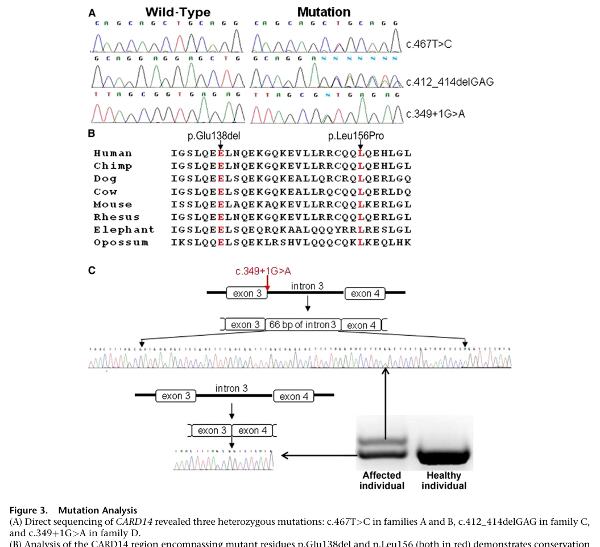
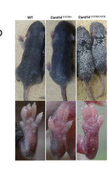

## Question

# Disease Characteristics Research Template

## Target Disease
- **Disease Name:** Familial Pityriasis Rubra Pilaris
- **MONDO ID:** MONDO:0008251 (if available)
- **Category:** Mendelian

## Research Objectives

Please provide a comprehensive research report on **Familial Pityriasis Rubra Pilaris** covering all of the
disease characteristics listed below. This report will be used to populate a disease knowledge
base entry. Be thorough and cite primary literature (PMID preferred) for all claims.

For each section, **suggested databases/resources** are listed. These are the first places
you should search for information on each topic.

---

### 1. Disease Information
> **Search first:** OMIM, Orphanet, ICD-10/ICD-11, MeSH, PubMed

- What is the disease? Provide a concise overview.
- What are the key identifiers? (OMIM, Orphanet, ICD-10/ICD-11, MeSH, Mondo)
- What are the common synonyms and alternative names?
- Is the information derived from individual patients (e.g., EHR) or aggregated disease-level resources?

### 2. Etiology

- **Disease Causal Factors**: What are the primary causes? (genetic, environmental, infectious, mechanistic)
- **Risk Factors**:
  > **Search first:** PubMed, Cochrane Library, UpToDate, clinical guidelines, ClinVar, ClinGen, GWAS Catalog, PheGenI, CTD, CDC, WHO, epidemiological databases
  - Genetic risk factors (causal variants, susceptibility loci, modifier genes)
  - Environmental risk factors (toxins, lifestyle, occupational exposures, age, sex, family history)
- **Protective Factors**:
  > **Search first:** PubMed, Cochrane Library, clinical trial databases, GWAS Catalog, gnomAD, WHO, CDC, nutrition databases
  - Genetic protective factors (protective variants, modifier alleles)
  - Environmental protective factors (diet, lifestyle, exposures that reduce risk)
- **Gene-Environment Interactions**: How do genetic and environmental factors interact to influence disease?
  > **Search first:** CTD, PubMed, PheGenI, GxE databases

### 3. Phenotypes
> **Search first:** HPO (Human Phenotype Ontology), OMIM, Orphanet, PubMed, clinicaltrials.gov, MedDRA, SNOMED CT, DECIPHER, LOINC

For each phenotype, provide:
- **Phenotype type**: symptoms, clinical signs, physical manifestations, behavioral changes, or laboratory abnormalities
  > For symptoms/signs: HPO, OMIM, Orphanet, PubMed
  > For behavioral changes: HPO, DSM, RDoC (Research Domain Criteria), PubMed
  > For laboratory abnormalities: LOINC, SNOMED CT, LabTests Online, PubMed
- **Phenotype characteristics**:
  > **Search first:** OMIM, Orphanet, HPO, PubMed
  - Age of symptom onset (neonatal, childhood, adult-onset, late-onset)
  - Symptom severity (mild, moderate, severe, variable)
  - Symptom progression (stable, progressive, episodic, fluctuating)
  - Frequency among affected individuals (percentage or qualitative)
- **Quality of life impact**: Effects on daily functioning and well-being (per-phenotype when possible)
  > **Search first:** EQ-5D database, SF-36, WHO QOL databases, PubMed
- Suggest HPO (Human Phenotype Ontology) terms for each phenotype

### 4. Genetic/Molecular Information

- **Causal Genes**: Gene mutations or chromosomal abnormalities responsible for disease (gene symbols, OMIM IDs)
  > **Search first:** OMIM, ClinVar, HGMD, Ensembl, NCBI Gene
- **Pathogenic Variants**:
  - Affected genes (gene symbols, HGNC IDs)
    > **Search first:** OMIM, NCBI Gene, Ensembl, HGNC, UniProt, GeneCards
  - Variant classification (pathogenic, likely pathogenic, VUS per ACMG/AMP guidelines)
    > **Search first:** ClinVar, ClinGen, ACMG/AMP guidelines, VarSome
  - Variant type/class (missense, frameshift, nonsense, splice-site, structural)
  - Allele frequency in population databases
    > **Search first:** gnomAD, 1000 Genomes, ExAC, TOPMed, dbSNP
  - Somatic vs germline origin
    > **Search first:** COSMIC (somatic), ClinVar, ICGC, TCGA
  - Functional consequences (loss of function, gain of function, dominant negative)
- **Modifier Genes**: Genes that modify disease severity or expression
- **Epigenetic Information**: DNA methylation, histone modifications, chromatin changes affecting disease
  > **Search first:** ENCODE, Roadmap Epigenomics, MethBase, DiseaseMeth
- **Chromosomal Abnormalities**: Large-scale genetic changes (aneuploidy, translocations, inversions)
  > **Search first:** DECIPHER, ClinVar, ECARUCA, UCSC Genome Browser

### 5. Environmental Information

- **Environmental Factors**: Non-genetic contributing factors (toxins, radiation, pollution, occupational exposure)
  > **Search first:** CTD (Comparative Toxicogenomics Database), TOXNET, PubMed, EPA databases
- **Lifestyle Factors**: Behavioral factors (smoking, diet, exercise, alcohol consumption)
  > **Search first:** CDC databases, WHO, PubMed, NHANES
- **Infectious Agents**: If applicable, pathogens causing or triggering disease (bacteria, viruses, fungi, parasites)
  > **Search first:** NCBI Taxonomy, ViPR, BV-BRC, MicrobeDB, GIDEON

### 6. Mechanism / Pathophysiology

**Present this section as an ordered causal chain first, then the detail below.**
Open with a numbered sequence of mechanistic steps running from the initiating
lesion (mutation, exposure, infection) to the clinical manifestation, one step per
line, each naming what it causes next. State the causal verb explicitly ("leads
to", "results in") and say where a step is inferred rather than demonstrated.
Where the mechanism branches, show the branch. The categories below are a
checklist of what to cover within those steps, not the organizing structure —
a step may draw on several of them, and a category may contribute to several
steps.

- **Molecular Pathways**: Specific signaling cascades or biochemical pathways involved (Wnt, MAPK, mTOR, PI3K-AKT, etc.)
  > **Search first:** KEGG, Reactome, WikiPathways, PathBank, BioCyc
- **Cellular Processes**: Cell-level mechanisms (apoptosis, autophagy, cell cycle dysregulation, inflammation, etc.)
  > **Search first:** Gene Ontology (GO), Reactome, KEGG, PubMed
- **Protein Dysfunction**: How protein structure or function is altered (misfolding, aggregation, loss of function, gain of function)
  > **Search first:** UniProt, PDB (Protein Data Bank), InterPro, Pfam, AlphaFold
- **Metabolic Changes**: Alterations in metabolic processes (energy metabolism, lipid metabolism, amino acid metabolism)
  > **Search first:** KEGG, BioCyc, HMDB (Human Metabolome Database), BRENDA
- **Immune System Involvement**: Role of immune response (autoimmunity, immunodeficiency, chronic inflammation)
  > **Search first:** ImmPort, Immunome Database, IEDB, Gene Ontology
- **Tissue Damage Mechanisms**: How tissues/ are injured (oxidative stress, ischemia, fibrosis, necrosis)
  > **Search first:** PubMed, Gene Ontology, Reactome
- **Biochemical Abnormalities**: Specific molecular defects (enzyme deficiencies, receptor dysfunction, ion channel defects)
  > **Search first:** BRENDA, UniProt, KEGG, OMIM, PubMed
- **Epigenetic Changes**: DNA methylation, histone modifications affecting gene expression in disease
  > **Search first:** ENCODE, Roadmap Epigenomics, MethBase, DiseaseMeth
- **Molecular Profiling** (if available):
  - Transcriptomics/gene expression changes
    > **Search first:** GEO (Gene Expression Omnibus), ArrayExpress, GTEx, Human Cell Atlas, SRA
  - Proteomics findings
    > **Search first:** PRIDE, ProteomeXchange, Human Protein Atlas, STRING, BioGRID
  - Metabolomics signatures
    > **Search first:** MetaboLights, Metabolomics Workbench, HMDB, METLIN
  - Lipidomics alterations
    > **Search first:** LIPID MAPS, SwissLipids, LipidHome, Metabolomics Workbench
  - Genomic structural features
    > **Search first:** UCSC Genome Browser, Ensembl, NCBI, dbVar, DGV
- **Advanced Technologies** (if applicable):
  - Single-cell analysis findings (cell-type specific mechanisms, cellular heterogeneity)
    > **Search first:** Human Cell Atlas, Single Cell Portal, GEO, CELLxGENE
  - Spatial transcriptomics findings
    > **Search first:** GEO, Spatial Research, Vizgen, 10x Genomics data
  - Multi-omics integration results
    > **Search first:** TCGA, ICGC, cBioPortal, LinkedOmics, PubMed
  - Functional genomics screens (CRISPR, RNAi)
    > **Search first:** DepMap, GenomeRNAi, PubMed, BioGRID ORCS

For each mechanism, describe:
- The causal chain from initial trigger to clinical manifestation
- Which mechanisms are upstream vs downstream
- What cell types and biological processes are involved
- Suggest GO terms for biological processes and CL terms for cell types

### 7. Anatomical Structures Affected

- **Organ Level**:
  - Primary organs directly affected
  - Secondary organ involvement (complications, secondary effects)
  - Body systems involved (cardiovascular, nervous, digestive, respiratory, endocrine, etc.)
  > **Search first:** Uberon, FMA (Foundational Model of Anatomy), OMIM, HPO, ICD-11, MeSH, SNOMED CT
- **Tissue and Cell Level**:
  - Specific tissue types affected (epithelial, connective, muscle, nervous)
  - Specific cell populations targeted (with Cell Ontology terms)
  > **Search first:** Uberon, Human Protein Atlas, Cell Ontology, Human Cell Atlas, CellMarker, PanglaoDB
- **Subcellular Level**:
  - Cellular compartments involved (mitochondria, nucleus, ER, lysosomes) (with GO Cellular Component terms)
  > **Search first:** Gene Ontology (Cellular Component), UniProt, Human Protein Atlas
- **Localization**:
  - Specific anatomical sites (with UBERON terms)
    > **Search first:** FMA, Uberon, NeuroNames (for brain), SNOMED CT
  - Lateralization (unilateral, bilateral, asymmetric)
    > **Search first:** HPO, clinical literature, imaging databases

### 8. Temporal Development

- **Onset**:
  - Typical age of onset (congenital, pediatric, adult, geriatric)
  - Onset pattern (acute, subacute, chronic, insidious)
  > **Search first:** OMIM, Orphanet, HPO, PubMed
- **Progression**:
  - Disease stages (early, intermediate, advanced, end-stage)
    > **Search first:** Cancer Staging Manual (AJCC), WHO classifications, PubMed
  - Progression rate (rapid, slow, variable)
  - Disease course pattern (episodic, relapsing-remitting, progressive, stable)
  - Disease duration (self-limited, chronic lifelong)
  > **Search first:** Disease registries, longitudinal cohort databases, natural history studies, PubMed, Orphanet, OMIM
- **Patterns**:
  - Remission patterns (spontaneous, treatment-induced)
    > **Search first:** Clinical trial databases, disease registries, PubMed
  - Critical periods (time windows of vulnerability or opportunity for intervention)
    > **Search first:** PubMed, developmental biology databases, clinical guidelines

### 9. Inheritance and Population

- **Epidemiology**:
  - Prevalence (cases per 100,000 at given time)
  - Incidence (new cases per 100,000 per year)
  > **Search first:** Orphanet, CDC, WHO, GBD (Global Burden of Disease), national registries, SEER, disease registries
- **For Genetic Etiology**:
  - Inheritance pattern (AD, AR, X-linked, mitochondrial, multifactorial, polygenic)
    > **Search first:** OMIM, Orphanet, ClinVar, GTR (Genetic Testing Registry)
  - Penetrance (complete, incomplete, age-dependent)
    > **Search first:** ClinVar, OMIM, PubMed, ClinGen
  - Expressivity (variable, consistent)
    > **Search first:** OMIM, ClinVar, PubMed
  - Genetic anticipation (increasing severity in successive generations)
    > **Search first:** OMIM, PubMed (especially for repeat expansion disorders)
  - Germline mosaicism
    > **Search first:** ClinVar, OMIM, genetic counseling literature, PubMed
  - Founder effects (population-specific mutations)
    > **Search first:** gnomAD, population genetics databases, PubMed
  - Consanguinity role
    > **Search first:** OMIM, population studies, genetic counseling resources
  - Carrier frequency
    > **Search first:** gnomAD, carrier screening databases, GeneReviews, GTR
- **Population Demographics**:
  - Affected populations (ethnic or demographic groups with higher prevalence)
    > **Search first:** gnomAD, 1000 Genomes, PAGE Study, PubMed, population registries
  - Geographic distribution (endemic areas, regional variation)
    > **Search first:** WHO, CDC, GBD, Orphanet, geographic epidemiology databases
  - Geographic distribution of specific variants
  - Sex ratio (male:female)
    > **Search first:** Disease registries, OMIM, PubMed, epidemiological databases
  - Age distribution of affected individuals
    > **Search first:** CDC, disease registries, SEER, Orphanet

### 10. Diagnostics

- **Clinical Tests**:
  - Laboratory tests (blood, urine, tissue chemistry, specific enzyme assays)
    > **Search first:** LOINC, LabTests Online, PubMed
  - Biomarkers (proteins, metabolites, genetic markers, circulating biomarkers)
    > **Search first:** FDA Biomarker List, BEST (Biomarkers, EndpointS, and other Tools), PubMed
  - Imaging studies (X-ray, CT, MRI, PET, ultrasound)
    > **Search first:** RadLex, DICOM, Radiopaedia, imaging databases
  - Functional tests (pulmonary function, cardiac stress tests)
    > **Search first:** LOINC, clinical guidelines, PubMed
  - Electrophysiology (EEG, EMG, ECG, nerve conduction studies)
    > **Search first:** LOINC, clinical neurophysiology databases, PubMed
  - Biopsy findings (histopathology, immunohistochemistry)
    > **Search first:** SNOMED CT, College of American Pathologists resources, PubMed
  - Pathology findings (microscopic examination)
    > **Search first:** SNOMED CT, Digital Pathology databases, PubMed
- **Genetic Testing**:
  > **Search first:** GTR (Genetic Testing Registry), GeneReviews, ClinGen
  - Overview of recommended genetic testing approach
  - Whole genome sequencing (WGS) utility
    > **Search first:** GTR, ClinVar, GEL (Genomics England), gnomAD
  - Whole exome sequencing (WES) utility
    > **Search first:** GTR, ClinVar, OMIM, GeneMatcher
  - Gene panels (which panels, which genes)
    > **Search first:** GTR, ClinVar, laboratory-specific databases
  - Single gene testing
    > **Search first:** GTR, ClinVar, OMIM, GeneReviews
  - Chromosomal microarray (CMA)
    > **Search first:** DECIPHER, ClinVar, dbVar, ECARUCA
  - Karyotyping
    > **Search first:** Chromosome Abnormality Database, ClinVar, cytogenetics resources
  - FISH
    > **Search first:** ClinVar, cytogenetics databases, PubMed
  - Mitochondrial DNA testing
    > **Search first:** MITOMAP, MSeqDR, ClinVar, GTR
  - Repeat expansion testing
    > **Search first:** GTR, ClinVar, repeat expansion databases, PubMed
- **Omics-Based Diagnostics** (if applicable):
  - RNA sequencing / transcriptomics
    > **Search first:** GEO, ArrayExpress, GTEx, RNA-seq databases
  - Proteomics
    > **Search first:** PRIDE, ProteomeXchange, FDA Biomarker database
  - Metabolomics
    > **Search first:** MetaboLights, Metabolomics Workbench, HMDB
  - Epigenomics
    > **Search first:** GEO, ENCODE, Roadmap Epigenomics, MethBase
  - Liquid biopsy
    > **Search first:** COSMIC, ClinVar, liquid biopsy databases, PubMed
- **Clinical Criteria**:
  - Standardized diagnostic criteria (DSM, ICD, society guidelines)
    > **Search first:** DSM-5, ICD-11, clinical society guidelines, UpToDate
  - Differential diagnosis (other conditions to rule out, with distinguishing features)
    > **Search first:** DynaMed, UpToDate, clinical decision support systems
- **Screening**:
  - Screening methods for asymptomatic individuals (newborn screening, carrier screening, cascade screening)
    > **Search first:** ACMG recommendations, CDC newborn screening, GTR

### 11. Outcome/Prognosis

- **Survival and Mortality**:
  - Survival rate (5-year, 10-year, overall)
    > **Search first:** SEER, cancer registries, disease-specific registries, PubMed
  - Life expectancy (with and without treatment if applicable)
    > **Search first:** Orphanet, disease registries, actuarial databases, PubMed
  - Mortality rate
    > **Search first:** CDC, WHO, GBD, national mortality databases
  - Disease-specific mortality (deaths directly attributable to disease)
    > **Search first:** Disease registries, CDC Wonder, GBD, PubMed
- **Morbidity and Function**:
  - Morbidity (disease-related disability and health impacts)
    > **Search first:** GBD, WHO, disability databases, PubMed
  - Disability outcomes (long-term functional impairments)
    > **Search first:** ICF (International Classification of Functioning), disability registries
  - Quality of life measures (EQ-5D, SF-36, PROMIS, disease-specific tools)
    > **Search first:** EQ-5D database, SF-36, PROMIS, PubMed
- **Disease Course**:
  - Complications (secondary problems: infections, organ failure, etc.)
    > **Search first:** ICD codes, disease registries, clinical databases, PubMed
  - Recovery potential (likelihood and extent of recovery, with vs without treatment)
    > **Search first:** Natural history studies, rehabilitation databases, PubMed
- **Prediction**:
  - Prognostic factors (age, disease severity, biomarkers, treatment response)
    > **Search first:** Prognostic models databases, clinical calculators, PubMed
  - Prognostic biomarkers (molecular markers predicting disease course)
    > **Search first:** FDA Biomarker database, PubMed, cancer prognostic databases

### 12. Treatment

- **Pharmacotherapy**:
  - Pharmacological treatments (drug names, drug classes, mechanisms of action)
    > **Search first:** DrugBank, RxNorm, ATC classification, DailyMed, FDA databases
  - Pharmacogenomics (how genetic variants affect drug metabolism, efficacy, toxicity)
    > **Search first:** PharmGKB, CPIC (Clinical Pharmacogenetics), FDA Table of PGx Biomarkers
- **Advanced Therapeutics**:
  - Gene therapy (viral vectors, CRISPR, gene replacement, gene editing)
    > **Search first:** ClinicalTrials.gov, FDA gene therapy database, ASGCT resources
  - Cell therapy (stem cell transplant, CAR-T, cellular therapeutics)
    > **Search first:** ClinicalTrials.gov, FDA cell therapy database, FACT standards
  - RNA-based therapies (ASOs, siRNA, mRNA therapies)
    > **Search first:** ClinicalTrials.gov, FDA approvals, PubMed
  - Targeted therapies (treatments directed at specific molecular targets)
    > **Search first:** My Cancer Genome, OncoKB, ClinicalTrials.gov, FDA approvals
  - Immunotherapies (checkpoint inhibitors, monoclonal antibodies)
    > **Search first:** Cancer Immunotherapy Database, FDA approvals, ClinicalTrials.gov
- **Surgical and Interventional**:
  - Surgical interventions (types of surgery, timing, outcomes)
    > **Search first:** CPT codes, surgical registries, clinical guidelines, PubMed
- **Supportive and Rehabilitative**:
  - Supportive care (symptom management, pain control, nutrition)
    > **Search first:** Clinical guidelines, Cochrane Library, PubMed
  - Rehabilitation (physical therapy, occupational therapy, speech therapy)
    > **Search first:** Rehabilitation medicine databases, clinical guidelines, PubMed
- **Experimental**:
  - Experimental treatments in clinical trials (with NCT identifiers if available)
    > **Search first:** ClinicalTrials.gov, EU Clinical Trials Register, WHO ICTRP
- **Treatment Outcomes**:
  - Treatment response rates
    > **Search first:** Clinical trial databases, FDA reviews, systematic reviews, PubMed
  - Side effects and adverse events
    > **Search first:** FDA Adverse Event Reporting System (FAERS), MedWatch, PubMed
- **Treatment Strategy**:
  - Treatment algorithms (clinical pathways, decision trees)
    > **Search first:** Clinical practice guidelines, NCCN Guidelines, UpToDate
  - Combination therapies
    > **Search first:** ClinicalTrials.gov, treatment guidelines, PubMed
  - Personalized medicine approaches (genotype-guided treatment)
    > **Search first:** My Cancer Genome, CIViC, PharmGKB, precision medicine databases

For each treatment, suggest NCIT (NCI Thesaurus) clinical-intervention terms where applicable.

### 13. Prevention

- **Prevention Levels**:
  - Primary prevention (preventing disease occurrence: vaccination, risk factor modification)
    > **Search first:** CDC, WHO, USPSTF recommendations, Cochrane Library
  - Secondary prevention (early detection and treatment: screening programs, early intervention)
    > **Search first:** USPSTF, CDC screening guidelines, WHO
  - Tertiary prevention (preventing complications in those with disease)
    > **Search first:** Clinical guidelines, disease management protocols, PubMed
- **Immunization**: Vaccine strategies (if applicable)
  > **Search first:** CDC vaccine schedules, WHO immunization, FDA vaccine database
- **Screening and Early Detection**:
  - Screening programs (population-based: newborn screening, cancer screening)
    > **Search first:** CDC screening programs, USPSTF, cancer screening databases
  - Genetic screening (carrier screening, preimplantation genetic diagnosis, prenatal testing)
    > **Search first:** ACMG recommendations, ACOG guidelines, GTR
  - Risk stratification (identifying high-risk individuals for targeted prevention)
    > **Search first:** Risk prediction models, clinical calculators, PubMed
- **Behavioral Interventions**: Lifestyle modifications to reduce risk
  > **Search first:** CDC, WHO, behavioral intervention databases, Cochrane Library
- **Counseling**: Genetic counseling (risk assessment, family planning guidance)
  > **Search first:** NSGC resources, ACMG guidelines, GeneReviews
- **Public Health**:
  - Public health interventions (sanitation, vector control, health education)
    > **Search first:** CDC, WHO, public health databases, PubMed
  - Environmental interventions (reducing environmental risk factors)
    > **Search first:** EPA databases, WHO environmental health, PubMed
- **Prophylaxis**: Preventive medications or procedures
  > **Search first:** Clinical guidelines, FDA approvals, PubMed

### 14. Other Species / Natural Disease

- **Taxonomy**: Species affected (with NCBI Taxon identifiers)
  > **Search first:** NCBI Taxonomy
- **Breed**: Specific breeds affected (with VBO identifiers if applicable)
  > **Search first:** VBO (Vertebrate Breed Ontology)
- **Gene**: Orthologous genes in other species (with NCBI Gene IDs)
  > **Search first:** NCBI Gene
- **Natural Disease**:
  - Naturally occurring disease in other species (companion animals, wildlife)
    > **Search first:** OMIA (Online Mendelian Inheritance in Animals), VetCompass, PubMed
  - Veterinary relevance and importance in animal health
    > **Search first:** OMIA, veterinary databases, PubMed
- **Comparative Biology**:
  - Comparative pathology (similarities and differences across species)
    > **Search first:** OMIA, comparative pathology databases, PubMed
  - Evolutionary conservation of disease mechanisms
    > **Search first:** HomoloGene, OrthoMCL, Alliance of Genome Resources
- **Transmission** (if applicable):
  - Zoonotic potential
    > **Search first:** CDC zoonotic diseases, WHO zoonoses, GIDEON
  - Cross-species susceptibility
    > **Search first:** NCBI Taxonomy, veterinary databases, PubMed

### 15. Model Organisms

- **Model Types**:
  - Model organism type (mammalian, invertebrate, cellular, in vitro)
    > **Search first:** Alliance of Genome Resources, model organism databases
  - Specific model systems (mouse, rat, zebrafish, Drosophila, C. elegans, yeast, cell lines, organoids, iPSCs)
    > **Search first:** MGI, RGD, ZFIN, FlyBase, WormBase, SGD, ATCC, Cellosaurus
  - Induced models (drug treatment, surgical intervention, environmental manipulation)
    > **Search first:** MGI, model organism databases, PubMed
- **Genetic Models**:
  - Types available (knockout, knock-in, transgenic, conditional, humanized)
    > **Search first:** MGI, IMPC, KOMP, EuMMCR, IMSR
- **Model Characteristics**:
  - Phenotype recapitulation (how well model reproduces human disease features)
    > **Search first:** Model organism databases, comparative studies, PubMed
  - Model limitations (aspects of human disease not captured)
    > **Search first:** Model organism databases, PubMed, review articles
- **Applications**:
  - Research applications (what aspects of disease can be studied)
    > **Search first:** Model organism databases, PubMed
- **Resources**:
  - Model databases
    > **Search first:** MGI, RGD, ZFIN, FlyBase, WormBase, IMSR, EMMA, MMRRC

---

## Citation Requirements

- Cite primary literature (PMID preferred) for all mechanistic and clinical claims
- Prioritize recent reviews and landmark papers
- Include direct quotes from abstracts where possible to support key statements
- Distinguish evidence source types: human clinical, model organism, in vitro, computational

## Output Format

Structure your response as a comprehensive narrative organized by the sections above.
For each section, provide:
- Factual content with specific details (numbers, percentages, gene names, variant nomenclature)
- Ontology term suggestions (HPO, GO, CL, UBERON, CHEBI, NCIT, MONDO) where applicable
- Evidence citations with PMIDs
- Direct quotes from abstracts to support key claims
- Clear indication when information is not available or not applicable for this disease

This report will be used to populate a disease knowledge base entry with:
- Pathophysiology descriptions with causal chains
- Gene/protein annotations (HGNC, GO terms)
- Phenotype associations (HP terms) with frequencies
- Cell type involvement (CL terms)
- Anatomical locations (UBERON terms)
- Chemical entities (CHEBI terms)
- Treatment annotations (NCIT terms)
- Evidence items with PMIDs and exact abstract quotes
- Epidemiology, prognosis, diagnostic, and prevention information
- Animal model descriptions with phenotype recapitulation details

## Output

Question: You are an expert researcher providing comprehensive, well-cited information.

Provide detailed information focusing on:
1. Key concepts and definitions with current understanding
2. Recent developments and latest research (prioritize 2023-2024 sources)
3. Current applications and real-world implementations
4. Expert opinions and analysis from authoritative sources
5. Relevant statistics and data from recent studies

Format as a comprehensive research report with proper citations. Include URLs and publication dates where available.
Always prioritize recent, authoritative sources and provide specific citations for all major claims.

# Disease Characteristics Research Template

## Target Disease
- **Disease Name:** Familial Pityriasis Rubra Pilaris
- **MONDO ID:** MONDO:0008251 (if available)
- **Category:** Mendelian

## Research Objectives

Please provide a comprehensive research report on **Familial Pityriasis Rubra Pilaris** covering all of the
disease characteristics listed below. This report will be used to populate a disease knowledge
base entry. Be thorough and cite primary literature (PMID preferred) for all claims.

For each section, **suggested databases/resources** are listed. These are the first places
you should search for information on each topic.

---

### 1. Disease Information
> **Search first:** OMIM, Orphanet, ICD-10/ICD-11, MeSH, PubMed

- What is the disease? Provide a concise overview.
- What are the key identifiers? (OMIM, Orphanet, ICD-10/ICD-11, MeSH, Mondo)
- What are the common synonyms and alternative names?
- Is the information derived from individual patients (e.g., EHR) or aggregated disease-level resources?

### 2. Etiology

- **Disease Causal Factors**: What are the primary causes? (genetic, environmental, infectious, mechanistic)
- **Risk Factors**:
  > **Search first:** PubMed, Cochrane Library, UpToDate, clinical guidelines, ClinVar, ClinGen, GWAS Catalog, PheGenI, CTD, CDC, WHO, epidemiological databases
  - Genetic risk factors (causal variants, susceptibility loci, modifier genes)
  - Environmental risk factors (toxins, lifestyle, occupational exposures, age, sex, family history)
- **Protective Factors**:
  > **Search first:** PubMed, Cochrane Library, clinical trial databases, GWAS Catalog, gnomAD, WHO, CDC, nutrition databases
  - Genetic protective factors (protective variants, modifier alleles)
  - Environmental protective factors (diet, lifestyle, exposures that reduce risk)
- **Gene-Environment Interactions**: How do genetic and environmental factors interact to influence disease?
  > **Search first:** CTD, PubMed, PheGenI, GxE databases

### 3. Phenotypes
> **Search first:** HPO (Human Phenotype Ontology), OMIM, Orphanet, PubMed, clinicaltrials.gov, MedDRA, SNOMED CT, DECIPHER, LOINC

For each phenotype, provide:
- **Phenotype type**: symptoms, clinical signs, physical manifestations, behavioral changes, or laboratory abnormalities
  > For symptoms/signs: HPO, OMIM, Orphanet, PubMed
  > For behavioral changes: HPO, DSM, RDoC (Research Domain Criteria), PubMed
  > For laboratory abnormalities: LOINC, SNOMED CT, LabTests Online, PubMed
- **Phenotype characteristics**:
  > **Search first:** OMIM, Orphanet, HPO, PubMed
  - Age of symptom onset (neonatal, childhood, adult-onset, late-onset)
  - Symptom severity (mild, moderate, severe, variable)
  - Symptom progression (stable, progressive, episodic, fluctuating)
  - Frequency among affected individuals (percentage or qualitative)
- **Quality of life impact**: Effects on daily functioning and well-being (per-phenotype when possible)
  > **Search first:** EQ-5D database, SF-36, WHO QOL databases, PubMed
- Suggest HPO (Human Phenotype Ontology) terms for each phenotype

### 4. Genetic/Molecular Information

- **Causal Genes**: Gene mutations or chromosomal abnormalities responsible for disease (gene symbols, OMIM IDs)
  > **Search first:** OMIM, ClinVar, HGMD, Ensembl, NCBI Gene
- **Pathogenic Variants**:
  - Affected genes (gene symbols, HGNC IDs)
    > **Search first:** OMIM, NCBI Gene, Ensembl, HGNC, UniProt, GeneCards
  - Variant classification (pathogenic, likely pathogenic, VUS per ACMG/AMP guidelines)
    > **Search first:** ClinVar, ClinGen, ACMG/AMP guidelines, VarSome
  - Variant type/class (missense, frameshift, nonsense, splice-site, structural)
  - Allele frequency in population databases
    > **Search first:** gnomAD, 1000 Genomes, ExAC, TOPMed, dbSNP
  - Somatic vs germline origin
    > **Search first:** COSMIC (somatic), ClinVar, ICGC, TCGA
  - Functional consequences (loss of function, gain of function, dominant negative)
- **Modifier Genes**: Genes that modify disease severity or expression
- **Epigenetic Information**: DNA methylation, histone modifications, chromatin changes affecting disease
  > **Search first:** ENCODE, Roadmap Epigenomics, MethBase, DiseaseMeth
- **Chromosomal Abnormalities**: Large-scale genetic changes (aneuploidy, translocations, inversions)
  > **Search first:** DECIPHER, ClinVar, ECARUCA, UCSC Genome Browser

### 5. Environmental Information

- **Environmental Factors**: Non-genetic contributing factors (toxins, radiation, pollution, occupational exposure)
  > **Search first:** CTD (Comparative Toxicogenomics Database), TOXNET, PubMed, EPA databases
- **Lifestyle Factors**: Behavioral factors (smoking, diet, exercise, alcohol consumption)
  > **Search first:** CDC databases, WHO, PubMed, NHANES
- **Infectious Agents**: If applicable, pathogens causing or triggering disease (bacteria, viruses, fungi, parasites)
  > **Search first:** NCBI Taxonomy, ViPR, BV-BRC, MicrobeDB, GIDEON

### 6. Mechanism / Pathophysiology

**Present this section as an ordered causal chain first, then the detail below.**
Open with a numbered sequence of mechanistic steps running from the initiating
lesion (mutation, exposure, infection) to the clinical manifestation, one step per
line, each naming what it causes next. State the causal verb explicitly ("leads
to", "results in") and say where a step is inferred rather than demonstrated.
Where the mechanism branches, show the branch. The categories below are a
checklist of what to cover within those steps, not the organizing structure —
a step may draw on several of them, and a category may contribute to several
steps.

- **Molecular Pathways**: Specific signaling cascades or biochemical pathways involved (Wnt, MAPK, mTOR, PI3K-AKT, etc.)
  > **Search first:** KEGG, Reactome, WikiPathways, PathBank, BioCyc
- **Cellular Processes**: Cell-level mechanisms (apoptosis, autophagy, cell cycle dysregulation, inflammation, etc.)
  > **Search first:** Gene Ontology (GO), Reactome, KEGG, PubMed
- **Protein Dysfunction**: How protein structure or function is altered (misfolding, aggregation, loss of function, gain of function)
  > **Search first:** UniProt, PDB (Protein Data Bank), InterPro, Pfam, AlphaFold
- **Metabolic Changes**: Alterations in metabolic processes (energy metabolism, lipid metabolism, amino acid metabolism)
  > **Search first:** KEGG, BioCyc, HMDB (Human Metabolome Database), BRENDA
- **Immune System Involvement**: Role of immune response (autoimmunity, immunodeficiency, chronic inflammation)
  > **Search first:** ImmPort, Immunome Database, IEDB, Gene Ontology
- **Tissue Damage Mechanisms**: How tissues/ are injured (oxidative stress, ischemia, fibrosis, necrosis)
  > **Search first:** PubMed, Gene Ontology, Reactome
- **Biochemical Abnormalities**: Specific molecular defects (enzyme deficiencies, receptor dysfunction, ion channel defects)
  > **Search first:** BRENDA, UniProt, KEGG, OMIM, PubMed
- **Epigenetic Changes**: DNA methylation, histone modifications affecting gene expression in disease
  > **Search first:** ENCODE, Roadmap Epigenomics, MethBase, DiseaseMeth
- **Molecular Profiling** (if available):
  - Transcriptomics/gene expression changes
    > **Search first:** GEO (Gene Expression Omnibus), ArrayExpress, GTEx, Human Cell Atlas, SRA
  - Proteomics findings
    > **Search first:** PRIDE, ProteomeXchange, Human Protein Atlas, STRING, BioGRID
  - Metabolomics signatures
    > **Search first:** MetaboLights, Metabolomics Workbench, HMDB, METLIN
  - Lipidomics alterations
    > **Search first:** LIPID MAPS, SwissLipids, LipidHome, Metabolomics Workbench
  - Genomic structural features
    > **Search first:** UCSC Genome Browser, Ensembl, NCBI, dbVar, DGV
- **Advanced Technologies** (if applicable):
  - Single-cell analysis findings (cell-type specific mechanisms, cellular heterogeneity)
    > **Search first:** Human Cell Atlas, Single Cell Portal, GEO, CELLxGENE
  - Spatial transcriptomics findings
    > **Search first:** GEO, Spatial Research, Vizgen, 10x Genomics data
  - Multi-omics integration results
    > **Search first:** TCGA, ICGC, cBioPortal, LinkedOmics, PubMed
  - Functional genomics screens (CRISPR, RNAi)
    > **Search first:** DepMap, GenomeRNAi, PubMed, BioGRID ORCS

For each mechanism, describe:
- The causal chain from initial trigger to clinical manifestation
- Which mechanisms are upstream vs downstream
- What cell types and biological processes are involved
- Suggest GO terms for biological processes and CL terms for cell types

### 7. Anatomical Structures Affected

- **Organ Level**:
  - Primary organs directly affected
  - Secondary organ involvement (complications, secondary effects)
  - Body systems involved (cardiovascular, nervous, digestive, respiratory, endocrine, etc.)
  > **Search first:** Uberon, FMA (Foundational Model of Anatomy), OMIM, HPO, ICD-11, MeSH, SNOMED CT
- **Tissue and Cell Level**:
  - Specific tissue types affected (epithelial, connective, muscle, nervous)
  - Specific cell populations targeted (with Cell Ontology terms)
  > **Search first:** Uberon, Human Protein Atlas, Cell Ontology, Human Cell Atlas, CellMarker, PanglaoDB
- **Subcellular Level**:
  - Cellular compartments involved (mitochondria, nucleus, ER, lysosomes) (with GO Cellular Component terms)
  > **Search first:** Gene Ontology (Cellular Component), UniProt, Human Protein Atlas
- **Localization**:
  - Specific anatomical sites (with UBERON terms)
    > **Search first:** FMA, Uberon, NeuroNames (for brain), SNOMED CT
  - Lateralization (unilateral, bilateral, asymmetric)
    > **Search first:** HPO, clinical literature, imaging databases

### 8. Temporal Development

- **Onset**:
  - Typical age of onset (congenital, pediatric, adult, geriatric)
  - Onset pattern (acute, subacute, chronic, insidious)
  > **Search first:** OMIM, Orphanet, HPO, PubMed
- **Progression**:
  - Disease stages (early, intermediate, advanced, end-stage)
    > **Search first:** Cancer Staging Manual (AJCC), WHO classifications, PubMed
  - Progression rate (rapid, slow, variable)
  - Disease course pattern (episodic, relapsing-remitting, progressive, stable)
  - Disease duration (self-limited, chronic lifelong)
  > **Search first:** Disease registries, longitudinal cohort databases, natural history studies, PubMed, Orphanet, OMIM
- **Patterns**:
  - Remission patterns (spontaneous, treatment-induced)
    > **Search first:** Clinical trial databases, disease registries, PubMed
  - Critical periods (time windows of vulnerability or opportunity for intervention)
    > **Search first:** PubMed, developmental biology databases, clinical guidelines

### 9. Inheritance and Population

- **Epidemiology**:
  - Prevalence (cases per 100,000 at given time)
  - Incidence (new cases per 100,000 per year)
  > **Search first:** Orphanet, CDC, WHO, GBD (Global Burden of Disease), national registries, SEER, disease registries
- **For Genetic Etiology**:
  - Inheritance pattern (AD, AR, X-linked, mitochondrial, multifactorial, polygenic)
    > **Search first:** OMIM, Orphanet, ClinVar, GTR (Genetic Testing Registry)
  - Penetrance (complete, incomplete, age-dependent)
    > **Search first:** ClinVar, OMIM, PubMed, ClinGen
  - Expressivity (variable, consistent)
    > **Search first:** OMIM, ClinVar, PubMed
  - Genetic anticipation (increasing severity in successive generations)
    > **Search first:** OMIM, PubMed (especially for repeat expansion disorders)
  - Germline mosaicism
    > **Search first:** ClinVar, OMIM, genetic counseling literature, PubMed
  - Founder effects (population-specific mutations)
    > **Search first:** gnomAD, population genetics databases, PubMed
  - Consanguinity role
    > **Search first:** OMIM, population studies, genetic counseling resources
  - Carrier frequency
    > **Search first:** gnomAD, carrier screening databases, GeneReviews, GTR
- **Population Demographics**:
  - Affected populations (ethnic or demographic groups with higher prevalence)
    > **Search first:** gnomAD, 1000 Genomes, PAGE Study, PubMed, population registries
  - Geographic distribution (endemic areas, regional variation)
    > **Search first:** WHO, CDC, GBD, Orphanet, geographic epidemiology databases
  - Geographic distribution of specific variants
  - Sex ratio (male:female)
    > **Search first:** Disease registries, OMIM, PubMed, epidemiological databases
  - Age distribution of affected individuals
    > **Search first:** CDC, disease registries, SEER, Orphanet

### 10. Diagnostics

- **Clinical Tests**:
  - Laboratory tests (blood, urine, tissue chemistry, specific enzyme assays)
    > **Search first:** LOINC, LabTests Online, PubMed
  - Biomarkers (proteins, metabolites, genetic markers, circulating biomarkers)
    > **Search first:** FDA Biomarker List, BEST (Biomarkers, EndpointS, and other Tools), PubMed
  - Imaging studies (X-ray, CT, MRI, PET, ultrasound)
    > **Search first:** RadLex, DICOM, Radiopaedia, imaging databases
  - Functional tests (pulmonary function, cardiac stress tests)
    > **Search first:** LOINC, clinical guidelines, PubMed
  - Electrophysiology (EEG, EMG, ECG, nerve conduction studies)
    > **Search first:** LOINC, clinical neurophysiology databases, PubMed
  - Biopsy findings (histopathology, immunohistochemistry)
    > **Search first:** SNOMED CT, College of American Pathologists resources, PubMed
  - Pathology findings (microscopic examination)
    > **Search first:** SNOMED CT, Digital Pathology databases, PubMed
- **Genetic Testing**:
  > **Search first:** GTR (Genetic Testing Registry), GeneReviews, ClinGen
  - Overview of recommended genetic testing approach
  - Whole genome sequencing (WGS) utility
    > **Search first:** GTR, ClinVar, GEL (Genomics England), gnomAD
  - Whole exome sequencing (WES) utility
    > **Search first:** GTR, ClinVar, OMIM, GeneMatcher
  - Gene panels (which panels, which genes)
    > **Search first:** GTR, ClinVar, laboratory-specific databases
  - Single gene testing
    > **Search first:** GTR, ClinVar, OMIM, GeneReviews
  - Chromosomal microarray (CMA)
    > **Search first:** DECIPHER, ClinVar, dbVar, ECARUCA
  - Karyotyping
    > **Search first:** Chromosome Abnormality Database, ClinVar, cytogenetics resources
  - FISH
    > **Search first:** ClinVar, cytogenetics databases, PubMed
  - Mitochondrial DNA testing
    > **Search first:** MITOMAP, MSeqDR, ClinVar, GTR
  - Repeat expansion testing
    > **Search first:** GTR, ClinVar, repeat expansion databases, PubMed
- **Omics-Based Diagnostics** (if applicable):
  - RNA sequencing / transcriptomics
    > **Search first:** GEO, ArrayExpress, GTEx, RNA-seq databases
  - Proteomics
    > **Search first:** PRIDE, ProteomeXchange, FDA Biomarker database
  - Metabolomics
    > **Search first:** MetaboLights, Metabolomics Workbench, HMDB
  - Epigenomics
    > **Search first:** GEO, ENCODE, Roadmap Epigenomics, MethBase
  - Liquid biopsy
    > **Search first:** COSMIC, ClinVar, liquid biopsy databases, PubMed
- **Clinical Criteria**:
  - Standardized diagnostic criteria (DSM, ICD, society guidelines)
    > **Search first:** DSM-5, ICD-11, clinical society guidelines, UpToDate
  - Differential diagnosis (other conditions to rule out, with distinguishing features)
    > **Search first:** DynaMed, UpToDate, clinical decision support systems
- **Screening**:
  - Screening methods for asymptomatic individuals (newborn screening, carrier screening, cascade screening)
    > **Search first:** ACMG recommendations, CDC newborn screening, GTR

### 11. Outcome/Prognosis

- **Survival and Mortality**:
  - Survival rate (5-year, 10-year, overall)
    > **Search first:** SEER, cancer registries, disease-specific registries, PubMed
  - Life expectancy (with and without treatment if applicable)
    > **Search first:** Orphanet, disease registries, actuarial databases, PubMed
  - Mortality rate
    > **Search first:** CDC, WHO, GBD, national mortality databases
  - Disease-specific mortality (deaths directly attributable to disease)
    > **Search first:** Disease registries, CDC Wonder, GBD, PubMed
- **Morbidity and Function**:
  - Morbidity (disease-related disability and health impacts)
    > **Search first:** GBD, WHO, disability databases, PubMed
  - Disability outcomes (long-term functional impairments)
    > **Search first:** ICF (International Classification of Functioning), disability registries
  - Quality of life measures (EQ-5D, SF-36, PROMIS, disease-specific tools)
    > **Search first:** EQ-5D database, SF-36, PROMIS, PubMed
- **Disease Course**:
  - Complications (secondary problems: infections, organ failure, etc.)
    > **Search first:** ICD codes, disease registries, clinical databases, PubMed
  - Recovery potential (likelihood and extent of recovery, with vs without treatment)
    > **Search first:** Natural history studies, rehabilitation databases, PubMed
- **Prediction**:
  - Prognostic factors (age, disease severity, biomarkers, treatment response)
    > **Search first:** Prognostic models databases, clinical calculators, PubMed
  - Prognostic biomarkers (molecular markers predicting disease course)
    > **Search first:** FDA Biomarker database, PubMed, cancer prognostic databases

### 12. Treatment

- **Pharmacotherapy**:
  - Pharmacological treatments (drug names, drug classes, mechanisms of action)
    > **Search first:** DrugBank, RxNorm, ATC classification, DailyMed, FDA databases
  - Pharmacogenomics (how genetic variants affect drug metabolism, efficacy, toxicity)
    > **Search first:** PharmGKB, CPIC (Clinical Pharmacogenetics), FDA Table of PGx Biomarkers
- **Advanced Therapeutics**:
  - Gene therapy (viral vectors, CRISPR, gene replacement, gene editing)
    > **Search first:** ClinicalTrials.gov, FDA gene therapy database, ASGCT resources
  - Cell therapy (stem cell transplant, CAR-T, cellular therapeutics)
    > **Search first:** ClinicalTrials.gov, FDA cell therapy database, FACT standards
  - RNA-based therapies (ASOs, siRNA, mRNA therapies)
    > **Search first:** ClinicalTrials.gov, FDA approvals, PubMed
  - Targeted therapies (treatments directed at specific molecular targets)
    > **Search first:** My Cancer Genome, OncoKB, ClinicalTrials.gov, FDA approvals
  - Immunotherapies (checkpoint inhibitors, monoclonal antibodies)
    > **Search first:** Cancer Immunotherapy Database, FDA approvals, ClinicalTrials.gov
- **Surgical and Interventional**:
  - Surgical interventions (types of surgery, timing, outcomes)
    > **Search first:** CPT codes, surgical registries, clinical guidelines, PubMed
- **Supportive and Rehabilitative**:
  - Supportive care (symptom management, pain control, nutrition)
    > **Search first:** Clinical guidelines, Cochrane Library, PubMed
  - Rehabilitation (physical therapy, occupational therapy, speech therapy)
    > **Search first:** Rehabilitation medicine databases, clinical guidelines, PubMed
- **Experimental**:
  - Experimental treatments in clinical trials (with NCT identifiers if available)
    > **Search first:** ClinicalTrials.gov, EU Clinical Trials Register, WHO ICTRP
- **Treatment Outcomes**:
  - Treatment response rates
    > **Search first:** Clinical trial databases, FDA reviews, systematic reviews, PubMed
  - Side effects and adverse events
    > **Search first:** FDA Adverse Event Reporting System (FAERS), MedWatch, PubMed
- **Treatment Strategy**:
  - Treatment algorithms (clinical pathways, decision trees)
    > **Search first:** Clinical practice guidelines, NCCN Guidelines, UpToDate
  - Combination therapies
    > **Search first:** ClinicalTrials.gov, treatment guidelines, PubMed
  - Personalized medicine approaches (genotype-guided treatment)
    > **Search first:** My Cancer Genome, CIViC, PharmGKB, precision medicine databases

For each treatment, suggest NCIT (NCI Thesaurus) clinical-intervention terms where applicable.

### 13. Prevention

- **Prevention Levels**:
  - Primary prevention (preventing disease occurrence: vaccination, risk factor modification)
    > **Search first:** CDC, WHO, USPSTF recommendations, Cochrane Library
  - Secondary prevention (early detection and treatment: screening programs, early intervention)
    > **Search first:** USPSTF, CDC screening guidelines, WHO
  - Tertiary prevention (preventing complications in those with disease)
    > **Search first:** Clinical guidelines, disease management protocols, PubMed
- **Immunization**: Vaccine strategies (if applicable)
  > **Search first:** CDC vaccine schedules, WHO immunization, FDA vaccine database
- **Screening and Early Detection**:
  - Screening programs (population-based: newborn screening, cancer screening)
    > **Search first:** CDC screening programs, USPSTF, cancer screening databases
  - Genetic screening (carrier screening, preimplantation genetic diagnosis, prenatal testing)
    > **Search first:** ACMG recommendations, ACOG guidelines, GTR
  - Risk stratification (identifying high-risk individuals for targeted prevention)
    > **Search first:** Risk prediction models, clinical calculators, PubMed
- **Behavioral Interventions**: Lifestyle modifications to reduce risk
  > **Search first:** CDC, WHO, behavioral intervention databases, Cochrane Library
- **Counseling**: Genetic counseling (risk assessment, family planning guidance)
  > **Search first:** NSGC resources, ACMG guidelines, GeneReviews
- **Public Health**:
  - Public health interventions (sanitation, vector control, health education)
    > **Search first:** CDC, WHO, public health databases, PubMed
  - Environmental interventions (reducing environmental risk factors)
    > **Search first:** EPA databases, WHO environmental health, PubMed
- **Prophylaxis**: Preventive medications or procedures
  > **Search first:** Clinical guidelines, FDA approvals, PubMed

### 14. Other Species / Natural Disease

- **Taxonomy**: Species affected (with NCBI Taxon identifiers)
  > **Search first:** NCBI Taxonomy
- **Breed**: Specific breeds affected (with VBO identifiers if applicable)
  > **Search first:** VBO (Vertebrate Breed Ontology)
- **Gene**: Orthologous genes in other species (with NCBI Gene IDs)
  > **Search first:** NCBI Gene
- **Natural Disease**:
  - Naturally occurring disease in other species (companion animals, wildlife)
    > **Search first:** OMIA (Online Mendelian Inheritance in Animals), VetCompass, PubMed
  - Veterinary relevance and importance in animal health
    > **Search first:** OMIA, veterinary databases, PubMed
- **Comparative Biology**:
  - Comparative pathology (similarities and differences across species)
    > **Search first:** OMIA, comparative pathology databases, PubMed
  - Evolutionary conservation of disease mechanisms
    > **Search first:** HomoloGene, OrthoMCL, Alliance of Genome Resources
- **Transmission** (if applicable):
  - Zoonotic potential
    > **Search first:** CDC zoonotic diseases, WHO zoonoses, GIDEON
  - Cross-species susceptibility
    > **Search first:** NCBI Taxonomy, veterinary databases, PubMed

### 15. Model Organisms

- **Model Types**:
  - Model organism type (mammalian, invertebrate, cellular, in vitro)
    > **Search first:** Alliance of Genome Resources, model organism databases
  - Specific model systems (mouse, rat, zebrafish, Drosophila, C. elegans, yeast, cell lines, organoids, iPSCs)
    > **Search first:** MGI, RGD, ZFIN, FlyBase, WormBase, SGD, ATCC, Cellosaurus
  - Induced models (drug treatment, surgical intervention, environmental manipulation)
    > **Search first:** MGI, model organism databases, PubMed
- **Genetic Models**:
  - Types available (knockout, knock-in, transgenic, conditional, humanized)
    > **Search first:** MGI, IMPC, KOMP, EuMMCR, IMSR
- **Model Characteristics**:
  - Phenotype recapitulation (how well model reproduces human disease features)
    > **Search first:** Model organism databases, comparative studies, PubMed
  - Model limitations (aspects of human disease not captured)
    > **Search first:** Model organism databases, PubMed, review articles
- **Applications**:
  - Research applications (what aspects of disease can be studied)
    > **Search first:** Model organism databases, PubMed
- **Resources**:
  - Model databases
    > **Search first:** MGI, RGD, ZFIN, FlyBase, WormBase, IMSR, EMMA, MMRRC

---

## Citation Requirements

- Cite primary literature (PMID preferred) for all mechanistic and clinical claims
- Prioritize recent reviews and landmark papers
- Include direct quotes from abstracts where possible to support key statements
- Distinguish evidence source types: human clinical, model organism, in vitro, computational

## Output Format

Structure your response as a comprehensive narrative organized by the sections above.
For each section, provide:
- Factual content with specific details (numbers, percentages, gene names, variant nomenclature)
- Ontology term suggestions (HPO, GO, CL, UBERON, CHEBI, NCIT, MONDO) where applicable
- Evidence citations with PMIDs
- Direct quotes from abstracts to support key claims
- Clear indication when information is not available or not applicable for this disease

This report will be used to populate a disease knowledge base entry with:
- Pathophysiology descriptions with causal chains
- Gene/protein annotations (HGNC, GO terms)
- Phenotype associations (HP terms) with frequencies
- Cell type involvement (CL terms)
- Anatomical locations (UBERON terms)
- Chemical entities (CHEBI terms)
- Treatment annotations (NCIT terms)
- Evidence items with PMIDs and exact abstract quotes
- Epidemiology, prognosis, diagnostic, and prevention information
- Animal model descriptions with phenotype recapitulation details

# Familial pityriasis rubra pilaris: disease-characteristics research report

**Scope and evidence convention.** Familial pityriasis rubra pilaris (PRP) is principally an early-onset, often autosomal-dominant inflammatory keratinization disorder associated with activating *CARD14* variants and the atypical juvenile, or **type V**, PRP phenotype. Type V can also arise **de novo**; conversely, the wider category of CARD14-associated papulosquamous eruption (**CAPE**) includes psoriasis-like disease and is **not synonymous** with familial PRP. Findings from unselected or adult-onset PRP are identified separately below. This entry synthesizes published families, case series, experiments, reviews and trial registrations—not individual electronic health records. (fuchstelem2012familialpityriasisrubra pages 1-2, takeichi2017pityriasisrubrapilaris pages 1-2, frare2021card14‐associatedpapulosquamouseruption pages 1-3)

The following evidence map makes those distinctions explicit. (fuchstelem2012familialpityriasisrubra pages 1-2, takeichi2017pityriasisrubrapilaris pages 1-2, frare2021card14‐associatedpapulosquamouseruption pages 3-4, yoshikawa2023il17axisis pages 4-6, zhou2024updatesonpityriasis pages 3-4, zhao2025clinicalcharacteristicsof pages 3-6)

| Study date / setting | Exact observation | Evidence grade | Applicability / limitation |
|---|---|---|---|
| **2012 — Four unrelated autosomal-dominant familial-PRP kindreds** | Linkage mapped disease to **17q25.3**; three heterozygous **CARD14** variants segregated: **c.467T>C (p.Leu156Pro)** in families A/B, **c.412_414delGAG (p.Glu138del)** in family C, and **c.349+1G>A** in family D, the latter producing a 66-bp intronic insertion. Variants were absent from 200 matched-control alleles and >8,200 reference sequences. Onset was **4–36 months**; two asymptomatic obligatory carriers demonstrated incomplete penetrance. PRP skin showed increased CARD14, activated p65, and NF-κB target expression. (fuchstelem2012familialpityriasisrubra pages 1-2, fuchstelem2012familialpityriasisrubra pages 2-4, fuchstelem2012familialpityriasisrubra pages 4-6, fuchstelem2012familialpityriasisrubra pages 6-7) | **Strong disease-specific human genetic evidence** | Foundational causal evidence for familial PRP. The **90% penetrance** used in linkage analysis was a modeling assumption, not an observed penetrance estimate; functional work examined affected skin rather than variant-specific reporter activity. |
| **2017 — Case series of 22 patients across five PRP subtypes** | All **3/3 type V** patients carried CARD14 variants: **p.Cys127Ser** and **p.Gln136Leu** were de novo, and **p.Gly117Ser** was previously reported. All three had patchy macular brown hyperpigmentation. (takeichi2017pityriasisrubrapilaris pages 1-2) | **Moderate-to-strong subtype-specific human evidence** | Supports a close CARD14–type V association, but the denominator was only three type V cases; pathogenicity relied partly on in-silico prediction, and rare variants also occurred in one type I and one type IV case. |
| **2021 — Three new pediatric CAPE cases plus 31 previously reported pediatric cases** | Among the **31 prior cases**, facial involvement occurred in **93%**, palmoplantar keratoderma in **68%**, follicular papules in **45%**, islands of sparing in **42%**, truncal disease in **64%**, ectropion in **6%**, and sclerodermatous hand change in **6%**. Mean onset was **12.4 months** overall. (frare2021card14‐associatedpapulosquamouseruption pages 3-4) | **Moderate phenotypic-spectrum evidence** | CAPE spans psoriasis-like and PRP-like disease and is broader than strictly diagnosed familial/type V PRP. Percentages describe the previous 31 pediatric CAPE cases, not all familial PRP patients. |
| **2023 preprint; subsequently published in revised form — CRISPR Card14 p.Cys127Ser knock-in mice** | Homozygous **Card14C127S/C127S** mice developed generalized scaling, follicular plugs, palmoplantar hyperkeratosis, approximately **sixfold higher TEWL**, IL-17/IL-36 and inflammasome activation, and high neonatal mortality; anti-IL-17A improved inflammation but not TEWL. Heterozygotes had milder, transient disease. (yoshikawa2023il17axisis pages 1-4, yoshikawa2023il17axisis pages 6-9, yoshikawa2023il17axisis media dc3c37bf, yoshikawa2023il17axisis pages 4-6) | **Strong mechanistic animal evidence** | PRP-specific mutation and morphology strengthen relevance, but severe disease required homozygosity whereas human disease is usually heterozygous. Single-cell RNA sequencing compared only **one 12-month-old mutant with one wild-type mouse**, limiting inference. |
| **2024 — Scoping review of PRP literature through October 2022** | Treatment reports covered **192 individuals**, but only **5 had type V PRP**; 55 were untyped. CARD14 evidence was concentrated in familial/type V disease, and no validated PRP severity score existed. (zhou2024updatesonpityriasis pages 2-3, zhou2024updatesonpityriasis pages 3-4, zhou2024updatesonpityriasis pages 4-6, zhou2024updatesonpityriasis pages 6-7) | **Moderate aggregated PRP evidence; weak familial-specific treatment evidence** | Apparent response rates combine heterogeneous case reports, case series, nonvalidated PASI/BSA measures, combination therapies, and multiple PRP subtypes; they should not be interpreted as familial-PRP efficacy estimates. |
| **2024 — Guselkumab nonrandomized adult-PRP trial, NCT03975153** | Open-label phase 2 study enrolled **15 adults** and evaluated IL-23p19 blockade over 20 weeks; linked publication: *JAMA Dermatology*, June 1, 2024, DOI **10.1001/jamadermatol.2024.0257**, PMID **38598229**. (NCT03975153 chunk 1, NCT03975153 chunk 2) | **Prospective interventional evidence for PRP generally** | **Not familial/type V-specific**; the registry does not establish that participants carried pathogenic CARD14 variants. Familial-PRP-specific response cannot be inferred. |
| **Adult PRP trials — Ixekizumab NCT03485976 and secukinumab NCT03342573** | Ixekizumab enrolled **12 adults** for 24 weeks; secukinumab enrolled **12 adults** for 28 weeks, both single-arm and open-label. (NCT03485976 chunk 1, NCT03342573 chunk 1) | **Prospective but uncontrolled PRP evidence** | **Not familial-specific** and largely adult/acquired PRP. Small enrollment, no randomized comparator, PASI is not validated for PRP, and outcomes cannot be assigned to CARD14-associated type V disease without genotype-stratified data. |
| **2025 — Eight pediatric CAPE patients; three treated with secukinumab** | Seven patients had germline CARD14 variants; one had mosaic **p.Glu138Lys** with variant allele fractions of **24% in lesional skin and 4% in blood**. Three secukinumab-treated patients had PASI changes **5.2→0.8**, **35.5→8.2**, and **25.3→7.9** over 52 weeks, corresponding to **84.6%, 76.9%, and 68.8%** improvement. (zhao2025clinicalcharacteristicsof pages 1-2, zhao2025clinicalcharacteristicsof pages 2-3, zhao2025clinicalcharacteristicsof pages 3-6) | **Moderate, recent genotype-defined clinical evidence** | Retrospective, uncontrolled pediatric CAPE series; only three treated patients, heterogeneous genotypes/phenotypes and dosing, and residual disease was substantial in two. CAPE is relevant to but not synonymous with familial/type V PRP. |

*Table: Evidence-grading summary separating familial/type V PRP and CARD14-associated CAPE findings from studies of unselected adult PRP. It highlights exact denominators, genotype-specific observations, and major limitations affecting clinical interpretation.*

## 1. Disease information and identifiers

Familial PRP causes persistent erythematous, scaly plaques, keratotic follicular papules and palmoplantar keratoderma, often with sharply bounded *islands of unaffected skin*. The foundational four-family study described onset at **4–36 months** and characteristic alternating orthokeratosis and parakeratosis on biopsy. Its abstract states: “We ascertained four unrelated families affected by autosomal-dominant PRP” and “identified three different heterozygous mutations in CARD14.” **Primary human genetic evidence:** Fuchs-Telem *et al.*, published **13 July 2012**, DOI [10.1016/j.ajhg.2012.05.010](https://doi.org/10.1016/j.ajhg.2012.05.010). (fuchstelem2012familialpityriasisrubra pages 1-2, fuchstelem2012familialpityriasisrubra pages 2-4)

**Verified identifiers:** familial PRP **MONDO:0008251**; broader PRP **MONDO:0100017**, **OMIM/MIM 173200**, and **MeSH D010916**; causal-gene record *CARD14* **OMIM/MIM 607211**, **Ensembl ENSG00000141527**. The general PRP clinical code is **ICD-10 L44.0**; it does **not** uniquely designate the familial genotype. A familial-specific Orphanet identifier or ICD-11 code was not independently verified and should not be populated by inference. Synonyms or related search terms include **familial PRP**, **atypical juvenile PRP**, **type V PRP**, **Devergie disease** (for PRP broadly), and, for the broader genotype-associated spectrum, **CAPE**. (OpenTargets Search: pityriasis rubra pilaris-CARD14, miyauchi2021alteredreplicationstress pages 1-2, NCT03485976 chunk 2, zhou2024updatesonpityriasis pages 1-2, frare2021card14‐associatedpapulosquamouseruption pages 1-3)

## 2. Etiology: causal, risk and protective factors

The established cause in the original kindreds is a **heterozygous germline *CARD14* alteration**. Familial clustering is therefore an important risk indicator. In linkage analysis, the kindreds mapped to chromosome **17q25.3**, overlapping psoriasis susceptibility locus PSORS2; two obligate variant/haplotype carriers had no symptoms, showing **incomplete penetrance**. The study’s **90% penetrance** was an *assumption used to calculate linkage*, not a measured population estimate. *CARD14* variants can also arise de novo, so a negative family history does not exclude genotype-associated type V disease. (fuchstelem2012familialpityriasisrubra pages 1-2, fuchstelem2012familialpityriasisrubra pages 2-4, takeichi2017pityriasisrubrapilaris pages 1-2)

**Environment and gene–environment interaction.** Sun exposure aggravated scaling in one CARD14-associated type V case; one CAPE child worsened to erythroderma during a viral illness despite methotrexate, and another flared during an upper-respiratory infection while receiving secukinumab. These are **individual observations, not established causal risk factors**. A 2024 review found reports of COVID-19 infection/vaccination and malignancy preceding *PRP generally*; these observations must not be transferred to inherited familial PRP or interpreted as proof of causation. Host–microbiome interactions and unidentified genetic or environmental modifiers were explicitly proposed, rather than demonstrated, in the original families. No reproducible protective allele, diet, toxin, occupational exposure or proven preventive lifestyle intervention was established. (takeichi2017pityriasisrubrapilaris pages 1-2, frare2021card14‐associatedpapulosquamouseruption pages 1-3, zhao2025clinicalcharacteristicsof pages 3-6, zhou2024updatesonpityriasis pages 2-3, fuchstelem2012familialpityriasisrubra pages 6-7)

A potentially protective **somatic** process has been observed after disease begins: two people with type V PRP had clinically normalized skin patches in which the germline *CARD14* mutation was absent from the epidermis. All **6/6 examined patches** showed reversion; **4/6** had chromosome-17q copy-neutral loss of heterozygosity. This is *revertant mosaicism*, not an inherited protective allele or a validated therapy. **Primary human-plus-cell study:** Miyauchi *et al.*, **3 June 2021**, DOI [10.1016/j.ajhg.2021.04.021](https://doi.org/10.1016/j.ajhg.2021.04.021). (miyauchi2021alteredreplicationstress pages 5-7, miyauchi2021alteredreplicationstress pages 1-2)

## 3. Phenotypes and quality of life

| Phenotype and type | Onset, course and severity | Frequency and ontology suggestion |
|---|---|---|
| Follicular keratotic papules/plugging—**physical sign** | Usually early childhood; variable and often chronic. Follicular plugging can be seen histologically. | Present in the four foundational kindreds; follicular papules in **45% of 31 previously reported pediatric CAPE cases**, not a familial-PRP prevalence. Suggested HPO label: **follicular hyperkeratosis**. (fuchstelem2012familialpityriasisrubra pages 1-2, frare2021card14‐associatedpapulosquamouseruption pages 3-4) |
| Orange-red or pink-red scaly plaques, erythema—**physical signs** | May become widespread or erythrodermic; extent fluctuates. | Found in founding families; **6/8** children in a 2025 CAPE series had scaly plaques, **1/8** erythroderma. Suggested HPO labels: **erythema**, **scaling skin**, **erythroderma**. (fuchstelem2012familialpityriasisrubra pages 1-2, zhao2025clinicalcharacteristicsof pages 1-2) |
| Palmoplantar keratoderma—**physical sign** | Persistent thickening and sometimes painful fissuring, affecting hand/foot function; severity variable. | **68% of the 31 earlier CAPE cases**; **5/8** in the 2025 CAPE series. Suggested HPO label: **palmoplantar keratoderma**. (frare2021card14‐associatedpapulosquamouseruption pages 3-4, zhao2025clinicalcharacteristicsof pages 1-2, NCT03975153 chunk 1) |
| Islands of spared skin—**distributional sign** | Appears amid confluent plaques; not universal across CAPE. | **42% of the earlier 31 CAPE cases**. Suggested HPO label: **islands of spared skin**, subject to ontology verification. (fuchstelem2012familialpityriasisrubra pages 1-2, frare2021card14‐associatedpapulosquamouseruption pages 3-4) |
| Facial/scalp involvement—**site-specific signs** | Facial involvement can be early, symmetric and pronounced; may interfere with appearance and comfort. | **93% facial involvement among the earlier 31 CAPE cases**; scalp involvement varied in the four founding families. Suggested HPO labels: **facial erythema**, **scalp scaling**. (frare2021card14‐associatedpapulosquamouseruption pages 3-4, fuchstelem2012familialpityriasisrubra pages 2-4) |
| Pruritus, burning or painful fissures—**symptoms** | Variable, potentially disruptive to sleep and activities. | Pruritus in **6/8** children with CAPE in 2025; **familial-specific rates unavailable**. Suggested HPO label: **pruritus**. (zhao2025clinicalcharacteristicsof pages 1-2, NCT03975153 chunk 1) |
| Ectropion, nail/hair changes and pigmentation—**less-consistent physical signs** | Ectropion occurs with severe facial disease; brown macules described in one type V series. | Ectropion **6% in 31 earlier CAPE cases** but **3/8 in a differently ascertained 2025 series**; all **3/3** CARD14-positive type V patients in a 2017 series had patchy brown hyperpigmentation. Suggested HPO labels: **ectropion**, **hyperpigmentation of the skin**; neither percentage is a population estimate. (frare2021card14‐associatedpapulosquamouseruption pages 3-4, zhao2025clinicalcharacteristicsof pages 1-2, takeichi2017pityriasisrubrapilaris pages 1-2) |

These **HPO labels are suggested mappings, not verified HP accession numbers**. There is no established familial-PRP behavioral or laboratory-abnormality phenotype, and no validated phenotype-by-phenotype severity scale. In PRP-wide surveys, impairment of dermatology-specific quality of life and psychological distress were reported, but those results cannot be assigned to familial/type V cases; DLQI, Skindex and PASI have been used in research although **no PRP-specific severity instrument is validated**. (zhou2024updatesonpityriasis pages 4-6, zhou2024updatesonpityriasis pages 6-7, NCT06444399 chunk 1)

## 4. Genetic and molecular information

*CARD14* encodes the epithelial scaffold CARD14/CARMA2, rather than an enzyme whose deficiency explains the usual familial disease. In the founding study, **NM_024110.4:c.467T>C (p.Leu156Pro)** occurred in families A and B on *different haplotypes*, arguing against a single founder; **c.412_414delGAG (p.Glu138del)** occurred in C; and **c.349+1G>A**, a splice-donor alteration yielding a **66-base intronic insertion**, occurred in D. These variants were absent from **200 ancestry-matched control alleles** and from the historical reference sequences examined in 2012. Those historical absences are **not contemporary gnomAD allele frequencies**. The original authors demonstrated variant cosegregation and enhanced NF-κB activity in **affected tissue**, not variant-specific biochemical activity for every allele. Figure 3 documents the three alleles and their splice effect. (fuchstelem2012familialpityriasisrubra pages 2-4, fuchstelem2012familialpityriasisrubra pages 4-6, fuchstelem2012familialpityriasisrubra media 6dfcbce5, fuchstelem2012familialpityriasisrubra media 59870192)

Other reported type V-associated changes include **p.Cys127Ser**, **p.Gln136Leu** and **p.Gly117Ser**; two of three type V cases in Takeichi *et al.* were de novo. That study sequenced **22 PRP patients** but contained only **three** type V cases: **3/3** carried these variants, an ascertainment-limited observation, **not** evidence that 100% of all type V patients have pathogenic *CARD14* changes. A specific variant’s *ClinVar/ACMG classification*, current frequency and molecular effect must be checked individually before clinical reporting. (takeichi2017pityriasisrubrapilaris pages 1-2)

A 2025 **pediatric CAPE**, not familial-PRP-only, series found seven germline-positive children and one **somatic mosaic p.Glu138Lys** child; measured variant fractions in that child were **24% in lesional skin and 4% in blood**. Three newly described sequence changes were **c.392_397del**, **c.391_392delinsTT** and **c.-280C>T**; novelty or author-described activation is not, by itself, a laboratory-specific pathogenic classification. No established familial-PRP chromosomal aneuploidy, recurrent structural rearrangement, validated severity-modifier gene or characteristic DNA-methylation signature was identified. The observed chromosome-17q loss of heterozygosity occurs **somatically in revertant patches**, not as the usual inherited initiating lesion. (zhao2025clinicalcharacteristicsof pages 1-2, zhao2025clinicalcharacteristicsof pages 2-3, miyauchi2021alteredreplicationstress pages 5-7)

## 5. Environmental and infectious information

No environmental exposure or pathogen is established as the **primary cause of CARD14-related familial PRP**. Published infection, vaccination, UV-exacerbation and malignancy observations pertain to individual cases or mixed-etiology PRP; they do not establish transmissibility, a vaccine contraindication or a preventive exposure threshold for mutation carriers. HIV-associated **type VI PRP** is a distinct clinical subtype, not a demonstration that familial/type V PRP is caused by HIV. Consequently, assigning an infectious-agent taxon, lifestyle risk factor or CHEBI-coded toxin to the Mendelian entry would currently overstate the evidence. (fuchstelem2012familialpityriasisrubra pages 1-2, takeichi2017pityriasisrubrapilaris pages 1-2, zhou2024updatesonpityriasis pages 2-3, zhou2024updatesonpityriasis pages 6-7)

## 6. Mechanism and pathophysiology

**Ordered causal chain—observed links versus inference:**

1. **Germline activating *CARD14* variation leads to** altered CARD14 signaling in epidermal keratinocytes. Human cosegregation is demonstrated; gain of function is supported by related cellular and animal experiments, but should not be presumed for *every* reported allele. (fuchstelem2012familialpityriasisrubra pages 1-2, fuchstelem2012familialpityriasisrubra pages 4-6, mellett2018card14gainoffunctionmutation pages 4-6)
2. **Altered CARD14–BCL10–MALT1 complex activity leads to** greater NF-κB signaling and inflammatory transcription. CARD14/p65 and downstream **CCL20, IL1B, NOS2** were elevated in familial-PRP skin; keratinocyte-specific *Malt1* deletion suppressed disease in a **psoriasis-associated E138A mouse**, so extension of that intervention to human type V PRP remains **inferred**. (fuchstelem2012familialpityriasisrubra pages 4-6, fuchstelem2012familialpityriasisrubra pages 6-7, nuffel2020malt1targetingsuppresses pages 1-2)
3. **Epidermal inflammatory transcription leads to** chemokine production, immune-cell recruitment and an amplifying IL-23/IL-17 response. This branch is experimentally supported in **C127S PRP-model mice**; exact initiating cytokine sequence in humans is **inferred**. A parallel **IL-1/IL-36/inflammasome branch** accompanies IL-17 signaling in mutant mouse epidermis and follicular outer-root-sheath cells. (yoshikawa2023il17axisis pages 4-6, yoshikawa2023il17axisis pages 6-9)
4. **IL-17-driven signaling and epithelial differentiation changes lead to** epidermal hyperplasia, scale and follicular plugging; down-regulated **filaggrin/FLG2** contributes to a barrier-dysfunction branch. The expression and lesion changes are **observed in mice**; a direct causal route from an individual cytokine to *human* follicular plugs is **inferred**. (yoshikawa2023il17axisis pages 4-6, yoshikawa2023il17axisis pages 6-9, yoshikawa2023il17axisis media dc3c37bf)
5. **Epidermal thickening, follicular obstruction, inflammation and barrier disruption result in** papules, red scaly plaques, palmoplantar keratoderma and sometimes erythroderma; clinical manifestations are documented in human families and reproduced **incompletely** by the model. (fuchstelem2012familialpityriasisrubra pages 1-2, yoshikawa2023il17axisis pages 1-4, yoshikawa2023il17axisis media dc3c37bf)
6. **Separate compensatory branch:** in some carriers, replication-stress-associated somatic recombination **leads to** loss of the mutant allele in epidermal clones, **resulting in** clinically spared revertant patches. Somatic reversion is observed; *break-induced replication* as the precise repair route remains a mechanistic interpretation. (miyauchi2021alteredreplicationstress pages 1-2, miyauchi2021alteredreplicationstress pages 5-7, miyauchi2021alteredreplicationstress pages 9-10)

**Profiling and cellular resolution.** In the 2023 PRP-model **preprint**, mouse skin at postnatal day 5 had **760 upregulated and 459 downregulated genes** at a twofold threshold; enriched pathways included IL-17, cytokine–receptor, NOD-like receptor and TNF signaling. *Il17a/f*, *Il23a*, *Il1b*, *Il6*, *S100a8/a9*, *Krt16* and phospholipase-A2 genes increased, whereas *Flg/Flg2* decreased. Single-cell analysis of **8,364 cells** implicated granular keratinocytes, follicular outer-root-sheath keratinocytes and fibroblasts; increased *Il17ra* and *Pla2g2f* in outer-root-sheath cells support, but do not prove, their role in follicular plugging. Crucially, this single-cell comparison used **one mutant and one control adult mouse**. Anti-IL-17A reduced inflammation and ear thickness without an apparent improvement in measured ear transepidermal water loss: inflammation and barrier dysfunction must **not** be represented as identical processes. The 2023 text is a **preprint** [DOI 10.21203/rs.3.rs-2513325/v1](https://doi.org/10.21203/rs.3.rs-2513325/v1); a subsequent journal article is listed with DOI [10.1016/j.jid.2024.04.036](https://doi.org/10.1016/j.jid.2024.04.036), but the detailed numbers here were checked against the accessible preprint. (yoshikawa2023il17axisis pages 4-6, yoshikawa2023il17axisis pages 14-17, yoshikawa2023il17axisis pages 6-9)

**Candidate annotations—not verified accession mappings:** biological processes **GO: NF-κB signaling**, **GO: inflammatory response**, **GO: epidermis development**, **GO: keratinocyte differentiation**, **GO: response to interleukin-17**, and **GO: DNA repair by homologous recombination**; cell types **CL: keratinocyte**, **CL: dermal fibroblast**, **CL: dendritic cell**, **CL: CD4-positive T cell** and **CL: lymphocyte**. Candidate components are **GO: cytoplasm/CARD14 signalosome** and **GO: nucleus/NF-κB transcriptional activity**. MAPK/AP-1 involvement has experimental support in related CARD14 psoriasis models; Wnt, PI3K–AKT, mTOR, disease-specific metabolomics, lipidomics, spatial transcriptomics, human PRP CRISPR screens and a validated epigenetic mechanism were **not established** by the familial-specific evidence reviewed. Phospholipase expression alone is not a measured lipidomic signature. (mellett2018card14gainoffunctionmutation pages 4-6, nuffel2020malt1targetingsuppresses pages 1-2, fuchstelem2012familialpityriasisrubra pages 4-6, yoshikawa2023il17axisis pages 4-6)

## 7. Anatomical structures affected

The primary organ is **skin**, especially **interfollicular epidermis**, **hair-follicle epithelium/outer root sheath**, **palms and soles**, and often the **face and scalp**. The superficial dermis shows inflammatory-cell infiltration; widespread severe disease can impair skin barrier function and cause fissuring, but a distinct, routinely affected internal organ has not been established for familial type V PRP. The mouse model directly demonstrates follicular plugging and barrier injury, with human biopsies supporting epidermal and follicular involvement. Candidate ontology labels requiring UBERON/CL identifier validation are **skin of face**, **scalp**, **skin of palm**, **skin of sole**, **epidermis**, **dermis**, **hair follicle**, **keratinocyte** and **fibroblast**. Clinical distribution is often symmetric or widespread rather than consistently unilateral; Blaschko-linear lesions in one CAPE patient reflected **somatic mosaicism**, not the standard familial distribution. (fuchstelem2012familialpityriasisrubra pages 1-2, fuchstelem2012familialpityriasisrubra pages 2-4, yoshikawa2023il17axisis media dc3c37bf, yoshikawa2023il17axisis pages 4-6, zhao2025clinicalcharacteristicsof pages 1-2)

## 8. Temporal development

Founding-kindred onset occurred at **4, 8, 9 and 36 months**, respectively; other CARD14-positive cases arose de novo. Familial/type V disease tends to persist or recur, rather than following the relatively favorable spontaneous-remission course described for **classical adult/type I** PRP. Disease extent and itching may fluctuate during infections or treatment. There is **no validated sequence of early/intermediate/end stages, progression rate, critical intervention window, or lifetime remission percentage** for genetically confirmed familial PRP. In one individual, somatic reversion produced unaffected skin islands, but this does not establish generalized spontaneous cure. (fuchstelem2012familialpityriasisrubra pages 2-4, zhou2024updatesonpityriasis pages 1-2, miyauchi2021alteredreplicationstress pages 5-7, zhao2025clinicalcharacteristicsof pages 3-6)

## 9. Inheritance, epidemiology and population

**Autosomal dominant with incomplete penetrance and variable expressivity** best describes the original pedigrees. Across reported families, de novo type V variants and mosaic CAPE further broaden the presentation; there is **no reliable numerical penetrance, carrier frequency, genetic anticipation, consanguinity effect, germline-mosaicism rate or established population founder variant**. The same **p.Leu156Pro** variant arose on different family haplotypes, arguing *against* one founder in those kindreds. (fuchstelem2012familialpityriasisrubra pages 1-2, fuchstelem2012familialpityriasisrubra pages 2-4, fuchstelem2012familialpityriasisrubra pages 4-6, takeichi2017pityriasisrubrapilaris pages 1-2, zhao2025clinicalcharacteristicsof pages 1-2)

Historical figures of **approximately 1 PRP case per 5,000 dermatology patients**, **up to 6.5% of PRP cases reporting family history**, and **approximately 5% classified as type V** have different denominators and are **not incidence or prevalence per 100,000 residents**. No trustworthy familial/type V population incidence, prevalence, geographic enrichment or sex ratio was identified. The 2017 mixed-subtype cohort included **12 men and 10 women**, which should not be recast as a familial-case sex ratio. (fuchstelem2012familialpityriasisrubra pages 1-2, takeichi2017pityriasisrubrapilaris pages 1-2)

## 10. Diagnosis and screening

**Clinical approach:** identify early-onset persistent papulosquamous disease, follicular papules, orange-red plaques, facial involvement, palmoplantar keratoderma, islands of sparing and a compatible family history; document body-surface involvement and symptoms. **Biopsy** may reveal *checkerboard* alternating orthokeratosis/parakeratosis, hypergranulosis, broad rete ridges, follicular plugs and superficial lymphocytic inflammation. In a CAPE pathology study, **9/10 biopsies** showed alternating parakeratosis and orthokeratosis, although the series was **seven CAPE patients**, not seven confirmed familial type V cases. Diagnostic appearances overlap psoriasis and may change over time; repeat clinicopathological assessment may be necessary. (fuchstelem2012familialpityriasisrubra pages 1-2, ring2020histopathologicfindingscharacteristic pages 1-3, zhou2024updatesonpityriasis pages 6-7)

**Genetic approach:** for strongly suggestive disease, sequence *CARD14*, including coding exons and relevant splice junctions, with copy-number analysis if the assay design supports it. A genodermatosis/inflammatory-keratinization **multigene panel** or **WES/WGS** is reasonable when presentation is atypical, the single-gene test is negative or another disorder is possible. Trio testing and segregation studies help establish de novo status and interpretation; **deep sequencing of affected skin plus blood** can detect mosaicism that ordinary blood-based sequencing may miss. The original families required linkage, exome and targeted Sanger sequencing; a 2025 pediatric series used WES and found different lesional-skin versus blood variant fractions in a mosaic child. Testing must use contemporary variant classification and laboratory validation rather than treating every rare *CARD14* change as pathogenic. Routine karyotype, CMA, FISH, mitochondrial DNA or repeat-expansion assays have **no established role** in otherwise typical familial PRP. (fuchstelem2012familialpityriasisrubra pages 2-4, fuchstelem2012familialpityriasisrubra pages 4-6, zhao2025clinicalcharacteristicsof pages 1-2, zhao2025clinicalcharacteristicsof pages 2-3)

**Differential diagnosis:** psoriasis—particularly infantile or familial CARD14-related psoriasis—eczema/atopic dermatitis, other inherited keratinization disorders, acquired adult PRP, HIV-associated type VI PRP, erythrodermic drug reactions and inflammatory follicular dermatoses. Some cases genuinely lie on a CAPE spectrum rather than being separable by a single biopsy. Neither diagnostic blood chemistry nor imaging, ECG, EEG, electrophysiology, liquid biopsy, RNA-seq or proteomics is a validated routine test for familial PRP. Population newborn screening is not established; **targeted cascade testing** can be considered after a familial causal variant has been established. (frare2021card14‐associatedpapulosquamouseruption pages 1-3, ring2020histopathologicfindingscharacteristic pages 1-3, zhou2024updatesonpityriasis pages 6-7, fuchstelem2012familialpityriasisrubra pages 2-4)

## 11. Outcomes and prognosis

The principal burden is chronic skin inflammation, discomfort, pruritus, visible lesions, palmoplantar fissuring and functional/psychosocial impairment. Extensive disease can become erythrodermic; serious secondary infection has been documented in severe **PRP generally**, but its incidence in familial/type V disease is unknown. In homozygous **mouse** mutants, most pups died by postnatal day 11 with severe barrier dysfunction; **that animal result must not be presented as human mortality or life expectancy**. No familial-PRP-specific survival probability, mortality rate, standardized disability distribution, validated prognostic model or prognostic biomarker was identified. Variable expression and incomplete penetrance complicate individual prediction. (frare2021card14‐associatedpapulosquamouseruption pages 1-3, zhou2024updatesonpityriasis pages 3-4, yoshikawa2023il17axisis pages 1-4, fuchstelem2012familialpityriasisrubra pages 1-2)

## 12. Treatment and real-world implementation

**Strategy:** specialist-directed emollients and topical anti-inflammatory treatment for limited symptoms; for extensive or refractory disease, consider systemic retinoids, methotrexate or immunomodulation with safety monitoring; for severe **genotype-defined CAPE/type V-like** disease, discuss off-label cytokine-directed biologics. No treatment is established as curative or specifically approved for familial PRP; PASI and DLQI may track responses but PASI is **not validated for PRP**. Suggested **NCIT intervention labels**—topical corticosteroid therapy, systemic retinoid therapy, methotrexate therapy, phototherapy, anti-IL-12/23 therapy, anti-IL-17 therapy, anti-IL-23 therapy and genetic counseling—are *label suggestions*, not verified NCIT codes. (frare2021card14‐associatedpapulosquamouseruption pages 1-3, zhou2024updatesonpityriasis pages 3-4, NCT03342573 chunk 1)

* **Supportive/topical treatments and retinoids.** Emollients and topical corticosteroids may ease scaling and inflammation; a familial/type V-like child responded only partially to isotretinoin, then methotrexate, before improving with ustekinumab. In a 2025 CAPE series, acitretin improved one patient’s PASI **22.2→10.5** at 16 weeks but plateaued; in another, palms/soles remained affected. Systemic retinoids entail pregnancy-prevention and hepatic/lipid monitoring according to the drug used; the 2024 PRP review reported a liver-injury case, not a familial-specific adverse-event rate. (frare2021card14‐associatedpapulosquamouseruption pages 1-3, zhao2025clinicalcharacteristicsof pages 2-3, zhou2024updatesonpityriasis pages 4-6)
* **Ustekinumab, targeting IL-12/23 p40.** A pediatric CAPE literature synthesis reported **7/8** near-complete/complete responses, a highly selected and uncontrolled observation. One reported child’s affected body surface fell from **80% to 20%** initially and **11%** after interval adjustment. This cannot be interpreted as a familial-PRP trial response probability; infections and other biologic risks require individualized monitoring. (frare2021card14‐associatedpapulosquamouseruption pages 6-6, frare2021card14‐associatedpapulosquamouseruption pages 1-3)
* **IL-17A blockade.** A **2025 retrospective series of eight genotype-defined pediatric CAPE patients**, three receiving secukinumab, reported respective **52-week PASI improvements of 84.6%, 76.9% and 68.8%**; two still had considerable residual affected surface area. This is the most directly relevant recent treatment series but is **CAPE-wide, n=3 treated, uncontrolled**, with heterogeneous phenotypes and dosing. In PRP-model mice, anti-IL-17A improved skin inflammation but did not restore measured ear barrier function. (zhao2025clinicalcharacteristicsof pages 1-2, zhao2025clinicalcharacteristicsof pages 3-6, yoshikawa2023il17axisis pages 6-9)
* **Adults with PRP of mixed or different subtypes:** phase-2 single-arm **ixekizumab**, [NCT03485976](https://clinicaltrials.gov/study/NCT03485976), enrolled **12**; **guselkumab**, [NCT03975153](https://clinicaltrials.gov/study/NCT03975153), enrolled **15** and has a **2024** report, DOI [10.1001/jamadermatol.2024.0257](https://doi.org/10.1001/jamadermatol.2024.0257), **PMID 38598229**; adult-onset **secukinumab**, [NCT03342573](https://clinicaltrials.gov/study/NCT03342573), enrolled **12**. The ixekizumab report is **PMID 32293641**; the adult secukinumab report is **PMID 35701384**. These trials do **not** supply genotype-stratified efficacy for inherited type V PRP in the material examined. A more recent TYK2-inhibitor study, [NCT06444399](https://clinicaltrials.gov/study/NCT06444399), began in 2024 and enrolled **seven adults with types I/II**, explicitly excluding atypical presentations: it **cannot be cited as a familial/type V treatment trial**, despite its proposed single-cell biomarker analysis. (NCT03485976 chunk 1, NCT03975153 chunk 2, NCT03342573 chunk 1, NCT06444399 chunk 1)
* **Experimental mechanism-directed treatment:** genetic or oral pharmacological **MALT1 inhibition** suppresses CARD14-E138A-driven *mouse psoriasis-like dermatitis*. It is a preclinical rationale, **not demonstrated treatment for people with familial PRP**. No established familial-PRP gene replacement/editing, RNA therapeutic, stem-cell intervention, surgical correction or validated pharmacogenomic dosing rule was identified. (nuffel2020malt1targetingsuppresses pages 1-2, nuffel2020malt1targetingsuppresses pages 6-8)

The 2024 scoping review assembled treatment reports for **192 PRP patients but only five identified type V cases**. Reported pooled biologic responses combine case reports, nonvalidated outcomes, different subtypes and sometimes other systemic drugs; their percentages should **not** be imported as familial-PRP-specific efficacy or adverse-event estimates. Expert appraisal accordingly favors separating mechanistically plausible therapies from proven disease-specific outcomes. (zhou2024updatesonpityriasis pages 3-4, zhou2024updatesonpityriasis pages 4-6, zhou2024updatesonpityriasis pages 6-7)

## 13. Prevention and counseling

**Primary prevention of a germline *CARD14* allele is not available.** After molecular confirmation, genetic counseling can explain autosomal-dominant transmission—**a 1-in-2 probability of passing a heterozygous allele to each offspring, distinct from the child’s uncertain probability of clinical disease**—and discuss variant-specific cascade, prenatal or preimplantation testing according to family preferences. Secondary prevention means prompt assessment of symptomatic at-risk relatives and early care of inflammatory/barrier complications, **not universal screening**. Tertiary prevention includes skin care, assessment of fissures/infection, and therapy-specific safety monitoring. No familial-PRP-specific vaccine, antimicrobial prophylaxis, exposure-avoidance regimen or public-health prevention program is established. (fuchstelem2012familialpityriasisrubra pages 1-2, fuchstelem2012familialpityriasisrubra pages 2-4, frare2021card14‐associatedpapulosquamouseruption pages 1-3)

## 14. Other species and natural disease

The naturally described familial disorder is **human (*Homo sapiens*, NCBI Taxonomy 9606)**. Orthologous **mouse *Card14*** underlies an **engineered** model discussed below; an ortholog does not establish naturally occurring veterinary PRP. The material reviewed establishes **no naturally occurring CARD14-related familial PRP in a named nonhuman species or breed**, no verified VBO breed or animal-ortholog NCBI Gene identifier, and **no zoonotic or cross-species infectious transmission**. Conservation of the mutated region was examined in the founding genetics paper, but model and human phenotypes differ. (fuchstelem2012familialpityriasisrubra pages 4-6, yoshikawa2023il17axisis pages 1-4, yoshikawa2023il17axisis media dc3c37bf)

## 15. Model organisms and model limitations

The most disease-directed model is **laboratory mouse (*Mus musculus*, NCBI Taxonomy 10090)** carrying a CRISPR-generated **Card14 c.380G>C/p.Cys127Ser knock-in**, homologous to a human type V-associated allele. **Homozygous** mice develop early generalized scaling, follicular dilation/plugging, palmoplantar hyperkeratosis, roughly **sixfold greater transepidermal water loss**, inflammatory gene expression and substantial early mortality; only **8/42** homozygotes in the described cohort survived comparably to controls. **Heterozygous** mice—genetically more analogous to affected people—develop **milder, transient** changes that resolved by approximately 6–7 weeks. Thus the model captures follicular pathology and pathway activation but its severe homozygote phenotype **overstates typical heterozygous human disease**. Anti-IL-17A intervention and one-animal-per-genotype adult single-cell profiling make it valuable for hypothesis testing, not a validated predictor of patient response. Mouse Figure 1 visually corroborates the genotype contrast, plugging and barrier measurement. (yoshikawa2023il17axisis pages 1-4, yoshikawa2023il17axisis pages 4-6, yoshikawa2023il17axisis pages 14-17, yoshikawa2023il17axisis media dc3c37bf)

Other *Card14* E138A/ΔE138 mouse lines and primary keratinocyte or engineered cell systems interrogate CARD14–BCL10–MALT1, NF-κB and IL-23/IL-17 signaling, but their primary readout is commonly **psoriasis-like inflammation**. Human affected/revertant skin plus cultured-cell replication-stress assays separately illuminate somatic correction. No independently established PRP-specific organoid, zebrafish, fly or naturally affected animal breed was found in the reviewed evidence. (mellett2018card14gainoffunctionmutation pages 4-6, nuffel2020malt1targetingsuppresses pages 1-2, miyauchi2021alteredreplicationstress pages 5-7)

### Source-quality and annotation note

The strongest **familial-specific** evidence is the four-kindred human linkage/segregation study, supplemented by type V cases and human revertant patches. **2023–2024 developments** add a PRP-allele knock-in with transcriptomic and single-cell analyses, a comprehensive 2024 PRP evidence review, and a 2024 adult-PRP guselkumab study; the **2025** genotype-defined pediatric CAPE series adds treatment and somatic-mosaic observations. Exact PMIDs are given **only where verified in the retrieved records**; DOI links identify other primary studies without inventing PubMed identifiers. Suggested HPO/GO/CL/UBERON/NCIT labels require ontology lookup before automated ID assignment, and unsupported gene-frequency, prevalence, prognosis or treatment-response fields should remain **unpopulated** rather than inherit values from all-PRP or psoriasis cohorts. (fuchstelem2012familialpityriasisrubra pages 1-2, takeichi2017pityriasisrubrapilaris pages 1-2, miyauchi2021alteredreplicationstress pages 5-7, yoshikawa2023il17axisis pages 4-6, zhou2024updatesonpityriasis pages 1-2, NCT03975153 chunk 2, zhao2025clinicalcharacteristicsof pages 1-2, zhou2024updatesonpityriasis pages 3-4)

References

1. (fuchstelem2012familialpityriasisrubra pages 1-2): Dana Fuchs-Telem, Ofer Sarig, Maurice A.M. van Steensel, Ofer Isakov, Shirli Israeli, Janna Nousbeck, Katharina Richard, Veronique Winnepenninckx, Marigje Vernooij, Noam Shomron, Jouni Uitto, Philip Fleckman, Gabriele Richard, and Eli Sprecher. Familial pityriasis rubra pilaris is caused by mutations in card14. American journal of human genetics, 91 1:163-70, Jul 2012. URL: https://doi.org/10.1016/j.ajhg.2012.05.010, doi:10.1016/j.ajhg.2012.05.010. This article has 206 citations and is from a highest quality peer-reviewed journal.

2. (takeichi2017pityriasisrubrapilaris pages 1-2): Takuya Takeichi, Kazumitsu Sugiura, Toshifumi Nomura, Taiko Sakamoto, Yasushi Ogawa, Naoki Oiso, Yuko Futei, Aki Fujisaki, Akiko Koizumi, Yumi Aoyama, Kimiko Nakajima, Yutaka Hatano, Kei Hayashi, Akemi Ishida-Yamamoto, Sakuhei Fujiwara, Shigetoshi Sano, Keiji Iwatsuki, Akira Kawada, Yasushi Suga, Hiroshi Shimizu, John A. McGrath, and Masashi Akiyama. Pityriasis rubra pilaris type v as an autoinflammatory disease by card14 mutations. JAMA Dermatology, 153:66–70, Jan 2017. URL: https://doi.org/10.1001/jamadermatol.2016.3601, doi:10.1001/jamadermatol.2016.3601. This article has 97 citations and is from a domain leading peer-reviewed journal.

3. (frare2021card14‐associatedpapulosquamouseruption pages 1-3): Cindy P. Frare, Alli J. Blumstein, Amy S. Paller, Lia Pieretti, Keith A. Choate, Anne M. Bowcock, and Margarita Larralde. Card14‐associated papulosquamous eruption (cape) in pediatric patients: three additional cases and review of the literature. Pediatric Dermatology, 38:1237-1242, Aug 2021. URL: https://doi.org/10.1111/pde.14779, doi:10.1111/pde.14779. This article has 24 citations and is from a peer-reviewed journal.

4. (frare2021card14‐associatedpapulosquamouseruption pages 3-4): Cindy P. Frare, Alli J. Blumstein, Amy S. Paller, Lia Pieretti, Keith A. Choate, Anne M. Bowcock, and Margarita Larralde. Card14‐associated papulosquamous eruption (cape) in pediatric patients: three additional cases and review of the literature. Pediatric Dermatology, 38:1237-1242, Aug 2021. URL: https://doi.org/10.1111/pde.14779, doi:10.1111/pde.14779. This article has 24 citations and is from a peer-reviewed journal.

5. (yoshikawa2023il17axisis pages 4-6): Takenori Yoshikawa, Takuya Takeichi, Tetsuya Hirabayashi, Yoshinao Muro, Yuki Miyasaka, Tamio Ohno, and Masashi Akiyama. Il-17 axis is a significant driver of skin inflammation in card14 mutant pityriasis rubra pilaris model mice. Feb 2023. URL: https://doi.org/10.21203/rs.3.rs-2513325/v1, doi:10.21203/rs.3.rs-2513325/v1.

6. (zhou2024updatesonpityriasis pages 3-4): Ted Zhou, Abdullah Al Muqrin, and Mohannad Abu-Hilal. Updates on pityriasis rubra pilaris: a scoping review. Journal of Cutaneous Medicine and Surgery, 28:158-166, Jan 2024. URL: https://doi.org/10.1177/12034754231223159, doi:10.1177/12034754231223159. This article has 31 citations and is from a peer-reviewed journal.

7. (zhao2025clinicalcharacteristicsof pages 3-6): Xinrong Zhao, Zhaoyang Wang, Yunliu Chen, Xin Xiang, Yuanxiang Liu, Chaoyang Miao, and Zigang Xu. Clinical characteristics of card14-associated papulosquamous eruption and evaluation of therapeutic efficacy of secukinumab. Journal of Inflammation Research, 18:6597-6605, May 2025. URL: https://doi.org/10.2147/jir.s519554, doi:10.2147/jir.s519554. This article has 2 citations and is from a peer-reviewed journal.

8. (fuchstelem2012familialpityriasisrubra pages 2-4): Dana Fuchs-Telem, Ofer Sarig, Maurice A.M. van Steensel, Ofer Isakov, Shirli Israeli, Janna Nousbeck, Katharina Richard, Veronique Winnepenninckx, Marigje Vernooij, Noam Shomron, Jouni Uitto, Philip Fleckman, Gabriele Richard, and Eli Sprecher. Familial pityriasis rubra pilaris is caused by mutations in card14. American journal of human genetics, 91 1:163-70, Jul 2012. URL: https://doi.org/10.1016/j.ajhg.2012.05.010, doi:10.1016/j.ajhg.2012.05.010. This article has 206 citations and is from a highest quality peer-reviewed journal.

9. (fuchstelem2012familialpityriasisrubra pages 4-6): Dana Fuchs-Telem, Ofer Sarig, Maurice A.M. van Steensel, Ofer Isakov, Shirli Israeli, Janna Nousbeck, Katharina Richard, Veronique Winnepenninckx, Marigje Vernooij, Noam Shomron, Jouni Uitto, Philip Fleckman, Gabriele Richard, and Eli Sprecher. Familial pityriasis rubra pilaris is caused by mutations in card14. American journal of human genetics, 91 1:163-70, Jul 2012. URL: https://doi.org/10.1016/j.ajhg.2012.05.010, doi:10.1016/j.ajhg.2012.05.010. This article has 206 citations and is from a highest quality peer-reviewed journal.

10. (fuchstelem2012familialpityriasisrubra pages 6-7): Dana Fuchs-Telem, Ofer Sarig, Maurice A.M. van Steensel, Ofer Isakov, Shirli Israeli, Janna Nousbeck, Katharina Richard, Veronique Winnepenninckx, Marigje Vernooij, Noam Shomron, Jouni Uitto, Philip Fleckman, Gabriele Richard, and Eli Sprecher. Familial pityriasis rubra pilaris is caused by mutations in card14. American journal of human genetics, 91 1:163-70, Jul 2012. URL: https://doi.org/10.1016/j.ajhg.2012.05.010, doi:10.1016/j.ajhg.2012.05.010. This article has 206 citations and is from a highest quality peer-reviewed journal.

11. (yoshikawa2023il17axisis pages 1-4): Takenori Yoshikawa, Takuya Takeichi, Tetsuya Hirabayashi, Yoshinao Muro, Yuki Miyasaka, Tamio Ohno, and Masashi Akiyama. Il-17 axis is a significant driver of skin inflammation in card14 mutant pityriasis rubra pilaris model mice. Feb 2023. URL: https://doi.org/10.21203/rs.3.rs-2513325/v1, doi:10.21203/rs.3.rs-2513325/v1.

12. (yoshikawa2023il17axisis pages 6-9): Takenori Yoshikawa, Takuya Takeichi, Tetsuya Hirabayashi, Yoshinao Muro, Yuki Miyasaka, Tamio Ohno, and Masashi Akiyama. Il-17 axis is a significant driver of skin inflammation in card14 mutant pityriasis rubra pilaris model mice. Feb 2023. URL: https://doi.org/10.21203/rs.3.rs-2513325/v1, doi:10.21203/rs.3.rs-2513325/v1.

13. (yoshikawa2023il17axisis media dc3c37bf): Takenori Yoshikawa, Takuya Takeichi, Tetsuya Hirabayashi, Yoshinao Muro, Yuki Miyasaka, Tamio Ohno, and Masashi Akiyama. Il-17 axis is a significant driver of skin inflammation in card14 mutant pityriasis rubra pilaris model mice. Feb 2023. URL: https://doi.org/10.21203/rs.3.rs-2513325/v1, doi:10.21203/rs.3.rs-2513325/v1.

14. (zhou2024updatesonpityriasis pages 2-3): Ted Zhou, Abdullah Al Muqrin, and Mohannad Abu-Hilal. Updates on pityriasis rubra pilaris: a scoping review. Journal of Cutaneous Medicine and Surgery, 28:158-166, Jan 2024. URL: https://doi.org/10.1177/12034754231223159, doi:10.1177/12034754231223159. This article has 31 citations and is from a peer-reviewed journal.

15. (zhou2024updatesonpityriasis pages 4-6): Ted Zhou, Abdullah Al Muqrin, and Mohannad Abu-Hilal. Updates on pityriasis rubra pilaris: a scoping review. Journal of Cutaneous Medicine and Surgery, 28:158-166, Jan 2024. URL: https://doi.org/10.1177/12034754231223159, doi:10.1177/12034754231223159. This article has 31 citations and is from a peer-reviewed journal.

16. (zhou2024updatesonpityriasis pages 6-7): Ted Zhou, Abdullah Al Muqrin, and Mohannad Abu-Hilal. Updates on pityriasis rubra pilaris: a scoping review. Journal of Cutaneous Medicine and Surgery, 28:158-166, Jan 2024. URL: https://doi.org/10.1177/12034754231223159, doi:10.1177/12034754231223159. This article has 31 citations and is from a peer-reviewed journal.

17. (NCT03975153 chunk 1): Teri Greiling. Guselkumab in the Treatment of Pityriasis Rubra Pilaris (PRP). Oregon Health and Science University. 2019. ClinicalTrials.gov Identifier: NCT03975153

18. (NCT03975153 chunk 2): Teri Greiling. Guselkumab in the Treatment of Pityriasis Rubra Pilaris (PRP). Oregon Health and Science University. 2019. ClinicalTrials.gov Identifier: NCT03975153

19. (NCT03485976 chunk 1): Teri Greiling. Ixekizumab in the Treatment of Pityriasis Rubra Pilaris (PRP). Oregon Health and Science University. 2018. ClinicalTrials.gov Identifier: NCT03485976

20. (NCT03342573 chunk 1): Jason Sluzevich MD. Cosentyx (Secukinumab) for the Treatment of Adult Onset Pityriasis Rubra Pilaris. Mayo Clinic. 2018. ClinicalTrials.gov Identifier: NCT03342573

21. (zhao2025clinicalcharacteristicsof pages 1-2): Xinrong Zhao, Zhaoyang Wang, Yunliu Chen, Xin Xiang, Yuanxiang Liu, Chaoyang Miao, and Zigang Xu. Clinical characteristics of card14-associated papulosquamous eruption and evaluation of therapeutic efficacy of secukinumab. Journal of Inflammation Research, 18:6597-6605, May 2025. URL: https://doi.org/10.2147/jir.s519554, doi:10.2147/jir.s519554. This article has 2 citations and is from a peer-reviewed journal.

22. (zhao2025clinicalcharacteristicsof pages 2-3): Xinrong Zhao, Zhaoyang Wang, Yunliu Chen, Xin Xiang, Yuanxiang Liu, Chaoyang Miao, and Zigang Xu. Clinical characteristics of card14-associated papulosquamous eruption and evaluation of therapeutic efficacy of secukinumab. Journal of Inflammation Research, 18:6597-6605, May 2025. URL: https://doi.org/10.2147/jir.s519554, doi:10.2147/jir.s519554. This article has 2 citations and is from a peer-reviewed journal.

23. (OpenTargets Search: pityriasis rubra pilaris-CARD14): Open Targets Query (pityriasis rubra pilaris-CARD14, 2 results). Buniello, A. et al. (2025). Open Targets Platform: facilitating therapeutic hypotheses building in drug discovery. Nucleic Acids Research.

24. (miyauchi2021alteredreplicationstress pages 1-2): Toshinari Miyauchi, Shotaro Suzuki, Masae Takeda, Jin Teng Peh, Masayuki Aiba, Ken Natsuga, Yasuyuki Fujita, Takuya Takeichi, Taiko Sakamoto, Masashi Akiyama, Hiroshi Shimizu, and Toshifumi Nomura. Altered replication stress response due to card14 mutations promotes recombination-induced revertant mosaicism. The American Journal of Human Genetics, 108:1026-1039, Jun 2021. URL: https://doi.org/10.1016/j.ajhg.2021.04.021, doi:10.1016/j.ajhg.2021.04.021. This article has 9 citations.

25. (NCT03485976 chunk 2): Teri Greiling. Ixekizumab in the Treatment of Pityriasis Rubra Pilaris (PRP). Oregon Health and Science University. 2018. ClinicalTrials.gov Identifier: NCT03485976

26. (zhou2024updatesonpityriasis pages 1-2): Ted Zhou, Abdullah Al Muqrin, and Mohannad Abu-Hilal. Updates on pityriasis rubra pilaris: a scoping review. Journal of Cutaneous Medicine and Surgery, 28:158-166, Jan 2024. URL: https://doi.org/10.1177/12034754231223159, doi:10.1177/12034754231223159. This article has 31 citations and is from a peer-reviewed journal.

27. (miyauchi2021alteredreplicationstress pages 5-7): Toshinari Miyauchi, Shotaro Suzuki, Masae Takeda, Jin Teng Peh, Masayuki Aiba, Ken Natsuga, Yasuyuki Fujita, Takuya Takeichi, Taiko Sakamoto, Masashi Akiyama, Hiroshi Shimizu, and Toshifumi Nomura. Altered replication stress response due to card14 mutations promotes recombination-induced revertant mosaicism. The American Journal of Human Genetics, 108:1026-1039, Jun 2021. URL: https://doi.org/10.1016/j.ajhg.2021.04.021, doi:10.1016/j.ajhg.2021.04.021. This article has 9 citations.

28. (NCT06444399 chunk 1): Aaron R. Mangold. Deucravacitinib (BMS-986165) for Pityriasis Rubra Pilaris. Mayo Clinic. 2024. ClinicalTrials.gov Identifier: NCT06444399

29. (fuchstelem2012familialpityriasisrubra media 6dfcbce5): Dana Fuchs-Telem, Ofer Sarig, Maurice A.M. van Steensel, Ofer Isakov, Shirli Israeli, Janna Nousbeck, Katharina Richard, Veronique Winnepenninckx, Marigje Vernooij, Noam Shomron, Jouni Uitto, Philip Fleckman, Gabriele Richard, and Eli Sprecher. Familial pityriasis rubra pilaris is caused by mutations in card14. American journal of human genetics, 91 1:163-70, Jul 2012. URL: https://doi.org/10.1016/j.ajhg.2012.05.010, doi:10.1016/j.ajhg.2012.05.010. This article has 206 citations and is from a highest quality peer-reviewed journal.

30. (fuchstelem2012familialpityriasisrubra media 59870192): Dana Fuchs-Telem, Ofer Sarig, Maurice A.M. van Steensel, Ofer Isakov, Shirli Israeli, Janna Nousbeck, Katharina Richard, Veronique Winnepenninckx, Marigje Vernooij, Noam Shomron, Jouni Uitto, Philip Fleckman, Gabriele Richard, and Eli Sprecher. Familial pityriasis rubra pilaris is caused by mutations in card14. American journal of human genetics, 91 1:163-70, Jul 2012. URL: https://doi.org/10.1016/j.ajhg.2012.05.010, doi:10.1016/j.ajhg.2012.05.010. This article has 206 citations and is from a highest quality peer-reviewed journal.

31. (mellett2018card14gainoffunctionmutation pages 4-6): Mark Mellett, Barbara Meier, Deepa Mohanan, Rebekka Schairer, Phil Cheng, Takashi K. Satoh, Betina Kiefer, Caroline Ospelt, Stephan Nobbe, Margot Thome, Emmanuel Contassot, and Lars E. French. Card14 gain-of-function mutation alone is sufficient to drive il-23/il-17-mediated psoriasiform skin inflammation in vivo. The Journal of investigative dermatology, 138 9:2010-2023, Sep 2018. URL: https://doi.org/10.1016/j.jid.2018.03.1525, doi:10.1016/j.jid.2018.03.1525. This article has 90 citations.

32. (nuffel2020malt1targetingsuppresses pages 1-2): Elien Van Nuffel, Jens Staal, Griet Baudelet, Mira Haegman, Yasmine Driege, Tino Hochepied, Inna S Afonina, and Rudi Beyaert. Malt1 targeting suppresses card14‐induced psoriatic dermatitis in mice. EMBO reports, Apr 2020. URL: https://doi.org/10.15252/embr.201949237, doi:10.15252/embr.201949237. This article has 32 citations and is from a highest quality peer-reviewed journal.

33. (miyauchi2021alteredreplicationstress pages 9-10): Toshinari Miyauchi, Shotaro Suzuki, Masae Takeda, Jin Teng Peh, Masayuki Aiba, Ken Natsuga, Yasuyuki Fujita, Takuya Takeichi, Taiko Sakamoto, Masashi Akiyama, Hiroshi Shimizu, and Toshifumi Nomura. Altered replication stress response due to card14 mutations promotes recombination-induced revertant mosaicism. The American Journal of Human Genetics, 108:1026-1039, Jun 2021. URL: https://doi.org/10.1016/j.ajhg.2021.04.021, doi:10.1016/j.ajhg.2021.04.021. This article has 9 citations.

34. (yoshikawa2023il17axisis pages 14-17): Takenori Yoshikawa, Takuya Takeichi, Tetsuya Hirabayashi, Yoshinao Muro, Yuki Miyasaka, Tamio Ohno, and Masashi Akiyama. Il-17 axis is a significant driver of skin inflammation in card14 mutant pityriasis rubra pilaris model mice. Feb 2023. URL: https://doi.org/10.21203/rs.3.rs-2513325/v1, doi:10.21203/rs.3.rs-2513325/v1.

35. (ring2020histopathologicfindingscharacteristic pages 1-3): Nan G. Ring, Brittany G. Craiglow, Gauri Panse, Richard J. Antaya, Kurt Ashack, Richard Ashack, Esteban F. Faith, Amy S. Paller, Jennifer M. McNiff, Keith A. Choate, and Christine J. Ko. Histopathologic findings characteristic of card14‐associated papulosquamous eruption. Journal of Cutaneous Pathology, 47:425-430, Dec 2020. URL: https://doi.org/10.1111/cup.13633, doi:10.1111/cup.13633. This article has 23 citations and is from a peer-reviewed journal.

36. (frare2021card14‐associatedpapulosquamouseruption pages 6-6): Cindy P. Frare, Alli J. Blumstein, Amy S. Paller, Lia Pieretti, Keith A. Choate, Anne M. Bowcock, and Margarita Larralde. Card14‐associated papulosquamous eruption (cape) in pediatric patients: three additional cases and review of the literature. Pediatric Dermatology, 38:1237-1242, Aug 2021. URL: https://doi.org/10.1111/pde.14779, doi:10.1111/pde.14779. This article has 24 citations and is from a peer-reviewed journal.

37. (nuffel2020malt1targetingsuppresses pages 6-8): Elien Van Nuffel, Jens Staal, Griet Baudelet, Mira Haegman, Yasmine Driege, Tino Hochepied, Inna S Afonina, and Rudi Beyaert. Malt1 targeting suppresses card14‐induced psoriatic dermatitis in mice. EMBO reports, Apr 2020. URL: https://doi.org/10.15252/embr.201949237, doi:10.15252/embr.201949237. This article has 32 citations and is from a highest quality peer-reviewed journal.

## Artifacts

- [Edison artifact artifact-00](Familial_Pityriasis_Rubra_Pilaris-deep-research-falcon_artifacts/artifact-00.md)

## Reference Validation

Checked with `linkml-reference-validator` 0.3.0.

| Outcome | Count |
| --- | --- |
| References checked | 15 |
| Resolved | 15 |
| Unresolved (possible confabulation) | 0 |
| Unverifiable | 0 |
| References weighed for topical relevance | 15 |
| On topic | 7 |
| Off topic | 0 |

All extracted references resolved successfully.

## Term Validation

Checked with `linkml-term-validator` 0.4.5, through the `ols:` adapter.

| Outcome | Count |
| --- | --- |
| Terms checked | 2 |
| Resolved | 2 |
| Unresolved (possible confabulation) | 0 |
| Obsolete | 0 |
| Unverifiable | 0 |
| Terms whose name was checked | 1 |
| Terms named correctly | 0 |
| Terms named as a **different** term | 1 |

### Terms the report names something else

These identifiers resolve, so nothing about them looks wrong, and the ontology calls them something unrelated to what the report calls them. That usually means the identifier is not the one the sentence needs:

- `MONDO:0008251` (2 mentions) - the report calls it "if available"; MONDO calls it **familial pityriasis rubra pilaris**