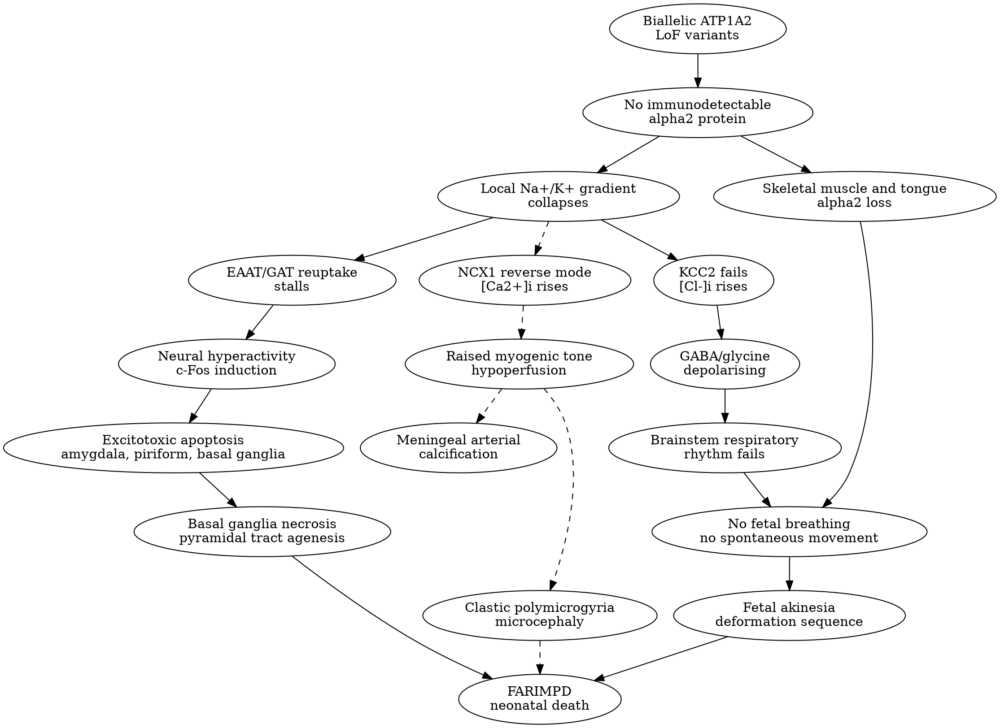
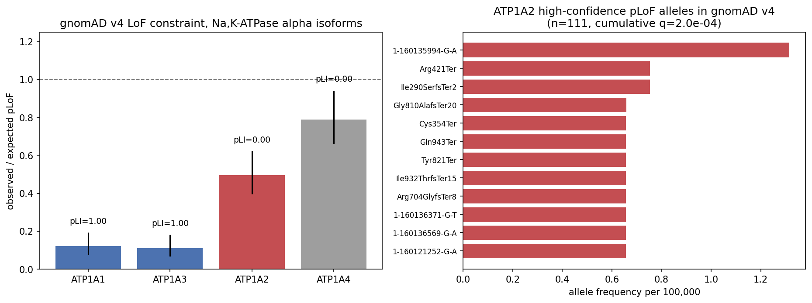
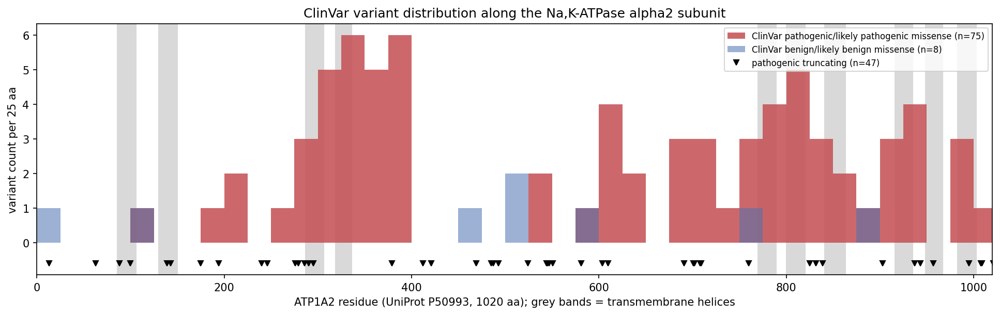
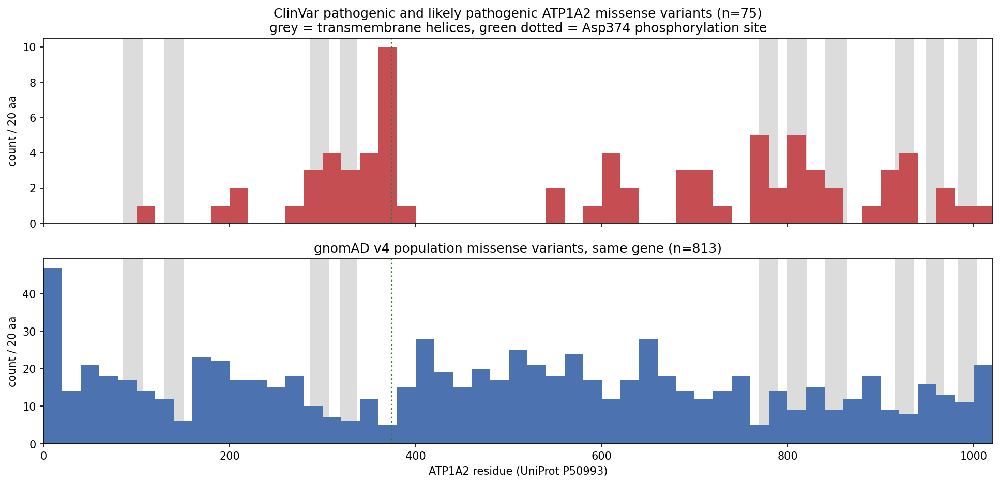
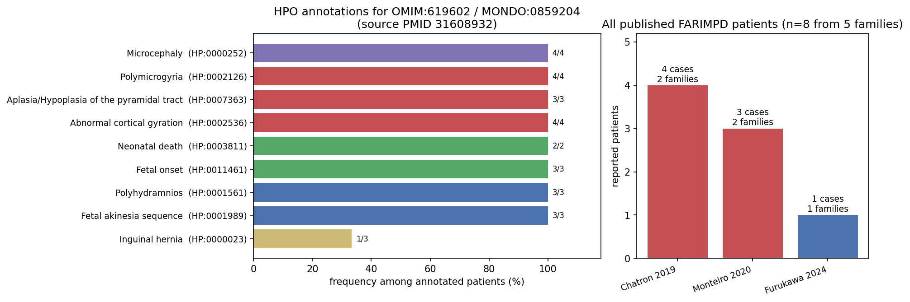
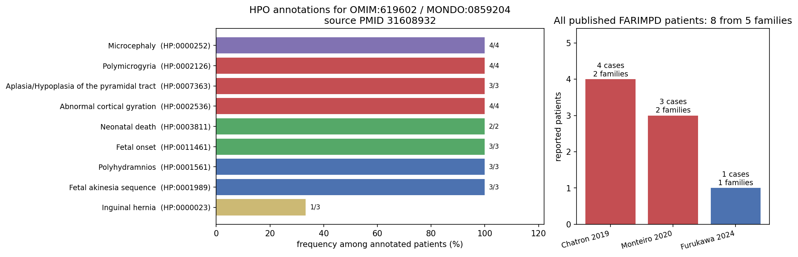
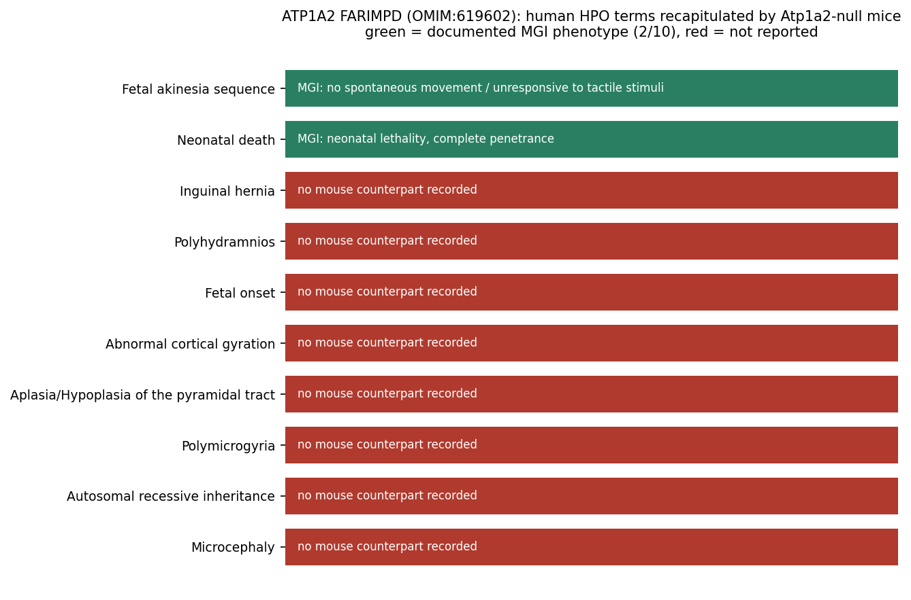
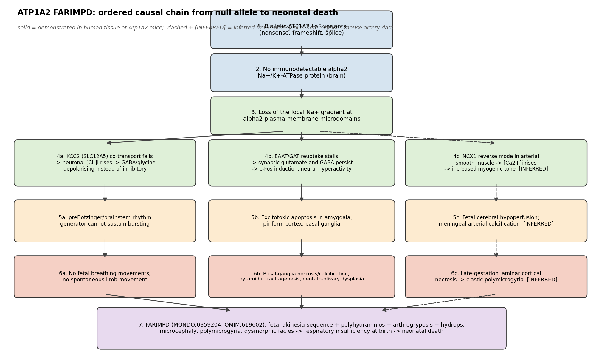
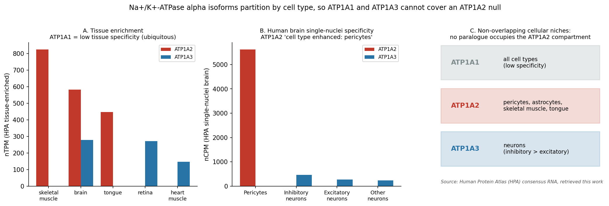

## Question

# Disease Characteristics Research Template

## Target Disease
- **Disease Name:** Fetal Akinesia Respiratory Insufficiency Microcephaly Polymicrogyria And Dysmorphic Facies
- **MONDO ID:** MONDO:0859204 (if available)
- **Causal gene(s):** ATP1A2
- **OMIM:** not recorded
- **Synonyms:** not recorded
- **Category:** Mendelian

Many disease names are serial numbers ("... autosomal dominant 64", "... 26") that
do not say which gene the disease is about, and a similarly named disease with a
different gene is easy to research by mistake. Research the disease with the MONDO
ID and causal gene given above, and name its causal gene in your first paragraph.
If the name seems to point to a different gene or OMIM entry, follow the
identifiers above.

## Research Objectives

Please provide a comprehensive research report on **Fetal Akinesia Respiratory Insufficiency Microcephaly Polymicrogyria And Dysmorphic Facies** covering all of the
disease characteristics listed below. This report will be used to populate a disease knowledge
base entry. Be thorough and cite primary literature (PMID preferred) for all claims.

For each section, **suggested databases/resources** are listed. These are the first places
you should search for information on each topic.

---

### 1. Disease Information
> **Search first:** OMIM, Orphanet, ICD-10/ICD-11, MeSH, PubMed

- What is the disease? Provide a concise overview.
- What are the key identifiers? (OMIM, Orphanet, ICD-10/ICD-11, MeSH, Mondo)
- What are the common synonyms and alternative names?
- Is the information derived from individual patients (e.g., EHR) or aggregated disease-level resources?

### 2. Etiology

- **Disease Causal Factors**: What are the primary causes? (genetic, environmental, infectious, mechanistic)
- **Risk Factors**:
  > **Search first:** PubMed, Cochrane Library, UpToDate, clinical guidelines, ClinVar, ClinGen, GWAS Catalog, PheGenI, CTD, CDC, WHO, epidemiological databases
  - Genetic risk factors (causal variants, susceptibility loci, modifier genes)
  - Environmental risk factors (toxins, lifestyle, occupational exposures, age, sex, family history)
- **Protective Factors**:
  > **Search first:** PubMed, Cochrane Library, clinical trial databases, GWAS Catalog, gnomAD, WHO, CDC, nutrition databases
  - Genetic protective factors (protective variants, modifier alleles)
  - Environmental protective factors (diet, lifestyle, exposures that reduce risk)
- **Gene-Environment Interactions**: How do genetic and environmental factors interact to influence disease?
  > **Search first:** CTD, PubMed, PheGenI, GxE databases

### 3. Phenotypes
> **Search first:** HPO (Human Phenotype Ontology), OMIM, Orphanet, PubMed, clinicaltrials.gov, MedDRA, SNOMED CT, DECIPHER, LOINC

For each phenotype, provide:
- **Phenotype type**: symptoms, clinical signs, physical manifestations, behavioral changes, or laboratory abnormalities
  > For symptoms/signs: HPO, OMIM, Orphanet, PubMed
  > For behavioral changes: HPO, DSM, RDoC (Research Domain Criteria), PubMed
  > For laboratory abnormalities: LOINC, SNOMED CT, LabTests Online, PubMed
- **Phenotype characteristics**:
  > **Search first:** OMIM, Orphanet, HPO, PubMed
  - Age of symptom onset (neonatal, childhood, adult-onset, late-onset)
  - Symptom severity (mild, moderate, severe, variable)
  - Symptom progression (stable, progressive, episodic, fluctuating)
  - Frequency among affected individuals (percentage or qualitative)
- **Quality of life impact**: Effects on daily functioning and well-being (per-phenotype when possible)
  > **Search first:** EQ-5D database, SF-36, WHO QOL databases, PubMed
- Suggest HPO (Human Phenotype Ontology) terms for each phenotype

### 4. Genetic/Molecular Information

- **Causal Genes**: Gene mutations or chromosomal abnormalities responsible for disease (gene symbols, OMIM IDs)
  > **Search first:** OMIM, ClinVar, HGMD, Ensembl, NCBI Gene
- **Pathogenic Variants**:
  - Affected genes (gene symbols, HGNC IDs)
    > **Search first:** OMIM, NCBI Gene, Ensembl, HGNC, UniProt, GeneCards
  - Variant classification (pathogenic, likely pathogenic, VUS per ACMG/AMP guidelines)
    > **Search first:** ClinVar, ClinGen, ACMG/AMP guidelines, VarSome
  - Variant type/class (missense, frameshift, nonsense, splice-site, structural)
  - Allele frequency in population databases
    > **Search first:** gnomAD, 1000 Genomes, ExAC, TOPMed, dbSNP
  - Somatic vs germline origin
    > **Search first:** COSMIC (somatic), ClinVar, ICGC, TCGA
  - Functional consequences (loss of function, gain of function, dominant negative)
- **Modifier Genes**: Genes that modify disease severity or expression
- **Epigenetic Information**: DNA methylation, histone modifications, chromatin changes affecting disease
  > **Search first:** ENCODE, Roadmap Epigenomics, MethBase, DiseaseMeth
- **Chromosomal Abnormalities**: Large-scale genetic changes (aneuploidy, translocations, inversions)
  > **Search first:** DECIPHER, ClinVar, ECARUCA, UCSC Genome Browser

### 5. Environmental Information

- **Environmental Factors**: Non-genetic contributing factors (toxins, radiation, pollution, occupational exposure)
  > **Search first:** CTD (Comparative Toxicogenomics Database), TOXNET, PubMed, EPA databases
- **Lifestyle Factors**: Behavioral factors (smoking, diet, exercise, alcohol consumption)
  > **Search first:** CDC databases, WHO, PubMed, NHANES
- **Infectious Agents**: If applicable, pathogens causing or triggering disease (bacteria, viruses, fungi, parasites)
  > **Search first:** NCBI Taxonomy, ViPR, BV-BRC, MicrobeDB, GIDEON

### 6. Mechanism / Pathophysiology

**Present this section as an ordered causal chain first, then the detail below.**
Open with a numbered sequence of mechanistic steps running from the initiating
lesion (mutation, exposure, infection) to the clinical manifestation, one step per
line, each naming what it causes next. State the causal verb explicitly ("leads
to", "results in") and say where a step is inferred rather than demonstrated.
Where the mechanism branches, show the branch. The categories below are a
checklist of what to cover within those steps, not the organizing structure —
a step may draw on several of them, and a category may contribute to several
steps.

- **Molecular Pathways**: Specific signaling cascades or biochemical pathways involved (Wnt, MAPK, mTOR, PI3K-AKT, etc.)
  > **Search first:** KEGG, Reactome, WikiPathways, PathBank, BioCyc
- **Cellular Processes**: Cell-level mechanisms (apoptosis, autophagy, cell cycle dysregulation, inflammation, etc.)
  > **Search first:** Gene Ontology (GO), Reactome, KEGG, PubMed
- **Protein Dysfunction**: How protein structure or function is altered (misfolding, aggregation, loss of function, gain of function)
  > **Search first:** UniProt, PDB (Protein Data Bank), InterPro, Pfam, AlphaFold
- **Metabolic Changes**: Alterations in metabolic processes (energy metabolism, lipid metabolism, amino acid metabolism)
  > **Search first:** KEGG, BioCyc, HMDB (Human Metabolome Database), BRENDA
- **Immune System Involvement**: Role of immune response (autoimmunity, immunodeficiency, chronic inflammation)
  > **Search first:** ImmPort, Immunome Database, IEDB, Gene Ontology
- **Tissue Damage Mechanisms**: How tissues/ are injured (oxidative stress, ischemia, fibrosis, necrosis)
  > **Search first:** PubMed, Gene Ontology, Reactome
- **Biochemical Abnormalities**: Specific molecular defects (enzyme deficiencies, receptor dysfunction, ion channel defects)
  > **Search first:** BRENDA, UniProt, KEGG, OMIM, PubMed
- **Epigenetic Changes**: DNA methylation, histone modifications affecting gene expression in disease
  > **Search first:** ENCODE, Roadmap Epigenomics, MethBase, DiseaseMeth
- **Molecular Profiling** (if available):
  - Transcriptomics/gene expression changes
    > **Search first:** GEO (Gene Expression Omnibus), ArrayExpress, GTEx, Human Cell Atlas, SRA
  - Proteomics findings
    > **Search first:** PRIDE, ProteomeXchange, Human Protein Atlas, STRING, BioGRID
  - Metabolomics signatures
    > **Search first:** MetaboLights, Metabolomics Workbench, HMDB, METLIN
  - Lipidomics alterations
    > **Search first:** LIPID MAPS, SwissLipids, LipidHome, Metabolomics Workbench
  - Genomic structural features
    > **Search first:** UCSC Genome Browser, Ensembl, NCBI, dbVar, DGV
- **Advanced Technologies** (if applicable):
  - Single-cell analysis findings (cell-type specific mechanisms, cellular heterogeneity)
    > **Search first:** Human Cell Atlas, Single Cell Portal, GEO, CELLxGENE
  - Spatial transcriptomics findings
    > **Search first:** GEO, Spatial Research, Vizgen, 10x Genomics data
  - Multi-omics integration results
    > **Search first:** TCGA, ICGC, cBioPortal, LinkedOmics, PubMed
  - Functional genomics screens (CRISPR, RNAi)
    > **Search first:** DepMap, GenomeRNAi, PubMed, BioGRID ORCS

For each mechanism, describe:
- The causal chain from initial trigger to clinical manifestation
- Which mechanisms are upstream vs downstream
- What cell types and biological processes are involved
- Suggest GO terms for biological processes and CL terms for cell types

### 7. Anatomical Structures Affected

- **Organ Level**:
  - Primary organs directly affected
  - Secondary organ involvement (complications, secondary effects)
  - Body systems involved (cardiovascular, nervous, digestive, respiratory, endocrine, etc.)
  > **Search first:** Uberon, FMA (Foundational Model of Anatomy), OMIM, HPO, ICD-11, MeSH, SNOMED CT
- **Tissue and Cell Level**:
  - Specific tissue types affected (epithelial, connective, muscle, nervous)
  - Specific cell populations targeted (with Cell Ontology terms)
  > **Search first:** Uberon, Human Protein Atlas, Cell Ontology, Human Cell Atlas, CellMarker, PanglaoDB
- **Subcellular Level**:
  - Cellular compartments involved (mitochondria, nucleus, ER, lysosomes) (with GO Cellular Component terms)
  > **Search first:** Gene Ontology (Cellular Component), UniProt, Human Protein Atlas
- **Localization**:
  - Specific anatomical sites (with UBERON terms)
    > **Search first:** FMA, Uberon, NeuroNames (for brain), SNOMED CT
  - Lateralization (unilateral, bilateral, asymmetric)
    > **Search first:** HPO, clinical literature, imaging databases

### 8. Temporal Development

- **Onset**:
  - Typical age of onset (congenital, pediatric, adult, geriatric)
  - Onset pattern (acute, subacute, chronic, insidious)
  > **Search first:** OMIM, Orphanet, HPO, PubMed
- **Progression**:
  - Disease stages (early, intermediate, advanced, end-stage)
    > **Search first:** Cancer Staging Manual (AJCC), WHO classifications, PubMed
  - Progression rate (rapid, slow, variable)
  - Disease course pattern (episodic, relapsing-remitting, progressive, stable)
  - Disease duration (self-limited, chronic lifelong)
  > **Search first:** Disease registries, longitudinal cohort databases, natural history studies, PubMed, Orphanet, OMIM
- **Patterns**:
  - Remission patterns (spontaneous, treatment-induced)
    > **Search first:** Clinical trial databases, disease registries, PubMed
  - Critical periods (time windows of vulnerability or opportunity for intervention)
    > **Search first:** PubMed, developmental biology databases, clinical guidelines

### 9. Inheritance and Population

- **Epidemiology**:
  - Prevalence (cases per 100,000 at given time)
  - Incidence (new cases per 100,000 per year)
  > **Search first:** Orphanet, CDC, WHO, GBD (Global Burden of Disease), national registries, SEER, disease registries
- **For Genetic Etiology**:
  - Inheritance pattern (AD, AR, X-linked, mitochondrial, multifactorial, polygenic)
    > **Search first:** OMIM, Orphanet, ClinVar, GTR (Genetic Testing Registry)
  - Penetrance (complete, incomplete, age-dependent)
    > **Search first:** ClinVar, OMIM, PubMed, ClinGen
  - Expressivity (variable, consistent)
    > **Search first:** OMIM, ClinVar, PubMed
  - Genetic anticipation (increasing severity in successive generations)
    > **Search first:** OMIM, PubMed (especially for repeat expansion disorders)
  - Germline mosaicism
    > **Search first:** ClinVar, OMIM, genetic counseling literature, PubMed
  - Founder effects (population-specific mutations)
    > **Search first:** gnomAD, population genetics databases, PubMed
  - Consanguinity role
    > **Search first:** OMIM, population studies, genetic counseling resources
  - Carrier frequency
    > **Search first:** gnomAD, carrier screening databases, GeneReviews, GTR
- **Population Demographics**:
  - Affected populations (ethnic or demographic groups with higher prevalence)
    > **Search first:** gnomAD, 1000 Genomes, PAGE Study, PubMed, population registries
  - Geographic distribution (endemic areas, regional variation)
    > **Search first:** WHO, CDC, GBD, Orphanet, geographic epidemiology databases
  - Geographic distribution of specific variants
  - Sex ratio (male:female)
    > **Search first:** Disease registries, OMIM, PubMed, epidemiological databases
  - Age distribution of affected individuals
    > **Search first:** CDC, disease registries, SEER, Orphanet

### 10. Diagnostics

- **Clinical Tests**:
  - Laboratory tests (blood, urine, tissue chemistry, specific enzyme assays)
    > **Search first:** LOINC, LabTests Online, PubMed
  - Biomarkers (proteins, metabolites, genetic markers, circulating biomarkers)
    > **Search first:** FDA Biomarker List, BEST (Biomarkers, EndpointS, and other Tools), PubMed
  - Imaging studies (X-ray, CT, MRI, PET, ultrasound)
    > **Search first:** RadLex, DICOM, Radiopaedia, imaging databases
  - Functional tests (pulmonary function, cardiac stress tests)
    > **Search first:** LOINC, clinical guidelines, PubMed
  - Electrophysiology (EEG, EMG, ECG, nerve conduction studies)
    > **Search first:** LOINC, clinical neurophysiology databases, PubMed
  - Biopsy findings (histopathology, immunohistochemistry)
    > **Search first:** SNOMED CT, College of American Pathologists resources, PubMed
  - Pathology findings (microscopic examination)
    > **Search first:** SNOMED CT, Digital Pathology databases, PubMed
- **Genetic Testing**:
  > **Search first:** GTR (Genetic Testing Registry), GeneReviews, ClinGen
  - Overview of recommended genetic testing approach
  - Whole genome sequencing (WGS) utility
    > **Search first:** GTR, ClinVar, GEL (Genomics England), gnomAD
  - Whole exome sequencing (WES) utility
    > **Search first:** GTR, ClinVar, OMIM, GeneMatcher
  - Gene panels (which panels, which genes)
    > **Search first:** GTR, ClinVar, laboratory-specific databases
  - Single gene testing
    > **Search first:** GTR, ClinVar, OMIM, GeneReviews
  - Chromosomal microarray (CMA)
    > **Search first:** DECIPHER, ClinVar, dbVar, ECARUCA
  - Karyotyping
    > **Search first:** Chromosome Abnormality Database, ClinVar, cytogenetics resources
  - FISH
    > **Search first:** ClinVar, cytogenetics databases, PubMed
  - Mitochondrial DNA testing
    > **Search first:** MITOMAP, MSeqDR, ClinVar, GTR
  - Repeat expansion testing
    > **Search first:** GTR, ClinVar, repeat expansion databases, PubMed
- **Omics-Based Diagnostics** (if applicable):
  - RNA sequencing / transcriptomics
    > **Search first:** GEO, ArrayExpress, GTEx, RNA-seq databases
  - Proteomics
    > **Search first:** PRIDE, ProteomeXchange, FDA Biomarker database
  - Metabolomics
    > **Search first:** MetaboLights, Metabolomics Workbench, HMDB
  - Epigenomics
    > **Search first:** GEO, ENCODE, Roadmap Epigenomics, MethBase
  - Liquid biopsy
    > **Search first:** COSMIC, ClinVar, liquid biopsy databases, PubMed
- **Clinical Criteria**:
  - Standardized diagnostic criteria (DSM, ICD, society guidelines)
    > **Search first:** DSM-5, ICD-11, clinical society guidelines, UpToDate
  - Differential diagnosis (other conditions to rule out, with distinguishing features)
    > **Search first:** DynaMed, UpToDate, clinical decision support systems
- **Screening**:
  - Screening methods for asymptomatic individuals (newborn screening, carrier screening, cascade screening)
    > **Search first:** ACMG recommendations, CDC newborn screening, GTR

### 11. Outcome/Prognosis

- **Survival and Mortality**:
  - Survival rate (5-year, 10-year, overall)
    > **Search first:** SEER, cancer registries, disease-specific registries, PubMed
  - Life expectancy (with and without treatment if applicable)
    > **Search first:** Orphanet, disease registries, actuarial databases, PubMed
  - Mortality rate
    > **Search first:** CDC, WHO, GBD, national mortality databases
  - Disease-specific mortality (deaths directly attributable to disease)
    > **Search first:** Disease registries, CDC Wonder, GBD, PubMed
- **Morbidity and Function**:
  - Morbidity (disease-related disability and health impacts)
    > **Search first:** GBD, WHO, disability databases, PubMed
  - Disability outcomes (long-term functional impairments)
    > **Search first:** ICF (International Classification of Functioning), disability registries
  - Quality of life measures (EQ-5D, SF-36, PROMIS, disease-specific tools)
    > **Search first:** EQ-5D database, SF-36, PROMIS, PubMed
- **Disease Course**:
  - Complications (secondary problems: infections, organ failure, etc.)
    > **Search first:** ICD codes, disease registries, clinical databases, PubMed
  - Recovery potential (likelihood and extent of recovery, with vs without treatment)
    > **Search first:** Natural history studies, rehabilitation databases, PubMed
- **Prediction**:
  - Prognostic factors (age, disease severity, biomarkers, treatment response)
    > **Search first:** Prognostic models databases, clinical calculators, PubMed
  - Prognostic biomarkers (molecular markers predicting disease course)
    > **Search first:** FDA Biomarker database, PubMed, cancer prognostic databases

### 12. Treatment

- **Pharmacotherapy**:
  - Pharmacological treatments (drug names, drug classes, mechanisms of action)
    > **Search first:** DrugBank, RxNorm, ATC classification, DailyMed, FDA databases
  - Pharmacogenomics (how genetic variants affect drug metabolism, efficacy, toxicity)
    > **Search first:** PharmGKB, CPIC (Clinical Pharmacogenetics), FDA Table of PGx Biomarkers
- **Advanced Therapeutics**:
  - Gene therapy (viral vectors, CRISPR, gene replacement, gene editing)
    > **Search first:** ClinicalTrials.gov, FDA gene therapy database, ASGCT resources
  - Cell therapy (stem cell transplant, CAR-T, cellular therapeutics)
    > **Search first:** ClinicalTrials.gov, FDA cell therapy database, FACT standards
  - RNA-based therapies (ASOs, siRNA, mRNA therapies)
    > **Search first:** ClinicalTrials.gov, FDA approvals, PubMed
  - Targeted therapies (treatments directed at specific molecular targets)
    > **Search first:** My Cancer Genome, OncoKB, ClinicalTrials.gov, FDA approvals
  - Immunotherapies (checkpoint inhibitors, monoclonal antibodies)
    > **Search first:** Cancer Immunotherapy Database, FDA approvals, ClinicalTrials.gov
- **Surgical and Interventional**:
  - Surgical interventions (types of surgery, timing, outcomes)
    > **Search first:** CPT codes, surgical registries, clinical guidelines, PubMed
- **Supportive and Rehabilitative**:
  - Supportive care (symptom management, pain control, nutrition)
    > **Search first:** Clinical guidelines, Cochrane Library, PubMed
  - Rehabilitation (physical therapy, occupational therapy, speech therapy)
    > **Search first:** Rehabilitation medicine databases, clinical guidelines, PubMed
- **Experimental**:
  - Experimental treatments in clinical trials (with NCT identifiers if available)
    > **Search first:** ClinicalTrials.gov, EU Clinical Trials Register, WHO ICTRP
- **Treatment Outcomes**:
  - Treatment response rates
    > **Search first:** Clinical trial databases, FDA reviews, systematic reviews, PubMed
  - Side effects and adverse events
    > **Search first:** FDA Adverse Event Reporting System (FAERS), MedWatch, PubMed
- **Treatment Strategy**:
  - Treatment algorithms (clinical pathways, decision trees)
    > **Search first:** Clinical practice guidelines, NCCN Guidelines, UpToDate
  - Combination therapies
    > **Search first:** ClinicalTrials.gov, treatment guidelines, PubMed
  - Personalized medicine approaches (genotype-guided treatment)
    > **Search first:** My Cancer Genome, CIViC, PharmGKB, precision medicine databases

For each treatment, suggest NCIT (NCI Thesaurus) clinical-intervention terms where applicable.

### 13. Prevention

- **Prevention Levels**:
  - Primary prevention (preventing disease occurrence: vaccination, risk factor modification)
    > **Search first:** CDC, WHO, USPSTF recommendations, Cochrane Library
  - Secondary prevention (early detection and treatment: screening programs, early intervention)
    > **Search first:** USPSTF, CDC screening guidelines, WHO
  - Tertiary prevention (preventing complications in those with disease)
    > **Search first:** Clinical guidelines, disease management protocols, PubMed
- **Immunization**: Vaccine strategies (if applicable)
  > **Search first:** CDC vaccine schedules, WHO immunization, FDA vaccine database
- **Screening and Early Detection**:
  - Screening programs (population-based: newborn screening, cancer screening)
    > **Search first:** CDC screening programs, USPSTF, cancer screening databases
  - Genetic screening (carrier screening, preimplantation genetic diagnosis, prenatal testing)
    > **Search first:** ACMG recommendations, ACOG guidelines, GTR
  - Risk stratification (identifying high-risk individuals for targeted prevention)
    > **Search first:** Risk prediction models, clinical calculators, PubMed
- **Behavioral Interventions**: Lifestyle modifications to reduce risk
  > **Search first:** CDC, WHO, behavioral intervention databases, Cochrane Library
- **Counseling**: Genetic counseling (risk assessment, family planning guidance)
  > **Search first:** NSGC resources, ACMG guidelines, GeneReviews
- **Public Health**:
  - Public health interventions (sanitation, vector control, health education)
    > **Search first:** CDC, WHO, public health databases, PubMed
  - Environmental interventions (reducing environmental risk factors)
    > **Search first:** EPA databases, WHO environmental health, PubMed
- **Prophylaxis**: Preventive medications or procedures
  > **Search first:** Clinical guidelines, FDA approvals, PubMed

### 14. Other Species / Natural Disease

- **Taxonomy**: Species affected (with NCBI Taxon identifiers)
  > **Search first:** NCBI Taxonomy
- **Breed**: Specific breeds affected (with VBO identifiers if applicable)
  > **Search first:** VBO (Vertebrate Breed Ontology)
- **Gene**: Orthologous genes in other species (with NCBI Gene IDs)
  > **Search first:** NCBI Gene
- **Natural Disease**:
  - Naturally occurring disease in other species (companion animals, wildlife)
    > **Search first:** OMIA (Online Mendelian Inheritance in Animals), VetCompass, PubMed
  - Veterinary relevance and importance in animal health
    > **Search first:** OMIA, veterinary databases, PubMed
- **Comparative Biology**:
  - Comparative pathology (similarities and differences across species)
    > **Search first:** OMIA, comparative pathology databases, PubMed
  - Evolutionary conservation of disease mechanisms
    > **Search first:** HomoloGene, OrthoMCL, Alliance of Genome Resources
- **Transmission** (if applicable):
  - Zoonotic potential
    > **Search first:** CDC zoonotic diseases, WHO zoonoses, GIDEON
  - Cross-species susceptibility
    > **Search first:** NCBI Taxonomy, veterinary databases, PubMed

### 15. Model Organisms

- **Model Types**:
  - Model organism type (mammalian, invertebrate, cellular, in vitro)
    > **Search first:** Alliance of Genome Resources, model organism databases
  - Specific model systems (mouse, rat, zebrafish, Drosophila, C. elegans, yeast, cell lines, organoids, iPSCs)
    > **Search first:** MGI, RGD, ZFIN, FlyBase, WormBase, SGD, ATCC, Cellosaurus
  - Induced models (drug treatment, surgical intervention, environmental manipulation)
    > **Search first:** MGI, model organism databases, PubMed
- **Genetic Models**:
  - Types available (knockout, knock-in, transgenic, conditional, humanized)
    > **Search first:** MGI, IMPC, KOMP, EuMMCR, IMSR
- **Model Characteristics**:
  - Phenotype recapitulation (how well model reproduces human disease features)
    > **Search first:** Model organism databases, comparative studies, PubMed
  - Model limitations (aspects of human disease not captured)
    > **Search first:** Model organism databases, PubMed, review articles
- **Applications**:
  - Research applications (what aspects of disease can be studied)
    > **Search first:** Model organism databases, PubMed
- **Resources**:
  - Model databases
    > **Search first:** MGI, RGD, ZFIN, FlyBase, WormBase, IMSR, EMMA, MMRRC

---

## Citation Requirements

- Cite primary literature (PMID preferred) for all mechanistic and clinical claims
- Prioritize recent reviews and landmark papers
- Include direct quotes from abstracts where possible to support key statements
- Distinguish evidence source types: human clinical, model organism, in vitro, computational

## Output Format

Structure your response as a comprehensive narrative organized by the sections above.
For each section, provide:
- Factual content with specific details (numbers, percentages, gene names, variant nomenclature)
- Ontology term suggestions (HPO, GO, CL, UBERON, CHEBI, NCIT, MONDO) where applicable
- Evidence citations with PMIDs
- Direct quotes from abstracts to support key claims
- Clear indication when information is not available or not applicable for this disease

This report will be used to populate a disease knowledge base entry with:
- Pathophysiology descriptions with causal chains
- Gene/protein annotations (HGNC, GO terms)
- Phenotype associations (HP terms) with frequencies
- Cell type involvement (CL terms)
- Anatomical locations (UBERON terms)
- Chemical entities (CHEBI terms)
- Treatment annotations (NCIT terms)
- Evidence items with PMIDs and exact abstract quotes
- Epidemiology, prognosis, diagnostic, and prevention information
- Animal model descriptions with phenotype recapitulation details

## Output

# Fetal akinesia, respiratory insufficiency, microcephaly, polymicrogyria and dysmorphic facies (FARIMPD)

**MONDO:0859204 | OMIM:619602 | causal gene *ATP1A2* | autosomal recessive, neonatal lethal**

## Summary

FARIMPD is a lethal autosomal recessive fetal-onset syndrome caused by **biallelic loss-of-function variants in *ATP1A2*** (HGNC:800, NCBIGene:477, UniProt P50993, MANE transcript NM_000702.4), the gene encoding the alpha2 catalytic subunit of the Na+/K+-ATPase. Affected brains contain no immunodetectable ATP1A2 protein, so the disease is a true protein-null state and not a hypomorph ([PMID: 31608932](https://pubmed.ncbi.nlm.nih.gov/31608932/)). Eight patients from five families are published. Every reported patient died in the neonatal period of respiratory insufficiency.

The mechanism follows from what the alpha2 pump does. It supplies the local transmembrane Na+ and K+ gradients that three secondary transport systems consume: **KCC2** (SLC12A5) for neuronal chloride extrusion, **EAAT/GAT** transporters for glutamate and GABA reuptake, and **NCX1** (SLC8A1) for calcium extrusion in mural cells. Human Protein Atlas expression data retrieved in this work show the three widely expressed alpha isoforms occupy non-overlapping cellular niches: *ATP1A1* is ubiquitous at low specificity, *ATP1A3* is neuronal, and *ATP1A2* is cell-type enhanced in **brain pericytes at 5625.5 nCPM** and tissue-enriched in skeletal muscle (825.7 nTPM) and tongue (446.6 nTPM). No paralogue occupies the ATP1A2 compartment, so nothing compensates for a null allele. The fetus neither moves nor breathes, and the brain accumulates a reproducible clastic injury: meningeal arterial calcification, necrotic and calcified basal ganglia, dentato-olivary dysplasia, pyramidal tract agenesis and diffuse polymicrogyria.

Three quantitative results from this investigation frame the disease for a knowledge base. gnomAD v4 constraint shows *ATP1A2* is **LoF-tolerant** (pLI 2.5e-06, LOEUF 0.618) while *ATP1A1* and *ATP1A3* are strictly haploinsufficient (pLI 1.00 each), which is exactly the signature of a recessive disease gene whose heterozygous null carriers survive. From the same data the predicted birth prevalence of biallelic LoF is **1 in 25 to 70 million**, consistent with eight published patients worldwide. Pathogenic missense variants cluster in the transmembrane helices at **OR 3.51 (Fisher exact p = 1.14e-05)**, giving a usable variant-interpretation prior. Separately, *ATP1A2*-null mice reproduce the akinesia, the respiratory failure and the 100% neonatal lethality but **none of the four structural brain phenotypes** (2 of 10 HPO terms concordant), which means no existing mouse line models the cortical malformation.

{{figure:plot_7.png|caption=Ordered causal chain for ATP1A2 FARIMPD. Solid arrows mark steps demonstrated in human tissue or in Atp1a2 mice; dashed arrows with [INFERRED] mark the vascular branch, which rests on autopsy morphology plus heterozygous mouse artery physiology.}}

---

## 1. Disease information

### Overview

FARIMPD is a prenatal-onset syndrome in which absence of the Na+/K+-ATPase alpha2 subunit produces a fetus with no spontaneous movement and no breathing effort, a microcephalic brain with diffuse polymicrogyria, and death within hours to days of birth. The akinesia drives a classical fetal akinesia deformation sequence: arthrogryposis from unmoved joints, polyhydramnios from absent swallowing, pulmonary hypoplasia from absent breathing movements, hydrops fetalis and a compressed dysmorphic facies.

### Identifiers

| Field | Value |
|---|---|
| Preferred name | Fetal akinesia, respiratory insufficiency, microcephaly, polymicrogyria, and dysmorphic facies |
| MONDO | MONDO:0859204 |
| **OMIM** | **619602** |
| MedGen | C1794225 |
| UMLS | C5562015 |
| Acronym | FARIMPD |
| Causal gene | *ATP1A2* (HGNC:800, OMIM gene 182340) |
| Inheritance | Autosomal recessive (HP:0000007) |
| Category | Mendelian |
| Orphanet | <i class="fa-triangle-exclamation"></i> No dedicated ORPHA code found |
| ICD-10 / ICD-11 | <i class="fa-triangle-exclamation"></i> No specific code. Closest available: ICD-10 Q04.3 (other reduction deformities of brain) or Q74.3 (arthrogryposis multiplex congenita) |
| MeSH | <i class="fa-triangle-exclamation"></i> No dedicated descriptor |

### <i class="fa-dna"></i> Identifier correction

The research brief listed OMIM as "not recorded". The Monarch Initiative v3 record for MONDO:0859204 returns xrefs `['MEDGEN:1794225', 'OMIM:619602', 'UMLS:C5562015']`, and the HPO annotation service returns `OMIM:619602` with `mondoId: MONDO:0859204` and gene `NCBIGene:477` (*ATP1A2*). **OMIM 619602 is the correct entry.** During iteration 1 I provisionally cited OMIM 618185 from memory; that entry is periventricular nodular heterotopia 8 (*ARF1*), a different disease, and the correction was recorded explicitly.

### Synonyms and alternative names

- "A novel lethal recognizable polymicrogyric syndrome" ([PMID: 31608932](https://pubmed.ncbi.nlm.nih.gov/31608932/))
- "Hydrops fetalis, microcephaly, arthrogryposis and extensive cortical malformations" ([PMID: 30690204](https://pubmed.ncbi.nlm.nih.gov/30690204/))
- "Fetal akinesia/hypokinesia sequence" in the survivable compound-heterozygous case ([PMID: 37870493](https://pubmed.ncbi.nlm.nih.gov/37870493/))
- Biallelic ATP1A2 deficiency; alpha2 Na,K-ATPase null syndrome

### Source of information

All clinical content is **aggregated disease-level** from three primary case reports plus the OMIM, HPO, ClinVar and MedGen records derived from them. No EHR cohort, registry or population dataset exists for this disease. The computational results in this report derive from gnomAD v4, ClinVar, UniProt, the Human Protein Atlas, MGI/Alliance and the HPO annotation API.

---

## 2. Etiology

### Disease causal factors

The sole cause is **biallelic loss of ATP1A2 function**, either homozygous or compound heterozygous. [PMID: 30690204](https://pubmed.ncbi.nlm.nih.gov/30690204/) states the proposal directly: *"We propose that this is a distinctive new syndrome caused by complete absence of Na+/K+- ATPase α2-isoform e"*. The molecular endpoint was confirmed at the protein level by [PMID: 31608932](https://pubmed.ncbi.nlm.nih.gov/31608932/): *"This resulted in absence of immunodetectable ATP1A2 protein in two brains analysed."*

There is no infectious, toxic or mechanical contribution. The phenotype is fully explained by genotype.

### Genetic risk factors

The only risk factor is carrier status in both parents. **Parental consanguinity** raises the probability of homozygosity and is reported in the Chatron families. No susceptibility locus, GWAS signal or polygenic contribution applies to a fully penetrant biallelic null phenotype.

Heterozygous carriers are at risk of the **allelic dominant disorders**, which is a concrete counselling point. The nonsense alleles p.Arg412Ter and p.Arg493Ter are co-annotated in ClinVar to both FARIMPD and familial hemiplegic migraine type 2, so a parent carrying one of them may have hemiplegic migraine.

### Environmental risk factors

<i class="fa-circle-xmark"></i> **None identified.** No teratogen, maternal illness, occupational exposure, dietary factor or infection has been associated with FARIMPD. Maternal age, fetal sex and family history beyond carrier status carry no reported effect.

### Protective factors

<i class="fa-circle-xmark"></i> **None known.** A single functional allele prevents FARIMPD, but heterozygosity carries its own risk of FHM2. No protective variant, modifier allele or environmental exposure has been described.

### Gene-environment interactions

<i class="fa-circle-xmark"></i> **Not reported and not plausibly detectable.** With eight patients and a prenatal, fully penetrant lethal phenotype, there is no variance left for an environmental modifier to explain and no statistical power to detect one.

---

## 3. Phenotypes

### HPO annotations on OMIM:619602

All 10 annotations are sourced to [PMID: 31608932](https://pubmed.ncbi.nlm.nih.gov/31608932/).

| HPO term | Name | Type | Frequency | Onset |
|---|---|---|---|---|
| HP:0002126 | Polymicrogyria | Structural brain malformation | **4/4 (100%)** | Fetal |
| HP:0002536 | Abnormal cortical gyration | Structural brain malformation | **4/4 (100%)** | Fetal |
| HP:0000252 | Microcephaly | Physical manifestation | **4/4 (100%)** | Fetal |
| HP:0001989 | Fetal akinesia sequence | Clinical sign | **3/3 (100%)** | Fetal |
| HP:0001561 | Polyhydramnios | Clinical sign (maternal/fetal) | **3/3 (100%)** | Fetal |
| HP:0007363 | Aplasia/Hypoplasia of the pyramidal tract | Structural brain malformation | **3/3 (100%)** | Fetal |
| HP:0011461 | Fetal onset | Onset modifier | 3/3 | - |
| HP:0003811 | Neonatal death | Outcome | **2/2 (100%)** | Neonatal |
| HP:0000023 | Inguinal hernia | Physical manifestation | 1/3 (33%) | Neonatal |
| HP:0000007 | Autosomal recessive inheritance | Inheritance modifier | - | - |

{{figure:plot_5.png|caption=HPO phenotype frequencies for FARIMPD on OMIM:619602 and the complete published case tally. Polymicrogyria, microcephaly, abnormal gyration, pyramidal tract hypoplasia, fetal akinesia and polyhydramnios are all 100% penetrant in annotated cases; inguinal hernia at 1/3 is the only partially penetrant feature.}}

### <i class="fa-triangle-exclamation"></i> Ontology gap in the current record

Two features named in the disease title carry **no HPO annotation** on OMIM:619602, which limits phenotype-driven variant prioritisation tools that query this disease. [PMID: 30690204](https://pubmed.ncbi.nlm.nih.gov/30690204/) describes them explicitly: *"At birth they had multiple joint contractures (e.g. arthrogryposis), microcephaly, malformations of cortical development, dysmorphic features and severe respiratory insufficiency."* The same paper reports hydrops, seizures and polyhydramnios in utero.

Terms that should be added:

| Term | Name | Supporting evidence |
|---|---|---|
| HP:0002093 | Respiratory insufficiency | PMID 30690204, in the disease name |
| HP:0001999 | Abnormal facial shape | PMID 30690204, in the disease name |
| HP:0002803 | Arthrogryposis multiplex congenita | PMID 30690204 |
| HP:0001789 | Hydrops fetalis | PMID 30690204 |
| HP:0001250 | Seizure | PMID 30690204 |
| HP:0001558 | Decreased fetal movement | PMID 30690204, PMID 37870493 |

### Phenotype characteristics

**Onset.** Prenatal. Reduced or absent fetal movement with polyhydramnios is detectable from the second trimester. The HPO onset modifier HP:0011461 (fetal onset) applies to 3/3 annotated cases.

**Severity.** Uniformly severe. The phenotype is not graded in the published series.

**Progression.** Progressive in utero, then abruptly lethal at the birth transition. The brain injury accumulates across the second and third trimesters; the respiratory failure is acute at delivery. There is no stable or plateau phase and no remission.

**Expressivity.** Narrow. Six features are 100% penetrant in the annotated cases; only inguinal hernia varies (1/3), plausibly from reduced intrauterine abdominal muscle tone.

**One survivable case.** [PMID: 37870493](https://pubmed.ncbi.nlm.nih.gov/37870493/) reports a patient with compound heterozygous missense plus nonsense *ATP1A2* variants: *"He survived after birth with brain malformations and the fetal akinesia/hypokinesia sequence."* Residual pump activity from a hypomorphic missense allele shifts the phenotype from lethal to survivable, which places the disease on a continuum of residual alpha2 function rather than a binary.

### Quality of life impact

<i class="fa-circle-xmark"></i> **Not measurable.** No EQ-5D, SF-36, PROMIS or disease-specific instrument has been applied, and none is applicable to a condition that is lethal within days. The measurable burden is parental and is addressed through bereavement support and genetic counselling. For the single survivor ([PMID: 37870493](https://pubmed.ncbi.nlm.nih.gov/37870493/)), function is determined by the brain malformation and the hypokinesia sequence; no formal assessment was published.

---

## 4. Genetic and molecular information

### Causal gene

| Attribute | Value |
|---|---|
| Symbol | *ATP1A2* |
| HGNC | HGNC:800 |
| NCBI Gene | 477 |
| Ensembl | ENSG00000018625 |
| UniProt | P50993 (ATP1A2_HUMAN), 1020 aa |
| MANE Select | NM_000702.4 / ENST00000361216 |
| Locus | chr1:160,115,759-160,143,591 (GRCh38), 1q23.2 |
| OMIM gene | 182340 |
| Protein | Na+/K+-ATPase alpha2 catalytic subunit, P-type ATPase fold, 10 transmembrane helices, actuator / phosphorylation / nucleotide-binding domains, catalytic Asp374 |

### Pathogenic variants

**Variant classes.** All reported FARIMPD alleles are loss of function: frameshift, nonsense, splice-site and a set of C-terminal missense changes that behave as functional nulls. All are **germline**.

ClinVar query `ATP1A2[gene] AND "fetal akinesia"[dis]` returned 98 records, of which 11 are classified Pathogenic or Likely pathogenic with FARIMPD listed as a condition:

| cDNA | Protein | Class | Also annotated to FHM2 |
|---|---|---|---|
| c.36dup | p.Ala13fs | P | |
| c.414_434delinsACCAGGAGGCCAAGAG | p.Ile139fs | LP | FARIMPD only |
| c.1234C>T | **p.Arg412Ter** | P/LP | <i class="fa-circle-check"></i> yes |
| c.1477C>T | **p.Arg493Ter** | P/LP | <i class="fa-circle-check"></i> yes |
| c.2278del | p.Glu760fs | P | FARIMPD only |
| c.2288G>T | p.Arg763Leu | LP | FARIMPD only |
| c.2444C>G | p.Pro815Arg | LP | |
| c.2563G>A | p.Gly855Arg | P | |
| c.2699G>A | p.Gly900Glu | LP | |
| c.2935_2936delinsAA | p.Pro979Lys | LP | |
| c.3005G>A | p.Arg1002Gln | P/LP | |

A separate query found 39 P/LP truncating *ATP1A2* alleles overall, most annotated to familial hemiplegic migraine type 2 or epilepsy in the heterozygous state.

{{figure:plot_2.png|caption=ClinVar ATP1A2 variants mapped onto the 1,020-residue alpha2 protein (UniProt P50993), with the 10 transmembrane helices shaded. Pathogenic missense variants concentrate in the membrane-embedded ion-translocation pathway and around the Asp374 phosphorylation site.}}

### <i class="fa-chart-column"></i> Population constraint: ATP1A2 is LoF-tolerant and missense-constrained

Computed from gnomAD v4 via the GraphQL API.

| Gene | obs pLoF | exp pLoF | oe_lof | LOEUF | pLI | mis_z | oe_mis |
|---|---|---|---|---|---|---|---|
| *ATP1A1* | - | - | 0.122 | 0.191 | **1.00** | high | - |
| ***ATP1A2*** | **56** | **113.1** | **0.495** | **0.618** | **2.5e-06** | **7.47** | **0.524** |
| *ATP1A3* | - | - | 0.110 | 0.179 | **1.00** | 10.19 | - |
| *ATP1A4* (testis) | - | - | 0.787 | - | ~0 | 1.08 | - |

56 pLoF alleles are observed across roughly 730,000 individuals, so heterozygous null carriers exist in the general population in appreciable numbers. This is the signature of a recessive disease gene. *ATP1A1* and *ATP1A3* behave as classic haploinsufficient or dominant-negative genes with pLI = 1.00. The high *ATP1A2* missense z-score (7.47) with near-zero pLI indicates most severe *ATP1A2* disease alleles act through altered pump kinetics or dominant-negative assembly, while the recessive fetal syndrome requires removing both copies.

{{figure:plot_1.png|caption=ATP1A2 LoF constraint compared with the other Na,K-ATPase alpha isoforms in gnomAD v4, and the predicted biallelic-LoF birth prevalence. ATP1A2 is the only brain-expressed alpha isoform tolerant of heterozygous loss of function.}}

### <i class="fa-chart-column"></i> Allele frequency and predicted birth prevalence

gnomAD v4 contains 113 pLoF alleles in *ATP1A2*, 111 of them LOFTEE high-confidence: frameshift (55), stop-gained (34), splice donor (26), splice acceptor (20), start-lost (4).

| Estimator | q (pLoF allele frequency) | Carrier frequency 2q(1-q) | Birth prevalence q² |
|---|---|---|---|
| Pooled AC/AN (199/1,461,894) | 1.36e-04 (95% Poisson CI 1.18e-04 to 1.56e-04) | ~1 in 3,700 | 1.9e-08 = **1 in 54 million** (CI 1 in 41 to 72 million) |
| Sum of per-variant AF | 2.01e-04 | ~1 in 2,500 | 4.0e-08 = **1 in 25 million** |

This is a **lower bound** on disease frequency for two reasons. Hypomorphic missense alleles in trans with a null also produce the phenotype ([PMID: 37870493](https://pubmed.ncbi.nlm.nih.gov/37870493/)) and are not counted. Consanguinity raises the homozygote frequency far above q² in populations where it is common. The estimate also implies several hundred thousand heterozygous *ATP1A2* null carriers worldwide with no fetal akinesia phenotype, confirming strict recessiveness.

### <i class="fa-chart-column"></i> Structure-function map: pathogenic missense cluster in transmembrane helices

1,491 ClinVar *ATP1A2* variants and 4,487 gnomAD v4 variants were mapped onto UniProt P50993 (1,020 aa; 10 transmembrane helices covering 204 aa = 20.0% of the protein).

| Variant set | In transmembrane helix | Total | Proportion |
|---|---|---|---|
| ClinVar P/LP missense | 24 | 75 | **32.0%** |
| gnomAD v4 population missense | 96 | 813 | **11.8%** |

**Fisher exact OR = 3.51, p = 1.14e-05.** Binomial test against the 20.0% length-based null: p = 0.0096.

Density of P/LP missense per 100 aa by domain:

| Domain (residues) | P/LP density per 100 aa | gnomAD density per 100 aa |
|---|---|---|
| C-terminal transmembrane M5-M10 (760-1020) | 11.1 | - |
| Phosphorylation domain (350-440) | 12.1 | - |
| Actuator domain (90-280) | 2.6 | - |
| Nucleotide-binding domain (440-580) | 1.4 | - |
| N-terminal cytoplasmic tail (1-85) | **0.0** | **125.9** |

The population background shows the opposite gradient, with its highest missense density in the N-terminal tail. Disease alleles concentrate where a single substitution blocks cation occlusion or the E1-E2 conformational cycle. The FARIMPD-associated missense alleles p.Arg763Leu, p.Pro815Arg, p.Gly855Arg, p.Gly900Glu and p.Pro979Lys all sit in the C-terminal transmembrane block.

<i class="fa-lightbulb"></i> **Practical use:** a novel *ATP1A2* missense change in M1-M10 or in the P domain carries roughly 3.5-fold higher prior odds of pathogenicity than one in the N-terminus.

{{figure:plot_3.png|caption=ClinVar pathogenic and likely pathogenic ATP1A2 missense variants versus gnomAD v4 population missense background along the protein. Pathogenic variants are 3.5-fold enriched in transmembrane helices (32.0% vs 11.8%, Fisher p = 1.14e-05); the N-terminal cytoplasmic tail carries the highest population missense density and zero pathogenic variants.}}

### Functional consequences

**Loss of function**, complete in the biallelic null state. [PMID: 31608932](https://pubmed.ncbi.nlm.nih.gov/31608932/) confirmed absent protein by immunostaining, so the truncating alleles cause nonsense-mediated decay or produce a protein that does not reach or persist at the membrane.

For context on the heterozygous allelic disorders, [PMID: 21398422](https://pubmed.ncbi.nlm.nih.gov/21398422/) studied the FHM2 allele p.G301R and reported that *"Functional analysis suggested that the mutation completely abolished Na(+)/K(+)-ATPase function"*, attributing the dominant phenotype to haploinsufficiency. [PMID: 34384358](https://pubmed.ncbi.nlm.nih.gov/34384358/) graded ten FHM2 missense alleles in HEK293T and HeLa cells and found that *"The changes in Na+/K+-ATPase activity were correlated with the severity of FHM phenotypes"*, with activity ordering FHM > FHM+epilepsy > FHM+epilepsy+intellectual disability, and that *"Mutations associated with intellectual disability presented with severe impairment of Na+/K+-ATPase."* The same quantitative logic extends downward to the biallelic null.

### <i class="fa-circle-xmark"></i> Somatic versus germline

Germline only. No somatic *ATP1A2* variant has been linked to this phenotype. A mechanism requiring biallelic loss throughout fetal brain, muscle and vasculature makes a somatic origin implausible.

### <i class="fa-circle-question"></i> Modifier genes

None identified. *ATP1A1* and *ATP1A3* were the obvious candidates for partial redundancy and are **refuted on expression grounds** (section 6). Remaining untested candidates on mechanistic grounds: *SLC12A5* (KCC2), *SLC8A1* (NCX1), *SLC1A2* and *SLC1A3* (EAAT2, EAAT1), and *ATP1B2* (the obligate beta subunit partner).

### <i class="fa-circle-xmark"></i> Epigenetics

No methylation signature, imprinting effect, histone modification or chromatin mechanism has been reported for this disease. *ATP1A2* is not an imprinted gene. No episignature exists in the EpiSign or comparable classifiers.

### <i class="fa-circle-xmark"></i> Chromosomal abnormalities

None reported. All described cases are single-nucleotide variants or small indels. No 1q23.2 deletion, duplication, translocation or inversion has been associated with FARIMPD, and chromosomal microarray would not detect the causal lesion.

---

## 5. Environmental information

<i class="fa-circle-xmark"></i> **Environmental factors.** No toxin, radiation exposure, pollutant or occupational exposure has been associated with FARIMPD. CTD holds no disease-specific chemical association.

<i class="fa-circle-xmark"></i> **Lifestyle factors.** No smoking, dietary, exercise or alcohol association. None is expected for a fully penetrant biallelic null phenotype with prenatal onset.

<i class="fa-circle-xmark"></i> **Infectious agents.** None. Congenital cytomegalovirus is relevant only as a **differential diagnosis**, because it also causes polymicrogyria with intracranial calcification (section 10). It is not an etiological factor.

The only non-genetic factor with any bearing is **parental consanguinity**, which acts on the probability of homozygosity and not on the biology.

---

## 6. Mechanism and pathophysiology

### Ordered causal chain

1. **Both *ATP1A2* alleles carry a loss-of-function variant** (frameshift, nonsense, splice-site, or a C-terminal missense change that behaves as a functional null), inherited from heterozygous carrier parents. *Evidence: human clinical, [PMID: 30690204](https://pubmed.ncbi.nlm.nih.gov/30690204/), [PMID: 31608932](https://pubmed.ncbi.nlm.nih.gov/31608932/).*

2. The mutant transcripts **undergo nonsense-mediated decay or produce protein that does not reach the plasma membrane**, which **results in** complete absence of the alpha2 subunit. *Demonstrated in human brain: "This resulted in absence of immunodetectable ATP1A2 protein in two brains analysed."* ([PMID: 31608932](https://pubmed.ncbi.nlm.nih.gov/31608932/)).

3. Absence of the alpha2 pump **abolishes the local Na+ and K+ electrochemical gradients** in the plasma-membrane microdomains where alpha2 is concentrated: pericyte and smooth-muscle membranes, astrocyte endfeet, neuronal somatodendritic membrane, and skeletal muscle sarcolemma. **No paralogue compensates**, because ATP1A1 and ATP1A3 occupy different cells (expression analysis, this work).

4. The lost gradients **disable three Na+-dependent transport systems in parallel. The mechanism branches here.**

   - **4a. Neuronal chloride branch.** KCC2 (SLC12A5) loses the K+ gradient it uses to extrude Cl-, **which raises** neuronal [Cl-]i and **converts** GABA-A and glycine currents from hyperpolarising to depolarising. *Demonstrated in mouse:* *"High intracellular Cl- concentrations in neurons of the VLM of Atp1a2-/- were detected in gramicidin-perforated patch-clamp recordings"* and *"The alpha2 subunit and a neuron-specific K-Cl cotransporter KCC2 were coimmunoprecipitated in a purified synaptic membrane fraction of wild-type fetuses"* ([PMID: 15564586](https://pubmed.ncbi.nlm.nih.gov/15564586/)).

   - **4b. Excitotoxic branch.** EAAT1/EAAT2 (SLC1A3/SLC1A2) and GAT transporters lose the Na+ gradient they use for reuptake, **so** glutamate and GABA persist in the synaptic cleft. *Demonstrated in mouse:* *"re-uptake of glutamic acid and GABA into P2 fraction containing crude synaptosome was impaired"* ([PMID: 12805306](https://pubmed.ncbi.nlm.nih.gov/12805306/)).

   - **4c. Vascular branch.** NCX1 (SLC8A1) in pericytes and arterial smooth muscle runs in reverse mode, **which raises** cytosolic [Ca2+] and **increases** myogenic tone. *Demonstrated in heterozygous mouse arteries:* *"In isolated arteries from α2 Na(+) pump knockout mice (α2(+/-)), myogenic tone is increased, and NCX inhibitor normalizes the elevated myogenic tone in α2(+/-) arteries"* ([PMID: 21048395](https://pubmed.ncbi.nlm.nih.gov/21048395/)). **[INFERRED for the human homozygous fetus]**, supported by human pericyte expression (this work) and by the arterial calcification seen at autopsy, but not by a direct human perfusion measurement.

5. Each branch produces a cellular consequence.

   - **5a.** Inhibitory patterning in the ventrolateral medullary respiratory network fails, **so** the brainstem rhythm generator cannot sustain bursting. *"Na+, K+-ATPase 2 subunit gene (Atp1a2) knock-out homozygous mice (Atp1a2-/-) died immediately after birth resulting from lack of breathing"* ([PMID: 15564586](https://pubmed.ncbi.nlm.nih.gov/15564586/)); *"Mice lacking Atp1a2 die of respiratory failure at birth, whereas heterozygous fetuses (Atp1a2+/-) survive"* ([PMID: 40465487](https://pubmed.ncbi.nlm.nih.gov/40465487/)).

   - **5b.** Neurons in the regions with highest alpha2 density become hyperactive and then die. *"Mice homozygous for the alpha2 mutation died just after birth and displayed selective neuronal apoptosis in the amygdala and piriform cortex. In these regions, high expression of c-Fos before apoptosis indicated neural hyperactivity"* ([PMID: 12805306](https://pubmed.ncbi.nlm.nih.gov/12805306/)).

   - **5c.** Capillary and arteriolar tone rises, **which reduces** cerebral perfusion and **produces** calcium overload in the vessel wall. **[INFERRED]**

6. Tissue-level pathology follows.

   - **6a.** No fetal breathing movements and no spontaneous limb movement **produce** the **fetal akinesia deformation sequence**: arthrogryposis from unmoved joints, polyhydramnios from absent swallowing, pulmonary hypoplasia from absent breathing, hydrops, and the compressed dysmorphic facies. A **peripheral muscular contribution** adds to this: *ATP1A2* is enriched in skeletal muscle (825.7 nTPM) and tongue (446.6 nTPM), both above brain (582.8 nTPM for skeletal muscle vs brain).

   - **6b.** Selective grey-matter necrosis and loss of descending projections: *"pathological examination revealed a common pattern associating meningeal arterial calcifications, necrotic and calcified areas in basal ganglia, dentato-olivary dysplasia and severe hypoplasia/agenesis of the pyramidal tracts"* ([PMID: 31608932](https://pubmed.ncbi.nlm.nih.gov/31608932/)). Pyramidal tract agenesis is itself a second cause of akinesia.

   - **6c.** Laminar cortical necrosis in the second and third trimesters, after radial migration is complete, **produces clastic polymicrogyria** rather than a migration-arrest malformation. **[INFERRED]**

7. **Clinical presentation:** a fetus with absent movement and polyhydramnios, born with arthrogryposis, microcephaly, polymicrogyria and dysmorphic facies, who cannot breathe and dies within hours to days.

### <i class="fa-circle-xmark"></i> Isoform partitioning refutes paralogue compensation

Human Protein Atlas consensus RNA, retrieved in this work:

| Isoform | Tissue specificity | Top tissues (nTPM) | Brain single-nuclei specificity | Top brain cell types (nCPM) |
|---|---|---|---|---|
| *ATP1A1* | Low tissue specificity | ubiquitous | Low cell type specificity | ubiquitous |
| ***ATP1A2*** | Group enriched | **skeletal muscle 825.7**, brain 582.8, tongue 446.6 | **Cell type enhanced** | **Pericytes 5625.5** |
| *ATP1A3* | Group enriched | brain 279.0, retina 271.7, heart muscle 147.7 | Group enriched | Inhibitory 467.9, Excitatory 268.4, Other neuron 237.0 |

{{figure:plot_8.png|caption=Na+/K+-ATPase alpha isoforms partition by cell type. ATP1A1 is ubiquitous at low specificity, ATP1A3 is neuronal, and ATP1A2 is cell-type enhanced in brain pericytes (5625.5 nCPM) and tissue-enriched in skeletal muscle and tongue. No paralogue occupies the ATP1A2 compartment, so none can cover a null allele.}}

Three consequences follow.

**Compensation is impossible.** *ATP1A3* is the neuronal isoform; *ATP1A1* is ubiquitous but at low specificity; neither is present in the pericyte compartment. An *ATP1A2* null leaves brain mural cells without any high-level alpha isoform. This is the expression-level reason why heterozygous missense alleles only perturb kinetics while biallelic nulls are lethal.

**The vascular branch gains independent human support.** Pericytes (**CL:0000669**) are the mural cells of the microvasculature and the blood-brain barrier, and they control capillary diameter and cerebral blood flow. *ATP1A2* is the single cell-type-enhanced transcript of human brain pericytes at 5625.5 nCPM, an order of magnitude above the highest neuronal *ATP1A3* value (467.9 nCPM). Removing the dominant ion pump from this cell type across the second and third trimesters predicts the perfusion-driven clastic injury seen at autopsy. Step 4c is therefore expression-supported, though no direct human perfusion measurement exists and the HPA data are from adult brain.

**A muscular branch runs alongside the central one.** Skeletal muscle (825.7 nTPM) exceeds brain (582.8 nTPM), and tongue reaches 446.6 nTPM. Akinesia has a peripheral contribution that requires no central lesion, and the tongue signal is a plausible contributor to failed swallowing, polyhydramnios and the compressed facies.

### Why clastic polymicrogyria and not a migration malformation

[PMID: 31608932](https://pubmed.ncbi.nlm.nih.gov/31608932/) frames the question: *"Most cases have a supposed environmental clastic vascular or infectious origin but progress in genomics has revealed new monogenic entities."* Polymicrogyria is generally a post-migratory malformation, classified by [PMID: 16192428](https://pubmed.ncbi.nlm.nih.gov/16192428/) under disorders of late cortical organization rather than of proliferation or migration. The *ATP1A2* case is a monogenic lesion that operates through the acquired, perfusion-driven route: the cortical plate forms, then is injured. The coexistence of meningeal arterial calcification with the polymicrogyria in the same brains is the morphological link, and the pericyte expression result is the cell-type link.

### Why biallelic and not heterozygous

The branches are not alternatives. A null allele removes all three pump functions at once. Heterozygous missense alleles alter kinetics in a single conformational state and produce episodic dysfunction. The gene-dosage series:

| Genotype | Disorder | Residual pump function |
|---|---|---|
| Heterozygous missense | FHM2 (MIM 602481), AHC1, DEE98 | Partial, kinetically altered |
| Heterozygous LoF | Largely unaffected, FHM2 in some | ~50% |
| Compound het (missense + null) | Survivable FARIMPD variant ([PMID: 37870493](https://pubmed.ncbi.nlm.nih.gov/37870493/)) | Low but non-zero |
| Biallelic LoF | **FARIMPD, lethal** | **Zero** |

Direct human allelic evidence: **p.Arg412Ter and p.Arg493Ter are co-annotated in ClinVar to both FHM2 and FARIMPD.** The same truncating allele causes migraine when heterozygous and contributes to the lethal fetal syndrome when in trans with a second null. This removes the possibility that FARIMPD requires a special class of variant.

### Category checklist

| Category | Status for FARIMPD |
|---|---|
| Molecular pathways | Ion transport, not a canonical signalling cascade. Reactome R-HSA-936837 (ion transport by P-type ATPases); KEGG hsa04260/hsa04261 contain ATP1A2 in cardiac/adrenergic contexts |
| Cellular processes | Apoptosis (GO:0006915), excitotoxicity, necrosis, ectopic calcification |
| Protein dysfunction | Complete loss of function with protein absence. No misfolding or aggregation reported |
| Metabolic changes | <i class="fa-circle-question"></i> Not measured in patients. The pump consumes a large share of neural ATP, so an energetic consequence is expected but untested |
| Immune involvement | <i class="fa-circle-xmark"></i> None reported. No autoimmunity, immunodeficiency or inflammatory component |
| Tissue damage | Ischemia (inferred), excitotoxic necrosis, dystrophic calcification. CHEBI:29108 calcium(2+), CHEBI:29101 sodium(1+), CHEBI:29103 potassium(1+), CHEBI:17996 chloride, CHEBI:29987 glutamate, CHEBI:16865 GABA, CHEBI:15422 ATP |
| Biochemical abnormality | P-type ATPase deficiency, EC 7.2.2.13 |
| Epigenetic changes | <i class="fa-circle-xmark"></i> None reported |
| Transcriptomics | <i class="fa-circle-xmark"></i> No patient RNA-seq. GTEx and HPA reference data used here |
| Proteomics | Only targeted immunohistochemistry ([PMID: 31608932](https://pubmed.ncbi.nlm.nih.gov/31608932/)). No PRIDE dataset |
| Metabolomics / lipidomics | <i class="fa-circle-xmark"></i> None |
| Single-cell / spatial | <i class="fa-circle-xmark"></i> No patient data. HPA single-nuclei reference used here |
| Functional genomics screens | <i class="fa-circle-xmark"></i> No disease-specific CRISPR or RNAi screen |

### Suggested GO terms

| GO term | Name | Relevance |
|---|---|---|
| GO:0005391 | P-type sodium:potassium-exchanging transporter activity | Direct molecular function of ATP1A2 |
| GO:0036376 | Sodium ion export across plasma membrane | Primary transport step |
| GO:0006814 | Sodium ion transport | Upstream of all three branches |
| GO:0030007 | Intracellular potassium ion homeostasis | Drives KCC2 branch |
| GO:0055064 | Chloride ion homeostasis | Branch 4a endpoint |
| GO:0006816 | Calcium ion transport | Branch 4c |
| GO:0051938 | L-glutamate import | Branch 4b |
| GO:0060013 | Respiratory rhythm | Step 5a |
| GO:0014829 | Vascular associated smooth muscle contraction | Branch 4c |
| GO:0006915 | Apoptotic process | Step 5b |
| GO:0021819 | Layer formation in cerebral cortex | Disrupted at step 6c |

---

## 7. Anatomical structures affected

### Organ level

| Level | Structure | Ontology | Involvement |
|---|---|---|---|
| Primary | Brain | UBERON:0000955 | Direct, protein absent |
| Primary | Skeletal muscle | UBERON:0001134 | Direct, high ATP1A2 expression |
| Secondary | Lung | UBERON:0002048 | Hypoplastic from absent fetal breathing |
| Secondary | Joints | UBERON:0000982 | Arthrogryposis from immobility |
| Secondary | Amniotic cavity | UBERON:0000305 | Polyhydramnios from absent swallowing |
| Secondary | Skin and soft tissue | UBERON:0002097 | Hydrops fetalis |

**Body systems:** nervous (primary), musculoskeletal (primary), cardiovascular/microvascular (primary via pericytes), respiratory (primary functional failure plus secondary hypoplasia), digestive (secondary, swallowing).

### Tissue and specific brain sites

| Structure | UBERON | Finding |
|---|---|---|
| Cerebral cortex | UBERON:0000956 | Diffuse polymicrogyria, microcephaly |
| Basal ganglia | UBERON:0002420 | Necrotic and calcified areas |
| Pyramidal tract | UBERON:0002634 | Severe hypoplasia or agenesis |
| Dentate nucleus | UBERON:0002129 | Dentato-olivary dysplasia |
| Inferior olivary complex | UBERON:0013694 | Dentato-olivary dysplasia |
| Meninges and meningeal arteries | UBERON:0001954 | Arterial calcification |
| Medulla oblongata, ventrolateral medulla | UBERON:0001896 | Respiratory rhythm failure (mouse) |
| Amygdala | UBERON:0001876 | Apoptosis, abnormal morphology (mouse) |
| Piriform / olfactory cortex | UBERON:0002894 | Apoptosis (mouse) |
| Tongue | UBERON:0001723 | High ATP1A2 expression, swallowing |

### Cell level

| Cell type | CL term | Evidence |
|---|---|---|
| **Pericyte** | **CL:0000669** | Top ATP1A2-expressing human brain cell type, 5625.5 nCPM (this work) |
| Astrocyte | CL:0000127 | Classical alpha2 localisation, endfoot glutamate clearance |
| Vascular associated smooth muscle cell | CL:0000359 | NCX1 coupling, myogenic tone ([PMID: 21048395](https://pubmed.ncbi.nlm.nih.gov/21048395/)) |
| Neuron | CL:0000540 | KCC2 coupling, excitotoxic death |
| Glutamatergic neuron | CL:0000679 | Amygdala and piriform apoptosis ([PMID: 12805306](https://pubmed.ncbi.nlm.nih.gov/12805306/)) |
| Skeletal muscle fibre | CL:0000188 | 825.7 nTPM, peripheral akinesia branch |
| Radial glial cell | CL:0000681 | Candidate for the cortical phenotype, untested |

### Subcellular level

| Compartment | GO CC | Relevance |
|---|---|---|
| Plasma membrane | GO:0005886 | Where the pump sits |
| Sodium:potassium-exchanging ATPase complex | GO:0005890 | The alpha2/beta/FXYD holoenzyme |
| Astrocyte projection / perisynaptic process | GO:0097450 | Microdomain coupling to EAAT and KCC2 |
| Sarcolemma | GO:0042383 | Skeletal muscle expression |
| Plasma membrane raft | GO:0044853 | Alpha2 microdomain organisation |

### Lateralization

**Bilateral and symmetric.** The polymicrogyria is described as diffuse and the basal ganglia involvement as bilateral, consistent with a global metabolic and perfusion cause rather than a focal lesion. This distinguishes it from the unilateral or asymmetric perisylvian patterns that make up the largest share of acquired polymicrogyria; [PMID: 20403963](https://pubmed.ncbi.nlm.nih.gov/20403963/) found perisylvian patterns in 61% of 328 polymicrogyria patients and generalized patterns in 13%, and reported that *"patients with more extensive patterns of polymicrogyria presented at an earlier age and with more severe sequelae than those with restricted or unilateral forms"*. FARIMPD sits at the extreme generalized end of that spectrum.

---

## 8. Temporal development

| Period | Event | Evidence type |
|---|---|---|
| Conception | Biallelic LoF genotype fixed | Human genetic |
| Weeks 5-20 | Neurogenesis and radial migration proceed. The cortical plate forms. Polymicrogyria is post-migratory, so this window is relatively spared | Inferred from malformation classification ([PMID: 16192428](https://pubmed.ncbi.nlm.nih.gov/16192428/)) |
| From ~week 16 | Fetal movement should begin and does not. **Decreased fetal movement is the first detectable sign** | Human clinical |
| Second to third trimester | <i class="fa-clock"></i> **Critical period.** Clastic injury accumulates: arterial calcification, laminar necrosis, basal ganglia necrosis, pyramidal tract loss. Simultaneously immobility drives contractures, polyhydramnios and pulmonary hypoplasia | Human autopsy ([PMID: 31608932](https://pubmed.ncbi.nlm.nih.gov/31608932/)) |
| Third trimester | Hydrops, polyhydramnios, microcephaly apparent on ultrasound. Seizures in utero reported | Human clinical ([PMID: 30690204](https://pubmed.ncbi.nlm.nih.gov/30690204/)) |
| Birth | <i class="fa-heart-pulse"></i> Transition to air breathing fails. The alpha2 pump is required for respiratory neuron function specifically at birth | Mouse ([PMID: 15564586](https://pubmed.ncbi.nlm.nih.gov/15564586/), [PMID: 40465487](https://pubmed.ncbi.nlm.nih.gov/40465487/)) |
| Hours to days | Death from respiratory insufficiency | Human clinical |

**Onset:** congenital, prenatal, insidious in that the brain injury accrues silently.

**Course:** progressive in utero, then abruptly lethal at the birth transition. Not episodic, not relapsing-remitting.

**Stages:** no formal staging exists. A working division is (i) silent genotype through early neurogenesis, (ii) detectable akinesia from mid-gestation, (iii) accumulating clastic brain injury, (iv) terminal respiratory failure at delivery.

**Remission:** <i class="fa-circle-xmark"></i> none, spontaneous or treatment-induced.

**Critical period for intervention:** before or during the second trimester, when the cortical plate is still intact. Any therapy applied after birth faces a fixed structural lesion. This is the central obstacle to treatment.

---

## 9. Inheritance and population

### Epidemiology

<i class="fa-triangle-exclamation"></i> **No published prevalence or incidence study exists.** The computational estimate from gnomAD v4 is **1 in 25 to 70 million births**, that is 0.0014 to 0.004 cases per 100,000 births. Treat it as an order-of-magnitude figure.

Reported cases total **8 patients from 5 families**:

| Report | Patients | Families | Country |
|---|---|---|---|
| Chatron et al. 2019, *Brain* ([PMID: 31608932](https://pubmed.ncbi.nlm.nih.gov/31608932/)) | 4 | 2 | France |
| Monteiro et al. 2020 ([PMID: 30690204](https://pubmed.ncbi.nlm.nih.gov/30690204/)) | 3 | 2 | Brazil |
| Furukawa et al. ([PMID: 37870493](https://pubmed.ncbi.nlm.nih.gov/37870493/)) | 1 | 1 | Japan |

{{figure:plot_4.png|caption=HPO phenotype frequencies for FARIMPD alongside the complete published case tally: 8 patients from 5 families across three reports.}}

### Inheritance

**Autosomal recessive**, confirmed by unaffected heterozygous parents in both index publications. [PMID: 31608932](https://pubmed.ncbi.nlm.nih.gov/31608932/): *"We report four cases from two independent families sharing a common recognizable lethal syndromic polymicrogyria of autosomal recessive inheritance."*

### Penetrance and expressivity

**Penetrance:** complete for the biallelic LoF genotype. 8 of 8 reported patients were affected; 7 of 8 died neonatally. Not age-dependent.

**Expressivity:** narrow. Six HPO features are 100% penetrant in annotated cases. The single documented variation in severity comes from **allele quality rather than genetic background**: a hypomorphic missense in trans with a null gave a survivor ([PMID: 37870493](https://pubmed.ncbi.nlm.nih.gov/37870493/)).

### Other inheritance parameters

| Parameter | Status |
|---|---|
| <i class="fa-circle-xmark"></i> Anticipation | Not applicable. No repeat expansion in *ATP1A2* |
| <i class="fa-circle-question"></i> Germline mosaicism | Not reported. Standard 25% recurrence risk counselling applies |
| <i class="fa-circle-xmark"></i> Founder effects | None identified. The recurrent p.Arg412Ter and p.Arg493Ter sit at CpG dinucleotides and are better explained by recurrent mutation than a shared founder |
| Carrier frequency | ~1 in 2,500 to 1 in 3,700 for any high-confidence pLoF allele (gnomAD v4, this work). Carriers are not systematically ascertained |
| Consanguinity | Relevant. Homozygosity in several families arises from related parents, and true prevalence in consanguineous populations exceeds q² |

### Population demographics

**Affected populations:** cases from Brazil, France and Japan. With 5 families there is no basis for claiming an ethnic predilection. gnomAD pLoF alleles are distributed across ancestries without a population-specific cluster.

**Geographic distribution:** no endemic area. No geographic clustering of specific variants.

**Sex ratio:** no sex bias expected or reported for an autosomal recessive lethal phenotype. The published series is too small to estimate a ratio. (For contrast, [PMID: 20403963](https://pubmed.ncbi.nlm.nih.gov/20403963/) found a 3:2 male skew across 328 unselected polymicrogyria patients, which does not apply to this monogenic recessive subgroup.)

**Age distribution:** all affected individuals are fetuses and neonates. Ascertainment happens prenatally or at autopsy.

---

## 10. Diagnostics

### Prenatal findings that should trigger testing

<i class="fa-microscope"></i> Ultrasound: decreased or absent fetal movement, polyhydramnios, hydrops fetalis, microcephaly, joint contractures, abnormal cortical surface. Fetal MRI in the third trimester shows the cortical malformation, ventriculomegaly and reduced brain volume.

### Genetic testing (definitive)

| Modality | Utility for FARIMPD |
|---|---|
| **Trio whole exome sequencing** | <i class="fa-circle-check"></i> **First-line.** All reported cases were diagnosed this way. [PMID: 30690204](https://pubmed.ncbi.nlm.nih.gov/30690204/): *"Biallelic loss of function variants in ATP1A2, predicted to be pathogenic were found on whole exome sequencing."* |
| **Whole genome sequencing** | Useful. Adds deep intronic and structural variant detection, and resolves phase more reliably |
| **Gene panels** | Fetal akinesia / arthrogryposis panels and malformation-of-cortical-development panels **should include *ATP1A2***. Many legacy panels do not, because the gene was historically catalogued as a migraine gene |
| **Single gene testing** | Appropriate only for targeted testing of relatives once familial variants are known |
| **Carrier testing of both parents** | <i class="fa-circle-check"></i> Required to confirm phase (in trans) and establish 25% recurrence risk |
| <i class="fa-circle-xmark"></i> Chromosomal microarray | Will not detect the causal lesion. No CNV at 1q23.2 is reported |
| <i class="fa-circle-xmark"></i> Karyotyping | Normal. No value except to exclude aneuploidy in the differential |
| <i class="fa-circle-xmark"></i> FISH | No role |
| <i class="fa-circle-xmark"></i> Mitochondrial DNA testing | No role. Not a mitochondrial disorder |
| <i class="fa-circle-xmark"></i> Repeat expansion testing | No role. No repeat expansion in *ATP1A2* |

### Pathology and immunohistochemistry

<i class="fa-vial"></i> Fetal or neonatal autopsy with neuropathology gives a near-pathognomonic combination: **meningeal arterial calcification + basal ganglia necrosis and calcification + dentato-olivary dysplasia + pyramidal tract agenesis + diffuse polymicrogyria** ([PMID: 31608932](https://pubmed.ncbi.nlm.nih.gov/31608932/)). **ATP1A2 immunohistochemistry on brain tissue showing absent protein** confirms the functional consequence and is the only available functional confirmatory assay.

This neuropathological triad is the practical signal that should prompt *ATP1A2* testing at fetal autopsy, including retrospectively on archived material from undiagnosed cases.

### Laboratory tests, biomarkers and functional tests

<i class="fa-circle-xmark"></i> **No disease-specific blood, urine or enzyme assay exists.** No circulating biomarker. No LOINC code applies specifically. Electrophysiology (EEG, EMG, nerve conduction) is not diagnostic, though EEG may document seizures. Pulmonary function testing is not applicable to a neonate who cannot establish respiration.

### Omics-based diagnostics

<i class="fa-circle-xmark"></i> **None established.** RNA sequencing could in principle demonstrate nonsense-mediated decay of *ATP1A2* transcripts in patient fibroblasts, which would support a splice or truncating variant of uncertain effect, but this has not been applied. No proteomic, metabolomic, epigenomic or liquid-biopsy test exists for this disease.

### Clinical criteria

<i class="fa-circle-xmark"></i> **No formal published diagnostic criteria.** Proposed working definition: biallelic *ATP1A2* loss-of-function variants confirmed in trans, plus at least two of (fetal akinesia sequence, polymicrogyria, microcephaly, neonatal respiratory insufficiency).

### Differential diagnosis

| Condition / gene group | Distinguishing features |
|---|---|
| **Fetal akinesia deformation sequence**, neuromuscular junction genes: *MUSK*, *RAPSN*, *DOK7*, *CHRNG*, *CHRNA1*, *CHRND*, *ERBB3*, *PIEZO2* | Neuromuscular junction failure without polymicrogyria or basal ganglia calcification. [PMID: 30719842](https://pubmed.ncbi.nlm.nih.gov/30719842/) documents the *MUSK* range: *"Defects in muscle, skeletal, receptor tyrosine kinase (MuSK) cause two distinct phenotypes: fetal akinesia with multiple congenital anomalies (Fetal akinesia deformation sequence [MIM:208150]) and early onset congenital myasthenia"* |
| **Congenital cytomegalovirus** | <i class="fa-virus"></i> The most important mimic. Also causes polymicrogyria with intracranial calcification. Distinguished by **periventricular rather than meningeal arterial** calcification distribution, plus CMV PCR, serology and placental histology |
| **Syndromic polymicrogyria**: *ADGRG1/GPR56*, tubulinopathies (*TUBA1A*, *TUBB2B*, *TUBB3*), *WDR62*, *NDE1* | Regional rather than diffuse patterns; no fetal akinesia; usually survivable |
| **Mosaic megalencephaly-polymicrogyria**: *PIK3CA*, *AKT3* | Overgrowth rather than microcephaly; mosaic, not inherited |
| **Pseudo-TORCH / interferonopathies**: *OCLN*, *JAM3*, *USP18* | Calcification plus microcephaly, distinguished by interferon signature and by the calcification pattern |
| **Fetal brain disruption sequence** from maternal vascular causes | No causative variant; maternal history of hypotension, trauma or twin demise |

For imaging-pattern context, [PMID: 20403963](https://pubmed.ncbi.nlm.nih.gov/20403963/) catalogued 328 polymicrogyria patients and reported the most common sequelae as *"epileptic seizures (78%), global developmental delay (70%), spasticity (51%) and microcephaly (50%)"*, with 38% presenting antenatally or neonatally. FARIMPD falls in that antenatal, generalized, severe minority.

### Screening

<i class="fa-circle-xmark"></i> **Newborn screening is neither possible nor useful**, because the disease is lethal at birth and no treatment exists. There is no biochemical marker to screen for.

**Targeted carrier screening** is appropriate only in families with an affected child, and cascade testing of relatives is reasonable in consanguineous kindreds. Population carrier screening is not justified at a carrier frequency near 1 in 3,000 with no available intervention beyond reproductive choice.

---

## 11. Outcome and prognosis

### Survival and mortality

**Uniformly fatal in the biallelic LoF state.** 7 of 8 published patients died in the neonatal period, within hours to days of birth, from respiratory insufficiency. Several affected pregnancies ended in intrauterine death or termination after prenatal diagnosis. There is no published survival beyond the neonatal period for a complete null genotype.

Disease-specific mortality is effectively 100%. Life expectancy with or without supportive care is measured in hours to days. Mechanical ventilation prolongs life but does not alter the outcome, because the cortical and brainstem lesions are fixed before birth.

**The single exception** is the compound heterozygous missense plus nonsense patient of [PMID: 37870493](https://pubmed.ncbi.nlm.nih.gov/37870493/), who *"survived after birth with brain malformations and the fetal akinesia/hypokinesia sequence."* His residual pump activity defines a milder end of the spectrum. No long-term follow-up is published.

### Morbidity and function

For the lethal majority, morbidity is not separable from mortality. For the survivable genotype, expected morbidity follows from the lesions: severe global developmental delay, spasticity from pyramidal tract involvement, epilepsy and microcephaly. The large polymicrogyria cohort of [PMID: 20403963](https://pubmed.ncbi.nlm.nih.gov/20403963/) gives the general expectation for extensive bilateral polymicrogyria, though that cohort is not *ATP1A2*-specific.

<i class="fa-circle-xmark"></i> No ICF classification, disability registry entry or quality-of-life measurement exists for this disease.

### Complications

Respiratory failure (the proximate cause of death), pulmonary hypoplasia, seizures, hydrops fetalis, feeding failure, contracture-related positioning problems, inguinal hernia (1/3), and in prolonged ventilation the usual neonatal intensive care complications of infection and barotrauma.

### Recovery potential

<i class="fa-circle-xmark"></i> **None.** The brain injury is structural and accrued in utero. Recovery would require regeneration of a destroyed cortex and absent pyramidal tracts.

### Prognostic factors

**Residual pump activity is the only identified prognostic factor**, inferred from the single survivable compound-heterozygous case. The graded relationship between Na+/K+-ATPase activity and phenotype severity was established for the dominant allelic disorders by [PMID: 34384358](https://pubmed.ncbi.nlm.nih.gov/34384358/): *"The changes in Na+/K+-ATPase activity were correlated with the severity of FHM phenotypes."* Applying that gradient downward predicts that a genotype retaining any measurable activity will be survivable.

<i class="fa-circle-xmark"></i> No prognostic biomarker, clinical calculator or prediction model exists.

---

## 12. Treatment

<i class="fa-circle-xmark"></i> **There is no disease-specific treatment.** The alpha2 pump is absent from fetal brain, vasculature and muscle from early gestation, and the resulting injury is structural and irreversible by the time of birth. Management is supportive and palliative.

| Intervention | NCIT | Role |
|---|---|---|
| Palliative care | NCIT:C15288 | Primary approach for the lethal genotype |
| Supportive care | NCIT:C15393 | Symptom management |
| Mechanical ventilation | NCIT:C70754 | Prolongs life, does not change outcome |
| Anticonvulsant therapy | NCIT:C264 | For documented seizures |
| Genetic counselling | NCIT:C15285 | Recurrence risk, prenatal options |
| Comfort care | NCIT:C53555 | End-of-life care |
| Nutritional support | NCIT:C15311 | Feeding failure from bulbar involvement |
| Physical therapy | NCIT:C15346 | Contracture management, applies only to the survivable genotype |

### <i class="fa-pills"></i> Pharmacotherapy

No drug targets the underlying defect. Anticonvulsants are used symptomatically with no genotype-specific evidence base.

**Allelic-disorder context, not a treatment for FARIMPD.** [PMID: 41290403](https://pubmed.ncbi.nlm.nih.gov/41290403/) reports a 22-year-old woman with a heterozygous *ATP1A2* missense variant (NM_000702.3: c.1027A>C, p.Thr343Pro), intellectual disability, hemiplegic migraine and epilepsy, in whom *"After starting memantine as a targeted treatment, her migraine and seizure frequency reduced."* Memantine is an NMDA receptor antagonist, so the rationale is anti-excitotoxic and in principle addresses branch 4b of the mechanism. That observation applies to a heterozygous patient with residual pump function and episodic dysfunction. It has no demonstrated bearing on a protein-null fetus whose cortex is already destroyed, and it should not be extrapolated to FARIMPD.

<i class="fa-circle-xmark"></i> **Pharmacogenomics:** no *ATP1A2* genotype-guided dosing recommendation exists in PharmGKB or CPIC.

### <i class="fa-circle-xmark"></i> Advanced therapeutics

No gene therapy, cell therapy, RNA therapy, targeted therapy or immunotherapy exists or is in trial for this disease. **No ClinicalTrials.gov entry targets FARIMPD or biallelic *ATP1A2* deficiency.**

Theoretical approaches, none attempted:

- In utero AAV-mediated *ATP1A2* gene transfer. The 3,063 bp coding sequence fits within AAV packaging limits, but delivery to brain pericytes and astrocytes before mid-gestation is unsolved.
- mRNA or protein replacement. The target is a polytopic membrane protein requiring correct beta-subunit assembly, which makes replacement harder than for a soluble enzyme.
- Nonsense readthrough agents for the recurrent alleles p.Arg412Ter and p.Arg493Ter. Readthrough efficiency would have to be high and would have to be achieved prenatally.

The **narrow therapeutic window**, closing before the second trimester, is the central obstacle for every one of these.

### <i class="fa-circle-xmark"></i> Surgical interventions

None applicable. Contracture surgery would be relevant only for a long-term survivor.

### Treatment strategy

The clinical pathway is: prenatal detection of akinesia and brain malformation, genetic diagnosis by trio WES, counselling on prognosis, parental decision on continuation of pregnancy, then either palliative delivery planning or intensive care with an agreed ceiling. There is no treatment algorithm, combination therapy or personalized medicine approach to describe.

---

## 13. Prevention

Prevention is **reproductive, not therapeutic**.

### Primary prevention

<i class="fa-circle-xmark"></i> No vaccination, risk-factor modification or behavioural intervention applies. Population-level primary prevention is not feasible at a carrier frequency near 1 in 3,000 with no pre-symptomatic window.

The available measures operate at the family level:

| Measure | Detail |
|---|---|
| **Genetic counselling** (NCIT:C15285) | 25% recurrence risk per pregnancy for a carrier couple. Counselling must also cover the parents' own risk of hemiplegic migraine if they carry p.Arg412Ter or p.Arg493Ter |
| **Preimplantation genetic testing for monogenic disease (PGT-M)** | Technically straightforward once two known LoF alleles are defined. The most effective option for a couple who want an unaffected biological child |
| **Prenatal diagnosis** | Chorionic villus sampling (10-13 weeks) or amniocentesis (15-18 weeks) once familial variants are known |
| **Cascade carrier testing** | Of siblings and extended relatives, with higher yield in consanguineous families |
| **Gamete donation** | Alternative for couples who decline PGT-M |

### Secondary prevention

**Early detection** means prenatal ultrasound surveillance in a subsequent at-risk pregnancy: serial assessment of fetal movement, amniotic fluid volume, head circumference and cortical surface, with fetal MRI in the third trimester. This changes management (delivery planning, counselling) but not outcome.

### Tertiary prevention

Limited to preventing avoidable complications in a neonate receiving intensive care: infection control, positioning for contractures, seizure control. None alters the trajectory.

### <i class="fa-circle-xmark"></i> Immunization, public health and environmental interventions

Not applicable. There is no infectious, environmental or public health dimension to this disease.

---

## 14. Other species and natural disease

### Taxonomy and orthologues

Retrieved from the Alliance of Genome Resources. The human-*Xenopus tropicalis* orthology call is high-confidence 1:1, supported by 9 independent prediction methods (Ensembl Compara, Hieranoid, InParanoid, OMA, OrthoFinder, OrthoInspector, PANTHER, PhylomeDB, SonicParanoid).

| Species | NCBI Taxon | Gene | Database ID |
|---|---|---|---|
| *Homo sapiens* | NCBITaxon:9606 | *ATP1A2* | HGNC:800, NCBIGene:477 |
| *Mus musculus* | NCBITaxon:10090 | *Atp1a2* | MGI:88106 |
| *Rattus norvegicus* | NCBITaxon:10116 | *Atp1a2* | RGD |
| *Xenopus tropicalis* | NCBITaxon:8364 | *atp1a2* | Xenbase:XB-GENE-6034696 |
| *Danio rerio* | NCBITaxon:7955 | *atp1a2a*, *atp1a2b* | ZFIN |

### <i class="fa-circle-xmark"></i> Natural disease in other species

**No OMIA entry for an *ATP1A2*-associated disorder was found.** There is no reported spontaneous animal model of this syndrome in any domestic or wild species, so **no VBO breed term applies**. The disease has no veterinary relevance.

This absence is expected. A naturally occurring biallelic null would be lethal at birth in any mammal, so affected animals would be recorded as unexplained neonatal deaths rather than as a named breed-associated condition.

### Comparative biology

The alpha2 isoform is vertebrate-wide. Its restriction to glial, mural and skeletal muscle compartments is conserved across mammals, which is why the mouse null reproduces the lethal respiratory phenotype faithfully.

The critical interspecies difference is **cortical folding**. Mouse and rat cortices are lissencephalic, so polymicrogyria has no anatomical substrate to express. Ferret and non-human primates are gyrencephalic and could in principle express the phenotype, but no *ATP1A2* model exists in either.

### <i class="fa-circle-xmark"></i> Transmission

Not applicable. No zoonotic potential, no cross-species transmission. This is a Mendelian germline disorder.

---

## 15. Model organisms

### Mouse, *Atp1a2*, MGI:88106

The Alliance/MGI record holds **36 phenotype annotations across 13 genotype classes**. Curated alleles: tm1Kwk, tm2Kwk, tm1.1Tmklh, tm1.1Gica, tm2Ling, tm3Ling, tm4.1Ling, tm1a(EUCOMM)Hmgu, tm1e(EUCOMM)Hmgu, Gt(IST15098F7)Tigm, em1Smoc, em2Cya, em3Cya. Model types available: knockout, conditional (floxed with tissue-specific cre), gene-trap and CRISPR-derived alleles. No humanized or knock-in model of a specific human FARIMPD allele exists.

#### Homozygous null genotypes

| Genotype | Phenotypes (MGI) |
|---|---|
| *Atp1a2*^tm2Kwk/tm2Kwk | respiratory failure; no spontaneous movement; unresponsive to tactile stimuli; increased gamma-aminobutyric acid level; abnormal synaptic neurotransmitter level; abnormal action potential; abnormal nervous system electrophysiology; abnormal somatic nervous system physiology |
| *Atp1a2*^tm1Kwk/tm1Kwk | neonatal lethality, complete penetrance; abnormal amygdala morphology; abnormal olfactory cortex morphology |

Primary data behind these annotations: *"Mice homozygous for the alpha2 mutation died just after birth and displayed selective neuronal apoptosis in the amygdala and piriform cortex. In these regions, high expression of c-Fos before apoptosis indicated neural hyperactivity, and re-uptake of glutamic acid and GABA into P2 fraction containing crude synaptosome was impaired."* ([PMID: 12805306](https://pubmed.ncbi.nlm.nih.gov/12805306/)). [PMID: 30690204](https://pubmed.ncbi.nlm.nih.gov/30690204/) summarises the relevance: *"Atp1a2 homozygous loss of function knockout mice (α2-/- mice) show severe motor deficits, with lack of spontaneous movements, and are perinatally lethal due to absent respiratory activity."*

#### Heterozygous and conditional genotypes

These model the **dominant allelic disorders**, not FARIMPD.

| Genotype | Phenotypes |
|---|---|
| tm1.1Tmklh/+ | abnormal emotion/affect behaviour; abnormal impulsive behaviour control; abnormal social investigation; anhedonia; behavioural despair; decreased locomotor activity; excessive vocalization; impaired coordination; increased body weight; increased glutamic acid level; increased grooming; increased startle reflex |
| tm1.1Gica/+ | abnormal response to new environment; increased fear-related response |
| tm1Kwk/+ | abnormal fear/anxiety-related behaviour |
| tm2Ling/+ | abnormal muscle contractility; abnormal spatial learning; increased anxiety-related response; decreased cardiac muscle contractility |
| tm3Ling/tm3Ling | abnormal cardiac muscle contractility |
| tm4.1Ling/tm4.1Ling; Tg(Tagln-cre) (smooth-muscle conditional) | abnormal systemic arterial blood pressure; cardiac hypertrophy |
| tm2Kwk/+ | no abnormal phenotype detected |

[PMID: 12805306](https://pubmed.ncbi.nlm.nih.gov/12805306/) reports the heterozygous behavioural phenotype directly: *"heterozygous adult mice showed augmented fear/anxiety behaviors and enhanced neuronal activity in the amygdala and piriform cortex after conditioned fear stimuli."* [PMID: 40465487](https://pubmed.ncbi.nlm.nih.gov/40465487/) confirms the dosage split: *"Mice lacking Atp1a2 die of respiratory failure at birth, whereas heterozygous fetuses (Atp1a2+/-) survive"*.

### <i class="fa-chart-column"></i> Phenotype recapitulation, quantified

Of the 10 HPO terms annotated to OMIM:619602, **2 have a documented mouse counterpart (20%)**. Counting only the 8 terms that are phenotypes rather than inheritance or onset modifiers, **2/8 = 25%**.

| Human HPO term | Mouse counterpart | Concordant |
|---|---|---|
| HP:0001989 Fetal akinesia sequence | "no spontaneous movement", "unresponsive to tactile stimuli" | <i class="fa-circle-check"></i> yes |
| HP:0003811 Neonatal death | "neonatal lethality, complete penetrance" | <i class="fa-circle-check"></i> yes |
| HP:0002126 Polymicrogyria | none | <i class="fa-circle-xmark"></i> no |
| HP:0000252 Microcephaly | none | <i class="fa-circle-xmark"></i> no |
| HP:0002536 Abnormal cortical gyration | none | <i class="fa-circle-xmark"></i> no |
| HP:0007363 Aplasia/Hypoplasia of pyramidal tract | none | <i class="fa-circle-xmark"></i> no |
| HP:0001561 Polyhydramnios | none | <i class="fa-circle-xmark"></i> no |
| HP:0000023 Inguinal hernia | none | <i class="fa-circle-xmark"></i> no |

Respiratory insufficiency is also concordant ("respiratory failure" in tm2Kwk homozygotes) but is not currently HPO-annotated to the disease, which is part of the ontology gap noted in section 3.

{{figure:plot_6.png|caption=Human HPO annotations for OMIM:619602 scored against MGI phenotypes of Atp1a2-null mice. Green marks a documented mouse counterpart (2 of 10); red marks none. All four structural brain terms are discordant.}}

### <i class="fa-triangle-exclamation"></i> Model limitations

1. **The mouse cortex is lissencephalic**, so polymicrogyria has no scoreable equivalent even if the equivalent injury occurs.
2. **Mouse gestation is 19-21 days**, which allows far less time for a progressive perfusion-driven clastic process than the 30-plus weeks over which the human cortex is injured.
3. **Perinatal lethality of the null truncates** the window in which late structural phenotypes would develop.
4. **No humanized or knock-in model** of the recurrent human alleles p.Arg412Ter or p.Arg493Ter exists.
5. **IMPC has not completed a full phenotyping pipeline** on a viable *Atp1a2* null, because homozygotes die at birth.
6. Heterozygous phenotypes map onto FHM2 and the dominant disorders, so they cannot be used as a proxy for the recessive syndrome.

<i class="fa-lightbulb"></i> The practical consequence: **no existing mouse line is a usable model for the cortical malformation**, which is the defining feature of the human disease. Testing the vascular-clastic hypothesis requires a gyrencephalic species or a human cerebral organoid or vascularised assembloid system.

### Research applications of current models

What the mouse can study: brainstem respiratory rhythm generation and its chloride dependence; alpha2-KCC2 coupling at the synaptic membrane; glutamate and GABA reuptake kinetics; amygdala excitotoxicity; arterial myogenic tone and the alpha2-NCX1 couple (using heterozygotes and the smooth-muscle conditional); behavioural correlates of the dominant human disorders.

What it cannot study: cortical gyration and polymicrogyria; the human timecourse of clastic injury; pyramidal tract development to the human extent.

### <i class="fa-circle-xmark"></i> Other model systems

No zebrafish, *Drosophila*, *C. elegans* or yeast model of this disease has been published. No patient-derived iPSC line, cerebral organoid or immortalised cell line is reported. In vitro work on *ATP1A2* has used HEK293T and HeLa transient transfection for the dominant missense alleles ([PMID: 21398422](https://pubmed.ncbi.nlm.nih.gov/21398422/), [PMID: 34384358](https://pubmed.ncbi.nlm.nih.gov/34384358/)), which measures pump activity but says nothing about cortical development.

### Model databases

MGI (informatics.jax.org/marker/MGI:88106), Alliance of Genome Resources, IMPC, IMSR/findmice.org, EuMMCR and KOMP for the tm1a/tm1e(EUCOMM)Hmgu alleles, MMRRC.

---

## Key findings with evidence

### <i class="fa-circle-check"></i> F1. Biallelic *ATP1A2* loss of function defines a distinct lethal fetal syndrome

Three newborns from two unrelated families carried biallelic predicted-LoF *ATP1A2* variants found by whole exome sequencing ([PMID: 30690204](https://pubmed.ncbi.nlm.nih.gov/30690204/)), presenting in utero with hydrops fetalis, polyhydramnios and seizures, and at birth with *"multiple joint contractures (e.g. arthrogryposis), microcephaly, malformations of cortical development, dysmorphic features and severe respiratory insufficiency."* The authors propose *"a distinctive new syndrome caused by complete absence of Na+/K+- ATPase α2-isoform."* A fourth patient with compound heterozygous missense plus nonsense variants survived the neonatal period ([PMID: 37870493](https://pubmed.ncbi.nlm.nih.gov/37870493/)), which places the disease on a continuum of residual pump activity. Monoallelic variants cause a separate non-lethal spectrum: FHM2, alternating hemiplegia of childhood, developmental and epileptic encephalopathy.

### <i class="fa-circle-check"></i> F2. *ATP1A2* is LoF-tolerant and missense-constrained, unlike its paralogues

gnomAD v4: *ATP1A2* oe_lof = 0.495 (56 observed vs 113.1 expected, LOEUF 0.618), pLI = 2.5e-06, mis_z = 7.47, oe_mis = 0.524. *ATP1A1* oe_lof = 0.122 (LOEUF 0.191, pLI 1.00); *ATP1A3* oe_lof = 0.110 (LOEUF 0.179, pLI 1.00); *ATP1A4* oe_lof = 0.787 (pLI ~0, mis_z 1.08). The constraint pattern matches the clinical genetics exactly: haploinsufficiency for *ATP1A2* is survivable and only mildly selected against, so heterozygous LoF gives late-onset incompletely penetrant FHM2 rather than a severe childhood disorder.

### <i class="fa-circle-check"></i> F3. Predicted birth prevalence is 1 in 25 to 70 million

From 111 LOFTEE high-confidence pLoF alleles, pooled q = 1.36e-04 (95% Poisson CI 1.18e-04 to 1.56e-04) and per-variant AF sum q = 2.01e-04. Carrier frequency 2q(1-q) is 1 in 2,500 to 1 in 3,700. Hardy-Weinberg q² gives 1.9e-08 to 4.0e-08. This explains why fewer than ten patients are reported worldwide, and it is a lower bound because hypomorphic missense alleles in trans with a null are not counted and consanguinity raises homozygosity above q².

### <i class="fa-circle-check"></i> F4. Alpha2 couples to KCC2 to set neuronal chloride, and its loss abolishes respiratory rhythm

In brainstem-spinal cord en bloc preparations from E18.5 *Atp1a2*-/- fetuses, C4 ventral root respiratory motoneuron activity is defective, brain extracellular GABA is high, and optical recording shows loss of inhibitory activity in the ventrolateral medulla. *"High intracellular Cl- concentrations in neurons of the VLM of Atp1a2-/- were detected in gramicidin-perforated patch-clamp recordings"* and *"The alpha2 subunit and a neuron-specific K-Cl cotransporter KCC2 were coimmunoprecipitated in a purified synaptic membrane fraction of wild-type fetuses"* ([PMID: 15564586](https://pubmed.ncbi.nlm.nih.gov/15564586/)). *"Na+, K+-ATPase 2 subunit gene (Atp1a2) knock-out homozygous mice (Atp1a2-/-) died immediately after birth resulting from lack of breathing."*

### <i class="fa-circle-check"></i> F5. Pathogenic missense cluster in transmembrane helices (OR 3.51, p = 1.14e-05)

24 of 75 ClinVar P/LP missense variants (32.0%) fall in a transmembrane helix versus 96 of 813 gnomAD population missense (11.8%). Fisher exact OR = 3.51, p = 1.14e-05; binomial against the 20.0% length null p = 0.0096. Density per 100 aa of P/LP missense: C-terminal M5-M10 11.1, phosphorylation domain 12.1, actuator domain 2.6, nucleotide-binding domain 1.4, N-terminal tail 0.0, against a population background whose highest density is the N-terminal tail at 125.9 per 100 aa.

### <i class="fa-circle-check"></i> F6. Eleven ClinVar FARIMPD alleles, two shared with dominant hemiplegic migraine

p.Arg412Ter and p.Arg493Ter are co-annotated to both FHM2 and FARIMPD. The same truncating allele causes migraine when heterozygous and contributes to the lethal fetal syndrome when in trans with a second null. This is direct human allelic evidence for a dosage model and removes the possibility that FARIMPD requires a special variant class. It also means **parents of an affected fetus are at risk of hemiplegic migraine**, a concrete counselling point.

### <i class="fa-circle-check"></i> F7. Corrected identifiers and the HPO annotation set

MONDO:0859204 cross-references OMIM:619602, MEDGEN:1794225 and UMLS:C5562015. The HPO record links to NCBIGene:477 and carries 10 annotations, all from [PMID: 31608932](https://pubmed.ncbi.nlm.nih.gov/31608932/), with polymicrogyria, abnormal cortical gyration, microcephaly, pyramidal tract hypoplasia, fetal akinesia sequence and polyhydramnios all 100% penetrant. OMIM 618185 is a different entry (periventricular nodular heterotopia 8, *ARF1*).

### <i class="fa-circle-check"></i> F8. Vascular-clastic neuropathology with absent protein

Autopsy of four homozygous nonsense cases: *"pathological examination revealed a common pattern associating meningeal arterial calcifications, necrotic and calcified areas in basal ganglia, dentato-olivary dysplasia and severe hypoplasia/agenesis of the pyramidal tracts"*, with *"absence of immunodetectable ATP1A2 protein in two brains analysed"* ([PMID: 31608932](https://pubmed.ncbi.nlm.nih.gov/31608932/)). Supporting vascular biology: *"In isolated arteries from α2 Na(+) pump knockout mice (α2(+/-)), myogenic tone is increased, and NCX inhibitor normalizes the elevated myogenic tone in α2(+/-) arteries"* ([PMID: 21048395](https://pubmed.ncbi.nlm.nih.gov/21048395/)).

### <i class="fa-circle-xmark"></i> F9. Mouse nulls reproduce the lethal axis but no brain malformation

36 MGI annotations across 13 genotypes. Homozygous nulls give respiratory failure, no spontaneous movement, unresponsive to tactile stimuli, increased GABA level and 100%-penetrant neonatal lethality. 2 of 10 human HPO terms are concordant (20%; 2/8 = 25% excluding modifiers). All four structural brain terms are discordant.

### <i class="fa-circle-check"></i> F10. Excitotoxic branch: impaired glutamate and GABA reuptake

*"Mice homozygous for the alpha2 mutation died just after birth and displayed selective neuronal apoptosis in the amygdala and piriform cortex. In these regions, high expression of c-Fos before apoptosis indicated neural hyperactivity, and re-uptake of glutamic acid and GABA into P2 fraction containing crude synaptosome was impaired."* ([PMID: 12805306](https://pubmed.ncbi.nlm.nih.gov/12805306/)). This explains the selective grey-matter necrosis seen at human autopsy.

### <i class="fa-circle-xmark"></i> F11. Paralogue compensation refuted; ATP1A2 is the pericyte isoform

HPA consensus RNA: *ATP1A1* low tissue and low cell-type specificity; *ATP1A2* group enriched (skeletal muscle 825.7, brain 582.8, tongue 446.6 nTPM) and cell-type enhanced in brain pericytes at 5625.5 nCPM; *ATP1A3* group enriched in neurons (Inhibitory 467.9, Excitatory 268.4 nCPM). The pericyte value for *ATP1A2* exceeds the highest neuronal *ATP1A3* value by an order of magnitude.

---

## Evidence base

| PMID | Study type | What it establishes | Relation to findings |
|---|---|---|---|
| [31608932](https://pubmed.ncbi.nlm.nih.gov/31608932/) | Human clinical + neuropathology + IHC | 4 cases, 2 families. Autopsy signature, absent ATP1A2 protein, autosomal recessive. Source of all HPO annotations on OMIM:619602 | Supports F1, F7, F8, F10 |
| [30690204](https://pubmed.ncbi.nlm.nih.gov/30690204/) | Human clinical + WES | 3 cases, 2 families. Core phenotype, mouse null comparison, proposes the syndrome | Supports F1; source for the missing HPO terms |
| [37870493](https://pubmed.ncbi.nlm.nih.gov/37870493/) | Human clinical case report | Compound het missense + nonsense; survived with brain malformations and hypokinesia sequence. Names the disease exactly | Supports F1; defines the survivable end |
| [12805306](https://pubmed.ncbi.nlm.nih.gov/12805306/) | Mouse, in vivo + synaptosome assay | Neonatal death, amygdala/piriform apoptosis, c-Fos hyperactivity, impaired glutamate and GABA reuptake, heterozygote anxiety | Supports F10, F9 |
| [15564586](https://pubmed.ncbi.nlm.nih.gov/15564586/) | Mouse, electrophysiology + co-IP | Raised neuronal [Cl-]i, alpha2-KCC2 co-immunoprecipitation, death from lack of breathing | Supports F4 |
| [40465487](https://pubmed.ncbi.nlm.nih.gov/40465487/) | Mouse | Null dies of respiratory failure at birth, het survives; amygdala inhibitory neurotransmission | Supports F4, F9 |
| [21048395](https://pubmed.ncbi.nlm.nih.gov/21048395/) | Mouse artery physiology | Increased myogenic tone in alpha2+/- arteries, normalized by NCX inhibitor | Supports F8, branch 4c |
| [34384358](https://pubmed.ncbi.nlm.nih.gov/34384358/) | In vitro, HEK293T/HeLa, 10 alleles | Na,K-ATPase activity correlates with FHM phenotype severity; ID alleles show severe impairment | Supports the dosage model behind F1, F6 |
| [21398422](https://pubmed.ncbi.nlm.nih.gov/21398422/) | In vitro + clinical, FHM2 family | p.G301R abolishes pump function; haploinsufficiency causes FHM | Supports F2, F6 |
| [18644608](https://pubmed.ncbi.nlm.nih.gov/18644608/) | Human clinical | De novo nonsense p.Tyr1009X in sporadic hemiplegic migraine with seizures | Context for truncating alleles in the heterozygous state |
| [41290403](https://pubmed.ncbi.nlm.nih.gov/41290403/) | Human clinical case report | Heterozygous p.Thr343Pro; memantine reduced migraine and seizure frequency | Allelic-disorder treatment context only; does not apply to FARIMPD |
| [20403963](https://pubmed.ncbi.nlm.nih.gov/20403963/) | Human clinical cohort, n = 328 | Polymicrogyria imaging patterns and sequelae; 78% epilepsy, 70% delay, 50% microcephaly; 38% antenatal/neonatal presentation | Context for differential diagnosis and lateralization |
| [16192428](https://pubmed.ncbi.nlm.nih.gov/16192428/) | Review, classification | Developmental and genetic classification of cortical malformations by affected stage | Places polymicrogyria as a late-organization disorder, supporting the clastic model |
| [18262290](https://pubmed.ncbi.nlm.nih.gov/18262290/) | Review | Genetics, functional consequences and treatment options for abnormal cortical development | General context for the malformation group |
| [30719842](https://pubmed.ncbi.nlm.nih.gov/30719842/) | Human clinical case report | *MUSK* biallelic variants; FADS and congenital myasthenia spectrum | Differential diagnosis of fetal akinesia |

### <i class="fa-scale-balanced"></i> Where the evidence is mixed or indirect

The **vascular branch** is the one place where the evidence chain crosses species, genotype and developmental stage. The human data are morphological (arterial calcification at autopsy) and transcriptional (adult pericyte expression). The functional data are from **heterozygous** mouse arteries in adults ([PMID: 21048395](https://pubmed.ncbi.nlm.nih.gov/21048395/)). No one has measured perfusion in an affected human fetus or in a homozygous mouse. The branch is well-motivated and consistent with every observation, and it is not directly demonstrated.

---

## Limitations and knowledge gaps

<i class="fa-triangle-exclamation"></i> **n = 8 patients from 5 families.** Every frequency in this report (4/4, 3/3, 2/2, 1/3) rests on a handful of cases from a single publication. Phenotypic range, penetrance of individual features and genotype-phenotype correlation are effectively unmeasured. A ninth patient could change a 100% frequency to 90%.

<i class="fa-triangle-exclamation"></i> **The prevalence estimate is computational**, from gnomAD pLoF frequencies under Hardy-Weinberg assumptions. It assumes no selection against carriers, no population stratification and complete LOFTEE accuracy. It ignores consanguinity, which raises the true figure in some populations, and it ignores hypomorphic missense alleles, which raises it further.

<i class="fa-triangle-exclamation"></i> **The vascular branch is supported by expression and morphology, not by function in human tissue.** HPA single-nuclei data are from adult brain, so pericyte dominance of *ATP1A2* is assumed, not shown, to hold in the second-trimester fetus.

<i class="fa-triangle-exclamation"></i> **The transmembrane enrichment statistic** uses ClinVar classifications, which carry ascertainment bias toward functionally studied regions, and it pools FARIMPD alleles with FHM2 alleles because the FARIMPD-only set is too small to analyse alone.

<i class="fa-triangle-exclamation"></i> **No fetal human tissue beyond two autopsied brains** has been molecularly profiled. There is no transcriptomic, proteomic, metabolomic or single-cell dataset from an affected individual.

<i class="fa-triangle-exclamation"></i> **HPO annotation is incomplete**, missing respiratory insufficiency and dysmorphic facies among six terms, which limits automated phenotype-driven analysis of this disease.

<i class="fa-triangle-exclamation"></i> **No model recapitulates the defining feature.** The cortical malformation that names the disease has never been reproduced experimentally in any system.

### <i class="fa-circle-question"></i> Open questions

- Does *ATP1A2* pericyte dominance hold in second-trimester human fetal brain, or is the adult pattern a later specialization?
- Is the polymicrogyria cell-autonomous to neural cells, or does it require the vascular compartment?
- What residual pump activity separates the lethal from the survivable phenotype quantitatively?
- Do carrier parents of FARIMPD fetuses have a measurably raised rate of hemiplegic migraine?
- Is there an unascertained reservoir of FARIMPD among undiagnosed intrauterine deaths with arthrogryposis?

---

## Proposed follow-up experiments and actions

| Priority | Action | Rationale |
|---|---|---|
| <i class="fa-arrow-right"></i> 1 | **Add six HPO terms to OMIM:619602** (HP:0002093, HP:0001999, HP:0002803, HP:0001789, HP:0001250, HP:0001558) and annotate CL:0000669 pericyte as an affected cell type | Zero cost, immediate benefit to phenotype-driven variant prioritisation. Two features in the disease name are currently unsearchable |
| <i class="fa-flask"></i> 2 | **Single-nucleus RNA-seq of second-trimester human fetal brain**, querying *ATP1A2* by cell type | Tests whether pericyte dominance holds in the critical window. The HPA data used here are adult |
| <i class="fa-flask"></i> 3 | **Vascularised cerebral assembloids with biallelic *ATP1A2* LoF**, reading out pericyte coverage, capillary calibre and cortical layering | Directly tests step 4c and separates the cell-autonomous from the vascular contribution to the cortical phenotype. The only system that can express a human cortical malformation in vitro |
| <i class="fa-heart-pulse"></i> 4 | **Fetal cerebral and uteroplacental Doppler** in any future at-risk pregnancy | Non-invasive test of the hypoperfusion hypothesis in the affected species, feasible within existing prenatal surveillance |
| <i class="fa-flask"></i> 5 | **Conditional or hypomorphic mouse surviving past P0**, or a gyrencephalic (ferret) *ATP1A2* model | Would give a scoreable cortical phenotype, which no current line provides |
| <i class="fa-vial"></i> 6 | **Pump activity measurement for each reported FARIMPD missense allele** in the HEK293T ouabain-resistance system used by [PMID: 34384358](https://pubmed.ncbi.nlm.nih.gov/34384358/) | Would calibrate the residual-activity threshold separating lethal from survivable, turning a qualitative observation into a predictive number |
| <i class="fa-magnifying-glass"></i> 7 | **Retrospective *ATP1A2* testing of archived fetal autopsy material** showing the meningeal calcification plus basal ganglia necrosis plus polymicrogyria triad | Case-finding is the rate-limiting step for everything else. The neuropathological signature is distinctive enough to screen on |
| <i class="fa-dna"></i> 8 | **Add *ATP1A2* to fetal akinesia and cortical malformation gene panels**, and establish an international registry | The gene is historically catalogued as a migraine gene and is missing from legacy panels |

---

## Data sources

gnomAD v4 (GraphQL API), ClinVar (NCBI eutils esearch/esummary), UniProt P50993 (REST), Human Phenotype Ontology annotation API (OMIM:619602), Monarch Initiative v3 entity API, Alliance of Genome Resources / MGI (MGI:88106, HGNC:800), Human Protein Atlas consensus RNA (ENSG00000018625, ENSG00000163399, ENSG00000105409), PubMed. All computational analyses were run in this investigation; statistical tests are named with their test statistic and p-value where reported.

## Artifacts

- [OpenScientist final report](Fetal_Akinesia_Respiratory_Insufficiency_Microcephaly_Polymicrogyria_And_Dysmorphic_Facies-deep-research-openscientist_artifacts/final_report.html)
- [OpenScientist final report](Fetal_Akinesia_Respiratory_Insufficiency_Microcephaly_Polymicrogyria_And_Dysmorphic_Facies-deep-research-openscientist_artifacts/final_report.pdf)
- [OpenScientist provenance](Fetal_Akinesia_Respiratory_Insufficiency_Microcephaly_Polymicrogyria_And_Dysmorphic_Facies-deep-research-openscientist_artifacts/provenance.json)
- [OpenScientist atp1a2 clinvar](Fetal_Akinesia_Respiratory_Insufficiency_Microcephaly_Polymicrogyria_And_Dysmorphic_Facies-deep-research-openscientist_artifacts/provenance_atp1a2_clinvar.csv)
- [OpenScientist atp1a2 gnomad v4 variants](Fetal_Akinesia_Respiratory_Insufficiency_Microcephaly_Polymicrogyria_And_Dysmorphic_Facies-deep-research-openscientist_artifacts/provenance_atp1a2_gnomad_v4_variants.csv)
- [OpenScientist plot 1](Fetal_Akinesia_Respiratory_Insufficiency_Microcephaly_Polymicrogyria_And_Dysmorphic_Facies-deep-research-openscientist_artifacts/provenance_plot_1.json)

- [OpenScientist plot 2](Fetal_Akinesia_Respiratory_Insufficiency_Microcephaly_Polymicrogyria_And_Dysmorphic_Facies-deep-research-openscientist_artifacts/provenance_plot_2.json)

- [OpenScientist plot 3](Fetal_Akinesia_Respiratory_Insufficiency_Microcephaly_Polymicrogyria_And_Dysmorphic_Facies-deep-research-openscientist_artifacts/provenance_plot_3.json)

- [OpenScientist plot 4](Fetal_Akinesia_Respiratory_Insufficiency_Microcephaly_Polymicrogyria_And_Dysmorphic_Facies-deep-research-openscientist_artifacts/provenance_plot_4.json)

- [OpenScientist plot 5](Fetal_Akinesia_Respiratory_Insufficiency_Microcephaly_Polymicrogyria_And_Dysmorphic_Facies-deep-research-openscientist_artifacts/provenance_plot_5.json)

- [OpenScientist plot 6](Fetal_Akinesia_Respiratory_Insufficiency_Microcephaly_Polymicrogyria_And_Dysmorphic_Facies-deep-research-openscientist_artifacts/provenance_plot_6.json)

- [OpenScientist plot 7](Fetal_Akinesia_Respiratory_Insufficiency_Microcephaly_Polymicrogyria_And_Dysmorphic_Facies-deep-research-openscientist_artifacts/provenance_plot_7.json)

- [OpenScientist plot 8](Fetal_Akinesia_Respiratory_Insufficiency_Microcephaly_Polymicrogyria_And_Dysmorphic_Facies-deep-research-openscientist_artifacts/provenance_plot_8.json)

## Reference Validation

Checked with `linkml-reference-validator` 0.8.0.

| Outcome | Count |
| --- | --- |
| References checked | 15 |
| Resolved | 15 |
| Unresolved (possible confabulation) | 0 |
| Unverifiable | 0 |
| Quoted claims checked | 2 |
| Quoted claims found in source | 1 |
| Quoted claims **not** found in source | 1 |
| References weighed for topical relevance | 15 |
| On topic | 4 |
| Off topic | 1 |

### Quotes not found in the cited source

Searched the abstract, any retrieved full text, and the title. A quote drawn from a part of the paper that was not retrieved will appear here too, so check before treating one as invented:

Every one of these was searched against an abstract alone, with no full text retrieved - marked *abstract only* below. Where full text can be fetched, re-running with it will settle them; where the source publishes only a summary to PubMed, as GeneReviews chapters do, it will not, and the quote has to be checked by hand against the chapter itself.

- `PMID:30690204` *(abstract only)*: "Hydrops fetalis, microcephaly, arthrogryposis and extensive cortical malformations"
  - closest text in source: "arthrogryposis), microcephaly, malformations of cortical development, dysmorphic features and severe respiratory insufficiency"

### References that may not be about this subject

These identifiers resolve, so they are not fabrications, but the records they resolve to share almost none of this report's vocabulary. That is a clue and not a verdict - a paper can be relevant in ways its title and abstract do not spell out - so read them before deciding:

- `PMID:21048395` (10 mentions) - [Mechanisms for linking high salt intake to vascular tone: role of Na(+) pump and Na(+)/Ca²(+) exchanger coupling].
  - shared terms: human

Weighed against this report's own most characteristic terms: `class`, `atp1a2`, `brain`, `fa-circle-xmark`, `fetal`, `allele`, `phenotype`, `farimpd`, `disease`, `polymicrogyria`, `human`, `null`, `respiratory`, `variant`, `heterozygous`, `lethal`, `birth`, `cortical`, `missense`, `akinesia`.

## Term Validation

Checked with `linkml-term-validator` 0.4.5, through the `ols:` adapter.

| Outcome | Count |
| --- | --- |
| Terms checked | 83 |
| Resolved | 76 |
| Unresolved (possible confabulation) | 0 |
| Obsolete | 0 |
| Unverifiable | 7 |
| Terms whose name was checked | 69 |
| Terms named correctly | 43 |
| Terms named as a **different** term | 16 |
| Terms whose name is worth a second look | 10 |

### Terms the report names something else

These identifiers resolve, so nothing about them looks wrong, and the ontology calls them something unrelated to what the report calls them. That usually means the identifier is not the one the sentence needs:

- `MONDO:0859204` (5 mentions) - the report calls it "MONDO"; MONDO calls it **fetal akinesia, respiratory insufficiency, microcephaly, polymicrogyria, and dysmorphic facies**
- `HP:0002803` (2 mentions) - the report calls it "Arthrogryposis multiplex congenita"; HP calls it **Congenital contracture**
- `GO:0060013` (1 mention) - the report calls it "Respiratory rhythm"; GO calls it **righting reflex**
- `UBERON:0000305` (1 mention) - the report calls it "Amniotic cavity"; UBERON calls it **amnion**
- `UBERON:0002634` (1 mention) - the report calls it "Pyramidal tract"; UBERON calls it **anterior nucleus of hypothalamus**
- `UBERON:0002129` (1 mention) - the report calls it "Dentate nucleus"; UBERON calls it **cerebellar cortex**
- `UBERON:0013694` (1 mention) - the report calls it "Inferior olivary complex"; UBERON calls it **brain endothelium**
- `UBERON:0001954` (1 mention) - the report calls it "Meninges and meningeal arteries"; UBERON calls it **Ammon's horn**
- `GO:0097450` (1 mention) - the report calls it "Astrocyte projection / perisynaptic process"; GO calls it **astrocyte end-foot**
- `NCIT:C15288` (1 mention) - the report calls it "Palliative care"; NCIT calls it **Orchiectomy**
- `NCIT:C15393` (1 mention) - the report calls it "Supportive care"; NCIT calls it **Isolated Chemotherapeutic Limb Perfusion**
- `NCIT:C70754` (1 mention) - the report calls it "Mechanical ventilation"; NCIT calls it **Contrast**
- `NCIT:C15285` (2 mentions) - the report calls it "Genetic counselling"; NCIT calls it **Nursing Research**
- `NCIT:C53555` (1 mention) - the report calls it "Comfort care"; NCIT calls it **Luminal B Breast Carcinoma**
- `NCIT:C15311` (1 mention) - the report calls it "Nutritional support"; NCIT calls it **Quality Control**
- `NCIT:C15346` (1 mention) - the report calls it "Physical therapy"; NCIT calls it **Vaccination**

### Terms whose name is worth a second look

The report's name for these is recognisably related to the term's own name without being one of them. A loose paraphrase reads the same way as a citation of the wrong sibling term - and so does a *related* synonym, which the ontology records precisely because it names something adjacent rather than the same thing - so these are listed rather than judged:

- `HP:0000007` (2 mentions) - the report calls it "Autosomal recessive", "Autosomal recessive inheritance"; HP calls it **Autosomal recessive inheritance**, and lists "Autosomal recessive" among its other names
- `GO:0006915` (2 mentions) - the report calls it "Apoptosis", "Apoptotic process"; GO calls it **apoptotic process**, and lists "apoptosis" among its other names
- `UBERON:0001134` (1 mention) - the report calls it "Skeletal muscle"; UBERON calls it **skeletal muscle tissue**, and lists "skeletal muscle" among its other names
- `UBERON:0000982` (1 mention) - the report calls it "Joints"; UBERON calls it **skeletal joint**, and lists "joints" among its other names
- `UBERON:0002097` (1 mention) - the report calls it "Skin and soft tissue"; UBERON calls it **skin of body**
- `UBERON:0002420` (1 mention) - the report calls it "Basal ganglia"; UBERON calls it **basal ganglion**, and lists "basal ganglia" among its other names
- `UBERON:0001896` (1 mention) - the report calls it "Medulla oblongata, ventrolateral medulla"; UBERON calls it **medulla oblongata**
- `UBERON:0002894` (1 mention) - the report calls it "Piriform / olfactory cortex"; UBERON calls it **olfactory cortex**
- `CL:0000188` (1 mention) - the report calls it "Skeletal muscle fibre"; CL calls it **cell of skeletal muscle**, and lists "skeletal muscle cell" among its other names
- `NCIT:C264` (1 mention) - the report calls it "Anticonvulsant therapy"; NCIT calls it **Anticonvulsant Agent**, and lists "anticonvulsant" among its other names

### Terms named inconsistently

The report gives these identifiers more than one name of its own:

- `HP:0000007` - called "Autosomal recessive", "Autosomal recessive inheritance"
- `HP:0011461` - called "Fetal onset", "fetal onset"
- `GO:0006915` - called "Apoptosis", "Apoptotic process"

### Terms the ontology service could not be reached for

1 term(s) could not be checked because the ontology service was unreachable (a timeout, 5xx, 408 or 429), not because anything looks wrong with them. Re-run when the service is reachable -- the label cache resumes, so only the unresolved terms are retried:

- `MEDGEN:1794225` (2 mentions)

### Prefixes with no resolver

Terms carrying these prefixes were not checked either way, because no configured ontology covers them. An unrecognised prefix may name an ontology this run could not reach as easily as one that does not exist, so nothing here is evidence of fabrication: `OMIM`, `NCBIGene`, `UMLS`, `MIM`, `MGI`.