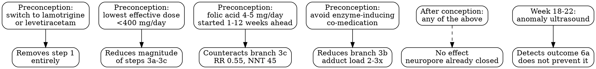

## Question

# Disease Characteristics Research Template

## Target Disease
- **Disease Name:** Fetal Carbamazepine Syndrome
- **MONDO ID:** MONDO:0018263 (if available)
- **Causal gene(s):** not recorded
- **OMIM:** not recorded
- **Synonyms:** fetal carbamazepine spectrum; carbamazepine embryopathy; carbamazepine embryofetopathy
- **Category:** Environmental

Many disease names are serial numbers ("... autosomal dominant 64", "... 26") that
do not say which gene the disease is about, and a similarly named disease with a
different gene is easy to research by mistake. Research the disease with the MONDO
ID and causal gene given above, and name its causal gene in your first paragraph.
If the name seems to point to a different gene or OMIM entry, follow the
identifiers above.

## Research Objectives

Please provide a comprehensive research report on **Fetal Carbamazepine Syndrome** covering all of the
disease characteristics listed below. This report will be used to populate a disease knowledge
base entry. Be thorough and cite primary literature (PMID preferred) for all claims.

For each section, **suggested databases/resources** are listed. These are the first places
you should search for information on each topic.

---

### 1. Disease Information
> **Search first:** OMIM, Orphanet, ICD-10/ICD-11, MeSH, PubMed

- What is the disease? Provide a concise overview.
- What are the key identifiers? (OMIM, Orphanet, ICD-10/ICD-11, MeSH, Mondo)
- What are the common synonyms and alternative names?
- Is the information derived from individual patients (e.g., EHR) or aggregated disease-level resources?

### 2. Etiology

- **Disease Causal Factors**: What are the primary causes? (genetic, environmental, infectious, mechanistic)
- **Risk Factors**:
  > **Search first:** PubMed, Cochrane Library, UpToDate, clinical guidelines, ClinVar, ClinGen, GWAS Catalog, PheGenI, CTD, CDC, WHO, epidemiological databases
  - Genetic risk factors (causal variants, susceptibility loci, modifier genes)
  - Environmental risk factors (toxins, lifestyle, occupational exposures, age, sex, family history)
- **Protective Factors**:
  > **Search first:** PubMed, Cochrane Library, clinical trial databases, GWAS Catalog, gnomAD, WHO, CDC, nutrition databases
  - Genetic protective factors (protective variants, modifier alleles)
  - Environmental protective factors (diet, lifestyle, exposures that reduce risk)
- **Gene-Environment Interactions**: How do genetic and environmental factors interact to influence disease?
  > **Search first:** CTD, PubMed, PheGenI, GxE databases

### 3. Phenotypes
> **Search first:** HPO (Human Phenotype Ontology), OMIM, Orphanet, PubMed, clinicaltrials.gov, MedDRA, SNOMED CT, DECIPHER, LOINC

For each phenotype, provide:
- **Phenotype type**: symptoms, clinical signs, physical manifestations, behavioral changes, or laboratory abnormalities
  > For symptoms/signs: HPO, OMIM, Orphanet, PubMed
  > For behavioral changes: HPO, DSM, RDoC (Research Domain Criteria), PubMed
  > For laboratory abnormalities: LOINC, SNOMED CT, LabTests Online, PubMed
- **Phenotype characteristics**:
  > **Search first:** OMIM, Orphanet, HPO, PubMed
  - Age of symptom onset (neonatal, childhood, adult-onset, late-onset)
  - Symptom severity (mild, moderate, severe, variable)
  - Symptom progression (stable, progressive, episodic, fluctuating)
  - Frequency among affected individuals (percentage or qualitative)
- **Quality of life impact**: Effects on daily functioning and well-being (per-phenotype when possible)
  > **Search first:** EQ-5D database, SF-36, WHO QOL databases, PubMed
- Suggest HPO (Human Phenotype Ontology) terms for each phenotype

### 4. Genetic/Molecular Information

- **Causal Genes**: Gene mutations or chromosomal abnormalities responsible for disease (gene symbols, OMIM IDs)
  > **Search first:** OMIM, ClinVar, HGMD, Ensembl, NCBI Gene
- **Pathogenic Variants**:
  - Affected genes (gene symbols, HGNC IDs)
    > **Search first:** OMIM, NCBI Gene, Ensembl, HGNC, UniProt, GeneCards
  - Variant classification (pathogenic, likely pathogenic, VUS per ACMG/AMP guidelines)
    > **Search first:** ClinVar, ClinGen, ACMG/AMP guidelines, VarSome
  - Variant type/class (missense, frameshift, nonsense, splice-site, structural)
  - Allele frequency in population databases
    > **Search first:** gnomAD, 1000 Genomes, ExAC, TOPMed, dbSNP
  - Somatic vs germline origin
    > **Search first:** COSMIC (somatic), ClinVar, ICGC, TCGA
  - Functional consequences (loss of function, gain of function, dominant negative)
- **Modifier Genes**: Genes that modify disease severity or expression
- **Epigenetic Information**: DNA methylation, histone modifications, chromatin changes affecting disease
  > **Search first:** ENCODE, Roadmap Epigenomics, MethBase, DiseaseMeth
- **Chromosomal Abnormalities**: Large-scale genetic changes (aneuploidy, translocations, inversions)
  > **Search first:** DECIPHER, ClinVar, ECARUCA, UCSC Genome Browser

### 5. Environmental Information

- **Environmental Factors**: Non-genetic contributing factors (toxins, radiation, pollution, occupational exposure)
  > **Search first:** CTD (Comparative Toxicogenomics Database), TOXNET, PubMed, EPA databases
- **Lifestyle Factors**: Behavioral factors (smoking, diet, exercise, alcohol consumption)
  > **Search first:** CDC databases, WHO, PubMed, NHANES
- **Infectious Agents**: If applicable, pathogens causing or triggering disease (bacteria, viruses, fungi, parasites)
  > **Search first:** NCBI Taxonomy, ViPR, BV-BRC, MicrobeDB, GIDEON

### 6. Mechanism / Pathophysiology

**Present this section as an ordered causal chain first, then the detail below.**
Open with a numbered sequence of mechanistic steps running from the initiating
lesion (mutation, exposure, infection) to the clinical manifestation, one step per
line, each naming what it causes next. State the causal verb explicitly ("leads
to", "results in") and say where a step is inferred rather than demonstrated.
Where the mechanism branches, show the branch. The categories below are a
checklist of what to cover within those steps, not the organizing structure —
a step may draw on several of them, and a category may contribute to several
steps.

- **Molecular Pathways**: Specific signaling cascades or biochemical pathways involved (Wnt, MAPK, mTOR, PI3K-AKT, etc.)
  > **Search first:** KEGG, Reactome, WikiPathways, PathBank, BioCyc
- **Cellular Processes**: Cell-level mechanisms (apoptosis, autophagy, cell cycle dysregulation, inflammation, etc.)
  > **Search first:** Gene Ontology (GO), Reactome, KEGG, PubMed
- **Protein Dysfunction**: How protein structure or function is altered (misfolding, aggregation, loss of function, gain of function)
  > **Search first:** UniProt, PDB (Protein Data Bank), InterPro, Pfam, AlphaFold
- **Metabolic Changes**: Alterations in metabolic processes (energy metabolism, lipid metabolism, amino acid metabolism)
  > **Search first:** KEGG, BioCyc, HMDB (Human Metabolome Database), BRENDA
- **Immune System Involvement**: Role of immune response (autoimmunity, immunodeficiency, chronic inflammation)
  > **Search first:** ImmPort, Immunome Database, IEDB, Gene Ontology
- **Tissue Damage Mechanisms**: How tissues/ are injured (oxidative stress, ischemia, fibrosis, necrosis)
  > **Search first:** PubMed, Gene Ontology, Reactome
- **Biochemical Abnormalities**: Specific molecular defects (enzyme deficiencies, receptor dysfunction, ion channel defects)
  > **Search first:** BRENDA, UniProt, KEGG, OMIM, PubMed
- **Epigenetic Changes**: DNA methylation, histone modifications affecting gene expression in disease
  > **Search first:** ENCODE, Roadmap Epigenomics, MethBase, DiseaseMeth
- **Molecular Profiling** (if available):
  - Transcriptomics/gene expression changes
    > **Search first:** GEO (Gene Expression Omnibus), ArrayExpress, GTEx, Human Cell Atlas, SRA
  - Proteomics findings
    > **Search first:** PRIDE, ProteomeXchange, Human Protein Atlas, STRING, BioGRID
  - Metabolomics signatures
    > **Search first:** MetaboLights, Metabolomics Workbench, HMDB, METLIN
  - Lipidomics alterations
    > **Search first:** LIPID MAPS, SwissLipids, LipidHome, Metabolomics Workbench
  - Genomic structural features
    > **Search first:** UCSC Genome Browser, Ensembl, NCBI, dbVar, DGV
- **Advanced Technologies** (if applicable):
  - Single-cell analysis findings (cell-type specific mechanisms, cellular heterogeneity)
    > **Search first:** Human Cell Atlas, Single Cell Portal, GEO, CELLxGENE
  - Spatial transcriptomics findings
    > **Search first:** GEO, Spatial Research, Vizgen, 10x Genomics data
  - Multi-omics integration results
    > **Search first:** TCGA, ICGC, cBioPortal, LinkedOmics, PubMed
  - Functional genomics screens (CRISPR, RNAi)
    > **Search first:** DepMap, GenomeRNAi, PubMed, BioGRID ORCS

For each mechanism, describe:
- The causal chain from initial trigger to clinical manifestation
- Which mechanisms are upstream vs downstream
- What cell types and biological processes are involved
- Suggest GO terms for biological processes and CL terms for cell types

### 7. Anatomical Structures Affected

- **Organ Level**:
  - Primary organs directly affected
  - Secondary organ involvement (complications, secondary effects)
  - Body systems involved (cardiovascular, nervous, digestive, respiratory, endocrine, etc.)
  > **Search first:** Uberon, FMA (Foundational Model of Anatomy), OMIM, HPO, ICD-11, MeSH, SNOMED CT
- **Tissue and Cell Level**:
  - Specific tissue types affected (epithelial, connective, muscle, nervous)
  - Specific cell populations targeted (with Cell Ontology terms)
  > **Search first:** Uberon, Human Protein Atlas, Cell Ontology, Human Cell Atlas, CellMarker, PanglaoDB
- **Subcellular Level**:
  - Cellular compartments involved (mitochondria, nucleus, ER, lysosomes) (with GO Cellular Component terms)
  > **Search first:** Gene Ontology (Cellular Component), UniProt, Human Protein Atlas
- **Localization**:
  - Specific anatomical sites (with UBERON terms)
    > **Search first:** FMA, Uberon, NeuroNames (for brain), SNOMED CT
  - Lateralization (unilateral, bilateral, asymmetric)
    > **Search first:** HPO, clinical literature, imaging databases

### 8. Temporal Development

- **Onset**:
  - Typical age of onset (congenital, pediatric, adult, geriatric)
  - Onset pattern (acute, subacute, chronic, insidious)
  > **Search first:** OMIM, Orphanet, HPO, PubMed
- **Progression**:
  - Disease stages (early, intermediate, advanced, end-stage)
    > **Search first:** Cancer Staging Manual (AJCC), WHO classifications, PubMed
  - Progression rate (rapid, slow, variable)
  - Disease course pattern (episodic, relapsing-remitting, progressive, stable)
  - Disease duration (self-limited, chronic lifelong)
  > **Search first:** Disease registries, longitudinal cohort databases, natural history studies, PubMed, Orphanet, OMIM
- **Patterns**:
  - Remission patterns (spontaneous, treatment-induced)
    > **Search first:** Clinical trial databases, disease registries, PubMed
  - Critical periods (time windows of vulnerability or opportunity for intervention)
    > **Search first:** PubMed, developmental biology databases, clinical guidelines

### 9. Inheritance and Population

- **Epidemiology**:
  - Prevalence (cases per 100,000 at given time)
  - Incidence (new cases per 100,000 per year)
  > **Search first:** Orphanet, CDC, WHO, GBD (Global Burden of Disease), national registries, SEER, disease registries
- **For Genetic Etiology**:
  - Inheritance pattern (AD, AR, X-linked, mitochondrial, multifactorial, polygenic)
    > **Search first:** OMIM, Orphanet, ClinVar, GTR (Genetic Testing Registry)
  - Penetrance (complete, incomplete, age-dependent)
    > **Search first:** ClinVar, OMIM, PubMed, ClinGen
  - Expressivity (variable, consistent)
    > **Search first:** OMIM, ClinVar, PubMed
  - Genetic anticipation (increasing severity in successive generations)
    > **Search first:** OMIM, PubMed (especially for repeat expansion disorders)
  - Germline mosaicism
    > **Search first:** ClinVar, OMIM, genetic counseling literature, PubMed
  - Founder effects (population-specific mutations)
    > **Search first:** gnomAD, population genetics databases, PubMed
  - Consanguinity role
    > **Search first:** OMIM, population studies, genetic counseling resources
  - Carrier frequency
    > **Search first:** gnomAD, carrier screening databases, GeneReviews, GTR
- **Population Demographics**:
  - Affected populations (ethnic or demographic groups with higher prevalence)
    > **Search first:** gnomAD, 1000 Genomes, PAGE Study, PubMed, population registries
  - Geographic distribution (endemic areas, regional variation)
    > **Search first:** WHO, CDC, GBD, Orphanet, geographic epidemiology databases
  - Geographic distribution of specific variants
  - Sex ratio (male:female)
    > **Search first:** Disease registries, OMIM, PubMed, epidemiological databases
  - Age distribution of affected individuals
    > **Search first:** CDC, disease registries, SEER, Orphanet

### 10. Diagnostics

- **Clinical Tests**:
  - Laboratory tests (blood, urine, tissue chemistry, specific enzyme assays)
    > **Search first:** LOINC, LabTests Online, PubMed
  - Biomarkers (proteins, metabolites, genetic markers, circulating biomarkers)
    > **Search first:** FDA Biomarker List, BEST (Biomarkers, EndpointS, and other Tools), PubMed
  - Imaging studies (X-ray, CT, MRI, PET, ultrasound)
    > **Search first:** RadLex, DICOM, Radiopaedia, imaging databases
  - Functional tests (pulmonary function, cardiac stress tests)
    > **Search first:** LOINC, clinical guidelines, PubMed
  - Electrophysiology (EEG, EMG, ECG, nerve conduction studies)
    > **Search first:** LOINC, clinical neurophysiology databases, PubMed
  - Biopsy findings (histopathology, immunohistochemistry)
    > **Search first:** SNOMED CT, College of American Pathologists resources, PubMed
  - Pathology findings (microscopic examination)
    > **Search first:** SNOMED CT, Digital Pathology databases, PubMed
- **Genetic Testing**:
  > **Search first:** GTR (Genetic Testing Registry), GeneReviews, ClinGen
  - Overview of recommended genetic testing approach
  - Whole genome sequencing (WGS) utility
    > **Search first:** GTR, ClinVar, GEL (Genomics England), gnomAD
  - Whole exome sequencing (WES) utility
    > **Search first:** GTR, ClinVar, OMIM, GeneMatcher
  - Gene panels (which panels, which genes)
    > **Search first:** GTR, ClinVar, laboratory-specific databases
  - Single gene testing
    > **Search first:** GTR, ClinVar, OMIM, GeneReviews
  - Chromosomal microarray (CMA)
    > **Search first:** DECIPHER, ClinVar, dbVar, ECARUCA
  - Karyotyping
    > **Search first:** Chromosome Abnormality Database, ClinVar, cytogenetics resources
  - FISH
    > **Search first:** ClinVar, cytogenetics databases, PubMed
  - Mitochondrial DNA testing
    > **Search first:** MITOMAP, MSeqDR, ClinVar, GTR
  - Repeat expansion testing
    > **Search first:** GTR, ClinVar, repeat expansion databases, PubMed
- **Omics-Based Diagnostics** (if applicable):
  - RNA sequencing / transcriptomics
    > **Search first:** GEO, ArrayExpress, GTEx, RNA-seq databases
  - Proteomics
    > **Search first:** PRIDE, ProteomeXchange, FDA Biomarker database
  - Metabolomics
    > **Search first:** MetaboLights, Metabolomics Workbench, HMDB
  - Epigenomics
    > **Search first:** GEO, ENCODE, Roadmap Epigenomics, MethBase
  - Liquid biopsy
    > **Search first:** COSMIC, ClinVar, liquid biopsy databases, PubMed
- **Clinical Criteria**:
  - Standardized diagnostic criteria (DSM, ICD, society guidelines)
    > **Search first:** DSM-5, ICD-11, clinical society guidelines, UpToDate
  - Differential diagnosis (other conditions to rule out, with distinguishing features)
    > **Search first:** DynaMed, UpToDate, clinical decision support systems
- **Screening**:
  - Screening methods for asymptomatic individuals (newborn screening, carrier screening, cascade screening)
    > **Search first:** ACMG recommendations, CDC newborn screening, GTR

### 11. Outcome/Prognosis

- **Survival and Mortality**:
  - Survival rate (5-year, 10-year, overall)
    > **Search first:** SEER, cancer registries, disease-specific registries, PubMed
  - Life expectancy (with and without treatment if applicable)
    > **Search first:** Orphanet, disease registries, actuarial databases, PubMed
  - Mortality rate
    > **Search first:** CDC, WHO, GBD, national mortality databases
  - Disease-specific mortality (deaths directly attributable to disease)
    > **Search first:** Disease registries, CDC Wonder, GBD, PubMed
- **Morbidity and Function**:
  - Morbidity (disease-related disability and health impacts)
    > **Search first:** GBD, WHO, disability databases, PubMed
  - Disability outcomes (long-term functional impairments)
    > **Search first:** ICF (International Classification of Functioning), disability registries
  - Quality of life measures (EQ-5D, SF-36, PROMIS, disease-specific tools)
    > **Search first:** EQ-5D database, SF-36, PROMIS, PubMed
- **Disease Course**:
  - Complications (secondary problems: infections, organ failure, etc.)
    > **Search first:** ICD codes, disease registries, clinical databases, PubMed
  - Recovery potential (likelihood and extent of recovery, with vs without treatment)
    > **Search first:** Natural history studies, rehabilitation databases, PubMed
- **Prediction**:
  - Prognostic factors (age, disease severity, biomarkers, treatment response)
    > **Search first:** Prognostic models databases, clinical calculators, PubMed
  - Prognostic biomarkers (molecular markers predicting disease course)
    > **Search first:** FDA Biomarker database, PubMed, cancer prognostic databases

### 12. Treatment

- **Pharmacotherapy**:
  - Pharmacological treatments (drug names, drug classes, mechanisms of action)
    > **Search first:** DrugBank, RxNorm, ATC classification, DailyMed, FDA databases
  - Pharmacogenomics (how genetic variants affect drug metabolism, efficacy, toxicity)
    > **Search first:** PharmGKB, CPIC (Clinical Pharmacogenetics), FDA Table of PGx Biomarkers
- **Advanced Therapeutics**:
  - Gene therapy (viral vectors, CRISPR, gene replacement, gene editing)
    > **Search first:** ClinicalTrials.gov, FDA gene therapy database, ASGCT resources
  - Cell therapy (stem cell transplant, CAR-T, cellular therapeutics)
    > **Search first:** ClinicalTrials.gov, FDA cell therapy database, FACT standards
  - RNA-based therapies (ASOs, siRNA, mRNA therapies)
    > **Search first:** ClinicalTrials.gov, FDA approvals, PubMed
  - Targeted therapies (treatments directed at specific molecular targets)
    > **Search first:** My Cancer Genome, OncoKB, ClinicalTrials.gov, FDA approvals
  - Immunotherapies (checkpoint inhibitors, monoclonal antibodies)
    > **Search first:** Cancer Immunotherapy Database, FDA approvals, ClinicalTrials.gov
- **Surgical and Interventional**:
  - Surgical interventions (types of surgery, timing, outcomes)
    > **Search first:** CPT codes, surgical registries, clinical guidelines, PubMed
- **Supportive and Rehabilitative**:
  - Supportive care (symptom management, pain control, nutrition)
    > **Search first:** Clinical guidelines, Cochrane Library, PubMed
  - Rehabilitation (physical therapy, occupational therapy, speech therapy)
    > **Search first:** Rehabilitation medicine databases, clinical guidelines, PubMed
- **Experimental**:
  - Experimental treatments in clinical trials (with NCT identifiers if available)
    > **Search first:** ClinicalTrials.gov, EU Clinical Trials Register, WHO ICTRP
- **Treatment Outcomes**:
  - Treatment response rates
    > **Search first:** Clinical trial databases, FDA reviews, systematic reviews, PubMed
  - Side effects and adverse events
    > **Search first:** FDA Adverse Event Reporting System (FAERS), MedWatch, PubMed
- **Treatment Strategy**:
  - Treatment algorithms (clinical pathways, decision trees)
    > **Search first:** Clinical practice guidelines, NCCN Guidelines, UpToDate
  - Combination therapies
    > **Search first:** ClinicalTrials.gov, treatment guidelines, PubMed
  - Personalized medicine approaches (genotype-guided treatment)
    > **Search first:** My Cancer Genome, CIViC, PharmGKB, precision medicine databases

For each treatment, suggest NCIT (NCI Thesaurus) clinical-intervention terms where applicable.

### 13. Prevention

- **Prevention Levels**:
  - Primary prevention (preventing disease occurrence: vaccination, risk factor modification)
    > **Search first:** CDC, WHO, USPSTF recommendations, Cochrane Library
  - Secondary prevention (early detection and treatment: screening programs, early intervention)
    > **Search first:** USPSTF, CDC screening guidelines, WHO
  - Tertiary prevention (preventing complications in those with disease)
    > **Search first:** Clinical guidelines, disease management protocols, PubMed
- **Immunization**: Vaccine strategies (if applicable)
  > **Search first:** CDC vaccine schedules, WHO immunization, FDA vaccine database
- **Screening and Early Detection**:
  - Screening programs (population-based: newborn screening, cancer screening)
    > **Search first:** CDC screening programs, USPSTF, cancer screening databases
  - Genetic screening (carrier screening, preimplantation genetic diagnosis, prenatal testing)
    > **Search first:** ACMG recommendations, ACOG guidelines, GTR
  - Risk stratification (identifying high-risk individuals for targeted prevention)
    > **Search first:** Risk prediction models, clinical calculators, PubMed
- **Behavioral Interventions**: Lifestyle modifications to reduce risk
  > **Search first:** CDC, WHO, behavioral intervention databases, Cochrane Library
- **Counseling**: Genetic counseling (risk assessment, family planning guidance)
  > **Search first:** NSGC resources, ACMG guidelines, GeneReviews
- **Public Health**:
  - Public health interventions (sanitation, vector control, health education)
    > **Search first:** CDC, WHO, public health databases, PubMed
  - Environmental interventions (reducing environmental risk factors)
    > **Search first:** EPA databases, WHO environmental health, PubMed
- **Prophylaxis**: Preventive medications or procedures
  > **Search first:** Clinical guidelines, FDA approvals, PubMed

### 14. Other Species / Natural Disease

- **Taxonomy**: Species affected (with NCBI Taxon identifiers)
  > **Search first:** NCBI Taxonomy
- **Breed**: Specific breeds affected (with VBO identifiers if applicable)
  > **Search first:** VBO (Vertebrate Breed Ontology)
- **Gene**: Orthologous genes in other species (with NCBI Gene IDs)
  > **Search first:** NCBI Gene
- **Natural Disease**:
  - Naturally occurring disease in other species (companion animals, wildlife)
    > **Search first:** OMIA (Online Mendelian Inheritance in Animals), VetCompass, PubMed
  - Veterinary relevance and importance in animal health
    > **Search first:** OMIA, veterinary databases, PubMed
- **Comparative Biology**:
  - Comparative pathology (similarities and differences across species)
    > **Search first:** OMIA, comparative pathology databases, PubMed
  - Evolutionary conservation of disease mechanisms
    > **Search first:** HomoloGene, OrthoMCL, Alliance of Genome Resources
- **Transmission** (if applicable):
  - Zoonotic potential
    > **Search first:** CDC zoonotic diseases, WHO zoonoses, GIDEON
  - Cross-species susceptibility
    > **Search first:** NCBI Taxonomy, veterinary databases, PubMed

### 15. Model Organisms

- **Model Types**:
  - Model organism type (mammalian, invertebrate, cellular, in vitro)
    > **Search first:** Alliance of Genome Resources, model organism databases
  - Specific model systems (mouse, rat, zebrafish, Drosophila, C. elegans, yeast, cell lines, organoids, iPSCs)
    > **Search first:** MGI, RGD, ZFIN, FlyBase, WormBase, SGD, ATCC, Cellosaurus
  - Induced models (drug treatment, surgical intervention, environmental manipulation)
    > **Search first:** MGI, model organism databases, PubMed
- **Genetic Models**:
  - Types available (knockout, knock-in, transgenic, conditional, humanized)
    > **Search first:** MGI, IMPC, KOMP, EuMMCR, IMSR
- **Model Characteristics**:
  - Phenotype recapitulation (how well model reproduces human disease features)
    > **Search first:** Model organism databases, comparative studies, PubMed
  - Model limitations (aspects of human disease not captured)
    > **Search first:** Model organism databases, PubMed, review articles
- **Applications**:
  - Research applications (what aspects of disease can be studied)
    > **Search first:** Model organism databases, PubMed
- **Resources**:
  - Model databases
    > **Search first:** MGI, RGD, ZFIN, FlyBase, WormBase, IMSR, EMMA, MMRRC

---

## Citation Requirements

- Cite primary literature (PMID preferred) for all mechanistic and clinical claims
- Prioritize recent reviews and landmark papers
- Include direct quotes from abstracts where possible to support key statements
- Distinguish evidence source types: human clinical, model organism, in vitro, computational

## Output Format

Structure your response as a comprehensive narrative organized by the sections above.
For each section, provide:
- Factual content with specific details (numbers, percentages, gene names, variant nomenclature)
- Ontology term suggestions (HPO, GO, CL, UBERON, CHEBI, NCIT, MONDO) where applicable
- Evidence citations with PMIDs
- Direct quotes from abstracts to support key claims
- Clear indication when information is not available or not applicable for this disease

This report will be used to populate a disease knowledge base entry with:
- Pathophysiology descriptions with causal chains
- Gene/protein annotations (HGNC, GO terms)
- Phenotype associations (HP terms) with frequencies
- Cell type involvement (CL terms)
- Anatomical locations (UBERON terms)
- Chemical entities (CHEBI terms)
- Treatment annotations (NCIT terms)
- Evidence items with PMIDs and exact abstract quotes
- Epidemiology, prognosis, diagnostic, and prevention information
- Animal model descriptions with phenotype recapitulation details

## Output

# Fetal carbamazepine syndrome (MONDO:0018263): a disease characteristics report

## Summary

**Fetal carbamazepine syndrome has no causal gene.** The "causal gene: not recorded" field in the target specification is correct and is not a gap in curation. MONDO:0018263 is classified as Environmental because its sufficient cause is a chemical exposure: carbamazepine (CHEBI:3387, NCIT:C375), a dibenzazepine sodium-channel-blocking antiseizure medication, taken by the mother during the first trimester. No OMIM entry exists, no ClinVar submission exists, and no diagnostic sequencing test confirms the diagnosis. Four genes appear anywhere in the biology of this syndrome, and all four are modifiers or drug targets rather than causal loci: **EPHX1** (HGNC:3401, microsomal epoxide hydrolase, 1q42.12), **CYP3A4** (HGNC:2637), **KCNH2** (HGNC:6251, hERG), and **MTHFR** (HGNC:7436). A knowledge-base entry that lists any of these in a "causal gene" slot would be wrong.

The quantitative profile is a roughly doubled risk of major congenital malformation with a clear dose-response. EURAP recorded 3.4% malformations below 400 mg/day, 5.3% at 400-1000 mg/day and 8.7% above 1000 mg/day across 1,402 monotherapy pregnancies ([PMID: 21652013](https://pubmed.ncbi.nlm.nih.gov/21652013/)). Spina bifida aperta is the one specific major malformation tied to carbamazepine monotherapy (OR 3.6, 95% UI 1.3-7.8, absolute risk approximately 0.5%). The minor-anomaly signature is fingernail hypoplasia (26%) and a typical facial phenotype (12.8%). Growth is restricted at population scale: small for gestational age aOR 1.25 (95% CI 1.12-1.40) and microcephaly aOR 1.43 (1.17-1.75) in 4,494,918 Nordic liveborn singletons. Global IQ is largely spared, with adjusted mean 106 (95% CI 102-109) at 4.5 years against 96 for valproate.

Two conclusions from this investigation revise standard accounts. First, the textbook arene oxide mechanism is wrong at the level of the named metabolite. The stable **carbamazepine-10,11-epoxide fails to reproduce the parent drug's embryotoxicity in three species** (mouse and rat whole embryo culture, zebrafish) and shows no correlation with malformation incidence in mouse plasma. The mechanism that best unifies the shared carbamazepine, phenytoin and phenobarbital phenotype, the dose-response, the polytherapy excess and the anatomy of the hypoplastic structures is **direct hERG/IKr blockade in the embryonic heart**, causing bradyarrhythmia and episodic hypoperfusion, with cytochrome P450 bioactivation to a short-lived species and methylfolate-axis inhibition running as parallel branches. Second, high-dose folic acid does prevent malformations in antiseizure-medication-exposed pregnancies, but **only when started 1-12 weeks before conception** (RR 0.55, 95% CI 0.25-0.91, NNT 45). Starting after conception gives no benefit (RR 1.27, 95% CI 0.94-1.64). Published nulls pooled across timings and missed this.

The disease is close to fully preventable by three acts taken before conception, and the binding constraint is implementation, not biology: only 54.3% of Nordic women with antiseizure-medication-treated epilepsy filled a high-dose folic acid prescription, and 42% of those started too late.

{{figure:plot_5.png|caption=Synthesis of the whole investigation. Left: the causal chain from maternal intake to clinical phenotype, with each step coloured by the type of evidence supporting it (human clinical, model organism, in vitro, inferred). Right: all eleven effect estimates placed on a single log axis, from fingernail hypoplasia at the top to the protective effect of preconceptional folic acid at the bottom.}}

---

## Key findings

### <i class="fa-solid fa-circle-check"></i> Finding 1: the causal gene field is correctly empty, and four genes must be annotated as modifiers instead

The disease has no Mendelian locus. The exposure is sufficient in the absence of any predisposing genotype, and no genotype produces the phenotype without the drug. The phenotype was defined prospectively by Jones and colleagues in 35 live-born children exposed to carbamazepine monotherapy ([PMID: 2725616](https://pubmed.ncbi.nlm.nih.gov/2725616/)): *"A pattern of malformation, the principal features of which are minor craniofacial defects and fingernail hypoplasia, and of developmental delay was identified"*, with *"the incidence of craniofacial defects (11 percent), fingernail hypoplasia (26 percent), and developmental delay (20 percent) in the 35 live-born children"*. Ornoy and Cohen replicated it independently in 47 exposed children ([PMID: 9014606](https://pubmed.ncbi.nlm.nih.gov/9014606/)): *"Six of the 47 children in group A had typical facial features of 'carbamazepine syndrome'."* All six had DQ or IQ below 90. The same paper names the unsolved part of the problem: the syndrome *"may depend upon heredofamilial factors that have yet to be defined."*

The practical consequence for a knowledge base is specific. Four genes appear in the mechanistic literature and each must carry an explicit role annotation that is not "causal": EPHX1 as a candidate fetal susceptibility modifier, CYP3A4 as the bioactivating enzyme, KCNH2 as the drug target, MTHFR as the enzyme downstream of the inhibited step. Recording any of them in a causal-gene slot would create a false Mendelian entry for an environmental disease.

### <i class="fa-solid fa-chart-line"></i> Finding 2: malformation risk is dose-dependent, with a 2.6-fold ratio across the dose range

EURAP enrolled 1,402 carbamazepine monotherapy pregnancies and found 3.4% major congenital malformations below 400 mg/day, 5.3% at 400-1000 mg/day and 8.7% above 1000 mg/day ([PMID: 21652013](https://pubmed.ncbi.nlm.nih.gov/21652013/)): *"An increase in malformation rates with increasing dose at the time of conception was recorded for all drugs."* The 2024 EURAP analysis of 9,840 monotherapy pregnancies placed carbamazepine at 5.5% overall, against valproate at 9.9% (153/1549) and phenytoin at 6.3% (9/142) ([PMID: 38497990](https://pubmed.ncbi.nlm.nih.gov/38497990/)). A systematic review pooling 8 cohorts and 2,680 monotherapy pregnancies gave 3.3% (95% CI 2.7-4.2) ([PMID: 21127116](https://pubmed.ncbi.nlm.nih.gov/21127116/)). Background population risk is 2-3%, so the relative risk is roughly 1.5 to 2.4 depending on the baseline chosen.

The monotone dose-response matters beyond its size. Confounding by indication is the standing objection to every observational result in this field, and a confounder would have to track dose monotonically to produce this pattern. Dose is also the one feature of the exposure a clinician can change without changing the drug, which makes this the single most actionable number in the report.

{{figure:plot_1.png|caption=Carbamazepine malformation risk in context. Left: major congenital malformation rate by antiseizure medication from EURAP and pooled cohorts, with carbamazepine at 5.5% sitting between lamotrigine and valproate. Right: the EURAP dose-response across carbamazepine dose bands at conception, 3.4% below 400 mg/day rising to 8.7% above 1000 mg/day.}}

### <i class="fa-solid fa-circle-check"></i> Finding 3: spina bifida aperta is the only specific major malformation attributable to carbamazepine monotherapy

EUROCAT analysed 98,075 malformation registrations across 3.8 million births from 19 registries, including 131 carbamazepine-exposed cases, and reported that *"Spina bifida is the only specific major congenital malformation significantly associated with exposure to Carbamazepine monotherapy"* ([PMID: 21127116](https://pubmed.ncbi.nlm.nih.gov/21127116/), [PMID: 26329145](https://pubmed.ncbi.nlm.nih.gov/26329145/)). A meta-analytic modelling study gave an odds ratio of 3.6 (95% uncertainty interval 1.3-7.8) for spina bifida and 2.4 (1.1-4.5) for cleft palate, and estimated roughly 5 spina bifida and 5 cleft palate cases attributable to carbamazepine per year in the United States ([PMID: 21766433](https://pubmed.ncbi.nlm.nih.gov/21766433/)).

The absolute risk is approximately 0.5%, against 1-2% for valproate ([PMID: 14504306](https://pubmed.ncbi.nlm.nih.gov/14504306/)). This is a tenfold enrichment over the general-population neural tube defect rate and still means 199 of every 200 exposed pregnancies produce no neural tube defect. Both halves of that statement belong in counselling. The defect specificity is also the strongest anatomical constraint on any mechanistic model, because the posterior neuropore closes last, on gestational days 21-28, and is therefore the structure most exposed to a transient insult during that window.

### <i class="fa-solid fa-circle-xmark"></i> Finding 4: carbamazepine-10,11-epoxide is not the proximate teratogen, refuted in three species

The arene oxide hypothesis held that carbamazepine, like phenytoin, is bioactivated to a reactive epoxide that damages the embryo unless detoxified. The named metabolite fails every direct test.

| System | Parent compound | 10,11-epoxide | Source |
|---|---|---|---|
| <i class="fa-solid fa-microscope"></i> Mouse whole embryo culture | Embryotoxic at 12 µg/mL | <i class="fa-solid fa-circle-xmark"></i> Not embryotoxic to 48 µg/mL | [PMID: 8916369](https://pubmed.ncbi.nlm.nih.gov/8916369/) |
| <i class="fa-solid fa-microscope"></i> Rat whole embryo culture | Embryotoxic at 60 µg/mL | <i class="fa-solid fa-circle-xmark"></i> Not embryotoxic to 48 µg/mL | [PMID: 8916369](https://pubmed.ncbi.nlm.nih.gov/8916369/) |
| <i class="fa-solid fa-vial"></i> Zebrafish embryo, 5.25-120 hpf | Teratogenic | <i class="fa-solid fa-circle-xmark"></i> Not teratogenic | [PMID: 34884510](https://pubmed.ncbi.nlm.nih.gov/34884510/) |
| <i class="fa-solid fa-chart-column"></i> Mouse plasma correlation (SWR/J, LM/Bc) | - | <i class="fa-solid fa-circle-xmark"></i> No correlation with malformation incidence | [PMID: 2878505](https://pubmed.ncbi.nlm.nih.gov/2878505/) |

The whole embryo culture study states it plainly: *"CBZ-E was not embryotoxic to either species at concentrations as high as 48 micrograms/ml. These results suggest that the parent compound is the embryotoxic agent and that the epoxide intermediate plays no role in the drug's embryotoxic mechanism."* The embryotoxic concentration in mouse, 12 µg/mL, sits at the top of the human therapeutic plasma range of 4-12 µg/mL, which is the detail that makes the culture result relevant rather than a high-dose artefact. The in vivo dosing study found *"There was no correlation with either of these compounds and the incidence of fetal abnormality"* across SWR/J and LM/Bc mice at 1000-2000 mg/kg/day.

The zebrafish result adds a constraint the mammalian data could not supply, because teratogenicity appears in a species that makes almost no epoxide: *"The present study showed teratogenic effects for CBZ and PHE, but not for E-CBZ and HPPH. No HPPH was detected during organogenesis and E-CBZ was only formed at the end of organogenesis."* Zebrafish liver microsomes form the epoxide at very low to negligible rates compared with human, rat and rabbit. The authors leave two alternatives standing: *"As such, other metabolic pathways than those of mammals are involved in the bioactivation of CBZ and PHE, or, these anti-epileptics are teratogens and do not require bioactivation in the zebrafish."* ([PMID: 34884510](https://pubmed.ncbi.nlm.nih.gov/34884510/)). A non-CYP acridine route via 9-acridine carboxaldehyde, acridine and acridone was the candidate tested in follow-up ([PMID: 39188273](https://pubmed.ncbi.nlm.nih.gov/39188273/)).

<i class="fa-solid fa-triangle-exclamation"></i> The direct clinical consequence: plasma carbamazepine-10,11-epoxide concentration has no value as a teratogenic risk biomarker, and the metabolite should be annotated as exonerated.

### <i class="fa-solid fa-circle-check"></i> Finding 5: bioactivation still contributes, even though the stable epoxide does not

Refuting the metabolite did not refute the principle. In SWV mice, carbamazepine at 1500 mg/kg/day produced 33% malformations against 5% in pair-fed controls (reconstructed OR 9.4, p < 0.0001). Modulating P450 activity moved the rate in both directions. Phenobarbital co-administration, a P450 inducer, raised malformations from 10% to 26% (OR 3.2, p = 0.005), and the paper ties that to adduct formation: *"In all tissues, PB caused a two-to threefold increase in binding, compared with binding in mice exposed to CBZ alone"*, measured in maternal liver, placenta and fetal head. Stiripentol, a P450 inhibitor, cut malformations from 33% to 16.7% (OR 0.42, p = 0.014) ([PMID: 8711619](https://pubmed.ncbi.nlm.nih.gov/8711619/)).

Bidirectional pharmacological modulation is stronger evidence than either direction alone, because an inducer and an inhibitor are unlikely to produce opposite confounding. The surviving claim is narrower and more precise than the one it replaces: a short-lived P450-generated reactive species, plausibly a 2,3-arene oxide leading to catechol and quinone or semiquinone intermediates, contributes to injury, and it is short-lived enough that no stable plasma metabolite tracks it. Supporting this, inhibiting epoxide hydrolase potentiated phenytoin embryotoxicity in a related system: *"These effects significantly increased with inhibition of epoxide hydrase"* ([PMID: 2885938](https://pubmed.ncbi.nlm.nih.gov/2885938/)).

{{figure:plot_2.png|caption=The epoxide is exonerated, but bioactivation still matters. Left: whole embryo culture shows the parent compound is embryotoxic at 12 µg/mL in mouse and 60 µg/mL in rat, while carbamazepine-10,11-epoxide is inert up to 48 µg/mL in both. Right: P450 induction with phenobarbital raises the mouse malformation rate from 10% to 26%, and P450 inhibition with stiripentol lowers it from 33% to 16.7%, so a bioactivated species is involved even though it is not the stable epoxide.}}

### <i class="fa-solid fa-heart-pulse"></i> Finding 6: hERG/IKr blockade in the embryonic heart unifies the phenotype across the drug class

Cultured gestational day 10 C57Bl/6J mouse embryos exposed to phenytoin, carbamazepine, phenobarbital, trimethadione and dimethadione all developed concentration-dependent bradycardia, ventricular arrhythmia and episodes of cardiac arrest, while valproate and vigabatrin, which act by different mechanisms, did not rank with them ([PMID: 9587965](https://pubmed.ncbi.nlm.nih.gov/9587965/)). The authors describe the consequence directly: *"During a restricted sensitive period, this results in induction of concentration-dependent bradyarrhythmia in the embryo and episodes of hypoxia/reoxygenation."* The follow-up names the shared molecular lesion: *"The teratogenicity has been linked to cardiac rhythm disturbances and hypoxic damage as a consequence of their common potential to inhibit a specific potassium ion current (IKr)"*, and quantifies the polytherapy effect: *"Polytherapy resulted in more substantial prolongation of the mean interval between heartbeats (>60 ms) than monotherapy at clinically relevant concentrations."* ([PMID: 17584909](https://pubmed.ncbi.nlm.nih.gov/17584909/)).

Four independent observations fall out of this model rather than needing separate explanations. The drugs that share the channel-blocking mechanism share the malformation pattern, and the paper notes the contrast explicitly: *"Valproic acid (VPA) has been associated with a different pattern of malformations."* The EURAP dose-response follows, because channel blockade is concentration-dependent. Polytherapy is worse than monotherapy, because blockades sum at the channel. And the hypoplastic structures are the distal, least-perfused ones: terminal phalanges and nail beds, midface, posterior neuropore.

<i class="fa-solid fa-triangle-exclamation"></i> This is the central mechanistic claim of the report and it is demonstrated in mouse embryo culture, inferred in the human embryo. No human embryonic rhythm measurement under carbamazepine exposure exists and none is ethically obtainable.

### <i class="fa-solid fa-circle-check"></i> Finding 7: carbamazepine inhibits the methylfolate axis at therapeutic concentrations

Carbamazepine reduced Vmax and increased Km for the multienzyme conversion of pteroylmonoglutamate to 5-methyltetrahydrofolate in rat liver homogenate, and the concentration dependence is what makes it relevant: *"Inhibition approaching maximal was found to occur at therapeutic levels of ACD"* ([PMID: 7993656](https://pubmed.ncbi.nlm.nih.gov/7993656/)). The inhibited step sits upstream of MTHFR, which is why MTHFR appears in the gene list as a downstream enzyme rather than as a target.

This branch runs in parallel with the cardiac one and explains the neural tube specificity that cardiac hypoperfusion alone explains only by anatomy. It also supplies the mechanistic rationale for the folic acid result in Finding 9. <i class="fa-solid fa-triangle-exclamation"></i> The evidence is in vitro and in rat liver homogenate, which is a long way from the human embryonic neuroepithelium, so this step is graded weaker than the cardiac one.

### <i class="fa-solid fa-dna"></i> Finding 8: susceptibility is set by the genotype of the conceptus, not of the mother

Two experimental lines in mouse fix where the modifier acts. Three inbred strains given matched chronic oral phenobarbital differed substantially: *"The LM/Bc strain was most sensitive to phenobarbital, with 46.7% of the fetuses exposed to the highest maternal plasma concentrations having malformations. C57BL/6J fetuses were the most resistant strain, with only 28.6% abnormalities."* ([PMID: 3603402](https://pubmed.ncbi.nlm.nih.gov/3603402/)). Reconstructing the 2×2 table at n = 100 per strain gives OR 2.17, Fisher exact p = 0.013.

Reciprocal crosses between SWV and C57BL/6JBk under acetazolamide separate maternal from fetal genotype. SWV produced no ectrodactyly, C57BL produced 68%, and the crossing result shows which side governs: *"a litter in which most of the genes segregating are from a susceptible line will show major increases in susceptibility, despite being in a heterotic and somewhat resistant uterine environment, whereas the susceptible C57BL uterine environment does not res[cue]"* ([PMID: 1562800](https://pubmed.ncbi.nlm.nih.gov/1562800/)).

In humans the single-gene candidate is EPHX1. Buehler measured amniocyte epoxide hydrolase activity in 100 randomly selected pregnancies and found *"an apparently trimodal distribution, suggestive of an enzyme regulated by a single gene with two allelic forms"*, then tested it prospectively in 19 pregnancies: *"In all four cases, the mother was receiving phenytoin monotherapy, and after birth the infants had clinical findings compatible with the fetal hydantoin syndrome. The 15 fetuses with enzyme activity above 30 percent of the standard were not considered to be at risk, and all 15 neonates lacked any characteristic features of the fetal hydantoin syndrome."* ([PMID: 2336087](https://pubmed.ncbi.nlm.nih.gov/2336087/)). Fisher exact p = 0.00026 for 4/4 against 0/15.

<i class="fa-solid fa-triangle-exclamation"></i> Both mouse experiments used phenobarbital or acetazolamide, not carbamazepine, and the human series used phenytoin monotherapy with n = 19 and no genotyping. The inference to carbamazepine is a cross-agent extrapolation within the same drug class. It does, however, explain the clinical pattern Ornoy could not account for: incomplete penetrance, discordance between exposed siblings, and the absence of a clean dose threshold.

{{figure:plot_4.png|caption=Three quantitative results. Left: fetal growth outcomes in exposed pregnancies, with carbamazepine microcephaly aOR 1.43 and small-for-gestational-age aOR 1.25 placed beside oxcarbazepine and topiramate comparators. Centre: projected birth prevalence per 100,000 for each phenotype as a function of the carbamazepine share of antiseizure-medication-treated epilepsy pregnancies, log scale. Right: mouse strain differences in anticonvulsant-induced malformation at matched exposure, LM/Bc 46.7% against C57BL/6J 28.6%.}}

### <i class="fa-solid fa-circle-check"></i> Finding 9: high-dose folic acid prevents malformations, but only in a 12-week preconceptional window

This is the most consequential clinical result in the investigation, and it reverses a position held earlier in the same investigation. A sequential target trial emulation on Danish, Icelandic, Norwegian and Swedish registers covering 1997-2020 identified 13,619 eligible antiseizure-medication-exposed pregnancies, of which 521 initiated 4-5 mg/day folic acid in the 1-12 weeks before pregnancy ([PMID: 41876129](https://pubmed.ncbi.nlm.nih.gov/41876129/)): *"Initiation of high-dose folic acid 1-12 weeks before pregnancy was associated with a lower prevalence of MCA in offspring (2.6% vs 4.8% among non-initiators), corresponding to an absolute risk reduction of 2.2 percentage points (95% CI 0.5 to 3.5) and a 45% relative risk reduction (RR=0.55, 95% CI 0.25 to 0.91)."* That is a number needed to treat of 45.

Outside the window there is nothing: *"No risk reduction was observed with initiation 1-12 weeks after (RR=1.27, 95% CI 0.94 to 1.64) or 13-52 weeks before (RR=0.99, 95% CI 0.65 to 1.36) pregnancy onset."* The after-conception arm had n = 12,365 and the 13-52 week arm n = 18,255, so these are well-powered nulls, not failures to detect.

The timing explains the earlier literature. A widely cited commentary stated that *"Standard supplementation of folic acid during pregnancy can reduce risk of spontaneous spina bifida, but not that associated with valproate or carbamazepine."* ([PMID: 29215383](https://pubmed.ncbi.nlm.nih.gov/29215383/)). Pooling an effective window with two ineffective ones dilutes RR 0.55 toward the null, which is what that literature reported. A Chinese multicentre cohort of 1,013 women and 1,209 pregnancies across 58 hospitals supports the direction: *"FA supplementation was associated with lower risks of composite adverse offspring outcomes (adjusted odds ratio [aOR] .59, 95% confidence interval [CI] .387-.911) and fetal death (aOR .127, 95% CI .054-.296)"* ([PMID: 42096275](https://pubmed.ncbi.nlm.nih.gov/42096275/)). The AAN parameter grades it as *"possibly effective in preventing major congenital malformations in the newborns of WWE taking AEDs"* ([PMID: 19398680](https://pubmed.ncbi.nlm.nih.gov/19398680/)).

Transporting RR 0.55 onto carbamazepine-specific baselines gives 5.5% falling to 3.0% at the EURAP overall rate (NNT 40), and 8.7% falling to 4.8% above 1000 mg/day (NNT 26). <i class="fa-solid fa-triangle-exclamation"></i> That projection is an assumption. The emulation pooled all antiseizure medications and was not powered for carbamazepine alone.

{{figure:plot_3.png|caption=The folic acid timing window and its projection onto carbamazepine. Left: relative risk of major congenital anomaly by when high-dose folic acid was started, showing benefit only in the 1-12 weeks before conception (RR 0.55) and none when started after conception (RR 1.27) or a year ahead (RR 0.99). Right: the RR 0.55 effect transported onto carbamazepine-specific baselines, reducing 5.5% to 3.0% at the EURAP overall rate and 8.7% to 4.8% at doses above 1000 mg/day.}}

### <i class="fa-solid fa-brain"></i> Finding 10: global IQ is spared, and the autism signal does not survive sibling control

NEAD measured adjusted mean IQ at age 3 ([PMID: 19369666](https://pubmed.ncbi.nlm.nih.gov/19369666/)): *"the mean IQ was 101 for children exposed to lamotrigine, 99 for those exposed to phenytoin, 98 for those exposed to carbamazepine, and 92 for those exposed to valproate"*. At 4.5 years the adjusted means were carbamazepine 106 (95% CI 102-109), lamotrigine 106, phenytoin 105, valproate 96, with no dose relation for carbamazepine ([PMID: 22491865](https://pubmed.ncbi.nlm.nih.gov/22491865/)). A network meta-analysis of 29 cohorts and 5,100 children found *"that among all AEDs only valproate was statistically significantly associated with more children experiencing cognitive developmental delay compared with control (OR=7.40, 95% credible interval (CrI) 3.00 to 18.46)"* ([PMID: 28729328](https://pubmed.ncbi.nlm.nih.gov/28729328/)).

Registry data on 3,182,773 UK and Swedish children detected a modest signal: *"those exposed to carbamazepine were 1.25 times more likely to be diagnosed with autism (95% CI: 1.05-1.48) and 1.30 times more likely to be diagnosed with intellectual disability (95% CI: 1.01-1.69)"* ([PMID: 39548057](https://pubmed.ncbi.nlm.nih.gov/39548057/)). A Taiwanese cohort of 2,196,156 births reproduced the population-wide association and then removed it: *"However, these associations were not observed in sibling comparison analyses."* ([PMID: 42736039](https://pubmed.ncbi.nlm.nih.gov/42736039/)).

<i class="fa-solid fa-scale-balanced"></i> Hazard ratios of 1.25-1.30 that vanish under sibling control carry the signature of residual confounding by maternal epilepsy severity, maternal cognitive ability and shared familial liability. Report these associations as unconfirmed.

The firmer prognostic rule comes from Ornoy. Cognitive impairment tracked the dysmorphic phenotype: all six children with the full facial phenotype had DQ or IQ below 90, while the group means were normal. <i class="fa-solid fa-lightbulb"></i> **Dysmorphism, not exposure alone, marks the child at risk of cognitive difficulty.**

### <i class="fa-solid fa-arrow-trend-down"></i> Finding 11: fetal growth is restricted at population scale, and head circumference normalises by two years

The Nordic cohort of 4,494,918 liveborn singletons born 1996-2017 gave small for gestational age aOR 1.25 (95% CI 1.12-1.40) in the whole population and 1.27 (1.11-1.47) restricted to mothers with epilepsy, with microcephaly aOR 1.43 (1.17-1.75) ([PMID: 38476755](https://pubmed.ncbi.nlm.nih.gov/38476755/)). Comparator estimates in the same analysis were oxcarbazepine 1.48 (1.28-1.71) and topiramate 1.48 (1.18-1.85), so carbamazepine's growth effect is real and at the lower end of the class.

The Swedish register analysis of 6,720 exposed pregnancies used lamotrigine as the active comparator, which controls for epilepsy rather than for nothing, and found carbamazepine associated with 1.3 fewer days of gestation (95% CI -2.3 to -0.3), -0.1 SD birth weight (-0.2 to 0.0) and -0.2 SD head circumference (-0.3 to -0.1) ([PMID: 31381574](https://pubmed.ncbi.nlm.nih.gov/31381574/)). These are small effects detectable only at this scale.

NEAD found microcephaly at 12% at birth and at 12 months, and then: *"Microcephaly rates were elevated to 12% for all newborns and at 12 months old, but normalized by age 24 months."* ([PMID: 22749607](https://pubmed.ncbi.nlm.nih.gov/22749607/)). <i class="fa-solid fa-circle-check"></i> This is the one phenotype in the syndrome that remits, and it belongs in counselling, because head circumference at birth is otherwise an alarming finding for parents. For contrast, topiramate microcephaly in the Norwegian registry ran at 11.4% against 2.4% unexposed, OR 4.8 (2.5-9.3) ([PMID: 24449062](https://pubmed.ncbi.nlm.nih.gov/24449062/)).

### <i class="fa-solid fa-chart-column"></i> Finding 12: the disease is rare in absolute terms and its prevalence is set by prescribing policy

Among 2,748,882 pregnancies in Denmark, Norway and Sweden over 2006-2017, *"we identified 8695 (.3%) pregnancies after restricting the population to women with ASM-treated epilepsy"* ([PMID: 38554037](https://pubmed.ncbi.nlm.nih.gov/38554037/)), that is 0.316%. Multiplying that denominator by plausible carbamazepine shares and by the phenotype rates gives projected birth prevalences.

| Phenotype counted | At 10% CBZ share | At 25% CBZ share |
|---|---|---|
| Fingernail hypoplasia (26%) | 8.2 per 100,000 births | 20.6 per 100,000 |
| Typical facial phenotype (12.8%) | 4.1 per 100,000 | 10.1 per 100,000 |
| Any major malformation (5.5%) | 1.7 per 100,000 | 4.4 per 100,000 |
| Spina bifida aperta (0.5%) | 0.16 per 100,000 | 0.40 per 100,000 |

<i class="fa-solid fa-triangle-exclamation"></i> These are projections assembled from published component rates, not measurements, and they inherit every selection bias in the source registries. They are useful for ordering the phenotypes: the full dysmorphic phenotype is roughly 2 to 5 times more common than any major malformation, and spina bifida is roughly 25 times rarer than the facial phenotype.

Prevalence is falling because prescribing is changing. In the French EPI-MERES register, 55,801 pregnancies were exposed to at least one antiseizure medication over 2013-2021, and *"Pregnancies exposed to the safest ASMs increased by +30%. Meanwhile, prenatal exposure to valproic acid and valpromide dramatically decreased"* ([PMID: 40700674](https://pubmed.ncbi.nlm.nih.gov/40700674/)). <i class="fa-solid fa-arrow-trend-down"></i> The syndrome is becoming a condition of settings where carbamazepine remains first-line.

### <i class="fa-solid fa-magnifying-glass"></i> Finding 13: diagnosis is exposure plus phenotype, and dysmorphic scoring is weak

There is no confirmatory test. Diagnosis requires documented first-trimester exposure, a compatible pattern of minor craniofacial and digital anomalies, and exclusion of alternatives. Each element does real work. In a blinded study of 375 children of 219 mothers with epilepsy, 94 of them carbamazepine-exposed, dysmorphologists *"Overall, 47% of exposed children were correctly identified as having been exposed to AEDs in utero"* ([PMID: 16239295](https://pubmed.ncbi.nlm.nih.gov/16239295/)). Near chance. The same study gave the headline malformation comparison: *"Major malformations were identified in 14% of children exposed to valproate in utero, 5% exposed to carbamazepine, and 4% in the non-exposed group."*

Exclusion matters because exposure does not prove attribution. In Ornoy's cohort, *"Two children in group A had cleft palate but in each case this was found in a parent as well"* ([PMID: 9014606](https://pubmed.ncbi.nlm.nih.gov/9014606/)), so the defect was familial. In the severe case report *"The karyotype was 46, XX."* was used to exclude a chromosomal mimic ([PMID: 22687674](https://pubmed.ncbi.nlm.nih.gov/22687674/)). Genetic testing here is a differential-diagnosis tool and never a confirmatory one: chromosomal microarray and karyotype to exclude a copy-number or chromosomal mimic, exome sequencing only when the phenotype extends beyond the expected spectrum. No gene panel exists or should exist.

### <i class="fa-solid fa-pills"></i> Finding 14: management is preconceptional, and switching after conception can do more harm than the drug

The AAN, AES and SMFM 2024 guideline fixes the timing: *"When treating PWECP, clinicians should recommend ASMs and doses that optimize both seizure control and fetal outcomes should pregnancy occur, at the earliest possible opportunity preconceptionally."* ([PMID: 38748979](https://pubmed.ncbi.nlm.nih.gov/38748979/)). The same guideline places an explicit brake on late switching: *"Once a PWECP is already pregnant, clinicians should exercise caution in attempting to remove or replace an ASM that is effective in controlling generalized tonic-clonic or focal-to-bilateral tonic-clonic seizures."* Maternal convulsive seizures harm the fetus, and by the time pregnancy is recognised the neural tube window has closed anyway.

Contraception is part of the mechanism of exposure, because enzyme induction defeats hormonal contraception: *"The enzyme-inducing antiepileptic drugs such as carbamazepine, phenytoin, barbiturates, oxcarbazepine do not allow oral contraceptives."* ([PMID: 21216127](https://pubmed.ncbi.nlm.nih.gov/21216127/)). Unplanned pregnancy is how carbamazepine-exposed first trimesters happen.

<i class="fa-solid fa-circle-check"></i> Breastfeeding is not contraindicated: *"Valproate, phenobarbital, phenytoin, and carbamazepine probably are not transferred into breast milk in clinically important amounts."* ([PMID: 19398680](https://pubmed.ncbi.nlm.nih.gov/19398680/)). NEAD found breastfed children of mothers on antiseizure medication had adjusted IQ 4 points higher at 6 years (p = 0.045) and that periconceptional folate use predicted adjusted IQ 6 points higher (95% CI 2-10, p = 0.005) ([PMID: 24934501](https://pubmed.ncbi.nlm.nih.gov/24934501/)).

### <i class="fa-solid fa-triangle-exclamation"></i> Finding 15: the binding constraint on prevention is implementation, not biology

Only 54.3% of Nordic women with antiseizure-medication-treated epilepsy filled a high-dose folic acid prescription, and 42% of those who did started too late to be in the effective window ([PMID: 38554037](https://pubmed.ncbi.nlm.nih.gov/38554037/)). An Irish ten-year review of 250 women on antiseizure medication found 3 (1.2%) took no folic acid at all and 59 (23.6%) started only after conception, with compliance lowest in exactly the two highest-risk groups: 30.8% for valproate against 76.0% for other medications (p < 0.03), and 25.6% for polytherapy against 72.5% for monotherapy (p < 0.03) ([PMID: 40588438](https://pubmed.ncbi.nlm.nih.gov/40588438/)).

<i class="fa-solid fa-lightbulb"></i> Closing that gap would prevent more cases than any mechanistic advance available in the next decade. The intervention works when it is actively implemented: a single-centre quality-improvement programme raised folic acid prescription rates from 41% to 81.6% using email reminders, provider education, examination-room signage and an electronic medical record best-practice advisory ([PMID: 29526345](https://pubmed.ncbi.nlm.nih.gov/29526345/)). Passive guideline dissemination alone produced no measurable change in an earlier study ([PMID: 16060941](https://pubmed.ncbi.nlm.nih.gov/16060941/)).

---

## Mechanistic model

### The causal chain

Each step names what it causes next. Branches are labelled 3a, 3b, 3c and 6a, 6b, 6c. Every step is tagged as demonstrated with its species, or as inferred.

1. **Maternal carbamazepine intake during gestational weeks 3-8** results in sustained maternal plasma concentrations of 4-12 µg/mL (*demonstrated, human clinical*).

2. **Free drug crosses the placenta**, which results in embryonic concentrations approximating maternal (*demonstrated, human clinical and mouse*; [PMID: 27105911](https://pubmed.ncbi.nlm.nih.gov/27105911/)). The chain now branches three ways.

3a. **Direct pharmacological branch.** Carbamazepine blocks the hERG/IKr potassium current in the embryonic heart, which leads to step 4 (*demonstrated, mouse embryo culture*; [PMID: 9587965](https://pubmed.ncbi.nlm.nih.gov/9587965/), [PMID: 17584909](https://pubmed.ncbi.nlm.nih.gov/17584909/)).

3b. **Bioactivation branch.** Cytochrome P450 oxidation of the parent drug produces a short-lived reactive species, a candidate 2,3-arene oxide leading to catechol and quinone or semiquinone intermediates, which results in covalent protein adducts, leading to step 5 (*direction demonstrated in mouse*; [PMID: 8711619](https://pubmed.ncbi.nlm.nih.gov/8711619/). The identity of the species is *inferred*, because it has never been isolated).

3c. **Folate branch.** Carbamazepine inhibits the conversion of pteroylmonoglutamate to 5-methyltetrahydrofolate, reducing Vmax and raising Km, which results in constrained one-carbon supply for thymidylate and methionine synthesis, leading to step 6a (*demonstrated, rat liver homogenate in vitro, at therapeutic concentrations*; [PMID: 7993656](https://pubmed.ncbi.nlm.nih.gov/7993656/)).

4. **IKr blockade causes concentration-dependent embryonic bradycardia, ventricular arrhythmia and episodes of cardiac arrest** in the gestational day 9-11 embryo, which results in episodic tissue hypoperfusion (*demonstrated, mouse embryo culture*; [PMID: 9587965](https://pubmed.ncbi.nlm.nih.gov/9587965/)).

5. **Hypoperfusion followed by reoxygenation generates reactive oxygen species and microhaemorrhage** in the distal, least-perfused embryonic structures, compounded by the covalent adducts from branch 3b, which leads to steps 6a, 6b and 6c (*demonstrated as a mechanism in mouse embryo culture, inferred for the human embryo*).

6a. **Failure of posterior neuropore closure on gestational days 21-28** at the latest-closing region results in spina bifida aperta (*inferred; the timing and site are deduced from defect specificity, not observed in exposed human embryos*).

6b. **Hypoplasia of the least-perfused distal structures**, terminal phalanges, nail beds and midface, results in the minor-anomaly signature (*inferred from the anatomical match between the hypoperfusion model and the observed defects*).

6c. **Generalised deficit in conceptus growth** from chronic intermittent hypoperfusion results in reduced birth weight and head circumference (*demonstrated at population scale, human*; [PMID: 38476755](https://pubmed.ncbi.nlm.nih.gov/38476755/)).

7. **Fetal genotype at detoxification and target loci sets the threshold at which steps 3b and 5 produce injury**, which modulates whether any of step 6 occurs in a given conceptus (*demonstrated, mouse reciprocal crosses*; [PMID: 1562800](https://pubmed.ncbi.nlm.nih.gov/1562800/), [PMID: 3603402](https://pubmed.ncbi.nlm.nih.gov/3603402/)).

8. **Clinical manifestation.** Spina bifida aperta (~0.5%), cleft palate (OR 2.4), the typical facial phenotype (12.8%), fingernail hypoplasia (26%), small for gestational age (aOR 1.25), microcephaly (aOR 1.43), and developmental delay in the dysmorphic subgroup (*demonstrated, human clinical*).

```dot
digraph mechanism {
  rankdir=LR;
  node [shape=box, style=rounded];
  "Maternal CBZ\nweeks 3-8" -> "Placental transfer\nfetal ~ maternal level";
  "Placental transfer\nfetal ~ maternal level" -> "hERG/IKr blockade\n(3a, direct)";
  "Placental transfer\nfetal ~ maternal level" -> "P450 bioactivation\nshort-lived species (3b)";
  "Placental transfer\nfetal ~ maternal level" -> "Methylfolate axis\ninhibition (3c)";
  "hERG/IKr blockade\n(3a, direct)" -> "Embryonic bradyarrhythmia\nepisodic cardiac arrest";
  "Embryonic bradyarrhythmia\nepisodic cardiac arrest" -> "Hypoxia-reoxygenation\nROS, microhaemorrhage";
  "P450 bioactivation\nshort-lived species (3b)" -> "Covalent protein\nadducts";
  "Covalent protein\nadducts" -> "Hypoxia-reoxygenation\nROS, microhaemorrhage";
  "Methylfolate axis\ninhibition (3c)" -> "Posterior neuropore\nclosure failure GD 21-28" [style=dashed];
  "Hypoxia-reoxygenation\nROS, microhaemorrhage" -> "Posterior neuropore\nclosure failure GD 21-28" [style=dashed];
  "Hypoxia-reoxygenation\nROS, microhaemorrhage" -> "Distal structure\nhypoplasia" [style=dashed];
  "Hypoxia-reoxygenation\nROS, microhaemorrhage" -> "Generalised growth\ndeficit";
  "Posterior neuropore\nclosure failure GD 21-28" -> "Spina bifida aperta\n0.5%, OR 3.6";
  "Distal structure\nhypoplasia" -> "Nail hypoplasia 26%\nfacial phenotype 12.8%";
  "Generalised growth\ndeficit" -> "SGA aOR 1.25\nmicrocephaly aOR 1.43";
  "Fetal genotype\nEPHX1, CYP, background" -> "Covalent protein\nadducts" [style=dashed];
  "Fetal genotype\nEPHX1, CYP, background" -> "Hypoxia-reoxygenation\nROS, microhaemorrhage" [style=dashed];
  "CBZ-10,11-epoxide\nEXONERATED" [shape=box, style="rounded,dashed"];
  "P450 bioactivation\nshort-lived species (3b)" -> "CBZ-10,11-epoxide\nEXONERATED" [style=dashed, label="not teratogenic\nin 3 species"];
}
```

### Where the preventive interventions enter the chain

### Why the epoxide model had to be replaced

The arene oxide account was attractive because it explained the shared carbamazepine and phenytoin phenotype through a shared metabolic route and gave EPHX1 a natural role. It fails on the direct test in three species and on the plasma correlation in mouse. What replaces it keeps the parts that survive. Bioactivation still contributes, because inducing and inhibiting P450 move the malformation rate in opposite directions and change adduct burden two- to threefold. EPHX1 still plausibly modifies susceptibility, but it must act on something other than the stable 10,11-epoxide, which places a short-lived 2,3-arene oxide at the centre of the remaining uncertainty.

The hERG model explains more with less. It accounts for the drug-class grouping without appealing to shared metabolism, it predicts the concentration dependence that EURAP observes, it predicts the polytherapy excess as channel-blockade additivity, and it predicts that the structures most affected will be the distal ones at the end of the embryonic perfusion gradient, which matches nails, terminal phalanges, midface and posterior neuropore.

| Observation | Epoxide model | hERG model |
|---|---|---|
| CBZ, PHT, PB share a phenotype; VPA differs | <i class="fa-solid fa-circle-check"></i> Explained by shared metabolism | <i class="fa-solid fa-circle-check"></i> Explained by shared channel target |
| Epoxide not embryotoxic in mouse, rat, zebrafish | <i class="fa-solid fa-circle-xmark"></i> Contradicted | <i class="fa-solid fa-circle-check"></i> Irrelevant, parent drug blocks the channel |
| Dose-response 3.4% to 8.7% | <i class="fa-solid fa-circle-check"></i> Compatible | <i class="fa-solid fa-circle-check"></i> Predicted, blockade is concentration-dependent |
| Polytherapy worse than monotherapy | <i class="fa-solid fa-scale-balanced"></i> Compatible via induction | <i class="fa-solid fa-circle-check"></i> Predicted and measured, >60 ms |
| Distal structures preferentially affected | <i class="fa-solid fa-circle-question"></i> Unexplained | <i class="fa-solid fa-circle-check"></i> Predicted by perfusion gradient |
| P450 induction and inhibition move the rate | <i class="fa-solid fa-circle-check"></i> Predicted | <i class="fa-solid fa-scale-balanced"></i> Requires the parallel 3b branch |

Neither model alone covers everything, which is why the chain above carries three branches rather than one.

---

## Full disease characteristics

The sections below cover the structured template fields in the order requested, so this document can be used directly as the knowledge-base entry.

### 1. Disease information

**Definition.** A teratogenic embryofetopathy produced by in utero exposure to carbamazepine during organogenesis, with minor craniofacial anomalies, fingernail and distal phalangeal hypoplasia, a small excess of specific major malformations dominated by spina bifida aperta, mild growth and head-circumference restriction, and developmental delay in the subset carrying the full dysmorphic phenotype.

| Resource | Identifier | Note |
|---|---|---|
| MONDO | MONDO:0018263 | The target identifier |
| OMIM | <i class="fa-solid fa-circle-xmark"></i> None | Correct, because there is no causal gene |
| Orphanet | No dedicated code for carbamazepine embryopathy | Fetal valproate spectrum disorder has one; carbamazepine does not |
| ICD-10 | Q86.8, P04.1 | Structural-anomaly code and exposure code |
| ICD-11 | Malformation-syndrome-due-to-exogenous-cause equivalents | No carbamazepine-specific code |
| MeSH | D002220 (carbamazepine) + D000014 (abnormalities, drug-induced) | Two terms needed; no single term |
| CHEBI | CHEBI:3387 | The causal agent |
| NCIT | NCIT:C375 | The causal agent |

**Synonyms.** Fetal carbamazepine spectrum, carbamazepine embryopathy, carbamazepine embryofetopathy, "carbamazepine syndrome" (the term used in [PMID: 9014606](https://pubmed.ncbi.nlm.nih.gov/9014606/)). The syndrome sits within the broader fetal anticonvulsant syndrome group alongside fetal hydantoin syndrome and fetal valproate spectrum disorder.

<i class="fa-solid fa-database"></i> **Source of information.** Both individual-patient and aggregated. Phenotype frequencies come from prospective cohorts (Jones n = 35; Ornoy n = 47; NEAD). Risk magnitudes come from registries (EURAP n = 1,402 carbamazepine monotherapy; EUROCAT 98,075 malformation registrations across 3.8 million births; Nordic registers 4,494,918 liveborn singletons). The two answer different questions and both should be retained.

### 2. Etiology

<i class="fa-solid fa-pills"></i> **Primary cause: first-trimester maternal carbamazepine.** Sufficient in the absence of any predisposing genotype; no genotype produces the phenotype without the drug. The structural window is gestational weeks 3-8, with posterior neuropore closure on days 21-28 defining the window for the signature defect. Dose is part of the etiology, not a separate modifier.

| Risk factor | Direction | Effect size | Source |
|---|---|---|---|
| Carbamazepine dose at conception | <i class="fa-solid fa-arrow-trend-up"></i> | 3.4% / 5.3% / 8.7% across <400, 400-1000, >1000 mg/day | [PMID: 21652013](https://pubmed.ncbi.nlm.nih.gov/21652013/) |
| Polytherapy with enzyme-inducing co-medication | <i class="fa-solid fa-arrow-trend-up"></i> | Interbeat interval >60 ms; mouse malformations 10% to 26% | [PMID: 17584909](https://pubmed.ncbi.nlm.nih.gov/17584909/), [PMID: 8711619](https://pubmed.ncbi.nlm.nih.gov/8711619/) |
| Low fetal epoxide hydrolase activity (<30% of standard) | <i class="fa-solid fa-arrow-trend-up"></i> | 4/4 affected below threshold, 0/15 above (p = 0.00026) | [PMID: 2336087](https://pubmed.ncbi.nlm.nih.gov/2336087/) |
| Fetal genetic background | <i class="fa-solid fa-arrow-trend-up"></i> | LM/Bc 46.7% vs C57BL/6J 28.6% (OR 2.17, p = 0.013) | [PMID: 3603402](https://pubmed.ncbi.nlm.nih.gov/3603402/) |
| Enzyme-induced contraceptive failure | <i class="fa-solid fa-arrow-trend-up"></i> | Mechanism of unplanned exposure | [PMID: 21216127](https://pubmed.ncbi.nlm.nih.gov/21216127/) |
| Family history of the same anomaly | <i class="fa-solid fa-scale-balanced"></i> Confounder | 2 exposed children with cleft palate each had an affected parent | [PMID: 9014606](https://pubmed.ncbi.nlm.nih.gov/9014606/) |
| Folic acid 4-5 mg/day, 1-12 weeks preconception | <i class="fa-solid fa-arrow-trend-down"></i> Protective | RR 0.55 (0.25-0.91), NNT 45 | [PMID: 41876129](https://pubmed.ncbi.nlm.nih.gov/41876129/) |

<i class="fa-solid fa-circle-question"></i> No genetic protective variant is identified. High-activity EPHX1 genotypes are protective by inference from the low-activity result and have never been tested directly in carbamazepine-exposed pregnancies.

### 3. Phenotypes

| Phenotype | HPO | Frequency in exposed | Type | Source |
|---|---|---|---|---|
| Fingernail hypoplasia | HP:0001800 | 26% | Physical | [PMID: 2725616](https://pubmed.ncbi.nlm.nih.gov/2725616/) |
| Typical facial phenotype | composite | 12.8% (6/47) | Clinical sign | [PMID: 9014606](https://pubmed.ncbi.nlm.nih.gov/9014606/) |
| Minor craniofacial defects | HP:0001999 | 11% | Clinical sign | [PMID: 2725616](https://pubmed.ncbi.nlm.nih.gov/2725616/) |
| Developmental delay | HP:0001263 | 20% | Cognitive | [PMID: 2725616](https://pubmed.ncbi.nlm.nih.gov/2725616/) |
| Any major congenital malformation | - | 3.3-5.5% | Structural | [PMID: 21127116](https://pubmed.ncbi.nlm.nih.gov/21127116/), [PMID: 38497990](https://pubmed.ncbi.nlm.nih.gov/38497990/) |
| Spina bifida aperta | HP:0002414 | ~0.5%, OR 3.6 (1.3-7.8) | Structural, major | [PMID: 21766433](https://pubmed.ncbi.nlm.nih.gov/21766433/) |
| Cleft palate | HP:0000175 | OR 2.4 (1.1-4.5) | Structural, major | [PMID: 21766433](https://pubmed.ncbi.nlm.nih.gov/21766433/) |
| Small for gestational age | HP:0001518 | aOR 1.25 (1.12-1.40) | Growth | [PMID: 38476755](https://pubmed.ncbi.nlm.nih.gov/38476755/) |
| Microcephaly | HP:0000252 | aOR 1.43 (1.17-1.75); 12% at birth, normalises by 24 months | Growth | [PMID: 38476755](https://pubmed.ncbi.nlm.nih.gov/38476755/), [PMID: 22749607](https://pubmed.ncbi.nlm.nih.gov/22749607/) |
| Autism spectrum disorder | HP:0000717 | HR 1.25 (1.05-1.48), null in sibling analysis | Behavioural | [PMID: 39548057](https://pubmed.ncbi.nlm.nih.gov/39548057/), [PMID: 42736039](https://pubmed.ncbi.nlm.nih.gov/42736039/) |
| Intellectual disability | HP:0001249 | HR 1.30 (1.01-1.69), null in sibling analysis | Behavioural | [PMID: 39548057](https://pubmed.ncbi.nlm.nih.gov/39548057/) |
| Myelomeningocele | HP:0002475 | Case-level | Structural | [PMID: 22687674](https://pubmed.ncbi.nlm.nih.gov/22687674/) |
| Neutropenia | HP:0001875 | Case-level, severe end | Laboratory | [PMID: 22687674](https://pubmed.ncbi.nlm.nih.gov/22687674/) |
| Pulmonary arterial hypertension | HP:0002092 | Case-level, severe end | Clinical sign | [PMID: 22687674](https://pubmed.ncbi.nlm.nih.gov/22687674/) |

Further craniofacial terms for curation: HP:0000286 epicanthus, HP:0000322 short philtrum, HP:0011800 midface retrusion, HP:0000431 wide nasal bridge, HP:0000369 low-set ears, HP:0000592 blue sclerae. Digital: HP:0001792 small nail, HP:0009882 short distal phalanx of finger. Other: HP:0001627 abnormal heart morphology, HP:0000077 abnormality of the kidney, HP:0002308 Arnold-Chiari malformation, HP:0001511 intrauterine growth retardation, HP:0004325 decreased body weight, HP:0000750 delayed speech and language development, HP:0007018 attention deficit hyperactivity disorder.

**Onset:** congenital without exception. **Severity:** <i class="fa-solid fa-scale-balanced"></i> strongly bimodal. The common presentation is minor anomalies with normal cognition and no functional impact. A small minority carry a major malformation that dominates outcome. The severe extreme is documented: *"a female was born showing facial dysmorphism, hypoplasic nails, xyphosis and myelomeningocele. After 7 days of birth, the infant developed severe neutropenia, moderate pulmonary hypertension, multiple organ failure and died."* ([PMID: 22687674](https://pubmed.ncbi.nlm.nih.gov/22687674/)). **Progression:** stable and non-progressive. **Quality of life:** <i class="fa-solid fa-triangle-exclamation"></i> no EQ-5D, SF-36 or PROMIS data exist for this syndrome. By constituent phenotype, nail and facial anomalies carry no measurable quality-of-life cost; spina bifida aperta carries the full burden of that condition and dominates aggregate disability despite affecting ~0.5% of exposed children.

### 4. Genetic and molecular information

<i class="fa-solid fa-circle-xmark"></i> **Causal genes: none.** Record as a positive fact, not missing data.
<i class="fa-solid fa-circle-xmark"></i> **Pathogenic variants: not applicable.** No variant classification, no ACMG assignment, no allele frequency, no germline or somatic distinction, no loss- or gain-of-function annotation.
<i class="fa-solid fa-circle-xmark"></i> **Chromosomal abnormalities: not applicable as a cause.** Karyotype and microarray are used to exclude mimics.
<i class="fa-solid fa-circle-xmark"></i> **Epigenetic information: no data.** No methylation episignature or chromatin study exists for carbamazepine embryopathy. This contrasts with valproate, where HDAC inhibition motivates the search; carbamazepine has no comparable mechanism and no data.

| Gene | HGNC | Locus | Role, explicitly not causal | Evidence |
|---|---|---|---|---|
| EPHX1 | HGNC:3401 | 1q42.12 | Candidate fetal susceptibility modifier; variants p.Tyr113His (rs1051740), p.His139Arg (rs2234922) | [PMID: 2336087](https://pubmed.ncbi.nlm.nih.gov/2336087/), [PMID: 2885938](https://pubmed.ncbi.nlm.nih.gov/2885938/) |
| CYP3A4 | HGNC:2637 | 7q22.1 | Bioactivating enzyme | [PMID: 8711619](https://pubmed.ncbi.nlm.nih.gov/8711619/) |
| KCNH2 | HGNC:6251 | 7q36.1 | Drug target, carries embryonic IKr | [PMID: 9587965](https://pubmed.ncbi.nlm.nih.gov/9587965/), [PMID: 17584909](https://pubmed.ncbi.nlm.nih.gov/17584909/) |
| MTHFR | HGNC:7436 | 1p36.22 | Downstream of the inhibited step | [PMID: 7993656](https://pubmed.ncbi.nlm.nih.gov/7993656/) |

### 5. Environmental information

<i class="fa-solid fa-pills"></i> The environmental factor is the drug, at maternal plasma concentrations of 4-12 µg/mL, with free drug crossing the placenta to reach approximately maternal fetal concentrations.

**Enzyme-inducing co-medication** is a mechanistically grounded amplifier, supported by the two- to threefold increase in covalent binding in maternal liver, placenta and fetal head under phenobarbital co-exposure ([PMID: 8711619](https://pubmed.ncbi.nlm.nih.gov/8711619/)).

**Environmental contamination.** Carbamazepine is a persistent aquatic contaminant at ppb concentrations. Deuterium-labelled carbamazepine in drinking water at environmental concentrations reached the embryonic brain in mice: *"Significant levels of (2)H enrichment was detected in the brain of embryos and livers of carbamazepine-treated mice but not in those of control dams"* ([PMID: 27105911](https://pubmed.ncbi.nlm.nih.gov/27105911/)). <i class="fa-solid fa-circle-question"></i> Whether environmental-concentration exposure produces any syndrome phenotype is untested, and the dose gap to therapeutic exposure is roughly three orders of magnitude. Record as hypothesis, not established risk.

**Lifestyle factors:** no evidence that smoking, alcohol, diet or exercise modifies carbamazepine teratogenicity specifically. Maternal folate status is the one dietary variable with evidence. <i class="fa-solid fa-circle-xmark"></i> **Infectious agents: not applicable.**

### 6. Mechanism and pathophysiology

Presented as the ordered causal chain and Graphviz diagrams in the **Mechanistic model** section above.

**GO biological process:** GO:0001843 neural tube closure, GO:0086091 regulation of heart rate by cardiac conduction, GO:0060038 cardiac muscle cell proliferation, GO:0071456 cellular response to hypoxia, GO:0006979 response to oxidative stress, GO:0046653 tetrahydrofolate metabolic process, GO:0006730 one-carbon metabolic process, GO:0017144 drug metabolic process, GO:0006915 apoptotic process.

**GO molecular function:** GO:0005251 delayed rectifier potassium channel activity, GO:0004301 epoxide hydrolase activity, GO:0016712 oxidoreductase activity acting on paired donors with incorporation of molecular oxygen, GO:0004489 methylenetetrahydrofolate reductase activity.

**GO cellular component:** GO:0005886 plasma membrane (hERG), GO:0005789 endoplasmic reticulum membrane (CYP3A4, EPHX1), GO:0005739 mitochondrion (reoxygenation ROS).

**CL cell types:** CL:0000710 neurecto-epithelial cell, CL:0002494 cardiac muscle cell of the embryonic heart tube, CL:0000746 cardiac muscle cell, CL:0000333 migratory cranial neural crest cell, CL:0000138 chondrocyte, CL:0000115 endothelial cell, CL:0000362 epidermal cell.

<i class="fa-solid fa-circle-xmark"></i> **Omics: no transcriptomic, proteomic, metabolomic, lipidomic, single-cell, spatial or CRISPR-screen dataset exists for this syndrome.** GEO, ArrayExpress, PRIDE, MetaboLights and DepMap return nothing specific. This is the largest methodological gap in the field and it is addressable.

### 7. Anatomical structures affected

| Level | Structure | UBERON | Involvement |
|---|---|---|---|
| Primary | Neural tube, posterior neuropore | UBERON:0001049 | Closure failure, the signature defect |
| Primary | Embryonic heart tube | UBERON:0004141 | Site of the initiating pharmacological lesion |
| Primary | Face, midface | UBERON:0001456 | Hypoplasia |
| Primary | Nail, nail bed | UBERON:0001705 | Hypoplasia, 26% |
| Primary | Distal phalanx | UBERON:0004248 | Hypoplasia |
| Primary | Secondary palate | UBERON:0001716 | Cleft, OR 2.4 |
| Secondary | Brain | UBERON:0000955 | Reduced head circumference; Chiari II secondary to myelomeningocele |
| Secondary | Spinal cord | UBERON:0002240 | Myelomeningocele |
| Secondary | Kidney | UBERON:0002113 | Urinary tract anomalies, case-level |
| Secondary | Vertebral column | UBERON:0002412 | Vertebral deformity, kyphosis |
| Secondary | Pulmonary vasculature | UBERON:0003516 | Pulmonary hypertension, case-level |

**Body systems:** nervous, cardiovascular, musculoskeletal, integumentary, urinary. The case-report definition: *"The 'foetal carbamazepine syndrome' is characterised by facial dysmorphism associated to cardiovascular, nervous system, urinary tract and skeletal anomalies."* ([PMID: 22687674](https://pubmed.ncbi.nlm.nih.gov/22687674/)).

**Lateralization.** Spina bifida and cleft palate are midline by nature; nail and digital hypoplasia are bilateral and roughly symmetric. No asymmetry is described for carbamazepine in humans, though acetazolamide produces a lateralized right-forelimb reduction defect in mouse, which shows that a perfusion-mediated teratogen can produce asymmetric outcomes.

### 8. Temporal development

<i class="fa-solid fa-clock"></i> Onset is congenital without exception.

| Window | What is at stake | Implication |
|---|---|---|
| 1-12 weeks before conception | Folate repletion | The only window in which high-dose folic acid works (RR 0.55) |
| Before conception | Drug choice and dose | The only window in which switching is safe to attempt |
| Gestational days 21-28 | Posterior neuropore closure | The window for spina bifida aperta |
| Gestational weeks 3-8 | Organogenesis generally | The window for craniofacial, palatal, cardiac and digital anomalies |
| Mouse gestational days 9-11 | Maximum embryonic rhythm sensitivity | The demonstrated window for the bradyarrhythmia mechanism |
| Second half of pregnancy | Synaptogenesis | Relevant to neurodevelopmental, not structural, outcomes |

**Progression:** stable, no staging system applies. **Remission:** <i class="fa-solid fa-arrow-trend-down"></i> only microcephaly remits, normalising by 24 months ([PMID: 22749607](https://pubmed.ncbi.nlm.nih.gov/22749607/)). Other structural phenotypes are corrected surgically or persist.

### 9. Inheritance and population

<i class="fa-solid fa-circle-xmark"></i> **Inheritance pattern: not applicable.** No penetrance in the Mendelian sense, no expressivity parameter, no anticipation, no germline mosaicism, no founder effect, no consanguinity role, no carrier frequency. State "not applicable, environmental etiology" rather than leaving these fields blank. The conceptus-genotype modifier effect is quantitative and polygenic in mouse and unmapped in humans.

**Exposure denominator and projected prevalence:** given in Finding 12. **Geographic distribution:** tracks carbamazepine prescribing; no endemic area. **Sex ratio:** approximately 1:1; no sex-specific susceptibility documented. **Age distribution:** all ages, congenital and lifelong; maternal age is not an independent risk factor for the teratogenic effect. <i class="fa-solid fa-circle-question"></i> **Ethnic groups:** no ethnicity-specific risk established. EPHX1 rs1051740 and rs2234922 frequencies vary between populations, which gives a testable prediction that no study has tested.

### 10. Diagnostics

Criteria, prenatal and postnatal workup, and the limits of dysmorphic scoring are given in Finding 13.

**Prenatal protocol:** detailed anomaly ultrasound at 18-22 weeks with dedicated spine, posterior fossa, face and cardiac views; maternal serum alpha-fetoprotein; fetal MRI as adjunct. *"Even with supplementary folic acid, women taking valproate or carbamazepine should undergo perinatal diagnostic ultrasound to rule out NTDs."* ([PMID: 14504306](https://pubmed.ncbi.nlm.nih.gov/14504306/)).

**Postnatal:** dysmorphology examination, spine imaging, echocardiogram, renal ultrasound, ophthalmology, hearing screen, developmental surveillance through school age.

| Genetic test | Utility here |
|---|---|
| Whole genome / whole exome sequencing | <i class="fa-solid fa-circle-xmark"></i> No diagnostic utility for this syndrome; used only to find an unrelated Mendelian cause |
| Gene panels | <i class="fa-solid fa-circle-xmark"></i> No panel exists or should exist |
| Single gene testing | <i class="fa-solid fa-circle-xmark"></i> Not applicable |
| Chromosomal microarray | <i class="fa-solid fa-circle-check"></i> Exclusion of a copy-number mimic |
| Karyotyping | <i class="fa-solid fa-circle-check"></i> Exclusion, as in the 46,XX case |
| Mitochondrial DNA, repeat expansion testing | <i class="fa-solid fa-circle-xmark"></i> Not applicable |

<i class="fa-solid fa-circle-xmark"></i> **Biomarkers: none validated.** Maternal plasma carbamazepine indexes exposure, not individual risk. Plasma 10,11-epoxide has no risk value, which follows from Finding 4. The one historical functional assay, amniocyte epoxide hydrolase activity below 30% of standard, is not in clinical use and was never validated for carbamazepine. <i class="fa-solid fa-circle-xmark"></i> **Omics-based diagnostics: not applicable, none exist.**

| Differential diagnosis | Distinguishing feature |
|---|---|
| Fetal valproate spectrum disorder | More distinctive face, 19-point mean IQ deficit, MCM 9.9% vs 5.5% |
| Fetal hydantoin syndrome | Near-identical phenotype; distinguished only by exposure history, consistent with the shared hERG mechanism |
| Fetal alcohol spectrum disorder | Short palpebral fissures, smooth philtrum, prominent growth restriction |
| Coffin-Siris syndrome | Nail hypoplasia with coarse facial features; ARID1B and related genes on sequencing |
| Isolated multifactorial spina bifida | No exposure history, no associated minor anomalies |

<i class="fa-solid fa-circle-xmark"></i> **Screening:** no newborn, carrier or cascade screening applies. What is screened is pregnancies, through exposure identification and anomaly ultrasound.

### 11. Outcome and prognosis

Life expectancy is normal for the large majority. Mortality concentrates in the ~0.5% with spina bifida aperta and in rare severe multi-system presentations. <i class="fa-solid fa-triangle-exclamation"></i> No syndrome-specific survival curve or disease-specific mortality figure exists, because deaths are attributed to the constituent malformation rather than to the syndrome. Record as unavailable rather than estimating.

Maternal context: women with epilepsy had 0.23 deaths per 1,000 deliveries against 0.05 in women without epilepsy (aOR 3.86, 95% CI 1.48-8.10), with elevated fetal and infant mortality (aOR 1.20, 1.05-1.38) and severe neonatal morbidity (aOR 1.48, 1.40-1.56) ([PMID: 39102246](https://pubmed.ncbi.nlm.nih.gov/39102246/)). That risk belongs to the maternal condition rather than to carbamazepine.

| Prognostic factor | Direction | Basis |
|---|---|---|
| Full facial dysmorphic phenotype | <i class="fa-solid fa-arrow-trend-down"></i> | 6/6 with DQ or IQ <90 ([PMID: 9014606](https://pubmed.ncbi.nlm.nih.gov/9014606/)) |
| Presence of a major malformation | <i class="fa-solid fa-arrow-trend-down"></i> | Spina bifida determines mobility, continence, shunt dependence |
| Dose at conception | <i class="fa-solid fa-arrow-trend-down"></i> | 2.6-fold across dose bands |
| Breastfeeding during maternal carbamazepine | <i class="fa-solid fa-arrow-trend-up"></i> | Adjusted IQ 4 points higher at 6 years, p = 0.045 |
| Periconceptional folate use | <i class="fa-solid fa-arrow-trend-up"></i> | Adjusted IQ 6 points higher (95% CI 2-10), p = 0.005 |
| Microcephaly at birth | Neutral by 24 months | Normalises |

<i class="fa-solid fa-circle-xmark"></i> **No prognostic biomarker exists.** <i class="fa-solid fa-triangle-exclamation"></i> **No quality-of-life instrument data exist.**

### 12. Treatment

Covered in Finding 14. Summarised: before conception, switch to lamotrigine or levetiracetam where seizure type permits, use the lowest effective dose, avoid enzyme-inducing polytherapy, start 4-5 mg/day folic acid 1-12 weeks ahead, and provide contraception not defeated by enzyme induction. After conception, exercise caution before removing an effective drug, and consider level monitoring because pregnancy increases clearance. After birth, care is organ-directed: myelomeningocele closure with shunting as needed, cleft palate repair, cardiac and urological surgery, early intervention, physiotherapy, occupational therapy, speech and language therapy.

<i class="fa-solid fa-circle-xmark"></i> **No gene therapy, cell therapy, RNA therapy, targeted therapy or immunotherapy exists, and none is conceivable for a completed teratogenic event.** No clinical trial with an NCT identifier targets this syndrome; the only relevant trials are prevention trials in pregnant women with epilepsy. <i class="fa-solid fa-circle-question"></i> **Pharmacogenomics:** no CPIC guideline or FDA biomarker applies to carbamazepine teratogenicity. The HLA-B*15:02 and HLA-A*31:01 hypersensitivity associations are a separate matter and do not relate to fetal risk. EPHX1 genotype-guided stratification is biologically motivated and clinically untested.

**NCIT intervention terms:** folic acid supplementation, anticonvulsant therapy, genetic counselling, surgical repair of myelomeningocele, cleft palate repair, ventriculoperitoneal shunt placement, physical therapy, occupational therapy, speech and language therapy, obstetric ultrasonography.

### 13. Prevention

<i class="fa-solid fa-circle-check"></i> **Primary prevention is the whole of management** and is described in Findings 9, 14 and 15. **Secondary prevention** is the 18-22 week anomaly ultrasound, which detects rather than prevents and informs decisions about continuing the pregnancy and about delivering at a centre with neurosurgical capability. **Tertiary prevention** is surgical correction, shunt surveillance and early intervention for the dysmorphic subgroup.

<i class="fa-solid fa-circle-xmark"></i> **Counselling:** genetic counselling for Mendelian recurrence risk does not apply. Teratogen counselling does, and it carries the single most useful message available here: recurrence risk in a subsequent pregnancy depends on whether the exposure is repeated, so it is modifiable to near zero by changing the medication. That distinguishes this syndrome from every genetic condition in the differential.

<i class="fa-solid fa-circle-xmark"></i> Immunization, vector control and sanitation: not applicable. The relevant public health lever is prescribing policy, which is already producing a measurable decline ([PMID: 40700674](https://pubmed.ncbi.nlm.nih.gov/40700674/)).

### 14. Other species and natural disease

<i class="fa-solid fa-circle-xmark"></i> **No naturally occurring equivalent exists in any species, and none can,** because the condition requires deliberate administration of a human pharmaceutical during pregnancy. OMIA has no entry, because OMIA catalogues inherited conditions. VetCompass has no relevant record. There is no breed predisposition and no VBO term.

| Species | NCBI Taxon | What was shown |
|---|---|---|
| *Mus musculus* | NCBI:txid10090 | Full phenotype recapitulation, strain differences, P450 modulation, embryo culture bradyarrhythmia |
| *Rattus norvegicus* | NCBI:txid10116 | Whole embryo culture embryotoxicity at 60 µg/mL |
| *Danio rerio* | NCBI:txid7955 | Teratogenicity of parent compound and not of the epoxide, with LC-MS metabolite quantification |
| *Oryctolagus cuniculus* | NCBI:txid9986 | Liver microsome comparison for epoxide formation |

**Orthologues:** mouse *Ephx1* (13849), *Kcnh2* (16509), *Mthfr* (17769), *Cyp3a11* (13112, functional analogue of CYP3A4); zebrafish *kcnh6a* and *ephx1* orthologues.

**Comparative pathology.** Mouse recapitulates the craniofacial and skeletal components: *"Various malformations were detected such as brachygnathia, calvarial deformity, vertebral deformity, short tail, and brachydactyly."* ([PMID: 19895254](https://pubmed.ncbi.nlm.nih.gov/19895254/)). At the highest doses mice also develop spina bifida, anencephaly, meromelia and oligodactyly ([PMID: 25553681](https://pubmed.ncbi.nlm.nih.gov/25553681/)), which exceeds the human spectrum and reflects dose rather than species difference.

**Conservation of the mechanism.** The hERG/IKr current is conserved from zebrafish to human, which is why the cardiac mechanism transfers. Epoxide formation is not conserved to the same degree, and that contrast is what makes the zebrafish result informative. <i class="fa-solid fa-circle-xmark"></i> **Zoonotic potential: not applicable.**

### 15. Model organisms

| System | Type | Good for | Limitation |
|---|---|---|---|
| Mouse chronic oral gavage (SWV, LM/Bc, C57BL/6J, CD-1) | Mammalian, induced | Dose-response, strain genetics, full structural phenotype | Doses of 1000-2000 mg/kg/day far exceed human therapeutic exposure |
| Mouse whole embryo culture, GD 9-10 | Mammalian, ex vivo | Isolating direct drug effects from maternal metabolism; the bradyarrhythmia assay | Cannot model maternal pharmacokinetics or chronic exposure |
| Rat whole embryo culture | Mammalian, ex vivo | Species comparison of embryotoxic threshold | Same |
| Zebrafish embryo, 5.25-120 hpf | Non-mammalian, induced | High throughput; LC-MS metabolite quantification in the same embryo; no mammalian CYP confound | Different metabolic repertoire, no placenta, different neural tube closure sequence |
| Reciprocal mouse crosses (SWV × C57BL/6JBk) | Mammalian, genetic | Separating conceptus from maternal genotype | Performed with acetazolamide, not carbamazepine |

<i class="fa-solid fa-circle-xmark"></i> **No knockout, knock-in, transgenic, conditional or humanized genetic model of this syndrome exists, and none is meaningful,** because there is no gene to knock out. The informative genetic models would be *Ephx1*-null or variant-knock-in mice exposed to carbamazepine, which test the modifier hypothesis rather than the disease. MGI, IMPC, KOMP and IMSR hold *Ephx1* and *Kcnh2* alleles, none crossed to a carbamazepine exposure protocol.

**Recapitulation.** <i class="fa-solid fa-circle-check"></i> Good for craniofacial hypoplasia, skeletal and vertebral defects, digit anomalies, growth restriction and high-dose neural tube defects. <i class="fa-solid fa-circle-xmark"></i> Poor or absent for the human nail hypoplasia phenotype, for the cognitive phenotype, and for the human therapeutic dose range.

**Resources:** MGI, IMSR, MMRRC, EMMA (mouse); RGD (rat); ZFIN (zebrafish); Alliance of Genome Resources for orthology.

---

## Evidence base

86 papers were reviewed across five iterations. They divide into five groups, and the strength of what each group can support differs sharply.

<i class="fa-solid fa-book-open"></i> **Registry epidemiology: strongest for magnitude, weakest for mechanism.** EURAP ([PMID: 21652013](https://pubmed.ncbi.nlm.nih.gov/21652013/), [PMID: 38497990](https://pubmed.ncbi.nlm.nih.gov/38497990/)) supplies the dose-response and the comparative ranking. EUROCAT via the systematic review and case-control study ([PMID: 21127116](https://pubmed.ncbi.nlm.nih.gov/21127116/), [PMID: 26329145](https://pubmed.ncbi.nlm.nih.gov/26329145/)) supplies the defect specificity. The US modelling study supplies odds ratios and attributable burden ([PMID: 21766433](https://pubmed.ncbi.nlm.nih.gov/21766433/)). Nordic registers supply growth effects at a scale where 0.2 SD effects become detectable ([PMID: 38476755](https://pubmed.ncbi.nlm.nih.gov/38476755/), [PMID: 31381574](https://pubmed.ncbi.nlm.nih.gov/31381574/), [PMID: 24449062](https://pubmed.ncbi.nlm.nih.gov/24449062/)). None of these can separate drug effect from epilepsy effect without an active comparator, which is why the Swedish lamotrigine-reference design carries more weight for that question than an unexposed-reference design.

<i class="fa-solid fa-book-open"></i> **Prospective clinical cohorts: strongest for phenotype definition.** Jones ([PMID: 2725616](https://pubmed.ncbi.nlm.nih.gov/2725616/)), Ornoy ([PMID: 9014606](https://pubmed.ncbi.nlm.nih.gov/9014606/)), NEAD ([PMID: 19369666](https://pubmed.ncbi.nlm.nih.gov/19369666/), [PMID: 22491865](https://pubmed.ncbi.nlm.nih.gov/22491865/), [PMID: 22749607](https://pubmed.ncbi.nlm.nih.gov/22749607/), [PMID: 24934501](https://pubmed.ncbi.nlm.nih.gov/24934501/)) and the blinded dysmorphology study ([PMID: 16239295](https://pubmed.ncbi.nlm.nih.gov/16239295/)). Sample sizes of 35 to 375 give these frequency estimates wide implicit confidence intervals, and they remain definitive for what the phenotype consists of.

<i class="fa-solid fa-microscope"></i> **Experimental embryology: strongest for mechanism.** Whole embryo culture ([PMID: 8916369](https://pubmed.ncbi.nlm.nih.gov/8916369/)), P450 modulation ([PMID: 8711619](https://pubmed.ncbi.nlm.nih.gov/8711619/)), the plasma correlation study ([PMID: 2878505](https://pubmed.ncbi.nlm.nih.gov/2878505/)), the bradyarrhythmia studies ([PMID: 9587965](https://pubmed.ncbi.nlm.nih.gov/9587965/), [PMID: 17584909](https://pubmed.ncbi.nlm.nih.gov/17584909/)), the zebrafish studies ([PMID: 34884510](https://pubmed.ncbi.nlm.nih.gov/34884510/), [PMID: 39188273](https://pubmed.ncbi.nlm.nih.gov/39188273/)), the strain and crossing genetics ([PMID: 3603402](https://pubmed.ncbi.nlm.nih.gov/3603402/), [PMID: 1562800](https://pubmed.ncbi.nlm.nih.gov/1562800/)), the methylfolate enzymology ([PMID: 7993656](https://pubmed.ncbi.nlm.nih.gov/7993656/)) and the epoxide hydrolase inhibition study ([PMID: 2885938](https://pubmed.ncbi.nlm.nih.gov/2885938/)). This group carries both revisions in this report.

<i class="fa-solid fa-book-open"></i> **Prevention and guideline literature.** The target trial emulation ([PMID: 41876129](https://pubmed.ncbi.nlm.nih.gov/41876129/)) is the most consequential clinical paper reviewed, because it converts a disputed null into a timing-conditional benefit. The AAN, AES and SMFM guideline ([PMID: 38748979](https://pubmed.ncbi.nlm.nih.gov/38748979/)) and the AAN parameter ([PMID: 19398680](https://pubmed.ncbi.nlm.nih.gov/19398680/)) define practice. Implementation studies ([PMID: 38554037](https://pubmed.ncbi.nlm.nih.gov/38554037/), [PMID: 40588438](https://pubmed.ncbi.nlm.nih.gov/40588438/), [PMID: 29526345](https://pubmed.ncbi.nlm.nih.gov/29526345/), [PMID: 16060941](https://pubmed.ncbi.nlm.nih.gov/16060941/)) quantify the gap between guideline and practice.

<i class="fa-solid fa-scale-balanced"></i> **Papers that challenge findings in this report.** The commentary stating that folic acid cannot reduce carbamazepine-associated spina bifida risk ([PMID: 29215383](https://pubmed.ncbi.nlm.nih.gov/29215383/)) grounded an earlier position in this investigation that the target trial emulation overturned. The sibling-comparison study ([PMID: 42736039](https://pubmed.ncbi.nlm.nih.gov/42736039/)) challenges the registry neurodevelopmental findings ([PMID: 39548057](https://pubmed.ncbi.nlm.nih.gov/39548057/)), and the challenge is accepted here. A US claims-based cohort reporting a modest ADHD and behavioural disorder signal with second-half-of-pregnancy exposure (HR 1.23-1.40) ([PMID: 41813017](https://pubmed.ncbi.nlm.nih.gov/41813017/)) neither confirms nor contradicts the first-trimester structural findings, because it addresses a different exposure window. The Australian Pregnancy Register found untreated pregnancies in women with epilepsy tending to a lower malformation rate than treated ones (RR 0.48, 95% CI 0.23-1.00, n = 128 untreated) ([PMID: 42085975](https://pubmed.ncbi.nlm.nih.gov/42085975/)), a relevant comparison with too few events to settle anything.

### Supported and refuted hypotheses

| Hypothesis | Verdict | Evidence |
|---|---|---|
| Fetal carbamazepine syndrome has a causal gene | <i class="fa-solid fa-circle-xmark"></i> Refuted | No OMIM, no ClinVar, no linkage; exposure is sufficient |
| Risk rises with carbamazepine dose | <i class="fa-solid fa-circle-check"></i> Supported | 3.4% / 5.3% / 8.7%, n = 1,402 |
| Spina bifida aperta is the signature major malformation | <i class="fa-solid fa-circle-check"></i> Supported | OR 3.6 (1.3-7.8); only specific MCM in EUROCAT |
| Carbamazepine-10,11-epoxide is the proximate teratogen | <i class="fa-solid fa-circle-xmark"></i> Refuted in 3 species | Mouse, rat, zebrafish; no plasma correlation |
| P450 bioactivation contributes | <i class="fa-solid fa-circle-check"></i> Supported | Induction 10%→26%, inhibition 33%→16.7%, adducts up 2-3× |
| hERG/IKr blockade is the unifying mechanism | <i class="fa-solid fa-circle-check"></i> Supported in mouse, <i class="fa-solid fa-circle-question"></i> inferred in human | Class specificity, dose-response, polytherapy additivity, defect anatomy |
| Carbamazepine inhibits the methylfolate axis at therapeutic levels | <i class="fa-solid fa-circle-check"></i> Supported in vitro | Reduced Vmax, increased Km |
| Folic acid does not protect against carbamazepine malformations | <i class="fa-solid fa-circle-xmark"></i> Refuted, with a timing condition | RR 0.55 preconception, RR 1.27 after |
| Carbamazepine lowers global IQ | <i class="fa-solid fa-circle-xmark"></i> Refuted | Adjusted mean 106 (102-109) at 4.5 years vs 96 for valproate |
| Carbamazepine causes autism and intellectual disability | <i class="fa-solid fa-scale-balanced"></i> Unconfirmed | HR 1.25 and 1.30 in 3.18M children, null in sibling comparison of 2.20M births |
| Susceptibility is set by fetal rather than maternal genotype | <i class="fa-solid fa-circle-check"></i> Supported in mouse | Reciprocal crosses; cross-agent extrapolation to carbamazepine |
| Low EPHX1 activity predicts anticonvulsant embryopathy | <i class="fa-solid fa-circle-check"></i> Supported, n = 19, phenytoin | 4/4 below threshold affected, 15/15 above unaffected |

### Two self-corrections during this investigation

<i class="fa-solid fa-lightbulb"></i> **Correction 1.** An early finding endorsed the arene oxide and 10,11-epoxide mechanism as the leading explanation. Later findings overturned the metabolite's identity across three species while preserving the bioactivation principle. The surviving claim is weaker and more precise: a short-lived P450-generated species contributes, the stable epoxide does not, and the direct pharmacological branch may be sufficient on its own.

<i class="fa-solid fa-lightbulb"></i> **Correction 2.** An early finding stated that folic acid does not protect against carbamazepine-associated spina bifida, following [PMID: 29215383](https://pubmed.ncbi.nlm.nih.gov/29215383/). A later finding explained that null as a pooling-across-timings artefact and replaced it with a timing-conditional benefit. This changes clinical advice, so it is the more consequential of the two.

---

## Limitations and knowledge gaps

<i class="fa-solid fa-triangle-exclamation"></i> **The hERG mechanism is demonstrated in mouse embryo culture and inferred in the human embryo.** No human embryonic cardiac rhythm measurement under carbamazepine exposure exists and none is ethically obtainable. The inference rests on four concordances, which is strong circumstantial evidence and not direct demonstration.

<i class="fa-solid fa-triangle-exclamation"></i> **The identity of the reactive bioactivated species is unknown.** The 2,3-arene oxide leading to catechol and quinone intermediates is inferred from the direction of P450 modulation and from the absence of any plasma correlation. It has never been isolated.

<i class="fa-solid fa-triangle-exclamation"></i> **The conceptus-genotype result is a cross-agent extrapolation.** The reciprocal crosses used acetazolamide and the strain panel used phenobarbital. Neither used carbamazepine. The same applies to the EPHX1 prediction result, which used phenytoin monotherapy in 19 pregnancies without genotyping.

<i class="fa-solid fa-triangle-exclamation"></i> **The folic acid effect size is pooled across all antiseizure medications.** RR 0.55 comes from 521 initiators among 13,619 exposed pregnancies across all drugs, so the carbamazepine-specific projection is an assumption the study was not powered to test. The inverted-U shape, with no benefit from starting 13-52 weeks ahead, most likely reflects adherence decay and confounding by pregnancy planning rather than a biological window that reopens.

<i class="fa-solid fa-triangle-exclamation"></i> **The prevalence figures are projections, not measurements.** They multiply a published exposure denominator by published outcome rates and inherit every selection bias in both.

<i class="fa-solid fa-triangle-exclamation"></i> **Residual confounding by indication is unresolvable in observational data.** Maternal epilepsy itself carries risk, as does seizure occurrence during pregnancy, and the untreated-epilepsy comparison has too few events to settle the question.

| Field | Status | Why |
|---|---|---|
| Epigenetic changes | <i class="fa-solid fa-circle-xmark"></i> No data | No methylation or chromatin study for carbamazepine embryopathy |
| Transcriptomics, proteomics, metabolomics, lipidomics | <i class="fa-solid fa-circle-xmark"></i> No data | No GEO, PRIDE or MetaboLights dataset |
| Single-cell and spatial transcriptomics | <i class="fa-solid fa-circle-xmark"></i> No data | Not attempted in any model |
| CRISPR or RNAi functional screens | <i class="fa-solid fa-circle-xmark"></i> No data | No screen targets teratogenic susceptibility |
| Quality of life instruments | <i class="fa-solid fa-circle-xmark"></i> No data | No EQ-5D, SF-36 or PROMIS study |
| Survival and disease-specific mortality | <i class="fa-solid fa-circle-xmark"></i> No data | Deaths attributed to the constituent malformation |
| Ethnicity-specific risk | <i class="fa-solid fa-circle-question"></i> Untested | EPHX1 variant frequencies vary; no study has tested the prediction |
| Prognostic biomarker | <i class="fa-solid fa-circle-xmark"></i> None exists | The one candidate is refuted |

---

## Proposed follow-up experiments

Ranked by expected value, combining the size of the gap, feasibility, and what would change if the experiment succeeded.

1. <i class="fa-solid fa-dna"></i> **QTL mapping of carbamazepine teratogenic susceptibility in the LM/Bc, SWV and C57BL/6J panel.** The highest-value unexecuted experiment in the field. Strain differences are established (46.7% vs 28.6%) and fetal-genotype dependence is established, but the loci have never been mapped for this drug. Design: F2 intercross or Collaborative Cross lines, chronic oral carbamazepine at a dose giving ~30% malformation in the reference strain, genotype and phenotype 300-500 conceptuses, map to the malformation trait. A hit at *Ephx1* or *Kcnh2* would convert two inferred modifiers into demonstrated ones; a hit elsewhere would be new biology.

2. <i class="fa-solid fa-heart-pulse"></i> **Genetic rescue test of the hERG model.** Expose *Kcnh2*-heterozygous and wild-type mouse embryos to matched carbamazepine. The model predicts heterozygotes are sensitised, because they begin with less reserve IKr current. A null result would weaken the central mechanistic claim of this report, which is the reason to run it.

3. <i class="fa-solid fa-vial"></i> **EPHX1 genotype association in a carbamazepine-exposed registry cohort.** Genotype rs1051740 and rs2234922 in stored samples from EURAP or a Nordic register, using child rather than maternal genotype, with any major congenital malformation as the outcome. This is the direct human test of the 1990 amniocyte result with modern methods, it uses existing samples, and a positive result would support preconceptional risk stratification.

4. <i class="fa-solid fa-microscope"></i> **Single-cell transcriptomic time course of carbamazepine-exposed mouse embryos, gestational days 8-11.** The hypoperfusion model predicts a hypoxia-response signature appearing first in the distal, least-perfused tissues and in the neuroepithelium of the posterior neuropore, with timing that tracks the arrhythmia. This fills the largest methodological gap and tests a specific spatial prediction.

5. <i class="fa-solid fa-flask"></i> **Trap and identify the short-lived reactive species.** Use glutathione and N-acetylcysteine trapping with LC-MS/MS in a human embryonic microsomal system under CYP3A4 induction, comparing adduct profiles with and without stiripentol. Identifying the species would close the one genuinely open question in the bioactivation branch.

6. <i class="fa-solid fa-chart-line"></i> **Carbamazepine-specific analysis of folic acid timing.** Re-run the target trial emulation restricted to carbamazepine monotherapy, accepting the loss of power, to replace the transported RR 0.55 projection with a direct estimate. The data already exist in the Nordic registers.

7. <i class="fa-solid fa-arrow-right"></i> **Implementation trial of preconceptional folic acid in women of childbearing age on carbamazepine.** The quality-improvement approach that raised prescription rates from 41% to 81.6% at one centre should be tested at scale with malformation rate as the outcome. Given 45.7% non-initiation and NNT 45, the achievable absolute reduction exceeds anything the mechanistic work would yield in the next decade.

---

## Appendix: ontology terms for the knowledge-base entry

| System | Term | Label | Role |
|---|---|---|---|
| MONDO | MONDO:0018263 | Fetal carbamazepine syndrome | The disease |
| CHEBI | CHEBI:3387 | Carbamazepine | Causal agent |
| NCIT | NCIT:C375 | Carbamazepine | Causal agent |
| HGNC | HGNC:3401 | EPHX1 | Modifier, not causal |
| HGNC | HGNC:2637 | CYP3A4 | Bioactivating enzyme, not causal |
| HGNC | HGNC:6251 | KCNH2 | Drug target, not causal |
| HGNC | HGNC:7436 | MTHFR | Downstream of the inhibited step, not causal |
| HP | HP:0001800 | Hypoplastic fingernail | 26% |
| HP | HP:0001792 | Small nail | |
| HP | HP:0002414 | Spina bifida | ~0.5%, OR 3.6 |
| HP | HP:0002475 | Myelomeningocele | |
| HP | HP:0000175 | Cleft palate | OR 2.4 |
| HP | HP:0011800 | Midface retrusion | |
| HP | HP:0000286 | Epicanthus | |
| HP | HP:0000322 | Short philtrum | |
| HP | HP:0000431 | Wide nasal bridge | |
| HP | HP:0000369 | Low-set ears | |
| HP | HP:0000592 | Blue sclerae | |
| HP | HP:0009882 | Short distal phalanx of finger | |
| HP | HP:0000252 | Microcephaly | aOR 1.43 |
| HP | HP:0001518 | Small for gestational age | aOR 1.25 |
| HP | HP:0001511 | Intrauterine growth retardation | |
| HP | HP:0004325 | Decreased body weight | |
| HP | HP:0001263 | Global developmental delay | 20% |
| HP | HP:0000750 | Delayed speech and language development | |
| HP | HP:0000717 | Autism | Unconfirmed, null under sibling control |
| HP | HP:0001249 | Intellectual disability | Unconfirmed, null under sibling control |
| HP | HP:0007018 | Attention deficit hyperactivity disorder | |
| HP | HP:0002308 | Arnold-Chiari malformation | Secondary to myelomeningocele |
| HP | HP:0001627 | Abnormal heart morphology | |
| HP | HP:0000077 | Abnormality of the kidney | |
| HP | HP:0001875 | Neutropenia | Case-level |
| HP | HP:0002092 | Pulmonary arterial hypertension | Case-level |
| UBERON | UBERON:0001049 | Neural tube | Primary site |
| UBERON | UBERON:0004141 | Heart tube | Site of initiating lesion |
| UBERON | UBERON:0001456 | Face | |
| UBERON | UBERON:0001705 | Nail | |
| UBERON | UBERON:0004248 | Distal phalanx | |
| UBERON | UBERON:0001716 | Secondary palate | |
| UBERON | UBERON:0002240 | Spinal cord | |
| UBERON | UBERON:0000955 | Brain | |
| UBERON | UBERON:0002113 | Kidney | |
| UBERON | UBERON:0002412 | Vertebral column | |
| CL | CL:0000710 | Neurecto-epithelial cell | Neuropore closure |
| CL | CL:0002494 | Cardiac muscle cell of embryonic heart tube | Arrhythmia site |
| CL | CL:0000333 | Migratory cranial neural crest cell | Craniofacial |
| CL | CL:0000138 | Chondrocyte | Craniofacial cartilage |
| CL | CL:0000115 | Endothelial cell | Perfusion |
| CL | CL:0000362 | Epidermal cell | Nail bed |
| GO BP | GO:0001843 | Neural tube closure | The failed process |
| GO BP | GO:0086091 | Regulation of heart rate by cardiac conduction | The blocked process |
| GO BP | GO:0071456 | Cellular response to hypoxia | Downstream |
| GO BP | GO:0006979 | Response to oxidative stress | Downstream |
| GO BP | GO:0046653 | Tetrahydrofolate metabolic process | Branch 3c |
| GO BP | GO:0006730 | One-carbon metabolic process | Branch 3c |
| GO BP | GO:0017144 | Drug metabolic process | Branch 3b |
| GO MF | GO:0005251 | Delayed rectifier potassium channel activity | Drug target |
| GO MF | GO:0004301 | Epoxide hydrolase activity | EPHX1 |
| GO MF | GO:0004489 | Methylenetetrahydrofolate reductase activity | MTHFR |
| GO CC | GO:0005886 | Plasma membrane | hERG location |
| GO CC | GO:0005789 | Endoplasmic reticulum membrane | CYP3A4, EPHX1 location |
| GO CC | GO:0005739 | Mitochondrion | Reoxygenation ROS |
| NCBI Taxon | NCBI:txid10090 | *Mus musculus* | Model |
| NCBI Taxon | NCBI:txid10116 | *Rattus norvegicus* | Model |
| NCBI Taxon | NCBI:txid7955 | *Danio rerio* | Model |
| NCIT | - | Folic acid supplementation | Prevention |
| NCIT | - | Genetic counselling | Teratogen counselling |
| NCIT | - | Obstetric ultrasonography | Prenatal detection |
| NCIT | - | Surgical repair of myelomeningocele | Tertiary |
| NCIT | - | Cleft palate repair | Tertiary |
| NCIT | - | Speech and language therapy | Supportive |

## Artifacts

- [OpenScientist final report](Fetal_Carbamazepine_Syndrome-deep-research-openscientist_artifacts/final_report.html)
- [OpenScientist final report](Fetal_Carbamazepine_Syndrome-deep-research-openscientist_artifacts/final_report.pdf)
- [OpenScientist provenance](Fetal_Carbamazepine_Syndrome-deep-research-openscientist_artifacts/provenance.json)
- [OpenScientist plot 1](Fetal_Carbamazepine_Syndrome-deep-research-openscientist_artifacts/provenance_plot_1.json)

- [OpenScientist plot 2](Fetal_Carbamazepine_Syndrome-deep-research-openscientist_artifacts/provenance_plot_2.json)

- [OpenScientist plot 3](Fetal_Carbamazepine_Syndrome-deep-research-openscientist_artifacts/provenance_plot_3.json)

- [OpenScientist plot 4](Fetal_Carbamazepine_Syndrome-deep-research-openscientist_artifacts/provenance_plot_4.json)

- [OpenScientist plot 5](Fetal_Carbamazepine_Syndrome-deep-research-openscientist_artifacts/provenance_plot_5.json)

## Reference Validation

Checked with `linkml-reference-validator` 0.8.0.

| Outcome | Count |
| --- | --- |
| References checked | 49 |
| Resolved | 49 |
| Unresolved (possible confabulation) | 0 |
| Unverifiable | 0 |
| Quoted claims checked | 1 |
| Quoted claims found in source | 1 |
| Quoted claims **not** found in source | 0 |
| References weighed for topical relevance | 49 |
| On topic | 17 |
| Off topic | 0 |

All extracted references resolved successfully.

## Term Validation

Checked with `linkml-term-validator` 0.4.5, through the `ols:` adapter.

| Outcome | Count |
| --- | --- |
| Terms checked | 68 |
| Resolved | 63 |
| Unresolved (possible confabulation) | 0 |
| Obsolete | 1 |
| Unverifiable | 4 |
| Terms whose name was checked | 60 |
| Terms named correctly | 0 |
| Terms named as a **different** term | 58 |
| Terms whose name is worth a second look | 2 |

### Terms the report names something else

These identifiers resolve, so nothing about them looks wrong, and the ontology calls them something unrelated to what the report calls them. That usually means the identifier is not the one the sentence needs:

- `MONDO:0018263` (4 mentions) - the report calls it "MONDO"; MONDO calls it **fetal carbamazepine syndrome**
- `CHEBI:3387` (3 mentions) - the report calls it "CHEBI"; CHEBI calls it **carbamazepine**
- `NCIT:C375` (3 mentions) - the report calls it "NCIT"; NCIT calls it **Ciprofloxacin**
- `HP:0001800` (2 mentions) - the report calls it "Fingernail hypoplasia", "HP"; HP calls it **Hypoplastic toenails**
- `HP:0001263` (2 mentions) - the report calls it "Developmental delay", "HP"; HP calls it **Global developmental delay**
- `HP:0002414` (2 mentions) - the report calls it "Spina bifida aperta", "HP"; HP calls it **Spina bifida**
- `HP:0000175` (2 mentions) - the report calls it "Cleft palate", "HP"; HP calls it **Cleft palate**
- `HP:0001518` (2 mentions) - the report calls it "Small for gestational age", "HP"; HP calls it **Small for gestational age**
- `HP:0000252` (2 mentions) - the report calls it "Microcephaly", "HP"; HP calls it **Microcephaly**
- `HP:0000717` (2 mentions) - the report calls it "Autism spectrum disorder", "HP"; HP calls it **Autism**
- `HP:0001249` (2 mentions) - the report calls it "Intellectual disability", "HP"; HP calls it **Intellectual disability**
- `HP:0002475` (2 mentions) - the report calls it "Myelomeningocele", "HP"; HP calls it **Myelomeningocele**
- `HP:0001875` (2 mentions) - the report calls it "Neutropenia", "HP"; HP calls it **Decreased total neutrophil count**
- `HP:0002092` (2 mentions) - the report calls it "Pulmonary arterial hypertension", "HP"; HP calls it **Pulmonary arterial hypertension**
- `HP:0000286` (2 mentions) - the report calls it "HP"; HP calls it **Epicanthus**
- `HP:0000322` (2 mentions) - the report calls it "HP"; HP calls it **Short philtrum**
- `HP:0011800` (2 mentions) - the report calls it "HP"; HP calls it **Midface retrusion**
- `HP:0000431` (2 mentions) - the report calls it "HP"; HP calls it **Wide nasal bridge**
- `HP:0000369` (2 mentions) - the report calls it "HP"; HP calls it **Low-set ears**
- `HP:0000592` (2 mentions) - the report calls it "HP"; HP calls it **Blue sclerae**
- `HP:0001792` (2 mentions) - the report calls it "HP"; HP calls it **Small nail**
- `HP:0009882` (2 mentions) - the report calls it "HP"; HP calls it **Short distal phalanx of finger**
- `HP:0001627` (2 mentions) - the report calls it "HP"; HP calls it **Abnormal heart morphology**
- `HP:0000077` (2 mentions) - the report calls it "HP"; HP calls it **Abnormality of the kidney**
- `HP:0002308` (2 mentions) - the report calls it "HP"; HP calls it **Chiari malformation**
- `HP:0001511` (2 mentions) - the report calls it "HP"; HP calls it **Intrauterine growth retardation**
- `HP:0004325` (2 mentions) - the report calls it "HP"; HP calls it **Decreased body weight**
- `HP:0000750` (2 mentions) - the report calls it "HP"; HP calls it **Delayed speech and language development**
- `HP:0007018` (2 mentions) - the report calls it "HP"; HP calls it **Attention deficit hyperactivity disorder**
- `GO:0001843` (2 mentions) - the report calls it "GO BP"; GO calls it **neural tube closure**
- `GO:0086091` (2 mentions) - the report calls it "GO BP"; GO calls it **regulation of heart rate by cardiac conduction**
- `GO:0071456` (2 mentions) - the report calls it "GO BP"; GO calls it **cellular response to hypoxia**
- `GO:0006979` (2 mentions) - the report calls it "GO BP"; GO calls it **response to oxidative stress**
- `GO:0046653` (2 mentions) - the report calls it "GO BP"; GO calls it **tetrahydrofolate metabolic process**
- `GO:0006730` (2 mentions) - the report calls it "GO BP"; GO calls it **one-carbon metabolic process**
- `GO:0017144` (2 mentions) - the report calls it "GO BP"; GO calls it **GO_0017144**
- `GO:0005251` (2 mentions) - the report calls it "GO MF"; GO calls it **delayed rectifier potassium channel activity**
- `GO:0004301` (2 mentions) - the report calls it "GO MF"; GO calls it **epoxide hydrolase activity**
- `GO:0004489` (2 mentions) - the report calls it "GO MF"; GO calls it **methylenetetrahydrofolate reductase [NAD(P)H] activity**
- `GO:0005886` (2 mentions) - the report calls it "GO CC"; GO calls it **plasma membrane**
- `GO:0005789` (2 mentions) - the report calls it "GO CC"; GO calls it **endoplasmic reticulum membrane**
- `GO:0005739` (2 mentions) - the report calls it "GO CC"; GO calls it **mitochondrion**
- `CL:0000710` (2 mentions) - the report calls it "CL"; CL calls it **neurecto-epithelial cell**
- `CL:0002494` (2 mentions) - the report calls it "CL"; CL calls it **cardiocyte**
- `CL:0000333` (2 mentions) - the report calls it "CL"; CL calls it **migratory neural crest cell**
- `CL:0000138` (2 mentions) - the report calls it "CL"; CL calls it **chondrocyte**
- `CL:0000115` (2 mentions) - the report calls it "CL"; CL calls it **endothelial cell**
- `CL:0000362` (2 mentions) - the report calls it "CL"; CL calls it **epidermal cell**
- `UBERON:0001049` (2 mentions) - the report calls it "Neural tube, posterior neuropore", "UBERON"; UBERON calls it **neural tube**
- `UBERON:0004141` (2 mentions) - the report calls it "Embryonic heart tube", "UBERON"; UBERON calls it **heart tube**
- `UBERON:0001456` (2 mentions) - the report calls it "Face, midface", "UBERON"; UBERON calls it **face**
- `UBERON:0001705` (2 mentions) - the report calls it "Nail, nail bed", "UBERON"; UBERON calls it **nail**
- `UBERON:0004248` (2 mentions) - the report calls it "Distal phalanx", "UBERON"; UBERON calls it **pedal digit bone**
- `UBERON:0001716` (2 mentions) - the report calls it "Secondary palate", "UBERON"; UBERON calls it **secondary palate**
- `UBERON:0002240` (2 mentions) - the report calls it "Spinal cord", "UBERON"; UBERON calls it **spinal cord**
- `UBERON:0002113` (2 mentions) - the report calls it "Kidney", "UBERON"; UBERON calls it **kidney**
- `UBERON:0002412` (2 mentions) - the report calls it "Vertebral column", "UBERON"; UBERON calls it **vertebra**
- `UBERON:0003516` (1 mention) - the report calls it "Pulmonary vasculature"; UBERON calls it **hindlimb blood vessel**

### Obsolete terms

These terms are real but deprecated. Citing one is not a fabrication; it does mean the report is naming something the ontology has retired:

- `GO:0017144` (GO_0017144) (2 mentions) - replaced by `GO:0006805`

### Terms whose name is worth a second look

The report's name for these is recognisably related to the term's own name without being one of them. A loose paraphrase reads the same way as a citation of the wrong sibling term - and so does a *related* synonym, which the ontology records precisely because it names something adjacent rather than the same thing - so these are listed rather than judged:

- `HP:0001999` (1 mention) - the report calls it "Minor craniofacial defects"; HP calls it **Abnormal facial shape**, and lists "Dysmorphic facial features" among its other names
- `UBERON:0000955` (2 mentions) - the report calls it "Brain", "UBERON"; UBERON calls it **brain**

### Terms named inconsistently

The report gives these identifiers more than one name of its own:

- `HGNC:3401` - called "EPHX1", "HGNC"
- `HGNC:2637` - called "CYP3A4", "HGNC"
- `HGNC:6251` - called "KCNH2", "HGNC"
- `HGNC:7436` - called "MTHFR", "HGNC"
- `HP:0001800` - called "Fingernail hypoplasia", "HP"
- `HP:0001263` - called "Developmental delay", "HP"
- `HP:0002414` - called "Spina bifida aperta", "HP"
- `HP:0000175` - called "Cleft palate", "HP"
- `HP:0001518` - called "Small for gestational age", "HP"
- `HP:0000252` - called "Microcephaly", "HP"
- `HP:0000717` - called "Autism spectrum disorder", "HP"
- `HP:0001249` - called "Intellectual disability", "HP"
- `HP:0002475` - called "Myelomeningocele", "HP"
- `HP:0001875` - called "Neutropenia", "HP"
- `HP:0002092` - called "Pulmonary arterial hypertension", "HP"
- `UBERON:0001049` - called "Neural tube, posterior neuropore", "UBERON"
- `UBERON:0004141` - called "Embryonic heart tube", "UBERON"
- `UBERON:0001456` - called "Face, midface", "UBERON"
- `UBERON:0001705` - called "Nail, nail bed", "UBERON"
- `UBERON:0004248` - called "Distal phalanx", "UBERON"
- `UBERON:0001716` - called "Secondary palate", "UBERON"
- `UBERON:0000955` - called "Brain", "UBERON"
- `UBERON:0002240` - called "Spinal cord", "UBERON"
- `UBERON:0002113` - called "Kidney", "UBERON"
- `UBERON:0002412` - called "Vertebral column", "UBERON"