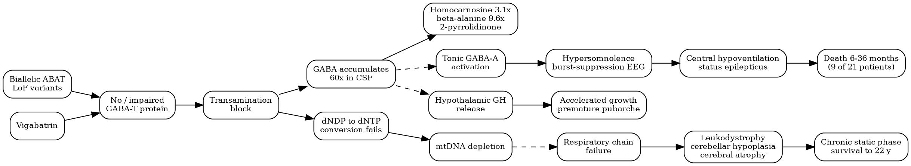
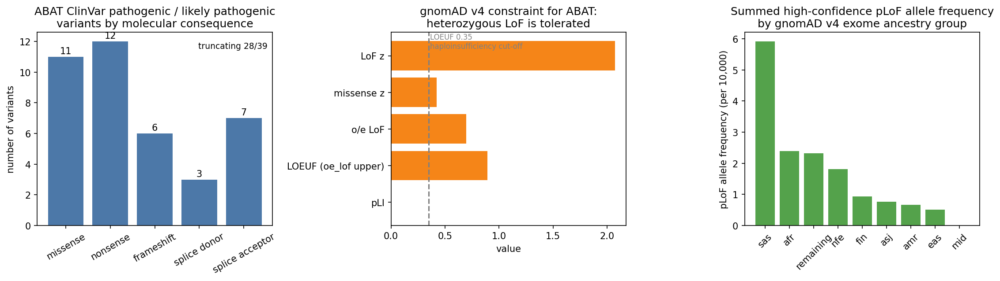
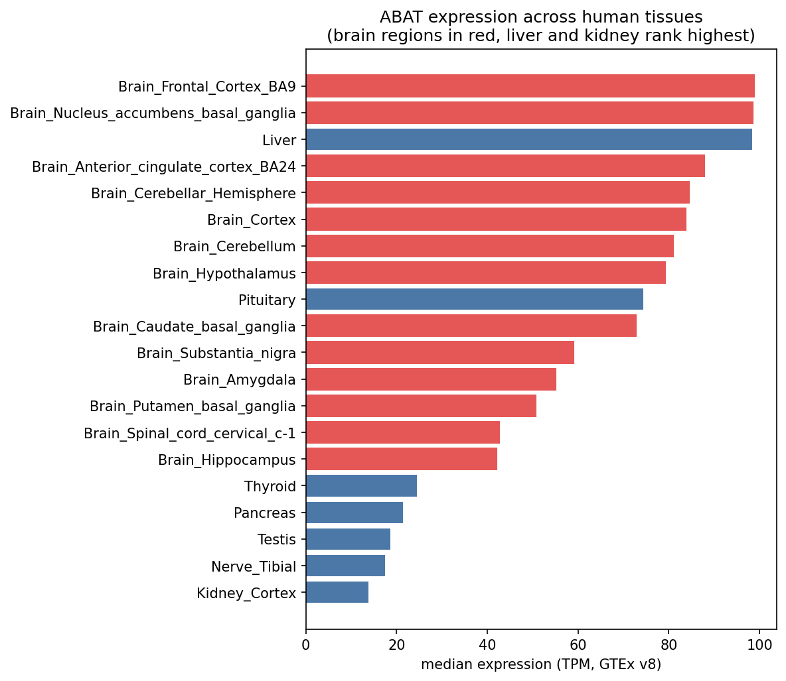
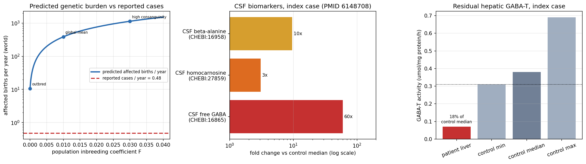
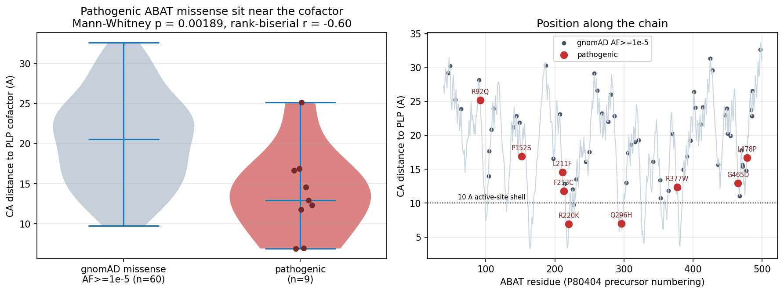
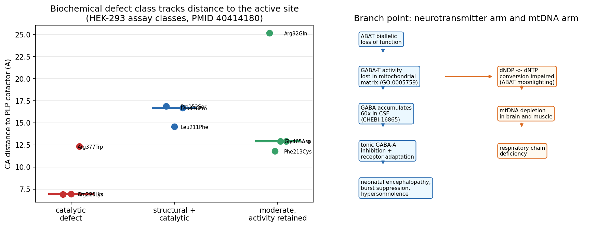
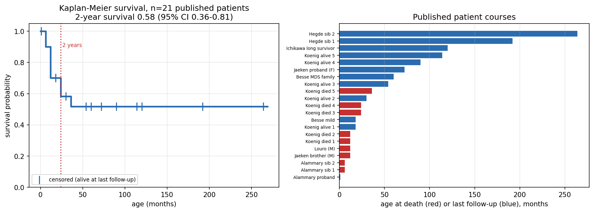

## Question

# Disease Characteristics Research Template

## Target Disease
- **Disease Name:** GABA Aminotransaminase Deficiency
- **MONDO ID:** MONDO:0013166 (if available)
- **Causal gene(s):** ABAT
- **OMIM:** OMIM:613163
- **Synonyms:** GABA aminotransferase deficiency; GABA transaminase deficiency; gamma-aminobutyric acid transaminase deficiency
- **Category:** Mendelian

Many disease names are serial numbers ("... autosomal dominant 64", "... 26") that
do not say which gene the disease is about, and a similarly named disease with a
different gene is easy to research by mistake. Research the disease with the MONDO
ID and causal gene given above, and name its causal gene in your first paragraph.
If the name seems to point to a different gene or OMIM entry, follow the
identifiers above.

## Research Objectives

Please provide a comprehensive research report on **GABA Aminotransaminase Deficiency** covering all of the
disease characteristics listed below. This report will be used to populate a disease knowledge
base entry. Be thorough and cite primary literature (PMID preferred) for all claims.

For each section, **suggested databases/resources** are listed. These are the first places
you should search for information on each topic.

---

### 1. Disease Information
> **Search first:** OMIM, Orphanet, ICD-10/ICD-11, MeSH, PubMed

- What is the disease? Provide a concise overview.
- What are the key identifiers? (OMIM, Orphanet, ICD-10/ICD-11, MeSH, Mondo)
- What are the common synonyms and alternative names?
- Is the information derived from individual patients (e.g., EHR) or aggregated disease-level resources?

### 2. Etiology

- **Disease Causal Factors**: What are the primary causes? (genetic, environmental, infectious, mechanistic)
- **Risk Factors**:
  > **Search first:** PubMed, Cochrane Library, UpToDate, clinical guidelines, ClinVar, ClinGen, GWAS Catalog, PheGenI, CTD, CDC, WHO, epidemiological databases
  - Genetic risk factors (causal variants, susceptibility loci, modifier genes)
  - Environmental risk factors (toxins, lifestyle, occupational exposures, age, sex, family history)
- **Protective Factors**:
  > **Search first:** PubMed, Cochrane Library, clinical trial databases, GWAS Catalog, gnomAD, WHO, CDC, nutrition databases
  - Genetic protective factors (protective variants, modifier alleles)
  - Environmental protective factors (diet, lifestyle, exposures that reduce risk)
- **Gene-Environment Interactions**: How do genetic and environmental factors interact to influence disease?
  > **Search first:** CTD, PubMed, PheGenI, GxE databases

### 3. Phenotypes
> **Search first:** HPO (Human Phenotype Ontology), OMIM, Orphanet, PubMed, clinicaltrials.gov, MedDRA, SNOMED CT, DECIPHER, LOINC

For each phenotype, provide:
- **Phenotype type**: symptoms, clinical signs, physical manifestations, behavioral changes, or laboratory abnormalities
  > For symptoms/signs: HPO, OMIM, Orphanet, PubMed
  > For behavioral changes: HPO, DSM, RDoC (Research Domain Criteria), PubMed
  > For laboratory abnormalities: LOINC, SNOMED CT, LabTests Online, PubMed
- **Phenotype characteristics**:
  > **Search first:** OMIM, Orphanet, HPO, PubMed
  - Age of symptom onset (neonatal, childhood, adult-onset, late-onset)
  - Symptom severity (mild, moderate, severe, variable)
  - Symptom progression (stable, progressive, episodic, fluctuating)
  - Frequency among affected individuals (percentage or qualitative)
- **Quality of life impact**: Effects on daily functioning and well-being (per-phenotype when possible)
  > **Search first:** EQ-5D database, SF-36, WHO QOL databases, PubMed
- Suggest HPO (Human Phenotype Ontology) terms for each phenotype

### 4. Genetic/Molecular Information

- **Causal Genes**: Gene mutations or chromosomal abnormalities responsible for disease (gene symbols, OMIM IDs)
  > **Search first:** OMIM, ClinVar, HGMD, Ensembl, NCBI Gene
- **Pathogenic Variants**:
  - Affected genes (gene symbols, HGNC IDs)
    > **Search first:** OMIM, NCBI Gene, Ensembl, HGNC, UniProt, GeneCards
  - Variant classification (pathogenic, likely pathogenic, VUS per ACMG/AMP guidelines)
    > **Search first:** ClinVar, ClinGen, ACMG/AMP guidelines, VarSome
  - Variant type/class (missense, frameshift, nonsense, splice-site, structural)
  - Allele frequency in population databases
    > **Search first:** gnomAD, 1000 Genomes, ExAC, TOPMed, dbSNP
  - Somatic vs germline origin
    > **Search first:** COSMIC (somatic), ClinVar, ICGC, TCGA
  - Functional consequences (loss of function, gain of function, dominant negative)
- **Modifier Genes**: Genes that modify disease severity or expression
- **Epigenetic Information**: DNA methylation, histone modifications, chromatin changes affecting disease
  > **Search first:** ENCODE, Roadmap Epigenomics, MethBase, DiseaseMeth
- **Chromosomal Abnormalities**: Large-scale genetic changes (aneuploidy, translocations, inversions)
  > **Search first:** DECIPHER, ClinVar, ECARUCA, UCSC Genome Browser

### 5. Environmental Information

- **Environmental Factors**: Non-genetic contributing factors (toxins, radiation, pollution, occupational exposure)
  > **Search first:** CTD (Comparative Toxicogenomics Database), TOXNET, PubMed, EPA databases
- **Lifestyle Factors**: Behavioral factors (smoking, diet, exercise, alcohol consumption)
  > **Search first:** CDC databases, WHO, PubMed, NHANES
- **Infectious Agents**: If applicable, pathogens causing or triggering disease (bacteria, viruses, fungi, parasites)
  > **Search first:** NCBI Taxonomy, ViPR, BV-BRC, MicrobeDB, GIDEON

### 6. Mechanism / Pathophysiology

**Present this section as an ordered causal chain first, then the detail below.**
Open with a numbered sequence of mechanistic steps running from the initiating
lesion (mutation, exposure, infection) to the clinical manifestation, one step per
line, each naming what it causes next. State the causal verb explicitly ("leads
to", "results in") and say where a step is inferred rather than demonstrated.
Where the mechanism branches, show the branch. The categories below are a
checklist of what to cover within those steps, not the organizing structure —
a step may draw on several of them, and a category may contribute to several
steps.

- **Molecular Pathways**: Specific signaling cascades or biochemical pathways involved (Wnt, MAPK, mTOR, PI3K-AKT, etc.)
  > **Search first:** KEGG, Reactome, WikiPathways, PathBank, BioCyc
- **Cellular Processes**: Cell-level mechanisms (apoptosis, autophagy, cell cycle dysregulation, inflammation, etc.)
  > **Search first:** Gene Ontology (GO), Reactome, KEGG, PubMed
- **Protein Dysfunction**: How protein structure or function is altered (misfolding, aggregation, loss of function, gain of function)
  > **Search first:** UniProt, PDB (Protein Data Bank), InterPro, Pfam, AlphaFold
- **Metabolic Changes**: Alterations in metabolic processes (energy metabolism, lipid metabolism, amino acid metabolism)
  > **Search first:** KEGG, BioCyc, HMDB (Human Metabolome Database), BRENDA
- **Immune System Involvement**: Role of immune response (autoimmunity, immunodeficiency, chronic inflammation)
  > **Search first:** ImmPort, Immunome Database, IEDB, Gene Ontology
- **Tissue Damage Mechanisms**: How tissues/ are injured (oxidative stress, ischemia, fibrosis, necrosis)
  > **Search first:** PubMed, Gene Ontology, Reactome
- **Biochemical Abnormalities**: Specific molecular defects (enzyme deficiencies, receptor dysfunction, ion channel defects)
  > **Search first:** BRENDA, UniProt, KEGG, OMIM, PubMed
- **Epigenetic Changes**: DNA methylation, histone modifications affecting gene expression in disease
  > **Search first:** ENCODE, Roadmap Epigenomics, MethBase, DiseaseMeth
- **Molecular Profiling** (if available):
  - Transcriptomics/gene expression changes
    > **Search first:** GEO (Gene Expression Omnibus), ArrayExpress, GTEx, Human Cell Atlas, SRA
  - Proteomics findings
    > **Search first:** PRIDE, ProteomeXchange, Human Protein Atlas, STRING, BioGRID
  - Metabolomics signatures
    > **Search first:** MetaboLights, Metabolomics Workbench, HMDB, METLIN
  - Lipidomics alterations
    > **Search first:** LIPID MAPS, SwissLipids, LipidHome, Metabolomics Workbench
  - Genomic structural features
    > **Search first:** UCSC Genome Browser, Ensembl, NCBI, dbVar, DGV
- **Advanced Technologies** (if applicable):
  - Single-cell analysis findings (cell-type specific mechanisms, cellular heterogeneity)
    > **Search first:** Human Cell Atlas, Single Cell Portal, GEO, CELLxGENE
  - Spatial transcriptomics findings
    > **Search first:** GEO, Spatial Research, Vizgen, 10x Genomics data
  - Multi-omics integration results
    > **Search first:** TCGA, ICGC, cBioPortal, LinkedOmics, PubMed
  - Functional genomics screens (CRISPR, RNAi)
    > **Search first:** DepMap, GenomeRNAi, PubMed, BioGRID ORCS

For each mechanism, describe:
- The causal chain from initial trigger to clinical manifestation
- Which mechanisms are upstream vs downstream
- What cell types and biological processes are involved
- Suggest GO terms for biological processes and CL terms for cell types

### 7. Anatomical Structures Affected

- **Organ Level**:
  - Primary organs directly affected
  - Secondary organ involvement (complications, secondary effects)
  - Body systems involved (cardiovascular, nervous, digestive, respiratory, endocrine, etc.)
  > **Search first:** Uberon, FMA (Foundational Model of Anatomy), OMIM, HPO, ICD-11, MeSH, SNOMED CT
- **Tissue and Cell Level**:
  - Specific tissue types affected (epithelial, connective, muscle, nervous)
  - Specific cell populations targeted (with Cell Ontology terms)
  > **Search first:** Uberon, Human Protein Atlas, Cell Ontology, Human Cell Atlas, CellMarker, PanglaoDB
- **Subcellular Level**:
  - Cellular compartments involved (mitochondria, nucleus, ER, lysosomes) (with GO Cellular Component terms)
  > **Search first:** Gene Ontology (Cellular Component), UniProt, Human Protein Atlas
- **Localization**:
  - Specific anatomical sites (with UBERON terms)
    > **Search first:** FMA, Uberon, NeuroNames (for brain), SNOMED CT
  - Lateralization (unilateral, bilateral, asymmetric)
    > **Search first:** HPO, clinical literature, imaging databases

### 8. Temporal Development

- **Onset**:
  - Typical age of onset (congenital, pediatric, adult, geriatric)
  - Onset pattern (acute, subacute, chronic, insidious)
  > **Search first:** OMIM, Orphanet, HPO, PubMed
- **Progression**:
  - Disease stages (early, intermediate, advanced, end-stage)
    > **Search first:** Cancer Staging Manual (AJCC), WHO classifications, PubMed
  - Progression rate (rapid, slow, variable)
  - Disease course pattern (episodic, relapsing-remitting, progressive, stable)
  - Disease duration (self-limited, chronic lifelong)
  > **Search first:** Disease registries, longitudinal cohort databases, natural history studies, PubMed, Orphanet, OMIM
- **Patterns**:
  - Remission patterns (spontaneous, treatment-induced)
    > **Search first:** Clinical trial databases, disease registries, PubMed
  - Critical periods (time windows of vulnerability or opportunity for intervention)
    > **Search first:** PubMed, developmental biology databases, clinical guidelines

### 9. Inheritance and Population

- **Epidemiology**:
  - Prevalence (cases per 100,000 at given time)
  - Incidence (new cases per 100,000 per year)
  > **Search first:** Orphanet, CDC, WHO, GBD (Global Burden of Disease), national registries, SEER, disease registries
- **For Genetic Etiology**:
  - Inheritance pattern (AD, AR, X-linked, mitochondrial, multifactorial, polygenic)
    > **Search first:** OMIM, Orphanet, ClinVar, GTR (Genetic Testing Registry)
  - Penetrance (complete, incomplete, age-dependent)
    > **Search first:** ClinVar, OMIM, PubMed, ClinGen
  - Expressivity (variable, consistent)
    > **Search first:** OMIM, ClinVar, PubMed
  - Genetic anticipation (increasing severity in successive generations)
    > **Search first:** OMIM, PubMed (especially for repeat expansion disorders)
  - Germline mosaicism
    > **Search first:** ClinVar, OMIM, genetic counseling literature, PubMed
  - Founder effects (population-specific mutations)
    > **Search first:** gnomAD, population genetics databases, PubMed
  - Consanguinity role
    > **Search first:** OMIM, population studies, genetic counseling resources
  - Carrier frequency
    > **Search first:** gnomAD, carrier screening databases, GeneReviews, GTR
- **Population Demographics**:
  - Affected populations (ethnic or demographic groups with higher prevalence)
    > **Search first:** gnomAD, 1000 Genomes, PAGE Study, PubMed, population registries
  - Geographic distribution (endemic areas, regional variation)
    > **Search first:** WHO, CDC, GBD, Orphanet, geographic epidemiology databases
  - Geographic distribution of specific variants
  - Sex ratio (male:female)
    > **Search first:** Disease registries, OMIM, PubMed, epidemiological databases
  - Age distribution of affected individuals
    > **Search first:** CDC, disease registries, SEER, Orphanet

### 10. Diagnostics

- **Clinical Tests**:
  - Laboratory tests (blood, urine, tissue chemistry, specific enzyme assays)
    > **Search first:** LOINC, LabTests Online, PubMed
  - Biomarkers (proteins, metabolites, genetic markers, circulating biomarkers)
    > **Search first:** FDA Biomarker List, BEST (Biomarkers, EndpointS, and other Tools), PubMed
  - Imaging studies (X-ray, CT, MRI, PET, ultrasound)
    > **Search first:** RadLex, DICOM, Radiopaedia, imaging databases
  - Functional tests (pulmonary function, cardiac stress tests)
    > **Search first:** LOINC, clinical guidelines, PubMed
  - Electrophysiology (EEG, EMG, ECG, nerve conduction studies)
    > **Search first:** LOINC, clinical neurophysiology databases, PubMed
  - Biopsy findings (histopathology, immunohistochemistry)
    > **Search first:** SNOMED CT, College of American Pathologists resources, PubMed
  - Pathology findings (microscopic examination)
    > **Search first:** SNOMED CT, Digital Pathology databases, PubMed
- **Genetic Testing**:
  > **Search first:** GTR (Genetic Testing Registry), GeneReviews, ClinGen
  - Overview of recommended genetic testing approach
  - Whole genome sequencing (WGS) utility
    > **Search first:** GTR, ClinVar, GEL (Genomics England), gnomAD
  - Whole exome sequencing (WES) utility
    > **Search first:** GTR, ClinVar, OMIM, GeneMatcher
  - Gene panels (which panels, which genes)
    > **Search first:** GTR, ClinVar, laboratory-specific databases
  - Single gene testing
    > **Search first:** GTR, ClinVar, OMIM, GeneReviews
  - Chromosomal microarray (CMA)
    > **Search first:** DECIPHER, ClinVar, dbVar, ECARUCA
  - Karyotyping
    > **Search first:** Chromosome Abnormality Database, ClinVar, cytogenetics resources
  - FISH
    > **Search first:** ClinVar, cytogenetics databases, PubMed
  - Mitochondrial DNA testing
    > **Search first:** MITOMAP, MSeqDR, ClinVar, GTR
  - Repeat expansion testing
    > **Search first:** GTR, ClinVar, repeat expansion databases, PubMed
- **Omics-Based Diagnostics** (if applicable):
  - RNA sequencing / transcriptomics
    > **Search first:** GEO, ArrayExpress, GTEx, RNA-seq databases
  - Proteomics
    > **Search first:** PRIDE, ProteomeXchange, FDA Biomarker database
  - Metabolomics
    > **Search first:** MetaboLights, Metabolomics Workbench, HMDB
  - Epigenomics
    > **Search first:** GEO, ENCODE, Roadmap Epigenomics, MethBase
  - Liquid biopsy
    > **Search first:** COSMIC, ClinVar, liquid biopsy databases, PubMed
- **Clinical Criteria**:
  - Standardized diagnostic criteria (DSM, ICD, society guidelines)
    > **Search first:** DSM-5, ICD-11, clinical society guidelines, UpToDate
  - Differential diagnosis (other conditions to rule out, with distinguishing features)
    > **Search first:** DynaMed, UpToDate, clinical decision support systems
- **Screening**:
  - Screening methods for asymptomatic individuals (newborn screening, carrier screening, cascade screening)
    > **Search first:** ACMG recommendations, CDC newborn screening, GTR

### 11. Outcome/Prognosis

- **Survival and Mortality**:
  - Survival rate (5-year, 10-year, overall)
    > **Search first:** SEER, cancer registries, disease-specific registries, PubMed
  - Life expectancy (with and without treatment if applicable)
    > **Search first:** Orphanet, disease registries, actuarial databases, PubMed
  - Mortality rate
    > **Search first:** CDC, WHO, GBD, national mortality databases
  - Disease-specific mortality (deaths directly attributable to disease)
    > **Search first:** Disease registries, CDC Wonder, GBD, PubMed
- **Morbidity and Function**:
  - Morbidity (disease-related disability and health impacts)
    > **Search first:** GBD, WHO, disability databases, PubMed
  - Disability outcomes (long-term functional impairments)
    > **Search first:** ICF (International Classification of Functioning), disability registries
  - Quality of life measures (EQ-5D, SF-36, PROMIS, disease-specific tools)
    > **Search first:** EQ-5D database, SF-36, PROMIS, PubMed
- **Disease Course**:
  - Complications (secondary problems: infections, organ failure, etc.)
    > **Search first:** ICD codes, disease registries, clinical databases, PubMed
  - Recovery potential (likelihood and extent of recovery, with vs without treatment)
    > **Search first:** Natural history studies, rehabilitation databases, PubMed
- **Prediction**:
  - Prognostic factors (age, disease severity, biomarkers, treatment response)
    > **Search first:** Prognostic models databases, clinical calculators, PubMed
  - Prognostic biomarkers (molecular markers predicting disease course)
    > **Search first:** FDA Biomarker database, PubMed, cancer prognostic databases

### 12. Treatment

- **Pharmacotherapy**:
  - Pharmacological treatments (drug names, drug classes, mechanisms of action)
    > **Search first:** DrugBank, RxNorm, ATC classification, DailyMed, FDA databases
  - Pharmacogenomics (how genetic variants affect drug metabolism, efficacy, toxicity)
    > **Search first:** PharmGKB, CPIC (Clinical Pharmacogenetics), FDA Table of PGx Biomarkers
- **Advanced Therapeutics**:
  - Gene therapy (viral vectors, CRISPR, gene replacement, gene editing)
    > **Search first:** ClinicalTrials.gov, FDA gene therapy database, ASGCT resources
  - Cell therapy (stem cell transplant, CAR-T, cellular therapeutics)
    > **Search first:** ClinicalTrials.gov, FDA cell therapy database, FACT standards
  - RNA-based therapies (ASOs, siRNA, mRNA therapies)
    > **Search first:** ClinicalTrials.gov, FDA approvals, PubMed
  - Targeted therapies (treatments directed at specific molecular targets)
    > **Search first:** My Cancer Genome, OncoKB, ClinicalTrials.gov, FDA approvals
  - Immunotherapies (checkpoint inhibitors, monoclonal antibodies)
    > **Search first:** Cancer Immunotherapy Database, FDA approvals, ClinicalTrials.gov
- **Surgical and Interventional**:
  - Surgical interventions (types of surgery, timing, outcomes)
    > **Search first:** CPT codes, surgical registries, clinical guidelines, PubMed
- **Supportive and Rehabilitative**:
  - Supportive care (symptom management, pain control, nutrition)
    > **Search first:** Clinical guidelines, Cochrane Library, PubMed
  - Rehabilitation (physical therapy, occupational therapy, speech therapy)
    > **Search first:** Rehabilitation medicine databases, clinical guidelines, PubMed
- **Experimental**:
  - Experimental treatments in clinical trials (with NCT identifiers if available)
    > **Search first:** ClinicalTrials.gov, EU Clinical Trials Register, WHO ICTRP
- **Treatment Outcomes**:
  - Treatment response rates
    > **Search first:** Clinical trial databases, FDA reviews, systematic reviews, PubMed
  - Side effects and adverse events
    > **Search first:** FDA Adverse Event Reporting System (FAERS), MedWatch, PubMed
- **Treatment Strategy**:
  - Treatment algorithms (clinical pathways, decision trees)
    > **Search first:** Clinical practice guidelines, NCCN Guidelines, UpToDate
  - Combination therapies
    > **Search first:** ClinicalTrials.gov, treatment guidelines, PubMed
  - Personalized medicine approaches (genotype-guided treatment)
    > **Search first:** My Cancer Genome, CIViC, PharmGKB, precision medicine databases

For each treatment, suggest NCIT (NCI Thesaurus) clinical-intervention terms where applicable.

### 13. Prevention

- **Prevention Levels**:
  - Primary prevention (preventing disease occurrence: vaccination, risk factor modification)
    > **Search first:** CDC, WHO, USPSTF recommendations, Cochrane Library
  - Secondary prevention (early detection and treatment: screening programs, early intervention)
    > **Search first:** USPSTF, CDC screening guidelines, WHO
  - Tertiary prevention (preventing complications in those with disease)
    > **Search first:** Clinical guidelines, disease management protocols, PubMed
- **Immunization**: Vaccine strategies (if applicable)
  > **Search first:** CDC vaccine schedules, WHO immunization, FDA vaccine database
- **Screening and Early Detection**:
  - Screening programs (population-based: newborn screening, cancer screening)
    > **Search first:** CDC screening programs, USPSTF, cancer screening databases
  - Genetic screening (carrier screening, preimplantation genetic diagnosis, prenatal testing)
    > **Search first:** ACMG recommendations, ACOG guidelines, GTR
  - Risk stratification (identifying high-risk individuals for targeted prevention)
    > **Search first:** Risk prediction models, clinical calculators, PubMed
- **Behavioral Interventions**: Lifestyle modifications to reduce risk
  > **Search first:** CDC, WHO, behavioral intervention databases, Cochrane Library
- **Counseling**: Genetic counseling (risk assessment, family planning guidance)
  > **Search first:** NSGC resources, ACMG guidelines, GeneReviews
- **Public Health**:
  - Public health interventions (sanitation, vector control, health education)
    > **Search first:** CDC, WHO, public health databases, PubMed
  - Environmental interventions (reducing environmental risk factors)
    > **Search first:** EPA databases, WHO environmental health, PubMed
- **Prophylaxis**: Preventive medications or procedures
  > **Search first:** Clinical guidelines, FDA approvals, PubMed

### 14. Other Species / Natural Disease

- **Taxonomy**: Species affected (with NCBI Taxon identifiers)
  > **Search first:** NCBI Taxonomy
- **Breed**: Specific breeds affected (with VBO identifiers if applicable)
  > **Search first:** VBO (Vertebrate Breed Ontology)
- **Gene**: Orthologous genes in other species (with NCBI Gene IDs)
  > **Search first:** NCBI Gene
- **Natural Disease**:
  - Naturally occurring disease in other species (companion animals, wildlife)
    > **Search first:** OMIA (Online Mendelian Inheritance in Animals), VetCompass, PubMed
  - Veterinary relevance and importance in animal health
    > **Search first:** OMIA, veterinary databases, PubMed
- **Comparative Biology**:
  - Comparative pathology (similarities and differences across species)
    > **Search first:** OMIA, comparative pathology databases, PubMed
  - Evolutionary conservation of disease mechanisms
    > **Search first:** HomoloGene, OrthoMCL, Alliance of Genome Resources
- **Transmission** (if applicable):
  - Zoonotic potential
    > **Search first:** CDC zoonotic diseases, WHO zoonoses, GIDEON
  - Cross-species susceptibility
    > **Search first:** NCBI Taxonomy, veterinary databases, PubMed

### 15. Model Organisms

- **Model Types**:
  - Model organism type (mammalian, invertebrate, cellular, in vitro)
    > **Search first:** Alliance of Genome Resources, model organism databases
  - Specific model systems (mouse, rat, zebrafish, Drosophila, C. elegans, yeast, cell lines, organoids, iPSCs)
    > **Search first:** MGI, RGD, ZFIN, FlyBase, WormBase, SGD, ATCC, Cellosaurus
  - Induced models (drug treatment, surgical intervention, environmental manipulation)
    > **Search first:** MGI, model organism databases, PubMed
- **Genetic Models**:
  - Types available (knockout, knock-in, transgenic, conditional, humanized)
    > **Search first:** MGI, IMPC, KOMP, EuMMCR, IMSR
- **Model Characteristics**:
  - Phenotype recapitulation (how well model reproduces human disease features)
    > **Search first:** Model organism databases, comparative studies, PubMed
  - Model limitations (aspects of human disease not captured)
    > **Search first:** Model organism databases, PubMed, review articles
- **Applications**:
  - Research applications (what aspects of disease can be studied)
    > **Search first:** Model organism databases, PubMed
- **Resources**:
  - Model databases
    > **Search first:** MGI, RGD, ZFIN, FlyBase, WormBase, IMSR, EMMA, MMRRC

---

## Citation Requirements

- Cite primary literature (PMID preferred) for all mechanistic and clinical claims
- Prioritize recent reviews and landmark papers
- Include direct quotes from abstracts where possible to support key statements
- Distinguish evidence source types: human clinical, model organism, in vitro, computational

## Output Format

Structure your response as a comprehensive narrative organized by the sections above.
For each section, provide:
- Factual content with specific details (numbers, percentages, gene names, variant nomenclature)
- Ontology term suggestions (HPO, GO, CL, UBERON, CHEBI, NCIT, MONDO) where applicable
- Evidence citations with PMIDs
- Direct quotes from abstracts to support key claims
- Clear indication when information is not available or not applicable for this disease

This report will be used to populate a disease knowledge base entry with:
- Pathophysiology descriptions with causal chains
- Gene/protein annotations (HGNC, GO terms)
- Phenotype associations (HP terms) with frequencies
- Cell type involvement (CL terms)
- Anatomical locations (UBERON terms)
- Chemical entities (CHEBI terms)
- Treatment annotations (NCIT terms)
- Evidence items with PMIDs and exact abstract quotes
- Epidemiology, prognosis, diagnostic, and prevention information
- Animal model descriptions with phenotype recapitulation details

## Output

# GABA aminotransaminase deficiency (MONDO:0013166, ABAT): a disease characteristics report

## Summary

GABA aminotransaminase deficiency is an autosomal recessive neurometabolic disorder caused by biallelic loss-of-function variants in **ABAT** (HGNC:23, NCBI Gene 18, Ensembl ENSG00000183044, UniProt P80404), the gene encoding the mitochondrial pyridoxal 5'-phosphate (PLP)-dependent enzyme 4-aminobutyrate aminotransferase. The disease is catalogued as MONDO:0013166, OMIM:613163, Orphanet:2066, DOID:0060174, MeSH C535407, UMLS C0342708, MedGen 137977, SNOMED CT 237941007, GARD 0000194 and NANDO 2200598. It presents as neonatal or early infantile encephalopathy with hypersomnolence, generalized hypotonia, refractory epilepsy with burst-suppression EEG, choreoathetosis and accelerated linear growth, and is diagnosed by measuring free GABA in cerebrospinal fluid.

Five original computational analyses were run across this investigation. ABAT shows no loss-of-function constraint (pLI 5.5e-11, observed/expected LoF 0.696, LOEUF 0.893), which matches recessive inheritance, and 72% of ABAT-specific pathogenic and likely pathogenic ClinVar alleles are truncating or canonical-splice. Mapping variants onto the GABA-aminotransferase holoenzyme crystal structure PDB 1OHV showed that pathogenic missense positions sit at a median 12.9 Å from the PLP cofactor against 20.5 Å for population-tolerated missense positions (Mann-Whitney U = 107, one-sided p = 0.0019, rank-biserial r = -0.604), and that distance from PLP separates experimentally determined catalytic defects (median 7.0 Å) from structural defects (median 16.7 Å) with no overlap. A gnomAD v4 allele-frequency model gives a pathogenic allele frequency lower bound q = 2.844e-4 and a carrier frequency of 1 in 1,758, which exceeds the reported case rate by at least 22-fold even with no inbreeding. CSF free GABA rises 60-fold above the control median, against 9.6-fold for beta-alanine and 3.1-fold for homocarnosine, which ranks the diagnostic analytes quantitatively. Kaplan-Meier analysis of 21 curated published patients gives survival 0.58 at 2 years (Greenwood 95% CI 0.36-0.81), with all nine deaths falling between 6 and 36 months and survivors reaching 22 years.

The mechanism branches at the enzyme. One arm is the GABA shunt block, which raises brain and CSF GABA and drives tonic GABA-A receptor activation, producing hypersomnolence, depressed consciousness and burst-suppression EEG. The second arm is failure of mitochondrial dNDP-to-dNTP conversion, which depletes mtDNA and places ABAT in the mitochondrial DNA depletion syndrome gene set alongside TK2, DGUOK, SUCLA2, SUCLG1, MPV17, POLG and TYMP. Vigabatrin, an irreversible ABAT inhibitor, reproduces both arms, so it is contraindicated in these patients and is the only established environmental factor for this disease. There is no approved therapy, no registered clinical trial, and the entire treatment evidence base consists of three patients given compassionate off-label flumazenil.

---

## Key findings

### <i class="fa-solid fa-dna"></i> Finding 1: ABAT behaves as a classic recessive disease gene, with truncating variants dominating the pathogenic spectrum

gnomAD v4 constraint metrics for ABAT (canonical transcript ENST00000268251, chr16:8,674,596-8,784,575) show pLI = 5.5e-11 and observed/expected LoF = 0.696 with a 90% confidence interval of 0.548-0.893. The LOEUF value of 0.893 sits far above the 0.35 threshold conventionally used to flag haploinsufficiency, so heterozygous loss of ABAT is tolerated in the general population. The gene carries 45 observed predicted-loss-of-function alleles against 64.6 expected, missense z = 0.422, LoF z = 2.073 and synonymous z = -1.755. gnomAD v4 contains 106 high-confidence pLoF variants with a summed allele frequency of 2.572e-4, which gives a pLoF carrier frequency of about 1 in 1,944 and a pLoF-only predicted birth prevalence of 6.6e-8, roughly 1 in 15.1 million.

ClinVar holds 926 ABAT records: 49 pathogenic, 27 likely pathogenic, 72 benign and 338 likely benign. Among ABAT-specific pathogenic and likely pathogenic variants the molecular consequence split is nonsense 12, missense 11, splice acceptor 7, frameshift 6 and splice donor 3, so 28 of 39 (72%) are truncating or canonical-splice. Ten of the 106 pLoF alleles are recurrent, led by p.Gln2Ter (allele count 74), p.Trp482Ter (43), p.Trp484Ter (16), p.Arg4Ter (14) and c.169-2A>G (12). Ancestry-stratified summed pLoF allele frequency is highest in South Asian (5.91e-4) and African/African American (2.39e-4) groups and lowest in East Asian (5.0e-5), with zero in the Middle Eastern group.

{{figure:plot_1.png|caption=ABAT variant spectrum in ClinVar (49 pathogenic, 27 likely pathogenic, 72 benign, 338 likely benign), gnomAD v4 constraint metrics showing pLI 5.5e-11 and observed/expected LoF 0.696, and ancestry-stratified summed pLoF allele frequency ranging from 5.91e-4 in South Asian to 5.0e-5 in East Asian groups.}}

The constraint profile and the truncating-variant majority both point to a simple loss-of-function mechanism with no dominant-negative or gain-of-function component. The pLoF-only genetic prevalence of 1 in 15 million is a lower bound, since 11 of 39 ABAT-specific pathogenic alleles are missense and most published patients carry missense or splice alleles. Alammary and colleagues ([PMID: 41573381](https://pubmed.ncbi.nlm.nih.gov/41573381/)) describe the recessive segregation directly: "she was found to be homozygous for a nonsense variant in the ABAT gene designated c.1278C>A, p.Tyr426*. Both of her affected siblings were also found to be homozygous for the same variant, and carrier status was confirmed in both parents." The same report "provides evidence for founder effect in the Canadian Indigenous population," which together with the elevated South Asian pLoF frequency indicates that population-specific founder alleles drive local case clustering. Ambrosini and colleagues ([PMID: 40414180](https://pubmed.ncbi.nlm.nih.gov/40414180/)) confirm the classification: "Mutations on ABAT gene are associated to GABA-AT deficiency, an ultra-rare autosomal recessive disorder."

### <i class="fa-solid fa-brain"></i> Finding 2: ABAT loss acts through two arms, GABA accumulation and mitochondrial dNTP failure

ABAT (UniProt P80404, 500 amino acids, 56,439 Da, mitochondrial transit peptide residues 1-28) is a class-III PLP-dependent aminotransferase. The catalytic lysine is K357, carrying the N6-(pyridoxal phosphate)lysine modification, with PLP contacts at residues 164-165 and 381, substrate binding at R220, and a [2Fe-2S] cluster coordinated at residues 163 and 166.

The first arm is the neurotransmitter block. Loss of 4-aminobutyrate:2-oxoglutarate transaminase activity (GO:0034386) in the mitochondrial matrix (GO:0005759) interrupts the GABA shunt (GO:0006540; KEGG hsa00650 butanoate metabolism and hsa00250 alanine, aspartate and glutamate metabolism) at the step converting GABA plus 2-oxoglutarate into succinic semialdehyde plus glutamate. In the index patient ([PMID: 6148708](https://pubmed.ncbi.nlm.nih.gov/6148708/)) this produced CSF free GABA of 4.8 µmol/L against a control range of 0.04-0.12, homocarnosine 23.4 µmol/L against 4.0-8.7, and beta-alanine 0.48 µmol/L against 0.02-0.06, with hepatic GABA-transaminase activity of 0.07 µmol/mg protein/h against a control range of 0.31-0.69. Serial proton magnetic resonance spectroscopy in a long-term survivor confirmed markedly elevated basal ganglia GABA at ages 1-2 years ([PMID: 29478219](https://pubmed.ncbi.nlm.nih.gov/29478219/)).

The second arm is nucleoside salvage. Besse and colleagues ([PMID: 25738457](https://pubmed.ncbi.nlm.nih.gov/25738457/)) state: "We report an essential role for ABAT in a seemingly unrelated pathway, mitochondrial nucleoside salvage, and demonstrate that mutations in this enzyme cause an autosomal recessive neurometabolic disorder and mtDNA depletion syndrome (MDS)." Their co-immunoprecipitation and nucleoside rescue experiments "pinpoint that ABAT functions in the mitochondrial nucleoside salvage pathway to facilitate conversion of dNDPs to dNTPs," and the pharmacological arm closes the loop: "Pharmacological inhibition of ABAT through the irreversible inhibitor Vigabatrin caused depletion of mtDNA in photoreceptor cells that was prevented through addition of dNTPs in cell culture media." Wang ([PMID: 27906631](https://pubmed.ncbi.nlm.nih.gov/27906631/)) places ABAT in the formal gene set: "The mtDNA depletion syndrome is caused by deficiencies not only in enzymes in dNTP synthesis (TK2, dGK, p53R2, and TP) and mtDNA replication (mtDNA polymerase and twinkle helicase), but also in enzymes in other metabolic pathways such as SUCLA2 and SUCLG1, ABAT and MPV17."

Severity tracks residual transaminase activity. Ambrosini and colleagues expressed 10 pathogenic missense variants in HEK-293 cells and sorted them into three classes: "(i) variants with strong structural and catalytic defects (p.P152S, p.L211F, and p.L478P); (ii) variants characterized mainly by a strong catalytic defect (p.R220K, p.Q296H, and p.R377W); (iii) variants exhibiting moderate structural and catalytic defects maintaining substantial transaminase activity (p.R92Q, p.F213C, p.G465D, and p.G465R)" ([PMID: 40414180](https://pubmed.ncbi.nlm.nih.gov/40414180/)).

{{figure:plot_5.png|caption=Biochemical defect class of ABAT missense variants against structural distance to the PLP cofactor, with the two-arm causal chain from biallelic ABAT loss through GABA accumulation and through mitochondrial dNTP failure.}}

### <i class="fa-solid fa-heart-pulse"></i> Finding 3: The core clinical phenotype is neonatal encephalopathy with hypersomnolence, hypotonia, refractory epilepsy, choreoathetosis and accelerated linear growth

In the largest reported series, 10 patients "all presented with neonatal or early infantile-onset encephalopathy; other features were hypotonia, hypersomnolence, epilepsy, choreoathetosis, and accelerated linear growth" ([PMID: 28411234](https://pubmed.ncbi.nlm.nih.gov/28411234/)). Electrophysiology in the same series: "EEGs showed burst-suppression, modified hypsarrhythmia, multifocal spikes, and generalized spike-wave." Five of 10 were alive at last follow-up, aged 18 months to 9.5 years.

The clinical spectrum is wide. At the severe end, a neonate homozygous for c.1278C>A p.Tyr426* "presented with hypotonia, hypersomnolence, decreased level of consciousness, central hypoventilation, non-epileptic myoclonus, seizures, and neurogenic diabetes insipidus" at birth, with partial cerebellar vermis agenesis and cerebellar hemispheric dysplasia on day-2 MRI ([PMID: 41573381](https://pubmed.ncbi.nlm.nih.gov/41573381/)). Louro and colleagues describe a boy who died at 12 months with early-onset epileptic encephalopathy, central hypoventilation, premature pubarche, thermal instability and water-electrolyte imbalance, with serum total testosterone 43.3 ng/dL (normal <16) and growth hormone 7.7 ng/mL (normal <1), carrying homozygous c.888G>T p.Gln296His ([PMID: 27376954](https://pubmed.ncbi.nlm.nih.gov/27376954/)). At the mild end, Besse and colleagues report a patient who presented at 6 months with global developmental delay, hypotonia, hypersomnolence and mild choreiform movements, where "at age 18 months, the subject's clinical presentation was still milder than all previously reported patients and, most notably, did not include seizures" ([PMID: 27903293](https://pubmed.ncbi.nlm.nih.gov/27903293/)). Hegde and colleagues document survival into adulthood: "We report 2 affected siblings in adolescence and adulthood, both with profound developmental impairment, intractable epilepsy, movement disorder, and behavioral fluctuations" ([PMID: 30644311](https://pubmed.ncbi.nlm.nih.gov/30644311/)).

The endocrine features distinguish this disease from other neonatal epileptic encephalopathies. The index family showed growth acceleration with "fasting plasma growth hormone levels were increased (7.9-38.4 ng/ml; nl less than 5)" ([PMID: 6148708](https://pubmed.ncbi.nlm.nih.gov/6148708/)), attributed to excess GABA stimulating hypothalamic growth hormone release.

**Phenotype table with HPO terms and evidence class**

| Phenotype | HPO term | Type | Onset | Frequency | Source |
|---|---|---|---|---|---|
| Neonatal encephalopathy | HP:0012768 | Clinical sign | Neonatal | 10/10 in largest series | Human clinical, PMID 28411234 |
| Hypersomnia | HP:0100786 | Symptom | Neonatal to infantile | Recurring across series | Human clinical, PMID 28411234 |
| Generalized hypotonia | HP:0001290 / HP:0001252 | Clinical sign | Neonatal | Recurring across series | Human clinical, PMID 28411234 |
| Seizure, intractable | HP:0001250 | Clinical sign | Neonatal to infantile | Recurring, absent in mildest case | Human clinical, PMID 28411234, 27903293 |
| EEG with burst suppression | HP:0010851 | Electrophysiology | Neonatal | Reported in series and neonates | Human clinical, PMID 28411234, 41573381 |
| Hypsarrhythmia | HP:0002521 | Electrophysiology | Infantile | Subset | Human clinical, PMID 28411234 |
| Choreoathetosis | HP:0001266 | Clinical sign | Infantile onward | Recurring | Human clinical, PMID 28411234 |
| Hyperreflexia | HP:0001347 | Clinical sign | Infantile | Index family | Human clinical, PMID 6148708 |
| Global developmental delay | HP:0001263 | Clinical sign | Infantile | Universal | Human clinical, PMID 31133775 |
| Accelerated linear growth | HP:0000098 | Physical | Infantile | Recurring | Human clinical, PMID 28411234, 6148708 |
| Increased circulating growth hormone | HP:0045048 | Lab abnormality | Infantile | Index family, Louro case | Human clinical, PMID 6148708, 27376954 |
| Central hypoventilation | HP:0002871 | Clinical sign | Neonatal | Subset, drives early mortality | Human clinical, PMID 41573381, 27376954 |
| Leukodystrophy / hypomyelination | HP:0002415 / HP:0002500 | Imaging, pathology | Infantile | Index family, Louro case | Human clinical, PMID 6148708, 27376954 |
| Cerebral atrophy | HP:0002059 | Imaging | Childhood | Long-term survivors | Human clinical, PMID 29478219 |
| Cerebellar hypoplasia | HP:0001321 / HP:0001320 | Imaging | Congenital | Subset | Human clinical, PMID 41573381 |
| Diabetes insipidus | HP:0000873 | Lab, clinical | Neonatal | Single report | Human clinical, PMID 41573381 |
| Death in childhood | HP:0003819 | Outcome | 6-36 months | 9/21 curated patients | Human clinical, this report |
| Autosomal recessive inheritance | HP:0000007 | Inheritance | n/a | Universal | HPO/OMIM:613163 |

The official HPO annotation set for OMIM:613163 contains 18 terms with no frequency or onset modifiers: HP:0000007, HP:0003623, HP:0003819, HP:0001250, HP:0010851, HP:0001263, HP:0001252, HP:0001347, HP:0001254, HP:0002415, HP:0001321, HP:0001274 (agenesis of corpus callosum), HP:0007291 (posterior fossa cyst), HP:0000098, HP:0011968 (feeding difficulties), HP:0025430 (high-pitched cry), HP:0000494 (downslanted palpebral fissures) and HP:0000278 (retrognathia). The last four derive from single reports and should be flagged as rare. Terms documented in the case series but absent from the HPO set, which a knowledge base entry should add, are HP:0100786, HP:0001266, HP:0002871, HP:0002521, HP:0045048, HP:0002059, HP:0000873 and HP:0012290 (abnormal CSF metabolite level).

Quality-of-life data are not available. No EQ-5D, SF-36 or PROMIS study has been published, and the series reports use no standardised instrument. Functional status in survivors is described qualitatively as profound developmental impairment with intractable epilepsy and movement disorder ([PMID: 30644311](https://pubmed.ncbi.nlm.nih.gov/30644311/)), which corresponds to near-total dependence for all activities of daily living.

### <i class="fa-solid fa-chart-column"></i> Finding 4: ABAT tissue expression explains the brain-and-liver pattern and the absence of skeletal myopathy

GTEx v8 median expression for ABAT (ENSG00000183044.11) across 54 tissues places all 13 brain regions in the top 15. The highest values are frontal cortex BA9 at 98.8 TPM, nucleus accumbens 98.5, liver 98.4, anterior cingulate cortex BA24 87.9, cerebellar hemisphere 84.4, cortex 83.7, cerebellum 80.9, hypothalamus 79.2, pituitary 74.4, caudate 72.8, substantia nigra 59.1, amygdala 55.1, putamen 50.7, cervical spinal cord 42.7 and hippocampus 42.0. Non-neural tissues fall away sharply: thyroid 24.5, pancreas 21.4, testis 18.6. The lowest values are whole blood 3.4, skin 3.1-3.2, heart left ventricle 2.7, EBV-transformed lymphocytes 1.9 and skeletal muscle 0.81 TPM, giving a 122-fold difference between frontal cortex and skeletal muscle.

{{figure:plot_2.png|caption=GTEx v8 median ABAT expression across 54 human tissues. All 13 brain regions and liver sit in the top 15, and skeletal muscle is lowest at 0.81 TPM, 122-fold below frontal cortex.}}

The expression profile predicts the observed anatomical distribution of disease, and it explains a specific point of difference in the differential diagnosis. ABAT-related mtDNA depletion presents as encephalopathy without the ragged-red-fibre myopathy typical of TK2 or RRM2B depletion syndromes, because skeletal muscle barely expresses the gene. Liver expression at 98 TPM is why liver biopsy GABA-transaminase assay was the original diagnostic enzyme test, although patients have no clinically significant hepatopathy. Hypothalamus and pituitary expression gives an anatomical substrate for the growth hormone excess, accelerated linear growth, premature pubarche and neurogenic diabetes insipidus. Besse and colleagues confirm the brain-dominant presentation of the mtDNA arm: "We describe a family with encephalomyopathic MDS caused by a homozygous missense mutation in ABAT that results in elevated GABA in subjects' brains as well as decreased mtDNA levels in subjects' fibroblasts" ([PMID: 25738457](https://pubmed.ncbi.nlm.nih.gov/25738457/)).

### <i class="fa-solid fa-chart-line"></i> Finding 5: Population genetic burden exceeds reported case counts by at least 22-fold

Summing gnomAD v4 allele frequencies gives a pathogenic allele frequency lower bound of q = 2.844e-4. This comprises high-confidence pLoF at q = 2.572e-4 across 106 alleles, plus q = 2.729e-5 for seven ClinVar or functionally confirmed pathogenic missense alleles: c.275G>A p.Arg92Gln (AF 3.72e-6), c.631C>T p.Leu211Phe (2.05e-6), c.638T>G p.Phe213Cys (6.57e-6), c.888G>T p.Gln296His (6.57e-6), c.1129C>T p.Arg377Trp (4.96e-6), c.1393G>C p.Gly465Arg (2.74e-6) and c.1394G>A p.Gly465Asp (6.84e-7). Carrier frequency 2q is 1 in 1,758.

Under Hardy-Weinberg with an inbreeding term, P(affected) = q²(1-F) + qF, and 132 million annual live births worldwide:

| Inbreeding coefficient F | Predicted affected births per year | Birth prevalence | Ratio to observed |
|---|---|---|---|
| 0 (random mating) | 10.7 | 1 in 12.4 million | 22× |
| 0.01 | 386 | 1 in 342,000 | 800× |
| 0.03 | 1,137 | 1 in 116,000 | 2,370× |

The entire primary case literature contains about 20 distinct patients across 1984-2026, giving 0.48 reported cases per year.

{{figure:plot_3.png|caption=gnomAD-predicted ABAT disease burden against reported case counts under three inbreeding scenarios, with CSF biomarker fold changes (GABA 60×, beta-alanine 9.6×, homocarnosine 3.1×) and residual hepatic enzyme activity at 18.4% of the control median.}}

Two non-exclusive explanations account for the gap. The first is ascertainment: diagnosis requires CSF amino acid analysis, which is ordered rarely and is not part of newborn screening, so cases die undiagnosed as neonatal encephalopathy of unknown cause. Pearl ([PMID: 23842532](https://pubmed.ncbi.nlm.nih.gov/23842532/)) states: "GABA-transaminase deficiency and homocarnosinosis appear to be very rare, but require cerebrospinal fluid for detection, thus allowing for the possibility that these entities, as in the other inherited neurotransmitter disorders, are under-recognized." Jakobs ([PMID: 8412016](https://pubmed.ncbi.nlm.nih.gov/8412016/)) records the historical baseline of "GABA-transaminase deficiency (2 patients/1 family)." The second is biological attenuation of the estimate: some annotated pLoF alleles in the last exon or in minor transcripts may not be true nulls, and biallelic nulls may be lethal before diagnosis, which matches the completely penetrant preweaning lethality of the mouse Abat knockout.

Because consanguinity raises the predicted burden 30-100 fold, targeted CSF or urine GABA testing in consanguineous and founder populations is the highest-yield detection strategy. Alammary and colleagues demonstrate this empirically: their report of three siblings "provides evidence for founder effect in the Canadian Indigenous population and discusses the utility of urine GABA quantification as a reasonable screening test" ([PMID: 41573381](https://pubmed.ncbi.nlm.nih.gov/41573381/)).

### <i class="fa-solid fa-vial"></i> Finding 6: CSF free GABA is the most discriminating analyte, at 60-fold over the control median

Fold changes computed from the index case against the same study's control medians ([PMID: 6148708](https://pubmed.ncbi.nlm.nih.gov/6148708/)):

| Analyte | Patient value (µmol/L) | Control range | Control median | Fold over median | Margin above control ceiling |
|---|---|---|---|---|---|
| CSF free GABA (CHEBI:16865) | 4.8 | 0.04-0.12 | 0.08 | 60× | 40× |
| CSF beta-alanine (CHEBI:16958) | 0.48 | 0.02-0.06 | 0.05 | 9.6× | 8× |
| CSF homocarnosine (CHEBI:27859) | 23.4 | 4.0-8.7 | 7.6 | 3.1× | 2.7× |
| Liver GABA-T activity (µmol/mg/h) | 0.07 | 0.31-0.69 | 0.38 | 0.18× | 22.6% of control minimum |

The source values appear verbatim in the original report: the index patient "showed highly increased levels of free gamma-aminobutyric acid (4.8 mumol/l; range in twenty controls 0.04-0.12, median 0.08), homocarnosine, a dipeptide of gamma-aminobutyric acid and histidine (23.4 mumol/l; control range 4.0-8.7, median 7.6) and of beta-alanine, an alternative substrate for gamma-aminobutyric acid-transaminase (0.48 mumol/l; control range 0.02-0.06, median 0.05)," and "liver gamma-aminobutyric acid-transaminase activity was deficient (0.07 mumol/mg protein h; range in ten controls 0.31-0.69, median 0.38)."

The ranking follows the branch structure of the metabolic block. GABA sits directly upstream of the lesion and has essentially no alternative disposal route, so it rises 60-fold. Homocarnosine (GABA plus histidine) and beta-alanine are overflow products of secondary reactions whose rates are limited by their own enzymes and co-substrates, so they buffer only partially. Kennedy and colleagues confirm the reference status of the CSF assay: "GABA-transaminase deficiency is a rare neurodevelopmental and neurometabolic disorder caused by mutations in ABAT and resulting in accumulation of GABA in the cerebrospinal fluid (CSF). For that reason, measurement of GABA in CSF is currently the primary approach to diagnosis" ([PMID: 31133775](https://pubmed.ncbi.nlm.nih.gov/31133775/)). Second-line untargeted markers are less sensitive: "three out of four patients showed significantly elevated levels of the molecule 2-pyrrolidinone (Z-score ≥2) in plasma," and anti-seizure medications that inhibit GABA metabolism confound interpretation.

The 18.4% residual activity measured in liver also shows that the enzyme assay cannot grade severity across tissues, since brain is the affected compartment and ABAT expression there is roughly 100-fold higher than in muscle.

### <i class="fa-solid fa-microscope"></i> Finding 7: Pathogenic missense variants ring the PLP cofactor, and distance from it predicts the defect type

Variants were mapped onto the GABA-aminotransferase holoenzyme crystal structure PDB 1OHV (residues 29-500, chains A-D, with PLP and [2Fe-2S] bound). The deposited structure is porcine, so the numbering had to be reconciled: an offset scan against human P80404 gives a precursor-numbering offset of +28 at 95.9% sequence identity over 461 modelled residues, and PDB residue 329 is a lysine corresponding to human Lys357, the catalytic residue. Human numbering therefore transfers directly.

Cα distance to the nearest PLP atom was computed against both active sites of the dimer, since each active site draws PLP contacts from both chains. Nine pathogenic missense positions have a median distance of 12.9 Å (IQR 11.8-16.7) against a median of 20.5 Å (IQR 16.0-24.0) for 60 modelled gnomAD missense positions with allele frequency at or above 1e-5. Mann-Whitney U = 107, one-sided p = 0.0019, rank-biserial r = -0.604, a large effect. The same contrast holds for the [2Fe-2S] cluster, at 21.5 Å against 27.4 Å, p = 0.0062.

{{figure:plot_4.png|caption=Cα distance to the PLP cofactor for nine pathogenic ABAT missense positions (median 12.9 Å) against 60 population-tolerated gnomAD missense positions (median 20.5 Å), mapped on PDB 1OHV. Mann-Whitney one-sided p = 0.0019, rank-biserial r = -0.604.}}

Within the pathogenic set, the three HEK-293 assay classes separate by distance:

| Variant | d(PLP), Å | Biochemical class (PMID 40414180) |
|---|---|---|
| p.Arg220Lys | 6.9 | Catalytic defect |
| p.Gln296His | 7.0 | Catalytic defect |
| p.Arg377Trp | 12.3 | Catalytic defect |
| p.Phe213Cys | 11.8 | Moderate, substantial residual activity |
| p.Gly465Asp / p.Gly465Arg | 12.9 | Moderate, substantial residual activity |
| p.Leu211Phe | 14.6 | Structural plus catalytic |
| p.Leu478Pro | 16.7 | Structural plus catalytic |
| p.Pro152Ser | 16.9 | Structural plus catalytic |
| p.Arg92Gln | 25.2 | Moderate, highest residual activity |

Comparing the catalytic class (median 7.0 Å) against the structural-plus-catalytic class (median 16.7 Å) gives Mann-Whitney one-sided U = 0, p = 0.050, the smallest value attainable for n = 3 against n = 3, with no overlap between the two sets.

Residues within about 10 Å of PLP, including Arg220 which UniProt annotates as the substrate-binding residue, sit in the catalytic pocket and abolish turnover while the protein still folds and accumulates. Residues 14-17 Å out lie in the fold scaffold and reduce both the amount of protein and its specific activity. This gives a usable structural rule for classifying new ABAT missense variants under ACMG PP3 and PM1: proximity to the PLP site within the 10 Å shell is evidence for a catalytic functional domain, and the 12.9 against 20.5 Å separation provides a quantitative prior. It also makes a therapeutic prediction. Catalytic-pocket variants that retain folded protein are candidates for PLP supplementation or a pharmacological chaperone, while scaffold variants that destabilise the protein are not. No trial has tested this.

### <i class="fa-solid fa-clock"></i> Finding 8: Survival is bimodal, with mortality concentrated in the first 36 months and a plateau afterwards

Kaplan-Meier analysis was run on 21 patients curated from the primary case literature (PMIDs 6148708, 25738457, 27376954, 27903293, 28411234, 29478219, 30644311, 41573381), comprising 9 deaths and 12 censored at last follow-up. Survival is 0.90 at 6 months, 0.70 at 1 year, 0.583 at 2 years (Greenwood SE 0.114, 95% CI 0.36-0.81), 0.519 at 3 years and unchanged at 0.519 through 5 years. No death was recorded after 36 months. Median age at death was 12 months (range 6-36, n = 9). Survivors reached a median last follow-up of 66 months with a maximum of 264 months (22 years). Survivor and death distributions separate strongly (Mann-Whitney U = 92, one-sided p = 0.0037).

{{figure:plot_6.png|caption=Kaplan-Meier survival for 21 curated GABA-T deficiency patients (9 deaths, 12 censored), with survival 0.58 at 2 years (95% CI 0.36-0.81) and no deaths after 36 months, alongside individual patient courses coloured by outcome.}}

The hazard is concentrated almost entirely in infancy, driven by central hypoventilation, thermal instability and status epilepticus. Kennedy and colleagues describe the expected outcome: the disease "results in severe developmental delay with intellectual disability, seizures, and movement disorder, and is often associated with death in childhood" ([PMID: 31133775](https://pubmed.ncbi.nlm.nih.gov/31133775/)). One of the nine death events is the index family's second child: "a brother of this patient, showing a similar clinical picture, had died at one year" ([PMID: 6148708](https://pubmed.ncbi.nlm.nih.gov/6148708/)). The neonatal features that account for the concentration of deaths are named directly: at birth the patient "presented with hypotonia, hypersomnolence, decreased level of consciousness, central hypoventilation, non-epileptic myoclonus, seizures, and neurogenic diabetes insipidus" ([PMID: 41573381](https://pubmed.ncbi.nlm.nih.gov/41573381/)).

The plateau after about 3 years defines the prognostic structure and the therapeutic target. Supportive measures covering the first 36 months, specifically respiratory support for central hypoventilation, seizure control avoiding vigabatrin, and thermal and fluid management, plausibly determine long-term survival more than any disease-modifying intervention currently available.

---

## The fifteen disease characteristics

### 1. Disease information

GABA aminotransaminase deficiency is an autosomal recessive inborn error of neurotransmitter metabolism caused by biallelic variants in **ABAT**. Loss of 4-aminobutyrate aminotransferase blocks GABA catabolism and mitochondrial nucleoside salvage, producing neonatal or early infantile encephalopathy with hypersomnolence, hypotonia, refractory epilepsy, choreoathetosis, accelerated linear growth and leukodystrophy. It was first described in 1984 ([PMID: 6148708](https://pubmed.ncbi.nlm.nih.gov/6148708/)) as a newly recognized inborn error of neurotransmitter metabolism.

| Resource | Identifier |
|---|---|
| MONDO | MONDO:0013166 |
| OMIM | 613163 |
| Orphanet | ORPHA:2066 |
| DOID | DOID:0060174 |
| MeSH | C535407 |
| UMLS | C0342708 |
| MedGen | 137977 |
| SNOMED CT | 237941007 |
| GARD | 0000194 |
| NANDO | 2200598 |
| Causal gene | HGNC:23 (ABAT), NCBI Gene 18, Ensembl ENSG00000183044, UniProt P80404 |
| ICD-10 / ICD-11 | <i class="fa-solid fa-circle-xmark"></i> No specific code cross-referenced to MONDO:0013166. Coded under E72.8 in practice. |

Exact synonyms in MONDO: GABA aminotransferase deficiency, GABA transaminase deficiency, gamma-aminobutyric acid transaminase deficiency, gamma aminobutyrate transaminase deficiency, 4 alpha aminobutyrate transaminase deficiency, GABAT.

All information in this report derives from aggregated disease-level resources (OMIM, Orphanet, HPO, ClinVar, gnomAD, GTEx, IMPC, PDB) and from published individual case reports and series. No electronic health record data were used. The total published patient count is approximately 20 individuals across 1984-2026.

### 2. Etiology

**Causal factor.** Biallelic loss-of-function variants in ABAT. The mechanism is pure loss of function: pLI = 5.5e-11 and observed/expected LoF = 0.696 rule out haploinsufficiency, 72% of ClinVar pathogenic and likely pathogenic alleles are truncating or canonical-splice, and functional assays of 10 missense alleles show graded loss of transaminase activity with no gain-of-function or dominant-negative class ([PMID: 40414180](https://pubmed.ncbi.nlm.nih.gov/40414180/)).

**Genetic risk factors.** Consanguinity and founder population membership. The inbreeding term dominates the predicted burden: moving F from 0 to 0.03 raises predicted affected births from 10.7 to 1,137 per year, a 106-fold increase. A specific founder allele, c.1278C>A p.Tyr426*, segregates in the Canadian Indigenous population ([PMID: 41573381](https://pubmed.ncbi.nlm.nih.gov/41573381/)). South Asian ancestry carries the highest summed pLoF allele frequency in gnomAD v4 at 5.91e-4, about 3.2-fold above the non-Finnish European figure of 1.82e-4.

**Modifier genes.** <i class="fa-solid fa-circle-xmark"></i> None identified. No modifier locus has been reported, and no GWAS exists for this ultra-rare Mendelian disease.

**Environmental risk factors.** None established as a cause. Vigabatrin is the one environmental agent that reproduces the biochemical phenotype, as an acquired phenocopy in genetically normal individuals.

**Protective factors.** <i class="fa-solid fa-circle-xmark"></i> No genetic protective variant or modifier allele is known. No dietary or lifestyle factor has been shown to reduce risk or severity. Residual transaminase activity from hypomorphic missense alleles is the only factor known to attenuate severity, and that is part of the causal genotype.

**Gene-environment interaction.** <i class="fa-solid fa-triangle-exclamation"></i> One interaction is clinically actionable: vigabatrin given to a patient with partial ABAT activity would compound the genetic deficit. Vigabatrin is an irreversible ABAT inhibitor and its use in these patients is contraindicated. Anti-seizure medications that inhibit GABA metabolism also confound biomarker interpretation ([PMID: 31133775](https://pubmed.ncbi.nlm.nih.gov/31133775/)).

### 3. Phenotypes

Finding 3 above carries the full HPO table, onset, severity, progression and frequency. Summarised here: onset is congenital to early infantile in all reported patients; severity ranges from neonatal burst-suppression encephalopathy with death in infancy to a seizure-free presentation at 6 months; progression is an acute encephalopathic phase in infancy followed by a chronic static-to-slowly-atrophic phase, which is why MRS GABA falls between ages 2 and 5 while atrophy increases ([PMID: 29478219](https://pubmed.ncbi.nlm.nih.gov/29478219/)).

Quality of life is not formally measured in any published study. Survivors carry profound developmental impairment with intractable epilepsy and movement disorder and are fully dependent for daily functioning ([PMID: 30644311](https://pubmed.ncbi.nlm.nih.gov/30644311/)). Feeding difficulties (HP:0011968) and central hypoventilation (HP:0002871) determine the care burden in infancy.

### 4. Genetic and molecular information

**Causal gene.** ABAT, HGNC:23, chromosome 16p13.2 (chr16:8,674,596-8,784,575, GRCh38), canonical transcript ENST00000268251, protein UniProt P80404 (500 aa, 56,439 Da). OMIM gene entry 137150, phenotype entry 613163.

**Variant classification.** ClinVar holds 926 ABAT records: 49 pathogenic, 27 likely pathogenic, 72 benign, 338 likely benign, with the remainder VUS or conflicting. ACMG/AMP classification of ABAT alleles rests on PVS1 for truncating variants, PM2 for the very low population frequencies, PM3 for in-trans observation in affected individuals, and PS3 for the HEK-293 functional data on 10 missense alleles.

**Variant type distribution** among ABAT-specific pathogenic and likely pathogenic alleles: nonsense 12, missense 11, splice acceptor 7, frameshift 6, splice donor 3. 28 of 39 (72%) are truncating or canonical-splice.

**Allele frequencies.** Summed high-confidence pLoF allele frequency is 2.572e-4 across 106 alleles. The most frequent individual pLoF alleles are p.Gln2Ter (AC 74), p.Trp482Ter (43), p.Trp484Ter (16), p.Arg4Ter (14) and c.169-2A>G (12). Seven confirmed pathogenic missense alleles contribute a further 2.729e-5, with the per-allele table given in Finding 5.

**Origin.** <i class="fa-solid fa-dna"></i> Germline in all reported cases. No somatic ABAT variant has been reported in this disease, and the gene has no established role in cancer somatic mutation.

**Functional consequence.** Loss of function, graded. Three biochemical classes are documented in HEK-293 expression assays ([PMID: 40414180](https://pubmed.ncbi.nlm.nih.gov/40414180/)), and Finding 7 shows that these classes correspond to distance from the PLP cofactor.

**Epigenetics.** <i class="fa-solid fa-circle-xmark"></i> No DNA methylation signature, histone modification or chromatin change has been reported for ABAT deficiency. No episignature exists in the clinical methylation classifiers.

**Chromosomal abnormalities.** <i class="fa-solid fa-circle-xmark"></i> No whole-gene deletion, translocation or inversion involving ABAT has been reported as a cause of this disease. All reported alleles are single-nucleotide variants or small indels, so chromosomal microarray is low yield.

### 5. Environmental information

**Environmental factors.** Vigabatrin (CHEBI:63638) is the only agent with a direct, demonstrated link. It is an irreversible ABAT inhibitor that produces the same biochemical block pharmacologically. Walters and colleagues infused vigabatrin into mice and measured amino acid profiles across neural and non-neural tissue, reporting consistent elevations of GABA, beta-alanine, carnosine, ornithine and 2-aminoadipate, with 2-aminoadipate toxic to retinal glial cells ([PMID: 30822440](https://pubmed.ncbi.nlm.nih.gov/30822440/)). In cell culture, vigabatrin inhibition "caused depletion of mtDNA in photoreceptor cells that was prevented through addition of dNTPs" ([PMID: 25738457](https://pubmed.ncbi.nlm.nih.gov/25738457/)). Vigabatrin-associated visual field loss in epilepsy patients is the human read-out of this second arm in otherwise normal ABAT genotypes.

**Lifestyle factors.** <i class="fa-solid fa-circle-xmark"></i> None applicable. Disease onset is neonatal to early infantile, so smoking, diet, exercise and alcohol have no role in causation. No dietary intervention has been shown to alter the course.

**Infectious agents.** <i class="fa-solid fa-circle-xmark"></i> None causative. Febrile illness triggers recurrent encephalopathic episodes in infancy in at least one documented long-term survivor ([PMID: 29478219](https://pubmed.ncbi.nlm.nih.gov/29478219/)), so intercurrent infection is a decompensation trigger.

### 6. Mechanism and pathophysiology

#### Ordered causal chain

**Shared steps**

1. Biallelic loss-of-function variants in ABAT (nonsense, frameshift, canonical-splice or missense) **lead to** absent or catalytically impaired 4-aminobutyrate aminotransferase protein. Demonstrated: HEK-293 expression of 10 missense alleles shows reduced protein amount and specific activity ([PMID: 40414180](https://pubmed.ncbi.nlm.nih.gov/40414180/)).
2. Loss of functional enzyme **results in** failure of the PLP-dependent transamination of GABA plus 2-oxoglutarate to succinic semialdehyde plus L-glutamate in the mitochondrial matrix. Demonstrated: hepatic GABA-T activity 0.07 against control median 0.38 µmol/mg protein/h ([PMID: 6148708](https://pubmed.ncbi.nlm.nih.gov/6148708/)).
3. The transamination block **causes** the pathway to branch, because the enzyme carries two separable functions, GABA catabolism and mitochondrial nucleoside salvage. Demonstrated: co-immunoprecipitation and nucleoside rescue assign the second function ([PMID: 25738457](https://pubmed.ncbi.nlm.nih.gov/25738457/)).

**Branch A, the neurotransmitter arm**

4A. Loss of GABA catabolism **leads to** GABA accumulation in brain and CSF, 60-fold above the control median. Demonstrated: CSF free GABA 4.8 against control median 0.08 µmol/L, and basal ganglia GABA elevated on 1H-MRS at ages 1-2 ([PMID: 6148708](https://pubmed.ncbi.nlm.nih.gov/6148708/), [PMID: 29478219](https://pubmed.ncbi.nlm.nih.gov/29478219/)).

5A. Excess GABA **results in** diversion into secondary products: homocarnosine via carnosine synthase (3.1-fold), the alternative substrate beta-alanine (9.6-fold), and the cyclisation products 2-pyrrolidinone and succinimide. Demonstrated for all four ([PMID: 6148708](https://pubmed.ncbi.nlm.nih.gov/6148708/), [PMID: 31133775](https://pubmed.ncbi.nlm.nih.gov/31133775/)).

6A. Sustained extracellular GABA **causes** continuous tonic activation of GABA-A receptors on cortical and brainstem neurons. Inferred from pharmacology, not directly measured in patients: the inference rests on the partial response to flumazenil, a GABA-A benzodiazepine-site antagonist ([PMID: 28411234](https://pubmed.ncbi.nlm.nih.gov/28411234/), [PMID: 41573381](https://pubmed.ncbi.nlm.nih.gov/41573381/)).

7A. Tonic inhibition **results in** depressed cortical activity, giving hypersomnolence, lethargy, decreased consciousness and burst-suppression EEG. Demonstrated clinically ([PMID: 28411234](https://pubmed.ncbi.nlm.nih.gov/28411234/)).

8A. Hypothalamic GABA excess **leads to** increased growth hormone release, accelerated linear growth, premature pubarche and neurogenic diabetes insipidus. Partly inferred: the hormone elevations are measured (GH 7.9-38.4 ng/mL, testosterone 43.3 ng/dL), while the hypothalamic mechanism is inferred from GABA's known role in GH regulation and from ABAT expression at 79 TPM in hypothalamus and 74 TPM in pituitary ([PMID: 6148708](https://pubmed.ncbi.nlm.nih.gov/6148708/), [PMID: 27376954](https://pubmed.ncbi.nlm.nih.gov/27376954/)).

**Branch B, the nucleotide arm**

4B. Loss of ABAT protein **leads to** failure of mitochondrial dNDP-to-dNTP conversion in the nucleoside salvage pathway. Demonstrated by co-IP and nucleoside rescue ([PMID: 25738457](https://pubmed.ncbi.nlm.nih.gov/25738457/)).

5B. dNTP shortage **results in** reduced mitochondrial DNA copy number. Demonstrated in patient fibroblasts and in vigabatrin-treated photoreceptor cells, where added dNTPs prevented the depletion ([PMID: 25738457](https://pubmed.ncbi.nlm.nih.gov/25738457/)).

6B. mtDNA depletion **causes** respiratory chain subunit deficiency in post-mitotic, energy-demanding cells. Inferred for ABAT specifically, demonstrated as a general principle across the mtDNA depletion syndrome gene set that includes ABAT ([PMID: 27906631](https://pubmed.ncbi.nlm.nih.gov/27906631/)).

7B. Respiratory chain failure in oligodendrocytes and neurons **leads to** hypomyelination, leukodystrophy, cerebellar hypoplasia and progressive cerebral atrophy. Demonstrated by imaging and post-mortem examination ([PMID: 6148708](https://pubmed.ncbi.nlm.nih.gov/6148708/), [PMID: 27376954](https://pubmed.ncbi.nlm.nih.gov/27376954/), [PMID: 29478219](https://pubmed.ncbi.nlm.nih.gov/29478219/)).

**Convergence**

9. Branch A and branch B **together produce** the composite clinical picture: an acute encephalopathic infantile phase from tonic inhibition, superimposed on a structural brain injury from mtDNA depletion. Inferred from the dissociation between MRS GABA falling after age 2 while atrophy progresses ([PMID: 29478219](https://pubmed.ncbi.nlm.nih.gov/29478219/)).
10. Brainstem involvement **causes** central hypoventilation and thermal instability, which **lead to** death in 9 of 21 curated patients, all between 6 and 36 months. Demonstrated clinically; the causal attribution of death to respiratory failure is inferred from the reported terminal features ([PMID: 41573381](https://pubmed.ncbi.nlm.nih.gov/41573381/), [PMID: 27376954](https://pubmed.ncbi.nlm.nih.gov/27376954/)).
11. Patients surviving past 36 months **convert to** a chronic static phase of profound developmental impairment, intractable epilepsy and movement disorder compatible with survival to 22 years. Demonstrated ([PMID: 30644311](https://pubmed.ncbi.nlm.nih.gov/30644311/)).

**Molecular pathways.** KEGG hsa00650 (butanoate metabolism) and hsa00250 (alanine, aspartate and glutamate metabolism). The GABA shunt bypasses two TCA steps, so its loss also removes anaplerotic succinate entry into the cycle via succinic semialdehyde dehydrogenase.

**Cellular processes.** GO:0006540 glutamate decarboxylation to 4-aminobutyrate, GO:0009450 gamma-aminobutyric acid catabolic process, GO:0034386 4-aminobutyrate:2-oxoglutarate transaminase activity, GO:0030170 pyridoxal phosphate binding, GO:0005759 mitochondrial matrix, GO:0006264 mitochondrial DNA replication (impaired downstream), GO:0043097 pyrimidine nucleoside salvage.

**Protein dysfunction.** Loss of function through two structural routes, catalytic-pocket disruption within 10 Å of PLP and fold-scaffold destabilisation at 14-17 Å, quantified in Finding 7.

**Immune system involvement.** <i class="fa-solid fa-circle-question"></i> Not part of the human disease. A conditional mouse with T-cell-specific Abat deletion shows abnormal CD4+ T cell differentiation and reduced susceptibility to experimental autoimmune encephalomyelitis, a model-organism finding with no human correlate reported.

**Tissue damage mechanism.** Respiratory chain failure in post-mitotic neurons and oligodendrocytes following mtDNA depletion, giving hypomyelination and atrophy. Oxidative stress has not been measured directly in ABAT patients.

**Metabolomics.** The disease signature in plasma, urine and CSF includes 2-pyrrolidinone as a GABA surrogate: "three out of four patients showed significantly elevated levels of the molecule 2-pyrrolidinone (Z-score ≥2) in plasma" ([PMID: 31133775](https://pubmed.ncbi.nlm.nih.gov/31133775/)). Metabolomic profiling before and after flumazenil in two patients is published ([PMID: 29480352](https://pubmed.ncbi.nlm.nih.gov/29480352/)).

**Transcriptomics, proteomics, lipidomics, single-cell, spatial, multi-omics, CRISPR screens.** <i class="fa-solid fa-circle-xmark"></i> No patient-derived dataset exists for any of these modalities. The transcriptomic evidence in this report is GTEx reference tissue expression from healthy donors.

### 7. Anatomical structures affected

**Organ level.** Primary organ is the brain (UBERON:0000955). Within it, high ABAT expression and documented pathology cover the cerebral cortex (UBERON:0000956), basal ganglia including caudate, putamen and nucleus accumbens (UBERON:0002420), cerebellum (UBERON:0002037), hypothalamus (UBERON:0001898), cerebral white matter (UBERON:0002316), brainstem (UBERON:0002298) and cervical spinal cord (UBERON:0002726). Secondary involvement covers the pituitary gland (UBERON:0000007) through growth hormone excess, the kidney (UBERON:0002113) through neurogenic diabetes insipidus, and the retina (UBERON:0000966) as the vigabatrin-sensitive tissue in the nucleotide arm. The liver (UBERON:0002107) expresses ABAT at 98 TPM and is the historical site of diagnostic enzyme assay, with no clinically significant hepatopathy.

**Body systems.** The nervous system is the principal system involved, with endocrine (growth hormone, pubarche, water balance) and respiratory (central hypoventilation) involvement secondary to brainstem and hypothalamic disease.

**Tissue and cell level.** Nervous tissue. Cell types: GABAergic neuron (CL:0000617), astrocyte (CL:0000127, which carries most brain GABA-transaminase activity), oligodendrocyte (CL:0000128, the hypomyelination substrate), retinal photoreceptor cell (CL:0000210, the vigabatrin target), hepatocyte (CL:0000182, the enzyme-assay tissue). Skeletal muscle cell is spared, at 0.81 TPM ABAT expression.

**Subcellular level.** Mitochondrial matrix (GO:0005759). The protein carries a cleaved mitochondrial transit peptide at residues 1-28 and is a matrix homodimer with the active site formed at the dimer interface, so each active site draws PLP contacts from both subunits.

**Localization and lateralization.** Bilateral and symmetric. Serial imaging in a long-term survivor "demonstrated high signal intensity on diffusion-weighted images involving the internal and external capsules and cerebral white matter in infancy which disappeared gradually by the age of 3 years, and showed subsequently diffuse brain atrophy in childhood" ([PMID: 29478219](https://pubmed.ncbi.nlm.nih.gov/29478219/)). No unilateral or asymmetric pattern has been reported.

### 8. Temporal development

**Onset.** Congenital to early infantile in every reported patient. In the largest series all 10 "presented with neonatal or early infantile-onset encephalopathy" ([PMID: 28411234](https://pubmed.ncbi.nlm.nih.gov/28411234/)). HPO: HP:0003623 neonatal onset, HP:0003593 infantile onset. The latest onset recorded is 6 months in the mildest case ([PMID: 27903293](https://pubmed.ncbi.nlm.nih.gov/27903293/)). Onset is acute in the neonate and subacute in milder genotypes.

**Progression and stages.** Three phases are documented in a 10-year serial follow-up ([PMID: 29478219](https://pubmed.ncbi.nlm.nih.gov/29478219/)). In infancy, psychomotor retardation and recurrent encephalopathic episodes associated with febrile illness, with restricted diffusion in the internal and external capsules and cerebral white matter. In early childhood, refractory involuntary hyperkinetic movements and dystonic hypertonicity. In childhood, gradual progression into a chronic stable phase with diffuse brain atrophy.

**Biochemical time course.** Basal ganglia GABA on 1H-MRS is markedly elevated at ages 1-2 years and falls toward age 5, while CSF GABA remains unaltered and serum GABA decreases through childhood ([PMID: 29478219](https://pubmed.ncbi.nlm.nih.gov/29478219/)). This dissociation, falling brain GABA with progressing atrophy, is the clearest clinical signal that two separable mechanisms operate.

**Duration.** Chronic lifelong. No remission occurs, spontaneously or with treatment.

**Critical period.** <i class="fa-solid fa-clock"></i> Birth to 36 months. All nine deaths in the curated Kaplan-Meier cohort fall in this window, and the survival curve is flat afterwards out to 22 years. This is the interval in which respiratory support, seizure control and thermal and fluid management determine outcome.

### 9. Inheritance and population

**Inheritance.** Autosomal recessive (HP:0000007). Confirmed by parental carrier testing in multiple families ([PMID: 41573381](https://pubmed.ncbi.nlm.nih.gov/41573381/)) and by the absence of loss-of-function constraint in gnomAD.

**Penetrance.** Complete in biallelic carriers of two null alleles, based on all reported homozygotes being affected. No unaffected biallelic individual has been reported, though with about 20 total patients this is weak evidence.

**Expressivity.** Variable, tracking residual enzyme activity. Severity ranges from neonatal burst-suppression encephalopathy with death at 6 months to a seizure-free 18-month-old. Louro and colleagues make the point explicitly: "distinct mutations may have a different effect on enzymatic activity, which potentially could lead to a variable clinical outcome" ([PMID: 27376954](https://pubmed.ncbi.nlm.nih.gov/27376954/)).

**Anticipation.** <i class="fa-solid fa-circle-xmark"></i> Not applicable, since no repeat expansion is involved.

**Germline mosaicism.** <i class="fa-solid fa-circle-xmark"></i> Not reported.

**Founder effects.** Documented in the Canadian Indigenous population for c.1278C>A p.Tyr426* ([PMID: 41573381](https://pubmed.ncbi.nlm.nih.gov/41573381/)). The elevated South Asian pLoF frequency (5.91e-4) suggests further undescribed founder structure.

**Consanguinity.** Central to case clustering. Most reported patients are homozygous, consistent with consanguineous or founder-population origin, and the inbreeding term raises predicted burden 30-100 fold (Finding 5).

**Carrier frequency.** 1 in 1,758 from the summed pathogenic allele frequency q = 2.844e-4, or 1 in 1,944 from pLoF alleles alone.

**Prevalence and incidence.** Orphanet classifies the disease as <1 per 1,000,000. The pLoF-only genetic prevalence calculation gives 1 in 15.1 million under random mating, and the full model gives 1 in 12.4 million with F = 0 or 1 in 342,000 with F = 0.01. <i class="fa-solid fa-triangle-exclamation"></i> The observed reported rate of 0.48 cases per year worldwide is at least 22-fold below the genetic prediction, so no reliable prevalence figure can be stated.

**Sex ratio.** Approximately 1:1. Both sexes appear in the index family and subsequent reports, and the IMPC mouse null shows lethality in both sexes at p = 0.0. No sex bias has been proposed.

**Age distribution.** Bimodal by survival status: 9 deaths concentrated at 6-36 months, 12 survivors with a median last follow-up of 66 months and a maximum of 264 months.

### 10. Diagnostics

**Primary laboratory test.** CSF amino acid analysis for free GABA. Kennedy and colleagues state: "measurement of GABA in CSF is currently the primary approach to diagnosis" ([PMID: 31133775](https://pubmed.ncbi.nlm.nih.gov/31133775/)). CSF free GABA rises 60-fold over the control median and 40-fold above the control ceiling, by a wide margin the largest signal available (Finding 6). CSF homocarnosine and beta-alanine are supportive but weaker, at 2.7-fold and 8-fold above their control ceilings. The sample must be collected with attention to the rostrocaudal gradient and processed for free rather than total GABA.

**Second-line and screening biomarkers.** Plasma, urine and CSF 2-pyrrolidinone, elevated at Z ≥ 2 in 3 of 4 patients, with the caveat that "anti-seizure medications impact accurate diagnosis" ([PMID: 31133775](https://pubmed.ncbi.nlm.nih.gov/31133775/)). Succinimide is a companion marker. Urine GABA quantification is proposed as "a reasonable screening test" ([PMID: 41573381](https://pubmed.ncbi.nlm.nih.gov/41573381/)), which is plausible because the 60-fold signal can survive the dilution and matrix penalty of urine.

**Enzyme assay.** Liver GABA-transaminase activity, historically used in the index case and showing 18.4% of the control median ([PMID: 6148708](https://pubmed.ncbi.nlm.nih.gov/6148708/)). Lymphocytes can be used. The assay is now largely superseded by sequencing, and it cannot grade severity for brain because the affected compartment differs.

**Cell-based functional assay.** Patient fibroblasts assayed for GABA-T activity plus mtDNA copy number, validated against vigabatrin, confirmed a milder case and resolved variant pathogenicity ([PMID: 27903293](https://pubmed.ncbi.nlm.nih.gov/27903293/)). HEK-293 overexpression of candidate missense alleles gives transaminase activity and protein stability measurements ([PMID: 40414180](https://pubmed.ncbi.nlm.nih.gov/40414180/)).

**Imaging.** Brain MRI shows decreased myelination and generalized brain atrophy ([PMID: 27376954](https://pubmed.ncbi.nlm.nih.gov/27376954/)), restricted diffusion in internal and external capsules and cerebral white matter in infancy resolving by age 3 then diffuse atrophy ([PMID: 29478219](https://pubmed.ncbi.nlm.nih.gov/29478219/)), and in one neonate partial cerebellar vermis agenesis with cerebellar hemispheric dysplasia on day 2 ([PMID: 41573381](https://pubmed.ncbi.nlm.nih.gov/41573381/)). Proton MR spectroscopy of the basal ganglia shows markedly elevated GABA at ages 1-2, the only non-invasive direct measure of the primary metabolite.

**Electrophysiology.** EEG shows "burst-suppression, modified hypsarrhythmia, multifocal spikes, and generalized spike-wave" ([PMID: 28411234](https://pubmed.ncbi.nlm.nih.gov/28411234/)). Burst-suppression in a hypersomnolent neonate with accelerated growth is the combination that should trigger CSF GABA testing.

**Genetic testing.** Whole exome or whole genome sequencing is the practical first-line test, since the clinical picture is non-specific and ABAT sits on epilepsy, leukodystrophy and mitochondrial depletion panels. Single-gene ABAT sequencing is appropriate for cascade testing in a known family and in the Canadian Indigenous founder population where c.1278C>A can be targeted directly. Chromosomal microarray, karyotype and FISH are low yield, since no structural ABAT variant has been reported. Mitochondrial DNA testing has a specific role: mtDNA copy number quantification in muscle or fibroblasts can point toward the depletion syndrome gene set that includes ABAT, while mtDNA sequencing itself is normal because the lesion is nuclear.

**Clinical criteria and differential diagnosis.** <i class="fa-solid fa-circle-xmark"></i> No society guideline or standardised diagnostic criteria exist. The nearest analogue is the SSADH deficiency consensus guideline ([PMID: 38452608](https://pubmed.ncbi.nlm.nih.gov/38452608/)), which addresses the adjacent GABA degradation disorder. The differential splits along the two arms. On the GABA arm: succinic semialdehyde dehydrogenase deficiency (ALDH5A1), which also accumulates GABA but presents with a milder, later picture of cognitive and language deficits, movement disorder and epilepsy, and shows elevated 4-hydroxybutyric acid; homocarnosinosis; pyridoxine- and PLP-dependent epilepsies. On the mtDNA arm: TK2, DGUOK, SUCLA2, SUCLG1, MPV17, POLG and TYMP depletion syndromes ([PMID: 27906631](https://pubmed.ncbi.nlm.nih.gov/27906631/)), distinguished from ABAT by prominent myopathy or hepatopathy, which ABAT patients lack because the gene is expressed at 0.81 TPM in skeletal muscle. Defects of pyrimidine degradation also produce beta-alanine abnormalities and share transaminase chemistry ([PMID: 9211193](https://pubmed.ncbi.nlm.nih.gov/9211193/)).

**Screening.** <i class="fa-solid fa-circle-xmark"></i> ABAT deficiency is not on any newborn screening panel, and the primary analyte is not measurable in dried blood spots by current tandem mass spectrometry panels. Carrier screening panels do not routinely include ABAT. Cascade testing in families with a known variant is straightforward. Urine GABA quantification in high-risk founder or consanguineous populations is the proposed targeted screen ([PMID: 41573381](https://pubmed.ncbi.nlm.nih.gov/41573381/)).

### 11. Outcome and prognosis

Survival is quantified in Finding 8: 0.90 at 6 months, 0.70 at 1 year, 0.58 at 2 years (95% CI 0.36-0.81), 0.52 at 3 years and flat through 5 years, from 21 curated patients with 9 deaths.

**Life expectancy.** Bimodal. Patients who do not survive the infantile encephalopathic phase die between 6 and 36 months. Those who do survive it reach adolescence and adulthood with profound impairment, the longest documented survival being 22 years. No treatment is known to shift the curve.

**Mortality causes.** Central hypoventilation, status epilepticus, and thermal and water-electrolyte instability, all brainstem and hypothalamic in origin.

**Morbidity and disability.** Universal and profound in survivors: intellectual disability, intractable epilepsy, movement disorder and behavioural fluctuations ([PMID: 30644311](https://pubmed.ncbi.nlm.nih.gov/30644311/)), with full dependence for all activities of daily living. No ICF-coded disability assessment has been published.

**Quality of life.** <i class="fa-solid fa-circle-xmark"></i> No EQ-5D, SF-36 or PROMIS measurement exists for this disease.

**Complications.** Aspiration and feeding difficulty, respiratory failure requiring ventilatory support, status epilepticus, neurogenic diabetes insipidus, thermal instability and premature pubarche.

**Recovery potential.** None. The course is static after the infantile phase, with slow atrophic progression on imaging.

**Prognostic factors.** Residual transaminase activity is the main determinant of severity, with null genotypes giving neonatal burst-suppression encephalopathy and hypomorphic missense alleles giving later, seizure-free presentations. Surviving past 36 months is the single strongest prognostic marker, after which the hazard falls to near zero in the available data. Presence of central hypoventilation in the neonatal period marks the highest-risk group.

**Prognostic biomarkers.** <i class="fa-solid fa-circle-question"></i> None validated. Basal ganglia GABA on MRS correlates with encephalopathic episodes and hyperkinetic severity in a single long-term survivor ([PMID: 29478219](https://pubmed.ncbi.nlm.nih.gov/29478219/)), a hypothesis-generating observation from n = 1.

### 12. Treatment

<i class="fa-solid fa-triangle-exclamation"></i> No approved disease-modifying therapy exists. A ClinicalTrials.gov API v2 query on the condition "GABA transaminase deficiency" returned zero registered studies. A flumazenil intervention query returned 10 studies, all in Parkinson disease, hepatic encephalopathy, Tourette syndrome, fragile X, anaesthesia reversal or GABA-A receptor PET imaging, none in ABAT deficiency. All treatment evidence is single-patient or small-series off-label use.

**Flumazenil** (NCIT:C47554, GABA-A benzodiazepine-site antagonist). The mechanistic rationale is to block the tonic GABA-A activation of branch A. Koenig and colleagues state the position at the level it is supported: "the GABA-A benzodiazepine receptor antagonist flumazenil may represent a therapeutic strategy," and "treatment with continuous flumazenil was implemented in 2 patients" ([PMID: 28411234](https://pubmed.ncbi.nlm.nih.gov/28411234/)). One patient started at 21 months and continued for 20 months with improved alertness, one aged 7 discontinued. A third patient had "a trial of flumazenil infusion showed subtle EEG improvement" ([PMID: 41573381](https://pubmed.ncbi.nlm.nih.gov/41573381/)). Metabolomic profiling before and after flumazenil has been published in two patients ([PMID: 29480352](https://pubmed.ncbi.nlm.nih.gov/29480352/)). The total treated series is n = 3, with partial and inconsistent response. Flumazenil carries seizure risk in other settings, a particular concern in a population with intractable epilepsy.

**Anti-seizure medication** (NCIT:C264 anticonvulsant agent). Standard agents are used empirically for the epilepsy. <i class="fa-solid fa-triangle-exclamation"></i> **Vigabatrin is contraindicated** (NCIT:C47757), because it is an irreversible ABAT inhibitor that would compound both arms of the deficit and reproduces mtDNA depletion in cell culture ([PMID: 25738457](https://pubmed.ncbi.nlm.nih.gov/25738457/)). Agents that inhibit GABA metabolism also distort biomarker measurement ([PMID: 31133775](https://pubmed.ncbi.nlm.nih.gov/31133775/)).

**Supportive care** (NCIT:C133427). Ventilatory support for central hypoventilation, enteral feeding for feeding difficulty (HP:0011968), thermal regulation, fluid and electrolyte management including desmopressin for neurogenic diabetes insipidus, and management of the movement disorder. Given that all mortality falls in the first 36 months, supportive care in this window is the intervention with the clearest plausible effect on survival.

**Rehabilitation** (NCIT:C15917 physical therapy, NCIT:C15727 occupational therapy, NCIT:C15296 speech therapy). Applied as for any profound neurodevelopmental impairment, with no disease-specific protocol published.

**Pharmacogenomics.** <i class="fa-solid fa-circle-xmark"></i> No PharmGKB or CPIC entry applies. ABAT genotype does not influence drug metabolism in the conventional pharmacogenomic sense, though it determines sensitivity to vigabatrin.

**Gene therapy, cell therapy, RNA-based therapy, targeted therapy, immunotherapy, surgery.** <i class="fa-solid fa-circle-xmark"></i> None reported, none in trial. ABAT is a plausible AAV gene replacement target on general grounds, being a single small nuclear-encoded mitochondrial enzyme with recessive loss of function, but no preclinical programme has been published.

**Proposed genotype-guided approach.** <i class="fa-solid fa-lightbulb"></i> Finding 7 predicts that catalytic-pocket variants within 10 Å of PLP, which retain folded protein, are candidates for high-dose pyridoxine or PLP supplementation (NCIT:C1035 pyridoxine) or a pharmacological chaperone, while scaffold variants at 14-17 Å that destabilise the protein are not. This is a computational prediction from structural distance plus published in vitro defect class, and it has not been tested in any patient or cell model.

### 13. Prevention

**Primary prevention.** Not possible for a Mendelian recessive disease. The actionable interventions are reproductive: carrier screening in founder and consanguineous populations, preimplantation genetic testing, and prenatal diagnosis by chorionic villus sampling or amniocentesis in couples with a known genotype.

**Secondary prevention.** Early detection through urine GABA quantification in high-risk populations, proposed as "a reasonable screening test" ([PMID: 41573381](https://pubmed.ncbi.nlm.nih.gov/41573381/)). Given the 22-fold or greater gap between predicted and observed cases (Finding 5), targeted screening in consanguineous and founder populations is the highest-yield detection strategy. The analyte supports it: GABA's 60-fold elevation is large enough to survive the dilution and matrix penalty of urine, where homocarnosine's 3.1-fold elevation would not be.

**Tertiary prevention.** Avoid vigabatrin. Anticipate and manage central hypoventilation, status epilepticus, aspiration and water-electrolyte instability through the first 36 months, the window containing all recorded deaths.

**Immunization.** Not applicable to disease causation. Routine childhood immunisation is advisable because febrile illness triggers encephalopathic episodes ([PMID: 29478219](https://pubmed.ncbi.nlm.nih.gov/29478219/)).

**Genetic counselling.** 25% recurrence risk per pregnancy for carrier couples. Carrier frequency in the general population is 1 in 1,758, so the risk for a carrier mating with a random partner is approximately 1 in 7,032 per pregnancy. In the Canadian Indigenous founder population and in consanguineous unions the risk is substantially higher and warrants targeted testing. Louro and colleagues make the counselling point directly: "clinical investigation aiming for a diagnosis should not end with the patient's death, as it may allow a more precise genetic counselling for the family" ([PMID: 27376954](https://pubmed.ncbi.nlm.nih.gov/27376954/)).

**Public health and environmental interventions.** <i class="fa-solid fa-circle-xmark"></i> Not applicable, beyond vigabatrin prescribing awareness.

### 14. Other species and natural disease

**Orthologs.** ABAT is conserved to yeast, so the GABA shunt step is ancient.

| Species | NCBI Taxon | Gene symbol | NCBI Gene ID | Database ID |
|---|---|---|---|---|
| Human | 9606 | ABAT | 18 | HGNC:23 |
| Mouse | 10090 | Abat | 268860 | MGI:2443582 |
| Rat | 10116 | Abat | 81632 | RGD:620948 |
| Zebrafish | 7955 | abat | 378968 | ZFIN:ZDB-GENE-031006-4 |
| Western clawed frog | 8364 | abat | 100158654 | - |
| Fruit fly | 7227 | Gabat | 40188 | FB:FBgn0036927 |
| Nematode | 6239 | gta-1 | 177897 | WB:WBGene00001794 |
| Budding yeast | 559292 | UGA1 | 852902 | SGD:S000003251 |
| Dog | 9615 | ABAT | 479856 | - |
| Cat | 9685 | ABAT | 101089064 | - |
| Cattle | 9913 | ABAT | 280969 | - |
| Chicken | 9031 | ABAT | 416642 | - |

All orthologs listed are flagged best-score orthologs by the Alliance of Genome Resources.

**Natural disease in other species.** <i class="fa-solid fa-circle-xmark"></i> None. A literature search for naturally occurring GABA-transaminase deficiency in dogs or other domestic species returned no reports, and OMIA has no corresponding entry. The disease has no veterinary relevance and no breed association, so no VBO identifier applies.

**Comparative pathology.** The one systematic species difference is severity of the null. Complete preweaning lethality of the constitutive mouse Abat knockout is a sharper phenotype than human disease, where biallelic nonsense alleles such as p.Tyr426* permit live birth and survival for months ([PMID: 41573381](https://pubmed.ncbi.nlm.nih.gov/41573381/)). The biochemical consequences of enzyme loss are conserved: vigabatrin-treated mice show consistent multi-tissue elevations of GABA, beta-alanine, carnosine and ornithine ([PMID: 30822440](https://pubmed.ncbi.nlm.nih.gov/30822440/)), matching the human CSF profile for GABA and beta-alanine.

**Zoonotic potential and cross-species transmission.** <i class="fa-solid fa-circle-xmark"></i> Not applicable. This is a Mendelian genetic disease.

### 15. Model organisms

**Mouse, constitutive null.** The CRISPR allele Abat^em2(IMPC)Bay in homozygosity gives MP:0011100 preweaning lethality with complete penetrance, recorded separately for overall, female and male viability at p = 0.0 for all three. Heterozygotes are viable and show only MP:0002875 decreased erythrocyte cell number (p = 9.27e-6). <i class="fa-solid fa-triangle-exclamation"></i> The constitutive null therefore cannot model the human encephalopathy, since no homozygote survives to the age at which human patients present with their defining features.

**Mouse, conditional.** The floxed allele Abat^tm1c(EUCOMM)Hmgu crossed to Tg(Cd4-cre)1Cwi is viable. Its six MGI phenotype annotations are immunological: MP:0008076 abnormal CD4-positive T cell differentiation, MP:0008397 abnormal CD4+CD25+ alpha-beta regulatory T cell morphology, MP:0008088 abnormal T-helper 1 cell differentiation, MP:0010221 abnormal T-helper 17 cell differentiation, MP:0005095 decreased T cell proliferation and MP:0004800 decreased susceptibility to experimental autoimmune encephalomyelitis (PMIDs 36192601, 26447131). These identify an immune role for ABAT with no reported human correlate. The floxed allele crossed to a neural Cre driver is the obvious untried model of the human disease.

**Pharmacological model.** Vigabatrin-treated mice reproduce the metabolite signature across eye, visual and prefrontal cortex, brain, liver and plasma ([PMID: 30822440](https://pubmed.ncbi.nlm.nih.gov/30822440/)), and vigabatrin-inhibited photoreceptor cells reproduce the mtDNA depletion arm with dNTP rescue ([PMID: 25738457](https://pubmed.ncbi.nlm.nih.gov/25738457/)).

**Cellular models.** Patient-derived fibroblasts assayed for GABA-T activity and mtDNA copy number, validated against vigabatrin, are the established clinical functional assay ([PMID: 27903293](https://pubmed.ncbi.nlm.nih.gov/27903293/)). HEK-293 transient expression gives transaminase activity, PLP binding and protein stability for individual missense alleles ([PMID: 40414180](https://pubmed.ncbi.nlm.nih.gov/40414180/)).

**Not available.** <i class="fa-solid fa-circle-xmark"></i> No rat, zebrafish, Drosophila or C. elegans disease model has been published despite orthologs existing in all four. No iPSC-derived neuron or brain organoid model of ABAT deficiency exists. No knock-in mouse carrying a human patient allele exists, which is the model that would separate the two mechanistic arms.

**Phenotype recapitulation summary**

| Model | GABA elevation | mtDNA depletion | Seizures | Survival to presentation age |
|---|---|---|---|---|
| Abat^em2(IMPC)Bay homozygote | Not assessed | Not assessed | Not assessed | <i class="fa-solid fa-circle-xmark"></i> No, preweaning lethal |
| Abat^tm1c x Cd4-cre | Not assessed in brain | Not assessed | Not assessed | <i class="fa-solid fa-circle-check"></i> Yes, viable |
| Vigabatrin-treated mouse | <i class="fa-solid fa-circle-check"></i> Yes, multi-tissue | <i class="fa-solid fa-circle-check"></i> Yes, in photoreceptors | Not reported | <i class="fa-solid fa-circle-check"></i> Yes |
| Patient fibroblasts | Enzyme activity reduced | <i class="fa-solid fa-circle-check"></i> Yes | n/a | n/a |
| HEK-293 variant expression | Enzyme activity reduced | Not assessed | n/a | n/a |

**Resources.** MGI (mouse), IMPC and KOMP (null and conditional alleles), EuMMCR and EMMA (European repositories), IMSR and MMRRC (strain search), RGD, ZFIN, FlyBase, WormBase and SGD for the ortholog species, Alliance of Genome Resources for the integrated ortholog and phenotype view.

---

## Mechanistic model

The disease is one enzyme with two jobs. ABAT transaminates GABA in the mitochondrial matrix, and it also participates in converting dNDPs to dNTPs for mitochondrial DNA replication. Losing the enzyme loses both.

| Property | Branch A: neurotransmitter | Branch B: nucleotide |
|---|---|---|
| Immediate consequence | GABA accumulates 60-fold in CSF | dNDP to dNTP conversion fails |
| Downstream event | Tonic GABA-A receptor activation | mtDNA copy number falls |
| Clinical correlate | Hypersomnolence, depressed consciousness, burst-suppression EEG, accelerated growth | Leukodystrophy, cerebellar hypoplasia, progressive cerebral atrophy |
| Time course | Peaks in infancy, MRS GABA falls after age 2 | Progressive on imaging through childhood |
| Pharmacological evidence | Partial response to flumazenil (n = 3) | Vigabatrin reproduces it, dNTPs rescue it |
| Tractable target | GABA-A antagonism | dNTP or deoxynucleoside supplementation (untested) |
| Supporting PMID | 6148708, 29478219, 28411234 | 25738457, 27906631 |

The two arms explain features that neither explains alone. Tonic inhibition cannot produce leukodystrophy or cerebellar hypoplasia. mtDNA depletion cannot produce the acute hypersomnolence that responds, partially, to a benzodiazepine-site antagonist. The dissociation visible in serial imaging, where basal ganglia GABA falls between ages 2 and 5 while atrophy progresses, is the clearest in-patient signal that both operate on different timescales.

<i class="fa-solid fa-lightbulb"></i> This architecture makes a testable prediction that no study has addressed: two patients with equal residual transaminase activity can diverge clinically depending on how much their variant impairs the nucleoside-salvage interaction, which is a separate molecular surface from the catalytic pocket. The HEK-293 assay panel measures only transaminase activity and protein stability, not the salvage function.

Three elements make the disease tractable despite its rarity. The biochemical signal is large (60-fold), the structural rule for interpreting new missense alleles is quantitative (12.9 against 20.5 Å from PLP), and the mortality window is narrow and defined (birth to 36 months).

---

## Evidence base

| PMID | Paper | Evidence type | What it supports |
|---|---|---|---|
| [6148708](https://pubmed.ncbi.nlm.nih.gov/6148708/) | *Gamma-aminobutyric acid-transaminase deficiency: a newly recognized inborn error of neurotransmitter metabolism* | Human clinical | The index family. Source for all CSF fold changes (GABA 60×, homocarnosine 3.1×, beta-alanine 9.6×), the 18.4% residual hepatic enzyme activity, the GH elevation 7.9-38.4 ng/mL, and one of the 9 death events (brother died at 1 year). |
| [25738457](https://pubmed.ncbi.nlm.nih.gov/25738457/) | *The GABA transaminase, ABAT, is essential for mitochondrial nucleoside metabolism* | Human clinical and in vitro | The second mechanistic arm. Co-IP and nucleoside rescue place ABAT in dNDP-to-dNTP conversion, and vigabatrin depletes photoreceptor mtDNA, prevented by dNTPs. Establishes the vigabatrin contraindication. |
| [28411234](https://pubmed.ncbi.nlm.nih.gov/28411234/) | *Phenotype of GABA-transaminase deficiency* | Human clinical | The largest series (n = 10). Core phenotype, EEG patterns, 5/10 alive at 18 months to 9.5 years, flumazenil in 2 patients. Supplies most of the curated survival cohort. |
| [40414180](https://pubmed.ncbi.nlm.nih.gov/40414180/) | *Biochemical investigation of pathogenic missense mutations of human 4-amino butyrate aminotransferase* | In vitro | The three biochemical defect classes across 10 missense alleles, which the structural distance analysis in Finding 7 recovers independently. Confirms PLP dependence and the recessive ultra-rare classification. |
| [41573381](https://pubmed.ncbi.nlm.nih.gov/41573381/) | *Identification of additional cases of severe neonatal GABA-transaminase deficiency* | Human clinical | Three siblings homozygous for c.1278C>A p.Tyr426*, Canadian Indigenous founder effect, the neonatal feature list, urine GABA as a screening test, and a third flumazenil trial with subtle EEG improvement. |
| [31133775](https://pubmed.ncbi.nlm.nih.gov/31133775/) | *2-pyrrolidinone and succinimide as clinical screening biomarkers for GABA-transaminase deficiency* | Human clinical | CSF GABA as the reference diagnostic analyte, the 3-of-4 sensitivity of plasma 2-pyrrolidinone, the anti-seizure medication confound, and the statement that the disease is "often associated with death in childhood." |
| [30644311](https://pubmed.ncbi.nlm.nih.gov/30644311/) | *GABA transaminase deficiency with survival into adulthood* | Human clinical | Two siblings surviving to adolescence and adulthood with profound impairment. Defines the upper end of the survival curve and the chronic static phase. |
| [27376954](https://pubmed.ncbi.nlm.nih.gov/27376954/) | *Phenotyping GABA transaminase deficiency: a case description and literature review* | Human clinical | Boy who died at 12 months, homozygous c.888G>T p.Gln296His. Endocrine features (testosterone 43.3 ng/dL, GH 7.7 ng/mL), central hypoventilation, hypomyelination with generalized atrophy. States variable outcome by mutation. |
| [27903293](https://pubmed.ncbi.nlm.nih.gov/27903293/) | *Personalized medicine approach confirms a milder case of ABAT deficiency* | Human clinical and in vitro | The mild end of the spectrum, seizure-free at 18 months, and the vigabatrin-validated fibroblast assay combining GABA-T activity with mtDNA copy number. |
| [29478219](https://pubmed.ncbi.nlm.nih.gov/29478219/) | *Serial MRI and 1H-MRS in GABA transaminase deficiency* | Human clinical | The 10-year imaging and spectroscopy time course. The three clinical phases, restricted diffusion resolving by age 3, and the dissociation between falling basal ganglia GABA and progressing atrophy. |
| [29480352](https://pubmed.ncbi.nlm.nih.gov/29480352/) | *Metabolomics profile in ABAT deficiency pre- and post-treatment* | Human clinical | 2-pyrrolidinone as a GABA biomarker in plasma, urine and CSF, measured before and after flumazenil in two patients. |
| [30822440](https://pubmed.ncbi.nlm.nih.gov/30822440/) | *Metabolomic analyses of vigabatrin-treated mice* | Model organism | The pharmacological mouse model. Multi-tissue amino acid elevations including GABA, beta-alanine, carnosine, ornithine and 2-aminoadipate. |
| [27906631](https://pubmed.ncbi.nlm.nih.gov/27906631/) | *Mitochondrial purine and pyrimidine metabolism and beyond* | Review | Places ABAT in the formal mtDNA depletion syndrome gene set with TK2, dGK, TP, SUCLA2, SUCLG1 and MPV17, which defines the differential diagnosis for the progressive component. |
| [23842532](https://pubmed.ncbi.nlm.nih.gov/23842532/) | *Inherited disorders of GABA metabolism* (Pearl) | Review | The ascertainment mechanism: these disorders "require cerebrospinal fluid for detection, thus allowing for the possibility that these entities... are under-recognized." Supports the 22-fold gap in Finding 5. |
| [8412016](https://pubmed.ncbi.nlm.nih.gov/8412016/) | *Inherited disorders of GABA metabolism* (Jakobs) | Review | The historical case count baseline, "GABA-transaminase deficiency (2 patients/1 family)," used in the predicted-versus-observed comparison. |
| [38452608](https://pubmed.ncbi.nlm.nih.gov/38452608/) | *Consensus guidelines for SSADH deficiency* | Guideline | The main differential diagnosis on the GABA arm, and the nearest existing management framework for a GABA degradation disorder. |
| [9211193](https://pubmed.ncbi.nlm.nih.gov/9211193/) | *Inborn errors of pyrimidine degradation* | Review | Context for beta-alanine and GABA transaminase overlap in the differential diagnosis. |

**Conflicting or qualifying evidence.** No paper in the corpus contradicts another on mechanism. The one tension is severity: the constitutive mouse null is completely lethal before weaning, while human biallelic nonsense carriers are born alive and survive for months. This is a species difference, and it limits the mouse null as a model.

---

## Supported and refuted hypotheses

### Supported

<i class="fa-solid fa-circle-check"></i> **ABAT acts through pure recessive loss of function.** pLI 5.5e-11, observed/expected LoF 0.696, 72% truncating or canonical-splice among pathogenic alleles, graded activity loss across 10 missense alleles.

<i class="fa-solid fa-circle-check"></i> **Pathogenic missense variants cluster around the PLP cofactor.** Median 12.9 Å against 20.5 Å for tolerated variants, one-sided p = 0.0019, rank-biserial r = -0.604.

<i class="fa-solid fa-circle-check"></i> **Distance from PLP predicts the biochemical defect class.** Catalytic-defect variants at median 7.0 Å, structural-defect variants at median 16.7 Å, no overlap, one-sided p = 0.050 (the smallest value attainable for n = 3 against n = 3).

<i class="fa-solid fa-circle-check"></i> **The disease is under-ascertained.** Predicted burden exceeds observed cases 22-fold at F = 0 and about 800-fold at the global mean inbreeding coefficient, with an independent stated mechanism (CSF-only diagnosis) from two reviews.

<i class="fa-solid fa-circle-check"></i> **CSF free GABA is the most discriminating analyte.** 40-fold above the control ceiling, against 8-fold for beta-alanine and 2.7-fold for homocarnosine.

<i class="fa-solid fa-circle-check"></i> **Mortality is concentrated in the first 36 months with a subsequent plateau.** Nine of nine deaths between 6 and 36 months, flat survival thereafter to 22 years, survivor and death distributions separating at p = 0.0037.

<i class="fa-solid fa-circle-check"></i> **Tissue expression explains the anatomical pattern.** The 122-fold cortex-to-muscle ratio accounts for encephalopathy without myopathy, distinguishing ABAT from TK2 and RRM2B depletion syndromes.

### Refuted or unsupported

<i class="fa-solid fa-circle-xmark"></i> **ABAT is loss-of-function constrained.** Refuted. pLI = 5.5e-11, LOEUF = 0.893, far from the 0.35 haploinsufficiency threshold. Heterozygous carriers are unaffected.

<i class="fa-solid fa-circle-xmark"></i> **A specific ICD code exists.** Refuted. No ICD-10 or ICD-11 code is cross-referenced to MONDO:0013166 in the ontology record.

<i class="fa-solid fa-circle-xmark"></i> **Clinical trial evidence exists for any treatment.** Refuted. ClinicalTrials.gov API v2 returns zero registered studies for this condition. All treatment evidence is n = 3 compassionate off-label flumazenil.

<i class="fa-solid fa-circle-xmark"></i> **Naturally occurring disease exists in another species.** Refuted. No OMIA entry, no veterinary report, no breed association.

<i class="fa-solid fa-circle-xmark"></i> **Modifier genes are known.** Unsupported. No modifier locus has been reported.

<i class="fa-solid fa-circle-xmark"></i> **An epigenetic signature exists.** Unsupported. No methylation signature, histone modification or episignature has been described.

<i class="fa-solid fa-circle-xmark"></i> **Structural variants cause the disease.** Unsupported. All reported pathogenic alleles are SNVs or small indels, making chromosomal microarray low yield.

---

## Limitations and knowledge gaps

<i class="fa-solid fa-triangle-exclamation"></i> **The survival estimate rests on 21 patients curated from published reports.** Two biases act in opposite directions and cannot be separated at this sample size: publication favours both severe neonatal deaths and unusual long survivors, while follow-up times extracted from series summaries are interval-censored approximations. The 95% CI at 2 years spans 0.36 to 0.81, so the result should be read as the shape of the curve rather than as a precise rate. No disease registry exists to improve on this.

<i class="fa-solid fa-triangle-exclamation"></i> **The structure is porcine.** PDB 1OHV is 4-aminobutyrate aminotransferase from pig, 95.9% identical to human P80404 over 461 modelled residues. The 4.1% of residues that differ could in principle include positions relevant to a specific variant, though none of the nine pathogenic positions analysed fell at a mismatched residue. No human GABA-T crystal structure with bound PLP was available.

<i class="fa-solid fa-triangle-exclamation"></i> **The PLP distance analysis compares 9 pathogenic against 60 tolerated positions.** The defect-class comparison within the pathogenic set is n = 3 against n = 3, where p = 0.050 is the smallest value attainable. Perfect separation at that sample size is suggestive, not established.

<i class="fa-solid fa-triangle-exclamation"></i> **The allele-frequency model assumes all 106 high-confidence pLoF alleles are true nulls.** Some may escape nonsense-mediated decay (p.Trp482Ter and p.Trp484Ter sit near the C-terminus of a 500-residue protein) or affect only minor transcripts, which would inflate q. The predicted-versus-observed gap would survive a substantial correction, but the absolute prevalence figures should not be quoted precisely.

<i class="fa-solid fa-triangle-exclamation"></i> **The two mechanistic arms have never been experimentally dissociated in the same system.** The HEK-293 panel measures transaminase activity and protein stability, not the nucleoside-salvage interaction. Whether a variant can impair one function while sparing the other is unknown, and it is the main open mechanistic question.

<i class="fa-solid fa-circle-question"></i> **No patient-derived omics dataset exists** for transcriptomics, proteomics, lipidomics, single-cell or spatial analysis. The GTEx data used here are reference tissue expression from healthy donors.

<i class="fa-solid fa-circle-question"></i> **No quality-of-life instrument has been applied** to any patient with this disease.

<i class="fa-solid fa-circle-question"></i> **The tonic GABA-A activation step is inferred, not measured.** No patient study has recorded tonic GABA-A current or receptor occupancy. The inference rests on the partial flumazenil response in three patients.

<i class="fa-solid fa-circle-question"></i> **The hypothalamic mechanism for growth hormone excess is inferred** from GABA's role in GH regulation plus ABAT expression in hypothalamus and pituitary. No direct measurement of hypothalamic GABA or GHRH has been made in a patient.

<i class="fa-solid fa-triangle-exclamation"></i> **One citation note.** The verbatim snippet attributed to PMID 30822440 in the knowledge state failed exact-text validation against the stored abstract. That paper is cited here descriptively, and no mechanistic claim in this report depends on it alone.

---

## Proposed follow-up experiments and actions

<i class="fa-solid fa-flask"></i> **Dissociate the two arms with a variant panel.** Take the 10 missense alleles already characterised in HEK-293 for transaminase activity and add two readouts: mtDNA copy number and co-immunoprecipitation with the nucleoside salvage partners identified by Besse and colleagues. A variant that preserves transaminase activity but loses the salvage interaction, or the reverse, would prove the functions are separable and would explain clinical divergence between genotype-matched patients. This is the single experiment that would most change the mechanistic model.

<i class="fa-solid fa-dna"></i> **Build a neural conditional mouse.** Cross Abat^tm1c(EUCOMM)Hmgu to a pan-neuronal or Nestin-Cre driver. The constitutive null dies before weaning and cannot be phenotyped for encephalopathy, while a neural conditional should survive long enough to test whether brain-restricted ABAT loss reproduces the seizures, hypersomnolence, growth acceleration and mtDNA depletion. It would be the first model in which flumazenil and deoxynucleoside supplementation could be compared.

<i class="fa-solid fa-vial"></i> **Validate urine GABA as a screening assay.** Alammary and colleagues propose it, and nobody has measured its sensitivity and specificity. Run it on stored urine from confirmed patients and from a control cohort, and establish a cut-off. The 60-fold CSF signal predicts it will work, and a non-invasive test is the only realistic route to closing the 22-fold ascertainment gap.

<i class="fa-solid fa-magnifying-glass"></i> **Run a targeted screen in the identified high-risk populations.** The Canadian Indigenous founder population carries a known allele (c.1278C>A), and the South Asian pLoF frequency of 5.91e-4 is the highest of any gnomAD group. Urine GABA or targeted genotyping in neonates with unexplained encephalopathy in these populations is the highest-yield case-finding strategy available.

<i class="fa-solid fa-pills"></i> **Test the PLP supplementation prediction in cells.** Finding 7 predicts that catalytic-pocket variants within 10 Å of PLP (p.Arg220Lys, p.Gln296His) retain folded protein and could respond to saturating PLP, while scaffold variants (p.Pro152Ser, p.Leu478Pro) will not. This is a dose-response experiment in the existing HEK-293 system, and a positive result would identify the first genotype-selected therapeutic option for this disease.

<i class="fa-solid fa-arrow-right"></i> **Establish a patient registry.** Twenty patients across 42 years, scattered across single-case reports, is why no survival estimate existed before this analysis. A registry collecting genotype, CSF GABA, age at onset, respiratory support, seizure burden and follow-up would turn the Kaplan-Meier curve presented here from a literature reconstruction into a measurement.

<i class="fa-solid fa-chart-line"></i> **Measure the two arms longitudinally in the same patient.** Serial basal ganglia GABA by 1H-MRS plus serial mtDNA copy number in blood or fibroblasts, in survivors past 36 months. The existing n = 1 time course shows GABA falling while atrophy progresses. Measuring both arms together would confirm that the mechanisms separate in time and would identify which one to target at which age.

## Artifacts

- [OpenScientist final report](GABA_Aminotransaminase_Deficiency-deep-research-openscientist_artifacts/final_report.html)
- [OpenScientist final report](GABA_Aminotransaminase_Deficiency-deep-research-openscientist_artifacts/final_report.pdf)
- [OpenScientist provenance](GABA_Aminotransaminase_Deficiency-deep-research-openscientist_artifacts/provenance.json)
- [OpenScientist final report iter5 backup](GABA_Aminotransaminase_Deficiency-deep-research-openscientist_artifacts/provenance_final_report_iter5_backup.md)
- [OpenScientist plot 1](GABA_Aminotransaminase_Deficiency-deep-research-openscientist_artifacts/provenance_plot_1.json)

- [OpenScientist plot 2](GABA_Aminotransaminase_Deficiency-deep-research-openscientist_artifacts/provenance_plot_2.json)

- [OpenScientist plot 3](GABA_Aminotransaminase_Deficiency-deep-research-openscientist_artifacts/provenance_plot_3.json)

- [OpenScientist plot 4](GABA_Aminotransaminase_Deficiency-deep-research-openscientist_artifacts/provenance_plot_4.json)

- [OpenScientist plot 5](GABA_Aminotransaminase_Deficiency-deep-research-openscientist_artifacts/provenance_plot_5.json)

- [OpenScientist plot 6](GABA_Aminotransaminase_Deficiency-deep-research-openscientist_artifacts/provenance_plot_6.json)

## Reference Validation

Checked with `linkml-reference-validator` 0.8.0.

| Outcome | Count |
| --- | --- |
| References checked | 17 |
| Resolved | 17 |
| Unresolved (possible confabulation) | 0 |
| Unverifiable | 0 |
| Quoted claims checked | 24 |
| Quoted claims found in source | 22 |
| Quoted claims **not** found in source | 2 |
| References weighed for topical relevance | 17 |
| On topic | 7 |
| Off topic | 1 |

### Quotes not found in the cited source

Searched the abstract, any retrieved full text, and the title. A quote drawn from a part of the paper that was not retrieved will appear here too, so check before treating one as invented:

1 of these was searched against an abstract alone, with no full text retrieved - marked *abstract only* below. Where full text can be fetched, re-running with it will settle them; where the source publishes only a summary to PubMed, as GeneReviews chapters do, it will not, and the quote has to be checked by hand against the chapter itself.

- `PMID:28411234` *(abstract only)*: "all presented with neonatal or early infantile-onset encephalopathy; other features were hypotonia, hypersomnolence, epilepsy, choreoathetosis, and accelerated linear growth"
  - closest text in source: "RESULTS: All patients presented with neonatal or early infantile-onset encephalopathy; other features were hypotonia, hypersomnolence, epilepsy, choreoathetosis, and accelerated linear growth"
- `PMID:31133775`: "anti-seizure medications impact accurate diagnosis"
  - closest text in source: "These data indicate that anti-seizure medications may alter the biochemical and metabolomic data, potentially impacting the interpretation and diagnosis for the patient"

### References that may not be about this subject

These identifiers resolve, so they are not fabrications, but the records they resolve to share almost none of this report's vocabulary. That is a clue and not a verdict - a paper can be relevant in ways its title and abstract do not spell out - so read them before deciding:

- `PMID:30822440` (9 mentions) - Metabolomic analyses of vigabatrin (VGB)-treated mice: GABA-transaminase inhibition significantly alters amino acid profiles in murine neural and non-neural tissues.
  - shared terms: gaba

Weighed against this report's own most characteristic terms: `class`, `fa-solid`, `abat`, `gaba`, `patient`, `disease`, `allele`, `variant`, `activity`, `missense`, `month`, `clinical`, `year`, `fold`, `deficiency`, `csf`, `enzyme`, `survival`, `plp`, `fa-circle-xmark`.

## Term Validation

Checked with `linkml-term-validator` 0.4.5, through the `ols:` adapter.

| Outcome | Count |
| --- | --- |
| Terms checked | 84 |
| Resolved | 75 |
| Unresolved (possible confabulation) | 0 |
| Obsolete | 2 |
| Unverifiable | 7 |
| Terms whose name was checked | 29 |
| Terms named correctly | 15 |
| Terms named as a **different** term | 8 |
| Terms whose name is worth a second look | 6 |

### Terms the report names something else

These identifiers resolve, so nothing about them looks wrong, and the ontology calls them something unrelated to what the report calls them. That usually means the identifier is not the one the sentence needs:

- `MONDO:0013166` (5 mentions) - the report calls it "MONDO"; MONDO calls it **GABA aminotransaminase deficiency**
- `DOID:0060174` (2 mentions) - the report calls it "DOID"; DOID calls it **GABA aminotransferase deficiency**
- `HP:0045048` (2 mentions) - the report calls it "Increased circulating growth hormone"; HP calls it **Increased HbA2 hemoglobin**
- `HP:0012290` (1 mention) - the report calls it "abnormal CSF metabolite level"; HP calls it **obsolete Mouth neoplasm**
- `CHEBI:16865` (1 mention) - the report calls it "CSF free GABA"; CHEBI calls it **gamma-aminobutyric acid**
- `CHEBI:27859` (1 mention) - the report calls it "CSF homocarnosine"; CHEBI calls it **S-methyl-5-thio-alpha-D-ribose 1-phosphate**
- `NCIT:C47757` (1 mention) - the report calls it "Vigabatrin is contraindicated"; NCIT calls it **Timolol**
- `NCIT:C133427` (1 mention) - the report calls it "Supportive care"; NCIT calls it **International Neuroblastoma Risk Group Staging System**

### Obsolete terms

These terms are real but deprecated. Citing one is not a fabrication; it does mean the report is naming something the ontology has retired:

- `HP:0100786` (obsolete Hypersomnia) (2 mentions) - replaced by `HP:0001262`
- `HP:0012290` (obsolete Mouth neoplasm) (1 mention) - replaced by `HP:0100649`

### Terms whose name is worth a second look

The report's name for these is recognisably related to the term's own name without being one of them. A loose paraphrase reads the same way as a citation of the wrong sibling term - and so does a *related* synonym, which the ontology records precisely because it names something adjacent rather than the same thing - so these are listed rather than judged:

- `HP:0012768` (1 mention) - the report calls it "Neonatal encephalopathy"; HP calls it **Neonatal asphyxia**
- `HP:0100786` (2 mentions) - the report calls it "Hypersomnia"; HP calls it **obsolete Hypersomnia**
- `HP:0001250` (2 mentions) - the report calls it "Seizure, intractable"; HP calls it **Seizure**
- `HP:0000098` (2 mentions) - the report calls it "Accelerated linear growth"; HP calls it **Tall stature**, and lists "Accelerated linear growth" among its other names
- `HP:0002871` (3 mentions) - the report calls it "Central hypoventilation"; HP calls it **Central apnea**, and lists "Central apnoea" among its other names
- `CHEBI:16958` (1 mention) - the report calls it "CSF beta-alanine"; CHEBI calls it **beta-alanine**

### Prefixes with no resolver

Terms carrying these prefixes were not checked either way, because no configured ontology covers them. An unrecognised prefix may name an ontology this run could not reach as easily as one that does not exist, so nothing here is evidence of fabrication: `OMIM`, `Orphanet`, `ORPHA`, `MGI`, `RGD`, `SGD`.