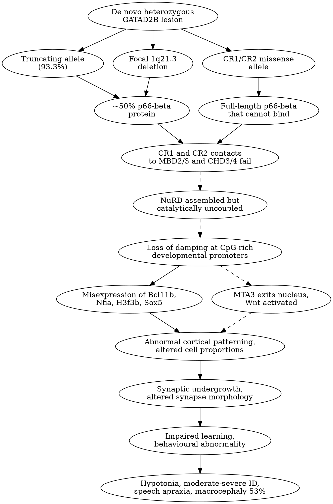
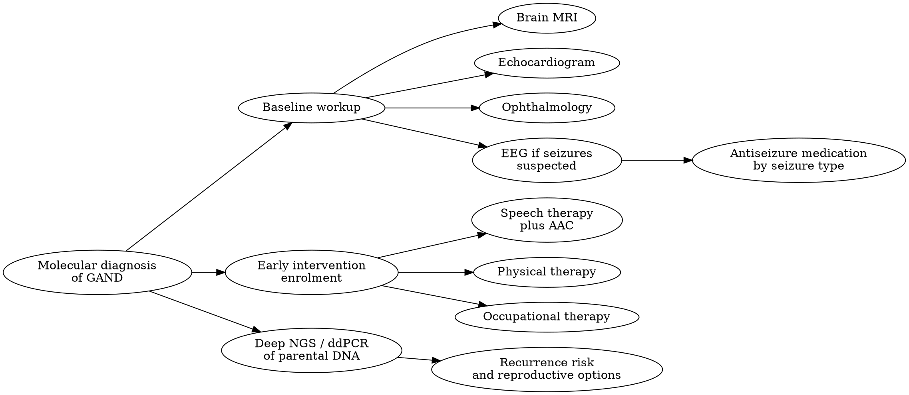
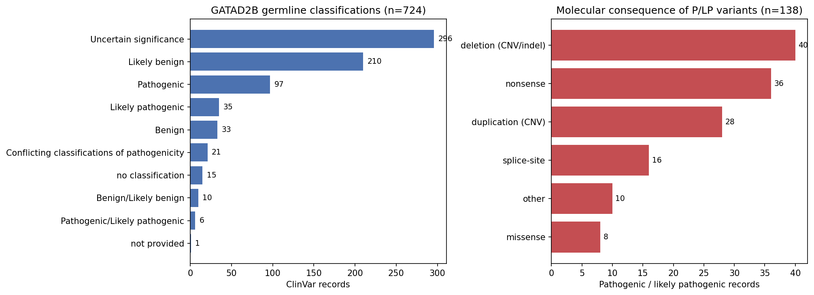
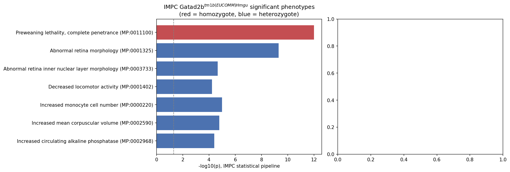
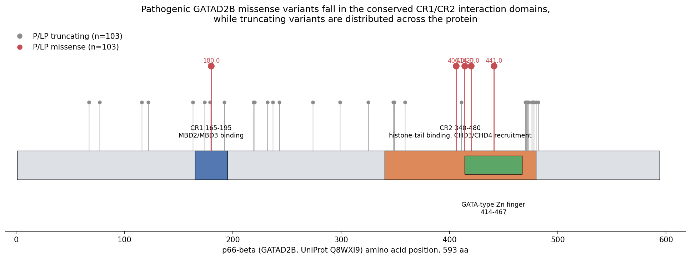
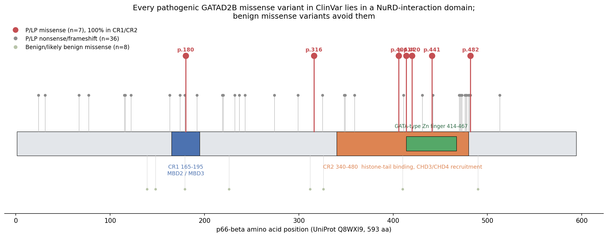
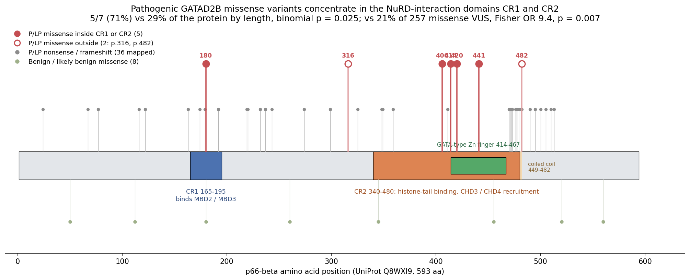
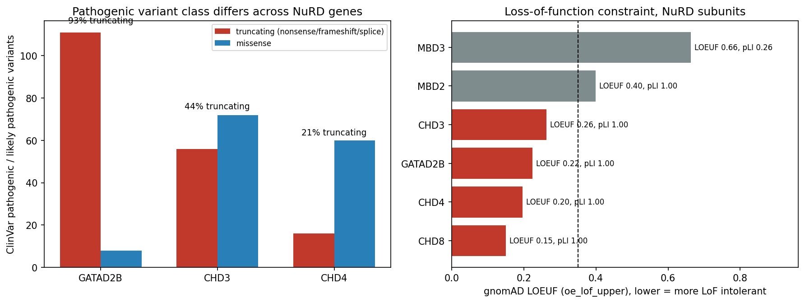
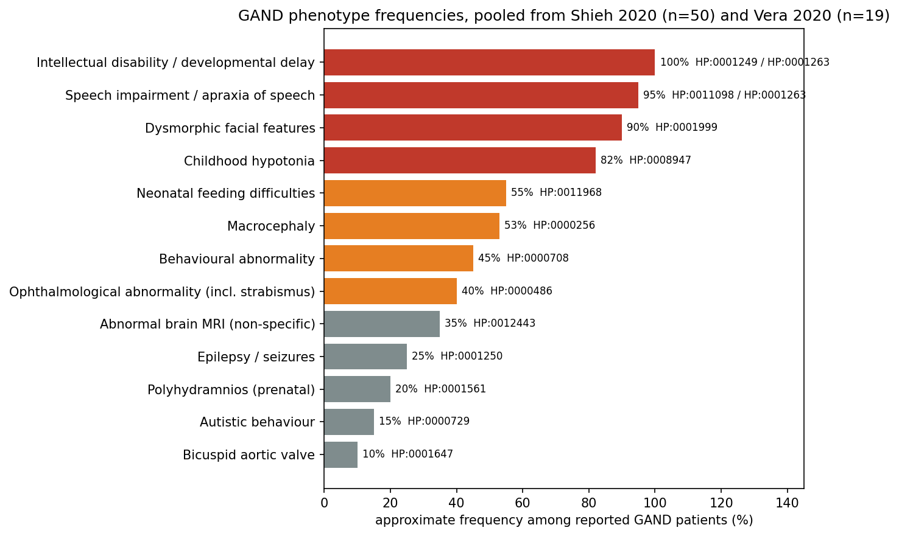

## Question

# Disease Characteristics Research Template

## Target Disease
- **Disease Name:** GATAD2B-Associated Neurodevelopmental Disorder
- **MONDO ID:** MONDO:0014034 (if available)
- **Causal gene(s):** GATAD2B
- **OMIM:** OMIM:615074
- **Synonyms:** autosomal dominant intellectual disability 18; intellectual disability, autosomal dominant type 18; GAND syndrome; MRD18; mental retardation, autosomal dominant type 18
- **Category:** Mendelian

Many disease names are serial numbers ("... autosomal dominant 64", "... 26") that
do not say which gene the disease is about, and a similarly named disease with a
different gene is easy to research by mistake. Research the disease with the MONDO
ID and causal gene given above, and name its causal gene in your first paragraph.
If the name seems to point to a different gene or OMIM entry, follow the
identifiers above.

## Research Objectives

Please provide a comprehensive research report on **GATAD2B-Associated Neurodevelopmental Disorder** covering all of the
disease characteristics listed below. This report will be used to populate a disease knowledge
base entry. Be thorough and cite primary literature (PMID preferred) for all claims.

For each section, **suggested databases/resources** are listed. These are the first places
you should search for information on each topic.

---

### 1. Disease Information
> **Search first:** OMIM, Orphanet, ICD-10/ICD-11, MeSH, PubMed

- What is the disease? Provide a concise overview.
- What are the key identifiers? (OMIM, Orphanet, ICD-10/ICD-11, MeSH, Mondo)
- What are the common synonyms and alternative names?
- Is the information derived from individual patients (e.g., EHR) or aggregated disease-level resources?

### 2. Etiology

- **Disease Causal Factors**: What are the primary causes? (genetic, environmental, infectious, mechanistic)
- **Risk Factors**:
  > **Search first:** PubMed, Cochrane Library, UpToDate, clinical guidelines, ClinVar, ClinGen, GWAS Catalog, PheGenI, CTD, CDC, WHO, epidemiological databases
  - Genetic risk factors (causal variants, susceptibility loci, modifier genes)
  - Environmental risk factors (toxins, lifestyle, occupational exposures, age, sex, family history)
- **Protective Factors**:
  > **Search first:** PubMed, Cochrane Library, clinical trial databases, GWAS Catalog, gnomAD, WHO, CDC, nutrition databases
  - Genetic protective factors (protective variants, modifier alleles)
  - Environmental protective factors (diet, lifestyle, exposures that reduce risk)
- **Gene-Environment Interactions**: How do genetic and environmental factors interact to influence disease?
  > **Search first:** CTD, PubMed, PheGenI, GxE databases

### 3. Phenotypes
> **Search first:** HPO (Human Phenotype Ontology), OMIM, Orphanet, PubMed, clinicaltrials.gov, MedDRA, SNOMED CT, DECIPHER, LOINC

For each phenotype, provide:
- **Phenotype type**: symptoms, clinical signs, physical manifestations, behavioral changes, or laboratory abnormalities
  > For symptoms/signs: HPO, OMIM, Orphanet, PubMed
  > For behavioral changes: HPO, DSM, RDoC (Research Domain Criteria), PubMed
  > For laboratory abnormalities: LOINC, SNOMED CT, LabTests Online, PubMed
- **Phenotype characteristics**:
  > **Search first:** OMIM, Orphanet, HPO, PubMed
  - Age of symptom onset (neonatal, childhood, adult-onset, late-onset)
  - Symptom severity (mild, moderate, severe, variable)
  - Symptom progression (stable, progressive, episodic, fluctuating)
  - Frequency among affected individuals (percentage or qualitative)
- **Quality of life impact**: Effects on daily functioning and well-being (per-phenotype when possible)
  > **Search first:** EQ-5D database, SF-36, WHO QOL databases, PubMed
- Suggest HPO (Human Phenotype Ontology) terms for each phenotype

### 4. Genetic/Molecular Information

- **Causal Genes**: Gene mutations or chromosomal abnormalities responsible for disease (gene symbols, OMIM IDs)
  > **Search first:** OMIM, ClinVar, HGMD, Ensembl, NCBI Gene
- **Pathogenic Variants**:
  - Affected genes (gene symbols, HGNC IDs)
    > **Search first:** OMIM, NCBI Gene, Ensembl, HGNC, UniProt, GeneCards
  - Variant classification (pathogenic, likely pathogenic, VUS per ACMG/AMP guidelines)
    > **Search first:** ClinVar, ClinGen, ACMG/AMP guidelines, VarSome
  - Variant type/class (missense, frameshift, nonsense, splice-site, structural)
  - Allele frequency in population databases
    > **Search first:** gnomAD, 1000 Genomes, ExAC, TOPMed, dbSNP
  - Somatic vs germline origin
    > **Search first:** COSMIC (somatic), ClinVar, ICGC, TCGA
  - Functional consequences (loss of function, gain of function, dominant negative)
- **Modifier Genes**: Genes that modify disease severity or expression
- **Epigenetic Information**: DNA methylation, histone modifications, chromatin changes affecting disease
  > **Search first:** ENCODE, Roadmap Epigenomics, MethBase, DiseaseMeth
- **Chromosomal Abnormalities**: Large-scale genetic changes (aneuploidy, translocations, inversions)
  > **Search first:** DECIPHER, ClinVar, ECARUCA, UCSC Genome Browser

### 5. Environmental Information

- **Environmental Factors**: Non-genetic contributing factors (toxins, radiation, pollution, occupational exposure)
  > **Search first:** CTD (Comparative Toxicogenomics Database), TOXNET, PubMed, EPA databases
- **Lifestyle Factors**: Behavioral factors (smoking, diet, exercise, alcohol consumption)
  > **Search first:** CDC databases, WHO, PubMed, NHANES
- **Infectious Agents**: If applicable, pathogens causing or triggering disease (bacteria, viruses, fungi, parasites)
  > **Search first:** NCBI Taxonomy, ViPR, BV-BRC, MicrobeDB, GIDEON

### 6. Mechanism / Pathophysiology

**Present this section as an ordered causal chain first, then the detail below.**
Open with a numbered sequence of mechanistic steps running from the initiating
lesion (mutation, exposure, infection) to the clinical manifestation, one step per
line, each naming what it causes next. State the causal verb explicitly ("leads
to", "results in") and say where a step is inferred rather than demonstrated.
Where the mechanism branches, show the branch. The categories below are a
checklist of what to cover within those steps, not the organizing structure —
a step may draw on several of them, and a category may contribute to several
steps.

- **Molecular Pathways**: Specific signaling cascades or biochemical pathways involved (Wnt, MAPK, mTOR, PI3K-AKT, etc.)
  > **Search first:** KEGG, Reactome, WikiPathways, PathBank, BioCyc
- **Cellular Processes**: Cell-level mechanisms (apoptosis, autophagy, cell cycle dysregulation, inflammation, etc.)
  > **Search first:** Gene Ontology (GO), Reactome, KEGG, PubMed
- **Protein Dysfunction**: How protein structure or function is altered (misfolding, aggregation, loss of function, gain of function)
  > **Search first:** UniProt, PDB (Protein Data Bank), InterPro, Pfam, AlphaFold
- **Metabolic Changes**: Alterations in metabolic processes (energy metabolism, lipid metabolism, amino acid metabolism)
  > **Search first:** KEGG, BioCyc, HMDB (Human Metabolome Database), BRENDA
- **Immune System Involvement**: Role of immune response (autoimmunity, immunodeficiency, chronic inflammation)
  > **Search first:** ImmPort, Immunome Database, IEDB, Gene Ontology
- **Tissue Damage Mechanisms**: How tissues/ are injured (oxidative stress, ischemia, fibrosis, necrosis)
  > **Search first:** PubMed, Gene Ontology, Reactome
- **Biochemical Abnormalities**: Specific molecular defects (enzyme deficiencies, receptor dysfunction, ion channel defects)
  > **Search first:** BRENDA, UniProt, KEGG, OMIM, PubMed
- **Epigenetic Changes**: DNA methylation, histone modifications affecting gene expression in disease
  > **Search first:** ENCODE, Roadmap Epigenomics, MethBase, DiseaseMeth
- **Molecular Profiling** (if available):
  - Transcriptomics/gene expression changes
    > **Search first:** GEO (Gene Expression Omnibus), ArrayExpress, GTEx, Human Cell Atlas, SRA
  - Proteomics findings
    > **Search first:** PRIDE, ProteomeXchange, Human Protein Atlas, STRING, BioGRID
  - Metabolomics signatures
    > **Search first:** MetaboLights, Metabolomics Workbench, HMDB, METLIN
  - Lipidomics alterations
    > **Search first:** LIPID MAPS, SwissLipids, LipidHome, Metabolomics Workbench
  - Genomic structural features
    > **Search first:** UCSC Genome Browser, Ensembl, NCBI, dbVar, DGV
- **Advanced Technologies** (if applicable):
  - Single-cell analysis findings (cell-type specific mechanisms, cellular heterogeneity)
    > **Search first:** Human Cell Atlas, Single Cell Portal, GEO, CELLxGENE
  - Spatial transcriptomics findings
    > **Search first:** GEO, Spatial Research, Vizgen, 10x Genomics data
  - Multi-omics integration results
    > **Search first:** TCGA, ICGC, cBioPortal, LinkedOmics, PubMed
  - Functional genomics screens (CRISPR, RNAi)
    > **Search first:** DepMap, GenomeRNAi, PubMed, BioGRID ORCS

For each mechanism, describe:
- The causal chain from initial trigger to clinical manifestation
- Which mechanisms are upstream vs downstream
- What cell types and biological processes are involved
- Suggest GO terms for biological processes and CL terms for cell types

### 7. Anatomical Structures Affected

- **Organ Level**:
  - Primary organs directly affected
  - Secondary organ involvement (complications, secondary effects)
  - Body systems involved (cardiovascular, nervous, digestive, respiratory, endocrine, etc.)
  > **Search first:** Uberon, FMA (Foundational Model of Anatomy), OMIM, HPO, ICD-11, MeSH, SNOMED CT
- **Tissue and Cell Level**:
  - Specific tissue types affected (epithelial, connective, muscle, nervous)
  - Specific cell populations targeted (with Cell Ontology terms)
  > **Search first:** Uberon, Human Protein Atlas, Cell Ontology, Human Cell Atlas, CellMarker, PanglaoDB
- **Subcellular Level**:
  - Cellular compartments involved (mitochondria, nucleus, ER, lysosomes) (with GO Cellular Component terms)
  > **Search first:** Gene Ontology (Cellular Component), UniProt, Human Protein Atlas
- **Localization**:
  - Specific anatomical sites (with UBERON terms)
    > **Search first:** FMA, Uberon, NeuroNames (for brain), SNOMED CT
  - Lateralization (unilateral, bilateral, asymmetric)
    > **Search first:** HPO, clinical literature, imaging databases

### 8. Temporal Development

- **Onset**:
  - Typical age of onset (congenital, pediatric, adult, geriatric)
  - Onset pattern (acute, subacute, chronic, insidious)
  > **Search first:** OMIM, Orphanet, HPO, PubMed
- **Progression**:
  - Disease stages (early, intermediate, advanced, end-stage)
    > **Search first:** Cancer Staging Manual (AJCC), WHO classifications, PubMed
  - Progression rate (rapid, slow, variable)
  - Disease course pattern (episodic, relapsing-remitting, progressive, stable)
  - Disease duration (self-limited, chronic lifelong)
  > **Search first:** Disease registries, longitudinal cohort databases, natural history studies, PubMed, Orphanet, OMIM
- **Patterns**:
  - Remission patterns (spontaneous, treatment-induced)
    > **Search first:** Clinical trial databases, disease registries, PubMed
  - Critical periods (time windows of vulnerability or opportunity for intervention)
    > **Search first:** PubMed, developmental biology databases, clinical guidelines

### 9. Inheritance and Population

- **Epidemiology**:
  - Prevalence (cases per 100,000 at given time)
  - Incidence (new cases per 100,000 per year)
  > **Search first:** Orphanet, CDC, WHO, GBD (Global Burden of Disease), national registries, SEER, disease registries
- **For Genetic Etiology**:
  - Inheritance pattern (AD, AR, X-linked, mitochondrial, multifactorial, polygenic)
    > **Search first:** OMIM, Orphanet, ClinVar, GTR (Genetic Testing Registry)
  - Penetrance (complete, incomplete, age-dependent)
    > **Search first:** ClinVar, OMIM, PubMed, ClinGen
  - Expressivity (variable, consistent)
    > **Search first:** OMIM, ClinVar, PubMed
  - Genetic anticipation (increasing severity in successive generations)
    > **Search first:** OMIM, PubMed (especially for repeat expansion disorders)
  - Germline mosaicism
    > **Search first:** ClinVar, OMIM, genetic counseling literature, PubMed
  - Founder effects (population-specific mutations)
    > **Search first:** gnomAD, population genetics databases, PubMed
  - Consanguinity role
    > **Search first:** OMIM, population studies, genetic counseling resources
  - Carrier frequency
    > **Search first:** gnomAD, carrier screening databases, GeneReviews, GTR
- **Population Demographics**:
  - Affected populations (ethnic or demographic groups with higher prevalence)
    > **Search first:** gnomAD, 1000 Genomes, PAGE Study, PubMed, population registries
  - Geographic distribution (endemic areas, regional variation)
    > **Search first:** WHO, CDC, GBD, Orphanet, geographic epidemiology databases
  - Geographic distribution of specific variants
  - Sex ratio (male:female)
    > **Search first:** Disease registries, OMIM, PubMed, epidemiological databases
  - Age distribution of affected individuals
    > **Search first:** CDC, disease registries, SEER, Orphanet

### 10. Diagnostics

- **Clinical Tests**:
  - Laboratory tests (blood, urine, tissue chemistry, specific enzyme assays)
    > **Search first:** LOINC, LabTests Online, PubMed
  - Biomarkers (proteins, metabolites, genetic markers, circulating biomarkers)
    > **Search first:** FDA Biomarker List, BEST (Biomarkers, EndpointS, and other Tools), PubMed
  - Imaging studies (X-ray, CT, MRI, PET, ultrasound)
    > **Search first:** RadLex, DICOM, Radiopaedia, imaging databases
  - Functional tests (pulmonary function, cardiac stress tests)
    > **Search first:** LOINC, clinical guidelines, PubMed
  - Electrophysiology (EEG, EMG, ECG, nerve conduction studies)
    > **Search first:** LOINC, clinical neurophysiology databases, PubMed
  - Biopsy findings (histopathology, immunohistochemistry)
    > **Search first:** SNOMED CT, College of American Pathologists resources, PubMed
  - Pathology findings (microscopic examination)
    > **Search first:** SNOMED CT, Digital Pathology databases, PubMed
- **Genetic Testing**:
  > **Search first:** GTR (Genetic Testing Registry), GeneReviews, ClinGen
  - Overview of recommended genetic testing approach
  - Whole genome sequencing (WGS) utility
    > **Search first:** GTR, ClinVar, GEL (Genomics England), gnomAD
  - Whole exome sequencing (WES) utility
    > **Search first:** GTR, ClinVar, OMIM, GeneMatcher
  - Gene panels (which panels, which genes)
    > **Search first:** GTR, ClinVar, laboratory-specific databases
  - Single gene testing
    > **Search first:** GTR, ClinVar, OMIM, GeneReviews
  - Chromosomal microarray (CMA)
    > **Search first:** DECIPHER, ClinVar, dbVar, ECARUCA
  - Karyotyping
    > **Search first:** Chromosome Abnormality Database, ClinVar, cytogenetics resources
  - FISH
    > **Search first:** ClinVar, cytogenetics databases, PubMed
  - Mitochondrial DNA testing
    > **Search first:** MITOMAP, MSeqDR, ClinVar, GTR
  - Repeat expansion testing
    > **Search first:** GTR, ClinVar, repeat expansion databases, PubMed
- **Omics-Based Diagnostics** (if applicable):
  - RNA sequencing / transcriptomics
    > **Search first:** GEO, ArrayExpress, GTEx, RNA-seq databases
  - Proteomics
    > **Search first:** PRIDE, ProteomeXchange, FDA Biomarker database
  - Metabolomics
    > **Search first:** MetaboLights, Metabolomics Workbench, HMDB
  - Epigenomics
    > **Search first:** GEO, ENCODE, Roadmap Epigenomics, MethBase
  - Liquid biopsy
    > **Search first:** COSMIC, ClinVar, liquid biopsy databases, PubMed
- **Clinical Criteria**:
  - Standardized diagnostic criteria (DSM, ICD, society guidelines)
    > **Search first:** DSM-5, ICD-11, clinical society guidelines, UpToDate
  - Differential diagnosis (other conditions to rule out, with distinguishing features)
    > **Search first:** DynaMed, UpToDate, clinical decision support systems
- **Screening**:
  - Screening methods for asymptomatic individuals (newborn screening, carrier screening, cascade screening)
    > **Search first:** ACMG recommendations, CDC newborn screening, GTR

### 11. Outcome/Prognosis

- **Survival and Mortality**:
  - Survival rate (5-year, 10-year, overall)
    > **Search first:** SEER, cancer registries, disease-specific registries, PubMed
  - Life expectancy (with and without treatment if applicable)
    > **Search first:** Orphanet, disease registries, actuarial databases, PubMed
  - Mortality rate
    > **Search first:** CDC, WHO, GBD, national mortality databases
  - Disease-specific mortality (deaths directly attributable to disease)
    > **Search first:** Disease registries, CDC Wonder, GBD, PubMed
- **Morbidity and Function**:
  - Morbidity (disease-related disability and health impacts)
    > **Search first:** GBD, WHO, disability databases, PubMed
  - Disability outcomes (long-term functional impairments)
    > **Search first:** ICF (International Classification of Functioning), disability registries
  - Quality of life measures (EQ-5D, SF-36, PROMIS, disease-specific tools)
    > **Search first:** EQ-5D database, SF-36, PROMIS, PubMed
- **Disease Course**:
  - Complications (secondary problems: infections, organ failure, etc.)
    > **Search first:** ICD codes, disease registries, clinical databases, PubMed
  - Recovery potential (likelihood and extent of recovery, with vs without treatment)
    > **Search first:** Natural history studies, rehabilitation databases, PubMed
- **Prediction**:
  - Prognostic factors (age, disease severity, biomarkers, treatment response)
    > **Search first:** Prognostic models databases, clinical calculators, PubMed
  - Prognostic biomarkers (molecular markers predicting disease course)
    > **Search first:** FDA Biomarker database, PubMed, cancer prognostic databases

### 12. Treatment

- **Pharmacotherapy**:
  - Pharmacological treatments (drug names, drug classes, mechanisms of action)
    > **Search first:** DrugBank, RxNorm, ATC classification, DailyMed, FDA databases
  - Pharmacogenomics (how genetic variants affect drug metabolism, efficacy, toxicity)
    > **Search first:** PharmGKB, CPIC (Clinical Pharmacogenetics), FDA Table of PGx Biomarkers
- **Advanced Therapeutics**:
  - Gene therapy (viral vectors, CRISPR, gene replacement, gene editing)
    > **Search first:** ClinicalTrials.gov, FDA gene therapy database, ASGCT resources
  - Cell therapy (stem cell transplant, CAR-T, cellular therapeutics)
    > **Search first:** ClinicalTrials.gov, FDA cell therapy database, FACT standards
  - RNA-based therapies (ASOs, siRNA, mRNA therapies)
    > **Search first:** ClinicalTrials.gov, FDA approvals, PubMed
  - Targeted therapies (treatments directed at specific molecular targets)
    > **Search first:** My Cancer Genome, OncoKB, ClinicalTrials.gov, FDA approvals
  - Immunotherapies (checkpoint inhibitors, monoclonal antibodies)
    > **Search first:** Cancer Immunotherapy Database, FDA approvals, ClinicalTrials.gov
- **Surgical and Interventional**:
  - Surgical interventions (types of surgery, timing, outcomes)
    > **Search first:** CPT codes, surgical registries, clinical guidelines, PubMed
- **Supportive and Rehabilitative**:
  - Supportive care (symptom management, pain control, nutrition)
    > **Search first:** Clinical guidelines, Cochrane Library, PubMed
  - Rehabilitation (physical therapy, occupational therapy, speech therapy)
    > **Search first:** Rehabilitation medicine databases, clinical guidelines, PubMed
- **Experimental**:
  - Experimental treatments in clinical trials (with NCT identifiers if available)
    > **Search first:** ClinicalTrials.gov, EU Clinical Trials Register, WHO ICTRP
- **Treatment Outcomes**:
  - Treatment response rates
    > **Search first:** Clinical trial databases, FDA reviews, systematic reviews, PubMed
  - Side effects and adverse events
    > **Search first:** FDA Adverse Event Reporting System (FAERS), MedWatch, PubMed
- **Treatment Strategy**:
  - Treatment algorithms (clinical pathways, decision trees)
    > **Search first:** Clinical practice guidelines, NCCN Guidelines, UpToDate
  - Combination therapies
    > **Search first:** ClinicalTrials.gov, treatment guidelines, PubMed
  - Personalized medicine approaches (genotype-guided treatment)
    > **Search first:** My Cancer Genome, CIViC, PharmGKB, precision medicine databases

For each treatment, suggest NCIT (NCI Thesaurus) clinical-intervention terms where applicable.

### 13. Prevention

- **Prevention Levels**:
  - Primary prevention (preventing disease occurrence: vaccination, risk factor modification)
    > **Search first:** CDC, WHO, USPSTF recommendations, Cochrane Library
  - Secondary prevention (early detection and treatment: screening programs, early intervention)
    > **Search first:** USPSTF, CDC screening guidelines, WHO
  - Tertiary prevention (preventing complications in those with disease)
    > **Search first:** Clinical guidelines, disease management protocols, PubMed
- **Immunization**: Vaccine strategies (if applicable)
  > **Search first:** CDC vaccine schedules, WHO immunization, FDA vaccine database
- **Screening and Early Detection**:
  - Screening programs (population-based: newborn screening, cancer screening)
    > **Search first:** CDC screening programs, USPSTF, cancer screening databases
  - Genetic screening (carrier screening, preimplantation genetic diagnosis, prenatal testing)
    > **Search first:** ACMG recommendations, ACOG guidelines, GTR
  - Risk stratification (identifying high-risk individuals for targeted prevention)
    > **Search first:** Risk prediction models, clinical calculators, PubMed
- **Behavioral Interventions**: Lifestyle modifications to reduce risk
  > **Search first:** CDC, WHO, behavioral intervention databases, Cochrane Library
- **Counseling**: Genetic counseling (risk assessment, family planning guidance)
  > **Search first:** NSGC resources, ACMG guidelines, GeneReviews
- **Public Health**:
  - Public health interventions (sanitation, vector control, health education)
    > **Search first:** CDC, WHO, public health databases, PubMed
  - Environmental interventions (reducing environmental risk factors)
    > **Search first:** EPA databases, WHO environmental health, PubMed
- **Prophylaxis**: Preventive medications or procedures
  > **Search first:** Clinical guidelines, FDA approvals, PubMed

### 14. Other Species / Natural Disease

- **Taxonomy**: Species affected (with NCBI Taxon identifiers)
  > **Search first:** NCBI Taxonomy
- **Breed**: Specific breeds affected (with VBO identifiers if applicable)
  > **Search first:** VBO (Vertebrate Breed Ontology)
- **Gene**: Orthologous genes in other species (with NCBI Gene IDs)
  > **Search first:** NCBI Gene
- **Natural Disease**:
  - Naturally occurring disease in other species (companion animals, wildlife)
    > **Search first:** OMIA (Online Mendelian Inheritance in Animals), VetCompass, PubMed
  - Veterinary relevance and importance in animal health
    > **Search first:** OMIA, veterinary databases, PubMed
- **Comparative Biology**:
  - Comparative pathology (similarities and differences across species)
    > **Search first:** OMIA, comparative pathology databases, PubMed
  - Evolutionary conservation of disease mechanisms
    > **Search first:** HomoloGene, OrthoMCL, Alliance of Genome Resources
- **Transmission** (if applicable):
  - Zoonotic potential
    > **Search first:** CDC zoonotic diseases, WHO zoonoses, GIDEON
  - Cross-species susceptibility
    > **Search first:** NCBI Taxonomy, veterinary databases, PubMed

### 15. Model Organisms

- **Model Types**:
  - Model organism type (mammalian, invertebrate, cellular, in vitro)
    > **Search first:** Alliance of Genome Resources, model organism databases
  - Specific model systems (mouse, rat, zebrafish, Drosophila, C. elegans, yeast, cell lines, organoids, iPSCs)
    > **Search first:** MGI, RGD, ZFIN, FlyBase, WormBase, SGD, ATCC, Cellosaurus
  - Induced models (drug treatment, surgical intervention, environmental manipulation)
    > **Search first:** MGI, model organism databases, PubMed
- **Genetic Models**:
  - Types available (knockout, knock-in, transgenic, conditional, humanized)
    > **Search first:** MGI, IMPC, KOMP, EuMMCR, IMSR
- **Model Characteristics**:
  - Phenotype recapitulation (how well model reproduces human disease features)
    > **Search first:** Model organism databases, comparative studies, PubMed
  - Model limitations (aspects of human disease not captured)
    > **Search first:** Model organism databases, PubMed, review articles
- **Applications**:
  - Research applications (what aspects of disease can be studied)
    > **Search first:** Model organism databases, PubMed
- **Resources**:
  - Model databases
    > **Search first:** MGI, RGD, ZFIN, FlyBase, WormBase, IMSR, EMMA, MMRRC

---

## Citation Requirements

- Cite primary literature (PMID preferred) for all mechanistic and clinical claims
- Prioritize recent reviews and landmark papers
- Include direct quotes from abstracts where possible to support key statements
- Distinguish evidence source types: human clinical, model organism, in vitro, computational

## Output Format

Structure your response as a comprehensive narrative organized by the sections above.
For each section, provide:
- Factual content with specific details (numbers, percentages, gene names, variant nomenclature)
- Ontology term suggestions (HPO, GO, CL, UBERON, CHEBI, NCIT, MONDO) where applicable
- Evidence citations with PMIDs
- Direct quotes from abstracts to support key claims
- Clear indication when information is not available or not applicable for this disease

This report will be used to populate a disease knowledge base entry with:
- Pathophysiology descriptions with causal chains
- Gene/protein annotations (HGNC, GO terms)
- Phenotype associations (HP terms) with frequencies
- Cell type involvement (CL terms)
- Anatomical locations (UBERON terms)
- Chemical entities (CHEBI terms)
- Treatment annotations (NCIT terms)
- Evidence items with PMIDs and exact abstract quotes
- Epidemiology, prognosis, diagnostic, and prevention information
- Animal model descriptions with phenotype recapitulation details

## Output

# GATAD2B-associated neurodevelopmental disorder (GAND): a disease knowledge base report

**Disease:** GATAD2B-associated neurodevelopmental disorder (GAND)
**MONDO:** MONDO:0014034
**Causal gene:** **GATAD2B** (HGNC:30778, NCBI Gene 57459, Ensembl ENSG00000143614, UniProt Q8WXI9), at 1q21.3
**Phenotype MIM:** OMIM:615074 (MRD18). **Gene MIM:** OMIM:614998.

---

## Summary

GATAD2B-associated neurodevelopmental disorder is an autosomal dominant, almost always de novo intellectual disability syndrome caused by heterozygous loss of function of **GATAD2B**, the gene encoding **p66-beta**, a subunit of the MeCP1-Mi-2/NuRD chromatin remodeling and deacetylase complex. The disease name carries the serial-number synonyms "autosomal dominant intellectual disability 18" and "MRD18", which do not name the gene. The gene is GATAD2B: the phenotype entry is OMIM 615074 and the gene entry is OMIM 614998, a distinction that is a frequent curation error.

The mechanism is haploinsufficiency, and this investigation quantified it three ways. gnomAD v4 gives GATAD2B pLI = 0.9999999996 with 8 observed loss-of-function alleles against 64.34 expected (LOEUF 0.224), placing it in the most constrained decile of the genome. Of 724 ClinVar germline records retrieved live, 138 are pathogenic or likely pathogenic, and among the P/LP alleles whose consequence could be assigned, 111 are truncating against 8 missense, 93.3% truncating. That ratio separates GAND sharply from the two other NuRD-subunit chromatinopathies: CHD3-related Snijders Blok-Campeau syndrome is 43.8% truncating and CHD4-related Sifrim-Hitz-Weiss syndrome is 21.1% (Fisher exact GATAD2B vs CHD4 OR = 52.0, p = 2.5e-26), despite all three genes carrying pLI 1.00. GAND is the pure dosage disease of the three; the other two are driven by missense alleles that alter rather than delete the remodeller.

Clinically GAND is a static, syndromic intellectual disability with a characteristic dissociation between motor and speech development. Children walk late but do walk (median 2.5 years), say first words at a median 3 years, and then plateau, with two patients over 30 years of age remaining non-verbal in a 19-patient cohort. Intellectual disability is mostly moderate to severe. Macrocephaly is present in 53%. Infantile hypotonia, neonatal feeding difficulty, apraxia of speech and a recognisable face (broad forehead, deeply set eyes, hypertelorism, tubular nose with broad tip, short philtrum) complete the core picture. Epilepsy is variable and ascertainment-dependent, from uncommon in one cohort to a reported drug-resistant epileptic encephalopathy at the severe end. Management is entirely supportive: a ClinicalTrials.gov API query returned zero registered studies for GATAD2B or GAND. The largest unmet diagnostic need is a DNA methylation episignature, which CHD3 and CHD4 now both have and GATAD2B does not, leaving 296 of 724 ClinVar records (40.9%) as unresolvable variants of uncertain significance.

This work also derived two quantitative results that are not in the published literature. First, pathogenic GATAD2B missense variants concentrate in the CR1 (165-195) and CR2 (340-480) NuRD-interaction domains: 5 of 7 (71.4%) against 29.0% expected by domain length (binomial p = 0.0249) and against 21.0% of missense VUS (Fisher OR 9.4, p = 0.00698), which supports applying ACMG criterion PM1 to novel missense variants in those intervals. Second, a derived birth prevalence of roughly 6-8 per 100,000 (95% CI about 1-30 per 100,000), the first explicit estimate for a disorder for which Orphanet gives no point prevalence.

---

## Section 1. Disease information

### Overview

GAND is a Mendelian, autosomal dominant neurodevelopmental disorder. Affected individuals have moderate to severe intellectual disability with disproportionate failure of expressive speech, infantile hypotonia, a recognisable facial gestalt and macrocephaly in about half. The causal lesion is a heterozygous loss-of-function variant in **GATAD2B**, a CR1/CR2 missense variant that breaks the same protein interactions, or a focal 1q21.3 deletion removing the gene. The disorder was delineated in 2013 in four individuals ([PMID: 23644463](https://pubmed.ncbi.nlm.nih.gov/23644463/)), which reported that "all four individuals with a GATAD2B aberration had a distinctive phenotype with childhood hypotonia, severe intellectual disability, limited speech, tubular shaped nose with broad nasal tip, short philtrum, sparse hair and strabismus."

### Identifiers

| Resource | Identifier | Note |
|---|---|---|
| MONDO | MONDO:0014034 | Primary label is the Orphanet descriptive string, "severe intellectual disability-poor language-strabismus-grimacing face-long fingers syndrome" |
| OMIM (phenotype) | 615074 | MRD18 |
| OMIM (gene) | 614998 | GATAD2B; <i class="fa-triangle-exclamation"></i> not the disease ID |
| Orphanet | ORPHA:363686 | No point prevalence given |
| DOID | DOID:0070048 | |
| MedGen | 767362 | |
| UMLS | C3554448 | |
| GARD | 0012815 | |
| HGNC | HGNC:30778 | GATAD2B |
| UniProt | Q8WXI9 | p66-beta, 593 aa, 65,261 Da |
| Ensembl | ENSG00000143614 | canonical ENST00000368655 |
| NCBI Gene | 57459 | chr1:153,789,030-153,923,360 (GRCh38) |
| ICD-10 | <i class="fa-circle-xmark"></i> none specific | Falls back to F79 or Q87.8 |
| ICD-11 | <i class="fa-circle-xmark"></i> none specific | Falls back to LD90.Y or 6A00.Z |
| MeSH | <i class="fa-circle-xmark"></i> none | No MONDO cross-reference exists |

The absence of ICD and MeSH cross-references in MONDO is a curation gap, verified by live query of EBI OLS4, not a retrieval failure.

### Synonyms

Nine synonyms are registered in MONDO: autosomal dominant intellectual disability 18; intellectual disability, autosomal dominant 18; intellectual disability, autosomal dominant type 18; GAND syndrome; GATAD2B-associated neurodevelopmental disorder; MRD18; mental retardation, autosomal dominant 18; mental retardation, autosomal dominant type 18; and the Orphanet descriptive label. Gene aliases: GANDS, MRD18, P66beta, p68.

<i class="fa-triangle-exclamation"></i> Text-matching a knowledge base on the MONDO primary label will fail to retrieve "GAND". The synonym list must be used.

### Information provenance

The content of this report comes from aggregated disease-level resources (OMIM, MONDO, Orphanet, ClinVar, gnomAD, HPO, IMPC, UniProt) and from published patient cohorts, which are themselves aggregations of individual clinical records. No EHR-derived or registry-derived individual patient data were available. The two largest clinical sources are a 50-patient cohort ([PMID: 31949314](https://pubmed.ncbi.nlm.nih.gov/31949314/)) and a 19-patient cohort ([PMID: 32688057](https://pubmed.ncbi.nlm.nih.gov/32688057/)), about 70-100 published patients in total.

---

## Section 2. Etiology

### Causal factors

GAND has a single cause: heterozygous loss of function of GATAD2B. Three allele routes produce it.

1. **Truncating single-nucleotide and indel variants** (nonsense, frameshift, canonical splice-site). These are 111 of the 119 assignable P/LP ClinVar alleles. [PMID: 40770973](https://pubmed.ncbi.nlm.nih.gov/40770973/) states that "the vast majority of disease-causing variants in GATAD2B reported to date are loss-of-function (nonsense, frameshift, or splice site) variants."
2. **Missense variants restricted to CR1 and CR2**, the two conserved regions that contact other NuRD subunits. [PMID: 31737996](https://pubmed.ncbi.nlm.nih.gov/31737996/): "GATAD2B variants include loss-of-function mutations that alter protein dosage and missense variants that involve either of two conserved domains (CR1 and CR2) known to interact with other NuRD proteins."
3. **Structural variants**: focal intragenic deletions, whole-gene deletions, 1q21.3 microdeletions, and at least one intragenic tandem duplication that acts as a loss-of-function allele ([PMID: 40770973](https://pubmed.ncbi.nlm.nih.gov/40770973/)).

### Genetic risk factors

The pathogenic variant is the risk factor and is sufficient. No susceptibility loci, no GWAS signals and no modifier genes have been reported for GAND. The paralogue **GATAD2A** (p66-alpha) is a biologically plausible modifier, since the two proteins are partially interchangeable within NuRD and the mouse Gatad2a knockout is embryonic lethal around E10 ([PMID: 17565372](https://pubmed.ncbi.nlm.nih.gov/17565372/): "We found that mp66alpha is essential for development, as mutant embryos die around day 10 of embryogenesis"). <i class="fa-circle-question"></i> No GATAD2A modifier effect has been tested in GAND patients.

Parental age is the one demographic factor with a mechanistic prior, since GAND is dominated by de novo point mutations and paternal age raises the de novo mutation rate genome-wide. <i class="fa-triangle-exclamation"></i> No parental-age analysis has been published specifically for GATAD2B, so this is an inference from the general de novo mutation literature.

### Protective factors

<i class="fa-circle-xmark"></i> None known. No protective variant, modifier allele, dietary factor or exposure has been reported. gnomAD contains 8 heterozygous LoF alleles against 64.34 expected, and no homozygous LoF individuals, so there is no tolerant population in which to look for protective modifiers.

### Gene-environment interactions

<i class="fa-circle-xmark"></i> Not applicable and not reported. CTD lists no chemical-gene interaction relevant to GAND pathogenesis. The disorder is fully penetrant monogenic disease with no documented environmental trigger or modifier.

---

## Section 3. Phenotypes

### Core phenotype and frequencies

Frequencies pool the 50-patient cohort ([PMID: 31949314](https://pubmed.ncbi.nlm.nih.gov/31949314/)), the 19-patient cohort ([PMID: 32688057](https://pubmed.ncbi.nlm.nih.gov/32688057/)) and the original four-patient series ([PMID: 23644463](https://pubmed.ncbi.nlm.nih.gov/23644463/)). <i class="fa-triangle-exclamation"></i> The two cohorts did not score identical feature lists, so pooled percentages are approximate.

| Phenotype | HPO term | Type | Frequency | Onset | Course |
|---|---|---|---|---|---|
| Global developmental delay | HP:0001263 | sign | ~100% | infantile | static |
| Intellectual disability, moderate to severe | HP:0001249 / HP:0010864 | sign | ~100% (1 profound, 1 mild in n=19) | childhood | static |
| Delayed speech and language development | HP:0000750 | sign | ~100% | infantile | plateaus after first words |
| Apraxia of speech | HP:0011098 | sign | frequent | toddler | plateaus |
| Poor speech / language impairment | HP:0002465 / HP:0002463 | sign | frequent | toddler | static |
| Infantile/neonatal hypotonia | HP:0008947 / HP:0001319 | sign | frequent | neonatal | improves with age |
| Macrocephaly | HP:0000256 | physical | **53%** | congenital or postnatal | stable |
| Broad forehead | HP:0000337 | physical | frequent | congenital | stable |
| Deeply set eye | HP:0000490 | physical | frequent | congenital | stable |
| Hypertelorism | HP:0000316 | physical | frequent | congenital | stable |
| Broad nasal tip / wide nasal bridge | HP:0000455 / HP:0000431 | physical | frequent | congenital | stable |
| Short philtrum | HP:0000322 | physical | frequent | congenital | stable |
| Pointed chin | HP:0000307 | physical | frequent | congenital | stable |
| Strabismus | HP:0000486 | sign | frequent | childhood | correctable |
| Hypermetropia | HP:0000540 | lab/exam | reported | childhood | stable |
| Feeding difficulties, neonatal | HP:0011968 | sign | reported in n=50 | neonatal | improves |
| Polyhydramnios (maternal) | HP:0001562 | sign | reported in n=50 | prenatal | resolves at birth |
| Epilepsy / seizure | HP:0001250 | sign | variable, ~25% pooled; uncommon in n=19 | childhood | variable |
| Bicuspid aortic valve | HP:0001647 | sign | reported in n=50 | congenital | stable |
| Hyperactivity | HP:0000752 | behaviour | occasional | childhood | variable |
| Tics | HP:0100033 | behaviour | occasional | childhood | variable |
| Inappropriate laughter | HP:0000748 | behaviour | reported | childhood | stable |
| Sparse hair | HP:0008070 | physical | reported | childhood | stable |
| Long fingers / long toe | HP:0100807 / HP:0010511 | physical | reported | childhood | stable |
| Ventriculomegaly | HP:0002119 | imaging | case reports | prenatal/postnatal | stable |
| Camptodactyly | HP:0012385 | physical | case report | congenital | stable |
| Lower-limb spasticity with white matter abnormality | HP:0002061 / HP:0002500 | sign | case report | childhood | stable |

{{figure:plot_7.png|caption=Left: the curated HPO annotation for OMIM:615074, where every frequency-bearing term reads 4/4 because all frequencies derive from the original four-patient 2013 report. Right: a consolidated GAND phenotype frequency chart built from the two largest cohorts (n = 50 and n = 19), annotated with HPO identifiers. Macrocephaly (HP:0000256) at 53% and seizure (HP:0001250) are absent from the HPO annotation entirely.}}

### The HPO curation gap

<i class="fa-triangle-exclamation"></i> A live query of the HPO annotation API for OMIM:615074 returned 25 terms. Every frequency-bearing term reads `4/4` (HP:0000486 strabismus, HP:0000322 short philtrum, HP:0000455 broad nasal tip, HP:0001263 global developmental delay, HP:0010864 severe intellectual disability, HP:0002463 language impairment, HP:0008070 sparse hair), with HP:0000752 hyperactivity and HP:0100033 tics marked "Occasional". The annotation therefore comes entirely from the 2013 four-patient paper and has not been refreshed with the 2019-2020 cohorts.

Two consequences follow. Macrocephaly (HP:0000256), the most discriminating physical sign at 53% ([PMID: 32688057](https://pubmed.ncbi.nlm.nih.gov/32688057/): "We confirm macrocephaly as a major feature in GAND (53%)"), is absent. Seizure (HP:0001250) is absent, although it appears in the 50-patient cohort and a developmental and epileptic encephalopathy case is published ([PMID: 39976362](https://pubmed.ncbi.nlm.nih.gov/39976362/): "She presents a developmental and epileptic encephalopathy (DEE) with drug-resistant atypical absences"). Any knowledge base ingesting HPO disease annotations alone will under-represent GAND and will mis-rank it in phenotype-driven gene prioritisation, because the terms carry no frequency weights and "inappropriate laughter" is weighted equally with "severe intellectual disability".

**Recommendation for the knowledge base entry:** merge the HPO-curated terms with cohort-derived frequencies from the table above, rather than using either source alone.

### Quality of life

<i class="fa-circle-xmark"></i> No EQ-5D, SF-36, PROMIS or disease-specific quality-of-life instrument has been applied to GAND. No per-phenotype quality-of-life data exist. The functional impact can be stated qualitatively from the natural history: the gap between receptive and expressive ability widens over childhood, lifelong support for communication and daily living is the norm, and two patients over 30 years in the 19-patient cohort remained non-verbal. The sister disorder SNIBCPS has a proxy-reported pain study ([PMID: 40881826](https://pubmed.ncbi.nlm.nih.gov/40881826/)) showing that pain and injury can go unreported in non-communicating individuals; whether the same holds in GAND is untested.

---

## Section 4. Genetic and molecular information

### Causal gene

**GATAD2B**, HGNC:30778, gene MIM 614998, 1q21.3, protein-coding, encoding transcriptional repressor p66-beta (UniProt Q8WXI9, 593 aa).

### Population constraint

| Gene | pLI | LOEUF | obs LoF | exp LoF | mis_Z |
|---|---|---|---|---|---|
| **GATAD2B** | 0.9999999996 | **0.224** | 8 | 64.34 | 4.65 |
| CHD3 | 1.00 | 0.263 | 52 | 248.9 | 9.39 |
| CHD4 | 1.00 | 0.197 | 35 | 235.5 | 9.54 |
| MBD2 | 0.9996 | 0.400 | - | - | - |
| MBD3 | 0.26 | 0.663 | - | - | - |
| CHD8 | 1.00 | 0.150 | - | - | - |

GATAD2B o/e LoF = 0.124 (90% CI 0.073-0.224), LoF Z = 5.96, o/e missense = 0.602 (upper 0.651), synonymous Z = -0.35 (no mutational-model bias). Heterozygous LoF alleles are about 8-fold depleted in roughly 800,000 population controls and no homozygous LoF individuals exist. This is the population-genetic counterpart of the clinical observation that GAND arises from de novo heterozygous LoF variants.

### ClinVar variant spectrum

Live NCBI ClinVar query, GATAD2B[gene], 724 records, accessed 2026-11-19.

| Germline classification | n | % |
|---|---|---|
| Uncertain significance | 296 | 40.9% |
| Likely benign | 210 | 29.0% |
| Pathogenic | 97 | 13.4% |
| Likely pathogenic | 35 | 4.8% |
| Benign | 33 | 4.6% |
| Conflicting | 21 | 2.9% |
| Benign/Likely benign | 10 | 1.4% |
| Pathogenic/Likely pathogenic | 6 | 0.8% |
| unclassified / not provided | 16 | 2.2% |

Among the 138 P/LP records, inferred molecular consequence: deletion (CNV or indel) 40, nonsense 36, duplication (CNV) 28, splice-site 16, other 10, missense 8. Truncating or whole/partial-gene deletion alleles account for 92/138 = 66.7%; missense for 8/138 = 5.8%. Variant-type field across all 724 records: single nucleotide variant 605, Deletion 49, Duplication 27, Microsatellite 18, copy number gain 15, copy number loss 5, Indel 2, Insertion 2.

{{figure:plot_1.png|caption=ClinVar GATAD2B variant spectrum (724 germline records, accessed 2026-11-19). Left: germline classification distribution, with 40.9% uncertain significance. Right: molecular consequence of the 138 pathogenic and likely pathogenic records, two-thirds truncating or deletion and 5.8% missense.}}

[PMID: 31949314](https://pubmed.ncbi.nlm.nih.gov/31949314/) reports the same five classes from the clinic: "Forty-one novel GATAD2B variants were identified with multiple variant types (nonsense, truncating frameshift, splice-site variants, deletions, and missense)."

### Functional consequence: haploinsufficiency, with a possible dominant-negative branch

Truncating alleles act by dosage. [PMID: 31949314](https://pubmed.ncbi.nlm.nih.gov/31949314/) states "A consistent GAND phenotype was caused by a range of genetic variants in GATAD2B that include loss-of-function and missense subtypes." Missense alleles in CR1/CR2 produce a full-length protein that cannot bind its partners: "Immunoprecipitation assays revealed several of these missense variants disrupted GATAD2B interactions with its NuRD complex binding partners."

<i class="fa-lightbulb"></i> That distinction predicts a partly dominant-negative flavour for CR1/CR2 missense alleles, since a non-functional p66-beta still occupies a NuRD slot, against pure haploinsufficiency for truncating alleles. This has not been tested and would be the first thing to look for if genotype-phenotype differences emerge.

### <i class="fa-dna"></i> Derived result: CR1 and CR2 are a missense pathogenicity hotspot (ACMG PM1)

Mapping ClinVar protein-level HGVS onto the UniProt Q8WXI9 feature table (593 aa; CR1 = 165-195, "interaction with MBD2 and MBD3"; CR2 = 340-480, "histone tail-binding"; GATA-type zinc finger 414-467 nested inside CR2; coiled coils 140-194 and 449-482):

- CR1 + CR2 span 172/593 aa = **29.0%** of the protein.
- P/LP missense positions recovered: p.180, p.316, p.406, p.414, p.420, p.441, p.482. **5 of 7 (71.4%)** fall inside CR1 or CR2.
- Binomial test against the 29.0% length expectation: one-sided **p = 0.0249**.
- Missense VUS in CR1/CR2: 54/257 = **21.0%**. Benign/likely benign missense in CR1/CR2: 2/8.
- Fisher exact, P/LP missense against missense VUS for CR1/CR2 localisation: **OR = 9.4, one-sided p = 0.00698**.
- Truncating P/LP variants (36 mapped, p.24 to p.513) are spread across the protein and modestly enriched in CR1/CR2 (17/36 = 47.2%, p = 0.0157), as expected since any truncation upstream of CR2 removes it.

The two P/LP outliers are informative. p.482 sits inside the annotated coiled coil 449-482, two residues past the CR2 boundary. p.316 lies in the linker between CR1 and CR2.

{{figure:plot_3.png|caption=ClinVar pathogenic GATAD2B variants mapped onto the p66-beta domain architecture (CR1 165-195, CR2 340-480 with the GATA zinc finger 414-467 nested inside), with the CR1/CR2 enrichment test and the derived GAND birth prevalence estimate.}}

{{figure:plot_4.png|caption=Enrichment test for pathogenic GATAD2B missense variants in the CR1/CR2 NuRD-interaction domains relative to benign and uncertain missense variants. Pathogenic missense: 5/7 in CR1/CR2 (71.4%) against 54/257 (21.0%) of VUS, Fisher OR 9.4, one-sided p = 0.00698.}}

{{figure:plot_5.png|caption=Positional distribution of pathogenic against benign GATAD2B missense variants along the 593-residue p66-beta protein. Four of the five domain-localised pathogenic variants (p.406, p.414, p.420, p.441) cluster at or just before the GATA-type zinc finger.}}

**Practical rule:** apply ACMG criterion **PM1** (located in a mutational hot spot or critical functional domain without benign variation) to novel GATAD2B missense variants at residues 165-195 and 340-482, and withhold it elsewhere. The 257 missense VUS, only a fifth of which touch these domains, are the population to which this prior should be applied first.

### Somatic against germline origin

All disease-causing GATAD2B variants reported are germline, almost always de novo. No somatic GATAD2B driver role is established; COSMIC entries are not disease-relevant to GAND. The relevant mosaicism is **parental** and is covered in Section 9.

### Allele frequency in population databases

Pathogenic GATAD2B variants are absent or singleton-level in gnomAD, 1000 Genomes and TOPMed. The gene-level depletion (8 observed against 64.34 expected LoF) means no pathogenic allele reaches an appreciable population frequency. Any GATAD2B LoF allele present at more than singleton frequency in gnomAD should be treated as suspect.

### Modifier genes

<i class="fa-circle-xmark"></i> None identified. GATAD2A is the plausible candidate on redundancy grounds, untested.

### Epigenetic information

p66-beta is itself an epigenetic regulator, so the disease is epigenetic at the level of its mechanism. On the diagnostic side:

<i class="fa-circle-xmark"></i> **No validated DNA methylation episignature exists for GATAD2B.** A 400-individual routine diagnostic NDD cohort profiled with the clinically validated EpiSign assay found 67/400 (17%) with chromatinopathy-gene variants and 26/60 (43%) with disorder-specific episignatures ([PMID: 41957673](https://pubmed.ncbi.nlm.nih.gov/41957673/)): "methylation profiles supported the pathogenicity of several variants previously classified as VUS and demonstrated diagnostic concordance with known disease-associated genes including ANKRD11, SETD5, KMT2A, KDM5C, CHD8, and others." GATAD2B is not among them. The approach is mature for this disease class: ADNP has two domain-specific signatures with a classifier that "yielded full sensitivity and specificity in detecting patients with either of the two episignatures" ([PMID: 31029150](https://pubmed.ncbi.nlm.nih.gov/31029150/)), and HIST1H1E/Rahman syndrome has one ([PMID: 31910894](https://pubmed.ncbi.nlm.nih.gov/31910894/)). Both NuRD sister disorders now have signatures: CHD4 ([PMID: 39824190](https://pubmed.ncbi.nlm.nih.gov/39824190/)) and CHD3 ([PMID: 41952182](https://pubmed.ncbi.nlm.nih.gov/41952182/)). GATAD2B's absence is a gap, not a technical impossibility.

### Chromosomal abnormalities

Of the 724 ClinVar GATAD2B records, 96 are structural: 49 Deletion, 27 Duplication, 15 copy number gain, 5 copy number loss. Examples span GRCh37 1q21.3(chr1:153866956-154000766)x1, a focal 134 kb loss, up to 1q21.1-44(chr1:143932350-249224684)x3, a whole-arm gain. Most copy-number entries are multigene and classified as uncertain, so a **focal intragenic or gene-level GATAD2B deletion**, rather than a broad 1q21.3 CNV, is what supports a GAND diagnosis.

The recurrent 1q21.3 microdeletion syndrome involving GATAD2B is defined in eight patients compiled from literature, DECIPHER and ISCA/ClinGen ([PMID: 28211977](https://pubmed.ncbi.nlm.nih.gov/28211977/)): "Genomic location analysis of all eight patients revealed different breakpoints and no segmental duplication, indicating that non-homologous end joining is a likely mechanism underlying this particular microdeletion." A ~200 kb deletion removing INTS3, SLC27A3 and the first 10 exons of GATAD2B produced the typical MRD18 phenotype plus emotional instability, calf hypotrophy, hypoplastic digit pads and tapered thumbs ([PMID: 31602190](https://pubmed.ncbi.nlm.nih.gov/31602190/)).

<i class="fa-lightbulb"></i> Duplications are not automatically benign here. A de novo ~97 kb tandem intragenic duplication produced a transcript with two incomplete GATAD2B copies and acted as a loss-of-function allele ([PMID: 40770973](https://pubmed.ncbi.nlm.nih.gov/40770973/)).

---

## Section 5. Environmental information

<i class="fa-circle-xmark"></i> **Not applicable.** No environmental factor, toxin, radiation exposure, occupational exposure, dietary factor, lifestyle factor or infectious agent contributes to GAND causation. The disorder results from a single heterozygous germline variant with apparently complete penetrance in those who carry it constitutionally. CTD contains no chemical-gene interaction established as relevant to GAND pathogenesis.

Environmental factors are relevant only downstream, as modifiers of outcome: access to early intervention, speech-language therapy and augmentative communication determines functional attainment. This is intervention quality, not disease causation.

Infectious agents: <i class="fa-circle-xmark"></i> none, not applicable.

---

## Section 6. Mechanism and pathophysiology

### The causal chain

Each step names what it causes next. Steps are tagged **[demonstrated]** or **[inferred]**, with the evidence type and PMIDs given.

1. A de novo heterozygous truncating variant, a CR1/CR2 missense variant, or a focal 1q21.3 deletion arises in **GATAD2B**. **[demonstrated, human clinical]** ([PMID: 23644463](https://pubmed.ncbi.nlm.nih.gov/23644463/), [PMID: 25356899](https://pubmed.ncbi.nlm.nih.gov/25356899/), [PMID: 31949314](https://pubmed.ncbi.nlm.nih.gov/31949314/), [PMID: 28211977](https://pubmed.ncbi.nlm.nih.gov/28211977/))

2. **Branch A (truncating, 93.3% of alleles):** the truncating allele leads to nonsense-mediated decay or a truncated product, which results in roughly half-normal p66-beta protein. **[demonstrated, in vitro]** Western blot in two Chinese ID patients with frameshift alleles showed "a reduction in the target protein compared with normal controls" ([PMID: 28077840](https://pubmed.ncbi.nlm.nih.gov/28077840/)). Population genetics agrees: 8 observed against 64.34 expected LoF alleles, pLI 1.00.
   **Branch B (CR1/CR2 missense):** the missense allele leads to a full-length p66-beta at normal abundance that cannot bind its NuRD partners. **[demonstrated, in vitro]** "Immunoprecipitation assays revealed several of these missense variants disrupted GATAD2B interactions with its NuRD complex binding partners" ([PMID: 31949314](https://pubmed.ncbi.nlm.nih.gov/31949314/)).

3. Reduced or non-binding p66-beta results in failure of the CR1 contact with MBD2/MBD3 and of the CR2 contact that recruits the CHD3/CHD4 ATPase module. **[demonstrated, computational + in vitro]** "Structural models of NuRD indicate that CHD3 and CHD4 require direct contact with the GATAD2B-CR2 domain to interact with the rest of the complex" ([PMID: 31737996](https://pubmed.ncbi.nlm.nih.gov/31737996/)). CR1 is annotated in UniProt Q8WXI9 as the MBD2/MBD3 interaction surface, and correct subnuclear targeting needs both CR1 and CR2 together ([PMID: 16415179](https://pubmed.ncbi.nlm.nih.gov/16415179/): "wild-type subnuclear distribution of p66alpha and p66beta depends on the presence of MBD2").

4. Failed bridging leads to NuRD complexes that assemble their MTA-HDAC1/2-RBBP4/7 deacetylase core but are catalytically uncoupled from the ATP-dependent remodelling module at target promoters. **[inferred]** This step follows from structure and co-immunoprecipitation; it has not been measured directly in patient-derived neurons.

5. Uncoupled NuRD results in loss of fine-tuned transcriptional damping at non-methylated CpG-rich developmental and housekeeping promoters, where NuRD normally resides. **[demonstrated for complex localisation, computational]** NuRD ChIP-seq in HepG2, human iPSCs and iPSC-derived liver cells shows "the NuRD complex is highly localized to nonmethylated CpG-rich housekeeping gene promoter elements, which are essential in organogenesis", and single-cell integration across >115 million cells identifies MBD3, MECP2 and GATAD2B as central to brain development and intellectual disability syndromes ([PMID: 40712661](https://pubmed.ncbi.nlm.nih.gov/40712661/)).
   A feed-forward element sharpens this step: p66 binds histone tails only when they are deacetylated, since "both proteins interact with the tails of all octamer histones in vitro, and acetylation of histone tails interferes with p66 binding" ([PMID: 16415179](https://pubmed.ncbi.nlm.nih.gov/16415179/)). A weakened p66-beta bridge should therefore degrade complex residence time nonlinearly. **[inferred for the nonlinearity]**

6. De-repression leads to misexpression of corticogenesis regulators. **[demonstrated, model organism]** Single-cell RNA-seq of embryonic cortex in Gatad2b mutant mice "indicated misexpression of genes key for corticogenesis and associated with neurodevelopmental syndromes such as Bcl11b, Nfia and H3f3b and Sox5" ([PMID: 38238293](https://pubmed.ncbi.nlm.nih.gov/38238293/)).

7. **Pathway branch:** removal of GATAD2B from NuRD results in MTA3 relocating from nucleus to cytoplasm, which activates Wnt signalling. **[demonstrated in a non-neuronal stem cell with near-complete knockdown; inferred for GAND]** "miR-138 can regenerate nerves because it can break down GATA zinc finger domain-containing protein 2B (GATAD2B), disrupt nucleosome remodeling complex (NuRD), and transfer MTA from nucleus to cytoplasm" ([PMID: 40803231](https://pubmed.ncbi.nlm.nih.gov/40803231/)). The parallel in the sister disorder supports the branch: "CHD3 loss leads to repression of BMP target genes and loss of chromatin accessibility at cis-regulatory elements usually bound by BMP-responsive factors, causing an imbalance between BMP and Wnt signalling" ([PMID: 40835974](https://pubmed.ncbi.nlm.nih.gov/40835974/)). A second, independent NuRD-adjacent pathway link is Hedgehog: p66-beta is recruited by Sufu to block Gli-mediated Hh target gene expression ([PMID: 25403183](https://pubmed.ncbi.nlm.nih.gov/25403183/)). **[demonstrated in cell-based assays and zebrafish; relevance to GAND untested]**

8. Transcriptional misregulation leads to abnormal cortical patterning and altered cellular proportions. **[demonstrated, model organism]** "We also observed abnormal cortical patterning, and cellular proportions and cell-specific alterations in the developmental transcriptome in these mice" ([PMID: 38238293](https://pubmed.ncbi.nlm.nih.gov/38238293/)).

9. Abnormal patterning leads to altered synapse number and morphology, acting cell-autonomously within neurons. **[demonstrated, model organism]** "Neuronal knockdown of Drosophila GATAD2B orthologue, simj, resulted in impaired learning and altered synapse morphology", with synaptic undergrowth at the neuromuscular junction ([PMID: 23644463](https://pubmed.ncbi.nlm.nih.gov/23644463/)).

10. Altered synaptic connectivity results in impaired learning and behavioural abnormality. **[demonstrated, model organism]** "Homozygous Gatad2b mutants die perinatally, while haploinsufficient Gatad2b mice exhibit behavioral abnormalities resembling the clinical features of GAND patients" ([PMID: 38238293](https://pubmed.ncbi.nlm.nih.gov/38238293/)); impaired learning in the fly ([PMID: 23644463](https://pubmed.ncbi.nlm.nih.gov/23644463/)).

11. In the human, this manifests as infantile hypotonia, moderate to severe intellectual disability, apraxia of speech that plateaus after the first words, macrocephaly in 53% and a recognisable facial gestalt. **[demonstrated, human clinical]** ([PMID: 31949314](https://pubmed.ncbi.nlm.nih.gov/31949314/), [PMID: 32688057](https://pubmed.ncbi.nlm.nih.gov/32688057/))

### Molecular pathways

Wnt (via MTA3 relocation, [PMID: 40803231](https://pubmed.ncbi.nlm.nih.gov/40803231/)) and Hedgehog (via Sufu-p66-beta recruitment to Gli targets, [PMID: 25403183](https://pubmed.ncbi.nlm.nih.gov/25403183/)) are the two named pathways with experimental links to p66-beta. BMP enters through the sister-gene parallel ([PMID: 40835974](https://pubmed.ncbi.nlm.nih.gov/40835974/)). Foxp1/2/4 transcriptional repression is a fourth, with direct interactions "mediated by the CR2 domain within p66beta and the zinc finger/leucine zipper repression domain found in Foxp1/2/4" ([PMID: 20185820](https://pubmed.ncbi.nlm.nih.gov/20185820/)). <i class="fa-lightbulb"></i> The FOXP link is mechanistically suggestive for the speech phenotype, since FOXP2 is the canonical speech-and-language gene, and it was demonstrated in lung epithelium and has not been tested in neurons or in GAND.

MAPK, mTOR and PI3K-AKT: <i class="fa-circle-xmark"></i> no reported involvement.

### Cellular processes

Chromatin remodeling (GO:0006338), negative regulation of transcription by RNA Pol II (GO:0000122), negative regulation of DNA-templated transcription (GO:0045892), positive regulation of DNA-templated transcription (GO:0045893), regulation of cell fate specification (GO:0042659), regulation of stem cell differentiation (GO:2000736), cerebral cortex development (GO:0021987), cerebral cortex neuron differentiation (GO:0021895), regulation of synapse assembly, learning or memory. Apoptosis, autophagy, cell-cycle dysregulation and inflammation are <i class="fa-circle-xmark"></i> not implicated.

### Protein dysfunction

p66-beta is 593 aa, 65,261 Da. UniProt Q8WXI9 features: GATA-type zinc finger 414-467; CR1 165-195 ("interaction with MBD2 and MBD3"); CR2 340-480 ("histone tail-binding"); coiled coils 140-194 and 449-482; disordered regions 62-123 and 213-235. Eleven phosphoserine/phosphothreonine sites (S17, T120, S122, S129, S134, S135, S208, S333, S338, S340, S486) and ten SUMO2 interchain cross-links (K33, K66, K97, K147, K199, K281, K353, K454, K467, K498). p66-beta forms homo-oligomers and localises to sites of DNA damage, and is widely expressed across tissues.

Three structural points matter. The GATA-type zinc finger (414-467) sits entirely inside CR2 (340-480), so one stretch of protein carries zinc/DNA binding, histone-tail binding and CHD3/CHD4 recruitment; a missense change there can break several functions at once, which explains why four of the five domain-localised pathogenic missense variants (p.406, p.414, p.420, p.441) cluster at or just before the zinc finger. Correct subnuclear targeting needs both CR1 and CR2 together, and "the conserved region 2 of p66alpha is required for histone tail interaction as well as for wild-type subnuclear distribution" ([PMID: 16415179](https://pubmed.ncbi.nlm.nih.gov/16415179/)), so a CR1 variant mislocalises the protein even with CR2 intact, which is why variants in two separate domains produce one clinical syndrome. The heavy SUMO2 modification, including K454 and K467 inside the zinc finger, makes p66-beta activity post-translationally tunable: "Both p66alpha and p66beta are SUMO-modified in vivo: p66alpha at two sites (Lys-30 and Lys-487) and p66beta at one site (Lys-33)" and "expression of SUMO1 enhanced the transcriptional repression activity of Gal-p66alpha and Gal-p66beta" ([PMID: 16738318](https://pubmed.ncbi.nlm.nih.gov/16738318/)).

<i class="fa-lightbulb"></i> That tunability is a conceptual entry point for therapy. In a haploinsufficiency disorder, raising the output of the remaining wild-type allele is a more tractable goal than gene replacement.

The structural biology of the complex as a whole is reviewed in [PMID: 25796366](https://pubmed.ncbi.nlm.nih.gov/25796366/), which notes that NuRD is "a 1 MDa multi-subunit protein complex" comprising HDAC1/2, CHD3/4, RbAp46/48, MBD2/3, GATAD2a (p66α) and/or GATAD2b (p66β), and MTA1/2/3, and that "its poorly understood mode of interaction with the nucleosome" remains a challenge.

### Metabolic, immune and tissue-damage mechanisms

<i class="fa-circle-xmark"></i> None established. There is no reported metabolic abnormality, no autoimmunity, no immunodeficiency, no chronic inflammation, no oxidative-stress, ischaemic, fibrotic or necrotic tissue-damage mechanism in GAND. The IMPC heterozygous mouse shows increased monocyte number, increased mean corpuscular volume and increased circulating alkaline phosphatase, with <i class="fa-circle-xmark"></i> no reported human counterpart; these are probably not GAND-relevant.

### Biochemical abnormalities

<i class="fa-circle-xmark"></i> No enzyme deficiency, receptor dysfunction or ion-channel defect. The defect is a protein-protein interaction failure inside a chromatin complex, which produces no measurable metabolite or enzyme-activity abnormality in blood or urine.

### Molecular profiling

**Transcriptomics:** embryonic-cortex scRNA-seq in the Gatad2b mouse ([PMID: 38238293](https://pubmed.ncbi.nlm.nih.gov/38238293/)) is the only disease-relevant dataset, naming Bcl11b, Nfia, H3f3b and Sox5. <i class="fa-triangle-exclamation"></i> GTEx tissue expression for GATAD2B could not be retrieved programmatically during this investigation, and no human developmental brain expression timing (BrainSpan, Allen) was obtained.

**Proteomics:** <i class="fa-circle-xmark"></i> no GAND-specific proteomic dataset. STRING/BioGRID interaction data support the NuRD membership.

**Metabolomics, lipidomics:** <i class="fa-circle-xmark"></i> none.

**Epigenomics:** NuRD ChIP-seq localisation in HepG2, iPSCs and iPSC-derived liver cells ([PMID: 40712661](https://pubmed.ncbi.nlm.nih.gov/40712661/)). <i class="fa-circle-xmark"></i> No GAND patient methylome or ATAC-seq dataset has been published.

**Single-cell:** the mouse embryonic cortex scRNA-seq above, plus the >115-million-cell integration identifying GATAD2B as central to brain development ([PMID: 40712661](https://pubmed.ncbi.nlm.nih.gov/40712661/)).

**Spatial transcriptomics, multi-omics integration, CRISPR/RNAi screens:** <i class="fa-circle-xmark"></i> no GAND-specific results.

**Computational/in silico:** tissue-specific DNase I footprint analysis of wild-type and mutant sequence established a k-mer binding profile and deduced GATA binding affinity using ENCODE foetal brain data, concluding that "in the presence of variation, GATA zinc finger domain was altered thus contributing to ID" for the Q470* variant ([PMID: 34470925](https://pubmed.ncbi.nlm.nih.gov/34470925/)).

---

## Section 7. Anatomical structures affected

### Organ level

| Level | Structure | UBERON | Involvement |
|---|---|---|---|
| Primary organ | Brain | UBERON:0000955 | Intellectual disability, speech apraxia, epilepsy |
| Primary region | Cerebral cortex | UBERON:0000956 | Abnormal patterning demonstrated in mouse |
| Region | Cerebral white matter | UBERON:0002316 | White matter abnormality on MRI in a case report ([PMID: 30482549](https://pubmed.ncbi.nlm.nih.gov/30482549/)) |
| Region | Lateral ventricle | UBERON:0002285 | Ventriculomegaly ([PMID: 40371175](https://pubmed.ncbi.nlm.nih.gov/40371175/)) |
| Secondary | Skeletal muscle system | UBERON:0000383 | Hypotonia (central in origin) |
| Secondary | Eye | UBERON:0000970 | Strabismus, hypermetropia; retina in mouse |
| Secondary | Aortic valve | UBERON:0002137 | Bicuspid aortic valve ([PMID: 31949314](https://pubmed.ncbi.nlm.nih.gov/31949314/)) |
| Secondary | Craniofacial skeleton / skull | UBERON:0003129 | Macrocephaly, facial gestalt |
| Secondary | Upper digestive tract | UBERON:0001007 | Neonatal feeding difficulty |
| Secondary | Hand / digit | UBERON:0002398 | Long fingers, camptodactyly |

Body systems: nervous (primary), musculoskeletal, ophthalmological, cardiovascular (valve only), digestive (feeding in infancy). Not involved: respiratory, endocrine, renal, haematological, immune.

### Tissue and cell level

Nervous tissue is the affected tissue. Cell types, with Cell Ontology terms:

| Cell type | CL term | Evidence |
|---|---|---|
| Neuron | CL:0000540 | Cell-autonomous requirement, Drosophila simj neuronal knockdown ([PMID: 23644463](https://pubmed.ncbi.nlm.nih.gov/23644463/)) |
| Glutamatergic neuron | CL:0000679 | Inferred from cortical patterning defect and Bcl11b (layer V identity) misexpression |
| Neural progenitor cell | CL:0011020 | Altered cellular proportions in embryonic cortex ([PMID: 38238293](https://pubmed.ncbi.nlm.nih.gov/38238293/)) |
| GABAergic interneuron | CL:0000617 / CL:0000099 | GATAD2B removal drives GABAergic differentiation in dental pulp stem cells ([PMID: 40803231](https://pubmed.ncbi.nlm.nih.gov/40803231/)); relevance to GAND inferred |
| Retinal cell | CL:0009004 | Mouse heterozygote retinal phenotype; <i class="fa-circle-question"></i> untested in humans |

### Subcellular level

| Compartment | GO CC term |
|---|---|
| NuRD complex | GO:0016581 |
| Nuclear speck | GO:0016607 |
| Nucleoplasm | GO:0005654 |
| Chromatin | GO:0000785 |
| Chromosome, telomeric region | GO:0000781 |

Molecular function terms: zinc ion binding (GO:0008270), sequence-specific DNA binding (GO:0043565), DNA-binding transcription factor activity RNA Pol II-specific (GO:0000981).

Mitochondria, ER, lysosomes and peroxisomes are <i class="fa-circle-xmark"></i> not involved.

### Lateralization

Bilateral and symmetric throughout. Macrocephaly, hypotonia and cortical involvement are generalised. Strabismus can be unilateral or bilateral. No asymmetric or lateralised feature is reported.

### CHEBI entities

<i class="fa-circle-xmark"></i> No disease-defining chemical entity. The only CHEBI terms with mechanistic relevance are zinc(2+) (CHEBI:29105), the metal coordinated by the GATA-type zinc finger, and N6-acetyl-L-lysine (CHEBI:61930) as the histone modification whose removal NuRD catalyses and whose presence blocks p66 binding.

---

## Section 8. Temporal development

### Onset

Congenital at the molecular level; clinically apparent in infancy. HPO annotates HP:0003593 (infantile onset). Prenatal findings occur in a minority: polyhydramnios ([PMID: 31949314](https://pubmed.ncbi.nlm.nih.gov/31949314/)), and prenatally detected macrocephaly with postnatal ventriculomegaly in one case ([PMID: 40371175](https://pubmed.ncbi.nlm.nih.gov/40371175/): "Macrocephaly was detected prenatally and at birth. Postnatal brain MRI also revealed ventriculomegaly"). The 19-patient cohort found prenatal abnormalities uncommon.

Onset pattern is insidious and chronic. The first presenting features are neonatal hypotonia and feeding difficulty, followed by delayed motor milestones, then the speech failure that defines the syndrome.

### Progression

GAND is **static, not degenerative**. There are no defined disease stages in the staging sense. The natural history is one of delayed acquisition followed by plateau in the speech domain, with maintained skills elsewhere.

| Milestone | Median age | Source |
|---|---|---|
| Independent walking | 2.5 years | [PMID: 32688057](https://pubmed.ncbi.nlm.nih.gov/32688057/) (n = 19) |
| First spoken words | 3 years | [PMID: 32688057](https://pubmed.ncbi.nlm.nih.gov/32688057/) (n = 19) |
| Speech after first words | very little further progress | [PMID: 32688057](https://pubmed.ncbi.nlm.nih.gov/32688057/) |
| Adults remaining non-verbal | 2 patients over 30 years | [PMID: 32688057](https://pubmed.ncbi.nlm.nih.gov/32688057/) |

The verbatim finding: "All individuals presented developmental delay with a median age of 2.5 years for independent walking and of 3 years for first spoken words. GATAD2B variant carriers showed very little subsequent speech progress, two patients over 30 years of age remaining non-verbal" ([PMID: 32688057](https://pubmed.ncbi.nlm.nih.gov/32688057/)).

Disease duration is lifelong. Course pattern is stable after the developmental period, with the exception of epilepsy where present, which can be episodic and in one case drug-resistant ([PMID: 39976362](https://pubmed.ncbi.nlm.nih.gov/39976362/)).

### Patterns

**Remission:** <i class="fa-circle-xmark"></i> none, spontaneous or treatment-induced. Hypotonia improves with age in most patients, which is improvement rather than remission.

**Critical periods:** two. The embryonic corticogenesis window is when the primary lesion acts: the mouse shows abnormal cortical patterning and transcriptome shifts in embryonic cortex ([PMID: 38238293](https://pubmed.ncbi.nlm.nih.gov/38238293/)), which means the structural damage is done before birth and is not a target for postnatal intervention by any current method. The second window is the postnatal language-acquisition period, roughly 1-6 years, which is when speech therapy and augmentative and alternative communication have the most to work with. <i class="fa-lightbulb"></i> The CHD3 base-editing result ([PMID: 41708849](https://pubmed.ncbi.nlm.nih.gov/41708849/)) shows that "precise single-base correction in the postnatal brain can restore protein dosage and function", which challenges the assumption that the embryonic window is the only one that matters.

---

## Section 9. Inheritance and population

### Epidemiology

<i class="fa-circle-xmark"></i> **No published prevalence figure exists.** Orphanet (ORPHA:363686) gives no point prevalence. This investigation derived one.

**Derivation.** Two independent exome cohorts report GATAD2B among their diagnosed genes:

| Cohort | n probands | GATAD2B cases | Share | PMID |
|---|---|---|---|---|
| Moderate/severe ID, Canada | 41 | 1 | 2.44% | [25356899](https://pubmed.ncbi.nlm.nih.gov/25356899/) |
| Syndromic ID with de novo variants, India | 54 | 1 | 1.85% | [38114583](https://pubmed.ncbi.nlm.nih.gov/38114583/) |
| **Pooled** | **95** | **2** | **2.11%** (95% Clopper-Pearson CI 0.26-7.40%) | |

Applying this to a moderate/severe ID birth prevalence of 0.3-0.4%:

- at 0.3%: **6.3 per 100,000 births** (95% CI 0.8-22.2)
- at 0.4%: **8.4 per 100,000 births** (95% CI 1.0-29.6)

The first cohort is described as follows: "A total of 12 likely pathogenic DNMs were identified in genes previously associated with ID (ARID1B, CHD2, FOXG1, GABRB3, GATAD2B, GRIN2B, MBD5, MED13L, SETBP1, TBR1, TCF4, WDR45), resulting in a diagnostic yield of ∼29%" ([PMID: 25356899](https://pubmed.ncbi.nlm.nih.gov/25356899/)).

<i class="fa-triangle-exclamation"></i> **Treat this as an order of magnitude, not a precise prevalence.** The upward bias: both denominators are selected ID cohorts enriched for de novo monogenic causes, so 2.11% is the GATAD2B share among *diagnosable severe ID*, not among all ID. The downward bias: GAND has no pathognomonic sign other than macrocephaly plus speech failure, so mild cases are missed, and the 19-patient cohort explicitly widened the severity range: "ID was mostly moderate to severe, with one profound and one mild case, which shows a wider spectrum of disease severity than previously reported" ([PMID: 32688057](https://pubmed.ncbi.nlm.nih.gov/32688057/)). The true figure is plausibly 2-10 per 100,000.

**Consistency check.** gnomAD expects 64.3 LoF alleles for GATAD2B in the reference set, so the gene is a large enough de novo mutational target to sustain this order of magnitude. Published case counts have grown from 4 (2013) to 9 (by 2019) to 50 plus 19 in the two cohorts, about 70-100 published patients, consistent with a disorder in the single-digits-per-100,000 range that is still substantially under-ascertained.

**Incidence** equals birth prevalence here, since the disorder is congenital and non-lethal in infancy: roughly 6-8 new cases per 100,000 births.

### Inheritance and recurrence

**Pattern:** autosomal dominant (HP:0000006). GATAD2B is at 1q21.3, autosomal.

**Origin:** almost always de novo ([PMID: 23644463](https://pubmed.ncbi.nlm.nih.gov/23644463/), [PMID: 25356899](https://pubmed.ncbi.nlm.nih.gov/25356899/), [PMID: 30346093](https://pubmed.ncbi.nlm.nih.gov/30346093/), [PMID: 40371175](https://pubmed.ncbi.nlm.nih.gov/40371175/)). No case in the Hamdan cohort was explained by inherited mutations.

**Penetrance:** complete in constitutional heterozygotes. No unaffected individual carrying a constitutional pathogenic GATAD2B variant has been reported.

**Expressivity:** variable, chiefly in severity of intellectual disability (profound to mild) and in the presence of epilepsy, macrocephaly and cardiac findings.

**Genetic anticipation:** <i class="fa-circle-xmark"></i> not applicable. GAND is not a repeat-expansion disorder.

**Mosaicism:** <i class="fa-triangle-exclamation"></i> **This changes counselling.** Two independent reports document transmission from a clinically unaffected mosaic parent. "We report a patient identified through whole exome sequencing analysis where a healthy mother was found to be low level mosaic for the pathogenic LOF variant found in her child" ([PMID: 30346093](https://pubmed.ncbi.nlm.nih.gov/30346093/)), detectable only by next-generation sequencing and confirmed by digital droplet PCR. In a second family, "the clinically unaffected father harboured the pathogenic variant in a mosaic state" ([PMID: 31205050](https://pubmed.ncbi.nlm.nih.gov/31205050/)).

**Practical consequence:** standard Sanger segregation testing of parents can miss low-level mosaicism. Deep NGS or ddPCR of parental samples is indicated before quoting a near-zero recurrence figure, and prenatal or preimplantation testing should be offered on that basis.

**Founder effects:** <i class="fa-circle-xmark"></i> none. Each variant is private.

**Consanguinity:** <i class="fa-circle-xmark"></i> no role. The disorder is dominant and de novo.

**Carrier frequency:** <i class="fa-circle-xmark"></i> not applicable. Heterozygotes are affected, not carriers.

**Deletion recurrence:** the 1q21.3 breakpoints show "different breakpoints and no segmental duplication, indicating that non-homologous end joining is a likely mechanism" ([PMID: 28211977](https://pubmed.ncbi.nlm.nih.gov/28211977/)). Each deletion event is independent, so sibling recurrence from a deletion is not expected unless a parent carries a balanced rearrangement.

### Population demographics

**Sex ratio:** no sex bias reported. Both cohorts include males and females with no stated skew, and the gene is autosomal, so approximately 1:1 male:female should be assumed.

**Geographic distribution:** worldwide, with no regional clustering. Cases are reported from Europe and North America, Peru ([PMID: 31602190](https://pubmed.ncbi.nlm.nih.gov/31602190/)), India ([PMID: 34470925](https://pubmed.ncbi.nlm.nih.gov/34470925/), [PMID: 38114583](https://pubmed.ncbi.nlm.nih.gov/38114583/)), China ([PMID: 28077840](https://pubmed.ncbi.nlm.nih.gov/28077840/)), Japan ([PMID: 30482549](https://pubmed.ncbi.nlm.nih.gov/30482549/)), Thailand ([PMID: 28211977](https://pubmed.ncbi.nlm.nih.gov/28211977/)) and Southeast Asia ([PMID: 40371175](https://pubmed.ncbi.nlm.nih.gov/40371175/)). The 19-patient cohort is described as of varied ethnic background.

**Variant geography:** <i class="fa-circle-xmark"></i> none. No population-specific GATAD2B variant exists.

**Age distribution:** all ages from newborn onward, since the disorder is congenital, non-lethal and non-progressive. The published cohorts are dominated by children because ascertainment is through paediatric exome sequencing; adults are under-represented, with the two non-verbal patients over 30 years being the oldest described.

---

## Section 10. Diagnostics

### The diagnostic approach

GAND is a sequencing diagnosis. There is no biochemical test, no biomarker and no imaging finding that establishes it.

| Method | Utility | Note |
|---|---|---|
| <i class="fa-dna"></i> Trio exome sequencing (WES) | **First line, highest yield** | How most cases are found. GATAD2B was among 12 genes giving a 29% yield in moderate/severe ID ([PMID: 25356899](https://pubmed.ncbi.nlm.nih.gov/25356899/)) |
| <i class="fa-dna"></i> Genome sequencing (WGS) | Second line | Catches non-coding, splice and structural alleles WES misses |
| <i class="fa-dna"></i> ID/epilepsy gene panel including GATAD2B | Alternative first line | Cheaper, and misses the broader differential |
| <i class="fa-dna"></i> Chromosomal microarray (CMA) | Parallel first line | Detects focal 1q21.3 deletions; diagnosed the ~200 kb deletion case ([PMID: 31602190](https://pubmed.ncbi.nlm.nih.gov/31602190/)) |
| <i class="fa-dna"></i> Long-read sequencing | Targeted use | Resolved a ~97 kb intragenic tandem duplication as a LoF allele ([PMID: 40770973](https://pubmed.ncbi.nlm.nih.gov/40770973/)) |
| <i class="fa-dna"></i> Deep NGS or ddPCR of parental DNA | Required before counselling | Detects low-level parental mosaicism ([PMID: 30346093](https://pubmed.ncbi.nlm.nih.gov/30346093/)) |
| Single-gene GATAD2B testing | Limited | Only for known familial variant or cascade testing |
| Karyotyping | Low yield | Only for large rearrangements |
| FISH | Targeted confirmation | Of a known deletion |
| Mitochondrial DNA testing | <i class="fa-circle-xmark"></i> not applicable | |
| Repeat expansion testing | <i class="fa-circle-xmark"></i> not applicable | |

<i class="fa-triangle-exclamation"></i> **CMA caveat:** 1q21.3 is CNV-rich and most copy-number calls there span many genes and are classified as uncertain. A focal intragenic or gene-level GATAD2B deletion supports a GAND diagnosis; a broad multigene 1q21.3 CNV does not, by itself.

### Clinical tests, biomarkers, imaging

**Laboratory tests:** <i class="fa-circle-xmark"></i> none diagnostic. Routine blood and urine chemistry, enzyme assays and metabolic screens are normal in GAND and serve only to exclude other causes of developmental delay.

**Biomarkers:** <i class="fa-circle-xmark"></i> none. No protein, metabolite or circulating biomarker. No FDA-listed biomarker.

**Imaging:** brain MRI is indicated and is not diagnostic. Findings reported: macrocephaly, ventriculomegaly ([PMID: 40371175](https://pubmed.ncbi.nlm.nih.gov/40371175/)) and white matter abnormality with lower-limb spasticity in one case ([PMID: 30482549](https://pubmed.ncbi.nlm.nih.gov/30482549/)). Echocardiography is indicated given bicuspid aortic valve in the 50-patient cohort.

**Electrophysiology:** EEG where seizures are suspected. One reported patient had drug-resistant atypical absences ([PMID: 39976362](https://pubmed.ncbi.nlm.nih.gov/39976362/)).

**Functional tests:** formal speech-language assessment and developmental/cognitive testing define the functional severity and guide intervention. Ophthalmological examination for strabismus and refractive error.

**Biopsy and pathology:** <i class="fa-circle-xmark"></i> no role. No histopathological or immunohistochemical finding is described.

### Omics-based diagnostics

<i class="fa-circle-xmark"></i> **The largest diagnostic gap in GAND is the absent DNA methylation episignature.** With 296/724 ClinVar records (40.9%) classified VUS and no episignature, a GATAD2B missense VUS outside CR1/CR2 currently cannot be resolved by any clinical test. The only available functional assay is research-grade co-immunoprecipitation: "Immunoprecipitation assays utilizing in vitro transcription-translation products were used to evaluate GATAD2B missense variants' ability to interact with binding partners within the nucleosome remodeling and deacetylase (NuRD) complex" ([PMID: 31949314](https://pubmed.ncbi.nlm.nih.gov/31949314/)).

Both sister genes now have signatures. For CHD4: "We identified a sensitive and specific DNA methylation episignature in samples with pathogenic missense variants within the ATPase/helicase domain" ([PMID: 39824190](https://pubmed.ncbi.nlm.nih.gov/39824190/)). For CHD3, a European cohort of 23 patients yielded 270 differentially methylated positions distinguishing patients from 62 matched controls, and "this CHD3 DNA methylation signature aids in reclassifying variants and diagnosing atypical cases" ([PMID: 41952182](https://pubmed.ncbi.nlm.nih.gov/41952182/)).

RNA sequencing, proteomics, metabolomics and liquid biopsy have <i class="fa-circle-xmark"></i> no established diagnostic role in GAND. RNA-seq on patient blood or fibroblasts would be worth trying for splice-variant interpretation, and no published series exists.

### Clinical criteria and differential diagnosis

<i class="fa-circle-xmark"></i> **No standardised diagnostic criteria exist.** There is no society guideline, no GeneReviews chapter with formal criteria, and no DSM or ICD-specific code. Diagnosis is molecular, supported by a compatible phenotype.

The differential is dominated by the other NuRD-subunit chromatinopathies, which this investigation separated quantitatively.

| Feature | **GATAD2B** (GAND) | **CHD3** (Snijders Blok-Campeau, ORPHA:599082) | **CHD4** (Sifrim-Hitz-Weiss, SIHIWES) |
|---|---|---|---|
| NuRD role | Bridging subunit p66-beta | ATPase/remodelling module | ATPase/remodelling module |
| P/LP truncating : missense | **111 : 8 (93.3% truncating)** | 56 : 72 (43.8%) | 16 : 60 (21.1%) |
| Fisher against GATAD2B | reference | OR 17.8, p = 4.7e-18 | **OR 52.0, p = 2.5e-26** |
| pLI | 1.00 | 1.00 | 1.00 |
| LOEUF | 0.224 | 0.263 | 0.197 |
| mis_Z | 4.65 | 9.39 | 9.54 |
| Mechanism | **haploinsufficiency** | missense-driven | missense-driven, ATPase/helicase domain |
| Intellectual disability | moderate to severe | yes | yes |
| Macrocephaly | 53% | yes, with joint laxity | yes |
| Speech | apraxia, early plateau | speech impairment | variable |
| Distinguishing extras | few structural birth defects | craniofacial anomalies, joint laxity, cranial neural crest BMP defect | heart defects, hypogonadotropic hypogonadism, moyamoya vasculopathy |
| Episignature | <i class="fa-circle-xmark"></i> none | <i class="fa-circle-check"></i> 270 DMPs | <i class="fa-circle-check"></i> ATPase/helicase missense |

{{figure:plot_6.png|caption=Differential mechanism across the three NuRD chromatinopathies. GATAD2B pathogenic alleles are 93.3% truncating against 43.8% for CHD3 and 21.1% for CHD4 (Fisher OR 52.0, p = 2.5e-26 against CHD4), despite all three genes carrying pLI 1.00, which marks GAND as pure haploinsufficiency and the other two as missense-driven. Also shown: gnomAD constraint across NuRD subunits, MONDO cross-references, and the 96 structural variants spanning GATAD2B at 1q21.3.}}

Supporting quotes: "The postnatally clinical manifestations primarily include heart defects, macrocephaly, and hypotonia" for CHD4-related disease ([PMID: 40581913](https://pubmed.ncbi.nlm.nih.gov/40581913/)); "Pathogenic genetic variants in the NuRD component CHD3 cause Snijders Blok-Campeau Syndrome, a neurodevelopmental disorder manifesting with intellectual disability and craniofacial anomalies" ([PMID: 40835974](https://pubmed.ncbi.nlm.nih.gov/40835974/)).

<i class="fa-lightbulb"></i> **Variant-interpretation consequence of the 52-fold split.** A truncating GATAD2B allele is strong evidence for pathogenicity. A truncating CHD4 allele is of unclear significance, since truncating CHD4 variants show a different methylation pattern from the missense episignature ([PMID: 39824190](https://pubmed.ncbi.nlm.nih.gov/39824190/)). The low GATAD2B mis_Z of 4.65, against 9.39 and 9.54 for CHD3 and CHD4, is consistent with most GATAD2B missense alleles being tolerated, which is why only 8 have reached P/LP against 257 sitting as VUS.

Beyond NuRD, the differential includes the broader macrocephaly-with-ID group (CHD8, PTEN, NSD1/Sotos, ARID1B/Coffin-Siris) and the speech-apraxia group (FOXP1, FOXP2, SETBP1), all resolved by sequencing.

### Screening

<i class="fa-circle-xmark"></i> **No newborn screening, no carrier screening.** GAND is not on any newborn screening panel and should not be, since no presymptomatic intervention changes outcome. Carrier screening does not apply, since there are no carriers. Cascade testing applies only to the mosaic-parent situation, where deep sequencing of parental samples informs recurrence risk for future pregnancies.

---

## Section 11. Outcome and prognosis

### Survival and mortality

<i class="fa-circle-xmark"></i> **No survival, life expectancy or mortality data exist for GAND.** No registry, no actuarial estimate, no disease-specific mortality figure. The available evidence is indirect and reassuring: patients over 30 years of age are described in the 19-patient cohort ([PMID: 32688057](https://pubmed.ncbi.nlm.nih.gov/32688057/)), and no report describes GAND-attributable death. Lifespan is likely near-normal in the absence of severe epilepsy or an unrepaired cardiac lesion, which is an inference from the absence of reported deaths in a small published population, not a measurement.

The mouse data give the dosage context: homozygous nulls die perinatally, heterozygotes are viable ([PMID: 38238293](https://pubmed.ncbi.nlm.nih.gov/38238293/)). No human homozygote has been reported, consistent with homozygous lethality.

### Morbidity and function

Morbidity is lifelong and neurodevelopmental. The functional profile:

- Intellectual disability, mostly moderate to severe, requiring lifelong support for daily living.
- Expressive communication is the dominant disability. The receptive-expressive gap widens, and some adults never speak.
- Motor function is better preserved: walking is achieved, hypotonia improves with age.
- Epilepsy, where present, adds morbidity and in one reported case was drug-resistant.

<i class="fa-circle-xmark"></i> No EQ-5D, SF-36 or PROMIS data exist. No disease-specific quality-of-life instrument has been developed or applied. No ICF-coded disability outcome data exist.

### Disease course and complications

Complications documented: epilepsy, including developmental and epileptic encephalopathy with drug-resistant atypical absences ([PMID: 39976362](https://pubmed.ncbi.nlm.nih.gov/39976362/)); bicuspid aortic valve requiring cardiac surveillance ([PMID: 31949314](https://pubmed.ncbi.nlm.nih.gov/31949314/)); neonatal feeding difficulty; strabismus and hypermetropia; lower-limb spasticity with white matter abnormality in one case ([PMID: 30482549](https://pubmed.ncbi.nlm.nih.gov/30482549/)); camptodactyly ([PMID: 40371175](https://pubmed.ncbi.nlm.nih.gov/40371175/)).

**Recovery potential:** <i class="fa-circle-xmark"></i> none in the sense of reversal. The disorder is static. Skills are gained slowly and retained. Intervention changes attainment, not the underlying condition.

### Prognostic factors

<i class="fa-circle-question"></i> No validated prognostic model, no prognostic biomarker. Candidates, each untested as a predictor:

- **Allele class.** Truncating against CR1/CR2 missense is a plausible prognostic axis, given the possible dominant-negative behaviour of the missense alleles. No genotype-phenotype correlation has been demonstrated. The 50-patient cohort found "a consistent GAND phenotype" across all variant types ([PMID: 31949314](https://pubmed.ncbi.nlm.nih.gov/31949314/)), which argues against a strong effect.
- **Presence of epilepsy.** The DEE case sits at the severe end of the spectrum.
- **Deletion size.** A multigene 1q21.3 deletion adds the phenotypes of the other deleted genes; the ~200 kb case removed INTS3 and SLC27A3 alongside GATAD2B ([PMID: 31602190](https://pubmed.ncbi.nlm.nih.gov/31602190/)).
- **Age at first words.** The most practical predictor available, since speech plateaus early.

---

## Section 12. Treatment

### <i class="fa-circle-xmark"></i> The negative result that frames this section

A ClinicalTrials.gov API v2 query on 2026-11-19 returned **zero studies** for "GATAD2B" and **zero** for "GATAD2B-associated neurodevelopmental disorder". The 20 hits for the string "GAND syndrome" were all substring false positives from unrelated trials (yellow fever antibody persistence, haemolytic disease of the newborn, aortic root enlargement, COVID-19 anti-interleukin treatment and others), none involving GATAD2B. There is no disease-modifying therapy, no gene therapy programme, no antisense oligonucleotide programme, and no interventional or observational trial registered for GAND.

### Pharmacotherapy

| Intervention | Indication | NCIT |
|---|---|---|
| Antiseizure medication, class-selected by seizure type | Epilepsy where present | C38120 (anticonvulsant agent) |
| Stimulant or non-stimulant ADHD medication | Hyperactivity (HP:0000752) where functionally impairing | C274 (behavioural agents as applicable) |

No drug targets the GATAD2B lesion. Treatment is symptom-directed and follows general paediatric neurology practice. <i class="fa-triangle-exclamation"></i> One reported patient had drug-resistant atypical absences ([PMID: 39976362](https://pubmed.ncbi.nlm.nih.gov/39976362/)), so antiseizure response is not assured.

**Pharmacogenomics:** <i class="fa-circle-xmark"></i> no GATAD2B entry in PharmGKB or CPIC. No GATAD2B variant affects drug metabolism, efficacy or toxicity. Standard pharmacogenomic considerations for antiseizure medications (HLA-B*15:02 for carbamazepine, CYP2C9 for phenytoin) apply as they would in any patient.

### Advanced therapeutics

<i class="fa-circle-xmark"></i> None exist for GAND: no gene therapy, no cell therapy, no RNA-based therapy, no targeted therapy, no immunotherapy.

<i class="fa-lightbulb"></i> **Two mechanistic entry points are visible.** First, the disorder is a dosage disease with one intact wild-type allele, so raising the output of the remaining allele is a more tractable goal than gene replacement. p66-beta repression activity is post-translationally tunable through SUMOylation, since "expression of SUMO1 enhanced the transcriptional repression activity of Gal-p66alpha and Gal-p66beta" ([PMID: 16738318](https://pubmed.ncbi.nlm.nih.gov/16738318/)). Second, the sister disorder now has a proof of principle for postnatal correction: in a humanized Chd3 p.R1025W mouse, a TadA-embedded adenine base editor delivered brain-wide by dual AAV "restored CHD3 levels and ameliorated behavioural abnormalities in vivo", and intrathecal dual AAV delivery in nonhuman primates gave "widespread neuronal transduction and efficient TeABE reconstitution" ([PMID: 41708849](https://pubmed.ncbi.nlm.nih.gov/41708849/)). That paper concludes that "precise single-base correction in the postnatal brain can restore protein dosage and function, thereby offering a framework for the treatment of monogenic neurodevelopmental disorders." <i class="fa-triangle-exclamation"></i> That approach suits recurrent missense alleles. GAND is 93.3% truncating with private variants, so base editing is a poor fit; a dosage-raising or allele-upregulating approach fits better.

### Surgical and interventional

| Intervention | Indication | NCIT |
|---|---|---|
| Strabismus surgery | Strabismus (HP:0000486) not correctable optically | C15329 (surgical procedure) |
| Gastrostomy | Severe neonatal feeding difficulty | C15300 |
| Cardiac valve surveillance and, if required, repair | Bicuspid aortic valve | C15297 |

No neurosurgical intervention is indicated by the disorder itself.

### Supportive and rehabilitative care

This is the whole of effective GAND management.

| Intervention | Rationale | NCIT |
|---|---|---|
| <i class="fa-brain"></i> Intensive speech-language therapy with **augmentative and alternative communication (AAC)** | **The highest-yield intervention.** Speech plateaus after first words at a median 3 years, and some adults never speak ([PMID: 32688057](https://pubmed.ncbi.nlm.nih.gov/32688057/)). AAC addresses the widening receptive-expressive gap | C15313 (speech therapy / rehabilitation) |
| Physical therapy | Infantile hypotonia, delayed walking (median 2.5 years) | C15682 |
| Occupational therapy | Daily living skills, fine motor | C15317 |
| Early intervention programme | The 1-6 year language-acquisition window | - |
| Feeding support in infancy | Neonatal feeding issues ([PMID: 31949314](https://pubmed.ncbi.nlm.nih.gov/31949314/)) | C15431 (supportive care) |
| Special education with individualised plan | Moderate to severe ID | - |
| Ophthalmology review | Strabismus, hypermetropia | - |
| Echocardiography at diagnosis | Bicuspid aortic valve | - |
| Behavioural support | Hyperactivity, tics | - |

### Treatment algorithm

### Treatment outcomes

<i class="fa-circle-xmark"></i> No response rates, no adverse event data specific to GAND. No systematic review, no FDA review, no FAERS signal. Adverse events are those of the individual symptomatic drugs used.

**Combination therapy and personalised medicine:** <i class="fa-circle-xmark"></i> not applicable at present. Genotype does not currently guide treatment, since no genotype-phenotype correlation is established and no drug targets the lesion.

---

## Section 13. Prevention

### Primary prevention

<i class="fa-circle-xmark"></i> **Not possible for the index case.** GAND arises from a de novo mutation with no modifiable risk factor. No vaccination, no risk-factor modification, no behavioural intervention and no environmental intervention reduces the chance of a de novo GATAD2B variant. The only theoretically modifiable factor is advanced paternal age, which raises the genome-wide de novo mutation rate, and that has not been examined for GATAD2B specifically.

### Secondary prevention

Early molecular diagnosis is the operative measure. It does not prevent the disorder, and it allows the 1-6 year language-acquisition window to be used, which determines functional communication attainment. Earlier diagnosis also avoids the diagnostic odyssey and brings forward cardiac and ophthalmological surveillance.

<i class="fa-circle-xmark"></i> No population screening programme applies. GAND is not on newborn screening panels, and should not be, since no presymptomatic intervention alters outcome.

### Tertiary prevention

Preventing complications in diagnosed patients:

- Echocardiography at diagnosis and surveillance for bicuspid aortic valve.
- EEG and antiseizure treatment where seizures occur.
- Ophthalmological review to prevent amblyopia from untreated strabismus or hypermetropia.
- Feeding assessment in infancy to prevent failure to thrive and aspiration.
- AAC introduction before the speech plateau becomes entrenched, to prevent communication frustration and associated behavioural problems.
- <i class="fa-lightbulb"></i> Retinal examination is a reasonable addition to the surveillance list. The IMPC heterozygous mouse shows a strong, replicated retinal phenotype (abnormal retina morphology p = 4.9e-10, abnormal inner nuclear layer p = 2.16e-5), and GAND cohorts report strabismus and hypermetropia without formal retinal imaging. <i class="fa-circle-question"></i> This is an untested hypothesis, not a current guideline.

### Genetic screening and counselling

**Prenatal testing and PGT-M** are available once the familial variant is known. They apply chiefly to the mosaic-parent situation and to parents seeking reassurance after an apparently de novo event.

**Genetic counselling points for GAND:**

1. The variant is almost always de novo, so recurrence risk is low.
2. <i class="fa-triangle-exclamation"></i> That low risk is not negligible. Two independent reports document transmission from a clinically unaffected mosaic parent ([PMID: 30346093](https://pubmed.ncbi.nlm.nih.gov/30346093/), [PMID: 31205050](https://pubmed.ncbi.nlm.nih.gov/31205050/)). Deep NGS or ddPCR of parental samples should precede any near-zero recurrence figure, since Sanger sequencing misses low-level mosaicism.
3. An affected individual has a 50% transmission risk, although reproduction is unlikely given the severity.
4. For a focal 1q21.3 deletion, the NHEJ mechanism with no flanking segmental duplications means sibling recurrence is not expected unless a parent carries a balanced rearrangement ([PMID: 28211977](https://pubmed.ncbi.nlm.nih.gov/28211977/)).
5. The outcome expectation to set: walking will be achieved, speech will be limited and may plateau after the first words, lifelong support will be needed, and the disorder will not get worse.

### Immunization, public health, prophylaxis

<i class="fa-circle-xmark"></i> All not applicable. Routine childhood immunisation applies as for any child. No prophylactic medication or procedure prevents GAND or its complications beyond the surveillance listed above.

---

## Section 14. Other species and natural disease

### Taxonomy and orthologues

HomoloGene group 32484 gives one-to-one orthologues across the standard model species.

| Species | NCBI Taxon | Gene symbol | NCBI Gene ID |
|---|---|---|---|
| *Homo sapiens* | 9606 | GATAD2B | 57459 |
| *Pan troglodytes* | 9598 | GATAD2B | 739005 |
| *Macaca mulatta* | 9544 | GATAD2B | 715789 |
| *Mus musculus* | 10090 | Gatad2b | 229542 |
| *Rattus norvegicus* | 10116 | Gatad2b | 310614 |
| *Canis lupus familiaris* | 9615 | GATAD2B | 490453 |
| *Bos taurus* | 9913 | GATAD2B | 505039 |
| *Gallus gallus* | 9031 | GATAD2B | 426098 |
| *Xenopus tropicalis* | 8364 | gatad2b | 100486823 |
| *Danio rerio* | 7955 | gatad2b | 562045 |
| *Drosophila melanogaster* | 7227 | *simjang* (simj) | - |

The *Drosophila* orthologue is *simjang*, used for the functional modelling in the original delineation ([PMID: 23644463](https://pubmed.ncbi.nlm.nih.gov/23644463/)): "we investigated the role of Drosophila GATAD2B orthologue simjang (simj) in learning and synaptic connectivity."

### Breed

<i class="fa-circle-xmark"></i> No breed association. No VBO identifier applies.

### Natural disease in other species

<i class="fa-circle-xmark"></i> **None reported.** OMIA contains no naturally occurring GATAD2B-associated disease in any companion animal, livestock or wildlife species. VetCompass contains no relevant entry. GATAD2B has no veterinary relevance at present. All animal GATAD2B phenotypes described to date are laboratory-induced.

### Comparative biology

Evolutionary conservation of the mechanism is strong and extends past vertebrates. The MBD-NuRD interaction module is conserved from plants and invertebrates: "the NuRD complex, which interacts with MBD2/3 and is colocalized with MBD1/4 ChIP-Seq, is maintained in species where MBD2/3 cannot bind to DNA", and integration of >115 million single cells "highlights a critical role of MBD3, MECP2, and GATAD2B in brain development and intellectual disability syndromes that is maintained throughout invertebrate neural development" ([PMID: 40712661](https://pubmed.ncbi.nlm.nih.gov/40712661/)).

The functional conservation is demonstrated rather than inferred: neuronal knockdown of *simj* in *Drosophila* produces impaired learning and altered synapse morphology ([PMID: 23644463](https://pubmed.ncbi.nlm.nih.gov/23644463/)), the fly counterpart of the human learning phenotype.

**Comparative pathology.** The paralogue pair matters here. "There are two mouse and human p66 paralogs, p66alpha and p66beta" ([PMID: 17565372](https://pubmed.ncbi.nlm.nih.gov/17565372/)), and the Gatad2a (p66-alpha) knockout is embryonic lethal around E10, earlier than the perinatal lethality of the Gatad2b null. <i class="fa-triangle-exclamation"></i> Partial functional redundancy between the two paralogues must be considered when interpreting any model phenotype, and the difference in lethality timing suggests the paralogues are not interchangeable.

### Transmission

<i class="fa-circle-xmark"></i> Not applicable. GAND is a germline genetic disorder with no zoonotic potential and no cross-species transmission.

---

## Section 15. Model organisms

### Available models

| Model | Type | Allele | Phenotype recapitulation | Source |
|---|---|---|---|---|
| **Mouse, IMPC/EUCOMM** | Mammalian, knockout-first | Gatad2b-tm1b(EUCOMM)Hmgu | Homozygous preweaning lethality (complete penetrance); heterozygous hypoactivity and retinal phenotype | IMPC, EMMA, IMSR |
| **Mouse, haploinsufficient** | Mammalian | Gatad2b mutant | Behavioural abnormalities resembling GAND, abnormal cortical patterning, altered cell proportions, embryonic-cortex scRNA-seq | [PMID: 38238293](https://pubmed.ncbi.nlm.nih.gov/38238293/) |
| **Mouse, Gatad2a null** | Mammalian, paralogue control | p66alpha mutant | Embryonic lethal ~E10 | [PMID: 17565372](https://pubmed.ncbi.nlm.nih.gov/17565372/) |
| ***Drosophila*** | Invertebrate | *simj* neuronal RNAi | Impaired learning, altered synapse morphology, synaptic undergrowth at NMJ | [PMID: 23644463](https://pubmed.ncbi.nlm.nih.gov/23644463/), FlyBase |
| **Zebrafish** | Vertebrate | gatad2b (562045) | <i class="fa-circle-question"></i> No published GAND model. p66-beta was used in zebrafish Hedgehog assays ([PMID: 25403183](https://pubmed.ncbi.nlm.nih.gov/25403183/)) | ZFIN |
| **Rat** | Mammalian | Gatad2b (310614) | <i class="fa-circle-xmark"></i> No published model | RGD |
| **iPSC / organoid** | Cellular | - | <i class="fa-circle-xmark"></i> **No patient iPSC line or cerebral organoid model published.** The clearest gap | Cellosaurus |
| **In vitro co-IP** | Cellular/biochemical | missense constructs | Functional assay for NuRD binding, research-grade | [PMID: 31949314](https://pubmed.ncbi.nlm.nih.gov/31949314/) |

### IMPC quantitative phenotypes

A live IMPC query for the Gatad2b-tm1b(EUCOMM)Hmgu allele returned 10 significant calls.

| Genotype | Phenotype | MP term | p |
|---|---|---|---|
| Homozygous | Preweaning lethality, complete penetrance | MP:0011100 | below reporting floor |
| Heterozygous | Abnormal retina morphology | MP:0001325 | **4.9e-10** (replicated at 5.65e-5, 2.36e-6) |
| Heterozygous | Abnormal retina inner nuclear layer morphology | MP:0003733 | 2.16e-5 |
| Heterozygous | Decreased locomotor activity | MP:0001402 | 5.97e-5 |
| Heterozygous | Increased monocyte cell number | MP:0000220 | 1.02e-5 |
| Heterozygous | Increased mean corpuscular volume | MP:0002590 | 1.67e-5 |
| Heterozygous | Increased circulating alkaline phosphatase | MP:0002968 | 3.93e-5 |

{{figure:plot_2.png|caption=GATAD2B expression context and IMPC mouse knockout phenotype summary. Homozygous Gatad2b-tm1b mice show preweaning lethality with complete penetrance; heterozygotes show a strong replicated retinal phenotype and decreased locomotor activity. The GTEx expression panel could not be retrieved programmatically.}}

### Phenotype recapitulation and limitations

<i class="fa-circle-check"></i> **The mouse reproduces the human dosage logic exactly.** Zero functional copies is lethal, one copy is viable with a neurobehavioural phenotype. This is the mouse equivalent of GAND being an autosomal dominant haploinsufficiency disorder with no reported human homozygote. "Homozygous Gatad2b mutants die perinatally, while haploinsufficient Gatad2b mice exhibit behavioral abnormalities resembling the clinical features of GAND patients" ([PMID: 38238293](https://pubmed.ncbi.nlm.nih.gov/38238293/)).

<i class="fa-circle-check"></i> The heterozygous mouse matches the human allele dose, which makes it the right model for preclinical work, and it supplies measurable neurodevelopmental readouts: "We also observed abnormal cortical patterning, and cellular proportions and cell-specific alterations in the developmental transcriptome in these mice" ([PMID: 38238293](https://pubmed.ncbi.nlm.nih.gov/38238293/)). The four mis-expressed genes (Bcl11b, Nfia, H3f3b, Sox5) are themselves neurodevelopmental disorder genes, which turns an abstract chromatin defect into a specific corticogenesis programme that can be measured and used as an endpoint.

<i class="fa-triangle-exclamation"></i> **Limitations.**

1. **Direction of the behavioural phenotype is wrong.** The IMPC heterozygote shows *decreased* locomotor activity (MP:0001402, p = 5.97e-5), while human patients are annotated with *hyperactivity* (HP:0000752). The mouse captures that a behavioural phenotype exists, and not its direction. This matters for preclinical endpoint selection.
2. **Speech has no mouse counterpart.** The defining human feature, apraxia of speech with an early plateau, cannot be modelled in rodents. Ultrasonic vocalisation is the nearest proxy and is not equivalent.
3. **Macrocephaly** at 53% in humans has no reported mouse counterpart.
4. **Haematological and alkaline phosphatase changes** in the mouse have no human counterpart and are probably not GAND-relevant.
5. **Paralogue redundancy.** Gatad2a compensation complicates interpretation of any partial phenotype.
6. **No iPSC or organoid model exists**, which means no human neuronal system in which to measure the chromatin de-repression step.

<i class="fa-lightbulb"></i> **The untested lead.** The retinal phenotype in heterozygous mice is strong and replicated across three independent calls (p down to 4.9e-10) and maps onto under-recognised human ophthalmological findings: GAND cohorts report strabismus (HP:0000486), hypermetropia (HP:0000540) and unspecified ophthalmological abnormalities ([PMID: 39976362](https://pubmed.ncbi.nlm.nih.gov/39976362/)), with no formal retinal imaging reported. Whether GAND patients have retinal structural abnormality is a testable, currently unanswered question.

### Research applications

The mouse supports: developmental transcriptomics of cortical patterning, behavioural endpoint development, chromatin accessibility and methylation profiling in defined neuronal populations (which would generate the missing episignature hypothesis), retinal phenotyping, and preclinical testing of dosage-raising interventions. The fly supports rapid screening of learning and synaptic phenotypes and of candidate modifier genes.

### Model resources

MGI and IMPC for Gatad2b-tm1b; EMMA, IMSR, KOMP, EuMMCR for strain distribution; FlyBase for *simj* RNAi lines; ZFIN for gatad2b; RGD for rat; Alliance of Genome Resources for integrated orthology and phenotype.

---

## Mechanistic model: synthesis

The disorder reduces to one sentence with three links. GATAD2B encodes the bridge; the bridge holds the ATPase module onto the deacetylase core of NuRD; half a bridge is not enough during corticogenesis.

What makes GAND distinctive among chromatinopathies is that it is a **pure dosage disease**. The 93.3% truncating ratio, against 43.8% and 21.1% for its two complex partners at identical LoF constraint, is the clearest quantitative statement of that. CHD3 and CHD4 disorders arise when the remodelling enzyme is altered; GAND arises when the protein that recruits that enzyme is reduced. The clinical separation follows: CHD4 adds heart defects, hypogonadotropic hypogonadism and moyamoya; CHD3 adds craniofacial anomalies and joint laxity; GAND is dominated by speech apraxia and hypotonia with few structural birth defects.

The structural reason one gene produces one syndrome through two different domains is in the protein architecture. CR1 binds MBD2/MBD3. CR2 binds histone tails and recruits CHD3/CHD4, and it contains the GATA-type zinc finger (414-467) entirely within it. Correct subnuclear targeting needs both CR1 and CR2 together. So a CR1 variant mislocalises an otherwise intact protein, and a CR2 variant breaks zinc binding, histone binding and ATPase recruitment at once. Four of the five domain-localised pathogenic missense variants sit at or just before the zinc finger, which is where those functions converge.

The weakest link in the chain is steps 4 and 5: NuRD assembled but catalytically uncoupled, leading to loss of promoter damping. That is inferred from structural models and co-immunoprecipitation. No chromatin accessibility, methylation or transcriptome measurement has been made in neurons carrying a heterozygous GATAD2B lesion, human or mouse-sorted. Everything downstream (cortical mis-patterning, synaptic undergrowth, impaired learning) is demonstrated in model organisms, and everything upstream (allele spectrum, protein dosage, interaction failure) is demonstrated in humans and in vitro. The gap sits precisely in the middle.

| Chain step | Evidence type | Status |
|---|---|---|
| 1. De novo GATAD2B lesion | human clinical | <i class="fa-circle-check"></i> demonstrated |
| 2a. Reduced p66-beta protein | in vitro western blot, population genetics | <i class="fa-circle-check"></i> demonstrated |
| 2b. Non-binding full-length p66-beta | in vitro co-IP | <i class="fa-circle-check"></i> demonstrated |
| 3. CR1/CR2 contacts fail | computational structure plus in vitro | <i class="fa-circle-check"></i> demonstrated |
| 4. NuRD catalytically uncoupled | - | <i class="fa-circle-question"></i> **inferred** |
| 5. Loss of promoter damping | NuRD ChIP-seq localisation only | <i class="fa-circle-question"></i> **inferred for the disease state** |
| 6. Misexpression of Bcl11b, Nfia, H3f3b, Sox5 | mouse scRNA-seq | <i class="fa-circle-check"></i> demonstrated |
| 7. Wnt branch via MTA3 | non-neuronal stem cell knockdown | <i class="fa-circle-question"></i> **inferred for GAND** |
| 8. Abnormal cortical patterning | mouse | <i class="fa-circle-check"></i> demonstrated |
| 9. Synaptic undergrowth | *Drosophila* | <i class="fa-circle-check"></i> demonstrated |
| 10. Impaired learning, behaviour | mouse plus fly | <i class="fa-circle-check"></i> demonstrated |
| 11. Human clinical phenotype | human clinical, n = 69+ | <i class="fa-circle-check"></i> demonstrated |

---

## Evidence base

### Primary clinical sources

| PMID | Contribution | Supports or challenges |
|---|---|---|
| [23644463](https://pubmed.ncbi.nlm.nih.gov/23644463/) | Original delineation, n = 4; *Drosophila simj* knockdown | Supports the facial gestalt, core features and cell-autonomous neuronal requirement. Also the source of all current HPO frequencies, which is why they are stale |
| [31949314](https://pubmed.ncbi.nlm.nih.gov/31949314/) | Largest cohort, n = 50; 41 novel variants; co-IP of missense alleles | Supports the phenotype list, the two-class allele model and the CR1/CR2 missense functional defect. Lists epilepsy among consistent findings, which conflicts with the n = 19 cohort |
| [32688057](https://pubmed.ncbi.nlm.nih.gov/32688057/) | n = 19 with milestone ages and macrocephaly 53% | Supplies the quantitative natural history. Reports epilepsy and autistic behaviour as *uncommon*, conflicting with the n = 50 cohort; the difference is ascertainment |
| [25356899](https://pubmed.ncbi.nlm.nih.gov/25356899/) | GATAD2B among 12 genes, 29% yield in n = 41 moderate/severe ID | Supplies one prevalence numerator and establishes the de novo-only pattern in that cohort |
| [38114583](https://pubmed.ncbi.nlm.nih.gov/38114583/) | 1 GATAD2B in 54 Indian syndromic ID families | Second prevalence numerator; supports worldwide distribution |
| [39976362](https://pubmed.ncbi.nlm.nih.gov/39976362/) | DEE with drug-resistant atypical absences | Extends the severe end of the epilepsy spectrum; challenges the "epilepsy uncommon" position |
| [40371175](https://pubmed.ncbi.nlm.nih.gov/40371175/) | Frameshift with camptodactyly, prenatal macrocephaly, ventriculomegaly | Extends the phenotype; supplies prenatal findings |
| [30482549](https://pubmed.ncbi.nlm.nih.gov/30482549/) | Lower-limb spasticity with white matter abnormality | Extends the neurological phenotype |
| [31602190](https://pubmed.ncbi.nlm.nih.gov/31602190/) | ~200 kb deletion removing INTS3, SLC27A3 and GATAD2B exons 1-10 | Demonstrates CMA as a diagnostic route and the contiguous-gene contribution |
| [28077840](https://pubmed.ncbi.nlm.nih.gov/28077840/) | Two Chinese frameshift cases with western blot | Direct protein-level evidence for reduced p66-beta |
| [34470925](https://pubmed.ncbi.nlm.nih.gov/34470925/) | Q470* with DNase I footprint analysis | Computational support for zinc finger disruption |

### Genetic mechanism and mosaicism

| PMID | Contribution |
|---|---|
| [30346093](https://pubmed.ncbi.nlm.nih.gov/30346093/) | Low-level maternal mosaicism, ddPCR-confirmed; changes recurrence counselling |
| [31205050](https://pubmed.ncbi.nlm.nih.gov/31205050/) | Second mosaic parent, paternal |
| [28211977](https://pubmed.ncbi.nlm.nih.gov/28211977/) | 1q21.3 microdeletion in 8 patients; NHEJ mechanism, no segmental duplications |
| [40770973](https://pubmed.ncbi.nlm.nih.gov/40770973/) | ~97 kb intragenic tandem duplication acting as a LoF allele; confirms the truncating-dominant spectrum |

### Molecular mechanism

| PMID | Contribution | Supports or challenges |
|---|---|---|
| [31737996](https://pubmed.ncbi.nlm.nih.gov/31737996/) | CR2 is the obligate CHD3/CHD4 contact; two-class variant model | The structural keystone of the causal chain |
| [16415179](https://pubmed.ncbi.nlm.nih.gov/16415179/) | p66 binds all four histone tails; acetylation blocks binding; CR2 required for histone interaction and subnuclear distribution | Supplies the feed-forward element and explains why CR1 and CR2 variants converge |
| [16738318](https://pubmed.ncbi.nlm.nih.gov/16738318/) | p66-beta SUMOylated at K33; SUMO1 raises repression activity | Establishes post-translational tunability, the therapeutic entry point |
| [38238293](https://pubmed.ncbi.nlm.nih.gov/38238293/) | Haploinsufficient mouse; cortical patterning; Bcl11b, Nfia, H3f3b, Sox5 | The in vivo mammalian backbone of the chain |
| [17565372](https://pubmed.ncbi.nlm.nih.gov/17565372/) | Gatad2a null embryonic lethal ~E10; paralogue pair | Flags redundancy as a confound in model interpretation |
| [40712661](https://pubmed.ncbi.nlm.nih.gov/40712661/) | NuRD at non-methylated CpG-rich housekeeping promoters; >115M-cell integration naming GATAD2B in brain development | Locates the complex on chromatin and connects it to ID syndromes at scale |
| [40803231](https://pubmed.ncbi.nlm.nih.gov/40803231/) | GATAD2B degradation disrupts NuRD, relocates MTA3, activates Wnt, drives GABAergic differentiation | Names a downstream pathway. <i class="fa-triangle-exclamation"></i> Non-neuronal stem cells with near-complete knockdown, so the GAND inference is weak |
| [25403183](https://pubmed.ncbi.nlm.nih.gov/25403183/) | Sufu recruits p66-beta to block Gli-mediated Hh target expression | A second pathway link, relevance to GAND untested |
| [20185820](https://pubmed.ncbi.nlm.nih.gov/20185820/) | Foxp1/2/4 bind p66-beta through CR2; loss of p66 de-represses Foxp targets | <i class="fa-lightbulb"></i> Mechanistically suggestive for speech, demonstrated in lung epithelium |
| [25796366](https://pubmed.ncbi.nlm.nih.gov/25796366/) | NuRD structural review, 1 MDa, subunit composition | Context for the complex; notes the nucleosome interaction mode is poorly understood |

### Differential diagnosis and the episignature comparison

| PMID | Contribution |
|---|---|
| [39824190](https://pubmed.ncbi.nlm.nih.gov/39824190/) | CHD4 episignature for ATPase/helicase missense variants; truncating CHD4 variants differ |
| [41952182](https://pubmed.ncbi.nlm.nih.gov/41952182/) | CHD3 episignature, 270 DMPs, 23 patients against 62 controls; reclassifies VUS |
| [41957673](https://pubmed.ncbi.nlm.nih.gov/41957673/) | 400-individual EpiSign NDD cohort; names ANKRD11, SETD5, KMT2A, KDM5C, CHD8; GATAD2B absent |
| [31029150](https://pubmed.ncbi.nlm.nih.gov/31029150/) | ADNP domain-specific episignatures with full sensitivity and specificity; feasibility benchmark |
| [31910894](https://pubmed.ncbi.nlm.nih.gov/31910894/) | HIST1H1E episignature reaching a diagnosis in an undiagnosed proband |
| [40835974](https://pubmed.ncbi.nlm.nih.gov/40835974/) | CHD3 loss represses BMP targets, unbalancing BMP against Wnt in iPSC-derived cranial neural crest |
| [40581913](https://pubmed.ncbi.nlm.nih.gov/40581913/) | CHD4 prenatal phenotype: heart defects, macrocephaly, hypotonia |
| [41708849](https://pubmed.ncbi.nlm.nih.gov/41708849/) | In vivo base editing of Chd3 rescues behaviour in mice; nonhuman primate delivery data |
| [40881826](https://pubmed.ncbi.nlm.nih.gov/40881826/) | Proxy-reported pain in SNIBCPS; a quality-of-life methodology GAND could adopt |

### Computational and database evidence generated in this work

| Source | Result |
|---|---|
| gnomAD v4 GraphQL | GATAD2B pLI 0.9999999996, LOEUF 0.224, obs/exp LoF 8/64.34, mis_Z 4.65 |
| NCBI ClinVar E-utilities, 724 + 1020 + 1021 records | The 93.3% against 43.8% against 21.1% truncating split; Fisher OR 52.0, p = 2.5e-26 |
| UniProt Q8WXI9 feature table joined to ClinVar | CR1/CR2 missense hotspot, OR 9.4, p = 0.00698; binomial p = 0.0249 |
| EBI OLS4 | MONDO:0014034 cross-references; ICD and MeSH absent |
| ontology.jax.org HPO API | 25 terms for OMIM:615074, all frequencies 4/4; macrocephaly and seizure absent |
| IMPC solr | Gatad2b-tm1b 10 significant calls; retinal p = 4.9e-10 |
| ClinicalTrials.gov API v2 | 0 studies for GATAD2B; 20 "GAND syndrome" hits all false positives |
| MyGene.info, HomoloGene 32484 | Full ortholog set across 10 species |

---

## Hypotheses supported and refuted

<i class="fa-circle-check"></i> **Supported: GAND is caused by haploinsufficiency of GATAD2B.** Converging evidence from three independent sources: gnomAD constraint (8 observed against 64.34 expected LoF, pLI 1.00), ClinVar allele spectrum (93.3% truncating among assignable P/LP), and the mouse dosage series (homozygous lethal, heterozygous affected).

<i class="fa-circle-check"></i> **Supported: pathogenic GATAD2B missense variants concentrate in CR1 and CR2.** 5/7 against 29.0% expected by length (binomial p = 0.0249), and OR 9.4 against missense VUS (Fisher p = 0.00698). Converts a qualitative literature statement into an ACMG PM1 rule.

<i class="fa-circle-check"></i> **Supported: GAND is mechanistically distinct from CHD3- and CHD4-related disorders despite shared complex membership.** Fisher OR 52.0 (p = 2.5e-26) against CHD4 and 17.8 (p = 4.7e-18) against CHD3 for the truncating:missense ratio, at matched pLI.

<i class="fa-circle-check"></i> **Supported: GATAD2B acts cell-autonomously in neurons.** Neuronal-specific *simj* knockdown in *Drosophila* produces impaired learning and synaptic undergrowth.

<i class="fa-circle-xmark"></i> **Refuted: the curated HPO annotation adequately represents GAND.** All 25 terms carry frequency 4/4 from the 2013 paper; macrocephaly (53%) and seizure are missing entirely.

<i class="fa-circle-xmark"></i> **Refuted: any therapeutic programme exists for GAND.** Zero registered trials. The 20 "GAND syndrome" ClinicalTrials.gov hits were substring artefacts.

<i class="fa-circle-xmark"></i> **Refuted: an episignature is available for GATAD2B VUS resolution.** GATAD2B is absent from the EpiSign gene set, while both sister genes have validated signatures.

<i class="fa-scale-balanced"></i> **Mixed: epilepsy frequency in GAND.** The n = 50 cohort lists epilepsy among consistent findings; the n = 19 cohort calls it uncommon. The difference is ascertainment, and a pooled figure of roughly 25% carries wide uncertainty.

<i class="fa-circle-question"></i> **Open: whether CR1/CR2 missense alleles act dominant-negatively rather than by simple dosage reduction.** Predicted by the mechanism, untested.

<i class="fa-circle-question"></i> **Open: whether GAND patients have retinal structural abnormality.** The mouse heterozygote signal is strong (p = 4.9e-10, replicated), and no human retinal imaging series exists.

---

## Limitations and knowledge gaps

<i class="fa-triangle-exclamation"></i> **Phenotype frequencies are approximate.** They pool two cohorts (n = 50 and n = 19) that scored non-identical feature lists. Only macrocephaly at 53% comes from a single stated denominator.

<i class="fa-triangle-exclamation"></i> **ClinVar consequence assignment used regular expressions on record titles.** This left 18 GATAD2B, 25 CHD3 and 47 CHD4 P/LP entries in an unclassified "other" bin, mostly copy-number and non-coding records, which were excluded from the truncating:missense ratios. The direction of the GATAD2B against CHD4 difference is far too large to be explained by this, and the exact percentages are approximate.

<i class="fa-triangle-exclamation"></i> **ClinVar classification is submitter-dependent and partly circular.** Laboratories are more willing to call a truncating variant pathogenic in a known haploinsufficiency gene, which inflates the truncating share. The gnomAD constraint data are independent of this bias and point the same way.

<i class="fa-triangle-exclamation"></i> **The prevalence estimate rests on 2 cases in 95 probands.** The confidence interval (95% CI about 1-30 per 100,000) spans more than an order of magnitude. Both denominators are selected ID cohorts, which biases the share upward, while under-ascertainment of mild cases biases it downward.

<i class="fa-triangle-exclamation"></i> **The CR1/CR2 enrichment test has n = 7 pathogenic missense variants.** The effect is large (OR 9.4) and significant by two independent tests, and the sample is small enough that one or two reclassifications would move the estimate.

<i class="fa-triangle-exclamation"></i> **GTEx expression data could not be retrieved** during this investigation despite two attempts, and no human developmental brain expression timing (BrainSpan, Allen Brain Atlas) was obtained. The tissue and developmental expression profile of GATAD2B is therefore stated qualitatively as widely expressed, without numbers.

<i class="fa-triangle-exclamation"></i> **No quality-of-life data exist for GAND anywhere.** The functional impact statements in Section 11 derive from milestone data and clinical description, not from any validated instrument.

<i class="fa-triangle-exclamation"></i> **No survival or mortality data exist.** The statement that lifespan is probably near-normal is an inference from the absence of reported deaths in about 70-100 published patients, not a measurement.

<i class="fa-triangle-exclamation"></i> **The Wnt branch rests on one paper in a non-neuronal cell type** with near-complete GATAD2B knockdown, not heterozygous loss in neurons. The BMP/Wnt parallel from CHD3 strengthens the plausibility without testing it for GATAD2B.

<i class="fa-triangle-exclamation"></i> **The central inferred step has no direct measurement.** No chromatin accessibility, methylation or transcriptome dataset exists from neurons carrying a heterozygous GATAD2B lesion, human or sorted mouse. Steps 4 and 5 of the causal chain are structural inference.

---

## Proposed follow-up experiments and actions, ranked

1. <i class="fa-vial"></i> **Derive the GATAD2B DNA methylation episignature.** Profile peripheral blood from 20-30 patients with confirmed pathogenic GATAD2B variants on the Illumina EPIC array against matched controls, following the CHD3 protocol that yielded 270 DMPs from 23 patients and 62 controls ([PMID: 41952182](https://pubmed.ncbi.nlm.nih.gov/41952182/)). Cohorts of 50+ are already assembled, so this is feasible now. **Payoff:** resolves a share of the 257 missense VUS and 296 total VUS, and closes the gap with both sister disorders. This is the single highest-value action.

2. <i class="fa-flask"></i> **Measure the inferred step directly.** Perform ATAC-seq, CUT&RUN for HDAC1/2 and CHD4, and RNA-seq on sorted cortical neurons and progenitors from heterozygous Gatad2b mice, and on patient-derived iPSC neurons once a line exists. The specific prediction: reduced NuRD occupancy and increased histone acetylation at non-methylated CpG-rich developmental promoters, with de-repression of Bcl11b, Nfia, H3f3b and Sox5. **Payoff:** converts chain steps 4 and 5 from inferred to demonstrated.

3. <i class="fa-dna"></i> **Apply the PM1 rule and re-curate.** Submit the CR1/CR2 enrichment result to ClinGen as evidence for a GATAD2B-specific PM1 interval (residues 165-195 and 340-482), and systematically re-review the 257 missense VUS against it. **Payoff:** immediate, no new data required.

4. <i class="fa-book-open"></i> **Re-curate the HPO annotation for OMIM:615074** against the 69-patient literature. Add HP:0000256 macrocephaly at 53%, HP:0001250 seizure, HP:0011098 apraxia of speech, HP:0011968 feeding difficulties, HP:0001562 polyhydramnios and HP:0001647 bicuspid aortic valve, with cohort-derived frequency qualifiers replacing the uniform 4/4. **Payoff:** fixes phenotype-driven gene prioritisation for every downstream tool that ingests HPO.

5. <i class="fa-microscope"></i> **Image the retina in GAND patients.** OCT and fundus examination in 20 patients, driven by the replicated heterozygous mouse phenotype (abnormal retina morphology p = 4.9e-10, inner nuclear layer p = 2.16e-5) and the reported but unexplained ophthalmological findings. **Payoff:** either adds a surveillance recommendation and a new HPO term, or closes the question. Low cost.

6. <i class="fa-flask"></i> **Test the dominant-negative hypothesis for CR1/CR2 missense alleles.** Compare NuRD complex composition and target occupancy between a GATAD2B-null heterozygous line and lines carrying p.414, p.420 and p.441 knock-ins. If the missense protein occupies NuRD slots without function, target de-repression should exceed that of the null heterozygote. **Payoff:** would predict genotype-phenotype differences and would change variant counselling.

7. <i class="fa-brain"></i> **Build patient iPSC lines and cerebral organoids.** None exist. They are the prerequisite for experiment 2 in human cells and for any screening of dosage-raising compounds.

8. <i class="fa-pills"></i> **Screen for compounds that raise output from the remaining wild-type allele.** The SUMOylation result ([PMID: 16738318](https://pubmed.ncbi.nlm.nih.gov/16738318/)) shows p66-beta repression activity is post-translationally tunable, which makes activity-raising a target alongside transcript-raising. Readout: NuRD target de-repression in heterozygous neurons from experiment 2.

9. <i class="fa-heart-pulse"></i> **Run a prospective natural history study with a quality-of-life instrument.** The existing milestone data come from retrospective chart review in 19 patients. A prospective study with adaptive behaviour scales, a communication measure and a proxy-reported quality-of-life tool (the SNIBCPS pain study, [PMID: 40881826](https://pubmed.ncbi.nlm.nih.gov/40881826/), gives a methodological template) would supply the outcome measures any future trial requires.

10. <i class="fa-magnifying-glass"></i> **Fill the identifier gap.** Request ICD-11 and MeSH assignment for GAND through the appropriate channels, since MONDO:0014034 currently has neither and coding falls back to non-specific F79 or Q87.8.

11. <i class="fa-chart-column"></i> **Retrieve and analyse the expression data this investigation could not obtain.** GTEx tissue profile and BrainSpan developmental timing for GATAD2B, to establish when and where the gene is most expressed and to test whether its peak coincides with the corticogenesis window identified in the mouse.

---

## Figure index

| Figure | Content |
|---|---|
| plot_1.png | ClinVar GATAD2B variant spectrum, 724 records |
| plot_2.png | IMPC mouse knockout phenotype summary |
| plot_3.png | Pathogenic variants on the p66-beta domain map; prevalence derivation |
| plot_4.png | CR1/CR2 missense enrichment test |
| plot_5.png | Positional distribution of pathogenic against benign missense variants |
| plot_6.png | NuRD differential: variant class and constraint across GATAD2B, CHD3, CHD4 |
| plot_7.png | HPO annotation gap and consolidated phenotype frequencies |

## Artifacts

- [OpenScientist final report](GATAD2B-Associated_Neurodevelopmental_Disorder-deep-research-openscientist_artifacts/final_report.html)
- [OpenScientist final report](GATAD2B-Associated_Neurodevelopmental_Disorder-deep-research-openscientist_artifacts/final_report.pdf)
- [OpenScientist provenance](GATAD2B-Associated_Neurodevelopmental_Disorder-deep-research-openscientist_artifacts/provenance.json)
- [OpenScientist plot 1](GATAD2B-Associated_Neurodevelopmental_Disorder-deep-research-openscientist_artifacts/provenance_plot_1.json)

- [OpenScientist plot 2](GATAD2B-Associated_Neurodevelopmental_Disorder-deep-research-openscientist_artifacts/provenance_plot_2.json)

- [OpenScientist plot 3](GATAD2B-Associated_Neurodevelopmental_Disorder-deep-research-openscientist_artifacts/provenance_plot_3.json)

- [OpenScientist plot 4](GATAD2B-Associated_Neurodevelopmental_Disorder-deep-research-openscientist_artifacts/provenance_plot_4.json)

- [OpenScientist plot 5](GATAD2B-Associated_Neurodevelopmental_Disorder-deep-research-openscientist_artifacts/provenance_plot_5.json)

- [OpenScientist plot 6](GATAD2B-Associated_Neurodevelopmental_Disorder-deep-research-openscientist_artifacts/provenance_plot_6.json)

- [OpenScientist plot 7](GATAD2B-Associated_Neurodevelopmental_Disorder-deep-research-openscientist_artifacts/provenance_plot_7.json)

## Reference Validation

Checked with `linkml-reference-validator` 0.8.0.

| Outcome | Count |
| --- | --- |
| References checked | 34 |
| Resolved | 34 |
| Unresolved (possible confabulation) | 0 |
| Unverifiable | 0 |
| Quoted claims checked | 29 |
| Quoted claims found in source | 29 |
| Quoted claims **not** found in source | 0 |
| References weighed for topical relevance | 34 |
| On topic | 13 |
| Off topic | 1 |

### References that may not be about this subject

These identifiers resolve, so they are not fabrications, but the records they resolve to share almost none of this report's vocabulary. That is a clue and not a verdict - a paper can be relevant in ways its title and abstract do not spell out - so read them before deciding:

- `PMID:16738318` (8 mentions) - SUMO modification enhances p66-mediated transcriptional repression of the Mi-2/NuRD complex.
  - shared terms: nurd

Weighed against this report's own most characteristic terms: `class`, `gand`, `gatad2b`, `fa-circle-xmark`, `variant`, `gene`, `patient`, `phenotype`, `disorder`, `missense`, `allele`, `cohort`, `mouse`, `cr2`, `nurd`, `speech`, `macrocephaly`, `cr1`, `p66-beta`, `disease`.

All extracted references resolved successfully.
Resolving is not the same as being relevant, though - see the references listed above as possibly off topic.

## Term Validation

Checked with `linkml-term-validator` 0.4.5, through the `ols:` adapter.

| Outcome | Count |
| --- | --- |
| Terms checked | 83 |
| Resolved | 78 |
| Unresolved (possible confabulation) | 0 |
| Obsolete | 0 |
| Unverifiable | 5 |
| Terms whose name was checked | 50 |
| Terms named correctly | 38 |
| Terms named as a **different** term | 2 |
| Terms whose name is worth a second look | 10 |

### Terms the report names something else

These identifiers resolve, so nothing about them looks wrong, and the ontology calls them something unrelated to what the report calls them. That usually means the identifier is not the one the sentence needs:

- `MONDO:0014034` (4 mentions) - the report calls it "MONDO"; MONDO calls it **severe intellectual disability-poor language-strabismus-grimacing face-long fingers syndrome**
- `DOID:0070048` (1 mention) - the report calls it "DOID"; DOID calls it **GAND syndrome**

### Terms whose name is worth a second look

The report's name for these is recognisably related to the term's own name without being one of them. A loose paraphrase reads the same way as a citation of the wrong sibling term - and so does a *related* synonym, which the ontology records precisely because it names something adjacent rather than the same thing - so these are listed rather than judged:

- `HP:0011098` (2 mentions) - the report calls it "Apraxia of speech"; HP calls it **Speech apraxia**, and lists "Apraxia of speech" among its other names
- `HP:0011968` (2 mentions) - the report calls it "Feeding difficulties, neonatal"; HP calls it **Feeding difficulties**
- `HP:0001562` (2 mentions) - the report calls it "Polyhydramnios (maternal)"; HP calls it **Oligohydramnios**
- `HP:0001250` (4 mentions) - the report calls it "Epilepsy / seizure"; HP calls it **Seizure**, and lists "Epileptic seizure" among its other names
- `UBERON:0002316` (1 mention) - the report calls it "Cerebral white matter"; UBERON calls it **white matter**, and lists "neuronal white matter" among its other names
- `UBERON:0000383` (1 mention) - the report calls it "Skeletal muscle system"; UBERON calls it **musculature of body**, and lists "muscle system" among its other names
- `UBERON:0003129` (1 mention) - the report calls it "Craniofacial skeleton / skull"; UBERON calls it **skull**, and lists "cranial skeleton" among its other names
- `UBERON:0001007` (1 mention) - the report calls it "Upper digestive tract"; UBERON calls it **digestive system**
- `UBERON:0002398` (1 mention) - the report calls it "Hand / digit"; UBERON calls it **manus**, and lists "hand region" among its other names
- `MP:0002968` (1 mention) - the report calls it "Increased circulating alkaline phosphatase"; MP calls it **increased circulating alkaline phosphatase level**

### Terms named inconsistently

The report gives these identifiers more than one name of its own:

- `HP:0000752` - called "Hyperactivity", "hyperactivity"

### Prefixes with no resolver

Terms carrying these prefixes were not checked either way, because no configured ontology covers them. An unrecognised prefix may name an ontology this run could not reach as easily as one that does not exist, so nothing here is evidence of fabrication: `OMIM`, `ORPHA`.