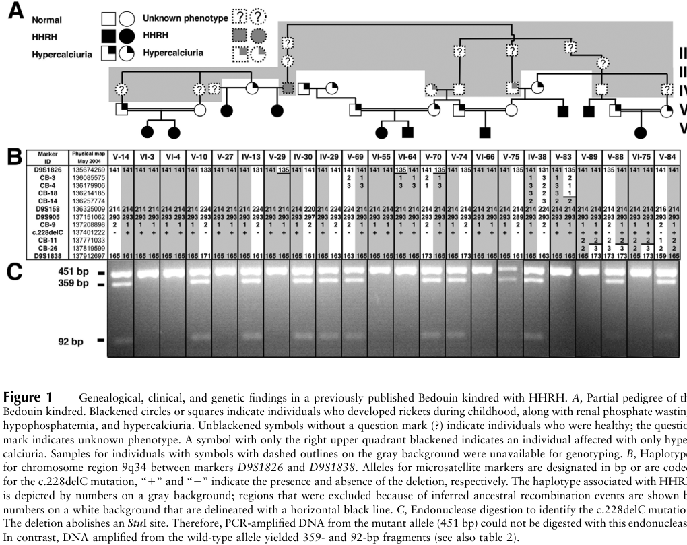

## Question

# Disease Characteristics Research Template

## Target Disease
- **Disease Name:** Hereditary Hypophosphatemic Rickets with Hypercalciuria
- **MONDO ID:** MONDO:0009431 (if available)
- **Category:** Mendelian

## Research Objectives

Please provide a comprehensive research report on **Hereditary Hypophosphatemic Rickets with Hypercalciuria** covering all of the
disease characteristics listed below. This report will be used to populate a disease knowledge
base entry. Be thorough and cite primary literature (PMID preferred) for all claims.

For each section, **suggested databases/resources** are listed. These are the first places
you should search for information on each topic.

---

### 1. Disease Information
> **Search first:** OMIM, Orphanet, ICD-10/ICD-11, MeSH, PubMed

- What is the disease? Provide a concise overview.
- What are the key identifiers? (OMIM, Orphanet, ICD-10/ICD-11, MeSH, Mondo)
- What are the common synonyms and alternative names?
- Is the information derived from individual patients (e.g., EHR) or aggregated disease-level resources?

### 2. Etiology

- **Disease Causal Factors**: What are the primary causes? (genetic, environmental, infectious, mechanistic)
- **Risk Factors**:
  > **Search first:** PubMed, Cochrane Library, UpToDate, clinical guidelines, ClinVar, ClinGen, GWAS Catalog, PheGenI, CTD, CDC, WHO, epidemiological databases
  - Genetic risk factors (causal variants, susceptibility loci, modifier genes)
  - Environmental risk factors (toxins, lifestyle, occupational exposures, age, sex, family history)
- **Protective Factors**:
  > **Search first:** PubMed, Cochrane Library, clinical trial databases, GWAS Catalog, gnomAD, WHO, CDC, nutrition databases
  - Genetic protective factors (protective variants, modifier alleles)
  - Environmental protective factors (diet, lifestyle, exposures that reduce risk)
- **Gene-Environment Interactions**: How do genetic and environmental factors interact to influence disease?
  > **Search first:** CTD, PubMed, PheGenI, GxE databases

### 3. Phenotypes
> **Search first:** HPO (Human Phenotype Ontology), OMIM, Orphanet, PubMed, clinicaltrials.gov, MedDRA, SNOMED CT, DECIPHER, LOINC

For each phenotype, provide:
- **Phenotype type**: symptoms, clinical signs, physical manifestations, behavioral changes, or laboratory abnormalities
  > For symptoms/signs: HPO, OMIM, Orphanet, PubMed
  > For behavioral changes: HPO, DSM, RDoC (Research Domain Criteria), PubMed
  > For laboratory abnormalities: LOINC, SNOMED CT, LabTests Online, PubMed
- **Phenotype characteristics**:
  > **Search first:** OMIM, Orphanet, HPO, PubMed
  - Age of symptom onset (neonatal, childhood, adult-onset, late-onset)
  - Symptom severity (mild, moderate, severe, variable)
  - Symptom progression (stable, progressive, episodic, fluctuating)
  - Frequency among affected individuals (percentage or qualitative)
- **Quality of life impact**: Effects on daily functioning and well-being (per-phenotype when possible)
  > **Search first:** EQ-5D database, SF-36, WHO QOL databases, PubMed
- Suggest HPO (Human Phenotype Ontology) terms for each phenotype

### 4. Genetic/Molecular Information

- **Causal Genes**: Gene mutations or chromosomal abnormalities responsible for disease (gene symbols, OMIM IDs)
  > **Search first:** OMIM, ClinVar, HGMD, Ensembl, NCBI Gene
- **Pathogenic Variants**:
  - Affected genes (gene symbols, HGNC IDs)
    > **Search first:** OMIM, NCBI Gene, Ensembl, HGNC, UniProt, GeneCards
  - Variant classification (pathogenic, likely pathogenic, VUS per ACMG/AMP guidelines)
    > **Search first:** ClinVar, ClinGen, ACMG/AMP guidelines, VarSome
  - Variant type/class (missense, frameshift, nonsense, splice-site, structural)
  - Allele frequency in population databases
    > **Search first:** gnomAD, 1000 Genomes, ExAC, TOPMed, dbSNP
  - Somatic vs germline origin
    > **Search first:** COSMIC (somatic), ClinVar, ICGC, TCGA
  - Functional consequences (loss of function, gain of function, dominant negative)
- **Modifier Genes**: Genes that modify disease severity or expression
- **Epigenetic Information**: DNA methylation, histone modifications, chromatin changes affecting disease
  > **Search first:** ENCODE, Roadmap Epigenomics, MethBase, DiseaseMeth
- **Chromosomal Abnormalities**: Large-scale genetic changes (aneuploidy, translocations, inversions)
  > **Search first:** DECIPHER, ClinVar, ECARUCA, UCSC Genome Browser

### 5. Environmental Information

- **Environmental Factors**: Non-genetic contributing factors (toxins, radiation, pollution, occupational exposure)
  > **Search first:** CTD (Comparative Toxicogenomics Database), TOXNET, PubMed, EPA databases
- **Lifestyle Factors**: Behavioral factors (smoking, diet, exercise, alcohol consumption)
  > **Search first:** CDC databases, WHO, PubMed, NHANES
- **Infectious Agents**: If applicable, pathogens causing or triggering disease (bacteria, viruses, fungi, parasites)
  > **Search first:** NCBI Taxonomy, ViPR, BV-BRC, MicrobeDB, GIDEON

### 6. Mechanism / Pathophysiology

**Present this section as an ordered causal chain first, then the detail below.**
Open with a numbered sequence of mechanistic steps running from the initiating
lesion (mutation, exposure, infection) to the clinical manifestation, one step per
line, each naming what it causes next. State the causal verb explicitly ("leads
to", "results in") and say where a step is inferred rather than demonstrated.
Where the mechanism branches, show the branch. The categories below are a
checklist of what to cover within those steps, not the organizing structure —
a step may draw on several of them, and a category may contribute to several
steps.

- **Molecular Pathways**: Specific signaling cascades or biochemical pathways involved (Wnt, MAPK, mTOR, PI3K-AKT, etc.)
  > **Search first:** KEGG, Reactome, WikiPathways, PathBank, BioCyc
- **Cellular Processes**: Cell-level mechanisms (apoptosis, autophagy, cell cycle dysregulation, inflammation, etc.)
  > **Search first:** Gene Ontology (GO), Reactome, KEGG, PubMed
- **Protein Dysfunction**: How protein structure or function is altered (misfolding, aggregation, loss of function, gain of function)
  > **Search first:** UniProt, PDB (Protein Data Bank), InterPro, Pfam, AlphaFold
- **Metabolic Changes**: Alterations in metabolic processes (energy metabolism, lipid metabolism, amino acid metabolism)
  > **Search first:** KEGG, BioCyc, HMDB (Human Metabolome Database), BRENDA
- **Immune System Involvement**: Role of immune response (autoimmunity, immunodeficiency, chronic inflammation)
  > **Search first:** ImmPort, Immunome Database, IEDB, Gene Ontology
- **Tissue Damage Mechanisms**: How tissues/ are injured (oxidative stress, ischemia, fibrosis, necrosis)
  > **Search first:** PubMed, Gene Ontology, Reactome
- **Biochemical Abnormalities**: Specific molecular defects (enzyme deficiencies, receptor dysfunction, ion channel defects)
  > **Search first:** BRENDA, UniProt, KEGG, OMIM, PubMed
- **Epigenetic Changes**: DNA methylation, histone modifications affecting gene expression in disease
  > **Search first:** ENCODE, Roadmap Epigenomics, MethBase, DiseaseMeth
- **Molecular Profiling** (if available):
  - Transcriptomics/gene expression changes
    > **Search first:** GEO (Gene Expression Omnibus), ArrayExpress, GTEx, Human Cell Atlas, SRA
  - Proteomics findings
    > **Search first:** PRIDE, ProteomeXchange, Human Protein Atlas, STRING, BioGRID
  - Metabolomics signatures
    > **Search first:** MetaboLights, Metabolomics Workbench, HMDB, METLIN
  - Lipidomics alterations
    > **Search first:** LIPID MAPS, SwissLipids, LipidHome, Metabolomics Workbench
  - Genomic structural features
    > **Search first:** UCSC Genome Browser, Ensembl, NCBI, dbVar, DGV
- **Advanced Technologies** (if applicable):
  - Single-cell analysis findings (cell-type specific mechanisms, cellular heterogeneity)
    > **Search first:** Human Cell Atlas, Single Cell Portal, GEO, CELLxGENE
  - Spatial transcriptomics findings
    > **Search first:** GEO, Spatial Research, Vizgen, 10x Genomics data
  - Multi-omics integration results
    > **Search first:** TCGA, ICGC, cBioPortal, LinkedOmics, PubMed
  - Functional genomics screens (CRISPR, RNAi)
    > **Search first:** DepMap, GenomeRNAi, PubMed, BioGRID ORCS

For each mechanism, describe:
- The causal chain from initial trigger to clinical manifestation
- Which mechanisms are upstream vs downstream
- What cell types and biological processes are involved
- Suggest GO terms for biological processes and CL terms for cell types

### 7. Anatomical Structures Affected

- **Organ Level**:
  - Primary organs directly affected
  - Secondary organ involvement (complications, secondary effects)
  - Body systems involved (cardiovascular, nervous, digestive, respiratory, endocrine, etc.)
  > **Search first:** Uberon, FMA (Foundational Model of Anatomy), OMIM, HPO, ICD-11, MeSH, SNOMED CT
- **Tissue and Cell Level**:
  - Specific tissue types affected (epithelial, connective, muscle, nervous)
  - Specific cell populations targeted (with Cell Ontology terms)
  > **Search first:** Uberon, Human Protein Atlas, Cell Ontology, Human Cell Atlas, CellMarker, PanglaoDB
- **Subcellular Level**:
  - Cellular compartments involved (mitochondria, nucleus, ER, lysosomes) (with GO Cellular Component terms)
  > **Search first:** Gene Ontology (Cellular Component), UniProt, Human Protein Atlas
- **Localization**:
  - Specific anatomical sites (with UBERON terms)
    > **Search first:** FMA, Uberon, NeuroNames (for brain), SNOMED CT
  - Lateralization (unilateral, bilateral, asymmetric)
    > **Search first:** HPO, clinical literature, imaging databases

### 8. Temporal Development

- **Onset**:
  - Typical age of onset (congenital, pediatric, adult, geriatric)
  - Onset pattern (acute, subacute, chronic, insidious)
  > **Search first:** OMIM, Orphanet, HPO, PubMed
- **Progression**:
  - Disease stages (early, intermediate, advanced, end-stage)
    > **Search first:** Cancer Staging Manual (AJCC), WHO classifications, PubMed
  - Progression rate (rapid, slow, variable)
  - Disease course pattern (episodic, relapsing-remitting, progressive, stable)
  - Disease duration (self-limited, chronic lifelong)
  > **Search first:** Disease registries, longitudinal cohort databases, natural history studies, PubMed, Orphanet, OMIM
- **Patterns**:
  - Remission patterns (spontaneous, treatment-induced)
    > **Search first:** Clinical trial databases, disease registries, PubMed
  - Critical periods (time windows of vulnerability or opportunity for intervention)
    > **Search first:** PubMed, developmental biology databases, clinical guidelines

### 9. Inheritance and Population

- **Epidemiology**:
  - Prevalence (cases per 100,000 at given time)
  - Incidence (new cases per 100,000 per year)
  > **Search first:** Orphanet, CDC, WHO, GBD (Global Burden of Disease), national registries, SEER, disease registries
- **For Genetic Etiology**:
  - Inheritance pattern (AD, AR, X-linked, mitochondrial, multifactorial, polygenic)
    > **Search first:** OMIM, Orphanet, ClinVar, GTR (Genetic Testing Registry)
  - Penetrance (complete, incomplete, age-dependent)
    > **Search first:** ClinVar, OMIM, PubMed, ClinGen
  - Expressivity (variable, consistent)
    > **Search first:** OMIM, ClinVar, PubMed
  - Genetic anticipation (increasing severity in successive generations)
    > **Search first:** OMIM, PubMed (especially for repeat expansion disorders)
  - Germline mosaicism
    > **Search first:** ClinVar, OMIM, genetic counseling literature, PubMed
  - Founder effects (population-specific mutations)
    > **Search first:** gnomAD, population genetics databases, PubMed
  - Consanguinity role
    > **Search first:** OMIM, population studies, genetic counseling resources
  - Carrier frequency
    > **Search first:** gnomAD, carrier screening databases, GeneReviews, GTR
- **Population Demographics**:
  - Affected populations (ethnic or demographic groups with higher prevalence)
    > **Search first:** gnomAD, 1000 Genomes, PAGE Study, PubMed, population registries
  - Geographic distribution (endemic areas, regional variation)
    > **Search first:** WHO, CDC, GBD, Orphanet, geographic epidemiology databases
  - Geographic distribution of specific variants
  - Sex ratio (male:female)
    > **Search first:** Disease registries, OMIM, PubMed, epidemiological databases
  - Age distribution of affected individuals
    > **Search first:** CDC, disease registries, SEER, Orphanet

### 10. Diagnostics

- **Clinical Tests**:
  - Laboratory tests (blood, urine, tissue chemistry, specific enzyme assays)
    > **Search first:** LOINC, LabTests Online, PubMed
  - Biomarkers (proteins, metabolites, genetic markers, circulating biomarkers)
    > **Search first:** FDA Biomarker List, BEST (Biomarkers, EndpointS, and other Tools), PubMed
  - Imaging studies (X-ray, CT, MRI, PET, ultrasound)
    > **Search first:** RadLex, DICOM, Radiopaedia, imaging databases
  - Functional tests (pulmonary function, cardiac stress tests)
    > **Search first:** LOINC, clinical guidelines, PubMed
  - Electrophysiology (EEG, EMG, ECG, nerve conduction studies)
    > **Search first:** LOINC, clinical neurophysiology databases, PubMed
  - Biopsy findings (histopathology, immunohistochemistry)
    > **Search first:** SNOMED CT, College of American Pathologists resources, PubMed
  - Pathology findings (microscopic examination)
    > **Search first:** SNOMED CT, Digital Pathology databases, PubMed
- **Genetic Testing**:
  > **Search first:** GTR (Genetic Testing Registry), GeneReviews, ClinGen
  - Overview of recommended genetic testing approach
  - Whole genome sequencing (WGS) utility
    > **Search first:** GTR, ClinVar, GEL (Genomics England), gnomAD
  - Whole exome sequencing (WES) utility
    > **Search first:** GTR, ClinVar, OMIM, GeneMatcher
  - Gene panels (which panels, which genes)
    > **Search first:** GTR, ClinVar, laboratory-specific databases
  - Single gene testing
    > **Search first:** GTR, ClinVar, OMIM, GeneReviews
  - Chromosomal microarray (CMA)
    > **Search first:** DECIPHER, ClinVar, dbVar, ECARUCA
  - Karyotyping
    > **Search first:** Chromosome Abnormality Database, ClinVar, cytogenetics resources
  - FISH
    > **Search first:** ClinVar, cytogenetics databases, PubMed
  - Mitochondrial DNA testing
    > **Search first:** MITOMAP, MSeqDR, ClinVar, GTR
  - Repeat expansion testing
    > **Search first:** GTR, ClinVar, repeat expansion databases, PubMed
- **Omics-Based Diagnostics** (if applicable):
  - RNA sequencing / transcriptomics
    > **Search first:** GEO, ArrayExpress, GTEx, RNA-seq databases
  - Proteomics
    > **Search first:** PRIDE, ProteomeXchange, FDA Biomarker database
  - Metabolomics
    > **Search first:** MetaboLights, Metabolomics Workbench, HMDB
  - Epigenomics
    > **Search first:** GEO, ENCODE, Roadmap Epigenomics, MethBase
  - Liquid biopsy
    > **Search first:** COSMIC, ClinVar, liquid biopsy databases, PubMed
- **Clinical Criteria**:
  - Standardized diagnostic criteria (DSM, ICD, society guidelines)
    > **Search first:** DSM-5, ICD-11, clinical society guidelines, UpToDate
  - Differential diagnosis (other conditions to rule out, with distinguishing features)
    > **Search first:** DynaMed, UpToDate, clinical decision support systems
- **Screening**:
  - Screening methods for asymptomatic individuals (newborn screening, carrier screening, cascade screening)
    > **Search first:** ACMG recommendations, CDC newborn screening, GTR

### 11. Outcome/Prognosis

- **Survival and Mortality**:
  - Survival rate (5-year, 10-year, overall)
    > **Search first:** SEER, cancer registries, disease-specific registries, PubMed
  - Life expectancy (with and without treatment if applicable)
    > **Search first:** Orphanet, disease registries, actuarial databases, PubMed
  - Mortality rate
    > **Search first:** CDC, WHO, GBD, national mortality databases
  - Disease-specific mortality (deaths directly attributable to disease)
    > **Search first:** Disease registries, CDC Wonder, GBD, PubMed
- **Morbidity and Function**:
  - Morbidity (disease-related disability and health impacts)
    > **Search first:** GBD, WHO, disability databases, PubMed
  - Disability outcomes (long-term functional impairments)
    > **Search first:** ICF (International Classification of Functioning), disability registries
  - Quality of life measures (EQ-5D, SF-36, PROMIS, disease-specific tools)
    > **Search first:** EQ-5D database, SF-36, PROMIS, PubMed
- **Disease Course**:
  - Complications (secondary problems: infections, organ failure, etc.)
    > **Search first:** ICD codes, disease registries, clinical databases, PubMed
  - Recovery potential (likelihood and extent of recovery, with vs without treatment)
    > **Search first:** Natural history studies, rehabilitation databases, PubMed
- **Prediction**:
  - Prognostic factors (age, disease severity, biomarkers, treatment response)
    > **Search first:** Prognostic models databases, clinical calculators, PubMed
  - Prognostic biomarkers (molecular markers predicting disease course)
    > **Search first:** FDA Biomarker database, PubMed, cancer prognostic databases

### 12. Treatment

- **Pharmacotherapy**:
  - Pharmacological treatments (drug names, drug classes, mechanisms of action)
    > **Search first:** DrugBank, RxNorm, ATC classification, DailyMed, FDA databases
  - Pharmacogenomics (how genetic variants affect drug metabolism, efficacy, toxicity)
    > **Search first:** PharmGKB, CPIC (Clinical Pharmacogenetics), FDA Table of PGx Biomarkers
- **Advanced Therapeutics**:
  - Gene therapy (viral vectors, CRISPR, gene replacement, gene editing)
    > **Search first:** ClinicalTrials.gov, FDA gene therapy database, ASGCT resources
  - Cell therapy (stem cell transplant, CAR-T, cellular therapeutics)
    > **Search first:** ClinicalTrials.gov, FDA cell therapy database, FACT standards
  - RNA-based therapies (ASOs, siRNA, mRNA therapies)
    > **Search first:** ClinicalTrials.gov, FDA approvals, PubMed
  - Targeted therapies (treatments directed at specific molecular targets)
    > **Search first:** My Cancer Genome, OncoKB, ClinicalTrials.gov, FDA approvals
  - Immunotherapies (checkpoint inhibitors, monoclonal antibodies)
    > **Search first:** Cancer Immunotherapy Database, FDA approvals, ClinicalTrials.gov
- **Surgical and Interventional**:
  - Surgical interventions (types of surgery, timing, outcomes)
    > **Search first:** CPT codes, surgical registries, clinical guidelines, PubMed
- **Supportive and Rehabilitative**:
  - Supportive care (symptom management, pain control, nutrition)
    > **Search first:** Clinical guidelines, Cochrane Library, PubMed
  - Rehabilitation (physical therapy, occupational therapy, speech therapy)
    > **Search first:** Rehabilitation medicine databases, clinical guidelines, PubMed
- **Experimental**:
  - Experimental treatments in clinical trials (with NCT identifiers if available)
    > **Search first:** ClinicalTrials.gov, EU Clinical Trials Register, WHO ICTRP
- **Treatment Outcomes**:
  - Treatment response rates
    > **Search first:** Clinical trial databases, FDA reviews, systematic reviews, PubMed
  - Side effects and adverse events
    > **Search first:** FDA Adverse Event Reporting System (FAERS), MedWatch, PubMed
- **Treatment Strategy**:
  - Treatment algorithms (clinical pathways, decision trees)
    > **Search first:** Clinical practice guidelines, NCCN Guidelines, UpToDate
  - Combination therapies
    > **Search first:** ClinicalTrials.gov, treatment guidelines, PubMed
  - Personalized medicine approaches (genotype-guided treatment)
    > **Search first:** My Cancer Genome, CIViC, PharmGKB, precision medicine databases

For each treatment, suggest NCIT (NCI Thesaurus) clinical-intervention terms where applicable.

### 13. Prevention

- **Prevention Levels**:
  - Primary prevention (preventing disease occurrence: vaccination, risk factor modification)
    > **Search first:** CDC, WHO, USPSTF recommendations, Cochrane Library
  - Secondary prevention (early detection and treatment: screening programs, early intervention)
    > **Search first:** USPSTF, CDC screening guidelines, WHO
  - Tertiary prevention (preventing complications in those with disease)
    > **Search first:** Clinical guidelines, disease management protocols, PubMed
- **Immunization**: Vaccine strategies (if applicable)
  > **Search first:** CDC vaccine schedules, WHO immunization, FDA vaccine database
- **Screening and Early Detection**:
  - Screening programs (population-based: newborn screening, cancer screening)
    > **Search first:** CDC screening programs, USPSTF, cancer screening databases
  - Genetic screening (carrier screening, preimplantation genetic diagnosis, prenatal testing)
    > **Search first:** ACMG recommendations, ACOG guidelines, GTR
  - Risk stratification (identifying high-risk individuals for targeted prevention)
    > **Search first:** Risk prediction models, clinical calculators, PubMed
- **Behavioral Interventions**: Lifestyle modifications to reduce risk
  > **Search first:** CDC, WHO, behavioral intervention databases, Cochrane Library
- **Counseling**: Genetic counseling (risk assessment, family planning guidance)
  > **Search first:** NSGC resources, ACMG guidelines, GeneReviews
- **Public Health**:
  - Public health interventions (sanitation, vector control, health education)
    > **Search first:** CDC, WHO, public health databases, PubMed
  - Environmental interventions (reducing environmental risk factors)
    > **Search first:** EPA databases, WHO environmental health, PubMed
- **Prophylaxis**: Preventive medications or procedures
  > **Search first:** Clinical guidelines, FDA approvals, PubMed

### 14. Other Species / Natural Disease

- **Taxonomy**: Species affected (with NCBI Taxon identifiers)
  > **Search first:** NCBI Taxonomy
- **Breed**: Specific breeds affected (with VBO identifiers if applicable)
  > **Search first:** VBO (Vertebrate Breed Ontology)
- **Gene**: Orthologous genes in other species (with NCBI Gene IDs)
  > **Search first:** NCBI Gene
- **Natural Disease**:
  - Naturally occurring disease in other species (companion animals, wildlife)
    > **Search first:** OMIA (Online Mendelian Inheritance in Animals), VetCompass, PubMed
  - Veterinary relevance and importance in animal health
    > **Search first:** OMIA, veterinary databases, PubMed
- **Comparative Biology**:
  - Comparative pathology (similarities and differences across species)
    > **Search first:** OMIA, comparative pathology databases, PubMed
  - Evolutionary conservation of disease mechanisms
    > **Search first:** HomoloGene, OrthoMCL, Alliance of Genome Resources
- **Transmission** (if applicable):
  - Zoonotic potential
    > **Search first:** CDC zoonotic diseases, WHO zoonoses, GIDEON
  - Cross-species susceptibility
    > **Search first:** NCBI Taxonomy, veterinary databases, PubMed

### 15. Model Organisms

- **Model Types**:
  - Model organism type (mammalian, invertebrate, cellular, in vitro)
    > **Search first:** Alliance of Genome Resources, model organism databases
  - Specific model systems (mouse, rat, zebrafish, Drosophila, C. elegans, yeast, cell lines, organoids, iPSCs)
    > **Search first:** MGI, RGD, ZFIN, FlyBase, WormBase, SGD, ATCC, Cellosaurus
  - Induced models (drug treatment, surgical intervention, environmental manipulation)
    > **Search first:** MGI, model organism databases, PubMed
- **Genetic Models**:
  - Types available (knockout, knock-in, transgenic, conditional, humanized)
    > **Search first:** MGI, IMPC, KOMP, EuMMCR, IMSR
- **Model Characteristics**:
  - Phenotype recapitulation (how well model reproduces human disease features)
    > **Search first:** Model organism databases, comparative studies, PubMed
  - Model limitations (aspects of human disease not captured)
    > **Search first:** Model organism databases, PubMed, review articles
- **Applications**:
  - Research applications (what aspects of disease can be studied)
    > **Search first:** Model organism databases, PubMed
- **Resources**:
  - Model databases
    > **Search first:** MGI, RGD, ZFIN, FlyBase, WormBase, IMSR, EMMA, MMRRC

---

## Citation Requirements

- Cite primary literature (PMID preferred) for all mechanistic and clinical claims
- Prioritize recent reviews and landmark papers
- Include direct quotes from abstracts where possible to support key statements
- Distinguish evidence source types: human clinical, model organism, in vitro, computational

## Output Format

Structure your response as a comprehensive narrative organized by the sections above.
For each section, provide:
- Factual content with specific details (numbers, percentages, gene names, variant nomenclature)
- Ontology term suggestions (HPO, GO, CL, UBERON, CHEBI, NCIT, MONDO) where applicable
- Evidence citations with PMIDs
- Direct quotes from abstracts to support key claims
- Clear indication when information is not available or not applicable for this disease

This report will be used to populate a disease knowledge base entry with:
- Pathophysiology descriptions with causal chains
- Gene/protein annotations (HGNC, GO terms)
- Phenotype associations (HP terms) with frequencies
- Cell type involvement (CL terms)
- Anatomical locations (UBERON terms)
- Chemical entities (CHEBI terms)
- Treatment annotations (NCIT terms)
- Evidence items with PMIDs and exact abstract quotes
- Epidemiology, prognosis, diagnostic, and prevention information
- Animal model descriptions with phenotype recapitulation details

## Output

Question: You are an expert researcher providing comprehensive, well-cited information.

Provide detailed information focusing on:
1. Key concepts and definitions with current understanding
2. Recent developments and latest research (prioritize 2023-2024 sources)
3. Current applications and real-world implementations
4. Expert opinions and analysis from authoritative sources
5. Relevant statistics and data from recent studies

Format as a comprehensive research report with proper citations. Include URLs and publication dates where available.
Always prioritize recent, authoritative sources and provide specific citations for all major claims.

# Disease Characteristics Research Template

## Target Disease
- **Disease Name:** Hereditary Hypophosphatemic Rickets with Hypercalciuria
- **MONDO ID:** MONDO:0009431 (if available)
- **Category:** Mendelian

## Research Objectives

Please provide a comprehensive research report on **Hereditary Hypophosphatemic Rickets with Hypercalciuria** covering all of the
disease characteristics listed below. This report will be used to populate a disease knowledge
base entry. Be thorough and cite primary literature (PMID preferred) for all claims.

For each section, **suggested databases/resources** are listed. These are the first places
you should search for information on each topic.

---

### 1. Disease Information
> **Search first:** OMIM, Orphanet, ICD-10/ICD-11, MeSH, PubMed

- What is the disease? Provide a concise overview.
- What are the key identifiers? (OMIM, Orphanet, ICD-10/ICD-11, MeSH, Mondo)
- What are the common synonyms and alternative names?
- Is the information derived from individual patients (e.g., EHR) or aggregated disease-level resources?

### 2. Etiology

- **Disease Causal Factors**: What are the primary causes? (genetic, environmental, infectious, mechanistic)
- **Risk Factors**:
  > **Search first:** PubMed, Cochrane Library, UpToDate, clinical guidelines, ClinVar, ClinGen, GWAS Catalog, PheGenI, CTD, CDC, WHO, epidemiological databases
  - Genetic risk factors (causal variants, susceptibility loci, modifier genes)
  - Environmental risk factors (toxins, lifestyle, occupational exposures, age, sex, family history)
- **Protective Factors**:
  > **Search first:** PubMed, Cochrane Library, clinical trial databases, GWAS Catalog, gnomAD, WHO, CDC, nutrition databases
  - Genetic protective factors (protective variants, modifier alleles)
  - Environmental protective factors (diet, lifestyle, exposures that reduce risk)
- **Gene-Environment Interactions**: How do genetic and environmental factors interact to influence disease?
  > **Search first:** CTD, PubMed, PheGenI, GxE databases

### 3. Phenotypes
> **Search first:** HPO (Human Phenotype Ontology), OMIM, Orphanet, PubMed, clinicaltrials.gov, MedDRA, SNOMED CT, DECIPHER, LOINC

For each phenotype, provide:
- **Phenotype type**: symptoms, clinical signs, physical manifestations, behavioral changes, or laboratory abnormalities
  > For symptoms/signs: HPO, OMIM, Orphanet, PubMed
  > For behavioral changes: HPO, DSM, RDoC (Research Domain Criteria), PubMed
  > For laboratory abnormalities: LOINC, SNOMED CT, LabTests Online, PubMed
- **Phenotype characteristics**:
  > **Search first:** OMIM, Orphanet, HPO, PubMed
  - Age of symptom onset (neonatal, childhood, adult-onset, late-onset)
  - Symptom severity (mild, moderate, severe, variable)
  - Symptom progression (stable, progressive, episodic, fluctuating)
  - Frequency among affected individuals (percentage or qualitative)
- **Quality of life impact**: Effects on daily functioning and well-being (per-phenotype when possible)
  > **Search first:** EQ-5D database, SF-36, WHO QOL databases, PubMed
- Suggest HPO (Human Phenotype Ontology) terms for each phenotype

### 4. Genetic/Molecular Information

- **Causal Genes**: Gene mutations or chromosomal abnormalities responsible for disease (gene symbols, OMIM IDs)
  > **Search first:** OMIM, ClinVar, HGMD, Ensembl, NCBI Gene
- **Pathogenic Variants**:
  - Affected genes (gene symbols, HGNC IDs)
    > **Search first:** OMIM, NCBI Gene, Ensembl, HGNC, UniProt, GeneCards
  - Variant classification (pathogenic, likely pathogenic, VUS per ACMG/AMP guidelines)
    > **Search first:** ClinVar, ClinGen, ACMG/AMP guidelines, VarSome
  - Variant type/class (missense, frameshift, nonsense, splice-site, structural)
  - Allele frequency in population databases
    > **Search first:** gnomAD, 1000 Genomes, ExAC, TOPMed, dbSNP
  - Somatic vs germline origin
    > **Search first:** COSMIC (somatic), ClinVar, ICGC, TCGA
  - Functional consequences (loss of function, gain of function, dominant negative)
- **Modifier Genes**: Genes that modify disease severity or expression
- **Epigenetic Information**: DNA methylation, histone modifications, chromatin changes affecting disease
  > **Search first:** ENCODE, Roadmap Epigenomics, MethBase, DiseaseMeth
- **Chromosomal Abnormalities**: Large-scale genetic changes (aneuploidy, translocations, inversions)
  > **Search first:** DECIPHER, ClinVar, ECARUCA, UCSC Genome Browser

### 5. Environmental Information

- **Environmental Factors**: Non-genetic contributing factors (toxins, radiation, pollution, occupational exposure)
  > **Search first:** CTD (Comparative Toxicogenomics Database), TOXNET, PubMed, EPA databases
- **Lifestyle Factors**: Behavioral factors (smoking, diet, exercise, alcohol consumption)
  > **Search first:** CDC databases, WHO, PubMed, NHANES
- **Infectious Agents**: If applicable, pathogens causing or triggering disease (bacteria, viruses, fungi, parasites)
  > **Search first:** NCBI Taxonomy, ViPR, BV-BRC, MicrobeDB, GIDEON

### 6. Mechanism / Pathophysiology

**Present this section as an ordered causal chain first, then the detail below.**
Open with a numbered sequence of mechanistic steps running from the initiating
lesion (mutation, exposure, infection) to the clinical manifestation, one step per
line, each naming what it causes next. State the causal verb explicitly ("leads
to", "results in") and say where a step is inferred rather than demonstrated.
Where the mechanism branches, show the branch. The categories below are a
checklist of what to cover within those steps, not the organizing structure —
a step may draw on several of them, and a category may contribute to several
steps.

- **Molecular Pathways**: Specific signaling cascades or biochemical pathways involved (Wnt, MAPK, mTOR, PI3K-AKT, etc.)
  > **Search first:** KEGG, Reactome, WikiPathways, PathBank, BioCyc
- **Cellular Processes**: Cell-level mechanisms (apoptosis, autophagy, cell cycle dysregulation, inflammation, etc.)
  > **Search first:** Gene Ontology (GO), Reactome, KEGG, PubMed
- **Protein Dysfunction**: How protein structure or function is altered (misfolding, aggregation, loss of function, gain of function)
  > **Search first:** UniProt, PDB (Protein Data Bank), InterPro, Pfam, AlphaFold
- **Metabolic Changes**: Alterations in metabolic processes (energy metabolism, lipid metabolism, amino acid metabolism)
  > **Search first:** KEGG, BioCyc, HMDB (Human Metabolome Database), BRENDA
- **Immune System Involvement**: Role of immune response (autoimmunity, immunodeficiency, chronic inflammation)
  > **Search first:** ImmPort, Immunome Database, IEDB, Gene Ontology
- **Tissue Damage Mechanisms**: How tissues/ are injured (oxidative stress, ischemia, fibrosis, necrosis)
  > **Search first:** PubMed, Gene Ontology, Reactome
- **Biochemical Abnormalities**: Specific molecular defects (enzyme deficiencies, receptor dysfunction, ion channel defects)
  > **Search first:** BRENDA, UniProt, KEGG, OMIM, PubMed
- **Epigenetic Changes**: DNA methylation, histone modifications affecting gene expression in disease
  > **Search first:** ENCODE, Roadmap Epigenomics, MethBase, DiseaseMeth
- **Molecular Profiling** (if available):
  - Transcriptomics/gene expression changes
    > **Search first:** GEO (Gene Expression Omnibus), ArrayExpress, GTEx, Human Cell Atlas, SRA
  - Proteomics findings
    > **Search first:** PRIDE, ProteomeXchange, Human Protein Atlas, STRING, BioGRID
  - Metabolomics signatures
    > **Search first:** MetaboLights, Metabolomics Workbench, HMDB, METLIN
  - Lipidomics alterations
    > **Search first:** LIPID MAPS, SwissLipids, LipidHome, Metabolomics Workbench
  - Genomic structural features
    > **Search first:** UCSC Genome Browser, Ensembl, NCBI, dbVar, DGV
- **Advanced Technologies** (if applicable):
  - Single-cell analysis findings (cell-type specific mechanisms, cellular heterogeneity)
    > **Search first:** Human Cell Atlas, Single Cell Portal, GEO, CELLxGENE
  - Spatial transcriptomics findings
    > **Search first:** GEO, Spatial Research, Vizgen, 10x Genomics data
  - Multi-omics integration results
    > **Search first:** TCGA, ICGC, cBioPortal, LinkedOmics, PubMed
  - Functional genomics screens (CRISPR, RNAi)
    > **Search first:** DepMap, GenomeRNAi, PubMed, BioGRID ORCS

For each mechanism, describe:
- The causal chain from initial trigger to clinical manifestation
- Which mechanisms are upstream vs downstream
- What cell types and biological processes are involved
- Suggest GO terms for biological processes and CL terms for cell types

### 7. Anatomical Structures Affected

- **Organ Level**:
  - Primary organs directly affected
  - Secondary organ involvement (complications, secondary effects)
  - Body systems involved (cardiovascular, nervous, digestive, respiratory, endocrine, etc.)
  > **Search first:** Uberon, FMA (Foundational Model of Anatomy), OMIM, HPO, ICD-11, MeSH, SNOMED CT
- **Tissue and Cell Level**:
  - Specific tissue types affected (epithelial, connective, muscle, nervous)
  - Specific cell populations targeted (with Cell Ontology terms)
  > **Search first:** Uberon, Human Protein Atlas, Cell Ontology, Human Cell Atlas, CellMarker, PanglaoDB
- **Subcellular Level**:
  - Cellular compartments involved (mitochondria, nucleus, ER, lysosomes) (with GO Cellular Component terms)
  > **Search first:** Gene Ontology (Cellular Component), UniProt, Human Protein Atlas
- **Localization**:
  - Specific anatomical sites (with UBERON terms)
    > **Search first:** FMA, Uberon, NeuroNames (for brain), SNOMED CT
  - Lateralization (unilateral, bilateral, asymmetric)
    > **Search first:** HPO, clinical literature, imaging databases

### 8. Temporal Development

- **Onset**:
  - Typical age of onset (congenital, pediatric, adult, geriatric)
  - Onset pattern (acute, subacute, chronic, insidious)
  > **Search first:** OMIM, Orphanet, HPO, PubMed
- **Progression**:
  - Disease stages (early, intermediate, advanced, end-stage)
    > **Search first:** Cancer Staging Manual (AJCC), WHO classifications, PubMed
  - Progression rate (rapid, slow, variable)
  - Disease course pattern (episodic, relapsing-remitting, progressive, stable)
  - Disease duration (self-limited, chronic lifelong)
  > **Search first:** Disease registries, longitudinal cohort databases, natural history studies, PubMed, Orphanet, OMIM
- **Patterns**:
  - Remission patterns (spontaneous, treatment-induced)
    > **Search first:** Clinical trial databases, disease registries, PubMed
  - Critical periods (time windows of vulnerability or opportunity for intervention)
    > **Search first:** PubMed, developmental biology databases, clinical guidelines

### 9. Inheritance and Population

- **Epidemiology**:
  - Prevalence (cases per 100,000 at given time)
  - Incidence (new cases per 100,000 per year)
  > **Search first:** Orphanet, CDC, WHO, GBD (Global Burden of Disease), national registries, SEER, disease registries
- **For Genetic Etiology**:
  - Inheritance pattern (AD, AR, X-linked, mitochondrial, multifactorial, polygenic)
    > **Search first:** OMIM, Orphanet, ClinVar, GTR (Genetic Testing Registry)
  - Penetrance (complete, incomplete, age-dependent)
    > **Search first:** ClinVar, OMIM, PubMed, ClinGen
  - Expressivity (variable, consistent)
    > **Search first:** OMIM, ClinVar, PubMed
  - Genetic anticipation (increasing severity in successive generations)
    > **Search first:** OMIM, PubMed (especially for repeat expansion disorders)
  - Germline mosaicism
    > **Search first:** ClinVar, OMIM, genetic counseling literature, PubMed
  - Founder effects (population-specific mutations)
    > **Search first:** gnomAD, population genetics databases, PubMed
  - Consanguinity role
    > **Search first:** OMIM, population studies, genetic counseling resources
  - Carrier frequency
    > **Search first:** gnomAD, carrier screening databases, GeneReviews, GTR
- **Population Demographics**:
  - Affected populations (ethnic or demographic groups with higher prevalence)
    > **Search first:** gnomAD, 1000 Genomes, PAGE Study, PubMed, population registries
  - Geographic distribution (endemic areas, regional variation)
    > **Search first:** WHO, CDC, GBD, Orphanet, geographic epidemiology databases
  - Geographic distribution of specific variants
  - Sex ratio (male:female)
    > **Search first:** Disease registries, OMIM, PubMed, epidemiological databases
  - Age distribution of affected individuals
    > **Search first:** CDC, disease registries, SEER, Orphanet

### 10. Diagnostics

- **Clinical Tests**:
  - Laboratory tests (blood, urine, tissue chemistry, specific enzyme assays)
    > **Search first:** LOINC, LabTests Online, PubMed
  - Biomarkers (proteins, metabolites, genetic markers, circulating biomarkers)
    > **Search first:** FDA Biomarker List, BEST (Biomarkers, EndpointS, and other Tools), PubMed
  - Imaging studies (X-ray, CT, MRI, PET, ultrasound)
    > **Search first:** RadLex, DICOM, Radiopaedia, imaging databases
  - Functional tests (pulmonary function, cardiac stress tests)
    > **Search first:** LOINC, clinical guidelines, PubMed
  - Electrophysiology (EEG, EMG, ECG, nerve conduction studies)
    > **Search first:** LOINC, clinical neurophysiology databases, PubMed
  - Biopsy findings (histopathology, immunohistochemistry)
    > **Search first:** SNOMED CT, College of American Pathologists resources, PubMed
  - Pathology findings (microscopic examination)
    > **Search first:** SNOMED CT, Digital Pathology databases, PubMed
- **Genetic Testing**:
  > **Search first:** GTR (Genetic Testing Registry), GeneReviews, ClinGen
  - Overview of recommended genetic testing approach
  - Whole genome sequencing (WGS) utility
    > **Search first:** GTR, ClinVar, GEL (Genomics England), gnomAD
  - Whole exome sequencing (WES) utility
    > **Search first:** GTR, ClinVar, OMIM, GeneMatcher
  - Gene panels (which panels, which genes)
    > **Search first:** GTR, ClinVar, laboratory-specific databases
  - Single gene testing
    > **Search first:** GTR, ClinVar, OMIM, GeneReviews
  - Chromosomal microarray (CMA)
    > **Search first:** DECIPHER, ClinVar, dbVar, ECARUCA
  - Karyotyping
    > **Search first:** Chromosome Abnormality Database, ClinVar, cytogenetics resources
  - FISH
    > **Search first:** ClinVar, cytogenetics databases, PubMed
  - Mitochondrial DNA testing
    > **Search first:** MITOMAP, MSeqDR, ClinVar, GTR
  - Repeat expansion testing
    > **Search first:** GTR, ClinVar, repeat expansion databases, PubMed
- **Omics-Based Diagnostics** (if applicable):
  - RNA sequencing / transcriptomics
    > **Search first:** GEO, ArrayExpress, GTEx, RNA-seq databases
  - Proteomics
    > **Search first:** PRIDE, ProteomeXchange, FDA Biomarker database
  - Metabolomics
    > **Search first:** MetaboLights, Metabolomics Workbench, HMDB
  - Epigenomics
    > **Search first:** GEO, ENCODE, Roadmap Epigenomics, MethBase
  - Liquid biopsy
    > **Search first:** COSMIC, ClinVar, liquid biopsy databases, PubMed
- **Clinical Criteria**:
  - Standardized diagnostic criteria (DSM, ICD, society guidelines)
    > **Search first:** DSM-5, ICD-11, clinical society guidelines, UpToDate
  - Differential diagnosis (other conditions to rule out, with distinguishing features)
    > **Search first:** DynaMed, UpToDate, clinical decision support systems
- **Screening**:
  - Screening methods for asymptomatic individuals (newborn screening, carrier screening, cascade screening)
    > **Search first:** ACMG recommendations, CDC newborn screening, GTR

### 11. Outcome/Prognosis

- **Survival and Mortality**:
  - Survival rate (5-year, 10-year, overall)
    > **Search first:** SEER, cancer registries, disease-specific registries, PubMed
  - Life expectancy (with and without treatment if applicable)
    > **Search first:** Orphanet, disease registries, actuarial databases, PubMed
  - Mortality rate
    > **Search first:** CDC, WHO, GBD, national mortality databases
  - Disease-specific mortality (deaths directly attributable to disease)
    > **Search first:** Disease registries, CDC Wonder, GBD, PubMed
- **Morbidity and Function**:
  - Morbidity (disease-related disability and health impacts)
    > **Search first:** GBD, WHO, disability databases, PubMed
  - Disability outcomes (long-term functional impairments)
    > **Search first:** ICF (International Classification of Functioning), disability registries
  - Quality of life measures (EQ-5D, SF-36, PROMIS, disease-specific tools)
    > **Search first:** EQ-5D database, SF-36, PROMIS, PubMed
- **Disease Course**:
  - Complications (secondary problems: infections, organ failure, etc.)
    > **Search first:** ICD codes, disease registries, clinical databases, PubMed
  - Recovery potential (likelihood and extent of recovery, with vs without treatment)
    > **Search first:** Natural history studies, rehabilitation databases, PubMed
- **Prediction**:
  - Prognostic factors (age, disease severity, biomarkers, treatment response)
    > **Search first:** Prognostic models databases, clinical calculators, PubMed
  - Prognostic biomarkers (molecular markers predicting disease course)
    > **Search first:** FDA Biomarker database, PubMed, cancer prognostic databases

### 12. Treatment

- **Pharmacotherapy**:
  - Pharmacological treatments (drug names, drug classes, mechanisms of action)
    > **Search first:** DrugBank, RxNorm, ATC classification, DailyMed, FDA databases
  - Pharmacogenomics (how genetic variants affect drug metabolism, efficacy, toxicity)
    > **Search first:** PharmGKB, CPIC (Clinical Pharmacogenetics), FDA Table of PGx Biomarkers
- **Advanced Therapeutics**:
  - Gene therapy (viral vectors, CRISPR, gene replacement, gene editing)
    > **Search first:** ClinicalTrials.gov, FDA gene therapy database, ASGCT resources
  - Cell therapy (stem cell transplant, CAR-T, cellular therapeutics)
    > **Search first:** ClinicalTrials.gov, FDA cell therapy database, FACT standards
  - RNA-based therapies (ASOs, siRNA, mRNA therapies)
    > **Search first:** ClinicalTrials.gov, FDA approvals, PubMed
  - Targeted therapies (treatments directed at specific molecular targets)
    > **Search first:** My Cancer Genome, OncoKB, ClinicalTrials.gov, FDA approvals
  - Immunotherapies (checkpoint inhibitors, monoclonal antibodies)
    > **Search first:** Cancer Immunotherapy Database, FDA approvals, ClinicalTrials.gov
- **Surgical and Interventional**:
  - Surgical interventions (types of surgery, timing, outcomes)
    > **Search first:** CPT codes, surgical registries, clinical guidelines, PubMed
- **Supportive and Rehabilitative**:
  - Supportive care (symptom management, pain control, nutrition)
    > **Search first:** Clinical guidelines, Cochrane Library, PubMed
  - Rehabilitation (physical therapy, occupational therapy, speech therapy)
    > **Search first:** Rehabilitation medicine databases, clinical guidelines, PubMed
- **Experimental**:
  - Experimental treatments in clinical trials (with NCT identifiers if available)
    > **Search first:** ClinicalTrials.gov, EU Clinical Trials Register, WHO ICTRP
- **Treatment Outcomes**:
  - Treatment response rates
    > **Search first:** Clinical trial databases, FDA reviews, systematic reviews, PubMed
  - Side effects and adverse events
    > **Search first:** FDA Adverse Event Reporting System (FAERS), MedWatch, PubMed
- **Treatment Strategy**:
  - Treatment algorithms (clinical pathways, decision trees)
    > **Search first:** Clinical practice guidelines, NCCN Guidelines, UpToDate
  - Combination therapies
    > **Search first:** ClinicalTrials.gov, treatment guidelines, PubMed
  - Personalized medicine approaches (genotype-guided treatment)
    > **Search first:** My Cancer Genome, CIViC, PharmGKB, precision medicine databases

For each treatment, suggest NCIT (NCI Thesaurus) clinical-intervention terms where applicable.

### 13. Prevention

- **Prevention Levels**:
  - Primary prevention (preventing disease occurrence: vaccination, risk factor modification)
    > **Search first:** CDC, WHO, USPSTF recommendations, Cochrane Library
  - Secondary prevention (early detection and treatment: screening programs, early intervention)
    > **Search first:** USPSTF, CDC screening guidelines, WHO
  - Tertiary prevention (preventing complications in those with disease)
    > **Search first:** Clinical guidelines, disease management protocols, PubMed
- **Immunization**: Vaccine strategies (if applicable)
  > **Search first:** CDC vaccine schedules, WHO immunization, FDA vaccine database
- **Screening and Early Detection**:
  - Screening programs (population-based: newborn screening, cancer screening)
    > **Search first:** CDC screening programs, USPSTF, cancer screening databases
  - Genetic screening (carrier screening, preimplantation genetic diagnosis, prenatal testing)
    > **Search first:** ACMG recommendations, ACOG guidelines, GTR
  - Risk stratification (identifying high-risk individuals for targeted prevention)
    > **Search first:** Risk prediction models, clinical calculators, PubMed
- **Behavioral Interventions**: Lifestyle modifications to reduce risk
  > **Search first:** CDC, WHO, behavioral intervention databases, Cochrane Library
- **Counseling**: Genetic counseling (risk assessment, family planning guidance)
  > **Search first:** NSGC resources, ACMG guidelines, GeneReviews
- **Public Health**:
  - Public health interventions (sanitation, vector control, health education)
    > **Search first:** CDC, WHO, public health databases, PubMed
  - Environmental interventions (reducing environmental risk factors)
    > **Search first:** EPA databases, WHO environmental health, PubMed
- **Prophylaxis**: Preventive medications or procedures
  > **Search first:** Clinical guidelines, FDA approvals, PubMed

### 14. Other Species / Natural Disease

- **Taxonomy**: Species affected (with NCBI Taxon identifiers)
  > **Search first:** NCBI Taxonomy
- **Breed**: Specific breeds affected (with VBO identifiers if applicable)
  > **Search first:** VBO (Vertebrate Breed Ontology)
- **Gene**: Orthologous genes in other species (with NCBI Gene IDs)
  > **Search first:** NCBI Gene
- **Natural Disease**:
  - Naturally occurring disease in other species (companion animals, wildlife)
    > **Search first:** OMIA (Online Mendelian Inheritance in Animals), VetCompass, PubMed
  - Veterinary relevance and importance in animal health
    > **Search first:** OMIA, veterinary databases, PubMed
- **Comparative Biology**:
  - Comparative pathology (similarities and differences across species)
    > **Search first:** OMIA, comparative pathology databases, PubMed
  - Evolutionary conservation of disease mechanisms
    > **Search first:** HomoloGene, OrthoMCL, Alliance of Genome Resources
- **Transmission** (if applicable):
  - Zoonotic potential
    > **Search first:** CDC zoonotic diseases, WHO zoonoses, GIDEON
  - Cross-species susceptibility
    > **Search first:** NCBI Taxonomy, veterinary databases, PubMed

### 15. Model Organisms

- **Model Types**:
  - Model organism type (mammalian, invertebrate, cellular, in vitro)
    > **Search first:** Alliance of Genome Resources, model organism databases
  - Specific model systems (mouse, rat, zebrafish, Drosophila, C. elegans, yeast, cell lines, organoids, iPSCs)
    > **Search first:** MGI, RGD, ZFIN, FlyBase, WormBase, SGD, ATCC, Cellosaurus
  - Induced models (drug treatment, surgical intervention, environmental manipulation)
    > **Search first:** MGI, model organism databases, PubMed
- **Genetic Models**:
  - Types available (knockout, knock-in, transgenic, conditional, humanized)
    > **Search first:** MGI, IMPC, KOMP, EuMMCR, IMSR
- **Model Characteristics**:
  - Phenotype recapitulation (how well model reproduces human disease features)
    > **Search first:** Model organism databases, comparative studies, PubMed
  - Model limitations (aspects of human disease not captured)
    > **Search first:** Model organism databases, PubMed, review articles
- **Applications**:
  - Research applications (what aspects of disease can be studied)
    > **Search first:** Model organism databases, PubMed
- **Resources**:
  - Model databases
    > **Search first:** MGI, RGD, ZFIN, FlyBase, WormBase, IMSR, EMMA, MMRRC

---

## Citation Requirements

- Cite primary literature (PMID preferred) for all mechanistic and clinical claims
- Prioritize recent reviews and landmark papers
- Include direct quotes from abstracts where possible to support key statements
- Distinguish evidence source types: human clinical, model organism, in vitro, computational

## Output Format

Structure your response as a comprehensive narrative organized by the sections above.
For each section, provide:
- Factual content with specific details (numbers, percentages, gene names, variant nomenclature)
- Ontology term suggestions (HPO, GO, CL, UBERON, CHEBI, NCIT, MONDO) where applicable
- Evidence citations with PMIDs
- Direct quotes from abstracts to support key claims
- Clear indication when information is not available or not applicable for this disease

This report will be used to populate a disease knowledge base entry with:
- Pathophysiology descriptions with causal chains
- Gene/protein annotations (HGNC, GO terms)
- Phenotype associations (HP terms) with frequencies
- Cell type involvement (CL terms)
- Anatomical locations (UBERON terms)
- Chemical entities (CHEBI terms)
- Treatment annotations (NCIT terms)
- Evidence items with PMIDs and exact abstract quotes
- Epidemiology, prognosis, diagnostic, and prevention information
- Animal model descriptions with phenotype recapitulation details

# Hereditary hypophosphatemic rickets with hypercalciuria: disease-characteristics report

**Scope and evidence.** Hereditary hypophosphatemic rickets with hypercalciuria (HHRH) is primarily a **biallelic SLC34A3-related, FGF23-independent renal phosphate-wasting disorder**. This report distinguishes classic HHRH from milder manifestations in people carrying one SLC34A3 variant and from an HHRH-like phenotype reported with variants in both SLC34A3 and SLC34A1. The underlying evidence is predominantly pedigrees, small clinical series, and functional experiments—not population-based natural-history studies. A relevant pedigree and chromosome 9 linkage figure from the original discovery study was also inspected. (bergwitz2006slc34a3mutationsin pages 1-2, bergwitz2006slc34a3mutationsin media d6e8d46f, gordon2020digenicheterozygousmutations pages 13-14)

### 1. Disease information

HHRH impairs renal phosphate conservation, causing phosphate deficiency and defective skeletal mineralization during growth. Its distinguishing biochemical feature is **hypercalciuria associated with increased—or inappropriately high—1,25-dihydroxyvitamin D**, rather than the FGF23-excess pattern characteristic of X-linked hypophosphatemia (XLH). **Identifiers:** MONDO:0009431; OMIM phenotype **241530**; causal-gene OMIM **609826** is reported for SLC34A3. Names include *HHRH*, *hypophosphatemic rickets with hypercalciuria*, and *autosomal-recessive hypophosphatemic rickets with hypercalciuria*. No disease-specific ICD-10, ICD-11, Orphanet, or MeSH identifier was independently verified; the ClinicalTrials.gov record indexes the component MeSH concepts hypophosphatemia **D017674**, rickets **D012279**, and hypercalciuria **D053565**. Evidence here concerns published, aggregated research participants and disease resources, **not individual electronic health records**. [Bergwitz et al., *Am J Hum Genet*, February 2006, https://doi.org/10.1086/499409.] (OpenTargets Search: hereditary hypophosphatemic rickets with hypercalciuria, bergwitz2006slc34a3mutationsin pages 1-2, NCT03771105 chunk 1)

### 2. Etiology, risk, protection, and gene–environment interactions

**Causal lesion.** Pathogenic variants affecting **both SLC34A3 alleles** impair the proximal-tubule sodium–phosphate cotransporter NaPi-IIc/NPT2C. Bergwitz and colleagues mapped disease to chromosome **9q34** in a Bedouin pedigree: all **10 affected** individuals among **63 genotyped** family members carried homozygous **c.228delC**, predicted to truncate the transporter; three other unrelated kindreds had biallelic variants. Consanguinity facilitated recognition of homozygosity in that pedigree but is not required: compound heterozygotes occur in unrelated-parent families. A parent or sibling with one pathogenic allele may have hypercalciuria or stones without classic rickets. [Bergwitz et al., 2006, https://doi.org/10.1086/499409; Dreimane et al., *Ther Adv Musculoskelet Dis*, 2020, https://doi.org/10.1177/1759720X20912862.] (bergwitz2006slc34a3mutationsin pages 1-2, dreimane2020descriptionofa pages 1-2)

**Modifiers and exposures.** A family study supports a potentially more severe, **digenic HHRH-like presentation** when heterozygous SLC34A3 and SLC34A1 variants co-occur; SLC34A1 should not therefore be entered as a second *established single-gene cause of classic HHRH* simply because a disease-association database links it to the phenotype. Neither a validated protective allele nor a quantified environmental risk or protection effect was identified. Dietary phosphate availability, vitamin-D status, and treatment exposures can alter biochemical expression; active vitamin-D analogues can aggravate hypercalciuria. Variable calcium excretion among relatives with the same SLC34A3 allele suggests additional genetic or environmental influences, but specific interactions have not been demonstrated. Smoking, occupation, pollutants, radiation, and infection have not been established as HHRH causes. [Gordon et al., *J Clin Endocrinol Metab*, 2020, https://doi.org/10.1210/clinem/dgaa217; Bergwitz et al., 2006; Dreimane et al., 2020.] (OpenTargets Search: hereditary hypophosphatemic rickets with hypercalciuria, gordon2020digenicheterozygousmutations pages 13-14, gordon2020digenicheterozygousmutations pages 12-13, bergwitz2006slc34a3mutationsin pages 9-11, dreimane2020descriptionofa pages 2-4)

### 3. Phenotypes and effects on daily life

The following are **suggested HPO labels**, not a validated HPO frequency export. Frequencies for individual findings are generally unavailable from representative HHRH cohorts; ascertainment through rickets or stones biases published case series. (bergwitz2006slc34a3mutationsin pages 1-2, hasaniranjbar2018slc34a3intronicdeletion pages 1-3, molin2021overlappingphenotypesassociated pages 8-9)

| Phenotype; suggested HPO term | Type and typical course | Evidence and functional impact |
|---|---|---|
| Renal phosphate wasting; **renal phosphate wasting** | Laboratory abnormality; intrinsic and persistent, though measured severity can vary with age and treatment | Reduced phosphate reabsorption is the proximal biochemical defect; measure tubular phosphate handling rather than relying on a single serum value. (bergwitz2006slc34a3mutationsin pages 1-2, gordon2020digenicheterozygousmutations pages 12-13) |
| **Hypophosphatemia** | Laboratory abnormality; usually childhood in classic HHRH, variable in milder disease | Two patients with biallelic SLC34A3 findings in a selected cohort had normal measured serum phosphate; normal phosphate on one occasion does not exclude the genotype. (molin2021overlappingphenotypesassociated pages 1-2) |
| **Hypercalciuria** | Laboratory abnormality; may also occur in heterozygotes | Predisposes to renal calcification and stones; reported as a principal manifestation in heterozygous relatives. (bergwitz2006slc34a3mutationsin pages 1-2, hasaniranjbar2018slc34a3intronicdeletion pages 1-3) |
| **Rickets**, **osteomalacia**, **bowing of the legs**, **short stature** | Skeletal signs, chiefly recognized in childhood; severity variable, potentially persistent | Leg deformity, delayed growth, pain, impaired walking, and sometimes corrective surgery can affect mobility and participation. Adult osteomalacia or low bone density can occur. These are clinical effects, not measured HHRH-specific EQ-5D or SF-36 results. (bergwitz2006slc34a3mutationsin pages 1-2, bergwitz2006slc34a3mutationsin pages 4-6, dreimane2020descriptionofa pages 2-4) |
| **Bone pain**, **muscle weakness** | Symptoms; variable | Can limit activity; phosphate-treated brothers reported improved pain without complete skeletal recovery. (bergwitz2006slc34a3mutationsin pages 1-2, dreimane2020descriptionofa pages 4-6) |
| **Nephrolithiasis**, **nephrocalcinosis** | Renal manifestations; sometimes recurrent, including in adults and heterozygotes | Stones can produce flank pain, obstruction, hydronephrosis, and need for lithotripsy; renal imaging helps detect silent calcification. (dreimane2020descriptionofa pages 2-4, hasaniranjbar2018slc34a3intronicdeletion pages 3-4) |
| **Elevated circulating 1,25-dihydroxyvitamin D**, **elevated alkaline phosphatase**, and **low or suppressed PTH/FGF23** | Biochemical pattern; levels vary with age, phosphate balance, assays, and treatment | Supports mechanism-based differential diagnosis; these are suggested phenotype labels whose exact HPO identifiers require ontology validation. (antonowicz2025approachtoa pages 11-12, jaureguiberry2008anovelmissense pages 1-2, dreimane2020descriptionofa pages 2-4) |

**Frequency illustration, not a population estimate:** an Iranian family's **12 assessed members** comprised **three homozygotes, seven heterozygotes, and two noncarriers**; seven relatives reportedly had stones. These proportions cannot be extrapolated to all affected people or interpreted as disease penetrance. [Hasani-Ranjbar et al., *J Clin Res Pediatr Endocrinol*, 2018, https://doi.org/10.4274/jcrpe.0057.] (hasaniranjbar2018slc34a3intronicdeletion pages 1-3, hasaniranjbar2018slc34a3intronicdeletion pages 3-4)

### 4. Genetic and molecular information

**Gene:** *SLC34A3*, encoding NaPi-IIc, an apical proximal-tubule phosphate cotransporter; mapped to **9q34**, Ensembl **ENSG00000198569**. The HGNC numerical identifier and variant-specific ClinVar assertions were not verified and should not be fabricated. Pathogenic findings include **c.228delC** (predicted truncation), **c.410C>T; p.Thr137Met** (missense), **c.671delT** (predicted frameshift), and intronic **101-bp** or **85-bp deletions** associated with aberrant splicing. Some older reports use genomic rather than transcript-normalized deletion nomenclature; clinically reported variants should be reconciled to a current reference transcript before database entry. These are **inherited germline** findings; a disease-defining somatic mechanism has not been reported here. [Bergwitz et al., 2006; Ichikawa et al., *J Clin Endocrinol Metab*, October 2006, https://doi.org/10.1210/jc.2005-2840; Dreimane et al., 2020.] (OpenTargets Search: hereditary hypophosphatemic rickets with hypercalciuria, bergwitz2006slc34a3mutationsin pages 1-2, ichikawa2006intronicdeletionsin pages 1-2, dreimane2020descriptionofa pages 4-6)

**Experimental variant effect:** in a patient with p.Thr137Met and a second truncating allele, p.Thr137Met had approximately **40% of normal membrane fluorescence** and, after adjustment for surface abundance, approximately **60% less phosphate uptake**, corresponding to about **16% overall residual transport** in heterologous assays. The truncating comparator lacked measurable expression and function. These experiments support loss of function; they do not assign a contemporary ACMG/AMP classification, variant-specific gnomAD frequency, or in-vivo residual renal transport to every patient. No causal epigenetic change, recurrent aneuploidy, translocation, or verified disease-defining large chromosomal rearrangement was identified. [Jaureguiberry et al., *Am J Physiol Renal Physiol*, August 2008, https://doi.org/10.1152/ajprenal.00090.2008.] (jaureguiberry2008anovelmissense pages 1-2)

### 5. Environmental and lifestyle information

This is a Mendelian transporter disorder, **not an infectious or exposure-induced rickets syndrome**. Phosphate intake or supplementation can change the phosphate deficit; vitamin-D deficiency may confound biochemical assessment, whereas inappropriate **active vitamin-D analogues** may intensify urinary calcium loss. General stone-prevention advice and dietary adjustments require individual monitoring: no HHRH-specific randomized study here establishes that a particular fluid, calcium, salt, exercise, or other lifestyle prescription prevents complications. Infection control, vector control, and vaccination are not etiologic interventions for HHRH. (dreimane2020descriptionofa pages 2-4, hasaniranjbar2018slc34a3intronicdeletion pages 1-3, antonowicz2025approachtoa pages 11-12)

### 6. Mechanism and pathophysiology

**Ordered causal chain—classic biallelic SLC34A3 disease:** (bergwitz2006slc34a3mutationsin pages 1-2, jaureguiberry2008anovelmissense pages 1-2, antonowicz2025approachtoa pages 11-12, ichikawa2006intronicdeletionsin pages 1-2)

1. **Biallelic SLC34A3 loss of function leads to** reduced functional NaPi-IIc at the apical brush-border membrane of renal proximal-tubule epithelial cells. (bergwitz2006slc34a3mutationsin pages 1-2, jaureguiberry2008anovelmissense pages 1-2)
2. **Reduced NaPi-IIc-mediated transport leads to** inappropriate urinary phosphate loss and diminished tubular phosphate reabsorption despite phosphate need. (bergwitz2006slc34a3mutationsin pages 1-2, ichikawa2006intronicdeletionsin pages 1-2)
3. **Renal phosphate loss leads to** hypophosphatemia and usually appropriately low/suppressed FGF23; **low phosphate and reduced FGF23 lead to** less restraint on renal 1α-hydroxylase and increased or inappropriately high 1,25-dihydroxyvitamin D. The endocrine sequence is well-supported physiologically, although its contribution in every individual is inferred from the combined biochemical observations. (bergwitz2006slc34a3mutationsin pages 1-2, antonowicz2025approachtoa pages 11-12, dreimane2020descriptionofa pages 1-2)
4. **Increased active vitamin D leads to** greater intestinal calcium absorption and often lower PTH, which **results in** hypercalciuria. (bergwitz2006slc34a3mutationsin pages 1-2, ichikawa2006intronicdeletionsin pages 1-2)
5. **Branch—skeletal:** phosphate depletion **leads to** inadequate growth-plate and bone mineralization, **resulting in** rickets or osteomalacia, limb bowing, impaired growth, pain, and weakness. (bergwitz2006slc34a3mutationsin pages 1-2, ichikawa2006intronicdeletionsin pages 1-2)
6. **Branch—renal:** hypercalciuria, with other urinary factors, **increases the likelihood of** crystals, nephrolithiasis, and nephrocalcinosis. Individual stone formation is **not deterministic**; contributions from urine saturation, diet, or other modifiers remain incompletely demonstrated specifically in HHRH. (ichikawa2006intronicdeletionsin pages 1-2, dreimane2020descriptionofa pages 2-4, bergwitz2006slc34a3mutationsin pages 9-11)

This is principally a **proximal-tubule ion-transport and phosphate/vitamin-D homeostasis mechanism**, not a demonstrated primary Wnt, MAPK, mTOR, apoptosis, or immune disorder. Mechanistically relevant **suggested GO processes** are sodium-dependent phosphate transport, transmembrane phosphate-ion transport, renal phosphate-ion absorption, vitamin-D metabolic process, calcium-ion homeostasis, and bone mineralization; the relevant **suggested GO cellular component** is the apical plasma membrane/brush-border membrane. Cell-type suggestions are proximal-tubule epithelial cell (**CL label; identifier to verify**), intestinal epithelial cell, and growth-plate chondrocyte/osteoblast downstream. HHRH-specific validated single-cell, spatial-transcriptomic, proteomic, metabolomic, lipidomic, epigenomic, or CRISPR-screen signature was not established by the retrieved evidence. (bergwitz2006slc34a3mutationsin pages 1-2, jaureguiberry2008anovelmissense pages 1-2, antonowicz2025approachtoa pages 11-12)

### 7. Anatomy

**Primary site:** kidney proximal-tubule epithelium—particularly its **apical brush border**, where NaPi-IIc functions. **Downstream sites:** growth-plate cartilage and mineralizing bone; the intestinal epithelium participates in increased calcium absorption; renal collecting/medullary sites may subsequently contain stones or calcifications. Suggested **UBERON labels** are kidney, renal proximal tubule, bone, growth plate, small intestine, and renal medulla; suggested **CL labels** are proximal-tubule epithelial cell, intestinal epithelial cell, chondrocyte, and osteoblast. The precise ontology accession for each suggestion needs a term-service check before ingestion. Renal stones may be bilateral, but HHRH has **no defining left–right lateralization**. [Bergwitz et al., 2006; Jaureguiberry et al., 2008; Dreimane et al., 2020.] (bergwitz2006slc34a3mutationsin pages 1-2, jaureguiberry2008anovelmissense pages 1-2, dreimane2020descriptionofa pages 2-4)

### 8. Temporal development

The genetic lesion is present from conception; clinically evident **rickets and impaired growth commonly emerge in childhood**, often around walking age, whereas renal stones or osteomalacia can prompt recognition later. This is a **chronic, variably expressed** disorder, not an episodic infection or a formally staged disease. Symptoms may improve with phosphate replacement, but established deformity and stone susceptibility may persist; spontaneous, durable remission rates are unknown. Skeletal growth is an important intervention window because persistent deformity or short stature may not fully reverse after growth-plate closure. A selected clinical cohort also shows that some biallelic carriers lack hypophosphatemia or obvious bone findings at assessment. (ichikawa2006intronicdeletionsin pages 1-2, dreimane2020descriptionofa pages 2-4, dreimane2020descriptionofa pages 4-6, molin2021overlappingphenotypesassociated pages 8-9)

### 9. Inheritance, penetrance, and population

**Classic HHRH is autosomal recessive**: affected individuals usually have two pathogenic SLC34A3 alleles; relatives carrying one allele may exhibit hypercalciuria, mild hypophosphatemia, or kidney stones. Expressivity is variable; one functional-genetic report described **at least 70% expressivity for homozygous c.228delC** in its original family, which must **not** be generalized as a disease-wide penetrance estimate. The digenic SLC34A1/SLC34A3 family warrants a separate genotype–phenotype annotation. No substantiated HHRH-specific anticipation, germline mosaicism rate, general carrier frequency, sex ratio, or incidence was established. The Bedouin and Iranian families document cases in particular populations, not ethnicity-restricted disease. (bergwitz2006slc34a3mutationsin pages 1-2, jaureguiberry2008anovelmissense pages 1-2, hasaniranjbar2018slc34a3intronicdeletion pages 1-3, gordon2020digenicheterozygousmutations pages 13-14)

A 2025 pediatric review lists **approximately 1 per 250,000** as an *estimated* prevalence attributed to OMIM/Orphanet; this is **not a verified population-registry measurement**. In a **highly selected** 2021 cohort of **185** people investigated for low PTH/hypercalcemia/hypercalciuria, **three** had biallelic SLC34A3 findings; this likewise cannot estimate population HHRH prevalence. [Antonowicz et al., *Biomolecules*, September 2025, https://doi.org/10.3390/biom15091321; Molin et al., *Front Endocrinol*, October 2021, https://doi.org/10.3389/fendo.2021.736240.] (antonowicz2025approachtoa pages 11-12, molin2021overlappingphenotypesassociated pages 1-2)

### 10. Diagnostics

**Clinical work-up.** Assess growth, leg alignment, pain, fracture or stone history, and family history; obtain **age-adjusted fasting serum phosphate**, calcium, alkaline phosphatase, creatinine/eGFR, PTH, **25-hydroxyvitamin D**, and, when informative, **1,25-dihydroxyvitamin D and intact FGF23**. Pair blood and urine phosphate and creatinine to evaluate tubular reabsorption or **TmP/GFR**; assess urinary calcium/creatinine or 24-hour urinary calcium and perform renal ultrasound for stones or nephrocalcinosis. Radiographs can document metaphyseal rickets; selected patients may warrant bone-density evaluation. Interpretation requires age, vitamin-D status, renal function, recent phosphate intake, and assay context. No specific universal HHRH biochemical cutoff was established in these sources. (ichikawa2006intronicdeletionsin pages 1-2, dreimane2020descriptionofa pages 2-4, hasaniranjbar2018slc34a3intronicdeletion pages 3-4, gordon2020digenicheterozygousmutations pages 7-9)

**Molecular confirmation.** Sequence **SLC34A3**, including splice-adjacent regions and deletion/duplication assessment as technically appropriate; use a renal-phosphate-wasting/rickets panel or exome sequencing when clinical features overlap or a second allele is elusive. Include **SLC34A1**, **CYP24A1**, **PHEX**, **FGF23**, **DMP1**, and genes causing proximal tubular/Fanconi phenotypes according to presentation. Confirm candidate variants, phase alleles, and evaluate segregation; assign **ACMG/AMP classifications per variant**, rather than treating every rare or monoallelic finding as diagnostic. Panels, single-gene analysis, and exome sequencing have been used in the cited families. Conventional karyotype, FISH, repeat-expansion tests, mitochondrial sequencing, liquid biopsy, and research omics are **not routine tests for classic HHRH**; chromosomal microarray is reserved for an independent indication or suspected copy-number lesion. (ichikawa2006intronicdeletionsin pages 1-2, dreimane2020descriptionofa pages 1-2, dreimane2020descriptionofa pages 4-6, molin2021overlappingphenotypesassociated pages 8-9, gordon2020digenicheterozygousmutations pages 7-9)

**Differential diagnosis.** XLH/PHEX and other **FGF23-mediated** rickets differ mechanistically and often lack untreated HHRH's high-calcitriol/hypercalciuria pattern; SLC34A1-related infantile hypercalcemia, CYP24A1-related vitamin-D hypersensitivity, Dent disease, generalized Fanconi syndrome, nutritional rickets, and acquired renal phosphate wasting also require consideration. The distinction matters because treatment with active vitamin D appropriate to other forms of hypophosphatemia may be harmful in HHRH. Family cascade testing is reasonable after molecular diagnosis; a validated population or newborn HHRH screening program was not identified. (bergwitz2006slc34a3mutationsin pages 1-2, antonowicz2025approachtoa pages 11-12, ichikawa2006intronicdeletionsin pages 1-2, dreimane2020descriptionofa pages 2-4, molin2021overlappingphenotypesassociated pages 8-9)

### 11. Outcome and prognosis

The principal documented morbidity is **skeletal deformity, impaired growth, pain, low mineralization, and recurrent urinary stones or nephrocalcinosis**; obstruction and surgery are possible. In two treated brothers, phosphate improved calcium metabolism and pain but did **not** completely heal rickets or normalize growth. One brother had an obstructing stone requiring lithotripsy. Longer-term renal outcomes, kidney-cyst frequency, standardized quality-of-life outcomes, treatment-specific response rates, five-/ten-year survival, life expectancy, and disease-attributable mortality **cannot be quantified reliably** from the accessed studies. Early diagnosis, severity of skeletal disease, renal stone burden, and biochemical response are clinically useful considerations, not validated HHRH prognostic scores. (dreimane2020descriptionofa pages 2-4, dreimane2020descriptionofa pages 4-6, hasaniranjbar2018slc34a3intronicdeletion pages 3-4)

### 12. Treatment and real-world implementation

**Mainstay:** individualized **oral phosphate replacement**, typically divided across the day, with monitoring of growth, symptoms, phosphate handling, PTH, urinary calcium, and renal imaging. Phosphate can reduce the drive to excess calcitriol synthesis and thereby improve hypercalciuria; it does not repair the transporter. **Do not routinely add calcitriol or other active vitamin-D analogues as one might in FGF23-mediated rickets:** baseline active vitamin D is already high or inappropriate, and additional exposure may worsen hypercalciuria. Correct proven nutritional deficiencies thoughtfully under biochemical monitoring rather than equating avoidance of *active analogues* with avoidance of all vitamin-D care. Suggested intervention labels for later **NCIT validation**: oral phosphate supplementation, genetic testing/genetic counseling, renal ultrasonography, orthopedic corrective surgery, lithotripsy, and growth-hormone therapy; exact NCIT codes were not verified. Suggested **ChEBI labels** are phosphate, calcium ion, and calcitriol, also requiring identifier validation. [Ichikawa et al., 2006; Dreimane et al., 2020.] (ichikawa2006intronicdeletionsin pages 1-2, dreimane2020descriptionofa pages 2-4, dreimane2020descriptionofa pages 4-6)

**Observed outcomes versus experimental use.** Ichikawa and colleagues described a child treated with **500–750 mg/day oral potassium phosphate** in divided doses and leg bracing; that case dose is **not** a universal prescription. A later two-brother report used oral sodium/potassium phosphate; one boy still developed deformity requiring surgery. In the other, adding recombinant human growth hormone at **0.3 mg/kg/week** coincided with growth velocity rising **3.4 to 8.5 cm/year** and tubular phosphate reabsorption **83.5% to 96.5%**. Puberty, time, and the single-family design preclude a controlled efficacy claim: growth hormone is a **selected, investigational adjunct**, not established first-line HHRH therapy. Orthopedic procedures and stone interventions address complications; rehabilitation and pain management can address residual limitations. No established HHRH-specific gene, RNA, cell, or immunotherapy, or validated pharmacogenomic treatment rule, was found. (ichikawa2006intronicdeletionsin pages 1-2, dreimane2020descriptionofa pages 2-4, dreimane2020descriptionofa pages 4-6)

**Clinical research:** [NCT03771105](https://clinicaltrials.gov/study/NCT03771105), *The Impact of Phosphate Metabolism on Healthy Aging*, first posted **10 December 2018**, compares genetically confirmed HHRH with XLH under phosphate loading and examines planned endocrine, renal, vascular, and cardiovascular outcomes. The registered target of **3,500 mg/day total phosphate intake for 30 days** is a **study protocol, not a general treatment recommendation**. The retrieved record reports planned enrollment of 30 and recruitment, **not efficacy results**; its status should be checked directly before use because registry records can change. A general rare-kidney-disease registry, [NCT06065852](https://clinicaltrials.gov/study/NCT06065852), is observational rather than evidence of an HHRH treatment. (NCT03771105 chunk 1)

### 13. Prevention

**Primary prevention of the germline condition** is not available through vaccination or lifestyle change. Offer genetic counseling and discuss reproductive options, including variant-specific carrier testing and, where appropriate and locally available, prenatal or preimplantation testing after familial pathogenic variants are established. **Secondary prevention:** evaluate at-risk siblings and relatives early with genotype-informed testing, mineral biochemistry, urinary calcium, and indicated imaging. **Tertiary prevention:** treat phosphate deficit, monitor stones and renal function, avoid avoidable exacerbation of hypercalciuria, and manage orthopedic or urologic complications. These measures aim to reduce manifestations; they have not been validated as a population-wide HHRH prevention program. (bergwitz2006slc34a3mutationsin pages 1-2, dreimane2020descriptionofa pages 2-4, hasaniranjbar2018slc34a3intronicdeletion pages 1-3, hasaniranjbar2018slc34a3intronicdeletion pages 3-4)

### 14. Other species and natural disease

The established naturally affected species in these sources is **human (*Homo sapiens*; NCBI Taxon 9606)**. Experimental evidence involves **mouse (*Mus musculus*; Taxon 10090)**, **frog (*Xenopus laevis*; Taxon 8355)** oocytes, and opossum-kidney-derived cells; these are **models/assays, not documented naturally affected breeds**. No verified naturally occurring SLC34A3-associated HHRH in a companion-animal breed, breed ontology assignment, animal founder variant, zoonotic transmission, or infectious cross-species transmission was established. Ortholog gene identifiers in other species require direct database validation. (jaureguiberry2008anovelmissense pages 1-2, gordon2020digenicheterozygousmutations pages 15-16)

### 15. Model organisms and experimental systems

**In vitro:** NaPi-IIc wild-type and patient-variant constructs expressed in opossum-kidney cells and *Xenopus* oocytes quantify apical localization and sodium-dependent radiolabeled-phosphate uptake. These assays established the functional defect of **p.Thr137Met** and a truncating allele, but cannot capture whole-organism endocrine feedback or reliably predict an individual patient's severity. **Genetic mice:** published comparisons discussed experimentally disrupted **Slc34a1/Npt2a** and combined **Slc34a1/Slc34a3** loci; double-homozygous loss produces severe phosphate depletion, hypercalciuria, and rickets, more pronounced than either knockout alone. Species differences in transporter contributions and the fact that an Npt2a knockout is **not a single-gene Slc34a3 HHRH model** limit direct translation. A specific naturally arising Slc34a3 mouse allele, verified MGI strain identifier, disease-specific organoid, or HHRH single-cell model was not established from the accessible studies. [Jaureguiberry et al., 2008; Gordon et al., 2020, https://doi.org/10.1210/clinem/dgaa217.] (jaureguiberry2008anovelmissense pages 1-2, gordon2020digenicheterozygousmutations pages 15-16, bergwitz2006slc34a3mutationsin pages 2-4)

### Recent research, evidence provenance, and database-entry cautions

A directly relevant **2023** paper is Sadeghi-Alavijeh et al., *“Rare variants in the sodium-dependent phosphate transporter gene SLC34A3 explain missing heritability of urinary stone disease,”* *Kidney International* **104:975–984**, https://doi.org/10.1016/j.kint.2023.06.019. A **2024** HHRH-specific review/systematic review by Dodamani et al. addresses enthesopathy, renal cysts, and C-terminal FGF23: *Calcified Tissue International* **114:137–146**, https://doi.org/10.1007/s00223-023-01156-2. Their full reports were **not accessible for verification in this retrieval**, so their quantitative conclusions are **not** assigned to HHRH in this entry. Similarly, a multicenter transporter-carrier outcome study was published in **2025** after a 2024 DOI acceptance record: Brunkhorst et al., *Kidney International* **107:116–129**, https://doi.org/10.1016/j.kint.2024.08.035; its disease-specific results were not accessible for extraction. A **2021** selected cohort does independently establish that normophosphatemic SLC34A3 biallelic presentations occur. (zaniew2026molecularlandscapeof pages 14-17, molin2021overlappingphenotypesassociated pages 1-2)

The table below records the principal **directly assessed** evidence and its limits. (bergwitz2006slc34a3mutationsin pages 1-2, jaureguiberry2008anovelmissense pages 1-2, hasaniranjbar2018slc34a3intronicdeletion pages 1-3, dreimane2020descriptionofa pages 2-4, molin2021overlappingphenotypesassociated pages 1-2)

| Study | Design / sample | Core HHRH evidence | Key caveat | Publication |
|---|---|---|---|---|
| Bergwitz et al. (2006) | Linkage, homozygosity mapping, and sequencing; 63 members of a consanguineous Bedouin pedigree, including 10 affected individuals | All 10 affected relatives were homozygous for **SLC34A3 c.228delC**, predicted to truncate NaPi-IIc in its first transmembrane domain; additional biallelic variants were found in three unrelated kindreds. (bergwitz2006slc34a3mutationsin pages 1-2) | Pedigree-enriched discovery study; it does not estimate population prevalence or penetrance across all variants. | *American Journal of Human Genetics*, 2006; [DOI](https://doi.org/10.1086/499409) |
| Jaureguiberry et al. (2008) | Single-patient genotype–phenotype study with functional expression in opossum-kidney cells and *Xenopus* oocytes | Compound heterozygosity for **p.Thr137Met** and a truncating allele; p.Thr137Met retained approximately **16% overall function**, whereas the truncating allele caused complete loss of expression and function. (jaureguiberry2008anovelmissense pages 1-2) | Heterologous systems and one patient; residual activity may not translate directly to proximal-tubule transport in vivo. | *American Journal of Physiology–Renal Physiology*, 2008; [DOI](https://doi.org/10.1152/ajprenal.00090.2008) |
| Hasani-Ranjbar et al. (2018) | Family case series; 12 relatives plus 10 unrelated controls | A 101-bp **SLC34A3** intronic deletion was present homozygously in **3**, heterozygously in **7**, and absent in **2** relatives. Heterozygotes generally had milder biochemical disease but recurrent stones and hypercalciuria. (hasaniranjbar2018slc34a3intronicdeletion pages 1-3) | Small, single-kindred study; related observations are not independent and cannot define population-level frequencies or penetrance. | *Journal of Clinical Research in Pediatric Endocrinology*, 2018; [DOI](https://doi.org/10.4274/jcrpe.0057) |
| Dreimane et al. (2020) | Two affected brothers in one family; oral phosphate, with recombinant growth hormone added in one brother | Both brothers had compound-heterozygous **SLC34A3** deletions. In the brother receiving phosphate plus growth hormone, growth velocity increased from **3.4 to 8.5 cm/year** and tubular phosphate reabsorption from **83.5% to 96.5%**. (dreimane2020descriptionofa pages 2-4, dreimane2020descriptionofa pages 4-6) | Uncontrolled single-family comparison; puberty, age, adherence, and other differences prevent attribution of benefit solely to growth hormone. | *Therapeutic Advances in Musculoskeletal Disease*, 2020; [DOI](https://doi.org/10.1177/1759720X20912862) |
| Molin et al. (2021) | Sequencing cohort of **185 highly selected** patients with low PTH, hypercalcemia and/or hypercalciuria, plus relatives | **3** participants carried biallelic **SLC34A3** variants; **2** biallelic cases were normophosphatemic, showing that normal serum phosphate does not invariably exclude SLC34A3 disease. (molin2021overlappingphenotypesassociated pages 1-2) | Ascertainment was based on vitamin-D-hypersensitivity phenotypes, not suspected HHRH or the general population; prevalence and phenotype proportions are not generalizable. | *Frontiers in Endocrinology*, 2021; [DOI](https://doi.org/10.3389/fendo.2021.736240) |

*Table: Key genetic, functional, family, and treatment evidence for SLC34A3-related HHRH. Study-specific limitations prevent small or selected cohorts from being interpreted as population estimates.*

**Verbatim abstract evidence for knowledge-base evidence items:** Bergwitz et al. (2006): “**Individuals of the investigated kindreds who were heterozygous for a SLC34A3 mutation frequently showed hypercalciuria**”; Jaureguiberry et al. (2008): “**The resulting overall reduction of function of this NaPi-IIc mutant to 16%**”; Hasani-Ranjbar et al. (2018): “**The heterozygous patients displayed milder clinical symptoms compared with homozygous patients**”; Molin et al. (2021): “**a normal phosphatemia was reported in 2 patients with biallelic mutations in SLC34A3**.” These quotations support, respectively, carrier expression, an *in-vitro* variant effect, within-family severity differences, and phenotypic variability; none establishes a population frequency. DOI links above identify the publications. **PMIDs, unverified ontology accession numbers, and variant-specific population allele frequencies are deliberately omitted rather than guessed.** (bergwitz2006slc34a3mutationsin pages 1-2, jaureguiberry2008anovelmissense pages 1-2, hasaniranjbar2018slc34a3intronicdeletion pages 1-3, molin2021overlappingphenotypesassociated pages 1-2)

References

1. (bergwitz2006slc34a3mutationsin pages 1-2): Clemens Bergwitz, Nicole M. Roslin, Martin Tieder, J.C. Loredo-Osti, Murat Bastepe, Hilal Abu-Zahra, Danielle Frappier, Kelly Burkett, Thomas O. Carpenter, Donald Anderson, Michèle Garabédian, Isabelle Sermet, T. Mary Fujiwara, Kenneth Morgan, Harriet S. Tenenhouse, and Harald Jüppner. Slc34a3 mutations in patients with hereditary hypophosphatemic rickets with hypercalciuria predict a key role for the sodium-phosphate cotransporter napi-iic in maintaining phosphate homeostasis. The American Journal of Human Genetics, 78:179-192, Feb 2006. URL: https://doi.org/10.1086/499409, doi:10.1086/499409. This article has 554 citations.

2. (bergwitz2006slc34a3mutationsin media d6e8d46f): Clemens Bergwitz, Nicole M. Roslin, Martin Tieder, J.C. Loredo-Osti, Murat Bastepe, Hilal Abu-Zahra, Danielle Frappier, Kelly Burkett, Thomas O. Carpenter, Donald Anderson, Michèle Garabédian, Isabelle Sermet, T. Mary Fujiwara, Kenneth Morgan, Harriet S. Tenenhouse, and Harald Jüppner. Slc34a3 mutations in patients with hereditary hypophosphatemic rickets with hypercalciuria predict a key role for the sodium-phosphate cotransporter napi-iic in maintaining phosphate homeostasis. The American Journal of Human Genetics, 78:179-192, Feb 2006. URL: https://doi.org/10.1086/499409, doi:10.1086/499409. This article has 554 citations.

3. (gordon2020digenicheterozygousmutations pages 13-14): Rebecca J Gordon, Dong Li, Daniel Doyle, Joshua Zaritsky, and Michael A Levine. Digenic heterozygous mutations in slc34a3 and slc34a1 cause dominant hypophosphatemic rickets with hypercalciuria. The Journal of clinical endocrinology and metabolism, 105:2392-2400, Apr 2020. URL: https://doi.org/10.1210/clinem/dgaa217, doi:10.1210/clinem/dgaa217. This article has 20 citations.

4. (OpenTargets Search: hereditary hypophosphatemic rickets with hypercalciuria): Open Targets Query (hereditary hypophosphatemic rickets with hypercalciuria, 8 results). Buniello, A. et al. (2025). Open Targets Platform: facilitating therapeutic hypotheses building in drug discovery. Nucleic Acids Research.

5. (NCT03771105 chunk 1):  The Impact of Phosphate Metabolism on Healthy Aging. Yale University. 2019. ClinicalTrials.gov Identifier: NCT03771105

6. (dreimane2020descriptionofa pages 1-2): Daina Dreimane, Alyssa Chen, and Clemens Bergwitz. Description of a novel slc34a3.c.671delt mutation causing hereditary hypophosphatemic rickets with hypercalciuria in two adolescent boys and response to recombinant human growth hormone. Therapeutic Advances in Musculoskeletal Disease, Sep 2020. URL: https://doi.org/10.1177/1759720x20912862, doi:10.1177/1759720x20912862. This article has 9 citations and is from a peer-reviewed journal.

7. (gordon2020digenicheterozygousmutations pages 12-13): Rebecca J Gordon, Dong Li, Daniel Doyle, Joshua Zaritsky, and Michael A Levine. Digenic heterozygous mutations in slc34a3 and slc34a1 cause dominant hypophosphatemic rickets with hypercalciuria. The Journal of clinical endocrinology and metabolism, 105:2392-2400, Apr 2020. URL: https://doi.org/10.1210/clinem/dgaa217, doi:10.1210/clinem/dgaa217. This article has 20 citations.

8. (bergwitz2006slc34a3mutationsin pages 9-11): Clemens Bergwitz, Nicole M. Roslin, Martin Tieder, J.C. Loredo-Osti, Murat Bastepe, Hilal Abu-Zahra, Danielle Frappier, Kelly Burkett, Thomas O. Carpenter, Donald Anderson, Michèle Garabédian, Isabelle Sermet, T. Mary Fujiwara, Kenneth Morgan, Harriet S. Tenenhouse, and Harald Jüppner. Slc34a3 mutations in patients with hereditary hypophosphatemic rickets with hypercalciuria predict a key role for the sodium-phosphate cotransporter napi-iic in maintaining phosphate homeostasis. The American Journal of Human Genetics, 78:179-192, Feb 2006. URL: https://doi.org/10.1086/499409, doi:10.1086/499409. This article has 554 citations.

9. (dreimane2020descriptionofa pages 2-4): Daina Dreimane, Alyssa Chen, and Clemens Bergwitz. Description of a novel slc34a3.c.671delt mutation causing hereditary hypophosphatemic rickets with hypercalciuria in two adolescent boys and response to recombinant human growth hormone. Therapeutic Advances in Musculoskeletal Disease, Sep 2020. URL: https://doi.org/10.1177/1759720x20912862, doi:10.1177/1759720x20912862. This article has 9 citations and is from a peer-reviewed journal.

10. (hasaniranjbar2018slc34a3intronicdeletion pages 1-3): Shirin Hasani-Ranjbar, Hanieh-Sadat Ejtahed, Mahsa M. Amoli, Fatemeh Bitarafan, Mostafa Qorbani, Akbar Soltani, and Bahareh Yarjoo. Slc34a3 intronic deletion in an iranian kindred with hereditary hypophosphatemic rickets with hypercalciuria. Journal of Clinical Research in Pediatric Endocrinology, 10:343-349, May 2018. URL: https://doi.org/10.4274/jcrpe.0057, doi:10.4274/jcrpe.0057. This article has 22 citations.

11. (molin2021overlappingphenotypesassociated pages 8-9): Arnaud Molin, Sandrine Lemoine, Martin Kaufmann, Pierre Breton, Marie Nowoczyn, Céline Ballandonne, Nadia Coudray, Hervé Mittre, Nicolas Richard, Amélie Ryckwaert, Alinoe Lavillaureix, Glenville Jones, Justine Bacchetta, and Marie-Laure Kottler. Overlapping phenotypes associated with cyp24a1, slc34a1, and slc34a3 mutations: a cohort study of patients with hypersensitivity to vitamin d. Frontiers in Endocrinology, Oct 2021. URL: https://doi.org/10.3389/fendo.2021.736240, doi:10.3389/fendo.2021.736240. This article has 40 citations.

12. (molin2021overlappingphenotypesassociated pages 1-2): Arnaud Molin, Sandrine Lemoine, Martin Kaufmann, Pierre Breton, Marie Nowoczyn, Céline Ballandonne, Nadia Coudray, Hervé Mittre, Nicolas Richard, Amélie Ryckwaert, Alinoe Lavillaureix, Glenville Jones, Justine Bacchetta, and Marie-Laure Kottler. Overlapping phenotypes associated with cyp24a1, slc34a1, and slc34a3 mutations: a cohort study of patients with hypersensitivity to vitamin d. Frontiers in Endocrinology, Oct 2021. URL: https://doi.org/10.3389/fendo.2021.736240, doi:10.3389/fendo.2021.736240. This article has 40 citations.

13. (bergwitz2006slc34a3mutationsin pages 4-6): Clemens Bergwitz, Nicole M. Roslin, Martin Tieder, J.C. Loredo-Osti, Murat Bastepe, Hilal Abu-Zahra, Danielle Frappier, Kelly Burkett, Thomas O. Carpenter, Donald Anderson, Michèle Garabédian, Isabelle Sermet, T. Mary Fujiwara, Kenneth Morgan, Harriet S. Tenenhouse, and Harald Jüppner. Slc34a3 mutations in patients with hereditary hypophosphatemic rickets with hypercalciuria predict a key role for the sodium-phosphate cotransporter napi-iic in maintaining phosphate homeostasis. The American Journal of Human Genetics, 78:179-192, Feb 2006. URL: https://doi.org/10.1086/499409, doi:10.1086/499409. This article has 554 citations.

14. (dreimane2020descriptionofa pages 4-6): Daina Dreimane, Alyssa Chen, and Clemens Bergwitz. Description of a novel slc34a3.c.671delt mutation causing hereditary hypophosphatemic rickets with hypercalciuria in two adolescent boys and response to recombinant human growth hormone. Therapeutic Advances in Musculoskeletal Disease, Sep 2020. URL: https://doi.org/10.1177/1759720x20912862, doi:10.1177/1759720x20912862. This article has 9 citations and is from a peer-reviewed journal.

15. (hasaniranjbar2018slc34a3intronicdeletion pages 3-4): Shirin Hasani-Ranjbar, Hanieh-Sadat Ejtahed, Mahsa M. Amoli, Fatemeh Bitarafan, Mostafa Qorbani, Akbar Soltani, and Bahareh Yarjoo. Slc34a3 intronic deletion in an iranian kindred with hereditary hypophosphatemic rickets with hypercalciuria. Journal of Clinical Research in Pediatric Endocrinology, 10:343-349, May 2018. URL: https://doi.org/10.4274/jcrpe.0057, doi:10.4274/jcrpe.0057. This article has 22 citations.

16. (antonowicz2025approachtoa pages 11-12): Agnieszka Antonowicz, Patryk Lipiński, Michał Popow, and Piotr Skrzypczyk. Approach to a child with hypophosphatemia. Biomolecules, 15:1321, Sep 2025. URL: https://doi.org/10.3390/biom15091321, doi:10.3390/biom15091321. This article has 4 citations.

17. (jaureguiberry2008anovelmissense pages 1-2): Graciana Jaureguiberry, Thomas O. Carpenter, Stuart Forman, Harald Jüppner, and Clemens Bergwitz. A novel missense mutation in slc34a3 that causes hereditary hypophosphatemic rickets with hypercalciuria in humans identifies threonine 137 as an important determinant of sodium-phosphate cotransport in napi-iic. American journal of physiology. Renal physiology, 295 2:F371-9, Aug 2008. URL: https://doi.org/10.1152/ajprenal.00090.2008, doi:10.1152/ajprenal.00090.2008. This article has 83 citations.

18. (ichikawa2006intronicdeletionsin pages 1-2): Shoji Ichikawa, Andrea H. Sorenson, Erik A. Imel, Nancy E. Friedman, Joseph M. Gertner, and Michael J. Econs. Intronic deletions in the slc34a3 gene cause hereditary hypophosphatemic rickets with hypercalciuria. The Journal of clinical endocrinology and metabolism, 91 10:4022-7, Oct 2006. URL: https://doi.org/10.1210/jc.2005-2840, doi:10.1210/jc.2005-2840. This article has 147 citations.

19. (gordon2020digenicheterozygousmutations pages 7-9): Rebecca J Gordon, Dong Li, Daniel Doyle, Joshua Zaritsky, and Michael A Levine. Digenic heterozygous mutations in slc34a3 and slc34a1 cause dominant hypophosphatemic rickets with hypercalciuria. The Journal of clinical endocrinology and metabolism, 105:2392-2400, Apr 2020. URL: https://doi.org/10.1210/clinem/dgaa217, doi:10.1210/clinem/dgaa217. This article has 20 citations.

20. (gordon2020digenicheterozygousmutations pages 15-16): Rebecca J Gordon, Dong Li, Daniel Doyle, Joshua Zaritsky, and Michael A Levine. Digenic heterozygous mutations in slc34a3 and slc34a1 cause dominant hypophosphatemic rickets with hypercalciuria. The Journal of clinical endocrinology and metabolism, 105:2392-2400, Apr 2020. URL: https://doi.org/10.1210/clinem/dgaa217, doi:10.1210/clinem/dgaa217. This article has 20 citations.

21. (bergwitz2006slc34a3mutationsin pages 2-4): Clemens Bergwitz, Nicole M. Roslin, Martin Tieder, J.C. Loredo-Osti, Murat Bastepe, Hilal Abu-Zahra, Danielle Frappier, Kelly Burkett, Thomas O. Carpenter, Donald Anderson, Michèle Garabédian, Isabelle Sermet, T. Mary Fujiwara, Kenneth Morgan, Harriet S. Tenenhouse, and Harald Jüppner. Slc34a3 mutations in patients with hereditary hypophosphatemic rickets with hypercalciuria predict a key role for the sodium-phosphate cotransporter napi-iic in maintaining phosphate homeostasis. The American Journal of Human Genetics, 78:179-192, Feb 2006. URL: https://doi.org/10.1086/499409, doi:10.1086/499409. This article has 554 citations.

22. (zaniew2026molecularlandscapeof pages 14-17): M Zaniew, E Bukowska-Olech, M Kołbuc, and A Orlik. Molecular landscape of medullary nephrocalcinosis in children–a nationwide, prospective cohort study. Unknown journal, 2026.

## Artifacts

- [Edison artifact artifact-00](Hereditary_Hypophosphatemic_Rickets_with_Hypercalciuria-deep-research-falcon_artifacts/artifact-00.md)

## Reference Validation

Checked with `linkml-reference-validator` 0.3.0.

| Outcome | Count |
| --- | --- |
| References checked | 12 |
| Resolved | 12 |
| Unresolved (possible confabulation) | 0 |
| Unverifiable | 0 |
| References weighed for topical relevance | 12 |
| On topic | 5 |
| Off topic | 0 |

All extracted references resolved successfully.

## Term Validation

Checked with `linkml-term-validator` 0.4.5, through the `ols:` adapter.

| Outcome | Count |
| --- | --- |
| Terms checked | 1 |
| Resolved | 1 |
| Unresolved (possible confabulation) | 0 |
| Obsolete | 0 |
| Unverifiable | 0 |
| Terms whose name was checked | 1 |
| Terms named correctly | 0 |
| Terms named as a **different** term | 1 |

### Terms the report names something else

These identifiers resolve, so nothing about them looks wrong, and the ontology calls them something unrelated to what the report calls them. That usually means the identifier is not the one the sentence needs:

- `MONDO:0009431` (2 mentions) - the report calls it "if available"; MONDO calls it **hereditary hypophosphatemic rickets with hypercalciuria**