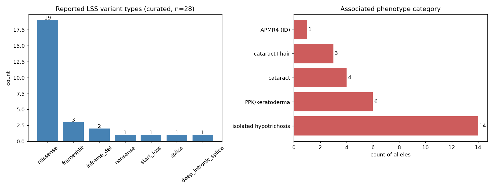

## Question

# Disease Characteristics Research Template

## Target Disease
- **Disease Name:** Hypotrichosis 14
- **MONDO ID:** MONDO:0032649 (if available)
- **Causal gene(s):** LSS
- **OMIM:** OMIM:618275
- **Synonyms:** HYPT14
- **Category:** Mendelian

Many disease names are serial numbers ("... autosomal dominant 64", "... 26") that
do not say which gene the disease is about, and a similarly named disease with a
different gene is easy to research by mistake. Research the disease with the MONDO
ID and causal gene given above, and name its causal gene in your first paragraph.
If the name seems to point to a different gene or OMIM entry, follow the
identifiers above.

## Research Objectives

Please provide a comprehensive research report on **Hypotrichosis 14** covering all of the
disease characteristics listed below. This report will be used to populate a disease knowledge
base entry. Be thorough and cite primary literature (PMID preferred) for all claims.

For each section, **suggested databases/resources** are listed. These are the first places
you should search for information on each topic.

---

### 1. Disease Information
> **Search first:** OMIM, Orphanet, ICD-10/ICD-11, MeSH, PubMed

- What is the disease? Provide a concise overview.
- What are the key identifiers? (OMIM, Orphanet, ICD-10/ICD-11, MeSH, Mondo)
- What are the common synonyms and alternative names?
- Is the information derived from individual patients (e.g., EHR) or aggregated disease-level resources?

### 2. Etiology

- **Disease Causal Factors**: What are the primary causes? (genetic, environmental, infectious, mechanistic)
- **Risk Factors**:
  > **Search first:** PubMed, Cochrane Library, UpToDate, clinical guidelines, ClinVar, ClinGen, GWAS Catalog, PheGenI, CTD, CDC, WHO, epidemiological databases
  - Genetic risk factors (causal variants, susceptibility loci, modifier genes)
  - Environmental risk factors (toxins, lifestyle, occupational exposures, age, sex, family history)
- **Protective Factors**:
  > **Search first:** PubMed, Cochrane Library, clinical trial databases, GWAS Catalog, gnomAD, WHO, CDC, nutrition databases
  - Genetic protective factors (protective variants, modifier alleles)
  - Environmental protective factors (diet, lifestyle, exposures that reduce risk)
- **Gene-Environment Interactions**: How do genetic and environmental factors interact to influence disease?
  > **Search first:** CTD, PubMed, PheGenI, GxE databases

### 3. Phenotypes
> **Search first:** HPO (Human Phenotype Ontology), OMIM, Orphanet, PubMed, clinicaltrials.gov, MedDRA, SNOMED CT, DECIPHER, LOINC

For each phenotype, provide:
- **Phenotype type**: symptoms, clinical signs, physical manifestations, behavioral changes, or laboratory abnormalities
  > For symptoms/signs: HPO, OMIM, Orphanet, PubMed
  > For behavioral changes: HPO, DSM, RDoC (Research Domain Criteria), PubMed
  > For laboratory abnormalities: LOINC, SNOMED CT, LabTests Online, PubMed
- **Phenotype characteristics**:
  > **Search first:** OMIM, Orphanet, HPO, PubMed
  - Age of symptom onset (neonatal, childhood, adult-onset, late-onset)
  - Symptom severity (mild, moderate, severe, variable)
  - Symptom progression (stable, progressive, episodic, fluctuating)
  - Frequency among affected individuals (percentage or qualitative)
- **Quality of life impact**: Effects on daily functioning and well-being (per-phenotype when possible)
  > **Search first:** EQ-5D database, SF-36, WHO QOL databases, PubMed
- Suggest HPO (Human Phenotype Ontology) terms for each phenotype

### 4. Genetic/Molecular Information

- **Causal Genes**: Gene mutations or chromosomal abnormalities responsible for disease (gene symbols, OMIM IDs)
  > **Search first:** OMIM, ClinVar, HGMD, Ensembl, NCBI Gene
- **Pathogenic Variants**:
  - Affected genes (gene symbols, HGNC IDs)
    > **Search first:** OMIM, NCBI Gene, Ensembl, HGNC, UniProt, GeneCards
  - Variant classification (pathogenic, likely pathogenic, VUS per ACMG/AMP guidelines)
    > **Search first:** ClinVar, ClinGen, ACMG/AMP guidelines, VarSome
  - Variant type/class (missense, frameshift, nonsense, splice-site, structural)
  - Allele frequency in population databases
    > **Search first:** gnomAD, 1000 Genomes, ExAC, TOPMed, dbSNP
  - Somatic vs germline origin
    > **Search first:** COSMIC (somatic), ClinVar, ICGC, TCGA
  - Functional consequences (loss of function, gain of function, dominant negative)
- **Modifier Genes**: Genes that modify disease severity or expression
- **Epigenetic Information**: DNA methylation, histone modifications, chromatin changes affecting disease
  > **Search first:** ENCODE, Roadmap Epigenomics, MethBase, DiseaseMeth
- **Chromosomal Abnormalities**: Large-scale genetic changes (aneuploidy, translocations, inversions)
  > **Search first:** DECIPHER, ClinVar, ECARUCA, UCSC Genome Browser

### 5. Environmental Information

- **Environmental Factors**: Non-genetic contributing factors (toxins, radiation, pollution, occupational exposure)
  > **Search first:** CTD (Comparative Toxicogenomics Database), TOXNET, PubMed, EPA databases
- **Lifestyle Factors**: Behavioral factors (smoking, diet, exercise, alcohol consumption)
  > **Search first:** CDC databases, WHO, PubMed, NHANES
- **Infectious Agents**: If applicable, pathogens causing or triggering disease (bacteria, viruses, fungi, parasites)
  > **Search first:** NCBI Taxonomy, ViPR, BV-BRC, MicrobeDB, GIDEON

### 6. Mechanism / Pathophysiology

**Present this section as an ordered causal chain first, then the detail below.**
Open with a numbered sequence of mechanistic steps running from the initiating
lesion (mutation, exposure, infection) to the clinical manifestation, one step per
line, each naming what it causes next. State the causal verb explicitly ("leads
to", "results in") and say where a step is inferred rather than demonstrated.
Where the mechanism branches, show the branch. The categories below are a
checklist of what to cover within those steps, not the organizing structure —
a step may draw on several of them, and a category may contribute to several
steps.

- **Molecular Pathways**: Specific signaling cascades or biochemical pathways involved (Wnt, MAPK, mTOR, PI3K-AKT, etc.)
  > **Search first:** KEGG, Reactome, WikiPathways, PathBank, BioCyc
- **Cellular Processes**: Cell-level mechanisms (apoptosis, autophagy, cell cycle dysregulation, inflammation, etc.)
  > **Search first:** Gene Ontology (GO), Reactome, KEGG, PubMed
- **Protein Dysfunction**: How protein structure or function is altered (misfolding, aggregation, loss of function, gain of function)
  > **Search first:** UniProt, PDB (Protein Data Bank), InterPro, Pfam, AlphaFold
- **Metabolic Changes**: Alterations in metabolic processes (energy metabolism, lipid metabolism, amino acid metabolism)
  > **Search first:** KEGG, BioCyc, HMDB (Human Metabolome Database), BRENDA
- **Immune System Involvement**: Role of immune response (autoimmunity, immunodeficiency, chronic inflammation)
  > **Search first:** ImmPort, Immunome Database, IEDB, Gene Ontology
- **Tissue Damage Mechanisms**: How tissues/ are injured (oxidative stress, ischemia, fibrosis, necrosis)
  > **Search first:** PubMed, Gene Ontology, Reactome
- **Biochemical Abnormalities**: Specific molecular defects (enzyme deficiencies, receptor dysfunction, ion channel defects)
  > **Search first:** BRENDA, UniProt, KEGG, OMIM, PubMed
- **Epigenetic Changes**: DNA methylation, histone modifications affecting gene expression in disease
  > **Search first:** ENCODE, Roadmap Epigenomics, MethBase, DiseaseMeth
- **Molecular Profiling** (if available):
  - Transcriptomics/gene expression changes
    > **Search first:** GEO (Gene Expression Omnibus), ArrayExpress, GTEx, Human Cell Atlas, SRA
  - Proteomics findings
    > **Search first:** PRIDE, ProteomeXchange, Human Protein Atlas, STRING, BioGRID
  - Metabolomics signatures
    > **Search first:** MetaboLights, Metabolomics Workbench, HMDB, METLIN
  - Lipidomics alterations
    > **Search first:** LIPID MAPS, SwissLipids, LipidHome, Metabolomics Workbench
  - Genomic structural features
    > **Search first:** UCSC Genome Browser, Ensembl, NCBI, dbVar, DGV
- **Advanced Technologies** (if applicable):
  - Single-cell analysis findings (cell-type specific mechanisms, cellular heterogeneity)
    > **Search first:** Human Cell Atlas, Single Cell Portal, GEO, CELLxGENE
  - Spatial transcriptomics findings
    > **Search first:** GEO, Spatial Research, Vizgen, 10x Genomics data
  - Multi-omics integration results
    > **Search first:** TCGA, ICGC, cBioPortal, LinkedOmics, PubMed
  - Functional genomics screens (CRISPR, RNAi)
    > **Search first:** DepMap, GenomeRNAi, PubMed, BioGRID ORCS

For each mechanism, describe:
- The causal chain from initial trigger to clinical manifestation
- Which mechanisms are upstream vs downstream
- What cell types and biological processes are involved
- Suggest GO terms for biological processes and CL terms for cell types

### 7. Anatomical Structures Affected

- **Organ Level**:
  - Primary organs directly affected
  - Secondary organ involvement (complications, secondary effects)
  - Body systems involved (cardiovascular, nervous, digestive, respiratory, endocrine, etc.)
  > **Search first:** Uberon, FMA (Foundational Model of Anatomy), OMIM, HPO, ICD-11, MeSH, SNOMED CT
- **Tissue and Cell Level**:
  - Specific tissue types affected (epithelial, connective, muscle, nervous)
  - Specific cell populations targeted (with Cell Ontology terms)
  > **Search first:** Uberon, Human Protein Atlas, Cell Ontology, Human Cell Atlas, CellMarker, PanglaoDB
- **Subcellular Level**:
  - Cellular compartments involved (mitochondria, nucleus, ER, lysosomes) (with GO Cellular Component terms)
  > **Search first:** Gene Ontology (Cellular Component), UniProt, Human Protein Atlas
- **Localization**:
  - Specific anatomical sites (with UBERON terms)
    > **Search first:** FMA, Uberon, NeuroNames (for brain), SNOMED CT
  - Lateralization (unilateral, bilateral, asymmetric)
    > **Search first:** HPO, clinical literature, imaging databases

### 8. Temporal Development

- **Onset**:
  - Typical age of onset (congenital, pediatric, adult, geriatric)
  - Onset pattern (acute, subacute, chronic, insidious)
  > **Search first:** OMIM, Orphanet, HPO, PubMed
- **Progression**:
  - Disease stages (early, intermediate, advanced, end-stage)
    > **Search first:** Cancer Staging Manual (AJCC), WHO classifications, PubMed
  - Progression rate (rapid, slow, variable)
  - Disease course pattern (episodic, relapsing-remitting, progressive, stable)
  - Disease duration (self-limited, chronic lifelong)
  > **Search first:** Disease registries, longitudinal cohort databases, natural history studies, PubMed, Orphanet, OMIM
- **Patterns**:
  - Remission patterns (spontaneous, treatment-induced)
    > **Search first:** Clinical trial databases, disease registries, PubMed
  - Critical periods (time windows of vulnerability or opportunity for intervention)
    > **Search first:** PubMed, developmental biology databases, clinical guidelines

### 9. Inheritance and Population

- **Epidemiology**:
  - Prevalence (cases per 100,000 at given time)
  - Incidence (new cases per 100,000 per year)
  > **Search first:** Orphanet, CDC, WHO, GBD (Global Burden of Disease), national registries, SEER, disease registries
- **For Genetic Etiology**:
  - Inheritance pattern (AD, AR, X-linked, mitochondrial, multifactorial, polygenic)
    > **Search first:** OMIM, Orphanet, ClinVar, GTR (Genetic Testing Registry)
  - Penetrance (complete, incomplete, age-dependent)
    > **Search first:** ClinVar, OMIM, PubMed, ClinGen
  - Expressivity (variable, consistent)
    > **Search first:** OMIM, ClinVar, PubMed
  - Genetic anticipation (increasing severity in successive generations)
    > **Search first:** OMIM, PubMed (especially for repeat expansion disorders)
  - Germline mosaicism
    > **Search first:** ClinVar, OMIM, genetic counseling literature, PubMed
  - Founder effects (population-specific mutations)
    > **Search first:** gnomAD, population genetics databases, PubMed
  - Consanguinity role
    > **Search first:** OMIM, population studies, genetic counseling resources
  - Carrier frequency
    > **Search first:** gnomAD, carrier screening databases, GeneReviews, GTR
- **Population Demographics**:
  - Affected populations (ethnic or demographic groups with higher prevalence)
    > **Search first:** gnomAD, 1000 Genomes, PAGE Study, PubMed, population registries
  - Geographic distribution (endemic areas, regional variation)
    > **Search first:** WHO, CDC, GBD, Orphanet, geographic epidemiology databases
  - Geographic distribution of specific variants
  - Sex ratio (male:female)
    > **Search first:** Disease registries, OMIM, PubMed, epidemiological databases
  - Age distribution of affected individuals
    > **Search first:** CDC, disease registries, SEER, Orphanet

### 10. Diagnostics

- **Clinical Tests**:
  - Laboratory tests (blood, urine, tissue chemistry, specific enzyme assays)
    > **Search first:** LOINC, LabTests Online, PubMed
  - Biomarkers (proteins, metabolites, genetic markers, circulating biomarkers)
    > **Search first:** FDA Biomarker List, BEST (Biomarkers, EndpointS, and other Tools), PubMed
  - Imaging studies (X-ray, CT, MRI, PET, ultrasound)
    > **Search first:** RadLex, DICOM, Radiopaedia, imaging databases
  - Functional tests (pulmonary function, cardiac stress tests)
    > **Search first:** LOINC, clinical guidelines, PubMed
  - Electrophysiology (EEG, EMG, ECG, nerve conduction studies)
    > **Search first:** LOINC, clinical neurophysiology databases, PubMed
  - Biopsy findings (histopathology, immunohistochemistry)
    > **Search first:** SNOMED CT, College of American Pathologists resources, PubMed
  - Pathology findings (microscopic examination)
    > **Search first:** SNOMED CT, Digital Pathology databases, PubMed
- **Genetic Testing**:
  > **Search first:** GTR (Genetic Testing Registry), GeneReviews, ClinGen
  - Overview of recommended genetic testing approach
  - Whole genome sequencing (WGS) utility
    > **Search first:** GTR, ClinVar, GEL (Genomics England), gnomAD
  - Whole exome sequencing (WES) utility
    > **Search first:** GTR, ClinVar, OMIM, GeneMatcher
  - Gene panels (which panels, which genes)
    > **Search first:** GTR, ClinVar, laboratory-specific databases
  - Single gene testing
    > **Search first:** GTR, ClinVar, OMIM, GeneReviews
  - Chromosomal microarray (CMA)
    > **Search first:** DECIPHER, ClinVar, dbVar, ECARUCA
  - Karyotyping
    > **Search first:** Chromosome Abnormality Database, ClinVar, cytogenetics resources
  - FISH
    > **Search first:** ClinVar, cytogenetics databases, PubMed
  - Mitochondrial DNA testing
    > **Search first:** MITOMAP, MSeqDR, ClinVar, GTR
  - Repeat expansion testing
    > **Search first:** GTR, ClinVar, repeat expansion databases, PubMed
- **Omics-Based Diagnostics** (if applicable):
  - RNA sequencing / transcriptomics
    > **Search first:** GEO, ArrayExpress, GTEx, RNA-seq databases
  - Proteomics
    > **Search first:** PRIDE, ProteomeXchange, FDA Biomarker database
  - Metabolomics
    > **Search first:** MetaboLights, Metabolomics Workbench, HMDB
  - Epigenomics
    > **Search first:** GEO, ENCODE, Roadmap Epigenomics, MethBase
  - Liquid biopsy
    > **Search first:** COSMIC, ClinVar, liquid biopsy databases, PubMed
- **Clinical Criteria**:
  - Standardized diagnostic criteria (DSM, ICD, society guidelines)
    > **Search first:** DSM-5, ICD-11, clinical society guidelines, UpToDate
  - Differential diagnosis (other conditions to rule out, with distinguishing features)
    > **Search first:** DynaMed, UpToDate, clinical decision support systems
- **Screening**:
  - Screening methods for asymptomatic individuals (newborn screening, carrier screening, cascade screening)
    > **Search first:** ACMG recommendations, CDC newborn screening, GTR

### 11. Outcome/Prognosis

- **Survival and Mortality**:
  - Survival rate (5-year, 10-year, overall)
    > **Search first:** SEER, cancer registries, disease-specific registries, PubMed
  - Life expectancy (with and without treatment if applicable)
    > **Search first:** Orphanet, disease registries, actuarial databases, PubMed
  - Mortality rate
    > **Search first:** CDC, WHO, GBD, national mortality databases
  - Disease-specific mortality (deaths directly attributable to disease)
    > **Search first:** Disease registries, CDC Wonder, GBD, PubMed
- **Morbidity and Function**:
  - Morbidity (disease-related disability and health impacts)
    > **Search first:** GBD, WHO, disability databases, PubMed
  - Disability outcomes (long-term functional impairments)
    > **Search first:** ICF (International Classification of Functioning), disability registries
  - Quality of life measures (EQ-5D, SF-36, PROMIS, disease-specific tools)
    > **Search first:** EQ-5D database, SF-36, PROMIS, PubMed
- **Disease Course**:
  - Complications (secondary problems: infections, organ failure, etc.)
    > **Search first:** ICD codes, disease registries, clinical databases, PubMed
  - Recovery potential (likelihood and extent of recovery, with vs without treatment)
    > **Search first:** Natural history studies, rehabilitation databases, PubMed
- **Prediction**:
  - Prognostic factors (age, disease severity, biomarkers, treatment response)
    > **Search first:** Prognostic models databases, clinical calculators, PubMed
  - Prognostic biomarkers (molecular markers predicting disease course)
    > **Search first:** FDA Biomarker database, PubMed, cancer prognostic databases

### 12. Treatment

- **Pharmacotherapy**:
  - Pharmacological treatments (drug names, drug classes, mechanisms of action)
    > **Search first:** DrugBank, RxNorm, ATC classification, DailyMed, FDA databases
  - Pharmacogenomics (how genetic variants affect drug metabolism, efficacy, toxicity)
    > **Search first:** PharmGKB, CPIC (Clinical Pharmacogenetics), FDA Table of PGx Biomarkers
- **Advanced Therapeutics**:
  - Gene therapy (viral vectors, CRISPR, gene replacement, gene editing)
    > **Search first:** ClinicalTrials.gov, FDA gene therapy database, ASGCT resources
  - Cell therapy (stem cell transplant, CAR-T, cellular therapeutics)
    > **Search first:** ClinicalTrials.gov, FDA cell therapy database, FACT standards
  - RNA-based therapies (ASOs, siRNA, mRNA therapies)
    > **Search first:** ClinicalTrials.gov, FDA approvals, PubMed
  - Targeted therapies (treatments directed at specific molecular targets)
    > **Search first:** My Cancer Genome, OncoKB, ClinicalTrials.gov, FDA approvals
  - Immunotherapies (checkpoint inhibitors, monoclonal antibodies)
    > **Search first:** Cancer Immunotherapy Database, FDA approvals, ClinicalTrials.gov
- **Surgical and Interventional**:
  - Surgical interventions (types of surgery, timing, outcomes)
    > **Search first:** CPT codes, surgical registries, clinical guidelines, PubMed
- **Supportive and Rehabilitative**:
  - Supportive care (symptom management, pain control, nutrition)
    > **Search first:** Clinical guidelines, Cochrane Library, PubMed
  - Rehabilitation (physical therapy, occupational therapy, speech therapy)
    > **Search first:** Rehabilitation medicine databases, clinical guidelines, PubMed
- **Experimental**:
  - Experimental treatments in clinical trials (with NCT identifiers if available)
    > **Search first:** ClinicalTrials.gov, EU Clinical Trials Register, WHO ICTRP
- **Treatment Outcomes**:
  - Treatment response rates
    > **Search first:** Clinical trial databases, FDA reviews, systematic reviews, PubMed
  - Side effects and adverse events
    > **Search first:** FDA Adverse Event Reporting System (FAERS), MedWatch, PubMed
- **Treatment Strategy**:
  - Treatment algorithms (clinical pathways, decision trees)
    > **Search first:** Clinical practice guidelines, NCCN Guidelines, UpToDate
  - Combination therapies
    > **Search first:** ClinicalTrials.gov, treatment guidelines, PubMed
  - Personalized medicine approaches (genotype-guided treatment)
    > **Search first:** My Cancer Genome, CIViC, PharmGKB, precision medicine databases

For each treatment, suggest NCIT (NCI Thesaurus) clinical-intervention terms where applicable.

### 13. Prevention

- **Prevention Levels**:
  - Primary prevention (preventing disease occurrence: vaccination, risk factor modification)
    > **Search first:** CDC, WHO, USPSTF recommendations, Cochrane Library
  - Secondary prevention (early detection and treatment: screening programs, early intervention)
    > **Search first:** USPSTF, CDC screening guidelines, WHO
  - Tertiary prevention (preventing complications in those with disease)
    > **Search first:** Clinical guidelines, disease management protocols, PubMed
- **Immunization**: Vaccine strategies (if applicable)
  > **Search first:** CDC vaccine schedules, WHO immunization, FDA vaccine database
- **Screening and Early Detection**:
  - Screening programs (population-based: newborn screening, cancer screening)
    > **Search first:** CDC screening programs, USPSTF, cancer screening databases
  - Genetic screening (carrier screening, preimplantation genetic diagnosis, prenatal testing)
    > **Search first:** ACMG recommendations, ACOG guidelines, GTR
  - Risk stratification (identifying high-risk individuals for targeted prevention)
    > **Search first:** Risk prediction models, clinical calculators, PubMed
- **Behavioral Interventions**: Lifestyle modifications to reduce risk
  > **Search first:** CDC, WHO, behavioral intervention databases, Cochrane Library
- **Counseling**: Genetic counseling (risk assessment, family planning guidance)
  > **Search first:** NSGC resources, ACMG guidelines, GeneReviews
- **Public Health**:
  - Public health interventions (sanitation, vector control, health education)
    > **Search first:** CDC, WHO, public health databases, PubMed
  - Environmental interventions (reducing environmental risk factors)
    > **Search first:** EPA databases, WHO environmental health, PubMed
- **Prophylaxis**: Preventive medications or procedures
  > **Search first:** Clinical guidelines, FDA approvals, PubMed

### 14. Other Species / Natural Disease

- **Taxonomy**: Species affected (with NCBI Taxon identifiers)
  > **Search first:** NCBI Taxonomy
- **Breed**: Specific breeds affected (with VBO identifiers if applicable)
  > **Search first:** VBO (Vertebrate Breed Ontology)
- **Gene**: Orthologous genes in other species (with NCBI Gene IDs)
  > **Search first:** NCBI Gene
- **Natural Disease**:
  - Naturally occurring disease in other species (companion animals, wildlife)
    > **Search first:** OMIA (Online Mendelian Inheritance in Animals), VetCompass, PubMed
  - Veterinary relevance and importance in animal health
    > **Search first:** OMIA, veterinary databases, PubMed
- **Comparative Biology**:
  - Comparative pathology (similarities and differences across species)
    > **Search first:** OMIA, comparative pathology databases, PubMed
  - Evolutionary conservation of disease mechanisms
    > **Search first:** HomoloGene, OrthoMCL, Alliance of Genome Resources
- **Transmission** (if applicable):
  - Zoonotic potential
    > **Search first:** CDC zoonotic diseases, WHO zoonoses, GIDEON
  - Cross-species susceptibility
    > **Search first:** NCBI Taxonomy, veterinary databases, PubMed

### 15. Model Organisms

- **Model Types**:
  - Model organism type (mammalian, invertebrate, cellular, in vitro)
    > **Search first:** Alliance of Genome Resources, model organism databases
  - Specific model systems (mouse, rat, zebrafish, Drosophila, C. elegans, yeast, cell lines, organoids, iPSCs)
    > **Search first:** MGI, RGD, ZFIN, FlyBase, WormBase, SGD, ATCC, Cellosaurus
  - Induced models (drug treatment, surgical intervention, environmental manipulation)
    > **Search first:** MGI, model organism databases, PubMed
- **Genetic Models**:
  - Types available (knockout, knock-in, transgenic, conditional, humanized)
    > **Search first:** MGI, IMPC, KOMP, EuMMCR, IMSR
- **Model Characteristics**:
  - Phenotype recapitulation (how well model reproduces human disease features)
    > **Search first:** Model organism databases, comparative studies, PubMed
  - Model limitations (aspects of human disease not captured)
    > **Search first:** Model organism databases, PubMed, review articles
- **Applications**:
  - Research applications (what aspects of disease can be studied)
    > **Search first:** Model organism databases, PubMed
- **Resources**:
  - Model databases
    > **Search first:** MGI, RGD, ZFIN, FlyBase, WormBase, IMSR, EMMA, MMRRC

---

## Citation Requirements

- Cite primary literature (PMID preferred) for all mechanistic and clinical claims
- Prioritize recent reviews and landmark papers
- Include direct quotes from abstracts where possible to support key statements
- Distinguish evidence source types: human clinical, model organism, in vitro, computational

## Output Format

Structure your response as a comprehensive narrative organized by the sections above.
For each section, provide:
- Factual content with specific details (numbers, percentages, gene names, variant nomenclature)
- Ontology term suggestions (HPO, GO, CL, UBERON, CHEBI, NCIT, MONDO) where applicable
- Evidence citations with PMIDs
- Direct quotes from abstracts to support key claims
- Clear indication when information is not available or not applicable for this disease

This report will be used to populate a disease knowledge base entry with:
- Pathophysiology descriptions with causal chains
- Gene/protein annotations (HGNC, GO terms)
- Phenotype associations (HP terms) with frequencies
- Cell type involvement (CL terms)
- Anatomical locations (UBERON terms)
- Chemical entities (CHEBI terms)
- Treatment annotations (NCIT terms)
- Evidence items with PMIDs and exact abstract quotes
- Epidemiology, prognosis, diagnostic, and prevention information
- Animal model descriptions with phenotype recapitulation details


## Output

# Hypotrichosis 14 (HYPT14): A Comprehensive Disease Characterization Report

**Disease:** Hypotrichosis 14 (HYPT14)
**MONDO ID:** MONDO:0032649 · **OMIM:** 618275 · **Causal gene:** *LSS* (lanosterol synthase)
**Category:** Mendelian, autosomal recessive

---

## Summary

**Hypotrichosis 14 (HYPT14) is a rare autosomal-recessive, non-syndromic hereditary alopecia caused by biallelic loss-of-function variants in *LSS*, the gene encoding lanosterol synthase (2,3-oxidosqualene–lanosterol cyclase; EC 5.4.99.7), a key enzyme of the cholesterol-biosynthesis pathway located on chromosome 21q22.3.** Despite the serial-number disease name ("Hypotrichosis 14"), which does not itself name a gene, the causal gene is unambiguously ***LSS***. Affected individuals present in infancy/childhood with diffuse, progressive, sparse lanugo-like scalp and body hair, sparse and brittle eyebrows and eyelashes, and structurally abnormal (abnormally keratinized) hair shafts. The disorder was first defined genetically in 2018, when whole-exome sequencing identified five different *LSS* mutations in three unrelated families ([PMID: 30401459](https://pubmed.ncbi.nlm.nih.gov/30401459/)).

Mechanistically, pathogenic *LSS* variants—most of them missense (~68% of the curated allelic spectrum)—reduce or abolish lanosterol-synthase enzymatic activity and cause partial mislocalization of the protein away from the endoplasmic reticulum (ER), where the wild-type enzyme normally resides. This produces a **local sterol-pathway failure in the hair follicle, epidermis and lens, while systemic blood cholesterol remains normal**, implying tissue-autonomous dependence on local lanosterol/downstream-sterol synthesis and an alternative compensatory route sufficient for systemic needs. Tissue-specific *Lss*-knockout mice recapitulate the human phenotypes (epidermal knockout → hypotrichosis and skin-barrier failure; lens knockout → cataract), and an elevated **(S)-2,3-epoxysqualene/lanosterol ratio in forehead sebum** serves as a non-invasive diagnostic biomarker of the enzymatic block.

Importantly, HYPT14 sits at the mild end of a broader ***LSS* allelic continuum**. The same gene, with different genotypes, causes congenital cataracts (CTRCT44), alopecia–intellectual-disability syndrome 4 (APMR4), and palmoplantar keratoderma–congenital alopecia syndrome type 2 (PPKCA2). Biallelic hypomorphic missense genotypes tend to produce isolated hypotrichosis, whereas truncating/null alleles cluster with the syndromic, multisystem presentations. There is currently **no disease-specific therapy**; management is supportive, with genetic counseling central to care.

---

## Key Findings

### Finding 1 — *LSS* (lanosterol synthase) is the causal gene; inheritance is autosomal recessive (biallelic)

HYPT14 is caused by **biallelic (homozygous or compound-heterozygous) variants in *LSS***. The founding study used whole-exome sequencing to identify **five different *LSS* mutations in three unrelated families** with unexplained, potentially autosomal-recessive hypotrichosis simplex (HS): *"The present report describes the identification via whole-exome sequencing of five different mutations in the gene LSS in three unrelated families with unexplained, potentially autosomal-recessive HS"* ([PMID: 30401459](https://pubmed.ncbi.nlm.nih.gov/30401459/)). The same paper identifies the gene product and pathway relevance: *"LSS encodes lanosterol synthase (LSS), which is a key enzyme in the cholesterol biosynthetic pathway. This pathway plays an important role in hair follicle biology."* Numerous subsequent families (Chinese, Iraqi, Egyptian, and European cohorts) have confirmed biallelic *LSS* variants segregating with disease. *LSS* maps to **chromosome 21q22.3** (HGNC: LSS; enzyme EC 5.4.99.7, 2,3-oxidosqualene–lanosterol cyclase).

**Ontology anchors:** gene *LSS* (HGNC:6708); MONDO:0032649; OMIM 618275.

### Finding 2 — Core phenotype: childhood-onset, diffuse, progressive, lanugo-like sparse hair with brittle, abnormally keratinized shafts

Affected individuals show **sparse to absent lanugo-like scalp hair, sparse and brittle eyebrows, and sparse eyelashes and body hair**: *"Affected individuals showed sparse to absent lanugo-like scalp hair, sparse and brittle eyebrows, and sparse eyelashes and body hair"* ([PMID: 30401459](https://pubmed.ncbi.nlm.nih.gov/30401459/)). The disorder is characterized by childhood onset of diffuse and progressive scalp and body hair loss. Hair-shaft ultrastructure is abnormal: scanning electron microscopy reveals **irregular, jagged scales with raised edges**, indicating abnormal keratinization ([PMID: 40364812](https://pubmed.ncbi.nlm.nih.gov/40364812/)). Histopathology of affected scalp shows a characteristic triad: *"The thickened epidermis, absence of hair follicles, and sebaceous gland hyperplasia were present by histopathological staining in the available tissue from the core family"* ([PMID: 41442087](https://pubmed.ncbi.nlm.nih.gov/41442087/)).

**Suggested HPO terms:**

| Phenotype | HPO term | Typical frequency |
|---|---|---|
| Sparse scalp hair / hypotrichosis | HP:0002209 / HP:0001006 | Very frequent (core) |
| Sparse/absent eyebrows | HP:0045025 / HP:0002223 | Frequent |
| Sparse eyelashes | HP:0000653 | Frequent |
| Lanugo-like / abnormal hair texture | HP:0100836 | Frequent |
| Brittle hair / abnormal hair shaft | HP:0002299 / HP:0002116 | Frequent |
| Sparse body hair | HP:0002231 | Frequent |

**Onset:** congenital/neonatal to early childhood. **Progression:** diffuse and progressive. **Severity:** variable (mild to marked hypotrichosis). **Quality-of-life impact:** primarily cosmetic/psychosocial in the isolated form; not life-limiting.

### Finding 3 — *LSS* variants form a phenotypic continuum from isolated hypotrichosis to syndromic disease

Biallelic *LSS* variants cause a **spectrum of allelic disorders**:

| Disorder | OMIM | Key extra features beyond hypotrichosis |
|---|---|---|
| Hypotrichosis simplex 14 (HYPT14) | 618275 | None (non-syndromic) |
| Congenital cataracts (CTRCT44) | 616509 | Lens opacity |
| Alopecia–intellectual-disability syndrome 4 (APMR4) | 618840 | Intellectual disability, autism, corpus callosum anomalies |
| Palmoplantar keratoderma–congenital alopecia syndrome type 2 (PPKCA2) | 619150 | Mutilating/palmoplantar keratoderma, pseudoainhum |

A genotype–phenotype signal emerges across the literature: *"Patients with one or two truncation variants tend to have multisystem symptoms compared with those with two missense variants"* ([PMID: 37455568](https://pubmed.ncbi.nlm.nih.gov/37455568/)). Missense alleles such as **p.Ile342Ser** are associated with congenital cataract; truncating alleles more often produce the syndromic end. Early work had already linked **LSS missense mutations W581R and G588S** to extensive congenital cataracts: *"Here we identify two distinct homozygous LSS missense mutations (W581R and G588S) in two families with extensive congenital cataracts"* ([PMID: 26200341](https://pubmed.ncbi.nlm.nih.gov/26200341/)). Additional reported features across the spectrum include hypergonadotropic hypogonadism/micropenis, strabismus, pseudoainhum, teeth mineralization defects, short stature, and midline brain anomalies.

### Finding 4 — Mechanism: loss of enzymatic activity + ER mislocalization, with normal systemic cholesterol

Functional studies demonstrate that pathogenic *LSS* variants **reduce or abolish catalytic activity** in a graded fashion. For example: *"mutant Thr228Ile retained partial enzymatic activity and mutant Arg260His did not show any catalytic activity"* ([PMID: 36811447](https://pubmed.ncbi.nlm.nih.gov/36811447/)). Other variants cause **markedly decreased lanosterol production**: *"Remarkably decreased lanosterol levels were found in vitro in three LSS variants, LSS-ΔN80, p.Ile342Ser, and p.Gly508Trp, suggesting a loss of enzymatic activity"* ([PMID: 35413293](https://pubmed.ncbi.nlm.nih.gov/35413293/)). A second structural mechanism is subcellular mislocalization: *"wild-type LSS was localized in the endoplasmic reticulum (ER), whereas mutant LSS proteins were localized in part outside of the ER"* ([PMID: 30401459](https://pubmed.ncbi.nlm.nih.gov/30401459/)). Critically, **blood cholesterol and cholesterol intermediates were not decreased**, supporting a local (tissue-autonomous) sterol deficit rather than a systemic cholesterol-synthesis failure. Patients also show abnormal cornified-envelope formation in the stratum corneum ([PMID: 35413293](https://pubmed.ncbi.nlm.nih.gov/35413293/)), linking the sterol defect to keratinization and barrier integrity.

### Finding 5 — Tissue-specific *Lss*-knockout mice recapitulate disease; sebum biomarker confirms enzymatic block

Mouse models provide direct in vivo confirmation of tissue-autonomous loss of function: *"Epidermis-specific Lss knockout mice showed neonatal lethality due to dehydration, indicating that LSS could be involved in skin barrier integrity. Tamoxifen-induced knockout of Lss in the epidermis caused hypotrichosis in adult mice. Lens-specific Lss knockout mice had cataracts"* ([PMID: 32101538](https://pubmed.ncbi.nlm.nih.gov/32101538/)). The same study established a **non-invasive diagnostic biomarker**: *"We showed that the blockade of the LSS enzyme reaction occurred in the patients by measuring the (S)-2,3-epoxysqualene/lanosterol ratio in the forehead sebum, which would be a good biomarker for the diagnosis of LSS deficiency."* The authors conclude: *"These results confirmed that LSS deficiency causes hypotrichosis and cataracts due to loss-of-function mutations in LSS in each tissue."*

### Finding 6 — LSS is a monotopic ER membrane cyclase; crystal structure defines the active-site cavity

LSS/oxidosqualene cyclase (OSC) is a **monotopic integral membrane protein, catalytically active as a monomer**: *"The monotopic integral membrane protein 2,3-oxidosqualene cyclase (OSC) catalyzes the formation of lanosterol the first sterol precursor of cholesterol in mammals"* ([PMID: 14766201](https://pubmed.ncbi.nlm.nih.gov/14766201/)). Human OSC crystal structures (including **PDB 1W6K**) were solved with an inhibitor and with product lanosterol: *"Here we present two crystal structures of the human membrane protein OSC: the target protein with an inhibitor that showed cholesterol lowering in vivo opens the way for the structure-based design of new OSC inhibitors"* ([PMID: 15525992](https://pubmed.ncbi.nlm.nih.gov/15525992/)). The homologous squalene–hopene cyclase reveals the general architecture: a large central aromatic-lined cavity, a catalytic Asp–His pair that initiates cyclization, and QW-motifs that tighten the fold to absorb the highly exothermic reaction energy ([PMID: 9295270](https://pubmed.ncbi.nlm.nih.gov/9295270/)). This explains why **missense substitutions in the buried active-site/membrane-anchoring core destabilize the fold and impair catalysis**—the structural basis for graded hypomorphic loss of function.

### Finding 7 — Variant architecture is predominantly missense (~68%), consistent with hypomorphic loss of function

Curation of **28 distinct *LSS* alleles** reported across the primary literature yields the following distribution:

| Variant class | Count | % |
|---|---|---|
| Missense | 19 | 68% |
| Frameshift | 3 | 11% |
| In-frame deletion | 2 | 7% |
| Nonsense | 1 | 4% |
| Start-loss | 1 | 4% |
| Canonical splice | 1 | 4% |
| Deep-intronic splice (c.893-175G>A) | 1 | 4% |

Isolated non-syndromic hypotrichosis is most often associated with **biallelic missense (hypomorphic) genotypes**, consistent with *"Patients with one or two truncation variants tend to have multisystem symptoms compared with those with two missense variants"* ([PMID: 37455568](https://pubmed.ncbi.nlm.nih.gov/37455568/)). A notable technical point is that a **deep-intronic pathogenic variant** was detectable only by multi-omics: *"a deep intronic pathogenic variant (c.893-175G > A) at a non-canonical splice site was identified by integrated analysis of whole genome sequencing and RNAseq"* ([PMID: 41442087](https://pubmed.ncbi.nlm.nih.gov/41442087/)), underscoring the diagnostic value of WGS+RNA-seq when exome sequencing is uninformative.

{{figure:lss_variant_spectrum.png|caption=Curated spectrum of 28 distinct LSS alleles reported across the HYPT14/allelic-disorder literature, broken down by variant type and associated phenotype. Missense variants dominate (~68%) and cluster with the milder, isolated-hypotrichosis end of the spectrum, whereas truncating/null alleles associate with syndromic multisystem presentations.}}

### Finding 8 — Consolidated mechanistic model: local sterol-pathway failure despite normal systemic cholesterol

Convergent evidence from human genetics (biallelic *LSS* variants in multiple families; [PMID: 30401459](https://pubmed.ncbi.nlm.nih.gov/30401459/), [PMID: 40696433](https://pubmed.ncbi.nlm.nih.gov/40696433/), [PMID: 41442087](https://pubmed.ncbi.nlm.nih.gov/41442087/)), in vitro enzymology ([PMID: 36811447](https://pubmed.ncbi.nlm.nih.gov/36811447/), [PMID: 35413293](https://pubmed.ncbi.nlm.nih.gov/35413293/)), protein structure ([PMID: 15525992](https://pubmed.ncbi.nlm.nih.gov/15525992/), [PMID: 14766201](https://pubmed.ncbi.nlm.nih.gov/14766201/)), and tissue-specific mouse knockouts ([PMID: 32101538](https://pubmed.ncbi.nlm.nih.gov/32101538/)) supports a unified model. The founding paper anchors it in gene and pathway: *"LSS encodes lanosterol synthase (LSS), which is a key enzyme in the cholesterol biosynthetic pathway. This pathway plays an important role in hair follicle biology"* ([PMID: 30401459](https://pubmed.ncbi.nlm.nih.gov/30401459/)). In vivo confirmation: *"These results confirmed that LSS deficiency causes hypotrichosis and cataracts due to loss-of-function mutations in LSS in each tissue"* ([PMID: 32101538](https://pubmed.ncbi.nlm.nih.gov/32101538/)).

---

## Mechanistic Model / Interpretation

### Ordered causal chain (initiating lesion → clinical manifestation)

1. **Biallelic *LSS* variant** (most often missense, hypomorphic) **→ leads to** an amino-acid substitution in the monotopic ER cyclase fold (active-site / membrane-anchoring core).
2. The substitution **→ results in** protein destabilization and, for many variants, **partial mislocalization out of the ER** ([PMID: 30401459](https://pubmed.ncbi.nlm.nih.gov/30401459/)) plus **reduced/abolished catalytic activity** ([PMID: 36811447](https://pubmed.ncbi.nlm.nih.gov/36811447/)).
3. Loss of lanosterol-synthase activity **→ leads to** a **block at the 2,3-oxidosqualene → lanosterol step**, causing accumulation of substrate (2,3-epoxysqualene) and depletion of lanosterol and downstream sterols — demonstrated in vitro ([PMID: 35413293](https://pubmed.ncbi.nlm.nih.gov/35413293/)) and in patient sebum as an elevated epoxysqualene/lanosterol ratio ([PMID: 32101538](https://pubmed.ncbi.nlm.nih.gov/32101538/)).
4. The block is **tissue-autonomous**: systemic blood cholesterol stays normal (a compensatory route spares systemic needs), so the deficit manifests **locally in tissues highly dependent on de novo sterol synthesis** — hair follicle, epidermis, lens ([PMID: 30401459](https://pubmed.ncbi.nlm.nih.gov/30401459/), [PMID: 32101538](https://pubmed.ncbi.nlm.nih.gov/32101538/)). *(Branch point: which tissues are affected, and how severely, depends on residual enzyme activity set by the specific genotype — inferred.)*
5. **Branch A — hair follicle:** local sterol deficiency **→ results in** impaired follicle biology, abnormal hair-shaft keratinization (jagged cuticular scales), and eventual follicle loss **→ leads to** diffuse, progressive, lanugo-like **hypotrichosis** (HYPT14), with the histological triad of thickened epidermis, absent follicles, and sebaceous-gland hyperplasia ([PMID: 40364812](https://pubmed.ncbi.nlm.nih.gov/40364812/), [PMID: 41442087](https://pubmed.ncbi.nlm.nih.gov/41442087/)).
6. **Branch B — epidermis:** sterol deficiency **→ results in** abnormal cornified-envelope formation and impaired skin-barrier integrity ([PMID: 35413293](https://pubmed.ncbi.nlm.nih.gov/35413293/), [PMID: 32101538](https://pubmed.ncbi.nlm.nih.gov/32101538/)); with more severe (truncating) genotypes this extends to **palmoplantar keratoderma / pseudoainhum** (PPKCA2).
7. **Branch C — lens:** sterol deficiency and/or loss of lanosterol's chaperone-like, anti-aggregation role **→ leads to** **congenital cataract** (CTRCT44) ([PMID: 26200341](https://pubmed.ncbi.nlm.nih.gov/26200341/)).
8. **Branch D — CNS (severe/null genotypes):** reduced cholesterol availability during neurodevelopment **→ leads to** intellectual disability, autism, and corpus-callosum anomalies (**APMR4**) ([PMID: 37659595](https://pubmed.ncbi.nlm.nih.gov/37659595/)). *(This neurodevelopmental branch is inferred from genotype correlation and the established role of cholesterol in early brain development.)*

### Diagram

```
 Biallelic LSS variant (≈68% missense, hypomorphic)
            │
            ▼
 Destabilized monotopic ER cyclase fold
   ├── reduced/abolished catalytic activity
   └── partial ER mislocalization
            │
            ▼
 Block: 2,3-oxidosqualene ──X──► lanosterol   (epoxysqualene ↑, lanosterol ↓)
            │   (systemic blood cholesterol NORMAL — tissue-autonomous)
            ▼
 Local sterol deficiency in high-demand tissues
   ├─► hair follicle ─► HYPOTRICHOSIS (HYPT14)       [core phenotype]
   ├─► epidermis ─────► barrier defect / PPK (PPKCA2)
   ├─► lens ──────────► cataract (CTRCT44)
   └─► brain ─────────► intellectual disability (APMR4)   [severe/null alleles]
```

### Ontology suggestions for the mechanism

- **Biological processes (GO):** cholesterol biosynthetic process (GO:0006695); sterol biosynthetic process (GO:0016126); hair follicle development (GO:0001942); keratinocyte differentiation (GO:0030216); establishment of skin barrier (GO:0061436).
- **Molecular function (GO):** lanosterol synthase activity (GO:0000250).
- **Cellular component (GO):** endoplasmic reticulum membrane (GO:0005789).
- **Cell types (CL):** keratinocyte / hair follicle cell (CL:0000312); epidermal cell (CL:0000362); lens fiber cell (CL:0011004); sebaceous gland cell.
- **Anatomy (UBERON):** hair follicle (UBERON:0002073); epidermis/scalp skin (UBERON:0001003); eyebrow (UBERON:0001711); eyelash (UBERON:0001716); lens of eye (UBERON:0000965).
- **Chemical entities (CHEBI):** lanosterol (CHEBI:16521); (S)-2,3-epoxysqualene / 2,3-oxidosqualene (CHEBI:15441); cholesterol (CHEBI:16113); squalene (CHEBI:15440).

---

## Section-by-Section Characterization

### 1. Disease Information
HYPT14 is a rare, non-syndromic, autosomal-recessive hereditary alopecia. **Identifiers:** OMIM 618275; MONDO:0032649; causal gene *LSS* (HGNC:6708). **Synonyms:** HYPT14; LSS-related hypotrichosis simplex; congenital hypotrichosis 14. Information is derived almost entirely from **aggregated, disease-level resources and small case series/case reports** (OMIM, Orphanet, PubMed), not large EHR cohorts.

### 2. Etiology
**Primary cause:** genetic — biallelic loss-of-function *LSS* variants. **Genetic risk factors:** carrier status in both parents; **consanguinity** increases homozygosity risk (several reported families are consanguineous, though the founding cohort and several later families are non-consanguineous compound heterozygotes). **Environmental/lifestyle risk or protective factors:** none established — this is a monogenic Mendelian disorder. **Gene–environment interactions:** none documented. No infectious etiology.

### 3. Phenotypes
See Finding 2 and the HPO table. Core: sparse lanugo-like scalp hair, sparse/brittle eyebrows and eyelashes, sparse body hair, abnormal hair-shaft keratinization. Variable features across the allelic spectrum: cataract, intellectual disability/autism, palmoplantar keratoderma, pseudoainhum, strabismus, hypogonadism/micropenis, teeth mineralization defects, short stature.

### 4. Genetic / Molecular Information
**Causal gene:** *LSS* (lanosterol synthase), 21q22.3, EC 5.4.99.7. **Variant classes:** predominantly missense (~68%), plus frameshift, in-frame deletions, nonsense, start-loss, canonical-splice, and deep-intronic-splice variants (Finding 7). Representative reported alleles include p.Thr228Ile, p.Arg260His, p.Ile342Ser, p.Gly508Trp, p.Asp170Asn, p.Ile323Thr, p.Gly600Val, p.Val537Leu, p.Arg663Trp, p.His307del, p.Glu469del, p.Pro68Argfs*14, p.Arg328*, and W581R/G588S (cataract). **Classification:** pathogenic/likely pathogenic per ACMG, with functional (enzyme-activity) assays supplying PS3-level evidence. **Allele frequencies:** individually rare in gnomAD. **Origin:** germline. **Functional consequence:** loss of function (hypomorphic for missense). **Modifier genes/epigenetics/chromosomal abnormalities:** none specifically established for HYPT14.

### 5. Environmental Information
Not applicable — purely genetic etiology. No toxins, lifestyle factors, or infectious agents are implicated.

### 6. Mechanism / Pathophysiology
See the full "Mechanistic Model / Interpretation" section above (ordered causal chain, diagram, and ontology suggestions).

### 7. Anatomical Structures Affected
**Primary:** hair follicles and scalp/body skin (epidermis). **Secondary (across spectrum):** lens of the eye, central nervous system (corpus callosum/brain), palms and soles, teeth. **Tissue/cell level:** follicular keratinocytes, epidermal keratinocytes, sebaceous gland cells, lens fiber cells. **Subcellular:** endoplasmic reticulum (GO:0005789) — the site of the enzymatic block and of mutant mislocalization. **Lateralization:** bilateral/diffuse.

### 8. Temporal Development
**Onset:** congenital/neonatal to early childhood (sparse lanugo-like hair present from birth or infancy). **Course:** chronic, lifelong; hair loss is diffuse and progressive through childhood. **Pattern:** generally stable/slowly progressive in adulthood; no spontaneous remission. Critical windows plausibly include early hair-follicle morphogenesis and, for the syndromic branch, prenatal neurodevelopment.

### 9. Inheritance and Population
**Inheritance:** autosomal recessive (biallelic). **Penetrance:** essentially complete for the hair phenotype in biallelic carriers; **expressivity is variable** (severity and syndromic features depend on genotype). **Epidemiology:** very rare; exact prevalence unknown. For the related APMR/alopecia-intellectual-disability spectrum, a predictive estimate of **~1 in 1,000,000** has been cited ([PMID: 33881165](https://pubmed.ncbi.nlm.nih.gov/33881165/)). **Founder effects/carrier frequency:** not established. **Consanguinity** contributes in some populations; reported families are Chinese, Middle Eastern, and European. **Sex ratio:** equal (isolated alopecias affect men and women equally; [PMID: 24898506](https://pubmed.ncbi.nlm.nih.gov/24898506/)). No genetic anticipation (not a repeat-expansion disorder).

### 10. Diagnostics
**Genetic testing is definitive:** whole-exome sequencing is the primary diagnostic modality and identified the gene and most reported alleles; **WGS + RNA-seq** is required to detect deep-intronic variants ([PMID: 41442087](https://pubmed.ncbi.nlm.nih.gov/41442087/)). **Functional biomarker:** elevated **(S)-2,3-epoxysqualene/lanosterol ratio in forehead sebum** ([PMID: 32101538](https://pubmed.ncbi.nlm.nih.gov/32101538/)). **Supportive studies:** light and scanning electron microscopy of hair shafts (jagged cuticular scales; [PMID: 40364812](https://pubmed.ncbi.nlm.nih.gov/40364812/)); scalp histopathology (thickened epidermis, absent follicles, sebaceous hyperplasia; [PMID: 41442087](https://pubmed.ncbi.nlm.nih.gov/41442087/)); ophthalmologic exam to screen for cataract; developmental assessment where APMR4 is suspected. **Differential diagnosis:** other hereditary hypotrichoses/atrichias (e.g., *HR*, *DSG4*, *LIPH*, *LPAR6*, *CDSN*, *APCDD1*, *SNRPE*, keratin genes; [PMID: 24898506](https://pubmed.ncbi.nlm.nih.gov/24898506/)), ectodermal dysplasias, and acquired alopecias.

### 11. Outcome / Prognosis
The isolated hypotrichosis is **not life-limiting**; prognosis is excellent for survival, with the main burden being cosmetic/psychosocial. In syndromic forms, prognosis depends on associated features (cataract → visual impairment if untreated; APMR4 → neurodevelopmental disability). No disease-specific mortality for non-syndromic HYPT14. Epidermal-specific *Lss*-knockout mice died neonatally from barrier failure ([PMID: 32101538](https://pubmed.ncbi.nlm.nih.gov/32101538/)), showing that complete epidermal loss of function is far more severe than the hypomorphic human condition.

### 12. Treatment
**No disease-specific or curative therapy exists.** *"Therapy does not exist for these rare forms of alopecia"* ([PMID: 24898506](https://pubmed.ncbi.nlm.nih.gov/24898506/)). Management is **supportive**: cosmetic measures (wigs, camouflage), ophthalmologic treatment of cataract (surgical lens extraction) where present, developmental/educational support in APMR4, and dermatologic care of keratoderma in PPKCA2. A mechanistically intriguing but unproven avenue is **lanosterol/sterol supplementation or substrate-bypass**, motivated by the observation that lanosterol can reverse protein aggregation in cataracts ([PMID: 26200341](https://pubmed.ncbi.nlm.nih.gov/26200341/)); no clinical trials for HYPT14 are registered. No established pharmacogenomic considerations. (Candidate NCIT concepts: supportive care; genetic counseling; cataract extraction.)

### 13. Prevention
No primary prevention (monogenic disorder). **Genetic counseling** is central: for carrier couples, recurrence risk is 25% per pregnancy. **Prenatal/preimplantation genetic testing** is feasible and has been used — APMR4 was diagnosed prenatally by ultrasound and confirmed molecularly ([PMID: 37659595](https://pubmed.ncbi.nlm.nih.gov/37659595/), [PMID: 36251212](https://pubmed.ncbi.nlm.nih.gov/36251212/)). **Cascade carrier testing** in affected families is appropriate.

### 14. Other Species / Natural Disease
*LSS* is highly conserved across vertebrates; the mouse orthologue is *Lss*, and the enzyme family spans bacteria (squalene–hopene cyclase) to humans. No well-characterized naturally occurring companion-animal or wildlife *LSS*-hypotrichosis disease is documented; the principal non-human evidence comes from engineered mouse models (below). Not zoonotic.

### 15. Model Organisms
**Mouse (*Mus musculus*)** is the principal model. **Tissue-specific conditional knockouts** recapitulate the human disease: epidermis-specific *Lss* knockout → neonatal lethality from dehydration/barrier failure; tamoxifen-induced adult epidermal knockout → hypotrichosis; lens-specific knockout → cataract ([PMID: 32101538](https://pubmed.ncbi.nlm.nih.gov/32101538/)). **Phenotype recapitulation** is strong for the tissue-autonomous hair and lens phenotypes and validated the sebum biomarker. **Limitation:** complete (null) tissue knockouts are more severe than the hypomorphic human condition, so they model the severe/syndromic end better than isolated HYPT14. **Resources:** MGI (gene *Lss*); floxed/conditional alleles as used in [PMID: 32101538](https://pubmed.ncbi.nlm.nih.gov/32101538/). In vitro systems (variant expression + lanosterol quantification; ER-localization assays) are established ([PMID: 36811447](https://pubmed.ncbi.nlm.nih.gov/36811447/), [PMID: 35413293](https://pubmed.ncbi.nlm.nih.gov/35413293/)).

---

## Evidence Base

| PMID | Title (abbrev.) | Evidence type | Supports |
|---|---|---|---|
| [30401459](https://pubmed.ncbi.nlm.nih.gov/30401459/) | Bi-allelic *LSS* mutations cause AR hypotrichosis simplex | Human genetics + in vitro | Founding gene ID; ER mislocalization; normal blood cholesterol |
| [32101538](https://pubmed.ncbi.nlm.nih.gov/32101538/) | Human LSS deficiency recapitulated in mice | Model organism + biomarker | Tissue-specific KO phenotypes; sebum biomarker |
| [36811447](https://pubmed.ncbi.nlm.nih.gov/36811447/) | Biallelic *LSS* in mutilating PPK | In vitro enzymology | Graded loss of activity (T228I partial; R260H none) |
| [35413293](https://pubmed.ncbi.nlm.nih.gov/35413293/) | *LSS* causes PPKCA2 | In vitro + histology | Decreased lanosterol; abnormal cornified envelope |
| [37455568](https://pubmed.ncbi.nlm.nih.gov/37455568/) | LSS cataract + hypotrichosis review | Human genetics / review | Genotype–phenotype: truncating → multisystem |
| [26200341](https://pubmed.ncbi.nlm.nih.gov/26200341/) | Lanosterol reverses cataract aggregation | Human genetics + biochemistry | W581R/G588S → cataract; lanosterol anti-aggregation |
| [41442087](https://pubmed.ncbi.nlm.nih.gov/41442087/) | Multi-omics AR hypotrichosis | Human genetics / multi-omics | Scalp histology triad; deep-intronic c.893-175G>A |
| [40364812](https://pubmed.ncbi.nlm.nih.gov/40364812/) | Compound-het *LSS* with strabismus | Human case report | Hair-shaft SEM abnormal keratinization |
| [15525992](https://pubmed.ncbi.nlm.nih.gov/15525992/) | Human OSC crystal structure | Structural biology | PDB 1W6K; active-site architecture |
| [14766201](https://pubmed.ncbi.nlm.nih.gov/14766201/) | OSC active as monomer | Biochemistry | Monotopic ER membrane protein |
| [9295270](https://pubmed.ncbi.nlm.nih.gov/9295270/) | Squalene cyclase structure | Structural biology | Catalytic Asp–His; QW-motif fold stability |
| [37659595](https://pubmed.ncbi.nlm.nih.gov/37659595/) | Prenatal APMR4 diagnosis | Human case series | Neurodevelopmental branch; prenatal diagnosis |
| [36251212](https://pubmed.ncbi.nlm.nih.gov/36251212/) | APMR4 novel variant (Egypt) | Human case report | Phenotypic expansion; prenatal testing |
| [33881165](https://pubmed.ncbi.nlm.nih.gov/33881165/) | APMR molecular genetics review | Review | Prevalence estimate ~1/1,000,000 |
| [24898506](https://pubmed.ncbi.nlm.nih.gov/24898506/) | Childhood alopecia/hypotrichosis | Clinical review | Differential diagnosis; equal sex ratio; no therapy |
| [40696433](https://pubmed.ncbi.nlm.nih.gov/40696433/) | 5 Chinese HYPT14 families | Human genetics | Novel variants; hypergonadotropic hypogonadism |

Additional confirmatory case reports/series: [PMID: 40237410](https://pubmed.ncbi.nlm.nih.gov/40237410/) (pseudoainhum), [PMID: 37947113](https://pubmed.ncbi.nlm.nih.gov/37947113/) (cataract+hypotrichosis), [PMID: 37029088](https://pubmed.ncbi.nlm.nih.gov/37029088/) (two novel variants), [PMID: 33222230](https://pubmed.ncbi.nlm.nih.gov/33222230/) (Chinese HS; teeth dysplasia), [PMID: 34318586](https://pubmed.ncbi.nlm.nih.gov/34318586/) (four families ± neurodevelopmental), [PMID: 29016354](https://pubmed.ncbi.nlm.nih.gov/29016354/) (congenital cataract).

---

## Limitations and Knowledge Gaps

- **Small evidence base.** The literature consists of case reports and small series; there are no large cohorts, registries, or natural-history studies, so prevalence, penetrance precision, and long-term outcomes are poorly quantified.
- **Genotype–phenotype correlation is incomplete.** The missense-vs-truncating trend ([PMID: 37455568](https://pubmed.ncbi.nlm.nih.gov/37455568/)) is a tendency, not a rule; some missense genotypes produce syndromic features and vice versa. Residual-activity thresholds that separate isolated hypotrichosis from cataract/APMR4/PPKCA2 are undefined.
- **The "normal systemic cholesterol / local deficiency" paradox is unresolved.** The compensatory route sparing systemic cholesterol is inferred rather than proven; direct local sterol measurements in human follicles are lacking.
- **The link from sterol deficiency to hair-shaft keratinization is not mapped at the signaling level.** Whether cholesterol-dependent pathways (Hedgehog, Wnt) mediate the follicle phenotype has not been directly demonstrated in *LSS* deficiency.
- **Mouse models are null, not hypomorphic**, and therefore overshoot human severity; a knock-in of a specific human missense allele would better model HYPT14.
- **No therapeutic data.** Lanosterol-supplementation / substrate-bypass approaches remain hypothetical for the hair phenotype.

## Proposed Follow-up Experiments / Actions

1. **Knock-in mouse of a human hypomorphic missense allele** (e.g., p.Thr228Ile) to model isolated HYPT14 and define residual-activity thresholds per tissue.
2. **Patient-derived iPSC → hair-follicle organoids / keratinocytes** to quantify local sterol pools and test whether exogenous lanosterol/cholesterol supplementation rescues keratinization and barrier markers.
3. **Systematic sebum-biomarker validation** ((S)-2,3-epoxysqualene/lanosterol ratio) as a scalable, non-invasive diagnostic and potential treatment-response readout.
4. **Structure-guided variant classification:** map all reported missense alleles onto the human OSC structure (PDB 1W6K) and correlate predicted destabilization with measured enzyme activity to build a quantitative genotype–activity–phenotype model.
5. **Signaling dissection:** test whether cholesterol-dependent Hedgehog/Wnt signaling is impaired in *LSS*-deficient follicle cells, linking the metabolic lesion to the developmental phenotype.
6. **Registry / natural-history study** across the *LSS* allelic spectrum to establish prevalence, penetrance, and genotype-stratified outcomes, improving genetic-counseling precision.
7. **Preclinical therapeutic screen** of sterol-pathway bypass agents and small molecules that stabilize the mutant fold.

---

*Evidence-source legend:* Human clinical/genetics — the majority of cited work; Model organism — [PMID: 32101538](https://pubmed.ncbi.nlm.nih.gov/32101538/); In vitro enzymology — [PMID: 36811447](https://pubmed.ncbi.nlm.nih.gov/36811447/), [PMID: 35413293](https://pubmed.ncbi.nlm.nih.gov/35413293/); Structural/biochemical — [PMID: 15525992](https://pubmed.ncbi.nlm.nih.gov/15525992/), [PMID: 14766201](https://pubmed.ncbi.nlm.nih.gov/14766201/), [PMID: 9295270](https://pubmed.ncbi.nlm.nih.gov/9295270/).


## Artifacts

- [OpenScientist final report](Hypotrichosis_14-deep-research-openscientist_artifacts/final_report.html)
- [OpenScientist final report](Hypotrichosis_14-deep-research-openscientist_artifacts/final_report.pdf)
- [OpenScientist lss variant spectrum](Hypotrichosis_14-deep-research-openscientist_artifacts/provenance_lss_variant_spectrum.json)


## Reference Validation

Checked with `linkml-reference-validator` 0.4.0.

| Outcome | Count |
| --- | --- |
| References checked | 22 |
| Resolved | 22 |
| Unresolved (possible confabulation) | 0 |
| Unverifiable | 0 |
| References weighed for topical relevance | 22 |
| On topic | 16 |
| Off topic | 0 |

All extracted references resolved successfully.

## Term Validation

Checked with `linkml-term-validator` 0.4.5, through the `ols:` adapter.

| Outcome | Count |
| --- | --- |
| Terms checked | 30 |
| Resolved | 27 |
| Unresolved (possible confabulation) | 1 |
| Obsolete | 1 |
| Unverifiable | 1 |
| Terms whose name was checked | 3 |
| Terms named correctly | 2 |
| Terms named as a **different** term | 1 |

### Terms the report names something else

These identifiers resolve, so nothing about them looks wrong, and the ontology calls them something unrelated to what the report calls them. That usually means the identifier is not the one the sentence needs:

- `HP:0100836` (1 mention) - the report calls it "Lanugo-like / abnormal hair texture"; HP calls it **Malignant neoplasm of the central nervous system**

### Unresolved terms

These identifiers do not exist in an ontology that resolved other terms from the same prefix, so they were most likely invented:

- `HP:0002116` (1 mention) - HP does not contain this term

### Obsolete terms

These terms are real but deprecated. Citing one is not a fabrication; it does mean the report is naming something the ontology has retired:

- `HP:0001006` (obsolete Hypotrichosis) (1 mention) - replaced by `HP:0008070`