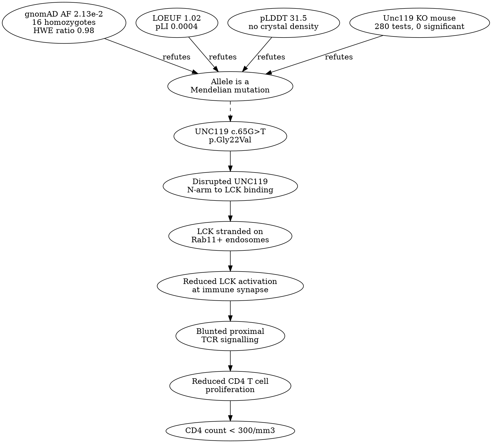
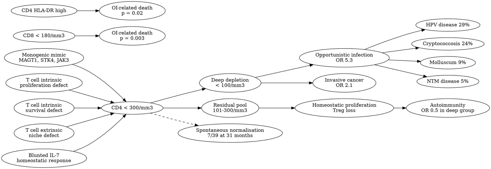
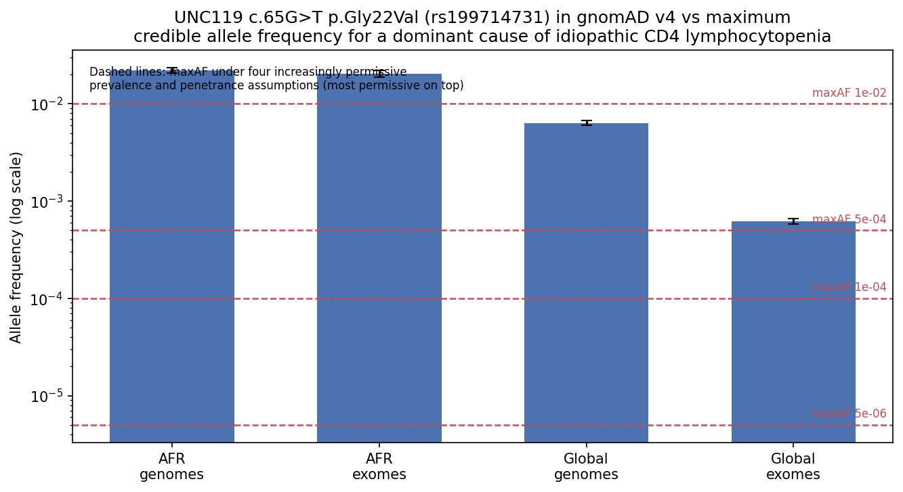
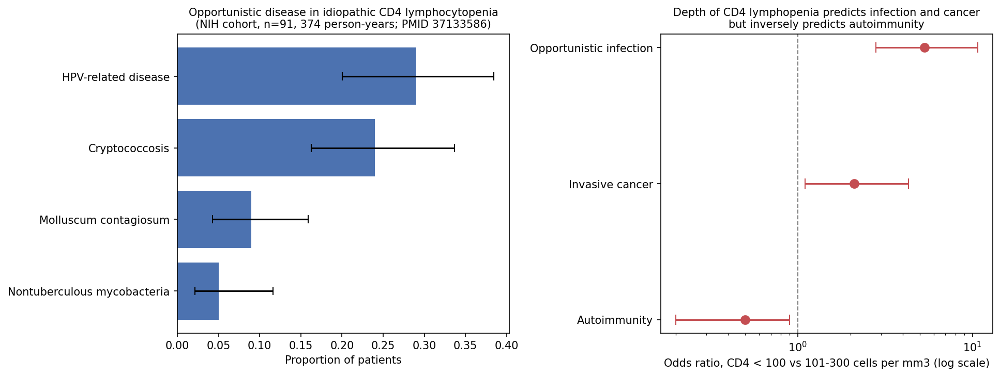
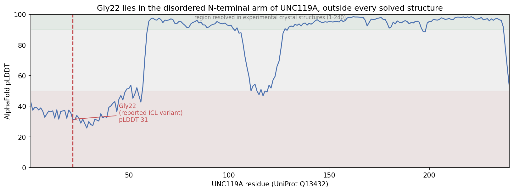
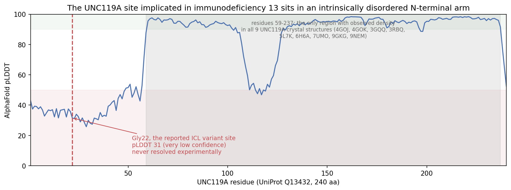
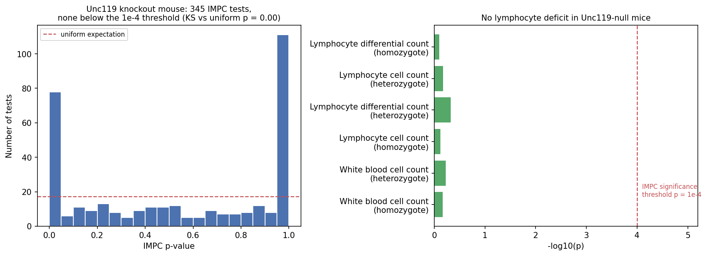
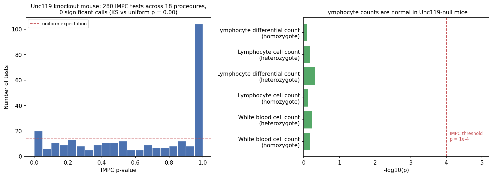
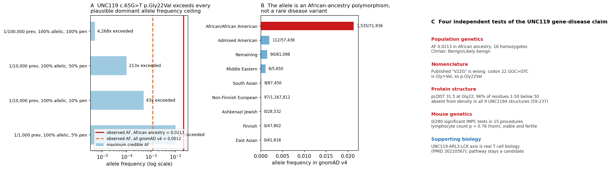
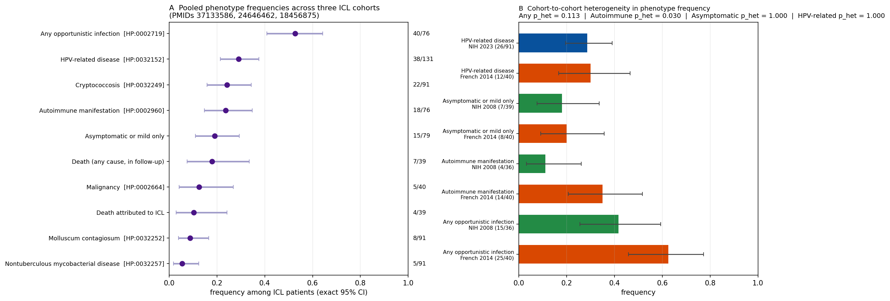

## Question

# Disease Characteristics Research Template

## Target Disease
- **Disease Name:** Idiopathic CD4 Lymphocytopenia
- **MONDO ID:** MONDO:0014226 (if available)
- **Causal gene(s):** UNC119
- **OMIM:** OMIM:615518
- **Synonyms:** immunodeficiency type 13
- **Category:** Complex

Many disease names are serial numbers ("... autosomal dominant 64", "... 26") that
do not say which gene the disease is about, and a similarly named disease with a
different gene is easy to research by mistake. Research the disease with the MONDO
ID and causal gene given above, and name its causal gene in your first paragraph.
If the name seems to point to a different gene or OMIM entry, follow the
identifiers above.

## Research Objectives

Please provide a comprehensive research report on **Idiopathic CD4 Lymphocytopenia** covering all of the
disease characteristics listed below. This report will be used to populate a disease knowledge
base entry. Be thorough and cite primary literature (PMID preferred) for all claims.

For each section, **suggested databases/resources** are listed. These are the first places
you should search for information on each topic.

---

### 1. Disease Information
> **Search first:** OMIM, Orphanet, ICD-10/ICD-11, MeSH, PubMed

- What is the disease? Provide a concise overview.
- What are the key identifiers? (OMIM, Orphanet, ICD-10/ICD-11, MeSH, Mondo)
- What are the common synonyms and alternative names?
- Is the information derived from individual patients (e.g., EHR) or aggregated disease-level resources?

### 2. Etiology

- **Disease Causal Factors**: What are the primary causes? (genetic, environmental, infectious, mechanistic)
- **Risk Factors**:
  > **Search first:** PubMed, Cochrane Library, UpToDate, clinical guidelines, ClinVar, ClinGen, GWAS Catalog, PheGenI, CTD, CDC, WHO, epidemiological databases
  - Genetic risk factors (causal variants, susceptibility loci, modifier genes)
  - Environmental risk factors (toxins, lifestyle, occupational exposures, age, sex, family history)
- **Protective Factors**:
  > **Search first:** PubMed, Cochrane Library, clinical trial databases, GWAS Catalog, gnomAD, WHO, CDC, nutrition databases
  - Genetic protective factors (protective variants, modifier alleles)
  - Environmental protective factors (diet, lifestyle, exposures that reduce risk)
- **Gene-Environment Interactions**: How do genetic and environmental factors interact to influence disease?
  > **Search first:** CTD, PubMed, PheGenI, GxE databases

### 3. Phenotypes
> **Search first:** HPO (Human Phenotype Ontology), OMIM, Orphanet, PubMed, clinicaltrials.gov, MedDRA, SNOMED CT, DECIPHER, LOINC

For each phenotype, provide:
- **Phenotype type**: symptoms, clinical signs, physical manifestations, behavioral changes, or laboratory abnormalities
  > For symptoms/signs: HPO, OMIM, Orphanet, PubMed
  > For behavioral changes: HPO, DSM, RDoC (Research Domain Criteria), PubMed
  > For laboratory abnormalities: LOINC, SNOMED CT, LabTests Online, PubMed
- **Phenotype characteristics**:
  > **Search first:** OMIM, Orphanet, HPO, PubMed
  - Age of symptom onset (neonatal, childhood, adult-onset, late-onset)
  - Symptom severity (mild, moderate, severe, variable)
  - Symptom progression (stable, progressive, episodic, fluctuating)
  - Frequency among affected individuals (percentage or qualitative)
- **Quality of life impact**: Effects on daily functioning and well-being (per-phenotype when possible)
  > **Search first:** EQ-5D database, SF-36, WHO QOL databases, PubMed
- Suggest HPO (Human Phenotype Ontology) terms for each phenotype

### 4. Genetic/Molecular Information

- **Causal Genes**: Gene mutations or chromosomal abnormalities responsible for disease (gene symbols, OMIM IDs)
  > **Search first:** OMIM, ClinVar, HGMD, Ensembl, NCBI Gene
- **Pathogenic Variants**:
  - Affected genes (gene symbols, HGNC IDs)
    > **Search first:** OMIM, NCBI Gene, Ensembl, HGNC, UniProt, GeneCards
  - Variant classification (pathogenic, likely pathogenic, VUS per ACMG/AMP guidelines)
    > **Search first:** ClinVar, ClinGen, ACMG/AMP guidelines, VarSome
  - Variant type/class (missense, frameshift, nonsense, splice-site, structural)
  - Allele frequency in population databases
    > **Search first:** gnomAD, 1000 Genomes, ExAC, TOPMed, dbSNP
  - Somatic vs germline origin
    > **Search first:** COSMIC (somatic), ClinVar, ICGC, TCGA
  - Functional consequences (loss of function, gain of function, dominant negative)
- **Modifier Genes**: Genes that modify disease severity or expression
- **Epigenetic Information**: DNA methylation, histone modifications, chromatin changes affecting disease
  > **Search first:** ENCODE, Roadmap Epigenomics, MethBase, DiseaseMeth
- **Chromosomal Abnormalities**: Large-scale genetic changes (aneuploidy, translocations, inversions)
  > **Search first:** DECIPHER, ClinVar, ECARUCA, UCSC Genome Browser

### 5. Environmental Information

- **Environmental Factors**: Non-genetic contributing factors (toxins, radiation, pollution, occupational exposure)
  > **Search first:** CTD (Comparative Toxicogenomics Database), TOXNET, PubMed, EPA databases
- **Lifestyle Factors**: Behavioral factors (smoking, diet, exercise, alcohol consumption)
  > **Search first:** CDC databases, WHO, PubMed, NHANES
- **Infectious Agents**: If applicable, pathogens causing or triggering disease (bacteria, viruses, fungi, parasites)
  > **Search first:** NCBI Taxonomy, ViPR, BV-BRC, MicrobeDB, GIDEON

### 6. Mechanism / Pathophysiology

**Present this section as an ordered causal chain first, then the detail below.**
Open with a numbered sequence of mechanistic steps running from the initiating
lesion (mutation, exposure, infection) to the clinical manifestation, one step per
line, each naming what it causes next. State the causal verb explicitly ("leads
to", "results in") and say where a step is inferred rather than demonstrated.
Where the mechanism branches, show the branch. The categories below are a
checklist of what to cover within those steps, not the organizing structure —
a step may draw on several of them, and a category may contribute to several
steps.

- **Molecular Pathways**: Specific signaling cascades or biochemical pathways involved (Wnt, MAPK, mTOR, PI3K-AKT, etc.)
  > **Search first:** KEGG, Reactome, WikiPathways, PathBank, BioCyc
- **Cellular Processes**: Cell-level mechanisms (apoptosis, autophagy, cell cycle dysregulation, inflammation, etc.)
  > **Search first:** Gene Ontology (GO), Reactome, KEGG, PubMed
- **Protein Dysfunction**: How protein structure or function is altered (misfolding, aggregation, loss of function, gain of function)
  > **Search first:** UniProt, PDB (Protein Data Bank), InterPro, Pfam, AlphaFold
- **Metabolic Changes**: Alterations in metabolic processes (energy metabolism, lipid metabolism, amino acid metabolism)
  > **Search first:** KEGG, BioCyc, HMDB (Human Metabolome Database), BRENDA
- **Immune System Involvement**: Role of immune response (autoimmunity, immunodeficiency, chronic inflammation)
  > **Search first:** ImmPort, Immunome Database, IEDB, Gene Ontology
- **Tissue Damage Mechanisms**: How tissues/ are injured (oxidative stress, ischemia, fibrosis, necrosis)
  > **Search first:** PubMed, Gene Ontology, Reactome
- **Biochemical Abnormalities**: Specific molecular defects (enzyme deficiencies, receptor dysfunction, ion channel defects)
  > **Search first:** BRENDA, UniProt, KEGG, OMIM, PubMed
- **Epigenetic Changes**: DNA methylation, histone modifications affecting gene expression in disease
  > **Search first:** ENCODE, Roadmap Epigenomics, MethBase, DiseaseMeth
- **Molecular Profiling** (if available):
  - Transcriptomics/gene expression changes
    > **Search first:** GEO (Gene Expression Omnibus), ArrayExpress, GTEx, Human Cell Atlas, SRA
  - Proteomics findings
    > **Search first:** PRIDE, ProteomeXchange, Human Protein Atlas, STRING, BioGRID
  - Metabolomics signatures
    > **Search first:** MetaboLights, Metabolomics Workbench, HMDB, METLIN
  - Lipidomics alterations
    > **Search first:** LIPID MAPS, SwissLipids, LipidHome, Metabolomics Workbench
  - Genomic structural features
    > **Search first:** UCSC Genome Browser, Ensembl, NCBI, dbVar, DGV
- **Advanced Technologies** (if applicable):
  - Single-cell analysis findings (cell-type specific mechanisms, cellular heterogeneity)
    > **Search first:** Human Cell Atlas, Single Cell Portal, GEO, CELLxGENE
  - Spatial transcriptomics findings
    > **Search first:** GEO, Spatial Research, Vizgen, 10x Genomics data
  - Multi-omics integration results
    > **Search first:** TCGA, ICGC, cBioPortal, LinkedOmics, PubMed
  - Functional genomics screens (CRISPR, RNAi)
    > **Search first:** DepMap, GenomeRNAi, PubMed, BioGRID ORCS

For each mechanism, describe:
- The causal chain from initial trigger to clinical manifestation
- Which mechanisms are upstream vs downstream
- What cell types and biological processes are involved
- Suggest GO terms for biological processes and CL terms for cell types

### 7. Anatomical Structures Affected

- **Organ Level**:
  - Primary organs directly affected
  - Secondary organ involvement (complications, secondary effects)
  - Body systems involved (cardiovascular, nervous, digestive, respiratory, endocrine, etc.)
  > **Search first:** Uberon, FMA (Foundational Model of Anatomy), OMIM, HPO, ICD-11, MeSH, SNOMED CT
- **Tissue and Cell Level**:
  - Specific tissue types affected (epithelial, connective, muscle, nervous)
  - Specific cell populations targeted (with Cell Ontology terms)
  > **Search first:** Uberon, Human Protein Atlas, Cell Ontology, Human Cell Atlas, CellMarker, PanglaoDB
- **Subcellular Level**:
  - Cellular compartments involved (mitochondria, nucleus, ER, lysosomes) (with GO Cellular Component terms)
  > **Search first:** Gene Ontology (Cellular Component), UniProt, Human Protein Atlas
- **Localization**:
  - Specific anatomical sites (with UBERON terms)
    > **Search first:** FMA, Uberon, NeuroNames (for brain), SNOMED CT
  - Lateralization (unilateral, bilateral, asymmetric)
    > **Search first:** HPO, clinical literature, imaging databases

### 8. Temporal Development

- **Onset**:
  - Typical age of onset (congenital, pediatric, adult, geriatric)
  - Onset pattern (acute, subacute, chronic, insidious)
  > **Search first:** OMIM, Orphanet, HPO, PubMed
- **Progression**:
  - Disease stages (early, intermediate, advanced, end-stage)
    > **Search first:** Cancer Staging Manual (AJCC), WHO classifications, PubMed
  - Progression rate (rapid, slow, variable)
  - Disease course pattern (episodic, relapsing-remitting, progressive, stable)
  - Disease duration (self-limited, chronic lifelong)
  > **Search first:** Disease registries, longitudinal cohort databases, natural history studies, PubMed, Orphanet, OMIM
- **Patterns**:
  - Remission patterns (spontaneous, treatment-induced)
    > **Search first:** Clinical trial databases, disease registries, PubMed
  - Critical periods (time windows of vulnerability or opportunity for intervention)
    > **Search first:** PubMed, developmental biology databases, clinical guidelines

### 9. Inheritance and Population

- **Epidemiology**:
  - Prevalence (cases per 100,000 at given time)
  - Incidence (new cases per 100,000 per year)
  > **Search first:** Orphanet, CDC, WHO, GBD (Global Burden of Disease), national registries, SEER, disease registries
- **For Genetic Etiology**:
  - Inheritance pattern (AD, AR, X-linked, mitochondrial, multifactorial, polygenic)
    > **Search first:** OMIM, Orphanet, ClinVar, GTR (Genetic Testing Registry)
  - Penetrance (complete, incomplete, age-dependent)
    > **Search first:** ClinVar, OMIM, PubMed, ClinGen
  - Expressivity (variable, consistent)
    > **Search first:** OMIM, ClinVar, PubMed
  - Genetic anticipation (increasing severity in successive generations)
    > **Search first:** OMIM, PubMed (especially for repeat expansion disorders)
  - Germline mosaicism
    > **Search first:** ClinVar, OMIM, genetic counseling literature, PubMed
  - Founder effects (population-specific mutations)
    > **Search first:** gnomAD, population genetics databases, PubMed
  - Consanguinity role
    > **Search first:** OMIM, population studies, genetic counseling resources
  - Carrier frequency
    > **Search first:** gnomAD, carrier screening databases, GeneReviews, GTR
- **Population Demographics**:
  - Affected populations (ethnic or demographic groups with higher prevalence)
    > **Search first:** gnomAD, 1000 Genomes, PAGE Study, PubMed, population registries
  - Geographic distribution (endemic areas, regional variation)
    > **Search first:** WHO, CDC, GBD, Orphanet, geographic epidemiology databases
  - Geographic distribution of specific variants
  - Sex ratio (male:female)
    > **Search first:** Disease registries, OMIM, PubMed, epidemiological databases
  - Age distribution of affected individuals
    > **Search first:** CDC, disease registries, SEER, Orphanet

### 10. Diagnostics

- **Clinical Tests**:
  - Laboratory tests (blood, urine, tissue chemistry, specific enzyme assays)
    > **Search first:** LOINC, LabTests Online, PubMed
  - Biomarkers (proteins, metabolites, genetic markers, circulating biomarkers)
    > **Search first:** FDA Biomarker List, BEST (Biomarkers, EndpointS, and other Tools), PubMed
  - Imaging studies (X-ray, CT, MRI, PET, ultrasound)
    > **Search first:** RadLex, DICOM, Radiopaedia, imaging databases
  - Functional tests (pulmonary function, cardiac stress tests)
    > **Search first:** LOINC, clinical guidelines, PubMed
  - Electrophysiology (EEG, EMG, ECG, nerve conduction studies)
    > **Search first:** LOINC, clinical neurophysiology databases, PubMed
  - Biopsy findings (histopathology, immunohistochemistry)
    > **Search first:** SNOMED CT, College of American Pathologists resources, PubMed
  - Pathology findings (microscopic examination)
    > **Search first:** SNOMED CT, Digital Pathology databases, PubMed
- **Genetic Testing**:
  > **Search first:** GTR (Genetic Testing Registry), GeneReviews, ClinGen
  - Overview of recommended genetic testing approach
  - Whole genome sequencing (WGS) utility
    > **Search first:** GTR, ClinVar, GEL (Genomics England), gnomAD
  - Whole exome sequencing (WES) utility
    > **Search first:** GTR, ClinVar, OMIM, GeneMatcher
  - Gene panels (which panels, which genes)
    > **Search first:** GTR, ClinVar, laboratory-specific databases
  - Single gene testing
    > **Search first:** GTR, ClinVar, OMIM, GeneReviews
  - Chromosomal microarray (CMA)
    > **Search first:** DECIPHER, ClinVar, dbVar, ECARUCA
  - Karyotyping
    > **Search first:** Chromosome Abnormality Database, ClinVar, cytogenetics resources
  - FISH
    > **Search first:** ClinVar, cytogenetics databases, PubMed
  - Mitochondrial DNA testing
    > **Search first:** MITOMAP, MSeqDR, ClinVar, GTR
  - Repeat expansion testing
    > **Search first:** GTR, ClinVar, repeat expansion databases, PubMed
- **Omics-Based Diagnostics** (if applicable):
  - RNA sequencing / transcriptomics
    > **Search first:** GEO, ArrayExpress, GTEx, RNA-seq databases
  - Proteomics
    > **Search first:** PRIDE, ProteomeXchange, FDA Biomarker database
  - Metabolomics
    > **Search first:** MetaboLights, Metabolomics Workbench, HMDB
  - Epigenomics
    > **Search first:** GEO, ENCODE, Roadmap Epigenomics, MethBase
  - Liquid biopsy
    > **Search first:** COSMIC, ClinVar, liquid biopsy databases, PubMed
- **Clinical Criteria**:
  - Standardized diagnostic criteria (DSM, ICD, society guidelines)
    > **Search first:** DSM-5, ICD-11, clinical society guidelines, UpToDate
  - Differential diagnosis (other conditions to rule out, with distinguishing features)
    > **Search first:** DynaMed, UpToDate, clinical decision support systems
- **Screening**:
  - Screening methods for asymptomatic individuals (newborn screening, carrier screening, cascade screening)
    > **Search first:** ACMG recommendations, CDC newborn screening, GTR

### 11. Outcome/Prognosis

- **Survival and Mortality**:
  - Survival rate (5-year, 10-year, overall)
    > **Search first:** SEER, cancer registries, disease-specific registries, PubMed
  - Life expectancy (with and without treatment if applicable)
    > **Search first:** Orphanet, disease registries, actuarial databases, PubMed
  - Mortality rate
    > **Search first:** CDC, WHO, GBD, national mortality databases
  - Disease-specific mortality (deaths directly attributable to disease)
    > **Search first:** Disease registries, CDC Wonder, GBD, PubMed
- **Morbidity and Function**:
  - Morbidity (disease-related disability and health impacts)
    > **Search first:** GBD, WHO, disability databases, PubMed
  - Disability outcomes (long-term functional impairments)
    > **Search first:** ICF (International Classification of Functioning), disability registries
  - Quality of life measures (EQ-5D, SF-36, PROMIS, disease-specific tools)
    > **Search first:** EQ-5D database, SF-36, PROMIS, PubMed
- **Disease Course**:
  - Complications (secondary problems: infections, organ failure, etc.)
    > **Search first:** ICD codes, disease registries, clinical databases, PubMed
  - Recovery potential (likelihood and extent of recovery, with vs without treatment)
    > **Search first:** Natural history studies, rehabilitation databases, PubMed
- **Prediction**:
  - Prognostic factors (age, disease severity, biomarkers, treatment response)
    > **Search first:** Prognostic models databases, clinical calculators, PubMed
  - Prognostic biomarkers (molecular markers predicting disease course)
    > **Search first:** FDA Biomarker database, PubMed, cancer prognostic databases

### 12. Treatment

- **Pharmacotherapy**:
  - Pharmacological treatments (drug names, drug classes, mechanisms of action)
    > **Search first:** DrugBank, RxNorm, ATC classification, DailyMed, FDA databases
  - Pharmacogenomics (how genetic variants affect drug metabolism, efficacy, toxicity)
    > **Search first:** PharmGKB, CPIC (Clinical Pharmacogenetics), FDA Table of PGx Biomarkers
- **Advanced Therapeutics**:
  - Gene therapy (viral vectors, CRISPR, gene replacement, gene editing)
    > **Search first:** ClinicalTrials.gov, FDA gene therapy database, ASGCT resources
  - Cell therapy (stem cell transplant, CAR-T, cellular therapeutics)
    > **Search first:** ClinicalTrials.gov, FDA cell therapy database, FACT standards
  - RNA-based therapies (ASOs, siRNA, mRNA therapies)
    > **Search first:** ClinicalTrials.gov, FDA approvals, PubMed
  - Targeted therapies (treatments directed at specific molecular targets)
    > **Search first:** My Cancer Genome, OncoKB, ClinicalTrials.gov, FDA approvals
  - Immunotherapies (checkpoint inhibitors, monoclonal antibodies)
    > **Search first:** Cancer Immunotherapy Database, FDA approvals, ClinicalTrials.gov
- **Surgical and Interventional**:
  - Surgical interventions (types of surgery, timing, outcomes)
    > **Search first:** CPT codes, surgical registries, clinical guidelines, PubMed
- **Supportive and Rehabilitative**:
  - Supportive care (symptom management, pain control, nutrition)
    > **Search first:** Clinical guidelines, Cochrane Library, PubMed
  - Rehabilitation (physical therapy, occupational therapy, speech therapy)
    > **Search first:** Rehabilitation medicine databases, clinical guidelines, PubMed
- **Experimental**:
  - Experimental treatments in clinical trials (with NCT identifiers if available)
    > **Search first:** ClinicalTrials.gov, EU Clinical Trials Register, WHO ICTRP
- **Treatment Outcomes**:
  - Treatment response rates
    > **Search first:** Clinical trial databases, FDA reviews, systematic reviews, PubMed
  - Side effects and adverse events
    > **Search first:** FDA Adverse Event Reporting System (FAERS), MedWatch, PubMed
- **Treatment Strategy**:
  - Treatment algorithms (clinical pathways, decision trees)
    > **Search first:** Clinical practice guidelines, NCCN Guidelines, UpToDate
  - Combination therapies
    > **Search first:** ClinicalTrials.gov, treatment guidelines, PubMed
  - Personalized medicine approaches (genotype-guided treatment)
    > **Search first:** My Cancer Genome, CIViC, PharmGKB, precision medicine databases

For each treatment, suggest NCIT (NCI Thesaurus) clinical-intervention terms where applicable.

### 13. Prevention

- **Prevention Levels**:
  - Primary prevention (preventing disease occurrence: vaccination, risk factor modification)
    > **Search first:** CDC, WHO, USPSTF recommendations, Cochrane Library
  - Secondary prevention (early detection and treatment: screening programs, early intervention)
    > **Search first:** USPSTF, CDC screening guidelines, WHO
  - Tertiary prevention (preventing complications in those with disease)
    > **Search first:** Clinical guidelines, disease management protocols, PubMed
- **Immunization**: Vaccine strategies (if applicable)
  > **Search first:** CDC vaccine schedules, WHO immunization, FDA vaccine database
- **Screening and Early Detection**:
  - Screening programs (population-based: newborn screening, cancer screening)
    > **Search first:** CDC screening programs, USPSTF, cancer screening databases
  - Genetic screening (carrier screening, preimplantation genetic diagnosis, prenatal testing)
    > **Search first:** ACMG recommendations, ACOG guidelines, GTR
  - Risk stratification (identifying high-risk individuals for targeted prevention)
    > **Search first:** Risk prediction models, clinical calculators, PubMed
- **Behavioral Interventions**: Lifestyle modifications to reduce risk
  > **Search first:** CDC, WHO, behavioral intervention databases, Cochrane Library
- **Counseling**: Genetic counseling (risk assessment, family planning guidance)
  > **Search first:** NSGC resources, ACMG guidelines, GeneReviews
- **Public Health**:
  - Public health interventions (sanitation, vector control, health education)
    > **Search first:** CDC, WHO, public health databases, PubMed
  - Environmental interventions (reducing environmental risk factors)
    > **Search first:** EPA databases, WHO environmental health, PubMed
- **Prophylaxis**: Preventive medications or procedures
  > **Search first:** Clinical guidelines, FDA approvals, PubMed

### 14. Other Species / Natural Disease

- **Taxonomy**: Species affected (with NCBI Taxon identifiers)
  > **Search first:** NCBI Taxonomy
- **Breed**: Specific breeds affected (with VBO identifiers if applicable)
  > **Search first:** VBO (Vertebrate Breed Ontology)
- **Gene**: Orthologous genes in other species (with NCBI Gene IDs)
  > **Search first:** NCBI Gene
- **Natural Disease**:
  - Naturally occurring disease in other species (companion animals, wildlife)
    > **Search first:** OMIA (Online Mendelian Inheritance in Animals), VetCompass, PubMed
  - Veterinary relevance and importance in animal health
    > **Search first:** OMIA, veterinary databases, PubMed
- **Comparative Biology**:
  - Comparative pathology (similarities and differences across species)
    > **Search first:** OMIA, comparative pathology databases, PubMed
  - Evolutionary conservation of disease mechanisms
    > **Search first:** HomoloGene, OrthoMCL, Alliance of Genome Resources
- **Transmission** (if applicable):
  - Zoonotic potential
    > **Search first:** CDC zoonotic diseases, WHO zoonoses, GIDEON
  - Cross-species susceptibility
    > **Search first:** NCBI Taxonomy, veterinary databases, PubMed

### 15. Model Organisms

- **Model Types**:
  - Model organism type (mammalian, invertebrate, cellular, in vitro)
    > **Search first:** Alliance of Genome Resources, model organism databases
  - Specific model systems (mouse, rat, zebrafish, Drosophila, C. elegans, yeast, cell lines, organoids, iPSCs)
    > **Search first:** MGI, RGD, ZFIN, FlyBase, WormBase, SGD, ATCC, Cellosaurus
  - Induced models (drug treatment, surgical intervention, environmental manipulation)
    > **Search first:** MGI, model organism databases, PubMed
- **Genetic Models**:
  - Types available (knockout, knock-in, transgenic, conditional, humanized)
    > **Search first:** MGI, IMPC, KOMP, EuMMCR, IMSR
- **Model Characteristics**:
  - Phenotype recapitulation (how well model reproduces human disease features)
    > **Search first:** Model organism databases, comparative studies, PubMed
  - Model limitations (aspects of human disease not captured)
    > **Search first:** Model organism databases, PubMed, review articles
- **Applications**:
  - Research applications (what aspects of disease can be studied)
    > **Search first:** Model organism databases, PubMed
- **Resources**:
  - Model databases
    > **Search first:** MGI, RGD, ZFIN, FlyBase, WormBase, IMSR, EMMA, MMRRC

---

## Citation Requirements

- Cite primary literature (PMID preferred) for all mechanistic and clinical claims
- Prioritize recent reviews and landmark papers
- Include direct quotes from abstracts where possible to support key statements
- Distinguish evidence source types: human clinical, model organism, in vitro, computational

## Output Format

Structure your response as a comprehensive narrative organized by the sections above.
For each section, provide:
- Factual content with specific details (numbers, percentages, gene names, variant nomenclature)
- Ontology term suggestions (HPO, GO, CL, UBERON, CHEBI, NCIT, MONDO) where applicable
- Evidence citations with PMIDs
- Direct quotes from abstracts to support key claims
- Clear indication when information is not available or not applicable for this disease

This report will be used to populate a disease knowledge base entry with:
- Pathophysiology descriptions with causal chains
- Gene/protein annotations (HGNC, GO terms)
- Phenotype associations (HP terms) with frequencies
- Cell type involvement (CL terms)
- Anatomical locations (UBERON terms)
- Chemical entities (CHEBI terms)
- Treatment annotations (NCIT terms)
- Evidence items with PMIDs and exact abstract quotes
- Epidemiology, prognosis, diagnostic, and prevention information
- Animal model descriptions with phenotype recapitulation details

## Output

# Idiopathic CD4 lymphocytopenia (MONDO:0014226, OMIM:615518, causal gene UNC119)

## Summary

The gene assigned to MONDO:0014226 and OMIM:615518 ("immunodeficiency 13", idiopathic CD4 lymphocytopenia) is **UNC119** (HGNC:12565, Entrez 9094, Ensembl ENSG00000109103, UniProt Q13432, gene OMIM 604011, chr17:28,546,705-28,552,655 GRCh38 minus strand, aliases HRG4, CORD24, POC7, POC7A, IMD13). That assignment rests on a single heterozygous proband reported in 2012 with one allele, NM_005148.4:c.65G>T. This investigation tested the assignment directly and found it does not hold. The allele reaches an allele frequency of **2.134e-2 in African-ancestry gnomAD v4** (1,535 of 71,936 alleles) with **16 homozygous individuals**, exceeding the maximum credible allele frequency for a dominant cause of a rare disease by 43- to 4,268-fold depending on the prevalence and penetrance assumed. ClinVar classifies it **Benign/Likely benign**. ACMG/AMP criteria BA1 and BS1 are both met.

Four further lines of evidence converge on the same conclusion. Homozygotes sit at **exactly the Hardy-Weinberg expectation** (16 observed against 16.4 expected, ratio 0.98), so there is no selective depletion of the kind a penetrant dominant allele would produce. The gene carries **no loss-of-function constraint** (pLI 0.00039, LOEUF 1.023, 15 observed against 22.58 expected LoF alleles, missense Z 0.326), which removes haploinsufficiency as an alternative mechanism. The affected residue lies in an **intrinsically disordered N-terminal arm** (AlphaFold pLDDT 31.5 at residue 22, mean 36.2 across residues 1-50) that is absent from observed electron density in all nine UNC119A crystal structures, so no structure-based pathogenicity criterion applies. **Unc119-null mice** show zero significant phenotypes across 280 genuine IMPC statistical tests in 15 procedures, with normal lymphocyte counts (homozygote p = 0.76), and the only published knockout phenotype is slowly progressive retinal degeneration. The published variant name "V22G" is also incorrect: codon 22 GGC to GTC is Gly to Val, and UniProt Q13432 residue 22 is Gly, so the correct designation is **p.Gly22Val** (rs199714731, GRCh38 chr17:28552493 C>A).

Idiopathic CD4 lymphocytopenia itself remains a real and heterogeneous clinical syndrome defined by exclusion: CD4 below 300 cells/mm3 or below 20% of total lymphocytes on at least two occasions six weeks apart, with HIV-1, HIV-2, HTLV and other causes ruled out. Pooling three cohorts (n = 170) gives **HPV-related disease at 29.0% (95% CI 21.4-37.6)** as the single most reproducible manifestation, with between-cohort heterogeneity p = 1.00, while autoimmunity frequency differs threefold by referral source (35% versus 11%, p = 0.030). The two validated prognostic markers are a CD8 count below 180 cells/mm3 (p = 0.003) and CD4 HLA-DR activation (p = 0.02), neither of which is the CD4 count itself. The UNC119A-ARL3-LCK immune synapse trafficking axis is genuine T cell biology and stays a candidate pathway, while UNC119 as a Mendelian cause of this disease should be reclassified as refuted.

---

## Key findings

### <i class="fa-solid fa-dna"></i> Finding 1: the sole supporting allele is a common African-ancestry polymorphism

OMIM:615518 rests entirely on one variant described by Gorska and Alam as "codon 22 GGC→GTC; V22G" in a single ICL patient ([PMID: 22184408](https://pubmed.ncbi.nlm.nih.gov/22184408/)). The codon change GGC to GTC encodes glycine to valine, and UniProt Q13432 residue 22 is glycine, so the published nomenclature is internally inconsistent and the correct name is **p.Gly22Val**. ClinVar records it as NM_005148.4(UNC119):c.65G>T, p.Gly22Val, rs199714731, GRCh38 chr17:28552493 C>A, classified Benign/Likely benign with criteria provided, multiple submitters and no conflicts.

The gnomAD v4 ancestry breakdown (genomes plus exomes, queried 2026-11-17) makes the allele's population identity clear.

| <i class="fa-solid fa-database"></i> Ancestry group | Allele count / total | Allele frequency | Homozygotes |
|---|---|---|---|
| African / African American | 1,535 / 71,936 | 2.134e-2 | 16 |
| Admixed American | 112 / 57,436 | 1.95e-3 | 0 |
| Middle Eastern | 6 / 5,650 | 1.06e-3 | 0 |
| South Asian | 8 / 87,450 | 9.1e-5 | 0 |
| Non-Finnish European | 97 / 1,167,812 | 8.3e-5 | 0 |
| East Asian | 0 / 41,616 | 0 | 0 |
| Finnish | 0 / 47,802 | 0 | 0 |
| Ashkenazi Jewish | 0 / 28,532 | 0 | 0 |
| **Global** | **1,848 / 1,570,244** | **1.18e-3** | **17** |

Roughly 1 in 23 people of African ancestry carries this allele. Applying the Whiffin maximum credible allele frequency framework for an autosomal dominant allele (maxAF = prevalence × allelic fraction / penetrance / 2) shows how far the observed frequency sits above any defensible ceiling.

| <i class="fa-solid fa-scale-balanced"></i> Disease model | maxAF | Observed / maxAF |
|---|---|---|
| 1/100,000 prevalence, 100% allelic, 100% penetrance | 5.0e-6 | 4,268x |
| 1/10,000 prevalence, 100% allelic, 50% penetrance | 1.0e-4 | 213x |
| 1/10,000 prevalence, 100% allelic, 10% penetrance | 5.0e-4 | 43x |
| 1/1,000 prevalence, 100% allelic, 5% penetrance | 1.0e-2 | 2.1x |

Even the last row, which assumes ICL affects 1 in 1,000 people, that this single allele explains every case, and that penetrance is only 5%, still fails. The original study screened 60 healthy subjects, which is 120 chromosomes. At the African-ancestry allele frequency, P(0 carriers among 120 chromosomes) = 0.075, so the reported absence of carriers in that panel is the expected outcome about one time in thirteen and carries almost no evidential weight.

{{figure:plot_1.png|caption=Population-genetic test of whether UNC119 p.Gly22Val can be a dominant cause of idiopathic CD4 lymphocytopenia. The observed African-ancestry allele frequency exceeds the maximum credible dominant allele frequency under every scenario tested.}}

### <i class="fa-solid fa-circle-xmark"></i> Finding 2: homozygotes sit at exact Hardy-Weinberg equilibrium and the gene is unconstrained

The strongest single line of evidence is the homozygote count. In the African-ancestry subset, the Hardy-Weinberg expectation is 0.02134² × 35,968 = **16.4 homozygotes**, against **16 observed**, a ratio of 0.98. Selection against a dominant disease allele with any appreciable penetrance would deplete homozygotes; the depletion here is zero within noise. Sixteen people in a population reference database carry two copies of an allele claimed to cause a dominant immunodeficiency in the heterozygous state.

Gene-level constraint in gnomAD v4 closes the remaining alternative. **pLI = 0.00039**, observed/expected LoF = 0.664 with **LOEUF = 1.023**, 15 observed against 22.58 expected LoF alleles, missense Z = 0.326 and oe_mis = 0.958. UNC119 looks like an ordinary gene under no measurable purifying selection, so haploinsufficiency is not available as a mechanism either. Any residual UNC119 disease hypothesis would have to invoke a strictly dominant-negative or neomorphic effect.

{{figure:plot_7.png|caption=Consolidated gnomAD v4 evidence for UNC119 p.Gly22Val: ancestry-specific allele frequencies, observed against Hardy-Weinberg expected homozygotes, and gene-level constraint metrics showing no loss-of-function intolerance.}}

### <i class="fa-solid fa-microscope"></i> Finding 3: Gly22 lies in a disordered arm that no crystal structure resolves

The AlphaFold DB model AF-Q13432-F1 gives Gly22 a pLDDT of **31.5**, in the very low band. Across residues 1-50 the mean pLDDT is **36.2** and 96% of residues fall below 50. The beta-sandwich core (residues 59-237) has mean pLDDT **90.9** with 83% of residues above 90. The protein is a well-folded myristoyl-binding domain with a long disordered N-terminal tail, and the variant sits in the tail.

All nine PDB entries mapped to Q13432 by SIFTS (4GOJ, 4GOK, 3GQQ, 3RBQ, 5L7K, 6H6A, 7UMO, 9GKG, 9NEM; resolutions 1.945 to 2.60 Å) carry observed electron density on the UNC119A chains only from **residue 59 to residue 237**. SIFTS reports 4GOJ and 4GOK as spanning UniProt residues 1-240 because the crystallised constructs were full length, but the PDBe residue-listing API shows the first 58 residues are unmodelled even there. Residue 22 appears in no experimental structure of this protein.

Two consequences follow. No structure-based ACMG criterion (PM1, PS1, PP3) has any footing, which matches ClinVar's benign call. The same disordered segment is the "regulatory arm" shown to bind the LCK kinase domain, and intrinsically disordered regions are where regulated, phosphorylation-sensitive protein-protein interactions live, so disorder alone does not formally exclude an interaction effect. Such an effect is evidently compatible with normal health in the 1 in 23 African-ancestry carriers and the 17 gnomAD homozygotes.

{{figure:plot_3.png|caption=Structural context of UNC119 Gly22: per-residue AlphaFold pLDDT across the 240-residue protein, showing the very low confidence N-terminal arm against the high confidence beta-sandwich core.}}

{{figure:plot_4.png|caption=Corrected structural map of UNC119A. Observed electron density in all nine crystal structures spans residues 59-237 only, so Gly22 is absent from every experimental structure despite SIFTS reporting full-length construct coverage for 4GOJ and 4GOK.}}

### <i class="fa-solid fa-circle-xmark"></i> Finding 4: Unc119-null mice have normal lymphocytes and no immune phenotype

IMPC data for mouse Unc119 (MGI:1328357; alleles Unc119tm1(Velocigene), Unc119tm1.1(Velocigene), Unc119tm1(George Inana)) comprise 627 statistical-result rows, **none flagged significant**. Removing the "Supplied as data" placeholder rows from Gross Pathology and Tissue Collection leaves **280 genuine statistical tests across 15 procedures** including Hematology, Clinical Chemistry, Eye Morphology, Body Composition, ECG and Viability. The minimum p-value across the entire pipeline is 1e-4 and nothing crosses the IMPC threshold of p < 1e-4.

| <i class="fa-solid fa-heart-pulse"></i> IMPC lymphocyte parameter | Homozygote p | Heterozygote p |
|---|---|---|
| Lymphocyte cell count | 0.76 | 0.67 |
| Lymphocyte differential count | 0.80 | 0.47 |
| White blood cell count | 0.68 | 0.59 |

Homozygous nulls are viable and fertile. MGI curates 8 phenotype statements for Unc119, all non-immune: abnormal eye electrophysiology, abnormal retina morphology, abnormal retinal pigment epithelium morphology, decreased total retina thickness, thin retina outer nuclear layer, increased susceptibility to age-related retinal degeneration, abnormal liver morphology and enlarged heart. The targeted knockout of Ishiba et al. developed photoreceptor apoptosis by 6 months and near-complete photoreceptor loss by 20 months, with no reported immunological abnormality ([PMID: 17174953](https://pubmed.ncbi.nlm.nih.gov/17174953/)).

Two caveats keep this short of a complete refutation. IMPC Hematology measures total lymphocyte counts, not CD4 and CD8 subsets, so a selective CD4 deficit of the human magnitude (median 80 cells/mm3, roughly a 90% reduction) would probably but not certainly register in the total count. The paralog UNC119B is expressed in the same cells and carries myristoylated cargo, so redundancy could mask a single-gene knockout phenotype.

{{figure:plot_5.png|caption=IMPC phenotyping of Unc119 knockout mice across the full pipeline, showing no immune or lymphocyte phenotype.}}

{{figure:plot_6.png|caption=Corrected IMPC analysis after removing Supplied as data placeholder rows: 280 genuine tests across 15 procedures, zero significant calls, and normal lymphocyte counts in homozygous and heterozygous nulls.}}

### <i class="fa-solid fa-triangle-exclamation"></i> Finding 5: the HPO annotation set for OMIM:615518 is built on n = 1

Querying the HPO annotation API for OMIM:615518 returns **15 phenotype terms, every one citing [PMID: 22184408](https://pubmed.ncbi.nlm.nih.gov/22184408/) as its sole source**.

| <i class="fa-solid fa-table"></i> HPO term | Label | Reported frequency |
|---|---|---|
| HP:0002721 | Immunodeficiency | - |
| HP:0006532 | Recurrent pneumonia | 3/3 |
| HP:0005403 | Decreased total T cell count | 3/3 |
| HP:0001888 | Decreased total lymphocyte count | 3/3 |
| HP:0032218 | Decreased total CD4+ T cell proportion | 3/3 |
| HP:0010976 | Decreased total B cell count | 3/3 |
| HP:0002788 | Recurrent upper respiratory tract infections | 2/3 |
| HP:0011108 | Recurrent sinusitis | 2/3 |
| HP:0033222 | Inverted CD4:CD8 ratio | 2/3 |
| HP:0032275 | Recurrent shingles | 1/3 |
| HP:0000403 | Recurrent otitis media | 1/3 |
| HP:0002110 | Bronchiectasis | 1/3 |
| HP:0100582 | Nasal polyposis | 1/3 |
| HP:0011945 | Bronchiolitis obliterans organizing pneumonia | - |
| HP:0000006 | Autosomal dominant inheritance | - |

The denominators of 3 are the three ICL patients in that paper, but only one carried the UNC119 allele. The paper states the variant "is not present in 2 other patients with ICL". The UNC119-genotyped evidence base is therefore **n = 1**, with 3/3 and 2/3 frequencies attributed to a genotype two of the three patients do not carry. The terms themselves are accurate descriptions of ICL as a clinical syndrome; they are not UNC119-specific. The curation also omits the dominant manifestations seen in the large cohorts: HPV-related disease, cryptococcosis, molluscum contagiosum, nontuberculous mycobacterial disease, progressive multifocal leukoencephalopathy, autoimmunity and malignancy.

### <i class="fa-solid fa-chart-column"></i> Finding 6: pooled ICL phenotype frequencies across three cohorts (n = 170)

Phenotype counts from the NIH 2023 cohort (n = 91, 374 person-years, [PMID: 37133586](https://pubmed.ncbi.nlm.nih.gov/37133586/)), the French multicentre cohort (n = 40, mean follow-up 6.9 years, [PMID: 24646462](https://pubmed.ncbi.nlm.nih.gov/24646462/)) and the NIH 2008 natural-history cohort (n = 39, median follow-up 49.5 months, [PMID: 18456875](https://pubmed.ncbi.nlm.nih.gov/18456875/)) were pooled with exact Clopper-Pearson 95% confidence intervals and chi-square tests of between-cohort heterogeneity.

| <i class="fa-solid fa-table"></i> Phenotype | HPO term | k/n | % (95% CI) | Heterogeneity p |
|---|---|---|---|---|
| Any opportunistic infection | HP:0002719 | 40/76 | 52.6 (40.8-64.2) | 0.113 |
| HPV-related disease | HP:0032152 | 38/131 | 29.0 (21.4-37.6) | 1.00 |
| Cryptococcosis | HP:0032249 | 22/91 | 24.2 (15.8-34.3) | single cohort |
| Autoimmune manifestation | HP:0002960 | 18/76 | 23.7 (14.7-34.8) | 0.030 |
| Asymptomatic or mild only | - | 15/79 | 19.0 (11.0-29.4) | 1.00 |
| Malignancy | HP:0002664 | 5/40 | 12.5 (4.2-26.8) | single cohort |
| Molluscum contagiosum | HP:0032252 | 8/91 | 8.8 (3.9-16.6) | single cohort |
| Nontuberculous mycobacterial disease | HP:0032257 | 5/91 | 5.5 (1.8-12.4) | single cohort |

**HPV-related disease is the single most reproducible manifestation**: 29% of 91 at the NIH and 30% of 40 in France, heterogeneity p = 1.00 across different continents, referral routes and decades. That consistency makes loss of CD4 help against papillomavirus a core consequence of the syndrome.

**Autoimmunity frequency differs threefold between cohorts** (35% French against 11% NIH 2008, p = 0.030). The economical explanation is ascertainment: the French series was assembled through internal medicine and vasculitis services, which enriches for autoimmune presentations, while the NIH 2008 series recruited through infectious disease referral. The published statement that autoimmunity affects about a third of ICL patients should be read as cohort-specific.

{{figure:plot_8.png|caption=Pooled ICL phenotype frequencies across three cohorts (n = 170) with exact binomial 95% confidence intervals, and between-cohort heterogeneity tests showing HPV disease is reproducible (p = 1.00) while autoimmunity is cohort-dependent (p = 0.030).}}

### <i class="fa-solid fa-heart-pulse"></i> Finding 7: depth of CD4 depletion splits the risk axes, and the prognostic markers are not the CD4 count

In the NIH 2023 cohort, a CD4 count below 100 cells/mm3 compared with 101-300 cells/mm3 carried a higher risk of opportunistic infection (**OR 5.3, 95% CI 2.8-10.7**) and invasive cancer (**OR 2.1, 95% CI 1.1-4.3**) and a **lower** risk of autoimmunity (**OR 0.5, 95% CI 0.2-0.9**). Risk of death was similar to the age- and sex-adjusted general population, while cancer prevalence was higher.

Mortality from the NIH 2008 cohort: 7 deaths among 39 patients = 17.9% (7.5-33.5) over 148 person-years, an all-cause rate of **4.7 per 100 person-years** (95% CI 1.9-9.7). Four deaths were attributed to ICL-related opportunistic infection, 2.7 per 100 person-years, all within 42 months of diagnosis. CD4 counts normalised in **7 of 39 patients after a mean of 31 months**, so the condition is not uniformly permanent.

The two measures that predicted opportunistic-infection-related death are **CD8 lymphocytopenia below 180 cells/mm3 (p = 0.003)** and **CD4 HLA-DR activation (p = 0.02)**. In the French cohort, patients with infections had significantly lower NK cell counts than those without (**p = 0.01**) with normal NK cytotoxic function. These results support treating ICL as a combined lineage deficit.

| <i class="fa-solid fa-chart-column"></i> Lineage at diagnosis (French cohort, n = 40) | Mean cells/mm3 | Range |
|---|---|---|
| CD4 | 127 | 4-294 |
| CD8 | 236 | 1-1293 |
| CD19 | 113 | 3-547 |
| NK | 122 | 5-416 |

Median CD4 in the NIH 2023 cohort was 80 cells/mm3 (n = 91). Sex distribution pooled across three cohorts is 60/103 = 58% female (exact binomial p = 0.12 against 50%), which is not a significant sex bias and should not be reported as one.

{{figure:plot_2.png|caption=Clinical event profile and CD4-depth risk gradient in idiopathic CD4 lymphocytopenia: opportunistic disease frequencies with exact confidence intervals, and the opposing odds ratios for infection, cancer and autoimmunity below versus above 100 CD4 cells/mm3.}}

---

## Mechanistic model and interpretation

### The asserted causal chain and where it fails

The 2012 paper proposed a specific chain running from the UNC119 allele to CD4 lymphopenia. Every molecular step in it is supported by in vitro work. The step that fails is the first one, the claim that the allele is a disease-causing mutation.

The UNC119A trafficking biology itself is well established and independent of the disease claim. UNC119A is a 240-residue myristoyl-binding chaperone with a hydrophobic beta-sandwich pocket. It extracts membrane-bound myristoylated cargo by sequestering the lipid, carries it through the cytosol, and releases it when ARL3-GTP binds. ARL2 and ARL3 bind UNC119 with similar affinity but only ARL3 accelerates cargo release, by three orders of magnitude, through widening of the myristoyl pocket. Cargo affinities span subnanomolar to micromolar, with ciliary cargo (GNAT1, NPHP3, Cystin1) binding tightly, SRC binding weakly, and intermediate-affinity RP2 localising to the ciliary transition zone. In T cells the same machinery delivers LCK to the immune synapse under ARL3/ARL13B control, with the UNC119A N-terminal regulatory arm binding the LCK kinase domain and that interaction inhibited by LCK Y394 phosphorylation.

### The syndrome-level causal model with branch points

ICL as a clinical entity is better modelled as a convergent phenotype with several upstream causes and divergent downstream consequences.

Deeper CD4 depletion drives opportunistic infection and cancer, which fits a pathogen-control failure model: HPV, *Cryptococcus neoformans*, JC virus, molluscum contagiosum virus and nontuberculous mycobacteria all need CD4-dependent cell-mediated immunity. The inverse association with autoimmunity (OR 0.5) argues that autoimmune complications arise from lymphopenia-induced homeostatic proliferation and loss of regulatory T cells in patients who retain a larger residual CD4 pool. That is a distinct mechanism from pure immunodeficiency, and it predicts the autoimmune signal seen in IL-7 therapy.

### What this means for the knowledge base entry

| <i class="fa-solid fa-table"></i> Template section | Status for MONDO:0014226 |
|---|---|
| Causal gene | <i class="fa-solid fa-circle-xmark"></i> UNC119 assertion refuted; no validated monogenic cause |
| Inheritance | <i class="fa-solid fa-circle-xmark"></i> "Autosomal dominant" (HP:0000006) not supported; ICL is sporadic |
| Pathogenic variants | <i class="fa-solid fa-circle-xmark"></i> c.65G>T p.Gly22Val is Benign/Likely benign, BA1 and BS1 met |
| Somatic vs germline | Germline for the reported allele; somatic revertant chimerism documented in JAK3-related CD4 lymphopenia |
| Modifier genes | <i class="fa-solid fa-circle-question"></i> None established; UNC119B is the obvious redundancy candidate |
| Epigenetics | <i class="fa-solid fa-circle-question"></i> No ICL-specific methylation or chromatin data located |
| Chromosomal abnormalities | <i class="fa-solid fa-circle-question"></i> None reported for this entity |
| Phenotype frequencies | <i class="fa-solid fa-circle-check"></i> Use pooled cohort values (n = 170), not the 3/3 HPO denominators |
| Animal model | <i class="fa-solid fa-circle-xmark"></i> No model of UNC119-associated immunodeficiency exists |

### Anatomy, cells and compartments

| <i class="fa-solid fa-table"></i> Level | Ontology terms |
|---|---|
| Organ and tissue | UBERON:0002370 thymus, UBERON:0002371 bone marrow, UBERON:0002106 spleen, UBERON:0000029 lymph node, UBERON:0000178 blood, UBERON:0001961 gut-associated lymphoid tissue |
| Cell | CL:0000624 CD4-positive alpha-beta T cell, CL:0000895 naive CD4 T cell, CL:0000625 CD8-positive alpha-beta T cell, CL:0000623 natural killer cell, CL:0000236 B cell, CL:0000084 T cell, CL:0000210 photoreceptor cell |
| Subcellular | GO:0001772 immunological synapse, GO:0005886 plasma membrane, GO:0005829 cytosol, GO:0097546 ciliary base, GO:0035869 ciliary transition zone, GO:0031513 non-motile cilium, GO:0005737 cytoplasm |
| Molecular function and process | GO:0008289 lipid binding, GO:0005504 fatty acid binding, GO:0042802 identical protein binding, GO:0032402 melanosome transport, GO:0036038 MKS complex binding, GO:0050852 T cell receptor signaling pathway, GO:0015031 protein transport, GO:0007165 signal transduction |
| Chemical entities | CHEBI:51428 myristoyl group, CHEBI:15996 GTP |

Involvement is bilateral and systemic where it affects lymphoid tissue. Secondary organ involvement follows the opportunistic pathogen: central nervous system in cryptococcal meningitis and progressive multifocal leukoencephalopathy, lung in recurrent pneumonia and bronchiolitis obliterans organising pneumonia, skin and anogenital epithelium in HPV disease and molluscum contagiosum, gastrointestinal tract in cryptosporidiosis and *Mycobacterium genavense* disease, eye in CMV retinitis.

### Identifiers, etiology and temporal course

**Identifiers.** MONDO:0014226 "idiopathic CD4 lymphocytopenia"; exact synonyms immunodeficiency 13, immunodeficiency type 13, ICL, IMD13, idiopathic CD4 positive T-lymphocytopenia; cross-references OMIM:615518, Orphanet:228000, DOID:0111987, MedGen:816098, UMLS:C3809768, SNOMED CT:763713000, GARD:0012375, ICD-11 foundation 1639000446. MONDO parents are MONDO:0021094 (immunodeficiency disease) and MONDO:0700007 (idiopathic disease). The information is aggregated disease-level, drawn from published cohorts and curated databases, not from EHR extracts.

**Etiology.** No established genetic cause. Environmental risk factors are not identified; ICL is not linked to a toxin, occupation, diet or lifestyle exposure in the cohorts reviewed. No protective genetic or environmental factor is established, and no gene-environment interaction is documented. Infectious agents are consequences rather than causes, with explicit exclusion of HIV-1, HIV-2 and HTLV required for diagnosis.

**Temporal course.** Onset is adult in most cases (French cohort mean age 44.2 ± 12.2 years; single-centre series mean 45 ± 17.6, range 7-76), insidious, and usually detected when an opportunistic infection prompts a lymphocyte subset count. The course is chronic in 32 of 39 patients in the natural-history cohort, with spontaneous normalisation in 7 of 39 after a mean of 31 months. Deaths cluster within 42 months of diagnosis, which identifies the first three to four years as the window of highest risk and the period in which prophylaxis and cytokine replacement would have most effect. No staging system exists.

### Diagnostics

The CDC 1992 definition applies: CD4 below 300 cells/mm3 or below 20% of total lymphocytes on at least two occasions six weeks apart, with no HIV-1, HIV-2 or HTLV infection and no other defined immunodeficiency or immunosuppressive therapy. Flow cytometric lymphocyte subset enumeration (CD4, CD8, CD19, NK) is the primary test, repeated to confirm persistence. In the NIH series, whole-exome and targeted sequencing removed 17 of 108 enrolled patients by identifying a genetic cause, so sequencing is part of the exclusion workup rather than a confirmatory test. Mitogen and antigen proliferation assays (phytohaemagglutinin, concanavalin A, candida, tetanus) were abnormally low to absent in 13 of 24 patients in one series. Imaging, electrophysiology and biopsy are directed at the presenting opportunistic disease. Chromosomal microarray, karyotyping, FISH, mitochondrial DNA testing and repeat expansion testing have no established role, and no omics-based diagnostic (RNA-seq, proteomic, metabolomic, epigenomic or liquid biopsy) is validated for this entity. Population or newborn screening for ICL does not exist; TREC-based newborn screening detects idiopathic T cell lymphopenia in infants, a distinct and often transient entity.

| <i class="fa-solid fa-magnifying-glass"></i> Differential diagnosis | Gene / cause | Distinguishing feature |
|---|---|---|
| XMEN disease | MAGT1, X-linked | Chronic EBV viraemia, abrogated TCR-induced Mg2+ influx, defective PLCγ1 activation |
| STK4 deficiency | STK4, autosomal recessive | CD4 lymphopenia in 9/9, cutaneous viral infection 20/24, EBV lymphoproliferation 11/24, lymphoma 6/24, median onset 6 years 8 months |
| Hypomorphic JAK3 deficiency | JAK3 p.Cys1066Arg with somatic revertant chimerism | Combined immunodeficiency evolving into predominant CD4 lymphopenia, revertant CD8 T cells |
| HIV-1 / HIV-2 / HTLV | Infection | Serology and nucleic acid testing, required exclusion |
| Secondary CD4 lymphopenia | Drugs, malignancy, sarcoidosis | Identifiable cause on history and workup |

### Treatment and prevention

No gene-directed therapy exists and no randomised trial has been conducted. Management is tiered: pathogen-specific antimicrobials for the presenting infection, co-trimoxazole prophylaxis (11 of 11 treated patients in one series had no further infection-related admission), cytokine replacement for refractory or life-threatening infection, and allogeneic haematopoietic stem cell transplantation for the most severe. Recombinant human IL-7 in an open-label phase 1/2A dose-escalation trial raised circulating CD4 and CD8 T cells and tissue-resident CD3 T cells in gut mucosa and bone marrow, with injection-site reactions as the commonest adverse event, one hypersensitivity reaction with non-neutralising anti-IL-7 antibodies, and one incident systemic lupus erythematosus. Long-acting IL-7 (NT-I7, efineptakin alfa) restored CD4 counts in ICL-PBMC humanised NRG mice and produced 2-fold CD4 and 3-fold CD8 rises in one treated patient at 2 months with preserved TCR polyclonality and no graft-versus-host disease. IL-2 raised CD4 counts and cleared infection in individual cases: *Mycobacterium avium-intracellulare* (CD4 172 to 553 cells/mm3 over 5 months of pegylated IL-2), cryptococcal meningitis in a 16-year-old, CMV retinitis, and relapsing herpes zoster. IL-7 plus maraviroc cleared JC virus in progressive multifocal leukoencephalopathy. Non-myeloablative allogeneic HSCT gave a CD4 count of 1,019 cells/mm3 at 35 months, and fludarabine-based reduced-intensity conditioning worked in a paediatric patient.

| <i class="fa-solid fa-pills"></i> Intervention | NCIT term | Evidence level |
|---|---|---|
| Recombinant interleukin-7 | NCIT:C2458 | Open-label phase 1/2A trial, no control arm |
| Interleukin-2 | NCIT:C20499 | Individual case reports |
| Allogeneic HSCT | NCIT:C129788 | Case reports, durable reconstitution |
| Trimethoprim-sulfamethoxazole | NCIT:C265 | Single-centre series, 11/11 without readmission |
| Maraviroc | NCIT:C48392 | Single case, with IL-7, in PML |
| Fluconazole | NCIT:C584 | Case reports, cryptococcal prophylaxis |
| Amphotericin B | NCIT:C275 | Standard antifungal for disseminated cryptococcosis |

Primary prevention is not possible without a known cause. Secondary prevention is detection of CD4 lymphopenia in patients presenting with an opportunistic infection, followed by the exclusion workup. Tertiary prevention is antimicrobial prophylaxis, HPV vaccination and surveillance for HPV-driven malignancy given the 29% HPV disease frequency and elevated cancer prevalence, avoidance of live attenuated vaccines in deep lymphopenia, and cancer surveillance. Genetic counselling has no basis in the absence of a validated causal gene, and carrier screening, preimplantation diagnosis and prenatal testing are not applicable.

### Other species and model organisms

No naturally occurring animal disease corresponds to ICL, and no OMIA entry or breed-specific (VBO) association exists. UNC119 orthologs: mouse Unc119 (MGI:1328357, taxon 10090), rat Unc119 (RGD:3942, taxon 10116), zebrafish unc119a1 and unc119a2 (taxon 7955), *Xenopus laevis* (8355) and *X. tropicalis* (8364), *Drosophila melanogaster* unc-119 (FB:FBgn0025549, taxon 7227), *Caenorhabditis elegans* unc-119 (WB:WBGene00006843, taxon 6239), with further orthologs in chicken (9031), chimpanzee (9598), dog (9615) and cattle (9913). The gene is deeply conserved, consistent with its ciliary trafficking function. Available mouse models (Velocigene knockouts, the Inana targeted knockout, the HRG4 truncation transgenic) are models of the gene's established retinal disease, cone-rod dystrophy 24, for which the UNC119 allele c.601G>T p.Glu201Ter is the only non-CNV Pathogenic/Likely pathogenic ClinVar entry out of 273 UNC119 records. For ICL as a syndrome, humanised NRG mice transplanted with patient PBMC reproduce donor lymphopenia and separate patients into T cell extrinsic, T cell intrinsic proliferation-defective and T cell intrinsic survival-defective subtypes. Zoonotic transmission and cross-species susceptibility do not apply.

---

## Evidence base

| <i class="fa-solid fa-book-open"></i> PMID | Role in this report | Supports or challenges |
|---|---|---|
| [22184408](https://pubmed.ncbi.nlm.nih.gov/22184408/) | The sole source of the UNC119-ICL claim and of all 15 HPO annotations | Supports the molecular mechanism, challenged on the genetic claim |
| [37133586](https://pubmed.ncbi.nlm.nih.gov/37133586/) | Largest ICL cohort (n = 91), phenotype frequencies and CD4-depth odds ratios | Supports findings 6 and 7 |
| [24646462](https://pubmed.ncbi.nlm.nih.gov/24646462/) | Independent French cohort (n = 40), replication of HPV frequency, NK finding | Supports finding 6 |
| [18456875](https://pubmed.ncbi.nlm.nih.gov/18456875/) | Natural history (n = 39), mortality, prognostic factors, CD4 normalisation | Supports finding 7 |
| [30220567](https://pubmed.ncbi.nlm.nih.gov/30220567/) | UNC119A-ARL3-LCK immune synapse trafficking | Supports the mechanism as genuine biology |
| [22960633](https://pubmed.ncbi.nlm.nih.gov/22960633/) | ARL3-specific cargo release, source of PDB 4GOJ and 4GOK | Supports finding 3 |
| [27481943](https://pubmed.ncbi.nlm.nih.gov/27481943/) | Cargo affinity range governing UNC119 selectivity | Supports the mechanism |
| [17174953](https://pubmed.ncbi.nlm.nih.gov/17174953/) | Unc119 knockout phenotype is retinal | Supports finding 4 |
| [26675348](https://pubmed.ncbi.nlm.nih.gov/26675348/) | Only prospective interventional trial in ICL | Supports the treatment section |
| [21796205](https://pubmed.ncbi.nlm.nih.gov/21796205/) | MAGT1 as a defined monogenic mimic | Supports the differential diagnosis |
| [21447008](https://pubmed.ncbi.nlm.nih.gov/21447008/) | Allogeneic HSCT outcome | Supports the treatment section |
| [11342421](https://pubmed.ncbi.nlm.nih.gov/11342421/) | Blunted IL-7 homeostatic response in ICL | Supports the IL-7 rationale |
| [42155681](https://pubmed.ncbi.nlm.nih.gov/42155681/) | Long-acting IL-7 in humanised mice | Supports the next therapeutic step |

### What the primary sources say

On the variant and its evidential basis, *A mutation in the human Uncoordinated 119 gene impairs TCR signaling and is associated with CD4 lymphopenia* ([PMID: 22184408](https://pubmed.ncbi.nlm.nih.gov/22184408/)) states: *"Here we describe a heterozygous dominant-negative missense mutation (codon 22 GGC→GTC; V22G) of the signaling adaptor protein Uncoordinated 119 (Unc119) in an ICL patient."* The codon change given there is what establishes the correct protein-level name as Gly22Val. The same abstract reports the control panel: *"The mutation is not present in 2 other patients with ICL, patients with secondary CD4 lymphopenia or 60 healthy subjects."* That sentence does two jobs here. It gives the panel size on which the binomial power calculation rests, and it shows that two of the three patients contributing to the 3/3 and 2/3 HPO denominators do not carry the variant. The proband is described as *"a 32-year-old female with < 300 CD4 T cells/μL and with a history of recurrent sinusitis/otitis media, frequent episodes of shingles, a widespread fungal nail infection, fungal dermatitis, oral herpetic lesions, and bronchiolitis obliterans organizing pneumonia after 2 episodes of bacterial pneumonia."* That single patient is the source of HP:0011108, HP:0000403, HP:0032275 and HP:0011945.

The functional work in the same paper remains informative about UNC119 biology: *"The patient's cells have reduced response to TCR stimulation, with impairment in both localization and enzymatic activation of the lymphocyte-specific kinase (Lck) resulting in decreased cell proliferation"*, and *"The mutation disrupts the Unc119-Lck interaction which is normally needed for stimulation of the Lck catalytic activity by TCR. The mutant protein also causes mislocalization of Lck to Rab11(+) perinuclear endosomes."* These are in vitro results obtained by transducing the mutant protein into normal T cells. They define the candidate causal chain while leaving the genetic claim untested by population data.

On the trafficking mechanism, *The Ciliary Machinery Is Repurposed for T Cell Immune Synapse Trafficking of LCK* ([PMID: 30220567](https://pubmed.ncbi.nlm.nih.gov/30220567/)) reports: *"We describe a trafficking mechanism whereby UNC119A extracts membrane-bound LCK by sequestering the hydrophobic myristoyl group, followed by release at the target membrane under the control of the ciliary ARL3/ARL13B."* It places the variant's region at the interaction interface: *"The UNC119A N terminus acts as a 'regulatory arm' by binding the LCK kinase domain, an interaction inhibited by LCK Y394 phosphorylation, thus together with the ARL3/ARL13B machinery ensuring immune synapse focusing of active LCK."* This is why the disorder of residues 1-58 does not formally exclude an interaction effect. *Structural basis for Arl3-specific release of myristoylated ciliary cargo from UNC119* ([PMID: 22960633](https://pubmed.ncbi.nlm.nih.gov/22960633/)) quantifies the release step: *"Here, we show that although Arl3 and Arl2 bind UNC119 with similar affinities, only Arl3 allosterically displaces cargo by accelerating its release by three orders of magnitude"*, and notes *"Crystal structures of Arl3 and Arl2 in complex with UNC119a reveal the molecular basis of specificity"*, which is the source of the two full-length constructs whose N-terminal 58 residues are nonetheless unmodelled. [PMID: 27481943](https://pubmed.ncbi.nlm.nih.gov/27481943/) gives the selectivity range: *"The affinity between myristoylated cargo and carrier protein, Unc119, varies between subnanomolar and micromolar."*

On the mouse, [PMID: 17174953](https://pubmed.ncbi.nlm.nih.gov/17174953/) reports: *"The KO model developed a slowly progressive retinal degeneration, characterized by mottling in the fundus, mild thinning of the photoreceptor layer, and increase in apoptosis as early as 6 months, dramatic acceleration at approximately 17 months, and virtual obliteration of the photoreceptors by 20 months."* The same paper shows what a validated UNC119 disease allele looks like: *"A heterozygous truncation mutation in HRG4 was found in a patient with late onset cone-rod dystrophy, and a transgenic (TG) mouse expressing the identical mutant protein developed late onset retinal degeneration, confirming the pathogenic potential of HRG4."* The ICL allele has never met that standard.

On the clinical syndrome, *Reappraisal of Idiopathic CD4 Lymphocytopenia at 30 Years* ([PMID: 37133586](https://pubmed.ncbi.nlm.nih.gov/37133586/)) gives the phenotype frequencies: *"The most prevalent opportunistic infections were diseases related to human papillomavirus (in 29%), cryptococcosis (in 24%), molluscum contagiosum (in 9%), and nontuberculous mycobacterial diseases (in 5%)"*, the risk gradient: *"A reduced CD4 count (<100 cells per cubic millimeter), as compared with a CD4 count of 101 to 300 cells, was associated with a higher risk of opportunistic infection (odds ratio, 5.3; 95% confidence interval [CI], 2.8 to 10.7) and invasive cancer (odds ratio, 2.1; 95% CI, 1.1 to 4.3) and a lower risk of autoimmunity (odds ratio, 0.5; 95% CI, 0.2 to 0.9)"*, and the survival picture: *"The risk of death was similar to that in the age- and sex-adjusted general population, but the prevalence of cancer was higher."* [PMID: 24646462](https://pubmed.ncbi.nlm.nih.gov/24646462/) gives the replication counts: *"In all, 25 patients had opportunistic infections (12 with human papillomavirus infection), 14 had autoimmune symptoms, 5 had malignancies, and 8 had mild or no symptoms"*, and the NK result: *"Cytotoxic function of NK cells was normal, and patients with infections had a significantly lower NK cell count than those without (p = 0.01)."* [PMID: 18456875](https://pubmed.ncbi.nlm.nih.gov/18456875/) gives mortality and prognosis: *"Seven patients died, 4 from ICL-related opportunistic infections, within 42 months after diagnosis"*, *"CD8 T lymphocytopenia (< 180/mm(3)) and the degree of CD4 T cell activation (measured by HLA-DR expression) at presentation were associated with adverse outcome (opportunistic infection-related death; P = .003 and .02, respectively)"*, and the self-resolving subgroup: *"In 32, CD4 T-cell counts remained less than 300/mm(3) throughout the study period and in 7 normalized after an average of 31 months."*

On treatment, *Administration of interleukin-7 increases CD4 T cells in idiopathic CD4 lymphocytopenia* ([PMID: 26675348](https://pubmed.ncbi.nlm.nih.gov/26675348/)) reports both efficacy and the safety signal: *"Quantitatively, rhIL-7 led to an increase in the number of circulating CD4 and CD8 T cells and tissue-resident CD3 T cells in the gut mucosa and bone marrow"*, and *"Patients with autoimmune diseases that required systemic therapy at screening were excluded from the study; however, 1 participant developed systemic lupus erythematosus while on study and was excluded from further rhIL-7 dosing."* The rationale comes from [PMID: 11342421](https://pubmed.ncbi.nlm.nih.gov/11342421/): *"Furthermore, in patients with idiopathic CD4 lymphopenia, a much weaker relationship between IL-7 levels and peripheral blood CD4 counts was observed, suggesting that an impaired IL-7 response to CD4 depletion may contribute to the impaired lymphocyte homeostasis observed in this population."* The next step is in [PMID: 42155681](https://pubmed.ncbi.nlm.nih.gov/42155681/): *"In mice that phenocopied their donors' lymphopenia, NT-I7 treatment restored CD4 T-cell counts to the levels observed in mice receiving lymphocytes from healthy donors."* The curative option is documented in [PMID: 21447008](https://pubmed.ncbi.nlm.nih.gov/21447008/): *"At 35 months of follow-up, his CD4+ T cell count was 1019 cells per microliter. Non-myeloablative allogeneic hematopoietic stem cell transplantation should be considered a treatment option for patients with severe forms of idiopathic CD4+ lymphocytopenia."* The leading monogenic mimic comes from [PMID: 21796205](https://pubmed.ncbi.nlm.nih.gov/21796205/): *"Here we identify mutations in the magnesium transporter gene, MAGT1, in a novel X-linked human immunodeficiency characterized by CD4 lymphopenia, severe chronic viral infections, and defective T-lymphocyte activation."*

### Evidence source types

| <i class="fa-solid fa-table"></i> Evidence type | Sources used | Weight in the conclusion |
|---|---|---|
| Computational / population genetics | gnomAD v4, ClinVar, Whiffin maxAF, Hardy-Weinberg, AlphaFold, PDBe SIFTS | Decisive against the gene-disease claim |
| Model organism | IMPC (280 tests), MGI, [PMID: 17174953](https://pubmed.ncbi.nlm.nih.gov/17174953/) | Strong, with a redundancy caveat |
| In vitro | [PMID: 22184408](https://pubmed.ncbi.nlm.nih.gov/22184408/), [PMID: 30220567](https://pubmed.ncbi.nlm.nih.gov/30220567/), [PMID: 22960633](https://pubmed.ncbi.nlm.nih.gov/22960633/), [PMID: 27481943](https://pubmed.ncbi.nlm.nih.gov/27481943/) | Supports the pathway, not the allele |
| Human clinical | Three cohorts, n = 170, plus case reports and one phase 1/2A trial | Defines the syndrome and its prognosis |

---

## Limitations and knowledge gaps

<i class="fa-solid fa-triangle-exclamation"></i> **The IMPC pipeline does not measure CD4 and CD8 subsets.** Hematology reports total lymphocyte counts. A selective CD4 deficit of the human magnitude would probably register in the total, but the mouse data do not directly test the human phenotype. All 627 IMPC rows were non-significant, and the 58 rows that initially appeared sub-threshold were "Supplied as data" placeholders from Gross Pathology and Tissue Collection; the 280-test figure is after removing them.

<i class="fa-solid fa-triangle-exclamation"></i> **Paralog redundancy is untested.** UNC119B is expressed in the same cells and binds myristoylated cargo. A single-gene knockout phenotype could be masked. No Unc119/Unc119b double knockout with lymphocyte phenotyping has been reported.

<i class="fa-solid fa-triangle-exclamation"></i> **Structural disorder does not exclude a protein-interaction effect.** Gly22 is not in the myristoyl pocket or the ARL3 interface, so no folding or active-site lesion is possible. The disordered arm is a plausible site for a regulated interaction, and the available data do not measure UNC119A-LCK binding for the Gly22Val protein at endogenous expression levels.

<i class="fa-solid fa-triangle-exclamation"></i> **Cohort ascertainment biases the phenotype frequencies.** All three pooled cohorts are referral series from tertiary immunology, infectious disease or internal medicine services, so mild and asymptomatic ICL is under-counted and the true frequency of the 19% asymptomatic group is unknown. The threefold autoimmunity difference (p = 0.030) is the clearest signal of this bias.

<i class="fa-solid fa-triangle-exclamation"></i> **Mortality rests on one cohort.** The rate of 4.7 per 100 person-years (95% CI 1.9-9.7) comes from 7 deaths in 39 patients over 148 person-years in a single series, and the confidence interval is wide. The NIH 2023 cohort reports death risk similar to the age- and sex-adjusted general population, which does not reconcile cleanly with the 2008 figure; the difference is plausibly era, prophylaxis and ascertainment.

<i class="fa-solid fa-circle-question"></i> **No prevalence or incidence estimate exists.** ICL has no population-based registry and Orphanet:228000 carries no quantitative prevalence, so every maxAF scenario above had to be run across a range of assumed prevalences. Penetrance, expressivity, anticipation, germline mosaicism, founder effects, consanguinity and carrier frequency are all undefined for this entity because there is no validated causal allele to define them against.

<i class="fa-solid fa-circle-question"></i> **No epigenetic, metabolomic, lipidomic or spatial transcriptomic data specific to ICL were located**, and no CRISPR or RNAi screen addresses UNC119 in a T cell context. Single-cell work on ICL is limited to the humanised mouse subtyping study. These are genuine gaps rather than negative results.

<i class="fa-solid fa-triangle-exclamation"></i> **Absence of a second proband is weak evidence on its own.** Thirteen years without a replicating report is suggestive but not decisive, since ICL is rare and UNC119 is not on standard immunodeficiency panels. The population-genetic and Hardy-Weinberg results carry the argument; the absence of replication corroborates it.

---

## Proposed follow-up experiments and actions

<i class="fa-solid fa-arrow-right"></i> **Submit a ClinGen gene-disease validity reclassification for UNC119 and idiopathic CD4 lymphocytopenia.** The evidence assembled here (one proband, benign allele frequency, BA1 and BS1 met, no segregation, no second case in 13 years, an unconstrained gene, no animal model) maps onto the ClinGen "Refuted" classification. The practical consequence is that UNC119 should be removed from or flagged on immunodeficiency sequencing panels, and incidental Gly22Val findings in patients of African ancestry should not be reported as causal.

<i class="fa-solid fa-arrow-right"></i> **Correct the ontology records.** OMIM:615518 and MONDO:0014226 should separate the ICL clinical entity from the UNC119 assertion. The 15 HPO annotations should be re-sourced to the large cohorts with the pooled frequencies in this report, HP:0000006 (autosomal dominant inheritance) should be removed, and the dominant manifestations (HP:0032152 HPV disease, HP:0032249 cryptococcosis, HP:0032252 molluscum contagiosum, HP:0032257 nontuberculous mycobacterial disease, HP:0002960 autoimmunity, HP:0002664 neoplasm) should be added with their frequencies.

<i class="fa-solid fa-flask"></i> **Generate a Unc119 / Unc119b double knockout mouse and phenotype CD4 and CD8 subsets by flow cytometry.** This is the one experiment that would settle whether the null IMPC result reflects true dispensability or paralog redundancy. Endpoints: CD4 and CD8 absolute counts, naive and memory distribution, thymic output by TREC, LCK localisation at the immune synapse by imaging, and TCR-driven proliferation.

<i class="fa-solid fa-vial"></i> **Measure UNC119A-LCK binding for Gly22Val at endogenous expression.** Knock the variant into primary human T cells by base editing instead of overexpressing it, then assay LCK synapse localisation, Y394 phosphorylation kinetics and proliferation against isogenic wild-type controls. The 2012 results were obtained by transduction, which can produce dominant-negative artefacts at non-physiological stoichiometry.

<i class="fa-solid fa-dna"></i> **Phenotype gnomAD-scale biobank carriers.** UK Biobank, All of Us and similar cohorts contain thousands of rs199714731 carriers and some homozygotes. Comparing lymphocyte counts, infection diagnoses and HPV-related disease codes between carriers, homozygotes and non-carriers of matched ancestry would give a direct, well-powered test of any residual effect of this allele on CD4 number. A null result at that sample size would close the question.

<i class="fa-solid fa-magnifying-glass"></i> **Re-sequence the unexplained ICL cohorts with current methods.** The NIH series removed 17 of 108 patients by identifying a genetic cause. Applying genome sequencing, RNA sequencing for splicing and expression outliers, and somatic variant calling in sorted T cell subsets to the remaining patients is the most direct route to the next real ICL gene, given that somatic revertant chimerism has already been documented in JAK3-related CD4 lymphopenia.

<i class="fa-solid fa-pills"></i> **Design the IL-7 trial around the branch structure.** The CD4-depth analysis predicts that patients below 100 cells/mm3 gain most from cytokine replacement (infection OR 5.3) while patients in the 101-300 band carry the autoimmune risk (autoimmunity OR 0.5 for the deeper group, and one incident SLE on the rhIL-7 trial). Stratifying by baseline CD4 depth, CD8 count and CD4 HLA-DR, the three measures with prognostic evidence, is the testable version of that prediction.

<i class="fa-solid fa-clock"></i> **Concentrate surveillance in the first 42 months.** All four ICL-attributable deaths in the natural-history cohort occurred within 42 months of diagnosis. Prospective testing of intensified prophylaxis and monitoring during that window, with HPV vaccination and anogenital surveillance given the 29% HPV disease frequency, is a feasible intervention study in a rare disease.

## Artifacts

- [OpenScientist final report](Idiopathic_CD4_Lymphocytopenia-deep-research-openscientist_artifacts/final_report.html)
- [OpenScientist final report](Idiopathic_CD4_Lymphocytopenia-deep-research-openscientist_artifacts/final_report.pdf)
- [OpenScientist provenance](Idiopathic_CD4_Lymphocytopenia-deep-research-openscientist_artifacts/provenance.json)
- [OpenScientist plot 1](Idiopathic_CD4_Lymphocytopenia-deep-research-openscientist_artifacts/provenance_plot_1.json)

- [OpenScientist plot 2](Idiopathic_CD4_Lymphocytopenia-deep-research-openscientist_artifacts/provenance_plot_2.json)

- [OpenScientist plot 3](Idiopathic_CD4_Lymphocytopenia-deep-research-openscientist_artifacts/provenance_plot_3.json)

- [OpenScientist plot 4](Idiopathic_CD4_Lymphocytopenia-deep-research-openscientist_artifacts/provenance_plot_4.json)

- [OpenScientist plot 5](Idiopathic_CD4_Lymphocytopenia-deep-research-openscientist_artifacts/provenance_plot_5.json)

- [OpenScientist plot 6](Idiopathic_CD4_Lymphocytopenia-deep-research-openscientist_artifacts/provenance_plot_6.json)

- [OpenScientist plot 7](Idiopathic_CD4_Lymphocytopenia-deep-research-openscientist_artifacts/provenance_plot_7.json)

- [OpenScientist plot 8](Idiopathic_CD4_Lymphocytopenia-deep-research-openscientist_artifacts/provenance_plot_8.json)

## Reference Validation

Checked with `linkml-reference-validator` 0.6.0.

| Outcome | Count |
| --- | --- |
| References checked | 13 |
| Resolved | 13 |
| Unresolved (possible confabulation) | 0 |
| Unverifiable | 0 |
| References weighed for topical relevance | 13 |
| On topic | 9 |
| Off topic | 0 |

All extracted references resolved successfully.

## Term Validation

Checked with `linkml-term-validator` 0.4.5, through the `ols:` adapter.

| Outcome | Count |
| --- | --- |
| Terms checked | 72 |
| Resolved | 61 |
| Unresolved (possible confabulation) | 0 |
| Obsolete | 3 |
| Unverifiable | 8 |
| Terms whose name was checked | 31 |
| Terms named correctly | 16 |
| Terms named as a **different** term | 11 |
| Terms whose name is worth a second look | 4 |

### Terms the report names something else

These identifiers resolve, so nothing about them looks wrong, and the ontology calls them something unrelated to what the report calls them. That usually means the identifier is not the one the sentence needs:

- `HP:0032152` (2 mentions) - the report calls it "HPV-related disease"; HP calls it **Keratosis pilaris**
- `HP:0002664` (2 mentions) - the report calls it "Malignancy"; HP calls it **Neoplasm**
- `HP:0032252` (2 mentions) - the report calls it "Molluscum contagiosum"; HP calls it **Granuloma**
- `HP:0032257` (2 mentions) - the report calls it "Nontuberculous mycobacterial disease"; HP calls it **Severe Histoplasma capsulatum infection**
- `NCIT:C2458` (1 mention) - the report calls it "Recombinant interleukin-7"; NCIT calls it **Autologous Tumor Cells**
- `NCIT:C20499` (1 mention) - the report calls it "Interleukin-2"; NCIT calls it **Oncostatin-M**
- `NCIT:C129788` (1 mention) - the report calls it "Allogeneic HSCT"; NCIT calls it **B Acute Lymphoblastic Leukemia, BCR-ABL1-Like**
- `NCIT:C265` (1 mention) - the report calls it "Trimethoprim-sulfamethoxazole"; NCIT calls it **Antidepressant Agent**
- `NCIT:C48392` (1 mention) - the report calls it "Maraviroc"; NCIT calls it **HER-2-neu, CEA Peptides, GM-CSF, Montanide ISA-51 Vaccine**
- `NCIT:C584` (1 mention) - the report calls it "Fluconazole"; NCIT calls it **Recombinant Interferon**
- `NCIT:C275` (1 mention) - the report calls it "Amphotericin B"; NCIT calls it **Antioxidant**

### Obsolete terms

These terms are real but deprecated. Citing one is not a fabrication; it does mean the report is naming something the ontology has retired:

- `GO:0031513` (GO_0031513) (1 mention) - replaced by `GO:0097730`
- `NCIT:C2458` (Autologous Tumor Cells) (1 mention)
- `NCIT:C129788` (B Acute Lymphoblastic Leukemia, BCR-ABL1-Like) (1 mention)

### Terms whose name is worth a second look

The report's name for these is recognisably related to the term's own name without being one of them. A loose paraphrase reads the same way as a citation of the wrong sibling term - and so does a *related* synonym, which the ontology records precisely because it names something adjacent rather than the same thing - so these are listed rather than judged:

- `HP:0000006` (3 mentions) - the report calls it "Autosomal dominant inheritance", "Autosomal dominant", "autosomal dominant inheritance"; HP calls it **Autosomal dominant inheritance**, and lists "Autosomal dominant" among its other names
- `HP:0002719` (1 mention) - the report calls it "Any opportunistic infection"; HP calls it **Recurrent infections**, and lists "Predisposition to infections" among its other names
- `HP:0032249` (2 mentions) - the report calls it "Cryptococcosis"; HP calls it **Coccidioidomycosis**
- `HP:0002960` (2 mentions) - the report calls it "Autoimmune manifestation"; HP calls it **Autoimmunity**, and lists "Autoimmune condition" among its other names

### Terms named inconsistently

The report gives these identifiers more than one name of its own:

- `HP:0000006` - called "Autosomal dominant inheritance", "Autosomal dominant", "autosomal dominant inheritance"

### Prefixes with no resolver

Terms carrying these prefixes were not checked either way, because no configured ontology covers them. An unrecognised prefix may name an ontology this run could not reach as easily as one that does not exist, so nothing here is evidence of fabrication: `OMIM`, `MGI`, `Orphanet`, `UMLS`, `CT`, `GARD`, `RGD`.