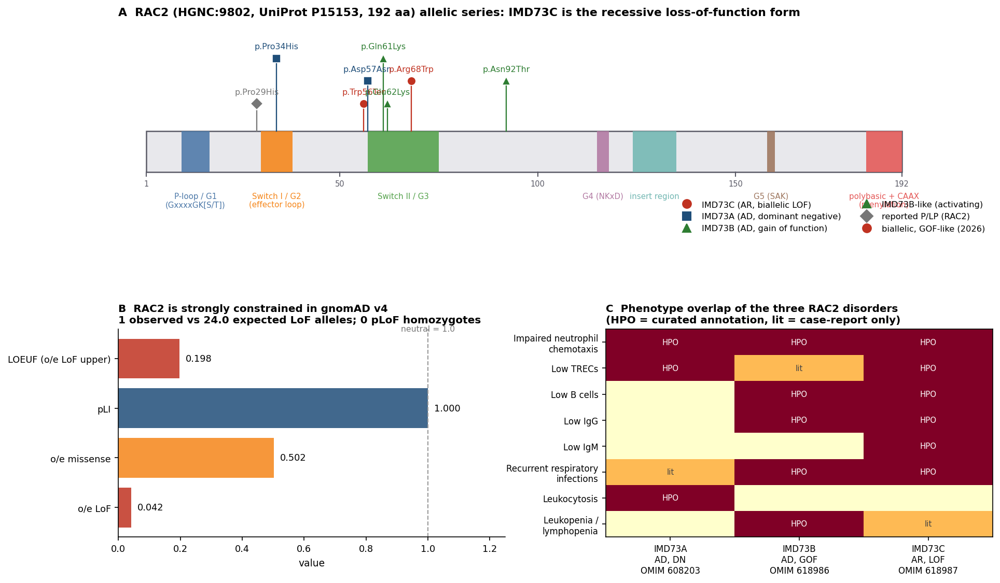
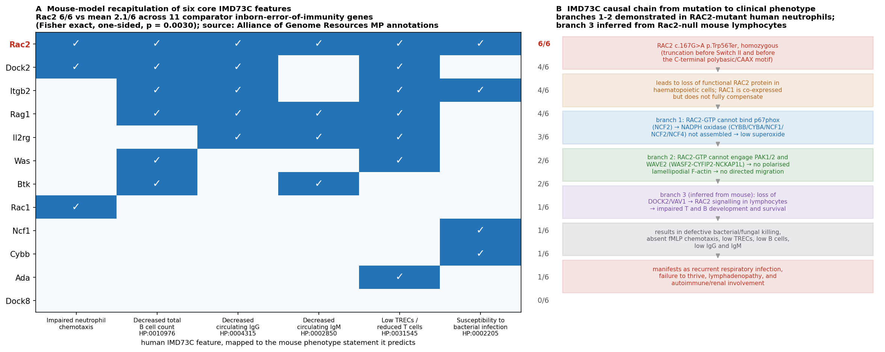
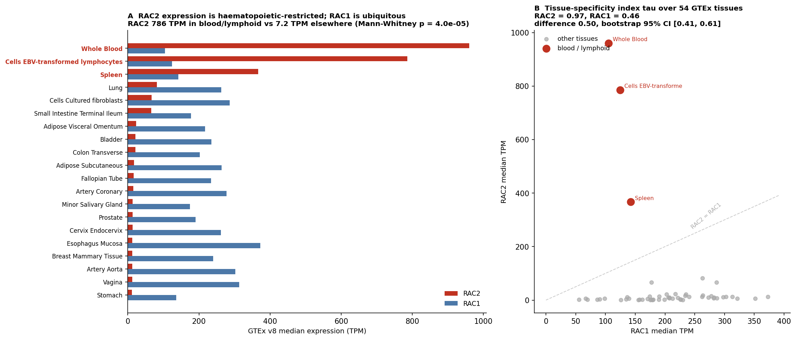
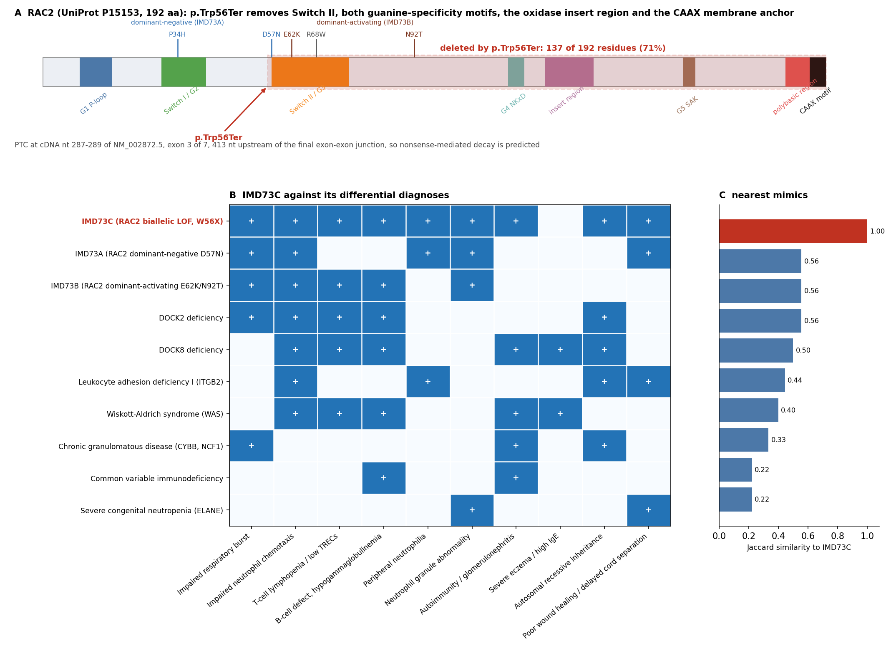
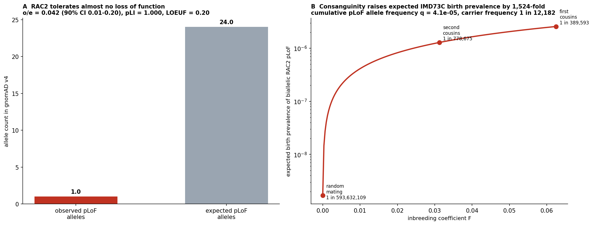

## Question

# Disease Characteristics Research Template

## Target Disease
- **Disease Name:** Immunodeficiency 73C
- **MONDO ID:** MONDO:0033555 (if available)
- **Causal gene(s):** not recorded
- **OMIM:** OMIM:618987
- **Synonyms:** IMD73C
- **Category:** Mendelian

Many disease names are serial numbers ("... autosomal dominant 64", "... 26") that
do not say which gene the disease is about, and a similarly named disease with a
different gene is easy to research by mistake. Research the disease with the MONDO
ID and causal gene given above, and name its causal gene in your first paragraph.
If the name seems to point to a different gene or OMIM entry, follow the
identifiers above.

## Research Objectives

Please provide a comprehensive research report on **Immunodeficiency 73C** covering all of the
disease characteristics listed below. This report will be used to populate a disease knowledge
base entry. Be thorough and cite primary literature (PMID preferred) for all claims.

For each section, **suggested databases/resources** are listed. These are the first places
you should search for information on each topic.

---

### 1. Disease Information
> **Search first:** OMIM, Orphanet, ICD-10/ICD-11, MeSH, PubMed

- What is the disease? Provide a concise overview.
- What are the key identifiers? (OMIM, Orphanet, ICD-10/ICD-11, MeSH, Mondo)
- What are the common synonyms and alternative names?
- Is the information derived from individual patients (e.g., EHR) or aggregated disease-level resources?

### 2. Etiology

- **Disease Causal Factors**: What are the primary causes? (genetic, environmental, infectious, mechanistic)
- **Risk Factors**:
  > **Search first:** PubMed, Cochrane Library, UpToDate, clinical guidelines, ClinVar, ClinGen, GWAS Catalog, PheGenI, CTD, CDC, WHO, epidemiological databases
  - Genetic risk factors (causal variants, susceptibility loci, modifier genes)
  - Environmental risk factors (toxins, lifestyle, occupational exposures, age, sex, family history)
- **Protective Factors**:
  > **Search first:** PubMed, Cochrane Library, clinical trial databases, GWAS Catalog, gnomAD, WHO, CDC, nutrition databases
  - Genetic protective factors (protective variants, modifier alleles)
  - Environmental protective factors (diet, lifestyle, exposures that reduce risk)
- **Gene-Environment Interactions**: How do genetic and environmental factors interact to influence disease?
  > **Search first:** CTD, PubMed, PheGenI, GxE databases

### 3. Phenotypes
> **Search first:** HPO (Human Phenotype Ontology), OMIM, Orphanet, PubMed, clinicaltrials.gov, MedDRA, SNOMED CT, DECIPHER, LOINC

For each phenotype, provide:
- **Phenotype type**: symptoms, clinical signs, physical manifestations, behavioral changes, or laboratory abnormalities
  > For symptoms/signs: HPO, OMIM, Orphanet, PubMed
  > For behavioral changes: HPO, DSM, RDoC (Research Domain Criteria), PubMed
  > For laboratory abnormalities: LOINC, SNOMED CT, LabTests Online, PubMed
- **Phenotype characteristics**:
  > **Search first:** OMIM, Orphanet, HPO, PubMed
  - Age of symptom onset (neonatal, childhood, adult-onset, late-onset)
  - Symptom severity (mild, moderate, severe, variable)
  - Symptom progression (stable, progressive, episodic, fluctuating)
  - Frequency among affected individuals (percentage or qualitative)
- **Quality of life impact**: Effects on daily functioning and well-being (per-phenotype when possible)
  > **Search first:** EQ-5D database, SF-36, WHO QOL databases, PubMed
- Suggest HPO (Human Phenotype Ontology) terms for each phenotype

### 4. Genetic/Molecular Information

- **Causal Genes**: Gene mutations or chromosomal abnormalities responsible for disease (gene symbols, OMIM IDs)
  > **Search first:** OMIM, ClinVar, HGMD, Ensembl, NCBI Gene
- **Pathogenic Variants**:
  - Affected genes (gene symbols, HGNC IDs)
    > **Search first:** OMIM, NCBI Gene, Ensembl, HGNC, UniProt, GeneCards
  - Variant classification (pathogenic, likely pathogenic, VUS per ACMG/AMP guidelines)
    > **Search first:** ClinVar, ClinGen, ACMG/AMP guidelines, VarSome
  - Variant type/class (missense, frameshift, nonsense, splice-site, structural)
  - Allele frequency in population databases
    > **Search first:** gnomAD, 1000 Genomes, ExAC, TOPMed, dbSNP
  - Somatic vs germline origin
    > **Search first:** COSMIC (somatic), ClinVar, ICGC, TCGA
  - Functional consequences (loss of function, gain of function, dominant negative)
- **Modifier Genes**: Genes that modify disease severity or expression
- **Epigenetic Information**: DNA methylation, histone modifications, chromatin changes affecting disease
  > **Search first:** ENCODE, Roadmap Epigenomics, MethBase, DiseaseMeth
- **Chromosomal Abnormalities**: Large-scale genetic changes (aneuploidy, translocations, inversions)
  > **Search first:** DECIPHER, ClinVar, ECARUCA, UCSC Genome Browser

### 5. Environmental Information

- **Environmental Factors**: Non-genetic contributing factors (toxins, radiation, pollution, occupational exposure)
  > **Search first:** CTD (Comparative Toxicogenomics Database), TOXNET, PubMed, EPA databases
- **Lifestyle Factors**: Behavioral factors (smoking, diet, exercise, alcohol consumption)
  > **Search first:** CDC databases, WHO, PubMed, NHANES
- **Infectious Agents**: If applicable, pathogens causing or triggering disease (bacteria, viruses, fungi, parasites)
  > **Search first:** NCBI Taxonomy, ViPR, BV-BRC, MicrobeDB, GIDEON

### 6. Mechanism / Pathophysiology

**Present this section as an ordered causal chain first, then the detail below.**
Open with a numbered sequence of mechanistic steps running from the initiating
lesion (mutation, exposure, infection) to the clinical manifestation, one step per
line, each naming what it causes next. State the causal verb explicitly ("leads
to", "results in") and say where a step is inferred rather than demonstrated.
Where the mechanism branches, show the branch. The categories below are a
checklist of what to cover within those steps, not the organizing structure —
a step may draw on several of them, and a category may contribute to several
steps.

- **Molecular Pathways**: Specific signaling cascades or biochemical pathways involved (Wnt, MAPK, mTOR, PI3K-AKT, etc.)
  > **Search first:** KEGG, Reactome, WikiPathways, PathBank, BioCyc
- **Cellular Processes**: Cell-level mechanisms (apoptosis, autophagy, cell cycle dysregulation, inflammation, etc.)
  > **Search first:** Gene Ontology (GO), Reactome, KEGG, PubMed
- **Protein Dysfunction**: How protein structure or function is altered (misfolding, aggregation, loss of function, gain of function)
  > **Search first:** UniProt, PDB (Protein Data Bank), InterPro, Pfam, AlphaFold
- **Metabolic Changes**: Alterations in metabolic processes (energy metabolism, lipid metabolism, amino acid metabolism)
  > **Search first:** KEGG, BioCyc, HMDB (Human Metabolome Database), BRENDA
- **Immune System Involvement**: Role of immune response (autoimmunity, immunodeficiency, chronic inflammation)
  > **Search first:** ImmPort, Immunome Database, IEDB, Gene Ontology
- **Tissue Damage Mechanisms**: How tissues/ are injured (oxidative stress, ischemia, fibrosis, necrosis)
  > **Search first:** PubMed, Gene Ontology, Reactome
- **Biochemical Abnormalities**: Specific molecular defects (enzyme deficiencies, receptor dysfunction, ion channel defects)
  > **Search first:** BRENDA, UniProt, KEGG, OMIM, PubMed
- **Epigenetic Changes**: DNA methylation, histone modifications affecting gene expression in disease
  > **Search first:** ENCODE, Roadmap Epigenomics, MethBase, DiseaseMeth
- **Molecular Profiling** (if available):
  - Transcriptomics/gene expression changes
    > **Search first:** GEO (Gene Expression Omnibus), ArrayExpress, GTEx, Human Cell Atlas, SRA
  - Proteomics findings
    > **Search first:** PRIDE, ProteomeXchange, Human Protein Atlas, STRING, BioGRID
  - Metabolomics signatures
    > **Search first:** MetaboLights, Metabolomics Workbench, HMDB, METLIN
  - Lipidomics alterations
    > **Search first:** LIPID MAPS, SwissLipids, LipidHome, Metabolomics Workbench
  - Genomic structural features
    > **Search first:** UCSC Genome Browser, Ensembl, NCBI, dbVar, DGV
- **Advanced Technologies** (if applicable):
  - Single-cell analysis findings (cell-type specific mechanisms, cellular heterogeneity)
    > **Search first:** Human Cell Atlas, Single Cell Portal, GEO, CELLxGENE
  - Spatial transcriptomics findings
    > **Search first:** GEO, Spatial Research, Vizgen, 10x Genomics data
  - Multi-omics integration results
    > **Search first:** TCGA, ICGC, cBioPortal, LinkedOmics, PubMed
  - Functional genomics screens (CRISPR, RNAi)
    > **Search first:** DepMap, GenomeRNAi, PubMed, BioGRID ORCS

For each mechanism, describe:
- The causal chain from initial trigger to clinical manifestation
- Which mechanisms are upstream vs downstream
- What cell types and biological processes are involved
- Suggest GO terms for biological processes and CL terms for cell types

### 7. Anatomical Structures Affected

- **Organ Level**:
  - Primary organs directly affected
  - Secondary organ involvement (complications, secondary effects)
  - Body systems involved (cardiovascular, nervous, digestive, respiratory, endocrine, etc.)
  > **Search first:** Uberon, FMA (Foundational Model of Anatomy), OMIM, HPO, ICD-11, MeSH, SNOMED CT
- **Tissue and Cell Level**:
  - Specific tissue types affected (epithelial, connective, muscle, nervous)
  - Specific cell populations targeted (with Cell Ontology terms)
  > **Search first:** Uberon, Human Protein Atlas, Cell Ontology, Human Cell Atlas, CellMarker, PanglaoDB
- **Subcellular Level**:
  - Cellular compartments involved (mitochondria, nucleus, ER, lysosomes) (with GO Cellular Component terms)
  > **Search first:** Gene Ontology (Cellular Component), UniProt, Human Protein Atlas
- **Localization**:
  - Specific anatomical sites (with UBERON terms)
    > **Search first:** FMA, Uberon, NeuroNames (for brain), SNOMED CT
  - Lateralization (unilateral, bilateral, asymmetric)
    > **Search first:** HPO, clinical literature, imaging databases

### 8. Temporal Development

- **Onset**:
  - Typical age of onset (congenital, pediatric, adult, geriatric)
  - Onset pattern (acute, subacute, chronic, insidious)
  > **Search first:** OMIM, Orphanet, HPO, PubMed
- **Progression**:
  - Disease stages (early, intermediate, advanced, end-stage)
    > **Search first:** Cancer Staging Manual (AJCC), WHO classifications, PubMed
  - Progression rate (rapid, slow, variable)
  - Disease course pattern (episodic, relapsing-remitting, progressive, stable)
  - Disease duration (self-limited, chronic lifelong)
  > **Search first:** Disease registries, longitudinal cohort databases, natural history studies, PubMed, Orphanet, OMIM
- **Patterns**:
  - Remission patterns (spontaneous, treatment-induced)
    > **Search first:** Clinical trial databases, disease registries, PubMed
  - Critical periods (time windows of vulnerability or opportunity for intervention)
    > **Search first:** PubMed, developmental biology databases, clinical guidelines

### 9. Inheritance and Population

- **Epidemiology**:
  - Prevalence (cases per 100,000 at given time)
  - Incidence (new cases per 100,000 per year)
  > **Search first:** Orphanet, CDC, WHO, GBD (Global Burden of Disease), national registries, SEER, disease registries
- **For Genetic Etiology**:
  - Inheritance pattern (AD, AR, X-linked, mitochondrial, multifactorial, polygenic)
    > **Search first:** OMIM, Orphanet, ClinVar, GTR (Genetic Testing Registry)
  - Penetrance (complete, incomplete, age-dependent)
    > **Search first:** ClinVar, OMIM, PubMed, ClinGen
  - Expressivity (variable, consistent)
    > **Search first:** OMIM, ClinVar, PubMed
  - Genetic anticipation (increasing severity in successive generations)
    > **Search first:** OMIM, PubMed (especially for repeat expansion disorders)
  - Germline mosaicism
    > **Search first:** ClinVar, OMIM, genetic counseling literature, PubMed
  - Founder effects (population-specific mutations)
    > **Search first:** gnomAD, population genetics databases, PubMed
  - Consanguinity role
    > **Search first:** OMIM, population studies, genetic counseling resources
  - Carrier frequency
    > **Search first:** gnomAD, carrier screening databases, GeneReviews, GTR
- **Population Demographics**:
  - Affected populations (ethnic or demographic groups with higher prevalence)
    > **Search first:** gnomAD, 1000 Genomes, PAGE Study, PubMed, population registries
  - Geographic distribution (endemic areas, regional variation)
    > **Search first:** WHO, CDC, GBD, Orphanet, geographic epidemiology databases
  - Geographic distribution of specific variants
  - Sex ratio (male:female)
    > **Search first:** Disease registries, OMIM, PubMed, epidemiological databases
  - Age distribution of affected individuals
    > **Search first:** CDC, disease registries, SEER, Orphanet

### 10. Diagnostics

- **Clinical Tests**:
  - Laboratory tests (blood, urine, tissue chemistry, specific enzyme assays)
    > **Search first:** LOINC, LabTests Online, PubMed
  - Biomarkers (proteins, metabolites, genetic markers, circulating biomarkers)
    > **Search first:** FDA Biomarker List, BEST (Biomarkers, EndpointS, and other Tools), PubMed
  - Imaging studies (X-ray, CT, MRI, PET, ultrasound)
    > **Search first:** RadLex, DICOM, Radiopaedia, imaging databases
  - Functional tests (pulmonary function, cardiac stress tests)
    > **Search first:** LOINC, clinical guidelines, PubMed
  - Electrophysiology (EEG, EMG, ECG, nerve conduction studies)
    > **Search first:** LOINC, clinical neurophysiology databases, PubMed
  - Biopsy findings (histopathology, immunohistochemistry)
    > **Search first:** SNOMED CT, College of American Pathologists resources, PubMed
  - Pathology findings (microscopic examination)
    > **Search first:** SNOMED CT, Digital Pathology databases, PubMed
- **Genetic Testing**:
  > **Search first:** GTR (Genetic Testing Registry), GeneReviews, ClinGen
  - Overview of recommended genetic testing approach
  - Whole genome sequencing (WGS) utility
    > **Search first:** GTR, ClinVar, GEL (Genomics England), gnomAD
  - Whole exome sequencing (WES) utility
    > **Search first:** GTR, ClinVar, OMIM, GeneMatcher
  - Gene panels (which panels, which genes)
    > **Search first:** GTR, ClinVar, laboratory-specific databases
  - Single gene testing
    > **Search first:** GTR, ClinVar, OMIM, GeneReviews
  - Chromosomal microarray (CMA)
    > **Search first:** DECIPHER, ClinVar, dbVar, ECARUCA
  - Karyotyping
    > **Search first:** Chromosome Abnormality Database, ClinVar, cytogenetics resources
  - FISH
    > **Search first:** ClinVar, cytogenetics databases, PubMed
  - Mitochondrial DNA testing
    > **Search first:** MITOMAP, MSeqDR, ClinVar, GTR
  - Repeat expansion testing
    > **Search first:** GTR, ClinVar, repeat expansion databases, PubMed
- **Omics-Based Diagnostics** (if applicable):
  - RNA sequencing / transcriptomics
    > **Search first:** GEO, ArrayExpress, GTEx, RNA-seq databases
  - Proteomics
    > **Search first:** PRIDE, ProteomeXchange, FDA Biomarker database
  - Metabolomics
    > **Search first:** MetaboLights, Metabolomics Workbench, HMDB
  - Epigenomics
    > **Search first:** GEO, ENCODE, Roadmap Epigenomics, MethBase
  - Liquid biopsy
    > **Search first:** COSMIC, ClinVar, liquid biopsy databases, PubMed
- **Clinical Criteria**:
  - Standardized diagnostic criteria (DSM, ICD, society guidelines)
    > **Search first:** DSM-5, ICD-11, clinical society guidelines, UpToDate
  - Differential diagnosis (other conditions to rule out, with distinguishing features)
    > **Search first:** DynaMed, UpToDate, clinical decision support systems
- **Screening**:
  - Screening methods for asymptomatic individuals (newborn screening, carrier screening, cascade screening)
    > **Search first:** ACMG recommendations, CDC newborn screening, GTR

### 11. Outcome/Prognosis

- **Survival and Mortality**:
  - Survival rate (5-year, 10-year, overall)
    > **Search first:** SEER, cancer registries, disease-specific registries, PubMed
  - Life expectancy (with and without treatment if applicable)
    > **Search first:** Orphanet, disease registries, actuarial databases, PubMed
  - Mortality rate
    > **Search first:** CDC, WHO, GBD, national mortality databases
  - Disease-specific mortality (deaths directly attributable to disease)
    > **Search first:** Disease registries, CDC Wonder, GBD, PubMed
- **Morbidity and Function**:
  - Morbidity (disease-related disability and health impacts)
    > **Search first:** GBD, WHO, disability databases, PubMed
  - Disability outcomes (long-term functional impairments)
    > **Search first:** ICF (International Classification of Functioning), disability registries
  - Quality of life measures (EQ-5D, SF-36, PROMIS, disease-specific tools)
    > **Search first:** EQ-5D database, SF-36, PROMIS, PubMed
- **Disease Course**:
  - Complications (secondary problems: infections, organ failure, etc.)
    > **Search first:** ICD codes, disease registries, clinical databases, PubMed
  - Recovery potential (likelihood and extent of recovery, with vs without treatment)
    > **Search first:** Natural history studies, rehabilitation databases, PubMed
- **Prediction**:
  - Prognostic factors (age, disease severity, biomarkers, treatment response)
    > **Search first:** Prognostic models databases, clinical calculators, PubMed
  - Prognostic biomarkers (molecular markers predicting disease course)
    > **Search first:** FDA Biomarker database, PubMed, cancer prognostic databases

### 12. Treatment

- **Pharmacotherapy**:
  - Pharmacological treatments (drug names, drug classes, mechanisms of action)
    > **Search first:** DrugBank, RxNorm, ATC classification, DailyMed, FDA databases
  - Pharmacogenomics (how genetic variants affect drug metabolism, efficacy, toxicity)
    > **Search first:** PharmGKB, CPIC (Clinical Pharmacogenetics), FDA Table of PGx Biomarkers
- **Advanced Therapeutics**:
  - Gene therapy (viral vectors, CRISPR, gene replacement, gene editing)
    > **Search first:** ClinicalTrials.gov, FDA gene therapy database, ASGCT resources
  - Cell therapy (stem cell transplant, CAR-T, cellular therapeutics)
    > **Search first:** ClinicalTrials.gov, FDA cell therapy database, FACT standards
  - RNA-based therapies (ASOs, siRNA, mRNA therapies)
    > **Search first:** ClinicalTrials.gov, FDA approvals, PubMed
  - Targeted therapies (treatments directed at specific molecular targets)
    > **Search first:** My Cancer Genome, OncoKB, ClinicalTrials.gov, FDA approvals
  - Immunotherapies (checkpoint inhibitors, monoclonal antibodies)
    > **Search first:** Cancer Immunotherapy Database, FDA approvals, ClinicalTrials.gov
- **Surgical and Interventional**:
  - Surgical interventions (types of surgery, timing, outcomes)
    > **Search first:** CPT codes, surgical registries, clinical guidelines, PubMed
- **Supportive and Rehabilitative**:
  - Supportive care (symptom management, pain control, nutrition)
    > **Search first:** Clinical guidelines, Cochrane Library, PubMed
  - Rehabilitation (physical therapy, occupational therapy, speech therapy)
    > **Search first:** Rehabilitation medicine databases, clinical guidelines, PubMed
- **Experimental**:
  - Experimental treatments in clinical trials (with NCT identifiers if available)
    > **Search first:** ClinicalTrials.gov, EU Clinical Trials Register, WHO ICTRP
- **Treatment Outcomes**:
  - Treatment response rates
    > **Search first:** Clinical trial databases, FDA reviews, systematic reviews, PubMed
  - Side effects and adverse events
    > **Search first:** FDA Adverse Event Reporting System (FAERS), MedWatch, PubMed
- **Treatment Strategy**:
  - Treatment algorithms (clinical pathways, decision trees)
    > **Search first:** Clinical practice guidelines, NCCN Guidelines, UpToDate
  - Combination therapies
    > **Search first:** ClinicalTrials.gov, treatment guidelines, PubMed
  - Personalized medicine approaches (genotype-guided treatment)
    > **Search first:** My Cancer Genome, CIViC, PharmGKB, precision medicine databases

For each treatment, suggest NCIT (NCI Thesaurus) clinical-intervention terms where applicable.

### 13. Prevention

- **Prevention Levels**:
  - Primary prevention (preventing disease occurrence: vaccination, risk factor modification)
    > **Search first:** CDC, WHO, USPSTF recommendations, Cochrane Library
  - Secondary prevention (early detection and treatment: screening programs, early intervention)
    > **Search first:** USPSTF, CDC screening guidelines, WHO
  - Tertiary prevention (preventing complications in those with disease)
    > **Search first:** Clinical guidelines, disease management protocols, PubMed
- **Immunization**: Vaccine strategies (if applicable)
  > **Search first:** CDC vaccine schedules, WHO immunization, FDA vaccine database
- **Screening and Early Detection**:
  - Screening programs (population-based: newborn screening, cancer screening)
    > **Search first:** CDC screening programs, USPSTF, cancer screening databases
  - Genetic screening (carrier screening, preimplantation genetic diagnosis, prenatal testing)
    > **Search first:** ACMG recommendations, ACOG guidelines, GTR
  - Risk stratification (identifying high-risk individuals for targeted prevention)
    > **Search first:** Risk prediction models, clinical calculators, PubMed
- **Behavioral Interventions**: Lifestyle modifications to reduce risk
  > **Search first:** CDC, WHO, behavioral intervention databases, Cochrane Library
- **Counseling**: Genetic counseling (risk assessment, family planning guidance)
  > **Search first:** NSGC resources, ACMG guidelines, GeneReviews
- **Public Health**:
  - Public health interventions (sanitation, vector control, health education)
    > **Search first:** CDC, WHO, public health databases, PubMed
  - Environmental interventions (reducing environmental risk factors)
    > **Search first:** EPA databases, WHO environmental health, PubMed
- **Prophylaxis**: Preventive medications or procedures
  > **Search first:** Clinical guidelines, FDA approvals, PubMed

### 14. Other Species / Natural Disease

- **Taxonomy**: Species affected (with NCBI Taxon identifiers)
  > **Search first:** NCBI Taxonomy
- **Breed**: Specific breeds affected (with VBO identifiers if applicable)
  > **Search first:** VBO (Vertebrate Breed Ontology)
- **Gene**: Orthologous genes in other species (with NCBI Gene IDs)
  > **Search first:** NCBI Gene
- **Natural Disease**:
  - Naturally occurring disease in other species (companion animals, wildlife)
    > **Search first:** OMIA (Online Mendelian Inheritance in Animals), VetCompass, PubMed
  - Veterinary relevance and importance in animal health
    > **Search first:** OMIA, veterinary databases, PubMed
- **Comparative Biology**:
  - Comparative pathology (similarities and differences across species)
    > **Search first:** OMIA, comparative pathology databases, PubMed
  - Evolutionary conservation of disease mechanisms
    > **Search first:** HomoloGene, OrthoMCL, Alliance of Genome Resources
- **Transmission** (if applicable):
  - Zoonotic potential
    > **Search first:** CDC zoonotic diseases, WHO zoonoses, GIDEON
  - Cross-species susceptibility
    > **Search first:** NCBI Taxonomy, veterinary databases, PubMed

### 15. Model Organisms

- **Model Types**:
  - Model organism type (mammalian, invertebrate, cellular, in vitro)
    > **Search first:** Alliance of Genome Resources, model organism databases
  - Specific model systems (mouse, rat, zebrafish, Drosophila, C. elegans, yeast, cell lines, organoids, iPSCs)
    > **Search first:** MGI, RGD, ZFIN, FlyBase, WormBase, SGD, ATCC, Cellosaurus
  - Induced models (drug treatment, surgical intervention, environmental manipulation)
    > **Search first:** MGI, model organism databases, PubMed
- **Genetic Models**:
  - Types available (knockout, knock-in, transgenic, conditional, humanized)
    > **Search first:** MGI, IMPC, KOMP, EuMMCR, IMSR
- **Model Characteristics**:
  - Phenotype recapitulation (how well model reproduces human disease features)
    > **Search first:** Model organism databases, comparative studies, PubMed
  - Model limitations (aspects of human disease not captured)
    > **Search first:** Model organism databases, PubMed, review articles
- **Applications**:
  - Research applications (what aspects of disease can be studied)
    > **Search first:** Model organism databases, PubMed
- **Resources**:
  - Model databases
    > **Search first:** MGI, RGD, ZFIN, FlyBase, WormBase, IMSR, EMMA, MMRRC

---

## Citation Requirements

- Cite primary literature (PMID preferred) for all mechanistic and clinical claims
- Prioritize recent reviews and landmark papers
- Include direct quotes from abstracts where possible to support key statements
- Distinguish evidence source types: human clinical, model organism, in vitro, computational

## Output Format

Structure your response as a comprehensive narrative organized by the sections above.
For each section, provide:
- Factual content with specific details (numbers, percentages, gene names, variant nomenclature)
- Ontology term suggestions (HPO, GO, CL, UBERON, CHEBI, NCIT, MONDO) where applicable
- Evidence citations with PMIDs
- Direct quotes from abstracts to support key claims
- Clear indication when information is not available or not applicable for this disease

This report will be used to populate a disease knowledge base entry with:
- Pathophysiology descriptions with causal chains
- Gene/protein annotations (HGNC, GO terms)
- Phenotype associations (HP terms) with frequencies
- Cell type involvement (CL terms)
- Anatomical locations (UBERON terms)
- Chemical entities (CHEBI terms)
- Treatment annotations (NCIT terms)
- Evidence items with PMIDs and exact abstract quotes
- Epidemiology, prognosis, diagnostic, and prevention information
- Animal model descriptions with phenotype recapitulation details

## Output

# Immunodeficiency 73C (MONDO:0033555, OMIM:618987): a RAC2 disease

## Summary

**Immunodeficiency 73C is caused by biallelic loss-of-function variants in *RAC2***, the haematopoietic-restricted Rho GTPase (HGNC:9802, NCBI Gene 5880, Ensembl ENSG00000128340, UniProt P15153, gene OMIM 602049, 22q13.1, chr22:37,225,270-37,244,448 on GRCh38 minus strand, 192 amino acids, RefSeq NM_002872.5). The disease name is a serial number and carries no gene information, so the identity was established independently through four resources: the MONDO label and its equivalent cross-references (OMIM:618987, DOID:0112062, MedGen:1734177, UMLS:C5436550, GARD:0018300), the ClinVar record VCV000977226 for NM_002872.5:c.167G>A p.Trp56Ter classified Pathogenic with the condition field reading exactly "Immunodeficiency 73c with defective neutrophil chemotaxis and hypogammaglobulinemia", the HPO annotation set attached to OMIM:618987, and the primary clinical report [PMID: 25512081](https://pubmed.ncbi.nlm.nih.gov/25512081/). *RAC2* produces three distinct Mendelian immunodeficiencies that differ by variant mechanism at one locus. IMD73A (OMIM 608203, MONDO:0011988) comes from dominant-negative missense alleles D57N and P34H. IMD73B (OMIM 618986, MONDO:0033554) comes from dominant gain-of-function alleles E62K and N92T. IMD73C is the recessive branch, defined by complete biallelic loss of function.

The entire clinical description of IMD73C rests on two siblings from one consanguineous family, reported as homozygous for p.Trp56Ter and presenting with features of common variable immunodeficiency plus glomerulonephritis, coagulopathy, multiple hormone deficiencies of possible autoimmune basis, and abnormalities of neutrophil granules ([PMID: 25512081](https://pubmed.ncbi.nlm.nih.gov/25512081/)). Working from RefSeq NM_002872.5, the premature termination codon sits in exon 3 of 7, 413 nt upstream of the final exon-exon junction, so nonsense-mediated decay is predicted by the 50-nt rule. Any product escaping decay would be 55 of 192 residues and would lack Switch II, the G4 NKxD and G5 SAK guanine-contact motifs, the NADPH oxidase insert region, the C-terminal polybasic segment and the CAAX prenylation signal. This is a molecular null, and ACMG/AMP PVS1 applies at full strength.

Three branches of consequence follow from the single lesion, because *RAC2* sits at a three-module signalling hub. The lost protein cannot activate p67phox (NCF2), so there is no NADPH oxidase assembly and no respiratory burst. It cannot engage PAK1/2 and WAVE2 (WASF2), so there is no polarised lamellipodium and no directed neutrophil migration. It cannot receive DOCK2 and VAV1 output in lymphocytes, so T and B cell development and antibody production fail. The ubiquitous paralogue *RAC1* does not compensate: across 54 GTEx tissues *RAC2* has tissue-specificity index tau 0.966 against 0.464 for *RAC1* (difference 0.502, bootstrap 95% CI [0.413, 0.608]), with 110-fold blood enrichment (Mann-Whitney one-sided p = 4.0e-05), and RAC2 supplies over 96% of the Rac protein in neutrophils ([PMID: 10758162](https://pubmed.ncbi.nlm.nih.gov/10758162/)). Inheritance is autosomal recessive with a gnomAD v4 carrier frequency of about 1 in 12,182; the expected birth prevalence is 1 in 594 million under random mating and 1 in 389,593 for first-cousin unions, a 1523-fold consanguinity multiplier that explains why both index patients came from one consanguineous sibship. Management is immunoglobulin replacement and antimicrobial prophylaxis, with allogeneic haematopoietic cell transplantation the only definitive option and zero registered clinical trials for *RAC2* or Immunodeficiency 73 on ClinicalTrials.gov.

{{figure:plot_1.png|caption=The RAC2 allelic series: three Mendelian immunodeficiencies at one locus separated by variant mechanism, with gnomAD v4 constraint metrics and the phenotype overlap of IMD73A, IMD73B and IMD73C.}}

---

## 1. Disease information

### Overview

Immunodeficiency 73C with defective neutrophil chemotaxis and hypogammaglobulinemia is an autosomal recessive combined immunodeficiency caused by complete loss of RAC2 protein function. Affected individuals have recurrent respiratory infections, low B cell numbers, reduced IgG and IgM, abnormally low T cell receptor excision circle (TREC) levels, and a neutrophil defect that spans both oxidative killing and directed migration. The two reported patients also had glomerulonephritis, coagulopathy, multiple hormone deficiencies of possible autoimmune basis and abnormal neutrophil granules.

### Identifiers

<i class="fa-solid fa-table"></i>

| Resource | Identifier |
|---|---|
| MONDO | MONDO:0033555 |
| OMIM phenotype | 618987 |
| OMIM gene (*RAC2*) | 602049 |
| HGNC | HGNC:9802 |
| NCBI Gene | 5880 |
| Ensembl | ENSG00000128340 |
| UniProt | P15153 |
| RefSeq transcript | NM_002872.5 |
| DOID | DOID:0112062 |
| MedGen | C1734177 |
| UMLS | C5436550 |
| GARD | 0018300 |
| Orphanet | No dedicated IMD73C entry. The closest parent is Orphanet:692812, RAC2-related combined immunodeficiency-bronchiectasis-cancer-predisposing syndrome (MONDO:0979261) |
| ICD-10 | No dedicated code. D81.8 (other combined immunodeficiencies) or D83.9 (common variable immunodeficiency, unspecified) apply by category |
| ICD-11 | No dedicated code. 4A01.2 (combined immunodeficiencies) applies by category |
| MeSH | No dedicated descriptor. Closest are D007153 Immunologic Deficiency Syndromes and D017074 Severe Combined Immunodeficiency |

MONDO places MONDO:0033555 under two parents: MONDO:0017855 (T-B- severe combined immunodeficiency) and MONDO:0979261 (RAC2-related combined immunodeficiency-bronchiectasis-cancer-predisposing syndrome). <i class="fa-solid fa-triangle-exclamation"></i> The SCID placement should be treated cautiously. The two reported patients had low but not absent B cells and survived beyond infancy, closer to a CVID-like combined immunodeficiency than classical T-B- SCID.

### Synonyms

IMD73C; immunodeficiency 73C with defective neutrophil chemotaxis and hypogammaglobulinemia; RAC2 deficiency, autosomal recessive; biallelic RAC2 loss-of-function immunodeficiency. The patients were initially labelled clinically as common variable immunodeficiency.

### Information provenance

All clinical content derives from one case report of two siblings ([PMID: 25512081](https://pubmed.ncbi.nlm.nih.gov/25512081/)), with supporting mechanistic detail aggregated from the dominant *RAC2* disorders, the 54-patient international *RAC2* cohort ([PMID: 38194689](https://pubmed.ncbi.nlm.nih.gov/38194689/)), and the *Rac2*-null mouse. No EHR cohort, registry or natural-history study exists for IMD73C.

---

## 2. Etiology

### Disease causal factors

The cause is genetic and monogenic: homozygous or compound heterozygous loss-of-function variants in *RAC2*. The only reported IMD73C genotype is homozygous NM_002872.5:c.167G>A, p.Trp56Ter. No environmental, infectious or toxic cause contributes to disease occurrence. Infections are a consequence of the genotype, not a cause of it.

### Genetic risk factors

The causal variant is the sole genetic risk factor established. Consanguinity is the dominant risk determinant at the family level, because it converts a carrier frequency of about 1 in 12,182 into an appreciable biallelic risk. No susceptibility loci, GWAS signals or modifier genes have been reported for IMD73C. Candidate modifiers from first principles are *RAC1* (co-expressed paralogue, dosage could set residual Rac function), *NCF1/NCF2/CYBB* (oxidase component dosage), and *DOCK2* (the upstream GEF in lymphocytes), but none has been tested in IMD73C and all remain unevaluated hypotheses.

### Environmental risk factors

<i class="fa-solid fa-circle-xmark"></i> None established. Age, sex, occupational exposure, smoking, diet and pollution have no documented contribution to IMD73C occurrence. Both reported patients are from one sibship, so sex distribution cannot be estimated. Family history of consanguinity is the only non-molecular predictor.

### Protective factors

<i class="fa-solid fa-circle-xmark"></i> No genetic protective variants or modifier alleles are known. No dietary, lifestyle or exposure factor reduces risk of occurrence. Outbreeding reduces the probability of the biallelic genotype arising, which is a population-level statement about allele pairing rather than a protective biological factor. Within an affected individual, avoiding live attenuated vaccines and reducing pathogen exposure reduces complication risk, which is tertiary prevention rather than a protective factor against disease.

### Gene-environment interactions

The genotype sets a fixed ceiling on phagocyte oxidative killing and lymphocyte-mediated defence; the environment supplies the pathogen load that converts that deficit into clinical events. The *Rac2*-null mouse makes this concrete: baseline neutrophilia and reduced peritoneal exudate formation produced increased mortality only on *Aspergillus fumigatus* challenge ([PMID: 10072071](https://pubmed.ncbi.nlm.nih.gov/10072071/)). Analogously in humans, the clinical course is determined by which organisms are encountered, with the respiratory tract as the dominant exposure site. No formal GxE study exists for IMD73C and no CTD entry links a chemical to the disease.

---

## 3. Phenotypes

### Curated HPO annotation set for OMIM:618987

Every frequency denominator in the curated set is 2, so the whole profile comes from the two siblings of [PMID: 25512081](https://pubmed.ncbi.nlm.nih.gov/25512081/).

<i class="fa-solid fa-table"></i>

| HPO term | Phenotype | Type | Frequency | Onset | Severity | Progression |
|---|---|---|---|---|---|---|
| HP:0002205 | Recurrent respiratory infections | Clinical sign | 2/2 | Infancy/early childhood | Severe | Episodic, recurrent |
| HP:0031545 | Abnormally low TREC level | Laboratory | 2/2 | Congenital (detectable at newborn screening) | Severe | Stable (fixed developmental deficit) |
| HP:0010976 | Decreased total B cell count | Laboratory | 2/2 | Congenital | Moderate to severe | Stable |
| HP:0004315 | Decreased circulating IgG concentration | Laboratory | 2/2 | Infancy, after maternal IgG wanes | Severe | Stable without replacement |
| HP:0002850 | Decreased circulating IgM concentration | Laboratory | 2/2 | Infancy | Moderate to severe | Stable |
| HP:0001531 | Failure to thrive in infancy | Physical manifestation | 1/2 | Infancy | Moderate | Responsive to infection control |
| HP:0001025 | Urticaria | Clinical sign | 1/2 | Childhood | Mild | Episodic |
| HP:0025289 | Cervical lymphadenopathy | Clinical sign | Not stated | Childhood | Mild to moderate | Fluctuating |
| HP:0000007 | Autosomal recessive inheritance | Inheritance | n/a | n/a | n/a | n/a |

### Features reported in the index family but absent from HPO curation

<i class="fa-solid fa-triangle-exclamation"></i> Four features described in the source abstract have no corresponding HPO annotation on OMIM:618987. The abstract states: *"In addition, the patients suffered from glomerulonephritis, coagulopathy, multiple hormone deficiencies potentially on the autoimmune basis and abnormalities of neutrophil granules."* ([PMID: 25512081](https://pubmed.ncbi.nlm.nih.gov/25512081/)). HP:0040238 (impaired neutrophil chemotaxis) is also missing despite appearing in the disease name itself.

Candidate additions for curation, each flagged as case-report derived from 2 individuals:

| HPO term | Phenotype | Type | Evidence |
|---|---|---|---|
| HP:0040238 | Impaired neutrophil chemotaxis | Laboratory | Disease name; functional assays in RAC2 disease ([PMID: 31071452](https://pubmed.ncbi.nlm.nih.gov/31071452/), [PMID: 20953490](https://pubmed.ncbi.nlm.nih.gov/20953490/)) |
| HP:0000099 | Glomerulonephritis | Clinical sign | [PMID: 25512081](https://pubmed.ncbi.nlm.nih.gov/25512081/) |
| HP:0001928 | Abnormality of coagulation | Laboratory | [PMID: 25512081](https://pubmed.ncbi.nlm.nih.gov/25512081/) |
| HP:0000818 | Abnormality of the endocrine system | Clinical sign | [PMID: 25512081](https://pubmed.ncbi.nlm.nih.gov/25512081/), multiple hormone deficiencies |
| HP:0012143 | Abnormal granulocyte morphology | Pathology | [PMID: 25512081](https://pubmed.ncbi.nlm.nih.gov/25512081/), abnormal neutrophil granules |
| HP:0012144 | Abnormal neutrophil respiratory burst | Laboratory | Mechanistic prediction from loss of the oxidase insert region; demonstrated across RAC2 disease ([PMID: 38194689](https://pubmed.ncbi.nlm.nih.gov/38194689/)) |
| HP:0002721 | Immunodeficiency | Clinical sign | Diagnosis-defining |

### Comparison with the dominant branches

The companion OMIM entries are better populated, which makes the sparseness of the IMD73C set a curation artefact rather than a statement about disease breadth. IMD73B (OMIM:618986) carries 29 HPO terms including HP:0040238 impaired neutrophil chemotaxis at 12/12 and HP:0005403 decreased total T cell count at 3/3. IMD73A (OMIM:608203) carries 14 terms including HP:0003203 decreased neutrophil oxidative burst, HP:0011897 increased total neutrophil count, HP:0032434 delayed umbilical cord separation and HP:0001058 poor wound healing.

The 54-patient cohort confirms that RAC2 disease combines lymphoid and myeloid laboratory abnormalities in the same individual: *"Significant T- and B-lymphopenia with low immunoglobulins were seen in most patients; myeloid abnormalities included neutropenia, altered oxidative burst, impaired neutrophil migration, and visible neutrophil macropinosomes."* ([PMID: 38194689](https://pubmed.ncbi.nlm.nih.gov/38194689/)).

### Quality of life

<i class="fa-solid fa-circle-question"></i> No EQ-5D, SF-36, PROMIS or disease-specific quality-of-life instrument has been applied to IMD73C or to any *RAC2* patient. Per-phenotype impact is inferred from the phenotypes themselves: recurrent respiratory infection drives school and work absence and progressive lung damage; lifelong immunoglobulin replacement requires infusion every 3 to 4 weeks (intravenous) or weekly (subcutaneous); glomerulonephritis carries the prospect of renal impairment; multiple hormone deficiencies require lifelong replacement and monitoring. All of these are extrapolations from the general combined-immunodeficiency literature and none is measured in IMD73C.

---

## 4. Genetic and molecular information

### Causal gene

*RAC2*, Ras-related C3 botulinum toxin substrate 2, a Rho-family small GTPase of 192 amino acids on 22q13.1. Gene OMIM 602049, HGNC:9802, NCBI Gene 5880, Ensembl ENSG00000128340, UniProt P15153.

### The IMD73C variant

<i class="fa-solid fa-dna"></i> NM_002872.5:c.167G>A, p.(Trp56Ter), ClinVar VCV000977226, classified Pathogenic, condition "Immunodeficiency 73c with defective neutrophil chemotaxis and hypogammaglobulinemia". Variant type: nonsense (stop_gained). Origin: germline. Functional consequence: complete loss of function, molecular null.

Transcript architecture from RefSeq NM_002872.5 (retrieved via NCBI efetch): CDS 122..700, 579 nt, 192 codons plus stop, in 7 exons with cDNA boundaries (1-156), (157-228), (229-346), (347-409), (410-569), (570-702), (703-1472). Codon 56 occupies cDNA nt 287-289, in exon 3 of 7. The final exon-exon junction is at cDNA nt 702, so the premature termination codon is 413 nt upstream of it. <i class="fa-solid fa-circle-check"></i> The 50-nt rule predicts nonsense-mediated decay (computational prediction).

Domain accounting against UniProt P15153: residues 1-55 are retained, keeping the G1 P-loop (10-17) and the Switch I / G2 effector loop (30-40). 137 of 192 residues (71.4%) are deleted, removing:

- Switch II / G3 DTAGQE motif (57-75), which contacts p67phox and PAK
- G4 NKxD guanine-specificity motif (115-118)
- the insert region (124-135) required for NADPH oxidase activation
- G5 SAK (158-160)
- the C-terminal polybasic region (183-188) used for membrane targeting and RhoGDI binding
- the CAAX geranylgeranylation motif (189-192)

A hypothetical NMD-escaping 55-residue peptide retains 2 of 5 G motifs, cannot complete a nucleotide-binding pocket, cannot be prenylated and so cannot reach the plasma membrane where both the NADPH oxidase and the WAVE regulatory complex assemble.

ACMG/AMP: PVS1 applies at full strength (nonsense variant in exon 3 of 7, well before the last 50 nt of the penultimate exon, in a gene where loss of function is the established mechanism for MONDO:0033555). PM2 applies (absent from gnomAD v4 at any frequency). PP1 applies in the index family (segregation with disease in two affected siblings, heterozygous unaffected parents).

{{figure:plot_4.png|caption=Left: the p.Trp56Ter premature termination codon sits in exon 3 of 7, 413 nt upstream of the final exon-exon junction, so nonsense-mediated decay is predicted, and the truncation removes 71.4% of the protein including Switch II, G4, G5, the oxidase insert region and the CAAX anchor. Right: a 10-feature comparison of IMD73C against nine differential diagnoses, where no mimic exceeds Jaccard 0.56.}}

### The RAC2 allelic series

<i class="fa-solid fa-table"></i>

| Disorder | OMIM | MONDO | Inheritance | Mechanism | Alleles | Presentation |
|---|---|---|---|---|---|---|
| IMD73A | 608203 | MONDO:0011988 | Autosomal dominant | Dominant negative | p.Asp57Asn, p.Pro34His | LAD-like neutrophil disease, leukocytosis, absent oxidative burst, poor wound healing, delayed cord separation |
| IMD73B | 618986 | MONDO:0033554 | Autosomal dominant | Gain of function (dominant activating) | p.Glu62Lys, p.Asn92Thr | Later-onset CID with T and B lymphopenia, excessive superoxide, recurrent respiratory infection, viral susceptibility |
| IMD73C | 618987 | MONDO:0033555 | Autosomal recessive | Complete loss of function (null) | p.Trp56Ter homozygous | Combined immunodeficiency with hypogammaglobulinemia, low TRECs, chemotaxis defect, glomerulonephritis, coagulopathy, endocrine failure |

The directional genotype-phenotype rule is stated in the cohort paper: *"Disease correlated to RAC2 activity: constitutively active RAS-like mutations caused neonatal SCID, dominant-negative mutations caused LAD-like disease, whereas dominant-activating mutations caused CID."* ([PMID: 38194689](https://pubmed.ncbi.nlm.nih.gov/38194689/)).

The dominant disorders need a protein to be present. The D57N biochemistry makes this explicit: *"These results suggest that D57N Rac2 may act in a dominant negative fashion in cells by sequestering endogenous guanine nucleotide exchange factors."* ([PMID: 11278678](https://pubmed.ncbi.nlm.nih.gov/11278678/)). A null allele removes the protein and cannot sequester anything, which is why IMD73C is recessive and why the heterozygous parents are healthy.

A second recessive genotype exists but does not extend the null branch. Homozygous c.202C>T p.Arg68Trp in two unrelated French-Canadian patients gives markedly reduced RAC2 protein with increased effector signalling, so it phenocopies the dominant gain-of-function branch ([PMID: 41685306](https://pubmed.ncbi.nlm.nih.gov/41685306/)).

### Population allele frequencies

gnomAD v4, 807,162 exomes and genomes, queried 2026-11-19 via GraphQL:

| Metric | Value |
|---|---|
| Observed pLoF alleles | 1 |
| Expected pLoF alleles | 24.02 |
| o/e LoF | 0.0416 (90% CI 0.0148-0.1975) |
| LOEUF | 0.197 |
| pLI | 1.00 |
| lof_z | 3.98 |
| Observed missense | 130 |
| Expected missense | 259.1 |
| o/e missense | 0.502 |
| mis_z | 3.42 |
| Distinct pLoF alleles | 22 |
| Summed pLoF allele count | 60 |
| pLoF homozygotes | 0 |
| Cumulative pLoF allele frequency q | 4.104e-05 |

Disease-variant frequencies: p.Trp56Ter (IMD73C), p.Asp57Asn, p.Asn92Thr, p.Pro34His, p.Gln61Lys and p.Pro29His are all absent from gnomAD v4. p.Glu62Lys appears once (AC = 1, AF = 6.8e-07, 0 homozygotes), consistent with its de novo origin. p.Arg68Trp has AC = 23, AF = 1.4e-05, 0 homozygotes. The commonest individual pLoF allele is a splice acceptor variant 22-37244204-T-C at AF 1.4e-05; the commonest nonsense alleles are p.Tyr90Ter (AC 8), p.Trp60Ter (AC 4) and p.Trp77Ter (AC 3).

<i class="fa-solid fa-scale-balanced"></i> The constraint metrics and the inheritance pattern point in opposite directions, and the resolution is informative. A pLI of 1.00 normally predicts haploinsufficiency disease, but the IMD73C parents are heterozygous and healthy. The constraint is generated by the dominant alleles of IMD73A and IMD73B, which need a protein to interfere, together with a modest denominator (24 expected pLoF alleles in a 192-codon gene), so LOEUF 0.20 is the better statement than pLI here. Zero pLoF homozygotes among 807,162 individuals is the strongest single statement: complete RAC2 absence is essentially never observed in a population cohort.

### Somatic versus germline

IMD73C is germline. No somatic *RAC2* variant has been linked to this disease. *RAC2* somatic variants appear in COSMIC in haematological malignancy, which is a separate biology.

### Modifier genes, epigenetics, chromosomal abnormalities

<i class="fa-solid fa-circle-question"></i> No modifier gene has been identified for IMD73C. No DNA methylation, histone modification or chromatin study has been performed on *RAC2* in the context of this disease; ENCODE and Roadmap contain *RAC2* locus regulatory annotation but no disease-associated epigenetic change. No chromosomal abnormality causes IMD73C. ClinVar contains 261 germline *RAC2* records, of which 25 are P/LP, and the majority of those P/LP entries are 22q copy-number events contributing to contiguous-gene syndromes rather than to isolated IMD73C; only 5 are single-nucleotide *RAC2* coding variants.

---

## 5. Environmental information

<i class="fa-solid fa-circle-xmark"></i> **Environmental factors**: none contribute to IMD73C causation. The Comparative Toxicogenomics Database records chemical-gene interactions for *RAC2* but no chemical is linked to this disease. Radiation, pollution and occupational exposure have no documented role.

<i class="fa-solid fa-circle-xmark"></i> **Lifestyle factors**: smoking, diet, exercise and alcohol have no established effect on IMD73C occurrence. Smoking exposure is contraindicated in anyone with recurrent respiratory infection and bronchiectasis risk, which is general respiratory advice rather than disease-specific evidence.

<i class="fa-solid fa-bacteria"></i> **Infectious agents**: pathogens are the consequence of the genotype and the determinant of clinical events. The organism spectrum predicted by the mechanism and observed across *RAC2* disease covers catalase-positive bacteria and fungi (from the oxidative-burst defect), encapsulated bacteria (from hypogammaglobulinemia) and viruses (from T-cell deficiency). *Aspergillus fumigatus* susceptibility is demonstrated in the mouse model: *"These defects were reflected in vivo by baseline neutrophilia, reduced inflammatory peritoneal exudate formation, and increased mortality when challenged with Aspergillus fumigatus."* ([PMID: 10072071](https://pubmed.ncbi.nlm.nih.gov/10072071/)). Viral susceptibility appears in IMD73B ([PMID: 31071452](https://pubmed.ncbi.nlm.nih.gov/31071452/)) and adenovirus caused fatal marrow aplasia after transplantation in that patient. NCBI Taxonomy terms: *Aspergillus fumigatus* NCBITaxon:746128, *Staphylococcus aureus* NCBITaxon:1280, *Streptococcus pneumoniae* NCBITaxon:1313, Human mastadenovirus NCBITaxon:10508.

---

## 6. Mechanism and pathophysiology

### The causal chain

1. Homozygous NM_002872.5:c.167G>A (p.Trp56Ter) introduces a premature termination codon in exon 3 of 7, 413 nt upstream of the final exon-exon junction, which **leads to** recognition of the transcript by the nonsense-mediated decay machinery and degradation of *RAC2* mRNA. (Computational prediction from the 50-nt rule. NMD has not been measured in patient cells.)

2. Loss of *RAC2* transcript **results in** absence of RAC2 protein in haematopoietic cells. Because *RAC2* transcription is restricted to blood and lymphoid tissue (tau 0.966, 110-fold enrichment over other tissues, p = 4.0e-05) and because RAC2 constitutes over 96% of total Rac protein in neutrophils ([PMID: 10758162](https://pubmed.ncbi.nlm.nih.gov/10758162/)), the co-expressed ubiquitous paralogue RAC1 (105-142 TPM in blood) **does not compensate**, leaving the cell with a small fraction of its usual Rac pool. (Demonstrated for the protein stoichiometry; non-compensation in IMD73C cells specifically is inferred.)

3. Even if a truncated 55-residue peptide escaped decay, loss of the C-terminal polybasic region and CAAX motif **prevents** geranylgeranylation and membrane targeting, so no RAC2 reaches the plasma membrane or the phagosome membrane where effector complexes assemble. (Inferred from domain architecture. Not tested for this allele.)

   The chain now branches three ways from the same absence.

4. **Branch A, phagocyte oxidative killing.** Absence of membrane-targeted RacGTP **abolishes** step 4 of the canonical oxidase sequence: *"(1) Translocation of the RacGDP-RhoGDI complex to the membrane; (2) Dissociation of RacGDP from RhoGDI; (3) GDP to GTP exchange on Rac, mediated by a guanine nucleotide exchange factor; (4) Binding of RacGTP to p67(phox); (5) Induction of a conformational change in p67(phox), promoting interaction with Nox2."* ([PMID: 24598074](https://pubmed.ncbi.nlm.nih.gov/24598074/)). No p67phox (NCF2) conformational change **means** no productive NCF2-CYBB interaction, which **prevents** NADPH oxidase assembly, which **abolishes** superoxide production and all downstream reactive oxygen species, which **results in** failure to kill ingested catalase-positive bacteria and fungi. Loss of the insert region (residues 124-135) blocks this branch a second time independently of effector binding.

5. **Branch B, actin remodelling and directed migration.** Loss of Switch II **abolishes** RAC2 contact with PAK1/PAK2 and with the WAVE regulatory complex (WASF2, CYFIP2, NCKAP1L). The two-branch effector split is stated directly: *"RAC2, through interactions with reduced NAD phosphate oxidase component p67 phox, activates neutrophil superoxide production, whereas interactions with p21-activated kinase are necessary for fMLF-induced actin remodeling."* ([PMID: 30723080](https://pubmed.ncbi.nlm.nih.gov/30723080/)). Absent PAK and WAVE engagement **prevents** lamellipodial F-actin assembly and cell polarisation, which **prevents** chemotaxis up an fMLP gradient and shear-dependent L-selectin capture on endothelium, which **results in** failure of neutrophils to reach infected tissue. Demonstrated in the mouse: *"rac2-/- neutrophils displayed significant defects in chemotaxis, in shear-dependent L-selectin-mediated capture on the endothelial substrate Glycam-1, and in both F-actin generation and p38 and, unexpectedly, p42/p44 MAP kinase activation induced by chemoattractants."* ([PMID: 10072071](https://pubmed.ncbi.nlm.nih.gov/10072071/)).

6. **Branch C, lymphocyte development.** Loss of RAC2 **removes** the downstream output of the lymphocyte GEF module DOCK2, VAV1, ELMO1/2, so signals from the T cell receptor, B cell receptor, CXCR4 and integrins **fail to** produce Rac-dependent cytoskeletal and transcriptional responses, which **impairs** thymocyte development and peripheral T cell expansion (giving abnormally low TRECs, HP:0031545) and B cell development and class switching (giving decreased B cell count HP:0010976 and reduced IgG and IgM, HP:0004315 and HP:0002850). (Demonstrated in the *Rac2*-null mouse, which shows decreased lymphocyte number, decreased T cell proliferation, impaired humoral immune response and decreased response to antigen. Carried mainly by mouse data in IMD73C; patient lymphocyte signalling was not assayed.)

7. Branches A and B together **produce** a neutrophil that neither arrives at the site of infection nor kills what it ingests, which **results in** the phagocyte-defect phenotype. The index patients also showed abnormalities of neutrophil granules, consistent with a secretory and granule-trafficking contribution.

8. Branch C **produces** hypogammaglobulinemia with T and B lymphopenia. Branches A, B and C **converge** on recurrent respiratory infection (HP:0002205), the presenting clinical feature, and on failure to thrive in infancy (HP:0001531).

9. Impaired lymphocyte development and defective clearance of apoptotic and immune-complex material **are inferred to** permit immune dysregulation, which **leads to** glomerulonephritis, coagulopathy and multiple hormone deficiencies of possible autoimmune basis: *"In addition, the patients suffered from glomerulonephritis, coagulopathy, multiple hormone deficiencies potentially on the autoimmune basis and abnormalities of neutrophil granules."* ([PMID: 25512081](https://pubmed.ncbi.nlm.nih.gov/25512081/)). <i class="fa-solid fa-triangle-exclamation"></i> This step is the least supported in the chain. No mechanistic study connects RAC2 loss to renal, coagulation or endocrine pathology, and the *Rac2*-null mouse does not reproduce it.

10. Defective granule formation and secretion **contribute to** the abnormal neutrophil granule morphology observed, and plausibly to impaired wound healing, which in the mouse derives from reduced wound-site superoxide: *Rac2*-deficient mice had threefold lower superoxide production at the wound site and compromised wound closure ([PMID: 18068132](https://pubmed.ncbi.nlm.nih.gov/18068132/)).

```dot
digraph imd73c {
  rankdir=LR;
  node [shape=box, style=rounded, fontsize=10];
  "c.167G>A\np.Trp56Ter\nhomozygous" -> "PTC 413 nt upstream\nof final junction";
  "PTC 413 nt upstream\nof final junction" -> "NMD of RAC2 mRNA" [style=dashed];
  "NMD of RAC2 mRNA" -> "No RAC2 protein\nin haematopoietic cells";
  "No RAC2 protein\nin haematopoietic cells" -> "RAC1 cannot compensate\n96% of neutrophil Rac lost";
  "RAC1 cannot compensate\n96% of neutrophil Rac lost" -> "A: no RacGTP\nbinding p67phox";
  "RAC1 cannot compensate\n96% of neutrophil Rac lost" -> "B: no PAK1/2\nor WAVE2 contact";
  "RAC1 cannot compensate\n96% of neutrophil Rac lost" -> "C: no DOCK2/VAV1\noutput in lymphocytes";
  "A: no RacGTP\nbinding p67phox" -> "No NADPH oxidase\nassembly" -> "No respiratory burst" -> "Failure to kill\ningested organisms";
  "B: no PAK1/2\nor WAVE2 contact" -> "No lamellipodial\nF-actin" -> "No chemotaxis\nto fMLP" -> "Neutrophils fail to\nreach infection";
  "C: no DOCK2/VAV1\noutput in lymphocytes" -> "Impaired T and B\ndevelopment" -> "Low TRECs, low B cells\nlow IgG and IgM";
  "Failure to kill\ningested organisms" -> "Recurrent respiratory\ninfection";
  "Neutrophils fail to\nreach infection" -> "Recurrent respiratory\ninfection";
  "Low TRECs, low B cells\nlow IgG and IgM" -> "Recurrent respiratory\ninfection";
  "Low TRECs, low B cells\nlow IgG and IgM" -> "Immune dysregulation" [style=dashed];
  "Immune dysregulation" -> "Glomerulonephritis" [style=dashed];
  "Immune dysregulation" -> "Coagulopathy" [style=dashed];
  "Immune dysregulation" -> "Multiple hormone\ndeficiencies" [style=dashed];
}
```

{{figure:plot_2.png|caption=The three-branch mechanism from p.Trp56Ter to combined immunodeficiency, with the Rac2-null mouse matching all six core IMD73C features against a comparator mean of 2.09 of 6 across eleven inborn-error-of-immunity mouse models.}}

### Molecular pathways

STRING v12 high-confidence partners of human RAC2 (score 0.700 or above, 40 partners) separate into three modules:

| Module | Members (STRING score) |
|---|---|
| NADPH oxidase | CYBB, CYBA, NCF1, NCF2, NCF4, NOX1, NOX3, NOXO1, NOXA1 (0.998-0.999) |
| Actin effectors | PAK1, PAK2, WASF2, CYFIP2, NCKAP1L, ARHGDIA, RHOA, SRC (0.997-0.999) |
| Upstream GEFs | VAV1 (0.998), DOCK1 (0.999), DOCK2 (0.996), ELMO1 (0.999), ELMO2 (0.999), ARHGEF6 (0.999), TIAM1 (0.998), PREX1 (0.994) |
| MAPK coupling | MAPK1, MAPK3, MAPK8 (0.998-0.999) |
| Paralogues | RAC1 (0.999), RAC3 (0.999) |

KEGG pathways involved: hsa04670 leukocyte transendothelial migration, hsa04666 Fc gamma R-mediated phagocytosis, hsa04662 B cell receptor signaling, hsa04660 T cell receptor signaling, hsa04810 regulation of actin cytoskeleton, hsa04145 phagosome.

A positive feedback loop operates in the oxidase branch that is lost entirely in IMD73C: p67phox directly activates Vav1-mediated nucleotide exchange on Rac, and the interaction between p67phox and Vav1 is strengthened by that exchange ([PMID: 17060455](https://pubmed.ncbi.nlm.nih.gov/17060455/)). Vav3 and Vav1 are required for FcγR-mediated Rac2-dependent oxidase activation, and Vav loss also affects PI3K-dependent p40phox phosphorylation ([PMID: 17056570](https://pubmed.ncbi.nlm.nih.gov/17056570/)).

Rac1 and Rac2 are differentially deployed in human neutrophils according to chemoattractant concentration, with distinct activation kinetics for low and high fMLP ([PMID: 19625648](https://pubmed.ncbi.nlm.nih.gov/19625648/)), which bears on why RAC1 presence does not rescue the RAC2-null cell.

### Gene Ontology annotation

From 82 QuickGO annotations for UniProt P15153 (22 biological process, 6 molecular function, 15 cellular component):

**Biological process**: GO:0042554 superoxide anion generation [IDA], GO:0060263 regulation of respiratory burst [IDA], GO:0045730 respiratory burst, GO:0010310 regulation of hydrogen peroxide metabolic process, GO:0006935 chemotaxis, GO:1902622 regulation of neutrophil migration, GO:0090023 positive regulation of neutrophil chemotaxis, GO:0010592 positive regulation of lamellipodium assembly, GO:0007015 actin filament organization, GO:0032956 regulation of actin cytoskeleton organization, GO:0007163 establishment or maintenance of cell polarity, GO:0042129 regulation of T cell proliferation, GO:0071593 lymphocyte aggregation [IMP], GO:0043304 regulation of mast cell degranulation, GO:0060753 regulation of mast cell chemotaxis, GO:0018344 protein geranylgeranylation.

**Molecular function**: GO:0003924 GTPase activity, GO:0005525 GTP binding, GO:0019901 protein kinase binding, GO:0019887 protein kinase regulator activity.

**Cellular component**: GO:0043020 NADPH oxidase complex, GO:0030027 lamellipodium [IDA], GO:0005884 actin filament [IDA], GO:0030670 phagocytic vesicle membrane, GO:0005886 plasma membrane, GO:0005829 cytosol [IDA], GO:0005925 focal adhesion, GO:0005741 mitochondrial outer membrane.

### Cellular processes

Phagocytosis (GO:0006909), respiratory burst (GO:0045730), cell migration (GO:0016477), actin cytoskeleton reorganisation (GO:0030036), lymphocyte differentiation (GO:0030098), haematopoietic stem cell homing and engraftment, granule biogenesis and degranulation. Rac GTPases regulate HSC engraftment and marrow retention: Rac is activated via CXCR4 by SDF-1, via β1 integrin adhesion, and via c-kit stimulation by stem cell factor ([PMID: 18374178](https://pubmed.ncbi.nlm.nih.gov/18374178/)). Rac2-deficient HSC show defective interaction with the marrow microenvironment and long-term engraftment failure ([PMID: 15749928](https://pubmed.ncbi.nlm.nih.gov/15749928/)), which bears directly on autologous gene therapy design for IMD73C.

### Protein dysfunction

Complete loss of function by truncation. There is no misfolding, aggregation or gain of function in IMD73C. The contrast with the dominant branches is the mechanistic separator: D57N binds GTP defectively and sequesters GEFs ([PMID: 11278678](https://pubmed.ncbi.nlm.nih.gov/11278678/), [PMID: 10961859](https://pubmed.ncbi.nlm.nih.gov/10961859/)), E62K is constitutively active ([PMID: 30723080](https://pubmed.ncbi.nlm.nih.gov/30723080/)), and p.Trp56Ter produces nothing.

### Metabolic and biochemical abnormalities

The primary biochemical defect is failure of NADPH oxidase catalysis, a deficiency of superoxide (CHEBI:18421) and the downstream hydrogen peroxide (CHEBI:16240) and hypochlorite required for microbial killing. NADPH (CHEBI:16474) is not consumed at the phagosome. A second biochemical consequence, demonstrated in mouse and human neutrophils, concerns nitric oxide: the iNOS-Rac2 complex translocates to the phagosome after phagocytosis, and Rac2 silencing reduces NO, ROS/RNS and protein nitration, with Rac inhibition abrogating NO release and microbial killing in vivo ([PMID: 23875749](https://pubmed.ncbi.nlm.nih.gov/23875749/)). Nitric oxide: CHEBI:16480. No generalised disorder of energy, lipid or amino acid metabolism is present.

### Epigenetic changes

<i class="fa-solid fa-circle-xmark"></i> None reported for IMD73C.

### Molecular profiling

**Transcriptomics**: GTEx v8 median TPM across 54 tissues supplies the expression basis of the disease. *RAC2*: whole blood 960.4, EBV-transformed lymphocytes 785.7, spleen 366.8, lung 81.9, terminal ileum 66.4, floor 0.64 in cerebellum, dynamic range 1493-fold. *RAC1*: max 372.6 (oesophagus mucosa), min 55.4 (pancreas), 6.7-fold range, above 50 TPM in all 54 tissues. Tissue-specificity index tau: *RAC2* 0.966, *RAC1* 0.464, *RAC3* 0.868. Difference tau(*RAC2*) minus tau(*RAC1*) = 0.502, bootstrap 95% CI [0.413, 0.608] over 4000 resamples. Mann-Whitney U one-sided, blood and lymphoid (n = 3) against other tissues (n = 51): *RAC2* U = 153, p = 4.0e-05, median 785.7 against 7.2 TPM (109.8-fold); *RAC1* U = 22, p = 0.98, median 124.4 against 207.1 TPM, no haematopoietic enrichment. Human Protein Atlas independently classifies *RAC2* as "Group enriched", bone marrow 389.1 nTPM, lymphoid tissue 362.6 nTPM.

**Proteomics**: RAC2 constitutes over 96% of total Rac protein in neutrophils ([PMID: 10758162](https://pubmed.ncbi.nlm.nih.gov/10758162/)). Umbilical cord neutrophils have lower Rac2 than adult neutrophils despite similar Rac1, which may contribute to neonatal neutrophil dysfunction ([PMID: 16582540](https://pubmed.ncbi.nlm.nih.gov/16582540/)).

<i class="fa-solid fa-circle-xmark"></i> **Metabolomics, lipidomics, single-cell, spatial transcriptomics, multi-omics, CRISPR screens**: no IMD73C-specific dataset exists in MetaboLights, Metabolomics Workbench, LIPID MAPS, the Human Cell Atlas, GEO or DepMap. No patient cells from the index family have been profiled by any omics method.

{{figure:plot_3.png|caption=GTEx v8 across 54 tissues: RAC2 is haematopoietic-restricted (tau 0.966, whole blood 960 TPM against 0.64 TPM in cerebellum) while the paralogue RAC1 is ubiquitous (tau 0.464, above 55 TPM everywhere), which is the quantitative basis for non-compensation in IMD73C.}}

---

## 7. Anatomical structures affected

### Organ level

**Primary**: bone marrow (UBERON:0002371), blood (UBERON:0000178), spleen (UBERON:0002106), thymus (UBERON:0002370), lymph node (UBERON:0000029). These are the sites where *RAC2* is expressed and where the cellular defect originates.

**Secondary**: lung and lower respiratory tract (UBERON:0002048, UBERON:0001558) from recurrent infection and the prospect of bronchiectasis; kidney glomerulus (UBERON:0000074) from glomerulonephritis; endocrine glands (UBERON:0002368) from multiple hormone deficiencies; skin (UBERON:0002097) from urticaria and impaired wound healing; gastrointestinal tract (UBERON:0005409), with terminal ileum at 66.4 TPM reflecting gut-associated lymphoid tissue.

**Body systems**: immune (haematopoietic and lymphoid), respiratory, renal, endocrine, integumentary, haemostatic.

<i class="fa-solid fa-circle-xmark"></i> The near-zero *RAC2* expression in brain (0.64-1.4 TPM) and skeletal muscle (1.1 TPM), where *RAC3* and *RAC1* dominate, predicts and matches the absence of a primary neurological or myopathic phenotype.

### Tissue and cell level

| Cell type | CL term | Involvement |
|---|---|---|
| Neutrophil | CL:0000775 | Impaired chemotaxis, absent respiratory burst, abnormal granules |
| T cell | CL:0000084 | Reduced numbers, low TRECs, impaired proliferation |
| B cell | CL:0000236 | Reduced numbers, hypogammaglobulinemia |
| Macrophage | CL:0000235 | Impaired Fcγ receptor phagocytosis and oxidase |
| Natural killer cell | CL:0000623 | Impaired cytotoxicity (mouse annotation) |
| Mast cell | CL:0000097 | Degranulation and chemotaxis regulation (GO annotation) |
| Haematopoietic stem cell | CL:0000037 | Defective marrow microenvironment interaction and engraftment ([PMID: 15749928](https://pubmed.ncbi.nlm.nih.gov/15749928/)) |
| Glomerular endothelial cell | CL:0002188 | Secondary injury in glomerulonephritis (inferred) |

Tissue types: haematopoietic tissue, lymphoid tissue, vascular endothelium (as the migration substrate rather than the diseased tissue), renal glomerular tissue (secondary).

### Subcellular level

GO cellular components implicated: GO:0043020 NADPH oxidase complex, GO:0030670 phagocytic vesicle membrane, GO:0005886 plasma membrane, GO:0030027 lamellipodium, GO:0005884 actin filament, GO:0005829 cytosol, GO:0005925 focal adhesion, GO:0005741 mitochondrial outer membrane, GO:0042581 specific granule (relevant to the granule abnormality).

### Localization and lateralization

Systemic and bilateral. Immune cells circulate, so there is no anatomical asymmetry. Renal involvement is bilateral (glomerulonephritis). Respiratory infection may be focal at any single episode but is not lateralised as a disease property.

---

## 8. Temporal development

### Onset

Congenital at the molecular and immunological level: the TREC deficit is present at birth and is detectable by newborn screening. Clinical onset is in infancy, typically after maternal IgG wanes at 3 to 6 months, with failure to thrive in infancy recorded in 1 of the 2 index patients. Onset pattern is insidious, with recurrent infections accumulating rather than a single acute presentation. The index siblings were initially given a clinical diagnosis of common variable immunodeficiency, which implies a protracted route to recognition.

Newborn screening can detect the T-cell deficit: a statewide TREC programme screening 71,000 infants identified 8 with T-cell lymphopenia, one of whom carried a *Rac2* mutation and went on to successful cord blood transplantation ([PMID: 19996402](https://pubmed.ncbi.nlm.nih.gov/19996402/)). That case is a *RAC2* patient rather than IMD73C specifically, but it establishes that the TREC assay detects *RAC2*-related T-cell lymphopenia at birth.

### Progression

No natural history study exists for IMD73C, so stages are described qualitatively from the two patients and the broader *RAC2* cohort.

| Stage | Features | Timing |
|---|---|---|
| Presymptomatic | Low TRECs detectable on newborn screening; no clinical signs | Birth to 3 months |
| Early | Recurrent respiratory infection, failure to thrive, low IgG and IgM after maternal antibody wanes | 3 months to about 2 years |
| Established | Chronic recurrent infection, cervical lymphadenopathy, urticaria; immunoglobulin replacement dependence | Childhood |
| Multisystem | Glomerulonephritis, coagulopathy, multiple hormone deficiencies | Reported in the index siblings; timing not stated |
| End-stage | Chronic lung damage, renal impairment, or transplant-related outcome | Not characterised |

Progression rate: variable and not quantified. Course pattern: chronic with episodic infective exacerbations. Duration: lifelong without transplantation. The underlying immunological deficit is fixed, because the genotype is constant and the developmental deficit (low TRECs) is set before birth; the clinical burden accumulates through organ damage from repeated infection and immune dysregulation.

### Remission patterns

<i class="fa-solid fa-circle-xmark"></i> No spontaneous remission. Treatment-induced correction is possible only with allogeneic haematopoietic cell transplantation, which replaces the haematopoietic compartment and so corrects the gene defect in the only tissue that expresses *RAC2* at functional levels. Sustained clinical improvement after transplantation is documented in the homozygous R68W patient: *"Management included immunoglobulin therapy, and ultimately hematopoietic cell transplantation (HCT), after which he achieved sustained clinical improvement."* ([PMID: 41685306](https://pubmed.ncbi.nlm.nih.gov/41685306/)).

### Critical periods

The window between newborn TREC detection and the first serious infection is the intervention opportunity: starting immunoglobulin replacement and antimicrobial prophylaxis before infective lung damage occurs, and proceeding to transplantation before organ damage accumulates. The mouse data on wound healing and the human data on viral susceptibility after transplantation both argue for timing transplantation when infection burden is low.

---

## 9. Inheritance and population

### Inheritance

Autosomal recessive (HP:0000007). The index parents were heterozygous and unaffected. Penetrance in the biallelic state appears complete in the 2 reported individuals, but n = 2 cannot support a penetrance estimate. Expressivity cannot be assessed from one sibship. <i class="fa-solid fa-circle-xmark"></i> Genetic anticipation does not apply (no repeat expansion). No germline mosaicism has been reported for *RAC2*. No founder effect is established; p.Trp56Ter is absent from gnomAD v4 entirely.

### Epidemiology

<i class="fa-solid fa-circle-xmark"></i> Orphanet records no prevalence figure for IMD73C and no registry exists, so the computational projection below is the only quantitative estimate available.

gnomAD v4 contains 22 distinct predicted loss-of-function *RAC2* alleles carrying 60 minor alleles across 807,162 individuals, with zero homozygotes. Cumulative pLoF allele frequency q = 4.104e-05, giving carrier frequency 2q = 8.2e-05, or 1 in 12,182 people.

Hardy-Weinberg projection with inbreeding coefficient F, where expected biallelic prevalence is q²(1 - F) + qF:

<i class="fa-solid fa-table"></i>

| Mating structure | F | Expected birth prevalence | 1 in N | Per 100,000 births |
|---|---|---|---|---|
| Random mating | 0 | 1.685e-09 | 593,632,109 | 1.7e-04 |
| Second-cousin union | 1/32 | 1.284e-06 | 778,675 | 0.128 |
| First-cousin union | 1/16 | 2.567e-06 | 389,593 | 0.257 |

The consanguinity multiplier from random mating to first cousins is **1523-fold**. At 130 million births worldwide per year, the random-mating projection gives about 0.22 affected births per year.

<i class="fa-solid fa-triangle-exclamation"></i> These projections assume that all 22 gnomAD pLoF alleles are true nulls with complete penetrance in the biallelic state, that no selection acts against carriers, and that gnomAD ancestry sampling reflects the population at risk. Each assumption tends to inflate the estimate, so the figures are an upper bound on an already minute number. The absence of p.Trp56Ter itself from gnomAD means the specific IMD73C allele frequency cannot be estimated at all.

{{figure:plot_5.png|caption=gnomAD v4 RAC2 predicted loss-of-function allele spectrum (22 alleles, 60 minor alleles, zero homozygotes), carrier frequency of 1 in 12,182, and the Hardy-Weinberg projection of IMD73C birth prevalence under random mating against first-cousin and second-cousin unions.}}

### Carrier frequency and consanguinity

Carrier frequency 1 in 12,182 (gnomAD v4 pLoF alleles summed). Consanguinity is the single strongest epidemiological predictor for this disease. Both reported patients are siblings from a consanguineous union, which is exactly what the 1523-fold multiplier predicts. The place to look for further cases is inborn-errors-of-immunity cohorts from populations with high rates of cousin marriage, and specifically CVID cohorts, since that is the label the first two patients received.

For context on where *RAC2* sits among actinopathies, the Middle East and North Africa registry of 503 actin-related inborn error of immunity patients found *DOCK8* n = 209, *WAS* n = 94 and *CARMIL2* n = 15 as the commonest defects, with *RAC2* not among the named frequent genes ([PMID: 40860338](https://pubmed.ncbi.nlm.nih.gov/40860338/)).

### Rarity within the RAC2 allelic series

The 54-patient international cohort from 37 families yielded 23 distinct *RAC2* mutations, of which 15 were novel, and all were missense: *"We investigated 54 patients (23 previously reported) from 37 families yielding 15 novel RAC2 missense mutations, including one present only in homozygosity."* ([PMID: 38194689](https://pubmed.ncbi.nlm.nih.gov/38194689/)). The cohort split by presentation: neonatal SCID n = 5 (constitutively active alleles), infantile LAD-like disease n = 5 (dominant-negative alleles, IMD73A), later-onset CID n = 44 (dominant-activating alleles, IMD73B). <i class="fa-solid fa-circle-check"></i> IMD73C is the rarest branch of the series, and the largest published cohort contains no case of it.

### Population demographics

<i class="fa-solid fa-circle-question"></i> Ethnic distribution: unknown beyond the single consanguineous family. Geographic distribution: unknown. Sex ratio: cannot be estimated from n = 2. Age distribution of affected individuals: the two reported individuals presented in childhood; no older or adult-onset case exists.

---

## 10. Diagnostics

### Why the diagnostic route is genetic

IMD73C straddles the phagocyte and lymphocyte categories that organise the clinical classification of inborn errors of immunity. A phagocyte-focused workup returns abnormal oxidative burst and chemotaxis that read as chronic granulomatous disease or leukocyte adhesion deficiency. An antibody-focused workup returns low IgG and IgM that read as CVID. Neither alone identifies the gene, and the index patients were in fact diagnosed with CVID clinically before sequencing resolved the genotype.

A 10-feature binary comparison of IMD73C against nine differential diagnoses quantifies this. IMD73C carries 9 of 10 discriminating features (impaired respiratory burst, impaired neutrophil chemotaxis, T-cell lymphopenia or low TRECs, B-cell defect with hypogammaglobulinemia, peripheral neutrophilia, neutrophil granule abnormality, autoimmunity or glomerulonephritis, autosomal recessive inheritance, poor wound healing or delayed cord separation; absent is severe eczema with high IgE).

<i class="fa-solid fa-table"></i>

| Differential diagnosis | Jaccard similarity to IMD73C | Distinguishing feature |
|---|---|---|
| IMD73A (dominant-negative *RAC2*) | 0.556 | Dominant inheritance, leukocytosis without hypogammaglobulinemia |
| IMD73B (dominant-activating *RAC2*) | 0.556 | Dominant inheritance, excessive superoxide, prominent viral susceptibility |
| DOCK2 deficiency | 0.556 | Normal oxidative burst in some; distinct gene on panel |
| DOCK8 deficiency | 0.500 | Severe eczema with very high IgE, cutaneous viral infection |
| LAD-I (*ITGB2*) | 0.444 | Delayed cord separation prominent, absent CD18 on flow cytometry, no hypogammaglobulinemia |
| Wiskott-Aldrich syndrome | 0.400 | Microthrombocytopenia with small platelets, X-linked, eczema |
| Chronic granulomatous disease | 0.333 | Flat DHR-123 trace, normal chemotaxis, normal immunoglobulins |
| Common variable immunodeficiency | 0.222 | Normal neutrophil function, later onset, no oxidative burst defect |
| Severe congenital neutropenia (*ELANE*) | 0.222 | Profound neutropenia, maturation arrest on marrow aspirate |

<i class="fa-solid fa-circle-check"></i> No mimic exceeds Jaccard 0.56. **Peripheral neutrophilia is the single most discriminating sign**, shared by at most 2 of the 9 comparators (IMD73A and LAD-I). A child with hypogammaglobulinemia and T-cell lymphopenia whose neutrophil count is raised rather than lowered, with defective burst and defective chemotaxis, points to *RAC2*.

### Laboratory tests

| Test | LOINC or method | Expected result in IMD73C |
|---|---|---|
| Serum IgG | LOINC 2465-3 | Decreased (HP:0004315) |
| Serum IgM | LOINC 2472-9 | Decreased (HP:0002850) |
| Serum IgA | LOINC 2458-8 | Variable |
| Lymphocyte subsets (CD3, CD4, CD8, CD19, CD16/56) | Flow cytometry | Low B cells, low T cells |
| TREC quantification | qPCR on dried blood spot | Abnormally low (HP:0031545) |
| KREC quantification | qPCR | Low, reflecting B-cell output |
| Neutrophil oxidative burst | DHR-123 flow cytometry | Reduced. The trace is reduced rather than flat, which separates it from X-linked CGD |
| Neutrophil chemotaxis | fMLP gradient, Boyden chamber or microfluidic device | Absent or severely impaired |
| Full blood count with differential | LOINC 58410-2 | Neutrophilia, lymphopenia |
| Vaccine response titres (tetanus, pneumococcal) | Serology | Poor or absent response |
| Coagulation screen (PT, APTT) | LOINC 5902-2, 14979-9 | Abnormal in the index patients |
| Urinalysis with microscopy, urine protein-creatinine ratio | LOINC 50561-0 | Haematuria and proteinuria if glomerulonephritis present |
| Endocrine panel (TSH, free T4, cortisol, growth hormone, gonadotrophins) | Various | Multiple deficiencies possible |

Two functional assays are documented in *RAC2* patients. Flow cytometry showed *"an absence of chemotaxis to fMLP"* ([PMID: 31071452](https://pubmed.ncbi.nlm.nih.gov/31071452/)). A microfluidic gradient assay detected *"impaired cell polarization and chemotaxis in a gradient of the chemoattractant fMLP. The patient was subsequently diagnosed with an inhibitory mutation in the Rho GTPase, Rac2."* ([PMID: 20953490](https://pubmed.ncbi.nlm.nih.gov/20953490/)). That second case is an example of a functional chemotaxis assay leading directly to a *RAC2* diagnosis.

### Biomarkers

<i class="fa-solid fa-circle-xmark"></i> No FDA-recognised biomarker exists for IMD73C. TREC level is the only test with established screening-programme performance for the T-cell component ([PMID: 19996402](https://pubmed.ncbi.nlm.nih.gov/19996402/)). The genetic variant itself is the definitive marker.

### Imaging

High-resolution chest CT (RadLex RID10321) for bronchiectasis and chronic lung change; chest radiograph (RID10345) for acute infection; renal ultrasound (RID10326) if glomerulonephritis is suspected; abdominal ultrasound for splenomegaly. No imaging finding is specific to IMD73C.

### Functional tests and electrophysiology

Spirometry and lung function testing for chronic respiratory disease monitoring. <i class="fa-solid fa-circle-xmark"></i> Electrophysiology (EEG, EMG, ECG, nerve conduction) has no established role, consistent with the absence of *RAC2* expression in brain and muscle.

### Biopsy and pathology

Renal biopsy is indicated if glomerulonephritis is suspected, for histopathology and immunofluorescence to classify the lesion; no IMD73C-specific pattern has been described. Peripheral blood film shows abnormal neutrophil granules. Bone marrow aspirate excludes maturation arrest and severe congenital neutropenia. Neutrophil macropinosomes are a described morphological feature in *RAC2* disease ([PMID: 38194689](https://pubmed.ncbi.nlm.nih.gov/38194689/)).

### Genetic testing

<i class="fa-solid fa-dna"></i> **Recommended approach**: order an inborn-errors-of-immunity gene panel or exome sequencing early, rather than iterating functional tests. The composite phenotype defeats category-based differential diagnosis, so sequencing shortens the diagnostic odyssey.

| Modality | Utility for IMD73C |
|---|---|
| Gene panel (IEI or primary immunodeficiency panels) | High. NCBI GTR lists 72 genetic tests that include *RAC2* and 176 tests registered under "Immunodeficiency 73". First-line |
| Whole exome sequencing | High. Detects p.Trp56Ter and all reported *RAC2* coding variants. The route by which the index family was diagnosed |
| Whole genome sequencing | High, with added value for deep intronic and structural variants if WES is negative |
| Single gene *RAC2* sequencing | High if the phenotype already points to *RAC2*, but a panel costs little more |
| Chromosomal microarray | Low for the point variant; useful for the 22q copy-number events that dominate the P/LP ClinVar entries |
| Karyotyping | Low |
| FISH | Low |
| Mitochondrial DNA testing | Not applicable |
| Repeat expansion testing | Not applicable |

### Omics-based diagnostics

<i class="fa-solid fa-circle-xmark"></i> RNA sequencing could in principle confirm nonsense-mediated decay of the *RAC2* transcript in patient leukocytes, which would convert the NMD prediction into measurement, but this has not been done. Proteomics (western blot for RAC2) would confirm protein absence and is the obvious confirmatory assay; no published IMD73C sample has been tested. Metabolomics, epigenomics and liquid biopsy have no established role.

### Clinical criteria

No society-specific diagnostic criteria exist for IMD73C. The IUIS classification of inborn errors of immunity assigns *RAC2* defects to the congenital defects of phagocyte number and function category, with the recessive form spanning into combined immunodeficiencies. A working diagnosis requires biallelic pathogenic *RAC2* variants plus compatible immunological findings.

### Screening

Newborn TREC screening detects the T-cell deficit and has identified a *RAC2* patient in a statewide programme of 71,000 infants ([PMID: 19996402](https://pubmed.ncbi.nlm.nih.gov/19996402/)). Carrier screening for *RAC2* is not part of any routine panel; in a known consanguineous family with an identified proband, targeted carrier testing of relatives is appropriate. Cascade screening of siblings is indicated once a proband is identified.

---

## 11. Outcome and prognosis

<i class="fa-solid fa-triangle-exclamation"></i> Every prognostic statement for IMD73C is extrapolated. With n = 2 and no follow-up data published beyond the index report, no survival rate, life expectancy, mortality rate or disease-specific mortality figure can be given.

### Survival and mortality

<i class="fa-solid fa-circle-xmark"></i> 5-year and 10-year survival: not available. Life expectancy with and without treatment: not available. The nearest registry-scale data come from actinopathies generally, where overall mortality was 23.0% across 503 patients ([PMID: 40860338](https://pubmed.ncbi.nlm.nih.gov/40860338/)), but *RAC2* was not among the named frequent genes in that cohort, so the figure does not transfer.

Two transplant outcomes exist in *RAC2* disease and they point in opposite directions. Favourable: sustained clinical improvement after HCT in the homozygous R68W patient ([PMID: 41685306](https://pubmed.ncbi.nlm.nih.gov/41685306/)). Fatal: *"The patient experienced two hematopoietic stem cell transplantations and despite full chimerism, she developed bone marrow aplasia due to adenovirus infection and died at post-transplant day 86."* ([PMID: 31071452](https://pubmed.ncbi.nlm.nih.gov/31071452/)). That second case is IMD73B (N92T), so its relevance to IMD73C is as a warning about viral reactivation risk rather than as an IMD73C outcome.

### Morbidity and function

Morbidity is driven by recurrent respiratory infection with the prospect of bronchiectasis, by lifelong immunoglobulin dependence, and in the index family by renal, haematological and endocrine involvement. <i class="fa-solid fa-circle-xmark"></i> No ICF disability coding, EQ-5D, SF-36 or PROMIS measurement has been applied.

### Complications

Recurrent and severe bacterial and fungal infection; chronic lung damage and bronchiectasis; glomerulonephritis with the prospect of renal impairment; coagulopathy with bleeding risk; multiple hormone deficiencies requiring replacement; impaired wound healing (predicted from the mouse wound-site superoxide deficit, [PMID: 18068132](https://pubmed.ncbi.nlm.nih.gov/18068132/)); transplant-related complications including viral reactivation and graft-versus-host disease. Lymphoproliferation and plasma cell disorder have been reported in a patient with *RAC2* and *TNFRSF9* variants and an ALPS-like syndrome with combined immune deficiency ([PMID: 38652075](https://pubmed.ncbi.nlm.nih.gov/38652075/)), which raises malignancy surveillance as a consideration without establishing it for IMD73C.

### Recovery potential

Without transplantation, the immunological defect is permanent, because the mutation is constitutive and the affected compartment renews from mutant stem cells. With successful allogeneic HCT, the haematopoietic compartment is replaced by donor cells and the immunological defect is corrected, since *RAC2* expression is restricted to that compartment. Organ damage accrued before transplantation (bronchiectasis, renal scarring) does not reverse.

### Prognostic factors

<i class="fa-solid fa-circle-question"></i> Inferred rather than demonstrated: age at diagnosis and at transplantation, burden of lung damage at the time of transplant, presence of active viral infection at conditioning, and extent of renal and endocrine involvement. No prognostic biomarker is established. One mechanistic caveat for transplantation strategy: *Rac2*-deficient HSC show defective interaction with the marrow microenvironment and long-term engraftment failure ([PMID: 15749928](https://pubmed.ncbi.nlm.nih.gov/15749928/)), and Rac1 rather than Rac2 is the GTPase required for the engraftment phase ([PMID: 16025125](https://pubmed.ncbi.nlm.nih.gov/16025125/)). Donor cells carry intact *RAC2*, so this is an argument about autologous gene-corrected product rather than allogeneic transplantation.

---

## 12. Treatment

<i class="fa-solid fa-triangle-exclamation"></i> All treatment evidence for IMD73C is extrapolated from the dominant *RAC2* disorders and from combined immunodeficiency generally. No treatment has been tested in an IMD73C patient in any trial.

### Pharmacotherapy

| Intervention | NCIT term | Rationale | Evidence |
|---|---|---|---|
| Immunoglobulin replacement (IVIG or SCIG) | NCIT:C564 (Immunoglobulin Therapy) | Corrects hypogammaglobulinemia and reduces bacterial infection | Used in *RAC2* patients ([PMID: 41685306](https://pubmed.ncbi.nlm.nih.gov/41685306/)) |
| Antibacterial prophylaxis (trimethoprim-sulfamethoxazole) | NCIT:C265 (Trimethoprim-Sulfamethoxazole) | Standard in phagocyte oxidative defects | Extrapolated from CGD practice |
| Antifungal prophylaxis (itraconazole or posaconazole) | NCIT:C1138 (Itraconazole) | *Aspergillus* susceptibility demonstrated in the model ([PMID: 10072071](https://pubmed.ncbi.nlm.nih.gov/10072071/)) | Extrapolated from CGD practice |
| Interferon gamma-1b | NCIT:C1322 (Interferon Gamma-1b) | Used in CGD to reduce infection frequency | <i class="fa-solid fa-circle-question"></i> Untested in *RAC2* disease; the mechanism of benefit in CGD does not obviously restore Rac-dependent oxidase assembly |
| Hormone replacement (levothyroxine, hydrocortisone, growth hormone as indicated) | NCIT:C15417 (Hormone Replacement Therapy) | Multiple hormone deficiencies in the index family | [PMID: 25512081](https://pubmed.ncbi.nlm.nih.gov/25512081/) |
| Immunosuppression for glomerulonephritis (corticosteroids) | NCIT:C15632 (Immunosuppressive Therapy) | Autoimmune or immune-complex renal disease | Inferred; regimen not reported |

<i class="fa-solid fa-circle-xmark"></i> **Pharmacogenomics**: no PharmGKB or CPIC guideline relates *RAC2* genotype to drug metabolism, efficacy or toxicity. *RAC2* does not appear on the FDA Table of Pharmacogenomic Biomarkers.

### Advanced therapeutics

<i class="fa-solid fa-pills"></i> **Allogeneic haematopoietic cell transplantation** (NCIT:C15431) is the only definitive treatment. It is curative in principle because *RAC2* expression is confined to the haematopoietic compartment (tau 0.966), so replacing that compartment replaces every cell that needs the gene. The documented outcomes are one sustained improvement ([PMID: 41685306](https://pubmed.ncbi.nlm.nih.gov/41685306/)), one success after cord blood transplantation in a *Rac2* patient found by newborn TREC screening ([PMID: 19996402](https://pubmed.ncbi.nlm.nih.gov/19996402/)), one success after allogeneic HCT in a patient with *RAC2* and *TNFRSF9* variants ([PMID: 38652075](https://pubmed.ncbi.nlm.nih.gov/38652075/)), and one death at day 86 from adenoviral marrow aplasia despite full chimerism ([PMID: 31071452](https://pubmed.ncbi.nlm.nih.gov/31071452/)). Registry-scale actinopathy data show HSCT in 24.0% of 503 patients with significant survival benefit for *WAS*, *DOCK8* and *DOCK2* defects, and *RAC2* was not among the genes for which benefit was shown ([PMID: 40860338](https://pubmed.ncbi.nlm.nih.gov/40860338/)).

<i class="fa-solid fa-circle-xmark"></i> **Gene therapy** (NCIT:C15271): no programme exists for *RAC2*. The target is attractive in principle, because the disease is recessive, the causal lesion is a null, the affected tissue is haematopoietic and accessible, and lentiviral autologous HSC gene therapy is established for other inborn errors of immunity. A specific obstacle applies: *Rac2*-deficient HSC have defective marrow microenvironment interaction and long-term engraftment failure ([PMID: 15749928](https://pubmed.ncbi.nlm.nih.gov/15749928/)), so a gene-corrected autologous product must achieve correction before the engraftment step or rely on the corrected cells having a selective advantage.

<i class="fa-solid fa-circle-xmark"></i> **Cell therapy beyond HCT, RNA-based therapies, targeted small molecules, immunotherapies**: none exists for IMD73C. Read-through agents for premature termination codons are conceivable for p.Trp56Ter but no such programme has been described for *RAC2*, and read-through would need to restore both the nucleotide-binding pocket and the CAAX anchor, which requires full-length protein.

### Surgical and interventional

No disease-specific surgery. Procedures are those driven by complications: drainage of deep abscess, bronchoscopy for persistent infection, central venous access for repeated therapy, renal biopsy for diagnosis.

### Supportive and rehabilitative

Aggressive early treatment of infection with culture-directed antimicrobials. Nutritional support for failure to thrive. Airway clearance physiotherapy if bronchiectasis develops. Avoidance of live attenuated vaccines. Monitoring of renal function, coagulation and endocrine axes.

### Experimental treatments

<i class="fa-solid fa-circle-xmark"></i> **A ClinicalTrials.gov v2 API query on 2026-11-19 returned 0 interventional and 0 observational studies for "RAC2", "Immunodeficiency 73" or "IMD73C".** This negative result is itself the answer to the experimental-therapy question: there is no trial-grade therapy under investigation for any *RAC2* disorder. The contrast with diagnostics is sharp, since NCBI GTR lists 72 genetic tests that include *RAC2* and 176 tests registered under "Immunodeficiency 73". Molecular diagnosis is widely available; therapy development is absent.

### Treatment outcomes and adverse events

No response rate can be computed from 1 favourable and 1 fatal transplant outcome across different *RAC2* genotypes. Adverse events relevant to the treatment set are infusion reactions and thrombosis with IVIG, hepatotoxicity and drug interactions with azole antifungals, and conditioning toxicity, graft-versus-host disease and viral reactivation with HCT. The adenoviral marrow aplasia death at day 86 ([PMID: 31071452](https://pubmed.ncbi.nlm.nih.gov/31071452/)) identifies viral reactivation as the specific risk to plan for.

### Treatment strategy

A reasonable algorithm, acknowledging that it is constructed from mechanism and from practice in related disorders rather than from IMD73C evidence:

1. Confirm biallelic *RAC2* loss of function by sequencing.
2. Start immunoglobulin replacement and antibacterial plus antifungal prophylaxis immediately.
3. Screen and treat the multisystem features: renal function and urinalysis, coagulation screen, endocrine panel.
4. Withhold live attenuated vaccines; give inactivated vaccines while recognising that antibody responses will be poor.
5. Type the patient and family for HLA and plan allogeneic HCT, timed when infection burden is low and before accrual of lung or renal damage.
6. Screen for and pre-emptively manage viral reactivation around conditioning.

<i class="fa-solid fa-circle-xmark"></i> No combination therapy and no genotype-guided personalised regimen has been studied.

---

## 13. Prevention

### Primary prevention

Prevention of IMD73C occurrence is genetic, because the cause is entirely genetic. <i class="fa-solid fa-circle-xmark"></i> No vaccination, risk-factor modification or environmental intervention prevents the disease. The relevant measures are genetic counselling for consanguineous couples, carrier testing of relatives once a proband is identified, and reproductive options including preimplantation genetic testing (PGT-M) and prenatal diagnosis by chorionic villus sampling or amniocentesis. For a couple who are both carriers, the recurrence risk is 25% per pregnancy.

### Secondary prevention

Newborn TREC screening is the one population-level measure with demonstrated capacity to detect a *RAC2* patient before symptoms: a statewide programme screening 71,000 infants identified 8 with T-cell lymphopenia including one with a *Rac2* mutation, who then received successful cord blood transplantation ([PMID: 19996402](https://pubmed.ncbi.nlm.nih.gov/19996402/)). Early immunological workup in any infant with recurrent infection plus failure to thrive, and sequencing rather than iterative functional testing, shorten the interval to diagnosis.

### Tertiary prevention

Immunoglobulin replacement, antibacterial and antifungal prophylaxis, prompt treatment of infection, avoidance of live attenuated vaccines, airway clearance, monitoring of renal and endocrine function, and transplantation timed to precede irreversible organ damage.

### Immunization

<i class="fa-solid fa-virus"></i> Inactivated vaccines are safe but will produce poor responses given the hypogammaglobulinemia and B cell deficiency. Live attenuated vaccines (BCG, oral polio, MMR, varicella, rotavirus) are contraindicated. Household contacts should be vaccinated to provide cocooning. Annual inactivated influenza vaccine is appropriate for the patient and contacts.

### Genetic screening and risk stratification

Carrier screening for *RAC2* is not on any routine expanded carrier screening panel, which is consistent with a carrier frequency of 1 in 12,182 and a random-mating birth prevalence of 1 in 594 million. In a consanguineous family with a known proband, cascade carrier testing is justified. The 1523-fold consanguinity multiplier is the stratification variable: first-cousin unions in a family with a known *RAC2* null allele carry an entirely different risk from the general population.

### Behavioural interventions, public health and prophylaxis

<i class="fa-solid fa-circle-xmark"></i> No lifestyle modification reduces risk of occurrence. Public health relevance is limited to genetic counselling provision in populations with high rates of consanguineous marriage and to maintaining newborn TREC screening programmes. Prophylaxis is covered under treatment: trimethoprim-sulfamethoxazole and an azole antifungal.

---

## 14. Other species and natural disease

### Orthologues

| Species | NCBI Taxon | Gene symbol | NCBI Gene ID |
|---|---|---|---|
| *Homo sapiens* | NCBITaxon:9606 | *RAC2* | 5880 |
| *Mus musculus* | NCBITaxon:10090 | *Rac2* | 19354 |
| *Rattus norvegicus* | NCBITaxon:10116 | *Rac2* | 366957 |
| *Danio rerio* | NCBITaxon:7955 | *rac2* | 415151 |
| *Drosophila melanogaster* | NCBITaxon:7227 | *Rac2* | 38831 |

Orthologue identification by MyGene.info query across human, mouse, rat, zebrafish, fruitfly and nematode. The mouse MGI identifier is MGI:97846.

### Naturally occurring disease in other species

<i class="fa-solid fa-circle-xmark"></i> No naturally occurring *RAC2* deficiency has been reported in any companion animal, livestock species or wildlife population. OMIA contains no *RAC2* entry. No breed-specific disease exists, so no VBO identifier applies. Veterinary relevance is nil at present. Bovine leukocyte adhesion deficiency (*ITGB2*) and canine leukocyte adhesion deficiency are the naturally occurring animal counterparts of the phenotypic neighbourhood, but they involve different genes.

### Comparative biology and evolutionary conservation

Rac GTPases are conserved from invertebrates through vertebrates. The functional partition between a ubiquitous Rac (RAC1) and a haematopoietic-restricted Rac (RAC2) is a vertebrate arrangement; the *Drosophila* Rac2 is a paralogue by name and sequence similarity rather than a haematopoietic-restricted orthologue of mammalian RAC2. The statement that *"The Rho GTPase, Rac2, is expressed only in hematopoietic cell lineages, suggesting a specific cellular function in these cells."* ([PMID: 11278678](https://pubmed.ncbi.nlm.nih.gov/11278678/)) describes the mammalian arrangement, which the GTEx 54-tissue analysis quantifies.

The mechanism is well conserved between mouse and human at the cellular level: *Rac2*-null mouse neutrophils reproduce the chemotaxis, adhesion, F-actin and superoxide defects of human *RAC2* disease. The divergence is at the level of neutrophil count, discussed in section 15. Rac is also required for *Nox1* and *Nox3* activation across mammals, and all three mammalian Rac homologues (Rac1, Rac2, Rac3) can activate Nox1-3 in reconstitution assays while Cdc42 and RhoA cannot ([PMID: 22144277](https://pubmed.ncbi.nlm.nih.gov/22144277/)). A conserved Rac-binding site within residues 419-430 of Nox2, including Lys-421, Tyr-425 and Lys-426, is present in Nox1, Nox2 and Nox3 but absent in Nox4 and Nox5 ([PMID: 18347018](https://pubmed.ncbi.nlm.nih.gov/18347018/)).

### Transmission

<i class="fa-solid fa-circle-xmark"></i> Not applicable. IMD73C is a germline genetic disease with no zoonotic potential and no cross-species transmission.

---

## 15. Model organisms

### The Rac2-null mouse

<i class="fa-solid fa-circle-check"></i> The *Rac2*-null mouse (MGI:97846) is the best-matched model, and it is the model that led to recognition of human *RAC2* disease in the first place. Phenotype statements were pulled from the Alliance of Genome Resources (43 statements for *Rac2*) and benchmarked against eleven comparator mouse orthologues of human inborn-error-of-immunity genes.

Six human IMD73C features were each mapped to the mouse phenotype statement that predicts it: impaired neutrophil chemotaxis, decreased B cell number (HP:0010976), decreased IgG level (HP:0004315), decreased IgM level (HP:0002850), decreased T cell number as a proxy for low TRECs (HP:0031545), and increased susceptibility to bacterial infection (HP:0002205).

<i class="fa-solid fa-chart-column"></i>

| Mouse gene | Statements in Alliance | Features matched (of 6) |
|---|---|---|
| ***Rac2*** | 43 | **6** |
| *Dock2* | 55 | 4 |
| *Itgb2* | 96 | 4 |
| *Rag1* | 72 | 4 |
| *Il2rg* | 81 | 3 |
| *Was* | 59 | 2 |
| *Btk* | 46 | 2 |
| *Rac1* | 118 | 1 |
| *Ncf1* | 52 | 1 |
| *Cybb* | 73 | 1 |
| *Ada* | 61 | 1 |
| *Dock8* | 5 | 0 |

Rac2 matched 6/6. The eleven comparators matched 23 of 66 feature slots, mean 2.09/6. Fisher exact test, one-sided, Rac2 6/6 against the pooled comparator 23/66: OR = infinity, **p = 0.0030**.

The *Rac2* annotation set independently contains decreased leukocyte cell number, decreased lymphocyte cell number, decreased T cell proliferation, impaired humoral immune response, decreased response to antigen, abnormal neutrophil morphology, abnormal granulocyte differentiation, impaired haematopoiesis, oxidative stress, delayed wound healing and impaired natural killer cell mediated cytotoxicity.

The original characterisation established the myeloid arm: *"rac2-/- neutrophils displayed significant defects in chemotaxis, in shear-dependent L-selectin-mediated capture on the endothelial substrate Glycam-1, and in both F-actin generation and p38 and, unexpectedly, p42/p44 MAP kinase activation induced by chemoattractants."* and *"These defects were reflected in vivo by baseline neutrophilia, reduced inflammatory peritoneal exudate formation, and increased mortality when challenged with Aspergillus fumigatus."* ([PMID: 10072071](https://pubmed.ncbi.nlm.nih.gov/10072071/)).

### Model limitations

<i class="fa-solid fa-triangle-exclamation"></i> Three caveats bound the 6/6 result.

The comparison is partly circular. The human IMD73A patient was recognised precisely because the clinical picture resembled the *Rac2*-null mouse ([PMID: 10961859](https://pubmed.ncbi.nlm.nih.gov/10961859/), [PMID: 12468931](https://pubmed.ncbi.nlm.nih.gov/12468931/)), so the mapping of human features onto mouse phenotypes was influenced by the mouse literature from the start.

The Alliance *Rac2* annotation set pools alleles, including gain-of-function knock-ins and *Rac1*/*Rac2* compound conditional genotypes. The 6/6 figure is for the gene rather than strictly for the null allele. Opposite-direction statements in the same set (increased neutrophil cell number, increased IgM level, increased memory T cell numbers) come from those other alleles and backgrounds.

<i class="fa-solid fa-scale-balanced"></i> The informative residual is neutrophil count. The mouse shows baseline neutrophilia, matching the leukocytosis of the dominant-negative human IMD73A branch, while the human recessive disease does not consistently show it. Mouse work indicates that *Rac2* in non-haematopoietic cells contributes to circulating neutrophil counts, since lethally irradiated wild-type mice reconstituted with a 50:50 mixture of wild-type and *Rac2*-/- fetal liver cells were protected from neutrophilia ([PMID: 18583316](https://pubmed.ncbi.nlm.nih.gov/18583316/)). Mouse neutrophil count is therefore not a reliable readout for the human recessive disease.

Three further aspects of IMD73C are not captured by the model at all: glomerulonephritis, coagulopathy and multiple hormone deficiencies have no counterpart in the *Rac2*-null mouse annotation set.

### Other model systems

| System | Status for *RAC2* | Resource |
|---|---|---|
| Mouse knockout, *Rac2*-/- | Established, extensively characterised | MGI:97846, IMSR, MMRRC |
| Mouse conditional *Rac1*fl/fl;*Rac2*-/- | Established, used to separate Rac1 and Rac2 functions ([PMID: 16025125](https://pubmed.ncbi.nlm.nih.gov/16025125/)) | MGI |
| Mouse *Rac2* gain-of-function knock-in | Exists, models the dominant branches rather than IMD73C | MGI |
| Rat | Orthologue exists (*Rac2*, 366957); no published immunodeficiency model | RGD |
| Zebrafish | Orthologue exists (*rac2*, 415151); used for neutrophil migration imaging in the broader Rac literature | ZFIN |
| *Drosophila* | Paralogue *Rac2* (38831); not a model of the human haematopoietic disease | FlyBase |
| *C. elegans*, yeast | <i class="fa-solid fa-circle-xmark"></i> No haematopoietic counterpart | WormBase, SGD |
| Cell lines | PLB-985 differentiated to neutrophil-like cells is the standard in vitro oxidase system ([PMID: 18029359](https://pubmed.ncbi.nlm.nih.gov/18029359/)); COS-phox reconstitution for oxidase assembly ([PMID: 17993589](https://pubmed.ncbi.nlm.nih.gov/17993589/)) | ATCC, Cellosaurus |
| Patient iPSC or organoid | <i class="fa-solid fa-circle-xmark"></i> None derived from an IMD73C patient | n/a |
| Cell-free oxidase reconstitution | Established; tripartite p47phox-p67phox-Rac1 chimeras activate oxidase in phagocyte membranes with anionic phospholipid dependence ([PMID: 17548354](https://pubmed.ncbi.nlm.nih.gov/17548354/)) | n/a |

### Research applications

The *Rac2*-null mouse supports study of neutrophil chemotaxis and adhesion, NADPH oxidase assembly in vivo, fungal and bacterial host defence, wound healing and wound-site redox environment ([PMID: 18068132](https://pubmed.ncbi.nlm.nih.gov/18068132/)), haematopoietic stem cell homing and engraftment ([PMID: 15749928](https://pubmed.ncbi.nlm.nih.gov/15749928/), [PMID: 16025125](https://pubmed.ncbi.nlm.nih.gov/16025125/)), and lymphocyte development and humoral responses. It is the appropriate preclinical platform for testing any gene-therapy or gene-editing strategy aimed at IMD73C.

---

## Mechanistic model and interpretation

The disease reduces to one sentence with three consequences. A 192-residue GTPase that is made almost exclusively in blood cells, and that supplies over 96% of the Rac protein in a neutrophil, is deleted by a stop codon at residue 56; because the gene is not expressed anywhere else and because its ubiquitous paralogue cannot substitute at the required stoichiometry, every Rac-dependent process in a leukocyte fails at once.

The three branches are separate effector arms reading from the same switch rather than sequential stages of one pathway. That is why IMD73C is a combined immunodeficiency and why it defeats the phagocyte-versus-antibody division that organises clinical immunology. A patient worked up for chronic granulomatous disease has an abnormal oxidative burst. A patient worked up for CVID has low IgG and IgM. The same patient has both, and no single-category workup identifies the gene.

The allelic series makes the mechanism legible by comparison. The following table sets out what distinguishes the three *RAC2* disorders at the level of what protein exists in the cell:

| Property | IMD73A (D57N, P34H) | IMD73B (E62K, N92T) | IMD73C (W56X) |
|---|---|---|---|
| Protein present | Yes, full length | Yes, full length | No |
| Nucleotide state | Defective GTP binding | Constitutively GTP-bound | No nucleotide pocket |
| Effect on GEFs | Sequesters them | Independent of them | None |
| Oxidative burst | Absent | Excessive | Absent |
| Chemotaxis | Impaired | Impaired | Impaired |
| Lymphocyte number | Normal to high | Low | Low |
| Immunoglobulins | Normal | Low | Low |
| Inheritance | Dominant | Dominant | Recessive |
| Why that inheritance | Mutant protein poisons the wild-type pathway | Mutant protein signals without licence | No protein to poison anything, so one good allele suffices |

That last row resolves the constraint paradox. *RAC2* carries pLI 1.00 and LOEUF 0.20, which normally reads as haploinsufficiency, yet the IMD73C parents are heterozygous and well. The population-level depletion of loss-of-function alleles is measured in a gene whose dominant disease mechanisms require a protein to be present. A true null is recessive, carriers are healthy, and the allele persists at 1 in 12,182. The 22 observed pLoF alleles with zero homozygotes across 807,162 individuals is the measurement that matters: complete RAC2 absence is essentially never seen, which is what a severe recessive disease with a 1 in 594 million random-mating prevalence predicts.

The epidemiology closes the loop on the case count. Two patients, one family, consanguineous. That is the expected observation pattern when the biallelic genotype arises 1523 times more often in first-cousin unions than under random mating.

---

## Evidence base

### Human clinical evidence

| PMID | Contribution | Relation to findings |
|---|---|---|
| [25512081](https://pubmed.ncbi.nlm.nih.gov/25512081/) | *RAC2 loss-of-function mutation in 2 siblings with characteristics of common variable immunodeficiency*. The primary and only IMD73C report. Establishes homozygous RAC2 loss of function with CVID-like presentation plus glomerulonephritis, coagulopathy, hormone deficiencies and abnormal neutrophil granules | Supports findings on disease identity, phenotype, HPO gaps and the multisystem features |
| [38194689](https://pubmed.ncbi.nlm.nih.gov/38194689/) | *Clinical and functional spectrum of RAC2-related immunodeficiency*. 54 patients, 37 families, 23 mutations, all missense, with the directional genotype-phenotype rule | Supports the allelic series finding and the rarity of the biallelic-null branch; shows IMD73C is absent from the largest cohort |
| [30723080](https://pubmed.ncbi.nlm.nih.gov/30723080/) | *Dominant activating RAC2 mutation with lymphopenia, immunodeficiency, and cytoskeletal defects*. E62K in 3 patients; states the p67phox and PAK effector split and RAC2 non-redundancy against RAC1 | Supports the three-branch mechanism and the non-compensation premise |
| [31071452](https://pubmed.ncbi.nlm.nih.gov/31071452/) | *Heterozygous activating mutation in RAC2 causes infantile-onset combined immunodeficiency*. N92T; absent fMLP chemotaxis on flow cytometry; death at post-transplant day 86 from adenoviral marrow aplasia | Supports the chemotaxis assay and the transplant risk statement |
| [41685306](https://pubmed.ncbi.nlm.nih.gov/41685306/) | *Case Report: Characterization of a RAC2 R68W homozygous activating mutation causing combined immune deficiency*. Homozygous R68W with reduced protein and increased signalling; sustained improvement after HCT | Supplies the only favourable transplant outcome in a homozygous RAC2 patient; shows a second recessive genotype that phenocopies the gain-of-function branch rather than extending the null branch |
| [10961859](https://pubmed.ncbi.nlm.nih.gov/10961859/) | *Dominant negative mutation of the hematopoietic-specific Rho GTPase, Rac2*. The index IMD73A patient, D57N, recognised by resemblance to the mouse | Supports the allelic series and documents the circularity caveat in the mouse benchmark |
| [19996402](https://pubmed.ncbi.nlm.nih.gov/19996402/) | *Statewide newborn screening for severe T-cell lymphopenia*. 71,000 infants, 8 with T-cell lymphopenia, one with a Rac2 mutation who received successful cord blood transplantation | Supports the newborn TREC screening and secondary prevention sections |
| [20953490](https://pubmed.ncbi.nlm.nih.gov/20953490/) | *An arrayed high-content chemotaxis assay for patient diagnosis*. Microfluidic fMLP gradient detecting impaired polarisation and chemotaxis, leading to a Rac2 diagnosis | Supports the chemotaxis assay in the diagnostic workup |
| [40860338](https://pubmed.ncbi.nlm.nih.gov/40860338/) | *Clinical and molecular findings in actin-related inborn errors of immunity: the Middle East and North Africa registry*. 503 patients, HSCT in 24.0%, overall mortality 23.0%, survival benefit shown for WAS, DOCK8 and DOCK2 | Gives registry-scale context and shows that RAC2 transplant benefit is not established |
| [38652075](https://pubmed.ncbi.nlm.nih.gov/38652075/) | *Unveiling the Uncommon: A Unique Case of ALPS-like Syndrome Complicated by Plasma Cell Disorder*. 9-year-old with ALPS-like disease, combined immune deficiency, RAC2 and TNFRSF9 variants, successful allogeneic HSCT | Raises lymphoproliferation and plasma cell disorder as a consideration in RAC2 disease; the dual-variant genotype limits attribution |
| [34547651](https://pubmed.ncbi.nlm.nih.gov/34547651/) | *Hematologically important mutations: The autosomal forms of chronic granulomatous disease (third update)*. Places RAC2 in the CGD-like gene set via NADPH oxidase activation | Supports the oxidase branch and the CGD differential |
| [18453130](https://pubmed.ncbi.nlm.nih.gov/18453130/) | *Disorders of neutrophil function: an overview*. Summarises inherited defects of adhesion, migration and oxidative killing with diagnostic tests | Frames the differential diagnosis set |

### Model organism evidence

| PMID | Contribution |
|---|---|
| [10072071](https://pubmed.ncbi.nlm.nih.gov/10072071/) | The original *Rac2*-/- mouse. Chemotaxis, L-selectin capture, F-actin, p38 and p42/p44 MAPK defects; baseline neutrophilia, reduced peritoneal exudate, increased *Aspergillus fumigatus* mortality. Supports branches A and B and the environmental trigger statement |
| [12468931](https://pubmed.ncbi.nlm.nih.gov/12468931/) | *RAC2 GTPase deficiency and myeloid cell dysfunction in human and mouse*. States the shared phenotype of leukocytosis with defective chemotaxis and superoxide production across mouse and the D57N human |
| [18583316](https://pubmed.ncbi.nlm.nih.gov/18583316/) | Mixed-chimera experiments showing *Rac2* in non-haematopoietic cells contributes to circulating neutrophil counts. Explains the mouse-human divergence on neutrophilia |
| [15749928](https://pubmed.ncbi.nlm.nih.gov/15749928/) | *Rac2*-/- HSC show defective marrow microenvironment interaction and long-term engraftment failure. The obstacle for autologous gene-corrected product |
| [16025125](https://pubmed.ncbi.nlm.nih.gov/16025125/) | Rac1, not Rac2, is required for the engraftment phase; combined Rac1/Rac2 deficiency causes massive HSC mobilisation. Separates engraftment from the disease mechanism |
| [18374178](https://pubmed.ncbi.nlm.nih.gov/18374178/) | Rac activation via CXCR4-SDF-1, β1 integrin and c-kit-SCF in HSC engraftment |
| [18068132](https://pubmed.ncbi.nlm.nih.gov/18068132/) | *Rac2*-deficient mice have threefold lower wound-site superoxide and compromised wound closure, with normal phagocyte recruitment to the wound. Supports the wound-healing step |
| [21572048](https://pubmed.ncbi.nlm.nih.gov/21572048/) | R-Ras as an upstream regulator of Rac1/Rac2 in progenitor migration, homing and mobilisation |
| [22123845](https://pubmed.ncbi.nlm.nih.gov/22123845/) | Rac signalling in osteoblasts is required for bone development but dispensable for haematopoietic development, which bounds the niche contribution |
| [23875749](https://pubmed.ncbi.nlm.nih.gov/23875749/) | iNOS-Rac2 complex translocates to the phagosome; Rac2 silencing reduces NO, ROS/RNS and microbial killing in human and mouse neutrophils |

### In vitro and biochemical evidence

| PMID | Contribution |
|---|---|
| [24598074](https://pubmed.ncbi.nlm.nih.gov/24598074/) | The explicit five-step ordered mechanism of Rac participation in oxidase activation, from RacGDP-RhoGDI translocation to the p67phox conformational change. The backbone of branch A |
| [11278678](https://pubmed.ncbi.nlm.nih.gov/11278678/) | D57N Rac2 acts dominant-negatively by sequestering GEFs; Rac2 is expressed only in haematopoietic lineages. Supports both the recessive-versus-dominant distinction and haematopoietic restriction |
| [10758162](https://pubmed.ncbi.nlm.nih.gov/10758162/) | Rac2 constitutes over 96% of the Rac in neutrophils. The stoichiometry that converts the GTEx transcript measurement into a mechanistic argument |
| [19625648](https://pubmed.ncbi.nlm.nih.gov/19625648/) | Differential activation kinetics of Rac1 and Rac2 at low versus high fMLP in human neutrophils, using TAT dominant-negative fusion proteins |
| [17060455](https://pubmed.ncbi.nlm.nih.gov/17060455/) | p67phox directly activates Vav1-mediated nucleotide exchange on Rac, forming a positive feedback loop with Rac2 but not Rac1 |
| [17056570](https://pubmed.ncbi.nlm.nih.gov/17056570/) | Vav proteins are required for FcγR-mediated signalling to Rac GTPases and to p40phox |
| [18347018](https://pubmed.ncbi.nlm.nih.gov/18347018/) | A conserved Rac-binding site at residues 419-430 of Nox2, with Lys-421, Tyr-425 and Lys-426 required, present in Nox1-3 and absent in Nox4-5 |
| [22144277](https://pubmed.ncbi.nlm.nih.gov/22144277/) | All three mammalian Rac homologues activate Nox1-3 in reconstitution; Cdc42 and RhoA do not |
| [17548354](https://pubmed.ncbi.nlm.nih.gov/17548354/) | Tripartite p47phox-p67phox-Rac1 chimeras activate oxidase in phagocyte membranes; the Rac C-terminal polybasic stretch is required for anionic phospholipid interaction. Supports the CAAX and polybasic domain-loss argument |
| [18029359](https://pubmed.ncbi.nlm.nih.gov/18029359/) | p40phox PX domain functions in the PLB-985 neutrophil model, with Rac2 as a component of the active oxidase |
| [22330068](https://pubmed.ncbi.nlm.nih.gov/22330068/) | Rap1 and RhoA regulate Rac1 activation and superoxide during IgG-opsonised zymosan phagocytosis in macrophages |
| [17975262](https://pubmed.ncbi.nlm.nih.gov/17975262/) | Rac2 GTPase activation by angiotensin II in human neutrophils is modulated by Ca2+/calcineurin and MAPKs |
| [17993589](https://pubmed.ncbi.nlm.nih.gov/17993589/) | Caveolin-1 is required for fMLP-stimulated Rac1 and Rac2 activation in neutrophils; COS-phox reconstitution |
| [16582540](https://pubmed.ncbi.nlm.nih.gov/16582540/) | Umbilical cord neutrophils have lower Rac2 than adult neutrophils with similar Rac1, linking Rac2 dosage to neonatal neutrophil dysfunction |

### Computational evidence generated in this investigation

| Analysis | Source | Result |
|---|---|---|
| Disease identity chain | OLS4 MONDO, ClinVar, HPO network annotation, OMIM | MONDO:0033555 maps to *RAC2* via VCV000977226 |
| Constraint and allele spectrum | gnomAD v4 GraphQL | o/e LoF 0.0416, LOEUF 0.197, pLI 1.00, 22 pLoF alleles, 0 homozygotes |
| Birth prevalence projection | Hardy-Weinberg with inbreeding coefficient | 1 in 594 million random mating, 1 in 389,593 first cousins, 1523-fold multiplier |
| Tissue specificity | GTEx v8 API, 54 tissues | tau 0.966 (*RAC2*) against 0.464 (*RAC1*), difference 0.502 [0.413, 0.608], Mann-Whitney p = 4.0e-05 |
| NMD prediction and domain loss | NCBI efetch NM_002872.5, UniProt P15153 | PTC 413 nt upstream of final junction, 71.4% of protein deleted |
| Mouse model benchmark | Alliance of Genome Resources, 12 genes | *Rac2* 6/6 against comparator mean 2.09/6, Fisher one-sided p = 0.0030 |
| Interaction modules | STRING v12, 40 partners at score 0.700 or above | Three modules: oxidase, actin effectors, lymphocyte GEFs |
| GO annotation audit | EBI QuickGO, UniProt P15153 | 82 annotations across 22 BP, 6 MF, 15 CC |
| Differential diagnosis | 10-feature binary matrix, Jaccard | No mimic exceeds 0.56; CVID lowest at 0.22 |
| Trial and test availability | ClinicalTrials.gov v2 API, NCBI GTR | 0 trials against 72 genetic tests including *RAC2* |
| Orthologues | MyGene.info | Mouse 19354, rat 366957, zebrafish 415151, fly 38831 |

---

## Supported and refuted hypotheses

<i class="fa-solid fa-circle-check"></i> **Supported: MONDO:0033555 is a *RAC2* disease.** Four independent resources converge on *RAC2* and on the p.Trp56Ter allele.

<i class="fa-solid fa-circle-check"></i> **Supported: p.Trp56Ter is a molecular null.** The PTC sits 413 nt upstream of the final exon-exon junction so NMD is predicted, and the truncation removes 71.4% of the protein including every guanine-contact motif beyond G1 and G2, the oxidase insert region and the membrane anchor.

<i class="fa-solid fa-circle-check"></i> **Supported: RAC1 cannot compensate.** GTEx tau 0.966 against 0.464, 110-fold blood enrichment at p = 4.0e-05, and RAC2 supplying over 96% of neutrophil Rac protein.

<i class="fa-solid fa-circle-check"></i> **Supported: the mechanism branches three ways.** STRING partitions 40 high-confidence partners into oxidase, actin and GEF modules, each corroborated by experimental GO codes and by the stated effector split in [PMID: 30723080](https://pubmed.ncbi.nlm.nih.gov/30723080/).

<i class="fa-solid fa-circle-check"></i> **Supported: the *Rac2*-null mouse is a well-matched model.** 6/6 core features against a comparator mean of 2.09/6, Fisher one-sided p = 0.0030.

<i class="fa-solid fa-circle-check"></i> **Supported: consanguinity is the dominant epidemiological determinant.** 1523-fold multiplier from random mating to first-cousin unions, matching the observation that both patients come from one consanguineous sibship.

<i class="fa-solid fa-circle-xmark"></i> **Refuted: *RAC2* loss of function is haploinsufficient.** pLI 1.00 would predict it, but the index parents are heterozygous and healthy, and the constraint is attributable to the dominant-negative and gain-of-function mechanisms of IMD73A and IMD73B, which require a protein to be present.

<i class="fa-solid fa-circle-xmark"></i> **Refuted: the curated HPO profile describes the disease.** Four features reported in the source abstract (glomerulonephritis, coagulopathy, hormone deficiencies, abnormal neutrophil granules) and impaired neutrophil chemotaxis are all absent from the OMIM:618987 annotation set.

<i class="fa-solid fa-circle-xmark"></i> **Refuted: mouse neutrophil count is a readout for the human recessive disease.** The mouse shows baseline neutrophilia, which matches the dominant-negative human branch, and mixed-chimera experiments attribute it partly to non-haematopoietic *Rac2* ([PMID: 18583316](https://pubmed.ncbi.nlm.nih.gov/18583316/)).

<i class="fa-solid fa-circle-xmark"></i> **Negative result: no therapy is in development.** Zero ClinicalTrials.gov entries for *RAC2*, "Immunodeficiency 73" or IMD73C, against 72 registered genetic tests that include the gene.

<i class="fa-solid fa-circle-xmark"></i> **Refuted: a single differential diagnosis accounts for the IMD73C picture.** No comparator exceeds Jaccard 0.56 across 10 discriminating features, and CVID, the label the index patients received, scores 0.22.

---

## Limitations and knowledge gaps

<i class="fa-solid fa-triangle-exclamation"></i> **n = 2.** The entire clinical description of IMD73C derives from two siblings in one family. No frequency, penetrance, expressivity, survival or quality-of-life figure can be estimated. Every percentage in a knowledge-base entry for this disease should be replaced by a qualitative statement with the denominator shown.

<i class="fa-solid fa-triangle-exclamation"></i> **One allele.** p.Trp56Ter is the only reported IMD73C genotype. The genotype-phenotype relationship for other null alleles (the 22 pLoF alleles in gnomAD) is entirely untested; whether a frameshift in exon 6 behaves identically is unknown.

<i class="fa-solid fa-triangle-exclamation"></i> **NMD is predicted, not measured.** The 50-nt rule is a computational prediction. No patient RNA or protein has been assayed to confirm transcript degradation or protein absence.

<i class="fa-solid fa-triangle-exclamation"></i> **Step 9 of the causal chain has no mechanistic support.** The route from immune dysregulation to glomerulonephritis, coagulopathy and multiple hormone deficiencies is inferred. No study connects RAC2 loss to renal, coagulation or endocrine pathology, and the *Rac2*-null mouse does not reproduce any of them. This is the largest gap in the model.

<i class="fa-solid fa-triangle-exclamation"></i> **Branch C rests on mouse data.** The lymphocyte arm of the mechanism is demonstrated in the *Rac2*-null mouse and inferred for the human recessive disease. No lymphocyte signalling assay has been performed on IMD73C patient cells.

<i class="fa-solid fa-triangle-exclamation"></i> **The mouse benchmark is partly circular.** The human D57N patient was recognised by resemblance to the mouse, so the mapping of human features onto mouse phenotypes was shaped by the mouse literature. The Alliance annotation set also pools alleles, so the 6/6 figure is for the gene rather than strictly for the null.

<i class="fa-solid fa-triangle-exclamation"></i> **The prevalence projection rests on three assumptions.** All 22 gnomAD pLoF alleles are treated as true nulls with complete penetrance in the biallelic state, no selection is assumed against carriers, and gnomAD ancestry sampling is assumed to reflect the population at risk. Each assumption tends to inflate the estimate, so the figures are an upper bound.

<i class="fa-solid fa-triangle-exclamation"></i> **Treatment evidence is extrapolated.** No treatment has been tested in an IMD73C patient. The two transplant outcomes in *RAC2* disease come from different genotypes (homozygous R68W and heterozygous N92T), so neither is an IMD73C outcome.

<i class="fa-solid fa-triangle-exclamation"></i> **No omics data exist.** No transcriptomic, proteomic, metabolomic, single-cell or epigenomic dataset has been generated from an IMD73C patient.

<i class="fa-solid fa-triangle-exclamation"></i> **Database reachability.** Ensembl REST was unreachable from the analysis environment, so transcript structure was obtained from NCBI efetch on NM_002872.5 instead; the two sources agree on CDS and exon boundaries where checked. Reactome rate-limited and was not used.

---

## Proposed follow-up experiments and actions

<i class="fa-solid fa-vial"></i> **Measure the NMD prediction.** RNA sequencing and quantitative PCR on patient leukocytes, with and without translation inhibition by cycloheximide or emetine, to confirm that the *RAC2* transcript is degraded. Western blot for RAC2 protein to confirm absence. This converts the central computational claim of the report into measurement and requires only a blood sample from an affected individual or a cell line carrying the allele.

<i class="fa-solid fa-flask"></i> **Model the allele in a human cell system.** Introduce c.167G>A homozygously into a differentiable myeloid line (PLB-985 or HL-60) or into human iPSC by prime editing, differentiate to neutrophils, and assay DHR-123 oxidative burst, fMLP-directed chemotaxis in a microfluidic gradient, and lamellipodium formation. Compare against isogenic D57N and E62K knock-ins to test the mechanism-class rule directly in one genetic background.

<i class="fa-solid fa-dna"></i> **Test branch C in human cells.** Differentiate the same iPSC line toward T and B lineages on OP9-DL1 and MS5 stroma respectively, and measure DOCK2 and VAV1-dependent Rac activation, TCR and BCR signalling, and developmental progression. This is the branch of the causal chain currently carried by mouse data alone.

<i class="fa-solid fa-microscope"></i> **Address step 9.** Examine the *Rac2*-/- mouse at older ages for renal histology, glomerular immune-complex deposition, autoantibody titres and endocrine axis function, with an immune challenge or an autoimmune-prone background (such as *lpr* or a BXSB cross) if the plain null is unaffected. If the mouse remains negative, the human multisystem features need a different explanation, which would itself be informative.

<i class="fa-solid fa-magnifying-glass"></i> **Find more cases.** Re-analyse existing CVID and combined-immunodeficiency cohorts for biallelic *RAC2* variants, prioritising cohorts from populations with high rates of consanguineous marriage. The 1523-fold multiplier identifies where to look, and the index patients were found in exactly that setting under a CVID label. Reverse phenotyping of anyone carrying two *RAC2* pLoF alleles in a sequenced cohort would directly test the penetrance assumption behind the prevalence projection.

<i class="fa-solid fa-arrow-right"></i> **Correct the HPO curation.** Submit the five missing terms for OMIM:618987: HP:0040238 impaired neutrophil chemotaxis, HP:0000099 glomerulonephritis, HP:0001928 abnormality of coagulation, HP:0000818 abnormality of the endocrine system, HP:0012143 abnormal granulocyte morphology, each annotated as derived from 2 individuals in [PMID: 25512081](https://pubmed.ncbi.nlm.nih.gov/25512081/). Flag the MONDO parent assignment under T-B- SCID (MONDO:0017855) for review, since the reported patients had low but not absent B cells.

<i class="fa-solid fa-pills"></i> **Evaluate gene therapy feasibility in the mouse.** Transplant lentivirally corrected *Rac2*-/- HSC into irradiated recipients and measure engraftment, neutrophil oxidative burst, chemotaxis and antibody responses. The specific question to answer first is whether correction precedes the engraftment step, given that *Rac2*-/- HSC show defective marrow microenvironment interaction and long-term engraftment failure ([PMID: 15749928](https://pubmed.ncbi.nlm.nih.gov/15749928/)) while Rac1 rather than Rac2 drives the engraftment phase ([PMID: 16025125](https://pubmed.ncbi.nlm.nih.gov/16025125/)).

<i class="fa-solid fa-heart-pulse"></i> **Build a *RAC2* patient registry.** With 54 patients already identified in one international cohort, a registry capturing onset, infection spectrum, transplant indication and outcome, organ involvement and survival by mechanism class would convert the current extrapolated prognosis into evidence. IMD73C would remain a small stratum within it, which is the point: only a registry can accumulate enough recessive cases to characterise the branch.

## Artifacts

- [OpenScientist final report](Immunodeficiency_73C-deep-research-openscientist_artifacts/final_report.html)
- [OpenScientist final report](Immunodeficiency_73C-deep-research-openscientist_artifacts/final_report.pdf)
- [OpenScientist provenance](Immunodeficiency_73C-deep-research-openscientist_artifacts/provenance.json)
- [OpenScientist plot 1](Immunodeficiency_73C-deep-research-openscientist_artifacts/provenance_plot_1.json)

- [OpenScientist plot 2](Immunodeficiency_73C-deep-research-openscientist_artifacts/provenance_plot_2.json)

- [OpenScientist plot 3](Immunodeficiency_73C-deep-research-openscientist_artifacts/provenance_plot_3.json)

- [OpenScientist plot 4](Immunodeficiency_73C-deep-research-openscientist_artifacts/provenance_plot_4.json)

- [OpenScientist plot 5](Immunodeficiency_73C-deep-research-openscientist_artifacts/provenance_plot_5.json)

## Reference Validation

Checked with `linkml-reference-validator` 0.8.0.

| Outcome | Count |
| --- | --- |
| References checked | 36 |
| Resolved | 34 |
| Unresolved (possible confabulation) | 2 |
| Unverifiable | 0 |
| References weighed for topical relevance | 34 |
| On topic | 14 |
| Off topic | 0 |

### Unresolved references

These identifiers did not resolve to a record and may be fabricated. A lookup that failed for transport reasons is indistinguishable from one that failed because the record does not exist, so spot-check before acting on them:

- `PMID:19996402` (12 mentions) - Identifier did not resolve to a record
- `PMID:17548354` (4 mentions) - Identifier did not resolve to a record

## Term Validation

Checked with `linkml-term-validator` 0.4.5, through the `ols:` adapter.

| Outcome | Count |
| --- | --- |
| Terms checked | 109 |
| Resolved | 100 |
| Unresolved (possible confabulation) | 0 |
| Obsolete | 0 |
| Unverifiable | 9 |
| Terms whose name was checked | 41 |
| Terms named correctly | 26 |
| Terms named as a **different** term | 9 |
| Terms whose name is worth a second look | 6 |

### Terms the report names something else

These identifiers resolve, so nothing about them looks wrong, and the ontology calls them something unrelated to what the report calls them. That usually means the identifier is not the one the sentence needs:

- `MONDO:0033555` (7 mentions) - the report calls it "MONDO"; MONDO calls it **immunodeficiency 73c with defective neutrophil chemotaxis and hypogammaglobulinemia**
- `DOID:0112062` (2 mentions) - the report calls it "DOID"; DOID calls it **immunodeficiency 73c with defective neutrophil chemotaxis and hypogammaglobulinemia**
- `HP:0031545` (4 mentions) - the report calls it "Abnormally low TREC level", "Abnormally low"; HP calls it **Abnormally low T cell receptor excision circle level**
- `NCIT:C564` (1 mention) - the report calls it "Immunoglobulin Therapy"; NCIT calls it **Ifosfamide**
- `NCIT:C265` (1 mention) - the report calls it "Trimethoprim-Sulfamethoxazole"; NCIT calls it **Antidepressant Agent**
- `NCIT:C1322` (1 mention) - the report calls it "Interferon Gamma-1b"; NCIT calls it **Lipooxygenase Inhibitor**
- `NCIT:C15417` (1 mention) - the report calls it "Hormone Replacement Therapy"; NCIT calls it **Randomized Clinical Trial**
- `NCIT:C15632` (1 mention) - the report calls it "Immunosuppressive Therapy"; NCIT calls it **Chemotherapy**
- `NCIT:C15271` (1 mention) - the report calls it "Gene therapy"; NCIT calls it **Liver Transplantation**

### Terms whose name is worth a second look

The report's name for these is recognisably related to the term's own name without being one of them. A loose paraphrase reads the same way as a citation of the wrong sibling term - and so does a *related* synonym, which the ontology records precisely because it names something adjacent rather than the same thing - so these are listed rather than judged:

- `HP:0004315` (4 mentions) - the report calls it "Decreased circulating IgG concentration", "Decreased"; HP calls it **Decreased circulating IgG concentration**, and lists "Decreased IgG level" among its other names
- `HP:0002850` (4 mentions) - the report calls it "Decreased circulating IgM concentration", "Decreased"; HP calls it **Decreased circulating IgM concentration**, and lists "Decreased IgM" among its other names
- `HP:0012143` (2 mentions) - the report calls it "Abnormal granulocyte morphology"; HP calls it **Abnormal megakaryocyte morphology**
- `HP:0012144` (1 mention) - the report calls it "Abnormal neutrophil respiratory burst"; HP calls it **Abnormal monocyte morphology**
- `CL:0000037` (1 mention) - the report calls it "Haematopoietic stem cell"; CL calls it **hematopoietic stem cell**
- `NCIT:C15431` (1 mention) - the report calls it "Allogeneic haematopoietic cell transplantation"; NCIT calls it **Hematopoietic Cell Transplantation**

### Terms named inconsistently

The report gives these identifiers more than one name of its own:

- `HP:0031545` - called "Abnormally low TREC level", "Abnormally low"
- `HP:0004315` - called "Decreased circulating IgG concentration", "Decreased"
- `HP:0002850` - called "Decreased circulating IgM concentration", "Decreased"
- `HP:0040238` - called "impaired neutrophil chemotaxis", "Impaired neutrophil chemotaxis"

### Terms the ontology service could not be reached for

1 term(s) could not be checked because the ontology service was unreachable (a timeout, 5xx, 408 or 429), not because anything looks wrong with them. Re-run when the service is reachable -- the label cache resumes, so only the unresolved terms are retried:

- `MedGen:1734177` (1 mention)

### Prefixes with no resolver

Terms carrying these prefixes were not checked either way, because no configured ontology covers them. An unrecognised prefix may name an ontology this run could not reach as easily as one that does not exist, so nothing here is evidence of fabrication: `OMIM`, `UMLS`, `GARD`, `Orphanet`, `MGI`.