## Question

# Disease Characteristics Research Template

## Target Disease
- **Disease Name:** Intellectual Developmental Disorder With Autistic Features And Language Delay With Or Without Seizures
- **MONDO ID:** MONDO:0030051 (if available)
- **Causal gene(s):** TANC2
- **OMIM:** OMIM:618906
- **Synonyms:** IDDALDS
- **Category:** Mendelian

Many disease names are serial numbers ("... autosomal dominant 64", "... 26") that
do not say which gene the disease is about, and a similarly named disease with a
different gene is easy to research by mistake. Research the disease with the MONDO
ID and causal gene given above, and name its causal gene in your first paragraph.
If the name seems to point to a different gene or OMIM entry, follow the
identifiers above.

## Research Objectives

Please provide a comprehensive research report on **Intellectual Developmental Disorder With Autistic Features And Language Delay With Or Without Seizures** covering all of the
disease characteristics listed below. This report will be used to populate a disease knowledge
base entry. Be thorough and cite primary literature (PMID preferred) for all claims.

For each section, **suggested databases/resources** are listed. These are the first places
you should search for information on each topic.

---

### 1. Disease Information
> **Search first:** OMIM, Orphanet, ICD-10/ICD-11, MeSH, PubMed

- What is the disease? Provide a concise overview.
- What are the key identifiers? (OMIM, Orphanet, ICD-10/ICD-11, MeSH, Mondo)
- What are the common synonyms and alternative names?
- Is the information derived from individual patients (e.g., EHR) or aggregated disease-level resources?

### 2. Etiology

- **Disease Causal Factors**: What are the primary causes? (genetic, environmental, infectious, mechanistic)
- **Risk Factors**:
  > **Search first:** PubMed, Cochrane Library, UpToDate, clinical guidelines, ClinVar, ClinGen, GWAS Catalog, PheGenI, CTD, CDC, WHO, epidemiological databases
  - Genetic risk factors (causal variants, susceptibility loci, modifier genes)
  - Environmental risk factors (toxins, lifestyle, occupational exposures, age, sex, family history)
- **Protective Factors**:
  > **Search first:** PubMed, Cochrane Library, clinical trial databases, GWAS Catalog, gnomAD, WHO, CDC, nutrition databases
  - Genetic protective factors (protective variants, modifier alleles)
  - Environmental protective factors (diet, lifestyle, exposures that reduce risk)
- **Gene-Environment Interactions**: How do genetic and environmental factors interact to influence disease?
  > **Search first:** CTD, PubMed, PheGenI, GxE databases

### 3. Phenotypes
> **Search first:** HPO (Human Phenotype Ontology), OMIM, Orphanet, PubMed, clinicaltrials.gov, MedDRA, SNOMED CT, DECIPHER, LOINC

For each phenotype, provide:
- **Phenotype type**: symptoms, clinical signs, physical manifestations, behavioral changes, or laboratory abnormalities
  > For symptoms/signs: HPO, OMIM, Orphanet, PubMed
  > For behavioral changes: HPO, DSM, RDoC (Research Domain Criteria), PubMed
  > For laboratory abnormalities: LOINC, SNOMED CT, LabTests Online, PubMed
- **Phenotype characteristics**:
  > **Search first:** OMIM, Orphanet, HPO, PubMed
  - Age of symptom onset (neonatal, childhood, adult-onset, late-onset)
  - Symptom severity (mild, moderate, severe, variable)
  - Symptom progression (stable, progressive, episodic, fluctuating)
  - Frequency among affected individuals (percentage or qualitative)
- **Quality of life impact**: Effects on daily functioning and well-being (per-phenotype when possible)
  > **Search first:** EQ-5D database, SF-36, WHO QOL databases, PubMed
- Suggest HPO (Human Phenotype Ontology) terms for each phenotype

### 4. Genetic/Molecular Information

- **Causal Genes**: Gene mutations or chromosomal abnormalities responsible for disease (gene symbols, OMIM IDs)
  > **Search first:** OMIM, ClinVar, HGMD, Ensembl, NCBI Gene
- **Pathogenic Variants**:
  - Affected genes (gene symbols, HGNC IDs)
    > **Search first:** OMIM, NCBI Gene, Ensembl, HGNC, UniProt, GeneCards
  - Variant classification (pathogenic, likely pathogenic, VUS per ACMG/AMP guidelines)
    > **Search first:** ClinVar, ClinGen, ACMG/AMP guidelines, VarSome
  - Variant type/class (missense, frameshift, nonsense, splice-site, structural)
  - Allele frequency in population databases
    > **Search first:** gnomAD, 1000 Genomes, ExAC, TOPMed, dbSNP
  - Somatic vs germline origin
    > **Search first:** COSMIC (somatic), ClinVar, ICGC, TCGA
  - Functional consequences (loss of function, gain of function, dominant negative)
- **Modifier Genes**: Genes that modify disease severity or expression
- **Epigenetic Information**: DNA methylation, histone modifications, chromatin changes affecting disease
  > **Search first:** ENCODE, Roadmap Epigenomics, MethBase, DiseaseMeth
- **Chromosomal Abnormalities**: Large-scale genetic changes (aneuploidy, translocations, inversions)
  > **Search first:** DECIPHER, ClinVar, ECARUCA, UCSC Genome Browser

### 5. Environmental Information

- **Environmental Factors**: Non-genetic contributing factors (toxins, radiation, pollution, occupational exposure)
  > **Search first:** CTD (Comparative Toxicogenomics Database), TOXNET, PubMed, EPA databases
- **Lifestyle Factors**: Behavioral factors (smoking, diet, exercise, alcohol consumption)
  > **Search first:** CDC databases, WHO, PubMed, NHANES
- **Infectious Agents**: If applicable, pathogens causing or triggering disease (bacteria, viruses, fungi, parasites)
  > **Search first:** NCBI Taxonomy, ViPR, BV-BRC, MicrobeDB, GIDEON

### 6. Mechanism / Pathophysiology

**Present this section as an ordered causal chain first, then the detail below.**
Open with a numbered sequence of mechanistic steps running from the initiating
lesion (mutation, exposure, infection) to the clinical manifestation, one step per
line, each naming what it causes next. State the causal verb explicitly ("leads
to", "results in") and say where a step is inferred rather than demonstrated.
Where the mechanism branches, show the branch. The categories below are a
checklist of what to cover within those steps, not the organizing structure —
a step may draw on several of them, and a category may contribute to several
steps.

- **Molecular Pathways**: Specific signaling cascades or biochemical pathways involved (Wnt, MAPK, mTOR, PI3K-AKT, etc.)
  > **Search first:** KEGG, Reactome, WikiPathways, PathBank, BioCyc
- **Cellular Processes**: Cell-level mechanisms (apoptosis, autophagy, cell cycle dysregulation, inflammation, etc.)
  > **Search first:** Gene Ontology (GO), Reactome, KEGG, PubMed
- **Protein Dysfunction**: How protein structure or function is altered (misfolding, aggregation, loss of function, gain of function)
  > **Search first:** UniProt, PDB (Protein Data Bank), InterPro, Pfam, AlphaFold
- **Metabolic Changes**: Alterations in metabolic processes (energy metabolism, lipid metabolism, amino acid metabolism)
  > **Search first:** KEGG, BioCyc, HMDB (Human Metabolome Database), BRENDA
- **Immune System Involvement**: Role of immune response (autoimmunity, immunodeficiency, chronic inflammation)
  > **Search first:** ImmPort, Immunome Database, IEDB, Gene Ontology
- **Tissue Damage Mechanisms**: How tissues/ are injured (oxidative stress, ischemia, fibrosis, necrosis)
  > **Search first:** PubMed, Gene Ontology, Reactome
- **Biochemical Abnormalities**: Specific molecular defects (enzyme deficiencies, receptor dysfunction, ion channel defects)
  > **Search first:** BRENDA, UniProt, KEGG, OMIM, PubMed
- **Epigenetic Changes**: DNA methylation, histone modifications affecting gene expression in disease
  > **Search first:** ENCODE, Roadmap Epigenomics, MethBase, DiseaseMeth
- **Molecular Profiling** (if available):
  - Transcriptomics/gene expression changes
    > **Search first:** GEO (Gene Expression Omnibus), ArrayExpress, GTEx, Human Cell Atlas, SRA
  - Proteomics findings
    > **Search first:** PRIDE, ProteomeXchange, Human Protein Atlas, STRING, BioGRID
  - Metabolomics signatures
    > **Search first:** MetaboLights, Metabolomics Workbench, HMDB, METLIN
  - Lipidomics alterations
    > **Search first:** LIPID MAPS, SwissLipids, LipidHome, Metabolomics Workbench
  - Genomic structural features
    > **Search first:** UCSC Genome Browser, Ensembl, NCBI, dbVar, DGV
- **Advanced Technologies** (if applicable):
  - Single-cell analysis findings (cell-type specific mechanisms, cellular heterogeneity)
    > **Search first:** Human Cell Atlas, Single Cell Portal, GEO, CELLxGENE
  - Spatial transcriptomics findings
    > **Search first:** GEO, Spatial Research, Vizgen, 10x Genomics data
  - Multi-omics integration results
    > **Search first:** TCGA, ICGC, cBioPortal, LinkedOmics, PubMed
  - Functional genomics screens (CRISPR, RNAi)
    > **Search first:** DepMap, GenomeRNAi, PubMed, BioGRID ORCS

For each mechanism, describe:
- The causal chain from initial trigger to clinical manifestation
- Which mechanisms are upstream vs downstream
- What cell types and biological processes are involved
- Suggest GO terms for biological processes and CL terms for cell types

### 7. Anatomical Structures Affected

- **Organ Level**:
  - Primary organs directly affected
  - Secondary organ involvement (complications, secondary effects)
  - Body systems involved (cardiovascular, nervous, digestive, respiratory, endocrine, etc.)
  > **Search first:** Uberon, FMA (Foundational Model of Anatomy), OMIM, HPO, ICD-11, MeSH, SNOMED CT
- **Tissue and Cell Level**:
  - Specific tissue types affected (epithelial, connective, muscle, nervous)
  - Specific cell populations targeted (with Cell Ontology terms)
  > **Search first:** Uberon, Human Protein Atlas, Cell Ontology, Human Cell Atlas, CellMarker, PanglaoDB
- **Subcellular Level**:
  - Cellular compartments involved (mitochondria, nucleus, ER, lysosomes) (with GO Cellular Component terms)
  > **Search first:** Gene Ontology (Cellular Component), UniProt, Human Protein Atlas
- **Localization**:
  - Specific anatomical sites (with UBERON terms)
    > **Search first:** FMA, Uberon, NeuroNames (for brain), SNOMED CT
  - Lateralization (unilateral, bilateral, asymmetric)
    > **Search first:** HPO, clinical literature, imaging databases

### 8. Temporal Development

- **Onset**:
  - Typical age of onset (congenital, pediatric, adult, geriatric)
  - Onset pattern (acute, subacute, chronic, insidious)
  > **Search first:** OMIM, Orphanet, HPO, PubMed
- **Progression**:
  - Disease stages (early, intermediate, advanced, end-stage)
    > **Search first:** Cancer Staging Manual (AJCC), WHO classifications, PubMed
  - Progression rate (rapid, slow, variable)
  - Disease course pattern (episodic, relapsing-remitting, progressive, stable)
  - Disease duration (self-limited, chronic lifelong)
  > **Search first:** Disease registries, longitudinal cohort databases, natural history studies, PubMed, Orphanet, OMIM
- **Patterns**:
  - Remission patterns (spontaneous, treatment-induced)
    > **Search first:** Clinical trial databases, disease registries, PubMed
  - Critical periods (time windows of vulnerability or opportunity for intervention)
    > **Search first:** PubMed, developmental biology databases, clinical guidelines

### 9. Inheritance and Population

- **Epidemiology**:
  - Prevalence (cases per 100,000 at given time)
  - Incidence (new cases per 100,000 per year)
  > **Search first:** Orphanet, CDC, WHO, GBD (Global Burden of Disease), national registries, SEER, disease registries
- **For Genetic Etiology**:
  - Inheritance pattern (AD, AR, X-linked, mitochondrial, multifactorial, polygenic)
    > **Search first:** OMIM, Orphanet, ClinVar, GTR (Genetic Testing Registry)
  - Penetrance (complete, incomplete, age-dependent)
    > **Search first:** ClinVar, OMIM, PubMed, ClinGen
  - Expressivity (variable, consistent)
    > **Search first:** OMIM, ClinVar, PubMed
  - Genetic anticipation (increasing severity in successive generations)
    > **Search first:** OMIM, PubMed (especially for repeat expansion disorders)
  - Germline mosaicism
    > **Search first:** ClinVar, OMIM, genetic counseling literature, PubMed
  - Founder effects (population-specific mutations)
    > **Search first:** gnomAD, population genetics databases, PubMed
  - Consanguinity role
    > **Search first:** OMIM, population studies, genetic counseling resources
  - Carrier frequency
    > **Search first:** gnomAD, carrier screening databases, GeneReviews, GTR
- **Population Demographics**:
  - Affected populations (ethnic or demographic groups with higher prevalence)
    > **Search first:** gnomAD, 1000 Genomes, PAGE Study, PubMed, population registries
  - Geographic distribution (endemic areas, regional variation)
    > **Search first:** WHO, CDC, GBD, Orphanet, geographic epidemiology databases
  - Geographic distribution of specific variants
  - Sex ratio (male:female)
    > **Search first:** Disease registries, OMIM, PubMed, epidemiological databases
  - Age distribution of affected individuals
    > **Search first:** CDC, disease registries, SEER, Orphanet

### 10. Diagnostics

- **Clinical Tests**:
  - Laboratory tests (blood, urine, tissue chemistry, specific enzyme assays)
    > **Search first:** LOINC, LabTests Online, PubMed
  - Biomarkers (proteins, metabolites, genetic markers, circulating biomarkers)
    > **Search first:** FDA Biomarker List, BEST (Biomarkers, EndpointS, and other Tools), PubMed
  - Imaging studies (X-ray, CT, MRI, PET, ultrasound)
    > **Search first:** RadLex, DICOM, Radiopaedia, imaging databases
  - Functional tests (pulmonary function, cardiac stress tests)
    > **Search first:** LOINC, clinical guidelines, PubMed
  - Electrophysiology (EEG, EMG, ECG, nerve conduction studies)
    > **Search first:** LOINC, clinical neurophysiology databases, PubMed
  - Biopsy findings (histopathology, immunohistochemistry)
    > **Search first:** SNOMED CT, College of American Pathologists resources, PubMed
  - Pathology findings (microscopic examination)
    > **Search first:** SNOMED CT, Digital Pathology databases, PubMed
- **Genetic Testing**:
  > **Search first:** GTR (Genetic Testing Registry), GeneReviews, ClinGen
  - Overview of recommended genetic testing approach
  - Whole genome sequencing (WGS) utility
    > **Search first:** GTR, ClinVar, GEL (Genomics England), gnomAD
  - Whole exome sequencing (WES) utility
    > **Search first:** GTR, ClinVar, OMIM, GeneMatcher
  - Gene panels (which panels, which genes)
    > **Search first:** GTR, ClinVar, laboratory-specific databases
  - Single gene testing
    > **Search first:** GTR, ClinVar, OMIM, GeneReviews
  - Chromosomal microarray (CMA)
    > **Search first:** DECIPHER, ClinVar, dbVar, ECARUCA
  - Karyotyping
    > **Search first:** Chromosome Abnormality Database, ClinVar, cytogenetics resources
  - FISH
    > **Search first:** ClinVar, cytogenetics databases, PubMed
  - Mitochondrial DNA testing
    > **Search first:** MITOMAP, MSeqDR, ClinVar, GTR
  - Repeat expansion testing
    > **Search first:** GTR, ClinVar, repeat expansion databases, PubMed
- **Omics-Based Diagnostics** (if applicable):
  - RNA sequencing / transcriptomics
    > **Search first:** GEO, ArrayExpress, GTEx, RNA-seq databases
  - Proteomics
    > **Search first:** PRIDE, ProteomeXchange, FDA Biomarker database
  - Metabolomics
    > **Search first:** MetaboLights, Metabolomics Workbench, HMDB
  - Epigenomics
    > **Search first:** GEO, ENCODE, Roadmap Epigenomics, MethBase
  - Liquid biopsy
    > **Search first:** COSMIC, ClinVar, liquid biopsy databases, PubMed
- **Clinical Criteria**:
  - Standardized diagnostic criteria (DSM, ICD, society guidelines)
    > **Search first:** DSM-5, ICD-11, clinical society guidelines, UpToDate
  - Differential diagnosis (other conditions to rule out, with distinguishing features)
    > **Search first:** DynaMed, UpToDate, clinical decision support systems
- **Screening**:
  - Screening methods for asymptomatic individuals (newborn screening, carrier screening, cascade screening)
    > **Search first:** ACMG recommendations, CDC newborn screening, GTR

### 11. Outcome/Prognosis

- **Survival and Mortality**:
  - Survival rate (5-year, 10-year, overall)
    > **Search first:** SEER, cancer registries, disease-specific registries, PubMed
  - Life expectancy (with and without treatment if applicable)
    > **Search first:** Orphanet, disease registries, actuarial databases, PubMed
  - Mortality rate
    > **Search first:** CDC, WHO, GBD, national mortality databases
  - Disease-specific mortality (deaths directly attributable to disease)
    > **Search first:** Disease registries, CDC Wonder, GBD, PubMed
- **Morbidity and Function**:
  - Morbidity (disease-related disability and health impacts)
    > **Search first:** GBD, WHO, disability databases, PubMed
  - Disability outcomes (long-term functional impairments)
    > **Search first:** ICF (International Classification of Functioning), disability registries
  - Quality of life measures (EQ-5D, SF-36, PROMIS, disease-specific tools)
    > **Search first:** EQ-5D database, SF-36, PROMIS, PubMed
- **Disease Course**:
  - Complications (secondary problems: infections, organ failure, etc.)
    > **Search first:** ICD codes, disease registries, clinical databases, PubMed
  - Recovery potential (likelihood and extent of recovery, with vs without treatment)
    > **Search first:** Natural history studies, rehabilitation databases, PubMed
- **Prediction**:
  - Prognostic factors (age, disease severity, biomarkers, treatment response)
    > **Search first:** Prognostic models databases, clinical calculators, PubMed
  - Prognostic biomarkers (molecular markers predicting disease course)
    > **Search first:** FDA Biomarker database, PubMed, cancer prognostic databases

### 12. Treatment

- **Pharmacotherapy**:
  - Pharmacological treatments (drug names, drug classes, mechanisms of action)
    > **Search first:** DrugBank, RxNorm, ATC classification, DailyMed, FDA databases
  - Pharmacogenomics (how genetic variants affect drug metabolism, efficacy, toxicity)
    > **Search first:** PharmGKB, CPIC (Clinical Pharmacogenetics), FDA Table of PGx Biomarkers
- **Advanced Therapeutics**:
  - Gene therapy (viral vectors, CRISPR, gene replacement, gene editing)
    > **Search first:** ClinicalTrials.gov, FDA gene therapy database, ASGCT resources
  - Cell therapy (stem cell transplant, CAR-T, cellular therapeutics)
    > **Search first:** ClinicalTrials.gov, FDA cell therapy database, FACT standards
  - RNA-based therapies (ASOs, siRNA, mRNA therapies)
    > **Search first:** ClinicalTrials.gov, FDA approvals, PubMed
  - Targeted therapies (treatments directed at specific molecular targets)
    > **Search first:** My Cancer Genome, OncoKB, ClinicalTrials.gov, FDA approvals
  - Immunotherapies (checkpoint inhibitors, monoclonal antibodies)
    > **Search first:** Cancer Immunotherapy Database, FDA approvals, ClinicalTrials.gov
- **Surgical and Interventional**:
  - Surgical interventions (types of surgery, timing, outcomes)
    > **Search first:** CPT codes, surgical registries, clinical guidelines, PubMed
- **Supportive and Rehabilitative**:
  - Supportive care (symptom management, pain control, nutrition)
    > **Search first:** Clinical guidelines, Cochrane Library, PubMed
  - Rehabilitation (physical therapy, occupational therapy, speech therapy)
    > **Search first:** Rehabilitation medicine databases, clinical guidelines, PubMed
- **Experimental**:
  - Experimental treatments in clinical trials (with NCT identifiers if available)
    > **Search first:** ClinicalTrials.gov, EU Clinical Trials Register, WHO ICTRP
- **Treatment Outcomes**:
  - Treatment response rates
    > **Search first:** Clinical trial databases, FDA reviews, systematic reviews, PubMed
  - Side effects and adverse events
    > **Search first:** FDA Adverse Event Reporting System (FAERS), MedWatch, PubMed
- **Treatment Strategy**:
  - Treatment algorithms (clinical pathways, decision trees)
    > **Search first:** Clinical practice guidelines, NCCN Guidelines, UpToDate
  - Combination therapies
    > **Search first:** ClinicalTrials.gov, treatment guidelines, PubMed
  - Personalized medicine approaches (genotype-guided treatment)
    > **Search first:** My Cancer Genome, CIViC, PharmGKB, precision medicine databases

For each treatment, suggest NCIT (NCI Thesaurus) clinical-intervention terms where applicable.

### 13. Prevention

- **Prevention Levels**:
  - Primary prevention (preventing disease occurrence: vaccination, risk factor modification)
    > **Search first:** CDC, WHO, USPSTF recommendations, Cochrane Library
  - Secondary prevention (early detection and treatment: screening programs, early intervention)
    > **Search first:** USPSTF, CDC screening guidelines, WHO
  - Tertiary prevention (preventing complications in those with disease)
    > **Search first:** Clinical guidelines, disease management protocols, PubMed
- **Immunization**: Vaccine strategies (if applicable)
  > **Search first:** CDC vaccine schedules, WHO immunization, FDA vaccine database
- **Screening and Early Detection**:
  - Screening programs (population-based: newborn screening, cancer screening)
    > **Search first:** CDC screening programs, USPSTF, cancer screening databases
  - Genetic screening (carrier screening, preimplantation genetic diagnosis, prenatal testing)
    > **Search first:** ACMG recommendations, ACOG guidelines, GTR
  - Risk stratification (identifying high-risk individuals for targeted prevention)
    > **Search first:** Risk prediction models, clinical calculators, PubMed
- **Behavioral Interventions**: Lifestyle modifications to reduce risk
  > **Search first:** CDC, WHO, behavioral intervention databases, Cochrane Library
- **Counseling**: Genetic counseling (risk assessment, family planning guidance)
  > **Search first:** NSGC resources, ACMG guidelines, GeneReviews
- **Public Health**:
  - Public health interventions (sanitation, vector control, health education)
    > **Search first:** CDC, WHO, public health databases, PubMed
  - Environmental interventions (reducing environmental risk factors)
    > **Search first:** EPA databases, WHO environmental health, PubMed
- **Prophylaxis**: Preventive medications or procedures
  > **Search first:** Clinical guidelines, FDA approvals, PubMed

### 14. Other Species / Natural Disease

- **Taxonomy**: Species affected (with NCBI Taxon identifiers)
  > **Search first:** NCBI Taxonomy
- **Breed**: Specific breeds affected (with VBO identifiers if applicable)
  > **Search first:** VBO (Vertebrate Breed Ontology)
- **Gene**: Orthologous genes in other species (with NCBI Gene IDs)
  > **Search first:** NCBI Gene
- **Natural Disease**:
  - Naturally occurring disease in other species (companion animals, wildlife)
    > **Search first:** OMIA (Online Mendelian Inheritance in Animals), VetCompass, PubMed
  - Veterinary relevance and importance in animal health
    > **Search first:** OMIA, veterinary databases, PubMed
- **Comparative Biology**:
  - Comparative pathology (similarities and differences across species)
    > **Search first:** OMIA, comparative pathology databases, PubMed
  - Evolutionary conservation of disease mechanisms
    > **Search first:** HomoloGene, OrthoMCL, Alliance of Genome Resources
- **Transmission** (if applicable):
  - Zoonotic potential
    > **Search first:** CDC zoonotic diseases, WHO zoonoses, GIDEON
  - Cross-species susceptibility
    > **Search first:** NCBI Taxonomy, veterinary databases, PubMed

### 15. Model Organisms

- **Model Types**:
  - Model organism type (mammalian, invertebrate, cellular, in vitro)
    > **Search first:** Alliance of Genome Resources, model organism databases
  - Specific model systems (mouse, rat, zebrafish, Drosophila, C. elegans, yeast, cell lines, organoids, iPSCs)
    > **Search first:** MGI, RGD, ZFIN, FlyBase, WormBase, SGD, ATCC, Cellosaurus
  - Induced models (drug treatment, surgical intervention, environmental manipulation)
    > **Search first:** MGI, model organism databases, PubMed
- **Genetic Models**:
  - Types available (knockout, knock-in, transgenic, conditional, humanized)
    > **Search first:** MGI, IMPC, KOMP, EuMMCR, IMSR
- **Model Characteristics**:
  - Phenotype recapitulation (how well model reproduces human disease features)
    > **Search first:** Model organism databases, comparative studies, PubMed
  - Model limitations (aspects of human disease not captured)
    > **Search first:** Model organism databases, PubMed, review articles
- **Applications**:
  - Research applications (what aspects of disease can be studied)
    > **Search first:** Model organism databases, PubMed
- **Resources**:
  - Model databases
    > **Search first:** MGI, RGD, ZFIN, FlyBase, WormBase, IMSR, EMMA, MMRRC

---

## Citation Requirements

- Cite primary literature (PMID preferred) for all mechanistic and clinical claims
- Prioritize recent reviews and landmark papers
- Include direct quotes from abstracts where possible to support key statements
- Distinguish evidence source types: human clinical, model organism, in vitro, computational

## Output Format

Structure your response as a comprehensive narrative organized by the sections above.
For each section, provide:
- Factual content with specific details (numbers, percentages, gene names, variant nomenclature)
- Ontology term suggestions (HPO, GO, CL, UBERON, CHEBI, NCIT, MONDO) where applicable
- Evidence citations with PMIDs
- Direct quotes from abstracts to support key claims
- Clear indication when information is not available or not applicable for this disease

This report will be used to populate a disease knowledge base entry with:
- Pathophysiology descriptions with causal chains
- Gene/protein annotations (HGNC, GO terms)
- Phenotype associations (HP terms) with frequencies
- Cell type involvement (CL terms)
- Anatomical locations (UBERON terms)
- Chemical entities (CHEBI terms)
- Treatment annotations (NCIT terms)
- Evidence items with PMIDs and exact abstract quotes
- Epidemiology, prognosis, diagnostic, and prevention information
- Animal model descriptions with phenotype recapitulation details

## Output

# Intellectual developmental disorder with autistic features and language delay, with or without seizures (IDDALDS, MONDO:0030051, OMIM:618906)

## Summary

IDDALDS is an autosomal dominant neurodevelopmental disorder caused by heterozygous loss-of-function variants in **TANC2** (HGNC:30212, NCBIGene:26115, UniProt Q9HCD6), a 1,990-amino-acid postsynaptic density scaffold protein encoded at chromosome 17q23.3. The gene sits in the most constrained decile of the human genome: gnomAD v4 reports 26 observed loss-of-function alleles against 210.5 expected, giving o/e = 0.124 (LOEUF 0.17), pLI 1.00 and LoF Z 10.79. Of the 64 small pathogenic or likely pathogenic ClinVar alleles, 58 (90.6%) truncate the protein, and a further 12 pathogenic records are 17q23 copy-number deletions. The clinical core is intellectual disability (19/20 patients), delayed speech and language development (18/20) and autistic behaviour (15/20), with seizures in about half (11/20), which is why the disease name carries the "with or without seizures" qualifier ([PMID: 31616000](https://pubmed.ncbi.nlm.nih.gov/31616000/)).

The mechanism runs from allele loss to mTOR disinhibition. Tanc2-null mice are embryonic lethal; Tanc2-haploinsufficient mice survive and show mTORC1 and mTORC2 hyperactivity with synaptic and behavioural deficits that rapamycin reverses ([PMID: 33976205](https://pubmed.ncbi.nlm.nih.gov/33976205/)). Zebrafish tanc2 knockouts expand the glutamatergic neuron population while leaving GABAergic and glycinergic populations intact, producing excitatory/inhibitory imbalance ([PMID: 36534563](https://pubmed.ncbi.nlm.nih.gov/36534563/)), and Drosophila TANC2 knockdown increases seizure susceptibility ([PMID: 40110879](https://pubmed.ncbi.nlm.nih.gov/40110879/)). This investigation added a second route for the 29% of pathogenic truncating alleles that fall in the unusually large last coding exon (1,957 bp, CDS 4269-6225) and therefore escape nonsense-mediated decay. Those alleles delete the C-terminal class I PDZ-binding motif (the protein ends IKPKRPFV**ESNV**), which IntAct shows docks 84 of the 150 PDZ-domain proteins in the reviewed human proteome, including PSD-95 (DLG4), SHANK1, densin-180 (LRRC7), GRIP1/2, PICK1 and SNX27. Removing the confounding PDZ affinity survey still leaves enrichment at OR 13.0, p = 1.4e-05.

Two quantitative results from this work bear directly on counselling and on how the knowledge base should flag uncertainty. First, a de novo mutation rate of 1.01e-05 per birth predicts about 1 affected birth per 100,000, while gnomAD v4 carries one NMD-triggering TANC2 pLoF allele per 15,550 adults, a 6.4-fold excess that implies incomplete penetrance. Second, all 19 HPO annotations for OMIM:618906 cite a single 20-patient cohort with evidence code PCS and no second reference, so every published frequency rests on denominators of 9 to 20 and has wide exact binomial intervals. No interventional clinical trial targets TANC2; ClinicalTrials.gov holds only the observational Simons Searchlight registry (NCT01238250). Management is symptomatic.

---

## 1. Disease information

**What it is.** A Mendelian neurodevelopmental syndrome presenting in infancy or early childhood with global developmental delay that resolves into intellectual disability, disproportionate language impairment, autistic behaviour and, in roughly half of patients, epilepsy. The disease entity was defined in 2019 from a cohort of 20 patients ascertained through exome sequencing and collaborative matchmaking ([PMID: 31616000](https://pubmed.ncbi.nlm.nih.gov/31616000/)).

| Resource | Identifier |
|---|---|
| MONDO | MONDO:0030051 |
| OMIM | 618906 |
| Orphanet | ORPHA:528084 |
| Causal gene | TANC2, HGNC:30212, NCBIGene:26115, ENSG00000170921, UniProt Q9HCD6 |
| Locus | 17q23.3, GRCh38 chr17:62,966,235-63,427,703 (461 kb) |
| ICD-11 | 6A00.Z (disorder of intellectual development, unspecified) with 6A02 (autism spectrum disorder) and 8A6Z (epilepsy) as co-codes; no IDDALDS-specific code exists |
| ICD-10 | F79 / F84.0 / G40.x as applicable; no specific code |
| MeSH | No specific descriptor; indexed under Intellectual Disability (D008607) and Autism Spectrum Disorder (D000067877) |

**Synonyms.** IDDALDS; TANC2-related neurodevelopmental disorder; TANC2-related intellectual disability; intellectual developmental disorder with autistic features and language delay, with or without seizures.

**Provenance of the information.** <i class="fa-solid fa-triangle-exclamation"></i> Aggregated disease-level resources (OMIM, HPO, ClinVar, gnomAD), all tracing to published case series rather than to EHR cohorts. No EHR-derived phenotype data, no patient registry publication and no natural history study exist for this disorder. The Simons Searchlight registry (NCT01238250) enrols TANC2 participants but has published no gene-specific outcome data.

---

## 2. Etiology

### Disease causal factors

The cause is monogenic and genetic: a heterozygous loss-of-function allele in TANC2, arising de novo in most reported probands or inherited from a mildly affected or unaffected parent. Three allele classes produce the disorder.

1. **Small truncating variants** (frameshift, nonsense, canonical splice site, truncating delins). 58 of the 64 small P/LP ClinVar alleles, or 90.6%.
2. **Whole-gene or partial-gene 17q23.3 deletions.** 12 pathogenic CNV records in ClinVar. A de novo microdeletion involving only TANC2 reproduces the phenotype: "Here, we describe a new case of TANC2 gene disruption in a 17q23.3 de novo microdeletion identified by array-CGH" ([PMID: 33160097](https://pubmed.ncbi.nlm.nih.gov/33160097/)).
3. **Missense and stop-loss alleles**, which are rarer and mechanistically distinct (see section 6).

<i class="fa-solid fa-circle-xmark"></i> No infectious, autoimmune or toxic cause is implicated. No environmental exposure has been linked to IDDALDS.

### Genetic risk factors

The causal variant is the entire measurable genetic risk. No modifier gene, susceptibility locus or polygenic background effect has been reported for TANC2-related disease. Advanced paternal age is the generic risk factor for de novo mutation in any constrained gene and applies here by inference rather than by TANC2-specific measurement.

### Protective factors

<i class="fa-solid fa-circle-question"></i> None identified. The 6.4-fold excess of gnomAD pLoF carriers over the de novo-predicted incidence (section 9) means that something allows some carriers to reach adulthood in a population cohort, but no protective allele, modifier or exposure has been identified. Incomplete penetrance with unknown modifiers is the current placeholder explanation.

### Gene-environment interactions

No data. One testable prediction follows from the mTOR branch: prenatal valproate exposure produces mTOR-dependent autism-like phenotypes in rats that rapamycin partially reverses ([PMID: 35987482](https://pubmed.ncbi.nlm.nih.gov/35987482/)), so a TANC2 LoF allele plus a second mTOR-activating insult would be expected to interact. This has not been tested in any system.

---

## 3. Phenotypes

All frequency data derive from one source, PMID 31616000, through the HPO annotation file. The table gives the exact fractions with Jeffreys 95% intervals computed in this work.

{{figure:plot_10.png|caption=Exact phenotype frequencies for IDDALDS with Jeffreys 95% binomial intervals. Only intellectual disability and delayed speech and language development have lower bounds above 70%. The seizure interval (33-75%) spans a coin flip, which matches the "with or without seizures" qualifier in the disease name. Denominators range from 9 to 20 because features were ascertained in different subsets of the single 20-patient cohort.}}

| Phenotype | HPO term | Fraction | Percent | 95% CI | Type |
|---|---|---|---|---|---|
| Intellectual disability | HP:0001249 | 19/20 | 95% | 76-100% | Cognitive |
| Delayed speech and language development | HP:0000750 | 18/20 | 90% | 72-99% | Developmental |
| Autistic behavior | HP:0000729 | 15/20 | 75% | 54-93% | Behavioural |
| Motor delay | HP:0001270 | 13/19 | 68% | 46-86% | Developmental |
| Motor stereotypy | HP:0000733 | 13/19 | 68% | 46-86% | Behavioural |
| Chronic constipation | HP:0012450 | 9/15 | 60% | 36-83% | Clinical sign |
| Seizure | HP:0001250 | 11/20 | 55% | 33-75% | Clinical sign |
| Spastic ataxia | HP:0002497 | 5/13 | 38% | 16-68% | Clinical sign |
| Sleep disturbance | HP:0002360 | 5/13 | 38% | 16-68% | Behavioural |
| Generalized hypotonia | HP:0001290 | 5/13 | 38% | 16-68% | Clinical sign |
| Anxiety | HP:0000739 | 4/12 | 33% | 12-65% | Behavioural |
| Joint hypermobility | HP:0001382 | 3/9 | 33% | 10-70% | Physical |
| Attention deficit hyperactivity disorder | HP:0007018 | 4/14 | 29% | 10-57% | Behavioural |
| Craniosynostosis | HP:0001363 | 3/14 | 21% | 6-49% | Physical |
| Developmental regression | HP:0002376 | 2/11 | 18% | 3-49% | Developmental |
| Microcephaly | HP:0000252 | 3/18 | 17% | 5-40% | Physical |
| Scoliosis | HP:0002650 | annotated, no frequency | - | - | Physical |
| Widely spaced teeth | HP:0000687 | annotated, no frequency | - | - | Physical |
| Autosomal dominant inheritance | HP:0000006 | - | - | - | Inheritance |

{{figure:plot_2.png|caption=Phenotype frequency profile of TANC2-related IDDALDS from HPO annotations, ordered by frequency. The profile separates into a near-universal cognitive and language core and a long tail of features present in a minority of patients.}}

**Phenotype characteristics.** Onset is in infancy for the developmental features, with seizures appearing in the first years of life in the reported cases. A Chinese series documented convulsions beginning at 1 year in both patients ([PMID: 39344613](https://pubmed.ncbi.nlm.nih.gov/39344613/)). Severity is variable: that same series reported one child whose language, movement and intelligence development were all normal and whose epilepsy resolved on oxcarbazepine, against patients at the other extreme who meet Lennox-Gastaut syndrome criteria ([PMID: 34861844](https://pubmed.ncbi.nlm.nih.gov/34861844/), [PMID: 42397682](https://pubmed.ncbi.nlm.nih.gov/42397682/)). The cognitive and language phenotype is static in most patients; developmental regression occurs in 2/11. Epilepsy course varies from drug-responsive and remitting to drug-resistant.

A second, partly overlapping literature review of 17 cases and 16 variants gives consistent numbers: intellectual disability 94.1% (16/17), autism spectrum disorder 70.6% (12/17), language retardation 88.2% (15/17) and motor retardation 58.8% (10/17), with facial dysmorphism, epilepsy, ataxia and thoracic and spinal deformities as further features ([PMID: 39344613](https://pubmed.ncbi.nlm.nih.gov/39344613/)).

**Adult and carrier phenotype.** The cohort paper reports a different presentation in older individuals: "In addition to a variable degree of epilepsy and facial dysmorphism, we observe a pattern of more complex psychiatric dysfunction or behavioral problems in adult probands or carrier parents" ([PMID: 31616000](https://pubmed.ncbi.nlm.nih.gov/31616000/)). This is the clinical counterpart of the population carrier excess described in section 9.

**Quality of life.** <i class="fa-solid fa-triangle-exclamation"></i> No EQ-5D, SF-36, PROMIS or disease-specific instrument has been applied to any TANC2 cohort. Functional impact can only be inferred from the component phenotypes: intellectual disability at 95% and language delay at 90% imply lifelong dependency for most patients; chronic constipation at 60% and sleep disturbance at 38% are the features most likely to drive daily caregiver burden; drug-resistant epilepsy in the Lennox-Gastaut subgroup is the largest single contributor to morbidity.

---

## 4. Genetic and molecular information

### Causal gene

TANC2 (tetratricopeptide repeat, ankyrin repeat and coiled-coil containing 2), OMIM gene/phenotype entry 618906. The canonical protein is 1,990 amino acids (UniProt Q9HCD6) with 11 ankyrin repeats at residues 846-1227, 3 TPR repeats at 1244-1358, nine disordered regions covering roughly a third of the sequence, and a C-terminal class I PDZ-binding motif. The longest coding transcript, ENST00000689528, has a 6,225 bp CDS (2,075 codons) across 27 coding exons. Domain cross-references: Pfam PF25521, InterPro IPR058056, AlphaFoldDB Q9HCD6.

### Variant spectrum

{{figure:plot_1.png|caption=TANC2 ClinVar variant spectrum, 818 records retrieved 2026-11-20. Among the 64 small pathogenic or likely pathogenic alleles, 58 (90.6%) are protein-truncating, while 543 records (66.4%) are variants of uncertain significance, nearly all missense.}}

| Class | Count | Note |
|---|---|---|
| Pathogenic | 34 | |
| Likely pathogenic | 38 | |
| Pathogenic/Likely pathogenic | 4 | |
| VUS | 543 | 66.4% of all records |
| Likely benign | 150 | |
| Benign | 9 | |
| Conflicting interpretations | 12 | |

Within the 64 small P/LP alleles: 22 frameshift, 21 nonsense, 13 canonical splice-site, 2 truncating delins, 1 classified missense (c.1486G>A, p.Ala496Thr). Twelve further P/LP records are large 17q23 CNVs. The IDDALDS trait label is attached to 24 of the 76 P/LP records.

**Allele frequency.** gnomAD v4 exomes (AN = 1,461,706) contain 159 LOFTEE high-confidence pLoF variants mappable to the CDS with cumulative AC = 92, giving a cumulative allele frequency of 6.29e-05 and a carrier frequency of 1 in 7,944. Restricting to NMD-triggering positions (CDS ≤ 4218) gives AC = 47, CAF 3.22e-05, 1 carrier in 15,550. 89% of the 203 gnomAD high-confidence pLoF variants are singletons.

**Germline versus somatic.** All reported disease alleles are germline, de novo or inherited. No somatic TANC2 variant has been implicated in IDDALDS. TANC1 missense alleles taken from cancer patients decrease protein solubility in vitro, distinct from the marginal folding effect of an intellectual disability allele ([PMID: 31040020](https://pubmed.ncbi.nlm.nih.gov/31040020/)), so the cancer and neurodevelopmental variant classes in this protein family behave differently.

**Functional consequence.** Loss of function through haploinsufficiency for truncating alleles and deletions. A second mechanism applies to a subset of missense alleles: cryo-EM of mouse Tanc1 and Tanc2 identifies them as STAND/NACHT ATPases, and "neurodevelopmental disorder-associated mTanc2 mutations (R755H, A794V, C890R) further enhanced oligomerization, elevated ATPase activity, and triggered apoptosis" ([PMID: 42035792](https://pubmed.ncbi.nlm.nih.gov/42035792/)). That is gain-of-function behaviour, opposite in direction to haploinsufficiency.

**Modifier genes.** None identified.

**Epigenetics.** No DNA methylation episignature has been reported for TANC2. No ENCODE or Roadmap analysis specific to this locus has been published in the disease context.

**Chromosomal abnormalities.** 17q23.3 microdeletions involving TANC2 cause the phenotype ([PMID: 33160097](https://pubmed.ncbi.nlm.nih.gov/33160097/)). A larger ~1.5 Mb 17q23.3 deletion spanning 30 genes including TANC2 produced short stature, low-set ears, cardiac anomalies and multiple congenital malformations in an eight-month-old boy, a presentation initially suspected to be Noonan syndrome ([PMID: 42862774](https://pubmed.ncbi.nlm.nih.gov/42862774/)). Duplication of the region is also reported: a de novo 2 Mb 17q23.2q23.3 duplication encompassing 16 genes including TANC2 was found in a boy with speech and language disorder, learning difficulties, incoordination, infrequent seizures with abnormal EEG and stereotyped hand movements ([PMID: 29070031](https://pubmed.ncbi.nlm.nih.gov/29070031/)). The duplication phenotype overlaps the deletion phenotype, which fits dosage sensitivity in both directions, though the duplication spans 16 genes and cannot be attributed to TANC2 alone.

---

## 5. Environmental information

<i class="fa-solid fa-circle-xmark"></i> No environmental factor, lifestyle factor or infectious agent is implicated in the causation of IDDALDS. The disorder is fully explained by the TANC2 genotype in reported cases. CTD holds no TANC2 chemical-gene interaction relevant to disease causation. No NCBI Taxonomy, ViPR or BV-BRC entity applies.

The only environment-adjacent modifiers that apply are generic to neurodevelopmental disorders: seizure triggers (fever, sleep deprivation) in the epileptic subgroup, and the educational and therapeutic environment, which determines realised functional outcome without altering the underlying lesion.

---

## 6. Mechanism and pathophysiology

### Ordered causal chain

1. A de novo or inherited truncating variant, canonical splice variant or 17q23.3 deletion **removes** one functional TANC2 allele. [human clinical, PMID 31616000, 33160097]
2. In 71% of pathogenic truncating alleles, the premature stop lies upstream of CDS position 4218 and **triggers** nonsense-mediated decay of the mutant transcript, **resulting in** roughly half the normal amount of TANC2 protein. [computational, this work; NMD rule standard]
   - **Branch 2a (NMD escape).** In the remaining 29%, the stop lies inside the 1,957 bp last coding exon, so the transcript **escapes** decay and **produces** a stable protein that retains the 11 ankyrin and 3 TPR repeats but lacks the C-terminal ESNV motif. [computational, this work]
3. Reduced TANC2 protein at the postsynaptic density **removes** direct inhibition of mTOR. Tanc2 binds mTOR directly and inhibits mTORC1 and mTORC2 in mouse brain and in human neural progenitor cells and neurons. [model organism and in vitro, PMID 33976205]
   - **Branch 3a (motif loss).** The truncated protein from branch 2a **fails to dock** at the postsynaptic density because the ESNV motif that binds 84 of the 150 human PDZ proteins is gone, **producing** functional loss by a route that does not require reduced protein level. The PDZ-binding C terminus is required for TANC proteins to increase spine and synapse density. [in vitro, PMID 21068316; computational, this work]
4. *Inferred.* Loss of the TANC2-mTOR brake and loss of PSD docking **converge** on the same downstream node, dysregulated local translation and spine morphogenesis at excitatory synapses. No study has measured mTOR activity in cells carrying a branch-2a last-exon allele, so the convergence is inferred from the shared downstream phenotype rather than demonstrated.
5. mTORC1 and mTORC2 hyperactivity **causes** altered dendritic spine density and excitatory synapse strength. [model organism, PMID 33976205; in vitro, PMID 21068316]
6. Altered synapse formation **produces** selective expansion of the glutamatergic neuron population with GABAergic and glycinergic populations unaffected, **establishing** excitatory/inhibitory imbalance. [model organism, zebrafish, PMID 36534563]
7. Loss of TANC2 also **abolishes** capture of KIF1A-driven dense core vesicles at dendritic spines, since liprin-α and TANC2 capture DCVs at postsynaptic sites and specific TANC2 patient mutations abolish the KIF1A interaction. [in vitro, PMID 30021165]
8. Excitatory/inhibitory imbalance **increases** seizure susceptibility, demonstrated directly by TANC2 knockdown in Drosophila. [model organism, PMID 40110879]
9. *Inferred.* The same imbalance acting during cortical circuit assembly **impairs** social, language and cognitive development. The link is inferred from parallel behavioural phenotypes in mouse (hyperactivity, impaired sensorimotor gating) and zebrafish (impaired social preference), not from human neurophysiology.
10. The clinical result is **intellectual disability (95%), language delay (90%), autistic behaviour (75%) and seizures (55%)**. The human arm of this step rests on the single 20-patient cohort. [human clinical, PMID 31616000]

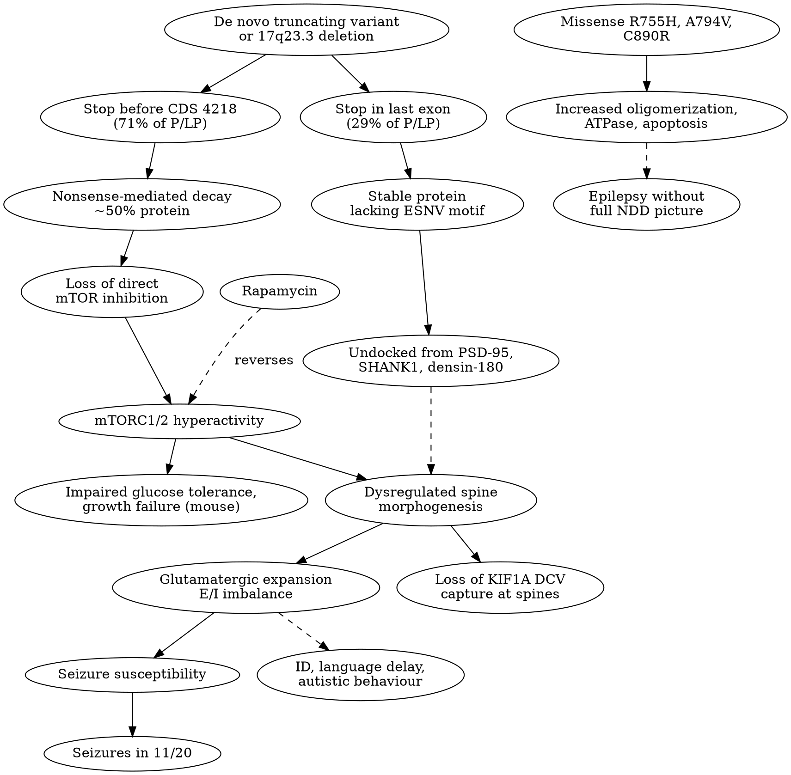

### Molecular pathways

**mTOR signalling (KEGG hsa04150, Reactome R-HSA-165159).** This is the central pathway. The mouse evidence is direct: "While Tanc2-null mice show embryonic lethality, Tanc2-haploinsufficient mice survive but display mTORC1/2 hyperactivity accompanying synaptic and behavioral deficits reversed by mTOR-inhibiting rapamycin" ([PMID: 33976205](https://pubmed.ncbi.nlm.nih.gov/33976205/)). The same study shows Tanc2 inhibits mTORC1/2 in human neural progenitor cells and neurons, and that the inhibition is suppressed by mTOR-activating serum or by ketamine. Deregulated mTOR-mediated translation is a shared feature across intellectual disability syndromes including Fragile X, tuberous sclerosis, Rett and Down syndrome ([PMID: 22285767](https://pubmed.ncbi.nlm.nih.gov/22285767/)).

**Hippo pathway, planar cell polarity and cilium assembly.** In silico analysis of the TANC family predicted connections to planar cell polarity signalling, the Hippo pathway and cilium assembly beyond the known glutamate receptor pathway role, and predicted an N-terminal ATPase domain functioning as a regulated molecular switch ([PMID: 28754924](https://pubmed.ncbi.nlm.nih.gov/28754924/)). Both predictions later gained support: the Hippo link from the mouse model showing hepatocellular damage linked to interaction with Hippo pathway proteins ([PMID: 34964047](https://pubmed.ncbi.nlm.nih.gov/34964047/)), the ATPase prediction from cryo-EM ([PMID: 42035792](https://pubmed.ncbi.nlm.nih.gov/42035792/)).

### Cellular processes

Dendritic spine development and morphogenesis, excitatory synapse assembly, maintenance of postsynaptic density structure, dense core granule cytoskeletal transport. The zebrafish knockout adds proliferation and apoptosis: increased larval brain size and body length arise from increased proliferation and decreased apoptosis ([PMID: 36534563](https://pubmed.ncbi.nlm.nih.gov/36534563/)). The structural work adds apoptosis as a consequence of the hyperactivating missense alleles ([PMID: 42035792](https://pubmed.ncbi.nlm.nih.gov/42035792/)).

### Protein dysfunction and the interactome

{{figure:plot_8.png|caption=TANC2 domain architecture with ClinVar pathogenic and likely pathogenic truncating variants mapped onto the 1,990-residue protein. The 11 ankyrin repeats span 846-1227 and the 3 TPR repeats 1244-1358. Truncating variants are spread across the full length, from p.Asp31fs to p.Thr1913fs.}}

{{figure:plot_9.png|caption=TANC2 IntAct interaction partners tested for PDZ-domain enrichment. The raw set of 152 partners contains 84 PDZ proteins (OR 378, p = 1.4e-148) but is confounded by one systematic PDZ affinity survey. Restricting to the 71 partners with independent evidence leaves 6 PDZ proteins, still enriched at OR 13.0, p = 1.4e-05.}}

The 219 IntAct records for Q9HCD6 yield 152 unique partners. The PDZ partner set covers the main postsynaptic scaffolds: DLG1, DLG2, DLG3, DLG4 (PSD-95), SHANK1, LRRC7 (densin-180), GRIP1, GRIP2, PICK1, SNX27, CASK, LIN7A, LIN7B, LIN7C, MPDZ, MAGI1, MAGI2, MAGI3, TAX1BP3, PATJ, SCRIB, TJP1, TJP2, TJP3, APBA1, APBA2, APBA3, NOS1, PCLO, RIMS1, SIPA1L1, SIPA1L2, MAST1-3, PDZD2, PDZD7, FRMPD1-4, WHRN, ERBIN, PARD3 and PARD3B. The large raw enrichment is confounded because one source study measured "the affinities of 65,000 interactions involving PDZ domains and their target PDZ-binding motifs (PBM) within a human interactome region particularly relevant for viral infection and cancer" ([PMID: 36115835](https://pubmed.ncbi.nlm.nih.gov/36115835/)), so the re-test on independent evidence (OR 13.0, p = 1.4e-05) is the figure to cite. The general hazard of reading biology off high-throughput peptide-binding datasets without validation is set out in a review of these methods ([PMID: 22610655](https://pubmed.ncbi.nlm.nih.gov/22610655/)). Related work on Shank1 established that the C-terminal PDZ ligand consensus is x-T-x-(L/F)-COOH with low micromolar affinities, and that internal motifs with consensus x-T-x-F-x also bind ([PMID: 34235485](https://pubmed.ncbi.nlm.nih.gov/34235485/)), so the TANC2 terminal ESNV sits squarely in the canonical class I ligand space.

Two other partner classes appear. All seven human 14-3-3 proteins (YWHAB, YWHAE, YWHAG, YWHAH, YWHAQ, YWHAZ, SFN) bind TANC2, which places it downstream of a phospho-dependent switch. The protein phosphatase 1 catalytic subunits PPP1CA and PPP1CC also bind, with a STRING experimental score of 0.906 for PPP1CC. A sequence scan of Q9HCD6 for the canonical PP1-docking motif [RK]-x(0,1)-[VI]-x-[FW] found exactly one match (RVRF at position 312) against roughly 2.4 expected by chance in a protein of this length and composition, so motif presence is not evidence and the PP1 docking site remains unmapped.

Biophysical work on the family adds two properties. The TPR domain of Tanc1/2 binds the Myo18a coiled-coil and C-extension through charge-charge interactions, and the Tanc1-TPR/Myo18a CCex complex undergoes liquid-liquid phase separation in cultured cells and in test tubes ([PMID: 38092135](https://pubmed.ncbi.nlm.nih.gov/38092135/)). The ankyrin repeat domain lacks canonical N- and C-capping units and is poorly soluble and unstable without engineering ([PMID: 31040020](https://pubmed.ncbi.nlm.nih.gov/31040020/)).

### Metabolic changes

The strongest non-neurological signal is mouse metabolic: impaired glucose tolerance at p = 2.00e-12 by IPGTT, decreased respiratory quotient (p = 9.18e-05) and abnormal respiratory quotient (p = 1.58e-05) by indirect calorimetry (IMPC). An independent line showed "growth failure and hepatocellular damage" with altered hepatocyte metabolism ([PMID: 34964047](https://pubmed.ncbi.nlm.nih.gov/34964047/)). mTOR is a central metabolic regulator, so loss of TANC2-mediated mTOR inhibition gives a direct route to these phenotypes. <i class="fa-solid fa-circle-question"></i> Whether human IDDALDS patients show glucose dysregulation has never been tested.

### Immune involvement, tissue damage, epigenetics

No immune mechanism is implicated. No oxidative stress, ischaemic, fibrotic or necrotic tissue-damage mechanism has been described. The hepatocellular damage in the mouse ([PMID: 34964047](https://pubmed.ncbi.nlm.nih.gov/34964047/)) is the only tissue injury reported in any system and has no human counterpart. No epigenetic change has been reported in disease tissue.

### Molecular profiling

Single-cell RNA sequencing of 1-month-old cerebral organoids showed extensive TANC2 expression in neurons, and spatiotemporal analysis across brain regions found three expression peaks in early fetal life, infancy and adulthood, coinciding with the onset ages of patients, with the highest level in the early fetal stage ([PMID: 40110879](https://pubmed.ncbi.nlm.nih.gov/40110879/)). GTEx bulk expression is covered in section 7. No proteomic, metabolomic or lipidomic profiling of patient material exists. No CRISPR or RNAi screen has reported TANC2 as a hit in a neurodevelopmental context.

### Ontology terms for mechanism

**GO biological process:** GO:0060998 regulation of dendritic spine development; GO:0061001 regulation of dendritic spine morphogenesis; GO:0099562 maintenance of postsynaptic density structure; GO:0099519 dense core granule cytoskeletal transport; GO:0050804 modulation of chemical synaptic transmission; GO:0031929 TOR signaling; GO:0032007 negative regulation of TOR signaling; GO:0051965 positive regulation of synapse assembly.

**GO cellular component:** GO:0014069 postsynaptic density; GO:0043197 dendritic spine; GO:0098978 glutamatergic synapse; GO:0030424 axon; GO:0005829 cytosol.

**GO molecular function:** GO:0098919 structural constituent of postsynaptic density; GO:0030165 PDZ domain binding; GO:0016887 ATP hydrolysis activity (from the STAND/NACHT assignment, PMID 42035792).

**CL:** CL:0000679 glutamatergic neuron; CL:0000598 pyramidal neuron; CL:0000617 GABAergic neuron; CL:0000047 neuronal stem cell.

**CHEBI:** CHEBI:9168 sirolimus (rapamycin); CHEBI:6271 ketamine; CHEBI:16865 gamma-aminobutyric acid; CHEBI:16015 L-glutamate; CHEBI:30769 valproate; CHEBI:7790 oxcarbazepine.

---

## 7. Anatomical structures affected

{{figure:plot_7.png|caption=TANC2 median expression across 54 GTEx v8 tissues. The 13 brain regions average 9.63 TPM against 6.11 TPM for the 41 non-brain tissues (Mann-Whitney U = 440.0, one-sided p = 2.3e-04). Frontal cortex BA9 is the highest tissue at 15.84 TPM. The gene is detected everywhere, so the brain signal is an enrichment and not a restriction.}}

**Organ level.** The brain is the primary affected organ (UBERON:0000955). The expression ranking localises the signal to cortex and striatum: frontal cortex BA9 15.84 TPM, cortex 14.59, nucleus accumbens 13.35, caudate 11.79, cervical spinal cord 10.07, hypothalamus 9.40, anterior cingulate BA24 9.33, putamen 9.13, hippocampus 6.94, cerebellum 6.93, cerebellar hemisphere 6.43, amygdala 5.86, substantia nigra 5.47. Median across all 54 tissues is 5.64 TPM. Cortex exceeds cerebellum 2.3-fold, which argues against ataxia as a core feature despite spastic ataxia being reported in 5/13. This profile matches a clinical picture of intellectual disability, autistic features, language delay and seizures better than a cerebellar or brainstem picture.

Secondary systems with human involvement: the gastrointestinal tract (chronic constipation 60%, plausibly secondary to hypotonia and reduced mobility rather than a primary gut lesion), the skeleton (scoliosis, craniosynostosis in 3/14, joint hypermobility in 3/9) and the craniofacial skeleton (facial dysmorphism). Mouse data add liver and metabolic involvement with no confirmed human counterpart.

**Tissue and cell level.** Nervous tissue, specifically cortical excitatory neurons. The zebrafish result localises the lesion to the glutamatergic population: "We observed that the glutamatergic neuron population is significantly increased in tanc2 mutants while the GABAergic and the glycinergic neurons are not affected, suggesting that an excitatory/inhibitory (E/I) imbalance" ([PMID: 36534563](https://pubmed.ncbi.nlm.nih.gov/36534563/)). <i class="fa-solid fa-triangle-exclamation"></i> Human Protein Atlas calls TANC2 "Low cell type specificity" in single-cell and single-nuclei brain data, so cell-type claims should stop at the level of cortical excitatory neurons and not name a narrower subtype. HPA places TANC2 in tissue expression cluster 73 "Brain - Neuronal signaling" and brain expression cluster 32 "Cerebral cortex - Mixed function", with overall classifications "Low tissue specificity", "Detected in all" and "Low region specificity".

**Subcellular level.** The postsynaptic density of excitatory synapses (GO:0014069) and dendritic spines (GO:0043197, IDA from [PMID: 30021165](https://pubmed.ncbi.nlm.nih.gov/30021165/)). HPA gives cytosol (GO:0005829) as the main subcellular location by immunofluorescence. Axon (GO:0030424) is annotated by electronic inference.

**Localization and lateralization.** Bilateral and diffuse. No focal or lateralised lesion is reported. Brain MRI is typically unremarkable or shows non-specific findings. EEG in the epileptic subgroup can show persistent bifrontal epileptiform discharges ([PMID: 42397682](https://pubmed.ncbi.nlm.nih.gov/42397682/)).

**UBERON terms:** UBERON:0000955 brain; UBERON:0000956 cerebral cortex; UBERON:0013529 Brodmann area 9; UBERON:0001882 nucleus accumbens; UBERON:0005383 caudate nucleus; UBERON:0001874 putamen; UBERON:0001954 Ammon's horn; UBERON:0002037 cerebellum; UBERON:0002240 spinal cord; UBERON:0000059 large intestine; UBERON:0002107 liver (mouse only).

---

## 8. Temporal development

**Onset.** Congenital in the sense that the lesion is present from conception, with clinical onset in infancy. Developmental delay is the presenting feature, typically recognised in the first two years. Seizure onset in the documented cases clusters around the first to second year: both children in the Zhengzhou series developed convulsions at 1 year of age ([PMID: 39344613](https://pubmed.ncbi.nlm.nih.gov/39344613/)). The onset pattern is insidious for the developmental features and acute for seizures.

**Critical period.** TANC2 expression peaks in the early fetal stage with two further peaks in infancy and adulthood, and the study reporting this notes the peaks coincide with patient onset ages, concluding that the gene has a role in early development ([PMID: 40110879](https://pubmed.ncbi.nlm.nih.gov/40110879/)). <i class="fa-solid fa-lightbulb"></i> The early fetal peak defines the window in which the lesion acts and is the main obstacle to postnatal pharmacological rescue: the rapamycin reversal in mice was obtained in constitutive haploinsufficiency, not after a developmental window closed.

**Progression.** Chronic and lifelong. The cognitive and language phenotype is largely static after early childhood, with developmental regression in only 2/11. Epilepsy course is variable and in some patients improves. In a three-patient series, one met Lennox-Gastaut criteria and showed "early drug resistance followed by partial cognitive recovery and sustained seizure control on felbamate monotherapy", a second reached "prolonged remission and borderline intellectual functioning", and a third had persistent drug-resistant polymorphic seizures with severe developmental impairment ([PMID: 42397682](https://pubmed.ncbi.nlm.nih.gov/42397682/)). Both children in the Zhengzhou series became seizure-free, one on oxcarbazepine which was stopped at 2 years 7 months ([PMID: 39344613](https://pubmed.ncbi.nlm.nih.gov/39344613/)).

**Stages.** No staging system exists for this disorder. The practical course divides into a presentation phase (delay recognised, often with first seizures, years 0-3), a diagnostic phase (exome sequencing) and a chronic management phase.

**Remission.** Seizure remission occurs, spontaneously or on treatment, in a subset. Cognitive and autistic features do not remit.

---

## 9. Inheritance and population

{{figure:plot_6.png|caption=NMD boundary analysis and de novo mutation rate based incidence estimate for TANC2. The last coding exon of ENST00000689528 is 1,957 bp, placing the NMD escape boundary at CDS position 4218, which is 67.8% of the coding sequence rather than near the 3' tip. A de novo LoF rate of 1.01e-05 per birth predicts about 1 affected birth per 100,000.}}

{{figure:plot_5.png|caption=Population-tolerated TANC2 pLoF alleles tested against pathogenic truncating variants by CDS position. 32 of 45 (71%) pathogenic truncating variants fall in the NMD-triggering region against 47 of 92 (51%) population pLoF alleles (Fisher exact OR 2.36, p = 0.0285). The same test in raw genomic coordinates failed (Mann-Whitney p = 0.48) because TANC2 spans 461 kb of mostly intronic sequence.}}

**Epidemiology.** No measured prevalence or incidence exists. This investigation estimated birth incidence from first principles. Using a per-base de novo rate of 1.25e-8, a 6,225 bp CDS with a nonsense-creating site fraction of 0.044, 104 canonical splice bases at 0.75 effectiveness and a 1.15 indel correction gives mu_LoF = 1.01e-05 per birth, equal to 1 affected birth per 98,800 (about 1.0 per 100,000) if every de novo LoF were fully penetrant and all disease were de novo. Only about 20 to 40 patients have been published worldwide, so the ascertained prevalence is far below the mutational prediction.

**Inheritance.** Autosomal dominant (HP:0000006). Most reported probands carry a de novo variant. Inherited cases occur from mildly affected or unaffected parents.

**Penetrance.** <i class="fa-solid fa-circle-check"></i> Incomplete. The population data and the mutational prediction disagree by 6.4-fold: 1 in 15,550 gnomAD adults carries an NMD-triggering TANC2 pLoF allele against the 1 in 98,800 predicted fully-penetrant birth incidence. gnomAD is depleted of severe paediatric disease, so ascertainment cannot close the gap in that direction. The clinical counterpart is the carrier-parent phenotype in the cohort paper, and the diagnostic counterpart is explicit: "Inherited variants, particularly in KMT5B, TANC2, SPTBN1, and CHD4, highlighted challenges related to incomplete penetrance" ([PMID: 41897335](https://pubmed.ncbi.nlm.nih.gov/41897335/)). Residual contributions from LOFTEE calls in poorly expressed exons and from alternative isoform usage cannot be excluded.

**Expressivity.** Highly variable, from normal development with self-limited epilepsy ([PMID: 39344613](https://pubmed.ncbi.nlm.nih.gov/39344613/)) to drug-resistant Lennox-Gastaut syndrome with severe impairment ([PMID: 42397682](https://pubmed.ncbi.nlm.nih.gov/42397682/)).

**Anticipation.** Not applicable, no repeat expansion mechanism.

**Germline mosaicism.** Not reported for TANC2. Standard recurrence counselling for an apparently de novo dominant variant applies (empiric recurrence risk of approximately 1%).

**Founder effects, consanguinity, geography.** No founder variant. Consanguinity is irrelevant to a dominant mechanism. Cases are reported from Europe, North America and China with no geographic concentration. 89% of gnomAD pLoF alleles are singletons, which excludes any common founder haplotype.

**Carrier frequency.** 1 in 7,944 for all high-confidence pLoF, 1 in 15,550 restricted to NMD-triggering positions.

**Sex ratio and age distribution.** No sex bias has been reported, and the denominators are too small to detect one. The published population is predominantly paediatric, which reflects ascertainment through developmental delay rather than age-dependent onset.

---

## 10. Diagnostics

**Genetic testing is the diagnosis.** No biochemical marker, imaging finding or histopathological feature identifies IDDALDS. Trio exome sequencing is the recommended first-line test and is how essentially every published case was found, including the defining cohort and the six de novo cases from the China Epilepsy 1.0 cohort ([PMID: 40110879](https://pubmed.ncbi.nlm.nih.gov/40110879/)). Genome sequencing adds coverage of non-coding and structural variation. A trio design is what converts a TANC2 variant into a de novo call, which is the single strongest ACMG criterion available for this gene (PS2).

**Chromosomal microarray** remains necessary and complementary: 12 of the 76 P/LP ClinVar records are 17q23 CNVs, and a ~1.5 Mb 17q23.3 deletion affecting 30 genes was detected by CNV analysis after exome sequencing returned no pathogenic variant in RASopathy genes in a child clinically suspected of Noonan syndrome ([PMID: 42862774](https://pubmed.ncbi.nlm.nih.gov/42862774/)).

**Gene panels.** TANC2 is included on epilepsy, intellectual disability and autism panels. Single-gene TANC2 testing has no role given the genetic heterogeneity of the presenting phenotype.

**Variant interpretation.** <i class="fa-solid fa-triangle-exclamation"></i> The dominant practical problem is the 66.4% VUS rate. Three rules from this work help.

- Any truncating variant in the first 95% of the CDS can be interpreted through the same haploinsufficiency mechanism, because the pathogenic truncating variants are uniformly distributed with no domain hotspot (Kolmogorov-Smirnov D = 0.140, p = 0.335). Position does not need weighting.
- A missense variant carries more prior weight in the ANK (846-1227) or TPR (1244-1358) domains, where population VUS missense alleles are depleted (100/498 = 20.1% against 25.0% expected, binomial p = 0.011), reflecting stronger purifying selection on the folded regions.
- An inherited truncating variant from a mildly affected or unaffected parent must be reported with an explicit incomplete-penetrance statement.

ACMG application in practice: the Zhengzhou cases were classified with PS2 + PM2_Supporting + PP3 for a missense allele (likely pathogenic) and PVS1 + PS2 + PM2_Supporting for a canonical splice allele (pathogenic) ([PMID: 39344613](https://pubmed.ncbi.nlm.nih.gov/39344613/)).

**Not applicable.** Mitochondrial DNA testing, repeat expansion testing, karyotyping (resolution insufficient for the relevant deletions), FISH, liquid biopsy, metabolomics and newborn biochemical screening have no role.

**Supporting clinical tests.** EEG is needed in any patient with suspected seizures and can show bifrontal epileptiform discharges or a Lennox-Gastaut pattern ([PMID: 42397682](https://pubmed.ncbi.nlm.nih.gov/42397682/)). Brain MRI rules out structural causes. Developmental and cognitive assessment (Bayley, Vineland, WISC as age-appropriate) and ADOS-2 or ADI-R for autism characterise the phenotype without being diagnostic of the genotype.

**Differential diagnosis.** Any monogenic cause of intellectual disability with autism and epilepsy: SHANK3, SYNGAP1, CHD8, SCN1A, CDKL5, TSC1/TSC2, KMT5B, CHD4, SPTBN1. A review of shared neurodevelopmental mechanisms groups TANC2 with CDKL5, TSC1/2 and SCN1a as genes "that have been associated with epilepsy, ASD, or other NDD phenotypes that play a critical role in regulating one or more stages of brain development or function but differ widely in their disease-causing mechanisms" ([PMID: 41594775](https://pubmed.ncbi.nlm.nih.gov/41594775/)). 17q23.3 deletion cases can mimic Noonan syndrome on clinical grounds ([PMID: 42862774](https://pubmed.ncbi.nlm.nih.gov/42862774/)). None of these is distinguishable from TANC2 disease on phenotype alone, which is why panel or exome testing rather than targeted testing is the correct approach.

**Screening.** <i class="fa-solid fa-circle-xmark"></i> No population screening is indicated or available. Cascade testing of parents is informative for recurrence counselling. Prenatal and preimplantation testing are technically available once a familial variant is known.

---

## 11. Outcome and prognosis

**Survival.** No excess mortality has been reported in surviving patients, and lifespan appears normal in the absence of severe refractory epilepsy. <i class="fa-solid fa-triangle-exclamation"></i> No survival analysis, actuarial estimate or mortality figure exists for this disorder. The mouse data indicate embryonic lethality is specific to the homozygous null state while heterozygotes survive ([PMID: 33976205](https://pubmed.ncbi.nlm.nih.gov/33976205/)), consistent with no human homozygote having been reported. Generic SUDEP risk applies to the drug-resistant epilepsy subgroup.

**Morbidity and function.** Lifelong intellectual disability in 95% with language impairment in 90% determines the functional outcome. Most patients will need educational support and varying degrees of lifelong supervision. The spread of reported severity is wide enough that a point estimate misleads: one documented patient had entirely normal language, movement and intelligence development with self-limited epilepsy ([PMID: 39344613](https://pubmed.ncbi.nlm.nih.gov/39344613/)), while another reached only borderline intellectual functioning after prolonged seizure remission and a third had severe developmental impairment ([PMID: 42397682](https://pubmed.ncbi.nlm.nih.gov/42397682/)).

**Complications.** Drug-resistant epilepsy and Lennox-Gastaut syndrome; chronic constipation (60%); sleep disturbance (38%); scoliosis; behavioural and psychiatric problems that become more prominent in adulthood ([PMID: 31616000](https://pubmed.ncbi.nlm.nih.gov/31616000/)).

**Prognostic factors.** <i class="fa-solid fa-scale-balanced"></i> Variant class is the best available predictor and the evidence comes from one cohort. Genotype-phenotype analysis in the China Epilepsy 1.0 series found that "variants associated with epilepsy and NDD were mostly null variants, whereas the missense variants were associated with NDD or epilepsy", and that "NDD-associated missense variants exhibited more severe damage effects, compared with the epilepsy-associated missense variants" ([PMID: 40110879](https://pubmed.ncbi.nlm.nih.gov/40110879/)). That paper proposes a severity gradient: "The phenotypic spectrums of TANC2 potentially ranged from early lethality, DEE, epilepsy with NDD, NDD, to mild epilepsy, depending on the damaging effects caused by variants." Seizure control is achievable even in initially drug-resistant patients, and the Lennox-Gastaut series concluded that "selected patients may have a more favorable seizure course than expected" ([PMID: 42397682](https://pubmed.ncbi.nlm.nih.gov/42397682/)).

**Prognostic biomarkers.** None exist.

---

## 12. Treatment

<i class="fa-solid fa-circle-xmark"></i> **No disease-specific therapy exists and no interventional trial has ever been run.** A ClinicalTrials.gov API v2 query for "TANC2" returns exactly one study, NCT01238250 (Simons Searchlight), an observational natural-history registry. Gene-specific interventional trials exist for other neurodevelopmental genes in the same registry space (CTNNB1 L-dopa, NCT07614126; SHANK3, NCT07119606), so the absence for TANC2 reflects the gene's recency (defined 2019) and the small published cohort of about 20 probands rather than a tested-and-failed therapy.

### Current management is symptomatic

| Intervention | NCIT term | Evidence |
|---|---|---|
| Oxcarbazepine | NCIT:C29236 | Seizures resolved, treatment stopped at 2y7m ([PMID: 39344613](https://pubmed.ncbi.nlm.nih.gov/39344613/)) |
| Sodium valproate | NCIT:C938 | Myoclonic seizures resolved ([PMID: 39344613](https://pubmed.ncbi.nlm.nih.gov/39344613/)) |
| Felbamate monotherapy | NCIT:C28995 | Sustained seizure control in a Lennox-Gastaut patient ([PMID: 42397682](https://pubmed.ncbi.nlm.nih.gov/42397682/)) |
| Ketogenic diet | NCIT:C94628 | Seizure freedom with antiepileptic drugs in a Lennox-Gastaut patient ([PMID: 34861844](https://pubmed.ncbi.nlm.nih.gov/34861844/)) |
| Speech and language therapy | NCIT:C15351 | Standard of care for 90% language delay; no gene-specific data |
| Occupational therapy | NCIT:C15346 | Standard of care; no gene-specific data |
| Physical therapy | NCIT:C15346 | For hypotonia and motor delay; no gene-specific data |
| Behavioural intervention for autism | NCIT:C15277 | Standard of care; no gene-specific data |
| Constipation management | NCIT:C15313 | For the 60% with chronic constipation |

### The mechanism-directed lead

<i class="fa-solid fa-pills"></i> **Rapamycin (sirolimus, CHEBI:9168, NCIT:C1212)** is the only treatment with a mechanistic rationale specific to TANC2. The direct evidence is the mouse rescue: synaptic and behavioural deficits in Tanc2-haploinsufficient mice are "reversed by mTOR-inhibiting rapamycin" ([PMID: 33976205](https://pubmed.ncbi.nlm.nih.gov/33976205/)). TANC2 belongs mechanistically to the mTORopathies, the class in which everolimus is already licensed for tuberous sclerosis-associated seizures, so the pharmacological route is pre-paved.

<i class="fa-solid fa-scale-balanced"></i> The cross-disorder preclinical record is split, and the split is informative. Rapamycin works where mTOR hyperactivity is the proximal lesion:

- "The mTOR inhibitor rapamycin rescued the deficits in differentiation, synaptic dysfunction, and hypoexcitability of TSC2 mutant hiPSC-PCs in vitro" ([PMID: 29449635](https://pubmed.ncbi.nlm.nih.gov/29449635/)).
- In the valproate rat model, "postnatal rapamycin ameliorates the social deficit and reverts the abnormal excitability" of nucleus accumbens medium spiny neurons ([PMID: 35987482](https://pubmed.ncbi.nlm.nih.gov/35987482/)).
- In DEPDC5 two-hit mosaic human cortical organoids, increased mTOR activity "was rescued by the mTOR inhibitor rapamycin" ([PMID: 41789478](https://pubmed.ncbi.nlm.nih.gov/41789478/)).
- In succinic semialdehyde dehydrogenase deficiency mice, "Rapamycin, Tor 1, and Tor 2 rescued these mice from premature lethality associated with status epilepticus" ([PMID: 27518770](https://pubmed.ncbi.nlm.nih.gov/27518770/)).
- After a single PTZ-induced seizure in rats, "administration of the mTORC1 inhibitor rapamycin 30 min post-seizure rescued the memory deficit" ([PMID: 42594425](https://pubmed.ncbi.nlm.nih.gov/42594425/)).

It fails where the lesion is a postsynaptic scaffold defect with normal mTOR tone: "The mTOR inhibitor rapamycin did not ameliorate soc[ial deficits]" in Shank3B-KO or BTBR mice ([PMID: 30653853](https://pubmed.ncbi.nlm.nih.gov/30653853/)).

TANC2 sits in the first group by the mouse mTORC1/2 hyperactivity data, which makes rapamycin a rational but entirely untested candidate in humans. Any use would be off-label and n-of-1. Two caveats apply. The mouse rescue was obtained in constitutive haploinsufficiency, so whether intervention after the early fetal expression peak ([PMID: 40110879](https://pubmed.ncbi.nlm.nih.gov/40110879/)) retains efficacy is unknown. Truncating alleles that delete the PDZ-binding C terminus may not share the pharmacology of alleles that reduce protein level, since branch 3a of the causal chain reaches synaptic dysfunction without necessarily passing through mTOR.

**Pharmacogenomics.** No TANC2 pharmacogenomic variant is listed in PharmGKB or CPIC. Standard CYP-based antiseizure drug pharmacogenomics applies without gene-specific modification.

**Gene, cell and RNA therapy.** <i class="fa-solid fa-circle-question"></i> None exist. The haploinsufficiency mechanism makes TANC2 a theoretical candidate for allele-agnostic upregulation (targeted activation of the intact allele, ASO-mediated modulation), since restoring dosage rather than correcting a mutation is the therapeutic goal. The 6,225 bp CDS exceeds AAV packaging capacity, which rules out conventional AAV gene replacement.

**Surgical interventions.** Epilepsy surgery has no reported role, consistent with a diffuse generalised rather than focal lesion. Craniosynostosis in the 21% affected may require surgical correction on general indications.

---

## 13. Prevention

**Primary prevention.** <i class="fa-solid fa-circle-xmark"></i> Not possible. De novo mutation in a constrained gene cannot be prevented. No vaccine, exposure modification or risk factor intervention applies.

**Secondary prevention.** Early diagnosis through trio exome sequencing in any child with developmental delay, autism or early-onset epilepsy brings forward access to therapies and ends the diagnostic odyssey. This is the single highest-value preventive action for this disorder and is already standard practice where exome access exists.

**Tertiary prevention.** Seizure control to prevent the cognitive consequences of uncontrolled epilepsy, with the mechanistic rationale that post-ictal mTOR hyperactivation itself impairs memory formation ([PMID: 42594425](https://pubmed.ncbi.nlm.nih.gov/42594425/)). Constipation management, scoliosis surveillance, and psychiatric follow-up into adulthood given the adult psychiatric pattern ([PMID: 31616000](https://pubmed.ncbi.nlm.nih.gov/31616000/)).

**Genetic screening and counselling.** Once a proband variant is known: parental testing to establish de novo status; prenatal diagnosis or preimplantation genetic testing in subsequent pregnancies; an empiric recurrence risk of approximately 1% for an apparently de novo variant to account for germline mosaicism. <i class="fa-solid fa-triangle-exclamation"></i> Counselling for an inherited allele must state that penetrance is incomplete, since a 50% transmission risk does not equal a 50% risk of the full phenotype.

**Immunization, public health, prophylaxis, behavioural interventions.** Not applicable to a de novo monogenic disorder. Routine childhood immunisation proceeds normally.

---

## 14. Other species and natural disease

{{figure:plot_4.png|caption=Cross-species phenotype convergence for TANC2 loss of function. Hyperactivity appears in both the IMPC mouse and an independent disrupted-function line. Reduced anxiety-like behaviour appears in mouse and zebrafish but contradicts the anxiety reported in 4 of 12 human patients.}}

**Taxonomy and orthologs.** Alliance of Genome Resources stringent orthology:

| Species | NCBI Taxon | Gene | Database ID | Confidence |
|---|---|---|---|---|
| *Homo sapiens* | 9606 | TANC2 | NCBIGene:26115 | reference |
| *Mus musculus* | 10090 | Tanc2 | MGI:2444121 | high, 10/10 methods |
| *Rattus norvegicus* | 10116 | Tanc2 | RGD:1309285 | high, 10 methods |
| *Danio rerio* | 7955 | tanc2b | ZFIN:ZDB-GENE-030131-7067 | high, 8 methods |
| *Danio rerio* | 7955 | tanc2a | ZFIN:ZDB-GENE-060130-180 | low, 1 method |
| *Xenopus tropicalis* | 8364 | tanc2 | XB-GENE-855813 | high, 9 methods |
| *Xenopus laevis* | 8355 | tanc2.L, tanc2.S | - | - |
| *Drosophila melanogaster* | 7227 | rols (rolling pebbles) | FBgn0041096 | high, 8 methods |

**Natural disease in other species.** <i class="fa-solid fa-circle-xmark"></i> No naturally occurring TANC2 disease is recorded in OMIA for any domestic or companion animal species. No breed-associated condition exists, so no VBO term applies. The disorder has no veterinary relevance.

**Comparative pathology.** Conservation of the mechanism is strong across vertebrates and extends to Drosophila. Three phenotype domains converge: hyperactivity and locomotor abnormality (mouse IMPC plus an independent mouse line, [PMID: 34964047](https://pubmed.ncbi.nlm.nih.gov/34964047/)), seizure susceptibility (Drosophila knockdown, [PMID: 40110879](https://pubmed.ncbi.nlm.nih.gov/40110879/); human 55%) and social behaviour impairment (zebrafish impaired social preference, [PMID: 36534563](https://pubmed.ncbi.nlm.nih.gov/36534563/); human autistic behaviour 75%).

<i class="fa-solid fa-circle-xmark"></i> **One domain does not translate.** Reduced anxiety-like behaviour appears in both the IMPC mouse (decreased anxiety-related response p = 4.83e-05, decreased thigmotaxis p = 5.64e-05) and in adult zebrafish, where "the mutants display anxiolytic-behavior, reduced aggression, and impaired social preference" ([PMID: 36534563](https://pubmed.ncbi.nlm.nih.gov/36534563/)). Human patients show the opposite direction, with anxiety in 4/12. The rodent anxiety readout should not be used as an efficacy endpoint for human anxiety in any future preclinical programme.

**Transmission.** Not applicable. No zoonotic or infectious component.

---

## 15. Model organisms

### Mouse (*Mus musculus*, Tanc2, MGI:2444121)

Three independent mouse resources exist and they agree on the behavioural core.

**Haploinsufficient line.** The central model: nulls are embryonic lethal, heterozygotes survive with mTORC1/2 hyperactivity and synaptic and behavioural deficits reversed by rapamycin ([PMID: 33976205](https://pubmed.ncbi.nlm.nih.gov/33976205/)). This is the model with pharmacological rescue and the one that defines the therapeutic hypothesis.

**Homozygous-viable disrupted-function line.** "We here report a novel homozygous-viable Tanc2-disrupted function model in which mutant mice were hyperactive and had impaired sensorimotor gating consistent with NDD patient psychiatric endophenotypes. Yet, a multi-systemic analysis revealed the pleiotropic effects of Tanc2 outside the brain, such as growth failure and hepatocellular damage" ([PMID: 34964047](https://pubmed.ncbi.nlm.nih.gov/34964047/)).

**IMPC knockout.** 18 significant homozygote genotype-phenotype calls:

| MP term | Phenotype | p-value | Assay |
|---|---|---|---|
| MP:0001399 | hyperactivity | 6.19e-07, 1.56e-07, 9.32e-06, 4.44e-07 | Open field, 4 runs |
| MP:0001392 | abnormal locomotor behavior | 1.22e-08, 4.79e-06 | Open field |
| MP:0013189 | abnormal exploration | 1.25e-07 | Open field |
| MP:0001415 | increased exploration in new environment | 9.05e-06 | Open field |
| MP:0001364 | decreased anxiety-related response | 4.83e-05 | Open field |
| MP:0020870 | decreased thigmotaxis | 5.64e-05 | Open field |
| MP:0005293 | impaired glucose tolerance | 2.00e-12 | IPGTT |
| MP:0010379 | decreased respiratory quotient | 9.18e-05 | Indirect calorimetry |
| MP:0004129 | abnormal respiratory quotient | 1.58e-05 | Indirect calorimetry |
| MP:0002764 | short tibia | 1.51e-05 | X-ray |
| MP:0000558 | abnormal tibia morphology | 1.51e-05 | X-ray |
| MP:0003795 | abnormal bone structure | 8.58e-06 | DEXA |

**Phenotype recapitulation.** <i class="fa-solid fa-circle-check"></i> Good for hyperactivity, sensorimotor gating and the mTOR mechanism. <i class="fa-solid fa-circle-xmark"></i> Poor for anxiety, which runs opposite to the human phenotype. <i class="fa-solid fa-circle-question"></i> Unknown for the metabolic and skeletal phenotypes, which have no human counterpart data. The glucose intolerance at p = 2e-12 is the strongest non-neurological signal in the entire TANC2 dataset and aligns with the hepatic and growth pleiotropy of the independent line.

### Zebrafish (*Danio rerio*, tanc2b)

The tanc2 knockout shows increased larval brain size and body length driven by increased proliferation and decreased apoptosis, selective expansion of glutamatergic neurons, increased sleep, anxiolytic behaviour, reduced aggression and impaired social preference ([PMID: 36534563](https://pubmed.ncbi.nlm.nih.gov/36534563/)). This model contributes the cell-type-resolved result that no other system has produced, and is the only model for the sleep disturbance that affects 5/13 human patients.

### Drosophila (*rols*, FBgn0041096)

TANC2 knockdown increases susceptibility to seizure-like behaviour, the only direct experimental demonstration that TANC2 loss causes seizures in any system ([PMID: 40110879](https://pubmed.ncbi.nlm.nih.gov/40110879/)).

### Human cellular models

**Patient iPSC line GWCMCi005-A.** Derived from a two-year-old Chinese boy with Lennox-Gastaut syndrome carrying TANC2 Gln1441Ter, reprogrammed with SOX2, KLF4, c-MYC and OCT3/4; the line expresses pluripotency markers, has a normal karyotype and retains three-germ-layer differentiation potential ([PMID: 35066241](https://pubmed.ncbi.nlm.nih.gov/35066241/)). <i class="fa-solid fa-lightbulb"></i> This line is the most useful untapped resource in the field. The allele c.4321C>T p.Gln1441Ter falls downstream of the NMD boundary at CDS position 4218, so it belongs to the NMD-escaping branch-2a class and should express a truncated protein lacking the ESNV motif rather than showing reduced protein level.

**Cerebral organoids.** Single-cell RNA sequencing of 1-month-old cerebral organoids showed extensive TANC2 expression in neurons ([PMID: 40110879](https://pubmed.ncbi.nlm.nih.gov/40110879/)). No TANC2-mutant organoid phenotype has been published. The DEPDC5 mosaic organoid work provides the methodological template for how an mTORopathy organoid study would be designed ([PMID: 41789478](https://pubmed.ncbi.nlm.nih.gov/41789478/)).

**Biochemical systems.** Purified TANC1 ankyrin repeat domain requires engineered N- and C-capping units for solubility and was characterised by SEC-MALS and circular dichroism ([PMID: 31040020](https://pubmed.ncbi.nlm.nih.gov/31040020/)). Tanc1-TPR/Myo18a CCex reconstitution supports liquid-liquid phase separation in cells and in vitro ([PMID: 38092135](https://pubmed.ncbi.nlm.nih.gov/38092135/)). Cryo-EM resolved mouse Tanc1 (215-1452) and Tanc2 (211-1421) as STAND/NACHT ATPases cycling between closed and pre-activated states ([PMID: 42035792](https://pubmed.ncbi.nlm.nih.gov/42035792/)).

**Model limitations.** No model carries a human patient truncating allele in its endogenous locus. No model has tested branch 2a (NMD escape) against branch 2 (decay). The embryonic lethality of the mouse null restricts study of complete loss. No model reproduces the human language phenotype, which has no animal correlate.

**Resources.** MGI (Tanc2, MGI:2444121), IMPC, RGD (RGD:1309285), ZFIN (ZDB-GENE-030131-7067), FlyBase (FBgn0041096), Xenbase (XB-GENE-855813), Alliance of Genome Resources, Cellosaurus (GWCMCi005-A).

---

## Mechanistic model and interpretation

The disorder resolves into a single primary lesion with two molecular routes to the same clinical endpoint.

{{figure:plot_3.png|caption=Pathogenic TANC2 truncating variants tested against a uniform distribution over the 1,990-residue protein. Kolmogorov-Smirnov D = 0.140, p = 0.335: uniformity is not rejected. Positions run from p.Asp31fs to p.Thr1913fs with a median at residue 1002, and only 1 of 43 lies beyond 95% of the CDS. This is the signature of simple allele loss rather than a dominant-negative hotspot.}}

The first route is dosage. A truncating variant anywhere in the first 67.8% of the CDS triggers nonsense-mediated decay, leaving half the normal protein. The uniform spatial distribution of pathogenic truncating variants (KS p = 0.335) and the absence of enrichment in the ANK/TPR domains (14/43 = 32.6% against 25.0% expected, binomial p = 0.289) confirm that no particular region matters, which is what simple haploinsufficiency predicts. Whole-gene deletion reproduces the phenotype ([PMID: 33160097](https://pubmed.ncbi.nlm.nih.gov/33160097/)), the definitive test for dosage sensitivity.

The second route is motif loss, and it is why the hotspot test was the right experiment to run and the right experiment to have failed. TANC2 has an unusually large last coding exon (1,957 bp), so the NMD escape boundary sits at 67.8% of the CDS rather than near the 3' tip. 29% of pathogenic truncating alleles fall beyond it, and they are enriched there relative to population pLoF alleles (32/45 against 47/92 in the NMD-triggering region, Fisher OR 2.36, p = 0.0285). These alleles produce a stable protein that keeps the ankyrin and TPR repeats but loses the terminal ESNV. Losing those three residues disconnects TANC2 from a large fraction of the human PDZ scaffold repertoire at once. The functional consequence is established independently: TANC overexpression increases spine and excitatory synapse density "in a manner that requires the PDZ (PSD-95/Dlg/ZO-1)-binding C termini of TANC proteins" ([PMID: 21068316](https://pubmed.ncbi.nlm.nih.gov/21068316/)). A truncated protein that retains its repeat domains while failing to dock at the postsynaptic density would produce dominant-negative-like consequences from an allele that is nominally truncating.

| Property | Branch 2 (NMD) | Branch 2a (NMD escape) |
|---|---|---|
| CDS position of stop | ≤ 4218 | > 4218 |
| Share of P/LP truncating alleles | 71% (32/45) | 29% (13/45) |
| Transcript fate | Degraded | Stable |
| Protein product | None from mutant allele | Truncated, ANK + TPR intact |
| Lost feature | Whole protein | C-terminal ESNV motif |
| Immediate consequence | 50% protein dosage | Failure to dock at the PSD |
| mTOR involvement | Demonstrated | Inferred, untested |
| Predicted rapamycin response | Yes | Unknown |

The two routes converge on dysregulated spine morphogenesis, glutamatergic expansion and excitatory/inhibitory imbalance, and from there to seizures and to impaired cognitive and social development. The convergence at step 4 is inferred: no study has measured mTOR activity in a cell carrying a last-exon TANC2 allele.

A third, separate mechanism applies to a minority of missense alleles. Cryo-EM shows that R755H, A794V and C890R increase oligomerization, raise ATPase activity and trigger apoptosis ([PMID: 42035792](https://pubmed.ncbi.nlm.nih.gov/42035792/)). That is gain of function, pointing opposite to haploinsufficiency, and it matches the clinical observation that missense carriers in the China Epilepsy 1.0 cohort "presented with only epilepsy" while null variant carriers had the full neurodevelopmental picture ([PMID: 40110879](https://pubmed.ncbi.nlm.nih.gov/40110879/)). Missense and truncating TANC2 patients should not be assumed to share a mechanism or a therapeutic direction. A stop-loss allele has also been reported with developmental impairment and drug-resistant epilepsy ([PMID: 41843419](https://pubmed.ncbi.nlm.nih.gov/41843419/)); it escapes NMD and extends the protein, so it belongs to neither the haploinsufficiency nor the motif-deletion class.

Two numbers that should match do not. A de novo LoF rate of 1.01e-05 per birth predicts about 1 affected birth per 100,000, yet 1 in 15,550 gnomAD adults carries an NMD-triggering TANC2 pLoF allele. gnomAD is depleted of severe paediatric disease, so ascertainment cannot explain a 6.4-fold excess in that direction. Incomplete penetrance is the parsimonious reading, with a clinical correlate in the carrier parents who show milder psychiatric problems and a diagnostic correlate in the explicit naming of TANC2 as an incomplete-penetrance problem gene ([PMID: 41897335](https://pubmed.ncbi.nlm.nih.gov/41897335/)).

---

## Evidence base

| PMID | Study | Evidence type | What it establishes | Relation to the findings |
|---|---|---|---|---|
| [31616000](https://pubmed.ncbi.nlm.nih.gov/31616000/) | *Disruptive mutations in TANC2 define a neurodevelopmental syndrome associated with psychiatric disorders* | Human clinical | 20-patient defining cohort; source of all 19 HPO annotations | Supports the phenotype profile; its single-source status is the main limitation |
| [33976205](https://pubmed.ncbi.nlm.nih.gov/33976205/) | *Tanc2-mediated mTOR inhibition balances mTORC1/2 signaling in the developing mouse brain and human neurons* | Model organism, in vitro | Null lethal, heterozygote viable with mTORC1/2 hyperactivity reversed by rapamycin; Tanc2 inhibits mTOR in human neurons | Core of the mechanism and of the therapeutic hypothesis |
| [36534563](https://pubmed.ncbi.nlm.nih.gov/36534563/) | *Knockout of tanc2 causes autism-like behavior and sleep disturbance in zebrafish* | Model organism | Glutamatergic expansion with GABAergic/glycinergic sparing; anxiolytic behaviour, impaired social preference | Supports the E/I imbalance step; the anxiolytic result challenges translation |
| [21068316](https://pubmed.ncbi.nlm.nih.gov/21068316/) | *Regulation of dendritic spines, spatial memory, and embryonic development by the TANC family of PSD-95-interacting proteins* | In vitro | Spine and synapse density increase requires the PDZ-binding C terminus | The functional basis for branch 2a |
| [42035792](https://pubmed.ncbi.nlm.nih.gov/42035792/) | *Structural Insights into Tanc1/2 Autoinhibition and Their Implications for NDD Pathogenesis* | In vitro, structural | STAND/NACHT ATPase; R755H, A794V, C890R increase oligomerization, ATPase and apoptosis | Establishes the gain-of-function missense branch, distinct from haploinsufficiency |
| [40110879](https://pubmed.ncbi.nlm.nih.gov/40110879/) | *De novo TANC2 variants caused developmental and epileptic encephalopathy and epilepsy* | Human clinical, model organism | 6 de novo variants; null vs missense genotype-phenotype split; Drosophila seizure susceptibility; fetal expression peak | Direct seizure causality and the severity gradient |
| [33160097](https://pubmed.ncbi.nlm.nih.gov/33160097/) | *17q23.3 de novo microdeletion involving only TANC2 gene: A new case* | Human clinical | Single-gene deletion reproduces the phenotype | Confirms dosage sensitivity |
| [34964047](https://pubmed.ncbi.nlm.nih.gov/34964047/) | *Post-synaptic scaffold protein TANC2 in psychiatric and somatic disease risk* | Model organism | Homozygous-viable line: hyperactivity, impaired sensorimotor gating, growth failure, hepatocellular damage | Independent confirmation of behaviour; adds extra-CNS pleiotropy |
| [41897335](https://pubmed.ncbi.nlm.nih.gov/41897335/) | *Resolving Diagnostic Uncertainty in Neurodevelopmental Disorders Using Exome Sequencing* | Human clinical | Names TANC2 among genes where inherited variants raise incomplete-penetrance challenges | Clinical correlate of the 6.4-fold carrier excess |
| [36115835](https://pubmed.ncbi.nlm.nih.gov/36115835/) | *Quantitative fragmentomics allow affinity mapping of interactomes* | In vitro, high-throughput | 65,000 PDZ domain / PDZ-binding motif affinity measurements | Source of the PDZ partner set and the reason the raw enrichment is confounded |
| [30021165](https://pubmed.ncbi.nlm.nih.gov/30021165/) | *Regulation of KIF1A-Driven Dense Core Vesicle Transport* | In vitro | Liprin-α and TANC2 capture DCVs at dendritic spines; patient TANC2 mutations abolish the KIF1A interaction | Step 7 of the causal chain; source of the GO:0043197 IDA annotation |
| [42397682](https://pubmed.ncbi.nlm.nih.gov/42397682/) | *Expanding the electroclinical spectrum of TANC2-related disorders* | Human clinical | 3 truncating-variant patients, one meeting LGS criteria; felbamate monotherapy success | Extends the phenotype to DEE; supports variable prognosis |
| [34861844](https://pubmed.ncbi.nlm.nih.gov/34861844/) | *Truncating mutation in TANC2 in a Chinese boy associated with Lennox-Gastaut syndrome* | Human clinical | De novo c.4321C>T p.Gln1441Ter; seizure freedom on ketogenic diet plus antiepileptics | Ketogenic diet evidence; the allele falls in the NMD-escaping branch |
| [39344613](https://pubmed.ncbi.nlm.nih.gov/39344613/) | *Clinical and genetic analysis of two children with TANC2 gene variants and a literature review* | Human clinical | Two novel variants with ACMG classifications; review of 17 cases: ID 94.1%, ASD 70.6%, language delay 88.2% | Second-source frequency estimates consistent with the HPO annotations |
| [35066241](https://pubmed.ncbi.nlm.nih.gov/35066241/) | *Generation of an induced pluripotent stem cell line (GWCMCi005-A)* | In vitro | Patient iPSC line carrying TANC2 Gln1441Ter | The available human cellular model |
| [29449635](https://pubmed.ncbi.nlm.nih.gov/29449635/) | *Purkinje cells derived from TSC patients display hypoexcitability and synaptic deficits reversed by rapamycin* | In vitro, human | Rapamycin rescues differentiation and synaptic deficits in a human mTORopathy model | Supports the rapamycin hypothesis by class membership |
| [30653853](https://pubmed.ncbi.nlm.nih.gov/30653853/) | *Hypothesis-driven investigations of diverse pharmacological targets in two mouse models of autism* | Model organism | Rapamycin did not ameliorate social deficits in Shank3B-KO or BTBR mice | Challenges generalisation of rapamycin to postsynaptic scaffold disorders |
| [35987482](https://pubmed.ncbi.nlm.nih.gov/35987482/) | *Acute rapamycin rescues the hyperexcitable phenotype of accumbal medium spiny neurons in the valproic acid rat model* | Model organism | Postnatal rapamycin reverts social deficit and abnormal excitability | Postnatal timing precedent for mTOR inhibition |
| [41789478](https://pubmed.ncbi.nlm.nih.gov/41789478/) | *Mosaic human cortical organoids model mTOR-related focal cortical dysplasia through DEPDC5 deletion* | In vitro, human | Increased mTOR activity rescued by rapamycin in human cortical organoids | Methodological template for a TANC2 organoid study |
| [42594425](https://pubmed.ncbi.nlm.nih.gov/42594425/) | *Effect of rapamycin on reversing post-ictal impairments in trace fear learning* | Model organism | Post-seizure mTORC1 inhibition rescues the memory deficit | Mechanistic rationale for tertiary prevention through seizure control |
| [27518770](https://pubmed.ncbi.nlm.nih.gov/27518770/) | *mTOR inhibitors rescue premature lethality and attenuate dysregulation of GABAergic/glutamatergic transcription in murine SSADH deficiency* | Model organism | Rapamycin, Tor1 and Tor2 rescue lethality from status epilepticus | Further mTOR inhibitor precedent in a GABA/glutamate disorder |
| [22285767](https://pubmed.ncbi.nlm.nih.gov/22285767/) | *Deregulated mTOR-mediated translation in intellectual disability* | Review | mTOR hyperactivation across Fragile X, tuberous sclerosis, Rett and Down syndrome | Places TANC2 in the mTOR-translation intellectual disability class |
| [41594775](https://pubmed.ncbi.nlm.nih.gov/41594775/) | *Shared Disease Mechanisms in Neurodevelopmental Disorders* | Review | Groups TANC2 with CDKL5, TSC1/2 and SCN1a as NDD genes with differing mechanisms | Differential diagnosis framing |
| [28754924](https://pubmed.ncbi.nlm.nih.gov/28754924/) | *Dynamic scaffolds for neuronal signaling: in silico analysis of the TANC protein family* | Computational | Predicts an N-terminal ATPase domain; links to planar cell polarity, Hippo and cilium assembly | ATPase prediction later confirmed structurally by PMID 42035792 |
| [38092135](https://pubmed.ncbi.nlm.nih.gov/38092135/) | *Tanc1/2 TPR domain interacts with Myo18a C-terminus and undergoes liquid-liquid phase separation* | In vitro | TPR/Myo18a interaction is charge-driven and phase-separates | Biophysical property of the domain retained in branch-2a proteins |
| [31040020](https://pubmed.ncbi.nlm.nih.gov/31040020/) | *Purification and mutagenesis studies of TANC1 ankyrin repeats domain* | In vitro | Intellectual disability mutations have marginal folding effects; cancer mutations reduce solubility | Separates NDD from cancer missense behaviour in the TANC family |
| [29070031](https://pubmed.ncbi.nlm.nih.gov/29070031/) | *17q23.2q23.3 de novo duplication in association with speech and language disorder* | Human clinical | 2 Mb duplication with speech/language disorder, learning difficulties, seizures | Suggests dosage sensitivity in both directions; 16 genes confound attribution |
| [42862774](https://pubmed.ncbi.nlm.nih.gov/42862774/) | *A novel microdeletion syndrome involving 17q23.3 region* | Human clinical | ~1.5 Mb deletion, 30 genes, Noonan-like presentation | Expands the deletion phenotype; relevant to differential diagnosis |
| [41843419](https://pubmed.ncbi.nlm.nih.gov/41843419/) | *De novo TANC2 stop-loss variant associated with developmental impairment and drug-resistant epilepsy* | Human clinical | A stop-loss allele causes developmental impairment and drug-resistant epilepsy | A third allele class, mechanistically distinct from both branches |
| [34235485](https://pubmed.ncbi.nlm.nih.gov/34235485/) | *Integrated analysis of Shank1 PDZ interactions with C-terminal and internal binding motifs* | In vitro | C-terminal PDZ ligand consensus x-T-x-(L/F)-COOH, low micromolar affinities | Methodological context for the PDZ-binding motif analysis |
| [22610655](https://pubmed.ncbi.nlm.nih.gov/22610655/) | *High-throughput analysis of peptide-binding modules* | Review | Limitations and pitfalls of high-throughput peptide-binding datasets | Why the raw PDZ enrichment required the independent-evidence re-test |

**Computational and database evidence generated in this work:** gnomAD v4 constraint and pLoF allele frequencies; ClinVar (818 records, retrieved 2026-11-20); GTEx v8 median TPM across 54 tissues; Human Protein Atlas expression and localisation; IntAct PSICQUIC (219 records for Q9HCD6); UniProt Q9HCD6 domain architecture and sequence; QuickGO annotations; Ensembl ENST00000689528 transcript model; IMPC genotype-phenotype calls; Alliance of Genome Resources stringent orthology; HPO phenotype.hpoa; ClinicalTrials.gov API v2.

---

## Hypotheses tested

| Hypothesis | Verdict | Evidence |
|---|---|---|
| TANC2 disease is caused by haploinsufficiency | <i class="fa-solid fa-circle-check"></i> Supported | pLI 1.00, LOEUF 0.17, LoF Z 10.79; 90.6% of small P/LP alleles truncating; whole-gene deletion reproduces the phenotype |
| Pathogenic truncating variants cluster in a functional domain (dominant-negative model) | <i class="fa-solid fa-circle-xmark"></i> Refuted | KS D = 0.140, p = 0.335 against uniform; ANK/TPR 14/43 = 32.6% against 25.0% expected, binomial p = 0.289 |
| Pathogenic truncating variants are positionally distinct from population pLoF alleles | <i class="fa-solid fa-circle-check"></i> Supported in CDS coordinates | Fisher OR 2.36, p = 0.0285 using CDS position; the same test failed in genomic coordinates (Mann-Whitney p = 0.48) because the gene spans 461 kb |
| Penetrance is complete | <i class="fa-solid fa-circle-xmark"></i> Refuted | 1 carrier per 15,550 gnomAD adults against a de novo-predicted 1 per 98,800, a 6.4-fold excess |
| TANC2 expression is restricted to brain | <i class="fa-solid fa-circle-xmark"></i> Refuted | Detected in all 54 GTEx tissues, median 5.64 TPM; brain enrichment is 1.58-fold (p = 2.3e-04), not restriction |
| The TANC2 C terminus is a PDZ interaction hub | <i class="fa-solid fa-circle-check"></i> Supported | 84/152 partners are PDZ proteins; OR 13.0, p = 1.4e-05 after removing the confounding affinity screen |
| Rodent anxiety phenotypes translate to human anxiety | <i class="fa-solid fa-circle-xmark"></i> Refuted | Mouse and zebrafish are anxiolytic; 4/12 human patients are anxious |
| TANC2 has a PP1 docking site identifiable by motif | <i class="fa-solid fa-circle-question"></i> Untested | One RVxF match at position 312 against ~2.4 expected by chance; no enrichment claim possible |

---

## Limitations and knowledge gaps

<i class="fa-solid fa-triangle-exclamation"></i> **One cohort carries the entire phenotype description.** All 19 HPO annotations for OMIM:618906 cite PMID 31616000 with evidence code PCS and no other reference. Denominators run from 20 down to 9 as features become less consistently ascertained, a pattern consistent with selective reporting rather than true rarity. Every frequency in this report should carry that caveat. A second series of 17 cases gives broadly consistent numbers ([PMID: 39344613](https://pubmed.ncbi.nlm.nih.gov/39344613/)), but it is a literature review that partly overlaps the same source.

<i class="fa-solid fa-triangle-exclamation"></i> **The confidence intervals are wide enough to blur distinctions.** Seizure at 11/20 (33-75%) cannot be separated from a coin flip. Microcephaly at 3/18 cannot be separated from craniosynostosis at 3/14. No feature below intellectual disability and language delay has a lower bound above 55%, so none can serve as a diagnostic handle.

<i class="fa-solid fa-triangle-exclamation"></i> **The PDZ disconnection model is computational.** The enrichment statistic establishes that TANC2 binds many PDZ proteins, not that a patient truncation allele loses those interactions in a neuron. No binding experiment has been performed on a real last-exon TANC2 truncation allele. Confounding by a single systematic affinity screen required a re-test, and the re-test leaves only 6 PDZ proteins among 71 independently supported partners, a much smaller absolute base.

<i class="fa-solid fa-triangle-exclamation"></i> **The penetrance estimate rests on a model, not a family study.** The 6.4-fold carrier excess depends on a de novo mutation rate calculation with assumed parameters (per-base rate 1.25e-8, nonsense fraction 0.044, 1.15 indel correction) and on LOFTEE calls being correct. No segregation study of TANC2 pLoF families has been published that would measure penetrance directly.

<i class="fa-solid fa-circle-question"></i> **Open questions with no data.** Whether human patients show the mouse metabolic phenotype (impaired glucose tolerance p = 2e-12, growth failure, hepatocellular damage). Whether mTOR is hyperactive in cells carrying a last-exon TANC2 allele. Whether rapamycin has any effect in a human with this genotype. Whether a therapeutic window exists after the early fetal expression peak. Whether the 17q23.3 duplication phenotype is attributable to TANC2 among the 16 genes involved. What modifiers determine whether a carrier is severely affected or population-cohort-eligible.

<i class="fa-solid fa-circle-xmark"></i> **Absent entirely.** No natural history study. No quality-of-life instrument applied. No methylation episignature. No proteomic, metabolomic or lipidomic patient data. No TANC2-mutant organoid. No knock-in mouse carrying a human patient allele. No naturally occurring animal disease. No interventional trial.

---

## Proposed follow-up experiments

<i class="fa-solid fa-flask"></i> **1. Test the branch 2a prediction directly.** Express a patient last-exon truncation allele (p.Gln1441Ter is available in iPSC line GWCMCi005-A, [PMID: 35066241](https://pubmed.ncbi.nlm.nih.gov/35066241/)) and measure, in order: protein level by western blot against an N-terminal epitope (predicted normal or near-normal, which distinguishes branch 2a from branch 2), co-immunoprecipitation with DLG4 and SHANK1 (predicted abolished), subcellular localisation by PSD fractionation (predicted lost from the PSD), and phospho-S6 with phospho-AKT S473 (outcome unknown, this is the test of whether branch 2a passes through mTOR). This single experiment resolves the inferred step 4 of the causal chain.

<i class="fa-solid fa-flask"></i> **2. Differentiate GWCMCi005-A into cortical neurons and organoids.** The DEPDC5 mosaic organoid design is the template ([PMID: 41789478](https://pubmed.ncbi.nlm.nih.gov/41789478/)). Measure mTOR activity, neuronal excitability by multi-electrode array, spine density, and the glutamatergic/GABAergic ratio that the zebrafish predicts will be skewed ([PMID: 36534563](https://pubmed.ncbi.nlm.nih.gov/36534563/)). Test rapamycin rescue. This is the closest available proxy to a human efficacy readout.

<i class="fa-solid fa-dna"></i> **3. Build a knock-in mouse carrying a human last-exon truncating allele** alongside the existing haploinsufficient line, and compare mTOR activity and rapamycin response head to head. This is the definitive test of whether the two branches share a pharmacology.

<i class="fa-solid fa-heart-pulse"></i> **4. Collect metabolic data on human carriers.** Fasting glucose, HbA1c, oral glucose tolerance, growth parameters and liver enzymes in the Simons Searchlight TANC2 cohort (NCT01238250). The mouse signal (p = 2e-12) is strong enough that a negative human result would be informative about species divergence, and a positive result would change surveillance recommendations. This is the lowest-cost high-value study available.

<i class="fa-solid fa-magnifying-glass"></i> **5. Re-ascertain the phenotype in an independent cohort.** Query DECIPHER, DDD, commercial diagnostic laboratories and large neurodevelopmental exome datasets for TANC2 pLoF carriers with denominators reported, and compute frequencies independent of PMID 31616000. The current entry has no replication, and a 50-patient second cohort would roughly halve every confidence interval in section 3.

<i class="fa-solid fa-dna"></i> **6. Measure penetrance by segregation.** Identify biobank participants with TANC2 pLoF alleles (UK Biobank, All of Us) and link to phenotype records. The 6.4-fold excess predicts a measurable but subclinical phenotype in carriers, most plausibly in educational attainment and psychiatric diagnosis rather than in intellectual disability coding.

<i class="fa-solid fa-pills"></i> **7. Prepare an n-of-1 rapamycin protocol for the subgroup with the strongest rationale.** Patients with a confirmed NMD-triggering truncating allele and drug-resistant epilepsy have the clearest mechanistic case: reduced protein dosage, demonstrated mTOR hyperactivity in the matched mouse model, and an unmet clinical need. The protocol should predefine phospho-S6 in peripheral blood mononuclear cells as a target-engagement biomarker and seizure frequency as the outcome, and should exclude patients with last-exon alleles until experiment 1 reports.

<i class="fa-solid fa-microscope"></i> **8. Map the TANC2 PP1 docking site.** PPP1CA and PPP1CC bind TANC2 with experimental support (STRING 0.906 for PPP1CC), but the single RVxF-like match at position 312 is within chance expectation for a 1,990-residue protein. Peptide array or alanine scanning would locate the real site. The combination of PP1 with all seven 14-3-3 proteins suggests TANC2 sits at a phospho-switch that could be the coupling point between mTOR signalling and postsynaptic scaffolding.

## Artifacts

- [OpenScientist final report](Intellectual_Developmental_Disorder_With_Autistic_Features_And_Language_Delay_With_Or_Without_Seizures-deep-research-openscientist_artifacts/final_report.html)
- [OpenScientist final report](Intellectual_Developmental_Disorder_With_Autistic_Features_And_Language_Delay_With_Or_Without_Seizures-deep-research-openscientist_artifacts/final_report.pdf)
- [OpenScientist provenance](Intellectual_Developmental_Disorder_With_Autistic_Features_And_Language_Delay_With_Or_Without_Seizures-deep-research-openscientist_artifacts/provenance.json)
- [OpenScientist plot 1](Intellectual_Developmental_Disorder_With_Autistic_Features_And_Language_Delay_With_Or_Without_Seizures-deep-research-openscientist_artifacts/provenance_plot_1.json)
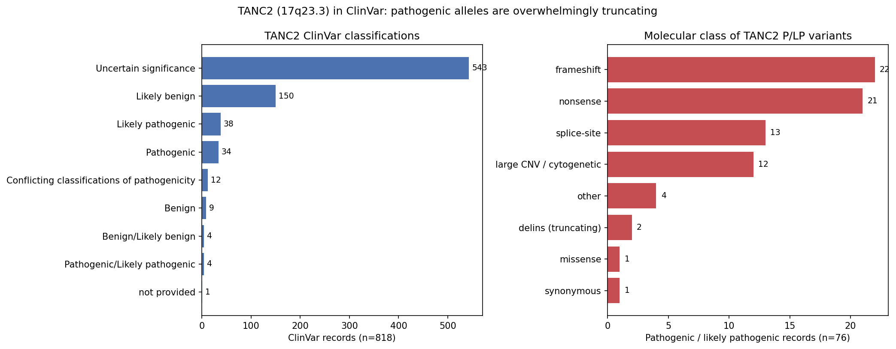
- [OpenScientist plot 10](Intellectual_Developmental_Disorder_With_Autistic_Features_And_Language_Delay_With_Or_Without_Seizures-deep-research-openscientist_artifacts/provenance_plot_10.json)
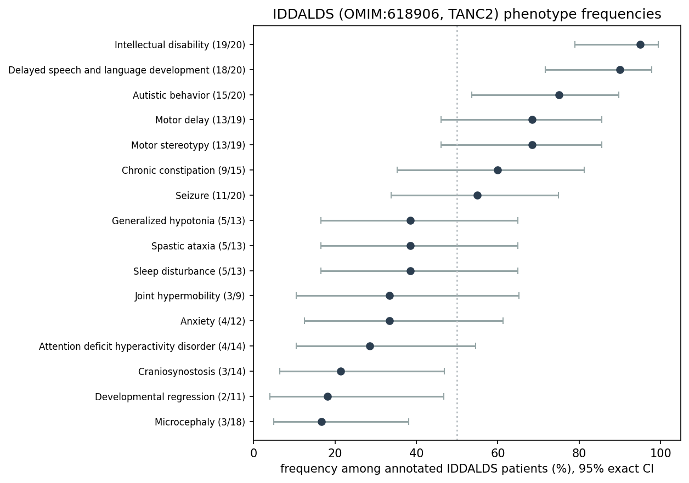
- [OpenScientist plot 2](Intellectual_Developmental_Disorder_With_Autistic_Features_And_Language_Delay_With_Or_Without_Seizures-deep-research-openscientist_artifacts/provenance_plot_2.json)
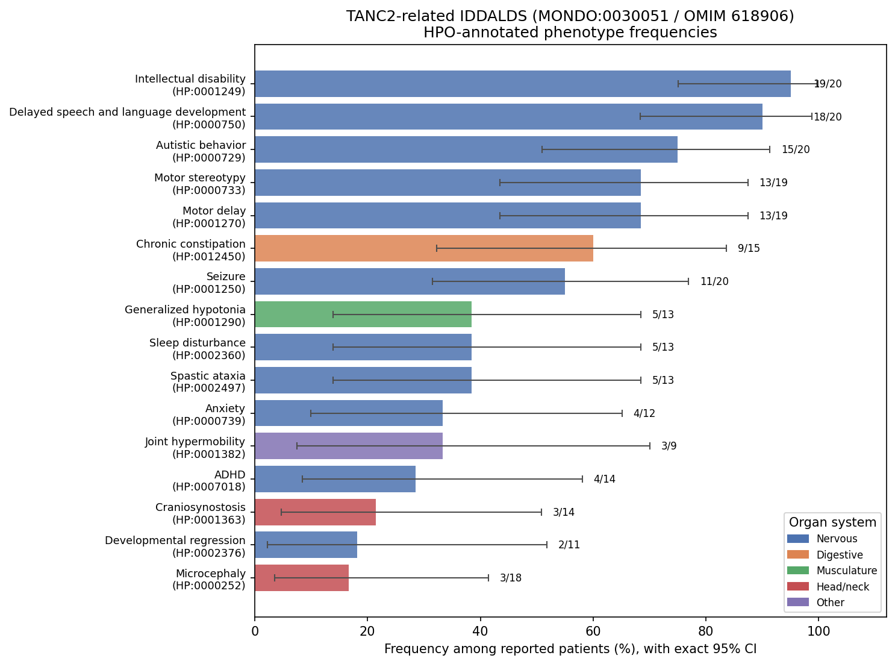
- [OpenScientist plot 3](Intellectual_Developmental_Disorder_With_Autistic_Features_And_Language_Delay_With_Or_Without_Seizures-deep-research-openscientist_artifacts/provenance_plot_3.json)
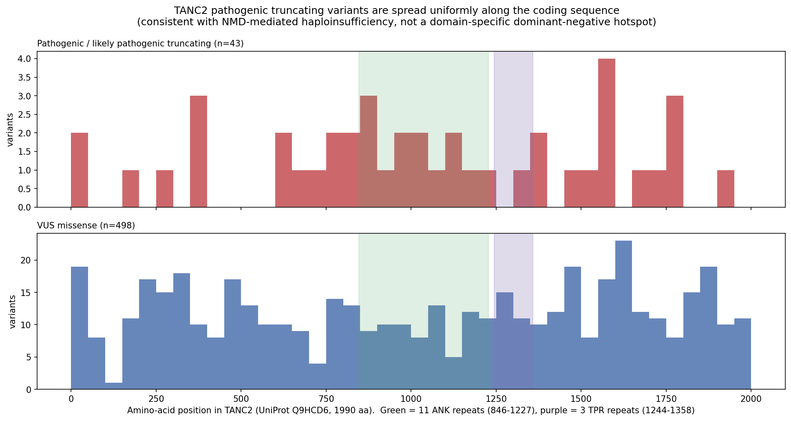
- [OpenScientist plot 4](Intellectual_Developmental_Disorder_With_Autistic_Features_And_Language_Delay_With_Or_Without_Seizures-deep-research-openscientist_artifacts/provenance_plot_4.json)
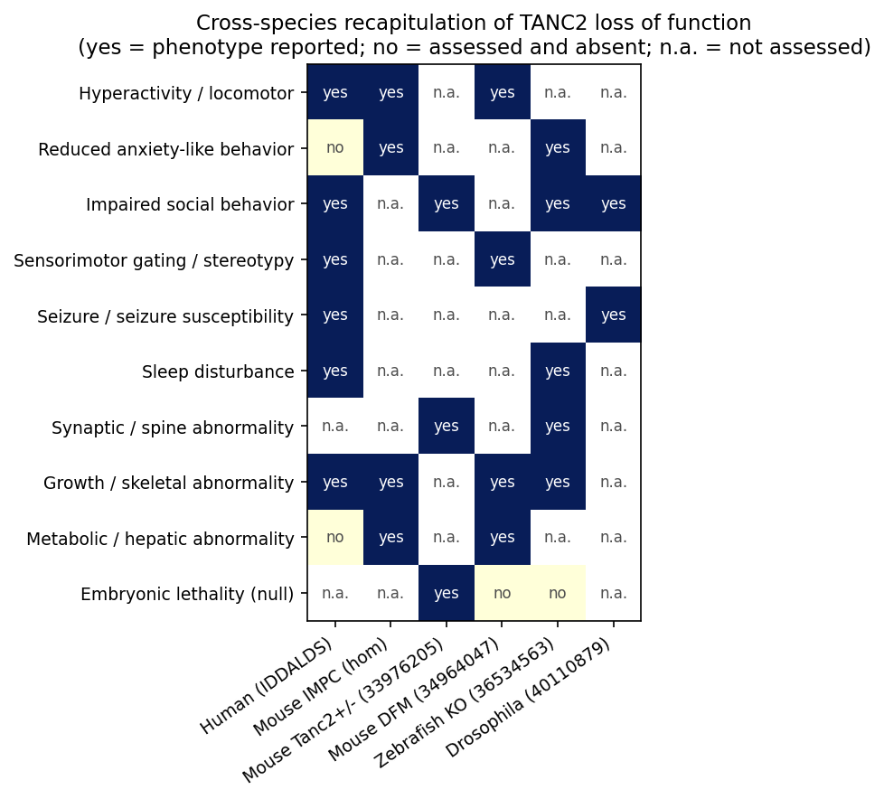
- [OpenScientist plot 5](Intellectual_Developmental_Disorder_With_Autistic_Features_And_Language_Delay_With_Or_Without_Seizures-deep-research-openscientist_artifacts/provenance_plot_5.json)
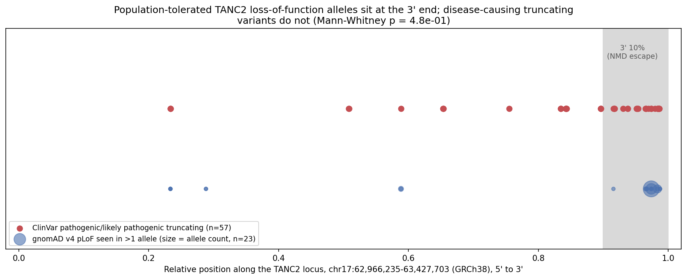
- [OpenScientist plot 6](Intellectual_Developmental_Disorder_With_Autistic_Features_And_Language_Delay_With_Or_Without_Seizures-deep-research-openscientist_artifacts/provenance_plot_6.json)
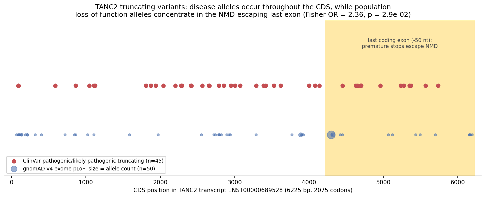
- [OpenScientist plot 7](Intellectual_Developmental_Disorder_With_Autistic_Features_And_Language_Delay_With_Or_Without_Seizures-deep-research-openscientist_artifacts/provenance_plot_7.json)
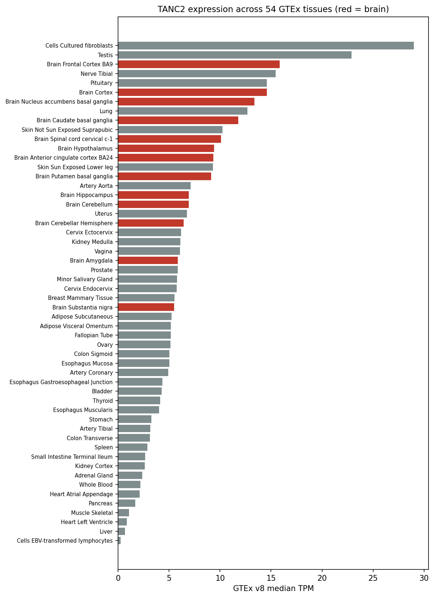
- [OpenScientist plot 8](Intellectual_Developmental_Disorder_With_Autistic_Features_And_Language_Delay_With_Or_Without_Seizures-deep-research-openscientist_artifacts/provenance_plot_8.json)
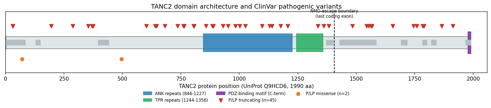
- [OpenScientist plot 9](Intellectual_Developmental_Disorder_With_Autistic_Features_And_Language_Delay_With_Or_Without_Seizures-deep-research-openscientist_artifacts/provenance_plot_9.json)
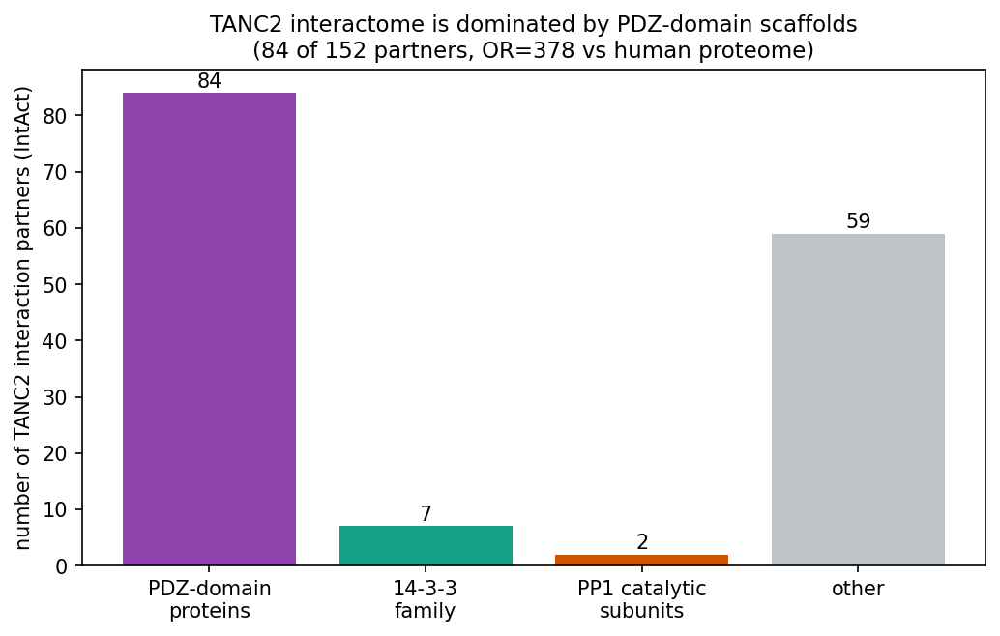

## Reference Validation

Checked with `linkml-reference-validator` 0.8.0.

| Outcome | Count |
| --- | --- |
| References checked | 31 |
| Resolved | 31 |
| Unresolved (possible confabulation) | 0 |
| Unverifiable | 0 |
| Quoted claims checked | 18 |
| Quoted claims found in source | 18 |
| Quoted claims **not** found in source | 0 |
| References weighed for topical relevance | 31 |
| On topic | 15 |
| Off topic | 0 |

All extracted references resolved successfully.

## Term Validation

Checked with `linkml-term-validator` 0.4.5, through the `ols:` adapter.

| Outcome | Count |
| --- | --- |
| Terms checked | 84 |
| Resolved | 76 |
| Unresolved (possible confabulation) | 0 |
| Obsolete | 2 |
| Unverifiable | 6 |
| Terms whose name was checked | 40 |
| Terms named correctly | 30 |
| Terms named as a **different** term | 8 |
| Terms whose name is worth a second look | 2 |

### Terms the report names something else

These identifiers resolve, so nothing about them looks wrong, and the ontology calls them something unrelated to what the report calls them. That usually means the identifier is not the one the sentence needs:

- `MONDO:0030051` (2 mentions) - the report calls it "MONDO"; MONDO calls it **intellectual developmental disorder with autistic features and language delay, with or without seizures**
- `NCIT:C29236` (1 mention) - the report calls it "Oxcarbazepine"; NCIT calls it **Murine Monoclonal Antibody (LYM-1)**
- `NCIT:C938` (1 mention) - the report calls it "Sodium valproate"; NCIT calls it **Vitamin A Compound**
- `NCIT:C28995` (1 mention) - the report calls it "Felbamate monotherapy"; NCIT calls it **Diphenoxylate Hydrochloride**
- `NCIT:C94628` (1 mention) - the report calls it "Ketogenic diet"; NCIT calls it **Third-Line Therapy**
- `NCIT:C15346` (2 mentions) - the report calls it "Occupational therapy", "Physical therapy"; NCIT calls it **Vaccination**
- `NCIT:C15277` (1 mention) - the report calls it "Behavioural intervention for autism"; NCIT calls it **Mastectomy**
- `NCIT:C15313` (1 mention) - the report calls it "Constipation management"; NCIT calls it **Radiation Therapy**

### Obsolete terms

These terms are real but deprecated. Citing one is not a fabrication; it does mean the report is naming something the ontology has retired:

- `CHEBI:6271` (CHEBI_6271) (1 mention) - replaced by `CHEBI:16643`
- `NCIT:C29236` (Murine Monoclonal Antibody (LYM-1)) (1 mention)

### Terms whose name is worth a second look

The report's name for these is recognisably related to the term's own name without being one of them. A loose paraphrase reads the same way as a citation of the wrong sibling term - and so does a *related* synonym, which the ontology records precisely because it names something adjacent rather than the same thing - so these are listed rather than judged:

- `NCIT:C15351` (1 mention) - the report calls it "Speech and language therapy"; NCIT calls it **Adoptive Immunotherapy**, and lists "Adoptive Cell Transfer Therapy" among its other names
- `MP:0013189` (1 mention) - the report calls it "abnormal exploration"; MP calls it **abnormal exploration in a new environment**

### Terms named inconsistently

The report gives these identifiers more than one name of its own:

- `NCIT:C15346` - called "Occupational therapy", "Physical therapy"

### Prefixes with no resolver

Terms carrying these prefixes were not checked either way, because no configured ontology covers them. An unrecognised prefix may name an ontology this run could not reach as easily as one that does not exist, so nothing here is evidence of fabrication: `OMIM`, `NCBIGene`, `ORPHA`, `MGI`, `RGD`.