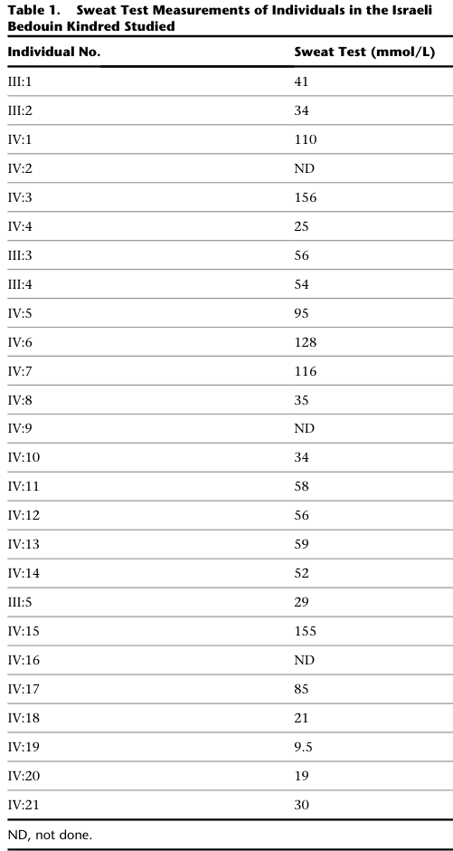

## Question

# Disease Characteristics Research Template

## Target Disease
- **Disease Name:** Isolated Hyperchlorhidrosis
- **MONDO ID:** MONDO:0007747 (if available)
- **Category:** Mendelian

## Research Objectives

Please provide a comprehensive research report on **Isolated Hyperchlorhidrosis** covering all of the
disease characteristics listed below. This report will be used to populate a disease knowledge
base entry. Be thorough and cite primary literature (PMID preferred) for all claims.

For each section, **suggested databases/resources** are listed. These are the first places
you should search for information on each topic.

---

### 1. Disease Information
> **Search first:** OMIM, Orphanet, ICD-10/ICD-11, MeSH, PubMed

- What is the disease? Provide a concise overview.
- What are the key identifiers? (OMIM, Orphanet, ICD-10/ICD-11, MeSH, Mondo)
- What are the common synonyms and alternative names?
- Is the information derived from individual patients (e.g., EHR) or aggregated disease-level resources?

### 2. Etiology

- **Disease Causal Factors**: What are the primary causes? (genetic, environmental, infectious, mechanistic)
- **Risk Factors**:
  > **Search first:** PubMed, Cochrane Library, UpToDate, clinical guidelines, ClinVar, ClinGen, GWAS Catalog, PheGenI, CTD, CDC, WHO, epidemiological databases
  - Genetic risk factors (causal variants, susceptibility loci, modifier genes)
  - Environmental risk factors (toxins, lifestyle, occupational exposures, age, sex, family history)
- **Protective Factors**:
  > **Search first:** PubMed, Cochrane Library, clinical trial databases, GWAS Catalog, gnomAD, WHO, CDC, nutrition databases
  - Genetic protective factors (protective variants, modifier alleles)
  - Environmental protective factors (diet, lifestyle, exposures that reduce risk)
- **Gene-Environment Interactions**: How do genetic and environmental factors interact to influence disease?
  > **Search first:** CTD, PubMed, PheGenI, GxE databases

### 3. Phenotypes
> **Search first:** HPO (Human Phenotype Ontology), OMIM, Orphanet, PubMed, clinicaltrials.gov, MedDRA, SNOMED CT, DECIPHER, LOINC

For each phenotype, provide:
- **Phenotype type**: symptoms, clinical signs, physical manifestations, behavioral changes, or laboratory abnormalities
  > For symptoms/signs: HPO, OMIM, Orphanet, PubMed
  > For behavioral changes: HPO, DSM, RDoC (Research Domain Criteria), PubMed
  > For laboratory abnormalities: LOINC, SNOMED CT, LabTests Online, PubMed
- **Phenotype characteristics**:
  > **Search first:** OMIM, Orphanet, HPO, PubMed
  - Age of symptom onset (neonatal, childhood, adult-onset, late-onset)
  - Symptom severity (mild, moderate, severe, variable)
  - Symptom progression (stable, progressive, episodic, fluctuating)
  - Frequency among affected individuals (percentage or qualitative)
- **Quality of life impact**: Effects on daily functioning and well-being (per-phenotype when possible)
  > **Search first:** EQ-5D database, SF-36, WHO QOL databases, PubMed
- Suggest HPO (Human Phenotype Ontology) terms for each phenotype

### 4. Genetic/Molecular Information

- **Causal Genes**: Gene mutations or chromosomal abnormalities responsible for disease (gene symbols, OMIM IDs)
  > **Search first:** OMIM, ClinVar, HGMD, Ensembl, NCBI Gene
- **Pathogenic Variants**:
  - Affected genes (gene symbols, HGNC IDs)
    > **Search first:** OMIM, NCBI Gene, Ensembl, HGNC, UniProt, GeneCards
  - Variant classification (pathogenic, likely pathogenic, VUS per ACMG/AMP guidelines)
    > **Search first:** ClinVar, ClinGen, ACMG/AMP guidelines, VarSome
  - Variant type/class (missense, frameshift, nonsense, splice-site, structural)
  - Allele frequency in population databases
    > **Search first:** gnomAD, 1000 Genomes, ExAC, TOPMed, dbSNP
  - Somatic vs germline origin
    > **Search first:** COSMIC (somatic), ClinVar, ICGC, TCGA
  - Functional consequences (loss of function, gain of function, dominant negative)
- **Modifier Genes**: Genes that modify disease severity or expression
- **Epigenetic Information**: DNA methylation, histone modifications, chromatin changes affecting disease
  > **Search first:** ENCODE, Roadmap Epigenomics, MethBase, DiseaseMeth
- **Chromosomal Abnormalities**: Large-scale genetic changes (aneuploidy, translocations, inversions)
  > **Search first:** DECIPHER, ClinVar, ECARUCA, UCSC Genome Browser

### 5. Environmental Information

- **Environmental Factors**: Non-genetic contributing factors (toxins, radiation, pollution, occupational exposure)
  > **Search first:** CTD (Comparative Toxicogenomics Database), TOXNET, PubMed, EPA databases
- **Lifestyle Factors**: Behavioral factors (smoking, diet, exercise, alcohol consumption)
  > **Search first:** CDC databases, WHO, PubMed, NHANES
- **Infectious Agents**: If applicable, pathogens causing or triggering disease (bacteria, viruses, fungi, parasites)
  > **Search first:** NCBI Taxonomy, ViPR, BV-BRC, MicrobeDB, GIDEON

### 6. Mechanism / Pathophysiology

**Present this section as an ordered causal chain first, then the detail below.**
Open with a numbered sequence of mechanistic steps running from the initiating
lesion (mutation, exposure, infection) to the clinical manifestation, one step per
line, each naming what it causes next. State the causal verb explicitly ("leads
to", "results in") and say where a step is inferred rather than demonstrated.
Where the mechanism branches, show the branch. The categories below are a
checklist of what to cover within those steps, not the organizing structure —
a step may draw on several of them, and a category may contribute to several
steps.

- **Molecular Pathways**: Specific signaling cascades or biochemical pathways involved (Wnt, MAPK, mTOR, PI3K-AKT, etc.)
  > **Search first:** KEGG, Reactome, WikiPathways, PathBank, BioCyc
- **Cellular Processes**: Cell-level mechanisms (apoptosis, autophagy, cell cycle dysregulation, inflammation, etc.)
  > **Search first:** Gene Ontology (GO), Reactome, KEGG, PubMed
- **Protein Dysfunction**: How protein structure or function is altered (misfolding, aggregation, loss of function, gain of function)
  > **Search first:** UniProt, PDB (Protein Data Bank), InterPro, Pfam, AlphaFold
- **Metabolic Changes**: Alterations in metabolic processes (energy metabolism, lipid metabolism, amino acid metabolism)
  > **Search first:** KEGG, BioCyc, HMDB (Human Metabolome Database), BRENDA
- **Immune System Involvement**: Role of immune response (autoimmunity, immunodeficiency, chronic inflammation)
  > **Search first:** ImmPort, Immunome Database, IEDB, Gene Ontology
- **Tissue Damage Mechanisms**: How tissues/ are injured (oxidative stress, ischemia, fibrosis, necrosis)
  > **Search first:** PubMed, Gene Ontology, Reactome
- **Biochemical Abnormalities**: Specific molecular defects (enzyme deficiencies, receptor dysfunction, ion channel defects)
  > **Search first:** BRENDA, UniProt, KEGG, OMIM, PubMed
- **Epigenetic Changes**: DNA methylation, histone modifications affecting gene expression in disease
  > **Search first:** ENCODE, Roadmap Epigenomics, MethBase, DiseaseMeth
- **Molecular Profiling** (if available):
  - Transcriptomics/gene expression changes
    > **Search first:** GEO (Gene Expression Omnibus), ArrayExpress, GTEx, Human Cell Atlas, SRA
  - Proteomics findings
    > **Search first:** PRIDE, ProteomeXchange, Human Protein Atlas, STRING, BioGRID
  - Metabolomics signatures
    > **Search first:** MetaboLights, Metabolomics Workbench, HMDB, METLIN
  - Lipidomics alterations
    > **Search first:** LIPID MAPS, SwissLipids, LipidHome, Metabolomics Workbench
  - Genomic structural features
    > **Search first:** UCSC Genome Browser, Ensembl, NCBI, dbVar, DGV
- **Advanced Technologies** (if applicable):
  - Single-cell analysis findings (cell-type specific mechanisms, cellular heterogeneity)
    > **Search first:** Human Cell Atlas, Single Cell Portal, GEO, CELLxGENE
  - Spatial transcriptomics findings
    > **Search first:** GEO, Spatial Research, Vizgen, 10x Genomics data
  - Multi-omics integration results
    > **Search first:** TCGA, ICGC, cBioPortal, LinkedOmics, PubMed
  - Functional genomics screens (CRISPR, RNAi)
    > **Search first:** DepMap, GenomeRNAi, PubMed, BioGRID ORCS

For each mechanism, describe:
- The causal chain from initial trigger to clinical manifestation
- Which mechanisms are upstream vs downstream
- What cell types and biological processes are involved
- Suggest GO terms for biological processes and CL terms for cell types

### 7. Anatomical Structures Affected

- **Organ Level**:
  - Primary organs directly affected
  - Secondary organ involvement (complications, secondary effects)
  - Body systems involved (cardiovascular, nervous, digestive, respiratory, endocrine, etc.)
  > **Search first:** Uberon, FMA (Foundational Model of Anatomy), OMIM, HPO, ICD-11, MeSH, SNOMED CT
- **Tissue and Cell Level**:
  - Specific tissue types affected (epithelial, connective, muscle, nervous)
  - Specific cell populations targeted (with Cell Ontology terms)
  > **Search first:** Uberon, Human Protein Atlas, Cell Ontology, Human Cell Atlas, CellMarker, PanglaoDB
- **Subcellular Level**:
  - Cellular compartments involved (mitochondria, nucleus, ER, lysosomes) (with GO Cellular Component terms)
  > **Search first:** Gene Ontology (Cellular Component), UniProt, Human Protein Atlas
- **Localization**:
  - Specific anatomical sites (with UBERON terms)
    > **Search first:** FMA, Uberon, NeuroNames (for brain), SNOMED CT
  - Lateralization (unilateral, bilateral, asymmetric)
    > **Search first:** HPO, clinical literature, imaging databases

### 8. Temporal Development

- **Onset**:
  - Typical age of onset (congenital, pediatric, adult, geriatric)
  - Onset pattern (acute, subacute, chronic, insidious)
  > **Search first:** OMIM, Orphanet, HPO, PubMed
- **Progression**:
  - Disease stages (early, intermediate, advanced, end-stage)
    > **Search first:** Cancer Staging Manual (AJCC), WHO classifications, PubMed
  - Progression rate (rapid, slow, variable)
  - Disease course pattern (episodic, relapsing-remitting, progressive, stable)
  - Disease duration (self-limited, chronic lifelong)
  > **Search first:** Disease registries, longitudinal cohort databases, natural history studies, PubMed, Orphanet, OMIM
- **Patterns**:
  - Remission patterns (spontaneous, treatment-induced)
    > **Search first:** Clinical trial databases, disease registries, PubMed
  - Critical periods (time windows of vulnerability or opportunity for intervention)
    > **Search first:** PubMed, developmental biology databases, clinical guidelines

### 9. Inheritance and Population

- **Epidemiology**:
  - Prevalence (cases per 100,000 at given time)
  - Incidence (new cases per 100,000 per year)
  > **Search first:** Orphanet, CDC, WHO, GBD (Global Burden of Disease), national registries, SEER, disease registries
- **For Genetic Etiology**:
  - Inheritance pattern (AD, AR, X-linked, mitochondrial, multifactorial, polygenic)
    > **Search first:** OMIM, Orphanet, ClinVar, GTR (Genetic Testing Registry)
  - Penetrance (complete, incomplete, age-dependent)
    > **Search first:** ClinVar, OMIM, PubMed, ClinGen
  - Expressivity (variable, consistent)
    > **Search first:** OMIM, ClinVar, PubMed
  - Genetic anticipation (increasing severity in successive generations)
    > **Search first:** OMIM, PubMed (especially for repeat expansion disorders)
  - Germline mosaicism
    > **Search first:** ClinVar, OMIM, genetic counseling literature, PubMed
  - Founder effects (population-specific mutations)
    > **Search first:** gnomAD, population genetics databases, PubMed
  - Consanguinity role
    > **Search first:** OMIM, population studies, genetic counseling resources
  - Carrier frequency
    > **Search first:** gnomAD, carrier screening databases, GeneReviews, GTR
- **Population Demographics**:
  - Affected populations (ethnic or demographic groups with higher prevalence)
    > **Search first:** gnomAD, 1000 Genomes, PAGE Study, PubMed, population registries
  - Geographic distribution (endemic areas, regional variation)
    > **Search first:** WHO, CDC, GBD, Orphanet, geographic epidemiology databases
  - Geographic distribution of specific variants
  - Sex ratio (male:female)
    > **Search first:** Disease registries, OMIM, PubMed, epidemiological databases
  - Age distribution of affected individuals
    > **Search first:** CDC, disease registries, SEER, Orphanet

### 10. Diagnostics

- **Clinical Tests**:
  - Laboratory tests (blood, urine, tissue chemistry, specific enzyme assays)
    > **Search first:** LOINC, LabTests Online, PubMed
  - Biomarkers (proteins, metabolites, genetic markers, circulating biomarkers)
    > **Search first:** FDA Biomarker List, BEST (Biomarkers, EndpointS, and other Tools), PubMed
  - Imaging studies (X-ray, CT, MRI, PET, ultrasound)
    > **Search first:** RadLex, DICOM, Radiopaedia, imaging databases
  - Functional tests (pulmonary function, cardiac stress tests)
    > **Search first:** LOINC, clinical guidelines, PubMed
  - Electrophysiology (EEG, EMG, ECG, nerve conduction studies)
    > **Search first:** LOINC, clinical neurophysiology databases, PubMed
  - Biopsy findings (histopathology, immunohistochemistry)
    > **Search first:** SNOMED CT, College of American Pathologists resources, PubMed
  - Pathology findings (microscopic examination)
    > **Search first:** SNOMED CT, Digital Pathology databases, PubMed
- **Genetic Testing**:
  > **Search first:** GTR (Genetic Testing Registry), GeneReviews, ClinGen
  - Overview of recommended genetic testing approach
  - Whole genome sequencing (WGS) utility
    > **Search first:** GTR, ClinVar, GEL (Genomics England), gnomAD
  - Whole exome sequencing (WES) utility
    > **Search first:** GTR, ClinVar, OMIM, GeneMatcher
  - Gene panels (which panels, which genes)
    > **Search first:** GTR, ClinVar, laboratory-specific databases
  - Single gene testing
    > **Search first:** GTR, ClinVar, OMIM, GeneReviews
  - Chromosomal microarray (CMA)
    > **Search first:** DECIPHER, ClinVar, dbVar, ECARUCA
  - Karyotyping
    > **Search first:** Chromosome Abnormality Database, ClinVar, cytogenetics resources
  - FISH
    > **Search first:** ClinVar, cytogenetics databases, PubMed
  - Mitochondrial DNA testing
    > **Search first:** MITOMAP, MSeqDR, ClinVar, GTR
  - Repeat expansion testing
    > **Search first:** GTR, ClinVar, repeat expansion databases, PubMed
- **Omics-Based Diagnostics** (if applicable):
  - RNA sequencing / transcriptomics
    > **Search first:** GEO, ArrayExpress, GTEx, RNA-seq databases
  - Proteomics
    > **Search first:** PRIDE, ProteomeXchange, FDA Biomarker database
  - Metabolomics
    > **Search first:** MetaboLights, Metabolomics Workbench, HMDB
  - Epigenomics
    > **Search first:** GEO, ENCODE, Roadmap Epigenomics, MethBase
  - Liquid biopsy
    > **Search first:** COSMIC, ClinVar, liquid biopsy databases, PubMed
- **Clinical Criteria**:
  - Standardized diagnostic criteria (DSM, ICD, society guidelines)
    > **Search first:** DSM-5, ICD-11, clinical society guidelines, UpToDate
  - Differential diagnosis (other conditions to rule out, with distinguishing features)
    > **Search first:** DynaMed, UpToDate, clinical decision support systems
- **Screening**:
  - Screening methods for asymptomatic individuals (newborn screening, carrier screening, cascade screening)
    > **Search first:** ACMG recommendations, CDC newborn screening, GTR

### 11. Outcome/Prognosis

- **Survival and Mortality**:
  - Survival rate (5-year, 10-year, overall)
    > **Search first:** SEER, cancer registries, disease-specific registries, PubMed
  - Life expectancy (with and without treatment if applicable)
    > **Search first:** Orphanet, disease registries, actuarial databases, PubMed
  - Mortality rate
    > **Search first:** CDC, WHO, GBD, national mortality databases
  - Disease-specific mortality (deaths directly attributable to disease)
    > **Search first:** Disease registries, CDC Wonder, GBD, PubMed
- **Morbidity and Function**:
  - Morbidity (disease-related disability and health impacts)
    > **Search first:** GBD, WHO, disability databases, PubMed
  - Disability outcomes (long-term functional impairments)
    > **Search first:** ICF (International Classification of Functioning), disability registries
  - Quality of life measures (EQ-5D, SF-36, PROMIS, disease-specific tools)
    > **Search first:** EQ-5D database, SF-36, PROMIS, PubMed
- **Disease Course**:
  - Complications (secondary problems: infections, organ failure, etc.)
    > **Search first:** ICD codes, disease registries, clinical databases, PubMed
  - Recovery potential (likelihood and extent of recovery, with vs without treatment)
    > **Search first:** Natural history studies, rehabilitation databases, PubMed
- **Prediction**:
  - Prognostic factors (age, disease severity, biomarkers, treatment response)
    > **Search first:** Prognostic models databases, clinical calculators, PubMed
  - Prognostic biomarkers (molecular markers predicting disease course)
    > **Search first:** FDA Biomarker database, PubMed, cancer prognostic databases

### 12. Treatment

- **Pharmacotherapy**:
  - Pharmacological treatments (drug names, drug classes, mechanisms of action)
    > **Search first:** DrugBank, RxNorm, ATC classification, DailyMed, FDA databases
  - Pharmacogenomics (how genetic variants affect drug metabolism, efficacy, toxicity)
    > **Search first:** PharmGKB, CPIC (Clinical Pharmacogenetics), FDA Table of PGx Biomarkers
- **Advanced Therapeutics**:
  - Gene therapy (viral vectors, CRISPR, gene replacement, gene editing)
    > **Search first:** ClinicalTrials.gov, FDA gene therapy database, ASGCT resources
  - Cell therapy (stem cell transplant, CAR-T, cellular therapeutics)
    > **Search first:** ClinicalTrials.gov, FDA cell therapy database, FACT standards
  - RNA-based therapies (ASOs, siRNA, mRNA therapies)
    > **Search first:** ClinicalTrials.gov, FDA approvals, PubMed
  - Targeted therapies (treatments directed at specific molecular targets)
    > **Search first:** My Cancer Genome, OncoKB, ClinicalTrials.gov, FDA approvals
  - Immunotherapies (checkpoint inhibitors, monoclonal antibodies)
    > **Search first:** Cancer Immunotherapy Database, FDA approvals, ClinicalTrials.gov
- **Surgical and Interventional**:
  - Surgical interventions (types of surgery, timing, outcomes)
    > **Search first:** CPT codes, surgical registries, clinical guidelines, PubMed
- **Supportive and Rehabilitative**:
  - Supportive care (symptom management, pain control, nutrition)
    > **Search first:** Clinical guidelines, Cochrane Library, PubMed
  - Rehabilitation (physical therapy, occupational therapy, speech therapy)
    > **Search first:** Rehabilitation medicine databases, clinical guidelines, PubMed
- **Experimental**:
  - Experimental treatments in clinical trials (with NCT identifiers if available)
    > **Search first:** ClinicalTrials.gov, EU Clinical Trials Register, WHO ICTRP
- **Treatment Outcomes**:
  - Treatment response rates
    > **Search first:** Clinical trial databases, FDA reviews, systematic reviews, PubMed
  - Side effects and adverse events
    > **Search first:** FDA Adverse Event Reporting System (FAERS), MedWatch, PubMed
- **Treatment Strategy**:
  - Treatment algorithms (clinical pathways, decision trees)
    > **Search first:** Clinical practice guidelines, NCCN Guidelines, UpToDate
  - Combination therapies
    > **Search first:** ClinicalTrials.gov, treatment guidelines, PubMed
  - Personalized medicine approaches (genotype-guided treatment)
    > **Search first:** My Cancer Genome, CIViC, PharmGKB, precision medicine databases

For each treatment, suggest NCIT (NCI Thesaurus) clinical-intervention terms where applicable.

### 13. Prevention

- **Prevention Levels**:
  - Primary prevention (preventing disease occurrence: vaccination, risk factor modification)
    > **Search first:** CDC, WHO, USPSTF recommendations, Cochrane Library
  - Secondary prevention (early detection and treatment: screening programs, early intervention)
    > **Search first:** USPSTF, CDC screening guidelines, WHO
  - Tertiary prevention (preventing complications in those with disease)
    > **Search first:** Clinical guidelines, disease management protocols, PubMed
- **Immunization**: Vaccine strategies (if applicable)
  > **Search first:** CDC vaccine schedules, WHO immunization, FDA vaccine database
- **Screening and Early Detection**:
  - Screening programs (population-based: newborn screening, cancer screening)
    > **Search first:** CDC screening programs, USPSTF, cancer screening databases
  - Genetic screening (carrier screening, preimplantation genetic diagnosis, prenatal testing)
    > **Search first:** ACMG recommendations, ACOG guidelines, GTR
  - Risk stratification (identifying high-risk individuals for targeted prevention)
    > **Search first:** Risk prediction models, clinical calculators, PubMed
- **Behavioral Interventions**: Lifestyle modifications to reduce risk
  > **Search first:** CDC, WHO, behavioral intervention databases, Cochrane Library
- **Counseling**: Genetic counseling (risk assessment, family planning guidance)
  > **Search first:** NSGC resources, ACMG guidelines, GeneReviews
- **Public Health**:
  - Public health interventions (sanitation, vector control, health education)
    > **Search first:** CDC, WHO, public health databases, PubMed
  - Environmental interventions (reducing environmental risk factors)
    > **Search first:** EPA databases, WHO environmental health, PubMed
- **Prophylaxis**: Preventive medications or procedures
  > **Search first:** Clinical guidelines, FDA approvals, PubMed

### 14. Other Species / Natural Disease

- **Taxonomy**: Species affected (with NCBI Taxon identifiers)
  > **Search first:** NCBI Taxonomy
- **Breed**: Specific breeds affected (with VBO identifiers if applicable)
  > **Search first:** VBO (Vertebrate Breed Ontology)
- **Gene**: Orthologous genes in other species (with NCBI Gene IDs)
  > **Search first:** NCBI Gene
- **Natural Disease**:
  - Naturally occurring disease in other species (companion animals, wildlife)
    > **Search first:** OMIA (Online Mendelian Inheritance in Animals), VetCompass, PubMed
  - Veterinary relevance and importance in animal health
    > **Search first:** OMIA, veterinary databases, PubMed
- **Comparative Biology**:
  - Comparative pathology (similarities and differences across species)
    > **Search first:** OMIA, comparative pathology databases, PubMed
  - Evolutionary conservation of disease mechanisms
    > **Search first:** HomoloGene, OrthoMCL, Alliance of Genome Resources
- **Transmission** (if applicable):
  - Zoonotic potential
    > **Search first:** CDC zoonotic diseases, WHO zoonoses, GIDEON
  - Cross-species susceptibility
    > **Search first:** NCBI Taxonomy, veterinary databases, PubMed

### 15. Model Organisms

- **Model Types**:
  - Model organism type (mammalian, invertebrate, cellular, in vitro)
    > **Search first:** Alliance of Genome Resources, model organism databases
  - Specific model systems (mouse, rat, zebrafish, Drosophila, C. elegans, yeast, cell lines, organoids, iPSCs)
    > **Search first:** MGI, RGD, ZFIN, FlyBase, WormBase, SGD, ATCC, Cellosaurus
  - Induced models (drug treatment, surgical intervention, environmental manipulation)
    > **Search first:** MGI, model organism databases, PubMed
- **Genetic Models**:
  - Types available (knockout, knock-in, transgenic, conditional, humanized)
    > **Search first:** MGI, IMPC, KOMP, EuMMCR, IMSR
- **Model Characteristics**:
  - Phenotype recapitulation (how well model reproduces human disease features)
    > **Search first:** Model organism databases, comparative studies, PubMed
  - Model limitations (aspects of human disease not captured)
    > **Search first:** Model organism databases, PubMed, review articles
- **Applications**:
  - Research applications (what aspects of disease can be studied)
    > **Search first:** Model organism databases, PubMed
- **Resources**:
  - Model databases
    > **Search first:** MGI, RGD, ZFIN, FlyBase, WormBase, IMSR, EMMA, MMRRC

---

## Citation Requirements

- Cite primary literature (PMID preferred) for all mechanistic and clinical claims
- Prioritize recent reviews and landmark papers
- Include direct quotes from abstracts where possible to support key statements
- Distinguish evidence source types: human clinical, model organism, in vitro, computational

## Output Format

Structure your response as a comprehensive narrative organized by the sections above.
For each section, provide:
- Factual content with specific details (numbers, percentages, gene names, variant nomenclature)
- Ontology term suggestions (HPO, GO, CL, UBERON, CHEBI, NCIT, MONDO) where applicable
- Evidence citations with PMIDs
- Direct quotes from abstracts to support key claims
- Clear indication when information is not available or not applicable for this disease

This report will be used to populate a disease knowledge base entry with:
- Pathophysiology descriptions with causal chains
- Gene/protein annotations (HGNC, GO terms)
- Phenotype associations (HP terms) with frequencies
- Cell type involvement (CL terms)
- Anatomical locations (UBERON terms)
- Chemical entities (CHEBI terms)
- Treatment annotations (NCIT terms)
- Evidence items with PMIDs and exact abstract quotes
- Epidemiology, prognosis, diagnostic, and prevention information
- Animal model descriptions with phenotype recapitulation details

## Output

Question: You are an expert researcher providing comprehensive, well-cited information.

Provide detailed information focusing on:
1. Key concepts and definitions with current understanding
2. Recent developments and latest research (prioritize 2023-2024 sources)
3. Current applications and real-world implementations
4. Expert opinions and analysis from authoritative sources
5. Relevant statistics and data from recent studies

Format as a comprehensive research report with proper citations. Include URLs and publication dates where available.
Always prioritize recent, authoritative sources and provide specific citations for all major claims.

# Disease Characteristics Research Template

## Target Disease
- **Disease Name:** Isolated Hyperchlorhidrosis
- **MONDO ID:** MONDO:0007747 (if available)
- **Category:** Mendelian

## Research Objectives

Please provide a comprehensive research report on **Isolated Hyperchlorhidrosis** covering all of the
disease characteristics listed below. This report will be used to populate a disease knowledge
base entry. Be thorough and cite primary literature (PMID preferred) for all claims.

For each section, **suggested databases/resources** are listed. These are the first places
you should search for information on each topic.

---

### 1. Disease Information
> **Search first:** OMIM, Orphanet, ICD-10/ICD-11, MeSH, PubMed

- What is the disease? Provide a concise overview.
- What are the key identifiers? (OMIM, Orphanet, ICD-10/ICD-11, MeSH, Mondo)
- What are the common synonyms and alternative names?
- Is the information derived from individual patients (e.g., EHR) or aggregated disease-level resources?

### 2. Etiology

- **Disease Causal Factors**: What are the primary causes? (genetic, environmental, infectious, mechanistic)
- **Risk Factors**:
  > **Search first:** PubMed, Cochrane Library, UpToDate, clinical guidelines, ClinVar, ClinGen, GWAS Catalog, PheGenI, CTD, CDC, WHO, epidemiological databases
  - Genetic risk factors (causal variants, susceptibility loci, modifier genes)
  - Environmental risk factors (toxins, lifestyle, occupational exposures, age, sex, family history)
- **Protective Factors**:
  > **Search first:** PubMed, Cochrane Library, clinical trial databases, GWAS Catalog, gnomAD, WHO, CDC, nutrition databases
  - Genetic protective factors (protective variants, modifier alleles)
  - Environmental protective factors (diet, lifestyle, exposures that reduce risk)
- **Gene-Environment Interactions**: How do genetic and environmental factors interact to influence disease?
  > **Search first:** CTD, PubMed, PheGenI, GxE databases

### 3. Phenotypes
> **Search first:** HPO (Human Phenotype Ontology), OMIM, Orphanet, PubMed, clinicaltrials.gov, MedDRA, SNOMED CT, DECIPHER, LOINC

For each phenotype, provide:
- **Phenotype type**: symptoms, clinical signs, physical manifestations, behavioral changes, or laboratory abnormalities
  > For symptoms/signs: HPO, OMIM, Orphanet, PubMed
  > For behavioral changes: HPO, DSM, RDoC (Research Domain Criteria), PubMed
  > For laboratory abnormalities: LOINC, SNOMED CT, LabTests Online, PubMed
- **Phenotype characteristics**:
  > **Search first:** OMIM, Orphanet, HPO, PubMed
  - Age of symptom onset (neonatal, childhood, adult-onset, late-onset)
  - Symptom severity (mild, moderate, severe, variable)
  - Symptom progression (stable, progressive, episodic, fluctuating)
  - Frequency among affected individuals (percentage or qualitative)
- **Quality of life impact**: Effects on daily functioning and well-being (per-phenotype when possible)
  > **Search first:** EQ-5D database, SF-36, WHO QOL databases, PubMed
- Suggest HPO (Human Phenotype Ontology) terms for each phenotype

### 4. Genetic/Molecular Information

- **Causal Genes**: Gene mutations or chromosomal abnormalities responsible for disease (gene symbols, OMIM IDs)
  > **Search first:** OMIM, ClinVar, HGMD, Ensembl, NCBI Gene
- **Pathogenic Variants**:
  - Affected genes (gene symbols, HGNC IDs)
    > **Search first:** OMIM, NCBI Gene, Ensembl, HGNC, UniProt, GeneCards
  - Variant classification (pathogenic, likely pathogenic, VUS per ACMG/AMP guidelines)
    > **Search first:** ClinVar, ClinGen, ACMG/AMP guidelines, VarSome
  - Variant type/class (missense, frameshift, nonsense, splice-site, structural)
  - Allele frequency in population databases
    > **Search first:** gnomAD, 1000 Genomes, ExAC, TOPMed, dbSNP
  - Somatic vs germline origin
    > **Search first:** COSMIC (somatic), ClinVar, ICGC, TCGA
  - Functional consequences (loss of function, gain of function, dominant negative)
- **Modifier Genes**: Genes that modify disease severity or expression
- **Epigenetic Information**: DNA methylation, histone modifications, chromatin changes affecting disease
  > **Search first:** ENCODE, Roadmap Epigenomics, MethBase, DiseaseMeth
- **Chromosomal Abnormalities**: Large-scale genetic changes (aneuploidy, translocations, inversions)
  > **Search first:** DECIPHER, ClinVar, ECARUCA, UCSC Genome Browser

### 5. Environmental Information

- **Environmental Factors**: Non-genetic contributing factors (toxins, radiation, pollution, occupational exposure)
  > **Search first:** CTD (Comparative Toxicogenomics Database), TOXNET, PubMed, EPA databases
- **Lifestyle Factors**: Behavioral factors (smoking, diet, exercise, alcohol consumption)
  > **Search first:** CDC databases, WHO, PubMed, NHANES
- **Infectious Agents**: If applicable, pathogens causing or triggering disease (bacteria, viruses, fungi, parasites)
  > **Search first:** NCBI Taxonomy, ViPR, BV-BRC, MicrobeDB, GIDEON

### 6. Mechanism / Pathophysiology

**Present this section as an ordered causal chain first, then the detail below.**
Open with a numbered sequence of mechanistic steps running from the initiating
lesion (mutation, exposure, infection) to the clinical manifestation, one step per
line, each naming what it causes next. State the causal verb explicitly ("leads
to", "results in") and say where a step is inferred rather than demonstrated.
Where the mechanism branches, show the branch. The categories below are a
checklist of what to cover within those steps, not the organizing structure —
a step may draw on several of them, and a category may contribute to several
steps.

- **Molecular Pathways**: Specific signaling cascades or biochemical pathways involved (Wnt, MAPK, mTOR, PI3K-AKT, etc.)
  > **Search first:** KEGG, Reactome, WikiPathways, PathBank, BioCyc
- **Cellular Processes**: Cell-level mechanisms (apoptosis, autophagy, cell cycle dysregulation, inflammation, etc.)
  > **Search first:** Gene Ontology (GO), Reactome, KEGG, PubMed
- **Protein Dysfunction**: How protein structure or function is altered (misfolding, aggregation, loss of function, gain of function)
  > **Search first:** UniProt, PDB (Protein Data Bank), InterPro, Pfam, AlphaFold
- **Metabolic Changes**: Alterations in metabolic processes (energy metabolism, lipid metabolism, amino acid metabolism)
  > **Search first:** KEGG, BioCyc, HMDB (Human Metabolome Database), BRENDA
- **Immune System Involvement**: Role of immune response (autoimmunity, immunodeficiency, chronic inflammation)
  > **Search first:** ImmPort, Immunome Database, IEDB, Gene Ontology
- **Tissue Damage Mechanisms**: How tissues/ are injured (oxidative stress, ischemia, fibrosis, necrosis)
  > **Search first:** PubMed, Gene Ontology, Reactome
- **Biochemical Abnormalities**: Specific molecular defects (enzyme deficiencies, receptor dysfunction, ion channel defects)
  > **Search first:** BRENDA, UniProt, KEGG, OMIM, PubMed
- **Epigenetic Changes**: DNA methylation, histone modifications affecting gene expression in disease
  > **Search first:** ENCODE, Roadmap Epigenomics, MethBase, DiseaseMeth
- **Molecular Profiling** (if available):
  - Transcriptomics/gene expression changes
    > **Search first:** GEO (Gene Expression Omnibus), ArrayExpress, GTEx, Human Cell Atlas, SRA
  - Proteomics findings
    > **Search first:** PRIDE, ProteomeXchange, Human Protein Atlas, STRING, BioGRID
  - Metabolomics signatures
    > **Search first:** MetaboLights, Metabolomics Workbench, HMDB, METLIN
  - Lipidomics alterations
    > **Search first:** LIPID MAPS, SwissLipids, LipidHome, Metabolomics Workbench
  - Genomic structural features
    > **Search first:** UCSC Genome Browser, Ensembl, NCBI, dbVar, DGV
- **Advanced Technologies** (if applicable):
  - Single-cell analysis findings (cell-type specific mechanisms, cellular heterogeneity)
    > **Search first:** Human Cell Atlas, Single Cell Portal, GEO, CELLxGENE
  - Spatial transcriptomics findings
    > **Search first:** GEO, Spatial Research, Vizgen, 10x Genomics data
  - Multi-omics integration results
    > **Search first:** TCGA, ICGC, cBioPortal, LinkedOmics, PubMed
  - Functional genomics screens (CRISPR, RNAi)
    > **Search first:** DepMap, GenomeRNAi, PubMed, BioGRID ORCS

For each mechanism, describe:
- The causal chain from initial trigger to clinical manifestation
- Which mechanisms are upstream vs downstream
- What cell types and biological processes are involved
- Suggest GO terms for biological processes and CL terms for cell types

### 7. Anatomical Structures Affected

- **Organ Level**:
  - Primary organs directly affected
  - Secondary organ involvement (complications, secondary effects)
  - Body systems involved (cardiovascular, nervous, digestive, respiratory, endocrine, etc.)
  > **Search first:** Uberon, FMA (Foundational Model of Anatomy), OMIM, HPO, ICD-11, MeSH, SNOMED CT
- **Tissue and Cell Level**:
  - Specific tissue types affected (epithelial, connective, muscle, nervous)
  - Specific cell populations targeted (with Cell Ontology terms)
  > **Search first:** Uberon, Human Protein Atlas, Cell Ontology, Human Cell Atlas, CellMarker, PanglaoDB
- **Subcellular Level**:
  - Cellular compartments involved (mitochondria, nucleus, ER, lysosomes) (with GO Cellular Component terms)
  > **Search first:** Gene Ontology (Cellular Component), UniProt, Human Protein Atlas
- **Localization**:
  - Specific anatomical sites (with UBERON terms)
    > **Search first:** FMA, Uberon, NeuroNames (for brain), SNOMED CT
  - Lateralization (unilateral, bilateral, asymmetric)
    > **Search first:** HPO, clinical literature, imaging databases

### 8. Temporal Development

- **Onset**:
  - Typical age of onset (congenital, pediatric, adult, geriatric)
  - Onset pattern (acute, subacute, chronic, insidious)
  > **Search first:** OMIM, Orphanet, HPO, PubMed
- **Progression**:
  - Disease stages (early, intermediate, advanced, end-stage)
    > **Search first:** Cancer Staging Manual (AJCC), WHO classifications, PubMed
  - Progression rate (rapid, slow, variable)
  - Disease course pattern (episodic, relapsing-remitting, progressive, stable)
  - Disease duration (self-limited, chronic lifelong)
  > **Search first:** Disease registries, longitudinal cohort databases, natural history studies, PubMed, Orphanet, OMIM
- **Patterns**:
  - Remission patterns (spontaneous, treatment-induced)
    > **Search first:** Clinical trial databases, disease registries, PubMed
  - Critical periods (time windows of vulnerability or opportunity for intervention)
    > **Search first:** PubMed, developmental biology databases, clinical guidelines

### 9. Inheritance and Population

- **Epidemiology**:
  - Prevalence (cases per 100,000 at given time)
  - Incidence (new cases per 100,000 per year)
  > **Search first:** Orphanet, CDC, WHO, GBD (Global Burden of Disease), national registries, SEER, disease registries
- **For Genetic Etiology**:
  - Inheritance pattern (AD, AR, X-linked, mitochondrial, multifactorial, polygenic)
    > **Search first:** OMIM, Orphanet, ClinVar, GTR (Genetic Testing Registry)
  - Penetrance (complete, incomplete, age-dependent)
    > **Search first:** ClinVar, OMIM, PubMed, ClinGen
  - Expressivity (variable, consistent)
    > **Search first:** OMIM, ClinVar, PubMed
  - Genetic anticipation (increasing severity in successive generations)
    > **Search first:** OMIM, PubMed (especially for repeat expansion disorders)
  - Germline mosaicism
    > **Search first:** ClinVar, OMIM, genetic counseling literature, PubMed
  - Founder effects (population-specific mutations)
    > **Search first:** gnomAD, population genetics databases, PubMed
  - Consanguinity role
    > **Search first:** OMIM, population studies, genetic counseling resources
  - Carrier frequency
    > **Search first:** gnomAD, carrier screening databases, GeneReviews, GTR
- **Population Demographics**:
  - Affected populations (ethnic or demographic groups with higher prevalence)
    > **Search first:** gnomAD, 1000 Genomes, PAGE Study, PubMed, population registries
  - Geographic distribution (endemic areas, regional variation)
    > **Search first:** WHO, CDC, GBD, Orphanet, geographic epidemiology databases
  - Geographic distribution of specific variants
  - Sex ratio (male:female)
    > **Search first:** Disease registries, OMIM, PubMed, epidemiological databases
  - Age distribution of affected individuals
    > **Search first:** CDC, disease registries, SEER, Orphanet

### 10. Diagnostics

- **Clinical Tests**:
  - Laboratory tests (blood, urine, tissue chemistry, specific enzyme assays)
    > **Search first:** LOINC, LabTests Online, PubMed
  - Biomarkers (proteins, metabolites, genetic markers, circulating biomarkers)
    > **Search first:** FDA Biomarker List, BEST (Biomarkers, EndpointS, and other Tools), PubMed
  - Imaging studies (X-ray, CT, MRI, PET, ultrasound)
    > **Search first:** RadLex, DICOM, Radiopaedia, imaging databases
  - Functional tests (pulmonary function, cardiac stress tests)
    > **Search first:** LOINC, clinical guidelines, PubMed
  - Electrophysiology (EEG, EMG, ECG, nerve conduction studies)
    > **Search first:** LOINC, clinical neurophysiology databases, PubMed
  - Biopsy findings (histopathology, immunohistochemistry)
    > **Search first:** SNOMED CT, College of American Pathologists resources, PubMed
  - Pathology findings (microscopic examination)
    > **Search first:** SNOMED CT, Digital Pathology databases, PubMed
- **Genetic Testing**:
  > **Search first:** GTR (Genetic Testing Registry), GeneReviews, ClinGen
  - Overview of recommended genetic testing approach
  - Whole genome sequencing (WGS) utility
    > **Search first:** GTR, ClinVar, GEL (Genomics England), gnomAD
  - Whole exome sequencing (WES) utility
    > **Search first:** GTR, ClinVar, OMIM, GeneMatcher
  - Gene panels (which panels, which genes)
    > **Search first:** GTR, ClinVar, laboratory-specific databases
  - Single gene testing
    > **Search first:** GTR, ClinVar, OMIM, GeneReviews
  - Chromosomal microarray (CMA)
    > **Search first:** DECIPHER, ClinVar, dbVar, ECARUCA
  - Karyotyping
    > **Search first:** Chromosome Abnormality Database, ClinVar, cytogenetics resources
  - FISH
    > **Search first:** ClinVar, cytogenetics databases, PubMed
  - Mitochondrial DNA testing
    > **Search first:** MITOMAP, MSeqDR, ClinVar, GTR
  - Repeat expansion testing
    > **Search first:** GTR, ClinVar, repeat expansion databases, PubMed
- **Omics-Based Diagnostics** (if applicable):
  - RNA sequencing / transcriptomics
    > **Search first:** GEO, ArrayExpress, GTEx, RNA-seq databases
  - Proteomics
    > **Search first:** PRIDE, ProteomeXchange, FDA Biomarker database
  - Metabolomics
    > **Search first:** MetaboLights, Metabolomics Workbench, HMDB
  - Epigenomics
    > **Search first:** GEO, ENCODE, Roadmap Epigenomics, MethBase
  - Liquid biopsy
    > **Search first:** COSMIC, ClinVar, liquid biopsy databases, PubMed
- **Clinical Criteria**:
  - Standardized diagnostic criteria (DSM, ICD, society guidelines)
    > **Search first:** DSM-5, ICD-11, clinical society guidelines, UpToDate
  - Differential diagnosis (other conditions to rule out, with distinguishing features)
    > **Search first:** DynaMed, UpToDate, clinical decision support systems
- **Screening**:
  - Screening methods for asymptomatic individuals (newborn screening, carrier screening, cascade screening)
    > **Search first:** ACMG recommendations, CDC newborn screening, GTR

### 11. Outcome/Prognosis

- **Survival and Mortality**:
  - Survival rate (5-year, 10-year, overall)
    > **Search first:** SEER, cancer registries, disease-specific registries, PubMed
  - Life expectancy (with and without treatment if applicable)
    > **Search first:** Orphanet, disease registries, actuarial databases, PubMed
  - Mortality rate
    > **Search first:** CDC, WHO, GBD, national mortality databases
  - Disease-specific mortality (deaths directly attributable to disease)
    > **Search first:** Disease registries, CDC Wonder, GBD, PubMed
- **Morbidity and Function**:
  - Morbidity (disease-related disability and health impacts)
    > **Search first:** GBD, WHO, disability databases, PubMed
  - Disability outcomes (long-term functional impairments)
    > **Search first:** ICF (International Classification of Functioning), disability registries
  - Quality of life measures (EQ-5D, SF-36, PROMIS, disease-specific tools)
    > **Search first:** EQ-5D database, SF-36, PROMIS, PubMed
- **Disease Course**:
  - Complications (secondary problems: infections, organ failure, etc.)
    > **Search first:** ICD codes, disease registries, clinical databases, PubMed
  - Recovery potential (likelihood and extent of recovery, with vs without treatment)
    > **Search first:** Natural history studies, rehabilitation databases, PubMed
- **Prediction**:
  - Prognostic factors (age, disease severity, biomarkers, treatment response)
    > **Search first:** Prognostic models databases, clinical calculators, PubMed
  - Prognostic biomarkers (molecular markers predicting disease course)
    > **Search first:** FDA Biomarker database, PubMed, cancer prognostic databases

### 12. Treatment

- **Pharmacotherapy**:
  - Pharmacological treatments (drug names, drug classes, mechanisms of action)
    > **Search first:** DrugBank, RxNorm, ATC classification, DailyMed, FDA databases
  - Pharmacogenomics (how genetic variants affect drug metabolism, efficacy, toxicity)
    > **Search first:** PharmGKB, CPIC (Clinical Pharmacogenetics), FDA Table of PGx Biomarkers
- **Advanced Therapeutics**:
  - Gene therapy (viral vectors, CRISPR, gene replacement, gene editing)
    > **Search first:** ClinicalTrials.gov, FDA gene therapy database, ASGCT resources
  - Cell therapy (stem cell transplant, CAR-T, cellular therapeutics)
    > **Search first:** ClinicalTrials.gov, FDA cell therapy database, FACT standards
  - RNA-based therapies (ASOs, siRNA, mRNA therapies)
    > **Search first:** ClinicalTrials.gov, FDA approvals, PubMed
  - Targeted therapies (treatments directed at specific molecular targets)
    > **Search first:** My Cancer Genome, OncoKB, ClinicalTrials.gov, FDA approvals
  - Immunotherapies (checkpoint inhibitors, monoclonal antibodies)
    > **Search first:** Cancer Immunotherapy Database, FDA approvals, ClinicalTrials.gov
- **Surgical and Interventional**:
  - Surgical interventions (types of surgery, timing, outcomes)
    > **Search first:** CPT codes, surgical registries, clinical guidelines, PubMed
- **Supportive and Rehabilitative**:
  - Supportive care (symptom management, pain control, nutrition)
    > **Search first:** Clinical guidelines, Cochrane Library, PubMed
  - Rehabilitation (physical therapy, occupational therapy, speech therapy)
    > **Search first:** Rehabilitation medicine databases, clinical guidelines, PubMed
- **Experimental**:
  - Experimental treatments in clinical trials (with NCT identifiers if available)
    > **Search first:** ClinicalTrials.gov, EU Clinical Trials Register, WHO ICTRP
- **Treatment Outcomes**:
  - Treatment response rates
    > **Search first:** Clinical trial databases, FDA reviews, systematic reviews, PubMed
  - Side effects and adverse events
    > **Search first:** FDA Adverse Event Reporting System (FAERS), MedWatch, PubMed
- **Treatment Strategy**:
  - Treatment algorithms (clinical pathways, decision trees)
    > **Search first:** Clinical practice guidelines, NCCN Guidelines, UpToDate
  - Combination therapies
    > **Search first:** ClinicalTrials.gov, treatment guidelines, PubMed
  - Personalized medicine approaches (genotype-guided treatment)
    > **Search first:** My Cancer Genome, CIViC, PharmGKB, precision medicine databases

For each treatment, suggest NCIT (NCI Thesaurus) clinical-intervention terms where applicable.

### 13. Prevention

- **Prevention Levels**:
  - Primary prevention (preventing disease occurrence: vaccination, risk factor modification)
    > **Search first:** CDC, WHO, USPSTF recommendations, Cochrane Library
  - Secondary prevention (early detection and treatment: screening programs, early intervention)
    > **Search first:** USPSTF, CDC screening guidelines, WHO
  - Tertiary prevention (preventing complications in those with disease)
    > **Search first:** Clinical guidelines, disease management protocols, PubMed
- **Immunization**: Vaccine strategies (if applicable)
  > **Search first:** CDC vaccine schedules, WHO immunization, FDA vaccine database
- **Screening and Early Detection**:
  - Screening programs (population-based: newborn screening, cancer screening)
    > **Search first:** CDC screening programs, USPSTF, cancer screening databases
  - Genetic screening (carrier screening, preimplantation genetic diagnosis, prenatal testing)
    > **Search first:** ACMG recommendations, ACOG guidelines, GTR
  - Risk stratification (identifying high-risk individuals for targeted prevention)
    > **Search first:** Risk prediction models, clinical calculators, PubMed
- **Behavioral Interventions**: Lifestyle modifications to reduce risk
  > **Search first:** CDC, WHO, behavioral intervention databases, Cochrane Library
- **Counseling**: Genetic counseling (risk assessment, family planning guidance)
  > **Search first:** NSGC resources, ACMG guidelines, GeneReviews
- **Public Health**:
  - Public health interventions (sanitation, vector control, health education)
    > **Search first:** CDC, WHO, public health databases, PubMed
  - Environmental interventions (reducing environmental risk factors)
    > **Search first:** EPA databases, WHO environmental health, PubMed
- **Prophylaxis**: Preventive medications or procedures
  > **Search first:** Clinical guidelines, FDA approvals, PubMed

### 14. Other Species / Natural Disease

- **Taxonomy**: Species affected (with NCBI Taxon identifiers)
  > **Search first:** NCBI Taxonomy
- **Breed**: Specific breeds affected (with VBO identifiers if applicable)
  > **Search first:** VBO (Vertebrate Breed Ontology)
- **Gene**: Orthologous genes in other species (with NCBI Gene IDs)
  > **Search first:** NCBI Gene
- **Natural Disease**:
  - Naturally occurring disease in other species (companion animals, wildlife)
    > **Search first:** OMIA (Online Mendelian Inheritance in Animals), VetCompass, PubMed
  - Veterinary relevance and importance in animal health
    > **Search first:** OMIA, veterinary databases, PubMed
- **Comparative Biology**:
  - Comparative pathology (similarities and differences across species)
    > **Search first:** OMIA, comparative pathology databases, PubMed
  - Evolutionary conservation of disease mechanisms
    > **Search first:** HomoloGene, OrthoMCL, Alliance of Genome Resources
- **Transmission** (if applicable):
  - Zoonotic potential
    > **Search first:** CDC zoonotic diseases, WHO zoonoses, GIDEON
  - Cross-species susceptibility
    > **Search first:** NCBI Taxonomy, veterinary databases, PubMed

### 15. Model Organisms

- **Model Types**:
  - Model organism type (mammalian, invertebrate, cellular, in vitro)
    > **Search first:** Alliance of Genome Resources, model organism databases
  - Specific model systems (mouse, rat, zebrafish, Drosophila, C. elegans, yeast, cell lines, organoids, iPSCs)
    > **Search first:** MGI, RGD, ZFIN, FlyBase, WormBase, SGD, ATCC, Cellosaurus
  - Induced models (drug treatment, surgical intervention, environmental manipulation)
    > **Search first:** MGI, model organism databases, PubMed
- **Genetic Models**:
  - Types available (knockout, knock-in, transgenic, conditional, humanized)
    > **Search first:** MGI, IMPC, KOMP, EuMMCR, IMSR
- **Model Characteristics**:
  - Phenotype recapitulation (how well model reproduces human disease features)
    > **Search first:** Model organism databases, comparative studies, PubMed
  - Model limitations (aspects of human disease not captured)
    > **Search first:** Model organism databases, PubMed, review articles
- **Applications**:
  - Research applications (what aspects of disease can be studied)
    > **Search first:** Model organism databases, PubMed
- **Resources**:
  - Model databases
    > **Search first:** MGI, RGD, ZFIN, FlyBase, WormBase, IMSR, EMMA, MMRRC

---

## Citation Requirements

- Cite primary literature (PMID preferred) for all mechanistic and clinical claims
- Prioritize recent reviews and landmark papers
- Include direct quotes from abstracts where possible to support key statements
- Distinguish evidence source types: human clinical, model organism, in vitro, computational

## Output Format

Structure your response as a comprehensive narrative organized by the sections above.
For each section, provide:
- Factual content with specific details (numbers, percentages, gene names, variant nomenclature)
- Ontology term suggestions (HPO, GO, CL, UBERON, CHEBI, NCIT, MONDO) where applicable
- Evidence citations with PMIDs
- Direct quotes from abstracts to support key claims
- Clear indication when information is not available or not applicable for this disease

This report will be used to populate a disease knowledge base entry with:
- Pathophysiology descriptions with causal chains
- Gene/protein annotations (HGNC, GO terms)
- Phenotype associations (HP terms) with frequencies
- Cell type involvement (CL terms)
- Anatomical locations (UBERON terms)
- Chemical entities (CHEBI terms)
- Treatment annotations (NCIT terms)
- Evidence items with PMIDs and exact abstract quotes
- Epidemiology, prognosis, diagnostic, and prevention information
- Animal model descriptions with phenotype recapitulation details

# Disease-characteristics report: isolated hyperchlorhidrosis

**Scope and evidence standard.** Isolated hyperchlorhidrosis is a rare, predominantly sweat-duct salt-wasting disorder associated with biallelic **CA12** variants. “Isolated” distinguishes the original presentation from the multisystem features of classic cystic fibrosis (CF); it does **not** imply that hyponatremia or occasional additional findings are absent. Most evidence comes from a few families and experimental systems, not population cohorts or electronic-health-record surveillance. Citations below distinguish observations in patients from mechanistic inference. (feldshtein2010hyperchlorhidrosiscausedby pages 1-2, lee2016lossofcarbonic pages 2-4, OpenTargets Search: isolated hyperchlorhidrosis-CA12)

## 1. Disease information and identifiers

Excess chloride and sodium remain in sweat, creating conspicuous salt deposits and predisposing infants to hyponatremic dehydration. The condition is also called **isolated hyperchloridrosis**, **hyperchlorhidrosis**, **CA XII deficiency**, or **CA12-related sweat salt wasting**; spelling varies among reports. The disease identifier is **MONDO:0007747**, confirmed in the Open Targets disease–gene association; **OMIM/MIM 143860** identifies the phenotype, whereas **OMIM/MIM 603263** identifies the **CA12 gene**, not a second phenotype. CF is a different condition, **OMIM 219700**. A disease-specific Orphanet number, MeSH descriptor, or ICD-10/ICD-11 code was **not verified** in the retrieved evidence; do not substitute a generic hyperhidrosis or CF code as an exact synonym. These are aggregated disease-level conclusions derived from published, consented individuals, rather than a patient-level EHR dataset. [Feldshtein et al., *AJHG*, 12 November 2010, PMID: **21035102**, https://doi.org/10.1016/j.ajhg.2010.10.008; Open Targets disease association, https://platform.opentargets.org/disease/MONDO_0007747] (feldshtein2010hyperchlorhidrosiscausedby pages 1-2, han2022casereportnovel pages 1-2, OpenTargets Search: isolated hyperchlorhidrosis-CA12)

The original investigators’ abstract describes “**visible salt precipitates after sweating, a preponderance to hyponatremic dehydration, and poor feeding and slow weight gain at infancy**.” This is a better definition than treating any high sweat-chloride result as the disease. (feldshtein2010hyperchlorhidrosiscausedby pages 1-2)

## 2. Etiology, risk, protection, and gene–environment interaction

**Established cause:** recessively inherited damaging variants of **CA12**, encoding the zinc-dependent enzyme carbonic anhydrase XII. Affected people have been homozygous, usually within consanguineous pedigrees, or compound heterozygous. Family history and shared parental ancestry increase the chance of inheriting two relevant alleles; neither sex nor ancestry has been demonstrated to be an independent biological susceptibility factor. No protective allele, validated modifier gene, GWAS locus, or disease-specific epigenetic risk factor was established in the reviewed reports. [Feldshtein 2010, PMID: 21035102; Lee et al., *Human Molecular Genetics*, online 23 February 2016, PMID: **26911677**, https://doi.org/10.1093/hmg/ddw065] (lee2016lossofcarbonic pages 1-2, feldshtein2010hyperchlorhidrosiscausedby pages 3-6, feldshtein2010hyperchlorhidrosiscausedby pages 1-2, lee2016lossofcarbonic pages 5-7)

**Modifiers of attacks, rather than causes of the genotype:** sweating, inadequate salt/fluid replacement, gastroenteritis, and poor feeding can precipitate dehydration; five of seven affected members of the original kindred were hospitalized in infancy, mostly after mild gastroenteritis. Heat or exercise plausibly increases salt-loss risk, but quantitative CA12-specific exposure–response data are lacking. Carbonic-anhydrase inhibition offers a pharmacological parallel: topiramate-associated high sweat chloride has been reported to resolve on stopping treatment; this does **not** establish inherited disease or prove that its effects are exclusively mediated by CA XII. Conversely, salt and fluid replacement reduce clinical episodes but do not prevent inheritance or restore CA12 function. No causative pathogen, occupational toxin, smoking association, dietary protective genotype interaction, or formal gene–environment interaction estimate has been established. [Feldshtein 2010, PMID: 21035102; Lee 2016, PMID: 26911677; Han et al., *Frontiers in Pediatrics*, 14 March 2022, https://doi.org/10.3389/fped.2022.820707] (feldshtein2010hyperchlorhidrosiscausedby pages 1-2, lee2016lossofcarbonic pages 14-16, han2022casereportnovel pages 5-6)

## 3. Phenotypes

The following frequencies describe **ascertained reports**, not unbiased penetrance estimates. HPO labels are **suggestions**; exact HP accessions should be checked against the current ontology release before database import. (feldshtein2010hyperchlorhidrosiscausedby pages 1-2, han2022casereportnovel pages 4-5)

| Phenotype; type and suggested HPO label | Onset, severity, course and ascertainment | Function and quality of life |
|---|---|---|
| High **sweat chloride**; laboratory abnormality — *Elevated sweat chloride* | Persistent in all **7/7** affected individuals in the original kindred: **85–156 mmol/L**. The Omani siblings in a subsequent report measured **90–110** and **130 mmol/L**; sweat chloride was **not measured** in the 2022 Chinese case. Detectable in childhood, including before symptoms. (feldshtein2010hyperchlorhidrosiscausedby pages 2-3, lee2016lossofcarbonic pages 5-7, feldshtein2010hyperchlorhidrosiscausedby media c52b4fe8, han2022casereportnovel pages 5-6) | Diagnostic indicator, not by itself a measure of sweat volume or disability. |
| Visible salt crystallization after sweating; physical sign — *Abnormality of sweat composition* | Reported by **7/7** original affected relatives, especially around the nape. Not equivalent to generalized excessive sweating. (feldshtein2010hyperchlorhidrosiscausedby pages 1-2) | May alert caregivers to salt loss; validated symptom-burden scores unavailable. |
| Hyponatremic dehydration, sometimes shock; clinical/laboratory — *Hyponatremia*, *Dehydration*, *Hypovolemic shock* | **5/7** original relatives had one hospitalization before age one; episodes also occurred in later pedigrees. A Chinese infant had serum Na⁺ **117 mmol/L** at both first and third admissions and shock at the first; that particular genotype–disease association remains uncertain. Episodes fluctuate with illness and salt replacement. (feldshtein2010hyperchlorhidrosiscausedby pages 1-2, han2022casereportnovel pages 1-2, han2022casereportnovel pages 2-4, lee2016lossofcarbonic pages 5-7) | Can require emergency treatment or admission; serious morbidity is possible despite an otherwise relatively mild baseline phenotype. |
| Poor feeding, slow weight gain/failure to thrive; symptom and growth sign — *Feeding difficulties*, *Failure to thrive* | Typically infantile; the seven-patient pedigree attained normal height and weight by age one after clinical care. The American proband presented at **2.5 months**. (feldshtein2010hyperchlorhidrosiscausedby pages 1-2, lee2016lossofcarbonic pages 2-4) | Impairs early nutrition and growth; quantitative QoL instruments were not reported. |
| Hyperkalemia, hypochloremia or metabolic acidosis; episodic laboratory abnormalities — corresponding HPO labels | Hyperkalemia is documented among separately reported Bedouin infants; the 2022 infant had chloride **83 mmol/L**, bicarbonate **6.9 mmol/L**, potassium **5.8 mmol/L** during severe dehydration. These are **variable**, not obligatory biochemical criteria. (han2022casereportnovel pages 4-5, han2022casereportnovel pages 1-2) | Severity depends on the acute episode; no phenotype-specific disability estimates. |
| Dry mouth/dry tongue; symptom — *Xerostomia* | **3/6** evaluated people with p.Glu143Lys reported recurrent dry-mouth episodes; ages **8–22 years**. This finding extends, but does not redefine, the predominantly sweat-duct syndrome. (hong2015essentialroleof pages 10-11, hong2015essentialroleof pages 9-10) | Oral discomfort is plausible; validated scores unavailable. |
| Pulmonary disease; sign — *Bronchiectasis*, *Recurrent respiratory infections* | Mild CT-confirmed bronchiectasis and recurrent infection/exacerbations occurred in **one American adult** with compound-heterozygous variants. Original seven had normal reported pulmonary studies. The causal connection to CA12, and its population frequency, remain uncertain. (feldshtein2010hyperchlorhidrosiscausedby pages 1-2, lee2016lossofcarbonic pages 11-13, lee2016lossofcarbonic pages 4-5) | Possible respiratory treatment burden in that individual; extrapolation to every patient is unjustified. |
| Bilateral heel hyperkeratosis; physical sign — *Palmoplantar hyperkeratosis*, if phenotype mapping confirms fit | Observed in the **two Omani siblings** but not in the original cases; investigators specifically considered unrelated recessive variation in that consanguineous pedigree. (lee2016lossofcarbonic pages 5-7) | Disease-specific impact unknown. |

No systematic behavioral or psychiatric phenotype, EQ-5D, SF-36, PROMIS, or disease-specific quality-of-life assessment was identified. Some original cases had steatorrhea during acute infantile illness (**2/7**), without established chronic pancreatic insufficiency. (feldshtein2010hyperchlorhidrosiscausedby pages 1-2, lee2016lossofcarbonic pages 5-7)

The following compact source comparison distinguishes direct measurements from unresolved attribution. The **2011** row reproduces information from a later literature table because that primary full text was unavailable; the **2022** row is a suspected case without measured sweat chloride. (feldshtein2010hyperchlorhidrosiscausedby pages 2-3, han2022casereportnovel pages 4-5, han2022casereportnovel pages 5-6)

| Source/date | Patients and genotype | Sweat chloride and key outcomes | Evidence limitations |
|---|---|---|---|
| Feldshtein et al., 12 Nov 2010; PMID: [21035102](https://pubmed.ncbi.nlm.nih.gov/21035102/); DOI: [10.1016/j.ajhg.2010.10.008](https://doi.org/10.1016/j.ajhg.2010.10.008) | Seven affected members of a consanguineous Israeli-Bedouin kindred; homozygous **CA12 c.427G>A (p.Glu143Lys)** (feldshtein2010hyperchlorhidrosiscausedby pages 3-6, feldshtein2010hyperchlorhidrosiscausedby pages 1-2) | All 7 had elevated sweat chloride: **85, 95, 110, 116, 128, 155, and 156 mmol/L**. Visible salt precipitates followed sweating; **5/7** were hospitalized before age 1 year for hyponatremic dehydration, usually with mild gastroenteritis. Sodium supplementation was effective, and growth normalized by age 1 year (feldshtein2010hyperchlorhidrosiscausedby pages 2-3, feldshtein2010hyperchlorhidrosiscausedby pages 1-2, feldshtein2010hyperchlorhidrosiscausedby media c52b4fe8) | Single founder kindred without population-based ascertainment. Pulmonary function and nasal potential difference were normal, supporting a predominantly sweat-duct phenotype rather than classic cystic fibrosis (feldshtein2010hyperchlorhidrosiscausedby pages 1-2). |
| Muhammad et al., 2011; PMID: [21184099](https://pubmed.ncbi.nlm.nih.gov/21184099/); DOI: [10.1007/s00439-010-0930-4](https://doi.org/10.1007/s00439-010-0930-4) | Three Bedouin boys, aged 1, 4, and 3 months; homozygous **CA12 c.427G>A (p.Glu143Lys)** | Sweat chloride was **190, 60, and 160 mmol/L**, respectively; dehydration, failure to thrive, hyponatremia, and hyperkalemia were reported (han2022casereportnovel pages 4-5) | Values and clinical details are reproduced from Han et al.’s 2022 literature table rather than independently extracted from the 2011 full text. These patients should not be merged with the 2010 kindred without pedigree-level confirmation. |
| Lee et al., online 23 Feb 2016; PMID: [26911677](https://pubmed.ncbi.nlm.nih.gov/26911677/); DOI: [10.1093/hmg/ddw065](https://doi.org/10.1093/hmg/ddw065) | Three affected people in two pedigrees: one American woman compound heterozygous for **c.908-1G>A** and **c.859_860insACCT**; two Omani siblings homozygous for **c.363C>A (p.His121Gln)** (lee2016lossofcarbonic pages 1-2, lee2016lossofcarbonic pages 4-5, lee2016lossofcarbonic pages 5-7) | American proband: **82–88 mmol/L** in infancy and **112–116 mmol/L** at age 9, recurrent hyponatremia, infantile failure to thrive, airway infections, and mild bronchiectasis. Omani boy: four measurements of **90–110 mmol/L**; sister: **130 mmol/L**; both developed hyponatremic dehydration (lee2016lossofcarbonic pages 2-4, lee2016lossofcarbonic pages 4-5, lee2016lossofcarbonic pages 5-7) | Only three affected individuals. Bronchiectasis was documented in one intensively treated proband and may not be universally attributable to CA12 deficiency; chest CT was unavailable in the Omani siblings. Preserved CFTR-mediated chloride transport supported a non-CFTR mechanism (lee2016lossofcarbonic pages 11-13, lee2016lossofcarbonic pages 8-10). |
| Han et al., 14 Mar 2022; PMID not verified; DOI: [10.3389/fped.2022.820707](https://doi.org/10.3389/fped.2022.820707) | One Chinese boy with homozygous **CA12 c.763A>C (p.Thr255Pro)** inherited from heterozygous parents (han2022casereportnovel pages 1-2, han2022casereportnovel pages 2-4) | Sweat chloride was **not measured**. The child had three admissions for hyponatremic, hypochloremic dehydration, including hypovolemic shock; oral sodium chloride continued to age 18 months, with normal growth and no recurrence through age 3 years (han2022casereportnovel pages 1-2, han2022casereportnovel pages 2-4, han2022casereportnovel pages 5-6) | The authors explicitly classified p.Thr255Pro as an **ACMG/AMP VUS** (PM1 + PM2 + PP3), despite calling it “pathogenic” elsewhere. Evidence was limited to segregation, absence from gnomAD, and in-silico modeling; no sweat-electrolyte measurement or functional assay was performed (han2022casereportnovel pages 2-4, han2022casereportnovel pages 5-6). |

*Table: Compact comparison of the original clinical reports linking biallelic CA12 variants to isolated hyperchlorhidrosis and salt-wasting dehydration. The matrix highlights measured sweat chloride, outcomes, and important evidentiary limitations without implying population frequencies.*

The original seven-patient values were also checked against the cropped image of its published sweat-test table. (feldshtein2010hyperchlorhidrosiscausedby media c52b4fe8)

## 4. Genetic and molecular information

**Gene:** **CA12** (carbonic anhydrase 12; gene OMIM **603263**; Ensembl **ENSG00000074410**), on chromosome **15q22.2**. It encodes a membrane-associated extracellular catalytic zinc metalloenzyme. The directly established alleles and their evidence levels differ substantially: (feldshtein2010hyperchlorhidrosiscausedby pages 2-3, han2022casereportnovel pages 1-2, OpenTargets Search: isolated hyperchlorhidrosis-CA12, hong2015essentialroleof pages 1-2)

* **c.427G>A, p.Glu143Lys:** homozygous missense variant segregating with disease in a Bedouin pedigree, with biochemical functional evidence. In the original assay, purified mutant enzyme retained approximately **71%** of wild-type catalytic activity under its assay conditions, yet its chloride-inhibition constant was **0.49 mM** versus **73 mM** for wild type. With **100 mM NaCl**, a later cellular functional study measured approximately **97.1 ± 1.2% less activity** than wild type. These are different assay conditions, not contradictory measurements. Of **300** healthy Bedouin controls in the original study, **one** was heterozygous and **none** homozygous; this convenience sample does not establish population carrier frequency. (feldshtein2010hyperchlorhidrosiscausedby pages 3-6, feldshtein2010hyperchlorhidrosiscausedby pages 6-7, lee2016lossofcarbonic pages 10-11)
* **c.363C>A, p.His121Gln:** homozygous missense variant in two Omani siblings. Histidine 121 participates in active-site zinc coordination; measured enzyme activity was **99.2 ± 0.5% lower** than wild type at **100 mM NaCl**. Functional evidence, segregation, and clinical findings support pathogenicity, but this report alone is not a current ClinGen expert-panel or ClinVar-star classification. (lee2016lossofcarbonic pages 5-7, lee2016lossofcarbonic pages 10-11, lee2016lossofcarbonic pages 11-13)
* **c.908-1G>A** plus **c.859_860insACCT**: paternal splice-acceptor and maternal four-base insertion/frameshift, **in trans** in one affected American woman. Nasal-cell RNA showed exon skipping or insertion-containing abnormal transcripts; insertion-construct CA XII protein was only **7.2–13.3%** of wild-type abundance in HEK293 cells. The original report’s ExAC minor allele frequency for the splice variant was **0.00471%**; its insertion was absent from ExAC **at the time of publication**. Later literature writes the insertion as *c.859_860dup*; confirm sequence normalization and reference transcript before merging records. (lee2016lossofcarbonic pages 7-8, lee2016lossofcarbonic pages 8-10, lee2016lossofcarbonic pages 4-5, lee2016lossofcarbonic pages 5-7)
* **c.763A>C, p.Thr255Pro:** a homozygous Chinese infant variant, absent from gnomAD in the **2022 report**. **The authors’ detailed ACMG/AMP assessment explicitly calls it a variant of uncertain significance (VUS; PM1 + PM2 + PP3)**, although their abstract describes it as pathogenic. Evidence comprises familial segregation and computational modeling; sweat electrolytes were not collected and enzyme activity was not measured. **Do not enter this as a confirmed pathogenic allele or a biochemically proven case.** (han2022casereportnovel pages 1-2, han2022casereportnovel pages 2-4, han2022casereportnovel pages 5-6)

The reported mutations are inherited **germline** variants; there is no evidence that somatic mutation, a chromosomal rearrangement, repeat expansion, or mitochondrial variant causes this syndrome. No validated disease-specific epigenetic change, severity-modifying gene, structural variant, or transcriptomic/proteomic/metabolomic/lipidomic diagnostic signature was established. The reported nasal-epithelial RNA and protein assays are **patient-specific functional investigations**, not a validated molecular-profile classifier. Do not convert CA12 expression changes in unrelated CF or cancer samples into a CA12-deficiency biomarker. (feldshtein2010hyperchlorhidrosiscausedby pages 1-2, lee2016lossofcarbonic pages 7-8, lee2016lossofcarbonic pages 8-10, davis2023humanairwayepithelial pages 1-4)

## 5. Environmental information

The genetic disorder is **not infectious or zoonotic**. Mild gastroenteritis accompanied many infantile dehydration events; it is a trigger for volume and electrolyte loss, not evidence for a specific causal microbe. Heat, exercise, intercurrent diarrhea, and insufficient salt replacement may worsen clinical salt wasting. The chloride-sensitive enzyme assays demonstrate an experimentally measured **molecular interaction with extracellular chloride**, but an epidemiological study quantifying environmental-chloride or heat effects by genotype has not been performed. Topiramate-induced sweat-test elevation is an acquired **differential diagnosis**, not an established source of congenital CA12 disease. No evidence supports air pollution, radiation, alcohol, or smoking as specific causal factors. (feldshtein2010hyperchlorhidrosiscausedby pages 1-2, feldshtein2010hyperchlorhidrosiscausedby pages 6-7, lee2016lossofcarbonic pages 14-16, han2022casereportnovel pages 5-6)

## 6. Mechanism and pathophysiology

**Ordered causal chain.** Distinctions between demonstrated and inferred steps are essential:

1. **Biallelic damaging CA12 variants lead to** altered CA XII production, processing, or catalysis: p.Glu143Lys and p.His121Gln exhibit chloride-sensitive catalytic impairment; the splice/insertion alleles lead to abnormal transcripts and unstable proteins. **Demonstrated** in recombinant, epithelial-cell, and patient-derived assays. (lee2016lossofcarbonic pages 10-11, feldshtein2010hyperchlorhidrosiscausedby pages 1-2, lee2016lossofcarbonic pages 7-8, lee2016lossofcarbonic pages 8-10)
2. **Reduced functional CA XII at the sweat-duct basolateral surface leads to** disrupted local CO₂/HCO₃⁻/H⁺ handling. Native protein localization is **demonstrated** by human tissue immunohistochemistry; the precise local metabolic flux in affected *human sweat ducts* is **inferred**. (lee2016lossofcarbonic pages 5-7, hong2015essentialroleof pages 1-2)
3. **Altered local bicarbonate availability and ion-transport coupling lead to** less reabsorption of NaCl from sweat. The disease association is **demonstrated** clinically, and a CA XII–AE2 pathway is **demonstrated in non-sweat epithelial models**; whether AE2 is the decisive defective transporter in affected *human sweat ducts* remains **inferred**. (feldshtein2010hyperchlorhidrosiscausedby pages 1-2, lee2016lossofcarbonic pages 14-16, hong2015essentialroleof pages 1-2, hong2015essentialroleof pages 8-9)
4. **Reduced ductal salt recovery results in** high final-sweat chloride and visible salt residues. **Demonstrated** in affected people; this is abnormal sweat *composition*, not proof of increased sweat-production rate. (feldshtein2010hyperchlorhidrosiscausedby pages 1-2, feldshtein2010hyperchlorhidrosiscausedby media c52b4fe8)
5. **Repeated salt loss during sweating, especially when intake is inadequate or illness adds losses, leads to** hypovolemic hyponatremia, dehydration and, in severe episodes, poor feeding, failure to thrive or shock. The syndrome and precipitating clinical contexts are **observed**; individual quantitative sweat-sodium mass balances were not established in the cited cohorts. (feldshtein2010hyperchlorhidrosiscausedby pages 1-2, han2022casereportnovel pages 1-2, lee2016lossofcarbonic pages 5-7)
6. **Branch—airway:** apically expressed CA XII **may lead, when deficient, to** altered airway-surface bicarbonate/pH and impaired mucin processing, **which may result in** airway disease. CA XII localization and one adult’s bronchiectasis are **observed**, but the proposed intermediate pH/mucin mechanism and causal attribution of bronchiectasis are **unproven** in this disorder. **Branch—salivary gland:** CA XII dysfunction **leads to** impaired AE2-dependent secretion in mouse salivary-duct experiments; human xerostomia was observed in some patients. (lee2016lossofcarbonic pages 11-13, lee2016lossofcarbonic pages 5-7, hong2015essentialroleof pages 1-2, hong2015essentialroleof pages 10-11)

**Biochemistry and cell biology.** CA XII catalyzes **CO₂ + H₂O ⇌ HCO₃⁻ + H⁺**, supported by **Zn²⁺**. Unlike a kinase disorder, its established pathway is acid–base homeostasis and epithelial ion transport, not a demonstrated Wnt, MAPK, mTOR or PI3K–AKT cascade. Extracellular chloride strongly inhibits the disease-associated p.Glu143Lys enzyme under relevant conditions. In HEK cells and mouse secretory ducts, p.Glu143Lys also exhibits altered N28/N80 glycosylation, partial degradation or ER retention and reduced coupling to **AE2/SLC4A2**. This does **not** mean every disease allele mislocalizes: Lee et al. found both stable p.Glu143Lys and p.His121Gln proteins basolateral in polarized MDCK cells. The different model systems highlight unresolved tissue-dependent processing. Pancreatic-duct CA12 knockdown reduced native AE2-associated exchange by about **50%** and impaired ductal secretion, whereas it did not reduce native NBCe1-B activity in the same experiment. No primary evidence makes apoptosis, immune dysregulation, fibrosis, systemic metabolic disease, or epigenetic silencing central causes of the **isolated** phenotype. [Hong et al., *Journal of Physiology*, first online 21 October 2015, https://doi.org/10.1113/JP271378; Lee 2016, PMID: 26911677] (lee2016lossofcarbonic pages 10-11, feldshtein2010hyperchlorhidrosiscausedby pages 6-7, lee2016lossofcarbonic pages 8-10, hong2015essentialroleof pages 1-2, hong2015essentialroleof pages 6-8, hong2015essentialroleof pages 11-12, hong2015essentialroleof pages 8-9)

**Suggested knowledge-base annotations:** GO biological process *bicarbonate transport*, *chloride transport*, *sodium ion transport*, *regulation of intracellular pH*; GO molecular function *carbonate dehydratase activity*; GO cellular component *basolateral plasma membrane*, *apical plasma membrane* and, **in the experimental misprocessing model**, *endoplasmic reticulum*. Suggested CL labels are **eccrine sweat-gland duct epithelial cell**, **bronchiolar epithelial cell**, and **salivary duct epithelial cell**; confirm whether each has a current exact CL identifier rather than assigning an approximate ID. Relevant chemicals: **CHEBI:17996, chloride; CHEBI:28938, ammonium** is *not* the relevant cation here—use verified sodium, bicarbonate, proton and zinc ChEBI entries from the target ontology release instead of importing unverified IDs. Single-cell, spatial-transcriptomic, multi-omics-integration, and CRISPR-screen mechanisms specific to affected CA12 patients were not established. (lee2016lossofcarbonic pages 5-7, hong2015essentialroleof pages 1-2, hong2015essentialroleof pages 8-9)

## 7. Anatomical structures affected

**Primary organ/system:** the **skin’s eccrine sweat gland, specifically its reabsorptive duct epithelial cells**; human immunohistochemistry places CA XII predominantly at their **basolateral plasma membrane**. A suggested anatomical label is *eccrine sweat gland*; confirm its current **UBERON** identifier. The blood/extracellular compartment is secondarily affected during sodium depletion. **Possible additional organs:** bronchioles and lower respiratory airways, with CA XII localized apically in normal human bronchiolar epithelium; salivary ducts, based on some human xerostomia and experimental secretion studies. The original patients had normal reported renal studies, pancreatic markers, respiratory examination and CFTR-related nasal potential differences, so widespread renal/pancreatic disease should not be treated as an invariant phenotype. No anatomical lateralization is expected for generalized sweating; heel hyperkeratosis was bilateral in the two Omani siblings. Suggested GO cellular component terms are *basolateral plasma membrane* for sweat duct, *apical plasma membrane* for airway and *endoplasmic reticulum* only for variant-processing experiments. (feldshtein2010hyperchlorhidrosiscausedby pages 1-2, lee2016lossofcarbonic pages 8-10, lee2016lossofcarbonic pages 5-7, hong2015essentialroleof pages 1-2, hong2015essentialroleof pages 9-10)

## 8. Temporal development

The biochemical defect is inherited from birth; **clinical onset typically occurs in infancy**, often during an acute episode of poor intake, diarrhea or substantial sweat loss. Salt-rich sweat can persist while dehydration is **episodic**. In the initial kindred, all seven were reported to attain normal growth by **one year**, and five had been hospitalized once before that age. An Omani sister had high sweat chloride at **11 years** while considered asymptomatic, then reported dehydration episodes over the ensuing **two years**, demonstrating that an abnormal test can precede overt crises. A Chinese child, classified genetically as VUS, had no further similar episodes on supplementation through 18 months and normal reported development at three years. No formal stages, progression rate, spontaneous-cure rate, universally necessary lifelong supplementation schedule, or defined critical intervention window has been established; early infancy is clinically high-risk. (feldshtein2010hyperchlorhidrosiscausedby pages 1-2, han2022casereportnovel pages 2-4, lee2016lossofcarbonic pages 5-7)

## 9. Inheritance and population

Segregation supports **autosomal-recessive** inheritance: seven original patients shared a homozygous CA12 haplotype, obligatory parents were heterozygous, and an unrelated affected American woman carried two variants in trans. The 2010 pedigree showed apparent complete co-segregation among examined members, **not** proof of population-wide complete penetrance. Variable expressivity is suggested by episodic illness, initially asymptomatic individuals, xerostomia variability and the single reported case of bronchiectasis. Genetic anticipation, germline mosaicism and protective modifier alleles have not been demonstrated. Homozygosity within consanguineous Bedouin and Omani pedigrees supports a familial founder possibility, but a quantitative founder age or population allele distribution was not determined. The original authors found **one heterozygote among 300 healthy Bedouin controls**, an ascertainment-specific observation that must not be converted into a global carrier rate. (feldshtein2010hyperchlorhidrosiscausedby pages 3-6, feldshtein2010hyperchlorhidrosiscausedby pages 1-2, lee2016lossofcarbonic pages 4-5, lee2016lossofcarbonic pages 5-7, hong2015essentialroleof pages 10-11)

A 2022 literature compilation counted **13 previously reported people** and **14 including its Chinese child**, reporting **nine males and five females** overall. That **14th** child lacked a sweat test and carried a variant explicitly classified VUS; reported-case counts are **not** prevalence or incidence. No defensible cases-per-100,000 estimate, annual incidence, representative sex ratio, worldwide geographic distribution, or ethnicity-adjusted risk estimate is available. [Han 2022, https://doi.org/10.3389/fped.2022.820707] (han2022casereportnovel pages 2-4, han2022casereportnovel pages 4-5, han2022casereportnovel pages 5-6)

## 10. Diagnostics

**Clinical approach.** In an infant with unexplained salt loss, dehydration or high sweat chloride, obtain a properly collected **quantitative pilocarpine-iontophoresis sweat chloride**, ideally repeated or confirmed where clinically indicated in an accredited laboratory; conductivity measures total ionic conductance and is **not interchangeable** with quantitative chloride. Contemporary CF-oriented interpretation commonly uses **<30 mmol/L** as CF unlikely, **30–59** intermediate and **≥60** as requiring thorough CF evaluation. A result ≥60 is **not specific for CF**: the original CA12 cases measured **85–156 mmol/L**. Assess serum Na⁺, K⁺, Cl⁻, bicarbonate, volume status, growth and illness history; blood gases, renin/aldosterone, urinary electrolytes and renal evaluation can help rule out competing causes. [Gokdemir and Karadag, *Frontiers in Pediatrics*, May 2021, https://doi.org/10.3389/fped.2021.649904; Feldshtein 2010, PMID: 21035102] (gokdemir2021sweattestingand pages 2-4, gokdemir2021sweattestingand pages 4-5, feldshtein2010hyperchlorhidrosiscausedby pages 2-3, feldshtein2010hyperchlorhidrosiscausedby pages 1-2)

**Differential diagnosis:** prioritize **CFTR-related CF**, epithelial sodium-channel pseudohypoaldosteronism (**SCNN1A/SCNN1B/SCNN1G**), mineralocorticoid resistance (**NR3C2**) and acquired high-sweat-chloride conditions, including malnutrition, hypothyroidism, ectodermal/skin disease, technical sweat-sample evaporation and medication exposure. CFTR sequencing and, where still ambiguous, nasal potential difference or patient-cell CFTR functional testing can distinguish mechanisms; the American CA12 proband retained forskolin/IBMX-responsive CFTR current **9.34/9.15 μA/cm²**, versus **2.1 μA/cm²** in a concurrently examined CF comparator. Normal pulmonary and pancreatic evaluation helps characterize a more isolated presentation, but one CA12 patient had CT-documented bronchiectasis. A negative limited CFTR variant panel alone cannot definitively exclude every form of CF. (gokdemir2021sweattestingand pages 4-5, feldshtein2010hyperchlorhidrosiscausedby pages 1-2, lee2016lossofcarbonic pages 8-10, lee2016lossofcarbonic pages 4-5, lee2016lossofcarbonic pages 5-7)

**Genetic strategy:** if the phenotype and differential support CA12 disease, sequence **CA12** and confirm recessive segregation; where the differential is broad, a salt-wasting/CF-like-condition multigene panel or **trio exome** can cover **CA12, CFTR, SCNN1A/B/G and NR3C2**. Exome sequencing found the 2016 alleles and the candidate 2022 allele, while 2010 mapping followed by single-gene sequencing found p.Glu143Lys. Whole-genome sequencing can be considered for unresolved cases, but **no CA12-specific WGS clinical-yield study** establishes superiority. Variant interpretation needs transcript-consistent nomenclature, segregation, case phenotype and functional data; a VUS must not independently establish diagnosis. Nasal epithelial RNA analysis can resolve splice effects when accessible; it is not a routine validated clinical assay for this disease. Imaging, lung-function tests and high-resolution CT are **indication-driven** for respiratory symptoms, not universal screening tests; the single adult CT showed mild bronchiectasis. There is no role established for routine karyotype, FISH, CMA, mtDNA/repeat testing, liquid biopsy, proteomics, metabolomics or epigenomics. No established population or newborn-screening programme targets CA12 deficiency; sweat testing and familial testing are targeted assessments. (feldshtein2010hyperchlorhidrosiscausedby pages 2-3, feldshtein2010hyperchlorhidrosiscausedby pages 1-2, han2022casereportnovel pages 1-2, han2022casereportnovel pages 2-4, lee2016lossofcarbonic pages 7-8, lee2016lossofcarbonic pages 8-10, lee2016lossofcarbonic pages 4-5, lee2016lossofcarbonic pages 5-7)

## 11. Outcomes and prognosis

The major documented morbidity is **potentially severe but treatable hyponatremic dehydration**, with one reported Chinese infant requiring intensive care for **Na⁺ 117 mmol/L**, hypotension and shock. After sodium replacement the original affected children reportedly reached normal growth by age one; the Chinese case reportedly developed normally to age three. One adult had recurrent respiratory morbidity and mild bronchiectasis, but whether this is a reproducible CA12 complication is unresolved. Neither survival rates nor excess mortality, life expectancy, long-term renal or pulmonary prognosis, formal disability scales, validated QoL estimates, or prognostic biomarkers have been measured in an adequately characterized cohort. Clinical severity, ability to replace sweat losses, and occurrence of intercurrent illness are practical monitoring factors, **not validated prognostic-model predictors**. (feldshtein2010hyperchlorhidrosiscausedby pages 1-2, lee2016lossofcarbonic pages 11-13, han2022casereportnovel pages 1-2, han2022casereportnovel pages 2-4)

## 12. Treatment and implementation

**Treat salt and fluid loss, not CFTR dysfunction.** During severe dehydration, the reported infant received **isotonic sodium-containing intravenous fluid**, correction of electrolyte/acid–base disturbances, and hospital monitoring; sodium rose from **117 to 133 mmol/L** after one day at the first admission. Oral **NaCl supplementation** corrected hyponatremia in the original kindred; the Omani boy’s episodes improved with oral rehydration solution and unrestricted dietary salt; the Chinese case received oral **0.9% NaCl solution** until 18 months, with no similar attacks reported by age three. Dosing and duration require clinical monitoring—no disease-specific randomized comparison or standardized schedule is available. Suggested NCIT intervention labels, **without asserting exact NCIT IDs**, are *Intravenous Fluid Replacement*, *Oral Rehydration Therapy*, *Sodium Chloride Supplementation* and *Genetic Counseling*. Suggested chemical labels include sodium chloride and bicarbonate; verify exact ChEBI concept IDs in the target database. (feldshtein2010hyperchlorhidrosiscausedby pages 1-2, han2022casereportnovel pages 1-2, han2022casereportnovel pages 2-4, lee2016lossofcarbonic pages 5-7)

**If respiratory symptoms exist**, evaluate and manage them individually; the American woman received antibiotics, bronchodilator, hypertonic-saline inhalation and airway-clearance treatment while believed to have CF. This is **a case history, not demonstrated efficacy or an indicated standard CA12-specific regimen**. No validated CA XII replacement, gene editing, gene therapy, RNA therapy, cell therapy, immunotherapy, targeted restorative drug, prophylactic surgery, or genotype-guided pharmacogenomic regimen was identified. The examined ClinicalTrials.gov searches yielded **no clearly relevant disease-specific interventional trial** or applicable NCT efficacy estimate. Carbonic-anhydrase **inhibitors** such as acetazolamide suppress the enzyme experimentally and are **not treatments to correct CA XII deficiency**. [Feldshtein 2010, PMID: 21035102; Lee 2016, PMID: 26911677; Han 2022, https://doi.org/10.3389/fped.2022.820707] (feldshtein2010hyperchlorhidrosiscausedby pages 3-6, feldshtein2010hyperchlorhidrosiscausedby pages 1-2, han2022casereportnovel pages 2-4, lee2016lossofcarbonic pages 4-5, lee2016lossofcarbonic pages 5-7)

## 13. Prevention

**Primary prevention of the inherited genotype:** no vaccine, medication, diet or environmental intervention prevents conception with two pathogenic CA12 alleles. For a genetically confirmed affected child, testing relatives and counseling the family about autosomal-recessive reproductive risk are appropriate; a **25% recurrence probability per pregnancy** applies **when both parents are confirmed heterozygous carriers**, under standard Mendelian assumptions. Variant-specific prenatal or preimplantation testing requires a confirmed familial pathogenic genotype; neither is a population-screening recommendation. (feldshtein2010hyperchlorhidrosiscausedby pages 3-6, feldshtein2010hyperchlorhidrosiscausedby pages 1-2, lee2016lossofcarbonic pages 5-7)

**Secondary/tertiary prevention:** recognize salt deposits or unexplained infantile dehydration, measure sweat chloride and serum electrolytes, diagnose the molecular cause, and plan hydration/NaCl replacement during illness or substantial sweating. Such measures are supported by case observations but have no disease-specific controlled prevention-effect estimate. Avoid interpreting a high sweat-chloride result as sufficient proof of CF or a VUS as proof of CA12 disease. Vaccination, infection control and other public-health programmes have no condition-specific preventive indication beyond usual care. (feldshtein2010hyperchlorhidrosiscausedby pages 1-2, han2022casereportnovel pages 2-4, han2022casereportnovel pages 5-6, lee2016lossofcarbonic pages 5-7)

## 14. Other species and naturally occurring disease

The human disorder is documented in **Homo sapiens (NCBI Taxon:9606)**. CA12 orthologous physiology can be studied in **Mus musculus (NCBI Taxon:10090)** and cultured canine-derived MDCK epithelial cells; these experimental systems **do not demonstrate naturally occurring isolated hyperchlorhidrosis in a mouse or dog**. No affected breed, VBO breed term, comparative natural-case series, or veterinary prevalence was substantiated. There is no infectious transmission or zoonotic potential. Species-specific ortholog NCBI Gene identifiers should be verified directly before ontology import rather than inferred from the shared gene symbol. (lee2016lossofcarbonic pages 10-11, hong2015essentialroleof pages 1-2, hong2015essentialroleof pages 2-3)

## 15. Model organisms and research systems

**Mouse physiological model—not a validated full disease model.** Investigators delivered adenovirus expressing human wild-type **CA12** or **CA12(E143K)** to the parotid and submandibular glands of **8-week-old C57 mice**, then studied isolated ducts and pilocarpine-stimulated salivation. Wild-type expression almost **doubled** parotid-duct fluid secretion, whereas variant expression reduced it by approximately **60%**; the variant increased saliva sodium and chloride. Ex vivo **CA12 or AE2 siRNA** experiments in secretory ducts further implicated an AE2-linked bicarbonate/anion-transport pathway. **No direct mouse sweat-chloride measurement is reported in this experiment**: its strongest phenotype match is defective secretory-gland physiology, not demonstrated recapitulation of the full human sweat disorder. [Hong 2015, https://doi.org/10.1113/JP271378] (hong2015essentialroleof pages 3-4, hong2015essentialroleof pages 1-2, hong2015essentialroleof pages 10-11, hong2015essentialroleof pages 11-12, hong2015essentialroleof pages 8-9)

**Cellular and computational systems.** Purified recombinant variant enzymes test CO₂ hydration and chloride sensitivity; HEK293 cells test protein abundance and glycosylation; polarized **MDCK** cells assess membrane localization; patient-derived nasal epithelium tests splicing and preserves measurable CFTR activity. The Chinese p.Thr255Pro assignment rests partly on **in-silico** structural prediction, not a functional model. Searches did not substantiate a disease-validated Ca12 knock-in/knockout mouse with quantified human-like sweat salt wasting, zebrafish or invertebrate recapitulation, patient iPSC organoid, single-cell model, spatial assay, or CRISPR therapeutic screen. Suitable resources for future model registration include MGI/IMSR and cell-line registries, but specific accession numbers were **not verified**. (lee2016lossofcarbonic pages 10-11, han2022casereportnovel pages 2-4, lee2016lossofcarbonic pages 8-10, hong2015essentialroleof pages 3-4, hong2015essentialroleof pages 1-2)

### Evidence-based interpretation and recent literature

The strongest causal evidence remains **human segregation plus biochemical and epithelial experiments from 2010, 2015 and 2016**; the **2022** Chinese case expands possible geographic ascertainment but is **not an independently confirmed pathogenic p.Thr255Pro/sweat-chloride-positive case**. A **2023 preprint** found increased CA XII protein in cultured **CF bronchial**, but not nasal, epithelium; it studied **CFTR-associated CF, not individuals with CA12 deficiency**, so it informs airway-pH research without revising CA12 disease prevalence or establishing its airway mechanism. No verified **2023–2024 primary CA12-hyperchlorhidrosis cohort or therapy trial** emerged from this literature search. [Davis et al., preprint posted 23 August 2023, https://doi.org/10.21203/rs.3.rs-3266530/v1; Han 2022, https://doi.org/10.3389/fped.2022.820707] (han2022casereportnovel pages 2-4, han2022casereportnovel pages 5-6, hong2015essentialroleof pages 1-2, davis2023humanairwayepithelial pages 1-4, davis2023humanairwayepithelial pages 7-10)

**Short exact primary-source quotations for evidence records:** Feldshtein 2010: “**Sodium supplementation was effective in the treatment of hyponatremia in all cases**”; Lee 2016: “**Deleterious CFTR variants were absent in both pedigrees**”; Hong 2015: “**Knockdown of AE2 and of CA12 inhibited pancreatic and salivary gland ductal AE2 activity and fluid secretion**”; Han 2022, in the **methods/results rather than the abstract**: “**classified as a variant of uncertain significance (VUS)**.” These quotations convey, respectively, treatment observation, differential diagnosis, model-system mechanism and a critical variant-interpretation limitation. (feldshtein2010hyperchlorhidrosiscausedby pages 1-2, lee2016lossofcarbonic pages 1-2, hong2015essentialroleof pages 1-2, han2022casereportnovel pages 2-4)

References

1. (feldshtein2010hyperchlorhidrosiscausedby pages 1-2): Maya Feldshtein, Suliman Elkrinawi, Baruch Yerushalmi, Barak Marcus, Daniela Vullo, Hila Romi, Rivka Ofir, Daniel Landau, Sara Sivan, Claudiu T. Supuran, and Ohad S. Birk. Hyperchlorhidrosis caused by homozygous mutation in ca12, encoding carbonic anhydrase xii. American journal of human genetics, 87 5:713-20, Nov 2010. URL: https://doi.org/10.1016/j.ajhg.2010.10.008, doi:10.1016/j.ajhg.2010.10.008. This article has 60 citations and is from a highest quality peer-reviewed journal.

2. (lee2016lossofcarbonic pages 2-4): Melissa Lee, Briana Vecchio-Pagán, Neeraj Sharma, Abdul Waheed, Xiaopeng Li, Karen S. Raraigh, Sarah Robbins, Sangwoo T. Han, Arianna L. Franca, Matthew J. Pellicore, Taylor A. Evans, Kristin M. Arcara, Hien Nguyen, Shan Luan, Deborah Belchis, Jozef Hertecant, Joseph Zabner, William S. Sly, and Garry R. Cutting. Loss of carbonic anhydrase xii function in individuals with elevated sweat chloride concentration and pulmonary airway disease. Human molecular genetics, 25 10:1923-1933, Feb 2016. URL: https://doi.org/10.1093/hmg/ddw065, doi:10.1093/hmg/ddw065. This article has 53 citations and is from a domain leading peer-reviewed journal.

3. (OpenTargets Search: isolated hyperchlorhidrosis-CA12): Open Targets Query (isolated hyperchlorhidrosis-CA12, 1 results). Buniello, A. et al. (2025). Open Targets Platform: facilitating therapeutic hypotheses building in drug discovery. Nucleic Acids Research.

4. (han2022casereportnovel pages 1-2): Meigui Han, Min Peng, Ziming Han, Xiaojuan Zhu, Qian Huang, Weiyue Gu, and Yong Guo. Case report: novel ca12 homozygous variant causing isolated hyperchloridrosis in a chinese child with hyponatremia. Frontiers in Pediatrics, Mar 2022. URL: https://doi.org/10.3389/fped.2022.820707, doi:10.3389/fped.2022.820707. This article has 2 citations.

5. (lee2016lossofcarbonic pages 1-2): Melissa Lee, Briana Vecchio-Pagán, Neeraj Sharma, Abdul Waheed, Xiaopeng Li, Karen S. Raraigh, Sarah Robbins, Sangwoo T. Han, Arianna L. Franca, Matthew J. Pellicore, Taylor A. Evans, Kristin M. Arcara, Hien Nguyen, Shan Luan, Deborah Belchis, Jozef Hertecant, Joseph Zabner, William S. Sly, and Garry R. Cutting. Loss of carbonic anhydrase xii function in individuals with elevated sweat chloride concentration and pulmonary airway disease. Human molecular genetics, 25 10:1923-1933, Feb 2016. URL: https://doi.org/10.1093/hmg/ddw065, doi:10.1093/hmg/ddw065. This article has 53 citations and is from a domain leading peer-reviewed journal.

6. (feldshtein2010hyperchlorhidrosiscausedby pages 3-6): Maya Feldshtein, Suliman Elkrinawi, Baruch Yerushalmi, Barak Marcus, Daniela Vullo, Hila Romi, Rivka Ofir, Daniel Landau, Sara Sivan, Claudiu T. Supuran, and Ohad S. Birk. Hyperchlorhidrosis caused by homozygous mutation in ca12, encoding carbonic anhydrase xii. American journal of human genetics, 87 5:713-20, Nov 2010. URL: https://doi.org/10.1016/j.ajhg.2010.10.008, doi:10.1016/j.ajhg.2010.10.008. This article has 60 citations and is from a highest quality peer-reviewed journal.

7. (lee2016lossofcarbonic pages 5-7): Melissa Lee, Briana Vecchio-Pagán, Neeraj Sharma, Abdul Waheed, Xiaopeng Li, Karen S. Raraigh, Sarah Robbins, Sangwoo T. Han, Arianna L. Franca, Matthew J. Pellicore, Taylor A. Evans, Kristin M. Arcara, Hien Nguyen, Shan Luan, Deborah Belchis, Jozef Hertecant, Joseph Zabner, William S. Sly, and Garry R. Cutting. Loss of carbonic anhydrase xii function in individuals with elevated sweat chloride concentration and pulmonary airway disease. Human molecular genetics, 25 10:1923-1933, Feb 2016. URL: https://doi.org/10.1093/hmg/ddw065, doi:10.1093/hmg/ddw065. This article has 53 citations and is from a domain leading peer-reviewed journal.

8. (lee2016lossofcarbonic pages 14-16): Melissa Lee, Briana Vecchio-Pagán, Neeraj Sharma, Abdul Waheed, Xiaopeng Li, Karen S. Raraigh, Sarah Robbins, Sangwoo T. Han, Arianna L. Franca, Matthew J. Pellicore, Taylor A. Evans, Kristin M. Arcara, Hien Nguyen, Shan Luan, Deborah Belchis, Jozef Hertecant, Joseph Zabner, William S. Sly, and Garry R. Cutting. Loss of carbonic anhydrase xii function in individuals with elevated sweat chloride concentration and pulmonary airway disease. Human molecular genetics, 25 10:1923-1933, Feb 2016. URL: https://doi.org/10.1093/hmg/ddw065, doi:10.1093/hmg/ddw065. This article has 53 citations and is from a domain leading peer-reviewed journal.

9. (han2022casereportnovel pages 5-6): Meigui Han, Min Peng, Ziming Han, Xiaojuan Zhu, Qian Huang, Weiyue Gu, and Yong Guo. Case report: novel ca12 homozygous variant causing isolated hyperchloridrosis in a chinese child with hyponatremia. Frontiers in Pediatrics, Mar 2022. URL: https://doi.org/10.3389/fped.2022.820707, doi:10.3389/fped.2022.820707. This article has 2 citations.

10. (han2022casereportnovel pages 4-5): Meigui Han, Min Peng, Ziming Han, Xiaojuan Zhu, Qian Huang, Weiyue Gu, and Yong Guo. Case report: novel ca12 homozygous variant causing isolated hyperchloridrosis in a chinese child with hyponatremia. Frontiers in Pediatrics, Mar 2022. URL: https://doi.org/10.3389/fped.2022.820707, doi:10.3389/fped.2022.820707. This article has 2 citations.

11. (feldshtein2010hyperchlorhidrosiscausedby pages 2-3): Maya Feldshtein, Suliman Elkrinawi, Baruch Yerushalmi, Barak Marcus, Daniela Vullo, Hila Romi, Rivka Ofir, Daniel Landau, Sara Sivan, Claudiu T. Supuran, and Ohad S. Birk. Hyperchlorhidrosis caused by homozygous mutation in ca12, encoding carbonic anhydrase xii. American journal of human genetics, 87 5:713-20, Nov 2010. URL: https://doi.org/10.1016/j.ajhg.2010.10.008, doi:10.1016/j.ajhg.2010.10.008. This article has 60 citations and is from a highest quality peer-reviewed journal.

12. (feldshtein2010hyperchlorhidrosiscausedby media c52b4fe8): Maya Feldshtein, Suliman Elkrinawi, Baruch Yerushalmi, Barak Marcus, Daniela Vullo, Hila Romi, Rivka Ofir, Daniel Landau, Sara Sivan, Claudiu T. Supuran, and Ohad S. Birk. Hyperchlorhidrosis caused by homozygous mutation in ca12, encoding carbonic anhydrase xii. American journal of human genetics, 87 5:713-20, Nov 2010. URL: https://doi.org/10.1016/j.ajhg.2010.10.008, doi:10.1016/j.ajhg.2010.10.008. This article has 60 citations and is from a highest quality peer-reviewed journal.

13. (han2022casereportnovel pages 2-4): Meigui Han, Min Peng, Ziming Han, Xiaojuan Zhu, Qian Huang, Weiyue Gu, and Yong Guo. Case report: novel ca12 homozygous variant causing isolated hyperchloridrosis in a chinese child with hyponatremia. Frontiers in Pediatrics, Mar 2022. URL: https://doi.org/10.3389/fped.2022.820707, doi:10.3389/fped.2022.820707. This article has 2 citations.

14. (hong2015essentialroleof pages 10-11): Jeong Hee Hong, Emad Muhammad, Changyu Zheng, Eli Hershkovitz, Soliman Alkrinawi, Neta Loewenthal, Ruti Parvari, and Shmuel Muallem. Essential role of carbonic anhydrase xii in secretory gland fluid and hco3− secretion revealed by disease causing human mutation. The Journal of Physiology, 593:5299-5312, Dec 2015. URL: https://doi.org/10.1113/jp271378, doi:10.1113/jp271378. This article has 64 citations.

15. (hong2015essentialroleof pages 9-10): Jeong Hee Hong, Emad Muhammad, Changyu Zheng, Eli Hershkovitz, Soliman Alkrinawi, Neta Loewenthal, Ruti Parvari, and Shmuel Muallem. Essential role of carbonic anhydrase xii in secretory gland fluid and hco3− secretion revealed by disease causing human mutation. The Journal of Physiology, 593:5299-5312, Dec 2015. URL: https://doi.org/10.1113/jp271378, doi:10.1113/jp271378. This article has 64 citations.

16. (lee2016lossofcarbonic pages 11-13): Melissa Lee, Briana Vecchio-Pagán, Neeraj Sharma, Abdul Waheed, Xiaopeng Li, Karen S. Raraigh, Sarah Robbins, Sangwoo T. Han, Arianna L. Franca, Matthew J. Pellicore, Taylor A. Evans, Kristin M. Arcara, Hien Nguyen, Shan Luan, Deborah Belchis, Jozef Hertecant, Joseph Zabner, William S. Sly, and Garry R. Cutting. Loss of carbonic anhydrase xii function in individuals with elevated sweat chloride concentration and pulmonary airway disease. Human molecular genetics, 25 10:1923-1933, Feb 2016. URL: https://doi.org/10.1093/hmg/ddw065, doi:10.1093/hmg/ddw065. This article has 53 citations and is from a domain leading peer-reviewed journal.

17. (lee2016lossofcarbonic pages 4-5): Melissa Lee, Briana Vecchio-Pagán, Neeraj Sharma, Abdul Waheed, Xiaopeng Li, Karen S. Raraigh, Sarah Robbins, Sangwoo T. Han, Arianna L. Franca, Matthew J. Pellicore, Taylor A. Evans, Kristin M. Arcara, Hien Nguyen, Shan Luan, Deborah Belchis, Jozef Hertecant, Joseph Zabner, William S. Sly, and Garry R. Cutting. Loss of carbonic anhydrase xii function in individuals with elevated sweat chloride concentration and pulmonary airway disease. Human molecular genetics, 25 10:1923-1933, Feb 2016. URL: https://doi.org/10.1093/hmg/ddw065, doi:10.1093/hmg/ddw065. This article has 53 citations and is from a domain leading peer-reviewed journal.

18. (lee2016lossofcarbonic pages 8-10): Melissa Lee, Briana Vecchio-Pagán, Neeraj Sharma, Abdul Waheed, Xiaopeng Li, Karen S. Raraigh, Sarah Robbins, Sangwoo T. Han, Arianna L. Franca, Matthew J. Pellicore, Taylor A. Evans, Kristin M. Arcara, Hien Nguyen, Shan Luan, Deborah Belchis, Jozef Hertecant, Joseph Zabner, William S. Sly, and Garry R. Cutting. Loss of carbonic anhydrase xii function in individuals with elevated sweat chloride concentration and pulmonary airway disease. Human molecular genetics, 25 10:1923-1933, Feb 2016. URL: https://doi.org/10.1093/hmg/ddw065, doi:10.1093/hmg/ddw065. This article has 53 citations and is from a domain leading peer-reviewed journal.

19. (hong2015essentialroleof pages 1-2): Jeong Hee Hong, Emad Muhammad, Changyu Zheng, Eli Hershkovitz, Soliman Alkrinawi, Neta Loewenthal, Ruti Parvari, and Shmuel Muallem. Essential role of carbonic anhydrase xii in secretory gland fluid and hco3− secretion revealed by disease causing human mutation. The Journal of Physiology, 593:5299-5312, Dec 2015. URL: https://doi.org/10.1113/jp271378, doi:10.1113/jp271378. This article has 64 citations.

20. (feldshtein2010hyperchlorhidrosiscausedby pages 6-7): Maya Feldshtein, Suliman Elkrinawi, Baruch Yerushalmi, Barak Marcus, Daniela Vullo, Hila Romi, Rivka Ofir, Daniel Landau, Sara Sivan, Claudiu T. Supuran, and Ohad S. Birk. Hyperchlorhidrosis caused by homozygous mutation in ca12, encoding carbonic anhydrase xii. American journal of human genetics, 87 5:713-20, Nov 2010. URL: https://doi.org/10.1016/j.ajhg.2010.10.008, doi:10.1016/j.ajhg.2010.10.008. This article has 60 citations and is from a highest quality peer-reviewed journal.

21. (lee2016lossofcarbonic pages 10-11): Melissa Lee, Briana Vecchio-Pagán, Neeraj Sharma, Abdul Waheed, Xiaopeng Li, Karen S. Raraigh, Sarah Robbins, Sangwoo T. Han, Arianna L. Franca, Matthew J. Pellicore, Taylor A. Evans, Kristin M. Arcara, Hien Nguyen, Shan Luan, Deborah Belchis, Jozef Hertecant, Joseph Zabner, William S. Sly, and Garry R. Cutting. Loss of carbonic anhydrase xii function in individuals with elevated sweat chloride concentration and pulmonary airway disease. Human molecular genetics, 25 10:1923-1933, Feb 2016. URL: https://doi.org/10.1093/hmg/ddw065, doi:10.1093/hmg/ddw065. This article has 53 citations and is from a domain leading peer-reviewed journal.

22. (lee2016lossofcarbonic pages 7-8): Melissa Lee, Briana Vecchio-Pagán, Neeraj Sharma, Abdul Waheed, Xiaopeng Li, Karen S. Raraigh, Sarah Robbins, Sangwoo T. Han, Arianna L. Franca, Matthew J. Pellicore, Taylor A. Evans, Kristin M. Arcara, Hien Nguyen, Shan Luan, Deborah Belchis, Jozef Hertecant, Joseph Zabner, William S. Sly, and Garry R. Cutting. Loss of carbonic anhydrase xii function in individuals with elevated sweat chloride concentration and pulmonary airway disease. Human molecular genetics, 25 10:1923-1933, Feb 2016. URL: https://doi.org/10.1093/hmg/ddw065, doi:10.1093/hmg/ddw065. This article has 53 citations and is from a domain leading peer-reviewed journal.

23. (davis2023humanairwayepithelial pages 1-4): Michael D Davis, Benjamin Gaston, Laura Smith, Rania Abdul Rahman, Faiza Khalid, Calvin Cotton, James Chmiel, Katie Boyne, I. Scott Ramsey, and Nadzeya Marozkina. Human airway epithelial cell ph regulatory proteins in cystic fibrosis: differential expression in nasal and bronchial airway cells. Aug 2023. URL: https://doi.org/10.21203/rs.3.rs-3266530/v1, doi:10.21203/rs.3.rs-3266530/v1.

24. (hong2015essentialroleof pages 8-9): Jeong Hee Hong, Emad Muhammad, Changyu Zheng, Eli Hershkovitz, Soliman Alkrinawi, Neta Loewenthal, Ruti Parvari, and Shmuel Muallem. Essential role of carbonic anhydrase xii in secretory gland fluid and hco3− secretion revealed by disease causing human mutation. The Journal of Physiology, 593:5299-5312, Dec 2015. URL: https://doi.org/10.1113/jp271378, doi:10.1113/jp271378. This article has 64 citations.

25. (hong2015essentialroleof pages 6-8): Jeong Hee Hong, Emad Muhammad, Changyu Zheng, Eli Hershkovitz, Soliman Alkrinawi, Neta Loewenthal, Ruti Parvari, and Shmuel Muallem. Essential role of carbonic anhydrase xii in secretory gland fluid and hco3− secretion revealed by disease causing human mutation. The Journal of Physiology, 593:5299-5312, Dec 2015. URL: https://doi.org/10.1113/jp271378, doi:10.1113/jp271378. This article has 64 citations.

26. (hong2015essentialroleof pages 11-12): Jeong Hee Hong, Emad Muhammad, Changyu Zheng, Eli Hershkovitz, Soliman Alkrinawi, Neta Loewenthal, Ruti Parvari, and Shmuel Muallem. Essential role of carbonic anhydrase xii in secretory gland fluid and hco3− secretion revealed by disease causing human mutation. The Journal of Physiology, 593:5299-5312, Dec 2015. URL: https://doi.org/10.1113/jp271378, doi:10.1113/jp271378. This article has 64 citations.

27. (gokdemir2021sweattestingand pages 2-4): Y. Gokdemir and B. Karadag. Sweat testing and recent advances. Frontiers in Pediatrics, May 2021. URL: https://doi.org/10.3389/fped.2021.649904, doi:10.3389/fped.2021.649904. This article has 39 citations.

28. (gokdemir2021sweattestingand pages 4-5): Y. Gokdemir and B. Karadag. Sweat testing and recent advances. Frontiers in Pediatrics, May 2021. URL: https://doi.org/10.3389/fped.2021.649904, doi:10.3389/fped.2021.649904. This article has 39 citations.

29. (hong2015essentialroleof pages 2-3): Jeong Hee Hong, Emad Muhammad, Changyu Zheng, Eli Hershkovitz, Soliman Alkrinawi, Neta Loewenthal, Ruti Parvari, and Shmuel Muallem. Essential role of carbonic anhydrase xii in secretory gland fluid and hco3− secretion revealed by disease causing human mutation. The Journal of Physiology, 593:5299-5312, Dec 2015. URL: https://doi.org/10.1113/jp271378, doi:10.1113/jp271378. This article has 64 citations.

30. (hong2015essentialroleof pages 3-4): Jeong Hee Hong, Emad Muhammad, Changyu Zheng, Eli Hershkovitz, Soliman Alkrinawi, Neta Loewenthal, Ruti Parvari, and Shmuel Muallem. Essential role of carbonic anhydrase xii in secretory gland fluid and hco3− secretion revealed by disease causing human mutation. The Journal of Physiology, 593:5299-5312, Dec 2015. URL: https://doi.org/10.1113/jp271378, doi:10.1113/jp271378. This article has 64 citations.

31. (davis2023humanairwayepithelial pages 7-10): Michael D Davis, Benjamin Gaston, Laura Smith, Rania Abdul Rahman, Faiza Khalid, Calvin Cotton, James Chmiel, Katie Boyne, I. Scott Ramsey, and Nadzeya Marozkina. Human airway epithelial cell ph regulatory proteins in cystic fibrosis: differential expression in nasal and bronchial airway cells. Aug 2023. URL: https://doi.org/10.21203/rs.3.rs-3266530/v1, doi:10.21203/rs.3.rs-3266530/v1.

## Artifacts

- [Edison artifact artifact-00](Isolated_Hyperchlorhidrosis-deep-research-falcon_artifacts/artifact-00.md)

## Reference Validation

Checked with `linkml-reference-validator` 0.3.0.

| Outcome | Count |
| --- | --- |
| References checked | 11 |
| Resolved | 11 |
| Unresolved (possible confabulation) | 0 |
| Unverifiable | 0 |
| References weighed for topical relevance | 11 |
| On topic | 6 |
| Off topic | 0 |

All extracted references resolved successfully.

## Term Validation

Checked with `linkml-term-validator` 0.4.5, through the `ols:` adapter.

| Outcome | Count |
| --- | --- |
| Terms checked | 5 |
| Resolved | 3 |
| Unresolved (possible confabulation) | 0 |
| Obsolete | 0 |
| Unverifiable | 2 |
| Terms whose name was checked | 1 |
| Terms named correctly | 0 |
| Terms named as a **different** term | 1 |

### Terms the report names something else

These identifiers resolve, so nothing about them looks wrong, and the ontology calls them something unrelated to what the report calls them. That usually means the identifier is not the one the sentence needs:

- `MONDO:0007747` (2 mentions) - the report calls it "if available"; MONDO calls it **isolated hyperchlorhidrosis**

### Prefixes with no resolver

Terms carrying these prefixes were not checked either way, because no configured ontology covers them. An unrecognised prefix may name an ontology this run could not reach as easily as one that does not exist, so nothing here is evidence of fabrication: `Taxon`.