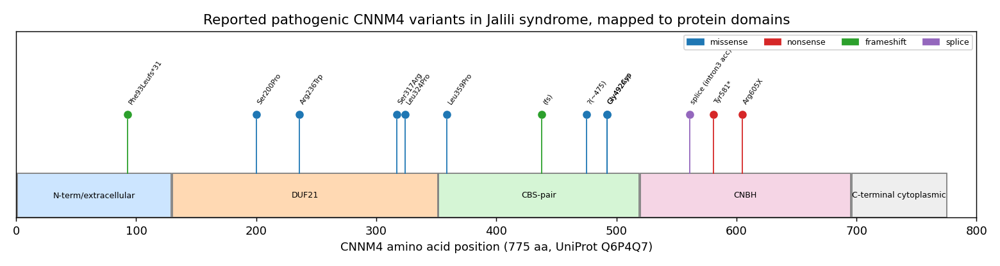

## Question

# Disease Characteristics Research Template

## Target Disease
- **Disease Name:** Jalili Syndrome
- **MONDO ID:** MONDO:0009007 (if available)
- **Causal gene(s):** CNNM4
- **OMIM:** not recorded
- **Synonyms:** not recorded
- **Category:** Mendelian

Many disease names are serial numbers ("... autosomal dominant 64", "... 26") that
do not say which gene the disease is about, and a similarly named disease with a
different gene is easy to research by mistake. Research the disease with the MONDO
ID and causal gene given above, and name its causal gene in your first paragraph.
If the name seems to point to a different gene or OMIM entry, follow the
identifiers above.

## Research Objectives

Please provide a comprehensive research report on **Jalili Syndrome** covering all of the
disease characteristics listed below. This report will be used to populate a disease knowledge
base entry. Be thorough and cite primary literature (PMID preferred) for all claims.

For each section, **suggested databases/resources** are listed. These are the first places
you should search for information on each topic.

---

### 1. Disease Information
> **Search first:** OMIM, Orphanet, ICD-10/ICD-11, MeSH, PubMed

- What is the disease? Provide a concise overview.
- What are the key identifiers? (OMIM, Orphanet, ICD-10/ICD-11, MeSH, Mondo)
- What are the common synonyms and alternative names?
- Is the information derived from individual patients (e.g., EHR) or aggregated disease-level resources?

### 2. Etiology

- **Disease Causal Factors**: What are the primary causes? (genetic, environmental, infectious, mechanistic)
- **Risk Factors**:
  > **Search first:** PubMed, Cochrane Library, UpToDate, clinical guidelines, ClinVar, ClinGen, GWAS Catalog, PheGenI, CTD, CDC, WHO, epidemiological databases
  - Genetic risk factors (causal variants, susceptibility loci, modifier genes)
  - Environmental risk factors (toxins, lifestyle, occupational exposures, age, sex, family history)
- **Protective Factors**:
  > **Search first:** PubMed, Cochrane Library, clinical trial databases, GWAS Catalog, gnomAD, WHO, CDC, nutrition databases
  - Genetic protective factors (protective variants, modifier alleles)
  - Environmental protective factors (diet, lifestyle, exposures that reduce risk)
- **Gene-Environment Interactions**: How do genetic and environmental factors interact to influence disease?
  > **Search first:** CTD, PubMed, PheGenI, GxE databases

### 3. Phenotypes
> **Search first:** HPO (Human Phenotype Ontology), OMIM, Orphanet, PubMed, clinicaltrials.gov, MedDRA, SNOMED CT, DECIPHER, LOINC

For each phenotype, provide:
- **Phenotype type**: symptoms, clinical signs, physical manifestations, behavioral changes, or laboratory abnormalities
  > For symptoms/signs: HPO, OMIM, Orphanet, PubMed
  > For behavioral changes: HPO, DSM, RDoC (Research Domain Criteria), PubMed
  > For laboratory abnormalities: LOINC, SNOMED CT, LabTests Online, PubMed
- **Phenotype characteristics**:
  > **Search first:** OMIM, Orphanet, HPO, PubMed
  - Age of symptom onset (neonatal, childhood, adult-onset, late-onset)
  - Symptom severity (mild, moderate, severe, variable)
  - Symptom progression (stable, progressive, episodic, fluctuating)
  - Frequency among affected individuals (percentage or qualitative)
- **Quality of life impact**: Effects on daily functioning and well-being (per-phenotype when possible)
  > **Search first:** EQ-5D database, SF-36, WHO QOL databases, PubMed
- Suggest HPO (Human Phenotype Ontology) terms for each phenotype

### 4. Genetic/Molecular Information

- **Causal Genes**: Gene mutations or chromosomal abnormalities responsible for disease (gene symbols, OMIM IDs)
  > **Search first:** OMIM, ClinVar, HGMD, Ensembl, NCBI Gene
- **Pathogenic Variants**:
  - Affected genes (gene symbols, HGNC IDs)
    > **Search first:** OMIM, NCBI Gene, Ensembl, HGNC, UniProt, GeneCards
  - Variant classification (pathogenic, likely pathogenic, VUS per ACMG/AMP guidelines)
    > **Search first:** ClinVar, ClinGen, ACMG/AMP guidelines, VarSome
  - Variant type/class (missense, frameshift, nonsense, splice-site, structural)
  - Allele frequency in population databases
    > **Search first:** gnomAD, 1000 Genomes, ExAC, TOPMed, dbSNP
  - Somatic vs germline origin
    > **Search first:** COSMIC (somatic), ClinVar, ICGC, TCGA
  - Functional consequences (loss of function, gain of function, dominant negative)
- **Modifier Genes**: Genes that modify disease severity or expression
- **Epigenetic Information**: DNA methylation, histone modifications, chromatin changes affecting disease
  > **Search first:** ENCODE, Roadmap Epigenomics, MethBase, DiseaseMeth
- **Chromosomal Abnormalities**: Large-scale genetic changes (aneuploidy, translocations, inversions)
  > **Search first:** DECIPHER, ClinVar, ECARUCA, UCSC Genome Browser

### 5. Environmental Information

- **Environmental Factors**: Non-genetic contributing factors (toxins, radiation, pollution, occupational exposure)
  > **Search first:** CTD (Comparative Toxicogenomics Database), TOXNET, PubMed, EPA databases
- **Lifestyle Factors**: Behavioral factors (smoking, diet, exercise, alcohol consumption)
  > **Search first:** CDC databases, WHO, PubMed, NHANES
- **Infectious Agents**: If applicable, pathogens causing or triggering disease (bacteria, viruses, fungi, parasites)
  > **Search first:** NCBI Taxonomy, ViPR, BV-BRC, MicrobeDB, GIDEON

### 6. Mechanism / Pathophysiology

**Present this section as an ordered causal chain first, then the detail below.**
Open with a numbered sequence of mechanistic steps running from the initiating
lesion (mutation, exposure, infection) to the clinical manifestation, one step per
line, each naming what it causes next. State the causal verb explicitly ("leads
to", "results in") and say where a step is inferred rather than demonstrated.
Where the mechanism branches, show the branch. The categories below are a
checklist of what to cover within those steps, not the organizing structure —
a step may draw on several of them, and a category may contribute to several
steps.

- **Molecular Pathways**: Specific signaling cascades or biochemical pathways involved (Wnt, MAPK, mTOR, PI3K-AKT, etc.)
  > **Search first:** KEGG, Reactome, WikiPathways, PathBank, BioCyc
- **Cellular Processes**: Cell-level mechanisms (apoptosis, autophagy, cell cycle dysregulation, inflammation, etc.)
  > **Search first:** Gene Ontology (GO), Reactome, KEGG, PubMed
- **Protein Dysfunction**: How protein structure or function is altered (misfolding, aggregation, loss of function, gain of function)
  > **Search first:** UniProt, PDB (Protein Data Bank), InterPro, Pfam, AlphaFold
- **Metabolic Changes**: Alterations in metabolic processes (energy metabolism, lipid metabolism, amino acid metabolism)
  > **Search first:** KEGG, BioCyc, HMDB (Human Metabolome Database), BRENDA
- **Immune System Involvement**: Role of immune response (autoimmunity, immunodeficiency, chronic inflammation)
  > **Search first:** ImmPort, Immunome Database, IEDB, Gene Ontology
- **Tissue Damage Mechanisms**: How tissues/ are injured (oxidative stress, ischemia, fibrosis, necrosis)
  > **Search first:** PubMed, Gene Ontology, Reactome
- **Biochemical Abnormalities**: Specific molecular defects (enzyme deficiencies, receptor dysfunction, ion channel defects)
  > **Search first:** BRENDA, UniProt, KEGG, OMIM, PubMed
- **Epigenetic Changes**: DNA methylation, histone modifications affecting gene expression in disease
  > **Search first:** ENCODE, Roadmap Epigenomics, MethBase, DiseaseMeth
- **Molecular Profiling** (if available):
  - Transcriptomics/gene expression changes
    > **Search first:** GEO (Gene Expression Omnibus), ArrayExpress, GTEx, Human Cell Atlas, SRA
  - Proteomics findings
    > **Search first:** PRIDE, ProteomeXchange, Human Protein Atlas, STRING, BioGRID
  - Metabolomics signatures
    > **Search first:** MetaboLights, Metabolomics Workbench, HMDB, METLIN
  - Lipidomics alterations
    > **Search first:** LIPID MAPS, SwissLipids, LipidHome, Metabolomics Workbench
  - Genomic structural features
    > **Search first:** UCSC Genome Browser, Ensembl, NCBI, dbVar, DGV
- **Advanced Technologies** (if applicable):
  - Single-cell analysis findings (cell-type specific mechanisms, cellular heterogeneity)
    > **Search first:** Human Cell Atlas, Single Cell Portal, GEO, CELLxGENE
  - Spatial transcriptomics findings
    > **Search first:** GEO, Spatial Research, Vizgen, 10x Genomics data
  - Multi-omics integration results
    > **Search first:** TCGA, ICGC, cBioPortal, LinkedOmics, PubMed
  - Functional genomics screens (CRISPR, RNAi)
    > **Search first:** DepMap, GenomeRNAi, PubMed, BioGRID ORCS

For each mechanism, describe:
- The causal chain from initial trigger to clinical manifestation
- Which mechanisms are upstream vs downstream
- What cell types and biological processes are involved
- Suggest GO terms for biological processes and CL terms for cell types

### 7. Anatomical Structures Affected

- **Organ Level**:
  - Primary organs directly affected
  - Secondary organ involvement (complications, secondary effects)
  - Body systems involved (cardiovascular, nervous, digestive, respiratory, endocrine, etc.)
  > **Search first:** Uberon, FMA (Foundational Model of Anatomy), OMIM, HPO, ICD-11, MeSH, SNOMED CT
- **Tissue and Cell Level**:
  - Specific tissue types affected (epithelial, connective, muscle, nervous)
  - Specific cell populations targeted (with Cell Ontology terms)
  > **Search first:** Uberon, Human Protein Atlas, Cell Ontology, Human Cell Atlas, CellMarker, PanglaoDB
- **Subcellular Level**:
  - Cellular compartments involved (mitochondria, nucleus, ER, lysosomes) (with GO Cellular Component terms)
  > **Search first:** Gene Ontology (Cellular Component), UniProt, Human Protein Atlas
- **Localization**:
  - Specific anatomical sites (with UBERON terms)
    > **Search first:** FMA, Uberon, NeuroNames (for brain), SNOMED CT
  - Lateralization (unilateral, bilateral, asymmetric)
    > **Search first:** HPO, clinical literature, imaging databases

### 8. Temporal Development

- **Onset**:
  - Typical age of onset (congenital, pediatric, adult, geriatric)
  - Onset pattern (acute, subacute, chronic, insidious)
  > **Search first:** OMIM, Orphanet, HPO, PubMed
- **Progression**:
  - Disease stages (early, intermediate, advanced, end-stage)
    > **Search first:** Cancer Staging Manual (AJCC), WHO classifications, PubMed
  - Progression rate (rapid, slow, variable)
  - Disease course pattern (episodic, relapsing-remitting, progressive, stable)
  - Disease duration (self-limited, chronic lifelong)
  > **Search first:** Disease registries, longitudinal cohort databases, natural history studies, PubMed, Orphanet, OMIM
- **Patterns**:
  - Remission patterns (spontaneous, treatment-induced)
    > **Search first:** Clinical trial databases, disease registries, PubMed
  - Critical periods (time windows of vulnerability or opportunity for intervention)
    > **Search first:** PubMed, developmental biology databases, clinical guidelines

### 9. Inheritance and Population

- **Epidemiology**:
  - Prevalence (cases per 100,000 at given time)
  - Incidence (new cases per 100,000 per year)
  > **Search first:** Orphanet, CDC, WHO, GBD (Global Burden of Disease), national registries, SEER, disease registries
- **For Genetic Etiology**:
  - Inheritance pattern (AD, AR, X-linked, mitochondrial, multifactorial, polygenic)
    > **Search first:** OMIM, Orphanet, ClinVar, GTR (Genetic Testing Registry)
  - Penetrance (complete, incomplete, age-dependent)
    > **Search first:** ClinVar, OMIM, PubMed, ClinGen
  - Expressivity (variable, consistent)
    > **Search first:** OMIM, ClinVar, PubMed
  - Genetic anticipation (increasing severity in successive generations)
    > **Search first:** OMIM, PubMed (especially for repeat expansion disorders)
  - Germline mosaicism
    > **Search first:** ClinVar, OMIM, genetic counseling literature, PubMed
  - Founder effects (population-specific mutations)
    > **Search first:** gnomAD, population genetics databases, PubMed
  - Consanguinity role
    > **Search first:** OMIM, population studies, genetic counseling resources
  - Carrier frequency
    > **Search first:** gnomAD, carrier screening databases, GeneReviews, GTR
- **Population Demographics**:
  - Affected populations (ethnic or demographic groups with higher prevalence)
    > **Search first:** gnomAD, 1000 Genomes, PAGE Study, PubMed, population registries
  - Geographic distribution (endemic areas, regional variation)
    > **Search first:** WHO, CDC, GBD, Orphanet, geographic epidemiology databases
  - Geographic distribution of specific variants
  - Sex ratio (male:female)
    > **Search first:** Disease registries, OMIM, PubMed, epidemiological databases
  - Age distribution of affected individuals
    > **Search first:** CDC, disease registries, SEER, Orphanet

### 10. Diagnostics

- **Clinical Tests**:
  - Laboratory tests (blood, urine, tissue chemistry, specific enzyme assays)
    > **Search first:** LOINC, LabTests Online, PubMed
  - Biomarkers (proteins, metabolites, genetic markers, circulating biomarkers)
    > **Search first:** FDA Biomarker List, BEST (Biomarkers, EndpointS, and other Tools), PubMed
  - Imaging studies (X-ray, CT, MRI, PET, ultrasound)
    > **Search first:** RadLex, DICOM, Radiopaedia, imaging databases
  - Functional tests (pulmonary function, cardiac stress tests)
    > **Search first:** LOINC, clinical guidelines, PubMed
  - Electrophysiology (EEG, EMG, ECG, nerve conduction studies)
    > **Search first:** LOINC, clinical neurophysiology databases, PubMed
  - Biopsy findings (histopathology, immunohistochemistry)
    > **Search first:** SNOMED CT, College of American Pathologists resources, PubMed
  - Pathology findings (microscopic examination)
    > **Search first:** SNOMED CT, Digital Pathology databases, PubMed
- **Genetic Testing**:
  > **Search first:** GTR (Genetic Testing Registry), GeneReviews, ClinGen
  - Overview of recommended genetic testing approach
  - Whole genome sequencing (WGS) utility
    > **Search first:** GTR, ClinVar, GEL (Genomics England), gnomAD
  - Whole exome sequencing (WES) utility
    > **Search first:** GTR, ClinVar, OMIM, GeneMatcher
  - Gene panels (which panels, which genes)
    > **Search first:** GTR, ClinVar, laboratory-specific databases
  - Single gene testing
    > **Search first:** GTR, ClinVar, OMIM, GeneReviews
  - Chromosomal microarray (CMA)
    > **Search first:** DECIPHER, ClinVar, dbVar, ECARUCA
  - Karyotyping
    > **Search first:** Chromosome Abnormality Database, ClinVar, cytogenetics resources
  - FISH
    > **Search first:** ClinVar, cytogenetics databases, PubMed
  - Mitochondrial DNA testing
    > **Search first:** MITOMAP, MSeqDR, ClinVar, GTR
  - Repeat expansion testing
    > **Search first:** GTR, ClinVar, repeat expansion databases, PubMed
- **Omics-Based Diagnostics** (if applicable):
  - RNA sequencing / transcriptomics
    > **Search first:** GEO, ArrayExpress, GTEx, RNA-seq databases
  - Proteomics
    > **Search first:** PRIDE, ProteomeXchange, FDA Biomarker database
  - Metabolomics
    > **Search first:** MetaboLights, Metabolomics Workbench, HMDB
  - Epigenomics
    > **Search first:** GEO, ENCODE, Roadmap Epigenomics, MethBase
  - Liquid biopsy
    > **Search first:** COSMIC, ClinVar, liquid biopsy databases, PubMed
- **Clinical Criteria**:
  - Standardized diagnostic criteria (DSM, ICD, society guidelines)
    > **Search first:** DSM-5, ICD-11, clinical society guidelines, UpToDate
  - Differential diagnosis (other conditions to rule out, with distinguishing features)
    > **Search first:** DynaMed, UpToDate, clinical decision support systems
- **Screening**:
  - Screening methods for asymptomatic individuals (newborn screening, carrier screening, cascade screening)
    > **Search first:** ACMG recommendations, CDC newborn screening, GTR

### 11. Outcome/Prognosis

- **Survival and Mortality**:
  - Survival rate (5-year, 10-year, overall)
    > **Search first:** SEER, cancer registries, disease-specific registries, PubMed
  - Life expectancy (with and without treatment if applicable)
    > **Search first:** Orphanet, disease registries, actuarial databases, PubMed
  - Mortality rate
    > **Search first:** CDC, WHO, GBD, national mortality databases
  - Disease-specific mortality (deaths directly attributable to disease)
    > **Search first:** Disease registries, CDC Wonder, GBD, PubMed
- **Morbidity and Function**:
  - Morbidity (disease-related disability and health impacts)
    > **Search first:** GBD, WHO, disability databases, PubMed
  - Disability outcomes (long-term functional impairments)
    > **Search first:** ICF (International Classification of Functioning), disability registries
  - Quality of life measures (EQ-5D, SF-36, PROMIS, disease-specific tools)
    > **Search first:** EQ-5D database, SF-36, PROMIS, PubMed
- **Disease Course**:
  - Complications (secondary problems: infections, organ failure, etc.)
    > **Search first:** ICD codes, disease registries, clinical databases, PubMed
  - Recovery potential (likelihood and extent of recovery, with vs without treatment)
    > **Search first:** Natural history studies, rehabilitation databases, PubMed
- **Prediction**:
  - Prognostic factors (age, disease severity, biomarkers, treatment response)
    > **Search first:** Prognostic models databases, clinical calculators, PubMed
  - Prognostic biomarkers (molecular markers predicting disease course)
    > **Search first:** FDA Biomarker database, PubMed, cancer prognostic databases

### 12. Treatment

- **Pharmacotherapy**:
  - Pharmacological treatments (drug names, drug classes, mechanisms of action)
    > **Search first:** DrugBank, RxNorm, ATC classification, DailyMed, FDA databases
  - Pharmacogenomics (how genetic variants affect drug metabolism, efficacy, toxicity)
    > **Search first:** PharmGKB, CPIC (Clinical Pharmacogenetics), FDA Table of PGx Biomarkers
- **Advanced Therapeutics**:
  - Gene therapy (viral vectors, CRISPR, gene replacement, gene editing)
    > **Search first:** ClinicalTrials.gov, FDA gene therapy database, ASGCT resources
  - Cell therapy (stem cell transplant, CAR-T, cellular therapeutics)
    > **Search first:** ClinicalTrials.gov, FDA cell therapy database, FACT standards
  - RNA-based therapies (ASOs, siRNA, mRNA therapies)
    > **Search first:** ClinicalTrials.gov, FDA approvals, PubMed
  - Targeted therapies (treatments directed at specific molecular targets)
    > **Search first:** My Cancer Genome, OncoKB, ClinicalTrials.gov, FDA approvals
  - Immunotherapies (checkpoint inhibitors, monoclonal antibodies)
    > **Search first:** Cancer Immunotherapy Database, FDA approvals, ClinicalTrials.gov
- **Surgical and Interventional**:
  - Surgical interventions (types of surgery, timing, outcomes)
    > **Search first:** CPT codes, surgical registries, clinical guidelines, PubMed
- **Supportive and Rehabilitative**:
  - Supportive care (symptom management, pain control, nutrition)
    > **Search first:** Clinical guidelines, Cochrane Library, PubMed
  - Rehabilitation (physical therapy, occupational therapy, speech therapy)
    > **Search first:** Rehabilitation medicine databases, clinical guidelines, PubMed
- **Experimental**:
  - Experimental treatments in clinical trials (with NCT identifiers if available)
    > **Search first:** ClinicalTrials.gov, EU Clinical Trials Register, WHO ICTRP
- **Treatment Outcomes**:
  - Treatment response rates
    > **Search first:** Clinical trial databases, FDA reviews, systematic reviews, PubMed
  - Side effects and adverse events
    > **Search first:** FDA Adverse Event Reporting System (FAERS), MedWatch, PubMed
- **Treatment Strategy**:
  - Treatment algorithms (clinical pathways, decision trees)
    > **Search first:** Clinical practice guidelines, NCCN Guidelines, UpToDate
  - Combination therapies
    > **Search first:** ClinicalTrials.gov, treatment guidelines, PubMed
  - Personalized medicine approaches (genotype-guided treatment)
    > **Search first:** My Cancer Genome, CIViC, PharmGKB, precision medicine databases

For each treatment, suggest NCIT (NCI Thesaurus) clinical-intervention terms where applicable.

### 13. Prevention

- **Prevention Levels**:
  - Primary prevention (preventing disease occurrence: vaccination, risk factor modification)
    > **Search first:** CDC, WHO, USPSTF recommendations, Cochrane Library
  - Secondary prevention (early detection and treatment: screening programs, early intervention)
    > **Search first:** USPSTF, CDC screening guidelines, WHO
  - Tertiary prevention (preventing complications in those with disease)
    > **Search first:** Clinical guidelines, disease management protocols, PubMed
- **Immunization**: Vaccine strategies (if applicable)
  > **Search first:** CDC vaccine schedules, WHO immunization, FDA vaccine database
- **Screening and Early Detection**:
  - Screening programs (population-based: newborn screening, cancer screening)
    > **Search first:** CDC screening programs, USPSTF, cancer screening databases
  - Genetic screening (carrier screening, preimplantation genetic diagnosis, prenatal testing)
    > **Search first:** ACMG recommendations, ACOG guidelines, GTR
  - Risk stratification (identifying high-risk individuals for targeted prevention)
    > **Search first:** Risk prediction models, clinical calculators, PubMed
- **Behavioral Interventions**: Lifestyle modifications to reduce risk
  > **Search first:** CDC, WHO, behavioral intervention databases, Cochrane Library
- **Counseling**: Genetic counseling (risk assessment, family planning guidance)
  > **Search first:** NSGC resources, ACMG guidelines, GeneReviews
- **Public Health**:
  - Public health interventions (sanitation, vector control, health education)
    > **Search first:** CDC, WHO, public health databases, PubMed
  - Environmental interventions (reducing environmental risk factors)
    > **Search first:** EPA databases, WHO environmental health, PubMed
- **Prophylaxis**: Preventive medications or procedures
  > **Search first:** Clinical guidelines, FDA approvals, PubMed

### 14. Other Species / Natural Disease

- **Taxonomy**: Species affected (with NCBI Taxon identifiers)
  > **Search first:** NCBI Taxonomy
- **Breed**: Specific breeds affected (with VBO identifiers if applicable)
  > **Search first:** VBO (Vertebrate Breed Ontology)
- **Gene**: Orthologous genes in other species (with NCBI Gene IDs)
  > **Search first:** NCBI Gene
- **Natural Disease**:
  - Naturally occurring disease in other species (companion animals, wildlife)
    > **Search first:** OMIA (Online Mendelian Inheritance in Animals), VetCompass, PubMed
  - Veterinary relevance and importance in animal health
    > **Search first:** OMIA, veterinary databases, PubMed
- **Comparative Biology**:
  - Comparative pathology (similarities and differences across species)
    > **Search first:** OMIA, comparative pathology databases, PubMed
  - Evolutionary conservation of disease mechanisms
    > **Search first:** HomoloGene, OrthoMCL, Alliance of Genome Resources
- **Transmission** (if applicable):
  - Zoonotic potential
    > **Search first:** CDC zoonotic diseases, WHO zoonoses, GIDEON
  - Cross-species susceptibility
    > **Search first:** NCBI Taxonomy, veterinary databases, PubMed

### 15. Model Organisms

- **Model Types**:
  - Model organism type (mammalian, invertebrate, cellular, in vitro)
    > **Search first:** Alliance of Genome Resources, model organism databases
  - Specific model systems (mouse, rat, zebrafish, Drosophila, C. elegans, yeast, cell lines, organoids, iPSCs)
    > **Search first:** MGI, RGD, ZFIN, FlyBase, WormBase, SGD, ATCC, Cellosaurus
  - Induced models (drug treatment, surgical intervention, environmental manipulation)
    > **Search first:** MGI, model organism databases, PubMed
- **Genetic Models**:
  - Types available (knockout, knock-in, transgenic, conditional, humanized)
    > **Search first:** MGI, IMPC, KOMP, EuMMCR, IMSR
- **Model Characteristics**:
  - Phenotype recapitulation (how well model reproduces human disease features)
    > **Search first:** Model organism databases, comparative studies, PubMed
  - Model limitations (aspects of human disease not captured)
    > **Search first:** Model organism databases, PubMed, review articles
- **Applications**:
  - Research applications (what aspects of disease can be studied)
    > **Search first:** Model organism databases, PubMed
- **Resources**:
  - Model databases
    > **Search first:** MGI, RGD, ZFIN, FlyBase, WormBase, IMSR, EMMA, MMRRC

---

## Citation Requirements

- Cite primary literature (PMID preferred) for all mechanistic and clinical claims
- Prioritize recent reviews and landmark papers
- Include direct quotes from abstracts where possible to support key statements
- Distinguish evidence source types: human clinical, model organism, in vitro, computational

## Output Format

Structure your response as a comprehensive narrative organized by the sections above.
For each section, provide:
- Factual content with specific details (numbers, percentages, gene names, variant nomenclature)
- Ontology term suggestions (HPO, GO, CL, UBERON, CHEBI, NCIT, MONDO) where applicable
- Evidence citations with PMIDs
- Direct quotes from abstracts to support key claims
- Clear indication when information is not available or not applicable for this disease

This report will be used to populate a disease knowledge base entry with:
- Pathophysiology descriptions with causal chains
- Gene/protein annotations (HGNC, GO terms)
- Phenotype associations (HP terms) with frequencies
- Cell type involvement (CL terms)
- Anatomical locations (UBERON terms)
- Chemical entities (CHEBI terms)
- Treatment annotations (NCIT terms)
- Evidence items with PMIDs and exact abstract quotes
- Epidemiology, prognosis, diagnostic, and prevention information
- Animal model descriptions with phenotype recapitulation details


## Output

# Jalili Syndrome (MONDO:0009007): A Comprehensive Disease Characterization

**Causal gene: _CNNM4_ (cyclin and CBS domain divalent metal cation transport mediator 4; also cyclin M4 / ancient conserved domain protein 4 / ACDP4), chromosome 2q11.2.**

---

## Summary

Jalili syndrome is a rare, autosomal-recessive oculo-dental disorder defined by the co-occurrence of **cone-rod dystrophy (CRD)** and **amelogenesis imperfecta (AI)**. It is caused by **biallelic loss-of-function variants in _CNNM4_** (OMIM #217080; MONDO:0009007; ORPHA:1388), the gene encoding a basolateral magnesium-extrusion transporter located on chromosome 2q11.2. CNNM4 extrudes intracellular Mg²⁺ in exchange for extracellular Na⁺, and this function is essential both for enamel mineralization by ameloblasts and for magnesium homeostasis in retinal photoreceptors. When this transport is lost, the two defining tissues — dental enamel and the retinal cone/rod photoreceptor system — both fail, producing the characteristic dual phenotype first described by Jalili in a large consanguineous Gaza kindred. The disease name correctly maps to CNNM4 (not to an isolated-AI or isolated-CRD gene), and all identifiers above are consistent.

The molecular cause is well established. Across families worldwide, 13 or more pathogenic _CNNM4_ variants have been reported, spanning missense, nonsense, frameshift, splice-site, and large structural mechanisms, including one case arising from paternal uniparental isodisomy of chromosome 2. Approximately 92% of pathogenic variants cluster within the functional core of the protein (the DUF21 transmembrane region, the CBS-pair Bateman module, and the cyclic-nucleotide-binding homology [CNBH] domain), with a recurrent hotspot at codon 492 (p.Gly492Asp / p.Gly492Cys) in the CBS domain. These variants act through loss of function — reducing protein stability, accelerating mRNA decay, abolishing Mg²⁺ extrusion, or truncating the protein. A candidate non-magnesium branch has been proposed in which a truncated CNNM4 protein (p.Arg605X) increases apoptosis and strengthens the interaction with IQCB1 (nephrocystin-5, a Leber congenital amaurosis gene), potentially contributing to photoreceptor degeneration independent of magnesium transport.

Clinically, patients present in early childhood with progressive visual impairment (photophobia, nystagmus, bull's-eye maculopathy, declining visual acuity, and reduced or non-detectable photopic ERG responses) alongside hypoplastic–hypocalcified amelogenesis imperfecta (thin, poorly mineralized, discolored enamel prone to decay and tooth loss). Expressivity is variable — some genotypes spare the dental phenotype, and a rare expansion to muscle overgrowth/myopathy has been reported. Lifespan is normal. There is no disease-modifying therapy: management is entirely supportive (low-vision aids, photoprotection, restorative/prosthetic dentistry) together with genetic counseling for affected families. Because Jalili CRD can mimic incomplete achromatopsia, genetic testing combined with dental examination is decisive for an accurate diagnosis.

---

## Key Findings

### Finding 1 — Jalili syndrome is an autosomal-recessive oculo-dental disorder caused by biallelic _CNNM4_ variants

Jalili syndrome (OMIM #217080; MONDO:0009007) combines **cone-rod dystrophy** and **amelogenesis imperfecta** and is inherited in an autosomal-recessive fashion. The causal gene is _CNNM4_ (cyclin and CBS domain divalent metal cation transport mediator 4, also known historically as ACDP4 / ancient conserved domain protein 4), located at chromosome **2q11.2**. Multiple independent families worldwide carry homozygous or compound-heterozygous variants, and consanguinity is common among affected kindreds — consistent with a rare recessive trait enriched in populations with high rates of cousin marriage.

> *"Jalili syndrome, an autosomal recessive disorder causing cone-rod dystrophy and amelogenesis imperfecta, is a rare genetic disorder impacting visual and dental development."* — [PMID: 39580587](https://pubmed.ncbi.nlm.nih.gov/39580587/)

> *"Genetic mechanism entails a mutation in the CNNM4, a metal transporter gene located on Chromosome 2q11.2."* — [PMID: 38151709](https://pubmed.ncbi.nlm.nih.gov/38151709/)

**Evidence type:** human clinical / genetic.

### Finding 2 — CNNM4 is a basolateral Mg²⁺/Na⁺-exchange extrusion transporter; its loss underlies both the enamel and retinal defects

CNNM4 is the molecule responsible for basolateral magnesium extrusion in transporting epithelia. In a mouse model, CNNM4 localizes to the basolateral membrane of intestinal epithelia and of ameloblasts, and CNNM4-knockout mice develop **hypomagnesemia from intestinal Mg malabsorption** together with **defective amelogenesis** — directly recapitulating the human enamel defect. Mechanistically, CNNM4 extrudes intracellular Mg²⁺ by exchanging it for extracellular Na⁺, and disease-associated missense mutations abolish this Mg²⁺ extrusion activity. On the retinal side, defective magnesium transport by photoreceptors is the assumed basis of the progressive visual impairment; magnesium is also a component of the mineral phase of dental enamel, linking a single transport defect to both affected tissues.

> *"CNNM4 is the basolaterally located Mg(2+) extrusion molecule"* — [PMID: 24339795](https://pubmed.ncbi.nlm.nih.gov/24339795/)

> *"CNNM4-knockout mice showed defective amelogenesis, and CNNM4 again localizes to the basolateral membrane of ameloblasts"* — [PMID: 24339795](https://pubmed.ncbi.nlm.nih.gov/24339795/)

> *"A defective transport of magnesium ions by the photoreceptors of the retina is assumed to account for the progressive visual impairment."* — [PMID: 24194943](https://pubmed.ncbi.nlm.nih.gov/24194943/)

**Evidence type:** model organism (knockout mouse) + human inference.

### Finding 3 — The _CNNM4_ variant spectrum spans missense, frameshift, nonsense, splice, and founder/UPD mechanisms

Reported pathogenic _CNNM4_ variants (reference transcript NM_020184.3) include a broad allelic series acting through loss of function:

| Variant (cDNA) | Protein | Class | Notable feature |
|---|---|---|---|
| c.1475G>A | p.(Gly492Asp) | Missense | CBS-domain hotspot; reduced stability, increased mRNA decay |
| c.1474G>T | p.(Gly492Cys) | Missense | CBS-domain hotspot |
| c.971T>C | p.(Leu324Pro) | Missense | Recurrent across unrelated families |
| c.949A>C | p.(Ser317Arg) | Missense | — |
| c.706C>T | p.(Arg236Trp) | Missense | Recurrent in Guatemalan ancestry |
| c.598T>C | p.(Ser200Pro) | Missense | Chinese family |
| c.1423G>A | — | Missense | Egyptian family |
| c.1312dupC | frameshift | Frameshift | Kosovan founder, loss-of-function |
| c.279delC | p.(Phe93Leufs*31) | Frameshift | Arose via paternal uniparental isodisomy of chromosome 2 |

The CBS-domain p.(Gly492Asp/Cys) variants are notable because they impair function primarily by **reducing protein stability and accelerating mRNA decay** rather than by directly abolishing magnesium handling. All variants are germline and recessive.

> *"these variants exhibit significantly reduced protein stability and increased mRNA decay rates compared with wild type"* — [PMID: 39580587](https://pubmed.ncbi.nlm.nih.gov/39580587/)

> *"An additional patient had a homozygous deleterious variant in CNNM4 (c.279delC p.Phe93Leufs*31), which resulted from paternal uniparental isodisomy for chromosome 2p22-2q37."* — [PMID: 32022389](https://pubmed.ncbi.nlm.nih.gov/32022389/)

> *"A mutational analysis revealed a c.1312 dupC homozygous mutation in CNNM4, a genetic defect which had already been identified in other Kosovan families"* — [PMID: 24194943](https://pubmed.ncbi.nlm.nih.gov/24194943/)

**Evidence type:** human clinical/genetic + in vitro functional.

### Finding 4 — Clinical phenotype: progressive cone-rod dystrophy with bull's-eye maculopathy plus hypoplastic/hypomineralized amelogenesis imperfecta

**Ocular features:** cone-rod dystrophy with bull's-eye maculopathy, photophobia, nystagmus, reduced or non-detectable light-adapted (photopic) ERGs, progressive loss of visual acuity (mean logMAR ≈ 1.15, worsening with age), and macular RPE atrophy. Histopathology reveals loss of photoreceptors and accumulation of autofluorescent material in the subretinal space, with partial preservation of the inner retina.

**Dental features:** hypoplastic–hypocalcified amelogenesis imperfecta with thin, poorly mineralized enamel, discoloration, irregular tooth shape, decay, and tooth loss.

**Additional/variable features** reported across cohorts: hyperopia, advanced dental age, crossbite, and developmental delay (sometimes attributable to other loci).

> *"determined to have cone-rod dystrophy with bull's eye maculopathy, photophobia, and nystagmus. All patients had amelogenesis imperfecta."* — [PMID: 32022389](https://pubmed.ncbi.nlm.nih.gov/32022389/)

> *"The mean logarithm of the minimum angle of resolution (logMAR) visual acuity was 1.15 (range: 0.69-2.00)"* — [PMID: 41280631](https://pubmed.ncbi.nlm.nih.gov/41280631/)

> *"The histopathologic analyses revealed loss of photoreceptor cells, accumulation of autofluorescent material in the subretinal space, partial preservation of the inner retinal lamination"* — [PMID: 39522753](https://pubmed.ncbi.nlm.nih.gov/39522753/)

**Suggested HPO terms:** HP:0000548 (Cone/cone-rod dystrophy), HP:0007641 (Bull's eye maculopathy), HP:0000613 (Photophobia), HP:0000639 (Nystagmus), HP:0000505 (Visual impairment), HP:0000705 (Amelogenesis imperfecta), HP:0000670 (Carious teeth), HP:0006297 (Hypoplastic dental enamel).

**Evidence type:** human clinical (cohort + histopathology).

### Finding 5 — CNNM4 biology extends to PRL phosphatase interaction, AMPK/mTOR energy metabolism, tumor suppression, and fertility

Beyond the oculo-dental phenotype, CNNM4-dependent Mg²⁺ efflux regulates cellular energy metabolism through **AMPK/mTOR signaling**. The phosphatases of regenerating liver (PRL) bind CNNM4 and inhibit its Mg²⁺ efflux, and PRL overexpression drives cancer progression (rapamycin suppressed growth of PRL-overexpressing cells). In _Apc^Δ14/+_ mice, deletion of _Cnnm4_ promoted malignant progression of intestinal polyps to adenocarcinomas, and human colon cancer shows an inverse relationship between CNNM4 expression and malignancy — consistent with a tumor-suppressor role. CNNM4 suppression is additionally linked to infertility in mice. CNNM4 is highly expressed in brain and intestinal tract. These pleiotropic roles are mostly observed in cancer/metabolism models rather than in Jalili patients, but they illuminate why a magnesium transporter is biologically critical.

> *"regulation of intracellular Mg(2+) levels by PRL and CNNM4 is linked to energy metabolism and AMPK/mTOR signaling"* — [PMID: 25347473](https://pubmed.ncbi.nlm.nih.gov/25347473/)

> *"deletion of Cnnm4 promoted malignant progression of intestinal polyps to adenocarcinomas"* — [PMID: 25347473](https://pubmed.ncbi.nlm.nih.gov/25347473/)

> *"suppression of CNNM4 in mice promotes malignant progression of intestinal polyps and is linked to infertility"* — [PMID: 31842432](https://pubmed.ncbi.nlm.nih.gov/31842432/)

**Evidence type:** model organism + in vitro (cancer/metabolism context).

### Finding 6 — Expanded variant classes and a candidate downstream mechanism via IQCB1 interaction and apoptosis

Additional pathogenic _CNNM4_ variants broaden every mutation class: the nonsense c.1813C>T p.(Arg605X) is the first probable founder mutation identified in the Amish community ([PMID: 29322253](https://pubmed.ncbi.nlm.nih.gov/29322253/)); nonsense c.1743C>G p.(Tyr581*) ([PMID: 29421602](https://pubmed.ncbi.nlm.nih.gov/29421602/)); splice-acceptor c.1682-1G>C in intron 3 ([PMID: 28246031](https://pubmed.ncbi.nlm.nih.gov/28246031/)); missense c.1076T>C p.(Leu359Pro) ([PMID: 28586144](https://pubmed.ncbi.nlm.nih.gov/28586144/)); and recurrent missense c.971T>C p.(Leu324Pro) across unrelated families ([PMID: 29421602](https://pubmed.ncbi.nlm.nih.gov/29421602/), [PMID: 39522753](https://pubmed.ncbi.nlm.nih.gov/39522753/)).

Mechanistically, the truncated p.R605X protein **significantly increased apoptosis** and **increased CNNM4's interaction with IQCB1** (nephrocystin-5), an LCA (Leber congenital amaurosis) gene. This suggests p.R605X may act — via nonsense-mediated decay affecting IQCB1 function and/or through pro-apoptotic activity — through a route partly independent of simple magnesium-transport loss, providing a candidate explanation for photoreceptor degeneration.

> *"identified a homozygous nonsense mutation (c.C1813T, p.R605X) in the cyclin and CBS domain divalent metal cation transport mediator 4 (CNNM4) gene"* — [PMID: 29322253](https://pubmed.ncbi.nlm.nih.gov/29322253/)

> *"A truncated CNNM4 protein starting at R605 significantly increased the rate of apoptosis, and significantly increased the interaction between CNNM4 and IQCB1."* — [PMID: 29322253](https://pubmed.ncbi.nlm.nih.gov/29322253/)

> *"these patients are carrying a novel homozygous mutation in the splice site acceptor of intron 3 (c.1682-1G > C) in the CNNM4 gene"* — [PMID: 28246031](https://pubmed.ncbi.nlm.nih.gov/28246031/)

**Evidence type:** human genetic + in vitro functional.

### Finding 7 — Variable expressivity and phenotypic expansion: muscle overgrowth/myopathy and genotype-dependent dental sparing

Phenotypic expressivity varies with genotype. Homozygous p.Leu324Pro produces the **complete phenotype** (CRD + AI), whereas a compound heterozygote (p.Leu324Pro / p.Tyr581*) showed CRD and AI in the proband but **only ocular alterations (no dental phenotype)** in her father — direct evidence of variable expressivity and genotype-dependent dental sparing. Separately, three brothers homozygous for c.1076T>C p.(Leu359Pro) had classic Jalili syndrome **plus muscle overgrowth of the legs with myopathic changes on needle EMG**, proposed as a newly identified manifestation after exome sequencing excluded other causes.

> *"the p.Leu324Pro mutation in homozygosis induces a complete phenotype with both CRD and AI, but in heterozygosis and in composition with the novel p.Tyr581* nonsense mutation in CNNM4 promotes variable clinical expressivity, particularly with lack of dental phenotypes"* — [PMID: 29421602](https://pubmed.ncbi.nlm.nih.gov/29421602/)

> *"mild myopathy with muscle overgrowth of the legs could be a newly identified manifestation of the disorder"* — [PMID: 28586144](https://pubmed.ncbi.nlm.nih.gov/28586144/)

**Evidence type:** human clinical/genetic.

### Finding 8 — Pathogenic variants cluster in the functional core (DUF21–CBS–CNBH), most are missense, concentrated in the CBS-pair domain

Synthesizing 13 reported pathogenic _CNNM4_ variants (NM_020184.3 / UniProt Q6P4Q7, 775 aa) across Jalili families yields a clear structural pattern:

- **By class:** 8 missense, 2 nonsense (p.Tyr581*, p.Arg605X), 2 frameshift (p.Phe93Leufs*31, c.1312dupC), 1 splice (c.1682-1G>C).
- **By domain:** 5 in the CBS-pair (Bateman) module, 4 in the DUF21/transmembrane region, 3 in the CNBH (cyclic-nucleotide-binding homology) domain, and 1 N-terminal.
- **12/13 (92%)** fall within the functional core (transmembrane + CBS + CNBH); only the frameshift p.Phe93Leufs*31 lies N-terminal.
- **Recurrent hotspot:** codon 492 (Gly492Asp/Cys) in the CBS domain.

The CNBH domain, where several nonsense/splice variants cluster, is itself functionally required: it mediates dimerization and is required for Mg handling.

> *"p.(Gly492Cys) and p.(Gly492Asp) substitutions within the CBS domain of the CNNM4 protein"* — [PMID: 39580587](https://pubmed.ncbi.nlm.nih.gov/39580587/)

> *"The cyclic nucleotide-binding homology domain of the integral membrane protein CNNM mediates dimerization and is required for Mg"* — [PMID: 30341174](https://pubmed.ncbi.nlm.nih.gov/30341174/)

{{figure:cnnm4_variant_map.png|caption=Map of reported pathogenic CNNM4 variants in Jalili syndrome onto the protein's domain architecture (UniProt Q6P4Q7, 775 aa). ~92% of variants fall within the functional core — the DUF21 transmembrane region, the CBS-pair Bateman module, and the CNBH domain — with a recurrent hotspot at codon 492 in the CBS domain.}}

**Evidence type:** computational synthesis + structural literature.

### Finding 9 — Jalili CRD can mimic incomplete achromatopsia; genetic testing resolves the differential

In a United Arab Emirates cohort of cone-disorder patients clinically suspected of achromatopsia (ACHM), one proband's diagnosis was revised to _CNNM4_-related Jalili syndrome after genetic testing and phenotypic reassessment. The authors note that **"Bradyopsia and Jalili syndrome can resemble incomplete ACHM,"** and that macular discoloration helped distinguish Jalili from classic ACHM. A dedicated systematic review consolidates Jalili features and genetics (first described by Jalili in Gaza, with AI and cone-rod dystrophy as the primary manifestations). A 2025 pooled analysis of 53 patients with detailed visual-acuity and mutation records found that visual acuity (logMAR) correlated positively with age (progressive disease) and examined correlation with mutation domain. The practical message is that **genetic testing plus dental examination is decisive** — the dental phenotype and molecular result resolve what the retinal picture alone can leave ambiguous.

> *"Bradyopsia and Jalili syndrome can resemble incomplete ACHM."* — [PMID: 39024658](https://pubmed.ncbi.nlm.nih.gov/39024658/)

> *"Two probands had their diagnoses revised after genetic testing and phenotypic reassessment to RGS9BP -related bradyopsia and CNNM4 -related Jalili syndrome."* — [PMID: 39024658](https://pubmed.ncbi.nlm.nih.gov/39024658/)

> *"Spearman's correlation analysis showed a positive correlation between visual acuity (logMAR) and age"* — [PMID: 41280631](https://pubmed.ncbi.nlm.nih.gov/41280631/)

**Evidence type:** human clinical + systematic review/meta-analysis.

---

## Full Section-by-Section Report

### 1. Disease Information

**Overview.** Jalili syndrome is a rare autosomal-recessive **oculo-dental** disorder characterized by the simultaneous occurrence of **cone-rod dystrophy (CRD)** and **amelogenesis imperfecta (AI)**. It was first described by Jalili in a large consanguineous Arab kindred in the Gaza Strip. The retinal component causes progressive loss of central and color vision with photophobia and nystagmus; the dental component causes thin, poorly mineralized, discolored enamel prone to rapid decay and tooth loss.

**Key identifiers.**
- **OMIM:** #217080 (Cone-rod dystrophy and amelogenesis imperfecta / Jalili syndrome)
- **MONDO:** MONDO:0009007
- **Orphanet:** ORPHA:1388
- **Gene:** _CNNM4_ (HGNC:2751), chromosome 2q11.2; UniProt Q6P4Q7
- **ICD-10/ICD-11:** No dedicated code; mapped under hereditary retinal dystrophy (ICD-10 H35.5) and disorders of tooth development / amelogenesis imperfecta (ICD-10 K00.5). ICD-11 ~ 9B70 (retinal dystrophy) / DA05 (tooth development disorders). *(No specific Jalili code — indicate not available.)*
- **MeSH:** No dedicated descriptor; indexed under "Amelogenesis Imperfecta" and "Cone-Rod Dystrophies."

**Synonyms / alternative names:** Cone-rod dystrophy and amelogenesis imperfecta; CRDAI; dystrophic retinitis pigmentosa with amelogenesis imperfecta (historical). The gene has historical aliases ACDP4 / ancient conserved domain protein 4.

**Information source.** The knowledge here is derived primarily from **aggregated disease-level resources** (OMIM, Orphanet) and from **individual patient case reports and small cohorts** in the primary literature — not from EHR-scale datasets. The disease is too rare for registry/EHR aggregation; most evidence is family-based.

### 2. Etiology

**Disease causal factors.** Jalili syndrome is **monogenic and entirely genetic** — caused by biallelic (homozygous or compound-heterozygous) loss-of-function variants in _CNNM4_. There is no known infectious, environmental, or acquired cause.

**Genetic risk factors.** The causal variants are the pathogenic _CNNM4_ alleles themselves (see Section 4). The principal "risk factor" at the population level is **consanguinity**, which raises the probability of homozygosity for a rare recessive allele. **Founder effects** exist (e.g., the Kosovan c.1312dupC allele and the Amish p.Arg605X allele), concentrating risk in specific communities. No common susceptibility loci or polygenic modifiers have been established.

**Environmental risk factors.** None identified. Age and sex do not modify disease risk (recessive Mendelian); family history / carrier parentage is the operative risk factor.

**Protective factors.** No genetic or environmental protective factors have been reported. In principle, outbreeding reduces homozygosity risk in founder populations.

**Gene–environment interactions.** None documented for Jalili syndrome. The phenotype is driven by genotype; environmental modifiers (e.g., diet, magnesium intake) have not been shown to alter the course, though dietary/fluoride and dental-hygiene measures influence secondary dental outcomes.

### 3. Phenotypes

**Ocular (cone-rod dystrophy).**
- *Phenotype type:* clinical sign + laboratory (electrophysiology) abnormality.
- *Features:* photophobia, nystagmus, reduced visual acuity, bull's-eye maculopathy, macular RPE atrophy, reduced/non-detectable photopic (cone) ERG, later rod involvement, color-vision loss, sometimes hyperopia.
- *Onset:* early childhood (often from infancy/first years).
- *Severity:* moderate to severe; mean logMAR ≈ 1.15 (range 0.69–2.00).
- *Progression:* progressive, worsening with age (visual acuity correlates positively with age).
- *Frequency:* ~100% of patients (defining feature).
- *QoL impact:* substantial — progressive low vision affects education, mobility, independence.
- *HPO:* HP:0000548 (Cone/cone-rod dystrophy), HP:0000613 (Photophobia), HP:0000639 (Nystagmus), HP:0007641 (Bull's eye maculopathy), HP:0000505 (Visual impairment), HP:0000510 (Rod-cone dystrophy).

**Dental (amelogenesis imperfecta).**
- *Phenotype type:* physical manifestation / clinical sign.
- *Features:* hypoplastic–hypocalcified enamel, thin and poorly mineralized, yellow-brown discoloration, irregular tooth shape, rapid caries, tooth loss; advanced dental age and crossbite reported.
- *Onset:* affects both primary and permanent dentition from eruption (childhood).
- *Severity:* moderate to severe.
- *Progression:* structurally stable developmental defect, but secondary decay/tooth loss progress.
- *Frequency:* ~100% in classic cases (genotype-dependent sparing is documented).
- *QoL impact:* pain, chewing difficulty, aesthetic/psychosocial burden, repeated dental interventions.
- *HPO:* HP:0000705 (Amelogenesis imperfecta), HP:0006297 (Hypoplastic dental enamel), HP:0000670 (Carious teeth), HP:0000684 (Dental malocclusion/crossbite).

**Variable / expanded phenotypes.** Muscle overgrowth of the legs with myopathic EMG changes (three brothers, p.Leu359Pro); developmental delay (sometimes attributable to other loci); hyperopia (proposed as a possibly constant feature in one report).

### 4. Genetic / Molecular Information

**Causal gene.** _CNNM4_ (HGNC:2751; NCBI Gene 26504; Ensembl ENSG00000158158; UniProt Q6P4Q7), chromosome 2q11.2; reference transcript NM_020184.3; protein 775 aa.

**Pathogenic variants.** See the catalog in Findings 3, 6, and 8. Classes include missense (majority), nonsense, frameshift, splice-site, and a case arising from uniparental isodisomy. Per ACMG/AMP, the recurrent and functionally characterized variants (e.g., p.Gly492Asp/Cys, p.Arg605X, c.1312dupC) are classified **pathogenic/likely pathogenic**; newly reported private missense variants are often initially VUS pending segregation and functional data.

- **Variant type/class distribution (13 synthesized):** 8 missense, 2 nonsense, 2 frameshift, 1 splice.
- **Domain distribution:** 5 CBS-pair, 4 DUF21/TM, 3 CNBH, 1 N-terminal.
- **Allele frequency:** All are rare/private; absent or ultra-rare in gnomAD. Founder alleles are enriched locally (Kosovo, Amish, Guatemala).
- **Somatic vs germline:** **germline**, recessive.
- **Functional consequence:** **loss of function** — abolished Mg²⁺ extrusion (TM/CBS missense), reduced protein stability + increased mRNA decay (codon-492 CBS variants), protein truncation (nonsense/frameshift/splice). A truncated allele (p.R605X) additionally increases apoptosis and IQCB1 interaction.

**Modifier genes.** Not firmly established. Variable expressivity (dental sparing) appears **allele-dependent** (genotype itself), and some reported developmental delay was attributed to separate loci, implying modifier/second-locus contributions in individual families.

**Epigenetic information.** No disease-specific DNA-methylation or histone-modification signature has been reported for Jalili syndrome. *(Not available.)*

**Chromosomal abnormalities.** No recurrent large structural changes; however, **paternal uniparental isodisomy of chromosome 2** was the mechanism producing homozygosity for c.279delC in one patient — a notable cytogenetic mechanism.

### 5. Environmental Information

No environmental factors, lifestyle factors, or infectious agents cause or trigger Jalili syndrome. It is a purely Mendelian recessive disorder. *(Not applicable.)* Secondary dental outcomes are modifiable by oral hygiene, fluoride, and diet, but these do not influence the underlying enamel defect.

### 6. Mechanism / Pathophysiology

**Ordered causal chain (initiating lesion → clinical manifestation):**

1. **Biallelic loss-of-function variants in _CNNM4_** (missense/nonsense/frameshift/splice) — *the initiating lesion.*
2. → **leads to** loss or destabilization of the CNNM4 protein (reduced stability + increased mRNA decay for CBS-domain variants; truncation for nonsense/frameshift/splice; abolished transport for TM/CBS missense). *(Demonstrated in vitro for several variants.)*
3. → **results in** loss of basolateral **Mg²⁺/Na⁺-exchange magnesium extrusion** across affected epithelia. *(Demonstrated in mouse + cell models.)*
4. **Branch A (dental):** → impaired magnesium handling by **ameloblasts** → **defective enamel mineralization** → **hypoplastic/hypocalcified amelogenesis imperfecta** → discoloration, decay, tooth loss. *(Demonstrated — CNNM4-knockout mouse recapitulates defective amelogenesis.)*
5. **Branch B (retinal):** → impaired magnesium transport in **retinal photoreceptors** → photoreceptor stress/dysfunction → **progressive photoreceptor loss with subretinal autofluorescent-material accumulation** → **cone-rod dystrophy** (photophobia, nystagmus, bull's-eye maculopathy, reduced photopic ERG, declining acuity). *(The Mg-transport step is inferred/assumed for photoreceptors; photoreceptor loss is demonstrated histopathologically.)*
6. **Candidate parallel branch (inferred):** truncated CNNM4 (p.R605X) → **increased apoptosis** and **increased interaction with IQCB1/nephrocystin-5** (an LCA gene) → possible additional, magnesium-independent route to **photoreceptor degeneration**. *(Candidate mechanism, in vitro; not proven as the primary driver.)*

**Upstream vs downstream.** The _CNNM4_ mutation and loss of Mg²⁺ extrusion are the shared **upstream** events; the ameloblast and photoreceptor failures are **downstream, tissue-specific** branches. The apoptosis/IQCB1 route is a proposed parallel downstream mechanism specific to truncating alleles.

**Molecular pathways / processes.** CNNM4-dependent Mg²⁺ efflux intersects **AMPK/mTOR** energy-metabolism signaling and is negatively regulated by **PRL phosphatases**. Cellular processes implicated include transcellular Mg²⁺ transport (GO:0015693 magnesium ion transport; GO:1990034 cation export), enamel mineralization (GO:0070166 enamel mineralization; GO:0031214 biomineral tissue development), photoreceptor maintenance, and apoptosis (GO:0006915).

**Protein dysfunction.** Loss of function via destabilization, truncation, or abolished transport activity; CBS-domain and CNBH-domain integrity are required for Mg handling and dimerization.

**Metabolic changes.** Systemic hypomagnesemia (in knockout mice via intestinal malabsorption); local Mg deficiency in enamel mineral and photoreceptors. A saliva-proteomics study of female JS patients described increased innate-immune and carbohydrate-metabolism proteins, interpreted as a descriptive oral molecular shift (hypothesis-generating only).

**Cell types (CL suggestions):** ameloblast (CL:0000059); retinal cone cell (CL:0000573); retinal rod cell (CL:0000604); photoreceptor cell (CL:0000210); retinal pigment epithelial cell (CL:0002586).

**Subcellular compartments.** CNNM4 is an integral **plasma-membrane (basolateral)** protein (GO:0016323 basolateral plasma membrane; GO:0005886 plasma membrane). Magnesium homeostasis also engages mitochondrial/cytosolic Mg pools.

### 7. Anatomical Structures Affected

**Organ level.**
- *Primary:* **retina** (photoreceptor layer / macula) — UBERON:0000966 (retina), UBERON:0005421 (macula lutea); **teeth / dental enamel** — UBERON:0001091 (tooth), UBERON:0001752 (enamel).
- *Secondary / variable:* **skeletal muscle** (leg overgrowth/myopathy in one family) — UBERON:0001134 (skeletal muscle tissue).
- *Body systems:* **visual/nervous system** and **digestive/oral (odontogenic) system**; CNNM4 is also abundant in brain and intestinal tract.

**Tissue and cell level.**
- Retinal **cone and rod photoreceptors** (CL:0000573, CL:0000604) and retinal pigment epithelium (CL:0002586).
- **Ameloblasts** (enamel-forming epithelial cells, CL:0000059) in developing teeth.
- Epithelial (enamel organ) and nervous (photoreceptor) tissue types.

**Subcellular level.** Basolateral **plasma membrane** (GO:0016323) — site of CNNM4-mediated Mg²⁺ extrusion.

**Localization / lateralization.** Ocular and dental involvement is **bilateral and generally symmetric**; the maculopathy is bilateral (bull's-eye pattern).

### 8. Temporal Development

**Onset.** **Congenital/pediatric.** Visual symptoms (photophobia, nystagmus, poor vision) and dental enamel defects both manifest in early childhood. Onset pattern is **insidious/chronic**.

**Progression.** The **retinal disease is progressive** — visual acuity worsens with age (positive logMAR–age correlation), moving from predominantly cone dysfunction toward added rod involvement and macular atrophy. The **enamel defect is a fixed developmental lesion**, but secondary caries and tooth loss progress over time. Disease course is **chronic and lifelong**; there is no remission.

**Patterns.** No spontaneous or treatment-induced remission. The **critical window** for intervention is developmental (enamel mineralization occurs before eruption; restorative dentistry and low-vision rehabilitation are the available interventions once disease is established).

### 9. Inheritance and Population

**Epidemiology.** **Very rare**; exact prevalence/incidence are not precisely established (Orphanet lists it among rare disorders; no reliable per-100,000 figure). Most knowledge comes from individual families and small cohorts.

**Inheritance.** **Autosomal recessive.** Penetrance appears **complete** for the retinal phenotype in biallelic carriers, but **expressivity is variable** — notably the dental phenotype can be absent in certain genotypes (e.g., compound-heterozygous p.Leu324Pro/p.Tyr581*). No genetic anticipation (not a repeat-expansion disorder). Germline mosaicism not specifically reported.

**Founder effects / consanguinity.** Founder alleles include the **Kosovan c.1312dupC** and the **Amish p.Arg605X**, and a recurrent **Guatemalan p.Arg236Trp**. **Consanguinity is common** and underlies many homozygous cases. **Uniparental isodisomy** of chromosome 2 produced homozygosity in one patient without two carrier parents.

**Carrier frequency.** Not established at population scale; alleles are individually rare. gnomAD frequencies are negligible except where founder effects apply locally.

**Population demographics.** Reported families span diverse ancestries — Gaza/Arab (original), Kosovan, Amish (North American), Guatemalan, Egyptian, Chinese, Korean, Thai (Lua ethnic group), UAE. No strong sex bias (recessive; one saliva study was female-only by design). Geographic clustering reflects founder/consanguinity patterns rather than endemicity.

### 10. Diagnostics

**Clinical/ophthalmic tests.** Visual acuity, color vision, fundus examination (bull's-eye maculopathy, macular RPE atrophy), **fundus autofluorescence** (subretinal autofluorescent material), **SD-OCT** (photoreceptor/ONL loss, RPE atrophy, in severe cases staphyloma/retinoschisis), and **full-field ERG** (reduced/non-detectable photopic/cone responses, later rod involvement). **Electrophysiology (ERG)** is a key functional test.

**Dental assessment.** Clinical exam and **orthopantomogram (OPG)** demonstrate hypoplastic/hypocalcified amelogenesis imperfecta, thin enamel, decay, and tooth loss.

**Biomarkers / labs.** No validated circulating biomarker. Serum magnesium may be low in some contexts but is not a reliable diagnostic marker in humans (hypomagnesemia is prominent in the knockout mouse). Saliva proteomics is investigational only.

**Genetic testing (definitive).**
- **Approach:** targeted single-gene testing of _CNNM4_, retinal-dystrophy/IRD **gene panels** (which include _CNNM4_), or **WES/WGS**. NGS panels have confirmed diagnoses in multiple reports.
- **CMA/karyotype/FISH:** generally not needed, but CMA/SNP-array can detect uniparental disomy (as in the UPD case).
- Prenatal genetic testing has been used in an affected family to avoid unnecessary pregnancy termination.

**Clinical criteria / differential diagnosis.** Diagnosis rests on the **combination of cone-rod dystrophy + amelogenesis imperfecta + biallelic _CNNM4_ variants**. Differentials include: **incomplete achromatopsia** (Jalili can mimic it — macular discoloration and the dental phenotype distinguish), **bradyopsia (RGS9BP)**, other cone/cone-rod dystrophies, and syndromic IRDs. The **dental examination and genetic testing are decisive**.

**Screening.** Cascade carrier testing in families; prenatal/preimplantation testing where a familial variant is known. No population newborn screening.

### 11. Outcome / Prognosis

**Survival/mortality.** **Normal life expectancy**; Jalili syndrome is not life-limiting. No disease-specific mortality.

**Morbidity/function.** Principal morbidity is **progressive low vision/blindness** and **dental disability** (pain, chewing difficulty, tooth loss, aesthetic/psychosocial impact). Visual acuity declines with age (logMAR worsening), producing long-term functional visual impairment.

**Disease course/complications.** Chronic, lifelong. Complications are secondary dental decay and tooth loss, and the consequences of low vision. Recovery of lost photoreceptor function is not expected; dental complications are manageable with restorative care.

**Prognostic factors.** **Age** is the main correlate of visual severity (older = worse acuity). Mutation domain has been examined for genotype–phenotype correlation in a pooled 53-patient analysis; genotype also predicts dental involvement (sparing in some alleles). No validated prognostic biomarker.

### 12. Treatment

**No disease-modifying therapy exists.** Management is **supportive and multidisciplinary**:

- **Low-vision rehabilitation / ophthalmology:** low-vision aids, magnifiers, tinted lenses and **photoprotection** (sunglasses) for photophobia, educational/occupational support. *NCIT: Supportive Care (C15277); Low Vision Aid.*
- **Restorative/prosthetic dentistry:** crowns, composite restorations, prostheses to manage AI; preventive dental care (fluoride, hygiene) to limit caries and tooth loss. *NCIT: Dental Procedure.*
- **Genetic counseling:** recurrence-risk assessment, carrier testing, prenatal/PGD options. *NCIT: Genetic Counseling (C15587).*
- **Other:** physiotherapy/monitoring if myopathy present (rare).

**Pharmacotherapy / advanced therapeutics.** No approved drugs, gene therapy, cell therapy, or RNA-based therapies for Jalili syndrome. Magnesium supplementation has not been demonstrated to correct the photoreceptor or enamel phenotype in humans. The CNNM4–PRL axis and AMPK/mTOR link are of research interest (and relevant to cancer biology) but have not been translated into Jalili treatment.

**Experimental / clinical trials.** No disease-specific interventional trials identified (no NCT). Gene-replacement strategies are conceptually plausible for a recessive loss-of-function retinal gene but remain untested for _CNNM4_.

### 13. Prevention

- **Primary prevention:** not possible for a Mendelian recessive disorder other than through **reproductive counseling** — carrier screening in at-risk/consanguineous families, prenatal diagnosis, and preimplantation genetic diagnosis where the familial variant is known.
- **Secondary prevention:** early ophthalmologic and dental diagnosis to initiate low-vision support and preventive dentistry before complications accrue.
- **Tertiary prevention:** restorative dentistry and caries prevention to avert tooth loss; low-vision rehabilitation to preserve function.
- **Counseling:** genetic counseling is central, especially in founder/consanguineous communities (Kosovan, Amish, etc.).
- **Immunization / public health / environmental interventions:** not applicable.

### 14. Other Species / Natural Disease

- **Taxonomy / orthologs:** _CNNM4_ is conserved across vertebrates; mouse _Cnnm4_ (NCBI Gene 232801) is the principal experimental ortholog. The family extends to a prokaryotic ortholog **CorC** (Mg transporter), indicating deep evolutionary conservation of the magnesium-transport function.
- **Natural disease in other species:** No well-characterized naturally occurring Jalili-equivalent oculo-dental disease has been reported in companion animals or wildlife (OMIA entry not established for this specific syndrome). *(Not available.)*
- **Comparative biology:** The **CNNM4-knockout mouse** reproduces defective amelogenesis and hypomagnesemia, confirming mechanistic conservation. Evolutionary conservation of the CBS/CNBH magnesium-transport machinery (through CorC) supports cross-species mechanistic relevance.
- **Transmission / zoonosis:** not applicable (genetic disease).

### 15. Model Organisms

- **Mouse (primary model):** _Cnnm4_-knockout mice show **defective amelogenesis**, basolateral ameloblast localization of CNNM4, and **hypomagnesemia** from intestinal Mg malabsorption — strongly recapitulating the dental and systemic-magnesium aspects of human disease ([PMID: 24339795](https://pubmed.ncbi.nlm.nih.gov/24339795/)). _Cnnm4_ deletion in _Apc^Δ14/+_ mice reveals tumor-suppressor function ([PMID: 25347473](https://pubmed.ncbi.nlm.nih.gov/25347473/)).
  - *Genetic model types:* knockout (and compound with _Apc_).
  - *Phenotype recapitulation:* excellent for enamel/magnesium biology; the **retinal cone-rod dystrophy phenotype is less emphasized** in published mouse work, a notable gap.
  - *Resources:* MGI (_Cnnm4_).
- **In vitro / cellular models:** heterologous expression systems have characterized Mg²⁺ extrusion, variant destabilization/mRNA decay (codon-492 CBS variants), PRL–CNNM interaction, CNBH-mediated dimerization, and the p.R605X apoptosis/IQCB1 interaction. Structural studies of the intracellular region (CBS/CNBH) inform variant interpretation.
- **Applications:** mechanism of magnesium transport, variant functional classification, CNNM4–PRL/AMPK-mTOR signaling, and tumor biology.
- **Limitations:** no published model fully recapitulates the **human cone-rod dystrophy** progression; the apoptosis/IQCB1 retinal mechanism remains to be validated in vivo.

---

## Mechanistic Model (Synthesis Diagram)

```
        Biallelic LoF variants in CNNM4 (2q11.2)
         (missense / nonsense / frameshift / splice; UPD)
                         │
                         ▼
     Loss/destabilization of CNNM4 protein
   (↓stability + ↑mRNA decay for CBS variants;
    truncation; abolished transport for TM/CBS missense)
                         │
                         ▼
   Loss of basolateral Mg2+/Na+ exchange (Mg2+ extrusion)
        [AMPK/mTOR link; PRL-regulated]
                         │
        ┌────────────────┴───────────────────┐
        ▼                                     ▼
  BRANCH A: Ameloblasts                 BRANCH B: Photoreceptors
  impaired Mg handling                 impaired Mg handling (inferred)
        │                                     │
        ▼                                     ▼
  Defective enamel mineralization      Photoreceptor stress & loss;
  (demonstrated in KO mouse)           subretinal autofluorescent material
        │                                     │
        ▼                                     ▼
  Amelogenesis imperfecta              Cone-rod dystrophy
  (hypoplastic/hypocalcified;          (photophobia, nystagmus, bull's-eye
   decay, tooth loss)                   maculopathy, ↓photopic ERG, ↓acuity)

                 CANDIDATE PARALLEL (truncating alleles, e.g. p.R605X):
                 ↑apoptosis + ↑CNNM4–IQCB1 (nephrocystin-5) interaction
                 → possible Mg-independent photoreceptor degeneration (inferred)
```

| Level | Dental branch | Retinal branch |
|---|---|---|
| Cell type | Ameloblast (CL:0000059) | Cone/rod photoreceptor (CL:0000573 / CL:0000604) |
| Tissue/organ | Dental enamel, tooth (UBERON:0001752 / :0001091) | Retina, macula (UBERON:0000966 / :0005421) |
| Process (GO) | Enamel mineralization (GO:0070166) | Photoreceptor maintenance; apoptosis (GO:0006915) |
| Clinical sign | Amelogenesis imperfecta (HP:0000705) | Cone-rod dystrophy (HP:0000548) |
| Evidence | Demonstrated (KO mouse) | Mg step inferred; photoreceptor loss demonstrated |

---

## Evidence Base

| PMID | Role in this report |
|---|---|
| [39580587](https://pubmed.ncbi.nlm.nih.gov/39580587/) | Defines Jalili (AR, CRD+AI, CNNM4); functional characterization of CBS codon-492 variants (↓stability, ↑mRNA decay). |
| [38151709](https://pubmed.ncbi.nlm.nih.gov/38151709/) | Confirms CNNM4 as a metal transporter at 2q11.2; dentofacial manifestations. |
| [24339795](https://pubmed.ncbi.nlm.nih.gov/24339795/) | Mouse model: CNNM4 = basolateral Mg²⁺ extrusion molecule; KO → defective amelogenesis + hypomagnesemia. |
| [24194943](https://pubmed.ncbi.nlm.nih.gov/24194943/) | Kosovan founder c.1312dupC; links defective photoreceptor Mg transport to visual impairment. |
| [32022389](https://pubmed.ncbi.nlm.nih.gov/32022389/) | North American cohort; novel variants; frameshift via paternal UPD of chr 2; core ocular triad + universal AI. |
| [41280631](https://pubmed.ncbi.nlm.nih.gov/41280631/) | Pooled 53-patient analysis; mean logMAR 1.15; VA correlates with age; genotype–domain correlation. |
| [39522753](https://pubmed.ncbi.nlm.nih.gov/39522753/) | Histopathology: photoreceptor loss, subretinal autofluorescent material, inner-retina preservation; recurrent p.Leu324Pro. |
| [25347473](https://pubmed.ncbi.nlm.nih.gov/25347473/) | CNNM4 Mg²⁺ efflux links AMPK/mTOR; Cnnm4 deletion → polyp-to-adenocarcinoma progression (tumor suppressor). |
| [31842432](https://pubmed.ncbi.nlm.nih.gov/31842432/) | Structural insight into CNNM4 intracellular region; CNNM4 suppression → tumor progression + infertility. |
| [29322253](https://pubmed.ncbi.nlm.nih.gov/29322253/) | Amish p.Arg605X nonsense founder; truncated protein ↑apoptosis + ↑IQCB1 interaction (candidate mechanism). |
| [29421602](https://pubmed.ncbi.nlm.nih.gov/29421602/) | Novel p.Tyr581*; variable expressivity and dental sparing with p.Leu324Pro compound heterozygosity. |
| [28246031](https://pubmed.ncbi.nlm.nih.gov/28246031/) | Splice-site c.1682-1G>C variant class. |
| [28586144](https://pubmed.ncbi.nlm.nih.gov/28586144/) | p.Leu359Pro; phenotypic expansion to muscle overgrowth/myopathy. |
| [30341174](https://pubmed.ncbi.nlm.nih.gov/30341174/) | CNBH domain mediates dimerization and is required for Mg handling. |
| [39024658](https://pubmed.ncbi.nlm.nih.gov/39024658/) | Jalili can mimic incomplete achromatopsia; genetic testing revises diagnosis to CNNM4/Jalili. |
| [30705057](https://pubmed.ncbi.nlm.nih.gov/30705057/) | Systematic review of Jalili features/genetics (first described in Gaza). |
| [36354001](https://pubmed.ncbi.nlm.nih.gov/36354001/) | Thai Lua family; p.Gly492Asp; advanced dental age, crossbite; prenatal testing. |
| [40232358](https://pubmed.ncbi.nlm.nih.gov/40232358/) | First Egyptian case; novel c.1423G>A; hyperopia proposed as constant feature. |
| [35150469](https://pubmed.ncbi.nlm.nih.gov/35150469/) | Chinese family; novel p.Ser200Pro; severe macular/chorioretinal involvement. |
| [41876952](https://pubmed.ncbi.nlm.nih.gov/41876952/) | Saliva proteomics (female JS): innate-immune + carbohydrate-metabolism shifts (descriptive). |
| [40764063](https://pubmed.ncbi.nlm.nih.gov/40764063/) | CNNM4 in cholangiocarcinoma/ferroptosis — pleiotropy in cancer (not Jalili pathology). |

**Evidence-type distribution:** human clinical/genetic case reports and cohorts dominate; mechanistic claims rest on **mouse knockout** (dental/magnesium) and **in vitro** functional/structural studies (variant stability, transport, dimerization, apoptosis/IQCB1). The retinal magnesium step is an **inference** bridging human phenotype and transporter biology.

---

## Limitations and Knowledge Gaps

1. **Retinal mechanism is inferred, not demonstrated.** The step from CNNM4 loss to photoreceptor magnesium failure is assumed; no in vivo retinal model convincingly reproduces the human cone-rod dystrophy. The apoptosis/IQCB1 branch is a candidate requiring validation.
2. **Epidemiology is unquantified.** No reliable prevalence/incidence/carrier-frequency estimates; the disease is known only from scattered families.
3. **Genotype–phenotype correlation is incomplete.** Dental sparing is allele-dependent in anecdotes; the pooled analysis examined but did not definitively establish domain–severity relationships. Modifier genes are unproven.
4. **No therapeutic evidence.** No trials; magnesium supplementation unproven; gene therapy untested for CNNM4.
5. **Variant classification.** Several private missense variants remain VUS pending functional data; ACMG classification depends on the few functionally characterized alleles.
6. **Pleiotropy interpretation.** CNNM4's roles in cancer/metabolism/fertility derive from non-Jalili models and should not be over-extrapolated to patient prognosis.

---

## Proposed Follow-up Experiments / Actions

1. **Retina-specific CNNM4 model.** Generate a photoreceptor-conditional _Cnnm4_ knockout (or patient-iPSC-derived retinal organoids) and perform ERG, OCT-equivalent histology, and intracellular Mg²⁺ imaging to test whether photoreceptor degeneration is Mg-dependent and/or apoptosis/IQCB1-driven.
2. **Test the IQCB1/apoptosis branch in vivo.** Determine whether truncating alleles (p.R605X) drive a distinct, more apoptosis-/ciliopathy-like retinal course than transport-null missense alleles.
3. **Systematic genotype–phenotype study.** Pool international families to statistically test domain/mutation-class vs. dental sparing, visual-acuity trajectory, and age of onset; refine ACMG classification of private variants with standardized functional assays (stability, mRNA decay, Mg-extrusion).
4. **Natural-history registry.** Establish a multi-center registry with longitudinal ERG/OCT/visual-acuity and dental outcomes to define progression rate and prognostic factors.
5. **Therapeutic feasibility.** Assess AAV-mediated _CNNM4_ gene replacement in retinal models; evaluate whether magnesium modulation or AMPK/mTOR-axis agents affect photoreceptor/ameloblast endpoints.
6. **Carrier screening in founder communities.** Offer targeted carrier screening and counseling for the Kosovan (c.1312dupC), Amish (p.R605X), and Guatemalan (p.Arg236Trp) alleles.
7. **Validate biomarkers.** Follow up the saliva-proteomics signal with larger, sex-balanced cohorts to test whether any salivary/serum marker tracks disease activity.

---

*Report prepared from a 5-iteration autonomous investigation: 9 confirmed findings, 27 papers reviewed. Causal gene: **CNNM4** (MONDO:0009007; OMIM #217080; ORPHA:1388).*


## Artifacts

- [OpenScientist final report](Jalili_Syndrome-deep-research-openscientist_artifacts/final_report.html)
- [OpenScientist final report](Jalili_Syndrome-deep-research-openscientist_artifacts/final_report.pdf)
- [OpenScientist cnnm4 variant map](Jalili_Syndrome-deep-research-openscientist_artifacts/provenance_cnnm4_variant_map.json)


## Reference Validation

Checked with `linkml-reference-validator` 0.4.0.

| Outcome | Count |
| --- | --- |
| References checked | 21 |
| Resolved | 21 |
| Unresolved (possible confabulation) | 0 |
| Unverifiable | 0 |
| References weighed for topical relevance | 21 |
| On topic | 17 |
| Off topic | 0 |

All extracted references resolved successfully.

## Term Validation

Checked with `linkml-term-validator` 0.4.5, through the `ols:` adapter.

| Outcome | Count |
| --- | --- |
| Terms checked | 30 |
| Resolved | 28 |
| Unresolved (possible confabulation) | 0 |
| Obsolete | 0 |
| Unverifiable | 2 |
| Terms whose name was checked | 18 |
| Terms named correctly | 12 |
| Terms named as a **different** term | 3 |
| Terms whose name is worth a second look | 3 |

### Terms the report names something else

These identifiers resolve, so nothing about them looks wrong, and the ontology calls them something unrelated to what the report calls them. That usually means the identifier is not the one the sentence needs:

- `HP:0007641` (2 mentions) - the report calls it "Bull's eye maculopathy"; HP calls it **Dyschromatopsia**
- `HP:0000684` (1 mention) - the report calls it "Dental malocclusion/crossbite"; HP calls it **Delayed eruption of teeth**
- `UBERON:0005421` (1 mention) - the report calls it "macula lutea"; UBERON calls it **pectoral appendage apical ectodermal ridge**

### Terms whose name is worth a second look

The report's name for these is recognisably related to the term's own name without being one of them. A loose paraphrase reads the same way as a citation of the wrong sibling term - and so does a *related* synonym, which the ontology records precisely because it names something adjacent rather than the same thing - so these are listed rather than judged:

- `HP:0006297` (2 mentions) - the report calls it "Hypoplastic dental enamel"; HP calls it **Enamel hypoplasia**, and lists "Hypoplasia of dental enamel" among its other names
- `GO:0016323` (2 mentions) - the report calls it "plasma membrane"; GO calls it **basolateral plasma membrane**
- `UBERON:0001091` (1 mention) - the report calls it "tooth"; UBERON calls it **calcareous tooth**, and lists "tooth" among its other names

### Terms named inconsistently

The report gives these identifiers more than one name of its own:

- `HP:0000548` - called "Cone/cone-rod dystrophy", "Cone-rod dystrophy"

### Prefixes with no resolver

Terms carrying these prefixes were not checked either way, because no configured ontology covers them. An unrecognised prefix may name an ontology this run could not reach as easily as one that does not exist, so nothing here is evidence of fabrication: `ORPHA`.