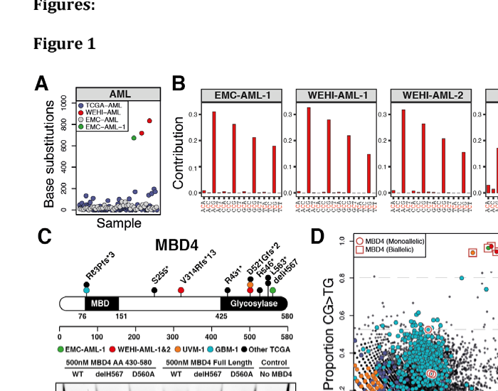

## Question

# Disease Characteristics Research Template

## Target Disease
- **Disease Name:** MBD4-Related Tumor Predisposition Syndrome
- **MONDO ID:** MONDO:0859267 (if available)
- **Category:** Mendelian

## Research Objectives

Please provide a comprehensive research report on **MBD4-Related Tumor Predisposition Syndrome** covering all of the
disease characteristics listed below. This report will be used to populate a disease knowledge
base entry. Be thorough and cite primary literature (PMID preferred) for all claims.

For each section, **suggested databases/resources** are listed. These are the first places
you should search for information on each topic.

---

### 1. Disease Information
> **Search first:** OMIM, Orphanet, ICD-10/ICD-11, MeSH, PubMed

- What is the disease? Provide a concise overview.
- What are the key identifiers? (OMIM, Orphanet, ICD-10/ICD-11, MeSH, Mondo)
- What are the common synonyms and alternative names?
- Is the information derived from individual patients (e.g., EHR) or aggregated disease-level resources?

### 2. Etiology

- **Disease Causal Factors**: What are the primary causes? (genetic, environmental, infectious, mechanistic)
- **Risk Factors**:
  > **Search first:** PubMed, Cochrane Library, UpToDate, clinical guidelines, ClinVar, ClinGen, GWAS Catalog, PheGenI, CTD, CDC, WHO, epidemiological databases
  - Genetic risk factors (causal variants, susceptibility loci, modifier genes)
  - Environmental risk factors (toxins, lifestyle, occupational exposures, age, sex, family history)
- **Protective Factors**:
  > **Search first:** PubMed, Cochrane Library, clinical trial databases, GWAS Catalog, gnomAD, WHO, CDC, nutrition databases
  - Genetic protective factors (protective variants, modifier alleles)
  - Environmental protective factors (diet, lifestyle, exposures that reduce risk)
- **Gene-Environment Interactions**: How do genetic and environmental factors interact to influence disease?
  > **Search first:** CTD, PubMed, PheGenI, GxE databases

### 3. Phenotypes
> **Search first:** HPO (Human Phenotype Ontology), OMIM, Orphanet, PubMed, clinicaltrials.gov, MedDRA, SNOMED CT, DECIPHER, LOINC

For each phenotype, provide:
- **Phenotype type**: symptoms, clinical signs, physical manifestations, behavioral changes, or laboratory abnormalities
  > For symptoms/signs: HPO, OMIM, Orphanet, PubMed
  > For behavioral changes: HPO, DSM, RDoC (Research Domain Criteria), PubMed
  > For laboratory abnormalities: LOINC, SNOMED CT, LabTests Online, PubMed
- **Phenotype characteristics**:
  > **Search first:** OMIM, Orphanet, HPO, PubMed
  - Age of symptom onset (neonatal, childhood, adult-onset, late-onset)
  - Symptom severity (mild, moderate, severe, variable)
  - Symptom progression (stable, progressive, episodic, fluctuating)
  - Frequency among affected individuals (percentage or qualitative)
- **Quality of life impact**: Effects on daily functioning and well-being (per-phenotype when possible)
  > **Search first:** EQ-5D database, SF-36, WHO QOL databases, PubMed
- Suggest HPO (Human Phenotype Ontology) terms for each phenotype

### 4. Genetic/Molecular Information

- **Causal Genes**: Gene mutations or chromosomal abnormalities responsible for disease (gene symbols, OMIM IDs)
  > **Search first:** OMIM, ClinVar, HGMD, Ensembl, NCBI Gene
- **Pathogenic Variants**:
  - Affected genes (gene symbols, HGNC IDs)
    > **Search first:** OMIM, NCBI Gene, Ensembl, HGNC, UniProt, GeneCards
  - Variant classification (pathogenic, likely pathogenic, VUS per ACMG/AMP guidelines)
    > **Search first:** ClinVar, ClinGen, ACMG/AMP guidelines, VarSome
  - Variant type/class (missense, frameshift, nonsense, splice-site, structural)
  - Allele frequency in population databases
    > **Search first:** gnomAD, 1000 Genomes, ExAC, TOPMed, dbSNP
  - Somatic vs germline origin
    > **Search first:** COSMIC (somatic), ClinVar, ICGC, TCGA
  - Functional consequences (loss of function, gain of function, dominant negative)
- **Modifier Genes**: Genes that modify disease severity or expression
- **Epigenetic Information**: DNA methylation, histone modifications, chromatin changes affecting disease
  > **Search first:** ENCODE, Roadmap Epigenomics, MethBase, DiseaseMeth
- **Chromosomal Abnormalities**: Large-scale genetic changes (aneuploidy, translocations, inversions)
  > **Search first:** DECIPHER, ClinVar, ECARUCA, UCSC Genome Browser

### 5. Environmental Information

- **Environmental Factors**: Non-genetic contributing factors (toxins, radiation, pollution, occupational exposure)
  > **Search first:** CTD (Comparative Toxicogenomics Database), TOXNET, PubMed, EPA databases
- **Lifestyle Factors**: Behavioral factors (smoking, diet, exercise, alcohol consumption)
  > **Search first:** CDC databases, WHO, PubMed, NHANES
- **Infectious Agents**: If applicable, pathogens causing or triggering disease (bacteria, viruses, fungi, parasites)
  > **Search first:** NCBI Taxonomy, ViPR, BV-BRC, MicrobeDB, GIDEON

### 6. Mechanism / Pathophysiology

**Present this section as an ordered causal chain first, then the detail below.**
Open with a numbered sequence of mechanistic steps running from the initiating
lesion (mutation, exposure, infection) to the clinical manifestation, one step per
line, each naming what it causes next. State the causal verb explicitly ("leads
to", "results in") and say where a step is inferred rather than demonstrated.
Where the mechanism branches, show the branch. The categories below are a
checklist of what to cover within those steps, not the organizing structure —
a step may draw on several of them, and a category may contribute to several
steps.

- **Molecular Pathways**: Specific signaling cascades or biochemical pathways involved (Wnt, MAPK, mTOR, PI3K-AKT, etc.)
  > **Search first:** KEGG, Reactome, WikiPathways, PathBank, BioCyc
- **Cellular Processes**: Cell-level mechanisms (apoptosis, autophagy, cell cycle dysregulation, inflammation, etc.)
  > **Search first:** Gene Ontology (GO), Reactome, KEGG, PubMed
- **Protein Dysfunction**: How protein structure or function is altered (misfolding, aggregation, loss of function, gain of function)
  > **Search first:** UniProt, PDB (Protein Data Bank), InterPro, Pfam, AlphaFold
- **Metabolic Changes**: Alterations in metabolic processes (energy metabolism, lipid metabolism, amino acid metabolism)
  > **Search first:** KEGG, BioCyc, HMDB (Human Metabolome Database), BRENDA
- **Immune System Involvement**: Role of immune response (autoimmunity, immunodeficiency, chronic inflammation)
  > **Search first:** ImmPort, Immunome Database, IEDB, Gene Ontology
- **Tissue Damage Mechanisms**: How tissues/ are injured (oxidative stress, ischemia, fibrosis, necrosis)
  > **Search first:** PubMed, Gene Ontology, Reactome
- **Biochemical Abnormalities**: Specific molecular defects (enzyme deficiencies, receptor dysfunction, ion channel defects)
  > **Search first:** BRENDA, UniProt, KEGG, OMIM, PubMed
- **Epigenetic Changes**: DNA methylation, histone modifications affecting gene expression in disease
  > **Search first:** ENCODE, Roadmap Epigenomics, MethBase, DiseaseMeth
- **Molecular Profiling** (if available):
  - Transcriptomics/gene expression changes
    > **Search first:** GEO (Gene Expression Omnibus), ArrayExpress, GTEx, Human Cell Atlas, SRA
  - Proteomics findings
    > **Search first:** PRIDE, ProteomeXchange, Human Protein Atlas, STRING, BioGRID
  - Metabolomics signatures
    > **Search first:** MetaboLights, Metabolomics Workbench, HMDB, METLIN
  - Lipidomics alterations
    > **Search first:** LIPID MAPS, SwissLipids, LipidHome, Metabolomics Workbench
  - Genomic structural features
    > **Search first:** UCSC Genome Browser, Ensembl, NCBI, dbVar, DGV
- **Advanced Technologies** (if applicable):
  - Single-cell analysis findings (cell-type specific mechanisms, cellular heterogeneity)
    > **Search first:** Human Cell Atlas, Single Cell Portal, GEO, CELLxGENE
  - Spatial transcriptomics findings
    > **Search first:** GEO, Spatial Research, Vizgen, 10x Genomics data
  - Multi-omics integration results
    > **Search first:** TCGA, ICGC, cBioPortal, LinkedOmics, PubMed
  - Functional genomics screens (CRISPR, RNAi)
    > **Search first:** DepMap, GenomeRNAi, PubMed, BioGRID ORCS

For each mechanism, describe:
- The causal chain from initial trigger to clinical manifestation
- Which mechanisms are upstream vs downstream
- What cell types and biological processes are involved
- Suggest GO terms for biological processes and CL terms for cell types

### 7. Anatomical Structures Affected

- **Organ Level**:
  - Primary organs directly affected
  - Secondary organ involvement (complications, secondary effects)
  - Body systems involved (cardiovascular, nervous, digestive, respiratory, endocrine, etc.)
  > **Search first:** Uberon, FMA (Foundational Model of Anatomy), OMIM, HPO, ICD-11, MeSH, SNOMED CT
- **Tissue and Cell Level**:
  - Specific tissue types affected (epithelial, connective, muscle, nervous)
  - Specific cell populations targeted (with Cell Ontology terms)
  > **Search first:** Uberon, Human Protein Atlas, Cell Ontology, Human Cell Atlas, CellMarker, PanglaoDB
- **Subcellular Level**:
  - Cellular compartments involved (mitochondria, nucleus, ER, lysosomes) (with GO Cellular Component terms)
  > **Search first:** Gene Ontology (Cellular Component), UniProt, Human Protein Atlas
- **Localization**:
  - Specific anatomical sites (with UBERON terms)
    > **Search first:** FMA, Uberon, NeuroNames (for brain), SNOMED CT
  - Lateralization (unilateral, bilateral, asymmetric)
    > **Search first:** HPO, clinical literature, imaging databases

### 8. Temporal Development

- **Onset**:
  - Typical age of onset (congenital, pediatric, adult, geriatric)
  - Onset pattern (acute, subacute, chronic, insidious)
  > **Search first:** OMIM, Orphanet, HPO, PubMed
- **Progression**:
  - Disease stages (early, intermediate, advanced, end-stage)
    > **Search first:** Cancer Staging Manual (AJCC), WHO classifications, PubMed
  - Progression rate (rapid, slow, variable)
  - Disease course pattern (episodic, relapsing-remitting, progressive, stable)
  - Disease duration (self-limited, chronic lifelong)
  > **Search first:** Disease registries, longitudinal cohort databases, natural history studies, PubMed, Orphanet, OMIM
- **Patterns**:
  - Remission patterns (spontaneous, treatment-induced)
    > **Search first:** Clinical trial databases, disease registries, PubMed
  - Critical periods (time windows of vulnerability or opportunity for intervention)
    > **Search first:** PubMed, developmental biology databases, clinical guidelines

### 9. Inheritance and Population

- **Epidemiology**:
  - Prevalence (cases per 100,000 at given time)
  - Incidence (new cases per 100,000 per year)
  > **Search first:** Orphanet, CDC, WHO, GBD (Global Burden of Disease), national registries, SEER, disease registries
- **For Genetic Etiology**:
  - Inheritance pattern (AD, AR, X-linked, mitochondrial, multifactorial, polygenic)
    > **Search first:** OMIM, Orphanet, ClinVar, GTR (Genetic Testing Registry)
  - Penetrance (complete, incomplete, age-dependent)
    > **Search first:** ClinVar, OMIM, PubMed, ClinGen
  - Expressivity (variable, consistent)
    > **Search first:** OMIM, ClinVar, PubMed
  - Genetic anticipation (increasing severity in successive generations)
    > **Search first:** OMIM, PubMed (especially for repeat expansion disorders)
  - Germline mosaicism
    > **Search first:** ClinVar, OMIM, genetic counseling literature, PubMed
  - Founder effects (population-specific mutations)
    > **Search first:** gnomAD, population genetics databases, PubMed
  - Consanguinity role
    > **Search first:** OMIM, population studies, genetic counseling resources
  - Carrier frequency
    > **Search first:** gnomAD, carrier screening databases, GeneReviews, GTR
- **Population Demographics**:
  - Affected populations (ethnic or demographic groups with higher prevalence)
    > **Search first:** gnomAD, 1000 Genomes, PAGE Study, PubMed, population registries
  - Geographic distribution (endemic areas, regional variation)
    > **Search first:** WHO, CDC, GBD, Orphanet, geographic epidemiology databases
  - Geographic distribution of specific variants
  - Sex ratio (male:female)
    > **Search first:** Disease registries, OMIM, PubMed, epidemiological databases
  - Age distribution of affected individuals
    > **Search first:** CDC, disease registries, SEER, Orphanet

### 10. Diagnostics

- **Clinical Tests**:
  - Laboratory tests (blood, urine, tissue chemistry, specific enzyme assays)
    > **Search first:** LOINC, LabTests Online, PubMed
  - Biomarkers (proteins, metabolites, genetic markers, circulating biomarkers)
    > **Search first:** FDA Biomarker List, BEST (Biomarkers, EndpointS, and other Tools), PubMed
  - Imaging studies (X-ray, CT, MRI, PET, ultrasound)
    > **Search first:** RadLex, DICOM, Radiopaedia, imaging databases
  - Functional tests (pulmonary function, cardiac stress tests)
    > **Search first:** LOINC, clinical guidelines, PubMed
  - Electrophysiology (EEG, EMG, ECG, nerve conduction studies)
    > **Search first:** LOINC, clinical neurophysiology databases, PubMed
  - Biopsy findings (histopathology, immunohistochemistry)
    > **Search first:** SNOMED CT, College of American Pathologists resources, PubMed
  - Pathology findings (microscopic examination)
    > **Search first:** SNOMED CT, Digital Pathology databases, PubMed
- **Genetic Testing**:
  > **Search first:** GTR (Genetic Testing Registry), GeneReviews, ClinGen
  - Overview of recommended genetic testing approach
  - Whole genome sequencing (WGS) utility
    > **Search first:** GTR, ClinVar, GEL (Genomics England), gnomAD
  - Whole exome sequencing (WES) utility
    > **Search first:** GTR, ClinVar, OMIM, GeneMatcher
  - Gene panels (which panels, which genes)
    > **Search first:** GTR, ClinVar, laboratory-specific databases
  - Single gene testing
    > **Search first:** GTR, ClinVar, OMIM, GeneReviews
  - Chromosomal microarray (CMA)
    > **Search first:** DECIPHER, ClinVar, dbVar, ECARUCA
  - Karyotyping
    > **Search first:** Chromosome Abnormality Database, ClinVar, cytogenetics resources
  - FISH
    > **Search first:** ClinVar, cytogenetics databases, PubMed
  - Mitochondrial DNA testing
    > **Search first:** MITOMAP, MSeqDR, ClinVar, GTR
  - Repeat expansion testing
    > **Search first:** GTR, ClinVar, repeat expansion databases, PubMed
- **Omics-Based Diagnostics** (if applicable):
  - RNA sequencing / transcriptomics
    > **Search first:** GEO, ArrayExpress, GTEx, RNA-seq databases
  - Proteomics
    > **Search first:** PRIDE, ProteomeXchange, FDA Biomarker database
  - Metabolomics
    > **Search first:** MetaboLights, Metabolomics Workbench, HMDB
  - Epigenomics
    > **Search first:** GEO, ENCODE, Roadmap Epigenomics, MethBase
  - Liquid biopsy
    > **Search first:** COSMIC, ClinVar, liquid biopsy databases, PubMed
- **Clinical Criteria**:
  - Standardized diagnostic criteria (DSM, ICD, society guidelines)
    > **Search first:** DSM-5, ICD-11, clinical society guidelines, UpToDate
  - Differential diagnosis (other conditions to rule out, with distinguishing features)
    > **Search first:** DynaMed, UpToDate, clinical decision support systems
- **Screening**:
  - Screening methods for asymptomatic individuals (newborn screening, carrier screening, cascade screening)
    > **Search first:** ACMG recommendations, CDC newborn screening, GTR

### 11. Outcome/Prognosis

- **Survival and Mortality**:
  - Survival rate (5-year, 10-year, overall)
    > **Search first:** SEER, cancer registries, disease-specific registries, PubMed
  - Life expectancy (with and without treatment if applicable)
    > **Search first:** Orphanet, disease registries, actuarial databases, PubMed
  - Mortality rate
    > **Search first:** CDC, WHO, GBD, national mortality databases
  - Disease-specific mortality (deaths directly attributable to disease)
    > **Search first:** Disease registries, CDC Wonder, GBD, PubMed
- **Morbidity and Function**:
  - Morbidity (disease-related disability and health impacts)
    > **Search first:** GBD, WHO, disability databases, PubMed
  - Disability outcomes (long-term functional impairments)
    > **Search first:** ICF (International Classification of Functioning), disability registries
  - Quality of life measures (EQ-5D, SF-36, PROMIS, disease-specific tools)
    > **Search first:** EQ-5D database, SF-36, PROMIS, PubMed
- **Disease Course**:
  - Complications (secondary problems: infections, organ failure, etc.)
    > **Search first:** ICD codes, disease registries, clinical databases, PubMed
  - Recovery potential (likelihood and extent of recovery, with vs without treatment)
    > **Search first:** Natural history studies, rehabilitation databases, PubMed
- **Prediction**:
  - Prognostic factors (age, disease severity, biomarkers, treatment response)
    > **Search first:** Prognostic models databases, clinical calculators, PubMed
  - Prognostic biomarkers (molecular markers predicting disease course)
    > **Search first:** FDA Biomarker database, PubMed, cancer prognostic databases

### 12. Treatment

- **Pharmacotherapy**:
  - Pharmacological treatments (drug names, drug classes, mechanisms of action)
    > **Search first:** DrugBank, RxNorm, ATC classification, DailyMed, FDA databases
  - Pharmacogenomics (how genetic variants affect drug metabolism, efficacy, toxicity)
    > **Search first:** PharmGKB, CPIC (Clinical Pharmacogenetics), FDA Table of PGx Biomarkers
- **Advanced Therapeutics**:
  - Gene therapy (viral vectors, CRISPR, gene replacement, gene editing)
    > **Search first:** ClinicalTrials.gov, FDA gene therapy database, ASGCT resources
  - Cell therapy (stem cell transplant, CAR-T, cellular therapeutics)
    > **Search first:** ClinicalTrials.gov, FDA cell therapy database, FACT standards
  - RNA-based therapies (ASOs, siRNA, mRNA therapies)
    > **Search first:** ClinicalTrials.gov, FDA approvals, PubMed
  - Targeted therapies (treatments directed at specific molecular targets)
    > **Search first:** My Cancer Genome, OncoKB, ClinicalTrials.gov, FDA approvals
  - Immunotherapies (checkpoint inhibitors, monoclonal antibodies)
    > **Search first:** Cancer Immunotherapy Database, FDA approvals, ClinicalTrials.gov
- **Surgical and Interventional**:
  - Surgical interventions (types of surgery, timing, outcomes)
    > **Search first:** CPT codes, surgical registries, clinical guidelines, PubMed
- **Supportive and Rehabilitative**:
  - Supportive care (symptom management, pain control, nutrition)
    > **Search first:** Clinical guidelines, Cochrane Library, PubMed
  - Rehabilitation (physical therapy, occupational therapy, speech therapy)
    > **Search first:** Rehabilitation medicine databases, clinical guidelines, PubMed
- **Experimental**:
  - Experimental treatments in clinical trials (with NCT identifiers if available)
    > **Search first:** ClinicalTrials.gov, EU Clinical Trials Register, WHO ICTRP
- **Treatment Outcomes**:
  - Treatment response rates
    > **Search first:** Clinical trial databases, FDA reviews, systematic reviews, PubMed
  - Side effects and adverse events
    > **Search first:** FDA Adverse Event Reporting System (FAERS), MedWatch, PubMed
- **Treatment Strategy**:
  - Treatment algorithms (clinical pathways, decision trees)
    > **Search first:** Clinical practice guidelines, NCCN Guidelines, UpToDate
  - Combination therapies
    > **Search first:** ClinicalTrials.gov, treatment guidelines, PubMed
  - Personalized medicine approaches (genotype-guided treatment)
    > **Search first:** My Cancer Genome, CIViC, PharmGKB, precision medicine databases

For each treatment, suggest NCIT (NCI Thesaurus) clinical-intervention terms where applicable.

### 13. Prevention

- **Prevention Levels**:
  - Primary prevention (preventing disease occurrence: vaccination, risk factor modification)
    > **Search first:** CDC, WHO, USPSTF recommendations, Cochrane Library
  - Secondary prevention (early detection and treatment: screening programs, early intervention)
    > **Search first:** USPSTF, CDC screening guidelines, WHO
  - Tertiary prevention (preventing complications in those with disease)
    > **Search first:** Clinical guidelines, disease management protocols, PubMed
- **Immunization**: Vaccine strategies (if applicable)
  > **Search first:** CDC vaccine schedules, WHO immunization, FDA vaccine database
- **Screening and Early Detection**:
  - Screening programs (population-based: newborn screening, cancer screening)
    > **Search first:** CDC screening programs, USPSTF, cancer screening databases
  - Genetic screening (carrier screening, preimplantation genetic diagnosis, prenatal testing)
    > **Search first:** ACMG recommendations, ACOG guidelines, GTR
  - Risk stratification (identifying high-risk individuals for targeted prevention)
    > **Search first:** Risk prediction models, clinical calculators, PubMed
- **Behavioral Interventions**: Lifestyle modifications to reduce risk
  > **Search first:** CDC, WHO, behavioral intervention databases, Cochrane Library
- **Counseling**: Genetic counseling (risk assessment, family planning guidance)
  > **Search first:** NSGC resources, ACMG guidelines, GeneReviews
- **Public Health**:
  - Public health interventions (sanitation, vector control, health education)
    > **Search first:** CDC, WHO, public health databases, PubMed
  - Environmental interventions (reducing environmental risk factors)
    > **Search first:** EPA databases, WHO environmental health, PubMed
- **Prophylaxis**: Preventive medications or procedures
  > **Search first:** Clinical guidelines, FDA approvals, PubMed

### 14. Other Species / Natural Disease

- **Taxonomy**: Species affected (with NCBI Taxon identifiers)
  > **Search first:** NCBI Taxonomy
- **Breed**: Specific breeds affected (with VBO identifiers if applicable)
  > **Search first:** VBO (Vertebrate Breed Ontology)
- **Gene**: Orthologous genes in other species (with NCBI Gene IDs)
  > **Search first:** NCBI Gene
- **Natural Disease**:
  - Naturally occurring disease in other species (companion animals, wildlife)
    > **Search first:** OMIA (Online Mendelian Inheritance in Animals), VetCompass, PubMed
  - Veterinary relevance and importance in animal health
    > **Search first:** OMIA, veterinary databases, PubMed
- **Comparative Biology**:
  - Comparative pathology (similarities and differences across species)
    > **Search first:** OMIA, comparative pathology databases, PubMed
  - Evolutionary conservation of disease mechanisms
    > **Search first:** HomoloGene, OrthoMCL, Alliance of Genome Resources
- **Transmission** (if applicable):
  - Zoonotic potential
    > **Search first:** CDC zoonotic diseases, WHO zoonoses, GIDEON
  - Cross-species susceptibility
    > **Search first:** NCBI Taxonomy, veterinary databases, PubMed

### 15. Model Organisms

- **Model Types**:
  - Model organism type (mammalian, invertebrate, cellular, in vitro)
    > **Search first:** Alliance of Genome Resources, model organism databases
  - Specific model systems (mouse, rat, zebrafish, Drosophila, C. elegans, yeast, cell lines, organoids, iPSCs)
    > **Search first:** MGI, RGD, ZFIN, FlyBase, WormBase, SGD, ATCC, Cellosaurus
  - Induced models (drug treatment, surgical intervention, environmental manipulation)
    > **Search first:** MGI, model organism databases, PubMed
- **Genetic Models**:
  - Types available (knockout, knock-in, transgenic, conditional, humanized)
    > **Search first:** MGI, IMPC, KOMP, EuMMCR, IMSR
- **Model Characteristics**:
  - Phenotype recapitulation (how well model reproduces human disease features)
    > **Search first:** Model organism databases, comparative studies, PubMed
  - Model limitations (aspects of human disease not captured)
    > **Search first:** Model organism databases, PubMed, review articles
- **Applications**:
  - Research applications (what aspects of disease can be studied)
    > **Search first:** Model organism databases, PubMed
- **Resources**:
  - Model databases
    > **Search first:** MGI, RGD, ZFIN, FlyBase, WormBase, IMSR, EMMA, MMRRC

---

## Citation Requirements

- Cite primary literature (PMID preferred) for all mechanistic and clinical claims
- Prioritize recent reviews and landmark papers
- Include direct quotes from abstracts where possible to support key statements
- Distinguish evidence source types: human clinical, model organism, in vitro, computational

## Output Format

Structure your response as a comprehensive narrative organized by the sections above.
For each section, provide:
- Factual content with specific details (numbers, percentages, gene names, variant nomenclature)
- Ontology term suggestions (HPO, GO, CL, UBERON, CHEBI, NCIT, MONDO) where applicable
- Evidence citations with PMIDs
- Direct quotes from abstracts to support key claims
- Clear indication when information is not available or not applicable for this disease

This report will be used to populate a disease knowledge base entry with:
- Pathophysiology descriptions with causal chains
- Gene/protein annotations (HGNC, GO terms)
- Phenotype associations (HP terms) with frequencies
- Cell type involvement (CL terms)
- Anatomical locations (UBERON terms)
- Chemical entities (CHEBI terms)
- Treatment annotations (NCIT terms)
- Evidence items with PMIDs and exact abstract quotes
- Epidemiology, prognosis, diagnostic, and prevention information
- Animal model descriptions with phenotype recapitulation details

## Output

Question: You are an expert researcher providing comprehensive, well-cited information.

Provide detailed information focusing on:
1. Key concepts and definitions with current understanding
2. Recent developments and latest research (prioritize 2023-2024 sources)
3. Current applications and real-world implementations
4. Expert opinions and analysis from authoritative sources
5. Relevant statistics and data from recent studies

Format as a comprehensive research report with proper citations. Include URLs and publication dates where available.
Always prioritize recent, authoritative sources and provide specific citations for all major claims.

# Disease Characteristics Research Template

## Target Disease
- **Disease Name:** MBD4-Related Tumor Predisposition Syndrome
- **MONDO ID:** MONDO:0859267 (if available)
- **Category:** Mendelian

## Research Objectives

Please provide a comprehensive research report on **MBD4-Related Tumor Predisposition Syndrome** covering all of the
disease characteristics listed below. This report will be used to populate a disease knowledge
base entry. Be thorough and cite primary literature (PMID preferred) for all claims.

For each section, **suggested databases/resources** are listed. These are the first places
you should search for information on each topic.

---

### 1. Disease Information
> **Search first:** OMIM, Orphanet, ICD-10/ICD-11, MeSH, PubMed

- What is the disease? Provide a concise overview.
- What are the key identifiers? (OMIM, Orphanet, ICD-10/ICD-11, MeSH, Mondo)
- What are the common synonyms and alternative names?
- Is the information derived from individual patients (e.g., EHR) or aggregated disease-level resources?

### 2. Etiology

- **Disease Causal Factors**: What are the primary causes? (genetic, environmental, infectious, mechanistic)
- **Risk Factors**:
  > **Search first:** PubMed, Cochrane Library, UpToDate, clinical guidelines, ClinVar, ClinGen, GWAS Catalog, PheGenI, CTD, CDC, WHO, epidemiological databases
  - Genetic risk factors (causal variants, susceptibility loci, modifier genes)
  - Environmental risk factors (toxins, lifestyle, occupational exposures, age, sex, family history)
- **Protective Factors**:
  > **Search first:** PubMed, Cochrane Library, clinical trial databases, GWAS Catalog, gnomAD, WHO, CDC, nutrition databases
  - Genetic protective factors (protective variants, modifier alleles)
  - Environmental protective factors (diet, lifestyle, exposures that reduce risk)
- **Gene-Environment Interactions**: How do genetic and environmental factors interact to influence disease?
  > **Search first:** CTD, PubMed, PheGenI, GxE databases

### 3. Phenotypes
> **Search first:** HPO (Human Phenotype Ontology), OMIM, Orphanet, PubMed, clinicaltrials.gov, MedDRA, SNOMED CT, DECIPHER, LOINC

For each phenotype, provide:
- **Phenotype type**: symptoms, clinical signs, physical manifestations, behavioral changes, or laboratory abnormalities
  > For symptoms/signs: HPO, OMIM, Orphanet, PubMed
  > For behavioral changes: HPO, DSM, RDoC (Research Domain Criteria), PubMed
  > For laboratory abnormalities: LOINC, SNOMED CT, LabTests Online, PubMed
- **Phenotype characteristics**:
  > **Search first:** OMIM, Orphanet, HPO, PubMed
  - Age of symptom onset (neonatal, childhood, adult-onset, late-onset)
  - Symptom severity (mild, moderate, severe, variable)
  - Symptom progression (stable, progressive, episodic, fluctuating)
  - Frequency among affected individuals (percentage or qualitative)
- **Quality of life impact**: Effects on daily functioning and well-being (per-phenotype when possible)
  > **Search first:** EQ-5D database, SF-36, WHO QOL databases, PubMed
- Suggest HPO (Human Phenotype Ontology) terms for each phenotype

### 4. Genetic/Molecular Information

- **Causal Genes**: Gene mutations or chromosomal abnormalities responsible for disease (gene symbols, OMIM IDs)
  > **Search first:** OMIM, ClinVar, HGMD, Ensembl, NCBI Gene
- **Pathogenic Variants**:
  - Affected genes (gene symbols, HGNC IDs)
    > **Search first:** OMIM, NCBI Gene, Ensembl, HGNC, UniProt, GeneCards
  - Variant classification (pathogenic, likely pathogenic, VUS per ACMG/AMP guidelines)
    > **Search first:** ClinVar, ClinGen, ACMG/AMP guidelines, VarSome
  - Variant type/class (missense, frameshift, nonsense, splice-site, structural)
  - Allele frequency in population databases
    > **Search first:** gnomAD, 1000 Genomes, ExAC, TOPMed, dbSNP
  - Somatic vs germline origin
    > **Search first:** COSMIC (somatic), ClinVar, ICGC, TCGA
  - Functional consequences (loss of function, gain of function, dominant negative)
- **Modifier Genes**: Genes that modify disease severity or expression
- **Epigenetic Information**: DNA methylation, histone modifications, chromatin changes affecting disease
  > **Search first:** ENCODE, Roadmap Epigenomics, MethBase, DiseaseMeth
- **Chromosomal Abnormalities**: Large-scale genetic changes (aneuploidy, translocations, inversions)
  > **Search first:** DECIPHER, ClinVar, ECARUCA, UCSC Genome Browser

### 5. Environmental Information

- **Environmental Factors**: Non-genetic contributing factors (toxins, radiation, pollution, occupational exposure)
  > **Search first:** CTD (Comparative Toxicogenomics Database), TOXNET, PubMed, EPA databases
- **Lifestyle Factors**: Behavioral factors (smoking, diet, exercise, alcohol consumption)
  > **Search first:** CDC databases, WHO, PubMed, NHANES
- **Infectious Agents**: If applicable, pathogens causing or triggering disease (bacteria, viruses, fungi, parasites)
  > **Search first:** NCBI Taxonomy, ViPR, BV-BRC, MicrobeDB, GIDEON

### 6. Mechanism / Pathophysiology

**Present this section as an ordered causal chain first, then the detail below.**
Open with a numbered sequence of mechanistic steps running from the initiating
lesion (mutation, exposure, infection) to the clinical manifestation, one step per
line, each naming what it causes next. State the causal verb explicitly ("leads
to", "results in") and say where a step is inferred rather than demonstrated.
Where the mechanism branches, show the branch. The categories below are a
checklist of what to cover within those steps, not the organizing structure —
a step may draw on several of them, and a category may contribute to several
steps.

- **Molecular Pathways**: Specific signaling cascades or biochemical pathways involved (Wnt, MAPK, mTOR, PI3K-AKT, etc.)
  > **Search first:** KEGG, Reactome, WikiPathways, PathBank, BioCyc
- **Cellular Processes**: Cell-level mechanisms (apoptosis, autophagy, cell cycle dysregulation, inflammation, etc.)
  > **Search first:** Gene Ontology (GO), Reactome, KEGG, PubMed
- **Protein Dysfunction**: How protein structure or function is altered (misfolding, aggregation, loss of function, gain of function)
  > **Search first:** UniProt, PDB (Protein Data Bank), InterPro, Pfam, AlphaFold
- **Metabolic Changes**: Alterations in metabolic processes (energy metabolism, lipid metabolism, amino acid metabolism)
  > **Search first:** KEGG, BioCyc, HMDB (Human Metabolome Database), BRENDA
- **Immune System Involvement**: Role of immune response (autoimmunity, immunodeficiency, chronic inflammation)
  > **Search first:** ImmPort, Immunome Database, IEDB, Gene Ontology
- **Tissue Damage Mechanisms**: How tissues/ are injured (oxidative stress, ischemia, fibrosis, necrosis)
  > **Search first:** PubMed, Gene Ontology, Reactome
- **Biochemical Abnormalities**: Specific molecular defects (enzyme deficiencies, receptor dysfunction, ion channel defects)
  > **Search first:** BRENDA, UniProt, KEGG, OMIM, PubMed
- **Epigenetic Changes**: DNA methylation, histone modifications affecting gene expression in disease
  > **Search first:** ENCODE, Roadmap Epigenomics, MethBase, DiseaseMeth
- **Molecular Profiling** (if available):
  - Transcriptomics/gene expression changes
    > **Search first:** GEO (Gene Expression Omnibus), ArrayExpress, GTEx, Human Cell Atlas, SRA
  - Proteomics findings
    > **Search first:** PRIDE, ProteomeXchange, Human Protein Atlas, STRING, BioGRID
  - Metabolomics signatures
    > **Search first:** MetaboLights, Metabolomics Workbench, HMDB, METLIN
  - Lipidomics alterations
    > **Search first:** LIPID MAPS, SwissLipids, LipidHome, Metabolomics Workbench
  - Genomic structural features
    > **Search first:** UCSC Genome Browser, Ensembl, NCBI, dbVar, DGV
- **Advanced Technologies** (if applicable):
  - Single-cell analysis findings (cell-type specific mechanisms, cellular heterogeneity)
    > **Search first:** Human Cell Atlas, Single Cell Portal, GEO, CELLxGENE
  - Spatial transcriptomics findings
    > **Search first:** GEO, Spatial Research, Vizgen, 10x Genomics data
  - Multi-omics integration results
    > **Search first:** TCGA, ICGC, cBioPortal, LinkedOmics, PubMed
  - Functional genomics screens (CRISPR, RNAi)
    > **Search first:** DepMap, GenomeRNAi, PubMed, BioGRID ORCS

For each mechanism, describe:
- The causal chain from initial trigger to clinical manifestation
- Which mechanisms are upstream vs downstream
- What cell types and biological processes are involved
- Suggest GO terms for biological processes and CL terms for cell types

### 7. Anatomical Structures Affected

- **Organ Level**:
  - Primary organs directly affected
  - Secondary organ involvement (complications, secondary effects)
  - Body systems involved (cardiovascular, nervous, digestive, respiratory, endocrine, etc.)
  > **Search first:** Uberon, FMA (Foundational Model of Anatomy), OMIM, HPO, ICD-11, MeSH, SNOMED CT
- **Tissue and Cell Level**:
  - Specific tissue types affected (epithelial, connective, muscle, nervous)
  - Specific cell populations targeted (with Cell Ontology terms)
  > **Search first:** Uberon, Human Protein Atlas, Cell Ontology, Human Cell Atlas, CellMarker, PanglaoDB
- **Subcellular Level**:
  - Cellular compartments involved (mitochondria, nucleus, ER, lysosomes) (with GO Cellular Component terms)
  > **Search first:** Gene Ontology (Cellular Component), UniProt, Human Protein Atlas
- **Localization**:
  - Specific anatomical sites (with UBERON terms)
    > **Search first:** FMA, Uberon, NeuroNames (for brain), SNOMED CT
  - Lateralization (unilateral, bilateral, asymmetric)
    > **Search first:** HPO, clinical literature, imaging databases

### 8. Temporal Development

- **Onset**:
  - Typical age of onset (congenital, pediatric, adult, geriatric)
  - Onset pattern (acute, subacute, chronic, insidious)
  > **Search first:** OMIM, Orphanet, HPO, PubMed
- **Progression**:
  - Disease stages (early, intermediate, advanced, end-stage)
    > **Search first:** Cancer Staging Manual (AJCC), WHO classifications, PubMed
  - Progression rate (rapid, slow, variable)
  - Disease course pattern (episodic, relapsing-remitting, progressive, stable)
  - Disease duration (self-limited, chronic lifelong)
  > **Search first:** Disease registries, longitudinal cohort databases, natural history studies, PubMed, Orphanet, OMIM
- **Patterns**:
  - Remission patterns (spontaneous, treatment-induced)
    > **Search first:** Clinical trial databases, disease registries, PubMed
  - Critical periods (time windows of vulnerability or opportunity for intervention)
    > **Search first:** PubMed, developmental biology databases, clinical guidelines

### 9. Inheritance and Population

- **Epidemiology**:
  - Prevalence (cases per 100,000 at given time)
  - Incidence (new cases per 100,000 per year)
  > **Search first:** Orphanet, CDC, WHO, GBD (Global Burden of Disease), national registries, SEER, disease registries
- **For Genetic Etiology**:
  - Inheritance pattern (AD, AR, X-linked, mitochondrial, multifactorial, polygenic)
    > **Search first:** OMIM, Orphanet, ClinVar, GTR (Genetic Testing Registry)
  - Penetrance (complete, incomplete, age-dependent)
    > **Search first:** ClinVar, OMIM, PubMed, ClinGen
  - Expressivity (variable, consistent)
    > **Search first:** OMIM, ClinVar, PubMed
  - Genetic anticipation (increasing severity in successive generations)
    > **Search first:** OMIM, PubMed (especially for repeat expansion disorders)
  - Germline mosaicism
    > **Search first:** ClinVar, OMIM, genetic counseling literature, PubMed
  - Founder effects (population-specific mutations)
    > **Search first:** gnomAD, population genetics databases, PubMed
  - Consanguinity role
    > **Search first:** OMIM, population studies, genetic counseling resources
  - Carrier frequency
    > **Search first:** gnomAD, carrier screening databases, GeneReviews, GTR
- **Population Demographics**:
  - Affected populations (ethnic or demographic groups with higher prevalence)
    > **Search first:** gnomAD, 1000 Genomes, PAGE Study, PubMed, population registries
  - Geographic distribution (endemic areas, regional variation)
    > **Search first:** WHO, CDC, GBD, Orphanet, geographic epidemiology databases
  - Geographic distribution of specific variants
  - Sex ratio (male:female)
    > **Search first:** Disease registries, OMIM, PubMed, epidemiological databases
  - Age distribution of affected individuals
    > **Search first:** CDC, disease registries, SEER, Orphanet

### 10. Diagnostics

- **Clinical Tests**:
  - Laboratory tests (blood, urine, tissue chemistry, specific enzyme assays)
    > **Search first:** LOINC, LabTests Online, PubMed
  - Biomarkers (proteins, metabolites, genetic markers, circulating biomarkers)
    > **Search first:** FDA Biomarker List, BEST (Biomarkers, EndpointS, and other Tools), PubMed
  - Imaging studies (X-ray, CT, MRI, PET, ultrasound)
    > **Search first:** RadLex, DICOM, Radiopaedia, imaging databases
  - Functional tests (pulmonary function, cardiac stress tests)
    > **Search first:** LOINC, clinical guidelines, PubMed
  - Electrophysiology (EEG, EMG, ECG, nerve conduction studies)
    > **Search first:** LOINC, clinical neurophysiology databases, PubMed
  - Biopsy findings (histopathology, immunohistochemistry)
    > **Search first:** SNOMED CT, College of American Pathologists resources, PubMed
  - Pathology findings (microscopic examination)
    > **Search first:** SNOMED CT, Digital Pathology databases, PubMed
- **Genetic Testing**:
  > **Search first:** GTR (Genetic Testing Registry), GeneReviews, ClinGen
  - Overview of recommended genetic testing approach
  - Whole genome sequencing (WGS) utility
    > **Search first:** GTR, ClinVar, GEL (Genomics England), gnomAD
  - Whole exome sequencing (WES) utility
    > **Search first:** GTR, ClinVar, OMIM, GeneMatcher
  - Gene panels (which panels, which genes)
    > **Search first:** GTR, ClinVar, laboratory-specific databases
  - Single gene testing
    > **Search first:** GTR, ClinVar, OMIM, GeneReviews
  - Chromosomal microarray (CMA)
    > **Search first:** DECIPHER, ClinVar, dbVar, ECARUCA
  - Karyotyping
    > **Search first:** Chromosome Abnormality Database, ClinVar, cytogenetics resources
  - FISH
    > **Search first:** ClinVar, cytogenetics databases, PubMed
  - Mitochondrial DNA testing
    > **Search first:** MITOMAP, MSeqDR, ClinVar, GTR
  - Repeat expansion testing
    > **Search first:** GTR, ClinVar, repeat expansion databases, PubMed
- **Omics-Based Diagnostics** (if applicable):
  - RNA sequencing / transcriptomics
    > **Search first:** GEO, ArrayExpress, GTEx, RNA-seq databases
  - Proteomics
    > **Search first:** PRIDE, ProteomeXchange, FDA Biomarker database
  - Metabolomics
    > **Search first:** MetaboLights, Metabolomics Workbench, HMDB
  - Epigenomics
    > **Search first:** GEO, ENCODE, Roadmap Epigenomics, MethBase
  - Liquid biopsy
    > **Search first:** COSMIC, ClinVar, liquid biopsy databases, PubMed
- **Clinical Criteria**:
  - Standardized diagnostic criteria (DSM, ICD, society guidelines)
    > **Search first:** DSM-5, ICD-11, clinical society guidelines, UpToDate
  - Differential diagnosis (other conditions to rule out, with distinguishing features)
    > **Search first:** DynaMed, UpToDate, clinical decision support systems
- **Screening**:
  - Screening methods for asymptomatic individuals (newborn screening, carrier screening, cascade screening)
    > **Search first:** ACMG recommendations, CDC newborn screening, GTR

### 11. Outcome/Prognosis

- **Survival and Mortality**:
  - Survival rate (5-year, 10-year, overall)
    > **Search first:** SEER, cancer registries, disease-specific registries, PubMed
  - Life expectancy (with and without treatment if applicable)
    > **Search first:** Orphanet, disease registries, actuarial databases, PubMed
  - Mortality rate
    > **Search first:** CDC, WHO, GBD, national mortality databases
  - Disease-specific mortality (deaths directly attributable to disease)
    > **Search first:** Disease registries, CDC Wonder, GBD, PubMed
- **Morbidity and Function**:
  - Morbidity (disease-related disability and health impacts)
    > **Search first:** GBD, WHO, disability databases, PubMed
  - Disability outcomes (long-term functional impairments)
    > **Search first:** ICF (International Classification of Functioning), disability registries
  - Quality of life measures (EQ-5D, SF-36, PROMIS, disease-specific tools)
    > **Search first:** EQ-5D database, SF-36, PROMIS, PubMed
- **Disease Course**:
  - Complications (secondary problems: infections, organ failure, etc.)
    > **Search first:** ICD codes, disease registries, clinical databases, PubMed
  - Recovery potential (likelihood and extent of recovery, with vs without treatment)
    > **Search first:** Natural history studies, rehabilitation databases, PubMed
- **Prediction**:
  - Prognostic factors (age, disease severity, biomarkers, treatment response)
    > **Search first:** Prognostic models databases, clinical calculators, PubMed
  - Prognostic biomarkers (molecular markers predicting disease course)
    > **Search first:** FDA Biomarker database, PubMed, cancer prognostic databases

### 12. Treatment

- **Pharmacotherapy**:
  - Pharmacological treatments (drug names, drug classes, mechanisms of action)
    > **Search first:** DrugBank, RxNorm, ATC classification, DailyMed, FDA databases
  - Pharmacogenomics (how genetic variants affect drug metabolism, efficacy, toxicity)
    > **Search first:** PharmGKB, CPIC (Clinical Pharmacogenetics), FDA Table of PGx Biomarkers
- **Advanced Therapeutics**:
  - Gene therapy (viral vectors, CRISPR, gene replacement, gene editing)
    > **Search first:** ClinicalTrials.gov, FDA gene therapy database, ASGCT resources
  - Cell therapy (stem cell transplant, CAR-T, cellular therapeutics)
    > **Search first:** ClinicalTrials.gov, FDA cell therapy database, FACT standards
  - RNA-based therapies (ASOs, siRNA, mRNA therapies)
    > **Search first:** ClinicalTrials.gov, FDA approvals, PubMed
  - Targeted therapies (treatments directed at specific molecular targets)
    > **Search first:** My Cancer Genome, OncoKB, ClinicalTrials.gov, FDA approvals
  - Immunotherapies (checkpoint inhibitors, monoclonal antibodies)
    > **Search first:** Cancer Immunotherapy Database, FDA approvals, ClinicalTrials.gov
- **Surgical and Interventional**:
  - Surgical interventions (types of surgery, timing, outcomes)
    > **Search first:** CPT codes, surgical registries, clinical guidelines, PubMed
- **Supportive and Rehabilitative**:
  - Supportive care (symptom management, pain control, nutrition)
    > **Search first:** Clinical guidelines, Cochrane Library, PubMed
  - Rehabilitation (physical therapy, occupational therapy, speech therapy)
    > **Search first:** Rehabilitation medicine databases, clinical guidelines, PubMed
- **Experimental**:
  - Experimental treatments in clinical trials (with NCT identifiers if available)
    > **Search first:** ClinicalTrials.gov, EU Clinical Trials Register, WHO ICTRP
- **Treatment Outcomes**:
  - Treatment response rates
    > **Search first:** Clinical trial databases, FDA reviews, systematic reviews, PubMed
  - Side effects and adverse events
    > **Search first:** FDA Adverse Event Reporting System (FAERS), MedWatch, PubMed
- **Treatment Strategy**:
  - Treatment algorithms (clinical pathways, decision trees)
    > **Search first:** Clinical practice guidelines, NCCN Guidelines, UpToDate
  - Combination therapies
    > **Search first:** ClinicalTrials.gov, treatment guidelines, PubMed
  - Personalized medicine approaches (genotype-guided treatment)
    > **Search first:** My Cancer Genome, CIViC, PharmGKB, precision medicine databases

For each treatment, suggest NCIT (NCI Thesaurus) clinical-intervention terms where applicable.

### 13. Prevention

- **Prevention Levels**:
  - Primary prevention (preventing disease occurrence: vaccination, risk factor modification)
    > **Search first:** CDC, WHO, USPSTF recommendations, Cochrane Library
  - Secondary prevention (early detection and treatment: screening programs, early intervention)
    > **Search first:** USPSTF, CDC screening guidelines, WHO
  - Tertiary prevention (preventing complications in those with disease)
    > **Search first:** Clinical guidelines, disease management protocols, PubMed
- **Immunization**: Vaccine strategies (if applicable)
  > **Search first:** CDC vaccine schedules, WHO immunization, FDA vaccine database
- **Screening and Early Detection**:
  - Screening programs (population-based: newborn screening, cancer screening)
    > **Search first:** CDC screening programs, USPSTF, cancer screening databases
  - Genetic screening (carrier screening, preimplantation genetic diagnosis, prenatal testing)
    > **Search first:** ACMG recommendations, ACOG guidelines, GTR
  - Risk stratification (identifying high-risk individuals for targeted prevention)
    > **Search first:** Risk prediction models, clinical calculators, PubMed
- **Behavioral Interventions**: Lifestyle modifications to reduce risk
  > **Search first:** CDC, WHO, behavioral intervention databases, Cochrane Library
- **Counseling**: Genetic counseling (risk assessment, family planning guidance)
  > **Search first:** NSGC resources, ACMG guidelines, GeneReviews
- **Public Health**:
  - Public health interventions (sanitation, vector control, health education)
    > **Search first:** CDC, WHO, public health databases, PubMed
  - Environmental interventions (reducing environmental risk factors)
    > **Search first:** EPA databases, WHO environmental health, PubMed
- **Prophylaxis**: Preventive medications or procedures
  > **Search first:** Clinical guidelines, FDA approvals, PubMed

### 14. Other Species / Natural Disease

- **Taxonomy**: Species affected (with NCBI Taxon identifiers)
  > **Search first:** NCBI Taxonomy
- **Breed**: Specific breeds affected (with VBO identifiers if applicable)
  > **Search first:** VBO (Vertebrate Breed Ontology)
- **Gene**: Orthologous genes in other species (with NCBI Gene IDs)
  > **Search first:** NCBI Gene
- **Natural Disease**:
  - Naturally occurring disease in other species (companion animals, wildlife)
    > **Search first:** OMIA (Online Mendelian Inheritance in Animals), VetCompass, PubMed
  - Veterinary relevance and importance in animal health
    > **Search first:** OMIA, veterinary databases, PubMed
- **Comparative Biology**:
  - Comparative pathology (similarities and differences across species)
    > **Search first:** OMIA, comparative pathology databases, PubMed
  - Evolutionary conservation of disease mechanisms
    > **Search first:** HomoloGene, OrthoMCL, Alliance of Genome Resources
- **Transmission** (if applicable):
  - Zoonotic potential
    > **Search first:** CDC zoonotic diseases, WHO zoonoses, GIDEON
  - Cross-species susceptibility
    > **Search first:** NCBI Taxonomy, veterinary databases, PubMed

### 15. Model Organisms

- **Model Types**:
  - Model organism type (mammalian, invertebrate, cellular, in vitro)
    > **Search first:** Alliance of Genome Resources, model organism databases
  - Specific model systems (mouse, rat, zebrafish, Drosophila, C. elegans, yeast, cell lines, organoids, iPSCs)
    > **Search first:** MGI, RGD, ZFIN, FlyBase, WormBase, SGD, ATCC, Cellosaurus
  - Induced models (drug treatment, surgical intervention, environmental manipulation)
    > **Search first:** MGI, model organism databases, PubMed
- **Genetic Models**:
  - Types available (knockout, knock-in, transgenic, conditional, humanized)
    > **Search first:** MGI, IMPC, KOMP, EuMMCR, IMSR
- **Model Characteristics**:
  - Phenotype recapitulation (how well model reproduces human disease features)
    > **Search first:** Model organism databases, comparative studies, PubMed
  - Model limitations (aspects of human disease not captured)
    > **Search first:** Model organism databases, PubMed, review articles
- **Applications**:
  - Research applications (what aspects of disease can be studied)
    > **Search first:** Model organism databases, PubMed
- **Resources**:
  - Model databases
    > **Search first:** MGI, RGD, ZFIN, FlyBase, WormBase, IMSR, EMMA, MMRRC

---

## Citation Requirements

- Cite primary literature (PMID preferred) for all mechanistic and clinical claims
- Prioritize recent reviews and landmark papers
- Include direct quotes from abstracts where possible to support key statements
- Distinguish evidence source types: human clinical, model organism, in vitro, computational

## Output Format

Structure your response as a comprehensive narrative organized by the sections above.
For each section, provide:
- Factual content with specific details (numbers, percentages, gene names, variant nomenclature)
- Ontology term suggestions (HPO, GO, CL, UBERON, CHEBI, NCIT, MONDO) where applicable
- Evidence citations with PMIDs
- Direct quotes from abstracts to support key claims
- Clear indication when information is not available or not applicable for this disease

This report will be used to populate a disease knowledge base entry with:
- Pathophysiology descriptions with causal chains
- Gene/protein annotations (HGNC, GO terms)
- Phenotype associations (HP terms) with frequencies
- Cell type involvement (CL terms)
- Anatomical locations (UBERON terms)
- Chemical entities (CHEBI terms)
- Treatment annotations (NCIT terms)
- Evidence items with PMIDs and exact abstract quotes
- Epidemiology, prognosis, diagnostic, and prevention information
- Animal model descriptions with phenotype recapitulation details

# MBD4-related tumor predisposition syndrome: disease-characteristics report

**Scope and evidence standard.** This report concerns the *autosomal-recessive, biallelic* MBD4-associated neoplasia syndrome (MANS). A person with one inherited pathogenic MBD4 allele may instead have a distinct predisposition to uveal melanoma when the remaining allele is lost in the tumor. Frequencies below describe selected patients or tumors unless explicitly stated otherwise; they are **not** lifetime cancer risks. Claims are labeled as human clinical, human tumor-genomic, mouse, or cell-model evidence where that distinction matters. Publication DOI links are supplied where verified; a PMID is supplied only where it could be corroborated from retrieved evidence. (terradas2023mbd4associatedneoplasiasyndrome pages 1-2, silveira2024baseexcisionrepairpathway pages 1-2, derrien2021germlinembd4mutations pages 1-2)

## 1. Disease information

MANS is an exceptionally rare inherited **DNA base-excision-repair (BER) deficiency** associated principally with colorectal adenomatous polyposis, early-adult myelodysplastic syndrome (MDS)/acute myeloid leukemia (AML), and additional tumors including uveal melanoma and schwannoma. **MONDO:0859267** is labeled *tumor predisposition syndrome 2* in the retrieved disease–gene association resource, which associates it with **MBD4**, ENSG00000129071. Names used in the clinical literature include *MBD4-associated neoplasia syndrome*, *MANS*, *germline MBD4 deficiency*, and *MBD4-related tumor predisposition syndrome*. Do not equate an MBD4-mutated *tumor* with a person having constitutional biallelic MANS. (OpenTargets Search: -MBD4, terradas2023mbd4associatedneoplasiasyndrome pages 1-2, palles2022germlinembd4deficiency pages 1-3)

**Identifier curation:** MONDO:0859267 is supported here. A syndrome-specific OMIM number, Orphanet identifier, ICD-10/ICD-11 code, and MeSH descriptor could **not be verified** in the retrieved sources; these fields should remain unassigned rather than inherit codes for AML, colorectal cancer, or hereditary cancer generally. The evidence consists of published individual patients/families, selected cohorts, tumor databases, and model experiments—not an individual patient's electronic health record or a population-based syndrome registry. (OpenTargets Search: -MBD4, terradas2023mbd4associatedneoplasiasyndrome pages 1-2, silveira2024baseexcisionrepairpathway pages 1-2)

## 2. Etiology and risk or protective factors

**Established cause [human clinical/functional]:** two pathogenic or likely pathogenic **germline MBD4** alleles, typically truncating, splice-disrupting, or experimentally damaging catalytic-domain variants. The gene encodes a methyl-CpG-binding DNA glycosylase that removes thymine from a G:T mismatch created by deamination of 5-methylcytosine. One inherited defective allele plus somatic inactivation of the other is a demonstrated route to *MBD4-deficient uveal and other tumors*, but is not the same genotype as constitutional biallelic MANS. (sanders2018mbd4guardsagainst pages 10-14, blombery2022methylcpgbindingdomain pages 5-5, silveira2024baseexcisionrepairpathway pages 1-2, derrien2021germlinembd4mutations pages 7-8)

**Risk modifiers and gene–environment interaction:** increasing time for endogenous methyl-cytosine deamination is mechanistically relevant; local CpG methylation, sequence context, replication timing, and chromatin state influence where mutations accumulate. Acquired mutations in **DNMT3A**, sometimes followed by **IDH1/IDH2**, are observed downstream *somatic drivers*, not proven inherited risk-modifier alleles. Consanguinity can increase the probability of biallelic inheritance, as illustrated by a reported case. No syndrome-specific effect size has been established for tobacco, alcohol, diet, exercise, radiation, occupational chemicals, or an infectious agent. Neither a protective genetic allele nor a syndrome-specific protective exposure has been validated. General cancer-risk reduction must not be represented as evidence that MBD4-deficient cancers are prevented. (blombery2022methylcpgbindingdomain pages 4-4, sanders2018mbd4guardsagainst pages 10-14, sanders2018mbd4guardsagainst pages 14-18, silveira2024baseexcisionrepairpathway pages 1-2)

## 3. Phenotypes and patient impact

Terradas and colleagues' **2023** summary of previously described biallelic cases provides the following *clinically ascertained* denominators; overlapping manifestations and referral bias prevent their interpretation as penetrance. (terradas2023mbd4associatedneoplasiasyndrome pages 1-2)

| Phenotype | Observed among selected 11 biallelic carriers | Age/course or interpretation |
|---|---:|---|
| Colorectal polyposis | 9/11 (82%) | Usually recognized in the third decade; dominant gastrointestinal manifestation in this clinically selected historical series. (terradas2023mbd4associatedneoplasiasyndrome pages 1-2) |
| Acute myeloid leukemia or myelodysplastic syndrome | 7/11 (64%) | Mean age at diagnosis 35 years (range 30–49); typically early-adult-onset hematologic disease. (terradas2023mbd4associatedneoplasiasyndrome pages 1-2) |
| Colorectal cancer | 2/11 (18%) | Reported less often than polyposis in the selected cases; age-specific cumulative risk is unknown. (terradas2023mbd4associatedneoplasiasyndrome pages 1-2) |
| Schwannoma | 3/11 (27%) | Recurrent extracolonic tumor manifestation, but organ-specific risk and natural history remain undefined. (terradas2023mbd4associatedneoplasiasyndrome pages 1-2) |
| Uveal melanoma | 2/11 (18%) | Part of the reported biallelic syndrome spectrum; monoallelic germline MBD4 loss with somatic loss of the wild-type allele represents a distinct uveal-melanoma-predisposition phenotype. (terradas2023mbd4associatedneoplasiasyndrome pages 1-2) |
| Interpretation limitation | 11 clinically ascertained carriers from 8 families | These proportions are descriptive case frequencies, not population penetrance estimates; ascertainment, referral, relatedness, and very small sample size preclude reliable lifetime-risk calculations. (terradas2023mbd4associatedneoplasiasyndrome pages 1-2) |

*Table: Phenotypes reported among the 11 historical biallelic MBD4 carriers summarized by Terradas et al. (2023). Frequencies describe a selected case series and must not be interpreted as population penetrance.*

**Knowledge-base phenotype annotations—suggested labels, not verified ontology accessions:** multiple colorectal adenomas/colorectal polyposis (**HPO: colorectal polyposis; colonic adenoma**), colorectal carcinoma (**HPO: colorectal carcinoma**), MDS (**HPO: myelodysplasia**), AML (**HPO: acute myeloid leukemia**), anemia or pancytopenia (**HPO: anemia; pancytopenia**), vestibular schwannoma (**HPO: vestibular schwannoma**), and uveal melanoma (**HPO: uveal melanoma**). Record additional thyroid malignancy, lymphoma, meningioma, breast cancer, ovarian germ-cell tumor, or duodenal adenoma as *case-level observations*, not proven frequent or syndrome-defining manifestations. Exact HP accession numbers require an HPO lookup before ingestion. (terradas2023mbd4associatedneoplasiasyndrome pages 1-2, blombery2022methylcpgbindingdomain pages 4-4, cooper2026biallelicgermlinembd4 pages 1-2)

Polyps may be asymptomatic until detected endoscopically or may cause bleeding; one carrier had iron-deficiency anemia associated with rectal/colonic polyps. Hematologic disease can progress from cytopenias and transfusion dependence to AML; a reported patient had **75 polyps**, colectomy, vestibular schwannoma, then MDS at age **37**. These serious conditions and surgery plausibly disrupt function and quality of life, but **MANS-specific EQ-5D, SF-36, PROMIS, or per-phenotype quality-of-life estimates were not found**. Childhood manifestations are not established as the typical course in these case series. (blombery2022methylcpgbindingdomain pages 4-4, sanders2018mbd4guardsagainst pages 6-10)

## 4. Genetic and molecular information

**Gene/protein:** **MBD4**, *methyl-CpG binding domain 4, DNA glycosylase*, Ensembl **ENSG00000129071**. An HGNC numeric ID and gene-specific OMIM accession were not independently verified here. Germline pathogenicity should be assessed using segregation, allele phase, population frequency, predicted loss of function, tumor phenotype, and, especially for missense variants, functional testing; a **VUS is not diagnostic**. No recurrent chromosomal imbalance causes constitutional MANS, although tumor-specific chromosome-3 loss can supply the second hit in uveal melanoma. (OpenTargets Search: -MBD4, blombery2022methylcpgbindingdomain pages 5-5, derrien2021germlinembd4mutations pages 6-7, derrien2021germlinembd4mutations pages 7-8)

**Illustrative germline alleles [human]:** homozygous **c.612_615del, p.(Ser205Thrfs*9)** and **c.939dup, p.(Glu314Argfs*13)** were found in polyposis cohorts; their reported gnomAD allele frequencies in the 2022 analysis were approximately **0.0000399** and **0.000653**, respectively, with no observed homozygous loss-of-function individuals in the datasets examined. A homozygous catalytic-domain **c.1535G>A, p.(Arg512Gln)** was reported as *likely pathogenic* in a patient with MDS/polyposis; seven population allele observations and no homozygotes were reported in that analysis. An independently function-tested in-frame **p.(His567del)** abolished glycosylase activity. These are publication-specific allele frequencies and classifications, **not** a comprehensive, current ClinVar or gnomAD audit. (sanders2018mbd4guardsagainst pages 10-14, blombery2022methylcpgbindingdomain pages 5-5, palles2022germlinembd4deficiency pages 3-4)

**Monoallelic/tumor examples [human]:** uveal-melanoma-associated variants include splice variants **c.1562-1G>T** and **c.335+1G>A**, frameshifts **c.1443delT** and **c.1384delG**, and **c.1706G>A, p.(Trp569*)**. Functional assays found p.(Trp569*) and p.(Arg468Trp) glycosylase-deficient. When evaluating a patient's tumor, distinguish the inherited allele from somatic mutation or loss of heterozygosity. **DNMT3A, IDH1/2, APC, and NF2** can be acquired tumor drivers; none is an established Mendelian *modifier gene for constitutional MANS*. Abnormal CpG methylation is the *substrate context* of mutagenesis; a specific inherited MBD4-syndrome epimutation or causal histone-mark defect has not been established. (sanders2018mbd4guardsagainst pages 14-18, derrien2021germlinembd4mutations pages 6-7, derrien2021germlinembd4mutations pages 19-21, derrien2021germlinembd4mutations pages 7-8, cooper2026biallelicgermlinembd4 pages 1-2)

## 5. Environmental information

The initiating biochemical exposure is **endogenous 5-methylcytosine deamination**, not an identified pollutant or microorganism. In mice, experimentally administered radiation and DNA-damaging drugs altered intestinal apoptosis in an Mbd4-dependent manner, but these experiments **do not establish** that such exposures cause human MANS or quantify their contribution to human cancer risk. No syndrome-specific infectious, occupational, dietary, alcohol, exercise, or smoking association was identified. (sanders2018mbd4guardsagainst pages 1-6, sansom2003mbd4deficiencyreduces pages 1-2)

## 6. Mechanism and pathophysiology

**Ordered causal chain.** The human genetic, tumor-sequencing, functional, and mouse evidence supports the following chain; steps identified as *inferred* extend beyond direct demonstration in every affected tissue. (sanders2018mbd4guardsagainst pages 10-14, sanders2018mbd4guardsagainst pages 14-18, silveira2024baseexcisionrepairpathway pages 1-2, chabot2022cytidineanalogsare pages 1-2)

1. **Inherited biallelic pathogenic MBD4 variants lead to** absent or reduced nuclear MBD4 DNA-glycosylase activity; *alternatively*, one inherited variant plus a tumor-acquired second hit leads to **tumor-restricted** biallelic deficiency. (sanders2018mbd4guardsagainst pages 10-14, blombery2022methylcpgbindingdomain pages 5-5, derrien2021germlinembd4mutations pages 7-8)
2. **Spontaneous deamination of methylated cytosine leads to** thymine opposite guanine at methylated CpGs; defective MBD4-initiated BER **leads to** persistence of these G:T mismatches. This is directly supported biochemically and by tumor and cell-model patterns. (sanders2018mbd4guardsagainst pages 1-6, silveira2024baseexcisionrepairpathway pages 1-2, derrien2021germlinembd4mutations pages 6-7)
3. **Persistence through DNA replication leads to** fixed CpG C:G→T:A substitutions and a hypermutated tumor genome. Tumor sequencing identifies strong CpG>TpG enrichment; SBS96 is a particularly informative MBD4-deficiency-associated signature, whereas broadly age-associated **SBS1 alone is not specific**. Methylation, active chromatin, and replication timing **modify** the spatial distribution. (terradas2023mbd4associatedneoplasiasyndrome pages 2-3, sanders2018mbd4guardsagainst pages 10-14, silveira2024baseexcisionrepairpathway pages 1-2)
4. **Hematopoietic branch:** these substitutions **lead to** recurrent acquired **DNMT3A** lesions in hematopoietic stem/progenitor cells; clone selection **leads to** clonal hematopoiesis and, often after additional **IDH1/IDH2** hits, MDS/AML. Driver order and recurrent clones were observed longitudinally in humans; progression of *every* such clone to AML is **not demonstrated**. (sanders2018mbd4guardsagainst pages 1-6, sanders2018mbd4guardsagainst pages 14-18)
5. **Intestinal branch:** excess mutations in intestinal epithelial progenitors **are inferred to facilitate** adenoma initiation, progression to polyposis, and occasionally colorectal carcinoma; MBD4-deficient adenoma mutational patterns and patients' tumors support this branch, but a single obligatory downstream driver/pathway has not been demonstrated across all cases. **Ocular branch:** chromosome-3 loss of the normal allele in a monoallelic carrier **leads to** MBD4-deficient, hypermutated uveal melanoma; chromosome-3 loss and mutations are observed, while the complete sequence of additional oncogenic events is not established. (terradas2023mbd4associatedneoplasiasyndrome pages 1-2, palles2022germlinembd4deficiency pages 1-3, derrien2021germlinembd4mutations pages 7-8)
6. **Tumor burden leads to** clinically detectable polyps, bleeding or anemia, marrow failure/leukemia, ocular tumor, or other malignancy; tumor hypermutation **may lead to** greater immunotherapy susceptibility, but predictive benefit is not established for the syndrome as a whole. (blombery2022methylcpgbindingdomain pages 4-4, derrien2021germlinembd4mutations pages 1-2, chabot2022cytidineanalogsare pages 1-2)

**Molecular/cellular annotations:** upstream **BER and DNA glycosylase activity**; downstream **clonal hematopoiesis, tumor evolution**, and tissue-dependent oncogenic pathways. Wnt/APC can be involved in particular colorectal adenomas, but a uniform MBD4-specific Wnt, MAPK, PI3K–AKT, or mTOR signaling cascade is **not established**. Suggested **GO biological-process labels**, pending identifier verification: *base-excision repair*, *DNA repair*, *DNA demethylation* [not established as the primary disease mechanism], *somatic mutation*, *hematopoietic stem cell differentiation*, and *apoptotic process*. Suggested **CL labels**, also pending accession verification: *hematopoietic stem cell*, *myeloid progenitor cell*, *intestinal epithelial stem cell*, *colon epithelial cell*, and *melanocyte*. Suggested chemical labels for **ChEBI** lookup: *5-methylcytosine, thymine, cytosine, gemcitabine, cytarabine*. The primary lesion concerns repair of a methylated DNA base, **not a demonstrated systemic metabolic, lipidomic, or immune-deficiency syndrome**. (sanders2018mbd4guardsagainst pages 1-6, sanders2018mbd4guardsagainst pages 14-18, silveira2024baseexcisionrepairpathway pages 1-2, sansom2003mbd4deficiencyreduces pages 1-2, cooper2026biallelicgermlinembd4 pages 1-2)

**Profiling/advanced technologies:** whole-genome and whole-exome tumor sequencing, mutational-signature extraction, tumor/normal methylation analysis, longitudinal sequencing of single-cell-derived hematopoietic colonies, and isogenic BER-deficient cell models have been informative. In the original AML study, three deficient tumors had approximately **33-fold** the usual AML mutation burden and **>95%** CpG-context C>T substitutions. A **2024** pan-cancer study found **20 SBS96-positive tumor samples from 13 MBD4-deficient cases**; **11/13** involved a germline heterozygous variant followed by somatic loss and the other **two were AML cases with constitutional biallelic deficiency**. MBD4 preferentially bound active, early-replicating chromatin, which showed comparatively lower mutation burdens. Disease-specific validated clinical transcriptomic, proteomic, metabolomic, lipidomic, spatial-transcriptomic, or single-cell atlas signatures were **not established** by the retrieved studies; colony genotyping is not equivalent to single-cell transcriptomics. A **2024** pan-cancer CpG-hypermutation survey encompassed **30,191 patients and 103 cancer types**, but its overall rates must not be mistaken for MANS prevalence. (sanders2018mbd4guardsagainst pages 1-6, sanders2018mbd4guardsagainst pages 6-10, silveira2024baseexcisionrepairpathway pages 1-2)

## 7. Anatomical structures affected

**Primary sites:** colon/rectum (adenomatous epithelium), bone marrow and blood (hematopoietic stem/progenitor and malignant myeloid cells), and uveal tract (ocular melanocytes); schwannomas implicate peripheral/vestibular nerve Schwann cells. Thyroid, breast, brain, sarcoma, and other sites have been observed among affected individuals or MBD4-deficient tumors without establishing equivalent lifelong risk for each organ. The affected subcellular process is DNA repair in the **nucleus/chromatin**; chromosome 3 is a frequent *tumor* second-hit locus in uveal melanoma, not an inherited structural anomaly defining MANS. Suggested **UBERON lookup labels:** *colon, rectum, bone marrow, blood, uvea, choroid, vestibular nerve, thyroid gland*; suggested **GO cellular component:** *nucleus, chromatin*. Verified accession numbers for these suggested labels should be resolved against current ontology releases before database ingestion. Reported unilateral and bilateral vestibular schwannomas do not establish syndrome-wide lateralization. (terradas2023mbd4associatedneoplasiasyndrome pages 1-2, silveira2024baseexcisionrepairpathway pages 1-2, derrien2021germlinembd4mutations pages 7-8, cooper2026biallelicgermlinembd4 pages 1-2)

## 8. Temporal development

**Genetic status is lifelong**, while tumors have variable, usually early-adult clinical onset in reported biallelic patients. Polyposis often appears during the third decade; among the 11 historical cases, reported AML/MDS diagnosis averaged **35 years**, range **30–49**. In one longitudinal human example, clonal hematopoiesis preceded frank AML; in another, MDS relapsed after transplantation and progressed to AML with **11% blasts** at an intermediate biopsy. Polyps can recur after removal. No validated MANS-specific stages, annual progression rate, median time-to-cancer, spontaneous-remission probability, or definitive window for prophylactic intervention is available; use the staging and response system of each actual malignancy. (terradas2023mbd4associatedneoplasiasyndrome pages 1-2, sanders2018mbd4guardsagainst pages 14-18, blombery2022methylcpgbindingdomain pages 4-5)

## 9. Inheritance and population

**Biallelic MANS:** autosomal recessive; if both parents are confirmed carriers of pathogenic variants, standard Mendelian risk is **25% affected offspring per pregnancy**. **Monoallelic MBD4-related uveal cancer susceptibility:** distinct, tumor-second-hit-dependent risk. Expressivity is variable, and penetrance, cancer-specific lifetime risk, sex ratio, worldwide incidence, geographic distribution, anticipation, and germline-mosaicism frequency are **unknown**. The selected 11-case phenotype counts cannot fill these fields. (terradas2023mbd4associatedneoplasiasyndrome pages 1-2, palles2022germlinembd4deficiency pages 1-3, derrien2021germlinembd4mutations pages 7-8)

**Quantifiable observations, not disease prevalence:** a **2023** study screened **728** suggestive/colorectal-cancer patients and found **no diagnosed biallelic MANS**; rare missense variants found in some colorectal tumors did not establish causation. A **2021** consecutive uveal-melanoma series found **eight deleterious inherited MBD4 variants among 1,093 cases**, a **9.15-fold enrichment** relative to the cited general-population comparator (95% CI **4.24–19.73**); this is not an estimate of general-population syndrome incidence. A later founder-variant investigation screened **312** Israeli Christian-Arab volunteers and found **three heterozygous c.612_615del carriers (~1%)**, no biallelic cases: a local allele-specific observation, not a global carrier frequency. Reports from consanguineous families do not establish restriction to any ancestry. (terradas2023mbd4associatedneoplasiasyndrome pages 2-3, dadi2025afounderheterozygous pages 1-2, derrien2021germlinembd4mutations pages 1-2, dadi2025afounderheterozygous pages 2-4)

## 10. Diagnostics and differential diagnosis

**Diagnostic anchor:** demonstrate **two pathogenic/likely pathogenic MBD4 variants in trans in constitutional nonmalignant tissue**; evaluate copy-number changes and splice alterations if sequence testing finds only one candidate. For AML, blood or marrow collected during active malignancy may confound constitutional interpretation: the reported MDS case used **hair-follicle DNA** for germline WGS. If investigating uveal melanoma in a monoallelic carrier, paired tumor/normal sequencing can identify chromosome-3 loss or another somatic second hit. An MBD4-compatible CpG>TpG/SBS96 signature supports functional interpretation but cannot, by itself, establish inherited MANS; conversely, **SBS1 alone** is not sufficiently specific. (terradas2023mbd4associatedneoplasiasyndrome pages 2-3, blombery2022methylcpgbindingdomain pages 5-5, silveira2024baseexcisionrepairpathway pages 1-2, derrien2021germlinembd4mutations pages 7-8, blombery2022methylcpgbindingdomain pages 4-5)

**Practical tests:** clinical cancer-predisposition/adenomatous-polyposis multigene panel including **MBD4**, with both sequence and relevant deletion/duplication analysis; targeted single-gene testing for known familial alleles; WES or WGS when the phenotype is suggestive but panel testing is unrevealing or structural/noncoding/splice changes are suspected. Colonoscopy plus histopathology establishes adenoma burden; CBC and, if indicated, marrow biopsy/cytogenetics evaluate cytopenias, MDS, or AML; dilated ophthalmologic examination and ocular imaging evaluate suspicious uveal lesions. Tumor WES/WGS and signature analysis are useful *adjuncts*, not a universally validated stand-alone test. No disease-specific blood-protein, metabolic, RNA-seq, methylation, or circulating-tumor-DNA assay has been validated as a diagnostic requirement. Karyotype/FISH assess a patient's *tumor* when clinically indicated; routine constitutional karyotyping, mitochondrial DNA testing, and repeat-expansion testing are not primary MANS tests. (blombery2022methylcpgbindingdomain pages 4-4, sanders2018mbd4guardsagainst pages 1-6, silveira2024baseexcisionrepairpathway pages 1-2, derrien2021germlinembd4mutations pages 1-2, palles2022germlinembd4deficiency pages 3-4)

**Differential:** **APC**-related familial adenomatous polyposis; biallelic **MUTYH, NTHL1, MSH3**, or constitutional mismatch-repair deficiency; and other inherited AML predispositions. Distinguishing clues are confirmed germline genotype/phase and matched tumor mutational processes, not polyp count or a nonspecific MBD4 missense VUS alone. A 2022 patient initially had negative **APC/MUTYH** testing. No validated MANS-specific neonatal screen or purely clinical diagnostic score was identified. (terradas2023mbd4associatedneoplasiasyndrome pages 2-3, blombery2022methylcpgbindingdomain pages 4-4, silveira2024baseexcisionrepairpathway pages 1-2, palles2022germlinembd4deficiency pages 3-4)

## 11. Outcome and prognosis

Morbidity includes recurrent polyps and possible colorectal surgery; MDS/AML can cause severe cytopenias, treatment toxicity, relapse, and death; uveal melanoma can metastasize. In the original three-person AML description, one patient died after post-transplant AML relapse, another died within a year of AML diagnosis, and another remained in remission at the study's observation point. A separate MDS case progressed despite transplantation and subsequent therapies. **Do not convert these case histories into a five-year survival percentage, syndrome-wide life expectancy, or treatment-response rate:** no adequate population-based estimates or syndrome-specific quality-of-life instruments were found. Tumor stage, clonal evolution, and treatment response are clinically relevant, but no MANS-specific validated prognostic calculator exists. (sanders2018mbd4guardsagainst pages 6-10, sanders2018mbd4guardsagainst pages 14-18, blombery2022methylcpgbindingdomain pages 4-5)

## 12. Treatment and current implementation

There is **no proven therapy that corrects inherited MBD4 loss throughout the body**. Management is organ- and tumor-specific: endoscopic adenoma removal and, when clinically necessary, colorectal surgery; standard hematology assessment and AML/MDS-directed chemotherapy or stem-cell transplantation; and specialist ocular-oncology treatment for uveal melanoma. In reported AML cases, cytarabine-based therapy and transplantation sometimes produced remission but also relapse or serious complications. In one MDS-to-AML case, azacitidine/lenalidomide followed by azacitidine/venetoclax did **not** prevent progression; this is a case outcome, not an estimate of regimen efficacy. Suggested **NCIT intervention search labels**, without unverified NCIT accession numbers: *colonoscopy, polypectomy, colectomy, cytarabine, azacitidine, venetoclax, allogeneic hematopoietic stem cell transplantation, gemcitabine, immune checkpoint inhibitor*. (sanders2018mbd4guardsagainst pages 1-6, sanders2018mbd4guardsagainst pages 6-10, blombery2022methylcpgbindingdomain pages 4-5)

**Molecularly guided but preliminary:** a **2022** primary study screened drugs in **two isogenic MBD4-knockout cell models**, finding sensitivity to cytidine analogs including **gemcitabine** and **cytarabine**. Gemcitabine prevented development of an MBD4-deficient uveal-melanoma patient-derived xenograft and yielded an exceptional response in its corresponding patient. This is compelling *cell, mouse xenograft, and single-human* evidence—not an approved MANS-wide regimen or a measured response rate. Hypermutated MBD4-deficient uveal melanomas are candidates for consideration of checkpoint blockade, but its syndrome-specific efficacy, selection threshold, and toxicity are **not established** by the available cohort evidence. Clinical trials identified for *uveal melanoma generally*, such as **NCT05524935**, **NCT05282901**, and **NCT05987332**, should not be represented as MBD4-selected trials. No validated syndrome-specific gene replacement, RNA therapy, CAR-T approach, PARP-inhibitor indication, or CPIC-style MBD4 pharmacogenomic dosing rule was identified. (cooper2026biallelicgermlinembd4 pages 6-7, derrien2021germlinembd4mutations pages 1-2, chabot2022cytidineanalogsare pages 1-2)

## 13. Prevention and surveillance

**Primary prevention of genotype:** none after conception. Preconception carrier identification in a known family, genetic counseling, partner testing, and discussion of reproductive options can address inherited risk; there is no MBD4-specific vaccination or proven chemopreventive agent. **Secondary prevention:** targeted surveillance and removal of premalignant adenomas. A **2026 clinical report citing NCCN guidance** describes high-quality colonoscopy starting at **18–20 years** and repeated **every 2–3 years** for affected individuals, **CBC at diagnosis**, and **annual ophthalmologic examination**. These are *reported guideline recommendations*, not schedules tested prospectively in MANS, and should be checked against the current full guideline and tailored to polyp burden or cancer history. Cascade testing should ascertain whether relatives have one or two familial pathogenic alleles; risks and surveillance of monoallelic carriers should **not automatically be copied** from biallelic MANS. **Tertiary prevention:** treat detected lesions and monitor for recurrence and treatment complications. Screening the general newborn population for MANS is not established. (cooper2026biallelicgermlinembd4 pages 6-7, palles2022germlinembd4deficiency pages 3-4)

## 14. Other species and naturally occurring disease

**Homo sapiens** (**NCBI Taxonomy:9606**) has the established inherited clinical syndrome. **Mus musculus** (**NCBI Taxonomy:10090**) has an experimentally engineered orthologous *Mbd4* deficiency, not an established naturally occurring, breed-associated veterinary equivalent. NCBI Gene ortholog IDs and VBO breed identifiers were not confirmed and should remain blank. No infectious transmission, zoonosis, or cross-species contagion applies. Conserved CpG mutability in murine progenitors supports comparative BER biology but does not establish that mice reproduce the entire human tumor spectrum. (sanders2018mbd4guardsagainst pages 10-14, sanders2018mbd4guardsagainst pages 6-10, sansom2003mbd4deficiencyreduces pages 1-2)

## 15. Model organisms and research resources

**Engineered mouse:** *Mbd4*-knockout animals, reported as **Jackson Laboratory stock 004989**, supplied marrow progenitors for whole-genome sequencing. Their CpG-context substitution pattern recapitulated a key human molecular phenotype; spontaneous human-like AML penetrance and lifetime tumor spectrum were **not shown** by that experiment. Separately, Mbd4-null mouse small intestine showed reduced apoptosis after irradiation, cisplatin, temozolomide, or 5-fluorouracil: a useful DNA-damage-response model, not proof of an equivalent treatment response in patients. **Cellular models:** isogenic MBD4-knockout cancer cells enable BER-mechanism and cytidine-analog synthetic-sensitivity studies; an MBD4-deficient uveal-melanoma patient-derived xenograft provides a tumor-response model. MGI, Jackson Laboratory, and applicable cell-line repositories are starting points for resource accession curation; no verified disease-specific organoid, iPSC, zebrafish, fly, or naturally affected animal line should be asserted from this evidence. (sanders2018mbd4guardsagainst pages 6-10, sanders2018mbd4guardsagainst pages 14-18, chabot2022cytidineanalogsare pages 1-2, sansom2003mbd4deficiencyreduces pages 1-2)

### Evidence anchors and verbatim abstract excerpts

- **Sanders et al., *Blood*, 2018**, https://doi.org/10.1182/blood-2018-05-852566 — primary human AML/longitudinal-clone and mouse study. Abstract: “MBD4-deficient AMLs display a 33-fold higher mutation burden than AML generally, with >95% being C>T in the context of a CG dinucleotide.” (sanders2018mbd4guardsagainst pages 1-6)
- **Derrien et al., *Journal of the National Cancer Institute*, 2021**, https://doi.org/10.1093/jnci/djaa047 — primary uveal-melanoma cohort. Abstract: “We identified 8 deleterious MBD4 mutations in the consecutive UM series, a 9.15-fold ... increased incidence compared with the general population.” The comparator is **germline-variant enrichment among uveal cases**, not MANS prevalence. (derrien2021germlinembd4mutations pages 1-2)
- **Palles et al., *American Journal of Human Genetics*, 2022**, https://doi.org/10.1016/j.ajhg.2022.03.018 — primary biallelic multi-tumor/polyposis study: five affected people from four families in its overall report; assess overlapping earlier case reports before summing case numbers. (palles2022germlinembd4deficiency pages 1-3, palles2022germlinembd4deficiency pages 3-4)
- **Chabot et al., *npj Precision Oncology*, 2022**, https://doi.org/10.1038/s41698-022-00326-z — primary drug-screen/xenograft/single-patient treatment study. Abstract: “treatment in the corresponding patient resulted in an exceptional tumor response.” (chabot2022cytidineanalogsare pages 1-2)
- **Terradas et al., *European Journal of Human Genetics*, July 2023**, https://doi.org/10.1038/s41431-023-01418-5 — primary screening study and 11-person historical case summary. The eight rare missense variants found in a colorectal-cancer subset did not establish eight new MANS diagnoses. (terradas2023mbd4associatedneoplasiasyndrome pages 1-2, terradas2023mbd4associatedneoplasiasyndrome pages 2-3)
- **Silveira et al., *Nature Communications*, November 2024**, https://doi.org/10.1038/s41467-024-54223-z — primary pan-cancer, epigenomic, and cell-model investigation. Abstract: “Here, we establish MBD4 as the main actor responsible for 5mC deamination repair in humans.” (silveira2024baseexcisionrepairpathway pages 1-2)
- **Dadi et al., *Haematologica*, published 2025**, https://doi.org/10.3324/haematol.2025.287690 — primary founder-variant and heterozygous-carrier observations. **Cooper et al., *Familial Cancer*, May 2026**, https://doi.org/10.1007/s10689-026-00566-z — four additional affected patients and a secondary description of NCCN surveillance; these later papers supplement, rather than replace, the prioritized 2023–2024 evidence. (dadi2025afounderheterozygous pages 1-2, dadi2025afounderheterozygous pages 2-4, cooper2026biallelicgermlinembd4 pages 1-2, cooper2026biallelicgermlinembd4 pages 6-7)

**Evidence-access limitation:** PMID numbers and several requested ontology/database accessions could not be independently confirmed from the accessible records, so DOI-linked publications and explicit ontology *labels* are supplied instead of guessed identifiers. The cited **2024 study of 25 families with monoallelic germline MBD4 variants** was identified bibliographically but its primary full text was not retrievable here; no unverified family-level risk estimate from it has been introduced. (cooper2026biallelicgermlinembd4 pages 6-7, silveira2024baseexcisionrepairpathway pages 1-2)

References

1. (terradas2023mbd4associatedneoplasiasyndrome pages 1-2): Mariona Terradas, Noemi Gonzalez-Abuin, Sandra García-Mulero, Julen Viana-Errasti, Gemma Aiza, Josep M. Piulats, Joan Brunet, Gabriel Capellá, and Laura Valle. Mbd4-associated neoplasia syndrome: screening of cases with suggestive phenotypes. European Journal of Human Genetics, 31:1185-1189, Jul 2023. URL: https://doi.org/10.1038/s41431-023-01418-5, doi:10.1038/s41431-023-01418-5. This article has 18 citations and is from a domain leading peer-reviewed journal.

2. (silveira2024baseexcisionrepairpathway pages 1-2): André Bortolini Silveira, Alexandre Houy, Olivier Ganier, Begüm Özemek, Sandra Vanhuele, Anne Vincent-Salomon, Nathalie Cassoux, Pascale Mariani, Gaelle Pierron, Serge Leyvraz, Damian Rieke, Alberto Picca, Franck Bielle, Marie-Laure Yaspo, Manuel Rodrigues, and Marc-Henri Stern. Base-excision repair pathway shapes 5-methylcytosine deamination signatures in pan-cancer genomes. Nature Communications, Nov 2024. URL: https://doi.org/10.1038/s41467-024-54223-z, doi:10.1038/s41467-024-54223-z. This article has 37 citations and is from a highest quality peer-reviewed journal.

3. (derrien2021germlinembd4mutations pages 1-2): Anne-Céline Derrien, Manuel Rodrigues, Alexandre Eeckhoutte, Stéphane Dayot, Alexandre Houy, Lenha Mobuchon, Sophie Gardrat, Delphine Lequin, Stelly Ballet, Gaëlle Pierron, Samar Alsafadi, Odette Mariani, Ahmed El-Marjou, Alexandre Matet, Chrystelle Colas, Nathalie Cassoux, and Marc-Henri Stern. Germline mbd4 mutations and predisposition to uveal melanoma. JNCI Journal of the National Cancer Institute, 113:80-87, Apr 2021. URL: https://doi.org/10.1093/jnci/djaa047, doi:10.1093/jnci/djaa047. This article has 96 citations.

4. (OpenTargets Search: -MBD4): Open Targets Query (-MBD4, 5 results). Buniello, A. et al. (2025). Open Targets Platform: facilitating therapeutic hypotheses building in drug discovery. Nucleic Acids Research.

5. (palles2022germlinembd4deficiency pages 1-3): C. Palles, Hannah D. West, E. Chew, S. Galavotti, C. Flensburg, Judith E. Grolleman, Erik A. M. Jansen, H. Curley, L. Chegwidden, E. Arbe-Barnes, Nicola Lander, R. Truscott, J. Pagan, A. Bajel, Kitty Sherwood, Lynn Martin, H. Thomas, D. Georgiou, F. Fostira, Y. Goldberg, David J. Adams, Simone A.M. van der Biezen, M. Christie, M. Clendenning, L. Thomas, C. Deltas, A. Dimovski, D. Dymerska, J. Lubiński, K. Mahmood, R. S. van der Post, M. Sanders, J. Weitz, Jenny C. Taylor, C. Turnbull, L. Vreede, T. van Wezel, C. Whalley, Claudia Arnedo-Pac, G. Caravagna, W. Cross, D. Chubb, A. Frangou, Andreas J. Gruber, B. Kinnersley, B. Noyvert, D. Church, T. Graham, R. Houlston, N. López-Bigas, A. Sottoriva, D. Wedge, M. Jenkins, R. Kuiper, A. W. Roberts, J. Cheadle, M. Ligtenberg, N. Hoogerbrugge, V. Koelzer, Andrés Dacal Rivas, I. Winship, Clara Ruiz Ponte, D. Buchanan, D. Power, Andrew Green, I. Tomlinson, J. Sampson, I. Majewski, and R. D. de Voer. Germline mbd4 deficiency causes a multi-tumor predisposition syndrome. American Journal of Human Genetics, 109:953-960, Apr 2022. URL: https://doi.org/10.1016/j.ajhg.2022.03.018, doi:10.1016/j.ajhg.2022.03.018. This article has 94 citations and is from a highest quality peer-reviewed journal.

6. (sanders2018mbd4guardsagainst pages 10-14): Mathijs A. Sanders, Edward Chew, Christoffer Flensburg, Annelieke Zeilemaker, Sarah E. Miller, Adil S. al Hinai, Ashish Bajel, Bram Luiken, Melissa Rijken, Tamara Mclennan, Remco M. Hoogenboezem, François G. Kavelaars, Stefan Fröhling, Marnie E. Blewitt, Eric M. Bindels, Warren S. Alexander, Bob Löwenberg, Andrew W. Roberts, Peter J. M. Valk, and Ian J. Majewski. Mbd4 guards against methylation damage and germ line deficiency predisposes to clonal hematopoiesis and early-onset aml. Blood, 132 14:1526-1534, Oct 2018. URL: https://doi.org/10.1182/blood-2018-05-852566, doi:10.1182/blood-2018-05-852566. This article has 143 citations and is from a highest quality peer-reviewed journal.

7. (blombery2022methylcpgbindingdomain pages 5-5): P Blombery, GL Ryland, LC Fox, Z Stark, and M Wall. Methyl-cpg binding domain, dna glycosylase (mbd)-associated neoplasia syndrome associated with a homozygous missense variant in mbd …. Unknown journal, 2022.

8. (derrien2021germlinembd4mutations pages 7-8): Anne-Céline Derrien, Manuel Rodrigues, Alexandre Eeckhoutte, Stéphane Dayot, Alexandre Houy, Lenha Mobuchon, Sophie Gardrat, Delphine Lequin, Stelly Ballet, Gaëlle Pierron, Samar Alsafadi, Odette Mariani, Ahmed El-Marjou, Alexandre Matet, Chrystelle Colas, Nathalie Cassoux, and Marc-Henri Stern. Germline mbd4 mutations and predisposition to uveal melanoma. JNCI Journal of the National Cancer Institute, 113:80-87, Apr 2021. URL: https://doi.org/10.1093/jnci/djaa047, doi:10.1093/jnci/djaa047. This article has 96 citations.

9. (blombery2022methylcpgbindingdomain pages 4-4): P Blombery, GL Ryland, LC Fox, Z Stark, and M Wall. Methyl-cpg binding domain, dna glycosylase (mbd)-associated neoplasia syndrome associated with a homozygous missense variant in mbd …. Unknown journal, 2022.

10. (sanders2018mbd4guardsagainst pages 14-18): Mathijs A. Sanders, Edward Chew, Christoffer Flensburg, Annelieke Zeilemaker, Sarah E. Miller, Adil S. al Hinai, Ashish Bajel, Bram Luiken, Melissa Rijken, Tamara Mclennan, Remco M. Hoogenboezem, François G. Kavelaars, Stefan Fröhling, Marnie E. Blewitt, Eric M. Bindels, Warren S. Alexander, Bob Löwenberg, Andrew W. Roberts, Peter J. M. Valk, and Ian J. Majewski. Mbd4 guards against methylation damage and germ line deficiency predisposes to clonal hematopoiesis and early-onset aml. Blood, 132 14:1526-1534, Oct 2018. URL: https://doi.org/10.1182/blood-2018-05-852566, doi:10.1182/blood-2018-05-852566. This article has 143 citations and is from a highest quality peer-reviewed journal.

11. (cooper2026biallelicgermlinembd4 pages 1-2): Julia Cooper, Brittany L. Stewart, Lauren Bokovitz, Hetty Carraway, Sudipto Mukherjee, David Liska, Sumithira Vasu, Harry Lesmana, and James S. Blachly. Biallelic germline mbd4 mutations predispose to colorectal polyposis, hypermutated aml, and schwannomas. Familial Cancer, May 2026. URL: https://doi.org/10.1007/s10689-026-00566-z, doi:10.1007/s10689-026-00566-z. This article has 1 citations and is from a peer-reviewed journal.

12. (sanders2018mbd4guardsagainst pages 6-10): Mathijs A. Sanders, Edward Chew, Christoffer Flensburg, Annelieke Zeilemaker, Sarah E. Miller, Adil S. al Hinai, Ashish Bajel, Bram Luiken, Melissa Rijken, Tamara Mclennan, Remco M. Hoogenboezem, François G. Kavelaars, Stefan Fröhling, Marnie E. Blewitt, Eric M. Bindels, Warren S. Alexander, Bob Löwenberg, Andrew W. Roberts, Peter J. M. Valk, and Ian J. Majewski. Mbd4 guards against methylation damage and germ line deficiency predisposes to clonal hematopoiesis and early-onset aml. Blood, 132 14:1526-1534, Oct 2018. URL: https://doi.org/10.1182/blood-2018-05-852566, doi:10.1182/blood-2018-05-852566. This article has 143 citations and is from a highest quality peer-reviewed journal.

13. (derrien2021germlinembd4mutations pages 6-7): Anne-Céline Derrien, Manuel Rodrigues, Alexandre Eeckhoutte, Stéphane Dayot, Alexandre Houy, Lenha Mobuchon, Sophie Gardrat, Delphine Lequin, Stelly Ballet, Gaëlle Pierron, Samar Alsafadi, Odette Mariani, Ahmed El-Marjou, Alexandre Matet, Chrystelle Colas, Nathalie Cassoux, and Marc-Henri Stern. Germline mbd4 mutations and predisposition to uveal melanoma. JNCI Journal of the National Cancer Institute, 113:80-87, Apr 2021. URL: https://doi.org/10.1093/jnci/djaa047, doi:10.1093/jnci/djaa047. This article has 96 citations.

14. (palles2022germlinembd4deficiency pages 3-4): C. Palles, Hannah D. West, E. Chew, S. Galavotti, C. Flensburg, Judith E. Grolleman, Erik A. M. Jansen, H. Curley, L. Chegwidden, E. Arbe-Barnes, Nicola Lander, R. Truscott, J. Pagan, A. Bajel, Kitty Sherwood, Lynn Martin, H. Thomas, D. Georgiou, F. Fostira, Y. Goldberg, David J. Adams, Simone A.M. van der Biezen, M. Christie, M. Clendenning, L. Thomas, C. Deltas, A. Dimovski, D. Dymerska, J. Lubiński, K. Mahmood, R. S. van der Post, M. Sanders, J. Weitz, Jenny C. Taylor, C. Turnbull, L. Vreede, T. van Wezel, C. Whalley, Claudia Arnedo-Pac, G. Caravagna, W. Cross, D. Chubb, A. Frangou, Andreas J. Gruber, B. Kinnersley, B. Noyvert, D. Church, T. Graham, R. Houlston, N. López-Bigas, A. Sottoriva, D. Wedge, M. Jenkins, R. Kuiper, A. W. Roberts, J. Cheadle, M. Ligtenberg, N. Hoogerbrugge, V. Koelzer, Andrés Dacal Rivas, I. Winship, Clara Ruiz Ponte, D. Buchanan, D. Power, Andrew Green, I. Tomlinson, J. Sampson, I. Majewski, and R. D. de Voer. Germline mbd4 deficiency causes a multi-tumor predisposition syndrome. American Journal of Human Genetics, 109:953-960, Apr 2022. URL: https://doi.org/10.1016/j.ajhg.2022.03.018, doi:10.1016/j.ajhg.2022.03.018. This article has 94 citations and is from a highest quality peer-reviewed journal.

15. (derrien2021germlinembd4mutations pages 19-21): Anne-Céline Derrien, Manuel Rodrigues, Alexandre Eeckhoutte, Stéphane Dayot, Alexandre Houy, Lenha Mobuchon, Sophie Gardrat, Delphine Lequin, Stelly Ballet, Gaëlle Pierron, Samar Alsafadi, Odette Mariani, Ahmed El-Marjou, Alexandre Matet, Chrystelle Colas, Nathalie Cassoux, and Marc-Henri Stern. Germline mbd4 mutations and predisposition to uveal melanoma. JNCI Journal of the National Cancer Institute, 113:80-87, Apr 2021. URL: https://doi.org/10.1093/jnci/djaa047, doi:10.1093/jnci/djaa047. This article has 96 citations.

16. (sanders2018mbd4guardsagainst pages 1-6): Mathijs A. Sanders, Edward Chew, Christoffer Flensburg, Annelieke Zeilemaker, Sarah E. Miller, Adil S. al Hinai, Ashish Bajel, Bram Luiken, Melissa Rijken, Tamara Mclennan, Remco M. Hoogenboezem, François G. Kavelaars, Stefan Fröhling, Marnie E. Blewitt, Eric M. Bindels, Warren S. Alexander, Bob Löwenberg, Andrew W. Roberts, Peter J. M. Valk, and Ian J. Majewski. Mbd4 guards against methylation damage and germ line deficiency predisposes to clonal hematopoiesis and early-onset aml. Blood, 132 14:1526-1534, Oct 2018. URL: https://doi.org/10.1182/blood-2018-05-852566, doi:10.1182/blood-2018-05-852566. This article has 143 citations and is from a highest quality peer-reviewed journal.

17. (sansom2003mbd4deficiencyreduces pages 1-2): Owen James Sansom, Joanna Zabkiewicz, Stefan Mark Bishop, Jackie Guy, Adrian Bird, and Alan Richard Clarke. Mbd4 deficiency reduces the apoptotic response to dna-damaging agents in the murine small intestine. Oncogene, 22:7130-7136, Oct 2003. URL: https://doi.org/10.1038/sj.onc.1206850, doi:10.1038/sj.onc.1206850. This article has 122 citations and is from a domain leading peer-reviewed journal.

18. (chabot2022cytidineanalogsare pages 1-2): Thomas Chabot, Fariba Nemati, Aurélie Herbette, Alexandre Demeyer, Stéphane Dayot, Olivier Ganier, Samar Alsafadi, Sophie Gardrat, Pascale Mariani, Marie Luporsi, Maxime Corbé, Vincent Servois, Nathalie Cassoux, Didier Decaudin, Sergio Roman Roman, Elaine Del Nery, Sophie Piperno-Neumann, Marc-Henri Stern, and Manuel Rodrigues. Cytidine analogs are synthetic lethal with base excision repair default due to mbd4 deficiency. npj Precision Oncology, Nov 2022. URL: https://doi.org/10.1038/s41698-022-00326-z, doi:10.1038/s41698-022-00326-z. This article has 5 citations and is from a peer-reviewed journal.

19. (terradas2023mbd4associatedneoplasiasyndrome pages 2-3): Mariona Terradas, Noemi Gonzalez-Abuin, Sandra García-Mulero, Julen Viana-Errasti, Gemma Aiza, Josep M. Piulats, Joan Brunet, Gabriel Capellá, and Laura Valle. Mbd4-associated neoplasia syndrome: screening of cases with suggestive phenotypes. European Journal of Human Genetics, 31:1185-1189, Jul 2023. URL: https://doi.org/10.1038/s41431-023-01418-5, doi:10.1038/s41431-023-01418-5. This article has 18 citations and is from a domain leading peer-reviewed journal.

20. (blombery2022methylcpgbindingdomain pages 4-5): P Blombery, GL Ryland, LC Fox, Z Stark, and M Wall. Methyl-cpg binding domain, dna glycosylase (mbd)-associated neoplasia syndrome associated with a homozygous missense variant in mbd …. Unknown journal, 2022.

21. (dadi2025afounderheterozygous pages 1-2): Gal Dadi, Sara Rosen, Hadas Naor, Elias Hellou, Noa Chapal-Ilani, Tal Bacharach, Nathali Kaushansky, and Liran L. Shlush. A founder heterozygous mutation in methyl-cpg binding domain protein 4 (mbd4) prevalent among israeli christian arabs predisposes to increased mutagenesis. Haematologica, 111:1034-1038, Sep 2025. URL: https://doi.org/10.3324/haematol.2025.287690, doi:10.3324/haematol.2025.287690. This article has 3 citations.

22. (dadi2025afounderheterozygous pages 2-4): Gal Dadi, Sara Rosen, Hadas Naor, Elias Hellou, Noa Chapal-Ilani, Tal Bacharach, Nathali Kaushansky, and Liran L. Shlush. A founder heterozygous mutation in methyl-cpg binding domain protein 4 (mbd4) prevalent among israeli christian arabs predisposes to increased mutagenesis. Haematologica, 111:1034-1038, Sep 2025. URL: https://doi.org/10.3324/haematol.2025.287690, doi:10.3324/haematol.2025.287690. This article has 3 citations.

23. (cooper2026biallelicgermlinembd4 pages 6-7): Julia Cooper, Brittany L. Stewart, Lauren Bokovitz, Hetty Carraway, Sudipto Mukherjee, David Liska, Sumithira Vasu, Harry Lesmana, and James S. Blachly. Biallelic germline mbd4 mutations predispose to colorectal polyposis, hypermutated aml, and schwannomas. Familial Cancer, May 2026. URL: https://doi.org/10.1007/s10689-026-00566-z, doi:10.1007/s10689-026-00566-z. This article has 1 citations and is from a peer-reviewed journal.

## Artifacts

- [Edison artifact artifact-00](MBD4-Related_Tumor_Predisposition_Syndrome-deep-research-falcon_artifacts/artifact-00.md)

## Reference Validation

Checked with `linkml-reference-validator` 0.3.0.

| Outcome | Count |
| --- | --- |
| References checked | 9 |
| Resolved | 9 |
| Unresolved (possible confabulation) | 0 |
| Unverifiable | 0 |
| References weighed for topical relevance | 9 |
| On topic | 2 |
| Off topic | 0 |

All extracted references resolved successfully.

## Term Validation

Checked with `linkml-term-validator` 0.4.5, through the `ols:` adapter.

| Outcome | Count |
| --- | --- |
| Terms checked | 3 |
| Resolved | 1 |
| Unresolved (possible confabulation) | 0 |
| Obsolete | 0 |
| Unverifiable | 2 |
| Terms whose name was checked | 1 |
| Terms named correctly | 0 |
| Terms named as a **different** term | 1 |

### Terms the report names something else

These identifiers resolve, so nothing about them looks wrong, and the ontology calls them something unrelated to what the report calls them. That usually means the identifier is not the one the sentence needs:

- `MONDO:0859267` (3 mentions) - the report calls it "if available"; MONDO calls it **tumor predisposition syndrome 2**

### Prefixes with no resolver

Terms carrying these prefixes were not checked either way, because no configured ontology covers them. An unrecognised prefix may name an ontology this run could not reach as easily as one that does not exist, so nothing here is evidence of fabrication: `Taxonomy`.