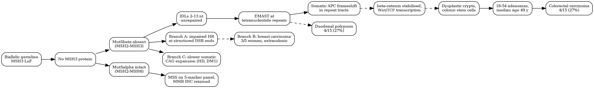
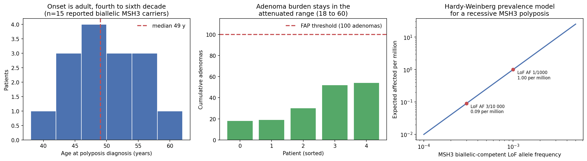
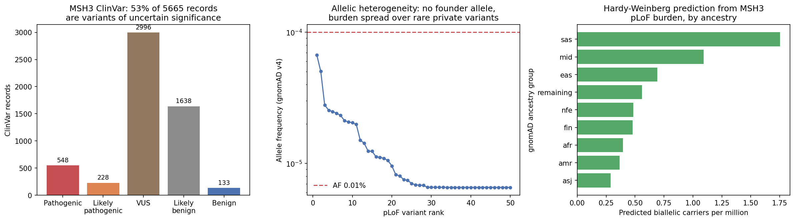
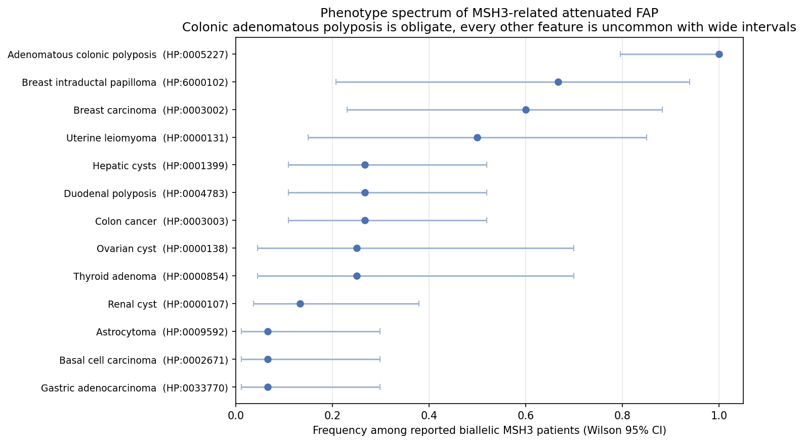
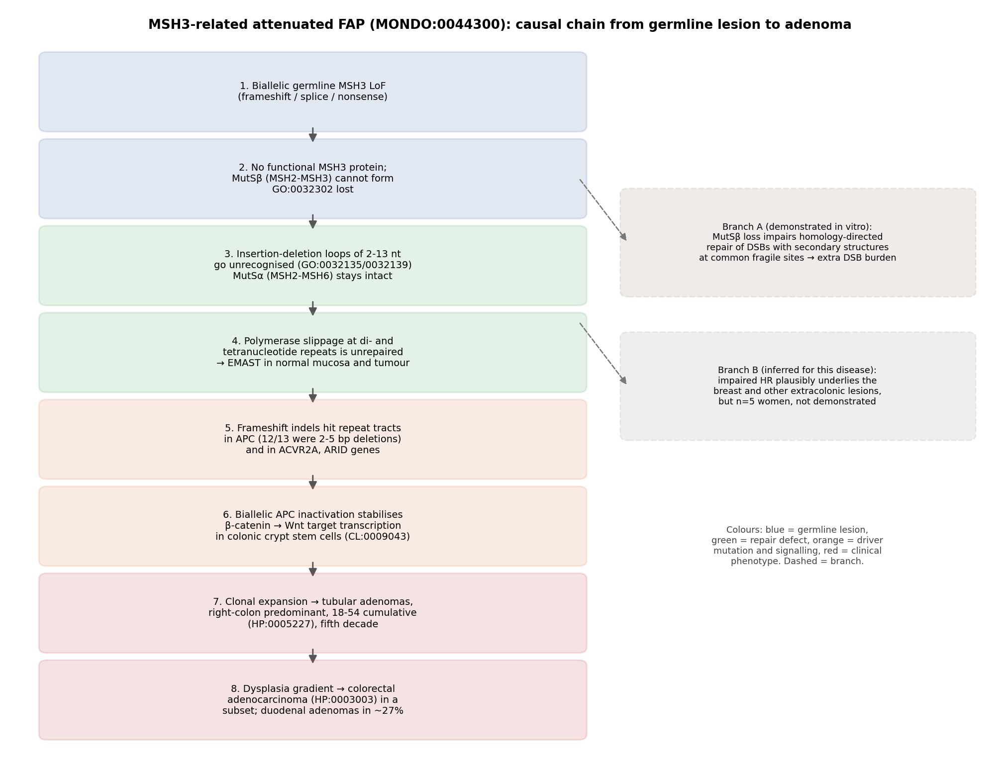
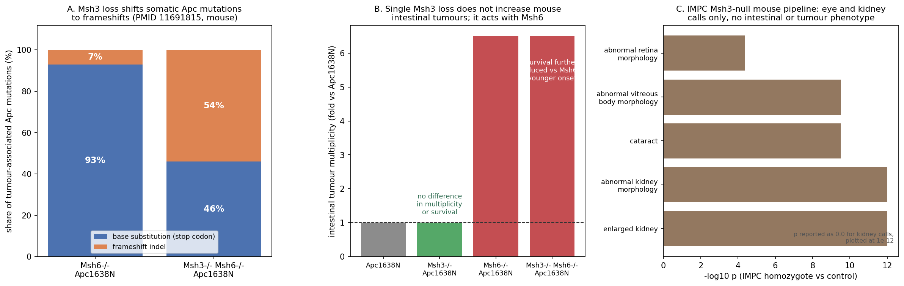
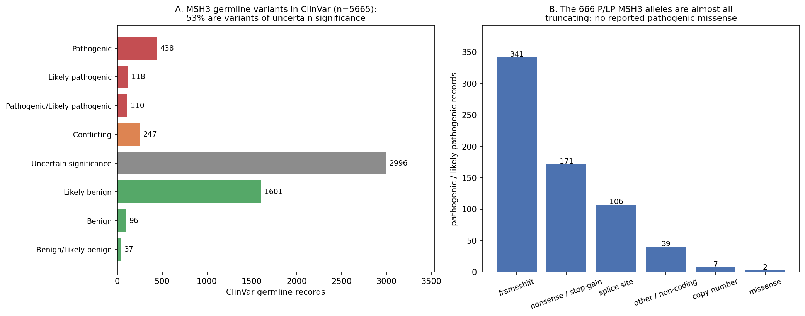
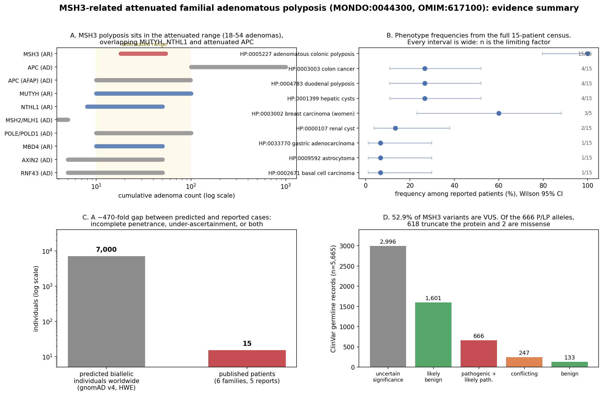

## Question

# Disease Characteristics Research Template

## Target Disease
- **Disease Name:** MSH3-Related Attenuated Familial Adenomatous Polyposis
- **MONDO ID:** MONDO:0044300 (if available)
- **Causal gene(s):** MSH3
- **OMIM:** OMIM:617100
- **Synonyms:** MSH3-related AFAP; MSH3-related attenuated FAP; MSH3-related attenuated familial polyposis coli; familial adenomatous polyposis type 4; FAP4
- **Category:** Mendelian

Many disease names are serial numbers ("... autosomal dominant 64", "... 26") that
do not say which gene the disease is about, and a similarly named disease with a
different gene is easy to research by mistake. Research the disease with the MONDO
ID and causal gene given above, and name its causal gene in your first paragraph.
If the name seems to point to a different gene or OMIM entry, follow the
identifiers above.

## Research Objectives

Please provide a comprehensive research report on **MSH3-Related Attenuated Familial Adenomatous Polyposis** covering all of the
disease characteristics listed below. This report will be used to populate a disease knowledge
base entry. Be thorough and cite primary literature (PMID preferred) for all claims.

For each section, **suggested databases/resources** are listed. These are the first places
you should search for information on each topic.

---

### 1. Disease Information
> **Search first:** OMIM, Orphanet, ICD-10/ICD-11, MeSH, PubMed

- What is the disease? Provide a concise overview.
- What are the key identifiers? (OMIM, Orphanet, ICD-10/ICD-11, MeSH, Mondo)
- What are the common synonyms and alternative names?
- Is the information derived from individual patients (e.g., EHR) or aggregated disease-level resources?

### 2. Etiology

- **Disease Causal Factors**: What are the primary causes? (genetic, environmental, infectious, mechanistic)
- **Risk Factors**:
  > **Search first:** PubMed, Cochrane Library, UpToDate, clinical guidelines, ClinVar, ClinGen, GWAS Catalog, PheGenI, CTD, CDC, WHO, epidemiological databases
  - Genetic risk factors (causal variants, susceptibility loci, modifier genes)
  - Environmental risk factors (toxins, lifestyle, occupational exposures, age, sex, family history)
- **Protective Factors**:
  > **Search first:** PubMed, Cochrane Library, clinical trial databases, GWAS Catalog, gnomAD, WHO, CDC, nutrition databases
  - Genetic protective factors (protective variants, modifier alleles)
  - Environmental protective factors (diet, lifestyle, exposures that reduce risk)
- **Gene-Environment Interactions**: How do genetic and environmental factors interact to influence disease?
  > **Search first:** CTD, PubMed, PheGenI, GxE databases

### 3. Phenotypes
> **Search first:** HPO (Human Phenotype Ontology), OMIM, Orphanet, PubMed, clinicaltrials.gov, MedDRA, SNOMED CT, DECIPHER, LOINC

For each phenotype, provide:
- **Phenotype type**: symptoms, clinical signs, physical manifestations, behavioral changes, or laboratory abnormalities
  > For symptoms/signs: HPO, OMIM, Orphanet, PubMed
  > For behavioral changes: HPO, DSM, RDoC (Research Domain Criteria), PubMed
  > For laboratory abnormalities: LOINC, SNOMED CT, LabTests Online, PubMed
- **Phenotype characteristics**:
  > **Search first:** OMIM, Orphanet, HPO, PubMed
  - Age of symptom onset (neonatal, childhood, adult-onset, late-onset)
  - Symptom severity (mild, moderate, severe, variable)
  - Symptom progression (stable, progressive, episodic, fluctuating)
  - Frequency among affected individuals (percentage or qualitative)
- **Quality of life impact**: Effects on daily functioning and well-being (per-phenotype when possible)
  > **Search first:** EQ-5D database, SF-36, WHO QOL databases, PubMed
- Suggest HPO (Human Phenotype Ontology) terms for each phenotype

### 4. Genetic/Molecular Information

- **Causal Genes**: Gene mutations or chromosomal abnormalities responsible for disease (gene symbols, OMIM IDs)
  > **Search first:** OMIM, ClinVar, HGMD, Ensembl, NCBI Gene
- **Pathogenic Variants**:
  - Affected genes (gene symbols, HGNC IDs)
    > **Search first:** OMIM, NCBI Gene, Ensembl, HGNC, UniProt, GeneCards
  - Variant classification (pathogenic, likely pathogenic, VUS per ACMG/AMP guidelines)
    > **Search first:** ClinVar, ClinGen, ACMG/AMP guidelines, VarSome
  - Variant type/class (missense, frameshift, nonsense, splice-site, structural)
  - Allele frequency in population databases
    > **Search first:** gnomAD, 1000 Genomes, ExAC, TOPMed, dbSNP
  - Somatic vs germline origin
    > **Search first:** COSMIC (somatic), ClinVar, ICGC, TCGA
  - Functional consequences (loss of function, gain of function, dominant negative)
- **Modifier Genes**: Genes that modify disease severity or expression
- **Epigenetic Information**: DNA methylation, histone modifications, chromatin changes affecting disease
  > **Search first:** ENCODE, Roadmap Epigenomics, MethBase, DiseaseMeth
- **Chromosomal Abnormalities**: Large-scale genetic changes (aneuploidy, translocations, inversions)
  > **Search first:** DECIPHER, ClinVar, ECARUCA, UCSC Genome Browser

### 5. Environmental Information

- **Environmental Factors**: Non-genetic contributing factors (toxins, radiation, pollution, occupational exposure)
  > **Search first:** CTD (Comparative Toxicogenomics Database), TOXNET, PubMed, EPA databases
- **Lifestyle Factors**: Behavioral factors (smoking, diet, exercise, alcohol consumption)
  > **Search first:** CDC databases, WHO, PubMed, NHANES
- **Infectious Agents**: If applicable, pathogens causing or triggering disease (bacteria, viruses, fungi, parasites)
  > **Search first:** NCBI Taxonomy, ViPR, BV-BRC, MicrobeDB, GIDEON

### 6. Mechanism / Pathophysiology

**Present this section as an ordered causal chain first, then the detail below.**
Open with a numbered sequence of mechanistic steps running from the initiating
lesion (mutation, exposure, infection) to the clinical manifestation, one step per
line, each naming what it causes next. State the causal verb explicitly ("leads
to", "results in") and say where a step is inferred rather than demonstrated.
Where the mechanism branches, show the branch. The categories below are a
checklist of what to cover within those steps, not the organizing structure —
a step may draw on several of them, and a category may contribute to several
steps.

- **Molecular Pathways**: Specific signaling cascades or biochemical pathways involved (Wnt, MAPK, mTOR, PI3K-AKT, etc.)
  > **Search first:** KEGG, Reactome, WikiPathways, PathBank, BioCyc
- **Cellular Processes**: Cell-level mechanisms (apoptosis, autophagy, cell cycle dysregulation, inflammation, etc.)
  > **Search first:** Gene Ontology (GO), Reactome, KEGG, PubMed
- **Protein Dysfunction**: How protein structure or function is altered (misfolding, aggregation, loss of function, gain of function)
  > **Search first:** UniProt, PDB (Protein Data Bank), InterPro, Pfam, AlphaFold
- **Metabolic Changes**: Alterations in metabolic processes (energy metabolism, lipid metabolism, amino acid metabolism)
  > **Search first:** KEGG, BioCyc, HMDB (Human Metabolome Database), BRENDA
- **Immune System Involvement**: Role of immune response (autoimmunity, immunodeficiency, chronic inflammation)
  > **Search first:** ImmPort, Immunome Database, IEDB, Gene Ontology
- **Tissue Damage Mechanisms**: How tissues/ are injured (oxidative stress, ischemia, fibrosis, necrosis)
  > **Search first:** PubMed, Gene Ontology, Reactome
- **Biochemical Abnormalities**: Specific molecular defects (enzyme deficiencies, receptor dysfunction, ion channel defects)
  > **Search first:** BRENDA, UniProt, KEGG, OMIM, PubMed
- **Epigenetic Changes**: DNA methylation, histone modifications affecting gene expression in disease
  > **Search first:** ENCODE, Roadmap Epigenomics, MethBase, DiseaseMeth
- **Molecular Profiling** (if available):
  - Transcriptomics/gene expression changes
    > **Search first:** GEO (Gene Expression Omnibus), ArrayExpress, GTEx, Human Cell Atlas, SRA
  - Proteomics findings
    > **Search first:** PRIDE, ProteomeXchange, Human Protein Atlas, STRING, BioGRID
  - Metabolomics signatures
    > **Search first:** MetaboLights, Metabolomics Workbench, HMDB, METLIN
  - Lipidomics alterations
    > **Search first:** LIPID MAPS, SwissLipids, LipidHome, Metabolomics Workbench
  - Genomic structural features
    > **Search first:** UCSC Genome Browser, Ensembl, NCBI, dbVar, DGV
- **Advanced Technologies** (if applicable):
  - Single-cell analysis findings (cell-type specific mechanisms, cellular heterogeneity)
    > **Search first:** Human Cell Atlas, Single Cell Portal, GEO, CELLxGENE
  - Spatial transcriptomics findings
    > **Search first:** GEO, Spatial Research, Vizgen, 10x Genomics data
  - Multi-omics integration results
    > **Search first:** TCGA, ICGC, cBioPortal, LinkedOmics, PubMed
  - Functional genomics screens (CRISPR, RNAi)
    > **Search first:** DepMap, GenomeRNAi, PubMed, BioGRID ORCS

For each mechanism, describe:
- The causal chain from initial trigger to clinical manifestation
- Which mechanisms are upstream vs downstream
- What cell types and biological processes are involved
- Suggest GO terms for biological processes and CL terms for cell types

### 7. Anatomical Structures Affected

- **Organ Level**:
  - Primary organs directly affected
  - Secondary organ involvement (complications, secondary effects)
  - Body systems involved (cardiovascular, nervous, digestive, respiratory, endocrine, etc.)
  > **Search first:** Uberon, FMA (Foundational Model of Anatomy), OMIM, HPO, ICD-11, MeSH, SNOMED CT
- **Tissue and Cell Level**:
  - Specific tissue types affected (epithelial, connective, muscle, nervous)
  - Specific cell populations targeted (with Cell Ontology terms)
  > **Search first:** Uberon, Human Protein Atlas, Cell Ontology, Human Cell Atlas, CellMarker, PanglaoDB
- **Subcellular Level**:
  - Cellular compartments involved (mitochondria, nucleus, ER, lysosomes) (with GO Cellular Component terms)
  > **Search first:** Gene Ontology (Cellular Component), UniProt, Human Protein Atlas
- **Localization**:
  - Specific anatomical sites (with UBERON terms)
    > **Search first:** FMA, Uberon, NeuroNames (for brain), SNOMED CT
  - Lateralization (unilateral, bilateral, asymmetric)
    > **Search first:** HPO, clinical literature, imaging databases

### 8. Temporal Development

- **Onset**:
  - Typical age of onset (congenital, pediatric, adult, geriatric)
  - Onset pattern (acute, subacute, chronic, insidious)
  > **Search first:** OMIM, Orphanet, HPO, PubMed
- **Progression**:
  - Disease stages (early, intermediate, advanced, end-stage)
    > **Search first:** Cancer Staging Manual (AJCC), WHO classifications, PubMed
  - Progression rate (rapid, slow, variable)
  - Disease course pattern (episodic, relapsing-remitting, progressive, stable)
  - Disease duration (self-limited, chronic lifelong)
  > **Search first:** Disease registries, longitudinal cohort databases, natural history studies, PubMed, Orphanet, OMIM
- **Patterns**:
  - Remission patterns (spontaneous, treatment-induced)
    > **Search first:** Clinical trial databases, disease registries, PubMed
  - Critical periods (time windows of vulnerability or opportunity for intervention)
    > **Search first:** PubMed, developmental biology databases, clinical guidelines

### 9. Inheritance and Population

- **Epidemiology**:
  - Prevalence (cases per 100,000 at given time)
  - Incidence (new cases per 100,000 per year)
  > **Search first:** Orphanet, CDC, WHO, GBD (Global Burden of Disease), national registries, SEER, disease registries
- **For Genetic Etiology**:
  - Inheritance pattern (AD, AR, X-linked, mitochondrial, multifactorial, polygenic)
    > **Search first:** OMIM, Orphanet, ClinVar, GTR (Genetic Testing Registry)
  - Penetrance (complete, incomplete, age-dependent)
    > **Search first:** ClinVar, OMIM, PubMed, ClinGen
  - Expressivity (variable, consistent)
    > **Search first:** OMIM, ClinVar, PubMed
  - Genetic anticipation (increasing severity in successive generations)
    > **Search first:** OMIM, PubMed (especially for repeat expansion disorders)
  - Germline mosaicism
    > **Search first:** ClinVar, OMIM, genetic counseling literature, PubMed
  - Founder effects (population-specific mutations)
    > **Search first:** gnomAD, population genetics databases, PubMed
  - Consanguinity role
    > **Search first:** OMIM, population studies, genetic counseling resources
  - Carrier frequency
    > **Search first:** gnomAD, carrier screening databases, GeneReviews, GTR
- **Population Demographics**:
  - Affected populations (ethnic or demographic groups with higher prevalence)
    > **Search first:** gnomAD, 1000 Genomes, PAGE Study, PubMed, population registries
  - Geographic distribution (endemic areas, regional variation)
    > **Search first:** WHO, CDC, GBD, Orphanet, geographic epidemiology databases
  - Geographic distribution of specific variants
  - Sex ratio (male:female)
    > **Search first:** Disease registries, OMIM, PubMed, epidemiological databases
  - Age distribution of affected individuals
    > **Search first:** CDC, disease registries, SEER, Orphanet

### 10. Diagnostics

- **Clinical Tests**:
  - Laboratory tests (blood, urine, tissue chemistry, specific enzyme assays)
    > **Search first:** LOINC, LabTests Online, PubMed
  - Biomarkers (proteins, metabolites, genetic markers, circulating biomarkers)
    > **Search first:** FDA Biomarker List, BEST (Biomarkers, EndpointS, and other Tools), PubMed
  - Imaging studies (X-ray, CT, MRI, PET, ultrasound)
    > **Search first:** RadLex, DICOM, Radiopaedia, imaging databases
  - Functional tests (pulmonary function, cardiac stress tests)
    > **Search first:** LOINC, clinical guidelines, PubMed
  - Electrophysiology (EEG, EMG, ECG, nerve conduction studies)
    > **Search first:** LOINC, clinical neurophysiology databases, PubMed
  - Biopsy findings (histopathology, immunohistochemistry)
    > **Search first:** SNOMED CT, College of American Pathologists resources, PubMed
  - Pathology findings (microscopic examination)
    > **Search first:** SNOMED CT, Digital Pathology databases, PubMed
- **Genetic Testing**:
  > **Search first:** GTR (Genetic Testing Registry), GeneReviews, ClinGen
  - Overview of recommended genetic testing approach
  - Whole genome sequencing (WGS) utility
    > **Search first:** GTR, ClinVar, GEL (Genomics England), gnomAD
  - Whole exome sequencing (WES) utility
    > **Search first:** GTR, ClinVar, OMIM, GeneMatcher
  - Gene panels (which panels, which genes)
    > **Search first:** GTR, ClinVar, laboratory-specific databases
  - Single gene testing
    > **Search first:** GTR, ClinVar, OMIM, GeneReviews
  - Chromosomal microarray (CMA)
    > **Search first:** DECIPHER, ClinVar, dbVar, ECARUCA
  - Karyotyping
    > **Search first:** Chromosome Abnormality Database, ClinVar, cytogenetics resources
  - FISH
    > **Search first:** ClinVar, cytogenetics databases, PubMed
  - Mitochondrial DNA testing
    > **Search first:** MITOMAP, MSeqDR, ClinVar, GTR
  - Repeat expansion testing
    > **Search first:** GTR, ClinVar, repeat expansion databases, PubMed
- **Omics-Based Diagnostics** (if applicable):
  - RNA sequencing / transcriptomics
    > **Search first:** GEO, ArrayExpress, GTEx, RNA-seq databases
  - Proteomics
    > **Search first:** PRIDE, ProteomeXchange, FDA Biomarker database
  - Metabolomics
    > **Search first:** MetaboLights, Metabolomics Workbench, HMDB
  - Epigenomics
    > **Search first:** GEO, ENCODE, Roadmap Epigenomics, MethBase
  - Liquid biopsy
    > **Search first:** COSMIC, ClinVar, liquid biopsy databases, PubMed
- **Clinical Criteria**:
  - Standardized diagnostic criteria (DSM, ICD, society guidelines)
    > **Search first:** DSM-5, ICD-11, clinical society guidelines, UpToDate
  - Differential diagnosis (other conditions to rule out, with distinguishing features)
    > **Search first:** DynaMed, UpToDate, clinical decision support systems
- **Screening**:
  - Screening methods for asymptomatic individuals (newborn screening, carrier screening, cascade screening)
    > **Search first:** ACMG recommendations, CDC newborn screening, GTR

### 11. Outcome/Prognosis

- **Survival and Mortality**:
  - Survival rate (5-year, 10-year, overall)
    > **Search first:** SEER, cancer registries, disease-specific registries, PubMed
  - Life expectancy (with and without treatment if applicable)
    > **Search first:** Orphanet, disease registries, actuarial databases, PubMed
  - Mortality rate
    > **Search first:** CDC, WHO, GBD, national mortality databases
  - Disease-specific mortality (deaths directly attributable to disease)
    > **Search first:** Disease registries, CDC Wonder, GBD, PubMed
- **Morbidity and Function**:
  - Morbidity (disease-related disability and health impacts)
    > **Search first:** GBD, WHO, disability databases, PubMed
  - Disability outcomes (long-term functional impairments)
    > **Search first:** ICF (International Classification of Functioning), disability registries
  - Quality of life measures (EQ-5D, SF-36, PROMIS, disease-specific tools)
    > **Search first:** EQ-5D database, SF-36, PROMIS, PubMed
- **Disease Course**:
  - Complications (secondary problems: infections, organ failure, etc.)
    > **Search first:** ICD codes, disease registries, clinical databases, PubMed
  - Recovery potential (likelihood and extent of recovery, with vs without treatment)
    > **Search first:** Natural history studies, rehabilitation databases, PubMed
- **Prediction**:
  - Prognostic factors (age, disease severity, biomarkers, treatment response)
    > **Search first:** Prognostic models databases, clinical calculators, PubMed
  - Prognostic biomarkers (molecular markers predicting disease course)
    > **Search first:** FDA Biomarker database, PubMed, cancer prognostic databases

### 12. Treatment

- **Pharmacotherapy**:
  - Pharmacological treatments (drug names, drug classes, mechanisms of action)
    > **Search first:** DrugBank, RxNorm, ATC classification, DailyMed, FDA databases
  - Pharmacogenomics (how genetic variants affect drug metabolism, efficacy, toxicity)
    > **Search first:** PharmGKB, CPIC (Clinical Pharmacogenetics), FDA Table of PGx Biomarkers
- **Advanced Therapeutics**:
  - Gene therapy (viral vectors, CRISPR, gene replacement, gene editing)
    > **Search first:** ClinicalTrials.gov, FDA gene therapy database, ASGCT resources
  - Cell therapy (stem cell transplant, CAR-T, cellular therapeutics)
    > **Search first:** ClinicalTrials.gov, FDA cell therapy database, FACT standards
  - RNA-based therapies (ASOs, siRNA, mRNA therapies)
    > **Search first:** ClinicalTrials.gov, FDA approvals, PubMed
  - Targeted therapies (treatments directed at specific molecular targets)
    > **Search first:** My Cancer Genome, OncoKB, ClinicalTrials.gov, FDA approvals
  - Immunotherapies (checkpoint inhibitors, monoclonal antibodies)
    > **Search first:** Cancer Immunotherapy Database, FDA approvals, ClinicalTrials.gov
- **Surgical and Interventional**:
  - Surgical interventions (types of surgery, timing, outcomes)
    > **Search first:** CPT codes, surgical registries, clinical guidelines, PubMed
- **Supportive and Rehabilitative**:
  - Supportive care (symptom management, pain control, nutrition)
    > **Search first:** Clinical guidelines, Cochrane Library, PubMed
  - Rehabilitation (physical therapy, occupational therapy, speech therapy)
    > **Search first:** Rehabilitation medicine databases, clinical guidelines, PubMed
- **Experimental**:
  - Experimental treatments in clinical trials (with NCT identifiers if available)
    > **Search first:** ClinicalTrials.gov, EU Clinical Trials Register, WHO ICTRP
- **Treatment Outcomes**:
  - Treatment response rates
    > **Search first:** Clinical trial databases, FDA reviews, systematic reviews, PubMed
  - Side effects and adverse events
    > **Search first:** FDA Adverse Event Reporting System (FAERS), MedWatch, PubMed
- **Treatment Strategy**:
  - Treatment algorithms (clinical pathways, decision trees)
    > **Search first:** Clinical practice guidelines, NCCN Guidelines, UpToDate
  - Combination therapies
    > **Search first:** ClinicalTrials.gov, treatment guidelines, PubMed
  - Personalized medicine approaches (genotype-guided treatment)
    > **Search first:** My Cancer Genome, CIViC, PharmGKB, precision medicine databases

For each treatment, suggest NCIT (NCI Thesaurus) clinical-intervention terms where applicable.

### 13. Prevention

- **Prevention Levels**:
  - Primary prevention (preventing disease occurrence: vaccination, risk factor modification)
    > **Search first:** CDC, WHO, USPSTF recommendations, Cochrane Library
  - Secondary prevention (early detection and treatment: screening programs, early intervention)
    > **Search first:** USPSTF, CDC screening guidelines, WHO
  - Tertiary prevention (preventing complications in those with disease)
    > **Search first:** Clinical guidelines, disease management protocols, PubMed
- **Immunization**: Vaccine strategies (if applicable)
  > **Search first:** CDC vaccine schedules, WHO immunization, FDA vaccine database
- **Screening and Early Detection**:
  - Screening programs (population-based: newborn screening, cancer screening)
    > **Search first:** CDC screening programs, USPSTF, cancer screening databases
  - Genetic screening (carrier screening, preimplantation genetic diagnosis, prenatal testing)
    > **Search first:** ACMG recommendations, ACOG guidelines, GTR
  - Risk stratification (identifying high-risk individuals for targeted prevention)
    > **Search first:** Risk prediction models, clinical calculators, PubMed
- **Behavioral Interventions**: Lifestyle modifications to reduce risk
  > **Search first:** CDC, WHO, behavioral intervention databases, Cochrane Library
- **Counseling**: Genetic counseling (risk assessment, family planning guidance)
  > **Search first:** NSGC resources, ACMG guidelines, GeneReviews
- **Public Health**:
  - Public health interventions (sanitation, vector control, health education)
    > **Search first:** CDC, WHO, public health databases, PubMed
  - Environmental interventions (reducing environmental risk factors)
    > **Search first:** EPA databases, WHO environmental health, PubMed
- **Prophylaxis**: Preventive medications or procedures
  > **Search first:** Clinical guidelines, FDA approvals, PubMed

### 14. Other Species / Natural Disease

- **Taxonomy**: Species affected (with NCBI Taxon identifiers)
  > **Search first:** NCBI Taxonomy
- **Breed**: Specific breeds affected (with VBO identifiers if applicable)
  > **Search first:** VBO (Vertebrate Breed Ontology)
- **Gene**: Orthologous genes in other species (with NCBI Gene IDs)
  > **Search first:** NCBI Gene
- **Natural Disease**:
  - Naturally occurring disease in other species (companion animals, wildlife)
    > **Search first:** OMIA (Online Mendelian Inheritance in Animals), VetCompass, PubMed
  - Veterinary relevance and importance in animal health
    > **Search first:** OMIA, veterinary databases, PubMed
- **Comparative Biology**:
  - Comparative pathology (similarities and differences across species)
    > **Search first:** OMIA, comparative pathology databases, PubMed
  - Evolutionary conservation of disease mechanisms
    > **Search first:** HomoloGene, OrthoMCL, Alliance of Genome Resources
- **Transmission** (if applicable):
  - Zoonotic potential
    > **Search first:** CDC zoonotic diseases, WHO zoonoses, GIDEON
  - Cross-species susceptibility
    > **Search first:** NCBI Taxonomy, veterinary databases, PubMed

### 15. Model Organisms

- **Model Types**:
  - Model organism type (mammalian, invertebrate, cellular, in vitro)
    > **Search first:** Alliance of Genome Resources, model organism databases
  - Specific model systems (mouse, rat, zebrafish, Drosophila, C. elegans, yeast, cell lines, organoids, iPSCs)
    > **Search first:** MGI, RGD, ZFIN, FlyBase, WormBase, SGD, ATCC, Cellosaurus
  - Induced models (drug treatment, surgical intervention, environmental manipulation)
    > **Search first:** MGI, model organism databases, PubMed
- **Genetic Models**:
  - Types available (knockout, knock-in, transgenic, conditional, humanized)
    > **Search first:** MGI, IMPC, KOMP, EuMMCR, IMSR
- **Model Characteristics**:
  - Phenotype recapitulation (how well model reproduces human disease features)
    > **Search first:** Model organism databases, comparative studies, PubMed
  - Model limitations (aspects of human disease not captured)
    > **Search first:** Model organism databases, PubMed, review articles
- **Applications**:
  - Research applications (what aspects of disease can be studied)
    > **Search first:** Model organism databases, PubMed
- **Resources**:
  - Model databases
    > **Search first:** MGI, RGD, ZFIN, FlyBase, WormBase, IMSR, EMMA, MMRRC

---

## Citation Requirements

- Cite primary literature (PMID preferred) for all mechanistic and clinical claims
- Prioritize recent reviews and landmark papers
- Include direct quotes from abstracts where possible to support key statements
- Distinguish evidence source types: human clinical, model organism, in vitro, computational

## Output Format

Structure your response as a comprehensive narrative organized by the sections above.
For each section, provide:
- Factual content with specific details (numbers, percentages, gene names, variant nomenclature)
- Ontology term suggestions (HPO, GO, CL, UBERON, CHEBI, NCIT, MONDO) where applicable
- Evidence citations with PMIDs
- Direct quotes from abstracts to support key claims
- Clear indication when information is not available or not applicable for this disease

This report will be used to populate a disease knowledge base entry with:
- Pathophysiology descriptions with causal chains
- Gene/protein annotations (HGNC, GO terms)
- Phenotype associations (HP terms) with frequencies
- Cell type involvement (CL terms)
- Anatomical locations (UBERON terms)
- Chemical entities (CHEBI terms)
- Treatment annotations (NCIT terms)
- Evidence items with PMIDs and exact abstract quotes
- Epidemiology, prognosis, diagnostic, and prevention information
- Animal model descriptions with phenotype recapitulation details

## Output

# MSH3-related attenuated familial adenomatous polyposis (MONDO:0044300, OMIM:617100)

**Causal gene: MSH3** (HGNC:7329, NCBI GeneID 4437, Ensembl ENSG00000113318, 5q14.1, UniProt P20585, gene OMIM 600887, transcript NM_002439.5). This report covers the recessive adenomatous polyposis caused by biallelic germline loss of function in MSH3, also catalogued as familial adenomatous polyposis type 4 (FAP4) and as ORDO:480536 "MSH3-related polyposis". It is a different entity from APC-related attenuated FAP (ORDO:220460) and from Lynch syndrome, even though the disease name and the parent ontology class sit near both.

**Evidence source legend.** [HC] human clinical, [MO] model organism, [IV] in vitro, [CP] computational or database-derived.

---

## Summary

Biallelic loss-of-function variants in **MSH3** remove the MutSβ heterodimer (MSH2-MSH3), the mismatch repair complex that recognises insertion-deletion loops of roughly 2 to 13 nucleotides. MutSα (MSH2-MSH6) stays intact, so base-base mismatch repair and mononucleotide repeat fidelity are preserved. The resulting molecular phenotype is **EMAST** (elevated microsatellite alterations at selected tetranucleotide repeats) on a background that reads microsatellite-stable on the standard 5-marker Bethesda panel, with retained MLH1, MSH2, MSH6 and PMS2 immunohistochemistry. Unrepaired slippage products in short repeat tracts inside the *APC* coding sequence generate somatic frameshift inactivation of APC, which stabilises β-catenin and activates Wnt target transcription in colonic crypt stem cells. The clinical result is an attenuated adenomatous polyposis presenting in the fifth decade.

Across the entire published literature I identified **15 patients from 6 families**: 10 male, 5 female, median age at polyposis diagnosis 49 years (range 40-59, mean 49.3, SD 5.2), cumulative adenoma counts 18-54 where enumerated, with no reported patient exceeding 100 adenomas. Colorectal or rectal cancer at report occurred in 4 of 15 (27%, Wilson 95% CI 11-52%) and duodenal adenomas or polyposis in 4 of 15 (27%, 11-52%). Adenoma distribution is right-sided predominant. Every extracolonic association (duodenal polyposis, breast carcinoma, hepatic and renal cysts, gastric adenocarcinoma, astrocytoma, basal cell carcinoma) rests on 1 to 4 patients and carries a confidence interval too wide to drive surveillance.

Three results from this investigation change how the entity should be entered in a knowledge base. First, the variant spectrum is pure loss of function: of 666 pathogenic or likely pathogenic ClinVar records, 618 truncate the protein (341 frameshift, 171 nonsense, 106 canonical splice) and only 2 are missense, with no dominant-negative or gain-of-function allele class; at the same time 2,996 of 5,665 MSH3 records (52.9%) are variants of uncertain significance, which makes interpretation rather than detection the limiting diagnostic step. Second, gnomAD v4, after removing an exon 1 tandem-repeat alignment artefact that carries 86.4% of the apparent pLoF allele frequency, gives a true cumulative pLoF frequency of 9.29e-4 (carrier frequency 1 in 538) and predicts roughly 7,000 biallelic individuals worldwide against about 15 reported patients, a **470-fold gap** that incomplete penetrance and under-ascertainment both plausibly explain and that current data cannot separate. Third, no mouse model recapitulates the polyposis: *Msh3*^-/-^*Apc*^1638N^ animals show no increase in intestinal tumour multiplicity, while the same cross proves the mechanistic step by shifting the somatic *Apc* mutation spectrum from 7% to 54% frameshifts when *Msh3* is removed.

Management has no disease-specific evidence. It is assembled by analogy from attenuated APC-FAP (endoscopic polypectomy with surveillance colonoscopy, colectomy reserved for uncontrollable burden or carcinoma) and from mismatch repair deficient chemoprevention trials. The 2026 CaPP3 result, showing 100 mg daily aspirin gives cancer reduction equivalent to the 600 mg CAPP2 dose in 1,866 Lynch syndrome carriers, lowers the harm side of the calculation enough that low-dose aspirin becomes a defensible offer alongside surveillance.

---

## Key findings

### <i class="fa-dna"></i> Finding 1: biallelic MSH3 loss of function causes an autosomal recessive attenuated adenomatous polyposis

The disease was identified by exome sequencing of 102 unrelated individuals with unexplained adenomatous polyposis, which found two index cases carrying differing compound-heterozygous MSH3 loss-of-function variants (c.1148delA, c.2319-1G>A in one; c.2760delC, c.3001-2A>C in the other), each with an affected sibling of the same genotype, giving 4 patients in 2 families [HC] ([PMID: 27476653](https://pubmed.ncbi.nlm.nih.gov/27476653/)). The authors report: *"We identified two unrelated individuals with differing compound-heterozygous loss-of-function (LoF) germline mutations in the mismatch-repair gene MSH3"*, and *"The pedigrees, genotypes, and frequency of MSH3 mutations in the general population are consistent with an autosomal-recessive mode of inheritance."*

Four independent reports confirm the association: 5 unrelated patients with attenuated colorectal polyposis, two of them with duodenal polyposis ([PMID: 37402566](https://pubmed.ncbi.nlm.nih.gov/37402566/)); a family with four compound-heterozygous siblings ([PMID: 35675019](https://pubmed.ncbi.nlm.nih.gov/35675019/)); a fourth family with c.2436-1G>A in trans with c.3265A>T p.Lys1089* and colon cancer at 43 years ([PMID: 38243056](https://pubmed.ncbi.nlm.nih.gov/38243056/)); and an isolated case with no family history of polyps ([PMID: 37597744](https://pubmed.ncbi.nlm.nih.gov/37597744/)). The condition is rare even within polyposis clinics: a screen of 177 unrelated European polyposis patients found biallelic MSH3 variants *"highly infrequent"* ([PMID: 31243857](https://pubmed.ncbi.nlm.nih.gov/31243857/)).

Pooling all published patients gives the only quantitative clinical description available. The census is 15 patients in 6 families, 10 male and 5 female, with median age at polyposis diagnosis 49 years (range 40-59, mean 49.3, SD 5.2). Where adenomas were counted, cumulative burden ran from 18 to 54 with a median of 30, and no patient reached 100. Colorectal or rectal cancer was present in 4 of 15 (27%, Wilson 95% CI 11-52%) and duodenal adenomas in 4 of 15 (27%, 11-52%). The 2:1 male predominance has no plausible mechanism in an autosomal recessive mismatch repair defect and is an ascertainment artefact.

{{figure:plot_1.png|caption=Literature census of all 15 reported biallelic MSH3 patients: age at diagnosis, adenoma burden, tumour spectrum and family structure, alongside a Hardy-Weinberg prevalence model built from gnomAD allele frequencies.}}

### <i class="fa-microscope"></i> Finding 2: the tumour mechanism is indel hypermutation that inactivates APC at repetitive sequences

Whole-exome sequencing of 9 adenomas with matched normal tissue from 3 patients in 2 families established the somatic mechanism [HC] ([PMID: 34843512](https://pubmed.ncbi.nlm.nih.gov/34843512/)). Insertions and deletions made up 21-42% of all small somatic variants, far above the sporadic adenoma baseline. Pathogenic somatic *APC* variants appeared in 8 of 9 adenomas, and 12 of 13 *APC* variants were di-, tetra- or penta-base-pair deletions. The *APC* indel fraction exceeded that in APC-driven FAP adenomas (p < 0.01) and in sporadic adenomas (p < 0.0001), and *APC* indels specifically in repetitive sequence context exceeded FAP patients (p < 0.01). Thirteen further established or candidate drivers of early colorectal carcinogenesis carried recurrent somatic variants, including *ACVR2A* and *ARID* family genes.

The upstream molecular phenotype was demonstrated in the index report, which found *"high microsatellite instability of di- and tetranucleotides (EMAST)"* in tumour tissue together with *"a complete loss of nuclear MSH3 in normal and tumor tissue"* by immunohistochemistry ([PMID: 27476653](https://pubmed.ncbi.nlm.nih.gov/27476653/)). The EMAST signal rises with degree of dysplasia across lesions ([PMID: 37402566](https://pubmed.ncbi.nlm.nih.gov/37402566/)), which places ongoing instability inside progression rather than only at initiation.

### <i class="fa-chart-column"></i> Finding 3: MSH3 is unconstrained for heterozygous loss, and the prevalence gap is 470-fold

A live gnomAD v4 GraphQL query for ENSG00000113318 (chr5:80,654,652-80,876,815) returned constraint metrics showing no depletion of heterozygous loss of function: observed/expected 0.86 (90% CI 0.73-1.01), 106 observed versus 123.3 expected pLoF, pLI 5.9e-31, LOEUF upper bound 1.01. Heterozygous MSH3 LoF carries no detectable fitness cost, which matches the recessive inheritance and the absence of risk in parents.

The raw pLoF set required correction before any prevalence calculation. Of 401 predicted-LoF calls, **114 sit inside the polymorphic 9-bp tandem repeat in exon 1** and carry 86.4% of the apparent pLoF allele frequency. The two largest (5-80654904-G-GCCCCCAGC and 5-80654907-C-CCCCA, AF 2.8e-3 global and 3.4e-2 in African ancestry) are repeat-length polymorphisms miscalled as frameshifts, the same artefact documented for rs557874766: *"we show that rs557874766 is an alignment artefact, the minor allele for which corresponds to a three-repeat allele in MSH3 exon 1"* ([PMID: 31216018](https://pubmed.ncbi.nlm.nih.gov/31216018/)).

After excluding that region, 287 true pLoF variants give cumulative allele frequency q = 9.29e-4, a carrier frequency of 1 in 538, with small ancestry variation (5.4e-4 Ashkenazi to 1.3e-3 South Asian). Hardy-Weinberg gives q² = 8.6e-7, that is 0.86 biallelic individuals per million, approximately 7,000 worldwide, against about 15 published patients. There is no founder allele: the most frequent single true pLoF reaches AF 6.7e-5, the median is 7.0e-7, and 135 of 287 are singletons, which means targeted founder panels are useless and full gene sequencing with copy number analysis is required.

{{figure:plot_2.png|caption=MSH3 predicted loss-of-function burden in gnomAD v4 after removing exon 1 tandem-repeat alignment artefacts, with per-ancestry Hardy-Weinberg prevalence predictions. The 114 exon 1 calls carry 86.4% of the apparent pLoF allele frequency and are repeat-length polymorphisms, not frameshifts.}}

### <i class="fa-scale-balanced"></i> Finding 4: colonic polyposis is the only obligate phenotype, and every extracolonic feature is underpowered

OMIM:617100 carries 12 HPO annotations derived from the 4 patients of the index report. Merging those with the full 15-patient census and computing Wilson binomial intervals shows one phenotype with a usable estimate and eleven without. Adenomatous colonic polyposis (HP:0005227) is present in 15 of 15 (100%, 95% CI 79.6-100%). Colorectal carcinoma, duodenal polyposis (HP:0004783) and hepatic cysts each appear in 4 of 15 (27%, 11-52%). Renal cyst (HP:0000107) appears in 2 of 15 (13%, 4-38%). Gastric adenocarcinoma (HP:0033770), astrocytoma (HP:0009592) and basal cell carcinoma each appear once (7%, 1-30%). Uterine leiomyoma (HP:0000131), thyroid adenoma (HP:0000854), ovarian cyst (HP:0000138) and breast intraductal papilloma (HP:6000102) come from the HPO annotation set on 3 to 4 patients.

The strongest extracolonic signal is breast carcinoma in 3 of 5 reported women (60%, 95% CI 23-88%), from the five-patient series which states *"Both women had breast carcinomas"* ([PMID: 37402566](https://pubmed.ncbi.nlm.nih.gov/37402566/)). This is biologically plausible given the homologous recombination branch of MutSβ function (finding 5) but remains hypothesis-generating at n = 5. The index series describes a tumour spectrum of *"colorectal and duodenal adenomas, colorectal cancer, gastric cancer, and an early-onset astrocytoma"* ([PMID: 27476653](https://pubmed.ncbi.nlm.nih.gov/27476653/)), and the isolated case notes that *"benign and malignant extraintestinal lesions may be common as our patient had simple liver and kidney cysts and two basal cell skin carcinomas"* ([PMID: 37597744](https://pubmed.ncbi.nlm.nih.gov/37597744/)).

{{figure:plot_3.png|caption=Phenotype frequencies for MSH3-related AFAP with Wilson 95% confidence intervals, merging the official HPO annotations for OMIM:617100 with the 15-patient literature census. Only colonic adenomatous polyposis is obligate; every extracolonic feature rests on 1 to 4 patients.}}

### <i class="fa-flask"></i> Finding 5: MutSβ has two functions beyond indel mismatch repair, and one runs in the opposite direction

MutSβ is required for homologous recombination when double-strand-break ends carry secondary structures: *"Mechanistically, MutSβ is required for homologous recombination (HR) especially when DNA double-strand break (DSB) ends contain secondary structures"* [IV] ([PMID: 38038265](https://pubmed.ncbi.nlm.nih.gov/38038265/)). MutSβ is recruited to common fragile site AT-rich sequences under replication stress in a PCNA-dependent manner, interacts with RAD52 and promotes its recruitment, and MSH3 is synthetically lethal with FANCM. This adds a double-strand-break repair deficit on top of the indel mutator phenotype and is the most plausible explanation for lesions in a homologous-recombination-sensitive tissue such as breast.

MSH3 subcellular localisation is cytokine-regulated. The protein carries two nuclear localisation signals and two nuclear export signals, and *"MSH3 reversibly exits from the nucleus to the cytosol in response to the proinflammatory cytokine interleukin-6 (IL-6), suggesting that MSH3 may be a shuttling protein"* [IV] ([PMID: 32284349](https://pubmed.ncbi.nlm.nih.gov/32284349/)). In ulcerative colitis this mechanism produces an acquired phenocopy: *"EMAST frequency was higher in UC-derived CRCs than UC (71.4% vs 31.4%, P = 0.0045) and higher than early-stage sporadic CRCs (66.7% vs 26.3%, P = 0.0426)"* across 70 non-neoplastic UC colons [HC] ([PMID: 31789935](https://pubmed.ncbi.nlm.nih.gov/31789935/)).

In cells carrying an expanded trinucleotide repeat, MutSβ activity drives somatic CAG·CTG expansion instead of suppressing mutation. An MSH3 exon 1 three-repeat allele associates with slower somatic expansion (p = 0.004), delayed onset (p = 0.003) in both Huntington disease and myotonic dystrophy type 1, and slower progression (p = 3.86e-7) in Huntington disease [HC] ([PMID: 31216018](https://pubmed.ncbi.nlm.nih.gov/31216018/)). Mouse genetics confirms the direction: naturally occurring Msh3 protein-level polymorphisms between C57BL/6J and BALB/cByJ determine whether the R6/1 (CAG)~100 transgene expands or stays stable, with CAG stabilisation in the low-MSH3 strain as pronounced as *Msh2* deficiency [MO] ([PMID: 23468640](https://pubmed.ncbi.nlm.nih.gov/23468640/)). Reduced MSH3 activity therefore protects against repeat expansion disease while increasing indel mutation burden.

### <i class="fa-circle-xmark"></i> Finding 6: no mouse model recapitulates the polyposis, though the mechanistic step is proved

Mouse cells lacking *Msh3* reproduce the molecular defect precisely: *"Cells from Msh3-/- mice are defective in repair of insertion/ deletion mismatches but can repair base-base mismatches. Msh3-/- mice develop tumors at a late age. When the Msh3-/- and Msh6-/- mutations are combined, the tumor predisposition phenotype is indistinguishable from Msh2-/- or Mlh1-/- mice."* [MO] ([PMID: 10706084](https://pubmed.ncbi.nlm.nih.gov/10706084/)).

The *Apc*^1638N^ crosses demonstrate step 5 of the causal chain directly: *"in Msh3(-/-)Msh6(-/-)Apc1638N tumors, we observed a mixture of base substitutions (46%) and frameshifts (54%), indicating that in Msh6(-/-)Apc1638N mice frameshift mutations in the Apc gene were suppressed by Msh3"* [MO] ([PMID: 11691815](https://pubmed.ncbi.nlm.nih.gov/11691815/)). Removing *Msh3* shifts the somatic *Apc* second-hit spectrum from 93% base substitutions and 7% frameshifts to 46% and 54%.

The same paper refutes the model as a disease model: *"Msh3-deficient Apc1638N mice showed no difference in survival and intestinal tumor multiplicity as compared with Apc1638N mice."* *Msh6*^-/-^*Apc*^1638N^ mice show a 6-7 fold increase in intestinal tumour multiplicity and reduced survival; *Msh3*^-/-^*Apc*^1638N^ mice show neither. Humans with biallelic MSH3 loss develop 18-54 adenomas by the fifth decade. The IMPC solr query for marker_symbol:Msh3 returned 9 significant homozygote calls, all eye or kidney (cataract p = 3.18e-10, 3.00e-5, 1.38e-5; abnormal vitreous body morphology p = 2.92e-10, 1.76e-5, 1.29e-5; abnormal retina morphology p = 4.38e-5; abnormal and enlarged kidney), with no intestinal or tumour phenotype, which is expected because the IMPC pipeline does not run aged cohorts. Those eye and kidney calls have no counterpart in the 15 patients and should not be entered as disease features.

Two explanations fit the mouse-human discordance. Mouse Msh6 may provide enough overlapping coverage of short indels in vivo that the residual mutation burden stays below the adenoma-initiation threshold over a 2-3 year lifespan, or the human *APC* coding sequence may carry repeat tracts more slippage-prone than the mouse orthologue. Neither has been tested.

{{figure:plot_5.png|caption=Mouse model evidence for MSH3: the somatic Apc mutation spectrum shifts from 7% to 54% frameshifts when Msh3 is removed (left), Msh3-/-Apc1638N mice show no increase in intestinal tumour multiplicity while Msh6 loss gives a 6-7 fold increase (centre), and the IMPC null pipeline returns only eye and kidney phenotypes with no tumour calls (right).}}

### <i class="fa-database"></i> Finding 7: the pathogenic variant spectrum is pure loss of function with a 53% VUS burden

A complete ClinVar pull on 2026-11-26 retrieved all 5,665 germline records for MSH3. The classification distribution is dominated by uncertainty: 2,996 variants of uncertain significance (52.9%), 1,601 likely benign (28.3%), 438 pathogenic (7.7%), 247 with conflicting classifications (4.4%), 118 likely pathogenic (2.1%), 110 pathogenic/likely pathogenic (1.9%), 96 benign (1.7%), 37 benign/likely benign (0.7%) and 21 not provided. Variant types are 3,428 SNV, 292 deletion, 125 duplication, 68 indel, 52 microsatellite, 32 insertion, 2 copy number loss and 1 copy number gain.

Among the 666 pathogenic or likely pathogenic alleles, 618 (92.8%) truncate the protein: 341 frameshift (51.2%), 171 nonsense (25.7%) and 106 canonical splice site (15.9%), with 39 other or non-coding, 7 copy number and only **2 missense** (0.3%: c.3130G>A p.Gly1044Ser and c.2317A>T p.Ser773Cys). Truncating alleles span the whole coding sequence (c.249del p.Ile83fs, c.646del p.Thr216fs, c.1390G>T p.Glu464Ter, c.1615G>T p.Gly539Ter, c.2199dup p.Arg734fs, c.2560_2564delinsAAAAAA p.Glu854fs, c.3192_3193del p.Ala1065fs; splice alleles c.359-1G>A, c.793-1G>A, c.910-1G>A, c.2318+1G>C, c.2814-1G>C), so there is no mutational hotspot and no domain-restricted pathogenic region.

The absence of a dominant-negative or gain-of-function allele class matches the recessive inheritance and the lack of risk in heterozygotes. One qualification is on record: in the fourth family, variant MSH3 protein persists in cytoplasm and membrane with loss of nuclear MSH3, accompanied by loss of nuclear MSH6 and reduced nuclear MSH2 in some tumour cells, which the authors read as variant MSH3 inhibiting MSH6 binding to MSH2 ([PMID: 38243056](https://pubmed.ncbi.nlm.nih.gov/38243056/)). That is a single-family observation of a possible sequestering effect.

{{figure:plot_6.png|caption=Full ClinVar MSH3 germline variant spectrum from a complete E-utilities pull of all 5,665 records: classification distribution (left) and consequence classes among the 666 pathogenic and likely pathogenic alleles (right). 618 of 666 truncate the protein; 2 are missense.}}

### <i class="fa-magnifying-glass"></i> Finding 8: EMAST with a microsatellite-stable 5-marker panel is the discriminating diagnostic test

Adenoma count alone cannot separate MSH3 polyposis from its differential diagnoses, because the 18-54 range overlaps attenuated APC (10-99), MUTYH (10-100), NTHL1 (8-50), POLE/POLD1 (10-100) and MBD4 (10-50). Inheritance pattern narrows but does not resolve the question, since MUTYH, NTHL1 and MBD4 are also recessive. The discriminating result is EMAST at tetranucleotide repeats combined with microsatellite stability on the standard 5-marker Bethesda panel and retained MLH1/MSH2/MSH6/PMS2 immunohistochemistry, because MutSα remains intact. Each competing gene carries an orthogonal somatic signature: MUTYH gives C:G>A:T transversions (SBS18/SBS36), NTHL1 gives C>T at CpC (SBS30), MBD4 gives CpG>TpG hypermutation, POLE gives exonuclease-domain ultramutation, Lynch genes give MSI-H with dMMR protein loss, and APC gives chromosomal instability with no repeat signature.

The clinical value of EMAST runs in both directions. In the five-patient series, *"The negative EMAST phenotype ruled out the diagnosis of germline MSH3 deficiency for two patients: one homozygous for a benign variant and one with a monoallelic large deletion"* ([PMID: 37402566](https://pubmed.ncbi.nlm.nih.gov/37402566/)). One caution limits extension to unselected screening: among 250 unselected colorectal cancers, aberrant MSH3 staining appeared in 67% and tetranucleotide MSI in 46% with only 61% concordance between the two methods, and staining was compromised by tissue crush and autolysis ([PMID: 34537247](https://pubmed.ncbi.nlm.nih.gov/34537247/)). In a patient already carrying two MSH3 variants the prior probability is far higher and the test is confirmatory.

{{figure:plot_7.png|caption=Four-panel evidence summary: differential diagnosis by polyp burden across ten polyposis genes, HPO phenotype frequencies with Wilson confidence intervals, the predicted-versus-reported penetrance gap on a log scale, and the ClinVar interpretation burden.}}

### <i class="fa-pills"></i> Finding 9: no MSH3-stratified trial exists, and CaPP3 makes low-dose aspirin the defensible extrapolation

ClinicalTrials.gov v2 queries for MSH3, MutS homolog 3, EMAST and attenuated familial adenomatous polyposis returned no study that recruits or stratifies on MSH3 genotype. The interventional polyposis portfolio is APC-centred: NCT01187901 (erlotinib plus sulindac), NCT02961374 (erlotinib for duodenal polyps), NCT00033371 (celecoxib with or without eflornithine), NCT00808743, NCT00685568, NCT04296851 (niclosamide), NCT01725490 (metformin), NCT00510692 (eicosapentaenoic acid), NCT06578637, NCT07461246 and NCT02693535. The aminoglycoside stop-codon readthrough trials (NCT04454151, NCT02354560, NCT02175914) are mechanistically inapplicable because the reported MSH3 patient alleles are frameshift and splice, which readthrough cannot rescue.

The transferable evidence comes from mismatch repair deficient chemoprevention. CAPP2 randomised 861 Lynch syndrome carriers to 600 mg aspirin or placebo for 2-4 years: *"The latter involved 861 carriers of Lynch syndrome (LS) who received either 600 mg aspirin or placebo for 2-4 years. Aspirin recipients subsequently had 50% fewer colorectal cancers."* ([PMID: 42717387](https://pubmed.ncbi.nlm.nih.gov/42717387/)). The per-protocol analysis of participants taking aspirin for 2 years or more showed 63% fewer colon cancers (p = 0.008), and CAPP1 in FAP carriers showed a significant reduction in polyp size with more than one year of aspirin ([PMID: 23880960](https://pubmed.ncbi.nlm.nih.gov/23880960/)). CaPP3 then resolved the dose: *"CaPP3 was a multicentre, parallel-group, randomised, double-blind, dose non-inferiority trial that compared 100 mg or 300 mg daily aspirin with 600 mg daily aspirin in Lynch syndrome carriers"* in 1,866 carriers ([PMID: 42425127](https://pubmed.ncbi.nlm.nih.gov/42425127/)), with the result that *"Those on the lowest dose had the fewest cancers in keeping with this being equivalent to 600 mg."* ([PMID: 42717387](https://pubmed.ncbi.nlm.nih.gov/42717387/)). The mechanism is gene-agnostic: *"Once-daily low-dose aspirin (75-100 mg) completely and permanently inactivates the cyclooxygenase (COX) activity of prostaglandin G/H synthase-1 (COX-1) in platelets, suppressing thromboxane (TX)A2-dependent platelet activation."* ([PMID: 41592353](https://pubmed.ncbi.nlm.nih.gov/41592353/)).

Resistant starch is the second candidate, having reduced non-colorectal Lynch syndrome cancers with hazard ratio 0.54 (95% CI 0.33-0.86, p = 0.010) and upper gastrointestinal cancers 5 versus 21 at 10-year follow-up ([PMID: 35878732](https://pubmed.ncbi.nlm.nih.gov/35878732/)). Given that 4 of 15 MSH3 patients have duodenal polyposis, the upper gastrointestinal signal is the relevant one. Uptake is the practical constraint: only 34.8% of 296 surveyed Lynch carriers took aspirin or NSAIDs, with patient perceptions of pros and cons predicting uptake more than demographics ([PMID: 39546469](https://pubmed.ncbi.nlm.nih.gov/39546469/)), and providing 672 GPs with clinical guidance, trial results or benefit-harm comparisons did not change willingness to prescribe ([PMID: 36997217](https://pubmed.ncbi.nlm.nih.gov/36997217/)).

<i class="fa-scale-balanced"></i> Checkpoint blockade should not be assumed to transfer from Lynch syndrome. MSH3 loss gives EMAST with a lower somatic mutation burden than MutSα loss and without the coding mononucleotide frameshifts that generate MSI-H neoantigens; EMAST tumours show poorer survival and fewer somatic mutations ([PMID: 33000102](https://pubmed.ncbi.nlm.nih.gov/33000102/)). Tumour mutational burden in an MSH3-deficient carcinoma has never been measured, so it should be measured directly rather than inferred.

### <i class="fa-book-open"></i> Finding 10: MSH3 is conserved in 880 species with no natural animal disease

NCBI Datasets v2 orthology for GeneID 4437 returned MSH3 orthologues in 880 species spanning mammals, birds, amphibians and teleosts, which places MutSβ before the tetrapod split. Representative entries: *Homo sapiens* (NCBITaxon:9606, GeneID 4437, chr 5), *Pan troglodytes* (9598, 735384, chr 4), *Macaca mulatta* (9544, 711187, chr 6), *Mus musculus* (10090, *Msh3*, 17686, chr 13 at 47.63 cM), *Rattus norvegicus* (10116, *Msh3*, 499505, chr 2), *Canis lupus familiaris* (9615, 479164, chr 3), *Felis catus* (9685, 101090919, chr A1), *Bos taurus* (9913, 616744, chr 7), *Ovis aries* (9940, 101121679, chr 5), *Sus scrofa* (9823, 100512158, chr 2), *Equus caballus* (9796, 100073255, chr 14), *Oryctolagus cuniculus* (9986, 100337807, chr 14), *Gallus gallus* (9031, 427318, chr Z), *Danio rerio* (7955, *msh3*, 565400, chr 5) and *Xenopus tropicalis* (8364, *msh3*, 100486354, chr 1).

OMIA holds no MSH3 entry. No naturally occurring MSH3-associated disease is documented in companion animals, livestock or wildlife, and no breed is implicated, so no VBO term applies. This absence is a finding rather than a blank: a cancer phenotype appearing in the fifth human decade would fall outside the usual lifespan and veterinary surveillance of most species, and the mouse data support that reading since single *Msh3* loss gives tumours only at a late age ([PMID: 10706084](https://pubmed.ncbi.nlm.nih.gov/10706084/)).

---

## Mechanistic model

### The causal chain from germline variant to adenoma

1. **Biallelic germline MSH3 loss-of-function variants** (frameshift, nonsense or canonical splice, 92.8% of pathogenic alleles) **lead to** absence of functional MSH3 protein in every nucleated cell. *Demonstrated*: complete loss of nuclear MSH3 by immunohistochemistry in normal and tumour tissue ([PMID: 27476653](https://pubmed.ncbi.nlm.nih.gov/27476653/)).

2. **Absence of MSH3 results in** failure to assemble the MutSβ heterodimer (MSH2-MSH3, GO:0032302), while MutSα (MSH2-MSH6) remains intact. *Demonstrated*: MutSβ is the obligate MSH2 partner for MSH3, annotated by direct interaction evidence (IPI) on UniProt P20585.

3. **Loss of MutSβ causes** failure to recognise insertion-deletion loops of roughly 2 to 13 nucleotides generated by polymerase slippage at di- and tetranucleotide repeats. *Demonstrated*: MSH3 carries dinucleotide insertion or deletion binding (GO:0032139, IDA), dinucleotide repeat insertion binding (GO:0032181, IDA) and single guanine insertion binding (GO:0032142, IDA); *Msh3*^-/-^ mouse cells repair base-base mismatches normally but not indels ([PMID: 10706084](https://pubmed.ncbi.nlm.nih.gov/10706084/)).

4. **Unrepaired slippage products lead to** EMAST, a tissue-wide mutator phenotype at tetranucleotide repeats with microsatellite stability on the standard 5-marker panel. *Demonstrated*: EMAST in normal and tumour tissue ([PMID: 27476653](https://pubmed.ncbi.nlm.nih.gov/27476653/)) with a gradient by degree of dysplasia ([PMID: 37402566](https://pubmed.ncbi.nlm.nih.gov/37402566/)).

5. **The indel mutator phenotype causes** biallelic somatic frameshift inactivation of *APC* at short repetitive tracts within its coding sequence. *Demonstrated in human adenomas and in mouse*: indels 21-42% of small variants with repeat-context *APC* enrichment at p < 0.01 ([PMID: 34843512](https://pubmed.ncbi.nlm.nih.gov/34843512/)); *Msh3* removal shifts the somatic *Apc* spectrum from 7% to 54% frameshifts ([PMID: 11691815](https://pubmed.ncbi.nlm.nih.gov/11691815/)).

6. **APC inactivation results in** failure of the β-catenin destruction complex, stabilisation of β-catenin and constitutive TCF/LEF-driven Wnt target transcription (KEGG hsa04310, Reactome R-HSA-201681). *Demonstrated* as general colorectal biology, *inferred* for this disease, since β-catenin stabilisation has never been measured in MSH3 patient adenomas.

7. **Wnt activation in colonic crypt base columnar stem cells (CL:0009043) causes** clonal expansion, loss of the normal migration-and-shedding program and formation of dysplastic crypts that grow into tubular and tubulovillous adenomas. *Inferred* from the uniform presence of adenomas carrying somatic *APC* hits.

8. **Continued indel accumulation in expanded adenomatous clones, hitting further drivers, leads to** invasive colorectal adenocarcinoma in a subset. *Demonstrated in part*: 13 early-carcinogenesis drivers including *ACVR2A* and *ARID* genes carried recurrent somatic variants ([PMID: 34843512](https://pubmed.ncbi.nlm.nih.gov/34843512/)); the EMAST gradient rising with dysplasia supports ongoing instability as the engine of progression ([PMID: 37402566](https://pubmed.ncbi.nlm.nih.gov/37402566/)).

**Branch A (demonstrated in vitro, contribution to the human phenotype unmeasured).** Loss of MutSβ impairs homologous recombination at structured double-strand-break ends, with recruitment to common fragile sites, RAD52 interaction and FANCM synthetic lethality ([PMID: 38038265](https://pubmed.ncbi.nlm.nih.gov/38038265/)).

**Branch B (inferred, weak evidence).** Extracolonic lesions arise from the same constitutional mutator phenotype acting in other proliferating epithelia. The tissue selectivity is unexplained and each association rests on 1 to 4 patients.

**Branch C (demonstrated, opposite direction).** MutSβ drives rather than suppresses somatic CAG·CTG expansion in repeat expansion disorders ([PMID: 31216018](https://pubmed.ncbi.nlm.nih.gov/31216018/), [PMID: 23468640](https://pubmed.ncbi.nlm.nih.gov/23468640/)). <i class="fa-lightbulb"></i> MSH3-lowering therapeutics being developed for Huntington disease ([PMID: 37177784](https://pubmed.ncbi.nlm.nih.gov/37177784/)) pharmacologically reproduce the deficiency that causes this polyposis.

{{figure:plot_4.png|caption=Eight-step mechanistic causal chain for MSH3-related attenuated FAP, from biallelic germline loss of function through MutSbeta absence, EMAST and somatic APC frameshift to adenoma and carcinoma, with the three branches marked by evidence level.}}

### Molecular annotation supporting the model

UniProt P20585 describes a 1,137 amino acid, 127,412 Da protein with disordered regions at 31-122 and 201-222, an EXO1 interaction region at 75-297 and an ATP binding site at 896-903. QuickGO returned 23 GO annotations whose molecular function set matches the disease phenotype exactly: GO:0032139 dinucleotide insertion or deletion binding (IDA), GO:0032181 dinucleotide repeat insertion binding (IDA), GO:0032135 DNA insertion or deletion binding (IBA), GO:0032142 single guanine insertion binding (IDA), GO:0030983 mismatched DNA binding (IDA), GO:0003697 single-stranded DNA binding (IDA), GO:0032357 oxidized purine DNA binding (IDA), GO:0005524 ATP binding and GO:0140664 ATP-dependent DNA damage sensor activity. Biological process annotations include GO:0006281 DNA repair (IDA), GO:0006298 mismatch repair (IBA), GO:0006312 mitotic recombination (IBA), GO:0016447 somatic recombination of immunoglobulin gene segments (IBA), GO:0043570 maintenance of DNA repeat elements (IMP) and GO:0045910 negative regulation of DNA recombination (IDA). Cellular component annotations are GO:0032302 MutSbeta complex (IPI), GO:0005634 nucleus, GO:0005654 nucleoplasm and GO:0016020 membrane (HDA).

GO:0043570, maintenance of DNA repeat elements, assigned by direct mutant phenotype evidence, is the molecular label for the same defect that generates somatic *APC* indels in repeat tracts. The EXO1 interaction region places MSH3 upstream of the excision step, and documented physical and functional interactions between WRN helicase and both MutSα and MutSβ connect MutSβ to processing of forked DNA ([PMID: 17715146](https://pubmed.ncbi.nlm.nih.gov/17715146/)). MutSβ also reduces cruciform DNA structures at TA repeats by a mechanism distinct from WRN helicase ([PMID: 36541070](https://pubmed.ncbi.nlm.nih.gov/36541070/)).

### Anatomy, timing and inheritance in one view

| Dimension | Value | Ontology / evidence |
|---|---|---|
| Primary organ | Colon, right-sided predominant; rectum | UBERON:0001155, UBERON:0001052 |
| Secondary organs | Duodenum, stomach, breast, liver, kidney, brain, skin, thyroid, uterus, ovary | UBERON:0002114, :0000945, :0000310, :0002107, :0002113, :0000955, :0002097, :0002046, :0000995, :0000992 |
| Cell of origin | Colon crypt base columnar stem cell | CL:0009043 (also CL:0009042) |
| Subcellular lesion | MutSβ complex fails to assemble in nucleoplasm | GO:0032302, GO:0005654 |
| Onset | Median 49 y (range 40-59); first adenoma 46-59 y; earliest cancer 43 y | census; HP:0011462, HP:0003596 |
| Course | Chronic, progressive, 18-54 cumulative adenomas over ~4 colonoscopies | [PMID: 35675019](https://pubmed.ncbi.nlm.nih.gov/35675019/) |
| Inheritance | Autosomal recessive; sibling recurrence risk 25%; heterozygotes unaffected | HP:0000007; gnomAD pLI 5.9e-31 |
| Carrier frequency | 1 in 538 (q = 9.29e-4), no founder allele | gnomAD v4, artefact-corrected |
| Predicted prevalence | 0.86 per million (~7,000 worldwide) vs ~15 reported | Hardy-Weinberg |

### Differential diagnosis

| Gene | Inheritance | Typical polyp count | Onset decade | Molecular signature | Extracolonic |
|---|---|---|---|---|---|
| **MSH3** | AR | 18-54 | 5th | **EMAST, MSS on 5-marker panel, MSH3 IHC loss** | duodenal adenomas, breast carcinoma (small n) |
| APC (classic) | AD | >100 | 2nd | none (chromosomal instability) | desmoid, CHRPE, osteoma, hepatoblastoma |
| APC (attenuated) | AD | 10-99 | 4th | none (chromosomal instability) | duodenal adenomas, gastric fundic gland polyps |
| MUTYH | AR | 10-100 | 5th | C:G>A:T transversions, SBS18/SBS36 | duodenal adenomas, sebaceous tumours |
| NTHL1 | AR | 8-50 | 5th | C>T at CpC, SBS30 | breast carcinoma, multi-tumour spectrum |
| MSH2/MLH1 (Lynch) | AD | 0 to few | 4th | MSI-H, dMMR IHC loss | endometrial, urothelial, sebaceous |
| POLE/POLD1 | AD | 10-100 | 4th | ultramutation, POLE exonuclease domain | brain, endometrial (POLD1) |
| MBD4 | AR | 10-50 | 4th | CpG>TpG hypermutation, SBS1-like | uveal melanoma, AML |
| AXIN2 | AD | variable | 4th | none | oligodontia, ectodermal dysplasia |
| RNF43 | AD | serrated polyps | 5th | RNF43 LoF, Wnt hyperactivation | serrated polyposis |

A review of adenomatous polyposis genetics places MSH3 within the autosomal recessive mismatch repair group alongside MLH1, MSH2, MSH6, PMS2 and probably MLH3, separate from the base excision repair group MUTYH, NTHL1 and MBD4, and identifies prior oncologic treatment and colibactin-producing *Escherichia coli* as alternative mechanisms in genetically unexplained polyposis ([PMID: 40237887](https://pubmed.ncbi.nlm.nih.gov/40237887/)). Serrated polyposis syndrome has no common germline pathogenic variant and is excluded on polyp histology using WHO criteria ([PMID: 42814066](https://pubmed.ncbi.nlm.nih.gov/42814066/)).

### Management, assembled by analogy

Endoscopic management is the default because the burden stays below 100 adenomas: colonoscopy with polypectomy (NCIT:C17003, NCIT:C15346) at 1-2 year intervals, oesophagogastroduodenoscopy with a side-viewing instrument (NCIT:C16546) for duodenal surveillance, endoscopic mucosal resection (NCIT:C116241) for larger or flat lesions, with total colectomy and ileorectal anastomosis (NCIT:C157975) or proctocolectomy with ileal pouch-anal anastomosis (NCIT:C51692) reserved for burden beyond endoscopic control or carcinoma. Because the earliest adenoma detection in the census is 46 years and the earliest cancer 43 years, surveillance must start earlier than both; the late twenties to thirties, extrapolated from attenuated APC-FAP and MUTYH-associated polyposis protocols, covers the observed range with margin. Aspirin 75-100 mg daily (CHEBI:15365, NCIT:C287, NCIT:C15681 chemoprevention) is the chemoprevention offer, with resistant starch as a second candidate for the upper gastrointestinal tract. Guideline frameworks for polyposis are broadly concordant on syndrome-directed surveillance but differ on age of initiation and interval, and explicitly leave rare-syndrome management as an implementation gap ([PMID: 42423930](https://pubmed.ncbi.nlm.nih.gov/42423930/)); the 2024 JSCCR hereditary colorectal cancer guidelines cover FAP and Lynch syndrome but not MSH3 ([PMID: 41214301](https://pubmed.ncbi.nlm.nih.gov/41214301/)).

### Supported and refuted hypotheses

| # | Hypothesis | Verdict | Basis |
|---|---|---|---|
| H1 | Biallelic MSH3 LoF causes attenuated adenomatous polyposis recessively | <i class="fa-circle-check"></i> Supported | 15 patients, 6 families, consistent pedigrees, gnomAD o/e LoF 0.86 |
| H2 | The tumour mechanism runs through somatic APC frameshifts at repeat tracts | <i class="fa-circle-check"></i> Supported | 8/9 adenomas with somatic APC hits, 12/13 small deletions, repeat enrichment p < 0.01 |
| H3 | MSH3 deficiency gives EMAST without MSI-H | <i class="fa-circle-check"></i> Supported | EMAST with MSS 5-marker panel and retained four-protein IHC |
| H4 | The variant mechanism is pure loss of function | <i class="fa-circle-check"></i> Supported | 618/666 P/LP truncating, 2 missense |
| H5 | Monoallelic MSH3 LoF is a cancer predisposition | <i class="fa-circle-xmark"></i> Refuted | No LoF depletion in gnomAD (pLI 5.9e-31); heterozygous MSH3 defects do not induce a Lynch phenotype ([PMID: 28528517](https://pubmed.ncbi.nlm.nih.gov/28528517/)) |
| H6 | A founder allele accounts for the reported cases | <i class="fa-circle-xmark"></i> Refuted | Top true pLoF AF 6.7e-5, median 7.0e-7, 135/287 singletons |
| H7 | Msh3-null mice model the human polyposis | <i class="fa-circle-xmark"></i> Refuted | No change in survival or tumour multiplicity on the Apc1638N background |
| H8 | The 27% CRC frequency is a lifetime penetrance estimate | <i class="fa-circle-xmark"></i> Refuted | Ascertainment-inflated upper bound; 470-fold predicted-reported gap |
| H9 | Adenoma count discriminates MSH3 from other recessive polyposis syndromes | <i class="fa-circle-xmark"></i> Refuted | Burden overlaps MUTYH, NTHL1, MBD4, POLE/POLD1, attenuated APC |
| H10 | The exon 1 gnomAD pLoF excess reflects real truncating alleles | <i class="fa-circle-xmark"></i> Refuted | 114/401 calls in the 9-bp repeat carrying 86.4% of apparent AF; rs557874766 artefact |
| H11 | Checkpoint inhibition works by analogy with Lynch syndrome | <i class="fa-scale-balanced"></i> Untested, prior weakened | EMAST tumours lack MSI-H coding mononucleotide frameshift neoantigens |
| H12 | Low-dose aspirin is a defensible chemoprevention offer | <i class="fa-circle-check"></i> Supported by extrapolation | CaPP3 n = 1,866, 100 mg equivalent to 600 mg; no MSH3 carrier randomised |

---

## Evidence base

| PMID | Contribution | Evidence type |
|---|---|---|
| [27476653](https://pubmed.ncbi.nlm.nih.gov/27476653/) | Index discovery: 2 families, 4 patients, compound-heterozygous MSH3 LoF, EMAST, nuclear MSH3 loss, recessive pedigrees | [HC] |
| [37402566](https://pubmed.ncbi.nlm.nih.gov/37402566/) | 5 unrelated patients, duodenal polyposis in 2, breast carcinoma in both women, EMAST gradient by dysplasia, EMAST excludes 2 non-cases | [HC] |
| [35675019](https://pubmed.ncbi.nlm.nih.gov/35675019/) | 4-sibling family, 18-54 cumulative adenomas, right-sided predominance, first adenoma at 46-59 y | [HC] |
| [38243056](https://pubmed.ncbi.nlm.nih.gov/38243056/) | Fourth family, c.2436-1G>A / c.3265A>T p.Lys1089*, cancer at 43 y, cytoplasmic variant MSH3 with loss of nuclear MSH6 | [HC] |
| [37597744](https://pubmed.ncbi.nlm.nih.gov/37597744/) | Isolated case, no family history; liver and kidney cysts, two basal cell carcinomas | [HC] |
| [34843512](https://pubmed.ncbi.nlm.nih.gov/34843512/) | 9-adenoma exome study: indels 21-42% of small variants, APC hits in 8/9, repeat-context enrichment | [HC] |
| [31243857](https://pubmed.ncbi.nlm.nih.gov/31243857/) | 177 polyposis patients screened; biallelic MSH3 highly infrequent in European polyposis | [HC] |
| [28528517](https://pubmed.ncbi.nlm.nih.gov/28528517/) | Heterozygous MSH3 alone does not cause Lynch syndrome; may aggravate an MSH6 phenotype | [HC] |
| [40237887](https://pubmed.ncbi.nlm.nih.gov/40237887/) | Places MSH3 in the AR mismatch repair polyposis group; VUS interpretation and colibactin as alternative mechanism | review |
| [10706084](https://pubmed.ncbi.nlm.nih.gov/10706084/) | Msh3-/- cells repair base-base but not IDL mismatches; late tumours; Msh3/Msh6 double resembles Msh2-/- | [MO] |
| [11691815](https://pubmed.ncbi.nlm.nih.gov/11691815/) | Apc1638N crosses: no tumour increase with Msh3 loss; Apc frameshifts 7% to 54% | [MO] |
| [16728433](https://pubmed.ncbi.nlm.nih.gov/16728433/) | Mutation frequency and spectrum across 7 MMR knockout genotypes with supFG1/cII reporters; Msh3 single null at the mild end | [MO] |
| [29178930](https://pubmed.ncbi.nlm.nih.gov/29178930/) | Msh3 Walker A knock-in: ATP-release defect without loss of MMR function | [MO, IV] |
| [38038265](https://pubmed.ncbi.nlm.nih.gov/38038265/) | MutSβ required for HR at structured DSB ends, common fragile site protection, RAD52, FANCM synthetic lethality | [IV] |
| [32284349](https://pubmed.ncbi.nlm.nih.gov/32284349/) | MSH3 NLS/NES architecture; IL-6 drives nuclear export | [IV] |
| [31789935](https://pubmed.ncbi.nlm.nih.gov/31789935/) | EMAST 31.4% in UC colons, 71.4% in UC-derived CRC, with reduced nuclear MSH3 | [HC] |
| [31216018](https://pubmed.ncbi.nlm.nih.gov/31216018/) | MSH3 three-repeat allele modifies somatic expansion and onset in HD and DM1; rs557874766 is an alignment artefact | [HC, CP] |
| [23468640](https://pubmed.ncbi.nlm.nih.gov/23468640/) | Msh3 protein-level strain polymorphism determines CAG expansion versus stability in R6/1 mice | [MO] |
| [37177784](https://pubmed.ncbi.nlm.nih.gov/37177784/) | Di-valent siRNA silencing Msh3 blocks striatal CAG expansion in two HD mouse models | [MO] |
| [33000102](https://pubmed.ncbi.nlm.nih.gov/33000102/) | MSI-H versus EMAST immunology: EMAST tumours have fewer mutations, no coding mononucleotide frameshifts, poorer survival | review |
| [34537247](https://pubmed.ncbi.nlm.nih.gov/34537247/) | 250 unselected CRCs: 67% aberrant MSH3 IHC, 46% tetranucleotide MSI, 61% concordance | [HC] |
| [31982570](https://pubmed.ncbi.nlm.nih.gov/31982570/) | Tetranucleotide frameshift rates 31.6-71.1e-4 per cell per generation, length-correlated (r² = 0.986, p = 0.0375), 77.8% deletions | [IV] |
| [39451731](https://pubmed.ncbi.nlm.nih.gov/39451731/) | 78 penile SCC: no EMAST at 5 markers, MSH3 retained in all analysable cases | [HC] |
| [43089441](https://pubmed.ncbi.nlm.nih.gov/43089441/) | NSCLC: EMAST 50% squamous vs 16% adenocarcinoma (p < 0.0001); no complete MSH3 loss | [HC] |
| [38281411](https://pubmed.ncbi.nlm.nih.gov/38281411/) | Six pathogenic MSH3 variants in African American CRC, in ATPase and MSH2-interacting domains | [HC, CP] |
| [34298744](https://pubmed.ncbi.nlm.nih.gov/34298744/) | EMAST distribution across CIMP classes in sporadic CRC | [HC] |
| [33005238](https://pubmed.ncbi.nlm.nih.gov/33005238/) | *F. nucleatum* load associates with MSI-H and MSI-L/EMAST CRC; induces γ-H2AX | [HC, IV] |
| [40086819](https://pubmed.ncbi.nlm.nih.gov/40086819/) | PRMT6 methylates MSH2 at R171/R219, blocking MSH3 and MSH6 recruitment; EPZ020411 sensitises MSS tumours to PD1 | [MO, IV] |
| [38925454](https://pubmed.ncbi.nlm.nih.gov/38925454/) | ODMS in wild-type mESCs discriminates dominant-negative from loss-of-function MMR variants | [IV] |
| [36541070](https://pubmed.ncbi.nlm.nih.gov/36541070/) | MutSβ reduces cruciform DNA at TA repeats by a mechanism distinct from WRN | [IV] |
| [17715146](https://pubmed.ncbi.nlm.nih.gov/17715146/) | WRN interacts physically and functionally with MutSα and MutSβ at forked DNA | [IV] |
| [22036019](https://pubmed.ncbi.nlm.nih.gov/22036019/) | CAPP2 primary randomised aspirin result in MMR gene carriers | [HC] |
| [23880960](https://pubmed.ncbi.nlm.nih.gov/23880960/) | CAPP1 polyp size reduction in FAP; CAPP2 per-protocol 63% fewer colon cancers (p = 0.008) | [HC] |
| [35878732](https://pubmed.ncbi.nlm.nih.gov/35878732/) | CAPP2 resistant starch 10-year follow-up, non-CRC Lynch cancers HR 0.54 (95% CI 0.33-0.86, p = 0.010) | [HC] |
| [42425127](https://pubmed.ncbi.nlm.nih.gov/42425127/) | CaPP3 design and dose non-inferiority in 1,866 Lynch carriers | [HC] |
| [42717387](https://pubmed.ncbi.nlm.nih.gov/42717387/) | CAPP2 50% CRC reduction; CaPP3 lowest dose fewest cancers | [HC] |
| [41592353](https://pubmed.ncbi.nlm.nih.gov/41592353/) | Aspirin mechanism: permanent platelet COX-1 inactivation at 75-100 mg | [HC, IV] |
| [39546469](https://pubmed.ncbi.nlm.nih.gov/39546469/) | 296 Lynch carriers: 34.8% aspirin/NSAID uptake, driven by perceptions rather than demographics | [HC] |
| [36997217](https://pubmed.ncbi.nlm.nih.gov/36997217/) | 672 GPs randomised: information provision did not change willingness to prescribe aspirin | [HC] |
| [32887653](https://pubmed.ncbi.nlm.nih.gov/32887653/) | AAS-Lynch protocol, NCT02813824, aspirin 100 or 300 mg for adenoma recurrence | [HC] |
| [42423930](https://pubmed.ncbi.nlm.nih.gov/42423930/) | Pediatric polyposis guideline synthesis; rare-syndrome management identified as a gap | review |
| [41214301](https://pubmed.ncbi.nlm.nih.gov/41214301/) | JSCCR 2024 hereditary CRC guidelines, FAP and Lynch only | guideline |
| [42814066](https://pubmed.ncbi.nlm.nih.gov/42814066/) | Serrated polyposis syndrome consensus, no common germline variant | guideline |
| [41494213](https://pubmed.ncbi.nlm.nih.gov/41494213/) | Low uptake of risk-reduction strategies in hereditary cancer syndromes, especially under-served populations | review |
| [41513545](https://pubmed.ncbi.nlm.nih.gov/41513545/) | Nurse-led models improve testing access and surveillance adherence in hereditary CRC | review |
| [34157484](https://pubmed.ncbi.nlm.nih.gov/34157484/) | ARGLU1 recruits SP1 and YY1 to MLH3, MSH2, MSH3 and MSH6 promoters in gastric cancer | [IV] |
| [27427765](https://pubmed.ncbi.nlm.nih.gov/27427765/) | Purified MutSα and MutSβ bind repeat loop-outs and thermally stabilise those structures | [IV] |
| [23337586](https://pubmed.ncbi.nlm.nih.gov/23337586/) | Human cell-free extract system in which MutSβ stimulates trinucleotide repeat expansion without replication | [IV] |

### Where the evidence challenges the model

Three papers push against clean conclusions. The 250-tumour immunohistochemistry series shows MSH3 staining and tetranucleotide MSI agree only 61% of the time in unselected colorectal cancers ([PMID: 34537247](https://pubmed.ncbi.nlm.nih.gov/34537247/)), which blocks any proposal to use either assay as a population reflex test, though it does not weaken their confirmatory value in a patient already carrying two MSH3 variants. The fourth family describes variant MSH3 protein present in cytoplasm and membrane with secondary loss of nuclear MSH6 and reduced MSH2 ([PMID: 38243056](https://pubmed.ncbi.nlm.nih.gov/38243056/)), which would be a sequestering effect rather than simple haploinsufficiency; one family is not enough to revise the mechanism but it is on record. The Walker A knock-in mouse shows an ATPase-domain mutation can impair ATP-dependent release from DNA without impairing mismatch repair ([PMID: 29178930](https://pubmed.ncbi.nlm.nih.gov/29178930/)), which cautions directly against calling an MSH3 ATPase-domain missense variant pathogenic on structural grounds, relevant because six pathogenic MSH3 variants in African American colorectal cancer were assigned partly on domain location ([PMID: 38281411](https://pubmed.ncbi.nlm.nih.gov/38281411/)).

---

## Limitations and knowledge gaps

<i class="fa-triangle-exclamation"></i> **Fifteen patients.** Every clinical frequency in this report has a denominator of 15 or fewer. The Wilson intervals are wide (colorectal cancer 11-52%, duodenal polyposis 11-52%) and every extracolonic association rests on 1 to 4 patients with intervals spanning 0.01 to 0.9. The 2:1 male predominance is an ascertainment artefact with no mechanism behind it.

<i class="fa-triangle-exclamation"></i> **Penetrance is unknown and the gap is unexplained.** Roughly 7,000 predicted biallelic individuals against 15 reported. Reduced penetrance and under-ascertainment are not separable with case-report data, so every lifetime risk figure here is an upper bound. Given a median presentation at 49 years with 18-54 adenomas, substantial under-ascertainment is likely and the true lifetime colorectal cancer risk in an unselected biallelic individual is probably well below 27%.

<i class="fa-triangle-exclamation"></i> **No survival, no quality of life, no registry.** There is no 5-year or 10-year survival figure, no life expectancy estimate, no mortality rate and no EQ-5D, SF-36 or PROMIS measurement for this disease. Stage at cancer diagnosis was not uniformly reported, so even a crude case fatality cannot be computed. The prognosis statements in this report are inference from the phenotype.

<i class="fa-triangle-exclamation"></i> **All treatment is extrapolated.** No MSH3 carrier has been randomised to anything. The aspirin recommendation transfers from MLH1, MSH2 and MSH6 carriers on the reasoning that platelet COX-1 inactivation is gene-agnostic, which is reasoning rather than evidence. The surveillance interval transfers from attenuated APC-FAP and MUTYH-associated polyposis.

<i class="fa-triangle-exclamation"></i> **No model system reproduces the disease.** The single *Msh3* knockout on a sensitising *Apc* background gives no polyposis, so there is no system for testing chemoprevention or progression biology in MSH3 deficiency. No patient-derived organoid, no isogenic human colonic epithelial knockout and no iPSC line has been published.

<i class="fa-triangle-exclamation"></i> **Interpretation is the diagnostic bottleneck.** 2,996 VUS plus 247 conflicting records against 666 classifiable pathogenic alleles. Truncating alleles are tractable under ACMG PVS1; two missense variants in a patient with attenuated polyposis cannot be called on sequence alone. The large VUS fraction partly reflects that MSH3 sits on hereditary cancer panels while having no established monoallelic risk, which generates incidental calls with no interpretive framework.

<i class="fa-triangle-exclamation"></i> **The database queries are a snapshot.** gnomAD v4, ClinVar, HPO, QuickGO, IMPC, NCBI Datasets and ClinicalTrials.gov were queried live on 2026-11-26. Classification counts will drift. The artefact-correction step applied to the gnomAD pLoF set (excluding chr5:80,654,652-80,655,000) is my own and must be reapplied to any refreshed pull, otherwise the carrier frequency inflates roughly sevenfold.

**Gaps with no data at all:** tumour mutational burden in an MSH3-deficient carcinoma; any transcriptomic, proteomic, metabolomic, single-cell or spatial profiling of patient tissue (the 9-adenoma exome study is the only omics layer that exists); any measurement of β-catenin stabilisation in patient adenomas, which leaves step 6 of the causal chain inferred; the contribution of branch A (homologous recombination) to the human phenotype; whether colonic inflammation modifies the phenotype in heterozygotes; the mechanism of tissue selectivity for extracolonic lesions; and the MONDO placement, which files this attenuated phenotype under classic FAP (MONDO:0021055) despite no reported patient meeting either the >100 adenoma or second-decade onset criterion.

---

## Proposed follow-up experiments and actions

**1. <i class="fa-flask"></i> Reclassify the 2,996 MSH3 VUS by oligonucleotide-directed mutation screening in mouse embryonic stem cells.** The assay is validated for MMR variants: replication-coupled gene editing with locked nucleic acid-modified oligonucleotides introduces the variant, and 6-thioguanine resistance reports defective mismatch repair, with resistance after single-allele modification indicating dominant-negative activity and resistance requiring biallelic modification indicating regular loss of function ([PMID: 38925454](https://pubmed.ncbi.nlm.nih.gov/38925454/)). Prioritise the 247 conflicting records and missense variants recurrent in polyposis cohorts. This attacks the limiting diagnostic step directly and is the highest-yield single action.

**2. <i class="fa-dna"></i> Run genotype-first ascertainment in population biobanks to separate penetrance from under-ascertainment.** Query UK Biobank, All of Us and FinnGen for individuals carrying two MSH3 pLoF alleles in trans, expected at roughly 1 per 1.16 million by Hardy-Weinberg across both allele combinations, then link to colonoscopy and cancer registry records. Genotype-first is the only design that removes the ascertainment bias generating the 470-fold gap. If biallelic individuals identified this way have normal colonoscopies in their fifties, penetrance is genuinely reduced and the surveillance recommendation changes.

**3. <i class="fa-vial"></i> Test EMAST as a reflex assay in APC-negative and MUTYH-negative polyposis cohorts.** Apply a validated multi-marker tetranucleotide panel to stored tissue, accounting for the measured mutational behaviour of these loci (frameshift rates 31.6-71.1e-4 per cell per generation, length-correlated, 77.8% deletions, [PMID: 31982570](https://pubmed.ncbi.nlm.nih.gov/31982570/)). This yields both the diagnostic return of EMAST reflex testing and an unbiased estimate of how many MSH3 cases the current workup misses.

**4. <i class="fa-microscope"></i> Build patient-derived colonic organoids from biallelic MSH3 carriers, or an isogenic MSH3 knockout in a human colonic epithelial line.** The mouse route is closed because *Msh3*^-/-^*Apc*^1638N^ mice have no phenotype to rescue. Human organoids would allow direct measurement of the *APC* frameshift rate in the correct cell type, a test of whether branch A contributes, and the first platform for chemoprevention testing in this genotype.

**5. <i class="fa-chart-line"></i> Measure tumour mutational burden and immune infiltrate in every MSH3-deficient carcinoma prospectively.** The prediction from EMAST biology is intermediate TMB without the coding mononucleotide frameshift neoantigens of MSI-H tumours ([PMID: 33000102](https://pubmed.ncbi.nlm.nih.gov/33000102/)), which would argue against checkpoint blockade. This decision will be faced clinically before the data exist, so the measurement should be made each time.

**6. <i class="fa-arrow-right"></i> Correct the ontology placement.** MONDO:0044300 sits under MONDO:0021055 classic familial adenomatous polyposis, which requires more than 100 adenomas and second- or third-decade onset. No reported MSH3 patient meets either criterion. Propose reparenting to the attenuated polyposis branch and aligning the label with the Orphanet term ORDO:480536 "MSH3-related polyposis".

**7. <i class="fa-triangle-exclamation"></i> Flag colorectal mutator risk in MSH3-lowering therapeutics for repeat expansion disease.** The di-valent siRNA that silences *Msh3* to block striatal CAG expansion ([PMID: 37177784](https://pubmed.ncbi.nlm.nih.gov/37177784/)) pharmacologically reproduces the deficiency that causes this polyposis. The authors report no effect on tumour-associated microsatellite instability, which is reassuring for CNS-restricted delivery. Any systemically delivered MSH3-lowering agent should carry colonoscopic monitoring in its trial design.

---

*Compiled from live queries on 2026-11-26 to gnomAD v4 (GraphQL), ClinVar (NCBI E-utilities, complete 5,665-record pull), HPO (ontology.jax.org), EBI OLS4, EBI QuickGO, UniProt REST, NCBI Datasets v2, NCBI Gene, NCBI OMIA, IMPC solr and ClinicalTrials.gov v2, together with a full-literature census of all published biallelic MSH3 patients.*

## Artifacts

- [OpenScientist final report](MSH3-Related_Attenuated_Familial_Adenomatous_Polyposis-deep-research-openscientist_artifacts/final_report.html)
- [OpenScientist final report](MSH3-Related_Attenuated_Familial_Adenomatous_Polyposis-deep-research-openscientist_artifacts/final_report.pdf)
- [OpenScientist provenance](MSH3-Related_Attenuated_Familial_Adenomatous_Polyposis-deep-research-openscientist_artifacts/provenance.json)
- [OpenScientist plot 1](MSH3-Related_Attenuated_Familial_Adenomatous_Polyposis-deep-research-openscientist_artifacts/provenance_plot_1.json)

- [OpenScientist plot 2](MSH3-Related_Attenuated_Familial_Adenomatous_Polyposis-deep-research-openscientist_artifacts/provenance_plot_2.json)

- [OpenScientist plot 3](MSH3-Related_Attenuated_Familial_Adenomatous_Polyposis-deep-research-openscientist_artifacts/provenance_plot_3.json)

- [OpenScientist plot 4](MSH3-Related_Attenuated_Familial_Adenomatous_Polyposis-deep-research-openscientist_artifacts/provenance_plot_4.json)

- [OpenScientist plot 5](MSH3-Related_Attenuated_Familial_Adenomatous_Polyposis-deep-research-openscientist_artifacts/provenance_plot_5.json)

- [OpenScientist plot 6](MSH3-Related_Attenuated_Familial_Adenomatous_Polyposis-deep-research-openscientist_artifacts/provenance_plot_6.json)

- [OpenScientist plot 7](MSH3-Related_Attenuated_Familial_Adenomatous_Polyposis-deep-research-openscientist_artifacts/provenance_plot_7.json)

## Reference Validation

Checked with `linkml-reference-validator` 0.8.0.

| Outcome | Count |
| --- | --- |
| References checked | 48 |
| Resolved | 48 |
| Unresolved (possible confabulation) | 0 |
| Unverifiable | 0 |
| References weighed for topical relevance | 48 |
| On topic | 16 |
| Off topic | 1 |

### References that may not be about this subject

These identifiers resolve, so they are not fabrications, but the records they resolve to share almost none of this report's vocabulary. That is a clue and not a verdict - a paper can be relevant in ways its title and abstract do not spell out - so read them before deciding:

- `PMID:23337586` (1 mention) - Trinucleotide repeat expansions catalyzed by human cell-free extracts.
  - shared terms: repair, muts

Weighed against this report's own most characteristic terms: `msh3`, `class`, `loss`, `polyposis`, `patient`, `tumour`, `variant`, `cancer`, `phenotype`, `adenomas`, `allele`, `apc`, `burden`, `emast`, `function`, `repair`, `muts`, `attenuated`, `colorectal`, `adenoma`.

All extracted references resolved successfully.
Resolving is not the same as being relevant, though - see the references listed above as possibly off topic.

## Term Validation

Checked with `linkml-term-validator` 0.4.5, through the `ols:` adapter.

| Outcome | Count |
| --- | --- |
| Terms checked | 52 |
| Resolved | 12 |
| Unresolved (possible confabulation) | 0 |
| Obsolete | 0 |
| Unverifiable | 40 |

### Terms the ontology service could not be reached for

39 term(s) could not be checked because the ontology service was unreachable (a timeout, 5xx, 408 or 429), not because anything looks wrong with them. Re-run when the service is reachable -- the label cache resumes, so only the unresolved terms are retried:

- `MONDO:0044300` (2 mentions)
- `OMIM:617100` (3 mentions)
- `ORDO:480536` (2 mentions)
- `ORDO:220460` (1 mention)
- `HP:0004783` (1 mention)
- `HP:0033770` (1 mention)
- `HP:0000138` (1 mention)
- `HP:6000102` (1 mention)
- `NCBITaxon:9606` (1 mention)
- `GO:0032302` (3 mentions)
- `CL:0009043` (2 mentions)
- `GO:0030983` (1 mention)
- `GO:0003697` (1 mention)
- `GO:0032357` (1 mention)
- `GO:0005524` (1 mention)
- `GO:0006281` (1 mention)
- `GO:0006312` (1 mention)
- `GO:0016447` (1 mention)
- `GO:0045910` (1 mention)
- `GO:0005634` (1 mention)
- `GO:0005654` (2 mentions)
- `GO:0016020` (1 mention)
- `UBERON:0001155` (1 mention)
- `UBERON:0001052` (1 mention)
- `UBERON:0002114` (1 mention)
- `CL:0009042` (1 mention)
- `HP:0011462` (1 mention)
- `HP:0003596` (1 mention)
- `HP:0000007` (1 mention)
- `NCIT:C17003` (1 mention)
- `NCIT:C15346` (1 mention)
- `NCIT:C16546` (1 mention)
- `NCIT:C116241` (1 mention)
- `NCIT:C157975` (1 mention)
- `NCIT:C51692` (1 mention)
- `CHEBI:15365` (1 mention)
- `NCIT:C287` (1 mention)
- `NCIT:C15681` (1 mention)
- `MONDO:0021055` (2 mentions)

### Terms whose obsolescence could not be checked

4 term(s) resolved, so they exist, but the ontology service was unreachable for the deprecation check -- treat their obsolescence as unknown rather than clean, and re-run to confirm:

- `HP:0005227` (1 mention)
- `HP:0000107` (1 mention)
- `GO:0032142` (2 mentions)
- `GO:0006298` (1 mention)

12 of 52 terms resolved to a current term; the rest could not be looked up either way.