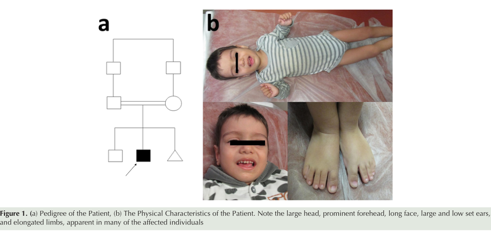
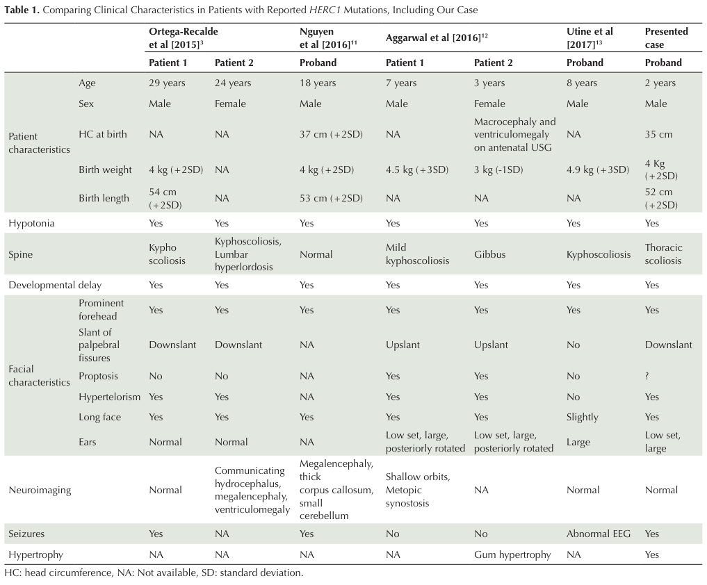

## Question

# Disease Characteristics Research Template

## Target Disease
- **Disease Name:** Macrocephaly, Dysmorphic Facies, and Psychomotor Retardation
- **MONDO ID:** MONDO:0014863 (if available)
- **Category:** Mendelian

## Research Objectives

Please provide a comprehensive research report on **Macrocephaly, Dysmorphic Facies, and Psychomotor Retardation** covering all of the
disease characteristics listed below. This report will be used to populate a disease knowledge
base entry. Be thorough and cite primary literature (PMID preferred) for all claims.

For each section, **suggested databases/resources** are listed. These are the first places
you should search for information on each topic.

---

### 1. Disease Information
> **Search first:** OMIM, Orphanet, ICD-10/ICD-11, MeSH, PubMed

- What is the disease? Provide a concise overview.
- What are the key identifiers? (OMIM, Orphanet, ICD-10/ICD-11, MeSH, Mondo)
- What are the common synonyms and alternative names?
- Is the information derived from individual patients (e.g., EHR) or aggregated disease-level resources?

### 2. Etiology

- **Disease Causal Factors**: What are the primary causes? (genetic, environmental, infectious, mechanistic)
- **Risk Factors**:
  > **Search first:** PubMed, Cochrane Library, UpToDate, clinical guidelines, ClinVar, ClinGen, GWAS Catalog, PheGenI, CTD, CDC, WHO, epidemiological databases
  - Genetic risk factors (causal variants, susceptibility loci, modifier genes)
  - Environmental risk factors (toxins, lifestyle, occupational exposures, age, sex, family history)
- **Protective Factors**:
  > **Search first:** PubMed, Cochrane Library, clinical trial databases, GWAS Catalog, gnomAD, WHO, CDC, nutrition databases
  - Genetic protective factors (protective variants, modifier alleles)
  - Environmental protective factors (diet, lifestyle, exposures that reduce risk)
- **Gene-Environment Interactions**: How do genetic and environmental factors interact to influence disease?
  > **Search first:** CTD, PubMed, PheGenI, GxE databases

### 3. Phenotypes
> **Search first:** HPO (Human Phenotype Ontology), OMIM, Orphanet, PubMed, clinicaltrials.gov, MedDRA, SNOMED CT, DECIPHER, LOINC

For each phenotype, provide:
- **Phenotype type**: symptoms, clinical signs, physical manifestations, behavioral changes, or laboratory abnormalities
  > For symptoms/signs: HPO, OMIM, Orphanet, PubMed
  > For behavioral changes: HPO, DSM, RDoC (Research Domain Criteria), PubMed
  > For laboratory abnormalities: LOINC, SNOMED CT, LabTests Online, PubMed
- **Phenotype characteristics**:
  > **Search first:** OMIM, Orphanet, HPO, PubMed
  - Age of symptom onset (neonatal, childhood, adult-onset, late-onset)
  - Symptom severity (mild, moderate, severe, variable)
  - Symptom progression (stable, progressive, episodic, fluctuating)
  - Frequency among affected individuals (percentage or qualitative)
- **Quality of life impact**: Effects on daily functioning and well-being (per-phenotype when possible)
  > **Search first:** EQ-5D database, SF-36, WHO QOL databases, PubMed
- Suggest HPO (Human Phenotype Ontology) terms for each phenotype

### 4. Genetic/Molecular Information

- **Causal Genes**: Gene mutations or chromosomal abnormalities responsible for disease (gene symbols, OMIM IDs)
  > **Search first:** OMIM, ClinVar, HGMD, Ensembl, NCBI Gene
- **Pathogenic Variants**:
  - Affected genes (gene symbols, HGNC IDs)
    > **Search first:** OMIM, NCBI Gene, Ensembl, HGNC, UniProt, GeneCards
  - Variant classification (pathogenic, likely pathogenic, VUS per ACMG/AMP guidelines)
    > **Search first:** ClinVar, ClinGen, ACMG/AMP guidelines, VarSome
  - Variant type/class (missense, frameshift, nonsense, splice-site, structural)
  - Allele frequency in population databases
    > **Search first:** gnomAD, 1000 Genomes, ExAC, TOPMed, dbSNP
  - Somatic vs germline origin
    > **Search first:** COSMIC (somatic), ClinVar, ICGC, TCGA
  - Functional consequences (loss of function, gain of function, dominant negative)
- **Modifier Genes**: Genes that modify disease severity or expression
- **Epigenetic Information**: DNA methylation, histone modifications, chromatin changes affecting disease
  > **Search first:** ENCODE, Roadmap Epigenomics, MethBase, DiseaseMeth
- **Chromosomal Abnormalities**: Large-scale genetic changes (aneuploidy, translocations, inversions)
  > **Search first:** DECIPHER, ClinVar, ECARUCA, UCSC Genome Browser

### 5. Environmental Information

- **Environmental Factors**: Non-genetic contributing factors (toxins, radiation, pollution, occupational exposure)
  > **Search first:** CTD (Comparative Toxicogenomics Database), TOXNET, PubMed, EPA databases
- **Lifestyle Factors**: Behavioral factors (smoking, diet, exercise, alcohol consumption)
  > **Search first:** CDC databases, WHO, PubMed, NHANES
- **Infectious Agents**: If applicable, pathogens causing or triggering disease (bacteria, viruses, fungi, parasites)
  > **Search first:** NCBI Taxonomy, ViPR, BV-BRC, MicrobeDB, GIDEON

### 6. Mechanism / Pathophysiology

**Present this section as an ordered causal chain first, then the detail below.**
Open with a numbered sequence of mechanistic steps running from the initiating
lesion (mutation, exposure, infection) to the clinical manifestation, one step per
line, each naming what it causes next. State the causal verb explicitly ("leads
to", "results in") and say where a step is inferred rather than demonstrated.
Where the mechanism branches, show the branch. The categories below are a
checklist of what to cover within those steps, not the organizing structure —
a step may draw on several of them, and a category may contribute to several
steps.

- **Molecular Pathways**: Specific signaling cascades or biochemical pathways involved (Wnt, MAPK, mTOR, PI3K-AKT, etc.)
  > **Search first:** KEGG, Reactome, WikiPathways, PathBank, BioCyc
- **Cellular Processes**: Cell-level mechanisms (apoptosis, autophagy, cell cycle dysregulation, inflammation, etc.)
  > **Search first:** Gene Ontology (GO), Reactome, KEGG, PubMed
- **Protein Dysfunction**: How protein structure or function is altered (misfolding, aggregation, loss of function, gain of function)
  > **Search first:** UniProt, PDB (Protein Data Bank), InterPro, Pfam, AlphaFold
- **Metabolic Changes**: Alterations in metabolic processes (energy metabolism, lipid metabolism, amino acid metabolism)
  > **Search first:** KEGG, BioCyc, HMDB (Human Metabolome Database), BRENDA
- **Immune System Involvement**: Role of immune response (autoimmunity, immunodeficiency, chronic inflammation)
  > **Search first:** ImmPort, Immunome Database, IEDB, Gene Ontology
- **Tissue Damage Mechanisms**: How tissues/ are injured (oxidative stress, ischemia, fibrosis, necrosis)
  > **Search first:** PubMed, Gene Ontology, Reactome
- **Biochemical Abnormalities**: Specific molecular defects (enzyme deficiencies, receptor dysfunction, ion channel defects)
  > **Search first:** BRENDA, UniProt, KEGG, OMIM, PubMed
- **Epigenetic Changes**: DNA methylation, histone modifications affecting gene expression in disease
  > **Search first:** ENCODE, Roadmap Epigenomics, MethBase, DiseaseMeth
- **Molecular Profiling** (if available):
  - Transcriptomics/gene expression changes
    > **Search first:** GEO (Gene Expression Omnibus), ArrayExpress, GTEx, Human Cell Atlas, SRA
  - Proteomics findings
    > **Search first:** PRIDE, ProteomeXchange, Human Protein Atlas, STRING, BioGRID
  - Metabolomics signatures
    > **Search first:** MetaboLights, Metabolomics Workbench, HMDB, METLIN
  - Lipidomics alterations
    > **Search first:** LIPID MAPS, SwissLipids, LipidHome, Metabolomics Workbench
  - Genomic structural features
    > **Search first:** UCSC Genome Browser, Ensembl, NCBI, dbVar, DGV
- **Advanced Technologies** (if applicable):
  - Single-cell analysis findings (cell-type specific mechanisms, cellular heterogeneity)
    > **Search first:** Human Cell Atlas, Single Cell Portal, GEO, CELLxGENE
  - Spatial transcriptomics findings
    > **Search first:** GEO, Spatial Research, Vizgen, 10x Genomics data
  - Multi-omics integration results
    > **Search first:** TCGA, ICGC, cBioPortal, LinkedOmics, PubMed
  - Functional genomics screens (CRISPR, RNAi)
    > **Search first:** DepMap, GenomeRNAi, PubMed, BioGRID ORCS

For each mechanism, describe:
- The causal chain from initial trigger to clinical manifestation
- Which mechanisms are upstream vs downstream
- What cell types and biological processes are involved
- Suggest GO terms for biological processes and CL terms for cell types

### 7. Anatomical Structures Affected

- **Organ Level**:
  - Primary organs directly affected
  - Secondary organ involvement (complications, secondary effects)
  - Body systems involved (cardiovascular, nervous, digestive, respiratory, endocrine, etc.)
  > **Search first:** Uberon, FMA (Foundational Model of Anatomy), OMIM, HPO, ICD-11, MeSH, SNOMED CT
- **Tissue and Cell Level**:
  - Specific tissue types affected (epithelial, connective, muscle, nervous)
  - Specific cell populations targeted (with Cell Ontology terms)
  > **Search first:** Uberon, Human Protein Atlas, Cell Ontology, Human Cell Atlas, CellMarker, PanglaoDB
- **Subcellular Level**:
  - Cellular compartments involved (mitochondria, nucleus, ER, lysosomes) (with GO Cellular Component terms)
  > **Search first:** Gene Ontology (Cellular Component), UniProt, Human Protein Atlas
- **Localization**:
  - Specific anatomical sites (with UBERON terms)
    > **Search first:** FMA, Uberon, NeuroNames (for brain), SNOMED CT
  - Lateralization (unilateral, bilateral, asymmetric)
    > **Search first:** HPO, clinical literature, imaging databases

### 8. Temporal Development

- **Onset**:
  - Typical age of onset (congenital, pediatric, adult, geriatric)
  - Onset pattern (acute, subacute, chronic, insidious)
  > **Search first:** OMIM, Orphanet, HPO, PubMed
- **Progression**:
  - Disease stages (early, intermediate, advanced, end-stage)
    > **Search first:** Cancer Staging Manual (AJCC), WHO classifications, PubMed
  - Progression rate (rapid, slow, variable)
  - Disease course pattern (episodic, relapsing-remitting, progressive, stable)
  - Disease duration (self-limited, chronic lifelong)
  > **Search first:** Disease registries, longitudinal cohort databases, natural history studies, PubMed, Orphanet, OMIM
- **Patterns**:
  - Remission patterns (spontaneous, treatment-induced)
    > **Search first:** Clinical trial databases, disease registries, PubMed
  - Critical periods (time windows of vulnerability or opportunity for intervention)
    > **Search first:** PubMed, developmental biology databases, clinical guidelines

### 9. Inheritance and Population

- **Epidemiology**:
  - Prevalence (cases per 100,000 at given time)
  - Incidence (new cases per 100,000 per year)
  > **Search first:** Orphanet, CDC, WHO, GBD (Global Burden of Disease), national registries, SEER, disease registries
- **For Genetic Etiology**:
  - Inheritance pattern (AD, AR, X-linked, mitochondrial, multifactorial, polygenic)
    > **Search first:** OMIM, Orphanet, ClinVar, GTR (Genetic Testing Registry)
  - Penetrance (complete, incomplete, age-dependent)
    > **Search first:** ClinVar, OMIM, PubMed, ClinGen
  - Expressivity (variable, consistent)
    > **Search first:** OMIM, ClinVar, PubMed
  - Genetic anticipation (increasing severity in successive generations)
    > **Search first:** OMIM, PubMed (especially for repeat expansion disorders)
  - Germline mosaicism
    > **Search first:** ClinVar, OMIM, genetic counseling literature, PubMed
  - Founder effects (population-specific mutations)
    > **Search first:** gnomAD, population genetics databases, PubMed
  - Consanguinity role
    > **Search first:** OMIM, population studies, genetic counseling resources
  - Carrier frequency
    > **Search first:** gnomAD, carrier screening databases, GeneReviews, GTR
- **Population Demographics**:
  - Affected populations (ethnic or demographic groups with higher prevalence)
    > **Search first:** gnomAD, 1000 Genomes, PAGE Study, PubMed, population registries
  - Geographic distribution (endemic areas, regional variation)
    > **Search first:** WHO, CDC, GBD, Orphanet, geographic epidemiology databases
  - Geographic distribution of specific variants
  - Sex ratio (male:female)
    > **Search first:** Disease registries, OMIM, PubMed, epidemiological databases
  - Age distribution of affected individuals
    > **Search first:** CDC, disease registries, SEER, Orphanet

### 10. Diagnostics

- **Clinical Tests**:
  - Laboratory tests (blood, urine, tissue chemistry, specific enzyme assays)
    > **Search first:** LOINC, LabTests Online, PubMed
  - Biomarkers (proteins, metabolites, genetic markers, circulating biomarkers)
    > **Search first:** FDA Biomarker List, BEST (Biomarkers, EndpointS, and other Tools), PubMed
  - Imaging studies (X-ray, CT, MRI, PET, ultrasound)
    > **Search first:** RadLex, DICOM, Radiopaedia, imaging databases
  - Functional tests (pulmonary function, cardiac stress tests)
    > **Search first:** LOINC, clinical guidelines, PubMed
  - Electrophysiology (EEG, EMG, ECG, nerve conduction studies)
    > **Search first:** LOINC, clinical neurophysiology databases, PubMed
  - Biopsy findings (histopathology, immunohistochemistry)
    > **Search first:** SNOMED CT, College of American Pathologists resources, PubMed
  - Pathology findings (microscopic examination)
    > **Search first:** SNOMED CT, Digital Pathology databases, PubMed
- **Genetic Testing**:
  > **Search first:** GTR (Genetic Testing Registry), GeneReviews, ClinGen
  - Overview of recommended genetic testing approach
  - Whole genome sequencing (WGS) utility
    > **Search first:** GTR, ClinVar, GEL (Genomics England), gnomAD
  - Whole exome sequencing (WES) utility
    > **Search first:** GTR, ClinVar, OMIM, GeneMatcher
  - Gene panels (which panels, which genes)
    > **Search first:** GTR, ClinVar, laboratory-specific databases
  - Single gene testing
    > **Search first:** GTR, ClinVar, OMIM, GeneReviews
  - Chromosomal microarray (CMA)
    > **Search first:** DECIPHER, ClinVar, dbVar, ECARUCA
  - Karyotyping
    > **Search first:** Chromosome Abnormality Database, ClinVar, cytogenetics resources
  - FISH
    > **Search first:** ClinVar, cytogenetics databases, PubMed
  - Mitochondrial DNA testing
    > **Search first:** MITOMAP, MSeqDR, ClinVar, GTR
  - Repeat expansion testing
    > **Search first:** GTR, ClinVar, repeat expansion databases, PubMed
- **Omics-Based Diagnostics** (if applicable):
  - RNA sequencing / transcriptomics
    > **Search first:** GEO, ArrayExpress, GTEx, RNA-seq databases
  - Proteomics
    > **Search first:** PRIDE, ProteomeXchange, FDA Biomarker database
  - Metabolomics
    > **Search first:** MetaboLights, Metabolomics Workbench, HMDB
  - Epigenomics
    > **Search first:** GEO, ENCODE, Roadmap Epigenomics, MethBase
  - Liquid biopsy
    > **Search first:** COSMIC, ClinVar, liquid biopsy databases, PubMed
- **Clinical Criteria**:
  - Standardized diagnostic criteria (DSM, ICD, society guidelines)
    > **Search first:** DSM-5, ICD-11, clinical society guidelines, UpToDate
  - Differential diagnosis (other conditions to rule out, with distinguishing features)
    > **Search first:** DynaMed, UpToDate, clinical decision support systems
- **Screening**:
  - Screening methods for asymptomatic individuals (newborn screening, carrier screening, cascade screening)
    > **Search first:** ACMG recommendations, CDC newborn screening, GTR

### 11. Outcome/Prognosis

- **Survival and Mortality**:
  - Survival rate (5-year, 10-year, overall)
    > **Search first:** SEER, cancer registries, disease-specific registries, PubMed
  - Life expectancy (with and without treatment if applicable)
    > **Search first:** Orphanet, disease registries, actuarial databases, PubMed
  - Mortality rate
    > **Search first:** CDC, WHO, GBD, national mortality databases
  - Disease-specific mortality (deaths directly attributable to disease)
    > **Search first:** Disease registries, CDC Wonder, GBD, PubMed
- **Morbidity and Function**:
  - Morbidity (disease-related disability and health impacts)
    > **Search first:** GBD, WHO, disability databases, PubMed
  - Disability outcomes (long-term functional impairments)
    > **Search first:** ICF (International Classification of Functioning), disability registries
  - Quality of life measures (EQ-5D, SF-36, PROMIS, disease-specific tools)
    > **Search first:** EQ-5D database, SF-36, PROMIS, PubMed
- **Disease Course**:
  - Complications (secondary problems: infections, organ failure, etc.)
    > **Search first:** ICD codes, disease registries, clinical databases, PubMed
  - Recovery potential (likelihood and extent of recovery, with vs without treatment)
    > **Search first:** Natural history studies, rehabilitation databases, PubMed
- **Prediction**:
  - Prognostic factors (age, disease severity, biomarkers, treatment response)
    > **Search first:** Prognostic models databases, clinical calculators, PubMed
  - Prognostic biomarkers (molecular markers predicting disease course)
    > **Search first:** FDA Biomarker database, PubMed, cancer prognostic databases

### 12. Treatment

- **Pharmacotherapy**:
  - Pharmacological treatments (drug names, drug classes, mechanisms of action)
    > **Search first:** DrugBank, RxNorm, ATC classification, DailyMed, FDA databases
  - Pharmacogenomics (how genetic variants affect drug metabolism, efficacy, toxicity)
    > **Search first:** PharmGKB, CPIC (Clinical Pharmacogenetics), FDA Table of PGx Biomarkers
- **Advanced Therapeutics**:
  - Gene therapy (viral vectors, CRISPR, gene replacement, gene editing)
    > **Search first:** ClinicalTrials.gov, FDA gene therapy database, ASGCT resources
  - Cell therapy (stem cell transplant, CAR-T, cellular therapeutics)
    > **Search first:** ClinicalTrials.gov, FDA cell therapy database, FACT standards
  - RNA-based therapies (ASOs, siRNA, mRNA therapies)
    > **Search first:** ClinicalTrials.gov, FDA approvals, PubMed
  - Targeted therapies (treatments directed at specific molecular targets)
    > **Search first:** My Cancer Genome, OncoKB, ClinicalTrials.gov, FDA approvals
  - Immunotherapies (checkpoint inhibitors, monoclonal antibodies)
    > **Search first:** Cancer Immunotherapy Database, FDA approvals, ClinicalTrials.gov
- **Surgical and Interventional**:
  - Surgical interventions (types of surgery, timing, outcomes)
    > **Search first:** CPT codes, surgical registries, clinical guidelines, PubMed
- **Supportive and Rehabilitative**:
  - Supportive care (symptom management, pain control, nutrition)
    > **Search first:** Clinical guidelines, Cochrane Library, PubMed
  - Rehabilitation (physical therapy, occupational therapy, speech therapy)
    > **Search first:** Rehabilitation medicine databases, clinical guidelines, PubMed
- **Experimental**:
  - Experimental treatments in clinical trials (with NCT identifiers if available)
    > **Search first:** ClinicalTrials.gov, EU Clinical Trials Register, WHO ICTRP
- **Treatment Outcomes**:
  - Treatment response rates
    > **Search first:** Clinical trial databases, FDA reviews, systematic reviews, PubMed
  - Side effects and adverse events
    > **Search first:** FDA Adverse Event Reporting System (FAERS), MedWatch, PubMed
- **Treatment Strategy**:
  - Treatment algorithms (clinical pathways, decision trees)
    > **Search first:** Clinical practice guidelines, NCCN Guidelines, UpToDate
  - Combination therapies
    > **Search first:** ClinicalTrials.gov, treatment guidelines, PubMed
  - Personalized medicine approaches (genotype-guided treatment)
    > **Search first:** My Cancer Genome, CIViC, PharmGKB, precision medicine databases

For each treatment, suggest NCIT (NCI Thesaurus) clinical-intervention terms where applicable.

### 13. Prevention

- **Prevention Levels**:
  - Primary prevention (preventing disease occurrence: vaccination, risk factor modification)
    > **Search first:** CDC, WHO, USPSTF recommendations, Cochrane Library
  - Secondary prevention (early detection and treatment: screening programs, early intervention)
    > **Search first:** USPSTF, CDC screening guidelines, WHO
  - Tertiary prevention (preventing complications in those with disease)
    > **Search first:** Clinical guidelines, disease management protocols, PubMed
- **Immunization**: Vaccine strategies (if applicable)
  > **Search first:** CDC vaccine schedules, WHO immunization, FDA vaccine database
- **Screening and Early Detection**:
  - Screening programs (population-based: newborn screening, cancer screening)
    > **Search first:** CDC screening programs, USPSTF, cancer screening databases
  - Genetic screening (carrier screening, preimplantation genetic diagnosis, prenatal testing)
    > **Search first:** ACMG recommendations, ACOG guidelines, GTR
  - Risk stratification (identifying high-risk individuals for targeted prevention)
    > **Search first:** Risk prediction models, clinical calculators, PubMed
- **Behavioral Interventions**: Lifestyle modifications to reduce risk
  > **Search first:** CDC, WHO, behavioral intervention databases, Cochrane Library
- **Counseling**: Genetic counseling (risk assessment, family planning guidance)
  > **Search first:** NSGC resources, ACMG guidelines, GeneReviews
- **Public Health**:
  - Public health interventions (sanitation, vector control, health education)
    > **Search first:** CDC, WHO, public health databases, PubMed
  - Environmental interventions (reducing environmental risk factors)
    > **Search first:** EPA databases, WHO environmental health, PubMed
- **Prophylaxis**: Preventive medications or procedures
  > **Search first:** Clinical guidelines, FDA approvals, PubMed

### 14. Other Species / Natural Disease

- **Taxonomy**: Species affected (with NCBI Taxon identifiers)
  > **Search first:** NCBI Taxonomy
- **Breed**: Specific breeds affected (with VBO identifiers if applicable)
  > **Search first:** VBO (Vertebrate Breed Ontology)
- **Gene**: Orthologous genes in other species (with NCBI Gene IDs)
  > **Search first:** NCBI Gene
- **Natural Disease**:
  - Naturally occurring disease in other species (companion animals, wildlife)
    > **Search first:** OMIA (Online Mendelian Inheritance in Animals), VetCompass, PubMed
  - Veterinary relevance and importance in animal health
    > **Search first:** OMIA, veterinary databases, PubMed
- **Comparative Biology**:
  - Comparative pathology (similarities and differences across species)
    > **Search first:** OMIA, comparative pathology databases, PubMed
  - Evolutionary conservation of disease mechanisms
    > **Search first:** HomoloGene, OrthoMCL, Alliance of Genome Resources
- **Transmission** (if applicable):
  - Zoonotic potential
    > **Search first:** CDC zoonotic diseases, WHO zoonoses, GIDEON
  - Cross-species susceptibility
    > **Search first:** NCBI Taxonomy, veterinary databases, PubMed

### 15. Model Organisms

- **Model Types**:
  - Model organism type (mammalian, invertebrate, cellular, in vitro)
    > **Search first:** Alliance of Genome Resources, model organism databases
  - Specific model systems (mouse, rat, zebrafish, Drosophila, C. elegans, yeast, cell lines, organoids, iPSCs)
    > **Search first:** MGI, RGD, ZFIN, FlyBase, WormBase, SGD, ATCC, Cellosaurus
  - Induced models (drug treatment, surgical intervention, environmental manipulation)
    > **Search first:** MGI, model organism databases, PubMed
- **Genetic Models**:
  - Types available (knockout, knock-in, transgenic, conditional, humanized)
    > **Search first:** MGI, IMPC, KOMP, EuMMCR, IMSR
- **Model Characteristics**:
  - Phenotype recapitulation (how well model reproduces human disease features)
    > **Search first:** Model organism databases, comparative studies, PubMed
  - Model limitations (aspects of human disease not captured)
    > **Search first:** Model organism databases, PubMed, review articles
- **Applications**:
  - Research applications (what aspects of disease can be studied)
    > **Search first:** Model organism databases, PubMed
- **Resources**:
  - Model databases
    > **Search first:** MGI, RGD, ZFIN, FlyBase, WormBase, IMSR, EMMA, MMRRC

---

## Citation Requirements

- Cite primary literature (PMID preferred) for all mechanistic and clinical claims
- Prioritize recent reviews and landmark papers
- Include direct quotes from abstracts where possible to support key statements
- Distinguish evidence source types: human clinical, model organism, in vitro, computational

## Output Format

Structure your response as a comprehensive narrative organized by the sections above.
For each section, provide:
- Factual content with specific details (numbers, percentages, gene names, variant nomenclature)
- Ontology term suggestions (HPO, GO, CL, UBERON, CHEBI, NCIT, MONDO) where applicable
- Evidence citations with PMIDs
- Direct quotes from abstracts to support key claims
- Clear indication when information is not available or not applicable for this disease

This report will be used to populate a disease knowledge base entry with:
- Pathophysiology descriptions with causal chains
- Gene/protein annotations (HGNC, GO terms)
- Phenotype associations (HP terms) with frequencies
- Cell type involvement (CL terms)
- Anatomical locations (UBERON terms)
- Chemical entities (CHEBI terms)
- Treatment annotations (NCIT terms)
- Evidence items with PMIDs and exact abstract quotes
- Epidemiology, prognosis, diagnostic, and prevention information
- Animal model descriptions with phenotype recapitulation details

## Output

Question: You are an expert researcher providing comprehensive, well-cited information.

Provide detailed information focusing on:
1. Key concepts and definitions with current understanding
2. Recent developments and latest research (prioritize 2023-2024 sources)
3. Current applications and real-world implementations
4. Expert opinions and analysis from authoritative sources
5. Relevant statistics and data from recent studies

Format as a comprehensive research report with proper citations. Include URLs and publication dates where available.
Always prioritize recent, authoritative sources and provide specific citations for all major claims.

# Disease Characteristics Research Template

## Target Disease
- **Disease Name:** Macrocephaly, Dysmorphic Facies, and Psychomotor Retardation
- **MONDO ID:** MONDO:0014863 (if available)
- **Category:** Mendelian

## Research Objectives

Please provide a comprehensive research report on **Macrocephaly, Dysmorphic Facies, and Psychomotor Retardation** covering all of the
disease characteristics listed below. This report will be used to populate a disease knowledge
base entry. Be thorough and cite primary literature (PMID preferred) for all claims.

For each section, **suggested databases/resources** are listed. These are the first places
you should search for information on each topic.

---

### 1. Disease Information
> **Search first:** OMIM, Orphanet, ICD-10/ICD-11, MeSH, PubMed

- What is the disease? Provide a concise overview.
- What are the key identifiers? (OMIM, Orphanet, ICD-10/ICD-11, MeSH, Mondo)
- What are the common synonyms and alternative names?
- Is the information derived from individual patients (e.g., EHR) or aggregated disease-level resources?

### 2. Etiology

- **Disease Causal Factors**: What are the primary causes? (genetic, environmental, infectious, mechanistic)
- **Risk Factors**:
  > **Search first:** PubMed, Cochrane Library, UpToDate, clinical guidelines, ClinVar, ClinGen, GWAS Catalog, PheGenI, CTD, CDC, WHO, epidemiological databases
  - Genetic risk factors (causal variants, susceptibility loci, modifier genes)
  - Environmental risk factors (toxins, lifestyle, occupational exposures, age, sex, family history)
- **Protective Factors**:
  > **Search first:** PubMed, Cochrane Library, clinical trial databases, GWAS Catalog, gnomAD, WHO, CDC, nutrition databases
  - Genetic protective factors (protective variants, modifier alleles)
  - Environmental protective factors (diet, lifestyle, exposures that reduce risk)
- **Gene-Environment Interactions**: How do genetic and environmental factors interact to influence disease?
  > **Search first:** CTD, PubMed, PheGenI, GxE databases

### 3. Phenotypes
> **Search first:** HPO (Human Phenotype Ontology), OMIM, Orphanet, PubMed, clinicaltrials.gov, MedDRA, SNOMED CT, DECIPHER, LOINC

For each phenotype, provide:
- **Phenotype type**: symptoms, clinical signs, physical manifestations, behavioral changes, or laboratory abnormalities
  > For symptoms/signs: HPO, OMIM, Orphanet, PubMed
  > For behavioral changes: HPO, DSM, RDoC (Research Domain Criteria), PubMed
  > For laboratory abnormalities: LOINC, SNOMED CT, LabTests Online, PubMed
- **Phenotype characteristics**:
  > **Search first:** OMIM, Orphanet, HPO, PubMed
  - Age of symptom onset (neonatal, childhood, adult-onset, late-onset)
  - Symptom severity (mild, moderate, severe, variable)
  - Symptom progression (stable, progressive, episodic, fluctuating)
  - Frequency among affected individuals (percentage or qualitative)
- **Quality of life impact**: Effects on daily functioning and well-being (per-phenotype when possible)
  > **Search first:** EQ-5D database, SF-36, WHO QOL databases, PubMed
- Suggest HPO (Human Phenotype Ontology) terms for each phenotype

### 4. Genetic/Molecular Information

- **Causal Genes**: Gene mutations or chromosomal abnormalities responsible for disease (gene symbols, OMIM IDs)
  > **Search first:** OMIM, ClinVar, HGMD, Ensembl, NCBI Gene
- **Pathogenic Variants**:
  - Affected genes (gene symbols, HGNC IDs)
    > **Search first:** OMIM, NCBI Gene, Ensembl, HGNC, UniProt, GeneCards
  - Variant classification (pathogenic, likely pathogenic, VUS per ACMG/AMP guidelines)
    > **Search first:** ClinVar, ClinGen, ACMG/AMP guidelines, VarSome
  - Variant type/class (missense, frameshift, nonsense, splice-site, structural)
  - Allele frequency in population databases
    > **Search first:** gnomAD, 1000 Genomes, ExAC, TOPMed, dbSNP
  - Somatic vs germline origin
    > **Search first:** COSMIC (somatic), ClinVar, ICGC, TCGA
  - Functional consequences (loss of function, gain of function, dominant negative)
- **Modifier Genes**: Genes that modify disease severity or expression
- **Epigenetic Information**: DNA methylation, histone modifications, chromatin changes affecting disease
  > **Search first:** ENCODE, Roadmap Epigenomics, MethBase, DiseaseMeth
- **Chromosomal Abnormalities**: Large-scale genetic changes (aneuploidy, translocations, inversions)
  > **Search first:** DECIPHER, ClinVar, ECARUCA, UCSC Genome Browser

### 5. Environmental Information

- **Environmental Factors**: Non-genetic contributing factors (toxins, radiation, pollution, occupational exposure)
  > **Search first:** CTD (Comparative Toxicogenomics Database), TOXNET, PubMed, EPA databases
- **Lifestyle Factors**: Behavioral factors (smoking, diet, exercise, alcohol consumption)
  > **Search first:** CDC databases, WHO, PubMed, NHANES
- **Infectious Agents**: If applicable, pathogens causing or triggering disease (bacteria, viruses, fungi, parasites)
  > **Search first:** NCBI Taxonomy, ViPR, BV-BRC, MicrobeDB, GIDEON

### 6. Mechanism / Pathophysiology

**Present this section as an ordered causal chain first, then the detail below.**
Open with a numbered sequence of mechanistic steps running from the initiating
lesion (mutation, exposure, infection) to the clinical manifestation, one step per
line, each naming what it causes next. State the causal verb explicitly ("leads
to", "results in") and say where a step is inferred rather than demonstrated.
Where the mechanism branches, show the branch. The categories below are a
checklist of what to cover within those steps, not the organizing structure —
a step may draw on several of them, and a category may contribute to several
steps.

- **Molecular Pathways**: Specific signaling cascades or biochemical pathways involved (Wnt, MAPK, mTOR, PI3K-AKT, etc.)
  > **Search first:** KEGG, Reactome, WikiPathways, PathBank, BioCyc
- **Cellular Processes**: Cell-level mechanisms (apoptosis, autophagy, cell cycle dysregulation, inflammation, etc.)
  > **Search first:** Gene Ontology (GO), Reactome, KEGG, PubMed
- **Protein Dysfunction**: How protein structure or function is altered (misfolding, aggregation, loss of function, gain of function)
  > **Search first:** UniProt, PDB (Protein Data Bank), InterPro, Pfam, AlphaFold
- **Metabolic Changes**: Alterations in metabolic processes (energy metabolism, lipid metabolism, amino acid metabolism)
  > **Search first:** KEGG, BioCyc, HMDB (Human Metabolome Database), BRENDA
- **Immune System Involvement**: Role of immune response (autoimmunity, immunodeficiency, chronic inflammation)
  > **Search first:** ImmPort, Immunome Database, IEDB, Gene Ontology
- **Tissue Damage Mechanisms**: How tissues/ are injured (oxidative stress, ischemia, fibrosis, necrosis)
  > **Search first:** PubMed, Gene Ontology, Reactome
- **Biochemical Abnormalities**: Specific molecular defects (enzyme deficiencies, receptor dysfunction, ion channel defects)
  > **Search first:** BRENDA, UniProt, KEGG, OMIM, PubMed
- **Epigenetic Changes**: DNA methylation, histone modifications affecting gene expression in disease
  > **Search first:** ENCODE, Roadmap Epigenomics, MethBase, DiseaseMeth
- **Molecular Profiling** (if available):
  - Transcriptomics/gene expression changes
    > **Search first:** GEO (Gene Expression Omnibus), ArrayExpress, GTEx, Human Cell Atlas, SRA
  - Proteomics findings
    > **Search first:** PRIDE, ProteomeXchange, Human Protein Atlas, STRING, BioGRID
  - Metabolomics signatures
    > **Search first:** MetaboLights, Metabolomics Workbench, HMDB, METLIN
  - Lipidomics alterations
    > **Search first:** LIPID MAPS, SwissLipids, LipidHome, Metabolomics Workbench
  - Genomic structural features
    > **Search first:** UCSC Genome Browser, Ensembl, NCBI, dbVar, DGV
- **Advanced Technologies** (if applicable):
  - Single-cell analysis findings (cell-type specific mechanisms, cellular heterogeneity)
    > **Search first:** Human Cell Atlas, Single Cell Portal, GEO, CELLxGENE
  - Spatial transcriptomics findings
    > **Search first:** GEO, Spatial Research, Vizgen, 10x Genomics data
  - Multi-omics integration results
    > **Search first:** TCGA, ICGC, cBioPortal, LinkedOmics, PubMed
  - Functional genomics screens (CRISPR, RNAi)
    > **Search first:** DepMap, GenomeRNAi, PubMed, BioGRID ORCS

For each mechanism, describe:
- The causal chain from initial trigger to clinical manifestation
- Which mechanisms are upstream vs downstream
- What cell types and biological processes are involved
- Suggest GO terms for biological processes and CL terms for cell types

### 7. Anatomical Structures Affected

- **Organ Level**:
  - Primary organs directly affected
  - Secondary organ involvement (complications, secondary effects)
  - Body systems involved (cardiovascular, nervous, digestive, respiratory, endocrine, etc.)
  > **Search first:** Uberon, FMA (Foundational Model of Anatomy), OMIM, HPO, ICD-11, MeSH, SNOMED CT
- **Tissue and Cell Level**:
  - Specific tissue types affected (epithelial, connective, muscle, nervous)
  - Specific cell populations targeted (with Cell Ontology terms)
  > **Search first:** Uberon, Human Protein Atlas, Cell Ontology, Human Cell Atlas, CellMarker, PanglaoDB
- **Subcellular Level**:
  - Cellular compartments involved (mitochondria, nucleus, ER, lysosomes) (with GO Cellular Component terms)
  > **Search first:** Gene Ontology (Cellular Component), UniProt, Human Protein Atlas
- **Localization**:
  - Specific anatomical sites (with UBERON terms)
    > **Search first:** FMA, Uberon, NeuroNames (for brain), SNOMED CT
  - Lateralization (unilateral, bilateral, asymmetric)
    > **Search first:** HPO, clinical literature, imaging databases

### 8. Temporal Development

- **Onset**:
  - Typical age of onset (congenital, pediatric, adult, geriatric)
  - Onset pattern (acute, subacute, chronic, insidious)
  > **Search first:** OMIM, Orphanet, HPO, PubMed
- **Progression**:
  - Disease stages (early, intermediate, advanced, end-stage)
    > **Search first:** Cancer Staging Manual (AJCC), WHO classifications, PubMed
  - Progression rate (rapid, slow, variable)
  - Disease course pattern (episodic, relapsing-remitting, progressive, stable)
  - Disease duration (self-limited, chronic lifelong)
  > **Search first:** Disease registries, longitudinal cohort databases, natural history studies, PubMed, Orphanet, OMIM
- **Patterns**:
  - Remission patterns (spontaneous, treatment-induced)
    > **Search first:** Clinical trial databases, disease registries, PubMed
  - Critical periods (time windows of vulnerability or opportunity for intervention)
    > **Search first:** PubMed, developmental biology databases, clinical guidelines

### 9. Inheritance and Population

- **Epidemiology**:
  - Prevalence (cases per 100,000 at given time)
  - Incidence (new cases per 100,000 per year)
  > **Search first:** Orphanet, CDC, WHO, GBD (Global Burden of Disease), national registries, SEER, disease registries
- **For Genetic Etiology**:
  - Inheritance pattern (AD, AR, X-linked, mitochondrial, multifactorial, polygenic)
    > **Search first:** OMIM, Orphanet, ClinVar, GTR (Genetic Testing Registry)
  - Penetrance (complete, incomplete, age-dependent)
    > **Search first:** ClinVar, OMIM, PubMed, ClinGen
  - Expressivity (variable, consistent)
    > **Search first:** OMIM, ClinVar, PubMed
  - Genetic anticipation (increasing severity in successive generations)
    > **Search first:** OMIM, PubMed (especially for repeat expansion disorders)
  - Germline mosaicism
    > **Search first:** ClinVar, OMIM, genetic counseling literature, PubMed
  - Founder effects (population-specific mutations)
    > **Search first:** gnomAD, population genetics databases, PubMed
  - Consanguinity role
    > **Search first:** OMIM, population studies, genetic counseling resources
  - Carrier frequency
    > **Search first:** gnomAD, carrier screening databases, GeneReviews, GTR
- **Population Demographics**:
  - Affected populations (ethnic or demographic groups with higher prevalence)
    > **Search first:** gnomAD, 1000 Genomes, PAGE Study, PubMed, population registries
  - Geographic distribution (endemic areas, regional variation)
    > **Search first:** WHO, CDC, GBD, Orphanet, geographic epidemiology databases
  - Geographic distribution of specific variants
  - Sex ratio (male:female)
    > **Search first:** Disease registries, OMIM, PubMed, epidemiological databases
  - Age distribution of affected individuals
    > **Search first:** CDC, disease registries, SEER, Orphanet

### 10. Diagnostics

- **Clinical Tests**:
  - Laboratory tests (blood, urine, tissue chemistry, specific enzyme assays)
    > **Search first:** LOINC, LabTests Online, PubMed
  - Biomarkers (proteins, metabolites, genetic markers, circulating biomarkers)
    > **Search first:** FDA Biomarker List, BEST (Biomarkers, EndpointS, and other Tools), PubMed
  - Imaging studies (X-ray, CT, MRI, PET, ultrasound)
    > **Search first:** RadLex, DICOM, Radiopaedia, imaging databases
  - Functional tests (pulmonary function, cardiac stress tests)
    > **Search first:** LOINC, clinical guidelines, PubMed
  - Electrophysiology (EEG, EMG, ECG, nerve conduction studies)
    > **Search first:** LOINC, clinical neurophysiology databases, PubMed
  - Biopsy findings (histopathology, immunohistochemistry)
    > **Search first:** SNOMED CT, College of American Pathologists resources, PubMed
  - Pathology findings (microscopic examination)
    > **Search first:** SNOMED CT, Digital Pathology databases, PubMed
- **Genetic Testing**:
  > **Search first:** GTR (Genetic Testing Registry), GeneReviews, ClinGen
  - Overview of recommended genetic testing approach
  - Whole genome sequencing (WGS) utility
    > **Search first:** GTR, ClinVar, GEL (Genomics England), gnomAD
  - Whole exome sequencing (WES) utility
    > **Search first:** GTR, ClinVar, OMIM, GeneMatcher
  - Gene panels (which panels, which genes)
    > **Search first:** GTR, ClinVar, laboratory-specific databases
  - Single gene testing
    > **Search first:** GTR, ClinVar, OMIM, GeneReviews
  - Chromosomal microarray (CMA)
    > **Search first:** DECIPHER, ClinVar, dbVar, ECARUCA
  - Karyotyping
    > **Search first:** Chromosome Abnormality Database, ClinVar, cytogenetics resources
  - FISH
    > **Search first:** ClinVar, cytogenetics databases, PubMed
  - Mitochondrial DNA testing
    > **Search first:** MITOMAP, MSeqDR, ClinVar, GTR
  - Repeat expansion testing
    > **Search first:** GTR, ClinVar, repeat expansion databases, PubMed
- **Omics-Based Diagnostics** (if applicable):
  - RNA sequencing / transcriptomics
    > **Search first:** GEO, ArrayExpress, GTEx, RNA-seq databases
  - Proteomics
    > **Search first:** PRIDE, ProteomeXchange, FDA Biomarker database
  - Metabolomics
    > **Search first:** MetaboLights, Metabolomics Workbench, HMDB
  - Epigenomics
    > **Search first:** GEO, ENCODE, Roadmap Epigenomics, MethBase
  - Liquid biopsy
    > **Search first:** COSMIC, ClinVar, liquid biopsy databases, PubMed
- **Clinical Criteria**:
  - Standardized diagnostic criteria (DSM, ICD, society guidelines)
    > **Search first:** DSM-5, ICD-11, clinical society guidelines, UpToDate
  - Differential diagnosis (other conditions to rule out, with distinguishing features)
    > **Search first:** DynaMed, UpToDate, clinical decision support systems
- **Screening**:
  - Screening methods for asymptomatic individuals (newborn screening, carrier screening, cascade screening)
    > **Search first:** ACMG recommendations, CDC newborn screening, GTR

### 11. Outcome/Prognosis

- **Survival and Mortality**:
  - Survival rate (5-year, 10-year, overall)
    > **Search first:** SEER, cancer registries, disease-specific registries, PubMed
  - Life expectancy (with and without treatment if applicable)
    > **Search first:** Orphanet, disease registries, actuarial databases, PubMed
  - Mortality rate
    > **Search first:** CDC, WHO, GBD, national mortality databases
  - Disease-specific mortality (deaths directly attributable to disease)
    > **Search first:** Disease registries, CDC Wonder, GBD, PubMed
- **Morbidity and Function**:
  - Morbidity (disease-related disability and health impacts)
    > **Search first:** GBD, WHO, disability databases, PubMed
  - Disability outcomes (long-term functional impairments)
    > **Search first:** ICF (International Classification of Functioning), disability registries
  - Quality of life measures (EQ-5D, SF-36, PROMIS, disease-specific tools)
    > **Search first:** EQ-5D database, SF-36, PROMIS, PubMed
- **Disease Course**:
  - Complications (secondary problems: infections, organ failure, etc.)
    > **Search first:** ICD codes, disease registries, clinical databases, PubMed
  - Recovery potential (likelihood and extent of recovery, with vs without treatment)
    > **Search first:** Natural history studies, rehabilitation databases, PubMed
- **Prediction**:
  - Prognostic factors (age, disease severity, biomarkers, treatment response)
    > **Search first:** Prognostic models databases, clinical calculators, PubMed
  - Prognostic biomarkers (molecular markers predicting disease course)
    > **Search first:** FDA Biomarker database, PubMed, cancer prognostic databases

### 12. Treatment

- **Pharmacotherapy**:
  - Pharmacological treatments (drug names, drug classes, mechanisms of action)
    > **Search first:** DrugBank, RxNorm, ATC classification, DailyMed, FDA databases
  - Pharmacogenomics (how genetic variants affect drug metabolism, efficacy, toxicity)
    > **Search first:** PharmGKB, CPIC (Clinical Pharmacogenetics), FDA Table of PGx Biomarkers
- **Advanced Therapeutics**:
  - Gene therapy (viral vectors, CRISPR, gene replacement, gene editing)
    > **Search first:** ClinicalTrials.gov, FDA gene therapy database, ASGCT resources
  - Cell therapy (stem cell transplant, CAR-T, cellular therapeutics)
    > **Search first:** ClinicalTrials.gov, FDA cell therapy database, FACT standards
  - RNA-based therapies (ASOs, siRNA, mRNA therapies)
    > **Search first:** ClinicalTrials.gov, FDA approvals, PubMed
  - Targeted therapies (treatments directed at specific molecular targets)
    > **Search first:** My Cancer Genome, OncoKB, ClinicalTrials.gov, FDA approvals
  - Immunotherapies (checkpoint inhibitors, monoclonal antibodies)
    > **Search first:** Cancer Immunotherapy Database, FDA approvals, ClinicalTrials.gov
- **Surgical and Interventional**:
  - Surgical interventions (types of surgery, timing, outcomes)
    > **Search first:** CPT codes, surgical registries, clinical guidelines, PubMed
- **Supportive and Rehabilitative**:
  - Supportive care (symptom management, pain control, nutrition)
    > **Search first:** Clinical guidelines, Cochrane Library, PubMed
  - Rehabilitation (physical therapy, occupational therapy, speech therapy)
    > **Search first:** Rehabilitation medicine databases, clinical guidelines, PubMed
- **Experimental**:
  - Experimental treatments in clinical trials (with NCT identifiers if available)
    > **Search first:** ClinicalTrials.gov, EU Clinical Trials Register, WHO ICTRP
- **Treatment Outcomes**:
  - Treatment response rates
    > **Search first:** Clinical trial databases, FDA reviews, systematic reviews, PubMed
  - Side effects and adverse events
    > **Search first:** FDA Adverse Event Reporting System (FAERS), MedWatch, PubMed
- **Treatment Strategy**:
  - Treatment algorithms (clinical pathways, decision trees)
    > **Search first:** Clinical practice guidelines, NCCN Guidelines, UpToDate
  - Combination therapies
    > **Search first:** ClinicalTrials.gov, treatment guidelines, PubMed
  - Personalized medicine approaches (genotype-guided treatment)
    > **Search first:** My Cancer Genome, CIViC, PharmGKB, precision medicine databases

For each treatment, suggest NCIT (NCI Thesaurus) clinical-intervention terms where applicable.

### 13. Prevention

- **Prevention Levels**:
  - Primary prevention (preventing disease occurrence: vaccination, risk factor modification)
    > **Search first:** CDC, WHO, USPSTF recommendations, Cochrane Library
  - Secondary prevention (early detection and treatment: screening programs, early intervention)
    > **Search first:** USPSTF, CDC screening guidelines, WHO
  - Tertiary prevention (preventing complications in those with disease)
    > **Search first:** Clinical guidelines, disease management protocols, PubMed
- **Immunization**: Vaccine strategies (if applicable)
  > **Search first:** CDC vaccine schedules, WHO immunization, FDA vaccine database
- **Screening and Early Detection**:
  - Screening programs (population-based: newborn screening, cancer screening)
    > **Search first:** CDC screening programs, USPSTF, cancer screening databases
  - Genetic screening (carrier screening, preimplantation genetic diagnosis, prenatal testing)
    > **Search first:** ACMG recommendations, ACOG guidelines, GTR
  - Risk stratification (identifying high-risk individuals for targeted prevention)
    > **Search first:** Risk prediction models, clinical calculators, PubMed
- **Behavioral Interventions**: Lifestyle modifications to reduce risk
  > **Search first:** CDC, WHO, behavioral intervention databases, Cochrane Library
- **Counseling**: Genetic counseling (risk assessment, family planning guidance)
  > **Search first:** NSGC resources, ACMG guidelines, GeneReviews
- **Public Health**:
  - Public health interventions (sanitation, vector control, health education)
    > **Search first:** CDC, WHO, public health databases, PubMed
  - Environmental interventions (reducing environmental risk factors)
    > **Search first:** EPA databases, WHO environmental health, PubMed
- **Prophylaxis**: Preventive medications or procedures
  > **Search first:** Clinical guidelines, FDA approvals, PubMed

### 14. Other Species / Natural Disease

- **Taxonomy**: Species affected (with NCBI Taxon identifiers)
  > **Search first:** NCBI Taxonomy
- **Breed**: Specific breeds affected (with VBO identifiers if applicable)
  > **Search first:** VBO (Vertebrate Breed Ontology)
- **Gene**: Orthologous genes in other species (with NCBI Gene IDs)
  > **Search first:** NCBI Gene
- **Natural Disease**:
  - Naturally occurring disease in other species (companion animals, wildlife)
    > **Search first:** OMIA (Online Mendelian Inheritance in Animals), VetCompass, PubMed
  - Veterinary relevance and importance in animal health
    > **Search first:** OMIA, veterinary databases, PubMed
- **Comparative Biology**:
  - Comparative pathology (similarities and differences across species)
    > **Search first:** OMIA, comparative pathology databases, PubMed
  - Evolutionary conservation of disease mechanisms
    > **Search first:** HomoloGene, OrthoMCL, Alliance of Genome Resources
- **Transmission** (if applicable):
  - Zoonotic potential
    > **Search first:** CDC zoonotic diseases, WHO zoonoses, GIDEON
  - Cross-species susceptibility
    > **Search first:** NCBI Taxonomy, veterinary databases, PubMed

### 15. Model Organisms

- **Model Types**:
  - Model organism type (mammalian, invertebrate, cellular, in vitro)
    > **Search first:** Alliance of Genome Resources, model organism databases
  - Specific model systems (mouse, rat, zebrafish, Drosophila, C. elegans, yeast, cell lines, organoids, iPSCs)
    > **Search first:** MGI, RGD, ZFIN, FlyBase, WormBase, SGD, ATCC, Cellosaurus
  - Induced models (drug treatment, surgical intervention, environmental manipulation)
    > **Search first:** MGI, model organism databases, PubMed
- **Genetic Models**:
  - Types available (knockout, knock-in, transgenic, conditional, humanized)
    > **Search first:** MGI, IMPC, KOMP, EuMMCR, IMSR
- **Model Characteristics**:
  - Phenotype recapitulation (how well model reproduces human disease features)
    > **Search first:** Model organism databases, comparative studies, PubMed
  - Model limitations (aspects of human disease not captured)
    > **Search first:** Model organism databases, PubMed, review articles
- **Applications**:
  - Research applications (what aspects of disease can be studied)
    > **Search first:** Model organism databases, PubMed
- **Resources**:
  - Model databases
    > **Search first:** MGI, RGD, ZFIN, FlyBase, WormBase, IMSR, EMMA, MMRRC

---

## Citation Requirements

- Cite primary literature (PMID preferred) for all mechanistic and clinical claims
- Prioritize recent reviews and landmark papers
- Include direct quotes from abstracts where possible to support key statements
- Distinguish evidence source types: human clinical, model organism, in vitro, computational

## Output Format

Structure your response as a comprehensive narrative organized by the sections above.
For each section, provide:
- Factual content with specific details (numbers, percentages, gene names, variant nomenclature)
- Ontology term suggestions (HPO, GO, CL, UBERON, CHEBI, NCIT, MONDO) where applicable
- Evidence citations with PMIDs
- Direct quotes from abstracts to support key claims
- Clear indication when information is not available or not applicable for this disease

This report will be used to populate a disease knowledge base entry with:
- Pathophysiology descriptions with causal chains
- Gene/protein annotations (HGNC, GO terms)
- Phenotype associations (HP terms) with frequencies
- Cell type involvement (CL terms)
- Anatomical locations (UBERON terms)
- Chemical entities (CHEBI terms)
- Treatment annotations (NCIT terms)
- Evidence items with PMIDs and exact abstract quotes
- Epidemiology, prognosis, diagnostic, and prevention information
- Animal model descriptions with phenotype recapitulation details

# Disease-characteristics report: HERC1-associated macrocephaly, dysmorphic facies, and psychomotor retardation

**Scope and evidence standard.** This report concerns **MDFPMR, MONDO:0014863 / OMIM #617011**, not other disorders that happen to include macrocephaly. The strongest disease-specific evidence is from small human genetic reports; cellular and mouse experiments explain possible mechanisms but do not establish that every patient has every model phenotype. In particular, **HERC2-associated Angelman-like neurodevelopmental disorder is a different condition**. Where an identifier, frequency, intervention, or outcome could not be verified, it is left unassigned rather than inferred. (OpenTargets Search: Macrocephaly, dysmorphic facies, and psychomotor retardation, sala‑gaston2026proteasomedysfunctionunderlies pages 1-7, reshadmanesh2024firstcaseof pages 1-2)

## 1. Disease information

MDFPMR is a rare, predominantly **autosomal-recessive HERC1-associated neurodevelopmental syndrome** characterized by enlarged head size or cerebral overgrowth, dysmorphic facial features, and early developmental delay with intellectual impairment. Hypotonia, seizures, gait abnormalities, and skeletal findings have been reported, but expression varies. Names in the literature include *macrocephaly, dysmorphic facies, and psychomotor retardation syndrome*, *MDFPMR syndrome*, and descriptively *HERC1-related syndromic overgrowth and intellectual disability*. The preferred modern description is developmental delay/intellectual disability rather than the historical term “retardation.” (reshadmanesh2024firstcaseof pages 1-2, reshadmanesh2024firstcaseof pages 2-4, sancheztena2016functionalandpathological pages 11-12)

**Identifiers:** MONDO:0014863; OMIM phenotype **617011**; implicated gene **HERC1**, Ensembl **ENSG00000103657**, at **15q22.31**. A syndrome-specific Orphanet, MeSH, ICD-10, or ICD-11 identifier was **not verified**; do not substitute an unspecific macrocephaly code for a molecular diagnosis. The evidence here represents **published individual patients and aggregated disease–gene resources**, not a patient-level electronic-health-record cohort. The Open Targets association is an aggregated annotation, not a prevalence estimate. (OpenTargets Search: Macrocephaly, dysmorphic facies, and psychomotor retardation, reshadmanesh2024firstcaseof pages 2-4)

## 2. Etiology, risk, protective factors, and gene–environment interaction

The established causal factor is a **biallelic germline HERC1 variant**. Reported classes include truncating, splice-altering, and missense variants. Many reported alleles are predicted loss-of-function, but a published homozygous **gain-of-function** allele was associated with mTORC1 hyperactivation; an exclusively loss-of-function model is therefore inappropriate. Consanguinity can increase the probability of a homozygous recessive genotype, as in the 2024 Iranian case; it is not itself a molecular cause. Family history informs recurrence risk. (OpenTargets Search: Macrocephaly, dysmorphic facies, and psychomotor retardation, reshadmanesh2024firstcaseof pages 1-2, perezcastro2025herc1e3ubiquitin pages 1-2, perezcastro2025herc1e3ubiquitin pages 13-14)

**No established disease-specific environmental cause, protective allele, dietary protective factor, infectious trigger, or validated human gene–environment interaction** was found. An individual case described regression after a vaccination and an earlier urinary-tract infection; their temporal occurrence **does not establish causation** or justify avoiding routine vaccination. In that same case, elevated homocysteine normalized after treatment, but this neither establishes a characteristic MDFPMR biochemical defect nor demonstrates reversal of the genetic syndrome. (reshadmanesh2024firstcaseof pages 2-4, reshadmanesh2024firstcaseof pages 1-2)

## 3. Phenotypes and functioning

The following are **candidate disease-knowledge-base phenotype annotations**, not formally calculated syndrome-wide frequencies. The source case is one affected child; descriptions of earlier cases were partly available only through subsequent reports. HPO identifiers below are term suggestions that should be checked against the current HPO release before ingestion. (reshadmanesh2024firstcaseof pages 1-2, reshadmanesh2024firstcaseof pages 2-4, sancheztena2016functionalandpathological pages 11-12, reshadmanesh2024firstcaseof media ab02d283)

| Phenotype type and suggested HPO term | Onset, course, frequency, and functional relevance |
|---|---|
| Physical sign: **macrocephaly**, HP:0000256; consider megalencephaly, HP:0001355, **only when actual brain enlargement is established** | Head enlargement is a defining, commonly described feature, generally recognized in infancy or childhood; one 2024 child had head circumference at the **66.3rd percentile at birth** but later developed macrocephaly. Do not equate a large skull with MRI-confirmed megalencephaly. (reshadmanesh2024firstcaseof pages 1-2, reshadmanesh2024firstcaseof pages 2-4, sancheztena2016functionalandpathological pages 11-12) |
| Physical signs: **abnormal facial shape/facial dysmorphism**, HP:0001999; prominent forehead, HP:0011220; low-set ears, HP:0000369 | Facial differences are commonly described; the 2024 case had a coarse appearance, prominent forehead, long face, and large, low-set ears. Specific facial signs are variable and not individually diagnostic; the illustrated findings are from one co-diagnosed patient. (reshadmanesh2024firstcaseof pages 2-4, reshadmanesh2024firstcaseof pages 1-2, reshadmanesh2024firstcaseof media df169726) |
| Clinical/developmental signs: **global developmental delay**, HP:0001263; intellectual disability, HP:0001249; delayed speech and language development, HP:0000750 | Begins in early childhood and may substantially affect communication, education, and independent functioning. Severe impairment occurs in reports, but neither a universal severity grade nor a quantitative quality-of-life score is available. The 2024 child had motor/developmental, cognitive, and speech impairment at age two. (reshadmanesh2024firstcaseof pages 1-2, reshadmanesh2024firstcaseof pages 2-4) |
| Neurologic signs: **hypotonia**, HP:0001252; **seizures**, HP:0001250; **ataxia**, HP:0001251 | Variable rather than required. Hypotonia and seizures were present in the 2024 child; ataxia was described among previous HERC1-associated presentations. Seizures can impose substantial safety and care burdens, but syndrome-specific rates, seizure types, and treatment response are not established. (reshadmanesh2024firstcaseof pages 1-2, reshadmanesh2024firstcaseof pages 2-4) |
| Physical signs: **scoliosis**, HP:0002650; possible asymmetric overgrowth, long fingers, and chest-wall differences | Documented in some patients; the 2024 child had thoracic scoliosis and right-sided hypertrophy. These are **not proven obligatory HERC1 phenotypes**, particularly because that child also carried a pathogenic PMP22 duplication. Orthopedic and mobility effects should be assessed individually. (reshadmanesh2024firstcaseof pages 2-4, reshadmanesh2024firstcaseof pages 1-2) |
| Imaging findings: thick corpus callosum and cerebellar atrophy in a published HERC1-associated report | Not universal or necessarily present early: the 2024 child’s MRI at **six months was normal**. Repeat imaging depends on clinical indications rather than an established MDFPMR-specific surveillance interval. (reshadmanesh2024firstcaseof pages 1-2, sancheztena2016functionalandpathological pages 11-12, perezcastro2025herc1e3ubiquitin pages 13-14) |

**Frequency caveat:** “present in the 2024 proband” means **1/1 in that report**, *not* 100% of all affected people. There is no adequately ascertained MDFPMR cohort here from which reliable phenotype percentages, standardized EQ-5D/SF-36 scores, or age-specific severity distributions can be calculated. The 2024 article’s comparative table is a case comparison, not a population denominator. (reshadmanesh2024firstcaseof pages 1-2, reshadmanesh2024firstcaseof media ab02d283)

## 4. Genetic and molecular information

**HERC1** encodes a large **HECT-domain E3 ubiquitin ligase** with RCC1-like and other interaction domains. The 2024 Iranian proband had a reported homozygous, likely pathogenic **NM_003922.3:c.1280dup**, described in the article as **p.Ile469Aspfs*33**. The authors predicted premature truncation or nonsense-mediated decay; they reported it absent from the population resources examined, including gnomAD and Iranome. **Important curation alert:** the article also writes “c.12804dup” in one passage, while the stated c.1280dup and p.Ile469Aspfs*33 are not obviously HGVS-consistent. Independently validate transcript, genomic coordinates, and translated consequence before recording this as a normalized variant. Absence from a searched database is not a measured numerical allele frequency; RNA decay was predicted, not experimentally confirmed in that child. (reshadmanesh2024firstcaseof pages 2-4, reshadmanesh2024firstcaseof pages 1-2)

Earlier disease reports describe biallelic HERC1 variants, a nonsense variant associated with megalencephaly/corpus-callosum abnormalities, and a splice-site variant associated with macrocephaly and facial dysmorphism. A distinct homozygous variant was reported to increase HERC1 activity and mTORC1 signaling. The original articles underlying some of these descriptions were not available in full during this review; their exact HGVS notations and independent clinical classifications should therefore **not** be reconstructed from secondary references. A 2024 proband additionally carried a **heterozygous PMP22 exon 1–5-region duplication**, assessed by the authors as pathogenic for a separate Charcot–Marie–Tooth type 1A diagnosis or risk, **not as a second causal gene for MDFPMR**. (reshadmanesh2024firstcaseof pages 2-4, perezcastro2025herc1e3ubiquitin pages 1-2, sancheztena2016functionalandpathological pages 11-12, perezcastro2025herc1e3ubiquitin pages 13-14)

There is **no established MDFPMR-specific modifier gene**, pathogenic founder allele, human DNA-methylation signature, repeat expansion, mitochondrial mutation, or recurrent large-scale chromosomal lesion in the available evidence. The PMP22 CNV is a *co-occurring condition*, not evidence that HERC1 syndrome is intrinsically caused by 17p11.2 duplication. No confirmed somatic driver has been implicated; published disease variants are constitutional/germline. (OpenTargets Search: Macrocephaly, dysmorphic facies, and psychomotor retardation, reshadmanesh2024firstcaseof pages 2-4, reshadmanesh2024firstcaseof pages 1-2)

## 5. Environmental and infectious information

This is a Mendelian disorder, not an established infection, intoxication, occupational disease, or lifestyle-associated syndrome. No toxin, radiation exposure, smoking, alcohol, diet, infectious agent, zoonosis, or preventive environmental intervention is established as causing MDFPMR. The individual metabolic and infectious observations described above require their own clinical assessment rather than reinterpretation as syndrome-wide causes. (reshadmanesh2024firstcaseof pages 2-4, reshadmanesh2024firstcaseof pages 1-2)

## 6. Mechanism and pathophysiology

**Ordered causal chain, separating observed results from inference:**

1. **Biallelic germline HERC1 variants lead to altered HERC1 protein function**—often predicted deficiency from truncating alleles; **a different reported missense allele leads to gain of function**. Allelic mechanism is not uniform. (reshadmanesh2024firstcaseof pages 2-4, perezcastro2025herc1e3ubiquitin pages 1-2, perezcastro2025herc1e3ubiquitin pages 13-14)
2. **Altered HERC1 function leads to disturbed ubiquitin-dependent regulation and protein/vesicle homeostasis**; HERC1 interacts with the TSC regulatory system. The precise molecular consequences of most human alleles remain **inferred** from their predicted effects and experimental systems. (reshadmanesh2024firstcaseof pages 1-2, perezcastro2025herc1e3ubiquitin pages 1-2, perezcastro2025herc1e3ubiquitin pages 13-14)
3. **Gain-of-function branch:** a reported human MDFPMR allele **leads to increased mTORC1 signaling**, which **results in reduced autophagy during cell catabolism** in the cited functional study. Applying this branch to *all* HERC1 alleles is unsupported. (perezcastro2025herc1e3ubiquitin pages 1-2, perezcastro2025herc1e3ubiquitin pages 13-14)
4. **Loss-of-function skeletal branch, directly shown in mouse/cell models:** Herc1 deficiency **leads to increased C-RAF and ERK/p38 activity** during osteogenic differentiation; altered osteocyte transcription **leads to a higher RANKL/OPG ratio**, promoting osteoclastogenesis and **resulting in osteopenia** in knockout mice. The proposed link to a patient’s craniofacial or skeletal findings is **inferred**, not experimentally proven in those patients. (pedrazza2023herc1deficiencycauses pages 1-2, pedrazza2023herc1deficiencycauses pages 6-6, pedrazza2023herc1deficiencycauses pages 6-9)
5. **Neural branch, directly shown in the tambaleante mouse:** a *Herc1* missense allele **leads to abnormal Schwann-cell/myelin organization and delayed peripheral signal propagation**; disturbed autophagy and synaptic-vesicle homeostasis **lead to impaired neurotransmitter-release-related phenotypes**. Equating this mouse allele and all its features with human MDFPMR is **inferred**. (bachiller2018herc1ubiquitinligase pages 1-2, perezcastro2025herc1e3ubiquitin pages 1-2)
6. **Tissue-level convergence, inferred:** perturbation of developing neural circuits and possibly skeletal growth/remodeling **results in developmental impairment, macrocephaly, facial differences, and variably motor or skeletal findings**. Neither a single established cellular lesion nor an experimentally proven route to human macrocephaly covers all reported genotypes. (reshadmanesh2024firstcaseof pages 1-2, pedrazza2023herc1deficiencycauses pages 1-2, sancheztena2016functionalandpathological pages 11-12)

**Biological detail and candidate ontology annotations.** The upstream protein function is E3-mediated ubiquitylation and signaling regulation; downstream processes implicated experimentally include **mTORC1/autophagy**, **RAF–MAPK/ERK and p38**, **RANKL–RANK/OPG-dependent bone resorption**, and **vesicle recycling/myelination**. In 2025 tambaleante brain and muscle experiments, measured proteasomal activity was not significantly changed, whereas muscle **SQSTM1/p62**, clathrin, and synaptophysin readouts were altered: being an E3 ligase does **not** demonstrate globally defective proteasomes in MDFPMR. HERC2-specific proteasome findings likewise cannot be transferred to HERC1. Suggested GO processes, requiring ontology-release verification: **protein ubiquitination** (GO:0016567), **macroautophagy** (GO:0016236), **myelination** (GO:0042552), **osteoclast differentiation** (GO:0030316), and **synaptic-vesicle recycling** (GO:0036465). Candidate cell types: **neuron** (CL:0000540), **Schwann cell** (CL:0002573), **osteoblast** (CL:0000062), **osteoclast** (CL:0000092), and osteocyte (verify current CL identifier); human cell specificity remains incompletely established. (sala‑gaston2026proteasomedysfunctionunderlies pages 1-7, bachiller2018herc1ubiquitinligase pages 1-2, perezcastro2025herc1e3ubiquitin pages 1-2, pedrazza2023herc1deficiencycauses pages 1-2, pedrazza2023herc1deficiencycauses pages 6-9)

**Molecular profiling/advanced technologies:** the bone study used knockout/knockdown systems, immunoblots, quantitative gene-expression analyses, and hormone measurements; the 2024 case used exome sequencing with CNV analysis. These are **not** validated MDFPMR transcriptomic, proteomic, metabolomic, lipidomic, single-cell, spatial, or multi-omics diagnostic signatures. Evidence for a syndrome-specific immune, inflammatory, mitochondrial-energy, lipid, or epigenetic mechanism was not found. (reshadmanesh2024firstcaseof pages 1-2, pedrazza2023herc1deficiencycauses pages 2-3)

## 7. Anatomy affected

The principal clinically affected system is the **developing nervous system**, with cranial/head overgrowth and possible brain-structural differences. Peripheral nerves, Schwann-cell myelin, motor terminals, and cerebellar Purkinje cells are strongly represented in **mouse experiments**, but neuropathy or Purkinje-cell degeneration should not automatically be encoded as universal human features. Bone and vertebral-column findings appear in some patients; a mouse knockout independently establishes an effect on femoral/trabecular bone homeostasis. Candidate localization terms include **brain** (UBERON:0000955), **cerebellum** (UBERON:0002037), **corpus callosum** (UBERON:0002336), **peripheral nervous system** (UBERON:0000010), and **bone** (UBERON:0001474); validate identifiers before ingestion. Cellular compartments relevant to the proposed biology include cytosol, synaptic vesicles, and autophagic machinery, but no uniquely affected human organelle or lateralization pattern is established. Right-sided hypertrophy occurred in **one** 2024 patient, not as a demonstrated recurrent asymmetric pattern. (bachiller2018herc1ubiquitinligase pages 1-2, reshadmanesh2024firstcaseof pages 1-2, pedrazza2023herc1deficiencycauses pages 1-2, sancheztena2016functionalandpathological pages 11-12)

## 8. Temporal development

The disorder is **developmental, generally recognizable in infancy or early childhood**, although individual features may become apparent at different ages. The 2024 child showed overgrowth from around two months, later macrocephaly and delay, and a normal MRI at six months despite subsequent neurological findings. Earlier reports discussed later-emerging structural imaging abnormalities in siblings; an early normal scan does not exclude the molecular diagnosis. There is **no validated MDFPMR staging system**, quantified progression rate, age-specific remission pattern, or documented spontaneous cure. Some motor or neuroimaging findings may change with development, but a uniformly progressive neurodegenerative course has not been shown for all affected humans. Early developmental assessment is a practical opportunity for supportive intervention, not an experimentally established disease-modifying critical period. (reshadmanesh2024firstcaseof pages 1-2, reshadmanesh2024firstcaseof pages 2-4)

## 9. Inheritance and population

Inheritance supported by the primary disease-specific reports is **autosomal recessive**, usually with biallelic variants. For two *confirmed heterozygous carriers* of the same recessive disorder, standard Mendelian segregation gives a **25% affected probability per pregnancy**, conditional on the genotypes and absence of an alternative mechanism; individualized counseling should verify segregation and any second diagnosis. A secondary overgrowth-syndrome table labeled the HERC1 condition “autosomal dominant,” conflicting with the biallelic human cases: do **not** adopt that secondary-table assignment. Penetrance, proportion of de novo cases, germline-mosaicism rate, anticipation, founder effects, carrier frequency, geographic distribution, ancestry-specific risk, sex ratio, and age distribution are unquantified. **Neither prevalence per 100,000 nor annual incidence is established**; the number of published cases cannot be treated as either measure. (OpenTargets Search: Macrocephaly, dysmorphic facies, and psychomotor retardation, reshadmanesh2024firstcaseof pages 1-2, sancheztena2016functionalandpathological pages 11-12, burkardt2019approachtoovergrowth pages 3-5)

## 10. Diagnosis and screening

**Clinical recognition:** measure serial occipitofrontal head circumference against age/sex norms; document dysmorphism, growth pattern, developmental milestones, neurological examination, and family history. Phenotype alone is **not specific enough** for a definitive HERC1 diagnosis. **Molecular confirmation:** preferably trio or family-based exome/genome sequencing or a sufficiently comprehensive neurodevelopmental/overgrowth gene panel that includes **HERC1**, with read-depth/structural-variant analysis and segregation testing; use ACMG/AMP variant interpretation, transcript-level HGVS validation, and orthogonal confirmation when needed. The 2024 implementation used WES plus CNV calling, Sanger assessment of the HERC1 candidate, and **MLPA confirmation of the independently relevant PMP22 duplication**. Genome sequencing may improve access to difficult structural or noncoding variation but an MDFPMR-specific comparative WGS yield is unavailable. Single-gene HERC1 sequencing is reasonable when a familial pathogenic variant is known; chromosomal microarray, karyotyping, and FISH are not specific confirmations of a small HERC1 sequence variant. Mitochondrial and repeat-expansion testing should follow other clinical suspicions, not be routine MDFPMR markers. (reshadmanesh2024firstcaseof pages 2-4, reshadmanesh2024firstcaseof pages 1-2)

**Assessment of manifestations:** brain MRI for relevant neurological signs or clinically warranted evaluation; EEG for suspected seizures; targeted metabolic testing to exclude alternatives; hearing/vision, orthopedic, and developmental assessment as indicated. If **PMP22** duplication is also present, consider a separate peripheral-neuropathy assessment and age-appropriate electrophysiology. In the reported case lactate and ammonia were normal, homocysteine was recorded at **39.9 μmol/L** on one occasion against a **7.9–16.3 μmol/L** reference interval, and MRI at six months was normal; none is an MDFPMR diagnostic biomarker. No syndrome-specific histopathological, omics, liquid-biopsy, or validated biochemical assay was identified. (reshadmanesh2024firstcaseof pages 2-4, reshadmanesh2024firstcaseof pages 1-2)

**Differential diagnosis:** other genetic macrocephaly/overgrowth-plus-delay syndromes, including **PTEN-related**, **PIK3CA-related**, **DEPDC5-related mTOR-pathway**, and other syndromic intellectual-disability conditions, require discrimination by phenotype and molecular results; similar appearances or mTOR activity do not make these conditions interchangeable. There are no verified MDFPMR-specific formal clinical criteria or population newborn-screening programs. Family-based targeted testing becomes feasible **after** the familial variants have been validated. (reshadmanesh2024firstcaseof pages 1-2, reshadmanesh2024firstcaseof pages 2-4)

## 11. Outcomes and prognosis

Developmental and intellectual disability can substantially affect communication, mobility, schooling, and care needs; seizures, hypotonia, orthopedic differences, or a second genetic condition can add morbidity. **Five-/ten-year survival, life expectancy, MDFPMR-attributable mortality, validated prognostic markers, long-term recovery rates, and standardized quality-of-life measurements are unavailable** from these reports. The 2024 case was observed at age **two**, far too early to support adulthood or mortality projections, and its PMP22 duplication complicates causal attribution. Mouse osteopenia is a biologically important warning, **not** a measured human MDFPMR fracture or osteoporosis incidence. (reshadmanesh2024firstcaseof pages 2-4, reshadmanesh2024firstcaseof pages 1-2, pedrazza2023herc1deficiencycauses pages 1-2)

## 12. Treatment and implementation

There is **no established curative treatment, approved HERC1-directed drug, genotype-specific medication, or verified disease-specific clinical trial** in the evidence retrieved. Care is individualized and supportive: developmental and educational services; physical, occupational, and speech-language therapy for documented impairments; standard specialist-managed seizure treatment when epilepsy is present; orthopedic assessment of clinically important scoliosis; and evaluation of any separately established neuropathy. These are **clinical management suggestions**, not interventions with measured MDFPMR response rates. Generic NCI Thesaurus concept suggestions, **without asserting verified NCIT identifiers**, are *physical therapy*, *occupational therapy*, *speech and language therapy*, *anticonvulsant therapy*, *genetic counseling*, and *orthopedic intervention*. (reshadmanesh2024firstcaseof pages 1-2)

Crucially, **mTORC1 activation in one variant does not establish sirolimus/rapamycin efficacy**, and HERC1 loss-of-function alleles should not be assumed to behave like that gain-of-function allele. No human MDFPMR gene therapy, ASO/RNA treatment, stem-cell therapy, immunotherapy, metabolic treatment, pharmacogenomic algorithm, or documented combination-treatment benefit was identified. The isolated correction of elevated homocysteine in a co-diagnosed child is **not** a syndrome-level treatment response. (reshadmanesh2024firstcaseof pages 1-2, perezcastro2025herc1e3ubiquitin pages 1-2, perezcastro2025herc1e3ubiquitin pages 13-14)

## 13. Prevention

**Primary:** there is no established exposure-avoidance, vaccine, diet, or medication that prevents an inherited HERC1 genotype. **Secondary:** identify affected children and relatives with molecular confirmation and provide early developmental assessment; offer carrier/cascade testing and reproductive counseling where familial pathogenic variants are confirmed. **Tertiary:** manage seizures, developmental needs, musculoskeletal findings, and separately diagnosed conditions to reduce complications. Prenatal or preimplantation testing may be technically considered after familial variant validation and counseling; no MDFPMR-specific public-health screening or prophylactic regimen is established. Avoid claiming that routine immunizations cause or prevent this syndrome on the basis of one temporal observation. (reshadmanesh2024firstcaseof pages 2-4, reshadmanesh2024firstcaseof pages 1-2)

## 14. Other species and natural disease

Humans (**Homo sapiens; NCBI Taxon:9606**) have the defined MDFPMR diagnosis. Mice (**Mus musculus; NCBI Taxon:10090**) have orthologous *Herc1* and experimentally informative spontaneous and induced phenotypes, but those are **model-organism findings**, not proof of an identically classified naturally occurring veterinary MDFPMR syndrome. No verified naturally affected companion-animal breed, VBO breed identifier, wildlife reservoir, cross-species transmission, or zoonotic potential was found. The biology of the E3 ligase is conserved sufficiently to motivate comparison; complete clinical equivalence is not established. (bachiller2018herc1ubiquitinligase pages 1-2, perezcastro2025herc1e3ubiquitin pages 1-2, pedrazza2023herc1deficiencycauses pages 1-2)

## 15. Model organisms and research applications

The spontaneous **tambaleante (*tbl*) mouse**, carrying **Herc1 p.Gly483Glu**, has motor abnormalities and Purkinje-cell degeneration; subsequent studies observed **tomacula/local hypermyelination, altered terminal Schwann cells, delayed action-potential propagation, and increased phosphorylated Akt-2**. A 2025 study of this model found altered muscle p62, clathrin, and synaptophysin, with no detectable difference in the measured bulk proteasomal activity of brain or muscle. This is useful for investigating neural homeostasis, myelination, vesicle cycling, and autophagy, but its murine variant is **not the same as the human truncating variants**, and model findings cannot be assigned as clinical frequencies. (bachiller2018herc1ubiquitinligase pages 1-2, perezcastro2025herc1e3ubiquitin pages 1-2, perezcastro2025herc1e3ubiquitin pages 13-14)

A **CRISPR/Cas9 exon-8 *Herc1*-knockout mouse** and HERC1-depleted osteogenic cells were used in 2023 to test bone remodeling: adult knockout mice of **both sexes** showed osteopenia; young female mice also showed osteopenia with increased osteoclasts and reduced testosterone/dihydrotestosterone. This model is particularly useful for testing RAF/ERK–p38 and RANKL/OPG mechanisms, but has not validated a human bone-directed therapy. Dedicated MDFPMR patient-derived organoid, single-cell/spatial atlas, therapeutic-rescue, zebrafish, fly, worm, or humanized-knock-in result was not established by the sources reviewed. Resources for locating or developing models include **MGI, IMPC, and IMSR**, subject to current catalogue verification. (pedrazza2023herc1deficiencycauses pages 1-2, pedrazza2023herc1deficiencycauses pages 2-3, pedrazza2023herc1deficiencycauses pages 6-9)

The following evidence map keeps observations in people distinct from experiments and identifies important limitations. (reshadmanesh2024firstcaseof pages 1-2, pedrazza2023herc1deficiencycauses pages 1-2)

| Evidence tier | Human genetic and clinical evidence | Mechanistic or model evidence | What is not demonstrated |
|---|---|---|---|
| **Foundational human reports** | Biallelic **HERC1** variants were reported by Ortega-Recalde et al. (2015) in syndromic overgrowth and intellectual disability. Nguyen et al. (2016) reported a nonsense variant associated with intellectual disability, megalencephaly, thick corpus callosum, and cerebellar atrophy. Aggarwal et al. (2016) reported a splice-site variant with macrocephaly, facial dysmorphism, and syndromic intellectual disability. These details were recovered from later bibliographies rather than the complete original articles. (sancheztena2016functionalandpathological pages 11-12, perezcastro2025herc1e3ubiquitin pages 13-14) | Not applicable. | The retrieved evidence does not provide reliable syndrome-wide prevalence, penetrance, or phenotype percentages. It also does not establish a uniform molecular consequence for every HERC1 variant. |
| **Direct human evidence: 2024 case** | A 2-year-old boy had developmental delay, seizures, macrocephaly, hypotonia, coarse or dysmorphic facies, speech and cognitive impairment, unilateral hypertrophy, thoracic scoliosis, and a normal MRI at 6 months. WES reported homozygous **HERC1 c.1280dup** and a heterozygous **PMP22** exon 1–5 duplication. The HERC1 variant was absent from the population databases examined and classified as likely pathogenic. The reported notation, **c.1280dup (p.Ile469Aspfs*33)**, is internally inconsistent and requires transcript-level validation before knowledge-base deposition. (reshadmanesh2024firstcaseof pages 1-2, reshadmanesh2024firstcaseof pages 2-4) | The reported frameshift was predicted to cause premature truncation or nonsense-mediated decay, but this was not tested directly in patient cells. (reshadmanesh2024firstcaseof pages 2-4) | The pathogenic PMP22 duplication confounds attribution of every neurologic or musculoskeletal feature to HERC1. The child was also too young for some CMT1A manifestations. This single case does not establish population frequency, prognosis, or treatment response. (reshadmanesh2024firstcaseof pages 2-4, reshadmanesh2024firstcaseof pages 1-2) |
| **Human cellular mechanism: 2020** | Schwarz et al. reported a homozygous HERC1 gain-of-function variant in MDFPMR. The study was identified through a later bibliography because its complete primary text was not retrieved. (perezcastro2025herc1e3ubiquitin pages 13-14) | The variant was reported to cause **mTORC1 hyperactivation** and **reduced autophagy during cellular catabolism**, indicating that at least one MDFPMR allele may act through gain of function rather than simple HERC1 deficiency. (perezcastro2025herc1e3ubiquitin pages 1-2, perezcastro2025herc1e3ubiquitin pages 13-14) | The study does not demonstrate mTORC1 hyperactivation for all MDFPMR variants, particularly truncating alleles, or establish that mTOR inhibitors are safe or effective in affected people. |
| **Herc1-knockout mouse: 2023** | The model provides biological plausibility for skeletal abnormalities reported in some patients but is not patient-outcome evidence. | HERC1 deficiency increased C-RAF abundance and ERK and p38 activation during osteogenic differentiation, altered osteoblast and osteocyte transcription, increased the RANKL-to-OPG ratio and osteoclastogenesis, and produced osteopenia in adult mice. Young females showed particular susceptibility associated with reduced androgens. (pedrazza2023herc1deficiencycauses pages 9-10, pedrazza2023herc1deficiencycauses pages 1-2, pedrazza2023herc1deficiencycauses pages 6-9) | The model does not prove that human scoliosis, elongated digits, or other skeletal manifestations arise through the same pathway. Murine sex effects cannot yet be extrapolated to humans. |
| **Tambaleante mouse: 2018** | No direct patient-level inference is possible; the spontaneous murine **Herc1 Gly483Glu** allele is not an established human MDFPMR allele. | Mutant mice showed delayed action-potential propagation, compact-myelin abnormalities, altered terminal Schwann cells, and increased phosphorylated Akt-2, supporting roles for HERC1 in peripheral myelination and neuromuscular function. (bachiller2018herc1ubiquitinligase pages 1-2) | The model does not establish peripheral neuropathy as a universal MDFPMR feature and does not reproduce the complete human syndrome. |
| **Tambaleante mouse extension: 2025** | This study supplies recent functional context but not clinical validation. | Mutant brain and muscle showed no detected change in measured proteasomal activity. Muscle p62 expression and clathrin and synaptophysin levels were altered, while pharmacologic autophagy inhibition impaired evoked neurotransmitter release. The authors concluded that the allele disrupts autophagy and synaptic-vesicle recycling without measurably impairing proteasomal function. (perezcastro2025herc1e3ubiquitin pages 1-2, perezcastro2025herc1e3ubiquitin pages 11-13) | The findings do not establish a disease-specific biomarker or treatment and should not be generalized automatically from this murine allele to all human loss-of-function or gain-of-function variants. |
| **Overall evidence judgment** | Human evidence supports an **autosomal-recessive, biallelic HERC1-associated neurodevelopmental syndrome**, designated MDFPMR, OMIM 617011, and MONDO:0014863. The small, heterogeneous case literature prevents robust phenotype-frequency estimates. Open Targets associates this disease specifically with HERC1 rather than HERC2. (OpenTargets Search: Macrocephaly, dysmorphic facies, and psychomotor retardation, reshadmanesh2024firstcaseof pages 2-4) | Convergent evidence implicates ubiquitin-dependent protein regulation, membrane and synaptic-vesicle homeostasis, autophagy, mTORC1, RAF–ERK and p38 signaling, myelination, and bone remodeling. The dominant mechanism may depend on the allele and tissue. | **HERC2-related Angelman-like neurodevelopmental disorder is distinct** and must not be merged with HERC1-associated MDFPMR. No retrieved evidence establishes a curative therapy, an approved molecularly targeted treatment, or an MDFPMR-specific clinical trial. (sala‑gaston2026proteasomedysfunctionunderlies pages 1-7) |

*Table: Evidence hierarchy separating direct human genetic observations from cellular and mouse-model mechanisms in HERC1-associated MDFPMR. It highlights variant-specific uncertainty, the 2024 PMP22 confound, and findings that should not be generalized to HERC2 or all HERC1 alleles.*

## Primary-source pointers and abstract quotations

- **Reshadmanesh et al., published 1 December 2024.** *Archives of Iranian Medicine* **27**:700–706. DOI: https://doi.org/10.34172/aim.31593. The abstract states: “**The 2-year-old male presented with seizures, developmental delay, macrocephaly, hypotonia, unilateral hypertrophy, thoracic scoliosis, normal brain MRI**”; it additionally reports a homozygous HERC1 candidate and co-inherited PMP22 duplication. **PMID not verified** from the retrieved record. This is **primary human clinical/genetic evidence**. (reshadmanesh2024firstcaseof pages 1-2)
- **Pedrazza et al., January 2023.** *Cell Death & Disease* **14**. DOI: https://doi.org/10.1038/s41419-023-05549-x. The abstract reports: “**Herc1-knockout adult mice developed imbalanced bone homeostasis that presented as osteopenia in both sexes**.” **PMID not verified**; evidence is **mouse and cell-based**, not a human outcome study. (pedrazza2023herc1deficiencycauses pages 1-2)
- **Bachiller et al., accepted 16 March 2018.** *Molecular Neurobiology* **55**:8856–8868. DOI: https://doi.org/10.1007/s12035-018-1021-0. The abstract describes “**a consistent delay in the propagation of the action potential**” in mutant mice. **PMID not verified**; **mouse evidence**. (bachiller2018herc1ubiquitinligase pages 1-2)
- **Pérez-Castro et al., published 18 January 2025.** *International Journal of Molecular Sciences* **26**:793. DOI: https://doi.org/10.3390/ijms26020793. The abstract states that the *tbl* mutation “**alters autophagy and vesicular recycling without affecting proteasomal function**.” **PMID not verified**; **mouse tissue and functional evidence**. (perezcastro2025herc1e3ubiquitin pages 1-2)
- **Foundational articles requiring direct full-text/PMID verification before importing patient-level facts:** Ortega-Recalde et al. (2015), *Clinical Genetics*, DOI https://doi.org/10.1111/cge.12634; Aggarwal et al. (2016), *American Journal of Medical Genetics A* **170**:1868–1873; Nguyen et al. (2016), *European Journal of Human Genetics* **24**:455–458, DOI https://doi.org/10.1038/ejhg.2015.140; Schwarz et al. (2020), *Molecular Genetics and Metabolism* **131**:126–134. Their bibliographic details and broad findings were recovered from later articles; **do not attach unverified PMIDs to these titles**. Open Targets lists candidate literature PMIDs **26138117, 26153217, 27108999, and 28323226**, but those identifiers were not independently matched title-by-title in the retrieved originals. (OpenTargets Search: Macrocephaly, dysmorphic facies, and psychomotor retardation, sancheztena2016functionalandpathological pages 11-12, perezcastro2025herc1e3ubiquitin pages 13-14)

**Knowledge-base quality controls:** retain the recessive **HERC1–MDFPMR** disease association; record phenotype evidence at **individual-patient versus experimental-model level**; flag the inconsistent 2024 HGVS notation and concurrent **PMP22** diagnosis; mark population rates, phenotype percentages, survival, disease-specific drug efficacy, and unverified ontology mappings as **unknown**, not zero. (OpenTargets Search: Macrocephaly, dysmorphic facies, and psychomotor retardation, reshadmanesh2024firstcaseof pages 2-4, reshadmanesh2024firstcaseof pages 1-2, burkardt2019approachtoovergrowth pages 3-5)

References

1. (OpenTargets Search: Macrocephaly, dysmorphic facies, and psychomotor retardation): Open Targets Query (Macrocephaly, dysmorphic facies, and psychomotor retardation, 1 results). Buniello, A. et al. (2025). Open Targets Platform: facilitating therapeutic hypotheses building in drug discovery. Nucleic Acids Research.

2. (sala‑gaston2026proteasomedysfunctionunderlies pages 1-7): Joan Sala‑Gaston, Laura Costa‑Sastre, Manel Garcia‑Diez, Tania López‑Hernández, Juanma Ramírez, Nerea Osinalde, Jose Antonio Valer, Claudia Arnedo‑Pac, Bernat Crosas, Emma L. Baple, Andrew H. Crosby, Ugo Mayor, Francesc Ventura, and Jose Luis Rosa. Proteasome dysfunction underlies herc2-linked neurodevelopmental disorder with angelman-like clinical features. Cell Death Discovery, Apr 2026. URL: https://doi.org/10.1038/s41420-026-03095-x, doi:10.1038/s41420-026-03095-x. This article has 0 citations and is from a peer-reviewed journal.

3. (reshadmanesh2024firstcaseof pages 1-2): Azadeh Reshadmanesh, Shima Dehdahsi, Fatemeh Ahangari, Kimia Kahrizi, Ariana Kariminejad, Shokouh Sadat Mahdavi, Saeed Talebi, and Hossein Najmabadi. First case of macrocephaly, dysmorphic facies, and psychomotor retardation harboring co-inherited variants in herc1 and pmp22 genes from iran: two novel variants. Archives of Iranian Medicine, 27:700-706, Dec 2024. URL: https://doi.org/10.34172/aim.31593, doi:10.34172/aim.31593. This article has 1 citations and is from a peer-reviewed journal.

4. (reshadmanesh2024firstcaseof pages 2-4): Azadeh Reshadmanesh, Shima Dehdahsi, Fatemeh Ahangari, Kimia Kahrizi, Ariana Kariminejad, Shokouh Sadat Mahdavi, Saeed Talebi, and Hossein Najmabadi. First case of macrocephaly, dysmorphic facies, and psychomotor retardation harboring co-inherited variants in herc1 and pmp22 genes from iran: two novel variants. Archives of Iranian Medicine, 27:700-706, Dec 2024. URL: https://doi.org/10.34172/aim.31593, doi:10.34172/aim.31593. This article has 1 citations and is from a peer-reviewed journal.

5. (sancheztena2016functionalandpathological pages 11-12): Susana Sánchez-Tena, Monica Cubillos-Rojas, Taiane Schneider, and Jose Luis Rosa. Functional and pathological relevance of herc family proteins: a decade later. Cellular and Molecular Life Sciences, 73:1955-1968, Jan 2016. URL: https://doi.org/10.1007/s00018-016-2139-8, doi:10.1007/s00018-016-2139-8. This article has 107 citations and is from a domain leading peer-reviewed journal.

6. (perezcastro2025herc1e3ubiquitin pages 1-2): Miguel Ángel Pérez-Castro, Francisco Hernández-Rasco, Isabel María Alonso-Bellido, María S. Letrán-Sánchez, Eva María Pérez-Villegas, Joana Vitallé, Luis Miguel Real, Ezequiel Ruiz-Mateos, José Luis Venero, Lucía Tabares, Ángel Manuel Carrión, José Ángel Armengol, Sara Bachiller, and Rocío Ruiz. Herc1 e3 ubiquitin ligase is necessary for autophagy processes and for the maintenance and homeostasis of vesicles in motor nerve terminals, but not for proteasomal activity. International Journal of Molecular Sciences, 26:793, Jan 2025. URL: https://doi.org/10.3390/ijms26020793, doi:10.3390/ijms26020793. This article has 4 citations.

7. (perezcastro2025herc1e3ubiquitin pages 13-14): Miguel Ángel Pérez-Castro, Francisco Hernández-Rasco, Isabel María Alonso-Bellido, María S. Letrán-Sánchez, Eva María Pérez-Villegas, Joana Vitallé, Luis Miguel Real, Ezequiel Ruiz-Mateos, José Luis Venero, Lucía Tabares, Ángel Manuel Carrión, José Ángel Armengol, Sara Bachiller, and Rocío Ruiz. Herc1 e3 ubiquitin ligase is necessary for autophagy processes and for the maintenance and homeostasis of vesicles in motor nerve terminals, but not for proteasomal activity. International Journal of Molecular Sciences, 26:793, Jan 2025. URL: https://doi.org/10.3390/ijms26020793, doi:10.3390/ijms26020793. This article has 4 citations.

8. (reshadmanesh2024firstcaseof media ab02d283): Azadeh Reshadmanesh, Shima Dehdahsi, Fatemeh Ahangari, Kimia Kahrizi, Ariana Kariminejad, Shokouh Sadat Mahdavi, Saeed Talebi, and Hossein Najmabadi. First case of macrocephaly, dysmorphic facies, and psychomotor retardation harboring co-inherited variants in herc1 and pmp22 genes from iran: two novel variants. Archives of Iranian Medicine, 27:700-706, Dec 2024. URL: https://doi.org/10.34172/aim.31593, doi:10.34172/aim.31593. This article has 1 citations and is from a peer-reviewed journal.

9. (reshadmanesh2024firstcaseof media df169726): Azadeh Reshadmanesh, Shima Dehdahsi, Fatemeh Ahangari, Kimia Kahrizi, Ariana Kariminejad, Shokouh Sadat Mahdavi, Saeed Talebi, and Hossein Najmabadi. First case of macrocephaly, dysmorphic facies, and psychomotor retardation harboring co-inherited variants in herc1 and pmp22 genes from iran: two novel variants. Archives of Iranian Medicine, 27:700-706, Dec 2024. URL: https://doi.org/10.34172/aim.31593, doi:10.34172/aim.31593. This article has 1 citations and is from a peer-reviewed journal.

10. (pedrazza2023herc1deficiencycauses pages 1-2): Leonardo Pedrazza, Arturo Martinez-Martinez, Cristina Sánchez-de-Diego, José Antonio Valer, Carolina Pimenta-Lopes, Joan Sala-Gaston, Michal Szpak, Chris Tyler-Smith, Francesc Ventura, and Jose Luis Rosa. Herc1 deficiency causes osteopenia through transcriptional program dysregulation during bone remodeling. Cell Death &amp; Disease, Jan 2023. URL: https://doi.org/10.1038/s41419-023-05549-x, doi:10.1038/s41419-023-05549-x. This article has 14 citations and is from a peer-reviewed journal.

11. (pedrazza2023herc1deficiencycauses pages 6-6): Leonardo Pedrazza, Arturo Martinez-Martinez, Cristina Sánchez-de-Diego, José Antonio Valer, Carolina Pimenta-Lopes, Joan Sala-Gaston, Michal Szpak, Chris Tyler-Smith, Francesc Ventura, and Jose Luis Rosa. Herc1 deficiency causes osteopenia through transcriptional program dysregulation during bone remodeling. Cell Death &amp; Disease, Jan 2023. URL: https://doi.org/10.1038/s41419-023-05549-x, doi:10.1038/s41419-023-05549-x. This article has 14 citations and is from a peer-reviewed journal.

12. (pedrazza2023herc1deficiencycauses pages 6-9): Leonardo Pedrazza, Arturo Martinez-Martinez, Cristina Sánchez-de-Diego, José Antonio Valer, Carolina Pimenta-Lopes, Joan Sala-Gaston, Michal Szpak, Chris Tyler-Smith, Francesc Ventura, and Jose Luis Rosa. Herc1 deficiency causes osteopenia through transcriptional program dysregulation during bone remodeling. Cell Death &amp; Disease, Jan 2023. URL: https://doi.org/10.1038/s41419-023-05549-x, doi:10.1038/s41419-023-05549-x. This article has 14 citations and is from a peer-reviewed journal.

13. (bachiller2018herc1ubiquitinligase pages 1-2): Sara Bachiller, María Angustias Roca-Ceballos, Irene García-Domínguez, Eva María Pérez-Villegas, David Martos-Carmona, Miguel Ángel Pérez-Castro, Luis Miguel Real, José Luis Rosa, Lucía Tabares, José Luis Venero, José Ángel Armengol, Ángel Manuel Carrión, and Rocío Ruiz. Herc1 ubiquitin ligase is required for normal axonal myelination in the peripheral nervous system. Molecular Neurobiology, 55:8856-8868, Mar 2018. URL: https://doi.org/10.1007/s12035-018-1021-0, doi:10.1007/s12035-018-1021-0. This article has 20 citations and is from a peer-reviewed journal.

14. (pedrazza2023herc1deficiencycauses pages 2-3): Leonardo Pedrazza, Arturo Martinez-Martinez, Cristina Sánchez-de-Diego, José Antonio Valer, Carolina Pimenta-Lopes, Joan Sala-Gaston, Michal Szpak, Chris Tyler-Smith, Francesc Ventura, and Jose Luis Rosa. Herc1 deficiency causes osteopenia through transcriptional program dysregulation during bone remodeling. Cell Death &amp; Disease, Jan 2023. URL: https://doi.org/10.1038/s41419-023-05549-x, doi:10.1038/s41419-023-05549-x. This article has 14 citations and is from a peer-reviewed journal.

15. (burkardt2019approachtoovergrowth pages 3-5): Deepika D. Burkardt, Katrina Tatton‐Brown, William Dobyns, and John M. Graham. Approach to overgrowth syndromes in the genome era. American Journal of Medical Genetics Part C: Seminars in Medical Genetics, 181:483-490, Dec 2019. URL: https://doi.org/10.1002/ajmg.c.31757, doi:10.1002/ajmg.c.31757. This article has 27 citations.

16. (pedrazza2023herc1deficiencycauses pages 9-10): Leonardo Pedrazza, Arturo Martinez-Martinez, Cristina Sánchez-de-Diego, José Antonio Valer, Carolina Pimenta-Lopes, Joan Sala-Gaston, Michal Szpak, Chris Tyler-Smith, Francesc Ventura, and Jose Luis Rosa. Herc1 deficiency causes osteopenia through transcriptional program dysregulation during bone remodeling. Cell Death &amp; Disease, Jan 2023. URL: https://doi.org/10.1038/s41419-023-05549-x, doi:10.1038/s41419-023-05549-x. This article has 14 citations and is from a peer-reviewed journal.

17. (perezcastro2025herc1e3ubiquitin pages 11-13): Miguel Ángel Pérez-Castro, Francisco Hernández-Rasco, Isabel María Alonso-Bellido, María S. Letrán-Sánchez, Eva María Pérez-Villegas, Joana Vitallé, Luis Miguel Real, Ezequiel Ruiz-Mateos, José Luis Venero, Lucía Tabares, Ángel Manuel Carrión, José Ángel Armengol, Sara Bachiller, and Rocío Ruiz. Herc1 e3 ubiquitin ligase is necessary for autophagy processes and for the maintenance and homeostasis of vesicles in motor nerve terminals, but not for proteasomal activity. International Journal of Molecular Sciences, 26:793, Jan 2025. URL: https://doi.org/10.3390/ijms26020793, doi:10.3390/ijms26020793. This article has 4 citations.

## Artifacts

- [Edison artifact artifact-00](Macrocephaly_Dysmorphic_Facies_And_Psychomotor_Retardation-deep-research-falcon_artifacts/artifact-00.md)

## Reference Validation

Checked with `linkml-reference-validator` 0.3.0.

| Outcome | Count |
| --- | --- |
| References checked | 9 |
| Resolved | 9 |
| Unresolved (possible confabulation) | 0 |
| Unverifiable | 0 |
| References weighed for topical relevance | 9 |
| On topic | 4 |
| Off topic | 0 |

All extracted references resolved successfully.

## Term Validation

Checked with `linkml-term-validator` 0.4.5, through the `ols:` adapter.

| Outcome | Count |
| --- | --- |
| Terms checked | 29 |
| Resolved | 27 |
| Unresolved (possible confabulation) | 0 |
| Obsolete | 0 |
| Unverifiable | 2 |
| Terms whose name was checked | 15 |
| Terms named correctly | 13 |
| Terms named as a **different** term | 1 |
| Terms whose name is worth a second look | 1 |

### Terms the report names something else

These identifiers resolve, so nothing about them looks wrong, and the ontology calls them something unrelated to what the report calls them. That usually means the identifier is not the one the sentence needs:

- `MONDO:0014863` (4 mentions) - the report calls it "if available"; MONDO calls it **macrocephaly, dysmorphic facies, and psychomotor retardation**

### Terms whose name is worth a second look

The report's name for these is recognisably related to the term's own name without being one of them. A loose paraphrase reads the same way as a citation of the wrong sibling term - and so does a *related* synonym, which the ontology records precisely because it names something adjacent rather than the same thing - so these are listed rather than judged:

- `UBERON:0001474` (1 mention) - the report calls it "bone"; UBERON calls it **bone element**, and lists "bone" among its other names

### Prefixes with no resolver

Terms carrying these prefixes were not checked either way, because no configured ontology covers them. An unrecognised prefix may name an ontology this run could not reach as easily as one that does not exist, so nothing here is evidence of fabrication: `Taxon`.