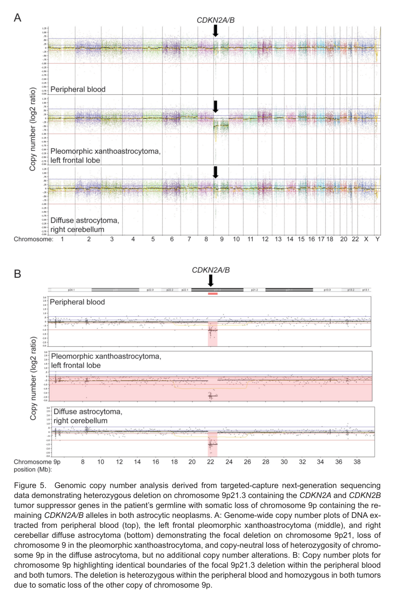

## Question

# Disease Characteristics Research Template

## Target Disease
- **Disease Name:** Melanoma and Neural System Tumor Syndrome
- **MONDO ID:** MONDO:0007967 (if available)
- **Category:** Mendelian

## Research Objectives

Please provide a comprehensive research report on **Melanoma and Neural System Tumor Syndrome** covering all of the
disease characteristics listed below. This report will be used to populate a disease knowledge
base entry. Be thorough and cite primary literature (PMID preferred) for all claims.

For each section, **suggested databases/resources** are listed. These are the first places
you should search for information on each topic.

---

### 1. Disease Information
> **Search first:** OMIM, Orphanet, ICD-10/ICD-11, MeSH, PubMed

- What is the disease? Provide a concise overview.
- What are the key identifiers? (OMIM, Orphanet, ICD-10/ICD-11, MeSH, Mondo)
- What are the common synonyms and alternative names?
- Is the information derived from individual patients (e.g., EHR) or aggregated disease-level resources?

### 2. Etiology

- **Disease Causal Factors**: What are the primary causes? (genetic, environmental, infectious, mechanistic)
- **Risk Factors**:
  > **Search first:** PubMed, Cochrane Library, UpToDate, clinical guidelines, ClinVar, ClinGen, GWAS Catalog, PheGenI, CTD, CDC, WHO, epidemiological databases
  - Genetic risk factors (causal variants, susceptibility loci, modifier genes)
  - Environmental risk factors (toxins, lifestyle, occupational exposures, age, sex, family history)
- **Protective Factors**:
  > **Search first:** PubMed, Cochrane Library, clinical trial databases, GWAS Catalog, gnomAD, WHO, CDC, nutrition databases
  - Genetic protective factors (protective variants, modifier alleles)
  - Environmental protective factors (diet, lifestyle, exposures that reduce risk)
- **Gene-Environment Interactions**: How do genetic and environmental factors interact to influence disease?
  > **Search first:** CTD, PubMed, PheGenI, GxE databases

### 3. Phenotypes
> **Search first:** HPO (Human Phenotype Ontology), OMIM, Orphanet, PubMed, clinicaltrials.gov, MedDRA, SNOMED CT, DECIPHER, LOINC

For each phenotype, provide:
- **Phenotype type**: symptoms, clinical signs, physical manifestations, behavioral changes, or laboratory abnormalities
  > For symptoms/signs: HPO, OMIM, Orphanet, PubMed
  > For behavioral changes: HPO, DSM, RDoC (Research Domain Criteria), PubMed
  > For laboratory abnormalities: LOINC, SNOMED CT, LabTests Online, PubMed
- **Phenotype characteristics**:
  > **Search first:** OMIM, Orphanet, HPO, PubMed
  - Age of symptom onset (neonatal, childhood, adult-onset, late-onset)
  - Symptom severity (mild, moderate, severe, variable)
  - Symptom progression (stable, progressive, episodic, fluctuating)
  - Frequency among affected individuals (percentage or qualitative)
- **Quality of life impact**: Effects on daily functioning and well-being (per-phenotype when possible)
  > **Search first:** EQ-5D database, SF-36, WHO QOL databases, PubMed
- Suggest HPO (Human Phenotype Ontology) terms for each phenotype

### 4. Genetic/Molecular Information

- **Causal Genes**: Gene mutations or chromosomal abnormalities responsible for disease (gene symbols, OMIM IDs)
  > **Search first:** OMIM, ClinVar, HGMD, Ensembl, NCBI Gene
- **Pathogenic Variants**:
  - Affected genes (gene symbols, HGNC IDs)
    > **Search first:** OMIM, NCBI Gene, Ensembl, HGNC, UniProt, GeneCards
  - Variant classification (pathogenic, likely pathogenic, VUS per ACMG/AMP guidelines)
    > **Search first:** ClinVar, ClinGen, ACMG/AMP guidelines, VarSome
  - Variant type/class (missense, frameshift, nonsense, splice-site, structural)
  - Allele frequency in population databases
    > **Search first:** gnomAD, 1000 Genomes, ExAC, TOPMed, dbSNP
  - Somatic vs germline origin
    > **Search first:** COSMIC (somatic), ClinVar, ICGC, TCGA
  - Functional consequences (loss of function, gain of function, dominant negative)
- **Modifier Genes**: Genes that modify disease severity or expression
- **Epigenetic Information**: DNA methylation, histone modifications, chromatin changes affecting disease
  > **Search first:** ENCODE, Roadmap Epigenomics, MethBase, DiseaseMeth
- **Chromosomal Abnormalities**: Large-scale genetic changes (aneuploidy, translocations, inversions)
  > **Search first:** DECIPHER, ClinVar, ECARUCA, UCSC Genome Browser

### 5. Environmental Information

- **Environmental Factors**: Non-genetic contributing factors (toxins, radiation, pollution, occupational exposure)
  > **Search first:** CTD (Comparative Toxicogenomics Database), TOXNET, PubMed, EPA databases
- **Lifestyle Factors**: Behavioral factors (smoking, diet, exercise, alcohol consumption)
  > **Search first:** CDC databases, WHO, PubMed, NHANES
- **Infectious Agents**: If applicable, pathogens causing or triggering disease (bacteria, viruses, fungi, parasites)
  > **Search first:** NCBI Taxonomy, ViPR, BV-BRC, MicrobeDB, GIDEON

### 6. Mechanism / Pathophysiology

**Present this section as an ordered causal chain first, then the detail below.**
Open with a numbered sequence of mechanistic steps running from the initiating
lesion (mutation, exposure, infection) to the clinical manifestation, one step per
line, each naming what it causes next. State the causal verb explicitly ("leads
to", "results in") and say where a step is inferred rather than demonstrated.
Where the mechanism branches, show the branch. The categories below are a
checklist of what to cover within those steps, not the organizing structure —
a step may draw on several of them, and a category may contribute to several
steps.

- **Molecular Pathways**: Specific signaling cascades or biochemical pathways involved (Wnt, MAPK, mTOR, PI3K-AKT, etc.)
  > **Search first:** KEGG, Reactome, WikiPathways, PathBank, BioCyc
- **Cellular Processes**: Cell-level mechanisms (apoptosis, autophagy, cell cycle dysregulation, inflammation, etc.)
  > **Search first:** Gene Ontology (GO), Reactome, KEGG, PubMed
- **Protein Dysfunction**: How protein structure or function is altered (misfolding, aggregation, loss of function, gain of function)
  > **Search first:** UniProt, PDB (Protein Data Bank), InterPro, Pfam, AlphaFold
- **Metabolic Changes**: Alterations in metabolic processes (energy metabolism, lipid metabolism, amino acid metabolism)
  > **Search first:** KEGG, BioCyc, HMDB (Human Metabolome Database), BRENDA
- **Immune System Involvement**: Role of immune response (autoimmunity, immunodeficiency, chronic inflammation)
  > **Search first:** ImmPort, Immunome Database, IEDB, Gene Ontology
- **Tissue Damage Mechanisms**: How tissues/ are injured (oxidative stress, ischemia, fibrosis, necrosis)
  > **Search first:** PubMed, Gene Ontology, Reactome
- **Biochemical Abnormalities**: Specific molecular defects (enzyme deficiencies, receptor dysfunction, ion channel defects)
  > **Search first:** BRENDA, UniProt, KEGG, OMIM, PubMed
- **Epigenetic Changes**: DNA methylation, histone modifications affecting gene expression in disease
  > **Search first:** ENCODE, Roadmap Epigenomics, MethBase, DiseaseMeth
- **Molecular Profiling** (if available):
  - Transcriptomics/gene expression changes
    > **Search first:** GEO (Gene Expression Omnibus), ArrayExpress, GTEx, Human Cell Atlas, SRA
  - Proteomics findings
    > **Search first:** PRIDE, ProteomeXchange, Human Protein Atlas, STRING, BioGRID
  - Metabolomics signatures
    > **Search first:** MetaboLights, Metabolomics Workbench, HMDB, METLIN
  - Lipidomics alterations
    > **Search first:** LIPID MAPS, SwissLipids, LipidHome, Metabolomics Workbench
  - Genomic structural features
    > **Search first:** UCSC Genome Browser, Ensembl, NCBI, dbVar, DGV
- **Advanced Technologies** (if applicable):
  - Single-cell analysis findings (cell-type specific mechanisms, cellular heterogeneity)
    > **Search first:** Human Cell Atlas, Single Cell Portal, GEO, CELLxGENE
  - Spatial transcriptomics findings
    > **Search first:** GEO, Spatial Research, Vizgen, 10x Genomics data
  - Multi-omics integration results
    > **Search first:** TCGA, ICGC, cBioPortal, LinkedOmics, PubMed
  - Functional genomics screens (CRISPR, RNAi)
    > **Search first:** DepMap, GenomeRNAi, PubMed, BioGRID ORCS

For each mechanism, describe:
- The causal chain from initial trigger to clinical manifestation
- Which mechanisms are upstream vs downstream
- What cell types and biological processes are involved
- Suggest GO terms for biological processes and CL terms for cell types

### 7. Anatomical Structures Affected

- **Organ Level**:
  - Primary organs directly affected
  - Secondary organ involvement (complications, secondary effects)
  - Body systems involved (cardiovascular, nervous, digestive, respiratory, endocrine, etc.)
  > **Search first:** Uberon, FMA (Foundational Model of Anatomy), OMIM, HPO, ICD-11, MeSH, SNOMED CT
- **Tissue and Cell Level**:
  - Specific tissue types affected (epithelial, connective, muscle, nervous)
  - Specific cell populations targeted (with Cell Ontology terms)
  > **Search first:** Uberon, Human Protein Atlas, Cell Ontology, Human Cell Atlas, CellMarker, PanglaoDB
- **Subcellular Level**:
  - Cellular compartments involved (mitochondria, nucleus, ER, lysosomes) (with GO Cellular Component terms)
  > **Search first:** Gene Ontology (Cellular Component), UniProt, Human Protein Atlas
- **Localization**:
  - Specific anatomical sites (with UBERON terms)
    > **Search first:** FMA, Uberon, NeuroNames (for brain), SNOMED CT
  - Lateralization (unilateral, bilateral, asymmetric)
    > **Search first:** HPO, clinical literature, imaging databases

### 8. Temporal Development

- **Onset**:
  - Typical age of onset (congenital, pediatric, adult, geriatric)
  - Onset pattern (acute, subacute, chronic, insidious)
  > **Search first:** OMIM, Orphanet, HPO, PubMed
- **Progression**:
  - Disease stages (early, intermediate, advanced, end-stage)
    > **Search first:** Cancer Staging Manual (AJCC), WHO classifications, PubMed
  - Progression rate (rapid, slow, variable)
  - Disease course pattern (episodic, relapsing-remitting, progressive, stable)
  - Disease duration (self-limited, chronic lifelong)
  > **Search first:** Disease registries, longitudinal cohort databases, natural history studies, PubMed, Orphanet, OMIM
- **Patterns**:
  - Remission patterns (spontaneous, treatment-induced)
    > **Search first:** Clinical trial databases, disease registries, PubMed
  - Critical periods (time windows of vulnerability or opportunity for intervention)
    > **Search first:** PubMed, developmental biology databases, clinical guidelines

### 9. Inheritance and Population

- **Epidemiology**:
  - Prevalence (cases per 100,000 at given time)
  - Incidence (new cases per 100,000 per year)
  > **Search first:** Orphanet, CDC, WHO, GBD (Global Burden of Disease), national registries, SEER, disease registries
- **For Genetic Etiology**:
  - Inheritance pattern (AD, AR, X-linked, mitochondrial, multifactorial, polygenic)
    > **Search first:** OMIM, Orphanet, ClinVar, GTR (Genetic Testing Registry)
  - Penetrance (complete, incomplete, age-dependent)
    > **Search first:** ClinVar, OMIM, PubMed, ClinGen
  - Expressivity (variable, consistent)
    > **Search first:** OMIM, ClinVar, PubMed
  - Genetic anticipation (increasing severity in successive generations)
    > **Search first:** OMIM, PubMed (especially for repeat expansion disorders)
  - Germline mosaicism
    > **Search first:** ClinVar, OMIM, genetic counseling literature, PubMed
  - Founder effects (population-specific mutations)
    > **Search first:** gnomAD, population genetics databases, PubMed
  - Consanguinity role
    > **Search first:** OMIM, population studies, genetic counseling resources
  - Carrier frequency
    > **Search first:** gnomAD, carrier screening databases, GeneReviews, GTR
- **Population Demographics**:
  - Affected populations (ethnic or demographic groups with higher prevalence)
    > **Search first:** gnomAD, 1000 Genomes, PAGE Study, PubMed, population registries
  - Geographic distribution (endemic areas, regional variation)
    > **Search first:** WHO, CDC, GBD, Orphanet, geographic epidemiology databases
  - Geographic distribution of specific variants
  - Sex ratio (male:female)
    > **Search first:** Disease registries, OMIM, PubMed, epidemiological databases
  - Age distribution of affected individuals
    > **Search first:** CDC, disease registries, SEER, Orphanet

### 10. Diagnostics

- **Clinical Tests**:
  - Laboratory tests (blood, urine, tissue chemistry, specific enzyme assays)
    > **Search first:** LOINC, LabTests Online, PubMed
  - Biomarkers (proteins, metabolites, genetic markers, circulating biomarkers)
    > **Search first:** FDA Biomarker List, BEST (Biomarkers, EndpointS, and other Tools), PubMed
  - Imaging studies (X-ray, CT, MRI, PET, ultrasound)
    > **Search first:** RadLex, DICOM, Radiopaedia, imaging databases
  - Functional tests (pulmonary function, cardiac stress tests)
    > **Search first:** LOINC, clinical guidelines, PubMed
  - Electrophysiology (EEG, EMG, ECG, nerve conduction studies)
    > **Search first:** LOINC, clinical neurophysiology databases, PubMed
  - Biopsy findings (histopathology, immunohistochemistry)
    > **Search first:** SNOMED CT, College of American Pathologists resources, PubMed
  - Pathology findings (microscopic examination)
    > **Search first:** SNOMED CT, Digital Pathology databases, PubMed
- **Genetic Testing**:
  > **Search first:** GTR (Genetic Testing Registry), GeneReviews, ClinGen
  - Overview of recommended genetic testing approach
  - Whole genome sequencing (WGS) utility
    > **Search first:** GTR, ClinVar, GEL (Genomics England), gnomAD
  - Whole exome sequencing (WES) utility
    > **Search first:** GTR, ClinVar, OMIM, GeneMatcher
  - Gene panels (which panels, which genes)
    > **Search first:** GTR, ClinVar, laboratory-specific databases
  - Single gene testing
    > **Search first:** GTR, ClinVar, OMIM, GeneReviews
  - Chromosomal microarray (CMA)
    > **Search first:** DECIPHER, ClinVar, dbVar, ECARUCA
  - Karyotyping
    > **Search first:** Chromosome Abnormality Database, ClinVar, cytogenetics resources
  - FISH
    > **Search first:** ClinVar, cytogenetics databases, PubMed
  - Mitochondrial DNA testing
    > **Search first:** MITOMAP, MSeqDR, ClinVar, GTR
  - Repeat expansion testing
    > **Search first:** GTR, ClinVar, repeat expansion databases, PubMed
- **Omics-Based Diagnostics** (if applicable):
  - RNA sequencing / transcriptomics
    > **Search first:** GEO, ArrayExpress, GTEx, RNA-seq databases
  - Proteomics
    > **Search first:** PRIDE, ProteomeXchange, FDA Biomarker database
  - Metabolomics
    > **Search first:** MetaboLights, Metabolomics Workbench, HMDB
  - Epigenomics
    > **Search first:** GEO, ENCODE, Roadmap Epigenomics, MethBase
  - Liquid biopsy
    > **Search first:** COSMIC, ClinVar, liquid biopsy databases, PubMed
- **Clinical Criteria**:
  - Standardized diagnostic criteria (DSM, ICD, society guidelines)
    > **Search first:** DSM-5, ICD-11, clinical society guidelines, UpToDate
  - Differential diagnosis (other conditions to rule out, with distinguishing features)
    > **Search first:** DynaMed, UpToDate, clinical decision support systems
- **Screening**:
  - Screening methods for asymptomatic individuals (newborn screening, carrier screening, cascade screening)
    > **Search first:** ACMG recommendations, CDC newborn screening, GTR

### 11. Outcome/Prognosis

- **Survival and Mortality**:
  - Survival rate (5-year, 10-year, overall)
    > **Search first:** SEER, cancer registries, disease-specific registries, PubMed
  - Life expectancy (with and without treatment if applicable)
    > **Search first:** Orphanet, disease registries, actuarial databases, PubMed
  - Mortality rate
    > **Search first:** CDC, WHO, GBD, national mortality databases
  - Disease-specific mortality (deaths directly attributable to disease)
    > **Search first:** Disease registries, CDC Wonder, GBD, PubMed
- **Morbidity and Function**:
  - Morbidity (disease-related disability and health impacts)
    > **Search first:** GBD, WHO, disability databases, PubMed
  - Disability outcomes (long-term functional impairments)
    > **Search first:** ICF (International Classification of Functioning), disability registries
  - Quality of life measures (EQ-5D, SF-36, PROMIS, disease-specific tools)
    > **Search first:** EQ-5D database, SF-36, PROMIS, PubMed
- **Disease Course**:
  - Complications (secondary problems: infections, organ failure, etc.)
    > **Search first:** ICD codes, disease registries, clinical databases, PubMed
  - Recovery potential (likelihood and extent of recovery, with vs without treatment)
    > **Search first:** Natural history studies, rehabilitation databases, PubMed
- **Prediction**:
  - Prognostic factors (age, disease severity, biomarkers, treatment response)
    > **Search first:** Prognostic models databases, clinical calculators, PubMed
  - Prognostic biomarkers (molecular markers predicting disease course)
    > **Search first:** FDA Biomarker database, PubMed, cancer prognostic databases

### 12. Treatment

- **Pharmacotherapy**:
  - Pharmacological treatments (drug names, drug classes, mechanisms of action)
    > **Search first:** DrugBank, RxNorm, ATC classification, DailyMed, FDA databases
  - Pharmacogenomics (how genetic variants affect drug metabolism, efficacy, toxicity)
    > **Search first:** PharmGKB, CPIC (Clinical Pharmacogenetics), FDA Table of PGx Biomarkers
- **Advanced Therapeutics**:
  - Gene therapy (viral vectors, CRISPR, gene replacement, gene editing)
    > **Search first:** ClinicalTrials.gov, FDA gene therapy database, ASGCT resources
  - Cell therapy (stem cell transplant, CAR-T, cellular therapeutics)
    > **Search first:** ClinicalTrials.gov, FDA cell therapy database, FACT standards
  - RNA-based therapies (ASOs, siRNA, mRNA therapies)
    > **Search first:** ClinicalTrials.gov, FDA approvals, PubMed
  - Targeted therapies (treatments directed at specific molecular targets)
    > **Search first:** My Cancer Genome, OncoKB, ClinicalTrials.gov, FDA approvals
  - Immunotherapies (checkpoint inhibitors, monoclonal antibodies)
    > **Search first:** Cancer Immunotherapy Database, FDA approvals, ClinicalTrials.gov
- **Surgical and Interventional**:
  - Surgical interventions (types of surgery, timing, outcomes)
    > **Search first:** CPT codes, surgical registries, clinical guidelines, PubMed
- **Supportive and Rehabilitative**:
  - Supportive care (symptom management, pain control, nutrition)
    > **Search first:** Clinical guidelines, Cochrane Library, PubMed
  - Rehabilitation (physical therapy, occupational therapy, speech therapy)
    > **Search first:** Rehabilitation medicine databases, clinical guidelines, PubMed
- **Experimental**:
  - Experimental treatments in clinical trials (with NCT identifiers if available)
    > **Search first:** ClinicalTrials.gov, EU Clinical Trials Register, WHO ICTRP
- **Treatment Outcomes**:
  - Treatment response rates
    > **Search first:** Clinical trial databases, FDA reviews, systematic reviews, PubMed
  - Side effects and adverse events
    > **Search first:** FDA Adverse Event Reporting System (FAERS), MedWatch, PubMed
- **Treatment Strategy**:
  - Treatment algorithms (clinical pathways, decision trees)
    > **Search first:** Clinical practice guidelines, NCCN Guidelines, UpToDate
  - Combination therapies
    > **Search first:** ClinicalTrials.gov, treatment guidelines, PubMed
  - Personalized medicine approaches (genotype-guided treatment)
    > **Search first:** My Cancer Genome, CIViC, PharmGKB, precision medicine databases

For each treatment, suggest NCIT (NCI Thesaurus) clinical-intervention terms where applicable.

### 13. Prevention

- **Prevention Levels**:
  - Primary prevention (preventing disease occurrence: vaccination, risk factor modification)
    > **Search first:** CDC, WHO, USPSTF recommendations, Cochrane Library
  - Secondary prevention (early detection and treatment: screening programs, early intervention)
    > **Search first:** USPSTF, CDC screening guidelines, WHO
  - Tertiary prevention (preventing complications in those with disease)
    > **Search first:** Clinical guidelines, disease management protocols, PubMed
- **Immunization**: Vaccine strategies (if applicable)
  > **Search first:** CDC vaccine schedules, WHO immunization, FDA vaccine database
- **Screening and Early Detection**:
  - Screening programs (population-based: newborn screening, cancer screening)
    > **Search first:** CDC screening programs, USPSTF, cancer screening databases
  - Genetic screening (carrier screening, preimplantation genetic diagnosis, prenatal testing)
    > **Search first:** ACMG recommendations, ACOG guidelines, GTR
  - Risk stratification (identifying high-risk individuals for targeted prevention)
    > **Search first:** Risk prediction models, clinical calculators, PubMed
- **Behavioral Interventions**: Lifestyle modifications to reduce risk
  > **Search first:** CDC, WHO, behavioral intervention databases, Cochrane Library
- **Counseling**: Genetic counseling (risk assessment, family planning guidance)
  > **Search first:** NSGC resources, ACMG guidelines, GeneReviews
- **Public Health**:
  - Public health interventions (sanitation, vector control, health education)
    > **Search first:** CDC, WHO, public health databases, PubMed
  - Environmental interventions (reducing environmental risk factors)
    > **Search first:** EPA databases, WHO environmental health, PubMed
- **Prophylaxis**: Preventive medications or procedures
  > **Search first:** Clinical guidelines, FDA approvals, PubMed

### 14. Other Species / Natural Disease

- **Taxonomy**: Species affected (with NCBI Taxon identifiers)
  > **Search first:** NCBI Taxonomy
- **Breed**: Specific breeds affected (with VBO identifiers if applicable)
  > **Search first:** VBO (Vertebrate Breed Ontology)
- **Gene**: Orthologous genes in other species (with NCBI Gene IDs)
  > **Search first:** NCBI Gene
- **Natural Disease**:
  - Naturally occurring disease in other species (companion animals, wildlife)
    > **Search first:** OMIA (Online Mendelian Inheritance in Animals), VetCompass, PubMed
  - Veterinary relevance and importance in animal health
    > **Search first:** OMIA, veterinary databases, PubMed
- **Comparative Biology**:
  - Comparative pathology (similarities and differences across species)
    > **Search first:** OMIA, comparative pathology databases, PubMed
  - Evolutionary conservation of disease mechanisms
    > **Search first:** HomoloGene, OrthoMCL, Alliance of Genome Resources
- **Transmission** (if applicable):
  - Zoonotic potential
    > **Search first:** CDC zoonotic diseases, WHO zoonoses, GIDEON
  - Cross-species susceptibility
    > **Search first:** NCBI Taxonomy, veterinary databases, PubMed

### 15. Model Organisms

- **Model Types**:
  - Model organism type (mammalian, invertebrate, cellular, in vitro)
    > **Search first:** Alliance of Genome Resources, model organism databases
  - Specific model systems (mouse, rat, zebrafish, Drosophila, C. elegans, yeast, cell lines, organoids, iPSCs)
    > **Search first:** MGI, RGD, ZFIN, FlyBase, WormBase, SGD, ATCC, Cellosaurus
  - Induced models (drug treatment, surgical intervention, environmental manipulation)
    > **Search first:** MGI, model organism databases, PubMed
- **Genetic Models**:
  - Types available (knockout, knock-in, transgenic, conditional, humanized)
    > **Search first:** MGI, IMPC, KOMP, EuMMCR, IMSR
- **Model Characteristics**:
  - Phenotype recapitulation (how well model reproduces human disease features)
    > **Search first:** Model organism databases, comparative studies, PubMed
  - Model limitations (aspects of human disease not captured)
    > **Search first:** Model organism databases, PubMed, review articles
- **Applications**:
  - Research applications (what aspects of disease can be studied)
    > **Search first:** Model organism databases, PubMed
- **Resources**:
  - Model databases
    > **Search first:** MGI, RGD, ZFIN, FlyBase, WormBase, IMSR, EMMA, MMRRC

---

## Citation Requirements

- Cite primary literature (PMID preferred) for all mechanistic and clinical claims
- Prioritize recent reviews and landmark papers
- Include direct quotes from abstracts where possible to support key statements
- Distinguish evidence source types: human clinical, model organism, in vitro, computational

## Output Format

Structure your response as a comprehensive narrative organized by the sections above.
For each section, provide:
- Factual content with specific details (numbers, percentages, gene names, variant nomenclature)
- Ontology term suggestions (HPO, GO, CL, UBERON, CHEBI, NCIT, MONDO) where applicable
- Evidence citations with PMIDs
- Direct quotes from abstracts to support key claims
- Clear indication when information is not available or not applicable for this disease

This report will be used to populate a disease knowledge base entry with:
- Pathophysiology descriptions with causal chains
- Gene/protein annotations (HGNC, GO terms)
- Phenotype associations (HP terms) with frequencies
- Cell type involvement (CL terms)
- Anatomical locations (UBERON terms)
- Chemical entities (CHEBI terms)
- Treatment annotations (NCIT terms)
- Evidence items with PMIDs and exact abstract quotes
- Epidemiology, prognosis, diagnostic, and prevention information
- Animal model descriptions with phenotype recapitulation details

## Output

Question: You are an expert researcher providing comprehensive, well-cited information.

Provide detailed information focusing on:
1. Key concepts and definitions with current understanding
2. Recent developments and latest research (prioritize 2023-2024 sources)
3. Current applications and real-world implementations
4. Expert opinions and analysis from authoritative sources
5. Relevant statistics and data from recent studies

Format as a comprehensive research report with proper citations. Include URLs and publication dates where available.
Always prioritize recent, authoritative sources and provide specific citations for all major claims.

# Disease Characteristics Research Template

## Target Disease
- **Disease Name:** Melanoma and Neural System Tumor Syndrome
- **MONDO ID:** MONDO:0007967 (if available)
- **Category:** Mendelian

## Research Objectives

Please provide a comprehensive research report on **Melanoma and Neural System Tumor Syndrome** covering all of the
disease characteristics listed below. This report will be used to populate a disease knowledge
base entry. Be thorough and cite primary literature (PMID preferred) for all claims.

For each section, **suggested databases/resources** are listed. These are the first places
you should search for information on each topic.

---

### 1. Disease Information
> **Search first:** OMIM, Orphanet, ICD-10/ICD-11, MeSH, PubMed

- What is the disease? Provide a concise overview.
- What are the key identifiers? (OMIM, Orphanet, ICD-10/ICD-11, MeSH, Mondo)
- What are the common synonyms and alternative names?
- Is the information derived from individual patients (e.g., EHR) or aggregated disease-level resources?

### 2. Etiology

- **Disease Causal Factors**: What are the primary causes? (genetic, environmental, infectious, mechanistic)
- **Risk Factors**:
  > **Search first:** PubMed, Cochrane Library, UpToDate, clinical guidelines, ClinVar, ClinGen, GWAS Catalog, PheGenI, CTD, CDC, WHO, epidemiological databases
  - Genetic risk factors (causal variants, susceptibility loci, modifier genes)
  - Environmental risk factors (toxins, lifestyle, occupational exposures, age, sex, family history)
- **Protective Factors**:
  > **Search first:** PubMed, Cochrane Library, clinical trial databases, GWAS Catalog, gnomAD, WHO, CDC, nutrition databases
  - Genetic protective factors (protective variants, modifier alleles)
  - Environmental protective factors (diet, lifestyle, exposures that reduce risk)
- **Gene-Environment Interactions**: How do genetic and environmental factors interact to influence disease?
  > **Search first:** CTD, PubMed, PheGenI, GxE databases

### 3. Phenotypes
> **Search first:** HPO (Human Phenotype Ontology), OMIM, Orphanet, PubMed, clinicaltrials.gov, MedDRA, SNOMED CT, DECIPHER, LOINC

For each phenotype, provide:
- **Phenotype type**: symptoms, clinical signs, physical manifestations, behavioral changes, or laboratory abnormalities
  > For symptoms/signs: HPO, OMIM, Orphanet, PubMed
  > For behavioral changes: HPO, DSM, RDoC (Research Domain Criteria), PubMed
  > For laboratory abnormalities: LOINC, SNOMED CT, LabTests Online, PubMed
- **Phenotype characteristics**:
  > **Search first:** OMIM, Orphanet, HPO, PubMed
  - Age of symptom onset (neonatal, childhood, adult-onset, late-onset)
  - Symptom severity (mild, moderate, severe, variable)
  - Symptom progression (stable, progressive, episodic, fluctuating)
  - Frequency among affected individuals (percentage or qualitative)
- **Quality of life impact**: Effects on daily functioning and well-being (per-phenotype when possible)
  > **Search first:** EQ-5D database, SF-36, WHO QOL databases, PubMed
- Suggest HPO (Human Phenotype Ontology) terms for each phenotype

### 4. Genetic/Molecular Information

- **Causal Genes**: Gene mutations or chromosomal abnormalities responsible for disease (gene symbols, OMIM IDs)
  > **Search first:** OMIM, ClinVar, HGMD, Ensembl, NCBI Gene
- **Pathogenic Variants**:
  - Affected genes (gene symbols, HGNC IDs)
    > **Search first:** OMIM, NCBI Gene, Ensembl, HGNC, UniProt, GeneCards
  - Variant classification (pathogenic, likely pathogenic, VUS per ACMG/AMP guidelines)
    > **Search first:** ClinVar, ClinGen, ACMG/AMP guidelines, VarSome
  - Variant type/class (missense, frameshift, nonsense, splice-site, structural)
  - Allele frequency in population databases
    > **Search first:** gnomAD, 1000 Genomes, ExAC, TOPMed, dbSNP
  - Somatic vs germline origin
    > **Search first:** COSMIC (somatic), ClinVar, ICGC, TCGA
  - Functional consequences (loss of function, gain of function, dominant negative)
- **Modifier Genes**: Genes that modify disease severity or expression
- **Epigenetic Information**: DNA methylation, histone modifications, chromatin changes affecting disease
  > **Search first:** ENCODE, Roadmap Epigenomics, MethBase, DiseaseMeth
- **Chromosomal Abnormalities**: Large-scale genetic changes (aneuploidy, translocations, inversions)
  > **Search first:** DECIPHER, ClinVar, ECARUCA, UCSC Genome Browser

### 5. Environmental Information

- **Environmental Factors**: Non-genetic contributing factors (toxins, radiation, pollution, occupational exposure)
  > **Search first:** CTD (Comparative Toxicogenomics Database), TOXNET, PubMed, EPA databases
- **Lifestyle Factors**: Behavioral factors (smoking, diet, exercise, alcohol consumption)
  > **Search first:** CDC databases, WHO, PubMed, NHANES
- **Infectious Agents**: If applicable, pathogens causing or triggering disease (bacteria, viruses, fungi, parasites)
  > **Search first:** NCBI Taxonomy, ViPR, BV-BRC, MicrobeDB, GIDEON

### 6. Mechanism / Pathophysiology

**Present this section as an ordered causal chain first, then the detail below.**
Open with a numbered sequence of mechanistic steps running from the initiating
lesion (mutation, exposure, infection) to the clinical manifestation, one step per
line, each naming what it causes next. State the causal verb explicitly ("leads
to", "results in") and say where a step is inferred rather than demonstrated.
Where the mechanism branches, show the branch. The categories below are a
checklist of what to cover within those steps, not the organizing structure —
a step may draw on several of them, and a category may contribute to several
steps.

- **Molecular Pathways**: Specific signaling cascades or biochemical pathways involved (Wnt, MAPK, mTOR, PI3K-AKT, etc.)
  > **Search first:** KEGG, Reactome, WikiPathways, PathBank, BioCyc
- **Cellular Processes**: Cell-level mechanisms (apoptosis, autophagy, cell cycle dysregulation, inflammation, etc.)
  > **Search first:** Gene Ontology (GO), Reactome, KEGG, PubMed
- **Protein Dysfunction**: How protein structure or function is altered (misfolding, aggregation, loss of function, gain of function)
  > **Search first:** UniProt, PDB (Protein Data Bank), InterPro, Pfam, AlphaFold
- **Metabolic Changes**: Alterations in metabolic processes (energy metabolism, lipid metabolism, amino acid metabolism)
  > **Search first:** KEGG, BioCyc, HMDB (Human Metabolome Database), BRENDA
- **Immune System Involvement**: Role of immune response (autoimmunity, immunodeficiency, chronic inflammation)
  > **Search first:** ImmPort, Immunome Database, IEDB, Gene Ontology
- **Tissue Damage Mechanisms**: How tissues/ are injured (oxidative stress, ischemia, fibrosis, necrosis)
  > **Search first:** PubMed, Gene Ontology, Reactome
- **Biochemical Abnormalities**: Specific molecular defects (enzyme deficiencies, receptor dysfunction, ion channel defects)
  > **Search first:** BRENDA, UniProt, KEGG, OMIM, PubMed
- **Epigenetic Changes**: DNA methylation, histone modifications affecting gene expression in disease
  > **Search first:** ENCODE, Roadmap Epigenomics, MethBase, DiseaseMeth
- **Molecular Profiling** (if available):
  - Transcriptomics/gene expression changes
    > **Search first:** GEO (Gene Expression Omnibus), ArrayExpress, GTEx, Human Cell Atlas, SRA
  - Proteomics findings
    > **Search first:** PRIDE, ProteomeXchange, Human Protein Atlas, STRING, BioGRID
  - Metabolomics signatures
    > **Search first:** MetaboLights, Metabolomics Workbench, HMDB, METLIN
  - Lipidomics alterations
    > **Search first:** LIPID MAPS, SwissLipids, LipidHome, Metabolomics Workbench
  - Genomic structural features
    > **Search first:** UCSC Genome Browser, Ensembl, NCBI, dbVar, DGV
- **Advanced Technologies** (if applicable):
  - Single-cell analysis findings (cell-type specific mechanisms, cellular heterogeneity)
    > **Search first:** Human Cell Atlas, Single Cell Portal, GEO, CELLxGENE
  - Spatial transcriptomics findings
    > **Search first:** GEO, Spatial Research, Vizgen, 10x Genomics data
  - Multi-omics integration results
    > **Search first:** TCGA, ICGC, cBioPortal, LinkedOmics, PubMed
  - Functional genomics screens (CRISPR, RNAi)
    > **Search first:** DepMap, GenomeRNAi, PubMed, BioGRID ORCS

For each mechanism, describe:
- The causal chain from initial trigger to clinical manifestation
- Which mechanisms are upstream vs downstream
- What cell types and biological processes are involved
- Suggest GO terms for biological processes and CL terms for cell types

### 7. Anatomical Structures Affected

- **Organ Level**:
  - Primary organs directly affected
  - Secondary organ involvement (complications, secondary effects)
  - Body systems involved (cardiovascular, nervous, digestive, respiratory, endocrine, etc.)
  > **Search first:** Uberon, FMA (Foundational Model of Anatomy), OMIM, HPO, ICD-11, MeSH, SNOMED CT
- **Tissue and Cell Level**:
  - Specific tissue types affected (epithelial, connective, muscle, nervous)
  - Specific cell populations targeted (with Cell Ontology terms)
  > **Search first:** Uberon, Human Protein Atlas, Cell Ontology, Human Cell Atlas, CellMarker, PanglaoDB
- **Subcellular Level**:
  - Cellular compartments involved (mitochondria, nucleus, ER, lysosomes) (with GO Cellular Component terms)
  > **Search first:** Gene Ontology (Cellular Component), UniProt, Human Protein Atlas
- **Localization**:
  - Specific anatomical sites (with UBERON terms)
    > **Search first:** FMA, Uberon, NeuroNames (for brain), SNOMED CT
  - Lateralization (unilateral, bilateral, asymmetric)
    > **Search first:** HPO, clinical literature, imaging databases

### 8. Temporal Development

- **Onset**:
  - Typical age of onset (congenital, pediatric, adult, geriatric)
  - Onset pattern (acute, subacute, chronic, insidious)
  > **Search first:** OMIM, Orphanet, HPO, PubMed
- **Progression**:
  - Disease stages (early, intermediate, advanced, end-stage)
    > **Search first:** Cancer Staging Manual (AJCC), WHO classifications, PubMed
  - Progression rate (rapid, slow, variable)
  - Disease course pattern (episodic, relapsing-remitting, progressive, stable)
  - Disease duration (self-limited, chronic lifelong)
  > **Search first:** Disease registries, longitudinal cohort databases, natural history studies, PubMed, Orphanet, OMIM
- **Patterns**:
  - Remission patterns (spontaneous, treatment-induced)
    > **Search first:** Clinical trial databases, disease registries, PubMed
  - Critical periods (time windows of vulnerability or opportunity for intervention)
    > **Search first:** PubMed, developmental biology databases, clinical guidelines

### 9. Inheritance and Population

- **Epidemiology**:
  - Prevalence (cases per 100,000 at given time)
  - Incidence (new cases per 100,000 per year)
  > **Search first:** Orphanet, CDC, WHO, GBD (Global Burden of Disease), national registries, SEER, disease registries
- **For Genetic Etiology**:
  - Inheritance pattern (AD, AR, X-linked, mitochondrial, multifactorial, polygenic)
    > **Search first:** OMIM, Orphanet, ClinVar, GTR (Genetic Testing Registry)
  - Penetrance (complete, incomplete, age-dependent)
    > **Search first:** ClinVar, OMIM, PubMed, ClinGen
  - Expressivity (variable, consistent)
    > **Search first:** OMIM, ClinVar, PubMed
  - Genetic anticipation (increasing severity in successive generations)
    > **Search first:** OMIM, PubMed (especially for repeat expansion disorders)
  - Germline mosaicism
    > **Search first:** ClinVar, OMIM, genetic counseling literature, PubMed
  - Founder effects (population-specific mutations)
    > **Search first:** gnomAD, population genetics databases, PubMed
  - Consanguinity role
    > **Search first:** OMIM, population studies, genetic counseling resources
  - Carrier frequency
    > **Search first:** gnomAD, carrier screening databases, GeneReviews, GTR
- **Population Demographics**:
  - Affected populations (ethnic or demographic groups with higher prevalence)
    > **Search first:** gnomAD, 1000 Genomes, PAGE Study, PubMed, population registries
  - Geographic distribution (endemic areas, regional variation)
    > **Search first:** WHO, CDC, GBD, Orphanet, geographic epidemiology databases
  - Geographic distribution of specific variants
  - Sex ratio (male:female)
    > **Search first:** Disease registries, OMIM, PubMed, epidemiological databases
  - Age distribution of affected individuals
    > **Search first:** CDC, disease registries, SEER, Orphanet

### 10. Diagnostics

- **Clinical Tests**:
  - Laboratory tests (blood, urine, tissue chemistry, specific enzyme assays)
    > **Search first:** LOINC, LabTests Online, PubMed
  - Biomarkers (proteins, metabolites, genetic markers, circulating biomarkers)
    > **Search first:** FDA Biomarker List, BEST (Biomarkers, EndpointS, and other Tools), PubMed
  - Imaging studies (X-ray, CT, MRI, PET, ultrasound)
    > **Search first:** RadLex, DICOM, Radiopaedia, imaging databases
  - Functional tests (pulmonary function, cardiac stress tests)
    > **Search first:** LOINC, clinical guidelines, PubMed
  - Electrophysiology (EEG, EMG, ECG, nerve conduction studies)
    > **Search first:** LOINC, clinical neurophysiology databases, PubMed
  - Biopsy findings (histopathology, immunohistochemistry)
    > **Search first:** SNOMED CT, College of American Pathologists resources, PubMed
  - Pathology findings (microscopic examination)
    > **Search first:** SNOMED CT, Digital Pathology databases, PubMed
- **Genetic Testing**:
  > **Search first:** GTR (Genetic Testing Registry), GeneReviews, ClinGen
  - Overview of recommended genetic testing approach
  - Whole genome sequencing (WGS) utility
    > **Search first:** GTR, ClinVar, GEL (Genomics England), gnomAD
  - Whole exome sequencing (WES) utility
    > **Search first:** GTR, ClinVar, OMIM, GeneMatcher
  - Gene panels (which panels, which genes)
    > **Search first:** GTR, ClinVar, laboratory-specific databases
  - Single gene testing
    > **Search first:** GTR, ClinVar, OMIM, GeneReviews
  - Chromosomal microarray (CMA)
    > **Search first:** DECIPHER, ClinVar, dbVar, ECARUCA
  - Karyotyping
    > **Search first:** Chromosome Abnormality Database, ClinVar, cytogenetics resources
  - FISH
    > **Search first:** ClinVar, cytogenetics databases, PubMed
  - Mitochondrial DNA testing
    > **Search first:** MITOMAP, MSeqDR, ClinVar, GTR
  - Repeat expansion testing
    > **Search first:** GTR, ClinVar, repeat expansion databases, PubMed
- **Omics-Based Diagnostics** (if applicable):
  - RNA sequencing / transcriptomics
    > **Search first:** GEO, ArrayExpress, GTEx, RNA-seq databases
  - Proteomics
    > **Search first:** PRIDE, ProteomeXchange, FDA Biomarker database
  - Metabolomics
    > **Search first:** MetaboLights, Metabolomics Workbench, HMDB
  - Epigenomics
    > **Search first:** GEO, ENCODE, Roadmap Epigenomics, MethBase
  - Liquid biopsy
    > **Search first:** COSMIC, ClinVar, liquid biopsy databases, PubMed
- **Clinical Criteria**:
  - Standardized diagnostic criteria (DSM, ICD, society guidelines)
    > **Search first:** DSM-5, ICD-11, clinical society guidelines, UpToDate
  - Differential diagnosis (other conditions to rule out, with distinguishing features)
    > **Search first:** DynaMed, UpToDate, clinical decision support systems
- **Screening**:
  - Screening methods for asymptomatic individuals (newborn screening, carrier screening, cascade screening)
    > **Search first:** ACMG recommendations, CDC newborn screening, GTR

### 11. Outcome/Prognosis

- **Survival and Mortality**:
  - Survival rate (5-year, 10-year, overall)
    > **Search first:** SEER, cancer registries, disease-specific registries, PubMed
  - Life expectancy (with and without treatment if applicable)
    > **Search first:** Orphanet, disease registries, actuarial databases, PubMed
  - Mortality rate
    > **Search first:** CDC, WHO, GBD, national mortality databases
  - Disease-specific mortality (deaths directly attributable to disease)
    > **Search first:** Disease registries, CDC Wonder, GBD, PubMed
- **Morbidity and Function**:
  - Morbidity (disease-related disability and health impacts)
    > **Search first:** GBD, WHO, disability databases, PubMed
  - Disability outcomes (long-term functional impairments)
    > **Search first:** ICF (International Classification of Functioning), disability registries
  - Quality of life measures (EQ-5D, SF-36, PROMIS, disease-specific tools)
    > **Search first:** EQ-5D database, SF-36, PROMIS, PubMed
- **Disease Course**:
  - Complications (secondary problems: infections, organ failure, etc.)
    > **Search first:** ICD codes, disease registries, clinical databases, PubMed
  - Recovery potential (likelihood and extent of recovery, with vs without treatment)
    > **Search first:** Natural history studies, rehabilitation databases, PubMed
- **Prediction**:
  - Prognostic factors (age, disease severity, biomarkers, treatment response)
    > **Search first:** Prognostic models databases, clinical calculators, PubMed
  - Prognostic biomarkers (molecular markers predicting disease course)
    > **Search first:** FDA Biomarker database, PubMed, cancer prognostic databases

### 12. Treatment

- **Pharmacotherapy**:
  - Pharmacological treatments (drug names, drug classes, mechanisms of action)
    > **Search first:** DrugBank, RxNorm, ATC classification, DailyMed, FDA databases
  - Pharmacogenomics (how genetic variants affect drug metabolism, efficacy, toxicity)
    > **Search first:** PharmGKB, CPIC (Clinical Pharmacogenetics), FDA Table of PGx Biomarkers
- **Advanced Therapeutics**:
  - Gene therapy (viral vectors, CRISPR, gene replacement, gene editing)
    > **Search first:** ClinicalTrials.gov, FDA gene therapy database, ASGCT resources
  - Cell therapy (stem cell transplant, CAR-T, cellular therapeutics)
    > **Search first:** ClinicalTrials.gov, FDA cell therapy database, FACT standards
  - RNA-based therapies (ASOs, siRNA, mRNA therapies)
    > **Search first:** ClinicalTrials.gov, FDA approvals, PubMed
  - Targeted therapies (treatments directed at specific molecular targets)
    > **Search first:** My Cancer Genome, OncoKB, ClinicalTrials.gov, FDA approvals
  - Immunotherapies (checkpoint inhibitors, monoclonal antibodies)
    > **Search first:** Cancer Immunotherapy Database, FDA approvals, ClinicalTrials.gov
- **Surgical and Interventional**:
  - Surgical interventions (types of surgery, timing, outcomes)
    > **Search first:** CPT codes, surgical registries, clinical guidelines, PubMed
- **Supportive and Rehabilitative**:
  - Supportive care (symptom management, pain control, nutrition)
    > **Search first:** Clinical guidelines, Cochrane Library, PubMed
  - Rehabilitation (physical therapy, occupational therapy, speech therapy)
    > **Search first:** Rehabilitation medicine databases, clinical guidelines, PubMed
- **Experimental**:
  - Experimental treatments in clinical trials (with NCT identifiers if available)
    > **Search first:** ClinicalTrials.gov, EU Clinical Trials Register, WHO ICTRP
- **Treatment Outcomes**:
  - Treatment response rates
    > **Search first:** Clinical trial databases, FDA reviews, systematic reviews, PubMed
  - Side effects and adverse events
    > **Search first:** FDA Adverse Event Reporting System (FAERS), MedWatch, PubMed
- **Treatment Strategy**:
  - Treatment algorithms (clinical pathways, decision trees)
    > **Search first:** Clinical practice guidelines, NCCN Guidelines, UpToDate
  - Combination therapies
    > **Search first:** ClinicalTrials.gov, treatment guidelines, PubMed
  - Personalized medicine approaches (genotype-guided treatment)
    > **Search first:** My Cancer Genome, CIViC, PharmGKB, precision medicine databases

For each treatment, suggest NCIT (NCI Thesaurus) clinical-intervention terms where applicable.

### 13. Prevention

- **Prevention Levels**:
  - Primary prevention (preventing disease occurrence: vaccination, risk factor modification)
    > **Search first:** CDC, WHO, USPSTF recommendations, Cochrane Library
  - Secondary prevention (early detection and treatment: screening programs, early intervention)
    > **Search first:** USPSTF, CDC screening guidelines, WHO
  - Tertiary prevention (preventing complications in those with disease)
    > **Search first:** Clinical guidelines, disease management protocols, PubMed
- **Immunization**: Vaccine strategies (if applicable)
  > **Search first:** CDC vaccine schedules, WHO immunization, FDA vaccine database
- **Screening and Early Detection**:
  - Screening programs (population-based: newborn screening, cancer screening)
    > **Search first:** CDC screening programs, USPSTF, cancer screening databases
  - Genetic screening (carrier screening, preimplantation genetic diagnosis, prenatal testing)
    > **Search first:** ACMG recommendations, ACOG guidelines, GTR
  - Risk stratification (identifying high-risk individuals for targeted prevention)
    > **Search first:** Risk prediction models, clinical calculators, PubMed
- **Behavioral Interventions**: Lifestyle modifications to reduce risk
  > **Search first:** CDC, WHO, behavioral intervention databases, Cochrane Library
- **Counseling**: Genetic counseling (risk assessment, family planning guidance)
  > **Search first:** NSGC resources, ACMG guidelines, GeneReviews
- **Public Health**:
  - Public health interventions (sanitation, vector control, health education)
    > **Search first:** CDC, WHO, public health databases, PubMed
  - Environmental interventions (reducing environmental risk factors)
    > **Search first:** EPA databases, WHO environmental health, PubMed
- **Prophylaxis**: Preventive medications or procedures
  > **Search first:** Clinical guidelines, FDA approvals, PubMed

### 14. Other Species / Natural Disease

- **Taxonomy**: Species affected (with NCBI Taxon identifiers)
  > **Search first:** NCBI Taxonomy
- **Breed**: Specific breeds affected (with VBO identifiers if applicable)
  > **Search first:** VBO (Vertebrate Breed Ontology)
- **Gene**: Orthologous genes in other species (with NCBI Gene IDs)
  > **Search first:** NCBI Gene
- **Natural Disease**:
  - Naturally occurring disease in other species (companion animals, wildlife)
    > **Search first:** OMIA (Online Mendelian Inheritance in Animals), VetCompass, PubMed
  - Veterinary relevance and importance in animal health
    > **Search first:** OMIA, veterinary databases, PubMed
- **Comparative Biology**:
  - Comparative pathology (similarities and differences across species)
    > **Search first:** OMIA, comparative pathology databases, PubMed
  - Evolutionary conservation of disease mechanisms
    > **Search first:** HomoloGene, OrthoMCL, Alliance of Genome Resources
- **Transmission** (if applicable):
  - Zoonotic potential
    > **Search first:** CDC zoonotic diseases, WHO zoonoses, GIDEON
  - Cross-species susceptibility
    > **Search first:** NCBI Taxonomy, veterinary databases, PubMed

### 15. Model Organisms

- **Model Types**:
  - Model organism type (mammalian, invertebrate, cellular, in vitro)
    > **Search first:** Alliance of Genome Resources, model organism databases
  - Specific model systems (mouse, rat, zebrafish, Drosophila, C. elegans, yeast, cell lines, organoids, iPSCs)
    > **Search first:** MGI, RGD, ZFIN, FlyBase, WormBase, SGD, ATCC, Cellosaurus
  - Induced models (drug treatment, surgical intervention, environmental manipulation)
    > **Search first:** MGI, model organism databases, PubMed
- **Genetic Models**:
  - Types available (knockout, knock-in, transgenic, conditional, humanized)
    > **Search first:** MGI, IMPC, KOMP, EuMMCR, IMSR
- **Model Characteristics**:
  - Phenotype recapitulation (how well model reproduces human disease features)
    > **Search first:** Model organism databases, comparative studies, PubMed
  - Model limitations (aspects of human disease not captured)
    > **Search first:** Model organism databases, PubMed, review articles
- **Applications**:
  - Research applications (what aspects of disease can be studied)
    > **Search first:** Model organism databases, PubMed
- **Resources**:
  - Model databases
    > **Search first:** MGI, RGD, ZFIN, FlyBase, WormBase, IMSR, EMMA, MMRRC

---

## Citation Requirements

- Cite primary literature (PMID preferred) for all mechanistic and clinical claims
- Prioritize recent reviews and landmark papers
- Include direct quotes from abstracts where possible to support key statements
- Distinguish evidence source types: human clinical, model organism, in vitro, computational

## Output Format

Structure your response as a comprehensive narrative organized by the sections above.
For each section, provide:
- Factual content with specific details (numbers, percentages, gene names, variant nomenclature)
- Ontology term suggestions (HPO, GO, CL, UBERON, CHEBI, NCIT, MONDO) where applicable
- Evidence citations with PMIDs
- Direct quotes from abstracts to support key claims
- Clear indication when information is not available or not applicable for this disease

This report will be used to populate a disease knowledge base entry with:
- Pathophysiology descriptions with causal chains
- Gene/protein annotations (HGNC, GO terms)
- Phenotype associations (HP terms) with frequencies
- Cell type involvement (CL terms)
- Anatomical locations (UBERON terms)
- Chemical entities (CHEBI terms)
- Treatment annotations (NCIT terms)
- Evidence items with PMIDs and exact abstract quotes
- Epidemiology, prognosis, diagnostic, and prevention information
- Animal model descriptions with phenotype recapitulation details

# Melanoma and Neural System Tumor Syndrome: Disease Characteristics Report

**Scope and evidence standard.** Melanoma and neural system tumor syndrome, historically called **melanoma–astrocytoma syndrome (MAS)**, is a rare inherited *CDKN2A*-related tumor predisposition. This is an **aggregated disease-level account** drawn from published families, population biobanks, laboratory studies, and cancer trials—not an individual electronic health record. Importantly, findings in all *CDKN2A* carriers, sporadic melanoma, or sporadic glioma are identified below as such; they are not automatically syndrome-specific. The strongest recent syndrome-specific study is Sargen and colleagues’ 2023 cohort; a 2024 WHO-classification-focused imaging review summarizes its clinical recognition. (OpenTargets Search: Melanoma and neural system tumor syndrome, sargen2023estimatedprevalencetumor pages 1-3, agarwal2024newlyrecognizedgenetic pages 8-9)

## 1. Disease information

**Definition.** MAS predisposes to tumors of the skin and central or peripheral nervous system, particularly cutaneous melanoma, astrocytic tumors, schwannomas, and neurofibromas. The 2023 epidemiologic study operationalized MAS as a **pathogenic or likely pathogenic germline *CDKN2A* variant plus at least one neural tumor**; consequently, melanoma need not have developed in an individual meeting that study definition. Historically, the co-occurrence of melanoma and astrocytoma within a family prompted recognition. The 2017 case report’s abstract states: “some families with germline CDKN2A mutations are prone to development of just melanomas, other families develop both melanomas, astrocytomas.” (chan2017familialmelanomaastrocytomasyndrome pages 1-2, sargen2023estimatedprevalencetumor pages 1-3)

**Identifiers and names.** MONDO:**0007967**; OMIM phenotype **#155755**; causal gene *CDKN2A*, also called **INK4A/MTS1**, at **9p21.3**. Alternative phenotype labels include *melanoma–neural system tumour syndrome*, *melanoma–astrocytoma syndrome*, *familial melanoma–astrocytoma syndrome*, and *CDKN2A-related MAS*. A proposed broader umbrella term, **CDKN2A-associated tumor syndrome**, includes phenotypes beyond MAS; familial atypical multiple mole melanoma syndrome (**FAMMM**, OMIM **#155601**) is related but **not synonymous**. *CDKN2B* and the noncoding locus *CDKN2B-AS1* can lie within causal contiguous deletions, but isolated germline *CDKN2B* causation of MAS is not established. No **MAS-specific** ICD-10/ICD-11 or MeSH identifier was verified; avoid substituting an ordinary melanoma or astrocytoma code for the inherited syndrome. Disease entry: https://mondo.monarchinitiative.org/terms/MONDO:0007967 ; OMIM: https://omim.org/entry/155755 . (OpenTargets Search: Melanoma and neural system tumor syndrome, chan2017familialmelanomaastrocytomasyndrome pages 1-2, randersonmoor2001agermlinedeletion pages 1-2, frigerio2014alargede pages 1-3, breen2025pairedtumornormalsequencing pages 1-2)

The following table separates syndrome-specific observations from a more broadly selected *CDKN2A* cancer cohort. Its tumor percentages **must not be interpreted as penetrance**. (sargen2023estimatedprevalencetumor pages 1-3, breen2025pairedtumornormalsequencing pages 1-2)

| Study year/source | Design and sample | Molecular finding | Syndrome-relevant phenotypes/statistics | Interpretation/limitation |
|---|---|---|---|---|
| 2001 — Randerson-Moor et al., *Human Molecular Genetics* ([DOI](https://doi.org/10.1093/hmg/10.1.55)) | Three-generation melanoma–neural-system-tumor family; three affected relatives molecularly evaluated | Germline ~14-kb deletion encompassing **CDKN2A exon 1β**, selectively disrupting **p14ARF** while sparing p16INK4A/CDKN2B coding and minimal-promoter sequences (randersonmoor2001agermlinedeletion pages 3-4, randersonmoor2001agermlinedeletion pages 1-2) | Multiple melanomas and neural-cell tumors segregated in the family; melanoma occurred at ages 18, 47, and 99; the proband also had dysplastic nevi, neurilemmoma, and pituitary macroadenoma (randersonmoor2001agermlinedeletion pages 2-3, randersonmoor2001agermlinedeletion pages 1-2) | Strong evidence that isolated p14ARF disruption can produce the syndrome, but based on one small pedigree; effects on unidentified p16 regulatory elements could not be excluded. |
| 2014 — Frigerio et al., *BMC Medical Genetics* ([DOI](https://doi.org/10.1186/1471-2350-15-59)) | Two childhood-astrocytoma survivors who later developed melanoma; detailed analysis of one patient and her monozygotic twin | De novo ~2.135-Mb germline **9p21.3 deletion** involving **CDKN2A, CDKN2B, and CDKN2B-AS1**, present in both twins after loss of a paternal allele (frigerio2014alargede pages 1-3) | Index patient: anaplastic astrocytoma at 10, multiple scalp melanomas from 12, and 10 melanomas over eight years; neurothecoma and neurofibroma. Twin: dysplastic nevi and a slow-growing cerebral lesion (frigerio2014alargede pages 1-3) | Supports a contiguous-deletion form and de novo occurrence. Radiotherapy before melanoma is a potential cofactor; single twin pair and one deletion-negative comparator preclude risk estimation. |
| 2017 — Chan et al., *Clinical Neuropathology* ([DOI](https://doi.org/10.5414/NP301022)) | Deep clinicopathologic and genomic study of one carrier from a melanoma/glioblastoma family | Heterozygous germline ~1.1-Mb **CDKN2A/CDKN2B** deletion at 9p21.3; both independent astrocytomas acquired loss of the remaining 9p copy. PXA carried **BRAF p.V600E**; diffuse astrocytoma carried **PTPN11 p.T73I**, **ATRX p.G1152fs**, and two **NF1** frameshifts (chan2017familialmelanomaastrocytomasyndrome pages 5-7, chan2017familialmelanomaastrocytomasyndrome pages 1-2, chan2017familialmelanomaastrocytomasyndrome media c2055095) | Astrocytoma at 23; later synchronous, spatially and molecularly distinct pleomorphic xanthoastrocytoma and cerebellar diffuse astrocytoma, plus a probable C7 peripheral nerve-sheath tumor; family history included melanoma and glioblastoma (chan2017familialmelanomaastrocytomasyndrome pages 1-2, chan2017familialmelanomaastrocytomasyndrome pages 2-5) | Compelling human two-hit evidence and demonstration of intrapatient tumor heterogeneity, but a single family/case; the nerve-sheath lesion lacked tissue confirmation. |
| 2023 — Sargen et al., *JAMA Dermatology* ([DOI](https://doi.org/10.1001/jamadermatol.2023.2621)) | Retrospective genomic ascertainment in UK Biobank (469,789) and Geisinger MyCode (170,503), plus a referral series of 14 patients from seven families; MAS required a germline pathogenic/likely pathogenic **CDKN2A** variant and ≥1 neural tumor | Diverse pathogenic **CDKN2A** variants; an NF1-like father–son family carried splice variant **c.151-1G>C**, predicted to affect p16INK4A and p14ARF, with negative **NF1** testing in the son (sargen2023estimatedprevalencetumor pages 1-3, sargen2023estimatedprevalencetumor pages 4-5) | UK: 12/469,789, or 1:39,149 (~2.55/100,000); 4/12 brain neoplasms (33%), 3/12 schwannoma (25%), 2/12 melanoma (17%). Geisinger: 1/170,503 (~0.59/100,000). Referral series: 7/14 cutaneous neurofibromas (50%), 4/14 brain tumors (29%), 4/14 melanoma (29%), and 2/14 MPNST (14%) (sargen2023estimatedprevalencetumor pages 1-3, sargen2023estimatedprevalencetumor pages 3-4) | Best population-level syndrome estimate to date and expands the phenotype beyond melanoma/astrocytoma to an NF1-like disorder. Very small case counts, wide confidence intervals, older predominantly White cohorts, and ascertainment differences limit generalizability. Tumor percentages are **descriptive frequencies, not penetrance**. |
| 2025 — Breen et al., *npj Precision Oncology* ([DOI](https://doi.org/10.1038/s41698-025-01155-6)) | Cancer-agnostic paired tumor–normal sequencing: 69 germline **CDKN2A** carriers among 71,868 patients; 73 tumors characterized | Variants predicted to affect p16INK4A alone in 87.0%, p14ARF alone in 7.2%, and both in 5.8%. Of evaluable tumors, 33/47 (70.2%) showed biallelic inactivation; all assessed melanomas, nerve-sheath tumors, and CNS tumors had second-hit loss (breen2025pairedtumornormalsequencing pages 2-3, breen2025pairedtumornormalsequencing pages 1-2) | Of 73 tumors, 19 pancreatic (26.0%), 8 melanoma (11.0%), 3 PNS (4.1%), and 2 CNS (2.7%). All PNS tumors arose with variants affecting p14ARF or both isoforms; both CNS tumors involved p16INK4A-only variants (breen2025pairedtumornormalsequencing pages 2-3) | Strengthens the two-hit model and suggests isoform/tissue associations, but this was a clinically selected **CDKN2A-associated cancer cohort, not an MAS-only cohort**; only five neural tumors and few p14ARF variants make genotype–phenotype conclusions provisional. |

*Table: Key human evidence defining the molecular and tumor spectrum of CDKN2A-related melanoma–astrocytoma syndrome. Frequencies from selected cohorts are separated from penetrance estimates, and the broader 2025 cohort is explicitly identified as not MAS-specific.*

## 2. Etiology: causal, risk, and protective factors

**Established cause [human genetic evidence].** Germline loss-of-function alteration of the *CDKN2A* locus, followed in some tumors by somatic loss of the remaining functional allele. Lesions include a p14ARF-specific exon **1β** deletion of approximately **14 kb**, broad germline **9p21.3** deletions encompassing *CDKN2A/CDKN2B*, and splice variants affecting both *CDKN2A* protein products. For example, *CDKN2A* **c.151-1G>C** occurred in an NF1-like affected family. A 2014 report documented an approximately **2.135-Mb de novo deletion** in monozygotic twins. An individual’s genotype creates susceptibility; it does not establish that every subsequent tumor is caused by that variant. (randersonmoor2001agermlinedeletion pages 3-4, chan2017familialmelanomaastrocytomasyndrome pages 5-7, frigerio2014alargede pages 1-3, sargen2023estimatedprevalencetumor pages 4-5)

**Modifiers and exposures.** Family history and age influence recognition. Ultraviolet exposure is a biologically plausible and preventable contributor to *cutaneous melanoma* in genetically predisposed individuals, but a MAS-specific UV effect size has not been established. In the 2014 case series, two childhood astrocytoma survivors subsequently developed melanoma after radiotherapy; the authors flagged ionizing radiation as a possible cofactor, **not proof** that radiation causes MAS or that radiation avoidance is always feasible. *MC1R*, pigmentation-associated variants, and UV exposure may modify **general familial-melanoma** risk; no modifier has been validated specifically for MAS-associated neural tumors. Smoking, diet, alcohol, infection, occupational toxins, and protective alleles have **no established MAS-specific causal or protective estimates**. Photoprotection plausibly reduces preventable melanoma risk but cannot remove the inherited susceptibility or be assumed to prevent glioma. (frigerio2014alargede pages 1-3, scarano2025geneticlandscapeof pages 11-13, raika2026familialmelanomagenetic pages 2-3)

## 3. Phenotypes and functional impact

The phenotype is **variable and age-dependent**. Counts below are from two differently ascertained groups in the 2023 study: **UK Biobank MAS cases, n=12**, and **referred clinical MAS cases, n=14**. Because having a neural tumor was part of inclusion, the figures are descriptive within selected groups, not risks for unaffected carriers. HPO labels below are **suggested mappings**, not independently ontology-verified codes. (sargen2023estimatedprevalencetumor pages 1-3, sargen2023estimatedprevalencetumor pages 3-4)

| Manifestation and phenotype type | Observations, onset, progression, impact | Suggested HPO term |
|---|---|---|
| Cutaneous melanoma; malignant neoplasm/sign | UK **2/12 (17%)**; referred series **4/14 (29%)**. May begin in adolescence or adulthood and recur as distinct primaries; untreated disease can invade or metastasize. A documented deletion carrier developed multiple melanomas beginning around **age 12**. Function and survival depend on tumor stage and treatment. | **HP:0002861**, melanoma; confirm term subtype for cutaneous site. (sargen2023estimatedprevalencetumor pages 1-3, frigerio2014alargede pages 1-3) |
| Dysplastic/atypical melanocytic nevi; skin sign | Reported in affected families and twins; often persist, may accumulate, and require longitudinal examination. Their frequency in all MAS carriers is unknown. | Dysplastic nevus / multiple melanocytic nevi—verify exact HPO accession. (randersonmoor2001agermlinedeletion pages 1-2, frigerio2014alargede pages 1-3) |
| Brain neoplasm, especially astrocytoma, pleomorphic xanthoastrocytoma, or glioblastoma; malignant/benign tumor sign | UK **4/12 (33%)** had a brain neoplasm, including one glioblastoma, one gliosarcoma, one astrocytoma, and one unspecified; referred series **4/14 (29%)**. Onset can occur in childhood or young adulthood: a 2017 proband presented with an astrocytoma at **23** and developed distinct tumors later. Course ranges from slow growth to aggressive progression; site-dependent seizures, headache, focal deficit, and impaired school/work function are *possible consequences*, not quantified MAS frequencies. | Astrocytoma; glioblastoma; intracranial neoplasm; seizures and headache **only when individually documented**—verify exact HPO codes. (chan2017familialmelanomaastrocytomasyndrome pages 1-2, chan2017familialmelanomaastrocytomasyndrome pages 2-5, sargen2023estimatedprevalencetumor pages 1-3) |
| Schwannoma/nerve-sheath neoplasm; tumor or mass | UK **3/12 (25%)** had schwannoma; referred series **2/14 (14%)**. A cervical root/foraminal lesion in the 2017 proband was **radiographically presumed**, not histologically verified. Depending on site, pain, numbness, or weakness can develop; none has a syndrome-specific frequency estimate. | Schwannoma; peripheral nerve sheath tumor—verify exact HPO codes. (chan2017familialmelanomaastrocytomasyndrome pages 2-5, sargen2023estimatedprevalencetumor pages 1-3) |
| Cutaneous neurofibromas; skin/tissue signs; occasional NF1-like clinical presentation | Referred series **7/14 (50%)**; not a universal MAS feature. A father and son had clinical NF1 labels; the son had *CDKN2A* c.151-1G>C without detected *NF1* alteration. Lesions may cause cosmetic, discomfort, or functional burdens depending on location. | Neurofibroma; multiple cutaneous neurofibromas—verify exact HPO codes. (sargen2023estimatedprevalencetumor pages 4-5, sargen2023estimatedprevalencetumor pages 1-3) |
| Malignant peripheral nerve sheath tumor; malignant neoplasm | Referred series **2/14 (14%)**; a potentially disabling or life-threatening tumor, not evidence that 14% of all carriers will develop it. | Malignant peripheral nerve sheath tumor—verify exact HPO code. (sargen2023estimatedprevalencetumor pages 1-3) |
| Other reported tumors | Meningioma, pituitary tumors, head-and-neck squamous cell carcinoma, sarcoma and pancreatic cancer appear in particular cases or broader *CDKN2A* cohorts. **Do not assign a syndrome-wide frequency or obligate phenotype** from these observations. | Map each *confirmed* diagnosis separately. (chan2017familialmelanomaastrocytomasyndrome pages 7-8, sargen2023estimatedprevalencetumor pages 3-4, breen2025pairedtumornormalsequencing pages 1-2) |

**Quality of life.** Multiple primaries can entail repeated operations and surveillance; brain or peripheral-nerve tumor location can cause neurological morbidity. There are **no validated MAS-specific EQ-5D, SF-36, PROMIS, phenotype-specific disability percentages, or behavioral/psychiatric syndrome frequencies** in the reviewed evidence. Do not populate an EHR-like symptom record from plausible but undocumented manifestations. (chan2017familialmelanomaastrocytomasyndrome pages 1-2, sargen2023estimatedprevalencetumor pages 1-3)

## 4. Genetic and molecular information

*CDKN2A* encodes **two unrelated proteins from overlapping reading frames**: **p16INK4A** (exons 1α, 2, 3) and **p14ARF** (exons 1β, 2). A sufficiently large deletion may remove both transcripts and adjacent *CDKN2B*. Functional categories include germline deletion, splice disruption, and other loss-of-function alleles; tumor-specific somatic loss of heterozygosity or deletion can provide the second hit. In a genetically documented 2017 patient, a heterozygous germline **~chr9:g.21,700,000–22,800,000 deletion (GRCh38)** was accompanied by independent homozygous *CDKN2A/B* loss in two anatomically distinct astrocytomas. The paper’s chromosome-9p **Figure 5** directly depicts germline heterozygosity and biallelic tumor loss; this is unusually clear **human tumor-genetic evidence** for the two-hit chain. Coordinates are case-specific, **not** a universal MAS mutation. (breen2025pairedtumornormalsequencing pages 1-2, chan2017familialmelanomaastrocytomasyndrome pages 5-7, chan2017familialmelanomaastrocytomasyndrome pages 1-2, chan2017familialmelanomaastrocytomasyndrome media c2055095)

The original p14ARF-only family demonstrates why testing must cover **exon 1β and deletions**, not just p16 coding substitutions: the deleted region spared recognized p16 and *CDKN2B* coding/minimal-promoter sequences; the authors explicitly cautioned that an unknown p16 regulatory effect was still possible. In contrast, the 2023 NF1-like family carried splice variant *CDKN2A* **c.151-1G>C** predicted to affect both proteins. The 2017 gliomas had distinct additional **somatic**, not inherited-MAS-defining, drivers: frontal pleomorphic xanthoastrocytoma, **BRAF p.V600E**; cerebellar diffuse astrocytoma, **PTPN11 p.T73I, ATRX p.G1152fs, NF1 p.L1246fs and p.W1685fs**. *BRAF, NF1, PTPN11,* and *ATRX* in that patient are **tumor evolution findings**, not established MAS causal genes. (randersonmoor2001agermlinedeletion pages 3-4, chan2017familialmelanomaastrocytomasyndrome pages 5-7, randersonmoor2001agermlinedeletion pages 1-2, sargen2023estimatedprevalencetumor pages 4-5)

**Contemporary genotype–phenotype caution.** A 2025 paired tumor–normal study of **69 carriers among 71,868 tested cancer patients** predicted p16-only effects in **87.0%**, p14ARF-only in **7.2%**, and both in **5.8%**. Of **73** tumors, **five** involved CNS/PNS; all three PNS tumors arose with variants involving p14ARF, while both CNS tumors arose with p16-only variants. Among **47 assessable tumors, 33 (70.2%)** had biallelic inactivation. These observations **complicate a simplistic “p14ARF exclusively causes neural tumors” rule** and require replication; the cohort was selected for cancer testing, not exclusively MAS. Do not transfer those percentages to general-population carrier penetrance. (breen2025pairedtumornormalsequencing pages 2-3, breen2025pairedtumornormalsequencing pages 1-2)

**Data fields requiring case-specific annotation.** The literature establishes the nature of particular pathogenic lesions, but an arbitrary patient variant cannot be assigned an ACMG/AMP class, ClinVar identifier, HGNC accession, exact gnomAD allele frequency, or protein consequence without its complete HGVS description and transcript/build. The familial large deletions are structural copy-number variants rather than evidence of a characteristic recurrent aneuploidy or translocation. No MAS-specific validated epigenetic signature, *CDKN2A* promoter-methylation frequency, diagnostic transcriptome, proteome, metabolome, or lipidome was identified. Such measurements in sporadic glioma/melanoma should remain separate records. (randersonmoor2001agermlinedeletion pages 3-4, chan2017familialmelanomaastrocytomasyndrome pages 5-7, breen2025pairedtumornormalsequencing pages 1-2)

## 5. Environmental information

The syndrome is **not infectious or transmissible**. The non-genetic concern with the clearest clinical relevance is **UV exposure for cutaneous melanoma**, while the 2014 post-radiotherapy cases warrant attention to secondary-tumor monitoring but cannot determine radiation-specific MAS risk. No exposure-response series establishes pollution, tobacco, alcohol, diet, exercise, or an infectious agent as a cause of MAS. Lifestyle advice should therefore be described as **general melanoma/pancreatic cancer risk reduction**, not as prevention of the germline syndrome. (frigerio2014alargede pages 1-3, scarano2025geneticlandscapeof pages 11-13)

## 6. Mechanism and pathophysiology

**Ordered causal chain** — arrows denote causation where supported, and **[inferred]** marks a step not established directly in MAS patients:

1. **Germline *CDKN2A* loss-of-function or 9p21.3 deletion leads to** reduced reserve of p16INK4A and/or p14ARF tumor-suppressor activity across susceptible tissues; isolated exon 1β deletion can preferentially affect p14ARF. (breen2025pairedtumornormalsequencing pages 1-2, randersonmoor2001agermlinedeletion pages 3-4, randersonmoor2001agermlinedeletion pages 1-2)
2. **Somatic loss of the remaining functional allele leads to** biallelic inactivation in particular tumors; this was directly documented independently in both astrocytomas of one affected carrier, but is **not demonstrated for every MAS lesion**. (chan2017familialmelanomaastrocytomasyndrome pages 5-7, chan2017familialmelanomaastrocytomasyndrome media c2055095, breen2025pairedtumornormalsequencing pages 2-3)
3. **p16INK4A loss leads to** less CDK4/6 restraint, RB phosphorylation and inappropriate G1-to-S progression; **p14ARF loss leads to** less MDM2 restraint and diminished TP53-mediated stress response. Loss of both branches **results in** weakened oncogene-induced arrest/senescence and permissive proliferation. Protein/pathway relationships are established biology; their precise quantitative contribution in each MAS tumor is **inferred**. (breen2025pairedtumornormalsequencing pages 1-2, randersonmoor2001agermlinedeletion pages 1-2, huillard2012cooperativeinteractionsof pages 2-2)
4. **Melanocyte branch:** UV-associated DNA damage and acquired oncogenic events **[inferred in any particular MAS melanoma] lead to** expansion of susceptible melanocytes and eventual atypical nevi/melanoma. No one obligate secondary melanoma driver is established for MAS. (randersonmoor2001agermlinedeletion pages 1-2, frigerio2014alargede pages 1-3)
5. **Neural branch:** neural-progenitor/glial second hits and cooperating signals, sometimes **BRAF p.V600E → MAPK/ERK**, **lead to** astrocytic proliferation and glioma; alternatively, alterations in a peripheral-nerve lineage **[cell of origin inferred] lead to** schwannoma, neurofibroma, or occasionally malignant nerve-sheath tumor. In the studied patient, one brain tumor acquired **BRAF**, whereas the other acquired **PTPN11/ATRX/NF1** changes. (chan2017familialmelanomaastrocytomasyndrome pages 5-7, sargen2023estimatedprevalencetumor pages 1-3, huillard2012cooperativeinteractionsof pages 2-3)
6. **Tumor growth and local invasion lead to** visible skin lesions or intracranial/peripheral-nerve masses and then **result in** location-, stage-, and treatment-dependent neurological deficits, morbidity, or death; particular symptom frequencies are unknown. (chan2017familialmelanomaastrocytomasyndrome pages 1-2, sargen2023estimatedprevalencetumor pages 1-3)

**Mechanistic validation [mouse and in vitro, not inherited-human MAS].** Huillard and colleagues activated endogenous **BrafV600E** in mouse neural progenitors. BRAF activation alone was insufficient for tumor formation and increased differentiation/apoptosis; additional **Ink4a–Arf/Cdkn2a** loss permitted malignant astrocytomas. In their tested configurations, **4/6** hGFAP-Cre-derived doubly altered graft recipients and **9/9** adults receiving local Cre activation in doubly altered mice developed tumors; comparator groups with BRAF activation alone did not. BRAF inhibitor **PLX4720** and CDK4/6 inhibitor **PD0332991** reduced experimental tumor growth, with combination activity. This supports cooperating MAPK and RB-pathway dysfunction, **not efficacy in MAS patients** or proof that the engineered mouse reproduces the complete skin-plus-neural human syndrome. AKT phosphorylation was observed in a treatment experiment, but constitutive PI3K–AKT/mTOR activation, characteristic metabolic reprogramming, immune deficiency, and specific inflammatory pathology **are not established primary mechanisms of MAS**. (huillard2012cooperativeinteractionsof pages 1-2, huillard2012cooperativeinteractionsof pages 2-2, huillard2012cooperativeinteractionsof pages 2-3, huillard2012cooperativeinteractionsof pages 3-4)

**Ontology suggestions, to validate against current releases:** GO biological processes *negative regulation of cell-cycle G1/S transition*, *cellular senescence*, *regulation of apoptotic process*, *MAPK cascade*, and *regulation of TP53 activity*; GO cellular components **nucleus** and **nucleolus** for p14ARF–MDM2 regulation. Candidate CL classes are **melanocyte**, **astrocyte/glial progenitor**, **neural stem/progenitor cell**, and **Schwann cell**; the exact initiating human glial/peripheral-nerve cell is not proven. Histone, DNA-methylation, single-cell, spatial-transcriptomic, proteomic, lipidomic, metabolomic and CRISPR-screen findings **specific to MAS were not demonstrated** in the reviewed studies. (randersonmoor2001agermlinedeletion pages 1-2, huillard2012cooperativeinteractionsof pages 2-2, huillard2012cooperativeinteractionsof pages 2-3)

## 7. Anatomical structures affected

**Primary sites:** epidermal melanocytic compartment/skin; brain **cerebral hemispheres and cerebellum**, including astrocytic parenchyma; and peripheral or cranial nerves and nerve roots. The 2017 carrier had left-frontal and right-cerebellar tumors and a right **C6–C7/C7-root** mass: these illustrate **asymmetric, multifocal** disease, not a universal lateralization pattern. Secondary organ involvement includes the pancreas in the **broader *CDKN2A* predisposition spectrum**, not an obligatory neural-tumor syndrome feature. Propose UBERON classes **skin, brain, cerebellum, cerebral cortex/hemisphere, spinal nerve/root, peripheral nervous system, and pancreas**; exact IDs require checking the release. Relevant cell classes and subcellular compartments are specified in §6. (agarwal2024newlyrecognizedgenetic pages 8-9, chan2017familialmelanomaastrocytomasyndrome pages 2-5, chan2017familialmelanomaastrocytomasyndrome pages 5-7, llach2023pancreaticcancersurveillance pages 1-2)

## 8. Temporal development

**Susceptibility is congenital; tumors are not.** Onset ranges from pediatric disease—astrocytoma at **10** in the 2014 report and a familial glioblastoma at **14**—to adult tumors; one 2017 carrier developed an astrocytoma at **23** and additional anatomically distinct tumors years later. Family members’ melanomas in the p14ARF-only kindred occurred at markedly different ages, illustrating variable expressivity. There is no validated MAS-specific early/intermediate/end stage, predictable progression rate, spontaneous-remission frequency, or duration: assign **AJCC melanoma stages and WHO CNS tumor classifications to each actual malignancy**, not to the inherited predisposition itself. Surveillance may extend through life; treatment-induced remission depends on the individual tumor. (chan2017familialmelanomaastrocytomasyndrome pages 2-5, randersonmoor2001agermlinedeletion pages 2-3, frigerio2014alargede pages 1-3)

## 9. Inheritance and population epidemiology

**Inheritance:** autosomal dominant susceptibility with variable expression and likely incomplete, age-dependent penetrance; somatic second hits help explain why only some tissues form tumors. A **de novo** germline contiguous deletion in twins shows that a negative family history does not exclude MAS. Germline mosaicism, anticipation, effects of consanguinity, carrier frequency for **the syndrome** and precise neural-tumor penetrance have **not been established**. A founder *CDKN2A p16-Leiden* cohort provides pancreatic-cancer surveillance data but cannot establish a founder effect for every MAS variant. (chan2017familialmelanomaastrocytomasyndrome pages 1-2, frigerio2014alargede pages 1-3, ibrahim2023cost‐effectivenessofpancreas pages 1-2)

**Best available MAS prevalence estimates [2023 population-genomic ascertainment]:** **1/170,503 = ~0.59 per 100,000** in Geisinger MyCode, versus **12/469,789 = 1/39,149 = ~2.55 per 100,000** in UK Biobank. The original report’s confidence intervals were wide: approximately **1:30,098–1:965,887** for the one Geisinger case and **1:22,396–1:68,434** for UK Biobank. Both cohorts were predominantly White and substantially adult; differences in age and ascertainment limit geographic/ancestry extrapolation. **Annual incidence, robust population sex ratio, ethnicity-specific risks, and syndrome-specific mortality are unknown.** The 14-person referral series comprised **9 men and 5 women**, but that is not a population sex ratio. The study concluded: “Additional studies are needed in genetically diverse populations to further define population prevalence and disease phenotypes.” (sargen2023estimatedprevalencetumor pages 1-3, sargen2023estimatedprevalencetumor pages 3-4)

The approximately **17–80% melanoma penetrance** quoted in wider melanoma-family literature is heterogeneous *CDKN2A* carrier evidence; do **not** use it as MAS-specific risk, and do not interpret the 2023 tumor fractions as age-adjusted penetrance. (nafe2026thenewtumor pages 3-5, sargen2023estimatedprevalencetumor pages 1-3)

## 10. Diagnostics and screening

**Recognition and pathology.** Consider MAS when an individual/family has melanoma with astrocytic or peripheral-nerve tumors, multiple distinct glial tumors, or an NF1-like pattern with melanoma and negative *NF1* testing. A 2024 imaging review emphasizes that brain-tumor histology alone **cannot distinguish** syndromic from sporadic tumors. Skin examination with dermoscopy, lesion biopsy as clinically indicated, contrast-enhanced **brain MRI** when a neural lesion is suspected, and appropriate spine/nerve-root MRI characterize actual disease. Tissue pathology establishes tumor type; paired tumor–normal molecular testing can document germline origin and a somatic second hit. A **tumor-only *CDKN2A* deletion is insufficient** to diagnose inherited MAS because acquired deletion also occurs in sporadic tumors. (agarwal2024newlyrecognizedgenetic pages 8-9, chan2017familialmelanomaastrocytomasyndrome pages 1-2, chan2017familialmelanomaastrocytomasyndrome media c2055095, sargen2023estimatedprevalencetumor pages 4-5)

**Genetic work-up.** Obtain pre-test counseling and test **constitutional DNA**, ideally with a hereditary-melanoma/brain-tumor panel covering *CDKN2A* **exons 1α and 1β, coding/splice variants, and exon/whole-locus copy number**; include *CDKN2B* region coverage when examining broad deletions. A targeted deletion/duplication method such as **MLPA**, array CGH/CMA, or suitable CNV-aware sequencing is important: ordinary exon sequencing missed the 2014 contiguous deletion until dosage/array methods were used. WES may detect coding changes but can miss structural and noncoding exon-1β lesions without appropriate analytic design; WGS can delineate breakpoints, although it is not proven superior as a routine first test. Offer segregation testing when appropriate and confirm a tumor-detected variant in blood or another suitable normal sample. **Karyotype/FISH** can help selected large-rearrangement questions, but mitochondrial, repeat-expansion, standard metabolomic/proteomic, or methylation-signature testing is **not established MAS diagnosis**. Do not treat a variant of uncertain significance as a confirmed diagnosis. (randersonmoor2001agermlinedeletion pages 3-4, randersonmoor2001agermlinedeletion pages 2-3, frigerio2014alargede pages 1-3, chan2021cdkn2agermlinealterations pages 5-6)

**Differential diagnosis.** Sporadic melanoma with an incidental glioma; FAMMM without neural neoplasia; **NF1** or an NF1-like condition; and other hereditary brain-tumor predispositions, including *TP53*-related Li–Fraumeni, mismatch-repair predisposition and *POT1*-related familial glioma. *BRAF p.V600E* in a pleomorphic xanthoastrocytoma is a **tumor marker**, not proof of inherited MAS. A clinical NF1 label does not exclude *CDKN2A*-related disease: in the 2023 study an affected son carried *CDKN2A* c.151-1G>C without a detectable *NF1* alteration. (chan2017familialmelanomaastrocytomasyndrome pages 1-2, sargen2023estimatedprevalencetumor pages 4-5)

**Asymptomatic surveillance:** regular comprehensive dermatologic review and self-examination for carriers; brain imaging may be individualized for families with neural tumors, but **a validated MAS-specific MRI age of initiation, frequency, or evidence of mortality benefit is unavailable**. The 2017 authors proposed brain, skin, ophthalmologic, oral/dental, and relevant body assessment but acknowledged absent optimal schedules. For broader *CDKN2A* carriers at pancreatic risk, 2023 prospective observational data support specialist-led **annual EUS and/or pancreatic MRI**, irrespective of family history in the cited international consensus; do not call pancreatic screening brain-tumor screening. (llach2023pancreaticcancersurveillance pages 1-2, chan2017familialmelanomaastrocytomasyndrome pages 7-8, chan2021cdkn2agermlinealterations pages 5-6)

## 11. Outcomes and prognosis

There is **no defensible MAS-wide 5- or 10-year survival, life-expectancy, recovery, or mortality rate**: outcomes depend on which tumors arise and their tumor-specific histology, grade, stage, and molecular drivers. Astrocytic lesions range from indolent-appearing to glioblastoma; peripheral lesions can be benign or malignant. In the 2017 case, separate astrocytomas had distinct additional genetic drivers despite identical inherited predisposition, so one individual’s prognosis cannot be inferred solely from germline *CDKN2A*. Neurologic impairment and treatment morbidity must be assessed individually; MAS-specific QoL instruments or prognosis calculators are not validated. (chan2017familialmelanomaastrocytomasyndrome pages 5-7, chan2017familialmelanomaastrocytomasyndrome pages 1-2, agarwal2024newlyrecognizedgenetic pages 8-9)

**Relevant but non-MAS-specific benefit of secondary prevention.** Among **78** healthy germline *CDKN2A* carriers undergoing annual pancreatic imaging in a 2023 Spanish cohort, **16 (20.5%)** had pancreatic findings, mostly benign, and **one early pancreatic cancer** was detected and treated. In a *p16-Leiden* surveillance cohort of **347** carriers, **31 (8.9%)** developed detected pancreatic cancer and **22/31 (71%)** tumors were resectable; modeled gains of **2.10 life-years** and **€14,000 per QALY** reflect that selected cohort/model, not MAS life expectancy. A separate 2024 high-risk pancreatic surveillance comparison—not MAS-specific—reported **50% versus 9%** 5-year overall survival in **26 surveillance-detected cases** versus **1,504 matched controls**; observational comparisons cannot fully exclude bias. (llach2023pancreaticcancersurveillance pages 1-2, blackford2024pancreaticcancersurveillance pages 1-2, ibrahim2023cost‐effectivenessofpancreas pages 1-2)

## 12. Treatment

**Treat the manifested tumor, not the germline label.** There is **no validated MAS-specific drug, approved gene replacement, CRISPR, RNA therapeutic, vaccine, or hematopoietic/cellular therapy**. NCIT intervention labels below are proposed **descriptors**; accession numbers have not been independently verified. (chan2017familialmelanomaastrocytomasyndrome pages 1-2, barbato2024fdaapprovalsummary pages 1-3, blank2024neoadjuvantnivolumaband pages 1-4)

* **Resectable cutaneous melanoma:** stage-appropriate surgical excision and staging, followed by appropriate adjuvant or neoadjuvant systemic treatment when indicated; proposed NCIT concepts: *Surgical Procedure*, *Pembrolizumab*, *Nivolumab*, *Ipilimumab*. In the **2024 NADINA phase 3 trial, NCT04949113**, **423 unselected stage-III melanoma patients** had estimated **12-month event-free survival of 83.7%** after neoadjuvant ipilimumab/nivolumab plus surgery versus **57.2%** after surgery/adjuvant nivolumab; **grade ≥3** treatment-related adverse events were **29.7% versus 14.7%**. These are **melanoma trial results, not MAS carrier response rates**. Tumor **BRAF p.V600** status, rather than germline *CDKN2A* alone, governs BRAF/MEK-targeting consideration. https://clinicaltrials.gov/study/NCT04949113 . (blank2024neoadjuvantnivolumaband pages 1-4)
* **Astrocytic tumors:** histology-, grade-, age-, resectability-, and molecularly guided maximal safe resection; observation, radiation and/or cytotoxic therapy as indicated by neuro-oncology. Proposed NCIT concepts: *Brain Tumor Resection*, *Radiation Therapy*, *Temozolomide*. For a **BRAF p.V600E-positive pediatric low-grade glioma requiring systemic therapy**, FDA-approved **dabrafenib plus trametinib** was studied in **NCT02684058**: response **47% (73 treated)** versus **11% (37 carboplatin/vincristine controls)** and median progression-free survival **20.1 versus 7.4 months**; frequent adverse events included fever, rash and gastrointestinal symptoms. Approval was in **March 2023**, described in a **2024** FDA summary. This genotype-dependent option should **not** be applied indiscriminately to diffuse astrocytoma: only one of the 2017 patient’s two tumors carried *BRAF p.V600E*. Proposed NCIT concepts: *Dabrafenib*, *Trametinib*, *Carboplatin*, *Vincristine*. https://clinicaltrials.gov/study/NCT02684058 . (chan2017familialmelanomaastrocytomasyndrome pages 5-7, barbato2024fdaapprovalsummary pages 1-3)
* **Symptomatic peripheral-nerve lesions:** lesion-specific imaging, specialist review and selective surgery; observe some asymptomatic lesions when clinically appropriate. The 2017 patient’s presumed root tumor was followed radiographically. **Do not equate an NF1-like clinical presentation with molecular NF1** or automatically apply NF1-specific drug indications to MAS. Proposed NCIT concepts: *Surgical Procedure* and *Magnetic Resonance Imaging*. (chan2017familialmelanomaastrocytomasyndrome pages 7-8, sargen2023estimatedprevalencetumor pages 4-5)
* **Pancreatic malignancy in a carrier:** surveillance and stage-appropriate conventional pancreatic-oncology management; no MAS-specific pancreatic drug response has been established. Proposed NCIT concepts: *Endoscopic Ultrasound* and *Magnetic Resonance Imaging* for surveillance, not pharmacotherapy. (llach2023pancreaticcancersurveillance pages 1-2, ibrahim2023cost‐effectivenessofpancreas pages 1-2)

**Experimental status.** Preclinical BRAF and CDK4/6 inhibition in engineered gliomas supports a research rationale only. A registry search found **NCT06090318**, milademetan plus atezolizumab for advanced solid tumors with *CDKN2A* loss, listed as **withdrawn, zero enrolled**; it supplies **no efficacy evidence** and was not a MAS-specific trial. https://clinicaltrials.gov/study/NCT06090318 . The separate BRAF-glioma and stage-III melanoma trials above likewise did **not** establish syndrome-specific treatment responses. (huillard2012cooperativeinteractionsof pages 1-2, barbato2024fdaapprovalsummary pages 1-3, blank2024neoadjuvantnivolumaband pages 1-4)

## 13. Prevention

**Primary:** there is **no method to prevent inheritance of an existing germline variant** or a MAS vaccine; counsel about inherited risk and sensible UV protection for melanoma prevention. Avoid claiming a protective diet, supplement, prophylactic drug, or elective organ removal without evidence. **Secondary:** identify relatives with a known pathogenic familial variant through genetic counseling/cascade testing; provide individualized dermatologic surveillance and consider neural assessment based on family/personal history. Pancreatic EUS/MRI is supported for appropriate *CDKN2A* carriers by specialized high-risk programs, not as population-wide pancreatic screening. **Tertiary:** stage-appropriate tumor treatment, neurorehabilitation and management of neurologic sequelae when present. Reproductive counseling and possible prenatal/preimplantation testing depend on a characterized familial pathogenic variant and local practice; neonatal population screening and routine prophylactic neurosurgery are not established. (llach2023pancreaticcancersurveillance pages 1-2, chan2017familialmelanomaastrocytomasyndrome pages 7-8, chan2021cdkn2agermlinealterations pages 5-6, scarano2025geneticlandscapeof pages 11-13)

## 14. Other species and naturally occurring disease

**Human:** *Homo sapiens*, NCBI Taxon **9606**. The orthologous mouse *Cdkn2a* locus is experimentally relevant, but the reviewed literature does **not** establish a naturally occurring veterinary counterpart combining inherited melanoma and astrocytoma, a susceptible breed/VBO identifier, a validated animal incidence, or zoonotic transmission. Other-species melanomas and gliomas must **not** be labeled MAS without segregation and ortholog-specific molecular evidence. The syndrome is genetic, not zoonotic. (randersonmoor2001agermlinedeletion pages 1-2, huillard2012cooperativeinteractionsof pages 1-2)

## 15. Model organisms and research applications

**Mouse [*Mus musculus*, NCBI Taxon 10090; experimental genetic model].** Cre-conditional **BrafV600E** plus *Ink4a–Arf/Cdkn2a* deficiency in neural progenitors, followed by in situ induction or intracranial transplantation, reproduces cooperating cell-cycle/MAPK defects and malignant astrocytoma features. It supports cell-of-origin experiments and preclinical inhibitor studies; *BrafV600E* alone was insufficient in the tested settings. **Limitations:** imposed somatic BRAF activation and homozygous *Cdkn2a* deficiency are not equivalent to lifelong heterozygous human germline susceptibility, and the model has **not been shown to develop the complete coexisting familial melanoma-plus-neural-tumor phenotype**. Human glioma xenografts and neural-progenitor cultures provide related **in vivo/in vitro**, not natural-disease, systems. Mouse-resource suggestions are **MGI, IMPC, IMSR and MMRRC**; precise stock/allele IDs and mouse ortholog NCBI Gene IDs were **not verified**. No independently validated syndrome-wide zebrafish, fly, organoid, or iPSC model was found in the reviewed evidence. (huillard2012cooperativeinteractionsof pages 1-2, huillard2012cooperativeinteractionsof pages 2-2, huillard2012cooperativeinteractionsof pages 2-3)

### Exact source-language checks and evidence boundaries

* **Original familial mechanistic report, 2001:** “The melanoma–astrocytoma syndrome is characterized by a dual predisposition to melanoma and neural system tumours, commonly astrocytoma.” This is **human family evidence**, not a numerical risk estimate. https://doi.org/10.1093/hmg/10.1.55 . (randersonmoor2001agermlinedeletion pages 1-2)
* **Original two-tumor case, 2017:** “Both the pleomorphic xanthoastrocytoma and diffuse astrocytoma were found to have homozygous deletion of CDKN2A/B due to somatic loss of the other copy.” This is **one patient’s paired constitutional/tumor genetic result**; the paper’s Figure 5 corroborates the allele pattern. https://doi.org/10.5414/NP301022 . (chan2017familialmelanomaastrocytomasyndrome pages 1-2, chan2017familialmelanomaastrocytomasyndrome media c2055095)
* **Population estimate, 2023:** “Knowledge about the prevalence and tumor types of CDKN2A-related melanoma-astrocytoma syndrome (MAS) is limited.” This is **retrospective human cohort evidence**, with very small case numbers. https://doi.org/10.1001/jamadermatol.2023.2621 . (sargen2023estimatedprevalencetumor pages 1-3)
* **Translational distinction:** the 2024 WHO-focused review characterizes MAS as a *glioma-predisposition syndrome*, whereas the 2024 melanoma and glioma trials investigated **their respective tumors**, not confirmed MAS cohorts. https://doi.org/10.3174/ajnr.a8039 ; https://doi.org/10.1056/NEJMoa2402604 ; https://doi.org/10.1158/1078-0432.CCR-23-1503 . (agarwal2024newlyrecognizedgenetic pages 8-9, barbato2024fdaapprovalsummary pages 1-3, blank2024neoadjuvantnivolumaband pages 1-4)

**Citation-format note:** Publication dates and persistent DOI URLs are supplied for principal studies. The retrieved document records did not reliably expose their PMID numbers; **PMIDs are intentionally not invented**. Verified paper-specific bibliographic URLs above permit PubMed cross-identification. Likewise, proposed GO, CL, UBERON, HPO and NCIT labels should be reconciled with current ontology releases **before** automatic knowledge-base import. (chan2017familialmelanomaastrocytomasyndrome pages 1-2, sargen2023estimatedprevalencetumor pages 1-3, barbato2024fdaapprovalsummary pages 1-3)

References

1. (OpenTargets Search: Melanoma and neural system tumor syndrome): Open Targets Query (Melanoma and neural system tumor syndrome, 9 results). Buniello, A. et al. (2025). Open Targets Platform: facilitating therapeutic hypotheses building in drug discovery. Nucleic Acids Research.

2. (sargen2023estimatedprevalencetumor pages 1-3): Michael R. Sargen, Jung Kim, Thomas P. Potjer, Mary E. Velthuizen, Arelis E. Martir-Negron, Yazmin Odia, Hildur Helgadottir, Jessica N. Hatton, Jeremy S. Haley, Gretchen Thone, Brigitte C. Widemann, Andrea M. Gross, Marielle E. Yohe, Rosandra N. Kaplan, Jack F. Shern, R. Taylor Sundby, Esteban Astiazaran-Symonds, Xiaohong R. Yang, David J. Carey, Margaret A. Tucker, Douglas R. Stewart, and Alisa M. Goldstein. Estimated prevalence, tumor spectrum, and neurofibromatosis type 1–like phenotype of <i>cdkn2a</i>-related melanoma-astrocytoma syndrome. JAMA Dermatology, 159:1112, Oct 2023. URL: https://doi.org/10.1001/jamadermatol.2023.2621, doi:10.1001/jamadermatol.2023.2621. This article has 17 citations and is from a domain leading peer-reviewed journal.

3. (agarwal2024newlyrecognizedgenetic pages 8-9): Amit Agarwal, Girish Bathla, Neetu Soni, Amit Desai, Pranav Ajmera, Dinesh Rao, Vivek Gupta, and Prasanna Vibhute. Newly recognized genetic tumor syndromes of the cns in the 5th who classification: imaging overview with genetic updates. American Journal of Neuroradiology, 45:128-138, Nov 2024. URL: https://doi.org/10.3174/ajnr.a8039, doi:10.3174/ajnr.a8039. This article has 14 citations and is from a peer-reviewed journal.

4. (chan2017familialmelanomaastrocytomasyndrome pages 1-2): Andrew K. Chan, Seunggu J. Han, Winward Choy, Daniah Beleford, Manish K. Aghi, Mitchel S. Berger, Joseph T. Shieh, Andrew W. Bollen, Arie Perry, Joanna J. Phillips, Nicholas Butowski, and David A. Solomon. Familial melanoma-astrocytoma syndrome: synchronous diffuse astrocytoma and pleomorphic xanthoastrocytoma in a patient with germline cdkn2a/b deletion and a significant family history. Clinical Neuropathology, 36:213-221, Sep 2017. URL: https://doi.org/10.5414/np301022, doi:10.5414/np301022. This article has 60 citations and is from a peer-reviewed journal.

5. (randersonmoor2001agermlinedeletion pages 1-2): JA Randerson-Moor and M Harland. A germline deletion of p14arf but not cdkn2a in a melanoma-neural system tumour syndrome family. Human Molecular Genetics, 10:55-62, Jan 2001. URL: https://doi.org/10.1093/hmg/10.1.55, doi:10.1093/hmg/10.1.55. This article has 348 citations and is from a domain leading peer-reviewed journal.

6. (frigerio2014alargede pages 1-3): Simona Frigerio, Vittoria Disciglio, Siranoush Manoukian, Bernard Peissel, Gabriella Della Torre, Andrea Maurichi, Paola Collini, Barbara Pasini, Giacomo Gotti, Andrea Ferrari, Licia Rivoltini, Maura Massimino, and Monica Rodolfo. A large de novo 9p21.3 deletion in a girl affected by astrocytoma and multiple melanoma. BMC Medical Genetics, 15:59-59, May 2014. URL: https://doi.org/10.1186/1471-2350-15-59, doi:10.1186/1471-2350-15-59. This article has 26 citations and is from a peer-reviewed journal.

7. (breen2025pairedtumornormalsequencing pages 1-2): Kelsey E. Breen, Nikita Mehta, Vignesh Ravichandran, Miika Mehine, Chuan Gao, Elise Fiala, Semanti Mukherjee, Ming Gao, Kanika Arora, Yelena Kemel, Sydney Roth, Angela G. Arnold, Jennifer Kennedy, Margaret Sheehan, Faith Murphy, Ryan Ptashkin, Andrew Lin, Michael Walsh, Ozge Ceyhan-Birsoy, William D. Tap, Vineet Rolston, Yonina R. Murciano-Goroff, Alicia Latham, Zsofia K. Stadler, Kenneth Offit, and Diana Mandelker. Paired tumor-normal sequencing provides insights into the cdkn2a-associated tumor spectrum. npj Precision Oncology, Nov 2025. URL: https://doi.org/10.1038/s41698-025-01155-6, doi:10.1038/s41698-025-01155-6. This article has 2 citations and is from a peer-reviewed journal.

8. (randersonmoor2001agermlinedeletion pages 3-4): JA Randerson-Moor and M Harland. A germline deletion of p14arf but not cdkn2a in a melanoma-neural system tumour syndrome family. Human Molecular Genetics, 10:55-62, Jan 2001. URL: https://doi.org/10.1093/hmg/10.1.55, doi:10.1093/hmg/10.1.55. This article has 348 citations and is from a domain leading peer-reviewed journal.

9. (randersonmoor2001agermlinedeletion pages 2-3): JA Randerson-Moor and M Harland. A germline deletion of p14arf but not cdkn2a in a melanoma-neural system tumour syndrome family. Human Molecular Genetics, 10:55-62, Jan 2001. URL: https://doi.org/10.1093/hmg/10.1.55, doi:10.1093/hmg/10.1.55. This article has 348 citations and is from a domain leading peer-reviewed journal.

10. (chan2017familialmelanomaastrocytomasyndrome pages 5-7): Andrew K. Chan, Seunggu J. Han, Winward Choy, Daniah Beleford, Manish K. Aghi, Mitchel S. Berger, Joseph T. Shieh, Andrew W. Bollen, Arie Perry, Joanna J. Phillips, Nicholas Butowski, and David A. Solomon. Familial melanoma-astrocytoma syndrome: synchronous diffuse astrocytoma and pleomorphic xanthoastrocytoma in a patient with germline cdkn2a/b deletion and a significant family history. Clinical Neuropathology, 36:213-221, Sep 2017. URL: https://doi.org/10.5414/np301022, doi:10.5414/np301022. This article has 60 citations and is from a peer-reviewed journal.

11. (chan2017familialmelanomaastrocytomasyndrome media c2055095): Andrew K. Chan, Seunggu J. Han, Winward Choy, Daniah Beleford, Manish K. Aghi, Mitchel S. Berger, Joseph T. Shieh, Andrew W. Bollen, Arie Perry, Joanna J. Phillips, Nicholas Butowski, and David A. Solomon. Familial melanoma-astrocytoma syndrome: synchronous diffuse astrocytoma and pleomorphic xanthoastrocytoma in a patient with germline cdkn2a/b deletion and a significant family history. Clinical Neuropathology, 36:213-221, Sep 2017. URL: https://doi.org/10.5414/np301022, doi:10.5414/np301022. This article has 60 citations and is from a peer-reviewed journal.

12. (chan2017familialmelanomaastrocytomasyndrome pages 2-5): Andrew K. Chan, Seunggu J. Han, Winward Choy, Daniah Beleford, Manish K. Aghi, Mitchel S. Berger, Joseph T. Shieh, Andrew W. Bollen, Arie Perry, Joanna J. Phillips, Nicholas Butowski, and David A. Solomon. Familial melanoma-astrocytoma syndrome: synchronous diffuse astrocytoma and pleomorphic xanthoastrocytoma in a patient with germline cdkn2a/b deletion and a significant family history. Clinical Neuropathology, 36:213-221, Sep 2017. URL: https://doi.org/10.5414/np301022, doi:10.5414/np301022. This article has 60 citations and is from a peer-reviewed journal.

13. (sargen2023estimatedprevalencetumor pages 4-5): Michael R. Sargen, Jung Kim, Thomas P. Potjer, Mary E. Velthuizen, Arelis E. Martir-Negron, Yazmin Odia, Hildur Helgadottir, Jessica N. Hatton, Jeremy S. Haley, Gretchen Thone, Brigitte C. Widemann, Andrea M. Gross, Marielle E. Yohe, Rosandra N. Kaplan, Jack F. Shern, R. Taylor Sundby, Esteban Astiazaran-Symonds, Xiaohong R. Yang, David J. Carey, Margaret A. Tucker, Douglas R. Stewart, and Alisa M. Goldstein. Estimated prevalence, tumor spectrum, and neurofibromatosis type 1–like phenotype of <i>cdkn2a</i>-related melanoma-astrocytoma syndrome. JAMA Dermatology, 159:1112, Oct 2023. URL: https://doi.org/10.1001/jamadermatol.2023.2621, doi:10.1001/jamadermatol.2023.2621. This article has 17 citations and is from a domain leading peer-reviewed journal.

14. (sargen2023estimatedprevalencetumor pages 3-4): Michael R. Sargen, Jung Kim, Thomas P. Potjer, Mary E. Velthuizen, Arelis E. Martir-Negron, Yazmin Odia, Hildur Helgadottir, Jessica N. Hatton, Jeremy S. Haley, Gretchen Thone, Brigitte C. Widemann, Andrea M. Gross, Marielle E. Yohe, Rosandra N. Kaplan, Jack F. Shern, R. Taylor Sundby, Esteban Astiazaran-Symonds, Xiaohong R. Yang, David J. Carey, Margaret A. Tucker, Douglas R. Stewart, and Alisa M. Goldstein. Estimated prevalence, tumor spectrum, and neurofibromatosis type 1–like phenotype of <i>cdkn2a</i>-related melanoma-astrocytoma syndrome. JAMA Dermatology, 159:1112, Oct 2023. URL: https://doi.org/10.1001/jamadermatol.2023.2621, doi:10.1001/jamadermatol.2023.2621. This article has 17 citations and is from a domain leading peer-reviewed journal.

15. (breen2025pairedtumornormalsequencing pages 2-3): Kelsey E. Breen, Nikita Mehta, Vignesh Ravichandran, Miika Mehine, Chuan Gao, Elise Fiala, Semanti Mukherjee, Ming Gao, Kanika Arora, Yelena Kemel, Sydney Roth, Angela G. Arnold, Jennifer Kennedy, Margaret Sheehan, Faith Murphy, Ryan Ptashkin, Andrew Lin, Michael Walsh, Ozge Ceyhan-Birsoy, William D. Tap, Vineet Rolston, Yonina R. Murciano-Goroff, Alicia Latham, Zsofia K. Stadler, Kenneth Offit, and Diana Mandelker. Paired tumor-normal sequencing provides insights into the cdkn2a-associated tumor spectrum. npj Precision Oncology, Nov 2025. URL: https://doi.org/10.1038/s41698-025-01155-6, doi:10.1038/s41698-025-01155-6. This article has 2 citations and is from a peer-reviewed journal.

16. (scarano2025geneticlandscapeof pages 11-13): Carmela Scarano, Iolanda Veneruso, and Valeria D’Argenio. Genetic landscape of familial melanoma. Genes, 16:857, Jul 2025. URL: https://doi.org/10.3390/genes16080857, doi:10.3390/genes16080857. This article has 11 citations.

17. (raika2026familialmelanomagenetic pages 2-3): Alise Emma Raika, Maria Elena de las Heras Alonso, Diana Sproge, and Elga Bataraga. Familial melanoma: genetic, clinical, and dermoscopic insights and follow-up. Frontiers in Medicine, Jul 2026. URL: https://doi.org/10.3389/fmed.2026.1906952, doi:10.3389/fmed.2026.1906952. This article has 0 citations.

18. (chan2017familialmelanomaastrocytomasyndrome pages 7-8): Andrew K. Chan, Seunggu J. Han, Winward Choy, Daniah Beleford, Manish K. Aghi, Mitchel S. Berger, Joseph T. Shieh, Andrew W. Bollen, Arie Perry, Joanna J. Phillips, Nicholas Butowski, and David A. Solomon. Familial melanoma-astrocytoma syndrome: synchronous diffuse astrocytoma and pleomorphic xanthoastrocytoma in a patient with germline cdkn2a/b deletion and a significant family history. Clinical Neuropathology, 36:213-221, Sep 2017. URL: https://doi.org/10.5414/np301022, doi:10.5414/np301022. This article has 60 citations and is from a peer-reviewed journal.

19. (huillard2012cooperativeinteractionsof pages 2-2): Emmanuelle Huillard, Rintaro Hashizume, Joanna J. Phillips, Amélie Griveau, Rebecca A. Ihrie, Yasuyuki Aoki, Theodore Nicolaides, Arie Perry, Todd Waldman, Martin McMahon, William A. Weiss, Claudia Petritsch, C. David James, and David H. Rowitch. Cooperative interactions of brafv600e kinase and cdkn2a locus deficiency in pediatric malignant astrocytoma as a basis for rational therapy. Proceedings of the National Academy of Sciences, 109:8710-8715, May 2012. URL: https://doi.org/10.1073/pnas.1117255109, doi:10.1073/pnas.1117255109. This article has 104 citations and is from a highest quality peer-reviewed journal.

20. (huillard2012cooperativeinteractionsof pages 2-3): Emmanuelle Huillard, Rintaro Hashizume, Joanna J. Phillips, Amélie Griveau, Rebecca A. Ihrie, Yasuyuki Aoki, Theodore Nicolaides, Arie Perry, Todd Waldman, Martin McMahon, William A. Weiss, Claudia Petritsch, C. David James, and David H. Rowitch. Cooperative interactions of brafv600e kinase and cdkn2a locus deficiency in pediatric malignant astrocytoma as a basis for rational therapy. Proceedings of the National Academy of Sciences, 109:8710-8715, May 2012. URL: https://doi.org/10.1073/pnas.1117255109, doi:10.1073/pnas.1117255109. This article has 104 citations and is from a highest quality peer-reviewed journal.

21. (huillard2012cooperativeinteractionsof pages 1-2): Emmanuelle Huillard, Rintaro Hashizume, Joanna J. Phillips, Amélie Griveau, Rebecca A. Ihrie, Yasuyuki Aoki, Theodore Nicolaides, Arie Perry, Todd Waldman, Martin McMahon, William A. Weiss, Claudia Petritsch, C. David James, and David H. Rowitch. Cooperative interactions of brafv600e kinase and cdkn2a locus deficiency in pediatric malignant astrocytoma as a basis for rational therapy. Proceedings of the National Academy of Sciences, 109:8710-8715, May 2012. URL: https://doi.org/10.1073/pnas.1117255109, doi:10.1073/pnas.1117255109. This article has 104 citations and is from a highest quality peer-reviewed journal.

22. (huillard2012cooperativeinteractionsof pages 3-4): Emmanuelle Huillard, Rintaro Hashizume, Joanna J. Phillips, Amélie Griveau, Rebecca A. Ihrie, Yasuyuki Aoki, Theodore Nicolaides, Arie Perry, Todd Waldman, Martin McMahon, William A. Weiss, Claudia Petritsch, C. David James, and David H. Rowitch. Cooperative interactions of brafv600e kinase and cdkn2a locus deficiency in pediatric malignant astrocytoma as a basis for rational therapy. Proceedings of the National Academy of Sciences, 109:8710-8715, May 2012. URL: https://doi.org/10.1073/pnas.1117255109, doi:10.1073/pnas.1117255109. This article has 104 citations and is from a highest quality peer-reviewed journal.

23. (llach2023pancreaticcancersurveillance pages 1-2): Joan Llach, Paula Aguilera, Ariadna Sánchez, Angels Ginès, Glòria Fernández-Esparrach, Guillem Soy, Oriol Sendino, Eva Vaquero, Sabela Carballal, Fabio Ausania, Juan Ramón Ayuso, Anna Darnell, María Pellisé, Sergi Castellví-Bel, Susana Puig, Francesc Balaguer, and Leticia Moreira. Pancreatic cancer surveillance in carriers of a germline pathogenic variant in cdkn2a. Cancers, 15:1690, Mar 2023. URL: https://doi.org/10.3390/cancers15061690, doi:10.3390/cancers15061690. This article has 10 citations.

24. (ibrahim2023cost‐effectivenessofpancreas pages 1-2): Isaura S. Ibrahim, Hans F. A. Vasen, Martin N. J. M. Wasser, Shirin Feshtali, Bert A. Bonsing, Hans Morreau, Akin Inderson, Wouter H. de Vos tot Nederveen Cappel, and Wilbert B. van den Hout. Cost‐effectiveness of pancreas surveillance: the cdkn2a‐p16‐leiden cohort. United European Gastroenterology Journal, 11:163-170, Feb 2023. URL: https://doi.org/10.1002/ueg2.12360, doi:10.1002/ueg2.12360. This article has 23 citations and is from a peer-reviewed journal.

25. (nafe2026thenewtumor pages 3-5): Reinhold Nafe, Luciana Porto, Anke Barnbrock, and Elke Hattingen. The new tumor predisposition syndromes with neuro-oncological relevance—a comprehensive review for neuroradiologists. Clinical Neuroradiology, Jun 2026. URL: https://doi.org/10.1007/s00062-026-01677-x, doi:10.1007/s00062-026-01677-x. This article has 0 citations and is from a peer-reviewed journal.

26. (chan2021cdkn2agermlinealterations pages 5-6): Sock Hoai Chan, Jianbang Chiang, and Joanne Ngeow. Cdkn2a germline alterations and the relevance of genotype-phenotype associations in cancer predisposition. Hereditary Cancer in Clinical Practice, Mar 2021. URL: https://doi.org/10.1186/s13053-021-00178-x, doi:10.1186/s13053-021-00178-x. This article has 113 citations and is from a peer-reviewed journal.

27. (blackford2024pancreaticcancersurveillance pages 1-2): Amanda L. Blackford, Marcia Irene Canto, Mohamad Dbouk, Ralph H. Hruban, Bryson W. Katona, Amitabh Chak, Randall E. Brand, Sapna Syngal, James Farrell, Fay Kastrinos, Elena M. Stoffel, Anil Rustgi, Alison P. Klein, Ihab Kamel, Elliot K. Fishman, Jin He, Richard Burkhart, Eun Ji Shin, Anne Marie Lennon, and Michael Goggins. Pancreatic cancer surveillance and survival of high-risk individuals. JAMA Oncology, 10:1087, Aug 2024. URL: https://doi.org/10.1001/jamaoncol.2024.1930, doi:10.1001/jamaoncol.2024.1930. This article has 233 citations and is from a highest quality peer-reviewed journal.

28. (barbato2024fdaapprovalsummary pages 1-3): Michael I. Barbato, Jeannette Nashed, Diana Bradford, Yi Ren, Sachia Khasar, Claudia P. Miller, Banu S. Zolnik, Hong Zhao, Yangbing Li, Youwei Bi, Stacy S. Shord, Anup K. Amatya, Pallavi S. Mishra-Kalyani, Barbara Scepura, Raniya A. Al-Matari, Richard Pazdur, Paul G. Kluetz, Martha Donoghue, Harpreet Singh, and Nicole Drezner. Fda approval summary: dabrafenib in combination with trametinib for <i>braf</i>v600e mutation–positive low-grade glioma. Clinical Cancer Research, 30:263-268, Aug 2024. URL: https://doi.org/10.1158/1078-0432.ccr-23-1503, doi:10.1158/1078-0432.ccr-23-1503. This article has 87 citations and is from a highest quality peer-reviewed journal.

29. (blank2024neoadjuvantnivolumaband pages 1-4): Christian U. Blank, Minke W. Lucas, Richard A. Scolyer, Bart A. van de Wiel, Alexander M. Menzies, Marta Lopez-Yurda, Lotte L. Hoeijmakers, Robyn P.M. Saw, Judith M. Lijnsvelt, Nigel G. Maher, Saskia M. Pulleman, Maria Gonzalez, Alejandro Torres Acosta, Winan J. van Houdt, Serigne N. Lo, Anke M.J. Kuijpers, Andrew Spillane, W. Martin C. Klop, Thomas E. Pennington, Charlotte L. Zuur, Kerwin F. Shannon, Beatrijs A. Seinstra, Robert V. Rawson, John B.A.G. Haanen, Sydney Ch’ng, Kishan A.T. Naipal, Jonathan Stretch, Johannes V. van Thienen, Michael A. Rtshiladze, Sofie Wilgenhof, Rony Kapoor, Aafke Meerveld-Eggink, Lindsay G. Grijpink-Ongering, Alexander C.J. van Akkooi, Irene L.M. Reijers, David E. Gyorki, Dirk J. Grünhagen, Frank M. Speetjens, Sonja B. Vliek, Joanna Placzke, Lavinia Spain, Robert C. Stassen, Mona Amini-Adle, Céleste Lebbé, Mark B. Faries, Caroline Robert, Paolo A. Ascierto, Rozemarijn van Rijn, Franchette W.P.J. van den Berkmortel, Djura Piersma, Andre van der Westhuizen, Gerard Vreugdenhil, Maureen J.B. Aarts, Marion A.M. Stevense-den Boer, Victoria Atkinson, Muhammad Khattak, Miles C. Andrews, Alfons J.M. van den Eertwegh, Marye J. Boers-Sonderen, Geke A.P. Hospers, Matteo S. Carlino, Jan-Willem B. de Groot, Ellen Kapiteijn, Karijn P.M. Suijkerbuijk, Piotr Rutkowski, Shahneen Sandhu, Astrid A.M. van der Veldt, and Georgina V. Long. Neoadjuvant nivolumab and ipilimumab in resectable stage iii melanoma. New England Journal of Medicine, 391:1696-1708, Nov 2024. URL: https://doi.org/10.1056/nejmoa2402604, doi:10.1056/nejmoa2402604. This article has 670 citations and is from a highest quality peer-reviewed journal.

## Artifacts

- [Edison artifact artifact-00](Melanoma_And_Neural_System_Tumor_Syndrome-deep-research-falcon_artifacts/artifact-00.md)

## Reference Validation

Checked with `linkml-reference-validator` 0.3.0.

| Outcome | Count |
| --- | --- |
| References checked | 19 |
| Resolved | 19 |
| Unresolved (possible confabulation) | 0 |
| Unverifiable | 0 |
| References weighed for topical relevance | 19 |
| On topic | 5 |
| Off topic | 0 |

All extracted references resolved successfully.

## Term Validation

Checked with `linkml-term-validator` 0.4.5, through the `ols:` adapter.

| Outcome | Count |
| --- | --- |
| Terms checked | 2 |
| Resolved | 2 |
| Unresolved (possible confabulation) | 0 |
| Obsolete | 0 |
| Unverifiable | 0 |
| Terms whose name was checked | 1 |
| Terms named correctly | 0 |
| Terms named as a **different** term | 1 |

### Terms the report names something else

These identifiers resolve, so nothing about them looks wrong, and the ontology calls them something unrelated to what the report calls them. That usually means the identifier is not the one the sentence needs:

- `MONDO:0007967` (3 mentions) - the report calls it "if available"; MONDO calls it **melanoma and neural system tumor syndrome**