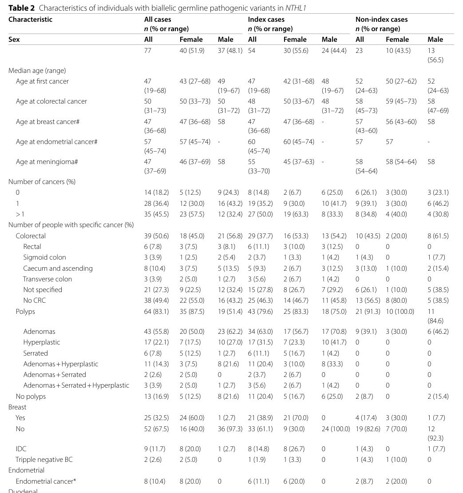

## Question

# Disease Characteristics Research Template

## Target Disease
- **Disease Name:** NTHL1-deficiency Tumor Predisposition Syndrome
- **MONDO ID:** MONDO:0100502 (if available)
- **Category:** Genetic

## Research Objectives

Please provide a comprehensive research report on **NTHL1-deficiency Tumor Predisposition Syndrome** covering all of the
disease characteristics listed below. This report will be used to populate a disease knowledge
base entry. Be thorough and cite primary literature (PMID preferred) for all claims.

For each section, **suggested databases/resources** are listed. These are the first places
you should search for information on each topic.

---

### 1. Disease Information
> **Search first:** OMIM, Orphanet, ICD-10/ICD-11, MeSH, PubMed

- What is the disease? Provide a concise overview.
- What are the key identifiers? (OMIM, Orphanet, ICD-10/ICD-11, MeSH, Mondo)
- What are the common synonyms and alternative names?
- Is the information derived from individual patients (e.g., EHR) or aggregated disease-level resources?

### 2. Etiology

- **Disease Causal Factors**: What are the primary causes? (genetic, environmental, infectious, mechanistic)
- **Risk Factors**:
  > **Search first:** PubMed, Cochrane Library, UpToDate, clinical guidelines, ClinVar, ClinGen, GWAS Catalog, PheGenI, CTD, CDC, WHO, epidemiological databases
  - Genetic risk factors (causal variants, susceptibility loci, modifier genes)
  - Environmental risk factors (toxins, lifestyle, occupational exposures, age, sex, family history)
- **Protective Factors**:
  > **Search first:** PubMed, Cochrane Library, clinical trial databases, GWAS Catalog, gnomAD, WHO, CDC, nutrition databases
  - Genetic protective factors (protective variants, modifier alleles)
  - Environmental protective factors (diet, lifestyle, exposures that reduce risk)
- **Gene-Environment Interactions**: How do genetic and environmental factors interact to influence disease?
  > **Search first:** CTD, PubMed, PheGenI, GxE databases

### 3. Phenotypes
> **Search first:** HPO (Human Phenotype Ontology), OMIM, Orphanet, PubMed, clinicaltrials.gov, MedDRA, SNOMED CT, DECIPHER, LOINC

For each phenotype, provide:
- **Phenotype type**: symptoms, clinical signs, physical manifestations, behavioral changes, or laboratory abnormalities
  > For symptoms/signs: HPO, OMIM, Orphanet, PubMed
  > For behavioral changes: HPO, DSM, RDoC (Research Domain Criteria), PubMed
  > For laboratory abnormalities: LOINC, SNOMED CT, LabTests Online, PubMed
- **Phenotype characteristics**:
  > **Search first:** OMIM, Orphanet, HPO, PubMed
  - Age of symptom onset (neonatal, childhood, adult-onset, late-onset)
  - Symptom severity (mild, moderate, severe, variable)
  - Symptom progression (stable, progressive, episodic, fluctuating)
  - Frequency among affected individuals (percentage or qualitative)
- **Quality of life impact**: Effects on daily functioning and well-being (per-phenotype when possible)
  > **Search first:** EQ-5D database, SF-36, WHO QOL databases, PubMed
- Suggest HPO (Human Phenotype Ontology) terms for each phenotype

### 4. Genetic/Molecular Information

- **Causal Genes**: Gene mutations or chromosomal abnormalities responsible for disease (gene symbols, OMIM IDs)
  > **Search first:** OMIM, ClinVar, HGMD, Ensembl, NCBI Gene
- **Pathogenic Variants**:
  - Affected genes (gene symbols, HGNC IDs)
    > **Search first:** OMIM, NCBI Gene, Ensembl, HGNC, UniProt, GeneCards
  - Variant classification (pathogenic, likely pathogenic, VUS per ACMG/AMP guidelines)
    > **Search first:** ClinVar, ClinGen, ACMG/AMP guidelines, VarSome
  - Variant type/class (missense, frameshift, nonsense, splice-site, structural)
  - Allele frequency in population databases
    > **Search first:** gnomAD, 1000 Genomes, ExAC, TOPMed, dbSNP
  - Somatic vs germline origin
    > **Search first:** COSMIC (somatic), ClinVar, ICGC, TCGA
  - Functional consequences (loss of function, gain of function, dominant negative)
- **Modifier Genes**: Genes that modify disease severity or expression
- **Epigenetic Information**: DNA methylation, histone modifications, chromatin changes affecting disease
  > **Search first:** ENCODE, Roadmap Epigenomics, MethBase, DiseaseMeth
- **Chromosomal Abnormalities**: Large-scale genetic changes (aneuploidy, translocations, inversions)
  > **Search first:** DECIPHER, ClinVar, ECARUCA, UCSC Genome Browser

### 5. Environmental Information

- **Environmental Factors**: Non-genetic contributing factors (toxins, radiation, pollution, occupational exposure)
  > **Search first:** CTD (Comparative Toxicogenomics Database), TOXNET, PubMed, EPA databases
- **Lifestyle Factors**: Behavioral factors (smoking, diet, exercise, alcohol consumption)
  > **Search first:** CDC databases, WHO, PubMed, NHANES
- **Infectious Agents**: If applicable, pathogens causing or triggering disease (bacteria, viruses, fungi, parasites)
  > **Search first:** NCBI Taxonomy, ViPR, BV-BRC, MicrobeDB, GIDEON

### 6. Mechanism / Pathophysiology

**Present this section as an ordered causal chain first, then the detail below.**
Open with a numbered sequence of mechanistic steps running from the initiating
lesion (mutation, exposure, infection) to the clinical manifestation, one step per
line, each naming what it causes next. State the causal verb explicitly ("leads
to", "results in") and say where a step is inferred rather than demonstrated.
Where the mechanism branches, show the branch. The categories below are a
checklist of what to cover within those steps, not the organizing structure —
a step may draw on several of them, and a category may contribute to several
steps.

- **Molecular Pathways**: Specific signaling cascades or biochemical pathways involved (Wnt, MAPK, mTOR, PI3K-AKT, etc.)
  > **Search first:** KEGG, Reactome, WikiPathways, PathBank, BioCyc
- **Cellular Processes**: Cell-level mechanisms (apoptosis, autophagy, cell cycle dysregulation, inflammation, etc.)
  > **Search first:** Gene Ontology (GO), Reactome, KEGG, PubMed
- **Protein Dysfunction**: How protein structure or function is altered (misfolding, aggregation, loss of function, gain of function)
  > **Search first:** UniProt, PDB (Protein Data Bank), InterPro, Pfam, AlphaFold
- **Metabolic Changes**: Alterations in metabolic processes (energy metabolism, lipid metabolism, amino acid metabolism)
  > **Search first:** KEGG, BioCyc, HMDB (Human Metabolome Database), BRENDA
- **Immune System Involvement**: Role of immune response (autoimmunity, immunodeficiency, chronic inflammation)
  > **Search first:** ImmPort, Immunome Database, IEDB, Gene Ontology
- **Tissue Damage Mechanisms**: How tissues/ are injured (oxidative stress, ischemia, fibrosis, necrosis)
  > **Search first:** PubMed, Gene Ontology, Reactome
- **Biochemical Abnormalities**: Specific molecular defects (enzyme deficiencies, receptor dysfunction, ion channel defects)
  > **Search first:** BRENDA, UniProt, KEGG, OMIM, PubMed
- **Epigenetic Changes**: DNA methylation, histone modifications affecting gene expression in disease
  > **Search first:** ENCODE, Roadmap Epigenomics, MethBase, DiseaseMeth
- **Molecular Profiling** (if available):
  - Transcriptomics/gene expression changes
    > **Search first:** GEO (Gene Expression Omnibus), ArrayExpress, GTEx, Human Cell Atlas, SRA
  - Proteomics findings
    > **Search first:** PRIDE, ProteomeXchange, Human Protein Atlas, STRING, BioGRID
  - Metabolomics signatures
    > **Search first:** MetaboLights, Metabolomics Workbench, HMDB, METLIN
  - Lipidomics alterations
    > **Search first:** LIPID MAPS, SwissLipids, LipidHome, Metabolomics Workbench
  - Genomic structural features
    > **Search first:** UCSC Genome Browser, Ensembl, NCBI, dbVar, DGV
- **Advanced Technologies** (if applicable):
  - Single-cell analysis findings (cell-type specific mechanisms, cellular heterogeneity)
    > **Search first:** Human Cell Atlas, Single Cell Portal, GEO, CELLxGENE
  - Spatial transcriptomics findings
    > **Search first:** GEO, Spatial Research, Vizgen, 10x Genomics data
  - Multi-omics integration results
    > **Search first:** TCGA, ICGC, cBioPortal, LinkedOmics, PubMed
  - Functional genomics screens (CRISPR, RNAi)
    > **Search first:** DepMap, GenomeRNAi, PubMed, BioGRID ORCS

For each mechanism, describe:
- The causal chain from initial trigger to clinical manifestation
- Which mechanisms are upstream vs downstream
- What cell types and biological processes are involved
- Suggest GO terms for biological processes and CL terms for cell types

### 7. Anatomical Structures Affected

- **Organ Level**:
  - Primary organs directly affected
  - Secondary organ involvement (complications, secondary effects)
  - Body systems involved (cardiovascular, nervous, digestive, respiratory, endocrine, etc.)
  > **Search first:** Uberon, FMA (Foundational Model of Anatomy), OMIM, HPO, ICD-11, MeSH, SNOMED CT
- **Tissue and Cell Level**:
  - Specific tissue types affected (epithelial, connective, muscle, nervous)
  - Specific cell populations targeted (with Cell Ontology terms)
  > **Search first:** Uberon, Human Protein Atlas, Cell Ontology, Human Cell Atlas, CellMarker, PanglaoDB
- **Subcellular Level**:
  - Cellular compartments involved (mitochondria, nucleus, ER, lysosomes) (with GO Cellular Component terms)
  > **Search first:** Gene Ontology (Cellular Component), UniProt, Human Protein Atlas
- **Localization**:
  - Specific anatomical sites (with UBERON terms)
    > **Search first:** FMA, Uberon, NeuroNames (for brain), SNOMED CT
  - Lateralization (unilateral, bilateral, asymmetric)
    > **Search first:** HPO, clinical literature, imaging databases

### 8. Temporal Development

- **Onset**:
  - Typical age of onset (congenital, pediatric, adult, geriatric)
  - Onset pattern (acute, subacute, chronic, insidious)
  > **Search first:** OMIM, Orphanet, HPO, PubMed
- **Progression**:
  - Disease stages (early, intermediate, advanced, end-stage)
    > **Search first:** Cancer Staging Manual (AJCC), WHO classifications, PubMed
  - Progression rate (rapid, slow, variable)
  - Disease course pattern (episodic, relapsing-remitting, progressive, stable)
  - Disease duration (self-limited, chronic lifelong)
  > **Search first:** Disease registries, longitudinal cohort databases, natural history studies, PubMed, Orphanet, OMIM
- **Patterns**:
  - Remission patterns (spontaneous, treatment-induced)
    > **Search first:** Clinical trial databases, disease registries, PubMed
  - Critical periods (time windows of vulnerability or opportunity for intervention)
    > **Search first:** PubMed, developmental biology databases, clinical guidelines

### 9. Inheritance and Population

- **Epidemiology**:
  - Prevalence (cases per 100,000 at given time)
  - Incidence (new cases per 100,000 per year)
  > **Search first:** Orphanet, CDC, WHO, GBD (Global Burden of Disease), national registries, SEER, disease registries
- **For Genetic Etiology**:
  - Inheritance pattern (AD, AR, X-linked, mitochondrial, multifactorial, polygenic)
    > **Search first:** OMIM, Orphanet, ClinVar, GTR (Genetic Testing Registry)
  - Penetrance (complete, incomplete, age-dependent)
    > **Search first:** ClinVar, OMIM, PubMed, ClinGen
  - Expressivity (variable, consistent)
    > **Search first:** OMIM, ClinVar, PubMed
  - Genetic anticipation (increasing severity in successive generations)
    > **Search first:** OMIM, PubMed (especially for repeat expansion disorders)
  - Germline mosaicism
    > **Search first:** ClinVar, OMIM, genetic counseling literature, PubMed
  - Founder effects (population-specific mutations)
    > **Search first:** gnomAD, population genetics databases, PubMed
  - Consanguinity role
    > **Search first:** OMIM, population studies, genetic counseling resources
  - Carrier frequency
    > **Search first:** gnomAD, carrier screening databases, GeneReviews, GTR
- **Population Demographics**:
  - Affected populations (ethnic or demographic groups with higher prevalence)
    > **Search first:** gnomAD, 1000 Genomes, PAGE Study, PubMed, population registries
  - Geographic distribution (endemic areas, regional variation)
    > **Search first:** WHO, CDC, GBD, Orphanet, geographic epidemiology databases
  - Geographic distribution of specific variants
  - Sex ratio (male:female)
    > **Search first:** Disease registries, OMIM, PubMed, epidemiological databases
  - Age distribution of affected individuals
    > **Search first:** CDC, disease registries, SEER, Orphanet

### 10. Diagnostics

- **Clinical Tests**:
  - Laboratory tests (blood, urine, tissue chemistry, specific enzyme assays)
    > **Search first:** LOINC, LabTests Online, PubMed
  - Biomarkers (proteins, metabolites, genetic markers, circulating biomarkers)
    > **Search first:** FDA Biomarker List, BEST (Biomarkers, EndpointS, and other Tools), PubMed
  - Imaging studies (X-ray, CT, MRI, PET, ultrasound)
    > **Search first:** RadLex, DICOM, Radiopaedia, imaging databases
  - Functional tests (pulmonary function, cardiac stress tests)
    > **Search first:** LOINC, clinical guidelines, PubMed
  - Electrophysiology (EEG, EMG, ECG, nerve conduction studies)
    > **Search first:** LOINC, clinical neurophysiology databases, PubMed
  - Biopsy findings (histopathology, immunohistochemistry)
    > **Search first:** SNOMED CT, College of American Pathologists resources, PubMed
  - Pathology findings (microscopic examination)
    > **Search first:** SNOMED CT, Digital Pathology databases, PubMed
- **Genetic Testing**:
  > **Search first:** GTR (Genetic Testing Registry), GeneReviews, ClinGen
  - Overview of recommended genetic testing approach
  - Whole genome sequencing (WGS) utility
    > **Search first:** GTR, ClinVar, GEL (Genomics England), gnomAD
  - Whole exome sequencing (WES) utility
    > **Search first:** GTR, ClinVar, OMIM, GeneMatcher
  - Gene panels (which panels, which genes)
    > **Search first:** GTR, ClinVar, laboratory-specific databases
  - Single gene testing
    > **Search first:** GTR, ClinVar, OMIM, GeneReviews
  - Chromosomal microarray (CMA)
    > **Search first:** DECIPHER, ClinVar, dbVar, ECARUCA
  - Karyotyping
    > **Search first:** Chromosome Abnormality Database, ClinVar, cytogenetics resources
  - FISH
    > **Search first:** ClinVar, cytogenetics databases, PubMed
  - Mitochondrial DNA testing
    > **Search first:** MITOMAP, MSeqDR, ClinVar, GTR
  - Repeat expansion testing
    > **Search first:** GTR, ClinVar, repeat expansion databases, PubMed
- **Omics-Based Diagnostics** (if applicable):
  - RNA sequencing / transcriptomics
    > **Search first:** GEO, ArrayExpress, GTEx, RNA-seq databases
  - Proteomics
    > **Search first:** PRIDE, ProteomeXchange, FDA Biomarker database
  - Metabolomics
    > **Search first:** MetaboLights, Metabolomics Workbench, HMDB
  - Epigenomics
    > **Search first:** GEO, ENCODE, Roadmap Epigenomics, MethBase
  - Liquid biopsy
    > **Search first:** COSMIC, ClinVar, liquid biopsy databases, PubMed
- **Clinical Criteria**:
  - Standardized diagnostic criteria (DSM, ICD, society guidelines)
    > **Search first:** DSM-5, ICD-11, clinical society guidelines, UpToDate
  - Differential diagnosis (other conditions to rule out, with distinguishing features)
    > **Search first:** DynaMed, UpToDate, clinical decision support systems
- **Screening**:
  - Screening methods for asymptomatic individuals (newborn screening, carrier screening, cascade screening)
    > **Search first:** ACMG recommendations, CDC newborn screening, GTR

### 11. Outcome/Prognosis

- **Survival and Mortality**:
  - Survival rate (5-year, 10-year, overall)
    > **Search first:** SEER, cancer registries, disease-specific registries, PubMed
  - Life expectancy (with and without treatment if applicable)
    > **Search first:** Orphanet, disease registries, actuarial databases, PubMed
  - Mortality rate
    > **Search first:** CDC, WHO, GBD, national mortality databases
  - Disease-specific mortality (deaths directly attributable to disease)
    > **Search first:** Disease registries, CDC Wonder, GBD, PubMed
- **Morbidity and Function**:
  - Morbidity (disease-related disability and health impacts)
    > **Search first:** GBD, WHO, disability databases, PubMed
  - Disability outcomes (long-term functional impairments)
    > **Search first:** ICF (International Classification of Functioning), disability registries
  - Quality of life measures (EQ-5D, SF-36, PROMIS, disease-specific tools)
    > **Search first:** EQ-5D database, SF-36, PROMIS, PubMed
- **Disease Course**:
  - Complications (secondary problems: infections, organ failure, etc.)
    > **Search first:** ICD codes, disease registries, clinical databases, PubMed
  - Recovery potential (likelihood and extent of recovery, with vs without treatment)
    > **Search first:** Natural history studies, rehabilitation databases, PubMed
- **Prediction**:
  - Prognostic factors (age, disease severity, biomarkers, treatment response)
    > **Search first:** Prognostic models databases, clinical calculators, PubMed
  - Prognostic biomarkers (molecular markers predicting disease course)
    > **Search first:** FDA Biomarker database, PubMed, cancer prognostic databases

### 12. Treatment

- **Pharmacotherapy**:
  - Pharmacological treatments (drug names, drug classes, mechanisms of action)
    > **Search first:** DrugBank, RxNorm, ATC classification, DailyMed, FDA databases
  - Pharmacogenomics (how genetic variants affect drug metabolism, efficacy, toxicity)
    > **Search first:** PharmGKB, CPIC (Clinical Pharmacogenetics), FDA Table of PGx Biomarkers
- **Advanced Therapeutics**:
  - Gene therapy (viral vectors, CRISPR, gene replacement, gene editing)
    > **Search first:** ClinicalTrials.gov, FDA gene therapy database, ASGCT resources
  - Cell therapy (stem cell transplant, CAR-T, cellular therapeutics)
    > **Search first:** ClinicalTrials.gov, FDA cell therapy database, FACT standards
  - RNA-based therapies (ASOs, siRNA, mRNA therapies)
    > **Search first:** ClinicalTrials.gov, FDA approvals, PubMed
  - Targeted therapies (treatments directed at specific molecular targets)
    > **Search first:** My Cancer Genome, OncoKB, ClinicalTrials.gov, FDA approvals
  - Immunotherapies (checkpoint inhibitors, monoclonal antibodies)
    > **Search first:** Cancer Immunotherapy Database, FDA approvals, ClinicalTrials.gov
- **Surgical and Interventional**:
  - Surgical interventions (types of surgery, timing, outcomes)
    > **Search first:** CPT codes, surgical registries, clinical guidelines, PubMed
- **Supportive and Rehabilitative**:
  - Supportive care (symptom management, pain control, nutrition)
    > **Search first:** Clinical guidelines, Cochrane Library, PubMed
  - Rehabilitation (physical therapy, occupational therapy, speech therapy)
    > **Search first:** Rehabilitation medicine databases, clinical guidelines, PubMed
- **Experimental**:
  - Experimental treatments in clinical trials (with NCT identifiers if available)
    > **Search first:** ClinicalTrials.gov, EU Clinical Trials Register, WHO ICTRP
- **Treatment Outcomes**:
  - Treatment response rates
    > **Search first:** Clinical trial databases, FDA reviews, systematic reviews, PubMed
  - Side effects and adverse events
    > **Search first:** FDA Adverse Event Reporting System (FAERS), MedWatch, PubMed
- **Treatment Strategy**:
  - Treatment algorithms (clinical pathways, decision trees)
    > **Search first:** Clinical practice guidelines, NCCN Guidelines, UpToDate
  - Combination therapies
    > **Search first:** ClinicalTrials.gov, treatment guidelines, PubMed
  - Personalized medicine approaches (genotype-guided treatment)
    > **Search first:** My Cancer Genome, CIViC, PharmGKB, precision medicine databases

For each treatment, suggest NCIT (NCI Thesaurus) clinical-intervention terms where applicable.

### 13. Prevention

- **Prevention Levels**:
  - Primary prevention (preventing disease occurrence: vaccination, risk factor modification)
    > **Search first:** CDC, WHO, USPSTF recommendations, Cochrane Library
  - Secondary prevention (early detection and treatment: screening programs, early intervention)
    > **Search first:** USPSTF, CDC screening guidelines, WHO
  - Tertiary prevention (preventing complications in those with disease)
    > **Search first:** Clinical guidelines, disease management protocols, PubMed
- **Immunization**: Vaccine strategies (if applicable)
  > **Search first:** CDC vaccine schedules, WHO immunization, FDA vaccine database
- **Screening and Early Detection**:
  - Screening programs (population-based: newborn screening, cancer screening)
    > **Search first:** CDC screening programs, USPSTF, cancer screening databases
  - Genetic screening (carrier screening, preimplantation genetic diagnosis, prenatal testing)
    > **Search first:** ACMG recommendations, ACOG guidelines, GTR
  - Risk stratification (identifying high-risk individuals for targeted prevention)
    > **Search first:** Risk prediction models, clinical calculators, PubMed
- **Behavioral Interventions**: Lifestyle modifications to reduce risk
  > **Search first:** CDC, WHO, behavioral intervention databases, Cochrane Library
- **Counseling**: Genetic counseling (risk assessment, family planning guidance)
  > **Search first:** NSGC resources, ACMG guidelines, GeneReviews
- **Public Health**:
  - Public health interventions (sanitation, vector control, health education)
    > **Search first:** CDC, WHO, public health databases, PubMed
  - Environmental interventions (reducing environmental risk factors)
    > **Search first:** EPA databases, WHO environmental health, PubMed
- **Prophylaxis**: Preventive medications or procedures
  > **Search first:** Clinical guidelines, FDA approvals, PubMed

### 14. Other Species / Natural Disease

- **Taxonomy**: Species affected (with NCBI Taxon identifiers)
  > **Search first:** NCBI Taxonomy
- **Breed**: Specific breeds affected (with VBO identifiers if applicable)
  > **Search first:** VBO (Vertebrate Breed Ontology)
- **Gene**: Orthologous genes in other species (with NCBI Gene IDs)
  > **Search first:** NCBI Gene
- **Natural Disease**:
  - Naturally occurring disease in other species (companion animals, wildlife)
    > **Search first:** OMIA (Online Mendelian Inheritance in Animals), VetCompass, PubMed
  - Veterinary relevance and importance in animal health
    > **Search first:** OMIA, veterinary databases, PubMed
- **Comparative Biology**:
  - Comparative pathology (similarities and differences across species)
    > **Search first:** OMIA, comparative pathology databases, PubMed
  - Evolutionary conservation of disease mechanisms
    > **Search first:** HomoloGene, OrthoMCL, Alliance of Genome Resources
- **Transmission** (if applicable):
  - Zoonotic potential
    > **Search first:** CDC zoonotic diseases, WHO zoonoses, GIDEON
  - Cross-species susceptibility
    > **Search first:** NCBI Taxonomy, veterinary databases, PubMed

### 15. Model Organisms

- **Model Types**:
  - Model organism type (mammalian, invertebrate, cellular, in vitro)
    > **Search first:** Alliance of Genome Resources, model organism databases
  - Specific model systems (mouse, rat, zebrafish, Drosophila, C. elegans, yeast, cell lines, organoids, iPSCs)
    > **Search first:** MGI, RGD, ZFIN, FlyBase, WormBase, SGD, ATCC, Cellosaurus
  - Induced models (drug treatment, surgical intervention, environmental manipulation)
    > **Search first:** MGI, model organism databases, PubMed
- **Genetic Models**:
  - Types available (knockout, knock-in, transgenic, conditional, humanized)
    > **Search first:** MGI, IMPC, KOMP, EuMMCR, IMSR
- **Model Characteristics**:
  - Phenotype recapitulation (how well model reproduces human disease features)
    > **Search first:** Model organism databases, comparative studies, PubMed
  - Model limitations (aspects of human disease not captured)
    > **Search first:** Model organism databases, PubMed, review articles
- **Applications**:
  - Research applications (what aspects of disease can be studied)
    > **Search first:** Model organism databases, PubMed
- **Resources**:
  - Model databases
    > **Search first:** MGI, RGD, ZFIN, FlyBase, WormBase, IMSR, EMMA, MMRRC

---

## Citation Requirements

- Cite primary literature (PMID preferred) for all mechanistic and clinical claims
- Prioritize recent reviews and landmark papers
- Include direct quotes from abstracts where possible to support key statements
- Distinguish evidence source types: human clinical, model organism, in vitro, computational

## Output Format

Structure your response as a comprehensive narrative organized by the sections above.
For each section, provide:
- Factual content with specific details (numbers, percentages, gene names, variant nomenclature)
- Ontology term suggestions (HPO, GO, CL, UBERON, CHEBI, NCIT, MONDO) where applicable
- Evidence citations with PMIDs
- Direct quotes from abstracts to support key claims
- Clear indication when information is not available or not applicable for this disease

This report will be used to populate a disease knowledge base entry with:
- Pathophysiology descriptions with causal chains
- Gene/protein annotations (HGNC, GO terms)
- Phenotype associations (HP terms) with frequencies
- Cell type involvement (CL terms)
- Anatomical locations (UBERON terms)
- Chemical entities (CHEBI terms)
- Treatment annotations (NCIT terms)
- Evidence items with PMIDs and exact abstract quotes
- Epidemiology, prognosis, diagnostic, and prevention information
- Animal model descriptions with phenotype recapitulation details

## Output

Question: You are an expert researcher providing comprehensive, well-cited information.

Provide detailed information focusing on:
1. Key concepts and definitions with current understanding
2. Recent developments and latest research (prioritize 2023-2024 sources)
3. Current applications and real-world implementations
4. Expert opinions and analysis from authoritative sources
5. Relevant statistics and data from recent studies

Format as a comprehensive research report with proper citations. Include URLs and publication dates where available.
Always prioritize recent, authoritative sources and provide specific citations for all major claims.

# Disease Characteristics Research Template

## Target Disease
- **Disease Name:** NTHL1-deficiency Tumor Predisposition Syndrome
- **MONDO ID:** MONDO:0100502 (if available)
- **Category:** Genetic

## Research Objectives

Please provide a comprehensive research report on **NTHL1-deficiency Tumor Predisposition Syndrome** covering all of the
disease characteristics listed below. This report will be used to populate a disease knowledge
base entry. Be thorough and cite primary literature (PMID preferred) for all claims.

For each section, **suggested databases/resources** are listed. These are the first places
you should search for information on each topic.

---

### 1. Disease Information
> **Search first:** OMIM, Orphanet, ICD-10/ICD-11, MeSH, PubMed

- What is the disease? Provide a concise overview.
- What are the key identifiers? (OMIM, Orphanet, ICD-10/ICD-11, MeSH, Mondo)
- What are the common synonyms and alternative names?
- Is the information derived from individual patients (e.g., EHR) or aggregated disease-level resources?

### 2. Etiology

- **Disease Causal Factors**: What are the primary causes? (genetic, environmental, infectious, mechanistic)
- **Risk Factors**:
  > **Search first:** PubMed, Cochrane Library, UpToDate, clinical guidelines, ClinVar, ClinGen, GWAS Catalog, PheGenI, CTD, CDC, WHO, epidemiological databases
  - Genetic risk factors (causal variants, susceptibility loci, modifier genes)
  - Environmental risk factors (toxins, lifestyle, occupational exposures, age, sex, family history)
- **Protective Factors**:
  > **Search first:** PubMed, Cochrane Library, clinical trial databases, GWAS Catalog, gnomAD, WHO, CDC, nutrition databases
  - Genetic protective factors (protective variants, modifier alleles)
  - Environmental protective factors (diet, lifestyle, exposures that reduce risk)
- **Gene-Environment Interactions**: How do genetic and environmental factors interact to influence disease?
  > **Search first:** CTD, PubMed, PheGenI, GxE databases

### 3. Phenotypes
> **Search first:** HPO (Human Phenotype Ontology), OMIM, Orphanet, PubMed, clinicaltrials.gov, MedDRA, SNOMED CT, DECIPHER, LOINC

For each phenotype, provide:
- **Phenotype type**: symptoms, clinical signs, physical manifestations, behavioral changes, or laboratory abnormalities
  > For symptoms/signs: HPO, OMIM, Orphanet, PubMed
  > For behavioral changes: HPO, DSM, RDoC (Research Domain Criteria), PubMed
  > For laboratory abnormalities: LOINC, SNOMED CT, LabTests Online, PubMed
- **Phenotype characteristics**:
  > **Search first:** OMIM, Orphanet, HPO, PubMed
  - Age of symptom onset (neonatal, childhood, adult-onset, late-onset)
  - Symptom severity (mild, moderate, severe, variable)
  - Symptom progression (stable, progressive, episodic, fluctuating)
  - Frequency among affected individuals (percentage or qualitative)
- **Quality of life impact**: Effects on daily functioning and well-being (per-phenotype when possible)
  > **Search first:** EQ-5D database, SF-36, WHO QOL databases, PubMed
- Suggest HPO (Human Phenotype Ontology) terms for each phenotype

### 4. Genetic/Molecular Information

- **Causal Genes**: Gene mutations or chromosomal abnormalities responsible for disease (gene symbols, OMIM IDs)
  > **Search first:** OMIM, ClinVar, HGMD, Ensembl, NCBI Gene
- **Pathogenic Variants**:
  - Affected genes (gene symbols, HGNC IDs)
    > **Search first:** OMIM, NCBI Gene, Ensembl, HGNC, UniProt, GeneCards
  - Variant classification (pathogenic, likely pathogenic, VUS per ACMG/AMP guidelines)
    > **Search first:** ClinVar, ClinGen, ACMG/AMP guidelines, VarSome
  - Variant type/class (missense, frameshift, nonsense, splice-site, structural)
  - Allele frequency in population databases
    > **Search first:** gnomAD, 1000 Genomes, ExAC, TOPMed, dbSNP
  - Somatic vs germline origin
    > **Search first:** COSMIC (somatic), ClinVar, ICGC, TCGA
  - Functional consequences (loss of function, gain of function, dominant negative)
- **Modifier Genes**: Genes that modify disease severity or expression
- **Epigenetic Information**: DNA methylation, histone modifications, chromatin changes affecting disease
  > **Search first:** ENCODE, Roadmap Epigenomics, MethBase, DiseaseMeth
- **Chromosomal Abnormalities**: Large-scale genetic changes (aneuploidy, translocations, inversions)
  > **Search first:** DECIPHER, ClinVar, ECARUCA, UCSC Genome Browser

### 5. Environmental Information

- **Environmental Factors**: Non-genetic contributing factors (toxins, radiation, pollution, occupational exposure)
  > **Search first:** CTD (Comparative Toxicogenomics Database), TOXNET, PubMed, EPA databases
- **Lifestyle Factors**: Behavioral factors (smoking, diet, exercise, alcohol consumption)
  > **Search first:** CDC databases, WHO, PubMed, NHANES
- **Infectious Agents**: If applicable, pathogens causing or triggering disease (bacteria, viruses, fungi, parasites)
  > **Search first:** NCBI Taxonomy, ViPR, BV-BRC, MicrobeDB, GIDEON

### 6. Mechanism / Pathophysiology

**Present this section as an ordered causal chain first, then the detail below.**
Open with a numbered sequence of mechanistic steps running from the initiating
lesion (mutation, exposure, infection) to the clinical manifestation, one step per
line, each naming what it causes next. State the causal verb explicitly ("leads
to", "results in") and say where a step is inferred rather than demonstrated.
Where the mechanism branches, show the branch. The categories below are a
checklist of what to cover within those steps, not the organizing structure —
a step may draw on several of them, and a category may contribute to several
steps.

- **Molecular Pathways**: Specific signaling cascades or biochemical pathways involved (Wnt, MAPK, mTOR, PI3K-AKT, etc.)
  > **Search first:** KEGG, Reactome, WikiPathways, PathBank, BioCyc
- **Cellular Processes**: Cell-level mechanisms (apoptosis, autophagy, cell cycle dysregulation, inflammation, etc.)
  > **Search first:** Gene Ontology (GO), Reactome, KEGG, PubMed
- **Protein Dysfunction**: How protein structure or function is altered (misfolding, aggregation, loss of function, gain of function)
  > **Search first:** UniProt, PDB (Protein Data Bank), InterPro, Pfam, AlphaFold
- **Metabolic Changes**: Alterations in metabolic processes (energy metabolism, lipid metabolism, amino acid metabolism)
  > **Search first:** KEGG, BioCyc, HMDB (Human Metabolome Database), BRENDA
- **Immune System Involvement**: Role of immune response (autoimmunity, immunodeficiency, chronic inflammation)
  > **Search first:** ImmPort, Immunome Database, IEDB, Gene Ontology
- **Tissue Damage Mechanisms**: How tissues/ are injured (oxidative stress, ischemia, fibrosis, necrosis)
  > **Search first:** PubMed, Gene Ontology, Reactome
- **Biochemical Abnormalities**: Specific molecular defects (enzyme deficiencies, receptor dysfunction, ion channel defects)
  > **Search first:** BRENDA, UniProt, KEGG, OMIM, PubMed
- **Epigenetic Changes**: DNA methylation, histone modifications affecting gene expression in disease
  > **Search first:** ENCODE, Roadmap Epigenomics, MethBase, DiseaseMeth
- **Molecular Profiling** (if available):
  - Transcriptomics/gene expression changes
    > **Search first:** GEO (Gene Expression Omnibus), ArrayExpress, GTEx, Human Cell Atlas, SRA
  - Proteomics findings
    > **Search first:** PRIDE, ProteomeXchange, Human Protein Atlas, STRING, BioGRID
  - Metabolomics signatures
    > **Search first:** MetaboLights, Metabolomics Workbench, HMDB, METLIN
  - Lipidomics alterations
    > **Search first:** LIPID MAPS, SwissLipids, LipidHome, Metabolomics Workbench
  - Genomic structural features
    > **Search first:** UCSC Genome Browser, Ensembl, NCBI, dbVar, DGV
- **Advanced Technologies** (if applicable):
  - Single-cell analysis findings (cell-type specific mechanisms, cellular heterogeneity)
    > **Search first:** Human Cell Atlas, Single Cell Portal, GEO, CELLxGENE
  - Spatial transcriptomics findings
    > **Search first:** GEO, Spatial Research, Vizgen, 10x Genomics data
  - Multi-omics integration results
    > **Search first:** TCGA, ICGC, cBioPortal, LinkedOmics, PubMed
  - Functional genomics screens (CRISPR, RNAi)
    > **Search first:** DepMap, GenomeRNAi, PubMed, BioGRID ORCS

For each mechanism, describe:
- The causal chain from initial trigger to clinical manifestation
- Which mechanisms are upstream vs downstream
- What cell types and biological processes are involved
- Suggest GO terms for biological processes and CL terms for cell types

### 7. Anatomical Structures Affected

- **Organ Level**:
  - Primary organs directly affected
  - Secondary organ involvement (complications, secondary effects)
  - Body systems involved (cardiovascular, nervous, digestive, respiratory, endocrine, etc.)
  > **Search first:** Uberon, FMA (Foundational Model of Anatomy), OMIM, HPO, ICD-11, MeSH, SNOMED CT
- **Tissue and Cell Level**:
  - Specific tissue types affected (epithelial, connective, muscle, nervous)
  - Specific cell populations targeted (with Cell Ontology terms)
  > **Search first:** Uberon, Human Protein Atlas, Cell Ontology, Human Cell Atlas, CellMarker, PanglaoDB
- **Subcellular Level**:
  - Cellular compartments involved (mitochondria, nucleus, ER, lysosomes) (with GO Cellular Component terms)
  > **Search first:** Gene Ontology (Cellular Component), UniProt, Human Protein Atlas
- **Localization**:
  - Specific anatomical sites (with UBERON terms)
    > **Search first:** FMA, Uberon, NeuroNames (for brain), SNOMED CT
  - Lateralization (unilateral, bilateral, asymmetric)
    > **Search first:** HPO, clinical literature, imaging databases

### 8. Temporal Development

- **Onset**:
  - Typical age of onset (congenital, pediatric, adult, geriatric)
  - Onset pattern (acute, subacute, chronic, insidious)
  > **Search first:** OMIM, Orphanet, HPO, PubMed
- **Progression**:
  - Disease stages (early, intermediate, advanced, end-stage)
    > **Search first:** Cancer Staging Manual (AJCC), WHO classifications, PubMed
  - Progression rate (rapid, slow, variable)
  - Disease course pattern (episodic, relapsing-remitting, progressive, stable)
  - Disease duration (self-limited, chronic lifelong)
  > **Search first:** Disease registries, longitudinal cohort databases, natural history studies, PubMed, Orphanet, OMIM
- **Patterns**:
  - Remission patterns (spontaneous, treatment-induced)
    > **Search first:** Clinical trial databases, disease registries, PubMed
  - Critical periods (time windows of vulnerability or opportunity for intervention)
    > **Search first:** PubMed, developmental biology databases, clinical guidelines

### 9. Inheritance and Population

- **Epidemiology**:
  - Prevalence (cases per 100,000 at given time)
  - Incidence (new cases per 100,000 per year)
  > **Search first:** Orphanet, CDC, WHO, GBD (Global Burden of Disease), national registries, SEER, disease registries
- **For Genetic Etiology**:
  - Inheritance pattern (AD, AR, X-linked, mitochondrial, multifactorial, polygenic)
    > **Search first:** OMIM, Orphanet, ClinVar, GTR (Genetic Testing Registry)
  - Penetrance (complete, incomplete, age-dependent)
    > **Search first:** ClinVar, OMIM, PubMed, ClinGen
  - Expressivity (variable, consistent)
    > **Search first:** OMIM, ClinVar, PubMed
  - Genetic anticipation (increasing severity in successive generations)
    > **Search first:** OMIM, PubMed (especially for repeat expansion disorders)
  - Germline mosaicism
    > **Search first:** ClinVar, OMIM, genetic counseling literature, PubMed
  - Founder effects (population-specific mutations)
    > **Search first:** gnomAD, population genetics databases, PubMed
  - Consanguinity role
    > **Search first:** OMIM, population studies, genetic counseling resources
  - Carrier frequency
    > **Search first:** gnomAD, carrier screening databases, GeneReviews, GTR
- **Population Demographics**:
  - Affected populations (ethnic or demographic groups with higher prevalence)
    > **Search first:** gnomAD, 1000 Genomes, PAGE Study, PubMed, population registries
  - Geographic distribution (endemic areas, regional variation)
    > **Search first:** WHO, CDC, GBD, Orphanet, geographic epidemiology databases
  - Geographic distribution of specific variants
  - Sex ratio (male:female)
    > **Search first:** Disease registries, OMIM, PubMed, epidemiological databases
  - Age distribution of affected individuals
    > **Search first:** CDC, disease registries, SEER, Orphanet

### 10. Diagnostics

- **Clinical Tests**:
  - Laboratory tests (blood, urine, tissue chemistry, specific enzyme assays)
    > **Search first:** LOINC, LabTests Online, PubMed
  - Biomarkers (proteins, metabolites, genetic markers, circulating biomarkers)
    > **Search first:** FDA Biomarker List, BEST (Biomarkers, EndpointS, and other Tools), PubMed
  - Imaging studies (X-ray, CT, MRI, PET, ultrasound)
    > **Search first:** RadLex, DICOM, Radiopaedia, imaging databases
  - Functional tests (pulmonary function, cardiac stress tests)
    > **Search first:** LOINC, clinical guidelines, PubMed
  - Electrophysiology (EEG, EMG, ECG, nerve conduction studies)
    > **Search first:** LOINC, clinical neurophysiology databases, PubMed
  - Biopsy findings (histopathology, immunohistochemistry)
    > **Search first:** SNOMED CT, College of American Pathologists resources, PubMed
  - Pathology findings (microscopic examination)
    > **Search first:** SNOMED CT, Digital Pathology databases, PubMed
- **Genetic Testing**:
  > **Search first:** GTR (Genetic Testing Registry), GeneReviews, ClinGen
  - Overview of recommended genetic testing approach
  - Whole genome sequencing (WGS) utility
    > **Search first:** GTR, ClinVar, GEL (Genomics England), gnomAD
  - Whole exome sequencing (WES) utility
    > **Search first:** GTR, ClinVar, OMIM, GeneMatcher
  - Gene panels (which panels, which genes)
    > **Search first:** GTR, ClinVar, laboratory-specific databases
  - Single gene testing
    > **Search first:** GTR, ClinVar, OMIM, GeneReviews
  - Chromosomal microarray (CMA)
    > **Search first:** DECIPHER, ClinVar, dbVar, ECARUCA
  - Karyotyping
    > **Search first:** Chromosome Abnormality Database, ClinVar, cytogenetics resources
  - FISH
    > **Search first:** ClinVar, cytogenetics databases, PubMed
  - Mitochondrial DNA testing
    > **Search first:** MITOMAP, MSeqDR, ClinVar, GTR
  - Repeat expansion testing
    > **Search first:** GTR, ClinVar, repeat expansion databases, PubMed
- **Omics-Based Diagnostics** (if applicable):
  - RNA sequencing / transcriptomics
    > **Search first:** GEO, ArrayExpress, GTEx, RNA-seq databases
  - Proteomics
    > **Search first:** PRIDE, ProteomeXchange, FDA Biomarker database
  - Metabolomics
    > **Search first:** MetaboLights, Metabolomics Workbench, HMDB
  - Epigenomics
    > **Search first:** GEO, ENCODE, Roadmap Epigenomics, MethBase
  - Liquid biopsy
    > **Search first:** COSMIC, ClinVar, liquid biopsy databases, PubMed
- **Clinical Criteria**:
  - Standardized diagnostic criteria (DSM, ICD, society guidelines)
    > **Search first:** DSM-5, ICD-11, clinical society guidelines, UpToDate
  - Differential diagnosis (other conditions to rule out, with distinguishing features)
    > **Search first:** DynaMed, UpToDate, clinical decision support systems
- **Screening**:
  - Screening methods for asymptomatic individuals (newborn screening, carrier screening, cascade screening)
    > **Search first:** ACMG recommendations, CDC newborn screening, GTR

### 11. Outcome/Prognosis

- **Survival and Mortality**:
  - Survival rate (5-year, 10-year, overall)
    > **Search first:** SEER, cancer registries, disease-specific registries, PubMed
  - Life expectancy (with and without treatment if applicable)
    > **Search first:** Orphanet, disease registries, actuarial databases, PubMed
  - Mortality rate
    > **Search first:** CDC, WHO, GBD, national mortality databases
  - Disease-specific mortality (deaths directly attributable to disease)
    > **Search first:** Disease registries, CDC Wonder, GBD, PubMed
- **Morbidity and Function**:
  - Morbidity (disease-related disability and health impacts)
    > **Search first:** GBD, WHO, disability databases, PubMed
  - Disability outcomes (long-term functional impairments)
    > **Search first:** ICF (International Classification of Functioning), disability registries
  - Quality of life measures (EQ-5D, SF-36, PROMIS, disease-specific tools)
    > **Search first:** EQ-5D database, SF-36, PROMIS, PubMed
- **Disease Course**:
  - Complications (secondary problems: infections, organ failure, etc.)
    > **Search first:** ICD codes, disease registries, clinical databases, PubMed
  - Recovery potential (likelihood and extent of recovery, with vs without treatment)
    > **Search first:** Natural history studies, rehabilitation databases, PubMed
- **Prediction**:
  - Prognostic factors (age, disease severity, biomarkers, treatment response)
    > **Search first:** Prognostic models databases, clinical calculators, PubMed
  - Prognostic biomarkers (molecular markers predicting disease course)
    > **Search first:** FDA Biomarker database, PubMed, cancer prognostic databases

### 12. Treatment

- **Pharmacotherapy**:
  - Pharmacological treatments (drug names, drug classes, mechanisms of action)
    > **Search first:** DrugBank, RxNorm, ATC classification, DailyMed, FDA databases
  - Pharmacogenomics (how genetic variants affect drug metabolism, efficacy, toxicity)
    > **Search first:** PharmGKB, CPIC (Clinical Pharmacogenetics), FDA Table of PGx Biomarkers
- **Advanced Therapeutics**:
  - Gene therapy (viral vectors, CRISPR, gene replacement, gene editing)
    > **Search first:** ClinicalTrials.gov, FDA gene therapy database, ASGCT resources
  - Cell therapy (stem cell transplant, CAR-T, cellular therapeutics)
    > **Search first:** ClinicalTrials.gov, FDA cell therapy database, FACT standards
  - RNA-based therapies (ASOs, siRNA, mRNA therapies)
    > **Search first:** ClinicalTrials.gov, FDA approvals, PubMed
  - Targeted therapies (treatments directed at specific molecular targets)
    > **Search first:** My Cancer Genome, OncoKB, ClinicalTrials.gov, FDA approvals
  - Immunotherapies (checkpoint inhibitors, monoclonal antibodies)
    > **Search first:** Cancer Immunotherapy Database, FDA approvals, ClinicalTrials.gov
- **Surgical and Interventional**:
  - Surgical interventions (types of surgery, timing, outcomes)
    > **Search first:** CPT codes, surgical registries, clinical guidelines, PubMed
- **Supportive and Rehabilitative**:
  - Supportive care (symptom management, pain control, nutrition)
    > **Search first:** Clinical guidelines, Cochrane Library, PubMed
  - Rehabilitation (physical therapy, occupational therapy, speech therapy)
    > **Search first:** Rehabilitation medicine databases, clinical guidelines, PubMed
- **Experimental**:
  - Experimental treatments in clinical trials (with NCT identifiers if available)
    > **Search first:** ClinicalTrials.gov, EU Clinical Trials Register, WHO ICTRP
- **Treatment Outcomes**:
  - Treatment response rates
    > **Search first:** Clinical trial databases, FDA reviews, systematic reviews, PubMed
  - Side effects and adverse events
    > **Search first:** FDA Adverse Event Reporting System (FAERS), MedWatch, PubMed
- **Treatment Strategy**:
  - Treatment algorithms (clinical pathways, decision trees)
    > **Search first:** Clinical practice guidelines, NCCN Guidelines, UpToDate
  - Combination therapies
    > **Search first:** ClinicalTrials.gov, treatment guidelines, PubMed
  - Personalized medicine approaches (genotype-guided treatment)
    > **Search first:** My Cancer Genome, CIViC, PharmGKB, precision medicine databases

For each treatment, suggest NCIT (NCI Thesaurus) clinical-intervention terms where applicable.

### 13. Prevention

- **Prevention Levels**:
  - Primary prevention (preventing disease occurrence: vaccination, risk factor modification)
    > **Search first:** CDC, WHO, USPSTF recommendations, Cochrane Library
  - Secondary prevention (early detection and treatment: screening programs, early intervention)
    > **Search first:** USPSTF, CDC screening guidelines, WHO
  - Tertiary prevention (preventing complications in those with disease)
    > **Search first:** Clinical guidelines, disease management protocols, PubMed
- **Immunization**: Vaccine strategies (if applicable)
  > **Search first:** CDC vaccine schedules, WHO immunization, FDA vaccine database
- **Screening and Early Detection**:
  - Screening programs (population-based: newborn screening, cancer screening)
    > **Search first:** CDC screening programs, USPSTF, cancer screening databases
  - Genetic screening (carrier screening, preimplantation genetic diagnosis, prenatal testing)
    > **Search first:** ACMG recommendations, ACOG guidelines, GTR
  - Risk stratification (identifying high-risk individuals for targeted prevention)
    > **Search first:** Risk prediction models, clinical calculators, PubMed
- **Behavioral Interventions**: Lifestyle modifications to reduce risk
  > **Search first:** CDC, WHO, behavioral intervention databases, Cochrane Library
- **Counseling**: Genetic counseling (risk assessment, family planning guidance)
  > **Search first:** NSGC resources, ACMG guidelines, GeneReviews
- **Public Health**:
  - Public health interventions (sanitation, vector control, health education)
    > **Search first:** CDC, WHO, public health databases, PubMed
  - Environmental interventions (reducing environmental risk factors)
    > **Search first:** EPA databases, WHO environmental health, PubMed
- **Prophylaxis**: Preventive medications or procedures
  > **Search first:** Clinical guidelines, FDA approvals, PubMed

### 14. Other Species / Natural Disease

- **Taxonomy**: Species affected (with NCBI Taxon identifiers)
  > **Search first:** NCBI Taxonomy
- **Breed**: Specific breeds affected (with VBO identifiers if applicable)
  > **Search first:** VBO (Vertebrate Breed Ontology)
- **Gene**: Orthologous genes in other species (with NCBI Gene IDs)
  > **Search first:** NCBI Gene
- **Natural Disease**:
  - Naturally occurring disease in other species (companion animals, wildlife)
    > **Search first:** OMIA (Online Mendelian Inheritance in Animals), VetCompass, PubMed
  - Veterinary relevance and importance in animal health
    > **Search first:** OMIA, veterinary databases, PubMed
- **Comparative Biology**:
  - Comparative pathology (similarities and differences across species)
    > **Search first:** OMIA, comparative pathology databases, PubMed
  - Evolutionary conservation of disease mechanisms
    > **Search first:** HomoloGene, OrthoMCL, Alliance of Genome Resources
- **Transmission** (if applicable):
  - Zoonotic potential
    > **Search first:** CDC zoonotic diseases, WHO zoonoses, GIDEON
  - Cross-species susceptibility
    > **Search first:** NCBI Taxonomy, veterinary databases, PubMed

### 15. Model Organisms

- **Model Types**:
  - Model organism type (mammalian, invertebrate, cellular, in vitro)
    > **Search first:** Alliance of Genome Resources, model organism databases
  - Specific model systems (mouse, rat, zebrafish, Drosophila, C. elegans, yeast, cell lines, organoids, iPSCs)
    > **Search first:** MGI, RGD, ZFIN, FlyBase, WormBase, SGD, ATCC, Cellosaurus
  - Induced models (drug treatment, surgical intervention, environmental manipulation)
    > **Search first:** MGI, model organism databases, PubMed
- **Genetic Models**:
  - Types available (knockout, knock-in, transgenic, conditional, humanized)
    > **Search first:** MGI, IMPC, KOMP, EuMMCR, IMSR
- **Model Characteristics**:
  - Phenotype recapitulation (how well model reproduces human disease features)
    > **Search first:** Model organism databases, comparative studies, PubMed
  - Model limitations (aspects of human disease not captured)
    > **Search first:** Model organism databases, PubMed, review articles
- **Applications**:
  - Research applications (what aspects of disease can be studied)
    > **Search first:** Model organism databases, PubMed
- **Resources**:
  - Model databases
    > **Search first:** MGI, RGD, ZFIN, FlyBase, WormBase, IMSR, EMMA, MMRRC

---

## Citation Requirements

- Cite primary literature (PMID preferred) for all mechanistic and clinical claims
- Prioritize recent reviews and landmark papers
- Include direct quotes from abstracts where possible to support key statements
- Distinguish evidence source types: human clinical, model organism, in vitro, computational

## Output Format

Structure your response as a comprehensive narrative organized by the sections above.
For each section, provide:
- Factual content with specific details (numbers, percentages, gene names, variant nomenclature)
- Ontology term suggestions (HPO, GO, CL, UBERON, CHEBI, NCIT, MONDO) where applicable
- Evidence citations with PMIDs
- Direct quotes from abstracts to support key claims
- Clear indication when information is not available or not applicable for this disease

This report will be used to populate a disease knowledge base entry with:
- Pathophysiology descriptions with causal chains
- Gene/protein annotations (HGNC, GO terms)
- Phenotype associations (HP terms) with frequencies
- Cell type involvement (CL terms)
- Anatomical locations (UBERON terms)
- Chemical entities (CHEBI terms)
- Treatment annotations (NCIT terms)
- Evidence items with PMIDs and exact abstract quotes
- Epidemiology, prognosis, diagnostic, and prevention information
- Animal model descriptions with phenotype recapitulation details

# NTHL1-deficiency tumor predisposition syndrome: disease-characteristics report

**Scope and evidence standard.** This entry describes the **inherited biallelic NTHL1 syndrome**, not every cancer containing a somatic NTHL1 alteration or every person carrying one NTHL1 variant. Its strongest evidence is human genetic and tumor-sequencing studies, a 2023 Finnish population analysis, functional organoid studies, and a 2025 systematic review. Published case-series percentages are **not prospective lifetime penetrance estimates**. The data below are aggregated from published patients and population studies, **not an individual electronic health record**. (gao2025tumourspectrumdistinguishing pages 1-2, grolleman2019mutationalsignatureanalysis pages 1-3, nurmi2023nthl1isa pages 6-7)

## 1. Disease information and identifiers

NTHL1-associated tumor syndrome (NATS), also called **NTHL1 tumor syndrome**, **NTHL1-associated polyposis** or **NTHL1-related adenomatous polyposis**, is a rare, autosomal-recessive predisposition to colorectal adenomas, colorectal cancer, breast cancer and several other tumors. **OMIM phenotype: #616415**; the requested **MONDO:0100502** should be checked against the current MONDO release before database ingestion. Specific Orphanet, MeSH, ICD-10 and ICD-11 *syndrome-level* codes were not independently verified; do not substitute an ordinary colorectal-cancer code for the inherited syndrome. The causal gene is **NTHL1**, encoding an oxidized-base DNA glycosylase in base-excision repair. The original syndrome was described in 2015; its broader tumor spectrum was established by Grolleman and colleagues in 2019. (gao2025tumourspectrumdistinguishing pages 1-2, grolleman2019mutationalsignatureanalysis pages 1-3, weren2018nthl1andmutyh pages 5-8)

**Source metadata:** Weren et al., *Nature Genetics*, June 2015, 47:668–671, DOI [10.1038/ng.3287](https://doi.org/10.1038/ng.3287); Grolleman et al., *Cancer Cell*, **11 February 2019**, PMID **30753826**, DOI [10.1016/j.ccell.2018.12.011](https://doi.org/10.1016/j.ccell.2018.12.011); Gao et al., *Hereditary Cancer in Clinical Practice*, **October 2025**, DOI [10.1186/s13053-025-00323-w](https://doi.org/10.1186/s13053-025-00323-w). The 2015 DOI is recoverable in the cited scholarly literature, whereas its PMID was not verified in the retrieved material. (lorca2019currentstatusof pages 11-12, gao2025tumourspectrumdistinguishing pages 1-2, grolleman2019mutationalsignatureanalysis pages 1-3, gao2025tumourspectrumdistinguishing pages 11-12)

## 2. Etiology, risk, protection and gene–environment relationships

**Established cause:** two pathogenic or likely pathogenic **germline NTHL1 alleles in trans**, either homozygous or compound heterozygous. Nonsense, frameshift, splice-altering and, supported by family and tumor evidence, an in-frame deletion have been reported. One pathogenic allele does **not** by itself establish this recessive syndrome. Age and family history affect when tumors are detected; consanguinity can increase the chance of homozygosity, but is not necessary. No reproducible syndrome-specific protective allele, modifier gene, exposure threshold, dietary intervention or pharmacologic primary prophylaxis was established. (gao2025tumourspectrumdistinguishing pages 1-2, gao2025tumourspectrumdistinguishing pages 8-10, gao2025tumourspectrumdistinguishing pages 2-4)

**Monoallelic-risk uncertainty:** a multicenter analysis of **27,421 breast-cancer cases and 19,759 controls** found heterozygous loss-of-function alleles in **138 cases versus 93 controls**, odds ratio **1.06** (95% CI 0.82–1.39), and missense alleles in **316 versus 179**, OR **1.31** (1.09–1.57). By contrast, the 2023 Finnish analysis found a modest breast-cancer association for heterozygous women carrying its recurrent stop allele, OR **1.39** (1.18–1.64). These findings require nuanced counseling: a possible small, population- or variant-dependent monoallelic breast risk must **not** be equated with biallelic NATS or presented as a proven large cancer risk. Li et al., *npj Breast Cancer*, **May 2021**, DOI [10.1038/s41523-021-00255-3](https://doi.org/10.1038/s41523-021-00255-3); Nurmi et al., *Scientific Reports*, **November 2023**, DOI [10.1038/s41598-023-47441-w](https://doi.org/10.1038/s41598-023-47441-w). (li2021evaluationofthe pages 1-2, nurmi2023nthl1isa pages 3-4, gao2025tumourspectrumdistinguishing pages 8-10)

**Environmental factors:** endogenous oxidative DNA damage provides a biologically plausible substrate for NTHL1 repair. Tobacco, alcohol, diet, radiation and ultraviolet exposure can affect cancer risk generally, but a **quantified NTHL1-specific gene–environment interaction or protective effect has not been demonstrated**. A 2024 publication examined colibactin-related signatures in NTHL1/MUTYH-associated patients; its existence does not establish that *Escherichia coli* infection causes this inherited syndrome. Conventional sun protection and other general cancer-prevention measures remain sensible, without claiming proven syndrome-specific efficacy. Proposed chemical annotation: **CHEBI oxidatively damaged pyrimidines**, particularly thymine glycol and 5-hydroxyuracil; verify exact CHEBI accessions individually. (das2020nthl1ingenomic pages 1-2, gao2025tumourspectrumdistinguishing pages 12-13, weren2018nthl1andmutyh pages 14-20)

## 3. Phenotypes and quality-of-life implications

The most extensive published synthesis searched literature through **10 March 2025** and assembled **77 biallelic individuals from 54 families**: **63/77 (81.8%)** had at least one reported cancer and **35/77 (45.5%)** had more than one; median first-cancer age was **47 years**, range **19–68**. These are selected published cases. **Forty-nine of 77** were referred because of colorectal cancer and/or polyposis, strongly limiting inference about true penetrance. Direct abstract quotation from Gao et al.: “**Prospective studies on cancer development in NATS cases, with broader ascertainment, are recommended**.” (gao2025tumourspectrumdistinguishing pages 1-2, gao2025tumourspectrumdistinguishing pages 11-12, gao2025tumourspectrumdistinguishing pages 5-7)

The following phenotype summary includes candidate **HPO labels** rather than unverified HPO accession numbers. Percentages are observed frequencies within the stated denominators. The cropped source table independently supports the principal counts and ages. (gao2025tumourspectrumdistinguishing pages 5-7, gao2025tumourspectrumdistinguishing pages 7-8, gao2025tumourspectrumdistinguishing media 376afed9, gao2025tumourspectrumdistinguishing media e5ced4d1)

| Phenotype | Affected / denominator | Median age at diagnosis, years (range) | Tentative HPO label suggestion |
|---|---:|---:|---|
| Colorectal cancer | 39/77 (50.6%) | 50 (31–73) | Colorectal carcinoma |
| Breast cancer | 25/77 (32.5%); 24/40 women (60.0%) | 47 (36–68) | Breast carcinoma |
| Endometrial/uterine cancer | 8/77 (10.4%); 8/40 women (20.0%) | 57 (45–74) | Endometrial carcinoma |
| Meningioma | 14/77 (18.2%); 13/40 women (32.5%) | 47 (37–69) | Meningioma |
| Colorectal polyposis (≥10 polyps) | 39/70 with reported colonoscopy (55.7%) | Not reported | Colorectal polyposis; Adenomatous polyposis |
| Basal-cell carcinoma | 9/77 (11.7%) | Not reported | Basal cell carcinoma |
| Urothelial/bladder cancer | 6/77 (7.8%) | Not reported separately | Bladder carcinoma; Urothelial carcinoma |
| **Interpretation disclaimer** | **These are observed proportions in a literature-derived, clinically ascertained series of 77 biallelic carriers—not prospective lifetime penetrance estimates. Denominators vary with sex and available evaluations.** | — | — |
| **Evidence** | **Gao et al., 2025 systematic review and Table 2** (gao2025tumourspectrumdistinguishing pages 1-2, gao2025tumourspectrumdistinguishing pages 5-7, gao2025tumourspectrumdistinguishing pages 7-8, gao2025tumourspectrumdistinguishing media 376afed9, gao2025tumourspectrumdistinguishing media e5ced4d1) | — | — |

*Table: Clinical phenotype frequencies and ages reported in the 2025 systematic review of 77 individuals with biallelic NTHL1 pathogenic variants. These ascertainment-sensitive proportions should not be interpreted as lifetime penetrance.*

Additional reported findings include **duodenal polyps 4/77**, **duodenal cancer 2/77**, skin squamous-cell carcinoma **5/77**, melanoma **2/77**, renal-cell cancer **2/77**, and uncommon hematologic tumors. Tumors can arise without numerous colorectal polyps: ≥10 polyps were observed in **39/70** with the relevant colonoscopy documentation; some examined carriers had neither polyps nor colorectal cancer. Clinical signs may include endoscopically detected adenomas or a newly diagnosed tumor, while bleeding, bowel symptoms, anemia, pain, neurologic deficits or abnormal uterine bleeding depend on tumor site and cannot be assigned syndrome-specific frequencies from these studies. Adenomas and cancers may progress over years; treatment, repeated procedures, breast/colorectal surgery and multiple primaries can substantially affect daily functioning. **EQ-5D, SF-36 or syndrome-specific quality-of-life estimates were not established.** HPO suggestions additionally include *duodenal adenoma*, *cutaneous basal cell carcinoma* and *multiple primary malignancies*; formally validate labels and identifiers before import. (gao2025tumourspectrumdistinguishing pages 5-7, gao2025tumourspectrumdistinguishing pages 7-8, gao2025tumourspectrumdistinguishing pages 4-5)

## 4. Genetic and molecular characteristics

**Gene/protein:** NTHL1, an endonuclease-III-family **bifunctional DNA glycosylase/AP-lyase**. Relevant functions are damaged-base recognition/excision, backbone cleavage and nuclear base-excision repair. An HGNC accession should be looked up in the current HGNC release rather than inferred from the gene symbol. Proposed GO labels: *base-excision repair*, *DNA glycosylase activity*, *oxidized-pyrimidine DNA glycosylase activity* and *response to oxidative stress*. (das2020nthl1ingenomic pages 1-2)

**Variant-normalization warning:** the recurrent stop variant is **NM_002528.7:c.244C>T, p.(Gln82Ter)** in the 2025 review and **c.268C>T, p.(Gln90Ter)** in older reports: these refer to alternative transcript/protein numbering for the recurrent allele, **not necessarily different substitutions**. Preserve the transcript accession and version when recording a ClinVar assertion. The 2025 review found this allele in **50/54 probands (92.6%)**; the source has minor internal inconsistencies in breakdowns by homozygous versus compound-heterozygous family, so avoid deriving an exact additional subtype count without individual-level reconciliation. Other reported disease alleles include nonsense, frameshift and splice variants; a 2023 family/tumor study supported pathogenicity of an in-frame deletion through segregation and **SBS30**. Two candidate missense alleles remained **VUS** because evidence was insufficient: SBS30 alone does not automatically upgrade every missense allele to pathogenic. Gao et al. reported an overall **gnomAD v4.1.0 allele frequency 0.001592** for the recurrent allele; the Finnish study's **FinnGen effect-allele frequency ~0.00465** pertains to a different population/data resource. (grolleman2019mutationalsignatureanalysis pages 15-17, nurmi2023nthl1isa pages 4-5, nurmi2023nthl1isa pages 5-6, gao2025tumourspectrumdistinguishing pages 4-5, gao2025tumourspectrumdistinguishing pages 8-10, gao2025tumourspectrumdistinguishing pages 2-4)

Constitutional alleles are **germline**; tumor-acquired mutations are **somatic**. Signature SBS30 in tumor tissue is a functional clue to deficient NTHL1 repair, not an alternative to establishing constitutional biallelic variants. No reproducible syndrome-defining chromosomal rearrangement, constitutional methylation defect, protective allele or validated genetic modifier was identified. (gao2025tumourspectrumdistinguishing pages 8-10, grolleman2019mutationalsignatureanalysis pages 1-3)

## 5. Environmental and infectious information

This is **not an infectious or zoonotic disease**. Oxidative injury is mechanistically relevant, but a specific occupational toxin, pollutant, lifestyle behavior, pathogen or infectious trigger required for NATS has **not** been established. General cancer prevention should not be confused with a measured intervention specifically preventing NTHL1-associated cancer. Infection-related oncogenic mechanisms, if present in an individual tumor, should be evaluated separately from the inherited molecular diagnosis. (gao2025tumourspectrumdistinguishing pages 1-2, das2020nthl1ingenomic pages 1-2, gao2025tumourspectrumdistinguishing pages 12-13)

## 6. Mechanism and pathophysiology

**Ordered causal chain; evidence type in parentheses.**

1. **Biallelic inherited NTHL1 loss-of-function leads to** reduced functional oxidized-base glycosylase/AP-lyase in susceptible cells (**human genetics; biochemical inference from loss of function**). (weren2018nthl1andmutyh pages 5-8, das2020nthl1ingenomic pages 1-2)
2. **Reduced NTHL1 activity leads to** inefficient initiation of base-excision repair of oxidized pyrimidines, including thymine glycol and 5-hydroxyuracil (**biochemical studies and mouse models**). (das2020nthl1ingenomic pages 1-2, das2020nthl1ingenomic pages 2-4)
3. **Persistent DNA lesions during replication lead to** additional substitutions, particularly **non-CpG C>T changes/SBS30** (**demonstrated in engineered human intestinal organoids and human tumors**; attributing every individual substitution to a specific lesion remains an inference). (gao2025tumourspectrumdistinguishing pages 8-10, grolleman2019mutationalsignatureanalysis pages 6-8)
4. **Accumulated somatic mutations lead to** greater opportunity for oncogenic clonal selection in colorectal epithelium and other tissues (**inferred evolutionary link supported by tumor genomics; no single universal downstream driver was demonstrated**). Wnt/APC can be relevant to colorectal tumorigenesis generally, but a syndrome-specific required **APC→Wnt, MAPK, PI3K–AKT or mTOR cascade** was not established by the retrieved evidence. (grolleman2019mutationalsignatureanalysis pages 1-3, grolleman2019mutationalsignatureanalysis pages 6-8, gao2025tumourspectrumdistinguishing pages 8-10)
5. **Clonal expansion leads to** colorectal adenomas and, in some patients, colorectal cancer; **a branch leads to** breast, endometrial and other neoplasms (**human clinical and cross-organ SBS30 evidence**). (gao2025tumourspectrumdistinguishing pages 5-7, gao2025tumourspectrumdistinguishing pages 8-10, grolleman2019mutationalsignatureanalysis pages 1-3)
6. **Tumor growth and treatment lead to** site-specific morbidity, multiple procedures and potential cancer-related death (**clinical inference**); NATS-specific survival effects have not been quantified. (gao2025tumourspectrumdistinguishing pages 5-7, gao2025tumourspectrumdistinguishing pages 11-12)

**Upstream versus downstream:** loss of the DNA-repair enzyme is upstream; SBS30 and clonal tumor evolution are downstream. The repair reaction involves lesion removal, generation/processing of an abasic-site-associated DNA nick, DNA polymerase-β gap filling and ligation with XRCC1-associated components. NTHL1 has an evolutionarily conserved catalytic domain containing a helix–hairpin–helix motif and iron–sulfur cluster. The nucleus is the principal relevant compartment; mitochondrial targeting/localization has been reported variably by system and should **not** be asserted as a demonstrated tissue-specific cause of NATS. Proposed GO cellular component: *nucleus*; *mitochondrion* only with a localization-evidence qualifier. Proposed cell classes: intestinal epithelial/crypt stem cells, mammary epithelial cells and endometrial epithelial cells; exact **CL accessions require ontology verification**, and these are tissue-of-origin candidates rather than a demonstrated NTHL1-selective cell-target list. (das2020nthl1ingenomic pages 1-2, grolleman2019mutationalsignatureanalysis pages 6-8)

**Profiling and advanced technologies:** whole-exome/whole-genome somatic sequencing reveals SBS30; **13/14 tumors (93%) from seven organs** in the original cohort showed NTHL1 deficiency as the principal mutational process, including **4/4** assessable breast tumors. CRISPR-modified human stem-cell organoids reproduce the signature. These observations do **not** establish validated NATS-specific transcriptomic, proteomic, metabolomic, lipidomic, single-cell or spatial-transcriptomic diagnostic signatures. Immune activation, particular epigenetic changes and metabolic rewiring are not established obligatory links in this inherited syndrome. Drost et al., *Science*, **2017**, 358:234–238; Grolleman et al., PMID **30753826**. Direct quotation from Grolleman's abstract: “**Mutational signature analysis of 14 tumors from 7 organs revealed that NTHL1 deficiency underlies the main mutational process in all but one of the tumors (93%).**” (gao2025tumourspectrumdistinguishing pages 12-13, grolleman2019mutationalsignatureanalysis pages 1-3, gao2025tumourspectrumdistinguishing pages 8-10, grolleman2019mutationalsignatureanalysis pages 6-8)

## 7. Anatomy and localization

**Primary sites:** colorectal mucosa—colon, rectum and epithelial adenomas—and breast tissue; additional reported endometrium/uterus, meninges/CNS, skin, duodenum and urinary tract. These are **tumor sites, not evidence of a directly injured organ in every carrier**. The 2025 series documented colorectal cancers at both distal and proximal sites; no consistent disease-specific lateralization exists. UBERON label suggestions: *colon*, *rectum*, *breast*, *endometrium*, *meninges*, *skin*, *duodenum* and *urinary bladder*. Cell Ontology label suggestions: *intestinal epithelial cell*, *intestinal stem cell*, *mammary epithelial cell* and *endometrial epithelial cell*; verify official accessions. GO cellular-component label: *nucleus*, with mitochondrial localization context-dependent. (gao2025tumourspectrumdistinguishing pages 4-5, gao2025tumourspectrumdistinguishing pages 5-7, gao2025tumourspectrumdistinguishing pages 7-8, das2020nthl1ingenomic pages 1-2)

## 8. Temporal development

The **genetic state is present from conception**; clinical expression is generally **adult-onset, insidious and lifelong risk**, not a congenital cancer. In the reviewed 77 published carriers the first reported tumor was diagnosed after 18 years of age, median first cancer **47**; colorectal cancer median **50**, breast **47**, endometrial cancer **57** and meningioma **47**. Adenomas may develop before carcinoma, but individual adenoma-to-cancer rates, defined syndrome stages and median duration were not measured. Cancers can recur or occur metachronously: **9/39** individuals with colorectal cancer had more than one primary colorectal cancer; **35/77** had multiple cancers overall. Remission depends on treatment of individual tumors and does not erase the constitutional predisposition. Early adulthood is the surveillance opportunity, with colonoscopy suggested from **18–20 years**. (gao2025tumourspectrumdistinguishing pages 5-7, gao2025tumourspectrumdistinguishing pages 4-5, gao2025tumourspectrumdistinguishing pages 8-10, gao2025tumourspectrumdistinguishing pages 11-12)

## 9. Inheritance and population epidemiology

Inheritance is **autosomal recessive**. If both parents carry one pathogenic allele at the same locus, the standard Mendelian risk per pregnancy is **25% biallelic affected, 50% carrier and 25% neither allele**; actual risks change with parental genotypes. Penetrance is **age-dependent and incomplete at observation**: 14/77 published biallelic individuals had no reported cancer, which does **not** prove their lifetime risk is low. Expressivity is variable; anticipation and germline mosaicism are not established features. (gao2025tumourspectrumdistinguishing pages 1-2, gao2025tumourspectrumdistinguishing pages 5-7, gao2025tumourspectrumdistinguishing pages 8-10)

A population-genotype estimate cited for Europeans is approximately **one biallelic individual per 114,770** (approximately **0.87 per 100,000**); the Finnish study estimated recurrent-allele homozygosity around **one in 41,200** (**2.43 per 100,000**) in its population. Neither estimate is a measured annual incidence of diagnosed syndrome or cancer. In a clinically selected series, biallelic NTHL1 variants accounted for approximately **2% of unexplained polyposis**, not 2% of all colorectal cancers. The 2023 FinnGen analysis involved **412,181 participants** and, for female breast cancer, **18,786 cases and 182,927 controls**: recurrent-variant homozygosity was associated with breast cancer **OR 44.7 (95% CI 6.90–290)**, an imprecise estimate reflecting extreme rarity. Ten homozygotes were identified in FinnGen; nine had registry-confirmed tumors. The European/Finnish allele-enrichment observation does **not** establish that NATS occurs only in those populations or that the recurrent allele is universally a founder mutation. Published 2025 cases included **40 women and 37 men**, a case-collection sex ratio rather than a population sex ratio. Annual incidence, robust carrier frequency across ancestries and geographic distribution remain unavailable. (nurmi2023nthl1isa pages 6-7, gao2025tumourspectrumdistinguishing pages 1-2, terradas2019contributiontocolonic pages 8-9, nurmi2023nthl1isa pages 3-4, nurmi2023nthl1isa pages 4-5, nurmi2023nthl1isa pages 5-6)

## 10. Diagnosis and differential diagnosis

**Definitive diagnosis:** establish **two germline pathogenic/likely pathogenic NTHL1 variants in trans**, using segregation/phasing when needed. A multigene inherited-colorectal-polyposis/cancer panel should cover the **complete NTHL1 coding sequence and splice junctions**, assess variant classes and, where clinically supported, copy-number changes. Include alternative genes such as **APC, MUTYH, MSH3, MLH1/MSH2/MSH6/PMS2, POLE and POLD1** according to phenotype. Targeted familial-variant testing suits relatives once the family's variants are known. WES or WGS can be considered for unresolved complex cases or technically missed variation, with validation and variant-interpretation limitations; neither karyotype, FISH, mitochondrial sequencing nor repeat-expansion testing is routine for a typical NTHL1 presentation. The 2025 review explicitly advises against testing only the frequent stop allele because other pathogenic variants occur. (gao2025tumourspectrumdistinguishing pages 11-12, gao2025tumourspectrumdistinguishing pages 8-10, gao2025tumourspectrumdistinguishing pages 2-4, grolleman2019mutationalsignatureanalysis pages 1-3)

**Clinical workup:** colonoscopy with polyp counts, distribution and **histopathology** distinguishes adenomas, hyperplastic and serrated lesions; assess an established cancer using site-appropriate pathology and staging. Breast imaging, upper endoscopy, endometrial assessment or CNS MRI address suspected or surveilled organ-specific disease rather than confirming the constitutional diagnosis. Tumor WES/WGS demonstrating **SBS30** is a useful *adjunct*, particularly in unresolved variant interpretation; it is not a universally available stand-alone clinical diagnostic assay. Initial colorectal tumors were reported as **mismatch-repair proficient**, so absence of MSI-high or deficient mismatch-repair immunostaining **does not exclude NATS**. Routine blood metabolic/enzyme assays, liquid biopsy, omics panels, electrophysiology or imaging alone do not establish NATS. Differentiate **APC-associated familial adenomatous polyposis** (usually dominant), **biallelic MUTYH polyposis** (different oxidative-repair defect), **polymerase-proofreading-associated polyposis**, **biallelic MMR syndromes**, and sporadic polyposis; genotype and tumor biomarkers resolve overlapping clinical appearances. PMID **19346169** pertains to an experimental mouse-repair study, *not* a clinical diagnostic criterion. (weren2018nthl1andmutyh pages 5-8, gao2025tumourspectrumdistinguishing pages 8-10, lorca2019currentstatusof pages 11-12)

## 11. Outcomes and prognosis

The disorder predisposes to **multiple independent primary cancers**, colorectal surgery and potentially serious organ-specific complications. Observed **63/77 with cancer**, **39/77 with colorectal cancer** and **35/77 with more than one cancer** indicate substantial morbidity in a selected case collection; they must not be entered as lifetime survival probabilities. No defensible NATS-specific **five-year survival, life expectancy, standardized mortality, disability-adjusted life years or validated quality-of-life score** was available. Prognosis should be assessed by **tumor type and stage**, treatment success and continued surveillance rather than a syndrome-level survival figure. SBS30 is a DNA-repair/etiology biomarker, **not a validated prognostic or immunotherapy-response biomarker** for NATS. (gao2025tumourspectrumdistinguishing pages 1-2, gao2025tumourspectrumdistinguishing pages 5-7, gao2025tumourspectrumdistinguishing pages 8-10)

## 12. Treatment

**No treatment reverses the inherited biallelic genotype.** Prevention and treatment are organ-specific: endoscopic **polypectomy** and continued surveillance for manageable adenomas; consider **colectomy** when polyp burden, dysplasia or colorectal cancer cannot be adequately controlled endoscopically, with extent tailored to disease; treat colorectal, breast, endometrial, skin or CNS tumors using their usual stage- and pathology-directed surgery, radiotherapy and/or systemic regimens. Suggested **NCIT intervention labels** for mapping, subject to accession verification: *colonoscopy*, *endoscopic polypectomy*, *colectomy*, *mammography*, *breast magnetic resonance imaging*, *chemotherapy* and *genetic counseling*. Reconstructive care, pain control, nutrition, rehabilitation and psychosocial support are driven by actual tumor/treatment burden; syndrome-specific response rates or adverse-event profiles were not identified. (gao2025tumourspectrumdistinguishing pages 11-12, gao2025tumourspectrumdistinguishing pages 5-7, grolleman2019mutationalsignatureanalysis pages 9-10)

**Do not infer drug eligibility from the inherited variant alone.** Pembrolizumab/other checkpoint blockade should follow an individual tumor's approved **MSI-high/dMMR, tumor-mutation-burden or site-specific indication** where applicable: NTHL1 deficiency is a **base-excision-repair** defect, not automatically mismatch-repair deficiency. PARP inhibitors, CHK1 inhibition, gene editing, cell therapy and RNA therapy are **not established NATS-specific clinical interventions**. A 2026 preclinical study found that NTHL1 knockout reduced viability in selected **high-alkylation colorectal cancer cells and patient-derived organoids** and that CHK1 inhibition enhanced cell death; this is experimental, context-dependent and not evidence for treating carriers by suppressing NTHL1. ClinicalTrials.gov searches did not verify an NTHL1-specific interventional trial or reliable syndrome-specific NCT identifier. Kim et al., *Scientific Reports*, **April 2026**, DOI [10.1038/s41598-026-46639-y](https://doi.org/10.1038/s41598-026-46639-y). (weren2018nthl1andmutyh pages 5-8, kim2026increasedvulnerabilityof pages 1-6, kim2026increasedvulnerabilityof pages 6-10)

## 13. Prevention and surveillance

**Primary genetic counseling:** offer cascade testing to adult relatives and reproductive counseling once familial variants are confirmed; discuss prenatal or preimplantation testing when relevant and desired. Vaccines do not prevent the inherited syndrome; ordinary recommended immunizations and general healthy-lifestyle advice address background risks, not a demonstrated NTHL1-specific mechanism. There is no established syndrome-specific preventive drug. (gao2025tumourspectrumdistinguishing pages 1-2, gao2025tumourspectrumdistinguishing pages 8-10)

**Secondary prevention:** the 2025 review supports **colonoscopy every two years from 18–20 years**, with removal and histology of identified lesions and interval adjustment to actual findings. It recommends breast-risk assessment/screening beginning around **age 30**, but cautions that routine high-risk **MRI for every biallelic carrier based solely on NTHL1** is not justified by current absolute-risk data; individualize MRI using family history and risk models. Mammography timing should follow an individualized/local high-risk pathway. **Endometrial biopsy/transvaginal ultrasonography from about 45 after menopause** may be considered in centers that accept limited test sensitivity; investigate **abnormal uterine bleeding** regardless of a fixed schedule. **Brain/spinal MRI every two years beginning in the third decade** was presented as a possible consideration for some women—not a validated universal recommendation—because of reported meningiomas. The evidence for routine duodenal, urinary-tract or skin-tumor surveillance beyond clinical assessment is weaker; maintain symptom awareness and individualize based on personal/family history. **Tertiary prevention** includes continued surveillance after tumor resection and treatment of additional primaries. Gao et al., *Hereditary Cancer in Clinical Practice*, **October 2025**, DOI [10.1186/s13053-025-00323-w](https://doi.org/10.1186/s13053-025-00323-w). (gao2025tumourspectrumdistinguishing pages 10-11, gao2025tumourspectrumdistinguishing pages 11-12, gao2025tumourspectrumdistinguishing pages 5-7)

## 14. Other species and naturally occurring disease

Human **Homo sapiens**, NCBI Taxon **9606**, is the documented natural disease population. The orthologous mouse **Nthl1** is informative experimentally, but the retrieved studies did **not** verify an equivalent naturally occurring veterinary syndrome, affected breed/VBO identifier or zoonotic transmission. Conserved endonuclease-III-family DNA repair spans organisms, but conservation of an enzyme does **not** establish equivalent spontaneous neoplasia across species. Verify ortholog NCBI Gene identifiers before importing them. (das2020nthl1ingenomic pages 1-2, das2020nthl1ingenomic pages 2-4)

## 15. Experimental models and research applications

**Human in-vitro model:** CRISPR-engineered intestinal stem-cell organoids lacking NTHL1 reproduce **SBS30**, giving relatively direct evidence linking enzyme deficiency to a somatic signature. They are suited to studying mutation accumulation and lesion repair, but do not reproduce lifelong whole-body penetrance, surveillance outcomes or immune–stromal interactions. **Mouse, Mus musculus, NCBI Taxon 10090:** Nthl1-null animals show impaired repair of some oxidative lesions; reviewed experiments found **no obvious spontaneous tumor phenotype with Nthl1 deletion alone**. Mice with combined **Nthl1/Nth1 and Neil1** loss developed lung/liver tumors, supporting repair-pathway redundancy rather than complete phenocopy of the human syndrome. Mouse fibroblast experiments documented telomeric DNA-damage/replication abnormalities; their role in patients' cancers remains uncertain. Chan et al., *DNA Repair*, **2009**, PMID **19346169**, DOI [10.1016/j.dnarep.2009.03.001](https://doi.org/10.1016/j.dnarep.2009.03.001); review of model data: Das et al., *DNA Repair*, **September 2020**, DOI [10.1016/j.dnarep.2020.102920](https://doi.org/10.1016/j.dnarep.2020.102920). Relevant model resources for subsequent verification include MGI/IMSR for mouse alleles and Cellosaurus or original publications for engineered cell lines. (gao2025tumourspectrumdistinguishing pages 8-10, das2020nthl1ingenomic pages 2-4, das2020nthl1ingenomic pages 1-2, lorca2019currentstatusof pages 11-12, das2020nthl1ingenomic pages 4-6)

**Knowledge-base ingestion cautions:** record the recessive **genotype**, reference transcript, allele phase, ascertainment type, tumor histology and whether SBS30 was observed. Keep case frequencies distinct from penetrance; treat proposed HPO/GO/CL/UBERON/CHEBI/NCIT labels as **mapping candidates pending authoritative accession checks**. The inherited syndrome currently has neither a validated disease-wide survival estimate nor a proven genotype-specific systemic treatment. (gao2025tumourspectrumdistinguishing pages 1-2, gao2025tumourspectrumdistinguishing pages 8-10, gao2025tumourspectrumdistinguishing pages 2-4)

References

1. (gao2025tumourspectrumdistinguishing pages 1-2): Weilun Gao, Chuyi Liao, Daniel D. Buchanan, Finlay Macrae, and Richarda M. de Voer. Tumour spectrum, distinguishing features and management recommendations for nthl1-associated tumour syndrome: a systematic review. Hereditary Cancer in Clinical Practice, Oct 2025. URL: https://doi.org/10.1186/s13053-025-00323-w, doi:10.1186/s13053-025-00323-w. This article has 3 citations and is from a peer-reviewed journal.

2. (grolleman2019mutationalsignatureanalysis pages 1-3): Judith E. Grolleman, Richarda M. de Voer, Fadwa A. Elsayed, Maartje Nielsen, Robbert D.A. Weren, Claire Palles, Marjolijn J.L. Ligtenberg, Janet R. Vos, Sanne W. ten Broeke, Noel F.C.C. de Miranda, Renske A. Kuiper, Eveline J. Kamping, Erik A.M. Jansen, M. Elisa Vink-Börger, Isabell Popp, Alois Lang, Isabel Spier, Robert Hüneburg, Paul A. James, Na Li, Marija Staninova, Helen Lindsay, David Cockburn, Olivera Spasic-Boskovic, Mark Clendenning, Kevin Sweet, Gabriel Capellá, Wenche Sjursen, Hildegunn Høberg-Vetti, Marjolijn C. Jongmans, Kornelia Neveling, Ad Geurts van Kessel, Hans Morreau, Frederik J. Hes, Rolf H. Sijmons, Hans K. Schackert, Clara Ruiz-Ponte, Dagmara Dymerska, Jan Lubinski, Barbara Rivera, William D. Foulkes, Ian P. Tomlinson, Laura Valle, Daniel. D. Buchanan, Sue Kenwrick, Julian Adlard, Aleksandar J. Dimovski, Ian G. Campbell, Stefan Aretz, Detlev Schindler, Tom van Wezel, Nicoline Hoogerbrugge, and Roland P. Kuiper. Mutational signature analysis reveals nthl1 deficiency to cause a multi-tumor phenotype. Cancer cell, 35 2:256-266.e5, Feb 2019. URL: https://doi.org/10.1016/j.ccell.2018.12.011, doi:10.1016/j.ccell.2018.12.011. This article has 229 citations and is from a highest quality peer-reviewed journal.

3. (nurmi2023nthl1isa pages 6-7): Anna K. Nurmi, Liisa M. Pelttari, Johanna I. Kiiski, Sofia Khan, Mika Nurmikolu, Maija Suvanto, Niina Aho, Tiina Tasmuth, Eija Kalso, Johanna Schleutker, Anne Kallioniemi, Päivi Heikkilä, Aarno Palotie, Mark Daly, Bridget Riley-Gillis, Howard Jacob, Dirk Paul, Slavé Petrovski, Heiko Runz, Sally John, George Okafo, Nathan Lawless, Heli Salminen-Mankonen, Robert Plenge, Joseph Maranville, Mark McCarthy, Margaret G. Ehm, Kirsi Auro, Simonne Longerich, Anders Mälarstig, Katherine Klinger, Clement Chatelain, Matthias Gossel, Karol Estrada, Robert Graham, Robert Yang, Chris O’Donnell, Tomi P. Mäkelä, Jaakko Kaprio, Petri Virolainen, Antti Hakanen, Terhi Kilpi, Markus Perola, Jukka Partanen, Anne Pitkäranta, Taneli Raivio, Jani Tikkanen, Raisa Serpi, Tarja Laitinen, Veli-Matti Kosma, Jari Laukkanen, Marco Hautalahti, Outi Tuovila, Raimo Pakkanen, Jeffrey Waring, Fedik Rahimov, Ioanna Tachmazidou, Chia-Yen Chen, Zhihao Ding, Marc Jung, Shameek Biswas, Rion Pendergrass, David Pulford, Neha Raghavan, Adriana Huertas-Vazquez, Jae-Hoon Sul, Xinli Hu, Åsa Hedman, Manuel Rivas, Dawn Waterworth, Nicole Renaud, Ma’en Obeidat, Samuli Ripatti, Johanna Schleutker, Mikko Arvas, Olli Carpén, Reetta Hinttala, Johannes Kettunen, Arto Mannermaa, Katriina Aalto-Setälä, Mika Kähönen, Johanna Mäkelä, Reetta Kälviäinen, Valtteri Julkunen, Hilkka Soininen, Anne Remes, Mikko Hiltunen, Jukka Peltola, Minna Raivio, Pentti Tienari, Juha Rinne, Roosa Kallionpää, Juulia Partanen, Ali Abbasi, Adam Ziemann, Nizar Smaoui, Anne Lehtonen, Susan Eaton, Sanni Lahdenperä, Natalie Bowers, Edmond Teng, Fanli Xu, Laura Addis, John Eicher, Qingqin S. Li, Karen He, Ekaterina Khramtsova, Martti Färkkilä, Jukka Koskela, Sampsa Pikkarainen, Airi Jussila, Katri Kaukinen, Timo Blomster, Mikko Kiviniemi, Markku Voutilainen, Tim Lu, Linda McCarthy, Amy Hart, Meijian Guan, Jason Miller, Kirsi Kalpala, Melissa Miller, Kari Eklund, Antti Palomäki, Pia Isomäki, Laura Pirilä, Oili Kaipiainen-Seppänen, Johanna Huhtakangas, Nina Mars, Apinya Lertratanakul, Coralie Viollet, Marla Hochfeld, Jorge Esparza Gordillo, Fabiana Farias, Nan Bing, Margit Pelkonen, Paula Kauppi, Hannu Kankaanranta, Terttu Harju, Riitta Lahesmaa, Hubert Chen, Joanna Betts, Rajashree Mishra, Majd Mouded, Debby Ngo, Teemu Niiranen, Felix Vaura, Veikko Salomaa, Kaj Metsärinne, Jenni Aittokallio, Jussi Hernesniemi, Daniel Gordin, Juha Sinisalo, Marja-Riitta Taskinen, Tiinamaija Tuomi, Timo Hiltunen, Amanda Elliott, Mary Pat Reeve, Sanni Ruotsalainen, Audrey Chu, Dermot Reilly, Mike Mendelson, Jaakko Parkkinen, Tuomo Meretoja, Heikki Joensuu, Johanna Mattson, Eveliina Salminen, Annika Auranen, Peeter Karihtala, Päivi Auvinen, Klaus Elenius, Esa Pitkänen, Relja Popovic, Margarete Fabre, Jennifer Schutzman, Diptee Kulkarni, Alessandro Porello, Andrey Loboda, Heli Lehtonen, Stefan McDonough, Sauli Vuoti, Kai Kaarniranta, Joni A. Turunen, Terhi Ollila, Hannu Uusitalo, Juha Karjalainen, Mengzhen Liu, Stephanie Loomis, Erich Strauss, Hao Chen, Kaisa Tasanen, Laura Huilaja, Katariina Hannula-Jouppi, Teea Salmi, Sirkku Peltonen, Leena Koulu, David Choy, Ying Wu, Pirkko Pussinen, Aino Salminen, Tuula Salo, David Rice, Pekka Nieminen, Ulla Palotie, Maria Siponen, Liisa Suominen, Päivi Mäntylä, Ulvi Gursoy, Vuokko Anttonen, Kirsi Sipilä, Hannele Laivuori, Venla Kurra, Laura Kotaniemi-Talonen, Oskari Heikinheimo, Ilkka Kalliala, Lauri Aaltonen, Varpu Jokimaa, Marja Vääräsmäki, Outi Uimari, Laure Morin-Papunen, Maarit Niinimäki, Terhi Piltonen, Katja Kivinen, Elisabeth Widen, Taru Tukiainen, Niko Välimäki, Eija Laakkonen, Jaakko Tyrmi, Heidi Silven, Eeva Sliz, Riikka Arffman, Susanna Savukoski, Triin Laisk, Natalia Pujol, Janet Kumar, Iiris Hovatta, Erkki Isometsä, Hanna Ollila, Jaana Suvisaari, Thomas Damm Als, Antti Mäkitie, Argyro Bizaki-Vallaskangas, Sanna Toppila-Salmi, Tytti Willberg, Elmo Saarentaus, Antti Aarnisalo, Elisa Rahikkala, Kristiina Aittomäki, Fredrik Åberg, Mitja Kurki, Aki Havulinna, Juha Mehtonen, Priit Palta, Shabbeer Hassan, Pietro Della Briotta Parolo, Wei Zhou, Mutaamba Maasha, Susanna Lemmelä, Aoxing Liu, Arto Lehisto, Andrea Ganna, Vincent Llorens, Henrike Heyne, Joel Rämö, Rodos Rodosthenous, Satu Strausz, Tuula Palotie, Kimmo Palin, Javier Gracia-Tabuenca, Harri Siirtola, Tuomo Kiiskinen, Jiwoo Lee, Kristin Tsuo, Kati Kristiansson, Kati Hyvärinen, Jarmo Ritari, Katri Pylkäs, Minna Karjalainen, Tuomo Mantere, Eeva Kangasniemi, Sami Heikkinen, Nina Pitkänen, Samuel Lessard, Clément Chatelain, Lila Kallio, Tiina Wahlfors, Eero Punkka, Sanna Siltanen, Teijo Kuopio, Anu Jalanko, Huei-Yi Shen, Risto Kajanne, Mervi Aavikko, Helen Cooper, Denise Öller, Rasko Leinonen, Henna Palin, Malla-Maria Linna, Masahiro Kanai, Zhili Zheng, L. Elisa Lahtela, Mari Kaunisto, Elina Kilpeläinen, Timo P. Sipilä, Oluwaseun Alexander Dada, Awaisa Ghazal, Anastasia Kytölä, Rigbe Weldatsadik, Kati Donner, Anu Loukola, Päivi Laiho, Tuuli Sistonen, Essi Kaiharju, Markku Laukkanen, Elina Järvensivu, Sini Lähteenmäki, Lotta Männikkö, Regis Wong, Auli Toivola, Minna Brunfeldt, Hannele Mattsson, Sami Koskelainen, Tero Hiekkalinna, Teemu Paajanen, Kalle Pärn, Mart Kals, Shuang Luo, Shanmukha Sampath Padmanabhuni, Marianna Niemi, Mika Helminen, Tiina Luukkaala, Iida Vähätalo, Jyrki Tammerluoto, Sarah Smith, Tom Southerington, Petri Lehto, Kristiina Aittomäki, Carl Blomqvist, and Heli Nevanlinna. Nthl1 is a recessive cancer susceptibility gene. Scientific Reports, Nov 2023. URL: https://doi.org/10.1038/s41598-023-47441-w, doi:10.1038/s41598-023-47441-w. This article has 15 citations and is from a peer-reviewed journal.

4. (weren2018nthl1andmutyh pages 5-8): Robbert DA Weren, Marjolijn JL Ligtenberg, Ad Geurts van Kessel, Richarda M De Voer, Nicoline Hoogerbrugge, and Roland P Kuiper. Nthl1 and mutyh polyposis syndromes: two sides of the same coin? The Journal of Pathology, 244:135-142, Feb 2018. URL: https://doi.org/10.1002/path.5002, doi:10.1002/path.5002. This article has 69 citations.

5. (lorca2019currentstatusof pages 11-12): Víctor Lorca and Pilar Garre. Current status of the genetic susceptibility in attenuated adenomatous polyposis. World Journal of Gastrointestinal Oncology, 11:1101-1114, Dec 2019. URL: https://doi.org/10.4251/wjgo.v11.i12.1101, doi:10.4251/wjgo.v11.i12.1101. This article has 12 citations.

6. (gao2025tumourspectrumdistinguishing pages 11-12): Weilun Gao, Chuyi Liao, Daniel D. Buchanan, Finlay Macrae, and Richarda M. de Voer. Tumour spectrum, distinguishing features and management recommendations for nthl1-associated tumour syndrome: a systematic review. Hereditary Cancer in Clinical Practice, Oct 2025. URL: https://doi.org/10.1186/s13053-025-00323-w, doi:10.1186/s13053-025-00323-w. This article has 3 citations and is from a peer-reviewed journal.

7. (gao2025tumourspectrumdistinguishing pages 8-10): Weilun Gao, Chuyi Liao, Daniel D. Buchanan, Finlay Macrae, and Richarda M. de Voer. Tumour spectrum, distinguishing features and management recommendations for nthl1-associated tumour syndrome: a systematic review. Hereditary Cancer in Clinical Practice, Oct 2025. URL: https://doi.org/10.1186/s13053-025-00323-w, doi:10.1186/s13053-025-00323-w. This article has 3 citations and is from a peer-reviewed journal.

8. (gao2025tumourspectrumdistinguishing pages 2-4): Weilun Gao, Chuyi Liao, Daniel D. Buchanan, Finlay Macrae, and Richarda M. de Voer. Tumour spectrum, distinguishing features and management recommendations for nthl1-associated tumour syndrome: a systematic review. Hereditary Cancer in Clinical Practice, Oct 2025. URL: https://doi.org/10.1186/s13053-025-00323-w, doi:10.1186/s13053-025-00323-w. This article has 3 citations and is from a peer-reviewed journal.

9. (li2021evaluationofthe pages 1-2): Na Li, Magnus Zethoven, Simone McInerny, Lisa Devereux, Yu-Kuan Huang, Niko Thio, Dane Cheasley, Sara Gutiérrez-Enríquez, Alejandro Moles-Fernández, Orland Diez, Tu Nguyen-Dumont, Melissa C. Southey, John L. Hopper, Jacques Simard, Martine Dumont, Penny Soucy, Alfons Meindl, Rita Schmutzler, Marjanka K. Schmidt, Muriel A. Adank, Irene L. Andrulis, Eric Hahnen, Christoph Engel, Fabienne Lesueur, Elodie Girard, Susan L. Neuhausen, Elad Ziv, Jamie Allen, Douglas F. Easton, Rodney J. Scott, Kylie L. Gorringe, Paul A. James, and Ian G. Campbell. Evaluation of the association of heterozygous germline variants in nthl1 with breast cancer predisposition: an international multi-center study of 47,180 subjects. npj Breast Cancer, May 2021. URL: https://doi.org/10.1038/s41523-021-00255-3, doi:10.1038/s41523-021-00255-3. This article has 35 citations and is from a peer-reviewed journal.

10. (nurmi2023nthl1isa pages 3-4): Anna K. Nurmi, Liisa M. Pelttari, Johanna I. Kiiski, Sofia Khan, Mika Nurmikolu, Maija Suvanto, Niina Aho, Tiina Tasmuth, Eija Kalso, Johanna Schleutker, Anne Kallioniemi, Päivi Heikkilä, Aarno Palotie, Mark Daly, Bridget Riley-Gillis, Howard Jacob, Dirk Paul, Slavé Petrovski, Heiko Runz, Sally John, George Okafo, Nathan Lawless, Heli Salminen-Mankonen, Robert Plenge, Joseph Maranville, Mark McCarthy, Margaret G. Ehm, Kirsi Auro, Simonne Longerich, Anders Mälarstig, Katherine Klinger, Clement Chatelain, Matthias Gossel, Karol Estrada, Robert Graham, Robert Yang, Chris O’Donnell, Tomi P. Mäkelä, Jaakko Kaprio, Petri Virolainen, Antti Hakanen, Terhi Kilpi, Markus Perola, Jukka Partanen, Anne Pitkäranta, Taneli Raivio, Jani Tikkanen, Raisa Serpi, Tarja Laitinen, Veli-Matti Kosma, Jari Laukkanen, Marco Hautalahti, Outi Tuovila, Raimo Pakkanen, Jeffrey Waring, Fedik Rahimov, Ioanna Tachmazidou, Chia-Yen Chen, Zhihao Ding, Marc Jung, Shameek Biswas, Rion Pendergrass, David Pulford, Neha Raghavan, Adriana Huertas-Vazquez, Jae-Hoon Sul, Xinli Hu, Åsa Hedman, Manuel Rivas, Dawn Waterworth, Nicole Renaud, Ma’en Obeidat, Samuli Ripatti, Johanna Schleutker, Mikko Arvas, Olli Carpén, Reetta Hinttala, Johannes Kettunen, Arto Mannermaa, Katriina Aalto-Setälä, Mika Kähönen, Johanna Mäkelä, Reetta Kälviäinen, Valtteri Julkunen, Hilkka Soininen, Anne Remes, Mikko Hiltunen, Jukka Peltola, Minna Raivio, Pentti Tienari, Juha Rinne, Roosa Kallionpää, Juulia Partanen, Ali Abbasi, Adam Ziemann, Nizar Smaoui, Anne Lehtonen, Susan Eaton, Sanni Lahdenperä, Natalie Bowers, Edmond Teng, Fanli Xu, Laura Addis, John Eicher, Qingqin S. Li, Karen He, Ekaterina Khramtsova, Martti Färkkilä, Jukka Koskela, Sampsa Pikkarainen, Airi Jussila, Katri Kaukinen, Timo Blomster, Mikko Kiviniemi, Markku Voutilainen, Tim Lu, Linda McCarthy, Amy Hart, Meijian Guan, Jason Miller, Kirsi Kalpala, Melissa Miller, Kari Eklund, Antti Palomäki, Pia Isomäki, Laura Pirilä, Oili Kaipiainen-Seppänen, Johanna Huhtakangas, Nina Mars, Apinya Lertratanakul, Coralie Viollet, Marla Hochfeld, Jorge Esparza Gordillo, Fabiana Farias, Nan Bing, Margit Pelkonen, Paula Kauppi, Hannu Kankaanranta, Terttu Harju, Riitta Lahesmaa, Hubert Chen, Joanna Betts, Rajashree Mishra, Majd Mouded, Debby Ngo, Teemu Niiranen, Felix Vaura, Veikko Salomaa, Kaj Metsärinne, Jenni Aittokallio, Jussi Hernesniemi, Daniel Gordin, Juha Sinisalo, Marja-Riitta Taskinen, Tiinamaija Tuomi, Timo Hiltunen, Amanda Elliott, Mary Pat Reeve, Sanni Ruotsalainen, Audrey Chu, Dermot Reilly, Mike Mendelson, Jaakko Parkkinen, Tuomo Meretoja, Heikki Joensuu, Johanna Mattson, Eveliina Salminen, Annika Auranen, Peeter Karihtala, Päivi Auvinen, Klaus Elenius, Esa Pitkänen, Relja Popovic, Margarete Fabre, Jennifer Schutzman, Diptee Kulkarni, Alessandro Porello, Andrey Loboda, Heli Lehtonen, Stefan McDonough, Sauli Vuoti, Kai Kaarniranta, Joni A. Turunen, Terhi Ollila, Hannu Uusitalo, Juha Karjalainen, Mengzhen Liu, Stephanie Loomis, Erich Strauss, Hao Chen, Kaisa Tasanen, Laura Huilaja, Katariina Hannula-Jouppi, Teea Salmi, Sirkku Peltonen, Leena Koulu, David Choy, Ying Wu, Pirkko Pussinen, Aino Salminen, Tuula Salo, David Rice, Pekka Nieminen, Ulla Palotie, Maria Siponen, Liisa Suominen, Päivi Mäntylä, Ulvi Gursoy, Vuokko Anttonen, Kirsi Sipilä, Hannele Laivuori, Venla Kurra, Laura Kotaniemi-Talonen, Oskari Heikinheimo, Ilkka Kalliala, Lauri Aaltonen, Varpu Jokimaa, Marja Vääräsmäki, Outi Uimari, Laure Morin-Papunen, Maarit Niinimäki, Terhi Piltonen, Katja Kivinen, Elisabeth Widen, Taru Tukiainen, Niko Välimäki, Eija Laakkonen, Jaakko Tyrmi, Heidi Silven, Eeva Sliz, Riikka Arffman, Susanna Savukoski, Triin Laisk, Natalia Pujol, Janet Kumar, Iiris Hovatta, Erkki Isometsä, Hanna Ollila, Jaana Suvisaari, Thomas Damm Als, Antti Mäkitie, Argyro Bizaki-Vallaskangas, Sanna Toppila-Salmi, Tytti Willberg, Elmo Saarentaus, Antti Aarnisalo, Elisa Rahikkala, Kristiina Aittomäki, Fredrik Åberg, Mitja Kurki, Aki Havulinna, Juha Mehtonen, Priit Palta, Shabbeer Hassan, Pietro Della Briotta Parolo, Wei Zhou, Mutaamba Maasha, Susanna Lemmelä, Aoxing Liu, Arto Lehisto, Andrea Ganna, Vincent Llorens, Henrike Heyne, Joel Rämö, Rodos Rodosthenous, Satu Strausz, Tuula Palotie, Kimmo Palin, Javier Gracia-Tabuenca, Harri Siirtola, Tuomo Kiiskinen, Jiwoo Lee, Kristin Tsuo, Kati Kristiansson, Kati Hyvärinen, Jarmo Ritari, Katri Pylkäs, Minna Karjalainen, Tuomo Mantere, Eeva Kangasniemi, Sami Heikkinen, Nina Pitkänen, Samuel Lessard, Clément Chatelain, Lila Kallio, Tiina Wahlfors, Eero Punkka, Sanna Siltanen, Teijo Kuopio, Anu Jalanko, Huei-Yi Shen, Risto Kajanne, Mervi Aavikko, Helen Cooper, Denise Öller, Rasko Leinonen, Henna Palin, Malla-Maria Linna, Masahiro Kanai, Zhili Zheng, L. Elisa Lahtela, Mari Kaunisto, Elina Kilpeläinen, Timo P. Sipilä, Oluwaseun Alexander Dada, Awaisa Ghazal, Anastasia Kytölä, Rigbe Weldatsadik, Kati Donner, Anu Loukola, Päivi Laiho, Tuuli Sistonen, Essi Kaiharju, Markku Laukkanen, Elina Järvensivu, Sini Lähteenmäki, Lotta Männikkö, Regis Wong, Auli Toivola, Minna Brunfeldt, Hannele Mattsson, Sami Koskelainen, Tero Hiekkalinna, Teemu Paajanen, Kalle Pärn, Mart Kals, Shuang Luo, Shanmukha Sampath Padmanabhuni, Marianna Niemi, Mika Helminen, Tiina Luukkaala, Iida Vähätalo, Jyrki Tammerluoto, Sarah Smith, Tom Southerington, Petri Lehto, Kristiina Aittomäki, Carl Blomqvist, and Heli Nevanlinna. Nthl1 is a recessive cancer susceptibility gene. Scientific Reports, Nov 2023. URL: https://doi.org/10.1038/s41598-023-47441-w, doi:10.1038/s41598-023-47441-w. This article has 15 citations and is from a peer-reviewed journal.

11. (das2020nthl1ingenomic pages 1-2): Lipsa Das, Victoria G. Quintana, and Joann B. Sweasy. Nthl1 in genomic integrity, aging and cancer. DNA repair, 93:102920, Sep 2020. URL: https://doi.org/10.1016/j.dnarep.2020.102920, doi:10.1016/j.dnarep.2020.102920. This article has 60 citations and is from a peer-reviewed journal.

12. (gao2025tumourspectrumdistinguishing pages 12-13): Weilun Gao, Chuyi Liao, Daniel D. Buchanan, Finlay Macrae, and Richarda M. de Voer. Tumour spectrum, distinguishing features and management recommendations for nthl1-associated tumour syndrome: a systematic review. Hereditary Cancer in Clinical Practice, Oct 2025. URL: https://doi.org/10.1186/s13053-025-00323-w, doi:10.1186/s13053-025-00323-w. This article has 3 citations and is from a peer-reviewed journal.

13. (weren2018nthl1andmutyh pages 14-20): Robbert DA Weren, Marjolijn JL Ligtenberg, Ad Geurts van Kessel, Richarda M De Voer, Nicoline Hoogerbrugge, and Roland P Kuiper. Nthl1 and mutyh polyposis syndromes: two sides of the same coin? The Journal of Pathology, 244:135-142, Feb 2018. URL: https://doi.org/10.1002/path.5002, doi:10.1002/path.5002. This article has 69 citations.

14. (gao2025tumourspectrumdistinguishing pages 5-7): Weilun Gao, Chuyi Liao, Daniel D. Buchanan, Finlay Macrae, and Richarda M. de Voer. Tumour spectrum, distinguishing features and management recommendations for nthl1-associated tumour syndrome: a systematic review. Hereditary Cancer in Clinical Practice, Oct 2025. URL: https://doi.org/10.1186/s13053-025-00323-w, doi:10.1186/s13053-025-00323-w. This article has 3 citations and is from a peer-reviewed journal.

15. (gao2025tumourspectrumdistinguishing pages 7-8): Weilun Gao, Chuyi Liao, Daniel D. Buchanan, Finlay Macrae, and Richarda M. de Voer. Tumour spectrum, distinguishing features and management recommendations for nthl1-associated tumour syndrome: a systematic review. Hereditary Cancer in Clinical Practice, Oct 2025. URL: https://doi.org/10.1186/s13053-025-00323-w, doi:10.1186/s13053-025-00323-w. This article has 3 citations and is from a peer-reviewed journal.

16. (gao2025tumourspectrumdistinguishing media 376afed9): Weilun Gao, Chuyi Liao, Daniel D. Buchanan, Finlay Macrae, and Richarda M. de Voer. Tumour spectrum, distinguishing features and management recommendations for nthl1-associated tumour syndrome: a systematic review. Hereditary Cancer in Clinical Practice, Oct 2025. URL: https://doi.org/10.1186/s13053-025-00323-w, doi:10.1186/s13053-025-00323-w. This article has 3 citations and is from a peer-reviewed journal.

17. (gao2025tumourspectrumdistinguishing media e5ced4d1): Weilun Gao, Chuyi Liao, Daniel D. Buchanan, Finlay Macrae, and Richarda M. de Voer. Tumour spectrum, distinguishing features and management recommendations for nthl1-associated tumour syndrome: a systematic review. Hereditary Cancer in Clinical Practice, Oct 2025. URL: https://doi.org/10.1186/s13053-025-00323-w, doi:10.1186/s13053-025-00323-w. This article has 3 citations and is from a peer-reviewed journal.

18. (gao2025tumourspectrumdistinguishing pages 4-5): Weilun Gao, Chuyi Liao, Daniel D. Buchanan, Finlay Macrae, and Richarda M. de Voer. Tumour spectrum, distinguishing features and management recommendations for nthl1-associated tumour syndrome: a systematic review. Hereditary Cancer in Clinical Practice, Oct 2025. URL: https://doi.org/10.1186/s13053-025-00323-w, doi:10.1186/s13053-025-00323-w. This article has 3 citations and is from a peer-reviewed journal.

19. (grolleman2019mutationalsignatureanalysis pages 15-17): Judith E. Grolleman, Richarda M. de Voer, Fadwa A. Elsayed, Maartje Nielsen, Robbert D.A. Weren, Claire Palles, Marjolijn J.L. Ligtenberg, Janet R. Vos, Sanne W. ten Broeke, Noel F.C.C. de Miranda, Renske A. Kuiper, Eveline J. Kamping, Erik A.M. Jansen, M. Elisa Vink-Börger, Isabell Popp, Alois Lang, Isabel Spier, Robert Hüneburg, Paul A. James, Na Li, Marija Staninova, Helen Lindsay, David Cockburn, Olivera Spasic-Boskovic, Mark Clendenning, Kevin Sweet, Gabriel Capellá, Wenche Sjursen, Hildegunn Høberg-Vetti, Marjolijn C. Jongmans, Kornelia Neveling, Ad Geurts van Kessel, Hans Morreau, Frederik J. Hes, Rolf H. Sijmons, Hans K. Schackert, Clara Ruiz-Ponte, Dagmara Dymerska, Jan Lubinski, Barbara Rivera, William D. Foulkes, Ian P. Tomlinson, Laura Valle, Daniel. D. Buchanan, Sue Kenwrick, Julian Adlard, Aleksandar J. Dimovski, Ian G. Campbell, Stefan Aretz, Detlev Schindler, Tom van Wezel, Nicoline Hoogerbrugge, and Roland P. Kuiper. Mutational signature analysis reveals nthl1 deficiency to cause a multi-tumor phenotype. Cancer cell, 35 2:256-266.e5, Feb 2019. URL: https://doi.org/10.1016/j.ccell.2018.12.011, doi:10.1016/j.ccell.2018.12.011. This article has 229 citations and is from a highest quality peer-reviewed journal.

20. (nurmi2023nthl1isa pages 4-5): Anna K. Nurmi, Liisa M. Pelttari, Johanna I. Kiiski, Sofia Khan, Mika Nurmikolu, Maija Suvanto, Niina Aho, Tiina Tasmuth, Eija Kalso, Johanna Schleutker, Anne Kallioniemi, Päivi Heikkilä, Aarno Palotie, Mark Daly, Bridget Riley-Gillis, Howard Jacob, Dirk Paul, Slavé Petrovski, Heiko Runz, Sally John, George Okafo, Nathan Lawless, Heli Salminen-Mankonen, Robert Plenge, Joseph Maranville, Mark McCarthy, Margaret G. Ehm, Kirsi Auro, Simonne Longerich, Anders Mälarstig, Katherine Klinger, Clement Chatelain, Matthias Gossel, Karol Estrada, Robert Graham, Robert Yang, Chris O’Donnell, Tomi P. Mäkelä, Jaakko Kaprio, Petri Virolainen, Antti Hakanen, Terhi Kilpi, Markus Perola, Jukka Partanen, Anne Pitkäranta, Taneli Raivio, Jani Tikkanen, Raisa Serpi, Tarja Laitinen, Veli-Matti Kosma, Jari Laukkanen, Marco Hautalahti, Outi Tuovila, Raimo Pakkanen, Jeffrey Waring, Fedik Rahimov, Ioanna Tachmazidou, Chia-Yen Chen, Zhihao Ding, Marc Jung, Shameek Biswas, Rion Pendergrass, David Pulford, Neha Raghavan, Adriana Huertas-Vazquez, Jae-Hoon Sul, Xinli Hu, Åsa Hedman, Manuel Rivas, Dawn Waterworth, Nicole Renaud, Ma’en Obeidat, Samuli Ripatti, Johanna Schleutker, Mikko Arvas, Olli Carpén, Reetta Hinttala, Johannes Kettunen, Arto Mannermaa, Katriina Aalto-Setälä, Mika Kähönen, Johanna Mäkelä, Reetta Kälviäinen, Valtteri Julkunen, Hilkka Soininen, Anne Remes, Mikko Hiltunen, Jukka Peltola, Minna Raivio, Pentti Tienari, Juha Rinne, Roosa Kallionpää, Juulia Partanen, Ali Abbasi, Adam Ziemann, Nizar Smaoui, Anne Lehtonen, Susan Eaton, Sanni Lahdenperä, Natalie Bowers, Edmond Teng, Fanli Xu, Laura Addis, John Eicher, Qingqin S. Li, Karen He, Ekaterina Khramtsova, Martti Färkkilä, Jukka Koskela, Sampsa Pikkarainen, Airi Jussila, Katri Kaukinen, Timo Blomster, Mikko Kiviniemi, Markku Voutilainen, Tim Lu, Linda McCarthy, Amy Hart, Meijian Guan, Jason Miller, Kirsi Kalpala, Melissa Miller, Kari Eklund, Antti Palomäki, Pia Isomäki, Laura Pirilä, Oili Kaipiainen-Seppänen, Johanna Huhtakangas, Nina Mars, Apinya Lertratanakul, Coralie Viollet, Marla Hochfeld, Jorge Esparza Gordillo, Fabiana Farias, Nan Bing, Margit Pelkonen, Paula Kauppi, Hannu Kankaanranta, Terttu Harju, Riitta Lahesmaa, Hubert Chen, Joanna Betts, Rajashree Mishra, Majd Mouded, Debby Ngo, Teemu Niiranen, Felix Vaura, Veikko Salomaa, Kaj Metsärinne, Jenni Aittokallio, Jussi Hernesniemi, Daniel Gordin, Juha Sinisalo, Marja-Riitta Taskinen, Tiinamaija Tuomi, Timo Hiltunen, Amanda Elliott, Mary Pat Reeve, Sanni Ruotsalainen, Audrey Chu, Dermot Reilly, Mike Mendelson, Jaakko Parkkinen, Tuomo Meretoja, Heikki Joensuu, Johanna Mattson, Eveliina Salminen, Annika Auranen, Peeter Karihtala, Päivi Auvinen, Klaus Elenius, Esa Pitkänen, Relja Popovic, Margarete Fabre, Jennifer Schutzman, Diptee Kulkarni, Alessandro Porello, Andrey Loboda, Heli Lehtonen, Stefan McDonough, Sauli Vuoti, Kai Kaarniranta, Joni A. Turunen, Terhi Ollila, Hannu Uusitalo, Juha Karjalainen, Mengzhen Liu, Stephanie Loomis, Erich Strauss, Hao Chen, Kaisa Tasanen, Laura Huilaja, Katariina Hannula-Jouppi, Teea Salmi, Sirkku Peltonen, Leena Koulu, David Choy, Ying Wu, Pirkko Pussinen, Aino Salminen, Tuula Salo, David Rice, Pekka Nieminen, Ulla Palotie, Maria Siponen, Liisa Suominen, Päivi Mäntylä, Ulvi Gursoy, Vuokko Anttonen, Kirsi Sipilä, Hannele Laivuori, Venla Kurra, Laura Kotaniemi-Talonen, Oskari Heikinheimo, Ilkka Kalliala, Lauri Aaltonen, Varpu Jokimaa, Marja Vääräsmäki, Outi Uimari, Laure Morin-Papunen, Maarit Niinimäki, Terhi Piltonen, Katja Kivinen, Elisabeth Widen, Taru Tukiainen, Niko Välimäki, Eija Laakkonen, Jaakko Tyrmi, Heidi Silven, Eeva Sliz, Riikka Arffman, Susanna Savukoski, Triin Laisk, Natalia Pujol, Janet Kumar, Iiris Hovatta, Erkki Isometsä, Hanna Ollila, Jaana Suvisaari, Thomas Damm Als, Antti Mäkitie, Argyro Bizaki-Vallaskangas, Sanna Toppila-Salmi, Tytti Willberg, Elmo Saarentaus, Antti Aarnisalo, Elisa Rahikkala, Kristiina Aittomäki, Fredrik Åberg, Mitja Kurki, Aki Havulinna, Juha Mehtonen, Priit Palta, Shabbeer Hassan, Pietro Della Briotta Parolo, Wei Zhou, Mutaamba Maasha, Susanna Lemmelä, Aoxing Liu, Arto Lehisto, Andrea Ganna, Vincent Llorens, Henrike Heyne, Joel Rämö, Rodos Rodosthenous, Satu Strausz, Tuula Palotie, Kimmo Palin, Javier Gracia-Tabuenca, Harri Siirtola, Tuomo Kiiskinen, Jiwoo Lee, Kristin Tsuo, Kati Kristiansson, Kati Hyvärinen, Jarmo Ritari, Katri Pylkäs, Minna Karjalainen, Tuomo Mantere, Eeva Kangasniemi, Sami Heikkinen, Nina Pitkänen, Samuel Lessard, Clément Chatelain, Lila Kallio, Tiina Wahlfors, Eero Punkka, Sanna Siltanen, Teijo Kuopio, Anu Jalanko, Huei-Yi Shen, Risto Kajanne, Mervi Aavikko, Helen Cooper, Denise Öller, Rasko Leinonen, Henna Palin, Malla-Maria Linna, Masahiro Kanai, Zhili Zheng, L. Elisa Lahtela, Mari Kaunisto, Elina Kilpeläinen, Timo P. Sipilä, Oluwaseun Alexander Dada, Awaisa Ghazal, Anastasia Kytölä, Rigbe Weldatsadik, Kati Donner, Anu Loukola, Päivi Laiho, Tuuli Sistonen, Essi Kaiharju, Markku Laukkanen, Elina Järvensivu, Sini Lähteenmäki, Lotta Männikkö, Regis Wong, Auli Toivola, Minna Brunfeldt, Hannele Mattsson, Sami Koskelainen, Tero Hiekkalinna, Teemu Paajanen, Kalle Pärn, Mart Kals, Shuang Luo, Shanmukha Sampath Padmanabhuni, Marianna Niemi, Mika Helminen, Tiina Luukkaala, Iida Vähätalo, Jyrki Tammerluoto, Sarah Smith, Tom Southerington, Petri Lehto, Kristiina Aittomäki, Carl Blomqvist, and Heli Nevanlinna. Nthl1 is a recessive cancer susceptibility gene. Scientific Reports, Nov 2023. URL: https://doi.org/10.1038/s41598-023-47441-w, doi:10.1038/s41598-023-47441-w. This article has 15 citations and is from a peer-reviewed journal.

21. (nurmi2023nthl1isa pages 5-6): Anna K. Nurmi, Liisa M. Pelttari, Johanna I. Kiiski, Sofia Khan, Mika Nurmikolu, Maija Suvanto, Niina Aho, Tiina Tasmuth, Eija Kalso, Johanna Schleutker, Anne Kallioniemi, Päivi Heikkilä, Aarno Palotie, Mark Daly, Bridget Riley-Gillis, Howard Jacob, Dirk Paul, Slavé Petrovski, Heiko Runz, Sally John, George Okafo, Nathan Lawless, Heli Salminen-Mankonen, Robert Plenge, Joseph Maranville, Mark McCarthy, Margaret G. Ehm, Kirsi Auro, Simonne Longerich, Anders Mälarstig, Katherine Klinger, Clement Chatelain, Matthias Gossel, Karol Estrada, Robert Graham, Robert Yang, Chris O’Donnell, Tomi P. Mäkelä, Jaakko Kaprio, Petri Virolainen, Antti Hakanen, Terhi Kilpi, Markus Perola, Jukka Partanen, Anne Pitkäranta, Taneli Raivio, Jani Tikkanen, Raisa Serpi, Tarja Laitinen, Veli-Matti Kosma, Jari Laukkanen, Marco Hautalahti, Outi Tuovila, Raimo Pakkanen, Jeffrey Waring, Fedik Rahimov, Ioanna Tachmazidou, Chia-Yen Chen, Zhihao Ding, Marc Jung, Shameek Biswas, Rion Pendergrass, David Pulford, Neha Raghavan, Adriana Huertas-Vazquez, Jae-Hoon Sul, Xinli Hu, Åsa Hedman, Manuel Rivas, Dawn Waterworth, Nicole Renaud, Ma’en Obeidat, Samuli Ripatti, Johanna Schleutker, Mikko Arvas, Olli Carpén, Reetta Hinttala, Johannes Kettunen, Arto Mannermaa, Katriina Aalto-Setälä, Mika Kähönen, Johanna Mäkelä, Reetta Kälviäinen, Valtteri Julkunen, Hilkka Soininen, Anne Remes, Mikko Hiltunen, Jukka Peltola, Minna Raivio, Pentti Tienari, Juha Rinne, Roosa Kallionpää, Juulia Partanen, Ali Abbasi, Adam Ziemann, Nizar Smaoui, Anne Lehtonen, Susan Eaton, Sanni Lahdenperä, Natalie Bowers, Edmond Teng, Fanli Xu, Laura Addis, John Eicher, Qingqin S. Li, Karen He, Ekaterina Khramtsova, Martti Färkkilä, Jukka Koskela, Sampsa Pikkarainen, Airi Jussila, Katri Kaukinen, Timo Blomster, Mikko Kiviniemi, Markku Voutilainen, Tim Lu, Linda McCarthy, Amy Hart, Meijian Guan, Jason Miller, Kirsi Kalpala, Melissa Miller, Kari Eklund, Antti Palomäki, Pia Isomäki, Laura Pirilä, Oili Kaipiainen-Seppänen, Johanna Huhtakangas, Nina Mars, Apinya Lertratanakul, Coralie Viollet, Marla Hochfeld, Jorge Esparza Gordillo, Fabiana Farias, Nan Bing, Margit Pelkonen, Paula Kauppi, Hannu Kankaanranta, Terttu Harju, Riitta Lahesmaa, Hubert Chen, Joanna Betts, Rajashree Mishra, Majd Mouded, Debby Ngo, Teemu Niiranen, Felix Vaura, Veikko Salomaa, Kaj Metsärinne, Jenni Aittokallio, Jussi Hernesniemi, Daniel Gordin, Juha Sinisalo, Marja-Riitta Taskinen, Tiinamaija Tuomi, Timo Hiltunen, Amanda Elliott, Mary Pat Reeve, Sanni Ruotsalainen, Audrey Chu, Dermot Reilly, Mike Mendelson, Jaakko Parkkinen, Tuomo Meretoja, Heikki Joensuu, Johanna Mattson, Eveliina Salminen, Annika Auranen, Peeter Karihtala, Päivi Auvinen, Klaus Elenius, Esa Pitkänen, Relja Popovic, Margarete Fabre, Jennifer Schutzman, Diptee Kulkarni, Alessandro Porello, Andrey Loboda, Heli Lehtonen, Stefan McDonough, Sauli Vuoti, Kai Kaarniranta, Joni A. Turunen, Terhi Ollila, Hannu Uusitalo, Juha Karjalainen, Mengzhen Liu, Stephanie Loomis, Erich Strauss, Hao Chen, Kaisa Tasanen, Laura Huilaja, Katariina Hannula-Jouppi, Teea Salmi, Sirkku Peltonen, Leena Koulu, David Choy, Ying Wu, Pirkko Pussinen, Aino Salminen, Tuula Salo, David Rice, Pekka Nieminen, Ulla Palotie, Maria Siponen, Liisa Suominen, Päivi Mäntylä, Ulvi Gursoy, Vuokko Anttonen, Kirsi Sipilä, Hannele Laivuori, Venla Kurra, Laura Kotaniemi-Talonen, Oskari Heikinheimo, Ilkka Kalliala, Lauri Aaltonen, Varpu Jokimaa, Marja Vääräsmäki, Outi Uimari, Laure Morin-Papunen, Maarit Niinimäki, Terhi Piltonen, Katja Kivinen, Elisabeth Widen, Taru Tukiainen, Niko Välimäki, Eija Laakkonen, Jaakko Tyrmi, Heidi Silven, Eeva Sliz, Riikka Arffman, Susanna Savukoski, Triin Laisk, Natalia Pujol, Janet Kumar, Iiris Hovatta, Erkki Isometsä, Hanna Ollila, Jaana Suvisaari, Thomas Damm Als, Antti Mäkitie, Argyro Bizaki-Vallaskangas, Sanna Toppila-Salmi, Tytti Willberg, Elmo Saarentaus, Antti Aarnisalo, Elisa Rahikkala, Kristiina Aittomäki, Fredrik Åberg, Mitja Kurki, Aki Havulinna, Juha Mehtonen, Priit Palta, Shabbeer Hassan, Pietro Della Briotta Parolo, Wei Zhou, Mutaamba Maasha, Susanna Lemmelä, Aoxing Liu, Arto Lehisto, Andrea Ganna, Vincent Llorens, Henrike Heyne, Joel Rämö, Rodos Rodosthenous, Satu Strausz, Tuula Palotie, Kimmo Palin, Javier Gracia-Tabuenca, Harri Siirtola, Tuomo Kiiskinen, Jiwoo Lee, Kristin Tsuo, Kati Kristiansson, Kati Hyvärinen, Jarmo Ritari, Katri Pylkäs, Minna Karjalainen, Tuomo Mantere, Eeva Kangasniemi, Sami Heikkinen, Nina Pitkänen, Samuel Lessard, Clément Chatelain, Lila Kallio, Tiina Wahlfors, Eero Punkka, Sanna Siltanen, Teijo Kuopio, Anu Jalanko, Huei-Yi Shen, Risto Kajanne, Mervi Aavikko, Helen Cooper, Denise Öller, Rasko Leinonen, Henna Palin, Malla-Maria Linna, Masahiro Kanai, Zhili Zheng, L. Elisa Lahtela, Mari Kaunisto, Elina Kilpeläinen, Timo P. Sipilä, Oluwaseun Alexander Dada, Awaisa Ghazal, Anastasia Kytölä, Rigbe Weldatsadik, Kati Donner, Anu Loukola, Päivi Laiho, Tuuli Sistonen, Essi Kaiharju, Markku Laukkanen, Elina Järvensivu, Sini Lähteenmäki, Lotta Männikkö, Regis Wong, Auli Toivola, Minna Brunfeldt, Hannele Mattsson, Sami Koskelainen, Tero Hiekkalinna, Teemu Paajanen, Kalle Pärn, Mart Kals, Shuang Luo, Shanmukha Sampath Padmanabhuni, Marianna Niemi, Mika Helminen, Tiina Luukkaala, Iida Vähätalo, Jyrki Tammerluoto, Sarah Smith, Tom Southerington, Petri Lehto, Kristiina Aittomäki, Carl Blomqvist, and Heli Nevanlinna. Nthl1 is a recessive cancer susceptibility gene. Scientific Reports, Nov 2023. URL: https://doi.org/10.1038/s41598-023-47441-w, doi:10.1038/s41598-023-47441-w. This article has 15 citations and is from a peer-reviewed journal.

22. (das2020nthl1ingenomic pages 2-4): Lipsa Das, Victoria G. Quintana, and Joann B. Sweasy. Nthl1 in genomic integrity, aging and cancer. DNA repair, 93:102920, Sep 2020. URL: https://doi.org/10.1016/j.dnarep.2020.102920, doi:10.1016/j.dnarep.2020.102920. This article has 60 citations and is from a peer-reviewed journal.

23. (grolleman2019mutationalsignatureanalysis pages 6-8): Judith E. Grolleman, Richarda M. de Voer, Fadwa A. Elsayed, Maartje Nielsen, Robbert D.A. Weren, Claire Palles, Marjolijn J.L. Ligtenberg, Janet R. Vos, Sanne W. ten Broeke, Noel F.C.C. de Miranda, Renske A. Kuiper, Eveline J. Kamping, Erik A.M. Jansen, M. Elisa Vink-Börger, Isabell Popp, Alois Lang, Isabel Spier, Robert Hüneburg, Paul A. James, Na Li, Marija Staninova, Helen Lindsay, David Cockburn, Olivera Spasic-Boskovic, Mark Clendenning, Kevin Sweet, Gabriel Capellá, Wenche Sjursen, Hildegunn Høberg-Vetti, Marjolijn C. Jongmans, Kornelia Neveling, Ad Geurts van Kessel, Hans Morreau, Frederik J. Hes, Rolf H. Sijmons, Hans K. Schackert, Clara Ruiz-Ponte, Dagmara Dymerska, Jan Lubinski, Barbara Rivera, William D. Foulkes, Ian P. Tomlinson, Laura Valle, Daniel. D. Buchanan, Sue Kenwrick, Julian Adlard, Aleksandar J. Dimovski, Ian G. Campbell, Stefan Aretz, Detlev Schindler, Tom van Wezel, Nicoline Hoogerbrugge, and Roland P. Kuiper. Mutational signature analysis reveals nthl1 deficiency to cause a multi-tumor phenotype. Cancer cell, 35 2:256-266.e5, Feb 2019. URL: https://doi.org/10.1016/j.ccell.2018.12.011, doi:10.1016/j.ccell.2018.12.011. This article has 229 citations and is from a highest quality peer-reviewed journal.

24. (terradas2019contributiontocolonic pages 8-9): Mariona Terradas, Pau M. Munoz‐Torres, Sami Belhadj, Gemma Aiza, Matilde Navarro, Joan Brunet, Gabriel Capellá, and Laura Valle. Contribution to colonic polyposis of recently proposed predisposing genes and assessment of the prevalence of nthl1‐ and msh3‐associated polyposes. Human Mutation, 40:1910-1923, Nov 2019. URL: https://doi.org/10.1002/humu.23853, doi:10.1002/humu.23853. This article has 45 citations and is from a domain leading peer-reviewed journal.

25. (grolleman2019mutationalsignatureanalysis pages 9-10): Judith E. Grolleman, Richarda M. de Voer, Fadwa A. Elsayed, Maartje Nielsen, Robbert D.A. Weren, Claire Palles, Marjolijn J.L. Ligtenberg, Janet R. Vos, Sanne W. ten Broeke, Noel F.C.C. de Miranda, Renske A. Kuiper, Eveline J. Kamping, Erik A.M. Jansen, M. Elisa Vink-Börger, Isabell Popp, Alois Lang, Isabel Spier, Robert Hüneburg, Paul A. James, Na Li, Marija Staninova, Helen Lindsay, David Cockburn, Olivera Spasic-Boskovic, Mark Clendenning, Kevin Sweet, Gabriel Capellá, Wenche Sjursen, Hildegunn Høberg-Vetti, Marjolijn C. Jongmans, Kornelia Neveling, Ad Geurts van Kessel, Hans Morreau, Frederik J. Hes, Rolf H. Sijmons, Hans K. Schackert, Clara Ruiz-Ponte, Dagmara Dymerska, Jan Lubinski, Barbara Rivera, William D. Foulkes, Ian P. Tomlinson, Laura Valle, Daniel. D. Buchanan, Sue Kenwrick, Julian Adlard, Aleksandar J. Dimovski, Ian G. Campbell, Stefan Aretz, Detlev Schindler, Tom van Wezel, Nicoline Hoogerbrugge, and Roland P. Kuiper. Mutational signature analysis reveals nthl1 deficiency to cause a multi-tumor phenotype. Cancer cell, 35 2:256-266.e5, Feb 2019. URL: https://doi.org/10.1016/j.ccell.2018.12.011, doi:10.1016/j.ccell.2018.12.011. This article has 229 citations and is from a highest quality peer-reviewed journal.

26. (kim2026increasedvulnerabilityof pages 1-6): Hyeoncheol Kim, Jules Cazaubiel, Tung-Lin Chiang, Dimitrios Stylianakis, Samantha Fitzgerald, Pushpamali De Silva, Carino Gurjao, and Marios Giannakis. Increased vulnerability of colorectal cancer models with high alkylation damage to nthl1 inactivation. Scientific Reports, Apr 2026. URL: https://doi.org/10.1038/s41598-026-46639-y, doi:10.1038/s41598-026-46639-y. This article has 0 citations and is from a peer-reviewed journal.

27. (kim2026increasedvulnerabilityof pages 6-10): Hyeoncheol Kim, Jules Cazaubiel, Tung-Lin Chiang, Dimitrios Stylianakis, Samantha Fitzgerald, Pushpamali De Silva, Carino Gurjao, and Marios Giannakis. Increased vulnerability of colorectal cancer models with high alkylation damage to nthl1 inactivation. Scientific Reports, Apr 2026. URL: https://doi.org/10.1038/s41598-026-46639-y, doi:10.1038/s41598-026-46639-y. This article has 0 citations and is from a peer-reviewed journal.

28. (gao2025tumourspectrumdistinguishing pages 10-11): Weilun Gao, Chuyi Liao, Daniel D. Buchanan, Finlay Macrae, and Richarda M. de Voer. Tumour spectrum, distinguishing features and management recommendations for nthl1-associated tumour syndrome: a systematic review. Hereditary Cancer in Clinical Practice, Oct 2025. URL: https://doi.org/10.1186/s13053-025-00323-w, doi:10.1186/s13053-025-00323-w. This article has 3 citations and is from a peer-reviewed journal.

29. (das2020nthl1ingenomic pages 4-6): Lipsa Das, Victoria G. Quintana, and Joann B. Sweasy. Nthl1 in genomic integrity, aging and cancer. DNA repair, 93:102920, Sep 2020. URL: https://doi.org/10.1016/j.dnarep.2020.102920, doi:10.1016/j.dnarep.2020.102920. This article has 60 citations and is from a peer-reviewed journal.

## Artifacts

- [Edison artifact artifact-00](NTHL1-deficiency_Tumor_Predisposition_Syndrome-deep-research-falcon_artifacts/artifact-00.md)

## Reference Validation

Checked with `linkml-reference-validator` 0.3.0.

| Outcome | Count |
| --- | --- |
| References checked | 11 |
| Resolved | 11 |
| Unresolved (possible confabulation) | 0 |
| Unverifiable | 0 |
| References weighed for topical relevance | 11 |
| On topic | 3 |
| Off topic | 0 |

All extracted references resolved successfully.

## Term Validation

Checked with `linkml-term-validator` 0.4.5, through the `ols:` adapter.

| Outcome | Count |
| --- | --- |
| Terms checked | 1 |
| Resolved | 1 |
| Unresolved (possible confabulation) | 0 |
| Obsolete | 0 |
| Unverifiable | 0 |
| Terms whose name was checked | 1 |
| Terms named correctly | 0 |
| Terms named as a **different** term | 1 |

### Terms the report names something else

These identifiers resolve, so nothing about them looks wrong, and the ontology calls them something unrelated to what the report calls them. That usually means the identifier is not the one the sentence needs:

- `MONDO:0100502` (2 mentions) - the report calls it "if available"; MONDO calls it **NTHL1-deficiency tumor predisposition syndrome**