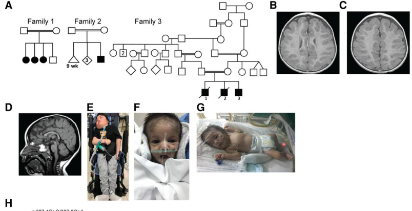
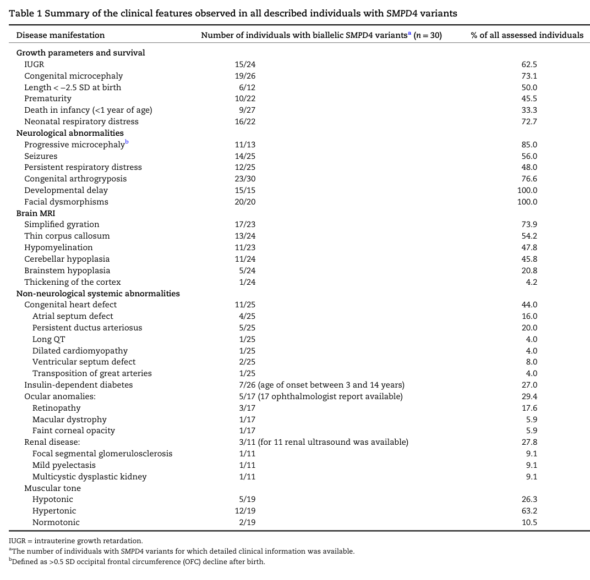
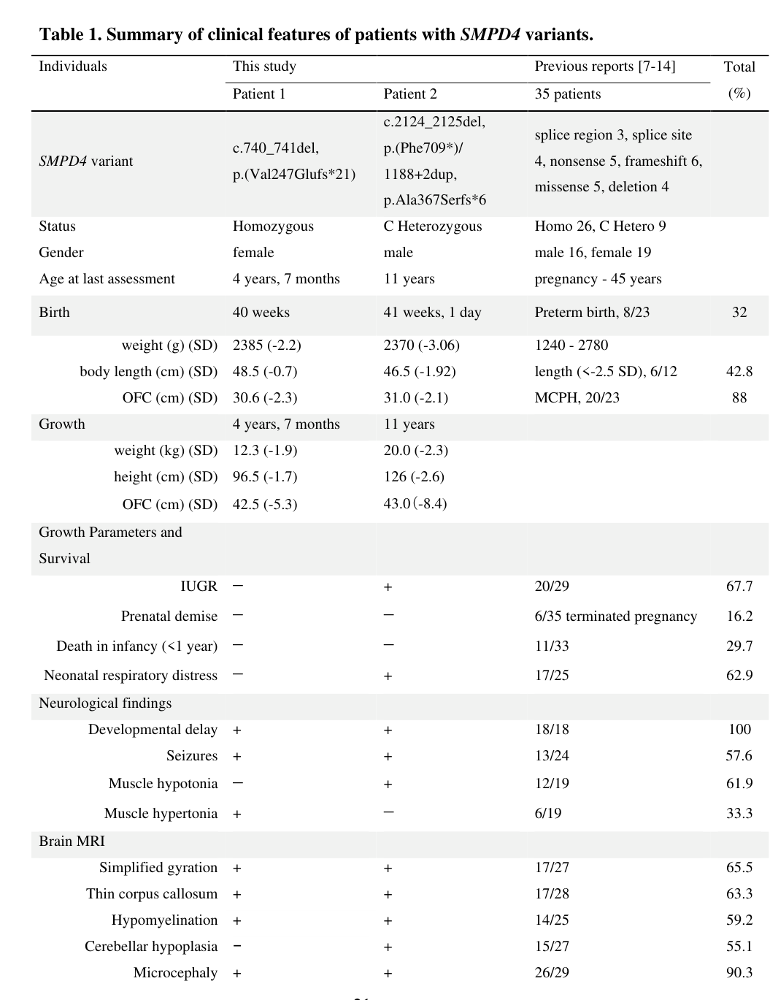

## Question

# Disease Characteristics Research Template

## Target Disease
- **Disease Name:** Neurodevelopmental Disorder With Microcephaly, Arthrogryposis, And Structural Brain Anomalies
- **MONDO ID:** MONDO:0032838 (if available)
- **Category:** Mendelian

## Research Objectives

Please provide a comprehensive research report on **Neurodevelopmental Disorder With Microcephaly, Arthrogryposis, And Structural Brain Anomalies** covering all of the
disease characteristics listed below. This report will be used to populate a disease knowledge
base entry. Be thorough and cite primary literature (PMID preferred) for all claims.

For each section, **suggested databases/resources** are listed. These are the first places
you should search for information on each topic.

---

### 1. Disease Information
> **Search first:** OMIM, Orphanet, ICD-10/ICD-11, MeSH, PubMed

- What is the disease? Provide a concise overview.
- What are the key identifiers? (OMIM, Orphanet, ICD-10/ICD-11, MeSH, Mondo)
- What are the common synonyms and alternative names?
- Is the information derived from individual patients (e.g., EHR) or aggregated disease-level resources?

### 2. Etiology

- **Disease Causal Factors**: What are the primary causes? (genetic, environmental, infectious, mechanistic)
- **Risk Factors**:
  > **Search first:** PubMed, Cochrane Library, UpToDate, clinical guidelines, ClinVar, ClinGen, GWAS Catalog, PheGenI, CTD, CDC, WHO, epidemiological databases
  - Genetic risk factors (causal variants, susceptibility loci, modifier genes)
  - Environmental risk factors (toxins, lifestyle, occupational exposures, age, sex, family history)
- **Protective Factors**:
  > **Search first:** PubMed, Cochrane Library, clinical trial databases, GWAS Catalog, gnomAD, WHO, CDC, nutrition databases
  - Genetic protective factors (protective variants, modifier alleles)
  - Environmental protective factors (diet, lifestyle, exposures that reduce risk)
- **Gene-Environment Interactions**: How do genetic and environmental factors interact to influence disease?
  > **Search first:** CTD, PubMed, PheGenI, GxE databases

### 3. Phenotypes
> **Search first:** HPO (Human Phenotype Ontology), OMIM, Orphanet, PubMed, clinicaltrials.gov, MedDRA, SNOMED CT, DECIPHER, LOINC

For each phenotype, provide:
- **Phenotype type**: symptoms, clinical signs, physical manifestations, behavioral changes, or laboratory abnormalities
  > For symptoms/signs: HPO, OMIM, Orphanet, PubMed
  > For behavioral changes: HPO, DSM, RDoC (Research Domain Criteria), PubMed
  > For laboratory abnormalities: LOINC, SNOMED CT, LabTests Online, PubMed
- **Phenotype characteristics**:
  > **Search first:** OMIM, Orphanet, HPO, PubMed
  - Age of symptom onset (neonatal, childhood, adult-onset, late-onset)
  - Symptom severity (mild, moderate, severe, variable)
  - Symptom progression (stable, progressive, episodic, fluctuating)
  - Frequency among affected individuals (percentage or qualitative)
- **Quality of life impact**: Effects on daily functioning and well-being (per-phenotype when possible)
  > **Search first:** EQ-5D database, SF-36, WHO QOL databases, PubMed
- Suggest HPO (Human Phenotype Ontology) terms for each phenotype

### 4. Genetic/Molecular Information

- **Causal Genes**: Gene mutations or chromosomal abnormalities responsible for disease (gene symbols, OMIM IDs)
  > **Search first:** OMIM, ClinVar, HGMD, Ensembl, NCBI Gene
- **Pathogenic Variants**:
  - Affected genes (gene symbols, HGNC IDs)
    > **Search first:** OMIM, NCBI Gene, Ensembl, HGNC, UniProt, GeneCards
  - Variant classification (pathogenic, likely pathogenic, VUS per ACMG/AMP guidelines)
    > **Search first:** ClinVar, ClinGen, ACMG/AMP guidelines, VarSome
  - Variant type/class (missense, frameshift, nonsense, splice-site, structural)
  - Allele frequency in population databases
    > **Search first:** gnomAD, 1000 Genomes, ExAC, TOPMed, dbSNP
  - Somatic vs germline origin
    > **Search first:** COSMIC (somatic), ClinVar, ICGC, TCGA
  - Functional consequences (loss of function, gain of function, dominant negative)
- **Modifier Genes**: Genes that modify disease severity or expression
- **Epigenetic Information**: DNA methylation, histone modifications, chromatin changes affecting disease
  > **Search first:** ENCODE, Roadmap Epigenomics, MethBase, DiseaseMeth
- **Chromosomal Abnormalities**: Large-scale genetic changes (aneuploidy, translocations, inversions)
  > **Search first:** DECIPHER, ClinVar, ECARUCA, UCSC Genome Browser

### 5. Environmental Information

- **Environmental Factors**: Non-genetic contributing factors (toxins, radiation, pollution, occupational exposure)
  > **Search first:** CTD (Comparative Toxicogenomics Database), TOXNET, PubMed, EPA databases
- **Lifestyle Factors**: Behavioral factors (smoking, diet, exercise, alcohol consumption)
  > **Search first:** CDC databases, WHO, PubMed, NHANES
- **Infectious Agents**: If applicable, pathogens causing or triggering disease (bacteria, viruses, fungi, parasites)
  > **Search first:** NCBI Taxonomy, ViPR, BV-BRC, MicrobeDB, GIDEON

### 6. Mechanism / Pathophysiology

**Present this section as an ordered causal chain first, then the detail below.**
Open with a numbered sequence of mechanistic steps running from the initiating
lesion (mutation, exposure, infection) to the clinical manifestation, one step per
line, each naming what it causes next. State the causal verb explicitly ("leads
to", "results in") and say where a step is inferred rather than demonstrated.
Where the mechanism branches, show the branch. The categories below are a
checklist of what to cover within those steps, not the organizing structure —
a step may draw on several of them, and a category may contribute to several
steps.

- **Molecular Pathways**: Specific signaling cascades or biochemical pathways involved (Wnt, MAPK, mTOR, PI3K-AKT, etc.)
  > **Search first:** KEGG, Reactome, WikiPathways, PathBank, BioCyc
- **Cellular Processes**: Cell-level mechanisms (apoptosis, autophagy, cell cycle dysregulation, inflammation, etc.)
  > **Search first:** Gene Ontology (GO), Reactome, KEGG, PubMed
- **Protein Dysfunction**: How protein structure or function is altered (misfolding, aggregation, loss of function, gain of function)
  > **Search first:** UniProt, PDB (Protein Data Bank), InterPro, Pfam, AlphaFold
- **Metabolic Changes**: Alterations in metabolic processes (energy metabolism, lipid metabolism, amino acid metabolism)
  > **Search first:** KEGG, BioCyc, HMDB (Human Metabolome Database), BRENDA
- **Immune System Involvement**: Role of immune response (autoimmunity, immunodeficiency, chronic inflammation)
  > **Search first:** ImmPort, Immunome Database, IEDB, Gene Ontology
- **Tissue Damage Mechanisms**: How tissues/ are injured (oxidative stress, ischemia, fibrosis, necrosis)
  > **Search first:** PubMed, Gene Ontology, Reactome
- **Biochemical Abnormalities**: Specific molecular defects (enzyme deficiencies, receptor dysfunction, ion channel defects)
  > **Search first:** BRENDA, UniProt, KEGG, OMIM, PubMed
- **Epigenetic Changes**: DNA methylation, histone modifications affecting gene expression in disease
  > **Search first:** ENCODE, Roadmap Epigenomics, MethBase, DiseaseMeth
- **Molecular Profiling** (if available):
  - Transcriptomics/gene expression changes
    > **Search first:** GEO (Gene Expression Omnibus), ArrayExpress, GTEx, Human Cell Atlas, SRA
  - Proteomics findings
    > **Search first:** PRIDE, ProteomeXchange, Human Protein Atlas, STRING, BioGRID
  - Metabolomics signatures
    > **Search first:** MetaboLights, Metabolomics Workbench, HMDB, METLIN
  - Lipidomics alterations
    > **Search first:** LIPID MAPS, SwissLipids, LipidHome, Metabolomics Workbench
  - Genomic structural features
    > **Search first:** UCSC Genome Browser, Ensembl, NCBI, dbVar, DGV
- **Advanced Technologies** (if applicable):
  - Single-cell analysis findings (cell-type specific mechanisms, cellular heterogeneity)
    > **Search first:** Human Cell Atlas, Single Cell Portal, GEO, CELLxGENE
  - Spatial transcriptomics findings
    > **Search first:** GEO, Spatial Research, Vizgen, 10x Genomics data
  - Multi-omics integration results
    > **Search first:** TCGA, ICGC, cBioPortal, LinkedOmics, PubMed
  - Functional genomics screens (CRISPR, RNAi)
    > **Search first:** DepMap, GenomeRNAi, PubMed, BioGRID ORCS

For each mechanism, describe:
- The causal chain from initial trigger to clinical manifestation
- Which mechanisms are upstream vs downstream
- What cell types and biological processes are involved
- Suggest GO terms for biological processes and CL terms for cell types

### 7. Anatomical Structures Affected

- **Organ Level**:
  - Primary organs directly affected
  - Secondary organ involvement (complications, secondary effects)
  - Body systems involved (cardiovascular, nervous, digestive, respiratory, endocrine, etc.)
  > **Search first:** Uberon, FMA (Foundational Model of Anatomy), OMIM, HPO, ICD-11, MeSH, SNOMED CT
- **Tissue and Cell Level**:
  - Specific tissue types affected (epithelial, connective, muscle, nervous)
  - Specific cell populations targeted (with Cell Ontology terms)
  > **Search first:** Uberon, Human Protein Atlas, Cell Ontology, Human Cell Atlas, CellMarker, PanglaoDB
- **Subcellular Level**:
  - Cellular compartments involved (mitochondria, nucleus, ER, lysosomes) (with GO Cellular Component terms)
  > **Search first:** Gene Ontology (Cellular Component), UniProt, Human Protein Atlas
- **Localization**:
  - Specific anatomical sites (with UBERON terms)
    > **Search first:** FMA, Uberon, NeuroNames (for brain), SNOMED CT
  - Lateralization (unilateral, bilateral, asymmetric)
    > **Search first:** HPO, clinical literature, imaging databases

### 8. Temporal Development

- **Onset**:
  - Typical age of onset (congenital, pediatric, adult, geriatric)
  - Onset pattern (acute, subacute, chronic, insidious)
  > **Search first:** OMIM, Orphanet, HPO, PubMed
- **Progression**:
  - Disease stages (early, intermediate, advanced, end-stage)
    > **Search first:** Cancer Staging Manual (AJCC), WHO classifications, PubMed
  - Progression rate (rapid, slow, variable)
  - Disease course pattern (episodic, relapsing-remitting, progressive, stable)
  - Disease duration (self-limited, chronic lifelong)
  > **Search first:** Disease registries, longitudinal cohort databases, natural history studies, PubMed, Orphanet, OMIM
- **Patterns**:
  - Remission patterns (spontaneous, treatment-induced)
    > **Search first:** Clinical trial databases, disease registries, PubMed
  - Critical periods (time windows of vulnerability or opportunity for intervention)
    > **Search first:** PubMed, developmental biology databases, clinical guidelines

### 9. Inheritance and Population

- **Epidemiology**:
  - Prevalence (cases per 100,000 at given time)
  - Incidence (new cases per 100,000 per year)
  > **Search first:** Orphanet, CDC, WHO, GBD (Global Burden of Disease), national registries, SEER, disease registries
- **For Genetic Etiology**:
  - Inheritance pattern (AD, AR, X-linked, mitochondrial, multifactorial, polygenic)
    > **Search first:** OMIM, Orphanet, ClinVar, GTR (Genetic Testing Registry)
  - Penetrance (complete, incomplete, age-dependent)
    > **Search first:** ClinVar, OMIM, PubMed, ClinGen
  - Expressivity (variable, consistent)
    > **Search first:** OMIM, ClinVar, PubMed
  - Genetic anticipation (increasing severity in successive generations)
    > **Search first:** OMIM, PubMed (especially for repeat expansion disorders)
  - Germline mosaicism
    > **Search first:** ClinVar, OMIM, genetic counseling literature, PubMed
  - Founder effects (population-specific mutations)
    > **Search first:** gnomAD, population genetics databases, PubMed
  - Consanguinity role
    > **Search first:** OMIM, population studies, genetic counseling resources
  - Carrier frequency
    > **Search first:** gnomAD, carrier screening databases, GeneReviews, GTR
- **Population Demographics**:
  - Affected populations (ethnic or demographic groups with higher prevalence)
    > **Search first:** gnomAD, 1000 Genomes, PAGE Study, PubMed, population registries
  - Geographic distribution (endemic areas, regional variation)
    > **Search first:** WHO, CDC, GBD, Orphanet, geographic epidemiology databases
  - Geographic distribution of specific variants
  - Sex ratio (male:female)
    > **Search first:** Disease registries, OMIM, PubMed, epidemiological databases
  - Age distribution of affected individuals
    > **Search first:** CDC, disease registries, SEER, Orphanet

### 10. Diagnostics

- **Clinical Tests**:
  - Laboratory tests (blood, urine, tissue chemistry, specific enzyme assays)
    > **Search first:** LOINC, LabTests Online, PubMed
  - Biomarkers (proteins, metabolites, genetic markers, circulating biomarkers)
    > **Search first:** FDA Biomarker List, BEST (Biomarkers, EndpointS, and other Tools), PubMed
  - Imaging studies (X-ray, CT, MRI, PET, ultrasound)
    > **Search first:** RadLex, DICOM, Radiopaedia, imaging databases
  - Functional tests (pulmonary function, cardiac stress tests)
    > **Search first:** LOINC, clinical guidelines, PubMed
  - Electrophysiology (EEG, EMG, ECG, nerve conduction studies)
    > **Search first:** LOINC, clinical neurophysiology databases, PubMed
  - Biopsy findings (histopathology, immunohistochemistry)
    > **Search first:** SNOMED CT, College of American Pathologists resources, PubMed
  - Pathology findings (microscopic examination)
    > **Search first:** SNOMED CT, Digital Pathology databases, PubMed
- **Genetic Testing**:
  > **Search first:** GTR (Genetic Testing Registry), GeneReviews, ClinGen
  - Overview of recommended genetic testing approach
  - Whole genome sequencing (WGS) utility
    > **Search first:** GTR, ClinVar, GEL (Genomics England), gnomAD
  - Whole exome sequencing (WES) utility
    > **Search first:** GTR, ClinVar, OMIM, GeneMatcher
  - Gene panels (which panels, which genes)
    > **Search first:** GTR, ClinVar, laboratory-specific databases
  - Single gene testing
    > **Search first:** GTR, ClinVar, OMIM, GeneReviews
  - Chromosomal microarray (CMA)
    > **Search first:** DECIPHER, ClinVar, dbVar, ECARUCA
  - Karyotyping
    > **Search first:** Chromosome Abnormality Database, ClinVar, cytogenetics resources
  - FISH
    > **Search first:** ClinVar, cytogenetics databases, PubMed
  - Mitochondrial DNA testing
    > **Search first:** MITOMAP, MSeqDR, ClinVar, GTR
  - Repeat expansion testing
    > **Search first:** GTR, ClinVar, repeat expansion databases, PubMed
- **Omics-Based Diagnostics** (if applicable):
  - RNA sequencing / transcriptomics
    > **Search first:** GEO, ArrayExpress, GTEx, RNA-seq databases
  - Proteomics
    > **Search first:** PRIDE, ProteomeXchange, FDA Biomarker database
  - Metabolomics
    > **Search first:** MetaboLights, Metabolomics Workbench, HMDB
  - Epigenomics
    > **Search first:** GEO, ENCODE, Roadmap Epigenomics, MethBase
  - Liquid biopsy
    > **Search first:** COSMIC, ClinVar, liquid biopsy databases, PubMed
- **Clinical Criteria**:
  - Standardized diagnostic criteria (DSM, ICD, society guidelines)
    > **Search first:** DSM-5, ICD-11, clinical society guidelines, UpToDate
  - Differential diagnosis (other conditions to rule out, with distinguishing features)
    > **Search first:** DynaMed, UpToDate, clinical decision support systems
- **Screening**:
  - Screening methods for asymptomatic individuals (newborn screening, carrier screening, cascade screening)
    > **Search first:** ACMG recommendations, CDC newborn screening, GTR

### 11. Outcome/Prognosis

- **Survival and Mortality**:
  - Survival rate (5-year, 10-year, overall)
    > **Search first:** SEER, cancer registries, disease-specific registries, PubMed
  - Life expectancy (with and without treatment if applicable)
    > **Search first:** Orphanet, disease registries, actuarial databases, PubMed
  - Mortality rate
    > **Search first:** CDC, WHO, GBD, national mortality databases
  - Disease-specific mortality (deaths directly attributable to disease)
    > **Search first:** Disease registries, CDC Wonder, GBD, PubMed
- **Morbidity and Function**:
  - Morbidity (disease-related disability and health impacts)
    > **Search first:** GBD, WHO, disability databases, PubMed
  - Disability outcomes (long-term functional impairments)
    > **Search first:** ICF (International Classification of Functioning), disability registries
  - Quality of life measures (EQ-5D, SF-36, PROMIS, disease-specific tools)
    > **Search first:** EQ-5D database, SF-36, PROMIS, PubMed
- **Disease Course**:
  - Complications (secondary problems: infections, organ failure, etc.)
    > **Search first:** ICD codes, disease registries, clinical databases, PubMed
  - Recovery potential (likelihood and extent of recovery, with vs without treatment)
    > **Search first:** Natural history studies, rehabilitation databases, PubMed
- **Prediction**:
  - Prognostic factors (age, disease severity, biomarkers, treatment response)
    > **Search first:** Prognostic models databases, clinical calculators, PubMed
  - Prognostic biomarkers (molecular markers predicting disease course)
    > **Search first:** FDA Biomarker database, PubMed, cancer prognostic databases

### 12. Treatment

- **Pharmacotherapy**:
  - Pharmacological treatments (drug names, drug classes, mechanisms of action)
    > **Search first:** DrugBank, RxNorm, ATC classification, DailyMed, FDA databases
  - Pharmacogenomics (how genetic variants affect drug metabolism, efficacy, toxicity)
    > **Search first:** PharmGKB, CPIC (Clinical Pharmacogenetics), FDA Table of PGx Biomarkers
- **Advanced Therapeutics**:
  - Gene therapy (viral vectors, CRISPR, gene replacement, gene editing)
    > **Search first:** ClinicalTrials.gov, FDA gene therapy database, ASGCT resources
  - Cell therapy (stem cell transplant, CAR-T, cellular therapeutics)
    > **Search first:** ClinicalTrials.gov, FDA cell therapy database, FACT standards
  - RNA-based therapies (ASOs, siRNA, mRNA therapies)
    > **Search first:** ClinicalTrials.gov, FDA approvals, PubMed
  - Targeted therapies (treatments directed at specific molecular targets)
    > **Search first:** My Cancer Genome, OncoKB, ClinicalTrials.gov, FDA approvals
  - Immunotherapies (checkpoint inhibitors, monoclonal antibodies)
    > **Search first:** Cancer Immunotherapy Database, FDA approvals, ClinicalTrials.gov
- **Surgical and Interventional**:
  - Surgical interventions (types of surgery, timing, outcomes)
    > **Search first:** CPT codes, surgical registries, clinical guidelines, PubMed
- **Supportive and Rehabilitative**:
  - Supportive care (symptom management, pain control, nutrition)
    > **Search first:** Clinical guidelines, Cochrane Library, PubMed
  - Rehabilitation (physical therapy, occupational therapy, speech therapy)
    > **Search first:** Rehabilitation medicine databases, clinical guidelines, PubMed
- **Experimental**:
  - Experimental treatments in clinical trials (with NCT identifiers if available)
    > **Search first:** ClinicalTrials.gov, EU Clinical Trials Register, WHO ICTRP
- **Treatment Outcomes**:
  - Treatment response rates
    > **Search first:** Clinical trial databases, FDA reviews, systematic reviews, PubMed
  - Side effects and adverse events
    > **Search first:** FDA Adverse Event Reporting System (FAERS), MedWatch, PubMed
- **Treatment Strategy**:
  - Treatment algorithms (clinical pathways, decision trees)
    > **Search first:** Clinical practice guidelines, NCCN Guidelines, UpToDate
  - Combination therapies
    > **Search first:** ClinicalTrials.gov, treatment guidelines, PubMed
  - Personalized medicine approaches (genotype-guided treatment)
    > **Search first:** My Cancer Genome, CIViC, PharmGKB, precision medicine databases

For each treatment, suggest NCIT (NCI Thesaurus) clinical-intervention terms where applicable.

### 13. Prevention

- **Prevention Levels**:
  - Primary prevention (preventing disease occurrence: vaccination, risk factor modification)
    > **Search first:** CDC, WHO, USPSTF recommendations, Cochrane Library
  - Secondary prevention (early detection and treatment: screening programs, early intervention)
    > **Search first:** USPSTF, CDC screening guidelines, WHO
  - Tertiary prevention (preventing complications in those with disease)
    > **Search first:** Clinical guidelines, disease management protocols, PubMed
- **Immunization**: Vaccine strategies (if applicable)
  > **Search first:** CDC vaccine schedules, WHO immunization, FDA vaccine database
- **Screening and Early Detection**:
  - Screening programs (population-based: newborn screening, cancer screening)
    > **Search first:** CDC screening programs, USPSTF, cancer screening databases
  - Genetic screening (carrier screening, preimplantation genetic diagnosis, prenatal testing)
    > **Search first:** ACMG recommendations, ACOG guidelines, GTR
  - Risk stratification (identifying high-risk individuals for targeted prevention)
    > **Search first:** Risk prediction models, clinical calculators, PubMed
- **Behavioral Interventions**: Lifestyle modifications to reduce risk
  > **Search first:** CDC, WHO, behavioral intervention databases, Cochrane Library
- **Counseling**: Genetic counseling (risk assessment, family planning guidance)
  > **Search first:** NSGC resources, ACMG guidelines, GeneReviews
- **Public Health**:
  - Public health interventions (sanitation, vector control, health education)
    > **Search first:** CDC, WHO, public health databases, PubMed
  - Environmental interventions (reducing environmental risk factors)
    > **Search first:** EPA databases, WHO environmental health, PubMed
- **Prophylaxis**: Preventive medications or procedures
  > **Search first:** Clinical guidelines, FDA approvals, PubMed

### 14. Other Species / Natural Disease

- **Taxonomy**: Species affected (with NCBI Taxon identifiers)
  > **Search first:** NCBI Taxonomy
- **Breed**: Specific breeds affected (with VBO identifiers if applicable)
  > **Search first:** VBO (Vertebrate Breed Ontology)
- **Gene**: Orthologous genes in other species (with NCBI Gene IDs)
  > **Search first:** NCBI Gene
- **Natural Disease**:
  - Naturally occurring disease in other species (companion animals, wildlife)
    > **Search first:** OMIA (Online Mendelian Inheritance in Animals), VetCompass, PubMed
  - Veterinary relevance and importance in animal health
    > **Search first:** OMIA, veterinary databases, PubMed
- **Comparative Biology**:
  - Comparative pathology (similarities and differences across species)
    > **Search first:** OMIA, comparative pathology databases, PubMed
  - Evolutionary conservation of disease mechanisms
    > **Search first:** HomoloGene, OrthoMCL, Alliance of Genome Resources
- **Transmission** (if applicable):
  - Zoonotic potential
    > **Search first:** CDC zoonotic diseases, WHO zoonoses, GIDEON
  - Cross-species susceptibility
    > **Search first:** NCBI Taxonomy, veterinary databases, PubMed

### 15. Model Organisms

- **Model Types**:
  - Model organism type (mammalian, invertebrate, cellular, in vitro)
    > **Search first:** Alliance of Genome Resources, model organism databases
  - Specific model systems (mouse, rat, zebrafish, Drosophila, C. elegans, yeast, cell lines, organoids, iPSCs)
    > **Search first:** MGI, RGD, ZFIN, FlyBase, WormBase, SGD, ATCC, Cellosaurus
  - Induced models (drug treatment, surgical intervention, environmental manipulation)
    > **Search first:** MGI, model organism databases, PubMed
- **Genetic Models**:
  - Types available (knockout, knock-in, transgenic, conditional, humanized)
    > **Search first:** MGI, IMPC, KOMP, EuMMCR, IMSR
- **Model Characteristics**:
  - Phenotype recapitulation (how well model reproduces human disease features)
    > **Search first:** Model organism databases, comparative studies, PubMed
  - Model limitations (aspects of human disease not captured)
    > **Search first:** Model organism databases, PubMed, review articles
- **Applications**:
  - Research applications (what aspects of disease can be studied)
    > **Search first:** Model organism databases, PubMed
- **Resources**:
  - Model databases
    > **Search first:** MGI, RGD, ZFIN, FlyBase, WormBase, IMSR, EMMA, MMRRC

---

## Citation Requirements

- Cite primary literature (PMID preferred) for all mechanistic and clinical claims
- Prioritize recent reviews and landmark papers
- Include direct quotes from abstracts where possible to support key statements
- Distinguish evidence source types: human clinical, model organism, in vitro, computational

## Output Format

Structure your response as a comprehensive narrative organized by the sections above.
For each section, provide:
- Factual content with specific details (numbers, percentages, gene names, variant nomenclature)
- Ontology term suggestions (HPO, GO, CL, UBERON, CHEBI, NCIT, MONDO) where applicable
- Evidence citations with PMIDs
- Direct quotes from abstracts to support key claims
- Clear indication when information is not available or not applicable for this disease

This report will be used to populate a disease knowledge base entry with:
- Pathophysiology descriptions with causal chains
- Gene/protein annotations (HGNC, GO terms)
- Phenotype associations (HP terms) with frequencies
- Cell type involvement (CL terms)
- Anatomical locations (UBERON terms)
- Chemical entities (CHEBI terms)
- Treatment annotations (NCIT terms)
- Evidence items with PMIDs and exact abstract quotes
- Epidemiology, prognosis, diagnostic, and prevention information
- Animal model descriptions with phenotype recapitulation details

## Output

Question: You are an expert researcher providing comprehensive, well-cited information.

Provide detailed information focusing on:
1. Key concepts and definitions with current understanding
2. Recent developments and latest research (prioritize 2023-2024 sources)
3. Current applications and real-world implementations
4. Expert opinions and analysis from authoritative sources
5. Relevant statistics and data from recent studies

Format as a comprehensive research report with proper citations. Include URLs and publication dates where available.
Always prioritize recent, authoritative sources and provide specific citations for all major claims.

# Disease Characteristics Research Template

## Target Disease
- **Disease Name:** Neurodevelopmental Disorder With Microcephaly, Arthrogryposis, And Structural Brain Anomalies
- **MONDO ID:** MONDO:0032838 (if available)
- **Category:** Mendelian

## Research Objectives

Please provide a comprehensive research report on **Neurodevelopmental Disorder With Microcephaly, Arthrogryposis, And Structural Brain Anomalies** covering all of the
disease characteristics listed below. This report will be used to populate a disease knowledge
base entry. Be thorough and cite primary literature (PMID preferred) for all claims.

For each section, **suggested databases/resources** are listed. These are the first places
you should search for information on each topic.

---

### 1. Disease Information
> **Search first:** OMIM, Orphanet, ICD-10/ICD-11, MeSH, PubMed

- What is the disease? Provide a concise overview.
- What are the key identifiers? (OMIM, Orphanet, ICD-10/ICD-11, MeSH, Mondo)
- What are the common synonyms and alternative names?
- Is the information derived from individual patients (e.g., EHR) or aggregated disease-level resources?

### 2. Etiology

- **Disease Causal Factors**: What are the primary causes? (genetic, environmental, infectious, mechanistic)
- **Risk Factors**:
  > **Search first:** PubMed, Cochrane Library, UpToDate, clinical guidelines, ClinVar, ClinGen, GWAS Catalog, PheGenI, CTD, CDC, WHO, epidemiological databases
  - Genetic risk factors (causal variants, susceptibility loci, modifier genes)
  - Environmental risk factors (toxins, lifestyle, occupational exposures, age, sex, family history)
- **Protective Factors**:
  > **Search first:** PubMed, Cochrane Library, clinical trial databases, GWAS Catalog, gnomAD, WHO, CDC, nutrition databases
  - Genetic protective factors (protective variants, modifier alleles)
  - Environmental protective factors (diet, lifestyle, exposures that reduce risk)
- **Gene-Environment Interactions**: How do genetic and environmental factors interact to influence disease?
  > **Search first:** CTD, PubMed, PheGenI, GxE databases

### 3. Phenotypes
> **Search first:** HPO (Human Phenotype Ontology), OMIM, Orphanet, PubMed, clinicaltrials.gov, MedDRA, SNOMED CT, DECIPHER, LOINC

For each phenotype, provide:
- **Phenotype type**: symptoms, clinical signs, physical manifestations, behavioral changes, or laboratory abnormalities
  > For symptoms/signs: HPO, OMIM, Orphanet, PubMed
  > For behavioral changes: HPO, DSM, RDoC (Research Domain Criteria), PubMed
  > For laboratory abnormalities: LOINC, SNOMED CT, LabTests Online, PubMed
- **Phenotype characteristics**:
  > **Search first:** OMIM, Orphanet, HPO, PubMed
  - Age of symptom onset (neonatal, childhood, adult-onset, late-onset)
  - Symptom severity (mild, moderate, severe, variable)
  - Symptom progression (stable, progressive, episodic, fluctuating)
  - Frequency among affected individuals (percentage or qualitative)
- **Quality of life impact**: Effects on daily functioning and well-being (per-phenotype when possible)
  > **Search first:** EQ-5D database, SF-36, WHO QOL databases, PubMed
- Suggest HPO (Human Phenotype Ontology) terms for each phenotype

### 4. Genetic/Molecular Information

- **Causal Genes**: Gene mutations or chromosomal abnormalities responsible for disease (gene symbols, OMIM IDs)
  > **Search first:** OMIM, ClinVar, HGMD, Ensembl, NCBI Gene
- **Pathogenic Variants**:
  - Affected genes (gene symbols, HGNC IDs)
    > **Search first:** OMIM, NCBI Gene, Ensembl, HGNC, UniProt, GeneCards
  - Variant classification (pathogenic, likely pathogenic, VUS per ACMG/AMP guidelines)
    > **Search first:** ClinVar, ClinGen, ACMG/AMP guidelines, VarSome
  - Variant type/class (missense, frameshift, nonsense, splice-site, structural)
  - Allele frequency in population databases
    > **Search first:** gnomAD, 1000 Genomes, ExAC, TOPMed, dbSNP
  - Somatic vs germline origin
    > **Search first:** COSMIC (somatic), ClinVar, ICGC, TCGA
  - Functional consequences (loss of function, gain of function, dominant negative)
- **Modifier Genes**: Genes that modify disease severity or expression
- **Epigenetic Information**: DNA methylation, histone modifications, chromatin changes affecting disease
  > **Search first:** ENCODE, Roadmap Epigenomics, MethBase, DiseaseMeth
- **Chromosomal Abnormalities**: Large-scale genetic changes (aneuploidy, translocations, inversions)
  > **Search first:** DECIPHER, ClinVar, ECARUCA, UCSC Genome Browser

### 5. Environmental Information

- **Environmental Factors**: Non-genetic contributing factors (toxins, radiation, pollution, occupational exposure)
  > **Search first:** CTD (Comparative Toxicogenomics Database), TOXNET, PubMed, EPA databases
- **Lifestyle Factors**: Behavioral factors (smoking, diet, exercise, alcohol consumption)
  > **Search first:** CDC databases, WHO, PubMed, NHANES
- **Infectious Agents**: If applicable, pathogens causing or triggering disease (bacteria, viruses, fungi, parasites)
  > **Search first:** NCBI Taxonomy, ViPR, BV-BRC, MicrobeDB, GIDEON

### 6. Mechanism / Pathophysiology

**Present this section as an ordered causal chain first, then the detail below.**
Open with a numbered sequence of mechanistic steps running from the initiating
lesion (mutation, exposure, infection) to the clinical manifestation, one step per
line, each naming what it causes next. State the causal verb explicitly ("leads
to", "results in") and say where a step is inferred rather than demonstrated.
Where the mechanism branches, show the branch. The categories below are a
checklist of what to cover within those steps, not the organizing structure —
a step may draw on several of them, and a category may contribute to several
steps.

- **Molecular Pathways**: Specific signaling cascades or biochemical pathways involved (Wnt, MAPK, mTOR, PI3K-AKT, etc.)
  > **Search first:** KEGG, Reactome, WikiPathways, PathBank, BioCyc
- **Cellular Processes**: Cell-level mechanisms (apoptosis, autophagy, cell cycle dysregulation, inflammation, etc.)
  > **Search first:** Gene Ontology (GO), Reactome, KEGG, PubMed
- **Protein Dysfunction**: How protein structure or function is altered (misfolding, aggregation, loss of function, gain of function)
  > **Search first:** UniProt, PDB (Protein Data Bank), InterPro, Pfam, AlphaFold
- **Metabolic Changes**: Alterations in metabolic processes (energy metabolism, lipid metabolism, amino acid metabolism)
  > **Search first:** KEGG, BioCyc, HMDB (Human Metabolome Database), BRENDA
- **Immune System Involvement**: Role of immune response (autoimmunity, immunodeficiency, chronic inflammation)
  > **Search first:** ImmPort, Immunome Database, IEDB, Gene Ontology
- **Tissue Damage Mechanisms**: How tissues/ are injured (oxidative stress, ischemia, fibrosis, necrosis)
  > **Search first:** PubMed, Gene Ontology, Reactome
- **Biochemical Abnormalities**: Specific molecular defects (enzyme deficiencies, receptor dysfunction, ion channel defects)
  > **Search first:** BRENDA, UniProt, KEGG, OMIM, PubMed
- **Epigenetic Changes**: DNA methylation, histone modifications affecting gene expression in disease
  > **Search first:** ENCODE, Roadmap Epigenomics, MethBase, DiseaseMeth
- **Molecular Profiling** (if available):
  - Transcriptomics/gene expression changes
    > **Search first:** GEO (Gene Expression Omnibus), ArrayExpress, GTEx, Human Cell Atlas, SRA
  - Proteomics findings
    > **Search first:** PRIDE, ProteomeXchange, Human Protein Atlas, STRING, BioGRID
  - Metabolomics signatures
    > **Search first:** MetaboLights, Metabolomics Workbench, HMDB, METLIN
  - Lipidomics alterations
    > **Search first:** LIPID MAPS, SwissLipids, LipidHome, Metabolomics Workbench
  - Genomic structural features
    > **Search first:** UCSC Genome Browser, Ensembl, NCBI, dbVar, DGV
- **Advanced Technologies** (if applicable):
  - Single-cell analysis findings (cell-type specific mechanisms, cellular heterogeneity)
    > **Search first:** Human Cell Atlas, Single Cell Portal, GEO, CELLxGENE
  - Spatial transcriptomics findings
    > **Search first:** GEO, Spatial Research, Vizgen, 10x Genomics data
  - Multi-omics integration results
    > **Search first:** TCGA, ICGC, cBioPortal, LinkedOmics, PubMed
  - Functional genomics screens (CRISPR, RNAi)
    > **Search first:** DepMap, GenomeRNAi, PubMed, BioGRID ORCS

For each mechanism, describe:
- The causal chain from initial trigger to clinical manifestation
- Which mechanisms are upstream vs downstream
- What cell types and biological processes are involved
- Suggest GO terms for biological processes and CL terms for cell types

### 7. Anatomical Structures Affected

- **Organ Level**:
  - Primary organs directly affected
  - Secondary organ involvement (complications, secondary effects)
  - Body systems involved (cardiovascular, nervous, digestive, respiratory, endocrine, etc.)
  > **Search first:** Uberon, FMA (Foundational Model of Anatomy), OMIM, HPO, ICD-11, MeSH, SNOMED CT
- **Tissue and Cell Level**:
  - Specific tissue types affected (epithelial, connective, muscle, nervous)
  - Specific cell populations targeted (with Cell Ontology terms)
  > **Search first:** Uberon, Human Protein Atlas, Cell Ontology, Human Cell Atlas, CellMarker, PanglaoDB
- **Subcellular Level**:
  - Cellular compartments involved (mitochondria, nucleus, ER, lysosomes) (with GO Cellular Component terms)
  > **Search first:** Gene Ontology (Cellular Component), UniProt, Human Protein Atlas
- **Localization**:
  - Specific anatomical sites (with UBERON terms)
    > **Search first:** FMA, Uberon, NeuroNames (for brain), SNOMED CT
  - Lateralization (unilateral, bilateral, asymmetric)
    > **Search first:** HPO, clinical literature, imaging databases

### 8. Temporal Development

- **Onset**:
  - Typical age of onset (congenital, pediatric, adult, geriatric)
  - Onset pattern (acute, subacute, chronic, insidious)
  > **Search first:** OMIM, Orphanet, HPO, PubMed
- **Progression**:
  - Disease stages (early, intermediate, advanced, end-stage)
    > **Search first:** Cancer Staging Manual (AJCC), WHO classifications, PubMed
  - Progression rate (rapid, slow, variable)
  - Disease course pattern (episodic, relapsing-remitting, progressive, stable)
  - Disease duration (self-limited, chronic lifelong)
  > **Search first:** Disease registries, longitudinal cohort databases, natural history studies, PubMed, Orphanet, OMIM
- **Patterns**:
  - Remission patterns (spontaneous, treatment-induced)
    > **Search first:** Clinical trial databases, disease registries, PubMed
  - Critical periods (time windows of vulnerability or opportunity for intervention)
    > **Search first:** PubMed, developmental biology databases, clinical guidelines

### 9. Inheritance and Population

- **Epidemiology**:
  - Prevalence (cases per 100,000 at given time)
  - Incidence (new cases per 100,000 per year)
  > **Search first:** Orphanet, CDC, WHO, GBD (Global Burden of Disease), national registries, SEER, disease registries
- **For Genetic Etiology**:
  - Inheritance pattern (AD, AR, X-linked, mitochondrial, multifactorial, polygenic)
    > **Search first:** OMIM, Orphanet, ClinVar, GTR (Genetic Testing Registry)
  - Penetrance (complete, incomplete, age-dependent)
    > **Search first:** ClinVar, OMIM, PubMed, ClinGen
  - Expressivity (variable, consistent)
    > **Search first:** OMIM, ClinVar, PubMed
  - Genetic anticipation (increasing severity in successive generations)
    > **Search first:** OMIM, PubMed (especially for repeat expansion disorders)
  - Germline mosaicism
    > **Search first:** ClinVar, OMIM, genetic counseling literature, PubMed
  - Founder effects (population-specific mutations)
    > **Search first:** gnomAD, population genetics databases, PubMed
  - Consanguinity role
    > **Search first:** OMIM, population studies, genetic counseling resources
  - Carrier frequency
    > **Search first:** gnomAD, carrier screening databases, GeneReviews, GTR
- **Population Demographics**:
  - Affected populations (ethnic or demographic groups with higher prevalence)
    > **Search first:** gnomAD, 1000 Genomes, PAGE Study, PubMed, population registries
  - Geographic distribution (endemic areas, regional variation)
    > **Search first:** WHO, CDC, GBD, Orphanet, geographic epidemiology databases
  - Geographic distribution of specific variants
  - Sex ratio (male:female)
    > **Search first:** Disease registries, OMIM, PubMed, epidemiological databases
  - Age distribution of affected individuals
    > **Search first:** CDC, disease registries, SEER, Orphanet

### 10. Diagnostics

- **Clinical Tests**:
  - Laboratory tests (blood, urine, tissue chemistry, specific enzyme assays)
    > **Search first:** LOINC, LabTests Online, PubMed
  - Biomarkers (proteins, metabolites, genetic markers, circulating biomarkers)
    > **Search first:** FDA Biomarker List, BEST (Biomarkers, EndpointS, and other Tools), PubMed
  - Imaging studies (X-ray, CT, MRI, PET, ultrasound)
    > **Search first:** RadLex, DICOM, Radiopaedia, imaging databases
  - Functional tests (pulmonary function, cardiac stress tests)
    > **Search first:** LOINC, clinical guidelines, PubMed
  - Electrophysiology (EEG, EMG, ECG, nerve conduction studies)
    > **Search first:** LOINC, clinical neurophysiology databases, PubMed
  - Biopsy findings (histopathology, immunohistochemistry)
    > **Search first:** SNOMED CT, College of American Pathologists resources, PubMed
  - Pathology findings (microscopic examination)
    > **Search first:** SNOMED CT, Digital Pathology databases, PubMed
- **Genetic Testing**:
  > **Search first:** GTR (Genetic Testing Registry), GeneReviews, ClinGen
  - Overview of recommended genetic testing approach
  - Whole genome sequencing (WGS) utility
    > **Search first:** GTR, ClinVar, GEL (Genomics England), gnomAD
  - Whole exome sequencing (WES) utility
    > **Search first:** GTR, ClinVar, OMIM, GeneMatcher
  - Gene panels (which panels, which genes)
    > **Search first:** GTR, ClinVar, laboratory-specific databases
  - Single gene testing
    > **Search first:** GTR, ClinVar, OMIM, GeneReviews
  - Chromosomal microarray (CMA)
    > **Search first:** DECIPHER, ClinVar, dbVar, ECARUCA
  - Karyotyping
    > **Search first:** Chromosome Abnormality Database, ClinVar, cytogenetics resources
  - FISH
    > **Search first:** ClinVar, cytogenetics databases, PubMed
  - Mitochondrial DNA testing
    > **Search first:** MITOMAP, MSeqDR, ClinVar, GTR
  - Repeat expansion testing
    > **Search first:** GTR, ClinVar, repeat expansion databases, PubMed
- **Omics-Based Diagnostics** (if applicable):
  - RNA sequencing / transcriptomics
    > **Search first:** GEO, ArrayExpress, GTEx, RNA-seq databases
  - Proteomics
    > **Search first:** PRIDE, ProteomeXchange, FDA Biomarker database
  - Metabolomics
    > **Search first:** MetaboLights, Metabolomics Workbench, HMDB
  - Epigenomics
    > **Search first:** GEO, ENCODE, Roadmap Epigenomics, MethBase
  - Liquid biopsy
    > **Search first:** COSMIC, ClinVar, liquid biopsy databases, PubMed
- **Clinical Criteria**:
  - Standardized diagnostic criteria (DSM, ICD, society guidelines)
    > **Search first:** DSM-5, ICD-11, clinical society guidelines, UpToDate
  - Differential diagnosis (other conditions to rule out, with distinguishing features)
    > **Search first:** DynaMed, UpToDate, clinical decision support systems
- **Screening**:
  - Screening methods for asymptomatic individuals (newborn screening, carrier screening, cascade screening)
    > **Search first:** ACMG recommendations, CDC newborn screening, GTR

### 11. Outcome/Prognosis

- **Survival and Mortality**:
  - Survival rate (5-year, 10-year, overall)
    > **Search first:** SEER, cancer registries, disease-specific registries, PubMed
  - Life expectancy (with and without treatment if applicable)
    > **Search first:** Orphanet, disease registries, actuarial databases, PubMed
  - Mortality rate
    > **Search first:** CDC, WHO, GBD, national mortality databases
  - Disease-specific mortality (deaths directly attributable to disease)
    > **Search first:** Disease registries, CDC Wonder, GBD, PubMed
- **Morbidity and Function**:
  - Morbidity (disease-related disability and health impacts)
    > **Search first:** GBD, WHO, disability databases, PubMed
  - Disability outcomes (long-term functional impairments)
    > **Search first:** ICF (International Classification of Functioning), disability registries
  - Quality of life measures (EQ-5D, SF-36, PROMIS, disease-specific tools)
    > **Search first:** EQ-5D database, SF-36, PROMIS, PubMed
- **Disease Course**:
  - Complications (secondary problems: infections, organ failure, etc.)
    > **Search first:** ICD codes, disease registries, clinical databases, PubMed
  - Recovery potential (likelihood and extent of recovery, with vs without treatment)
    > **Search first:** Natural history studies, rehabilitation databases, PubMed
- **Prediction**:
  - Prognostic factors (age, disease severity, biomarkers, treatment response)
    > **Search first:** Prognostic models databases, clinical calculators, PubMed
  - Prognostic biomarkers (molecular markers predicting disease course)
    > **Search first:** FDA Biomarker database, PubMed, cancer prognostic databases

### 12. Treatment

- **Pharmacotherapy**:
  - Pharmacological treatments (drug names, drug classes, mechanisms of action)
    > **Search first:** DrugBank, RxNorm, ATC classification, DailyMed, FDA databases
  - Pharmacogenomics (how genetic variants affect drug metabolism, efficacy, toxicity)
    > **Search first:** PharmGKB, CPIC (Clinical Pharmacogenetics), FDA Table of PGx Biomarkers
- **Advanced Therapeutics**:
  - Gene therapy (viral vectors, CRISPR, gene replacement, gene editing)
    > **Search first:** ClinicalTrials.gov, FDA gene therapy database, ASGCT resources
  - Cell therapy (stem cell transplant, CAR-T, cellular therapeutics)
    > **Search first:** ClinicalTrials.gov, FDA cell therapy database, FACT standards
  - RNA-based therapies (ASOs, siRNA, mRNA therapies)
    > **Search first:** ClinicalTrials.gov, FDA approvals, PubMed
  - Targeted therapies (treatments directed at specific molecular targets)
    > **Search first:** My Cancer Genome, OncoKB, ClinicalTrials.gov, FDA approvals
  - Immunotherapies (checkpoint inhibitors, monoclonal antibodies)
    > **Search first:** Cancer Immunotherapy Database, FDA approvals, ClinicalTrials.gov
- **Surgical and Interventional**:
  - Surgical interventions (types of surgery, timing, outcomes)
    > **Search first:** CPT codes, surgical registries, clinical guidelines, PubMed
- **Supportive and Rehabilitative**:
  - Supportive care (symptom management, pain control, nutrition)
    > **Search first:** Clinical guidelines, Cochrane Library, PubMed
  - Rehabilitation (physical therapy, occupational therapy, speech therapy)
    > **Search first:** Rehabilitation medicine databases, clinical guidelines, PubMed
- **Experimental**:
  - Experimental treatments in clinical trials (with NCT identifiers if available)
    > **Search first:** ClinicalTrials.gov, EU Clinical Trials Register, WHO ICTRP
- **Treatment Outcomes**:
  - Treatment response rates
    > **Search first:** Clinical trial databases, FDA reviews, systematic reviews, PubMed
  - Side effects and adverse events
    > **Search first:** FDA Adverse Event Reporting System (FAERS), MedWatch, PubMed
- **Treatment Strategy**:
  - Treatment algorithms (clinical pathways, decision trees)
    > **Search first:** Clinical practice guidelines, NCCN Guidelines, UpToDate
  - Combination therapies
    > **Search first:** ClinicalTrials.gov, treatment guidelines, PubMed
  - Personalized medicine approaches (genotype-guided treatment)
    > **Search first:** My Cancer Genome, CIViC, PharmGKB, precision medicine databases

For each treatment, suggest NCIT (NCI Thesaurus) clinical-intervention terms where applicable.

### 13. Prevention

- **Prevention Levels**:
  - Primary prevention (preventing disease occurrence: vaccination, risk factor modification)
    > **Search first:** CDC, WHO, USPSTF recommendations, Cochrane Library
  - Secondary prevention (early detection and treatment: screening programs, early intervention)
    > **Search first:** USPSTF, CDC screening guidelines, WHO
  - Tertiary prevention (preventing complications in those with disease)
    > **Search first:** Clinical guidelines, disease management protocols, PubMed
- **Immunization**: Vaccine strategies (if applicable)
  > **Search first:** CDC vaccine schedules, WHO immunization, FDA vaccine database
- **Screening and Early Detection**:
  - Screening programs (population-based: newborn screening, cancer screening)
    > **Search first:** CDC screening programs, USPSTF, cancer screening databases
  - Genetic screening (carrier screening, preimplantation genetic diagnosis, prenatal testing)
    > **Search first:** ACMG recommendations, ACOG guidelines, GTR
  - Risk stratification (identifying high-risk individuals for targeted prevention)
    > **Search first:** Risk prediction models, clinical calculators, PubMed
- **Behavioral Interventions**: Lifestyle modifications to reduce risk
  > **Search first:** CDC, WHO, behavioral intervention databases, Cochrane Library
- **Counseling**: Genetic counseling (risk assessment, family planning guidance)
  > **Search first:** NSGC resources, ACMG guidelines, GeneReviews
- **Public Health**:
  - Public health interventions (sanitation, vector control, health education)
    > **Search first:** CDC, WHO, public health databases, PubMed
  - Environmental interventions (reducing environmental risk factors)
    > **Search first:** EPA databases, WHO environmental health, PubMed
- **Prophylaxis**: Preventive medications or procedures
  > **Search first:** Clinical guidelines, FDA approvals, PubMed

### 14. Other Species / Natural Disease

- **Taxonomy**: Species affected (with NCBI Taxon identifiers)
  > **Search first:** NCBI Taxonomy
- **Breed**: Specific breeds affected (with VBO identifiers if applicable)
  > **Search first:** VBO (Vertebrate Breed Ontology)
- **Gene**: Orthologous genes in other species (with NCBI Gene IDs)
  > **Search first:** NCBI Gene
- **Natural Disease**:
  - Naturally occurring disease in other species (companion animals, wildlife)
    > **Search first:** OMIA (Online Mendelian Inheritance in Animals), VetCompass, PubMed
  - Veterinary relevance and importance in animal health
    > **Search first:** OMIA, veterinary databases, PubMed
- **Comparative Biology**:
  - Comparative pathology (similarities and differences across species)
    > **Search first:** OMIA, comparative pathology databases, PubMed
  - Evolutionary conservation of disease mechanisms
    > **Search first:** HomoloGene, OrthoMCL, Alliance of Genome Resources
- **Transmission** (if applicable):
  - Zoonotic potential
    > **Search first:** CDC zoonotic diseases, WHO zoonoses, GIDEON
  - Cross-species susceptibility
    > **Search first:** NCBI Taxonomy, veterinary databases, PubMed

### 15. Model Organisms

- **Model Types**:
  - Model organism type (mammalian, invertebrate, cellular, in vitro)
    > **Search first:** Alliance of Genome Resources, model organism databases
  - Specific model systems (mouse, rat, zebrafish, Drosophila, C. elegans, yeast, cell lines, organoids, iPSCs)
    > **Search first:** MGI, RGD, ZFIN, FlyBase, WormBase, SGD, ATCC, Cellosaurus
  - Induced models (drug treatment, surgical intervention, environmental manipulation)
    > **Search first:** MGI, model organism databases, PubMed
- **Genetic Models**:
  - Types available (knockout, knock-in, transgenic, conditional, humanized)
    > **Search first:** MGI, IMPC, KOMP, EuMMCR, IMSR
- **Model Characteristics**:
  - Phenotype recapitulation (how well model reproduces human disease features)
    > **Search first:** Model organism databases, comparative studies, PubMed
  - Model limitations (aspects of human disease not captured)
    > **Search first:** Model organism databases, PubMed, review articles
- **Applications**:
  - Research applications (what aspects of disease can be studied)
    > **Search first:** Model organism databases, PubMed
- **Resources**:
  - Model databases
    > **Search first:** MGI, RGD, ZFIN, FlyBase, WormBase, IMSR, EMMA, MMRRC

---

## Citation Requirements

- Cite primary literature (PMID preferred) for all mechanistic and clinical claims
- Prioritize recent reviews and landmark papers
- Include direct quotes from abstracts where possible to support key statements
- Distinguish evidence source types: human clinical, model organism, in vitro, computational

## Output Format

Structure your response as a comprehensive narrative organized by the sections above.
For each section, provide:
- Factual content with specific details (numbers, percentages, gene names, variant nomenclature)
- Ontology term suggestions (HPO, GO, CL, UBERON, CHEBI, NCIT, MONDO) where applicable
- Evidence citations with PMIDs
- Direct quotes from abstracts to support key claims
- Clear indication when information is not available or not applicable for this disease

This report will be used to populate a disease knowledge base entry with:
- Pathophysiology descriptions with causal chains
- Gene/protein annotations (HGNC, GO terms)
- Phenotype associations (HP terms) with frequencies
- Cell type involvement (CL terms)
- Anatomical locations (UBERON terms)
- Chemical entities (CHEBI terms)
- Treatment annotations (NCIT terms)
- Evidence items with PMIDs and exact abstract quotes
- Epidemiology, prognosis, diagnostic, and prevention information
- Animal model descriptions with phenotype recapitulation details

# Disease-characteristics report: SMPD4-related neurodevelopmental disorder

**Scope and evidence.** Neurodevelopmental disorder with microcephaly, arthrogryposis, and structural brain anomalies is a rare, usually severe, **autosomal-recessive disorder caused by biallelic pathogenic variants in *SMPD4***. The strongest disease-specific evidence comprises individual human cases and their aggregated clinical descriptions, alongside experiments in patient cells, cultured neural stem cells, and embryonic animals. Case-series proportions below are **not population prevalence estimates**. This report prioritizes the primary 2023 and 2024 studies; the 2019 discovery paper is identified bibliographically but its full text was not retrieved. (benarroch2020the2021version pages 41-42, smits2023smpd4regulatesmitotic pages 1-2, aoki2024twonovelcases pages 1-7)

### 1. Disease information

The defining combination is impaired brain growth, neurodevelopmental impairment, congenital joint contractures, and characteristic abnormalities of cortical and white-matter development. Identifiers supported by the retrieved material are **MONDO:0032838** (identifier supplied in the question), **OMIM phenotype #618622**, and **EFO:0010631**. Alternative descriptions include *SMPD4-related neurodevelopmental disorder*, *SMPD4 deficiency*, and the discovery-paper title, “developmental disorder characterized by microcephaly and congenital arthrogryposis.” No syndrome-specific ICD-10, ICD-11, MeSH, or Orphanet code was verified; these should not be invented or equated with a broad microcephaly code. Open Targets links the condition to *SMPD4* (ENSG00000136699), but its association score is a database metric, not disease frequency or penetrance. Sources are published patient observations and disease-level aggregations, **not an EHR-derived population cohort**. (OpenTargets Search: Neurodevelopmental disorder with microcephaly arthrogryposis and structural brain anomalies, benarroch2020the2021version pages 41-42, aoki2024twonovelcases pages 1-7)

### 2. Etiology, risk, protection, and environment

**Established cause:** inherited biallelic *SMPD4* variants that diminish protein function, including truncating, splice-altering, missense, and intragenic or larger deletions. *SMPD4* encodes neutral sphingomyelinase 3, which hydrolyses sphingomyelin to ceramide and phosphorylcholine; cellular findings also implicate nuclear-envelope dynamics. Consanguinity can increase the probability of a homozygous recessive genotype in a family but is not required: homozygous variants have occurred in unrelated-parent families, and compound heterozygosity is documented. The principal family-history risk is having two carrier parents. **No validated protective allele, modifier gene, environmental protective factor, causal toxin, lifestyle exposure, infectious agent, or disease-specific gene–environment interaction** emerged from the disease-specific studies. Experimental hydrogen-peroxide exposure increased apoptosis in deficient cells; that observation does **not** establish an environmental cause of the human syndrome. TNFα was used as an enzymatic stimulus, not established as a disease trigger. (smits2023smpd4regulatesmitotic pages 1-2, aoki2024twonovelcases pages 1-7, aoki2024twonovelcases pages 7-12, smits2023smpd4regulatesmitotic pages 6-7)

### 3. Phenotypes and functional impact

Smits and colleagues’ 2023 compiled series comprises **30 affected individuals**, including newly described and previously reported patients. Its feature-specific denominators reflect which patients had an assessment; missing assessments and age-dependent manifestations limit interpretation. The following table includes proposed **HPO labels**, not verified HPO accession numbers. In particular, an assessed-subset finding of 15/15 developmental delay must not be read as proof of 100% population penetrance. Clinical effects in the final column are plausible functional implications, **not measured EQ-5D, SF-36, or syndrome-specific quality-of-life scores**. (smits2023smpd4regulatesmitotic pages 3-4, smits2023smpd4regulatesmitotic media 0972fb45)

| Characteristic | Cases among assessed, n/N (%) | Proposed HPO term label | Phenotype type / onset | Brief clinical impact |
|---|---:|---|---|---|
| Intrauterine growth restriction | 15/24 (62.5%) | Intrauterine growth retardation | Prenatal growth abnormality | May contribute to low birth weight and neonatal vulnerability. |
| Congenital microcephaly | 19/26 (73.1%) | Congenital microcephaly | Congenital physical sign | Indicates reduced prenatal brain growth and is associated with severe neurodevelopmental impairment. |
| Progressive microcephaly | 11/13 (84.6%) | Progressive microcephaly | Progressive postnatal physical sign | Continued relative head-circumference decline reflects impaired postnatal brain growth. |
| Congenital arthrogryposis | 23/30 (76.7%) | Arthrogryposis multiplex congenita | Congenital musculoskeletal manifestation | Multiple joint contractures restrict movement, positioning, mobility, and daily activities. |
| Developmental delay | 15/15 (100.0%) | Global developmental delay | Infantile or childhood neurodevelopmental sign | Affects motor, cognitive, communication, and adaptive functioning. |
| Neonatal respiratory distress | 16/22 (72.7%) | Neonatal respiratory distress | Neonatal clinical sign | May require intensive respiratory support and contribute to early mortality. |
| Seizures | 14/25 (56.0%) | Seizure | Neonatal or childhood neurological sign | May be recurrent or treatment-resistant and can compound developmental disability. |
| Simplified gyral pattern | 17/23 (73.9%) | Simplified gyral pattern | Congenital brain-MRI abnormality | Indicates abnormal cortical development. |
| Thin corpus callosum | 13/24 (54.2%) | Thin corpus callosum | Congenital brain-MRI abnormality | Reflects impaired interhemispheric white-matter development. |
| Hypomyelination | 11/23 (47.8%) | Hypomyelination | Infantile or childhood brain-MRI abnormality | May contribute to motor impairment, abnormal tone, and delayed neurological development. |
| Cerebellar hypoplasia | 11/24 (45.8%) | Cerebellar hypoplasia | Congenital brain-MRI abnormality | May worsen coordination, tone, swallowing, and respiratory control. |
| Congenital heart disease | 11/25 (44.0%) | Congenital heart defect | Congenital systemic manifestation | May require cardiologic surveillance and intervention. |
| Insulin-dependent diabetes mellitus | 7/26 (26.9%) | Insulin-dependent diabetes mellitus | Age-dependent systemic manifestation; onset 3–14 years | Requires regular glucose surveillance and usually insulin treatment. |
| Hypertonia | 12/19 (63.2%) | Hypertonia | Infantile or childhood neurological sign | Increases stiffness, contracture risk, positioning difficulty, and caregiving needs. |
| Hypotonia | 5/19 (26.3%) | Muscular hypotonia | Neonatal or infantile neurological sign | Contributes to poor head control, delayed motor milestones, feeding difficulty, and respiratory weakness. |
| Ocular abnormalities | 5/17 (29.4%) | Abnormality of the eye | Variable-onset sensory or systemic manifestation | May compromise vision and compound communication and developmental disability. |
| Renal disease | 3/11 (27.3%) | Abnormality of the kidney | Congenital or childhood systemic manifestation | Reported renal disease supports structural and functional renal assessment. |
| Death before one year | 9/27 (33.3%) | Not applicable: clinical outcome, not an HPO phenotype | Infant mortality outcome | Demonstrates substantial early lethality, particularly with severe respiratory or multisystem disease. |
| Evidence scope and frequency caveat | Compiled cohort: 30 affected individuals; denominators vary by available assessment | Not applicable | Case-series evidence | These are assessed-subset proportions, not population frequencies. Percentages were calculated directly from each fraction. Source: Smits et al., Brain, 2023, DOI: https://doi.org/10.1093/brain/awad033. (smits2023smpd4regulatesmitotic pages 3-4, smits2023smpd4regulatesmitotic media 0972fb45) |

*Table: Major clinical phenotypes in the 30-person compiled SMPD4 cohort reported by Smits et al. Frequencies use feature-specific assessed denominators and must not be interpreted as population prevalence.*

Examples demonstrate substantial variability. In Aoki and colleagues’ two 2024 cases, one girl had daily focal seizures, spastic quadriplegia, profound intellectual disability, and no head control or meaningful words at **4 years 7 months**; another child required tracheostomy and gastrostomy, had severe hearing impairment, and developed diabetes at **6 years**. These are **case-level observations**, not frequencies for all affected individuals. Brain MRI images in the 2023 study document simplified gyration, cortical thickening, a thin corpus callosum, and a small cerebellar vermis in one patient. (aoki2024twonovelcases pages 1-7, aoki2024twonovelcases pages 7-12, smits2023smpd4regulatesmitotic media 210b494e)

### 4. Genetic and molecular information

The verified disease gene is **SMPD4**, full name *sphingomyelin phosphodiesterase 4*, Ensembl **ENSG00000136699**; an HGNC numeric identifier and a gene-specific OMIM number were **not independently verified**. Reported germline genotypes include homozygous **c.940delT, p.(Ser314Profs*60)**, for which patient fibroblasts showed approximately **80% lower *SMPD4* expression**, and homozygous **c.2431C>T, p.(Arg811Cys)**, described with a gnomAD minor-allele frequency of **0.0022%** and no observed homozygotes in that database at the time of study. Population frequency for the latter *allele* is not syndrome carrier frequency. Another reported family has homozygous **c.370G>T, p.(Glu124*)**. Specify the transcript/reference sequence when entering any of these into a variant database; one source’s transcript string appears inconsistently transcribed. (smits2023smpd4regulatesmitotic pages 2-3, smits2023smpd4regulatesmitotic pages 3-4, smits2023smpd4regulatesmitotic pages 3-3)

The 2024 report describes one patient with homozygous **c.740_741del, p.(Val247Glufs*21)** and another with compound heterozygous **c.1188+2dup** and **c.2124_2125del**, reported as **p.(Phe709*)** for the latter. Blood RNA and a minigene assay showed that c.1188+2dup causes exon-13 skipping and premature termination; its precise predicted protein nomenclature varies between passages of the available manuscript and should be reconciled before database deposition. All three novel alleles were absent from the population and in-house datasets examined, **not necessarily from every future database release**. The authors classified them **pathogenic under ACMG/AMP criteria PVS1, PM2, and PM3**; this is the authors’ assessment, not an independently checked current ClinVar consensus. Parental carrier status established segregation in those families. Deletions encompassing *SMPD4* have also been reported; a single heterozygous deletion alone does not establish this recessive diagnosis. No disease-associated somatic mechanism, founder variant, protective variant, or reproducible epigenetic signature was established. (aoki2024twonovelcases pages 1-7, smits2023smpd4regulatesmitotic pages 4-5, aoki2024twonovelcases pages 7-12)

### 5. Environmental information

The evidence favors a developmental **germline** disorder rather than an acquired infectious or toxic syndrome. No disease-specific effects of smoking, diet, alcohol, radiation, occupational exposure, pollution, or pathogens have been demonstrated. Prenatal growth restriction and prematurity are **observed manifestations or clinical circumstances**, not established causes of *SMPD4* deficiency. Conventional maternal and fetal exposures and congenital infection remain relevant to the **differential diagnosis of microcephaly**, but should not be coded as causes of genetically confirmed *SMPD4*-related disease. (smits2023smpd4regulatesmitotic pages 3-4, aoki2024twonovelcases pages 7-12)

### 6. Mechanism and pathophysiology

**Ordered causal chain; evidence type and inferential steps are explicit:**

1. **Biallelic *SMPD4* loss-of-function variants lead to reduced functional nSMase3**: deficient transcript or aberrant splicing is shown in particular patient samples; reduced stimulated neutral sphingomyelinase activity is demonstrated in patient fibroblasts. **[Human genetics and patient-cell biochemistry.]** (smits2023smpd4regulatesmitotic pages 2-3, smits2023smpd4regulatesmitotic pages 5-6, aoki2024twonovelcases pages 7-12)
2. **Reduced local sphingomyelinase activity may lead to altered membrane organization near the endoplasmic reticulum and nuclear envelope**: *SMPD4* localizes there and associates with nuclear-pore proteins; the **specific causal lipid microdomain alteration remains inferred**, because nuclear-enriched fibroblast fractions had no detectable bulk sphingomyelin or ceramide difference in the reported small experiment. **[Cell localization, lipidomics, inference.]** (smits2023smpd4regulatesmitotic pages 1-2, smits2023smpd4regulatesmitotic pages 6-7, smits2023smpd4regulatesmitotic pages 7-8)
3. **Deficient *SMPD4* leads to abnormal mitotic nuclear-envelope breakdown/reassembly and reduced nuclear-pore-complex density/insertion** in knockdown neural cells and/or affected fibroblasts. A proposed causal role for impaired **membrane bending** is explicitly a **hypothesis**, not a direct measurement of curvature in developing human cortex. **[In-vitro perturbation and patient-cell imaging.]** (smits2023smpd4regulatesmitotic pages 1-2, smits2023smpd4regulatesmitotic pages 8-9, smits2023smpd4regulatesmitotic pages 9-10)
4. **These abnormalities lead to prolonged mitosis and lower progenitor proliferation** in experimental cells: human neural stem-cell mitosis averaged **56 versus 38 minutes** after *SMPD4* versus control siRNA, while the EdU-positive fraction was **34.2% versus 55.5%**. Connecting nuclear-pore reduction *specifically* to those proliferation changes remains partly **inferred**. **[In-vitro functional evidence.]** (smits2023smpd4regulatesmitotic pages 5-6, smits2023smpd4regulatesmitotic pages 6-7)
5. **Reduced progenitor self-renewal leads to greater cell-cycle exit and premature differentiation**, as supported by mouse embryonic-cortex *Smpd4* knockdown: βIII-tubulin-positive neuronal output was **39.4% or 42.9% versus 21.6%** with control shRNA. The proposed later exhaustion of the progenitor pool **remains inferred** from short-term embryonic experiments. **[Induced mouse model.]** (smits2023smpd4regulatesmitotic pages 8-9, smits2023smpd4regulatesmitotic pages 11-12)
6. **The developmental shift leads to reduced cerebral growth and abnormal cortical organization, resulting in microcephaly, MRI anomalies, and neurodevelopmental disability**; causality at the individual human-brain level is inferred from genetic segregation, the human phenotype, and experimental convergence. **[Human–model synthesis.]** (smits2023smpd4regulatesmitotic pages 3-4, smits2023smpd4regulatesmitotic pages 1-2, smits2023smpd4regulatesmitotic pages 11-12)
7. **Branch—loss of *SMPD4* may lead to cellular stress susceptibility and pancreatic β-cell loss, resulting in childhood insulin-dependent diabetes**. Increased hydrogen-peroxide-induced apoptosis was measured in neural cells; actual pancreatic β-cell survival and the specific mechanism of diabetes in patients **have not been directly demonstrated**. Typical islet autoantibodies were negative where reported. **[Human clinical observation, in-vitro stress testing, hypothesized β-cell mechanism.]** (smits2023smpd4regulatesmitotic pages 1-2, smits2023smpd4regulatesmitotic pages 4-5, smits2023smpd4regulatesmitotic pages 6-7, smits2023smpd4regulatesmitotic pages 11-12)
8. **Branch—impaired fetal neuromuscular movement may lead to congenital contractures and respiratory impairment**; this explanation is **inferred**, not an experimentally established *SMPD4*-specific neuromuscular sequence. **[Human phenotype plus inference.]** (smits2023smpd4regulatesmitotic pages 3-4, aoki2024twonovelcases pages 7-12)

The primary molecular pathway is **sphingomyelin–ceramide metabolism and nuclear-envelope/nuclear-pore homeostasis**, with downstream **mitotic progression, neural-progenitor proliferation, cell-fate specification, and stress-induced apoptosis**. Neither Wnt, MAPK, mTOR, PI3K–AKT, nor a primary autoimmune pathway is established as the causal cascade. Proposed annotation **labels**, requiring accession verification, are GO: sphingomyelin catabolic process; ceramide biosynthetic process; nuclear-envelope organization; nuclear-pore-complex assembly; mitotic cell cycle; neural precursor-cell proliferation; neurogenesis; and apoptotic process. Candidate Cell Ontology labels are neural stem cell, cortical neural progenitor cell, neuron, fibroblast, and pancreatic β cell; only the first two and fibroblasts are experimentally interrogated here, whereas β-cell injury is proposed. Target CHEBI concepts are **sphingomyelin, ceramide, and phosphorylcholine**; no disease-defining circulating metabolomic biomarker has been validated. Targeted nuclear-fraction lipidomics did **not** show a global sphingomyelin/ceramide shift; there is no validated disease-specific single-cell, spatial-transcriptomic, proteomic, genome-wide functional-screen, or methylation signature in the retrieved evidence. (smits2023smpd4regulatesmitotic pages 1-2, smits2023smpd4regulatesmitotic pages 6-7, smits2023smpd4regulatesmitotic pages 7-8, smits2023smpd4regulatesmitotic pages 11-12)

### 7. Anatomical structures affected

The primary organ is the **developing brain**, especially the cerebral cortex, progenitor-rich ventricular/subventricular zones, white matter and corpus callosum; cerebellum and brainstem can also be involved. Suggested UBERON **labels**, rather than unverified numeric accessions, are *brain*, *cerebral cortex*, *cerebral ventricular zone*, *corpus callosum*, *cerebellum*, *brainstem*, *skeletal muscle*, *joint*, and *pancreatic islet*. Clinically relevant additional systems are musculoskeletal, respiratory, endocrine, cardiac, ocular, renal, and auditory. The studied subcellular sites are **endoplasmic-reticulum membrane, outer nuclear membrane/nuclear envelope, and nuclear pore complex**; these are also suitable GO Cellular Component labels after ontology verification. Structural brain findings typically concern bilateral/global development; no reproducible disease-specific left–right lateralization has been documented. The pancreatic β-cell assignment is mechanistic **inference** rather than tissue pathology demonstrated in affected children. (smits2023smpd4regulatesmitotic pages 1-2, smits2023smpd4regulatesmitotic pages 3-4, aoki2024twonovelcases pages 7-12, smits2023smpd4regulatesmitotic pages 7-8, smits2023smpd4regulatesmitotic pages 11-12)

### 8. Temporal development

Disease begins **prenatally or congenitally**; fetal growth restriction, small head size, contractures, and neonatal respiratory problems can be early findings. Head circumference may continue to fall relative to age norms: Smits and colleagues define progressive microcephaly as a decline of **more than 0.5 standard deviations after birth**, observed in **11/13 assessed**. Epilepsy, impaired development, and feeding or ventilatory needs persist variably. Diabetes is often **delayed**, with onset given as **3–14 years** in the 2023 table, although accompanying narrative describes an individual diagnosed at **15 years**; therefore a rigid upper age cutoff would be misleading. There are **no validated formal disease stages**, demonstrated remission pattern, or quantified rate of progression. Embryonic neurogenesis is a plausible critical window for irreversible structural injury, and postnatal surveillance provides an opportunity to detect treatable complications, not to reverse the initiating developmental lesion. (smits2023smpd4regulatesmitotic pages 2-3, smits2023smpd4regulatesmitotic pages 3-4, smits2023smpd4regulatesmitotic pages 4-5, smits2023smpd4regulatesmitotic pages 11-12)

### 9. Inheritance and population

Inheritance is **autosomal recessive**, usually with homozygous or compound-heterozygous germline alleles. The disease has been described in families with and without known consanguinity. For two heterozygous parents carrying pathogenic alleles at the same locus, the standard **per-pregnancy recurrence risk is 25%**, assuming ordinary Mendelian segregation; this is a counseling calculation, **not a measured syndrome penetrance estimate**. Severity is variable, and a reliable genotype–phenotype rule has not emerged: Aoki and colleagues describe school-age survival with truncating alleles as well as early death with some missense genotypes. Penetrance, carrier frequency, founder effects, anticipation, germline-mosaicism rate, population prevalence, annual incidence, geographic hotspots, and robust sex ratios are **unknown**. The ascertainment count is small and inconsistently worded in the 2024 report: its introduction refers to **35 previously reported people from 22 families**, whereas its discussion says **35 including the two newly reported people**; its comparison table labels **35 “previous reports.”** Do **not** present 35 or 37 as a verified worldwide case count without de-duplication. (aoki2024twonovelcases pages 1-7, smits2023smpd4regulatesmitotic pages 3-4, aoki2024twonovelcases pages 7-12, aoki2024twonovelcases media 3f46c811)

### 10. Diagnostics

There are **no validated syndrome-specific clinical diagnostic criteria**. Suspect the condition when congenital or progressive microcephaly and severe delay coexist with congenital contractures, seizures, respiratory problems, or a simplified gyral pattern/thin corpus callosum on **brain MRI**. Examine growth and development; obtain MRI and EEG when indicated. Following molecular confirmation, clinically justified evaluations include feeding/swallowing and respiratory assessment, glucose/HbA1c monitoring, cardiac examination with echocardiography or ECG as indicated, and targeted vision, hearing, and renal assessment. These are **proposed phenotype-directed assessments**, not a published formal screening schedule. Smits and colleagues specifically recommend testing glucose metabolism in the diagnostic work-up and **regular follow-up**. (smits2023smpd4regulatesmitotic pages 3-4, aoki2024twonovelcases pages 7-12, smits2023smpd4regulatesmitotic pages 11-12)

**Molecular workflow:** exome or genome sequencing with robust *SMPD4* single-nucleotide/indel and copy-number analysis, followed by segregation testing of both parents, is appropriate for the heterogeneous presentations; a neurodevelopmental-disorder/microcephaly/arthrogryposis panel is reasonable **if it includes *SMPD4* and deletion/duplication detection**. Aoki used exome sequencing and Sanger confirmation; RT-PCR and a minigene experiment resolved one splice variant. A chromosome microarray or read-depth CNV assay can help detect deletions, but a negative array does not exclude small pathogenic variants; karyotype/FISH is reserved for an independently suspected structural rearrangement. Single-gene testing is practical for a known familial genotype. No *SMPD4*-specific enzyme cutoff, liquid biopsy, methylation test, metabolomic test, mitochondrial-DNA assay, or repeat-expansion assay is established as a routine diagnostic. Negative pancreatic autoantibodies in reported diabetic patients mean that labeling all such diabetes **autoimmune type 1** is not warranted. Consider other genetic causes of congenital contractures or microcephaly, chromosomal abnormalities, and acquired prenatal causes when the molecular diagnosis is absent. (smits2023smpd4regulatesmitotic pages 2-3, aoki2024twonovelcases pages 1-7, smits2023smpd4regulatesmitotic pages 4-5, aoki2024twonovelcases pages 7-12)

### 11. Outcome and prognosis

In the **2023 assessed series**, death before one year was reported for **9/27, or 33.3%**; severe neonatal respiratory disease was an important reported contributor. These are selected case-series data, **not a one-year mortality probability for all affected births**. Survival can extend into adolescence or adulthood, including adults described in the 2023 study, so neither universal infant lethality nor a reliable life expectancy can be asserted. Severe cognitive/motor disability, contractures, epilepsy, respiratory or feeding dependence, and diabetes drive long-term morbidity; some affected children require tracheostomy, ventilation, or gastrostomy. No verified five-/ten-year survival estimate, validated prognostic biomarker or prediction model, recovery rate, or disease-specific EQ-5D/SF-36 measure was found. Diabetes risk rises among observed longer-term survivors, creating survivor/assessment bias in cross-sectional percentages. (smits2023smpd4regulatesmitotic pages 3-4, aoki2024twonovelcases pages 7-12, smits2023smpd4regulatesmitotic pages 3-3)

### 12. Treatment and real-world care

**No disease-modifying, genotype-correcting treatment, established *SMPD4*-directed drug, or syndrome-specific interventional NCT trial was identified** in the retrieved literature/trial search. Management is individualized and multidisciplinary; the following are **documented case interventions or rational supportive measures**, not treatments shown to correct the underlying defect. Suggested NCIT **intervention labels** are provided without unverified accession numbers. (aoki2024twonovelcases pages 1-7, aoki2024twonovelcases pages 7-12, smits2023smpd4regulatesmitotic pages 11-12)

* **Seizures:** EEG-guided antiseizure medication (*anticonvulsant therapy*). In one child, ACTH improved epileptic spasms/EEG but focal seizures persisted; other reported drugs included phenobarbital, valproate, clobazam, levetiracetam, clonazepam, and perampanel. Response is **case-specific**, with no syndrome-level response rate. (aoki2024twonovelcases pages 1-7)
* **Respiratory and feeding complications:** ventilatory support and, for selected patients, tracheostomy or gastrostomy (*mechanical ventilation*, *tracheostomy*, *gastrostomy tube placement*); swallowing and nutrition support and rehabilitation are clinically relevant, but no *SMPD4*-specific efficacy study was found. (aoki2024twonovelcases pages 1-7, aoki2024twonovelcases pages 7-12)
* **Diabetes:** routine surveillance and standard specialist-led glycemic care (*blood glucose monitoring*, *insulin therapy*). In one 2024 case, glucose was **631 mg/dL**, HbA1c **9.6%**, with ketoacidosis at diagnosis; control subsequently required rapid-acting insulin plus metformin and sitagliptin. These agents treated that child’s diabetes, **not *SMPD4* deficiency itself**. Their use does not establish a general drug algorithm or variant-specific pharmacogenomic effect. (aoki2024twonovelcases pages 7-12, smits2023smpd4regulatesmitotic pages 11-12)
* **Contractures and disability:** physical/occupational and speech/communication therapy, positioning/orthoses, pain management, and orthopedic or cardiopulmonary procedures as indicated are **supportive extrapolations**, not therapies with syndrome-specific trials or response statistics. No corrective neurosurgery, gene replacement/editing, ASO/siRNA, cell therapy, immunotherapy, or targeted enzyme-restoration therapy is established for this condition. (smits2023smpd4regulatesmitotic pages 3-4, aoki2024twonovelcases pages 7-12)

Importantly, research in which *SMPD4* was **inhibited in unrelated heart-failure animal models** should **not** be interpreted as a therapy for a human disorder caused by *SMPD4* loss. (aoki2024twonovelcases pages 7-12)

### 13. Prevention and genetic counseling

There is **no validated environmental or vaccine-based primary prevention** of a constitutional biallelic *SMPD4* disorder. Once familial pathogenic alleles are identified, offer genetic counseling, carrier testing of relevant relatives, and discussion of targeted **prenatal** or **preimplantation genetic testing** according to family preferences and local practice; prenatal ultrasound may reveal developmental abnormalities but does not replace molecular confirmation. Early diagnosis enables **secondary/tertiary prevention of complications**—especially glucose monitoring, seizure evaluation, respiratory/feeding care, and surveillance guided by documented organ involvement. No syndrome-specific universal newborn-screening program, prophylactic medicine, protective diet, or demonstrated disease-preventive behavioral intervention was found. (aoki2024twonovelcases pages 1-7, smits2023smpd4regulatesmitotic pages 3-4, smits2023smpd4regulatesmitotic pages 11-12)

### 14. Other species and naturally occurring disease

The naturally described disorder in the evidence is in **humans (*Homo sapiens*, NCBI Taxonomy 9606)**. Experimental orthologs include mouse *Smpd4* (*Mus musculus*, 10090) and zebrafish *smpd4* (*Danio rerio*, 7955); **ortholog-specific NCBI Gene identifiers were not verified**. There is no demonstrated naturally occurring *SMPD4*-linked syndrome in a domestic-animal breed or wildlife species in the retrieved material, so **no VBO breed assignment** is appropriate. This Mendelian disease has **no infectious or zoonotic transmission**. Conservation of a gene or lipid pathway is not evidence that an animal naturally develops the same syndrome. (smits2023smpd4regulatesmitotic pages 1-2, smits2023smpd4regulatesmitotic pages 11-12)

### 15. Models, applications, and limitations

* **Patient-derived fibroblasts:** permit measurement of reduced *SMPD4* transcript/enzyme activity, nuclear-envelope abnormalities, nuclear-pore density, mitosis, and lipid fractions. They do **not** replicate the architecture of the developing cortex. (smits2023smpd4regulatesmitotic pages 2-3, smits2023smpd4regulatesmitotic pages 5-6, smits2023smpd4regulatesmitotic pages 6-7, smits2023smpd4regulatesmitotic pages 7-8)
* **Human neural stem cells and HEK293T cells:** siRNA depletion models cell-autonomous defects in proliferation, mitotic duration, nuclear-envelope dynamics, and nuclear pores; a minigene expressed in HEK293T cells tests variant-dependent splicing. These induced systems test mechanism, **not whole-person clinical severity or treatment efficacy**. (smits2023smpd4regulatesmitotic pages 1-2, aoki2024twonovelcases pages 7-12, smits2023smpd4regulatesmitotic pages 6-7, smits2023smpd4regulatesmitotic pages 9-10)
* **Embryonic mouse cortex:** in-utero shRNA electroporation models reduced apical-progenitor proliferation, increased cell-cycle exit, early neuronal differentiation, and redistributed labeled cells. This is **regional and transient knockdown**, not a fully characterized constitutive patient-allele knock-in or a model shown to reproduce every human brain, joint, pancreatic, and survival outcome. (smits2023smpd4regulatesmitotic pages 8-9, smits2023smpd4regulatesmitotic pages 11-12)
* **Zebrafish loss-of-function mutant:** the authors report **failure to recapitulate** the human structural or molecular defects, an important negative result limiting cross-species inference. A separate 2024 publication on *smpd4* and cilia was located bibliographically but not retrievable as primary evidence here; its results are therefore **not** presented as established findings. (smits2023smpd4regulatesmitotic pages 11-12)

**Key primary sources and exact abstract excerpts.** Magini and colleagues, “Loss of SMPD4 Causes a Developmental Disorder Characterized by Microcephaly and Congenital Arthrogryposis,” *American Journal of Human Genetics* **105**, 689–705 (2019), **PMID: [31495489](https://pubmed.ncbi.nlm.nih.gov/31495489/)**, is the founding report; the original abstract could not be independently quoted from the retrieved full text. Smits and colleagues, “SMPD4 regulates mitotic nuclear envelope dynamics and its loss causes microcephaly and diabetes,” *Brain* **146**, 3528–3541 (advance publication **3 February 2023**), [DOI:10.1093/brain/awad033](https://doi.org/10.1093/brain/awad033), state: **“Knock-down of SMPD4 in human neural stem cells causes reduced proliferation rates and prolonged mitosis.”** They also explicitly say **“We hypothesize”** when proposing failed nuclear-envelope bending as the route to cortical and pancreatic pathology. Aoki and colleagues, “Two novel cases of biallelic SMPD4 variants with brain structural abnormalities,” *Neurogenetics* **25**, 3–11 (journal issue **2024**; DOI contains its earlier publication record), [DOI:10.1007/s10048-023-00737-5](https://doi.org/10.1007/s10048-023-00737-5), conclude: **“We identified three novel loss-of-function SMPD4 variants in two Japanese patients with congenital microcephaly, abnormal gyration, corpus callosum hypoplasia, seizures, and severe global developmental delay.”** PMID identifiers for the latter two papers were **not independently verified** and are intentionally omitted rather than guessed. (benarroch2020the2021version pages 41-42, smits2023smpd4regulatesmitotic pages 1-2, aoki2024twonovelcases pages 7-12)

References

1. (benarroch2020the2021version pages 41-42): Louise Benarroch, Gisèle Bonne, François Rivier, and Dalil Hamroun. The 2021 version of the gene table of neuromuscular disorders (nuclear genome). Neuromuscular Disorders, 30:1008-1048, Dec 2020. URL: https://doi.org/10.1016/j.nmd.2020.11.009, doi:10.1016/j.nmd.2020.11.009. This article has 76 citations and is from a peer-reviewed journal.

2. (smits2023smpd4regulatesmitotic pages 1-2): Daphne J Smits, Rachel Schot, Nathalie Krusy, Katja Wiegmann, Olaf Utermöhlen, Monique T Mulder, Sandra den Hoedt, Grace Yoon, Ashish R Deshwar, Christina Kresge, Beth Pletcher, Maura van Mook, Marta Serio Ferreira, Raymond A Poot, Johan A Slotman, Gert-Jan Kremers, Abeer Ahmad, Buthaina Albash, Laila Bastaki, Dana Marafi, Jordy Dekker, Tjakko J van Ham, Laurent Nguyen, and Grazia M S Mancini. Smpd4 regulates mitotic nuclear envelope dynamics and its loss causes microcephaly and diabetes. Brain, 146:3528-3541, Feb 2023. URL: https://doi.org/10.1093/brain/awad033, doi:10.1093/brain/awad033. This article has 23 citations and is from a highest quality peer-reviewed journal.

3. (aoki2024twonovelcases pages 1-7): Shintaro Aoki, Kazuki Watanabe, Mitsuhiro Kato, Yukihiko Konishi, Kazuo Kubota, Emiko Kobayashi, Mitsuko Nakashima, and Hirotomo Saitsu. Two novel cases of biallelic smpd4 variants with brain structural abnormalities. Neurogenetics, 25:3-11, Oct 2024. URL: https://doi.org/10.1007/s10048-023-00737-5, doi:10.1007/s10048-023-00737-5. This article has 6 citations and is from a peer-reviewed journal.

4. (OpenTargets Search: Neurodevelopmental disorder with microcephaly arthrogryposis and structural brain anomalies): Open Targets Query (Neurodevelopmental disorder with microcephaly arthrogryposis and structural brain anomalies, 1 results). Buniello, A. et al. (2025). Open Targets Platform: facilitating therapeutic hypotheses building in drug discovery. Nucleic Acids Research.

5. (aoki2024twonovelcases pages 7-12): Shintaro Aoki, Kazuki Watanabe, Mitsuhiro Kato, Yukihiko Konishi, Kazuo Kubota, Emiko Kobayashi, Mitsuko Nakashima, and Hirotomo Saitsu. Two novel cases of biallelic smpd4 variants with brain structural abnormalities. Neurogenetics, 25:3-11, Oct 2024. URL: https://doi.org/10.1007/s10048-023-00737-5, doi:10.1007/s10048-023-00737-5. This article has 6 citations and is from a peer-reviewed journal.

6. (smits2023smpd4regulatesmitotic pages 6-7): Daphne J Smits, Rachel Schot, Nathalie Krusy, Katja Wiegmann, Olaf Utermöhlen, Monique T Mulder, Sandra den Hoedt, Grace Yoon, Ashish R Deshwar, Christina Kresge, Beth Pletcher, Maura van Mook, Marta Serio Ferreira, Raymond A Poot, Johan A Slotman, Gert-Jan Kremers, Abeer Ahmad, Buthaina Albash, Laila Bastaki, Dana Marafi, Jordy Dekker, Tjakko J van Ham, Laurent Nguyen, and Grazia M S Mancini. Smpd4 regulates mitotic nuclear envelope dynamics and its loss causes microcephaly and diabetes. Brain, 146:3528-3541, Feb 2023. URL: https://doi.org/10.1093/brain/awad033, doi:10.1093/brain/awad033. This article has 23 citations and is from a highest quality peer-reviewed journal.

7. (smits2023smpd4regulatesmitotic pages 3-4): Daphne J Smits, Rachel Schot, Nathalie Krusy, Katja Wiegmann, Olaf Utermöhlen, Monique T Mulder, Sandra den Hoedt, Grace Yoon, Ashish R Deshwar, Christina Kresge, Beth Pletcher, Maura van Mook, Marta Serio Ferreira, Raymond A Poot, Johan A Slotman, Gert-Jan Kremers, Abeer Ahmad, Buthaina Albash, Laila Bastaki, Dana Marafi, Jordy Dekker, Tjakko J van Ham, Laurent Nguyen, and Grazia M S Mancini. Smpd4 regulates mitotic nuclear envelope dynamics and its loss causes microcephaly and diabetes. Brain, 146:3528-3541, Feb 2023. URL: https://doi.org/10.1093/brain/awad033, doi:10.1093/brain/awad033. This article has 23 citations and is from a highest quality peer-reviewed journal.

8. (smits2023smpd4regulatesmitotic media 0972fb45): Daphne J Smits, Rachel Schot, Nathalie Krusy, Katja Wiegmann, Olaf Utermöhlen, Monique T Mulder, Sandra den Hoedt, Grace Yoon, Ashish R Deshwar, Christina Kresge, Beth Pletcher, Maura van Mook, Marta Serio Ferreira, Raymond A Poot, Johan A Slotman, Gert-Jan Kremers, Abeer Ahmad, Buthaina Albash, Laila Bastaki, Dana Marafi, Jordy Dekker, Tjakko J van Ham, Laurent Nguyen, and Grazia M S Mancini. Smpd4 regulates mitotic nuclear envelope dynamics and its loss causes microcephaly and diabetes. Brain, 146:3528-3541, Feb 2023. URL: https://doi.org/10.1093/brain/awad033, doi:10.1093/brain/awad033. This article has 23 citations and is from a highest quality peer-reviewed journal.

9. (smits2023smpd4regulatesmitotic media 210b494e): Daphne J Smits, Rachel Schot, Nathalie Krusy, Katja Wiegmann, Olaf Utermöhlen, Monique T Mulder, Sandra den Hoedt, Grace Yoon, Ashish R Deshwar, Christina Kresge, Beth Pletcher, Maura van Mook, Marta Serio Ferreira, Raymond A Poot, Johan A Slotman, Gert-Jan Kremers, Abeer Ahmad, Buthaina Albash, Laila Bastaki, Dana Marafi, Jordy Dekker, Tjakko J van Ham, Laurent Nguyen, and Grazia M S Mancini. Smpd4 regulates mitotic nuclear envelope dynamics and its loss causes microcephaly and diabetes. Brain, 146:3528-3541, Feb 2023. URL: https://doi.org/10.1093/brain/awad033, doi:10.1093/brain/awad033. This article has 23 citations and is from a highest quality peer-reviewed journal.

10. (smits2023smpd4regulatesmitotic pages 2-3): Daphne J Smits, Rachel Schot, Nathalie Krusy, Katja Wiegmann, Olaf Utermöhlen, Monique T Mulder, Sandra den Hoedt, Grace Yoon, Ashish R Deshwar, Christina Kresge, Beth Pletcher, Maura van Mook, Marta Serio Ferreira, Raymond A Poot, Johan A Slotman, Gert-Jan Kremers, Abeer Ahmad, Buthaina Albash, Laila Bastaki, Dana Marafi, Jordy Dekker, Tjakko J van Ham, Laurent Nguyen, and Grazia M S Mancini. Smpd4 regulates mitotic nuclear envelope dynamics and its loss causes microcephaly and diabetes. Brain, 146:3528-3541, Feb 2023. URL: https://doi.org/10.1093/brain/awad033, doi:10.1093/brain/awad033. This article has 23 citations and is from a highest quality peer-reviewed journal.

11. (smits2023smpd4regulatesmitotic pages 3-3): Daphne J Smits, Rachel Schot, Nathalie Krusy, Katja Wiegmann, Olaf Utermöhlen, Monique T Mulder, Sandra den Hoedt, Grace Yoon, Ashish R Deshwar, Christina Kresge, Beth Pletcher, Maura van Mook, Marta Serio Ferreira, Raymond A Poot, Johan A Slotman, Gert-Jan Kremers, Abeer Ahmad, Buthaina Albash, Laila Bastaki, Dana Marafi, Jordy Dekker, Tjakko J van Ham, Laurent Nguyen, and Grazia M S Mancini. Smpd4 regulates mitotic nuclear envelope dynamics and its loss causes microcephaly and diabetes. Brain, 146:3528-3541, Feb 2023. URL: https://doi.org/10.1093/brain/awad033, doi:10.1093/brain/awad033. This article has 23 citations and is from a highest quality peer-reviewed journal.

12. (smits2023smpd4regulatesmitotic pages 4-5): Daphne J Smits, Rachel Schot, Nathalie Krusy, Katja Wiegmann, Olaf Utermöhlen, Monique T Mulder, Sandra den Hoedt, Grace Yoon, Ashish R Deshwar, Christina Kresge, Beth Pletcher, Maura van Mook, Marta Serio Ferreira, Raymond A Poot, Johan A Slotman, Gert-Jan Kremers, Abeer Ahmad, Buthaina Albash, Laila Bastaki, Dana Marafi, Jordy Dekker, Tjakko J van Ham, Laurent Nguyen, and Grazia M S Mancini. Smpd4 regulates mitotic nuclear envelope dynamics and its loss causes microcephaly and diabetes. Brain, 146:3528-3541, Feb 2023. URL: https://doi.org/10.1093/brain/awad033, doi:10.1093/brain/awad033. This article has 23 citations and is from a highest quality peer-reviewed journal.

13. (smits2023smpd4regulatesmitotic pages 5-6): Daphne J Smits, Rachel Schot, Nathalie Krusy, Katja Wiegmann, Olaf Utermöhlen, Monique T Mulder, Sandra den Hoedt, Grace Yoon, Ashish R Deshwar, Christina Kresge, Beth Pletcher, Maura van Mook, Marta Serio Ferreira, Raymond A Poot, Johan A Slotman, Gert-Jan Kremers, Abeer Ahmad, Buthaina Albash, Laila Bastaki, Dana Marafi, Jordy Dekker, Tjakko J van Ham, Laurent Nguyen, and Grazia M S Mancini. Smpd4 regulates mitotic nuclear envelope dynamics and its loss causes microcephaly and diabetes. Brain, 146:3528-3541, Feb 2023. URL: https://doi.org/10.1093/brain/awad033, doi:10.1093/brain/awad033. This article has 23 citations and is from a highest quality peer-reviewed journal.

14. (smits2023smpd4regulatesmitotic pages 7-8): Daphne J Smits, Rachel Schot, Nathalie Krusy, Katja Wiegmann, Olaf Utermöhlen, Monique T Mulder, Sandra den Hoedt, Grace Yoon, Ashish R Deshwar, Christina Kresge, Beth Pletcher, Maura van Mook, Marta Serio Ferreira, Raymond A Poot, Johan A Slotman, Gert-Jan Kremers, Abeer Ahmad, Buthaina Albash, Laila Bastaki, Dana Marafi, Jordy Dekker, Tjakko J van Ham, Laurent Nguyen, and Grazia M S Mancini. Smpd4 regulates mitotic nuclear envelope dynamics and its loss causes microcephaly and diabetes. Brain, 146:3528-3541, Feb 2023. URL: https://doi.org/10.1093/brain/awad033, doi:10.1093/brain/awad033. This article has 23 citations and is from a highest quality peer-reviewed journal.

15. (smits2023smpd4regulatesmitotic pages 8-9): Daphne J Smits, Rachel Schot, Nathalie Krusy, Katja Wiegmann, Olaf Utermöhlen, Monique T Mulder, Sandra den Hoedt, Grace Yoon, Ashish R Deshwar, Christina Kresge, Beth Pletcher, Maura van Mook, Marta Serio Ferreira, Raymond A Poot, Johan A Slotman, Gert-Jan Kremers, Abeer Ahmad, Buthaina Albash, Laila Bastaki, Dana Marafi, Jordy Dekker, Tjakko J van Ham, Laurent Nguyen, and Grazia M S Mancini. Smpd4 regulates mitotic nuclear envelope dynamics and its loss causes microcephaly and diabetes. Brain, 146:3528-3541, Feb 2023. URL: https://doi.org/10.1093/brain/awad033, doi:10.1093/brain/awad033. This article has 23 citations and is from a highest quality peer-reviewed journal.

16. (smits2023smpd4regulatesmitotic pages 9-10): Daphne J Smits, Rachel Schot, Nathalie Krusy, Katja Wiegmann, Olaf Utermöhlen, Monique T Mulder, Sandra den Hoedt, Grace Yoon, Ashish R Deshwar, Christina Kresge, Beth Pletcher, Maura van Mook, Marta Serio Ferreira, Raymond A Poot, Johan A Slotman, Gert-Jan Kremers, Abeer Ahmad, Buthaina Albash, Laila Bastaki, Dana Marafi, Jordy Dekker, Tjakko J van Ham, Laurent Nguyen, and Grazia M S Mancini. Smpd4 regulates mitotic nuclear envelope dynamics and its loss causes microcephaly and diabetes. Brain, 146:3528-3541, Feb 2023. URL: https://doi.org/10.1093/brain/awad033, doi:10.1093/brain/awad033. This article has 23 citations and is from a highest quality peer-reviewed journal.

17. (smits2023smpd4regulatesmitotic pages 11-12): Daphne J Smits, Rachel Schot, Nathalie Krusy, Katja Wiegmann, Olaf Utermöhlen, Monique T Mulder, Sandra den Hoedt, Grace Yoon, Ashish R Deshwar, Christina Kresge, Beth Pletcher, Maura van Mook, Marta Serio Ferreira, Raymond A Poot, Johan A Slotman, Gert-Jan Kremers, Abeer Ahmad, Buthaina Albash, Laila Bastaki, Dana Marafi, Jordy Dekker, Tjakko J van Ham, Laurent Nguyen, and Grazia M S Mancini. Smpd4 regulates mitotic nuclear envelope dynamics and its loss causes microcephaly and diabetes. Brain, 146:3528-3541, Feb 2023. URL: https://doi.org/10.1093/brain/awad033, doi:10.1093/brain/awad033. This article has 23 citations and is from a highest quality peer-reviewed journal.

18. (aoki2024twonovelcases media 3f46c811): Shintaro Aoki, Kazuki Watanabe, Mitsuhiro Kato, Yukihiko Konishi, Kazuo Kubota, Emiko Kobayashi, Mitsuko Nakashima, and Hirotomo Saitsu. Two novel cases of biallelic smpd4 variants with brain structural abnormalities. Neurogenetics, 25:3-11, Oct 2024. URL: https://doi.org/10.1007/s10048-023-00737-5, doi:10.1007/s10048-023-00737-5. This article has 6 citations and is from a peer-reviewed journal.

## Artifacts

- [Edison artifact artifact-00](Neurodevelopmental_Disorder_With_Microcephaly_Arthrogryposis_And_Structural_Brain_Anomalies-deep-research-falcon_artifacts/artifact-00.md)

## Reference Validation

Checked with `linkml-reference-validator` 0.3.0.

| Outcome | Count |
| --- | --- |
| References checked | 4 |
| Resolved | 4 |
| Unresolved (possible confabulation) | 0 |
| Unverifiable | 0 |
| References weighed for topical relevance | 4 |
| On topic | 2 |
| Off topic | 0 |

All extracted references resolved successfully.

## Term Validation

Checked with `linkml-term-validator` 0.4.5, through the `ols:` adapter.

| Outcome | Count |
| --- | --- |
| Terms checked | 2 |
| Resolved | 2 |
| Unresolved (possible confabulation) | 0 |
| Obsolete | 0 |
| Unverifiable | 0 |
| Terms whose name was checked | 1 |
| Terms named correctly | 0 |
| Terms named as a **different** term | 1 |

### Terms the report names something else

These identifiers resolve, so nothing about them looks wrong, and the ontology calls them something unrelated to what the report calls them. That usually means the identifier is not the one the sentence needs:

- `MONDO:0032838` (2 mentions) - the report calls it "if available"; MONDO calls it **neurodevelopmental disorder with microcephaly, arthrogryposis, and structural brain anomalies**