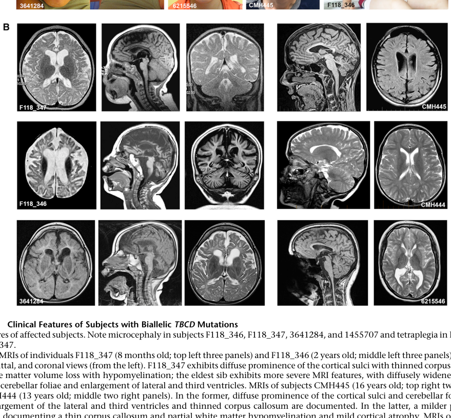

## Question

# Disease Characteristics Research Template

## Target Disease
- **Disease Name:** Progressive Encephalopathy With Brain Atrophy And Thin Corpus Callosum
- **MONDO ID:** MONDO:0044646 (if available)
- **Category:** Mendelian

## Research Objectives

Please provide a comprehensive research report on **Progressive Encephalopathy With Brain Atrophy And Thin Corpus Callosum** covering all of the
disease characteristics listed below. This report will be used to populate a disease knowledge
base entry. Be thorough and cite primary literature (PMID preferred) for all claims.

For each section, **suggested databases/resources** are listed. These are the first places
you should search for information on each topic.

---

### 1. Disease Information
> **Search first:** OMIM, Orphanet, ICD-10/ICD-11, MeSH, PubMed

- What is the disease? Provide a concise overview.
- What are the key identifiers? (OMIM, Orphanet, ICD-10/ICD-11, MeSH, Mondo)
- What are the common synonyms and alternative names?
- Is the information derived from individual patients (e.g., EHR) or aggregated disease-level resources?

### 2. Etiology

- **Disease Causal Factors**: What are the primary causes? (genetic, environmental, infectious, mechanistic)
- **Risk Factors**:
  > **Search first:** PubMed, Cochrane Library, UpToDate, clinical guidelines, ClinVar, ClinGen, GWAS Catalog, PheGenI, CTD, CDC, WHO, epidemiological databases
  - Genetic risk factors (causal variants, susceptibility loci, modifier genes)
  - Environmental risk factors (toxins, lifestyle, occupational exposures, age, sex, family history)
- **Protective Factors**:
  > **Search first:** PubMed, Cochrane Library, clinical trial databases, GWAS Catalog, gnomAD, WHO, CDC, nutrition databases
  - Genetic protective factors (protective variants, modifier alleles)
  - Environmental protective factors (diet, lifestyle, exposures that reduce risk)
- **Gene-Environment Interactions**: How do genetic and environmental factors interact to influence disease?
  > **Search first:** CTD, PubMed, PheGenI, GxE databases

### 3. Phenotypes
> **Search first:** HPO (Human Phenotype Ontology), OMIM, Orphanet, PubMed, clinicaltrials.gov, MedDRA, SNOMED CT, DECIPHER, LOINC

For each phenotype, provide:
- **Phenotype type**: symptoms, clinical signs, physical manifestations, behavioral changes, or laboratory abnormalities
  > For symptoms/signs: HPO, OMIM, Orphanet, PubMed
  > For behavioral changes: HPO, DSM, RDoC (Research Domain Criteria), PubMed
  > For laboratory abnormalities: LOINC, SNOMED CT, LabTests Online, PubMed
- **Phenotype characteristics**:
  > **Search first:** OMIM, Orphanet, HPO, PubMed
  - Age of symptom onset (neonatal, childhood, adult-onset, late-onset)
  - Symptom severity (mild, moderate, severe, variable)
  - Symptom progression (stable, progressive, episodic, fluctuating)
  - Frequency among affected individuals (percentage or qualitative)
- **Quality of life impact**: Effects on daily functioning and well-being (per-phenotype when possible)
  > **Search first:** EQ-5D database, SF-36, WHO QOL databases, PubMed
- Suggest HPO (Human Phenotype Ontology) terms for each phenotype

### 4. Genetic/Molecular Information

- **Causal Genes**: Gene mutations or chromosomal abnormalities responsible for disease (gene symbols, OMIM IDs)
  > **Search first:** OMIM, ClinVar, HGMD, Ensembl, NCBI Gene
- **Pathogenic Variants**:
  - Affected genes (gene symbols, HGNC IDs)
    > **Search first:** OMIM, NCBI Gene, Ensembl, HGNC, UniProt, GeneCards
  - Variant classification (pathogenic, likely pathogenic, VUS per ACMG/AMP guidelines)
    > **Search first:** ClinVar, ClinGen, ACMG/AMP guidelines, VarSome
  - Variant type/class (missense, frameshift, nonsense, splice-site, structural)
  - Allele frequency in population databases
    > **Search first:** gnomAD, 1000 Genomes, ExAC, TOPMed, dbSNP
  - Somatic vs germline origin
    > **Search first:** COSMIC (somatic), ClinVar, ICGC, TCGA
  - Functional consequences (loss of function, gain of function, dominant negative)
- **Modifier Genes**: Genes that modify disease severity or expression
- **Epigenetic Information**: DNA methylation, histone modifications, chromatin changes affecting disease
  > **Search first:** ENCODE, Roadmap Epigenomics, MethBase, DiseaseMeth
- **Chromosomal Abnormalities**: Large-scale genetic changes (aneuploidy, translocations, inversions)
  > **Search first:** DECIPHER, ClinVar, ECARUCA, UCSC Genome Browser

### 5. Environmental Information

- **Environmental Factors**: Non-genetic contributing factors (toxins, radiation, pollution, occupational exposure)
  > **Search first:** CTD (Comparative Toxicogenomics Database), TOXNET, PubMed, EPA databases
- **Lifestyle Factors**: Behavioral factors (smoking, diet, exercise, alcohol consumption)
  > **Search first:** CDC databases, WHO, PubMed, NHANES
- **Infectious Agents**: If applicable, pathogens causing or triggering disease (bacteria, viruses, fungi, parasites)
  > **Search first:** NCBI Taxonomy, ViPR, BV-BRC, MicrobeDB, GIDEON

### 6. Mechanism / Pathophysiology

**Present this section as an ordered causal chain first, then the detail below.**
Open with a numbered sequence of mechanistic steps running from the initiating
lesion (mutation, exposure, infection) to the clinical manifestation, one step per
line, each naming what it causes next. State the causal verb explicitly ("leads
to", "results in") and say where a step is inferred rather than demonstrated.
Where the mechanism branches, show the branch. The categories below are a
checklist of what to cover within those steps, not the organizing structure —
a step may draw on several of them, and a category may contribute to several
steps.

- **Molecular Pathways**: Specific signaling cascades or biochemical pathways involved (Wnt, MAPK, mTOR, PI3K-AKT, etc.)
  > **Search first:** KEGG, Reactome, WikiPathways, PathBank, BioCyc
- **Cellular Processes**: Cell-level mechanisms (apoptosis, autophagy, cell cycle dysregulation, inflammation, etc.)
  > **Search first:** Gene Ontology (GO), Reactome, KEGG, PubMed
- **Protein Dysfunction**: How protein structure or function is altered (misfolding, aggregation, loss of function, gain of function)
  > **Search first:** UniProt, PDB (Protein Data Bank), InterPro, Pfam, AlphaFold
- **Metabolic Changes**: Alterations in metabolic processes (energy metabolism, lipid metabolism, amino acid metabolism)
  > **Search first:** KEGG, BioCyc, HMDB (Human Metabolome Database), BRENDA
- **Immune System Involvement**: Role of immune response (autoimmunity, immunodeficiency, chronic inflammation)
  > **Search first:** ImmPort, Immunome Database, IEDB, Gene Ontology
- **Tissue Damage Mechanisms**: How tissues/ are injured (oxidative stress, ischemia, fibrosis, necrosis)
  > **Search first:** PubMed, Gene Ontology, Reactome
- **Biochemical Abnormalities**: Specific molecular defects (enzyme deficiencies, receptor dysfunction, ion channel defects)
  > **Search first:** BRENDA, UniProt, KEGG, OMIM, PubMed
- **Epigenetic Changes**: DNA methylation, histone modifications affecting gene expression in disease
  > **Search first:** ENCODE, Roadmap Epigenomics, MethBase, DiseaseMeth
- **Molecular Profiling** (if available):
  - Transcriptomics/gene expression changes
    > **Search first:** GEO (Gene Expression Omnibus), ArrayExpress, GTEx, Human Cell Atlas, SRA
  - Proteomics findings
    > **Search first:** PRIDE, ProteomeXchange, Human Protein Atlas, STRING, BioGRID
  - Metabolomics signatures
    > **Search first:** MetaboLights, Metabolomics Workbench, HMDB, METLIN
  - Lipidomics alterations
    > **Search first:** LIPID MAPS, SwissLipids, LipidHome, Metabolomics Workbench
  - Genomic structural features
    > **Search first:** UCSC Genome Browser, Ensembl, NCBI, dbVar, DGV
- **Advanced Technologies** (if applicable):
  - Single-cell analysis findings (cell-type specific mechanisms, cellular heterogeneity)
    > **Search first:** Human Cell Atlas, Single Cell Portal, GEO, CELLxGENE
  - Spatial transcriptomics findings
    > **Search first:** GEO, Spatial Research, Vizgen, 10x Genomics data
  - Multi-omics integration results
    > **Search first:** TCGA, ICGC, cBioPortal, LinkedOmics, PubMed
  - Functional genomics screens (CRISPR, RNAi)
    > **Search first:** DepMap, GenomeRNAi, PubMed, BioGRID ORCS

For each mechanism, describe:
- The causal chain from initial trigger to clinical manifestation
- Which mechanisms are upstream vs downstream
- What cell types and biological processes are involved
- Suggest GO terms for biological processes and CL terms for cell types

### 7. Anatomical Structures Affected

- **Organ Level**:
  - Primary organs directly affected
  - Secondary organ involvement (complications, secondary effects)
  - Body systems involved (cardiovascular, nervous, digestive, respiratory, endocrine, etc.)
  > **Search first:** Uberon, FMA (Foundational Model of Anatomy), OMIM, HPO, ICD-11, MeSH, SNOMED CT
- **Tissue and Cell Level**:
  - Specific tissue types affected (epithelial, connective, muscle, nervous)
  - Specific cell populations targeted (with Cell Ontology terms)
  > **Search first:** Uberon, Human Protein Atlas, Cell Ontology, Human Cell Atlas, CellMarker, PanglaoDB
- **Subcellular Level**:
  - Cellular compartments involved (mitochondria, nucleus, ER, lysosomes) (with GO Cellular Component terms)
  > **Search first:** Gene Ontology (Cellular Component), UniProt, Human Protein Atlas
- **Localization**:
  - Specific anatomical sites (with UBERON terms)
    > **Search first:** FMA, Uberon, NeuroNames (for brain), SNOMED CT
  - Lateralization (unilateral, bilateral, asymmetric)
    > **Search first:** HPO, clinical literature, imaging databases

### 8. Temporal Development

- **Onset**:
  - Typical age of onset (congenital, pediatric, adult, geriatric)
  - Onset pattern (acute, subacute, chronic, insidious)
  > **Search first:** OMIM, Orphanet, HPO, PubMed
- **Progression**:
  - Disease stages (early, intermediate, advanced, end-stage)
    > **Search first:** Cancer Staging Manual (AJCC), WHO classifications, PubMed
  - Progression rate (rapid, slow, variable)
  - Disease course pattern (episodic, relapsing-remitting, progressive, stable)
  - Disease duration (self-limited, chronic lifelong)
  > **Search first:** Disease registries, longitudinal cohort databases, natural history studies, PubMed, Orphanet, OMIM
- **Patterns**:
  - Remission patterns (spontaneous, treatment-induced)
    > **Search first:** Clinical trial databases, disease registries, PubMed
  - Critical periods (time windows of vulnerability or opportunity for intervention)
    > **Search first:** PubMed, developmental biology databases, clinical guidelines

### 9. Inheritance and Population

- **Epidemiology**:
  - Prevalence (cases per 100,000 at given time)
  - Incidence (new cases per 100,000 per year)
  > **Search first:** Orphanet, CDC, WHO, GBD (Global Burden of Disease), national registries, SEER, disease registries
- **For Genetic Etiology**:
  - Inheritance pattern (AD, AR, X-linked, mitochondrial, multifactorial, polygenic)
    > **Search first:** OMIM, Orphanet, ClinVar, GTR (Genetic Testing Registry)
  - Penetrance (complete, incomplete, age-dependent)
    > **Search first:** ClinVar, OMIM, PubMed, ClinGen
  - Expressivity (variable, consistent)
    > **Search first:** OMIM, ClinVar, PubMed
  - Genetic anticipation (increasing severity in successive generations)
    > **Search first:** OMIM, PubMed (especially for repeat expansion disorders)
  - Germline mosaicism
    > **Search first:** ClinVar, OMIM, genetic counseling literature, PubMed
  - Founder effects (population-specific mutations)
    > **Search first:** gnomAD, population genetics databases, PubMed
  - Consanguinity role
    > **Search first:** OMIM, population studies, genetic counseling resources
  - Carrier frequency
    > **Search first:** gnomAD, carrier screening databases, GeneReviews, GTR
- **Population Demographics**:
  - Affected populations (ethnic or demographic groups with higher prevalence)
    > **Search first:** gnomAD, 1000 Genomes, PAGE Study, PubMed, population registries
  - Geographic distribution (endemic areas, regional variation)
    > **Search first:** WHO, CDC, GBD, Orphanet, geographic epidemiology databases
  - Geographic distribution of specific variants
  - Sex ratio (male:female)
    > **Search first:** Disease registries, OMIM, PubMed, epidemiological databases
  - Age distribution of affected individuals
    > **Search first:** CDC, disease registries, SEER, Orphanet

### 10. Diagnostics

- **Clinical Tests**:
  - Laboratory tests (blood, urine, tissue chemistry, specific enzyme assays)
    > **Search first:** LOINC, LabTests Online, PubMed
  - Biomarkers (proteins, metabolites, genetic markers, circulating biomarkers)
    > **Search first:** FDA Biomarker List, BEST (Biomarkers, EndpointS, and other Tools), PubMed
  - Imaging studies (X-ray, CT, MRI, PET, ultrasound)
    > **Search first:** RadLex, DICOM, Radiopaedia, imaging databases
  - Functional tests (pulmonary function, cardiac stress tests)
    > **Search first:** LOINC, clinical guidelines, PubMed
  - Electrophysiology (EEG, EMG, ECG, nerve conduction studies)
    > **Search first:** LOINC, clinical neurophysiology databases, PubMed
  - Biopsy findings (histopathology, immunohistochemistry)
    > **Search first:** SNOMED CT, College of American Pathologists resources, PubMed
  - Pathology findings (microscopic examination)
    > **Search first:** SNOMED CT, Digital Pathology databases, PubMed
- **Genetic Testing**:
  > **Search first:** GTR (Genetic Testing Registry), GeneReviews, ClinGen
  - Overview of recommended genetic testing approach
  - Whole genome sequencing (WGS) utility
    > **Search first:** GTR, ClinVar, GEL (Genomics England), gnomAD
  - Whole exome sequencing (WES) utility
    > **Search first:** GTR, ClinVar, OMIM, GeneMatcher
  - Gene panels (which panels, which genes)
    > **Search first:** GTR, ClinVar, laboratory-specific databases
  - Single gene testing
    > **Search first:** GTR, ClinVar, OMIM, GeneReviews
  - Chromosomal microarray (CMA)
    > **Search first:** DECIPHER, ClinVar, dbVar, ECARUCA
  - Karyotyping
    > **Search first:** Chromosome Abnormality Database, ClinVar, cytogenetics resources
  - FISH
    > **Search first:** ClinVar, cytogenetics databases, PubMed
  - Mitochondrial DNA testing
    > **Search first:** MITOMAP, MSeqDR, ClinVar, GTR
  - Repeat expansion testing
    > **Search first:** GTR, ClinVar, repeat expansion databases, PubMed
- **Omics-Based Diagnostics** (if applicable):
  - RNA sequencing / transcriptomics
    > **Search first:** GEO, ArrayExpress, GTEx, RNA-seq databases
  - Proteomics
    > **Search first:** PRIDE, ProteomeXchange, FDA Biomarker database
  - Metabolomics
    > **Search first:** MetaboLights, Metabolomics Workbench, HMDB
  - Epigenomics
    > **Search first:** GEO, ENCODE, Roadmap Epigenomics, MethBase
  - Liquid biopsy
    > **Search first:** COSMIC, ClinVar, liquid biopsy databases, PubMed
- **Clinical Criteria**:
  - Standardized diagnostic criteria (DSM, ICD, society guidelines)
    > **Search first:** DSM-5, ICD-11, clinical society guidelines, UpToDate
  - Differential diagnosis (other conditions to rule out, with distinguishing features)
    > **Search first:** DynaMed, UpToDate, clinical decision support systems
- **Screening**:
  - Screening methods for asymptomatic individuals (newborn screening, carrier screening, cascade screening)
    > **Search first:** ACMG recommendations, CDC newborn screening, GTR

### 11. Outcome/Prognosis

- **Survival and Mortality**:
  - Survival rate (5-year, 10-year, overall)
    > **Search first:** SEER, cancer registries, disease-specific registries, PubMed
  - Life expectancy (with and without treatment if applicable)
    > **Search first:** Orphanet, disease registries, actuarial databases, PubMed
  - Mortality rate
    > **Search first:** CDC, WHO, GBD, national mortality databases
  - Disease-specific mortality (deaths directly attributable to disease)
    > **Search first:** Disease registries, CDC Wonder, GBD, PubMed
- **Morbidity and Function**:
  - Morbidity (disease-related disability and health impacts)
    > **Search first:** GBD, WHO, disability databases, PubMed
  - Disability outcomes (long-term functional impairments)
    > **Search first:** ICF (International Classification of Functioning), disability registries
  - Quality of life measures (EQ-5D, SF-36, PROMIS, disease-specific tools)
    > **Search first:** EQ-5D database, SF-36, PROMIS, PubMed
- **Disease Course**:
  - Complications (secondary problems: infections, organ failure, etc.)
    > **Search first:** ICD codes, disease registries, clinical databases, PubMed
  - Recovery potential (likelihood and extent of recovery, with vs without treatment)
    > **Search first:** Natural history studies, rehabilitation databases, PubMed
- **Prediction**:
  - Prognostic factors (age, disease severity, biomarkers, treatment response)
    > **Search first:** Prognostic models databases, clinical calculators, PubMed
  - Prognostic biomarkers (molecular markers predicting disease course)
    > **Search first:** FDA Biomarker database, PubMed, cancer prognostic databases

### 12. Treatment

- **Pharmacotherapy**:
  - Pharmacological treatments (drug names, drug classes, mechanisms of action)
    > **Search first:** DrugBank, RxNorm, ATC classification, DailyMed, FDA databases
  - Pharmacogenomics (how genetic variants affect drug metabolism, efficacy, toxicity)
    > **Search first:** PharmGKB, CPIC (Clinical Pharmacogenetics), FDA Table of PGx Biomarkers
- **Advanced Therapeutics**:
  - Gene therapy (viral vectors, CRISPR, gene replacement, gene editing)
    > **Search first:** ClinicalTrials.gov, FDA gene therapy database, ASGCT resources
  - Cell therapy (stem cell transplant, CAR-T, cellular therapeutics)
    > **Search first:** ClinicalTrials.gov, FDA cell therapy database, FACT standards
  - RNA-based therapies (ASOs, siRNA, mRNA therapies)
    > **Search first:** ClinicalTrials.gov, FDA approvals, PubMed
  - Targeted therapies (treatments directed at specific molecular targets)
    > **Search first:** My Cancer Genome, OncoKB, ClinicalTrials.gov, FDA approvals
  - Immunotherapies (checkpoint inhibitors, monoclonal antibodies)
    > **Search first:** Cancer Immunotherapy Database, FDA approvals, ClinicalTrials.gov
- **Surgical and Interventional**:
  - Surgical interventions (types of surgery, timing, outcomes)
    > **Search first:** CPT codes, surgical registries, clinical guidelines, PubMed
- **Supportive and Rehabilitative**:
  - Supportive care (symptom management, pain control, nutrition)
    > **Search first:** Clinical guidelines, Cochrane Library, PubMed
  - Rehabilitation (physical therapy, occupational therapy, speech therapy)
    > **Search first:** Rehabilitation medicine databases, clinical guidelines, PubMed
- **Experimental**:
  - Experimental treatments in clinical trials (with NCT identifiers if available)
    > **Search first:** ClinicalTrials.gov, EU Clinical Trials Register, WHO ICTRP
- **Treatment Outcomes**:
  - Treatment response rates
    > **Search first:** Clinical trial databases, FDA reviews, systematic reviews, PubMed
  - Side effects and adverse events
    > **Search first:** FDA Adverse Event Reporting System (FAERS), MedWatch, PubMed
- **Treatment Strategy**:
  - Treatment algorithms (clinical pathways, decision trees)
    > **Search first:** Clinical practice guidelines, NCCN Guidelines, UpToDate
  - Combination therapies
    > **Search first:** ClinicalTrials.gov, treatment guidelines, PubMed
  - Personalized medicine approaches (genotype-guided treatment)
    > **Search first:** My Cancer Genome, CIViC, PharmGKB, precision medicine databases

For each treatment, suggest NCIT (NCI Thesaurus) clinical-intervention terms where applicable.

### 13. Prevention

- **Prevention Levels**:
  - Primary prevention (preventing disease occurrence: vaccination, risk factor modification)
    > **Search first:** CDC, WHO, USPSTF recommendations, Cochrane Library
  - Secondary prevention (early detection and treatment: screening programs, early intervention)
    > **Search first:** USPSTF, CDC screening guidelines, WHO
  - Tertiary prevention (preventing complications in those with disease)
    > **Search first:** Clinical guidelines, disease management protocols, PubMed
- **Immunization**: Vaccine strategies (if applicable)
  > **Search first:** CDC vaccine schedules, WHO immunization, FDA vaccine database
- **Screening and Early Detection**:
  - Screening programs (population-based: newborn screening, cancer screening)
    > **Search first:** CDC screening programs, USPSTF, cancer screening databases
  - Genetic screening (carrier screening, preimplantation genetic diagnosis, prenatal testing)
    > **Search first:** ACMG recommendations, ACOG guidelines, GTR
  - Risk stratification (identifying high-risk individuals for targeted prevention)
    > **Search first:** Risk prediction models, clinical calculators, PubMed
- **Behavioral Interventions**: Lifestyle modifications to reduce risk
  > **Search first:** CDC, WHO, behavioral intervention databases, Cochrane Library
- **Counseling**: Genetic counseling (risk assessment, family planning guidance)
  > **Search first:** NSGC resources, ACMG guidelines, GeneReviews
- **Public Health**:
  - Public health interventions (sanitation, vector control, health education)
    > **Search first:** CDC, WHO, public health databases, PubMed
  - Environmental interventions (reducing environmental risk factors)
    > **Search first:** EPA databases, WHO environmental health, PubMed
- **Prophylaxis**: Preventive medications or procedures
  > **Search first:** Clinical guidelines, FDA approvals, PubMed

### 14. Other Species / Natural Disease

- **Taxonomy**: Species affected (with NCBI Taxon identifiers)
  > **Search first:** NCBI Taxonomy
- **Breed**: Specific breeds affected (with VBO identifiers if applicable)
  > **Search first:** VBO (Vertebrate Breed Ontology)
- **Gene**: Orthologous genes in other species (with NCBI Gene IDs)
  > **Search first:** NCBI Gene
- **Natural Disease**:
  - Naturally occurring disease in other species (companion animals, wildlife)
    > **Search first:** OMIA (Online Mendelian Inheritance in Animals), VetCompass, PubMed
  - Veterinary relevance and importance in animal health
    > **Search first:** OMIA, veterinary databases, PubMed
- **Comparative Biology**:
  - Comparative pathology (similarities and differences across species)
    > **Search first:** OMIA, comparative pathology databases, PubMed
  - Evolutionary conservation of disease mechanisms
    > **Search first:** HomoloGene, OrthoMCL, Alliance of Genome Resources
- **Transmission** (if applicable):
  - Zoonotic potential
    > **Search first:** CDC zoonotic diseases, WHO zoonoses, GIDEON
  - Cross-species susceptibility
    > **Search first:** NCBI Taxonomy, veterinary databases, PubMed

### 15. Model Organisms

- **Model Types**:
  - Model organism type (mammalian, invertebrate, cellular, in vitro)
    > **Search first:** Alliance of Genome Resources, model organism databases
  - Specific model systems (mouse, rat, zebrafish, Drosophila, C. elegans, yeast, cell lines, organoids, iPSCs)
    > **Search first:** MGI, RGD, ZFIN, FlyBase, WormBase, SGD, ATCC, Cellosaurus
  - Induced models (drug treatment, surgical intervention, environmental manipulation)
    > **Search first:** MGI, model organism databases, PubMed
- **Genetic Models**:
  - Types available (knockout, knock-in, transgenic, conditional, humanized)
    > **Search first:** MGI, IMPC, KOMP, EuMMCR, IMSR
- **Model Characteristics**:
  - Phenotype recapitulation (how well model reproduces human disease features)
    > **Search first:** Model organism databases, comparative studies, PubMed
  - Model limitations (aspects of human disease not captured)
    > **Search first:** Model organism databases, PubMed, review articles
- **Applications**:
  - Research applications (what aspects of disease can be studied)
    > **Search first:** Model organism databases, PubMed
- **Resources**:
  - Model databases
    > **Search first:** MGI, RGD, ZFIN, FlyBase, WormBase, IMSR, EMMA, MMRRC

---

## Citation Requirements

- Cite primary literature (PMID preferred) for all mechanistic and clinical claims
- Prioritize recent reviews and landmark papers
- Include direct quotes from abstracts where possible to support key statements
- Distinguish evidence source types: human clinical, model organism, in vitro, computational

## Output Format

Structure your response as a comprehensive narrative organized by the sections above.
For each section, provide:
- Factual content with specific details (numbers, percentages, gene names, variant nomenclature)
- Ontology term suggestions (HPO, GO, CL, UBERON, CHEBI, NCIT, MONDO) where applicable
- Evidence citations with PMIDs
- Direct quotes from abstracts to support key claims
- Clear indication when information is not available or not applicable for this disease

This report will be used to populate a disease knowledge base entry with:
- Pathophysiology descriptions with causal chains
- Gene/protein annotations (HGNC, GO terms)
- Phenotype associations (HP terms) with frequencies
- Cell type involvement (CL terms)
- Anatomical locations (UBERON terms)
- Chemical entities (CHEBI terms)
- Treatment annotations (NCIT terms)
- Evidence items with PMIDs and exact abstract quotes
- Epidemiology, prognosis, diagnostic, and prevention information
- Animal model descriptions with phenotype recapitulation details

## Output

Question: You are an expert researcher providing comprehensive, well-cited information.

Provide detailed information focusing on:
1. Key concepts and definitions with current understanding
2. Recent developments and latest research (prioritize 2023-2024 sources)
3. Current applications and real-world implementations
4. Expert opinions and analysis from authoritative sources
5. Relevant statistics and data from recent studies

Format as a comprehensive research report with proper citations. Include URLs and publication dates where available.
Always prioritize recent, authoritative sources and provide specific citations for all major claims.

# Disease Characteristics Research Template

## Target Disease
- **Disease Name:** Progressive Encephalopathy With Brain Atrophy And Thin Corpus Callosum
- **MONDO ID:** MONDO:0044646 (if available)
- **Category:** Mendelian

## Research Objectives

Please provide a comprehensive research report on **Progressive Encephalopathy With Brain Atrophy And Thin Corpus Callosum** covering all of the
disease characteristics listed below. This report will be used to populate a disease knowledge
base entry. Be thorough and cite primary literature (PMID preferred) for all claims.

For each section, **suggested databases/resources** are listed. These are the first places
you should search for information on each topic.

---

### 1. Disease Information
> **Search first:** OMIM, Orphanet, ICD-10/ICD-11, MeSH, PubMed

- What is the disease? Provide a concise overview.
- What are the key identifiers? (OMIM, Orphanet, ICD-10/ICD-11, MeSH, Mondo)
- What are the common synonyms and alternative names?
- Is the information derived from individual patients (e.g., EHR) or aggregated disease-level resources?

### 2. Etiology

- **Disease Causal Factors**: What are the primary causes? (genetic, environmental, infectious, mechanistic)
- **Risk Factors**:
  > **Search first:** PubMed, Cochrane Library, UpToDate, clinical guidelines, ClinVar, ClinGen, GWAS Catalog, PheGenI, CTD, CDC, WHO, epidemiological databases
  - Genetic risk factors (causal variants, susceptibility loci, modifier genes)
  - Environmental risk factors (toxins, lifestyle, occupational exposures, age, sex, family history)
- **Protective Factors**:
  > **Search first:** PubMed, Cochrane Library, clinical trial databases, GWAS Catalog, gnomAD, WHO, CDC, nutrition databases
  - Genetic protective factors (protective variants, modifier alleles)
  - Environmental protective factors (diet, lifestyle, exposures that reduce risk)
- **Gene-Environment Interactions**: How do genetic and environmental factors interact to influence disease?
  > **Search first:** CTD, PubMed, PheGenI, GxE databases

### 3. Phenotypes
> **Search first:** HPO (Human Phenotype Ontology), OMIM, Orphanet, PubMed, clinicaltrials.gov, MedDRA, SNOMED CT, DECIPHER, LOINC

For each phenotype, provide:
- **Phenotype type**: symptoms, clinical signs, physical manifestations, behavioral changes, or laboratory abnormalities
  > For symptoms/signs: HPO, OMIM, Orphanet, PubMed
  > For behavioral changes: HPO, DSM, RDoC (Research Domain Criteria), PubMed
  > For laboratory abnormalities: LOINC, SNOMED CT, LabTests Online, PubMed
- **Phenotype characteristics**:
  > **Search first:** OMIM, Orphanet, HPO, PubMed
  - Age of symptom onset (neonatal, childhood, adult-onset, late-onset)
  - Symptom severity (mild, moderate, severe, variable)
  - Symptom progression (stable, progressive, episodic, fluctuating)
  - Frequency among affected individuals (percentage or qualitative)
- **Quality of life impact**: Effects on daily functioning and well-being (per-phenotype when possible)
  > **Search first:** EQ-5D database, SF-36, WHO QOL databases, PubMed
- Suggest HPO (Human Phenotype Ontology) terms for each phenotype

### 4. Genetic/Molecular Information

- **Causal Genes**: Gene mutations or chromosomal abnormalities responsible for disease (gene symbols, OMIM IDs)
  > **Search first:** OMIM, ClinVar, HGMD, Ensembl, NCBI Gene
- **Pathogenic Variants**:
  - Affected genes (gene symbols, HGNC IDs)
    > **Search first:** OMIM, NCBI Gene, Ensembl, HGNC, UniProt, GeneCards
  - Variant classification (pathogenic, likely pathogenic, VUS per ACMG/AMP guidelines)
    > **Search first:** ClinVar, ClinGen, ACMG/AMP guidelines, VarSome
  - Variant type/class (missense, frameshift, nonsense, splice-site, structural)
  - Allele frequency in population databases
    > **Search first:** gnomAD, 1000 Genomes, ExAC, TOPMed, dbSNP
  - Somatic vs germline origin
    > **Search first:** COSMIC (somatic), ClinVar, ICGC, TCGA
  - Functional consequences (loss of function, gain of function, dominant negative)
- **Modifier Genes**: Genes that modify disease severity or expression
- **Epigenetic Information**: DNA methylation, histone modifications, chromatin changes affecting disease
  > **Search first:** ENCODE, Roadmap Epigenomics, MethBase, DiseaseMeth
- **Chromosomal Abnormalities**: Large-scale genetic changes (aneuploidy, translocations, inversions)
  > **Search first:** DECIPHER, ClinVar, ECARUCA, UCSC Genome Browser

### 5. Environmental Information

- **Environmental Factors**: Non-genetic contributing factors (toxins, radiation, pollution, occupational exposure)
  > **Search first:** CTD (Comparative Toxicogenomics Database), TOXNET, PubMed, EPA databases
- **Lifestyle Factors**: Behavioral factors (smoking, diet, exercise, alcohol consumption)
  > **Search first:** CDC databases, WHO, PubMed, NHANES
- **Infectious Agents**: If applicable, pathogens causing or triggering disease (bacteria, viruses, fungi, parasites)
  > **Search first:** NCBI Taxonomy, ViPR, BV-BRC, MicrobeDB, GIDEON

### 6. Mechanism / Pathophysiology

**Present this section as an ordered causal chain first, then the detail below.**
Open with a numbered sequence of mechanistic steps running from the initiating
lesion (mutation, exposure, infection) to the clinical manifestation, one step per
line, each naming what it causes next. State the causal verb explicitly ("leads
to", "results in") and say where a step is inferred rather than demonstrated.
Where the mechanism branches, show the branch. The categories below are a
checklist of what to cover within those steps, not the organizing structure —
a step may draw on several of them, and a category may contribute to several
steps.

- **Molecular Pathways**: Specific signaling cascades or biochemical pathways involved (Wnt, MAPK, mTOR, PI3K-AKT, etc.)
  > **Search first:** KEGG, Reactome, WikiPathways, PathBank, BioCyc
- **Cellular Processes**: Cell-level mechanisms (apoptosis, autophagy, cell cycle dysregulation, inflammation, etc.)
  > **Search first:** Gene Ontology (GO), Reactome, KEGG, PubMed
- **Protein Dysfunction**: How protein structure or function is altered (misfolding, aggregation, loss of function, gain of function)
  > **Search first:** UniProt, PDB (Protein Data Bank), InterPro, Pfam, AlphaFold
- **Metabolic Changes**: Alterations in metabolic processes (energy metabolism, lipid metabolism, amino acid metabolism)
  > **Search first:** KEGG, BioCyc, HMDB (Human Metabolome Database), BRENDA
- **Immune System Involvement**: Role of immune response (autoimmunity, immunodeficiency, chronic inflammation)
  > **Search first:** ImmPort, Immunome Database, IEDB, Gene Ontology
- **Tissue Damage Mechanisms**: How tissues/ are injured (oxidative stress, ischemia, fibrosis, necrosis)
  > **Search first:** PubMed, Gene Ontology, Reactome
- **Biochemical Abnormalities**: Specific molecular defects (enzyme deficiencies, receptor dysfunction, ion channel defects)
  > **Search first:** BRENDA, UniProt, KEGG, OMIM, PubMed
- **Epigenetic Changes**: DNA methylation, histone modifications affecting gene expression in disease
  > **Search first:** ENCODE, Roadmap Epigenomics, MethBase, DiseaseMeth
- **Molecular Profiling** (if available):
  - Transcriptomics/gene expression changes
    > **Search first:** GEO (Gene Expression Omnibus), ArrayExpress, GTEx, Human Cell Atlas, SRA
  - Proteomics findings
    > **Search first:** PRIDE, ProteomeXchange, Human Protein Atlas, STRING, BioGRID
  - Metabolomics signatures
    > **Search first:** MetaboLights, Metabolomics Workbench, HMDB, METLIN
  - Lipidomics alterations
    > **Search first:** LIPID MAPS, SwissLipids, LipidHome, Metabolomics Workbench
  - Genomic structural features
    > **Search first:** UCSC Genome Browser, Ensembl, NCBI, dbVar, DGV
- **Advanced Technologies** (if applicable):
  - Single-cell analysis findings (cell-type specific mechanisms, cellular heterogeneity)
    > **Search first:** Human Cell Atlas, Single Cell Portal, GEO, CELLxGENE
  - Spatial transcriptomics findings
    > **Search first:** GEO, Spatial Research, Vizgen, 10x Genomics data
  - Multi-omics integration results
    > **Search first:** TCGA, ICGC, cBioPortal, LinkedOmics, PubMed
  - Functional genomics screens (CRISPR, RNAi)
    > **Search first:** DepMap, GenomeRNAi, PubMed, BioGRID ORCS

For each mechanism, describe:
- The causal chain from initial trigger to clinical manifestation
- Which mechanisms are upstream vs downstream
- What cell types and biological processes are involved
- Suggest GO terms for biological processes and CL terms for cell types

### 7. Anatomical Structures Affected

- **Organ Level**:
  - Primary organs directly affected
  - Secondary organ involvement (complications, secondary effects)
  - Body systems involved (cardiovascular, nervous, digestive, respiratory, endocrine, etc.)
  > **Search first:** Uberon, FMA (Foundational Model of Anatomy), OMIM, HPO, ICD-11, MeSH, SNOMED CT
- **Tissue and Cell Level**:
  - Specific tissue types affected (epithelial, connective, muscle, nervous)
  - Specific cell populations targeted (with Cell Ontology terms)
  > **Search first:** Uberon, Human Protein Atlas, Cell Ontology, Human Cell Atlas, CellMarker, PanglaoDB
- **Subcellular Level**:
  - Cellular compartments involved (mitochondria, nucleus, ER, lysosomes) (with GO Cellular Component terms)
  > **Search first:** Gene Ontology (Cellular Component), UniProt, Human Protein Atlas
- **Localization**:
  - Specific anatomical sites (with UBERON terms)
    > **Search first:** FMA, Uberon, NeuroNames (for brain), SNOMED CT
  - Lateralization (unilateral, bilateral, asymmetric)
    > **Search first:** HPO, clinical literature, imaging databases

### 8. Temporal Development

- **Onset**:
  - Typical age of onset (congenital, pediatric, adult, geriatric)
  - Onset pattern (acute, subacute, chronic, insidious)
  > **Search first:** OMIM, Orphanet, HPO, PubMed
- **Progression**:
  - Disease stages (early, intermediate, advanced, end-stage)
    > **Search first:** Cancer Staging Manual (AJCC), WHO classifications, PubMed
  - Progression rate (rapid, slow, variable)
  - Disease course pattern (episodic, relapsing-remitting, progressive, stable)
  - Disease duration (self-limited, chronic lifelong)
  > **Search first:** Disease registries, longitudinal cohort databases, natural history studies, PubMed, Orphanet, OMIM
- **Patterns**:
  - Remission patterns (spontaneous, treatment-induced)
    > **Search first:** Clinical trial databases, disease registries, PubMed
  - Critical periods (time windows of vulnerability or opportunity for intervention)
    > **Search first:** PubMed, developmental biology databases, clinical guidelines

### 9. Inheritance and Population

- **Epidemiology**:
  - Prevalence (cases per 100,000 at given time)
  - Incidence (new cases per 100,000 per year)
  > **Search first:** Orphanet, CDC, WHO, GBD (Global Burden of Disease), national registries, SEER, disease registries
- **For Genetic Etiology**:
  - Inheritance pattern (AD, AR, X-linked, mitochondrial, multifactorial, polygenic)
    > **Search first:** OMIM, Orphanet, ClinVar, GTR (Genetic Testing Registry)
  - Penetrance (complete, incomplete, age-dependent)
    > **Search first:** ClinVar, OMIM, PubMed, ClinGen
  - Expressivity (variable, consistent)
    > **Search first:** OMIM, ClinVar, PubMed
  - Genetic anticipation (increasing severity in successive generations)
    > **Search first:** OMIM, PubMed (especially for repeat expansion disorders)
  - Germline mosaicism
    > **Search first:** ClinVar, OMIM, genetic counseling literature, PubMed
  - Founder effects (population-specific mutations)
    > **Search first:** gnomAD, population genetics databases, PubMed
  - Consanguinity role
    > **Search first:** OMIM, population studies, genetic counseling resources
  - Carrier frequency
    > **Search first:** gnomAD, carrier screening databases, GeneReviews, GTR
- **Population Demographics**:
  - Affected populations (ethnic or demographic groups with higher prevalence)
    > **Search first:** gnomAD, 1000 Genomes, PAGE Study, PubMed, population registries
  - Geographic distribution (endemic areas, regional variation)
    > **Search first:** WHO, CDC, GBD, Orphanet, geographic epidemiology databases
  - Geographic distribution of specific variants
  - Sex ratio (male:female)
    > **Search first:** Disease registries, OMIM, PubMed, epidemiological databases
  - Age distribution of affected individuals
    > **Search first:** CDC, disease registries, SEER, Orphanet

### 10. Diagnostics

- **Clinical Tests**:
  - Laboratory tests (blood, urine, tissue chemistry, specific enzyme assays)
    > **Search first:** LOINC, LabTests Online, PubMed
  - Biomarkers (proteins, metabolites, genetic markers, circulating biomarkers)
    > **Search first:** FDA Biomarker List, BEST (Biomarkers, EndpointS, and other Tools), PubMed
  - Imaging studies (X-ray, CT, MRI, PET, ultrasound)
    > **Search first:** RadLex, DICOM, Radiopaedia, imaging databases
  - Functional tests (pulmonary function, cardiac stress tests)
    > **Search first:** LOINC, clinical guidelines, PubMed
  - Electrophysiology (EEG, EMG, ECG, nerve conduction studies)
    > **Search first:** LOINC, clinical neurophysiology databases, PubMed
  - Biopsy findings (histopathology, immunohistochemistry)
    > **Search first:** SNOMED CT, College of American Pathologists resources, PubMed
  - Pathology findings (microscopic examination)
    > **Search first:** SNOMED CT, Digital Pathology databases, PubMed
- **Genetic Testing**:
  > **Search first:** GTR (Genetic Testing Registry), GeneReviews, ClinGen
  - Overview of recommended genetic testing approach
  - Whole genome sequencing (WGS) utility
    > **Search first:** GTR, ClinVar, GEL (Genomics England), gnomAD
  - Whole exome sequencing (WES) utility
    > **Search first:** GTR, ClinVar, OMIM, GeneMatcher
  - Gene panels (which panels, which genes)
    > **Search first:** GTR, ClinVar, laboratory-specific databases
  - Single gene testing
    > **Search first:** GTR, ClinVar, OMIM, GeneReviews
  - Chromosomal microarray (CMA)
    > **Search first:** DECIPHER, ClinVar, dbVar, ECARUCA
  - Karyotyping
    > **Search first:** Chromosome Abnormality Database, ClinVar, cytogenetics resources
  - FISH
    > **Search first:** ClinVar, cytogenetics databases, PubMed
  - Mitochondrial DNA testing
    > **Search first:** MITOMAP, MSeqDR, ClinVar, GTR
  - Repeat expansion testing
    > **Search first:** GTR, ClinVar, repeat expansion databases, PubMed
- **Omics-Based Diagnostics** (if applicable):
  - RNA sequencing / transcriptomics
    > **Search first:** GEO, ArrayExpress, GTEx, RNA-seq databases
  - Proteomics
    > **Search first:** PRIDE, ProteomeXchange, FDA Biomarker database
  - Metabolomics
    > **Search first:** MetaboLights, Metabolomics Workbench, HMDB
  - Epigenomics
    > **Search first:** GEO, ENCODE, Roadmap Epigenomics, MethBase
  - Liquid biopsy
    > **Search first:** COSMIC, ClinVar, liquid biopsy databases, PubMed
- **Clinical Criteria**:
  - Standardized diagnostic criteria (DSM, ICD, society guidelines)
    > **Search first:** DSM-5, ICD-11, clinical society guidelines, UpToDate
  - Differential diagnosis (other conditions to rule out, with distinguishing features)
    > **Search first:** DynaMed, UpToDate, clinical decision support systems
- **Screening**:
  - Screening methods for asymptomatic individuals (newborn screening, carrier screening, cascade screening)
    > **Search first:** ACMG recommendations, CDC newborn screening, GTR

### 11. Outcome/Prognosis

- **Survival and Mortality**:
  - Survival rate (5-year, 10-year, overall)
    > **Search first:** SEER, cancer registries, disease-specific registries, PubMed
  - Life expectancy (with and without treatment if applicable)
    > **Search first:** Orphanet, disease registries, actuarial databases, PubMed
  - Mortality rate
    > **Search first:** CDC, WHO, GBD, national mortality databases
  - Disease-specific mortality (deaths directly attributable to disease)
    > **Search first:** Disease registries, CDC Wonder, GBD, PubMed
- **Morbidity and Function**:
  - Morbidity (disease-related disability and health impacts)
    > **Search first:** GBD, WHO, disability databases, PubMed
  - Disability outcomes (long-term functional impairments)
    > **Search first:** ICF (International Classification of Functioning), disability registries
  - Quality of life measures (EQ-5D, SF-36, PROMIS, disease-specific tools)
    > **Search first:** EQ-5D database, SF-36, PROMIS, PubMed
- **Disease Course**:
  - Complications (secondary problems: infections, organ failure, etc.)
    > **Search first:** ICD codes, disease registries, clinical databases, PubMed
  - Recovery potential (likelihood and extent of recovery, with vs without treatment)
    > **Search first:** Natural history studies, rehabilitation databases, PubMed
- **Prediction**:
  - Prognostic factors (age, disease severity, biomarkers, treatment response)
    > **Search first:** Prognostic models databases, clinical calculators, PubMed
  - Prognostic biomarkers (molecular markers predicting disease course)
    > **Search first:** FDA Biomarker database, PubMed, cancer prognostic databases

### 12. Treatment

- **Pharmacotherapy**:
  - Pharmacological treatments (drug names, drug classes, mechanisms of action)
    > **Search first:** DrugBank, RxNorm, ATC classification, DailyMed, FDA databases
  - Pharmacogenomics (how genetic variants affect drug metabolism, efficacy, toxicity)
    > **Search first:** PharmGKB, CPIC (Clinical Pharmacogenetics), FDA Table of PGx Biomarkers
- **Advanced Therapeutics**:
  - Gene therapy (viral vectors, CRISPR, gene replacement, gene editing)
    > **Search first:** ClinicalTrials.gov, FDA gene therapy database, ASGCT resources
  - Cell therapy (stem cell transplant, CAR-T, cellular therapeutics)
    > **Search first:** ClinicalTrials.gov, FDA cell therapy database, FACT standards
  - RNA-based therapies (ASOs, siRNA, mRNA therapies)
    > **Search first:** ClinicalTrials.gov, FDA approvals, PubMed
  - Targeted therapies (treatments directed at specific molecular targets)
    > **Search first:** My Cancer Genome, OncoKB, ClinicalTrials.gov, FDA approvals
  - Immunotherapies (checkpoint inhibitors, monoclonal antibodies)
    > **Search first:** Cancer Immunotherapy Database, FDA approvals, ClinicalTrials.gov
- **Surgical and Interventional**:
  - Surgical interventions (types of surgery, timing, outcomes)
    > **Search first:** CPT codes, surgical registries, clinical guidelines, PubMed
- **Supportive and Rehabilitative**:
  - Supportive care (symptom management, pain control, nutrition)
    > **Search first:** Clinical guidelines, Cochrane Library, PubMed
  - Rehabilitation (physical therapy, occupational therapy, speech therapy)
    > **Search first:** Rehabilitation medicine databases, clinical guidelines, PubMed
- **Experimental**:
  - Experimental treatments in clinical trials (with NCT identifiers if available)
    > **Search first:** ClinicalTrials.gov, EU Clinical Trials Register, WHO ICTRP
- **Treatment Outcomes**:
  - Treatment response rates
    > **Search first:** Clinical trial databases, FDA reviews, systematic reviews, PubMed
  - Side effects and adverse events
    > **Search first:** FDA Adverse Event Reporting System (FAERS), MedWatch, PubMed
- **Treatment Strategy**:
  - Treatment algorithms (clinical pathways, decision trees)
    > **Search first:** Clinical practice guidelines, NCCN Guidelines, UpToDate
  - Combination therapies
    > **Search first:** ClinicalTrials.gov, treatment guidelines, PubMed
  - Personalized medicine approaches (genotype-guided treatment)
    > **Search first:** My Cancer Genome, CIViC, PharmGKB, precision medicine databases

For each treatment, suggest NCIT (NCI Thesaurus) clinical-intervention terms where applicable.

### 13. Prevention

- **Prevention Levels**:
  - Primary prevention (preventing disease occurrence: vaccination, risk factor modification)
    > **Search first:** CDC, WHO, USPSTF recommendations, Cochrane Library
  - Secondary prevention (early detection and treatment: screening programs, early intervention)
    > **Search first:** USPSTF, CDC screening guidelines, WHO
  - Tertiary prevention (preventing complications in those with disease)
    > **Search first:** Clinical guidelines, disease management protocols, PubMed
- **Immunization**: Vaccine strategies (if applicable)
  > **Search first:** CDC vaccine schedules, WHO immunization, FDA vaccine database
- **Screening and Early Detection**:
  - Screening programs (population-based: newborn screening, cancer screening)
    > **Search first:** CDC screening programs, USPSTF, cancer screening databases
  - Genetic screening (carrier screening, preimplantation genetic diagnosis, prenatal testing)
    > **Search first:** ACMG recommendations, ACOG guidelines, GTR
  - Risk stratification (identifying high-risk individuals for targeted prevention)
    > **Search first:** Risk prediction models, clinical calculators, PubMed
- **Behavioral Interventions**: Lifestyle modifications to reduce risk
  > **Search first:** CDC, WHO, behavioral intervention databases, Cochrane Library
- **Counseling**: Genetic counseling (risk assessment, family planning guidance)
  > **Search first:** NSGC resources, ACMG guidelines, GeneReviews
- **Public Health**:
  - Public health interventions (sanitation, vector control, health education)
    > **Search first:** CDC, WHO, public health databases, PubMed
  - Environmental interventions (reducing environmental risk factors)
    > **Search first:** EPA databases, WHO environmental health, PubMed
- **Prophylaxis**: Preventive medications or procedures
  > **Search first:** Clinical guidelines, FDA approvals, PubMed

### 14. Other Species / Natural Disease

- **Taxonomy**: Species affected (with NCBI Taxon identifiers)
  > **Search first:** NCBI Taxonomy
- **Breed**: Specific breeds affected (with VBO identifiers if applicable)
  > **Search first:** VBO (Vertebrate Breed Ontology)
- **Gene**: Orthologous genes in other species (with NCBI Gene IDs)
  > **Search first:** NCBI Gene
- **Natural Disease**:
  - Naturally occurring disease in other species (companion animals, wildlife)
    > **Search first:** OMIA (Online Mendelian Inheritance in Animals), VetCompass, PubMed
  - Veterinary relevance and importance in animal health
    > **Search first:** OMIA, veterinary databases, PubMed
- **Comparative Biology**:
  - Comparative pathology (similarities and differences across species)
    > **Search first:** OMIA, comparative pathology databases, PubMed
  - Evolutionary conservation of disease mechanisms
    > **Search first:** HomoloGene, OrthoMCL, Alliance of Genome Resources
- **Transmission** (if applicable):
  - Zoonotic potential
    > **Search first:** CDC zoonotic diseases, WHO zoonoses, GIDEON
  - Cross-species susceptibility
    > **Search first:** NCBI Taxonomy, veterinary databases, PubMed

### 15. Model Organisms

- **Model Types**:
  - Model organism type (mammalian, invertebrate, cellular, in vitro)
    > **Search first:** Alliance of Genome Resources, model organism databases
  - Specific model systems (mouse, rat, zebrafish, Drosophila, C. elegans, yeast, cell lines, organoids, iPSCs)
    > **Search first:** MGI, RGD, ZFIN, FlyBase, WormBase, SGD, ATCC, Cellosaurus
  - Induced models (drug treatment, surgical intervention, environmental manipulation)
    > **Search first:** MGI, model organism databases, PubMed
- **Genetic Models**:
  - Types available (knockout, knock-in, transgenic, conditional, humanized)
    > **Search first:** MGI, IMPC, KOMP, EuMMCR, IMSR
- **Model Characteristics**:
  - Phenotype recapitulation (how well model reproduces human disease features)
    > **Search first:** Model organism databases, comparative studies, PubMed
  - Model limitations (aspects of human disease not captured)
    > **Search first:** Model organism databases, PubMed, review articles
- **Applications**:
  - Research applications (what aspects of disease can be studied)
    > **Search first:** Model organism databases, PubMed
- **Resources**:
  - Model databases
    > **Search first:** MGI, RGD, ZFIN, FlyBase, WormBase, IMSR, EMMA, MMRRC

---

## Citation Requirements

- Cite primary literature (PMID preferred) for all mechanistic and clinical claims
- Prioritize recent reviews and landmark papers
- Include direct quotes from abstracts where possible to support key statements
- Distinguish evidence source types: human clinical, model organism, in vitro, computational

## Output Format

Structure your response as a comprehensive narrative organized by the sections above.
For each section, provide:
- Factual content with specific details (numbers, percentages, gene names, variant nomenclature)
- Ontology term suggestions (HPO, GO, CL, UBERON, CHEBI, NCIT, MONDO) where applicable
- Evidence citations with PMIDs
- Direct quotes from abstracts to support key claims
- Clear indication when information is not available or not applicable for this disease

This report will be used to populate a disease knowledge base entry with:
- Pathophysiology descriptions with causal chains
- Gene/protein annotations (HGNC, GO terms)
- Phenotype associations (HP terms) with frequencies
- Cell type involvement (CL terms)
- Anatomical locations (UBERON terms)
- Chemical entities (CHEBI terms)
- Treatment annotations (NCIT terms)
- Evidence items with PMIDs and exact abstract quotes
- Epidemiology, prognosis, diagnostic, and prevention information
- Animal model descriptions with phenotype recapitulation details

# Progressive encephalopathy with brain atrophy and thin corpus callosum: disease-characteristics report

**Scope and evidence standard.** This report concerns **biallelic TBCD-related disease**, commonly called *progressive encephalopathy with brain atrophy and thin corpus callosum* (**PEBAT**). The supplied identifier **MONDO:0044646** resolves in Open Targets to “early-onset progressive diffuse brain atrophy–microcephaly–muscle weakness–optic atrophy syndrome,” associated with **TBCD**. A similarly worded, *KIF1A*-related progressive encephalopathy is a distinct genetic condition and must not be merged into this entry. Findings below derive from published patients, families, experimental cells, and a fly model—not individual electronic health records. Cohort percentages describe the stated cohort only. (OpenTargets Search: progressive encephalopathy with brain atrophy and thin corpus callosum, flex2016biallelicmutationsin pages 1-2, miyake2016biallelictbcdmutations pages 1-2)

A comparison of the foundational cohorts and subsequent reports provides context for the pronounced variation in severity. (flex2016biallelicmutationsin pages 2-4, miyake2016biallelictbcdmutations pages 1-2, grønborg2018afaroesefounder pages 1-2, chen2021novelcompoundheterozygous pages 1-3, caputo2023avariantin pages 1-2, aynekin2025phenotypicvariabilityin pages 1-3)

| Study | Population and TBCD variants | Meaningful clinical or functional findings |
|---|---|---|
| [Flex et al., 2016](https://doi.org/10.1016/j.ajhg.2016.08.003) | 7 affected individuals from 5 unrelated families; biallelic missense and splice-region variants, including p.Pro1122Leu, p.Leu229Arg, p.Thr374Met, p.Arg377Gln, p.Ala626Thr, p.Thr994Met, and p.Val1105Met. (flex2016biallelicmutationsin pages 2-4, flex2016biallelicmutationsin pages 4-6) | All 7 had quadriplegia and a thin corpus callosum; 5/7 had seizures and 4/7 microcephaly. Patient fibroblasts showed reduced soluble α/β-tubulin, accelerated repolymerization, abnormally stable microtubules, and disorganized mitotic spindles. (flex2016biallelicmutationsin pages 2-4, flex2016biallelicmutationsin pages 1-2, flex2016biallelicmutationsin pages 6-8) |
| [Miyake et al., 2016](https://doi.org/10.1016/j.ajhg.2016.08.005) | 8 affected individuals from 4 families; five missense, one nonsense, and one splice variant: p.Met387Arg, p.Gly522Phefs*14, p.Tyr760*, p.Arg772Cys, p.Ala921Thr, p.Pro937Arg, and p.Pro1122Leu. (miyake2016biallelictbcdmutations pages 1-2, miyake2016biallelictbcdmutations pages 2-3) | Onset before age 1 year with progressive diffuse brain atrophy, regression, postnatal microcephaly and growth failure, weakness/atrophy, and respiratory failure. Mutants impaired interactions with ARL2, TBCE, and β-tubulin; wild-type human TBCD rescued Drosophila neuronal axon defects more effectively than disease variants. (miyake2016biallelictbcdmutations pages 5-8, miyake2016biallelictbcdmutations pages 1-2) |
| [Grønborg et al., 2018](https://doi.org/10.1038/s41431-018-0204-5) | 8 patients from 6 Faroese families, all homozygous for founder variant c.3099C>G (p.Asn1033Lys). Eight of 306 controls were carriers (2.6%; approximately 1/38), yielding a population-specific calculated incidence of 1/1,444—not a global estimate. (grønborg2018afaroesefounder pages 1-2, grønborg2018afaroesefounder pages 4-7) | Medical presentation at 4–9 months; treatment-resistant epilepsy began at 6–19 months. Progressive cerebral and white-matter atrophy, corpus-callosum/brain-stem volume loss, respiratory complications, and median death at 24 months were reported; patient fibroblasts had severely reduced TBCD protein. (grønborg2018afaroesefounder pages 4-7, grønborg2018afaroesefounder pages 2-3) |
| [Chen et al., 2021](https://doi.org/10.3390/children8121140) | 2 affected sisters from one non-consanguineous Chinese family, compound heterozygous for c.817+2T>C and c.1340C>T (p.Ala447Val), inherited respectively from their unaffected father and mother. (chen2021novelcompoundheterozygous pages 1-3, chen2021novelcompoundheterozygous pages 3-5) | Infantile hypotonia, epilepsy at 12 or 18 months, regression, callosal thinning/hypoplasia, ventriculomegaly, and cerebral atrophy; one sister died of respiratory failure at age 3 years. (chen2021novelcompoundheterozygous pages 1-3, chen2021novelcompoundheterozygous pages 3-5) |
| [Caputo et al., 2023](https://doi.org/10.3390/ijms241512386) | One 22-year-old woman homozygous for c.881G>A (p.Arg294Gln); unaffected consanguineous parents and sister were heterozygous. (caputo2023avariantin pages 1-2, caputo2023avariantin pages 2-5) | Atypical, attenuated phenotype dominated by childhood-onset fatigue, distal motor-neuron disease, mild intellectual disability (IQ 61), and corpus-callosum hypoplasia rather than severe infantile regression. No direct variant-specific functional assay was reported. (caputo2023avariantin pages 1-2, caputo2023avariantin pages 2-5) |
| [Aynekin et al., 2025](https://doi.org/10.1007/s10048-025-00799-7) | 3 individuals from 2 consanguineous families: 2 siblings homozygous for c.2314C>T (p.Arg772Cys) and one child homozygous for c.230A>G (p.His77Arg). (aynekin2025phenotypicvariabilityin pages 3-5, aynekin2025phenotypicvariabilityin pages 1-3) | p.Arg772Cys was associated with severe regression, seizures, spastic tetraplegia, hypomyelination, thin corpus callosum, and cerebral/cerebellar atrophy; p.His77Arg produced comparatively mild delay, seizures, secondary microcephaly, and minimal MRI abnormalities, emphasizing marked variant- and context-dependent expressivity. (aynekin2025phenotypicvariabilityin pages 5-6, aynekin2025phenotypicvariabilityin pages 3-5) |

*Table: Primary and recent clinical studies defining the genetic, phenotypic, and functional spectrum of TBCD-related PEBAT. Cohort-specific frequencies and Faroese founder statistics are kept separate to avoid implying global prevalence.*

## 1. Disease information and identifiers

PEBAT is a rare, usually infantile-onset **autosomal-recessive neurodevelopmental and neurodegenerative tubulinopathy**. Typical features are developmental delay followed by regression, progressive cerebral volume loss, a thin corpus callosum, microcephaly, weakness or spasticity, epilepsy, and sometimes optic atrophy and respiratory failure; milder presentations are now documented. The two foundational 2016 studies reported **7 affected individuals in 5 families** and **8 in 4 families**, respectively. The later 2025 authors state that **55 patients and 35 variants** had been reported in the literature, but this is their literature count, not a registry-based prevalence estimate. (flex2016biallelicmutationsin pages 1-2, miyake2016biallelictbcdmutations pages 1-2, aynekin2025phenotypicvariabilityin pages 1-3)

**Verified identifiers:** MONDO:0044646; gene symbol **TBCD**, encoding tubulin folding cofactor D; Ensembl gene **ENSG00000141556**; **OMIM *604649 is identified in the original paper as the TBCD gene entry**. Although a 2025 article calls “PEBAT, OMIM #604649,” the primary paper identifies that number with the *gene*; therefore it should **not be entered uncritically as a separately verified disease OMIM identifier**. A syndrome-specific OMIM number, Orphanet number, dedicated MeSH descriptor, disease-specific ICD-10/ICD-11 code, and HGNC numeric gene ID were **not independently verified** in the retrieved material. Synonyms/descriptive labels include *TBCD-related early-onset neurodegenerative encephalopathy*, *TBCD-related progressive encephalopathy*, and the MONDO label above. These labels describe overlapping presentations, not evidence for several causal genes in this particular entry. (OpenTargets Search: progressive encephalopathy with brain atrophy and thin corpus callosum, miyake2016biallelictbcdmutations pages 1-2, aynekin2025phenotypicvariabilityin pages 1-3)

## 2. Etiology, risk, protection, and gene–environment interaction

**Established cause:** inherited pathogenic or likely pathogenic **biallelic germline TBCD variants**, either homozygous or compound heterozygous. TBCD participates in folding, assembly, and recycling of α/β-tubulin heterodimers, the building blocks of microtubules. Segregation in multiple families and functional experiments support impaired TBCD function. Consanguinity raises the chance of homozygosity but is **not required**: the original series and a subsequently reported Chinese family include affected children of non-consanguineous parents. (flex2016biallelicmutationsin pages 1-2, miyake2016biallelictbcdmutations pages 1-2, chen2021novelcompoundheterozygous pages 3-5)

**Established genetic risk factors** are parental carriage of the same pathogenic allele or two pathogenic alleles in *trans*; a geographically restricted founder allele is described in section 9. Differences in residual mutant function are a proposed contributor to severity. **Specific protective alleles, modifier genes, validated susceptibility loci outside TBCD, and protective diets or exposures have not been established.** The 2025 proposal that epigenetic factors or modifier genes explain variation is a **hypothesis**, not a mapped gene–environment interaction. No toxin, lifestyle factor, infectious pathogen, or immunization has been shown to initiate this Mendelian condition. Environmental circumstances can nevertheless affect complications and access to supportive care; they must not be coded as its established cause. (miyake2016biallelictbcdmutations pages 1-2, grønborg2018afaroesefounder pages 1-2, aynekin2025phenotypicvariabilityin pages 5-6)

## 3. Phenotypes and functional impact

The following are **suggested HPO mappings**, not a formally validated HPO annotation set; verify the exact ontology release and term IDs before database import. Frequencies are quoted only where supported by a defined denominator. (flex2016biallelicmutationsin pages 2-4, grønborg2018afaroesefounder pages 2-3, flex2016biallelicmutationsin pages 1-2)

| Phenotype; proposed HPO term | Type, onset, course, and evidence | Effect on functioning |
|---|---|---|
| Developmental delay **HP:0001263**, developmental regression **HP:0002376**, intellectual disability **HP:0001249** | Clinical/developmental; usually begins in infancy, followed by variable progressive loss. Some later cases have only mild impairment. | Loss or nonacquisition of communication, independent mobility, and self-care. (miyake2016biallelictbcdmutations pages 1-2, aynekin2025phenotypicvariabilityin pages 3-5, caputo2023avariantin pages 1-2) |
| Cerebral atrophy **HP:0002059**, thin corpus callosum **HP:0002079** | MRI signs; often progressive cerebral and white-matter loss. **7/7** in the Flex cohort had callosal thinning; an attenuated 2025 case had minimal MRI abnormalities. | Anatomical correlates of severe neurologic impairment; imaging alone does not quantify disability. (flex2016biallelicmutationsin pages 2-4, aynekin2025phenotypicvariabilityin pages 5-6, flex2016biallelicmutationsin media f61aba75) |
| Microcephaly **HP:0000252**, particularly progressive/postnatal microcephaly | Growth/physical sign; **4/7** in Flex; postnatal development emphasized by Miyake. Not universal in milder presentations. | Marker of altered brain growth, not an independently measured quality-of-life score. (flex2016biallelicmutationsin pages 2-4, miyake2016biallelictbcdmutations pages 1-2, aynekin2025phenotypicvariabilityin pages 5-6) |
| Seizures **HP:0001250**; EEG abnormalities **HP:0002353** | Episodic neurologic manifestations; **5/7** in Flex. In the Faroese cohort, resistant epilepsy began at **6–19 months**, median **9.5 months**; severity varies from refractory seizures to relatively mild episodes. | Acute safety risk, treatment burden, and interference with learning and care. (flex2016biallelicmutationsin pages 2-4, grønborg2018afaroesefounder pages 2-3, aynekin2025phenotypicvariabilityin pages 5-6) |
| Hypotonia **HP:0001252**, muscle weakness **HP:0001324**, spasticity **HP:0001257** or spastic tetraplegia **HP:0002510** | Neuromuscular signs; infantile hypotonia may be followed by spasticity and/or atrophy. **7/7** in Flex were described as having quadriplegia, but this selected series cannot establish a universal frequency. | Impaired head control, sitting, walking, and transfers; contractures and scoliosis can add care needs. (flex2016biallelicmutationsin pages 2-4, grønborg2018afaroesefounder pages 2-3, chen2021novelcompoundheterozygous pages 1-3, aynekin2025phenotypicvariabilityin pages 1-3) |
| Optic atrophy **HP:0000648**, impaired visual attention/absent visual tracking | Ophthalmologic/behavioral signs; reported in original disease descriptions, but a reliable frequency was unavailable. | Potential visual disability and reduced engagement. (flex2016biallelicmutationsin pages 1-2, miyake2016biallelictbcdmutations pages 2-3) |
| Growth failure **HP:0001508**, feeding/swallowing difficulty **HP:0002015**, respiratory failure **HP:0002878** | Systemic/secondary clinical manifestations; one reported child required nasogastric feeding and died at age 3 from respiratory complications. Frequencies not established. | High dependence on caregivers and risk of aspiration or hospitalization. (miyake2016biallelictbcdmutations pages 1-2, chen2021novelcompoundheterozygous pages 1-3, chen2021novelcompoundheterozygous pages 3-5) |
| Distal motor neuropathy/motor-neuron disease—**choose a specific HPO term after examination** | Electrophysiologic/motor phenotype in an atypically affected 22-year-old; not a defining feature in every case. | Fatigue, low exercise tolerance, distal wasting, and weakness. (caputo2023avariantin pages 2-5) |

Other reported findings include hypomyelination or reduced white-matter volume, cerebellar atrophy, nystagmus or strabismus, scoliosis, contractures, and hearing impairment; individual frequencies and standardized EQ-5D, SF-36, or PROMIS scores have **not** been established for PEBAT. The observed limitations suggest a major quality-of-life burden in severely affected families, but **no numeric quality-of-life estimate should be invented**. (flex2016biallelicmutationsin pages 8-9, chen2021novelcompoundheterozygous pages 1-3, aynekin2025phenotypicvariabilityin pages 3-5)

## 4. Genetic and molecular information

The causal gene is **TBCD**, on **17q25.3**; its product is a tubulin-folding cofactor rather than a tubulin subunit or a canonical signaling kinase. The original Miyake families had seven reported variants: **c.1160T>G (p.Met387Arg), c.1564+12C>G (splice change producing p.Gly522Phefs*14), c.2280C>A (p.Tyr760*), c.2314C>T (p.Arg772Cys), c.2761G>A (p.Ala921Thr), c.2810C>G (p.Pro937Arg), and c.3365C>T (p.Pro1122Leu)**—five missense, one nonsense, and one splice-altering variant. The splice variant was associated with an intronic insertion, frameshift, and nonsense-mediated RNA decay. These variants were reported absent or extremely rare in the populations examined, but **variant-specific current gnomAD allele frequencies were not retrieved**. (miyake2016biallelictbcdmutations pages 2-3)

Further examples include the Faroese founder **c.3099C>G (p.Asn1033Lys)**, Chinese sibling pair **c.817+2T>C / c.1340C>T (p.Ala447Val)**, atypical motor-neuron case **c.881G>A (p.Arg294Gln)**, and 2025 families with **c.2314C>T (p.Arg772Cys)** or **c.230A>G (p.His77Arg)**. The 2023 report calls p.Arg294Gln *likely pathogenic*; the 2025 authors describe p.Arg772Cys as likely pathogenic and p.His77Arg as probably pathogenic. These are **reported author interpretations**, not a fresh, independently checked ClinVar/ClinGen ACMG classification. Do not assign the same pathogenicity or severity to all missense variants merely because they occur in TBCD. (grønborg2018afaroesefounder pages 4-7, chen2021novelcompoundheterozygous pages 3-5, caputo2023avariantin pages 2-5, aynekin2025phenotypicvariabilityin pages 3-5)

The variants are inherited **germline** changes; a somatic driver, recurrent disease-causing copy-number alteration, diagnostic methylation signature, and experimentally proven epigenetic modifier have not been established. Some mutant proteins are destabilized, others bind β-tubulin or interacting proteins poorly; collectively the evidence favors **partial or severe loss of normal function**, not a demonstrated uniform gain-of-function mechanism. (flex2016biallelicmutationsin pages 4-6, miyake2016biallelictbcdmutations pages 5-8, grønborg2018afaroesefounder pages 4-7)

## 5. Environmental and infectious information

**No established causal environmental exposure, lifestyle behavior, nutritional deficiency, radiation exposure, or infectious agent** has been identified for TBCD-associated PEBAT. Respiratory infections in affected children are **complications**, not proof that infection caused the genetic disorder. Likewise, observing seizure improvement during vitamin treatment does **not** establish a preventable dietary TBCD deficiency. No validated PEBAT-specific gene–environment interaction has been demonstrated. (chen2021novelcompoundheterozygous pages 1-3, grønborg2018afaroesefounder pages 2-3, aynekin2025phenotypicvariabilityin pages 5-6)

## 6. Mechanism and pathophysiology

**Ordered causal chain**—“inferred” identifies a proposed rather than experimentally demonstrated link:

1. **Biallelic TBCD variants lead to reduced TBCD abundance and/or defective interactions with β-tubulin, ARL2, and TBCE.** Protein instability, binding defects, and splice-mediated transcript loss have been measured for particular alleles. (flex2016biallelicmutationsin pages 4-6, miyake2016biallelictbcdmutations pages 5-8, miyake2016biallelictbcdmutations pages 2-3)
2. **Impaired TBCD cofactor activity leads to disturbed folding, assembly, and disassembly of α/β-tubulin heterodimers.** This link is supported by protein-complex assays; its precise magnitude depends on the allele. (flex2016biallelicmutationsin pages 1-2, miyake2016biallelictbcdmutations pages 5-8)
3. **Disturbed heterodimer handling results in a smaller soluble tubulin pool and abnormal microtubule dynamics:** patient fibroblasts repolymerize microtubules faster after depolymerization and exhibit enhanced microtubule stability. **Branch A:** abnormal microtubule organization leads to disordered mitotic spindles and reduced asters, without a clearly altered fibroblast proliferation rate. (flex2016biallelicmutationsin pages 6-8, flex2016biallelicmutationsin pages 1-2)
4. **Branch B: defective neuronal microtubule regulation leads to impaired axonal growth/branching and neuronal maintenance**, supported by *Drosophila* TBCD-loss and human-TBCD rescue experiments. The transfer of these model findings to each human brain cell type, including oligodendrocytes, is **inferred**. (miyake2016biallelictbcdmutations pages 5-8, miyake2016biallelictbcdmutations pages 1-2)
5. **Impaired neuronal development and survival result in cerebral and cerebellar neuronal injury, gliosis, white-matter loss, callosal thinning, and peripheral motor-neuron/diaphragm involvement.** Histopathology demonstrates injury; the complete cellular sequence from abnormal tubulin handling to cell death remains **inferred**. (miyake2016biallelictbcdmutations pages 5-8, grønborg2018afaroesefounder pages 4-7, grønborg2018afaroesefounder pages 8-9)
6. **Progressive neural-circuit and motor-system damage results in developmental regression, seizures, weakness/spasticity, visual impairment, and sometimes respiratory failure.** Severity varies substantially with genotype and possibly other, as-yet-unconfirmed modifiers. (miyake2016biallelictbcdmutations pages 1-2, flex2016biallelicmutationsin pages 2-4, aynekin2025phenotypicvariabilityin pages 5-6)

**Mechanistic interpretation.** The upstream biochemical lesion is a **tubulin-cofactor/microtubule homeostasis defect**, *not* an established primary Wnt, MAPK, mTOR, PI3K–AKT, immune, lysosomal, or enzyme-deficiency pathway. In the original fibroblast experiments, reduced soluble α-tubulin accompanied apparently stable total α-tubulin; mutant p.Thr374Met and p.Arg377Gln particularly disrupted β-tubulin-containing complexes. Structural effects inferred from molecular-dynamics modeling should be labeled **computational predictions**. The 2016 paper’s abstract states: “Reduced or defective TBCD function resulted in decreased soluble α/β-tubulin levels and accelerated microtubule polymerization in fibroblasts from affected subjects.” (flex2016biallelicmutationsin pages 4-6, flex2016biallelicmutationsin pages 6-8, flex2016biallelicmutationsin pages 1-2)

**Tissue evidence:** a human autopsy documented cortical laminar necrosis, white-matter atrophy, pontine injury, cerebellar Purkinje- and granule-cell loss, anterior-horn/nerve-root degeneration, and diaphragmatic muscle degeneration. The Faroese series also documented neuronal loss, vacuolization, and gliosis. Findings resembling mitochondrial disease in residual Purkinje cells **do not establish a primary mitochondrial metabolic disorder**. No reproducible PEBAT-specific inflammatory, metabolomic, lipidomic, proteomic, single-cell, spatial-transcriptomic, multi-omics, or epigenomic signature was established by the retrieved studies; **nonsense-mediated decay of one splice allele is not evidence of a genome-wide epigenetic mechanism**. (miyake2016biallelictbcdmutations pages 5-8, grønborg2018afaroesefounder pages 8-9, miyake2016biallelictbcdmutations pages 2-3)

**Suggested process annotations, requiring ontology validation:** GO **protein folding**, **tubulin complex assembly**, **microtubule polymerization/depolymerization**, **microtubule-based transport**, **axon development**, and **mitotic spindle organization**. These are candidate biological-process mappings, **not** claims that each process was measured directly in affected human neurons. Candidate cell types are neuronal cells, cerebellar Purkinje cells, cerebellar granule neurons, spinal motor neurons, and possibly oligodendrocytes; assign exact **CL IDs** only after an ontology lookup, and treat oligodendrocyte primary involvement as **unproven**. (flex2016biallelicmutationsin pages 6-8, miyake2016biallelictbcdmutations pages 5-8, grønborg2018afaroesefounder pages 8-9)

## 7. Anatomical structures and localization

The **central nervous system** is principally affected: bilateral/diffuse cerebral cortex and subcortical white matter, corpus callosum, cerebellum, brain stem, and, in pathologically examined cases, spinal anterior horn. Secondary/peripheral involvement includes motor nerves, skeletal muscle and diaphragm, optic nerve/visual system, and respiratory and feeding systems as complications. MRI findings can be **frontal-predominant** in Faroese cases; no consistent unilateral lateralization has been established. One study reported age-appropriate myelination despite marked white-matter atrophy, so reduced white-matter volume must not automatically be classified as a primary hypomyelinating leukodystrophy. (grønborg2018afaroesefounder pages 4-7, grønborg2018afaroesefounder pages 2-3, grønborg2018afaroesefounder pages 8-9, miyake2016biallelictbcdmutations pages 5-8)

**Candidate anatomy ontology mappings:** UBERON *brain*, *cerebral cortex*, *cerebral white matter*, *corpus callosum*, *cerebellum*, *brainstem*, *spinal cord*, *optic nerve*, and *diaphragm*; verify specific IDs before ingestion. Candidate GO cellular components are **microtubule**, **mitotic spindle**, **centrosome**, and **cytosol**. These localizations reflect different levels of evidence—patient MRI/autopsy for anatomy, fibroblast microscopy for spindle/centrosome—and do not imply that a single patient had every lesion. The original paper’s cropped MR images and microtubule images provide direct visual support for the callosal and cellular observations. (flex2016biallelicmutationsin media f61aba75, flex2016biallelicmutationsin pages 6-8, miyake2016biallelictbcdmutations pages 5-8)

## 8. Temporal development

The classic pattern is **apparently normal or near-normal birth followed by onset in the first year**, delayed development or stagnation, then progressive regression and atrophy. In the Faroese founder cohort, first medical attention occurred at **4–9 months**, median **5.5 months**; resistant epilepsy began at **6–19 months**, median **9.5 months**. In two affected Chinese sisters, epilepsy began around **12 and 18 months**. A severe 2025 sibling pair remained alive at **18 and 20 years**, whereas another child had a much milder course at age **8**. Thus no uniform stage duration or disease-wide progression rate is supportable. (grønborg2018afaroesefounder pages 2-3, chen2021novelcompoundheterozygous pages 1-3, aynekin2025phenotypicvariabilityin pages 1-3, aynekin2025phenotypicvariabilityin pages 5-6)

For descriptive—not validated staging—purposes: **early** motor/developmental abnormalities; **intermediate** epilepsy, regression, and emerging MRI changes; **advanced** severe immobility, swallowing and/or respiratory complications. There is **no formal staging system**, established spontaneous remission pattern, or proven therapeutic critical period. Symptom reduction in one child must not be interpreted as reversal of the underlying tubulinopathy. (grønborg2018afaroesefounder pages 2-3, aynekin2025phenotypicvariabilityin pages 5-6)

## 9. Inheritance and population epidemiology

Inheritance is **autosomal recessive**: affected children may inherit two different alleles from clinically unaffected carriers or a homozygous allele through shared ancestry. Across original cohorts both sexes and several ancestries are represented; a reliable disease-wide sex ratio, penetrance estimate, heterozygote disease risk, anticipation, germline-mosaicism frequency, and broad population prevalence/incidence are **not available**. An empiric **25% recurrence probability per pregnancy** applies *conditionally* when both parents are confirmed carriers of pathogenic alleles at the same locus; this is Mendelian counseling arithmetic, not a measured PEBAT recurrence cohort. (miyake2016biallelictbcdmutations pages 1-2, chen2021novelcompoundheterozygous pages 3-5, grønborg2018afaroesefounder pages 1-2)

**Founder-specific data, not a global statistic:** all **8 patients from 6 Faroese families** studied by Grønborg and colleagues were homozygous for **c.3099C>G (p.Asn1033Lys)**. **8/306** control individuals carried the allele (**2.6%; approximately 1 in 38**). The authors calculated an expected disease incidence of approximately **1 in 1,444** under their population-genetic assumptions; this is **not an observed worldwide incidence or a current prevalence**. Eight affected patients were ascertained during **1993–2016** in that setting. No equivalent general-population carrier frequency was established. (grønborg2018afaroesefounder pages 1-2, grønborg2018afaroesefounder pages 4-7)

## 10. Diagnostics and screening

**Practical clinical recognition:** investigate an infant or child with otherwise unexplained regression or developmental delay, microcephaly, seizures, changing muscle tone or weakness, and MRI evidence of progressive atrophy/callosal thinning. **Brain MRI** and comparison with earlier scans assess longitudinal change; **EEG** assesses seizures. Atypical distal weakness warrants EMG and nerve-conduction evaluation: prolonged peripheral motor conduction and reduced motor-unit recruitment were described in the 2023 adult case. Muscle biopsy or autopsy can reveal denervation/neuronal injury but is **not required** or specific for diagnosis. No validated disease-specific blood biomarker, enzyme assay, metabolomic signature, liquid biopsy, or routine molecular-profiling test was identified. (flex2016biallelicmutationsin pages 2-4, grønborg2018afaroesefounder pages 2-3, caputo2023avariantin pages 2-5, grønborg2018afaroesefounder pages 4-7)

**Definitive molecular approach:** use a neurodevelopmental/neurodegeneration or epilepsy gene panel that **actually includes TBCD**, or trio/segregated whole-exome or genome sequencing when the differential is broad. Confirm candidate alleles, assess whether they are **in trans**, review splice consequences where indicated, and interpret allele rarity, segregation, and functional evidence under current laboratory standards. Published examples used exome sequencing and Sanger confirmation. Genome sequencing can be useful if exome/panel testing is unrevealing—for example, to interrogate difficult intronic or structural changes—but **incremental WGS yield specifically for PEBAT has not been measured**. Single-gene sequencing is reasonable when a familial pathogenic variant is known. CMA, karyotyping, FISH, mitochondrial-DNA sequencing, repeat-expansion assays, and RNA sequencing are **not established routine confirmatory tests for TBCD PEBAT**; employ them only for differential-diagnostic or unresolved-variant indications. (flex2016biallelicmutationsin pages 1-2, miyake2016biallelictbcdmutations pages 2-3, chen2021novelcompoundheterozygous pages 3-5, aynekin2025phenotypicvariabilityin pages 3-5)

**Differential diagnosis:** other molecularly distinct infantile encephalopathies/tubulinopathies and thin-corpus-callosum disorders, including *KIF1A*-associated disease, biallelic *TBCE* or *TBCD*-pathway disorders, and *SLC1A4*-associated spastic tetraplegia, can overlap phenotypically; a thin callosum **does not establish TBCD causality**. The distinguishing test is the molecular diagnosis together with segregation and clinical interpretation. There is **no retrieved PEBAT-specific standardized clinical diagnostic scoring criterion**, universal newborn screening program, or prospective asymptomatic-screening performance estimate. For a known family variant, targeted familial testing and prenatal/preimplantation testing can be discussed in specialist genetic counseling. (flex2016biallelicmutationsin pages 1-2, miyake2016biallelictbcdmutations pages 1-2, chen2021novelcompoundheterozygous pages 3-5)

## 11. Outcome and prognosis

Prognosis is **highly variable**. In the severe Faroese founder series, **median age at death was 24 months**, with treatment-resistant epilepsy and respiratory complications; **this median cannot be generalized** to all TBCD genotypes. One child in the Chinese family died at **3 years** after recurrent respiratory illness, while affected individuals with severe manifestations were alive at **18 and 20 years** in a 2025 report, and an atypically affected woman was assessed at **22 years**. No valid disease-wide 5-year/10-year survival rate, mortality rate per person-year, life expectancy, or numeric quality-of-life score can be calculated from these small selected series. (grønborg2018afaroesefounder pages 2-3, chen2021novelcompoundheterozygous pages 1-3, aynekin2025phenotypicvariabilityin pages 1-3, caputo2023avariantin pages 1-2)

Key sources of morbidity include epilepsy, loss of independent mobility and communication, contractures/scoliosis, poor swallowing, aspiration or respiratory infections, and respiratory failure. Residual TBCD activity is a **plausible** prognostic determinant rather than a validated clinical prognostic biomarker; the role of age at onset, genotype, and supportive treatment in outcome requires larger longitudinal studies. There is no demonstrated treatment-induced recovery of the causal neurodegenerative process. (miyake2016biallelictbcdmutations pages 1-2, grønborg2018afaroesefounder pages 2-3, aynekin2025phenotypicvariabilityin pages 5-6, flex2016biallelicmutationsin pages 8-9)

## 12. Treatment and implementation

**There is no established disease-modifying or genotype-targeted therapy in the retrieved clinical literature.** Management is individualized, multidisciplinary, and directed at manifestations—not correction of TBCD dysfunction. Published patients received **levetiracetam, carbamazepine, phenobarbital, or valproic acid** for seizures; resistant epilepsy occurred despite treatment in some. In one mildly affected child, seizures lessened during a regimen that included **valproic acid and pyridoxine**, followed by maintenance on pyridoxine alone. This is **one uncontrolled case** and does not prove pyridoxine efficacy for PEBAT or establish a disease-wide pharmacogenomic recommendation. The authors initially evaluated pyridoxine-dependent epilepsy and did not find a relevant *ALDH7A1* variant. (aynekin2025phenotypicvariabilityin pages 5-6, aynekin2025phenotypicvariabilityin pages 3-5, grønborg2018afaroesefounder pages 2-3)

**Observed supportive interventions** include nasogastric feeding for severe swallowing dysfunction and surgery for hip dysplasia or contractures. Reasonable **practice extrapolations**, not proven PEBAT-specific interventions, are seizure-safety planning, nutritional/swallow assessment, respiratory and aspiration prevention, mobility aids, rehabilitation and occupational/speech therapy, and orthopedic surveillance. The choice of antiseizure drug and need for respiratory support depend on patient findings. No comparative drug-response rate or PEBAT-specific adverse-event series was found. Searches for condition- or TBCD-specific registered trials yielded **no relevant interventional trial**; this does not prove that none exists in every registry. No disease-specific gene replacement, CRISPR, ASO, cell therapy, immunotherapy, or validated microtubule-directed medication has an established clinical benefit. (chen2021novelcompoundheterozygous pages 3-5, aynekin2025phenotypicvariabilityin pages 1-3, grønborg2018afaroesefounder pages 2-3)

**Ontology suggestions:** map documented interventions to verified NCIT entries for **antiepileptic drug therapy**, individual drugs (levetiracetam, carbamazepine, phenobarbital, valproic acid), **physical therapy**, **speech therapy**, **enteral nutritional support**, and the specific orthopedic procedure when performed. Candidate ChEBI entities include **pyridoxine**, **valproic acid**, and **α/β-tubulin-associated GTP** as appropriate to the distinct therapeutic or mechanistic annotation. **NCIT and ChEBI numeric IDs require lookup**; do not infer that a recorded drug was effective or prescribed specifically for TBCD without case-level evidence. (aynekin2025phenotypicvariabilityin pages 5-6, aynekin2025phenotypicvariabilityin pages 1-3, chen2021novelcompoundheterozygous pages 3-5)

## 13. Prevention and counseling

**Primary prevention of the mutation by lifestyle change, vaccination, environmental remediation, or prophylactic medicine is not established.** For families with molecularly confirmed variants, the applicable primary reproductive measures are genetic counseling and discussion of carrier testing, cascade testing, and available prenatal or preimplantation genetic options. The Faroese founder finding makes population-specific counseling particularly pertinent, but it is **not** evidence for a universal PEBAT carrier-screening or newborn-screening program. **Secondary/tertiary prevention** consists of timely recognition of seizures, swallowing and aspiration risk, mobility complications, and respiratory compromise, plus individualized supportive intervention; its quantitative effect on survival is not established. No PEBAT-targeted vaccine, antimicrobial prophylaxis, or preventive supplement is demonstrated. (grønborg2018afaroesefounder pages 4-7, chen2021novelcompoundheterozygous pages 3-5, grønborg2018afaroesefounder pages 2-3, aynekin2025phenotypicvariabilityin pages 5-6)

## 14. Other species and naturally occurring disease

The **documented naturally affected species is human, *Homo sapiens* (NCBI Taxon:9606)**. A naturally occurring veterinary syndrome proven to be orthologous to human biallelic TBCD PEBAT, an affected animal breed/VBO designation, animal founder variant, or zoonotic/cross-species transmission pathway was **not established** in the retrieved sources. The conservation of neuronal TBCD function between humans and *Drosophila* is supported experimentally by cross-species rescue, but **an induced mutant fly is not a naturally affected veterinary case**. Neither infection nor zoonosis is a relevant causal classification for this inherited condition. (miyake2016biallelictbcdmutations pages 1-2, miyake2016biallelictbcdmutations pages 5-8)

## 15. Model organisms and experimental systems

**In vitro, patient-derived human fibroblasts:** reduced TBCD protein for some alleles, abnormal protein-complex formation, diminished soluble α/β-tubulin, accelerated repolymerization, and disorganized mitotic spindles offer mechanistic assays and potential future drug-screening readouts. Their limitation is important: dividing skin fibroblasts are **not** developing human neurons, and normal measured fibroblast proliferation does not exclude brain-specific injury. **In vitro biochemical/structural models:** variant-dependent binding assays provide direct evidence, whereas molecular-dynamics structural effects are computational predictions. (flex2016biallelicmutationsin pages 1-2, flex2016biallelicmutationsin pages 4-6, flex2016biallelicmutationsin pages 6-8)

**Induced invertebrate genetic model:** mutant *Drosophila melanogaster* (**NCBI Taxon:7227**) *tbcd* olfactory projection neurons display shortened axons and reduced branching; **wild-type human TBCD rescues better than disease-associated human variants**. This supports partial functional conservation and loss of normal activity, but a fly circuit does not recapitulate the full human sequence of microcephaly, epilepsy, respiratory failure, and callosal pathology. An exact fly ortholog NCBI Gene number, a validated human PEBAT mouse model, disease-matched zebrafish/rat model, or patient iPSC/organoid model **was not verified** in the retrieved studies; do not fabricate one. Candidate model-resource destinations include **FlyBase** for the fly gene and **MGI/IMPC** for subsequent verification of any mouse allele. (miyake2016biallelictbcdmutations pages 5-8, miyake2016biallelictbcdmutations pages 1-2, flex2016biallelicmutationsin pages 6-8)

**Evidence-linked abstract quotations.** Flex *et al.* (2016) describe “early-onset cortical atrophy, secondary hypomyelination, microcephaly, thin corpus callosum” and experimentally report “decreased soluble α/β-tubulin levels and accelerated microtubule polymerization.” Miyake *et al.* (2016) report “biallelic TBCD mutations in eight affected individuals from the four families” and note that fly projection-neuron experiments “indicated that the TBCD mutations caused loss of function.” Aynekin *et al.* (2025) contrast severe siblings with a third case who “presented a milder phenotype.” The quotes describe, respectively, **human clinical plus in-vitro**, **human clinical plus model-organism**, and **human clinical** evidence; none is a trial of disease-modifying treatment. (flex2016biallelicmutationsin pages 1-2, miyake2016biallelictbcdmutations pages 1-2, aynekin2025phenotypicvariabilityin pages 1-3)

**Selected primary-source links and dates.** Flex *et al.*, *American Journal of Human Genetics*, **6 October 2016**, https://doi.org/10.1016/j.ajhg.2016.08.003; Miyake *et al.*, same journal, **October 2016**, https://doi.org/10.1016/j.ajhg.2016.08.005; Grønborg *et al.*, *European Journal of Human Genetics*, **2018**, https://doi.org/10.1038/s41431-018-0204-5; Chen *et al.*, *Children*, **December 2021**, https://doi.org/10.3390/children8121140; Caputo *et al.*, *International Journal of Molecular Sciences*, **3 August 2023**, https://doi.org/10.3390/ijms241512386; Aynekin *et al.*, *Neurogenetics*, **2025**, https://doi.org/10.1007/s10048-025-00799-7. **PMIDs for these publications were not independently returned by the consulted full-text records; the verified DOI URLs are provided rather than guessed PMID assignments.** No retrieved **2024 PEBAT-specific primary study** warranted substituting for these direct studies. (flex2016biallelicmutationsin pages 1-2, miyake2016biallelictbcdmutations pages 1-2, grønborg2018afaroesefounder pages 1-2, chen2021novelcompoundheterozygous pages 1-3, caputo2023avariantin pages 1-2, aynekin2025phenotypicvariabilityin pages 1-3)

References

1. (OpenTargets Search: progressive encephalopathy with brain atrophy and thin corpus callosum): Open Targets Query (progressive encephalopathy with brain atrophy and thin corpus callosum, 24 results). Buniello, A. et al. (2025). Open Targets Platform: facilitating therapeutic hypotheses building in drug discovery. Nucleic Acids Research.

2. (flex2016biallelicmutationsin pages 1-2): Elisabetta Flex, Marcello Niceta, Serena Cecchetti, Isabelle Thiffault, Margaret G. Au, Alessandro Capuano, Emanuela Piermarini, Anna A. Ivanova, Joshua W. Francis, Giovanni Chillemi, Balasubramanian Chandramouli, Giovanna Carpentieri, Charlotte A. Haaxma, Andrea Ciolfi, Simone Pizzi, Ganka V. Douglas, Kara Levine, Antonella Sferra, Maria Lisa Dentici, Rolph R. Pfundt, Jean-Baptiste Le Pichon, Emily Farrow, Frank Baas, Fiorella Piemonte, Bruno Dallapiccola, John M. Graham, Carol J. Saunders, Enrico Bertini, Richard A. Kahn, David A. Koolen, and Marco Tartaglia. Biallelic mutations in tbcd, encoding the tubulin folding cofactor d, perturb microtubule dynamics and cause early-onset encephalopathy. American journal of human genetics, 99 4:962-973, Oct 2016. URL: https://doi.org/10.1016/j.ajhg.2016.08.003, doi:10.1016/j.ajhg.2016.08.003. This article has 65 citations and is from a highest quality peer-reviewed journal.

3. (miyake2016biallelictbcdmutations pages 1-2): Noriko Miyake, Ryoko Fukai, Chihiro Ohba, Takahiro Chihara, Masayuki Miura, Hiroshi Shimizu, Akiyoshi Kakita, Eri Imagawa, Masaaki Shiina, Kazuhiro Ogata, Jiu Okuno-Yuguchi, Noboru Fueki, Yoshifumi Ogiso, Hiroshi Suzumura, Yoshiyuki Watabe, George Imataka, Huey Yin Leong, Aviva Fattal-Valevski, Uri Kramer, Satoko Miyatake, Mitsuhiro Kato, Nobuhiko Okamoto, Yoshinori Sato, Satomi Mitsuhashi, Ichizo Nishino, Naofumi Kaneko, Akira Nishiyama, Tomohiko Tamura, Takeshi Mizuguchi, Mitsuko Nakashima, Fumiaki Tanaka, Hirotomo Saitsu, and Naomichi Matsumoto. Biallelic tbcd mutations cause early-onset neurodegenerative encephalopathy. American journal of human genetics, 99 4:950-961, Oct 2016. URL: https://doi.org/10.1016/j.ajhg.2016.08.005, doi:10.1016/j.ajhg.2016.08.005. This article has 53 citations and is from a highest quality peer-reviewed journal.

4. (flex2016biallelicmutationsin pages 2-4): Elisabetta Flex, Marcello Niceta, Serena Cecchetti, Isabelle Thiffault, Margaret G. Au, Alessandro Capuano, Emanuela Piermarini, Anna A. Ivanova, Joshua W. Francis, Giovanni Chillemi, Balasubramanian Chandramouli, Giovanna Carpentieri, Charlotte A. Haaxma, Andrea Ciolfi, Simone Pizzi, Ganka V. Douglas, Kara Levine, Antonella Sferra, Maria Lisa Dentici, Rolph R. Pfundt, Jean-Baptiste Le Pichon, Emily Farrow, Frank Baas, Fiorella Piemonte, Bruno Dallapiccola, John M. Graham, Carol J. Saunders, Enrico Bertini, Richard A. Kahn, David A. Koolen, and Marco Tartaglia. Biallelic mutations in tbcd, encoding the tubulin folding cofactor d, perturb microtubule dynamics and cause early-onset encephalopathy. American journal of human genetics, 99 4:962-973, Oct 2016. URL: https://doi.org/10.1016/j.ajhg.2016.08.003, doi:10.1016/j.ajhg.2016.08.003. This article has 65 citations and is from a highest quality peer-reviewed journal.

5. (grønborg2018afaroesefounder pages 1-2): Sabine Grønborg, Lotte Risom, Jakob Ek, Karen Bonde Larsen, David Scheie, Yanko Petkov, Vibeke André Larsen, Morten Dunø, Fróði Joensen, and Elsebet Østergaard. A faroese founder variant in tbcd causes early onset, progressive encephalopathy with a homogenous clinical course. European Journal of Human Genetics, 26:1512-1520, Jun 2018. URL: https://doi.org/10.1038/s41431-018-0204-5, doi:10.1038/s41431-018-0204-5. This article has 20 citations and is from a domain leading peer-reviewed journal.

6. (chen2021novelcompoundheterozygous pages 1-3): Chih-Ling Chen, Chien-Nan Lee, Yin-Hsiu Chien, Wuh-Liang Hwu, Tung-Ming Chang, and Ni-Chung Lee. Novel compound heterozygous variants in tbcd gene associated with infantile neurodegenerative encephalopathy. Children, 8:1140, Dec 2021. URL: https://doi.org/10.3390/children8121140, doi:10.3390/children8121140. This article has 9 citations.

7. (caputo2023avariantin pages 1-2): Maria Caputo, Ilaria Martinelli, Nicola Fini, Giulia Gianferrari, Cecilia Simonini, Rosanna Trovato, Filippo Maria Santorelli, Alessandra Tessa, Jessica Mandrioli, and Elisabetta Zucchi. A variant in tbcd associated with motoneuronopathy and corpus callosum hypoplasia: a case report. International Journal of Molecular Sciences, 24:12386, Aug 2023. URL: https://doi.org/10.3390/ijms241512386, doi:10.3390/ijms241512386. This article has 0 citations.

8. (aynekin2025phenotypicvariabilityin pages 1-3): Busra Aynekin, Sinan Akbaş, Ayten Gulec, Ummu Gulsum Ozgul Gumus, Abdullah Emre Guner, Stephanie Efthymiou, Henry Houlden, Gözde Yesil Sayın, and Huseyin Per. Phenotypic variability in progressive encephalopathy with brain atrophy and thin corpus callosum: insights from two families. Neurogenetics, 26 1:23, Jan 2025. URL: https://doi.org/10.1007/s10048-025-00799-7, doi:10.1007/s10048-025-00799-7. This article has 3 citations and is from a peer-reviewed journal.

9. (flex2016biallelicmutationsin pages 4-6): Elisabetta Flex, Marcello Niceta, Serena Cecchetti, Isabelle Thiffault, Margaret G. Au, Alessandro Capuano, Emanuela Piermarini, Anna A. Ivanova, Joshua W. Francis, Giovanni Chillemi, Balasubramanian Chandramouli, Giovanna Carpentieri, Charlotte A. Haaxma, Andrea Ciolfi, Simone Pizzi, Ganka V. Douglas, Kara Levine, Antonella Sferra, Maria Lisa Dentici, Rolph R. Pfundt, Jean-Baptiste Le Pichon, Emily Farrow, Frank Baas, Fiorella Piemonte, Bruno Dallapiccola, John M. Graham, Carol J. Saunders, Enrico Bertini, Richard A. Kahn, David A. Koolen, and Marco Tartaglia. Biallelic mutations in tbcd, encoding the tubulin folding cofactor d, perturb microtubule dynamics and cause early-onset encephalopathy. American journal of human genetics, 99 4:962-973, Oct 2016. URL: https://doi.org/10.1016/j.ajhg.2016.08.003, doi:10.1016/j.ajhg.2016.08.003. This article has 65 citations and is from a highest quality peer-reviewed journal.

10. (flex2016biallelicmutationsin pages 6-8): Elisabetta Flex, Marcello Niceta, Serena Cecchetti, Isabelle Thiffault, Margaret G. Au, Alessandro Capuano, Emanuela Piermarini, Anna A. Ivanova, Joshua W. Francis, Giovanni Chillemi, Balasubramanian Chandramouli, Giovanna Carpentieri, Charlotte A. Haaxma, Andrea Ciolfi, Simone Pizzi, Ganka V. Douglas, Kara Levine, Antonella Sferra, Maria Lisa Dentici, Rolph R. Pfundt, Jean-Baptiste Le Pichon, Emily Farrow, Frank Baas, Fiorella Piemonte, Bruno Dallapiccola, John M. Graham, Carol J. Saunders, Enrico Bertini, Richard A. Kahn, David A. Koolen, and Marco Tartaglia. Biallelic mutations in tbcd, encoding the tubulin folding cofactor d, perturb microtubule dynamics and cause early-onset encephalopathy. American journal of human genetics, 99 4:962-973, Oct 2016. URL: https://doi.org/10.1016/j.ajhg.2016.08.003, doi:10.1016/j.ajhg.2016.08.003. This article has 65 citations and is from a highest quality peer-reviewed journal.

11. (miyake2016biallelictbcdmutations pages 2-3): Noriko Miyake, Ryoko Fukai, Chihiro Ohba, Takahiro Chihara, Masayuki Miura, Hiroshi Shimizu, Akiyoshi Kakita, Eri Imagawa, Masaaki Shiina, Kazuhiro Ogata, Jiu Okuno-Yuguchi, Noboru Fueki, Yoshifumi Ogiso, Hiroshi Suzumura, Yoshiyuki Watabe, George Imataka, Huey Yin Leong, Aviva Fattal-Valevski, Uri Kramer, Satoko Miyatake, Mitsuhiro Kato, Nobuhiko Okamoto, Yoshinori Sato, Satomi Mitsuhashi, Ichizo Nishino, Naofumi Kaneko, Akira Nishiyama, Tomohiko Tamura, Takeshi Mizuguchi, Mitsuko Nakashima, Fumiaki Tanaka, Hirotomo Saitsu, and Naomichi Matsumoto. Biallelic tbcd mutations cause early-onset neurodegenerative encephalopathy. American journal of human genetics, 99 4:950-961, Oct 2016. URL: https://doi.org/10.1016/j.ajhg.2016.08.005, doi:10.1016/j.ajhg.2016.08.005. This article has 53 citations and is from a highest quality peer-reviewed journal.

12. (miyake2016biallelictbcdmutations pages 5-8): Noriko Miyake, Ryoko Fukai, Chihiro Ohba, Takahiro Chihara, Masayuki Miura, Hiroshi Shimizu, Akiyoshi Kakita, Eri Imagawa, Masaaki Shiina, Kazuhiro Ogata, Jiu Okuno-Yuguchi, Noboru Fueki, Yoshifumi Ogiso, Hiroshi Suzumura, Yoshiyuki Watabe, George Imataka, Huey Yin Leong, Aviva Fattal-Valevski, Uri Kramer, Satoko Miyatake, Mitsuhiro Kato, Nobuhiko Okamoto, Yoshinori Sato, Satomi Mitsuhashi, Ichizo Nishino, Naofumi Kaneko, Akira Nishiyama, Tomohiko Tamura, Takeshi Mizuguchi, Mitsuko Nakashima, Fumiaki Tanaka, Hirotomo Saitsu, and Naomichi Matsumoto. Biallelic tbcd mutations cause early-onset neurodegenerative encephalopathy. American journal of human genetics, 99 4:950-961, Oct 2016. URL: https://doi.org/10.1016/j.ajhg.2016.08.005, doi:10.1016/j.ajhg.2016.08.005. This article has 53 citations and is from a highest quality peer-reviewed journal.

13. (grønborg2018afaroesefounder pages 4-7): Sabine Grønborg, Lotte Risom, Jakob Ek, Karen Bonde Larsen, David Scheie, Yanko Petkov, Vibeke André Larsen, Morten Dunø, Fróði Joensen, and Elsebet Østergaard. A faroese founder variant in tbcd causes early onset, progressive encephalopathy with a homogenous clinical course. European Journal of Human Genetics, 26:1512-1520, Jun 2018. URL: https://doi.org/10.1038/s41431-018-0204-5, doi:10.1038/s41431-018-0204-5. This article has 20 citations and is from a domain leading peer-reviewed journal.

14. (grønborg2018afaroesefounder pages 2-3): Sabine Grønborg, Lotte Risom, Jakob Ek, Karen Bonde Larsen, David Scheie, Yanko Petkov, Vibeke André Larsen, Morten Dunø, Fróði Joensen, and Elsebet Østergaard. A faroese founder variant in tbcd causes early onset, progressive encephalopathy with a homogenous clinical course. European Journal of Human Genetics, 26:1512-1520, Jun 2018. URL: https://doi.org/10.1038/s41431-018-0204-5, doi:10.1038/s41431-018-0204-5. This article has 20 citations and is from a domain leading peer-reviewed journal.

15. (chen2021novelcompoundheterozygous pages 3-5): Chih-Ling Chen, Chien-Nan Lee, Yin-Hsiu Chien, Wuh-Liang Hwu, Tung-Ming Chang, and Ni-Chung Lee. Novel compound heterozygous variants in tbcd gene associated with infantile neurodegenerative encephalopathy. Children, 8:1140, Dec 2021. URL: https://doi.org/10.3390/children8121140, doi:10.3390/children8121140. This article has 9 citations.

16. (caputo2023avariantin pages 2-5): Maria Caputo, Ilaria Martinelli, Nicola Fini, Giulia Gianferrari, Cecilia Simonini, Rosanna Trovato, Filippo Maria Santorelli, Alessandra Tessa, Jessica Mandrioli, and Elisabetta Zucchi. A variant in tbcd associated with motoneuronopathy and corpus callosum hypoplasia: a case report. International Journal of Molecular Sciences, 24:12386, Aug 2023. URL: https://doi.org/10.3390/ijms241512386, doi:10.3390/ijms241512386. This article has 0 citations.

17. (aynekin2025phenotypicvariabilityin pages 3-5): Busra Aynekin, Sinan Akbaş, Ayten Gulec, Ummu Gulsum Ozgul Gumus, Abdullah Emre Guner, Stephanie Efthymiou, Henry Houlden, Gözde Yesil Sayın, and Huseyin Per. Phenotypic variability in progressive encephalopathy with brain atrophy and thin corpus callosum: insights from two families. Neurogenetics, 26 1:23, Jan 2025. URL: https://doi.org/10.1007/s10048-025-00799-7, doi:10.1007/s10048-025-00799-7. This article has 3 citations and is from a peer-reviewed journal.

18. (aynekin2025phenotypicvariabilityin pages 5-6): Busra Aynekin, Sinan Akbaş, Ayten Gulec, Ummu Gulsum Ozgul Gumus, Abdullah Emre Guner, Stephanie Efthymiou, Henry Houlden, Gözde Yesil Sayın, and Huseyin Per. Phenotypic variability in progressive encephalopathy with brain atrophy and thin corpus callosum: insights from two families. Neurogenetics, 26 1:23, Jan 2025. URL: https://doi.org/10.1007/s10048-025-00799-7, doi:10.1007/s10048-025-00799-7. This article has 3 citations and is from a peer-reviewed journal.

19. (flex2016biallelicmutationsin media f61aba75): Elisabetta Flex, Marcello Niceta, Serena Cecchetti, Isabelle Thiffault, Margaret G. Au, Alessandro Capuano, Emanuela Piermarini, Anna A. Ivanova, Joshua W. Francis, Giovanni Chillemi, Balasubramanian Chandramouli, Giovanna Carpentieri, Charlotte A. Haaxma, Andrea Ciolfi, Simone Pizzi, Ganka V. Douglas, Kara Levine, Antonella Sferra, Maria Lisa Dentici, Rolph R. Pfundt, Jean-Baptiste Le Pichon, Emily Farrow, Frank Baas, Fiorella Piemonte, Bruno Dallapiccola, John M. Graham, Carol J. Saunders, Enrico Bertini, Richard A. Kahn, David A. Koolen, and Marco Tartaglia. Biallelic mutations in tbcd, encoding the tubulin folding cofactor d, perturb microtubule dynamics and cause early-onset encephalopathy. American journal of human genetics, 99 4:962-973, Oct 2016. URL: https://doi.org/10.1016/j.ajhg.2016.08.003, doi:10.1016/j.ajhg.2016.08.003. This article has 65 citations and is from a highest quality peer-reviewed journal.

20. (flex2016biallelicmutationsin pages 8-9): Elisabetta Flex, Marcello Niceta, Serena Cecchetti, Isabelle Thiffault, Margaret G. Au, Alessandro Capuano, Emanuela Piermarini, Anna A. Ivanova, Joshua W. Francis, Giovanni Chillemi, Balasubramanian Chandramouli, Giovanna Carpentieri, Charlotte A. Haaxma, Andrea Ciolfi, Simone Pizzi, Ganka V. Douglas, Kara Levine, Antonella Sferra, Maria Lisa Dentici, Rolph R. Pfundt, Jean-Baptiste Le Pichon, Emily Farrow, Frank Baas, Fiorella Piemonte, Bruno Dallapiccola, John M. Graham, Carol J. Saunders, Enrico Bertini, Richard A. Kahn, David A. Koolen, and Marco Tartaglia. Biallelic mutations in tbcd, encoding the tubulin folding cofactor d, perturb microtubule dynamics and cause early-onset encephalopathy. American journal of human genetics, 99 4:962-973, Oct 2016. URL: https://doi.org/10.1016/j.ajhg.2016.08.003, doi:10.1016/j.ajhg.2016.08.003. This article has 65 citations and is from a highest quality peer-reviewed journal.

21. (grønborg2018afaroesefounder pages 8-9): Sabine Grønborg, Lotte Risom, Jakob Ek, Karen Bonde Larsen, David Scheie, Yanko Petkov, Vibeke André Larsen, Morten Dunø, Fróði Joensen, and Elsebet Østergaard. A faroese founder variant in tbcd causes early onset, progressive encephalopathy with a homogenous clinical course. European Journal of Human Genetics, 26:1512-1520, Jun 2018. URL: https://doi.org/10.1038/s41431-018-0204-5, doi:10.1038/s41431-018-0204-5. This article has 20 citations and is from a domain leading peer-reviewed journal.

## Artifacts

- [Edison artifact artifact-00](Progressive_Encephalopathy_With_Brain_Atrophy_And_Thin_Corpus_Callosum-deep-research-falcon_artifacts/artifact-00.md)

## Reference Validation

Checked with `linkml-reference-validator` 0.3.0.

| Outcome | Count |
| --- | --- |
| References checked | 6 |
| Resolved | 6 |
| Unresolved (possible confabulation) | 0 |
| Unverifiable | 0 |
| References weighed for topical relevance | 6 |
| On topic | 2 |
| Off topic | 0 |

All extracted references resolved successfully.

## Term Validation

Checked with `linkml-term-validator` 0.4.5, through the `ols:` adapter.

| Outcome | Count |
| --- | --- |
| Terms checked | 19 |
| Resolved | 17 |
| Unresolved (possible confabulation) | 0 |
| Obsolete | 0 |
| Unverifiable | 2 |
| Terms whose name was checked | 1 |
| Terms named correctly | 0 |
| Terms named as a **different** term | 1 |

### Terms the report names something else

These identifiers resolve, so nothing about them looks wrong, and the ontology calls them something unrelated to what the report calls them. That usually means the identifier is not the one the sentence needs:

- `MONDO:0044646` (3 mentions) - the report calls it "if available"; MONDO calls it **early-onset progressive diffuse brain atrophy-microcephaly-muscle weakness-optic atrophy syndrome**

### Prefixes with no resolver

Terms carrying these prefixes were not checked either way, because no configured ontology covers them. An unrecognised prefix may name an ontology this run could not reach as easily as one that does not exist, so nothing here is evidence of fabrication: `Taxon`.