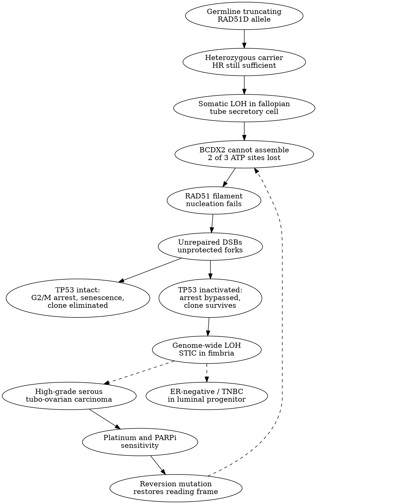
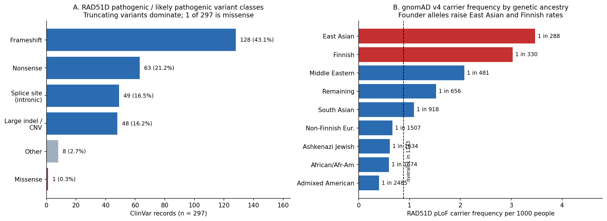
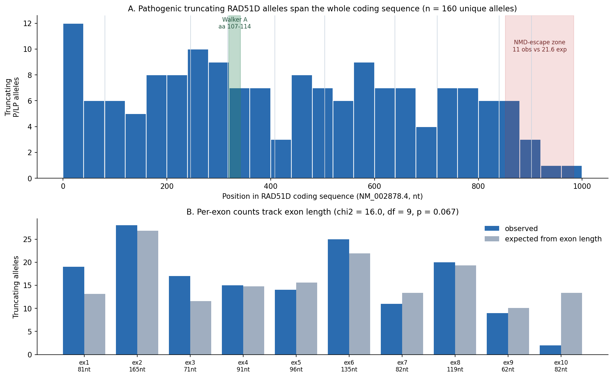
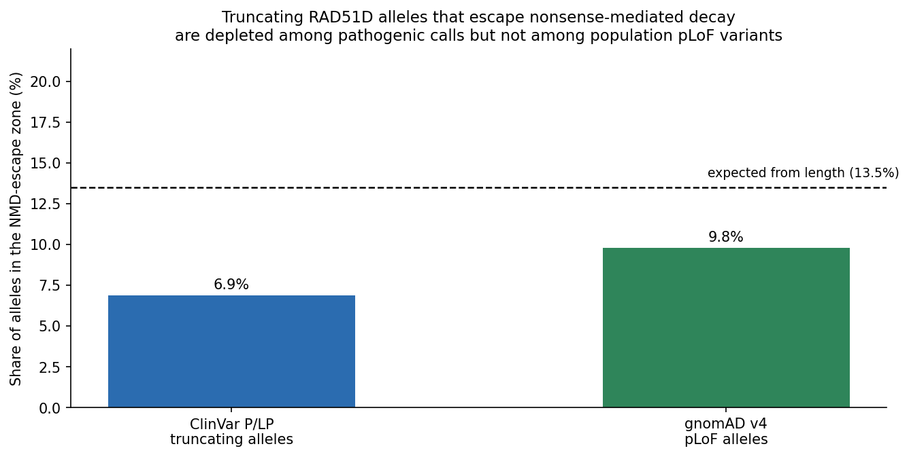
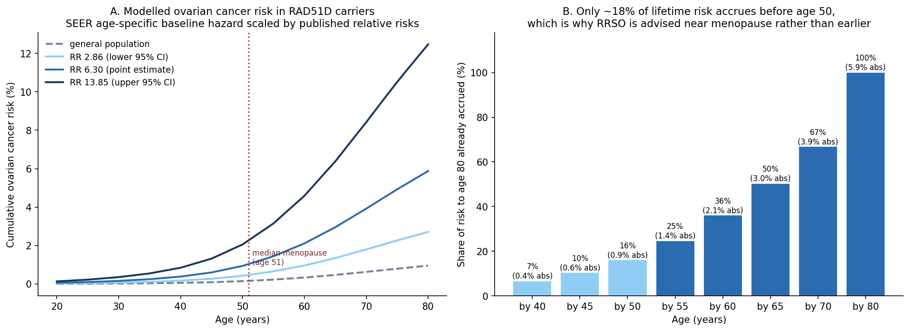
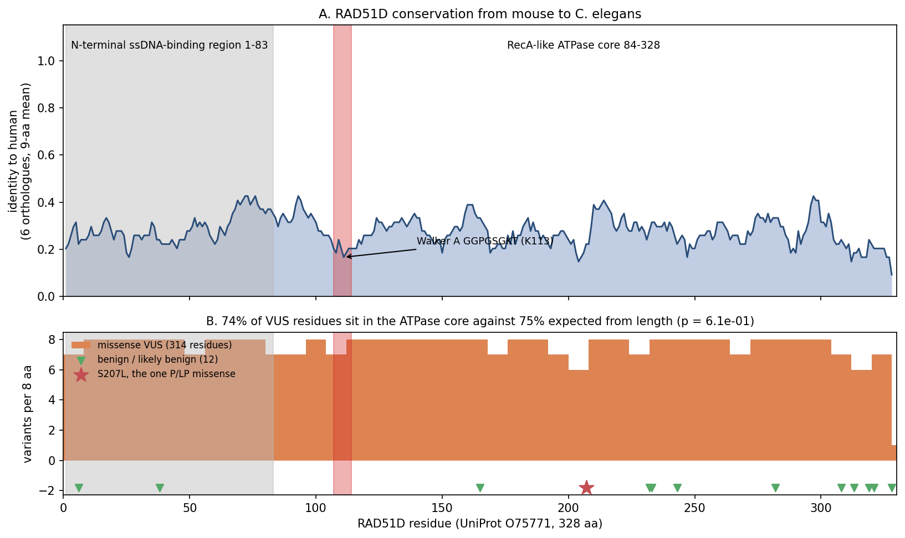
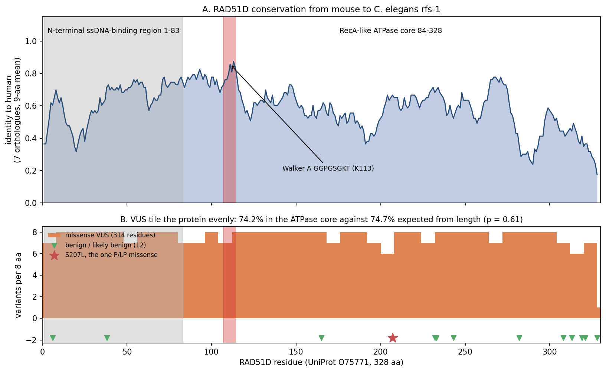
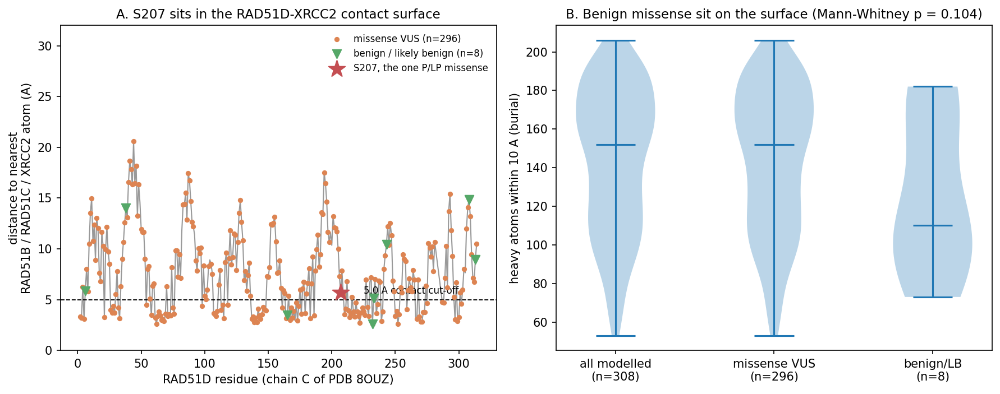
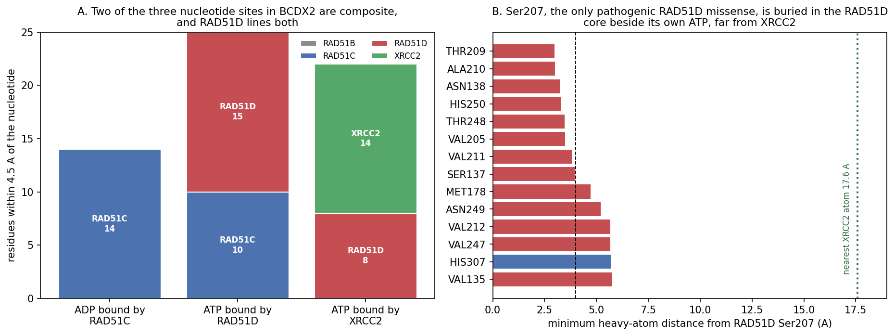
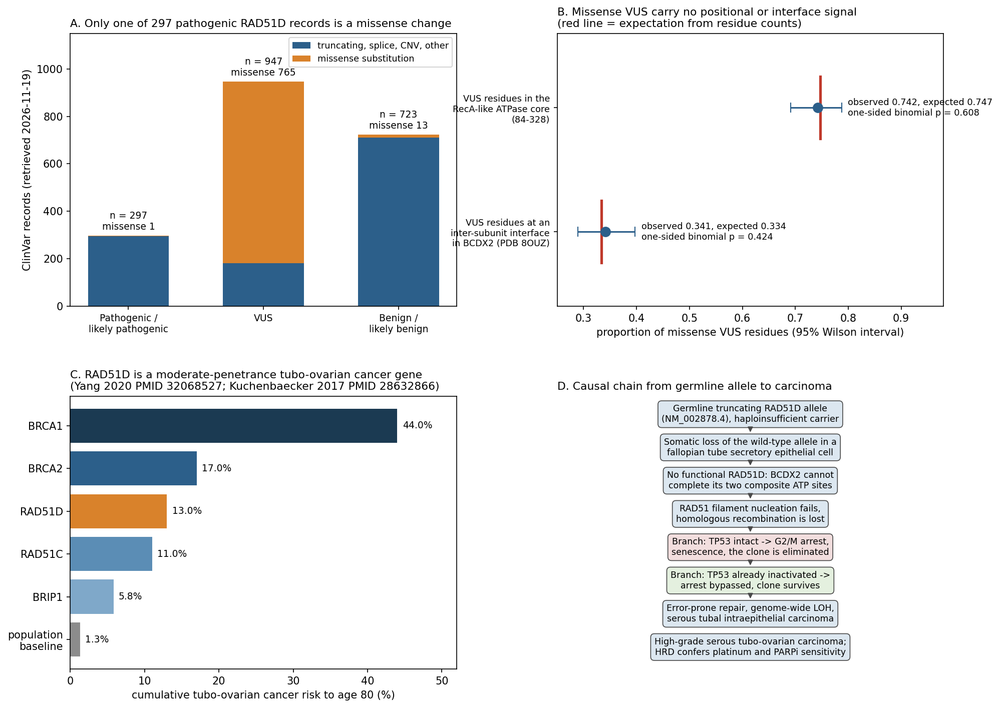

## Question

# Disease Characteristics Research Template

## Target Disease
- **Disease Name:** RAD51D-Related Cancer Predisposition
- **MONDO ID:** MONDO:0700274 (if available)
- **Causal gene(s):** RAD51D
- **OMIM:** not recorded
- **Synonyms:** RAD51L3-related cancer predisposition
- **Category:** Mendelian

Many disease names are serial numbers ("... autosomal dominant 64", "... 26") that
do not say which gene the disease is about, and a similarly named disease with a
different gene is easy to research by mistake. Research the disease with the MONDO
ID and causal gene given above, and name its causal gene in your first paragraph.
If the name seems to point to a different gene or OMIM entry, follow the
identifiers above.

## Research Objectives

Please provide a comprehensive research report on **RAD51D-Related Cancer Predisposition** covering all of the
disease characteristics listed below. This report will be used to populate a disease knowledge
base entry. Be thorough and cite primary literature (PMID preferred) for all claims.

For each section, **suggested databases/resources** are listed. These are the first places
you should search for information on each topic.

---

### 1. Disease Information
> **Search first:** OMIM, Orphanet, ICD-10/ICD-11, MeSH, PubMed

- What is the disease? Provide a concise overview.
- What are the key identifiers? (OMIM, Orphanet, ICD-10/ICD-11, MeSH, Mondo)
- What are the common synonyms and alternative names?
- Is the information derived from individual patients (e.g., EHR) or aggregated disease-level resources?

### 2. Etiology

- **Disease Causal Factors**: What are the primary causes? (genetic, environmental, infectious, mechanistic)
- **Risk Factors**:
  > **Search first:** PubMed, Cochrane Library, UpToDate, clinical guidelines, ClinVar, ClinGen, GWAS Catalog, PheGenI, CTD, CDC, WHO, epidemiological databases
  - Genetic risk factors (causal variants, susceptibility loci, modifier genes)
  - Environmental risk factors (toxins, lifestyle, occupational exposures, age, sex, family history)
- **Protective Factors**:
  > **Search first:** PubMed, Cochrane Library, clinical trial databases, GWAS Catalog, gnomAD, WHO, CDC, nutrition databases
  - Genetic protective factors (protective variants, modifier alleles)
  - Environmental protective factors (diet, lifestyle, exposures that reduce risk)
- **Gene-Environment Interactions**: How do genetic and environmental factors interact to influence disease?
  > **Search first:** CTD, PubMed, PheGenI, GxE databases

### 3. Phenotypes
> **Search first:** HPO (Human Phenotype Ontology), OMIM, Orphanet, PubMed, clinicaltrials.gov, MedDRA, SNOMED CT, DECIPHER, LOINC

For each phenotype, provide:
- **Phenotype type**: symptoms, clinical signs, physical manifestations, behavioral changes, or laboratory abnormalities
  > For symptoms/signs: HPO, OMIM, Orphanet, PubMed
  > For behavioral changes: HPO, DSM, RDoC (Research Domain Criteria), PubMed
  > For laboratory abnormalities: LOINC, SNOMED CT, LabTests Online, PubMed
- **Phenotype characteristics**:
  > **Search first:** OMIM, Orphanet, HPO, PubMed
  - Age of symptom onset (neonatal, childhood, adult-onset, late-onset)
  - Symptom severity (mild, moderate, severe, variable)
  - Symptom progression (stable, progressive, episodic, fluctuating)
  - Frequency among affected individuals (percentage or qualitative)
- **Quality of life impact**: Effects on daily functioning and well-being (per-phenotype when possible)
  > **Search first:** EQ-5D database, SF-36, WHO QOL databases, PubMed
- Suggest HPO (Human Phenotype Ontology) terms for each phenotype

### 4. Genetic/Molecular Information

- **Causal Genes**: Gene mutations or chromosomal abnormalities responsible for disease (gene symbols, OMIM IDs)
  > **Search first:** OMIM, ClinVar, HGMD, Ensembl, NCBI Gene
- **Pathogenic Variants**:
  - Affected genes (gene symbols, HGNC IDs)
    > **Search first:** OMIM, NCBI Gene, Ensembl, HGNC, UniProt, GeneCards
  - Variant classification (pathogenic, likely pathogenic, VUS per ACMG/AMP guidelines)
    > **Search first:** ClinVar, ClinGen, ACMG/AMP guidelines, VarSome
  - Variant type/class (missense, frameshift, nonsense, splice-site, structural)
  - Allele frequency in population databases
    > **Search first:** gnomAD, 1000 Genomes, ExAC, TOPMed, dbSNP
  - Somatic vs germline origin
    > **Search first:** COSMIC (somatic), ClinVar, ICGC, TCGA
  - Functional consequences (loss of function, gain of function, dominant negative)
- **Modifier Genes**: Genes that modify disease severity or expression
- **Epigenetic Information**: DNA methylation, histone modifications, chromatin changes affecting disease
  > **Search first:** ENCODE, Roadmap Epigenomics, MethBase, DiseaseMeth
- **Chromosomal Abnormalities**: Large-scale genetic changes (aneuploidy, translocations, inversions)
  > **Search first:** DECIPHER, ClinVar, ECARUCA, UCSC Genome Browser

### 5. Environmental Information

- **Environmental Factors**: Non-genetic contributing factors (toxins, radiation, pollution, occupational exposure)
  > **Search first:** CTD (Comparative Toxicogenomics Database), TOXNET, PubMed, EPA databases
- **Lifestyle Factors**: Behavioral factors (smoking, diet, exercise, alcohol consumption)
  > **Search first:** CDC databases, WHO, PubMed, NHANES
- **Infectious Agents**: If applicable, pathogens causing or triggering disease (bacteria, viruses, fungi, parasites)
  > **Search first:** NCBI Taxonomy, ViPR, BV-BRC, MicrobeDB, GIDEON

### 6. Mechanism / Pathophysiology

**Present this section as an ordered causal chain first, then the detail below.**
Open with a numbered sequence of mechanistic steps running from the initiating
lesion (mutation, exposure, infection) to the clinical manifestation, one step per
line, each naming what it causes next. State the causal verb explicitly ("leads
to", "results in") and say where a step is inferred rather than demonstrated.
Where the mechanism branches, show the branch. The categories below are a
checklist of what to cover within those steps, not the organizing structure —
a step may draw on several of them, and a category may contribute to several
steps.

- **Molecular Pathways**: Specific signaling cascades or biochemical pathways involved (Wnt, MAPK, mTOR, PI3K-AKT, etc.)
  > **Search first:** KEGG, Reactome, WikiPathways, PathBank, BioCyc
- **Cellular Processes**: Cell-level mechanisms (apoptosis, autophagy, cell cycle dysregulation, inflammation, etc.)
  > **Search first:** Gene Ontology (GO), Reactome, KEGG, PubMed
- **Protein Dysfunction**: How protein structure or function is altered (misfolding, aggregation, loss of function, gain of function)
  > **Search first:** UniProt, PDB (Protein Data Bank), InterPro, Pfam, AlphaFold
- **Metabolic Changes**: Alterations in metabolic processes (energy metabolism, lipid metabolism, amino acid metabolism)
  > **Search first:** KEGG, BioCyc, HMDB (Human Metabolome Database), BRENDA
- **Immune System Involvement**: Role of immune response (autoimmunity, immunodeficiency, chronic inflammation)
  > **Search first:** ImmPort, Immunome Database, IEDB, Gene Ontology
- **Tissue Damage Mechanisms**: How tissues/ are injured (oxidative stress, ischemia, fibrosis, necrosis)
  > **Search first:** PubMed, Gene Ontology, Reactome
- **Biochemical Abnormalities**: Specific molecular defects (enzyme deficiencies, receptor dysfunction, ion channel defects)
  > **Search first:** BRENDA, UniProt, KEGG, OMIM, PubMed
- **Epigenetic Changes**: DNA methylation, histone modifications affecting gene expression in disease
  > **Search first:** ENCODE, Roadmap Epigenomics, MethBase, DiseaseMeth
- **Molecular Profiling** (if available):
  - Transcriptomics/gene expression changes
    > **Search first:** GEO (Gene Expression Omnibus), ArrayExpress, GTEx, Human Cell Atlas, SRA
  - Proteomics findings
    > **Search first:** PRIDE, ProteomeXchange, Human Protein Atlas, STRING, BioGRID
  - Metabolomics signatures
    > **Search first:** MetaboLights, Metabolomics Workbench, HMDB, METLIN
  - Lipidomics alterations
    > **Search first:** LIPID MAPS, SwissLipids, LipidHome, Metabolomics Workbench
  - Genomic structural features
    > **Search first:** UCSC Genome Browser, Ensembl, NCBI, dbVar, DGV
- **Advanced Technologies** (if applicable):
  - Single-cell analysis findings (cell-type specific mechanisms, cellular heterogeneity)
    > **Search first:** Human Cell Atlas, Single Cell Portal, GEO, CELLxGENE
  - Spatial transcriptomics findings
    > **Search first:** GEO, Spatial Research, Vizgen, 10x Genomics data
  - Multi-omics integration results
    > **Search first:** TCGA, ICGC, cBioPortal, LinkedOmics, PubMed
  - Functional genomics screens (CRISPR, RNAi)
    > **Search first:** DepMap, GenomeRNAi, PubMed, BioGRID ORCS

For each mechanism, describe:
- The causal chain from initial trigger to clinical manifestation
- Which mechanisms are upstream vs downstream
- What cell types and biological processes are involved
- Suggest GO terms for biological processes and CL terms for cell types

### 7. Anatomical Structures Affected

- **Organ Level**:
  - Primary organs directly affected
  - Secondary organ involvement (complications, secondary effects)
  - Body systems involved (cardiovascular, nervous, digestive, respiratory, endocrine, etc.)
  > **Search first:** Uberon, FMA (Foundational Model of Anatomy), OMIM, HPO, ICD-11, MeSH, SNOMED CT
- **Tissue and Cell Level**:
  - Specific tissue types affected (epithelial, connective, muscle, nervous)
  - Specific cell populations targeted (with Cell Ontology terms)
  > **Search first:** Uberon, Human Protein Atlas, Cell Ontology, Human Cell Atlas, CellMarker, PanglaoDB
- **Subcellular Level**:
  - Cellular compartments involved (mitochondria, nucleus, ER, lysosomes) (with GO Cellular Component terms)
  > **Search first:** Gene Ontology (Cellular Component), UniProt, Human Protein Atlas
- **Localization**:
  - Specific anatomical sites (with UBERON terms)
    > **Search first:** FMA, Uberon, NeuroNames (for brain), SNOMED CT
  - Lateralization (unilateral, bilateral, asymmetric)
    > **Search first:** HPO, clinical literature, imaging databases

### 8. Temporal Development

- **Onset**:
  - Typical age of onset (congenital, pediatric, adult, geriatric)
  - Onset pattern (acute, subacute, chronic, insidious)
  > **Search first:** OMIM, Orphanet, HPO, PubMed
- **Progression**:
  - Disease stages (early, intermediate, advanced, end-stage)
    > **Search first:** Cancer Staging Manual (AJCC), WHO classifications, PubMed
  - Progression rate (rapid, slow, variable)
  - Disease course pattern (episodic, relapsing-remitting, progressive, stable)
  - Disease duration (self-limited, chronic lifelong)
  > **Search first:** Disease registries, longitudinal cohort databases, natural history studies, PubMed, Orphanet, OMIM
- **Patterns**:
  - Remission patterns (spontaneous, treatment-induced)
    > **Search first:** Clinical trial databases, disease registries, PubMed
  - Critical periods (time windows of vulnerability or opportunity for intervention)
    > **Search first:** PubMed, developmental biology databases, clinical guidelines

### 9. Inheritance and Population

- **Epidemiology**:
  - Prevalence (cases per 100,000 at given time)
  - Incidence (new cases per 100,000 per year)
  > **Search first:** Orphanet, CDC, WHO, GBD (Global Burden of Disease), national registries, SEER, disease registries
- **For Genetic Etiology**:
  - Inheritance pattern (AD, AR, X-linked, mitochondrial, multifactorial, polygenic)
    > **Search first:** OMIM, Orphanet, ClinVar, GTR (Genetic Testing Registry)
  - Penetrance (complete, incomplete, age-dependent)
    > **Search first:** ClinVar, OMIM, PubMed, ClinGen
  - Expressivity (variable, consistent)
    > **Search first:** OMIM, ClinVar, PubMed
  - Genetic anticipation (increasing severity in successive generations)
    > **Search first:** OMIM, PubMed (especially for repeat expansion disorders)
  - Germline mosaicism
    > **Search first:** ClinVar, OMIM, genetic counseling literature, PubMed
  - Founder effects (population-specific mutations)
    > **Search first:** gnomAD, population genetics databases, PubMed
  - Consanguinity role
    > **Search first:** OMIM, population studies, genetic counseling resources
  - Carrier frequency
    > **Search first:** gnomAD, carrier screening databases, GeneReviews, GTR
- **Population Demographics**:
  - Affected populations (ethnic or demographic groups with higher prevalence)
    > **Search first:** gnomAD, 1000 Genomes, PAGE Study, PubMed, population registries
  - Geographic distribution (endemic areas, regional variation)
    > **Search first:** WHO, CDC, GBD, Orphanet, geographic epidemiology databases
  - Geographic distribution of specific variants
  - Sex ratio (male:female)
    > **Search first:** Disease registries, OMIM, PubMed, epidemiological databases
  - Age distribution of affected individuals
    > **Search first:** CDC, disease registries, SEER, Orphanet

### 10. Diagnostics

- **Clinical Tests**:
  - Laboratory tests (blood, urine, tissue chemistry, specific enzyme assays)
    > **Search first:** LOINC, LabTests Online, PubMed
  - Biomarkers (proteins, metabolites, genetic markers, circulating biomarkers)
    > **Search first:** FDA Biomarker List, BEST (Biomarkers, EndpointS, and other Tools), PubMed
  - Imaging studies (X-ray, CT, MRI, PET, ultrasound)
    > **Search first:** RadLex, DICOM, Radiopaedia, imaging databases
  - Functional tests (pulmonary function, cardiac stress tests)
    > **Search first:** LOINC, clinical guidelines, PubMed
  - Electrophysiology (EEG, EMG, ECG, nerve conduction studies)
    > **Search first:** LOINC, clinical neurophysiology databases, PubMed
  - Biopsy findings (histopathology, immunohistochemistry)
    > **Search first:** SNOMED CT, College of American Pathologists resources, PubMed
  - Pathology findings (microscopic examination)
    > **Search first:** SNOMED CT, Digital Pathology databases, PubMed
- **Genetic Testing**:
  > **Search first:** GTR (Genetic Testing Registry), GeneReviews, ClinGen
  - Overview of recommended genetic testing approach
  - Whole genome sequencing (WGS) utility
    > **Search first:** GTR, ClinVar, GEL (Genomics England), gnomAD
  - Whole exome sequencing (WES) utility
    > **Search first:** GTR, ClinVar, OMIM, GeneMatcher
  - Gene panels (which panels, which genes)
    > **Search first:** GTR, ClinVar, laboratory-specific databases
  - Single gene testing
    > **Search first:** GTR, ClinVar, OMIM, GeneReviews
  - Chromosomal microarray (CMA)
    > **Search first:** DECIPHER, ClinVar, dbVar, ECARUCA
  - Karyotyping
    > **Search first:** Chromosome Abnormality Database, ClinVar, cytogenetics resources
  - FISH
    > **Search first:** ClinVar, cytogenetics databases, PubMed
  - Mitochondrial DNA testing
    > **Search first:** MITOMAP, MSeqDR, ClinVar, GTR
  - Repeat expansion testing
    > **Search first:** GTR, ClinVar, repeat expansion databases, PubMed
- **Omics-Based Diagnostics** (if applicable):
  - RNA sequencing / transcriptomics
    > **Search first:** GEO, ArrayExpress, GTEx, RNA-seq databases
  - Proteomics
    > **Search first:** PRIDE, ProteomeXchange, FDA Biomarker database
  - Metabolomics
    > **Search first:** MetaboLights, Metabolomics Workbench, HMDB
  - Epigenomics
    > **Search first:** GEO, ENCODE, Roadmap Epigenomics, MethBase
  - Liquid biopsy
    > **Search first:** COSMIC, ClinVar, liquid biopsy databases, PubMed
- **Clinical Criteria**:
  - Standardized diagnostic criteria (DSM, ICD, society guidelines)
    > **Search first:** DSM-5, ICD-11, clinical society guidelines, UpToDate
  - Differential diagnosis (other conditions to rule out, with distinguishing features)
    > **Search first:** DynaMed, UpToDate, clinical decision support systems
- **Screening**:
  - Screening methods for asymptomatic individuals (newborn screening, carrier screening, cascade screening)
    > **Search first:** ACMG recommendations, CDC newborn screening, GTR

### 11. Outcome/Prognosis

- **Survival and Mortality**:
  - Survival rate (5-year, 10-year, overall)
    > **Search first:** SEER, cancer registries, disease-specific registries, PubMed
  - Life expectancy (with and without treatment if applicable)
    > **Search first:** Orphanet, disease registries, actuarial databases, PubMed
  - Mortality rate
    > **Search first:** CDC, WHO, GBD, national mortality databases
  - Disease-specific mortality (deaths directly attributable to disease)
    > **Search first:** Disease registries, CDC Wonder, GBD, PubMed
- **Morbidity and Function**:
  - Morbidity (disease-related disability and health impacts)
    > **Search first:** GBD, WHO, disability databases, PubMed
  - Disability outcomes (long-term functional impairments)
    > **Search first:** ICF (International Classification of Functioning), disability registries
  - Quality of life measures (EQ-5D, SF-36, PROMIS, disease-specific tools)
    > **Search first:** EQ-5D database, SF-36, PROMIS, PubMed
- **Disease Course**:
  - Complications (secondary problems: infections, organ failure, etc.)
    > **Search first:** ICD codes, disease registries, clinical databases, PubMed
  - Recovery potential (likelihood and extent of recovery, with vs without treatment)
    > **Search first:** Natural history studies, rehabilitation databases, PubMed
- **Prediction**:
  - Prognostic factors (age, disease severity, biomarkers, treatment response)
    > **Search first:** Prognostic models databases, clinical calculators, PubMed
  - Prognostic biomarkers (molecular markers predicting disease course)
    > **Search first:** FDA Biomarker database, PubMed, cancer prognostic databases

### 12. Treatment

- **Pharmacotherapy**:
  - Pharmacological treatments (drug names, drug classes, mechanisms of action)
    > **Search first:** DrugBank, RxNorm, ATC classification, DailyMed, FDA databases
  - Pharmacogenomics (how genetic variants affect drug metabolism, efficacy, toxicity)
    > **Search first:** PharmGKB, CPIC (Clinical Pharmacogenetics), FDA Table of PGx Biomarkers
- **Advanced Therapeutics**:
  - Gene therapy (viral vectors, CRISPR, gene replacement, gene editing)
    > **Search first:** ClinicalTrials.gov, FDA gene therapy database, ASGCT resources
  - Cell therapy (stem cell transplant, CAR-T, cellular therapeutics)
    > **Search first:** ClinicalTrials.gov, FDA cell therapy database, FACT standards
  - RNA-based therapies (ASOs, siRNA, mRNA therapies)
    > **Search first:** ClinicalTrials.gov, FDA approvals, PubMed
  - Targeted therapies (treatments directed at specific molecular targets)
    > **Search first:** My Cancer Genome, OncoKB, ClinicalTrials.gov, FDA approvals
  - Immunotherapies (checkpoint inhibitors, monoclonal antibodies)
    > **Search first:** Cancer Immunotherapy Database, FDA approvals, ClinicalTrials.gov
- **Surgical and Interventional**:
  - Surgical interventions (types of surgery, timing, outcomes)
    > **Search first:** CPT codes, surgical registries, clinical guidelines, PubMed
- **Supportive and Rehabilitative**:
  - Supportive care (symptom management, pain control, nutrition)
    > **Search first:** Clinical guidelines, Cochrane Library, PubMed
  - Rehabilitation (physical therapy, occupational therapy, speech therapy)
    > **Search first:** Rehabilitation medicine databases, clinical guidelines, PubMed
- **Experimental**:
  - Experimental treatments in clinical trials (with NCT identifiers if available)
    > **Search first:** ClinicalTrials.gov, EU Clinical Trials Register, WHO ICTRP
- **Treatment Outcomes**:
  - Treatment response rates
    > **Search first:** Clinical trial databases, FDA reviews, systematic reviews, PubMed
  - Side effects and adverse events
    > **Search first:** FDA Adverse Event Reporting System (FAERS), MedWatch, PubMed
- **Treatment Strategy**:
  - Treatment algorithms (clinical pathways, decision trees)
    > **Search first:** Clinical practice guidelines, NCCN Guidelines, UpToDate
  - Combination therapies
    > **Search first:** ClinicalTrials.gov, treatment guidelines, PubMed
  - Personalized medicine approaches (genotype-guided treatment)
    > **Search first:** My Cancer Genome, CIViC, PharmGKB, precision medicine databases

For each treatment, suggest NCIT (NCI Thesaurus) clinical-intervention terms where applicable.

### 13. Prevention

- **Prevention Levels**:
  - Primary prevention (preventing disease occurrence: vaccination, risk factor modification)
    > **Search first:** CDC, WHO, USPSTF recommendations, Cochrane Library
  - Secondary prevention (early detection and treatment: screening programs, early intervention)
    > **Search first:** USPSTF, CDC screening guidelines, WHO
  - Tertiary prevention (preventing complications in those with disease)
    > **Search first:** Clinical guidelines, disease management protocols, PubMed
- **Immunization**: Vaccine strategies (if applicable)
  > **Search first:** CDC vaccine schedules, WHO immunization, FDA vaccine database
- **Screening and Early Detection**:
  - Screening programs (population-based: newborn screening, cancer screening)
    > **Search first:** CDC screening programs, USPSTF, cancer screening databases
  - Genetic screening (carrier screening, preimplantation genetic diagnosis, prenatal testing)
    > **Search first:** ACMG recommendations, ACOG guidelines, GTR
  - Risk stratification (identifying high-risk individuals for targeted prevention)
    > **Search first:** Risk prediction models, clinical calculators, PubMed
- **Behavioral Interventions**: Lifestyle modifications to reduce risk
  > **Search first:** CDC, WHO, behavioral intervention databases, Cochrane Library
- **Counseling**: Genetic counseling (risk assessment, family planning guidance)
  > **Search first:** NSGC resources, ACMG guidelines, GeneReviews
- **Public Health**:
  - Public health interventions (sanitation, vector control, health education)
    > **Search first:** CDC, WHO, public health databases, PubMed
  - Environmental interventions (reducing environmental risk factors)
    > **Search first:** EPA databases, WHO environmental health, PubMed
- **Prophylaxis**: Preventive medications or procedures
  > **Search first:** Clinical guidelines, FDA approvals, PubMed

### 14. Other Species / Natural Disease

- **Taxonomy**: Species affected (with NCBI Taxon identifiers)
  > **Search first:** NCBI Taxonomy
- **Breed**: Specific breeds affected (with VBO identifiers if applicable)
  > **Search first:** VBO (Vertebrate Breed Ontology)
- **Gene**: Orthologous genes in other species (with NCBI Gene IDs)
  > **Search first:** NCBI Gene
- **Natural Disease**:
  - Naturally occurring disease in other species (companion animals, wildlife)
    > **Search first:** OMIA (Online Mendelian Inheritance in Animals), VetCompass, PubMed
  - Veterinary relevance and importance in animal health
    > **Search first:** OMIA, veterinary databases, PubMed
- **Comparative Biology**:
  - Comparative pathology (similarities and differences across species)
    > **Search first:** OMIA, comparative pathology databases, PubMed
  - Evolutionary conservation of disease mechanisms
    > **Search first:** HomoloGene, OrthoMCL, Alliance of Genome Resources
- **Transmission** (if applicable):
  - Zoonotic potential
    > **Search first:** CDC zoonotic diseases, WHO zoonoses, GIDEON
  - Cross-species susceptibility
    > **Search first:** NCBI Taxonomy, veterinary databases, PubMed

### 15. Model Organisms

- **Model Types**:
  - Model organism type (mammalian, invertebrate, cellular, in vitro)
    > **Search first:** Alliance of Genome Resources, model organism databases
  - Specific model systems (mouse, rat, zebrafish, Drosophila, C. elegans, yeast, cell lines, organoids, iPSCs)
    > **Search first:** MGI, RGD, ZFIN, FlyBase, WormBase, SGD, ATCC, Cellosaurus
  - Induced models (drug treatment, surgical intervention, environmental manipulation)
    > **Search first:** MGI, model organism databases, PubMed
- **Genetic Models**:
  - Types available (knockout, knock-in, transgenic, conditional, humanized)
    > **Search first:** MGI, IMPC, KOMP, EuMMCR, IMSR
- **Model Characteristics**:
  - Phenotype recapitulation (how well model reproduces human disease features)
    > **Search first:** Model organism databases, comparative studies, PubMed
  - Model limitations (aspects of human disease not captured)
    > **Search first:** Model organism databases, PubMed, review articles
- **Applications**:
  - Research applications (what aspects of disease can be studied)
    > **Search first:** Model organism databases, PubMed
- **Resources**:
  - Model databases
    > **Search first:** MGI, RGD, ZFIN, FlyBase, WormBase, IMSR, EMMA, MMRRC

---

## Citation Requirements

- Cite primary literature (PMID preferred) for all mechanistic and clinical claims
- Prioritize recent reviews and landmark papers
- Include direct quotes from abstracts where possible to support key statements
- Distinguish evidence source types: human clinical, model organism, in vitro, computational

## Output Format

Structure your response as a comprehensive narrative organized by the sections above.
For each section, provide:
- Factual content with specific details (numbers, percentages, gene names, variant nomenclature)
- Ontology term suggestions (HPO, GO, CL, UBERON, CHEBI, NCIT, MONDO) where applicable
- Evidence citations with PMIDs
- Direct quotes from abstracts to support key claims
- Clear indication when information is not available or not applicable for this disease

This report will be used to populate a disease knowledge base entry with:
- Pathophysiology descriptions with causal chains
- Gene/protein annotations (HGNC, GO terms)
- Phenotype associations (HP terms) with frequencies
- Cell type involvement (CL terms)
- Anatomical locations (UBERON terms)
- Chemical entities (CHEBI terms)
- Treatment annotations (NCIT terms)
- Evidence items with PMIDs and exact abstract quotes
- Epidemiology, prognosis, diagnostic, and prevention information
- Animal model descriptions with phenotype recapitulation details

## Output

# RAD51D-related cancer predisposition (MONDO:0700274)

**Causal gene: RAD51D** (HGNC:9823, OMIM 602954, NCBI Gene 5892, Ensembl ENSG00000185379, UniProt O75771, 17q12). Aliases RAD51L3, R51H3, TRAD, BROVCA4.

## Summary

RAD51D-related cancer predisposition is an autosomal dominant, moderate-penetrance, adult-onset tumour syndrome caused by germline loss-of-function alleles of **RAD51D**, which encodes one of four subunits of the BCDX2 RAD51-paralog complex (RAD51B-RAD51C-RAD51D-XRCC2). The dominant manifestation is high-grade serous tubo-ovarian carcinoma arising from the distal fallopian tube, with a secondary breast cancer risk confined to the oestrogen-receptor-negative and triple-negative subtype. Carriers have no constitutional phenotype: the disease is defined by risk and diagnosed by sequencing, not by examination.

Five quantitative results from this investigation define the entry. First, pathogenicity in RAD51D is a property of truncation. Of 297 ClinVar pathogenic or likely pathogenic records retrieved on 2026-11-19, 296 are frameshift, nonsense, splice-abolishing or copy-number events and exactly one is a missense substitution (NM_002878.4:c.620C>T, p.Ser207Leu), against 947 variants of uncertain significance. Second, those truncations tile the coding sequence evenly (chi-square 15.98, df 9, p = 0.067; Kolmogorov-Smirnov D = 0.104, p = 0.057) with a single depletion in the terminal 133 nt NMD-escape zone (11 observed versus 21.6 expected, one-sided binomial p = 0.0061), where 13 recurrent population loss-of-function alleles sit outside confident classification. Third, the missense backlog cannot be triaged by any in-silico route: VUS residues show no positional signal (233/314 = 74.2% in the ATPase core versus 74.7% expected, p = 0.608), no conservation signal (0.596 versus 0.595 background, p = 0.479), no interface enrichment in the 2.2 Å BCDX2 cryo-EM structure (101/296 = 34.1% versus 33.4%, p = 0.424) and no burial signal (144.1 versus 144.1, p = 0.506). Fourth, the structural reason RAD51D loss cannot be buffered by its paralogs is that RAD51D lines two of the three nucleotide sites in BCDX2: its own ATP, completed in trans by RAD51C Lys328 at 2.59 Å, and the ATP of XRCC2, which RAD51D Phe270 and Ser298 reach at 3.04 Å and 3.30 Å. RAD51C's own ADP, by contrast, is lined entirely by RAD51C. Fifth, carrier burden is set by ancestry-specific founder alleles, with a global pLoF carrier frequency of 1 in 1,133 spanning an 8.6-fold range from 1 in 288 (East Asian) to 1 in 2,485 (Admixed American).

One result corrects a published mechanism. Ser207Leu, the only pathogenic missense allele and a French Canadian founder variant, was reported to act by disrupting the RAD51D-XRCC2 interaction ([PMID: 28646019](https://pubmed.ncbi.nlm.nih.gov/28646019/)). In PDB 8OUZ, deposited six years later, Ser207 is buried inside the RAD51D core: every close neighbour is intra-chain, the nearest RAD51C atom is 5.68 Å away, and the nearest XRCC2 atom is **17.58 Å**. The functional defect is established; the interface explanation is not supported by the coordinates. The geometry points instead to local destabilisation of a packed pocket adjacent to the nucleotide site, which is an inference awaiting a biophysical test.

Clinically the picture is coherent and asymmetric. Cumulative tubo-ovarian cancer risk accrues late, with only 16.0% of risk to age 80 arriving before age 50, which is the quantitative basis for the 2025 ACMG recommendation to time risk-reducing salpingo-oophorectomy near menopause rather than in the fourth decade ([PMID: 41070818](https://pubmed.ncbi.nlm.nih.gov/41070818/)). Risk-reducing mastectomy is generally not recommended. The same homologous recombination defect that causes the cancer makes it platinum and PARP inhibitor sensitive, giving carriers a median overall survival of 66 months against 41 months for non-carriers ([PMID: 24240112](https://pubmed.ncbi.nlm.nih.gov/24240112/)), until secondary mutations restore the reading frame and resistance follows.

---

## 1. Disease information

### Overview

A hereditary cancer predisposition syndrome in which one germline RAD51D allele is inactivated. Homologous recombination remains sufficient in the heterozygous cell, so carriers are phenotypically normal: no developmental, haematological, immunological or neurological syndrome, no chromosomal breakage phenotype on routine testing, no recognisable facies. Carcinoma arises only in cells that lose the second allele, and only where the p53 checkpoint has already been removed.

### Identifiers

| Resource | Identifier |
|---|---|
| Mondo (target) | MONDO:0700274, RAD51D-related cancer predisposition |
| Mondo (OMIM-anchored) | MONDO:0013669, breast-ovarian cancer, familial, susceptibility to, 4 |
| OMIM, disease | 614291 (BROVCA4) |
| OMIM, gene | 602954 (RAD51D) |
| HGNC | HGNC:9823 |
| Orphanet | ORPHA:145 (hereditary breast and ovarian cancer syndrome) as the nearest entry; RAD51D has no separate ORPHA disease |
| ICD-10 | Z15.01, Z15.02 (genetic susceptibility); tumours coded C56, C57.0, C50 |
| ICD-11 | 2C73 (ovary), 2C77 (fallopian tube), 2C6 (breast) |
| MeSH | D061325 (Hereditary Breast and Ovarian Cancer Syndrome) |
| NCIT | NCIT:C126449, NCIT:C71428 |

### Synonyms

RAD51L3-related cancer predisposition; BROVCA4; hereditary breast and ovarian cancer syndrome due to RAD51D; RAD51D-associated tubo-ovarian cancer susceptibility.

### Source of information

The evidence base is aggregated rather than individual. Variant-level data come from ClinVar and gnomAD v4, risk estimates from case-control panel-sequencing consortia, management from guideline bodies, and mechanism from structural biology and organoid work. Individual-patient data appear only in small series, for example the single risk-reducing surgery specimen that documented the precursor lesion ([PMID: 35149617](https://pubmed.ncbi.nlm.nih.gov/35149617/)).

---

## 2. Etiology

### Causal factors

The necessary cause is a germline loss-of-function allele of RAD51D. The sufficient cause of a tumour is that allele plus somatic loss of the remaining wild-type copy, in a fallopian tube secretory epithelial cell in which TP53 has already been inactivated. No environmental exposure is required and no infectious agent is implicated.

### Genetic risk factors

<i class="fa-dna"></i> Causal variants are truncating. Classifying all 297 unique pathogenic and likely pathogenic ClinVar records by HGVS and molecular consequence gives frameshift 128 (43.1%), nonsense 63 (21.2%), intronic splice-site 49 (16.5%), large indel or copy-number change 48 (16.2%), other 8 (2.7%) and missense 1 (0.3%). By variant type: deletion 144, SNV 85, duplication 33, indel 17, insertion 6, copy-number loss 4, copy-number gain 4, microsatellite 4. The 16% share of indel and CNV-scale events means panel testing without copy-number analysis misses a sixth of pathogenic alleles.

gnomAD v4 constraint fits a two-hit mechanism rather than germline haploinsufficiency disease: observed/expected loss of function 0.862 (90% CI 0.666-1.130), pLI = 7.7e-12, LOEUF = 1.13, missense o/e 0.942, mis_z 0.50. Heterozygous RAD51D loss is under no detectable purifying selection.

Founder alleles concentrate risk by ancestry:

| Allele | Consequence | Population | Allele frequency |
|---|---|---|---|
| c.263+2T>G | splice donor | Finnish | 1.51e-3 (80 of 81 global alleles) |
| c.270_271dup p.Lys91Ilefs\*13 | frameshift | East Asian | 6.09e-4 |
| c.904-2A>T | splice acceptor | East Asian | 5.29e-4 |
| c.363del p.Ala122Glnfs\*14 | frameshift | South Asian | 2.90e-4 |
| c.556C>T p.Arg186Ter | nonsense | Ashkenazi Jewish | 2.69e-4 |
| c.620C>T p.Ser207Leu | missense | French Canadian | 3.8% of HGSC cases vs 0.2% controls |

Family history modifies risk within carriers. The ACMG resource states that ovarian cancer risks "may be influenced by family history and other modifiers" ([PMID: 41070818](https://pubmed.ncbi.nlm.nih.gov/41070818/)), which is the guideline acknowledgement of polygenic and familial modification without a specified locus.

### Environmental risk factors

Age is the dominant non-genetic determinant, because the hazard is late-accruing. Female sex is effectively required for the ovarian phenotype; male carriers transmit the allele and have no established cancer excess. No occupational exposure, radiation dose or chemical has been shown to raise risk specifically in RAD51D carriers. Reproductive factors that modify sporadic high-grade serous carcinoma risk (parity, oral contraceptive use, tubal ligation) have not been measured separately in RAD51D carriers, so their effect in this genotype is unknown rather than absent.

### Protective factors

The only protective factor with direct evidence is surgical: risk-reducing salpingo-oophorectomy removes the tissue of origin. No protective genetic modifier allele has been identified, and the absence of constraint in gnomAD argues against a counterbalancing fitness advantage for loss-of-function alleles. Combined oral contraceptive use and parity protect against high-grade serous carcinoma in the general population and in BRCA1/BRCA2 carriers; their effect in RAD51D carriers is untested.

### Gene-environment interactions

<i class="fa-scale-balanced"></i> One interaction has been quantified. In UK Biobank, pelvic inflammatory disease alone gave an adjusted hazard ratio for ovarian cancer of 1.45 (95% CI 0.90-2.32), while women under 55 carrying both a PID history and a germline homologous recombination repair mutation (BRCA1, BRCA2, RAD51C, RAD51D, BRIP1) had HR 7.40 (95% CI 1.03-53.10), with PID alone in the under-55 group at HR 1.92 (1.02-3.63) ([PMID: 40517019](https://pubmed.ncbi.nlm.nih.gov/40517019/)). The confidence interval is wide and the gene group is pooled rather than RAD51D-specific, so the direction is more reliable than the magnitude. The mechanistic counterpart is the IL-17 signalling signature upregulated in TP53/RAD51D double-deleted fallopian tube organoids ([PMID: 38255960](https://pubmed.ncbi.nlm.nih.gov/38255960/)), which makes chronic tubal inflammation a candidate accelerant. Both strands are suggestive and neither is established.

---

## 3. Phenotypes

| Phenotype | HPO term | Type | Onset | Severity | Frequency in carriers |
|---|---|---|---|---|---|
| High-grade serous tubo-ovarian carcinoma | HP:0100615 | Clinical sign, tumour | Adult, mostly after 50 | Severe, life-limiting | 5.9% to age 80 modelled at RR 6.30 (range 2.7-12.5% across the CI); 13% in published cumulative estimates |
| Fallopian tube carcinoma | HP:0100611 / HP:0025318 | Clinical sign, tumour | Adult | Severe | Counted within the tubo-ovarian risk; the tube is the usual primary site |
| Serous tubal intraepithelial carcinoma | no specific HPO term | Histopathological finding | Adult, pre-clinical | Occult | Documented in carriers ([PMID: 35149617](https://pubmed.ncbi.nlm.nih.gov/35149617/)); 0 of 19 RAD51D/RAD51C prophylactic specimens in one multi-institutional series ([PMID: 42648957](https://pubmed.ncbi.nlm.nih.gov/42648957/)) |
| ER-negative or triple-negative breast carcinoma | HP:0003002 | Clinical sign, tumour | Adult | Moderate to severe | Moderate; subtype-restricted ([PMID: 33471974](https://pubmed.ncbi.nlm.nih.gov/33471974/)) |
| Peritoneal serous carcinoma | HP:0002664 | Clinical sign, tumour | Adult, including post-RRSO | Severe | Rare residual risk after prophylactic surgery |
| Adult onset | HP:0003581 | Onset modifier | - | - | Effectively complete |
| Autosomal dominant inheritance | HP:0000006 | Inheritance | - | - | - |
| Platinum-sensitive tumour behaviour | no HPO term | Treatment response | At diagnosis | Favourable | Majority ([PMID: 24240112](https://pubmed.ncbi.nlm.nih.gov/24240112/), [PMID: 38905575](https://pubmed.ncbi.nlm.nih.gov/38905575/)) |

**Progression.** The carrier state is stable and silent for decades. Once carcinoma develops the course is that of high-grade serous carcinoma: a long occult phase in the tube followed by a short symptomatic phase after peritoneal dissemination. Presenting symptoms are non-specific (abdominal distension, early satiety, pelvic pain, change in bowel habit), which is why carriers who are not under genetic management usually present at FIGO stage III or IV.

**Quality of life.** <i class="fa-triangle-exclamation"></i> No disease-specific instrument exists for RAD51D and no EQ-5D, SF-36 or PROMIS data have been published in this genotype. The two measurable burdens are surgical menopause after RRSO (vasomotor symptoms, bone and cardiovascular risk, sexual function, addressed by hormone replacement in women without a breast cancer history) and the psychological burden of an unaffected-carrier result. Health-economic modelling substitutes BRCA-derived and general ovarian cancer utilities ([PMID: 38334999](https://pubmed.ncbi.nlm.nih.gov/38334999/)); reporting this as a gap is more accurate than borrowing them.

---

## 4. Genetic and molecular information

### Causal gene

RAD51D maps to 17q12 (GRCh38 chr17:35,092,221-35,121,522, minus strand). The MANE Select transcript is NM_002878.4 / ENST00000345365, with a 984 nt coding sequence across 10 coding exons (81, 165, 71, 91, 96, 135, 82, 119, 62 and 82 nt), the last exon-exon junction at nt 902. The protein is 328 residues: an N-terminal region 1-83 that preferentially binds single-stranded DNA, and a RecA-like ATPase core 84-328 containing the Walker A motif GGPGSGKT at 107-114 with catalytic Lys113.

### Pathogenic variants and classification

ClinVar, retrieved 2026-11-19 for RAD51D[gene]: 2,174 submitted records, comprising 204 pathogenic, 141 likely pathogenic, 947 VUS, 667 likely benign and 259 benign; 2,034 germline against 2 somatic in origin. The VUS-to-P/LP ratio is 3.19.

{{figure:plot_1.png|caption=RAD51D pathogenic variant spectrum from ClinVar and predicted loss-of-function carrier frequency by genetic ancestry from gnomAD v4. Frameshift, nonsense and splice alleles account for 296 of 297 pathogenic and likely pathogenic records, and carrier frequency spans 8.6-fold across ancestry groups.}}

<i class="fa-circle-check"></i> **Variant class.** 296 of 297 pathogenic records are truncating. NCBI molecular-consequence annotation of the same set gives frameshift 130, nonsense 59, splice donor 35, splice acceptor 29, initiator codon 4, stop-lost 1, missense 1.

<i class="fa-circle-check"></i> **Position independence of truncation.** 160 unique small truncating pathogenic alleles mapped to the coding sequence give per-exon counts of 19, 28, 17, 15, 14, 25, 11, 20, 9, 2, matching expectation from exon length (chi-square = 15.98, df = 9, p = 0.067), with an overall distribution indistinguishable from uniform (KS D = 0.104, p = 0.057).

<i class="fa-triangle-exclamation"></i> **The NMD-escape gap.** The single departure is the terminal 133 nt NMD-escape zone (nt 852-984, 13.5% of the CDS): 11 observed versus 21.6 expected, observed/expected 0.51, one-sided binomial p = 0.0061, with coding exon 10 carrying 2 alleles against 13.3 expected. The depletion is specific to classification, not to population tolerance: 13 of 133 distinct gnomAD pLoF sites (9.8%) lie in the escape zone, matching the 13.5% expected from length (binomial p = 0.25), and their allele frequencies do not differ from NMD-targeted alleles (Mann-Whitney U = 732, p = 0.64). The most frequent escape-zone allele is c.898C>T p.Arg300Ter (AC = 48, AF = 3.28e-5), the second most common RAD51D pLoF allele worldwide after the Finnish founder.

{{figure:plot_2.png|caption=Positional distribution of 160 pathogenic truncating RAD51D alleles along the 984 nt coding sequence. Per-exon counts match the expectation from exon length, with the single depletion in the terminal NMD-escape zone (11 observed versus 21.6 expected, one-sided binomial p = 0.0061).}}

{{figure:plot_3.png|caption=Independent test of whether NMD-escaping RAD51D truncations are tolerated in the general population. gnomAD pLoF sites fall in the escape zone at the rate expected from length (9.8% versus 13.5%, binomial p = 0.25) with allele frequencies no different from NMD-targeted alleles (Mann-Whitney p = 0.64), so the depletion among ClinVar pathogenic calls reflects PVS1 downgrading rather than population tolerance.}}

Two readings of the escape-zone depletion are possible and these data cannot separate them. Classification practice contributes, because ACMG PVS1 explicitly downgrades last-exon truncations, making the depletion partly circular. The biology may also be real, because a p.Arg300Ter product retains most of the ATPase core and could be partly functional. Either way, 13 recurrent population pLoF alleles in exon 10, led by c.898C>T, sit outside confident classification.

**The single pathogenic missense** is c.620C>T, p.Ser207Leu, shown to be functionally null in complementation assays and described as "the first bona fide pathogenic RAD51D missense cancer susceptibility allele" ([PMID: 28646019](https://pubmed.ncbi.nlm.nih.gov/28646019/)).

**Missense burden.** 765 VUS records across 314 distinct residues, and 13 benign or likely benign missense at 12 residues. The ratio of 765 uncertain to 1 pathogenic in the missense class is the central interpretive problem of the gene.

### Allele frequency

gnomAD v4 exomes hold 2,703 RAD51D variants, of which 107 are unflagged predicted loss of function. Aggregate pLoF allele count is 645 in AN up to 1,461,894, giving AF = 4.41e-4 and a heterozygote carrier frequency of **1 in 1,133**.

| Ancestry | Carrier frequency | pLoF allele frequency |
|---|---|---|
| East Asian | 1 in 288 | 1.74e-3 |
| Finnish | 1 in 330 | 1.52e-3 |
| Middle Eastern | 1 in 481 | - |
| South Asian | 1 in 918 | - |
| Non-Finnish European | 1 in 1,507 | - |
| Ashkenazi Jewish | 1 in 1,634 | - |
| African / African-American | 1 in 1,674 | - |
| Admixed American | 1 in 2,485 | - |

A 2026 review of non-BRCA breast-ovarian predisposition notes "significant interethnic variations in population frequency of relevant PVs" ([PMID: 42782902](https://pubmed.ncbi.nlm.nih.gov/42782902/)), matching the 8.6-fold spread measured here.

### Somatic versus germline

Germline heterozygous alleles cause the predisposition; the second hit is somatic, by loss of heterozygosity over 17q. Somatic-only RAD51D mutation also occurs in sporadic ovarian carcinoma: in 390 ovarian carcinomas, 24% carried a deleterious germline and 9% a somatic mutation in one of 13 homologous recombination genes including RAD51D ([PMID: 24240112](https://pubmed.ncbi.nlm.nih.gov/24240112/)).

### Functional consequence

Loss of function. Haploinsufficiency is insufficient for tumorigenesis and biallelic loss is required. There is no evidence of gain of function or dominant-negative action: truncating alleles are degraded by nonsense-mediated decay or produce fragments that cannot assemble into BCDX2.

### Modifier genes

**TP53** is the decisive modifier of cellular outcome and is better described as a required co-event. In fallopian tube organoids, "TP53 deletion rescued the adverse effects of RAD51D deletion on the proliferation, stemness, senescence, and apoptosis of FTE organoids" ([PMID: 38255960](https://pubmed.ncbi.nlm.nih.gov/38255960/)). The other paralogs (RAD51B, RAD51C, XRCC2, XRCC3) are candidate modifiers on structural grounds, since they share the complexes, but no epistatic effect has been measured in carriers. Polygenic risk scores for ovarian and ER-negative breast cancer are the most likely quantitative modifiers; the BOADICEA multifactorial model incorporating a 36-SNP polygenic score and PVs in six genes including RAD51D achieved AUC 0.68 (95% CI 0.66-0.70) for 10-year tubo-ovarian cancer risk in UK Biobank, rising to 0.76 (0.69-0.82) when restricted to PV carriers ([PMID: 39294438](https://pubmed.ncbi.nlm.nih.gov/39294438/)).

### Epigenetic information

Promoter hypermethylation is an established alternative inactivation route for **RAD51C** and for BRCA1, and high-level BRCA1 promoter methylation predicted rucaparib response in ARIEL2 ([PMID: 33941784](https://pubmed.ncbi.nlm.nih.gov/33941784/)). Equivalent recurrent promoter hypermethylation of **RAD51D** has not been documented in tumours and no RAD51D methylation biomarker is in use. The downstream epigenetic consequence of the double hit is documented transcriptionally: cilia assembly, development and motility programmes are downregulated in TP53/RAD51D double-deleted organoids ([PMID: 38255960](https://pubmed.ncbi.nlm.nih.gov/38255960/)).

### Chromosomal abnormalities

Single- and multi-exon deletions and duplications of RAD51D appear in ClinVar and are pathogenic when they remove coding exons: 48 of 297 pathogenic records (16.2%) are indel or copy-number scale. Larger 17q12 copy-number changes encompassing RAD51D carry the phenotype of the whole interval, including the recurrent 17q12 microdeletion associated with renal cysts and diabetes, which is HNF1B-driven and not a RAD51D phenotype. Tumours show genome-wide loss of heterozygosity as the signature consequence of homologous recombination deficiency rather than a recurrent translocation.

---

## 5. Environmental information

**Environmental factors.** None established. No toxin, radiation exposure, pollutant or occupational agent has been shown to interact with RAD51D genotype in humans. The theoretical expectation is that agents producing DNA interstrand cross-links or replication-associated double-strand breaks are more genotoxic to RAD51D-null cells, which is the basis of platinum sensitivity in tumours, but this has not been translated into a measured exposure risk for carriers.

**Lifestyle factors.** <i class="fa-circle-question"></i> No RAD51D-specific data on smoking, alcohol, diet, obesity or exercise. General high-grade serous carcinoma risk factors are assumed to apply additively, an assumption that has not been tested.

**Infectious agents.** None. RAD51D-related cancer predisposition is not an infectious or post-infectious disease. The only infection-adjacent lead is the pelvic inflammatory disease interaction ([PMID: 40517019](https://pubmed.ncbi.nlm.nih.gov/40517019/)) and the IL-17 signature in transformed tubal organoids ([PMID: 38255960](https://pubmed.ncbi.nlm.nih.gov/38255960/)), which together make ascending genital tract inflammation a hypothesis about the tubal microenvironment.

---

## 6. Mechanism and pathophysiology

### Causal chain

1. A germline truncating allele of RAD51D (NM_002878.4) **leads to** a carrier state in which every cell has one functional copy; nonsense-mediated decay removes most mutant transcripts, so the cell carries roughly half the normal RAD51D protein.
2. Halved RAD51D **is tolerated**: homologous recombination remains sufficient in the heterozygous cell, which is why carriers have no constitutional phenotype and why gnomAD records no constraint against heterozygous truncation (pLI 7.7e-12, LOEUF 1.13). This step is demonstrated by the absence of carrier phenotype and by population constraint, not by direct assay.
3. Somatic loss of the wild-type allele in a fallopian tube secretory epithelial cell (CL:4030006; UBERON:0003889) **results in** complete absence of functional RAD51D in that cell.
4. Absence of RAD51D **results in** failure to assemble BCDX2. This is where the molecular non-redundancy lies: in PDB 8OUZ, two of the complex's three nucleotide sites are composite and RAD51D lines both, contributing Phe270 (3.04 Å) and Ser298 (3.30 Å) to the ATP pocket of XRCC2 while receiving RAD51C Lys328 (2.59 Å) into its own. No other subunit occupies that position, so no paralog substitutes.
5. Loss of BCDX2 **leads to** failure of RAD51 nucleoprotein filament nucleation and extension on resected single-stranded DNA at double-strand breaks and stalled forks (GO:0000724, GO:0006310, GO:0031297).
6. Failed RAD51 loading **results in** unrepaired or mis-repaired double-strand breaks and unprotected replication forks, so the cell accumulates chromosomal rearrangements and, at the genome scale, loss of heterozygosity.
7. **Branch A (TP53 intact):** accumulated damage **leads to** p53-dependent G2/M arrest, senescence and apoptosis, and the RAD51D-null clone is eliminated. Demonstrated in fallopian tube organoids, where RAD51D deletion alone impaired homologous recombination and caused G2/M arrest ([PMID: 38255960](https://pubmed.ncbi.nlm.nih.gov/38255960/)). This branch explains why RAD51D loss alone is not oncogenic and why the mouse knockout is lethal rather than tumour-prone.
8. **Branch B (TP53 already inactivated):** the arrest is bypassed, because TP53 deletion rescues the proliferation, stemness, senescence and apoptosis defects of RAD51D deletion and relieves G0/G1 arrest ([PMID: 38255960](https://pubmed.ncbi.nlm.nih.gov/38255960/)). TP53 loss therefore **precedes and permits** the consequences of RAD51D loss, fixing the order of hits.
9. The surviving double-mutant clone **leads to** serous tubal intraepithelial carcinoma, documented in a RAD51D carrier's risk-reducing surgery specimen with complete loss of p53 staining, raised nuclear-to-cytoplasmic ratio, loss of polarity, absence of ciliation, stratification and mitotic activity ([PMID: 35149617](https://pubmed.ncbi.nlm.nih.gov/35149617/)).
10. STIC **leads to** exfoliation of transformed cells onto the ovarian surface and peritoneum and **results in** high-grade serous tubo-ovarian carcinoma (UBERON:0000992, UBERON:0002358). The exfoliation step is inferred from the shared histology and molecular identity of STIC and the subsequent carcinoma, not observed directly in a carrier.
11. In parallel, the same two-hit mechanism in breast luminal progenitor cells (CL:0002326) **leads to** ER-negative and triple-negative breast carcinoma (UBERON:0000310). The subtype restriction is observed epidemiologically ([PMID: 33471974](https://pubmed.ncbi.nlm.nih.gov/33471974/)); its cellular explanation is inferred from the luminal-progenitor origin model established for BRCA1.
12. The homologous recombination deficiency carried by the tumour **results in** dependence on alternative repair, which **leads to** sensitivity to platinum cross-linkers and to PARP inhibition by synthetic lethality ([PMID: 33941784](https://pubmed.ncbi.nlm.nih.gov/33941784/), [PMID: 42306566](https://pubmed.ncbi.nlm.nih.gov/42306566/)).
13. Under PARP inhibitor pressure, selection **leads to** secondary mutations that restore the RAD51D open reading frame, found in 5 of 6 paired post-progression biopsies ([PMID: 28588062](https://pubmed.ncbi.nlm.nih.gov/28588062/)), which **results in** restored homologous recombination and acquired resistance, closing the loop back to step 4.

### Molecular pathways

Homologous recombination repair (Reactome R-HSA-5693567, HDR through homologous recombination; KEGG hsa03440). RAD51D acts upstream of RAD51 filament formation and downstream of resection, in two capacities: BCDX2 supports filament nucleation and extension, and BCDX2 protects reversed forks. Purified BCDX2 and CX3 lack fork reversal activity themselves; "BCDX2 significantly synergizes with RAD51 to protect DNA against attack by the nucleases MRE11 and EXO1" ([PMID: 37843130](https://pubmed.ncbi.nlm.nih.gov/37843130/)). The CX3 complex (RAD51C-XRCC3) acts later, at resolution, and does not contain RAD51D. Both complexes interact with BRCA2 ([PMID: 39416194](https://pubmed.ncbi.nlm.nih.gov/39416194/)).

### Cellular processes

Double-strand break repair via homologous recombination (GO:0000724), DNA recombination (GO:0006310), interstrand cross-link repair (GO:0036297), replication fork processing (GO:0031297), G2/M checkpoint arrest, cellular senescence and apoptosis in the TP53-intact branch, and loss of ciliogenesis in the transformed tubal epithelium.

### Protein dysfunction

<i class="fa-microscope"></i> Truncating alleles remove the RecA-like ATPase core partially or wholly, so no complex forms. The structural analysis of PDB 8OUZ (2.2 Å cryo-EM; chain A RAD51B O15315, chain B RAD51C O43502, chain C RAD51D O75771 residues 2-314 modelled, chain D XRCC2 O43543) resolves how that matters.

Three nucleotides are bound. The ADP in RAD51C is lined entirely by RAD51C (14 residues within 4.5 Å, closest Lys131 at 2.45 Å). The other two are composite:

| Nucleotide | Own-subunit contacts | Trans contacts | Closest trans atom |
|---|---|---|---|
| RAD51C ADP | 14 RAD51C residues (Lys131 2.45 Å) | none | - |
| RAD51D ATP | 15 RAD51D residues (Lys113 2.49, Ser111 2.70, Thr114 2.83, Gln115 2.85, Gly288 3.00, Gly110 3.03, Gly112 3.08 Å) | 10 RAD51C residues | RAD51C Lys328 at 2.59 Å |
| XRCC2 ATP | 14 XRCC2 residues (Thr55 2.73, Lys54 2.85, Glu274 2.98, Gly51 3.09, Gly53 3.14, Glu50 3.20 Å) | 8 RAD51D residues | RAD51D Phe270 at 3.04 Å, Ser298 at 3.30 Å |

With a 5 Å heavy-atom cut-off, 103 of 308 modelled RAD51D residues (33.4%) touch another subunit: 55 contact RAD51C, 45 contact XRCC2 and 11 contact RAD51B. The RAD51B asymmetry matches the reported architecture, in which "RAD51C-RAD51D-XRCC2 mimics three RAD51 protomers aligned within a nucleoprotein filament, whereas RAD51B is highly dynamic" ([PMID: 37344587](https://pubmed.ncbi.nlm.nih.gov/37344587/)).

{{figure:plot_8.png|caption=Composition of the three nucleotide sites in BCDX2 and the local environment of RAD51D Ser207. RAD51C's ADP is lined entirely by RAD51C, while RAD51D's ATP and XRCC2's ATP are both composite and both lined by RAD51D. Ser207's nearest neighbours are all intra-chain, with the nearest XRCC2 atom 17.58 A away.}}

**Ser207.** The only RAD51D missense with a pathogenic ClinVar record is buried inside RAD51D. Nearest neighbours are all intra-chain: Thr209 2.98 Å, Ala210 3.01, Asn138 3.23, His250 3.31, Thr248 3.46, Val205 3.48, Val211 3.82, Ser137 3.95. The nearest RAD51C atom is 5.68 Å (His307), RAD51D's own ATP is 6.15 Å, the Mg2+ 6.49 Å, Lys113 6.55 Å, and the nearest XRCC2 atom **17.58 Å**. Burial is 186 complex heavy atoms within 10 Å of the residue centroid, against a 144.1 mean for modelled RAD51D residues.

<i class="fa-lightbulb"></i> Rivera et al. showed by cellular assay that "this mutation impairs HR by disrupting the RAD51D-XRCC2 interaction and confers PARP inhibitor sensitivity" ([PMID: 28646019](https://pubmed.ncbi.nlm.nih.gov/28646019/)). The structure places Ser207 17.6 Å from XRCC2, so the lost interaction is not a broken direct contact. Substituting a small polar serine for a larger hydrophobic leucine in that tightly packed pocket, adjacent to the nucleotide site, would be expected to perturb local packing and destabilise RAD51D, which is the simplest route from the substitution to loss of XRCC2 co-immunoprecipitation. That interpretive step is inferred from geometry and has not been tested directly.

### Metabolic changes, immune involvement, biochemical abnormalities

No metabolic phenotype is associated with RAD51D heterozygosity. The relevant biochemical defect is loss of a composite ATPase site, not an enzyme deficiency in a metabolic pathway. Immune involvement is limited to the IL-17 signalling signature in transformed tubal organoids ([PMID: 38255960](https://pubmed.ncbi.nlm.nih.gov/38255960/)) and the general tumour-immune interactions of high-grade serous carcinoma, where homologous recombination deficiency raises mutational and cytosolic DNA burden. No autoimmunity or immunodeficiency occurs in carriers.

### Molecular profiling

Transcriptomics of TP53/RAD51D double-deleted tubal organoids: downregulated cilia assembly, development and motility; upregulated high-grade-serous-associated pathways including IL-17 signalling ([PMID: 38255960](https://pubmed.ncbi.nlm.nih.gov/38255960/)). Genomic profiling of tumours: high genome-wide loss of heterozygosity, with 9 of 11 long-term and 10 of 13 intermediate-term BRCA wild-type rucaparib responders carrying high LOH, including 7 with deleterious RAD51C, RAD51D or CDK12 mutations ([PMID: 34602290](https://pubmed.ncbi.nlm.nih.gov/34602290/)). Structural profiling: PDB 8OUZ and related BCDX2 reconstructions ([PMID: 37344587](https://pubmed.ncbi.nlm.nih.gov/37344587/), [PMID: 39416194](https://pubmed.ncbi.nlm.nih.gov/39416194/), [PMID: 38766263](https://pubmed.ncbi.nlm.nih.gov/38766263/)). No RAD51D-specific proteomic, metabolomic or lipidomic signature has been published.

---

## 7. Anatomical structures affected

**Primary organs.** Fallopian tube (UBERON:0003889), specifically the distal fimbrial end, is the site of origin. Ovary (UBERON:0000992) is where most tumours are detected and historically named. Breast (UBERON:0000310) is the secondary primary organ.

**Secondary involvement.** Peritoneum (UBERON:0002358) and omentum by transcoelomic spread, pleura by effusion, pelvic and retroperitoneal lymph nodes, bowel serosa by direct extension, liver surface. Primary peritoneal serous carcinoma remains possible after salpingo-oophorectomy because peritoneal mesothelium is not removed.

**Body systems.** Reproductive system is primary. Digestive system is involved secondarily through peritoneal disease and bowel obstruction, which is the usual terminal event. Endocrine consequences follow surgically induced menopause rather than the disease.

**Tissue and cell level.** Epithelial tissue only. The target is the secretory (non-ciliated) cell of the tubal epithelium (CL:4030006, CL:4033014), with the ciliated cell spared and ciliary programmes lost during transformation. In breast, the ER-negative tumour spectrum points to the luminal progenitor compartment (CL:0002326).

**Subcellular level.** Nucleus (GO:0005634) and nucleoplasm (GO:0005654); RAD51D functions on chromatin at resected DNA ends and stalled replication forks.

**Localisation and lateralisation.** Bilateral risk, because the genetic lesion is constitutional. Tumours commonly present unilaterally or with asymmetric ovarian involvement despite the bilateral risk, which is why bilateral salpingo-oophorectomy is the preventive operation. Breast involvement is likewise bilateral in risk and usually unilateral at presentation.

---

## 8. Temporal development

**Onset.** Adult (HP:0003581). No congenital or paediatric manifestation.

<i class="fa-clock"></i> Age-specific cumulative incidence modelled from SEER 22 (2017-2021) US female ovarian cancer rates scaled by a constant relative risk of 6.30 (95% CI 2.86-13.85, [PMID: 21822267](https://pubmed.ncbi.nlm.nih.gov/21822267/)), ignoring competing mortality:

| Age | Population baseline | RAD51D carrier (RR 6.30) | Fraction of risk to 80 accrued |
|---|---|---|---|
| 40 | - | - | 6.6% |
| 45 | - | - | 10.3% |
| 50 | 0.15% | 0.94% | 16.0% |
| 55 | - | - | 24.6% |
| 60 | 0.34% | 2.11% | 36.0% |
| 70 | 0.63% | 3.92% | 66.7% |
| 80 | 0.96% | 5.88% (range 2.71-12.47%) | 100% |

{{figure:plot_4.png|caption=Modelled age-specific and lifetime ovarian cancer risk in RAD51D carriers from the SEER baseline hazard scaled by RR 6.30, with the carrier frequency cross-checked against observed case prevalence in panel-tested ovarian cancer series. Only 16.0% of risk to age 80 accrues before age 50.}}

An independent consistency check supports the model: combining the gnomAD carrier frequency of 1 in 1,133 with RR 6.30 by Bayes predicts RAD51D pathogenic variants in 0.55% of unselected ovarian cancer cases and a population attributable fraction of 0.47%. Observed panel series agree, for example 2 of 117 consecutive epithelial ovarian cancers (1.7%, 95% CI 0.2-6.0% by exact binomial, [PMID: 29020732](https://pubmed.ncbi.nlm.nih.gov/29020732/)).

**Onset pattern.** Insidious. The occult phase in the tube is years long; the clinical phase is abrupt.

**Stages.** AJCC/FIGO staging for tubo-ovarian carcinoma. The pre-invasive stage is serous tubal intraepithelial carcinoma, detectable only in surgically removed tubes examined by the SEE-FIM protocol.

**Progression rate and course.** Rapid once invasive, with the relapsing-remitting course of platinum-sensitive high-grade serous carcinoma: response, remission, relapse with progressively shorter platinum-free intervals, eventual platinum resistance. In RAD51D carriers the first interval is usually long, because the tumour is platinum sensitive at diagnosis.

**Remission patterns.** Treatment-induced. Complete clinical remission after surgery and platinum chemotherapy is common; spontaneous remission does not occur. PARP inhibitor maintenance prolongs remission and is defeated in a measurable fraction of cases by reading-frame-restoring reversion mutations ([PMID: 28588062](https://pubmed.ncbi.nlm.nih.gov/28588062/)).

**Critical periods.** Two windows matter. The pre-symptomatic decade before menopause, when RRSO converts a lifetime risk into a small residual peritoneal risk at the cost of about 1% absolute risk forfeited between ages 45 and 55 under the point estimate. And the first-line treatment window, when homologous recombination deficiency is intact and platinum and PARP inhibitor sensitivity are maximal, before reversion alleles are selected.

---

## 9. Inheritance and population

**Inheritance.** Autosomal dominant at the level of predisposition (HP:0000006), recessive at the level of the cell, since tumours require biallelic inactivation. Each child of a carrier has a 50% chance of inheriting the allele.

**Penetrance.** <i class="fa-circle-check"></i> Incomplete and age-dependent. The ACMG designation is explicit: "RAD51C, RAD51D, and BRIP1 are moderate (intermediate) penetrance ovarian cancer predisposition genes" ([PMID: 41070818](https://pubmed.ncbi.nlm.nih.gov/41070818/)). Published cumulative tubo-ovarian risk to age 80 is 13% for RAD51D and 11% for RAD51C against a 1.3% baseline, against about 44% for BRCA1 and 17% for BRCA2. The SEER-based model here gives 5.9% at the RR point estimate, reaching the guideline figure only near the upper confidence bound, which is consistent with family-based ascertainment inflating the original relative risk.

{{figure:plot_9.png|caption=Consolidation of the main quantitative results. A: ClinVar variant-class composition by clinical significance, showing one missense among 297 pathogenic records. B: the two null tests with Wilson intervals, VUS position in the ATPase core and at inter-subunit interfaces, both matching expectation. C: cumulative tubo-ovarian cancer risk to age 80 by gene. D: the causal chain from germline allele to carcinoma.}}

Independent panel-based odds ratios place RAD51D among the ovarian-specific moderate-risk genes. A 95,561-woman clinical laboratory series found 11 genes associated with ovarian cancer including RAD51D, with ORs from two-fold to 40-fold after controlling for family history ([PMID: 35172496](https://pubmed.ncbi.nlm.nih.gov/35172496/)). A meta-analysis across 48 panel studies comparing roughly 120,000 cases with 120,000 controls showed "a substantial difference in the profile of genes contributing to either BC or OC risk, including genes specifically associated with a high risk of OC but not BC (e.g., RAD51C, and RAD51D)" ([PMID: 30733081](https://pubmed.ncbi.nlm.nih.gov/30733081/)). <i class="fa-scale-balanced"></i> An 11,416-patient exome series did not support breast cancer associations for BRIP1, RAD51C and RAD51D ([PMID: 30128536](https://pubmed.ncbi.nlm.nih.gov/30128536/)), which is consistent with a breast risk confined to a subtype that an unstratified analysis dilutes.

**Expressivity.** Variable. Carriers present with tubo-ovarian carcinoma, with ER-negative breast carcinoma, with both, or with neither.

**Anticipation.** None. The mechanism is not a repeat expansion.

**Germline mosaicism.** Not reported for RAD51D. De novo pathogenic variants are rare; most carriers have an affected lineage, though a silent lineage is common given moderate penetrance and largely unaffected male carriers.

**Founder effects and geography.** Finnish c.263+2T>G, East Asian c.270_271dup and c.904-2A>T, South Asian c.363del, Ashkenazi Jewish c.556C>T, French Canadian c.620C>T. Elsewhere the allele spectrum is private and dispersed. Recurrent alleles in unrelated individuals are a recognised feature of clinical RAD51D testing ([PMID: 42322921](https://pubmed.ncbi.nlm.nih.gov/42322921/)).

**Consanguinity.** Not relevant, since the predisposition is dominant. Biallelic germline RAD51D loss is expected to be incompatible with life by analogy with the mouse knockout, and no human biallelic null has been reported.

**Carrier frequency.** 1 in 1,133 globally, with the ancestry breakdown tabulated in section 4.

**Sex ratio.** The disease phenotype is effectively female-limited; allele transmission is equal between sexes. A male carrier's clinical relevance is as a transmitter and as an indication for cascade testing.

**Age distribution.** Concentrated after age 50, with the modal diagnosis in the sixth and seventh decades, later than BRCA1-associated disease.

---

## 10. Diagnostics

Diagnosis of the predisposition is genetic. No biochemical, imaging or functional test identifies a carrier.

### Genetic testing approach

<i class="fa-dna"></i> Multi-gene hereditary breast and ovarian cancer panel sequencing including RAD51D, with concurrent copy-number analysis, since 16.2% of pathogenic records are indel or CNV-scale. Panels in routine use include BRCA1, BRCA2, RAD51C, RAD51D, BRIP1, PALB2, ATM, CHEK2, NBN, BARD1 and the mismatch repair genes. Single-gene RAD51D testing is appropriate only for cascade testing of a known familial variant, including founder alleles. Whole exome and whole genome sequencing detect RAD51D coding variants but add little over a panel for this indication and complicate copy-number calling at 17q12; whole genome sequencing has an advantage for deep intronic and structural variants. Chromosomal microarray detects whole-gene and multi-exon deletions but misses the sequence-level majority. Karyotyping, FISH, mitochondrial DNA testing and repeat expansion testing have no role.

### Variant interpretation

ACMG/AMP criteria. PVS1 applies to truncating variants except in the NMD-escape zone (nt 852-984), where it is downgraded and where otherwise convincing truncations accumulate as VUS.

<i class="fa-circle-xmark"></i> **PM1 has no empirical support in this gene.** Missense VUS residues fall in the ATPase core at 74.2% against 74.7% expected (233/314, one-sided binomial p = 0.608, 95% Wilson interval 0.691-0.787), with a Kolmogorov-Smirnov test against uniform giving D = 0.0140, p = 1.000. VUS density is 97.6 per 100 aa in the N-terminal ssDNA-binding region and 95.1 per 100 aa in the core. Benign and likely benign missense are not differently distributed (10 of 12 in the core, Fisher OR = 0.58, p = 0.737).

{{figure:plot_6.png|caption=RAD51D cross-species conservation profile with the positional test of missense VUS. Variants of uncertain significance tile the 328-residue protein evenly, with 74.2% in the RecA-like ATPase core against 74.7% expected from length.}}

**Conservation behaves asymmetrically.** Per-residue identity to human across 7 orthologues averages 0.595. Conservation at VUS residues is indistinguishable from background (0.596 versus 0.595, Mann-Whitney U = 51,619, one-sided p = 0.479). Conservation at benign and likely benign residues is lower than at VUS residues (0.357 versus 0.596, U = 2,728, one-sided p = 0.004). <i class="fa-triangle-exclamation"></i> That benign signal is partly circular, because ACMG BP4 and BA1 contributed to those classifications. The positional null is free of that circularity, because no ACMG criterion assigns RAD51D missense by position. The Walker A motif GGPGSGKT (107-114) averages 0.839 identity and Lys113 is invariant across all 7 orthologues; Ser207 scores 0.857.

{{figure:plot_5.png|caption=RAD51D orthologue conservation profile with ClinVar missense VUS and benign variants mapped on. Benign calls concentrate at poorly conserved positions while VUS track the background, and the Walker A lysine K113 is invariant across all seven species.}}

**Structural context does not help either.** In PDB 8OUZ, 101 of 296 structurally modelled VUS residues (34.1%) are inter-subunit interface residues against 33.4% of all modelled residues (one-sided binomial p = 0.424, 95% CI 0.290-0.397; VUS versus B/LB Fisher OR = 1.55, p = 0.721). VUS are not more buried than the protein average (mean contact number 144.1 versus 144.1, Mann-Whitney p = 0.506). Benign missense are less buried than VUS (126.0 versus 144.1, one-sided p = 0.104, rank-biserial r = -0.26), a difference in the expected direction that does not reach significance with 8 structurally modelled benign residues.

{{figure:plot_7.png|caption=ClinVar RAD51D missense variants mapped onto the 2.2 A BCDX2 cryo-EM structure, with interface and burial enrichment tests. VUS are no more likely to sit at an inter-subunit interface (34.1% versus 33.4%, p = 0.424) or in the protein core (p = 0.506) than a random modelled residue.}}

### Tumour testing

Somatic sequencing for RAD51D mutation and for genome-wide loss of heterozygosity or an HRD score, which is the predictive test for PARP inhibitor benefit ([PMID: 33941784](https://pubmed.ncbi.nlm.nih.gov/33941784/), [PMID: 34602290](https://pubmed.ncbi.nlm.nih.gov/34602290/)). Tumour-only testing does not replace germline testing when hereditary evaluation is indicated ([PMID: 42617415](https://pubmed.ncbi.nlm.nih.gov/42617415/)). Liquid biopsy has a defined role at progression, for detecting reversion mutations that explain acquired PARP inhibitor resistance; one reported case identified a secondary mutation (c.271_282del) at the same locus as the germline duplication in post-progression biopsies and ctDNA, with restored RAD51D expression by immunohistochemistry ([PMID: 37833926](https://pubmed.ncbi.nlm.nih.gov/37833926/)).

### Pathology

The SEE-FIM protocol (sectioning and extensively examining the fimbriated end) applied to risk-reducing specimens is the method that detects occult STIC. Immunohistochemistry shows complete loss or aberrant overexpression of p53, high Ki-67, WT1 and PAX8 positivity and absence of ciliation ([PMID: 35149617](https://pubmed.ncbi.nlm.nih.gov/35149617/)).

### Imaging and biomarkers for surveillance

Transvaginal ultrasound and serum CA-125 do not reduce ovarian cancer mortality in high-risk women and are not a substitute for surgery. Breast surveillance uses mammography with MRI according to personalised risk and national guidelines ([PMID: 41070818](https://pubmed.ncbi.nlm.nih.gov/41070818/)).

### Clinical criteria and differential diagnosis

No clinical diagnostic criteria exist: the diagnosis is the genotype. The differential for the clinical presentation is the rest of the hereditary tubo-ovarian gene set (BRCA1, BRCA2, RAD51C, BRIP1, PALB2, the Lynch syndrome genes, which give endometrial and non-serous ovarian histologies) and sporadic high-grade serous carcinoma, which accounts for the large majority of cases.

### Screening

Cascade testing of first-degree relatives once a familial variant is identified. Unselected panel testing changes management in this gene in a way family history cannot: among 654 carriers of pathogenic variants in PALB2, ATM, CHEK2, NBN, BRIP1, RAD51C or RAD51D, "no BRIP1, RAD51C, or RAD51D PV carriers were appropriate for consideration of risk-reducing salpingo-oophorectomy before genetic testing; 100% were appropriate only after testing" ([PMID: 31682005](https://pubmed.ncbi.nlm.nih.gov/31682005/)). In a 8,100-person universal testing programme, 34% of the 801 pathogenic variant carriers did not meet NCCN criteria, with RAD51D among the genes found ([PMID: 42317085](https://pubmed.ncbi.nlm.nih.gov/42317085/)). Newborn screening is not applicable. Prenatal diagnosis and preimplantation genetic testing are technically available and rarely used for a moderate-penetrance adult cancer predisposition.

---

## 11. Outcome and prognosis

**Survival.** <i class="fa-arrow-trend-up"></i> RAD51D carriers who develop ovarian carcinoma do better than non-carriers, because the tumour's repair defect is also its therapeutic vulnerability. In 390 ovarian carcinomas, "the presence of germline and somatic homologous recombination mutations was highly predictive of primary platinum sensitivity (P = 0.0002) and improved overall survival (P = 0.0006), with a median overall survival of 66 months in germline homologous recombination mutation carriers" against 59 months for somatic carriers and 41 months without ([PMID: 24240112](https://pubmed.ncbi.nlm.nih.gov/24240112/)). In a Chinese founder cohort, "all eight patients harbored the RAD51D K91fs variant (c.270_271dup, p.Lys91Ilefs*13) and demonstrated satisfactory platinum response and favorable prognosis" ([PMID: 38905575](https://pubmed.ncbi.nlm.nih.gov/38905575/)).

**Mortality.** Disease-specific mortality is that of high-grade serous carcinoma, modified in survival terms by platinum and PARP inhibitor sensitivity. Carriers who never develop cancer, the majority, have normal life expectancy.

**Morbidity and function.** Surgical menopause after RRSO; chemotherapy toxicity including myelosuppression, neuropathy and nephrotoxicity from platinum; cumulative morbidity of repeated relapse and surgery; bowel obstruction in advanced disease. Gonadotoxicity is a documented long-term consequence in reproductive-age breast cancer survivors, with the contribution of non-BRCA susceptibility genes including RAD51D still unclear ([PMID: 41772301](https://pubmed.ncbi.nlm.nih.gov/41772301/)). No disability occurs in the unaffected carrier state.

**Quality of life measures.** No RAD51D-specific EQ-5D, SF-36 or PROMIS data.

**Complications.** Peritoneal carcinomatosis, malignant ascites and pleural effusion, bowel obstruction, venous thromboembolism, and primary peritoneal carcinoma after RRSO.

**Prognostic factors.** Stage at diagnosis, completeness of cytoreduction, platinum-free interval, and genotype itself. Genome-wide loss of heterozygosity is the prognostic and predictive biomarker that extends benefit to BRCA wild-type carriers ([PMID: 34602290](https://pubmed.ncbi.nlm.nih.gov/34602290/)). Appearance of a reversion mutation marks impending PARP inhibitor failure ([PMID: 28588062](https://pubmed.ncbi.nlm.nih.gov/28588062/), [PMID: 28864639](https://pubmed.ncbi.nlm.nih.gov/28864639/)). The ACMG resource states directly that "systematic prospective data collection is needed to establish the outcomes of RAD51C, RAD51D, and BRIP1 associated cancers" ([PMID: 41070818](https://pubmed.ncbi.nlm.nih.gov/41070818/)).

---

## 12. Treatment

There is no treatment for the carrier state; treatment applies to the tumour.

| Intervention | NCIT / CHEBI | Mechanism | Evidence in RAD51D |
|---|---|---|---|
| Cytoreductive surgery | NCIT:C15329 | Macroscopic disease removal | Standard of care for HGSC |
| Carboplatin | NCIT:C1282, CHEBI:31355 | Interstrand cross-links unrepairable without HR | Primary platinum sensitivity p = 0.0002 ([PMID: 24240112](https://pubmed.ncbi.nlm.nih.gov/24240112/)) |
| Paclitaxel | CHEBI:45863 | Microtubule stabilisation | Standard partner agent |
| Olaparib | NCIT:C71721 | PARP trapping, synthetic lethality | Class evidence in HRD ovarian cancer |
| Niraparib | NCIT:C80059 | PARP trapping | Class evidence in HRD ovarian cancer |
| Rucaparib | - | PARP trapping | RAD51D mutation predicts response ([PMID: 33941784](https://pubmed.ncbi.nlm.nih.gov/33941784/)); 27.5% of responders had DOR ≥1 year ([PMID: 34602290](https://pubmed.ncbi.nlm.nih.gov/34602290/)) |
| Cisplatin | CHEBI:27899 | Interstrand cross-links | RAD51D-deficient TNBC cells "significantly more sensitive to cisplatin than wild-type" ([PMID: 42306566](https://pubmed.ncbi.nlm.nih.gov/42306566/)) |
| Bevacizumab | NCIT:C2039 | VEGF-A blockade | General ovarian cancer algorithm, no gene-specific evidence |
| Risk-reducing salpingo-oophorectomy | NCIT:C15323 | Removes tissue of origin | See section 13 |

<i class="fa-pills"></i> **PARP inhibitors and synthetic lethality.** PARP inhibition traps PARP1 on single-strand break intermediates, converting them into replication-associated double-strand breaks that a RAD51D-null tumour cell cannot repair while heterozygous normal tissue can. In ARIEL2 (NCT01891344), "RAD51C and RAD51D mutations and high-level BRCA1 promoter methylation predict response to rucaparib, similar to BRCA1/BRCA2 mutations" ([PMID: 33941784](https://pubmed.ncbi.nlm.nih.gov/33941784/)). In the pooled ARIEL2 and Study 10 (NCT01482715) analysis, 138 of 545 enrolled patients responded, 38 responses lasted at least a year, and among BRCA wild-type responders 7 carried deleterious RAD51C, RAD51D or CDK12 mutations ([PMID: 34602290](https://pubmed.ncbi.nlm.nih.gov/34602290/)). TP53/RAD51D co-deleted organoids "exhibited heightened sensitivity to platinum, poly-ADP ribose polymerase inhibitors (PARPi), and cell cycle-related medication" ([PMID: 38255960](https://pubmed.ncbi.nlm.nih.gov/38255960/)).

**Resistance management.** Reversion mutations restoring the open reading frame are the documented mechanism: "in 6 of 12 pretreatment biopsies, a truncation mutation in BRCA1, RAD51C, or RAD51D was identified. In five of six paired postprogression biopsies, one or more secondary mutations restored the open reading frame" ([PMID: 28588062](https://pubmed.ncbi.nlm.nih.gov/28588062/)). Multiple different reversion mutations can occur in a single patient and are detectable in circulating cell-free DNA ([PMID: 28864639](https://pubmed.ncbi.nlm.nih.gov/28864639/)). There is no approved way to reverse this; detection informs the decision to abandon PARP inhibition rather than escalate it.

**Chemotherapy response in breast cancer.** A Korean cohort of 14 RAD51D-mutated breast cancers against 1,446 wild-type found a higher proportion of triple-negative disease, more tumours larger than 2 cm, and better pathological complete response to neoadjuvant chemotherapy ([PMID: 42306566](https://pubmed.ncbi.nlm.nih.gov/42306566/)).

**Advanced therapeutics.** <i class="fa-circle-xmark"></i> No gene therapy, cell therapy or RNA-based therapy exists or is in trial for RAD51D. Gene correction is not a plausible preventive strategy, because the at-risk clone cannot be identified before it transforms and the tissue of origin can be removed surgically. Immune checkpoint inhibitors have no established gene-specific role.

**Supportive care.** Hormone replacement therapy after RRSO in women without a breast cancer history, standard oncological symptom management, ascites drainage, nutritional support and palliative care in advanced disease.

**Treatment strategy.** <i class="fa-scale-balanced"></i> Treatment is genotype-guided: a germline or somatic RAD51D mutation, or a high genome-wide LOH score, moves a patient into PARP inhibitor maintenance. The guideline position and the trial evidence diverge here. The ACMG resource states that "for RAD51C, RAD51D, and BRIP1 heterozygotes who develop cancer, there is insufficient evidence to guide any specific targeted treatment" ([PMID: 41070818](https://pubmed.ncbi.nlm.nih.gov/41070818/)), a statement about prospective management of germline heterozygotes, while the rucaparib data concern tumours already demonstrated to be homologous-recombination-deficient. Both are correct about their own populations.

---

## 13. Prevention

**Primary prevention.** <i class="fa-circle-check"></i> Risk-reducing bilateral salpingo-oophorectomy (NCIT:C15323). The ACMG position: "RAD51C, RAD51D, and BRIP1 heterozygotes should be offered risk-reducing salpingo-oophorectomy close to the age of menopause based on age-specific risks and shared decision making" ([PMID: 41070818](https://pubmed.ncbi.nlm.nih.gov/41070818/)). The timing follows from the late-accruing hazard modelled in section 8: an earlier operation removes little additional risk while imposing a longer period of surgical menopause. Cost-effectiveness modelling from a UK payer perspective agrees, finding RRSO at age 45 cost-effective for RAD51D carriers with an ICER of £771/QALY ($1,064/QALY), cost-effective in approximately 100% of probabilistic simulations, and preventing 118 ovarian cancer cases and 76 deaths per 1,000 carriers ([PMID: 38334999](https://pubmed.ncbi.nlm.nih.gov/38334999/)).

**Risk-reducing mastectomy is generally not recommended** ([PMID: 41070818](https://pubmed.ncbi.nlm.nih.gov/41070818/)). This asymmetry separates RAD51D from BRCA1 and BRCA2, where the same model found both RRSO and RRM cost-effective ([PMID: 38334999](https://pubmed.ncbi.nlm.nih.gov/38334999/)). German centre practice matches: an isolated moderate-risk variant generally did not warrant risk-reducing breast surgery, while RRSO was primarily discussed with RAD51C and RAD51D carriers ([PMID: 42878904](https://pubmed.ncbi.nlm.nih.gov/42878904/)).

**Secondary prevention.** "For RAD51C and RAD51D heterozygotes, enhanced breast surveillance may be indicated according to their personalized risk estimate and country-specific guidelines" ([PMID: 41070818](https://pubmed.ncbi.nlm.nih.gov/41070818/)). Screening breast MRI is generally recommended for women above 20% lifetime risk, which includes most moderately penetrant genes ([PMID: 32741080](https://pubmed.ncbi.nlm.nih.gov/32741080/)). There is no effective ovarian surveillance, which is why prevention is surgical.

**Tertiary prevention.** PARP inhibitor maintenance after platinum response, surveillance for peritoneal disease after RRSO, and management of surgical menopause.

**Genetic screening.** Cascade testing of relatives. Unselected multi-gene panel testing of incident ovarian cancer is supported on cost-effectiveness grounds: "unselected panel germline testing is highly cost-effective and should replace BRCA testing alone", with payer-perspective ICERs of £11,291/QALY or $68,808/QALY, preventing an estimated 209 UK and 560 US breast and ovarian cancer cases from one year's testing ([PMID: 38866043](https://pubmed.ncbi.nlm.nih.gov/38866043/)). Parallel germline and somatic BRCA testing incorporating PARP inhibitor therapy was above threshold in the base case, becoming cost-effective only with a 45-46% reduction in PARP inhibitor costs.

**Risk stratification.** Age-specific risk plus family history plus polygenic score. BOADICEA implemented in CanRisk provides valid 10-year tubo-ovarian risks incorporating RAD51D PVs, questionnaire risk factors, family history and a 36-SNP score, classifying 0.2% of women at RR ≥ 6.0 and identifying 9.1% of incident cases among those at RR ≥ 2.0 ([PMID: 39294438](https://pubmed.ncbi.nlm.nih.gov/39294438/)).

**Counselling.** Genetic counselling covers the 50% transmission risk, the moderate and female-limited penetrance, the timing of surgery, the limits of breast management, reproductive options, and the fact that a negative personal and family history does not lower a carrier's own risk.

**Immunisation, public health and environmental interventions.** Not applicable. No vaccine, no transmissible agent, no environmental exposure to control.

<i class="fa-triangle-exclamation"></i> A caveat on surgical yield. A multi-institutional series of 207 prophylactic surgeries in low- and moderate-risk gene carriers (PALB2 42%, BRIP1 31%, RAD51D 9%, RAD51C 8%) found no occult high-grade serous carcinoma or STIC, against 18 of 388 (5%) in BRCA1/2 carriers, with BRCA1/2 associated with increased odds of incidental HGSC (OR 9.42, 95% CI 1.08-1222, p = .04) ([PMID: 42648957](https://pubmed.ncbi.nlm.nih.gov/42648957/)). Median follow-up was 17 months, too short for incident disease, and the RAD51D subgroup is 19 patients. The result argues for gene-specific rather than BRCA-extrapolated surgical timing, which is what the ACMG resource recommends.

---

## 14. Other species and natural disease

**Taxonomy and orthologues.** Orthologues confirmed by Alliance of Genome Resources stringent filter and by sequence retrieval:

| Species | NCBI Taxon | Gene | NCBI Gene ID | UniProt | Identity to human |
|---|---|---|---|---|---|
| *Homo sapiens* | 9606 | RAD51D | 5892 | O75771 | 100% |
| *Mus musculus* | 10090 | Rad51d | 19364 | O55230 | 83.2% |
| *Rattus norvegicus* | 10116 | Rad51d | 303375 | A6HHF0 | 83.8% |
| *Bos taurus* | 9913 | RAD51D | - | Q2HJ51 | 81.7% |
| *Danio rerio* | 7955 | rad51d | 404608 | F1R474 | 55.5% |
| *Xenopus tropicalis* | 8364 | rad51d | 448189 | Q6DJR4 | 56.1% |
| *Drosophila melanogaster* | 7227 | Rad51D | 35937 | A1Z7R8 | 30.2% |
| *Caenorhabditis elegans* | 6239 | rfs-1 | - | P34348 | 25.9% |

**Breed.** Not applicable. No VBO-identified breed predisposition is recorded.

**Natural disease in other species.** <i class="fa-circle-xmark"></i> None identified. OMIA records no naturally occurring RAD51D-associated disease in companion animals or livestock, and no wildlife syndrome is attributed to this gene. All animal disease relevant to RAD51D is experimentally induced.

**Veterinary relevance.** None established.

**Comparative pathology.** The informative comparison is with the mouse, where the pathology is developmental rather than oncological. Biallelic Rad51d loss is cell-lethal and causes midgestation embryonic lethality, not tumour predisposition. Human heterozygotes have no phenotype until a somatic second hit. The species difference is one of allele dosage and lifespan rather than of mechanism: both species require RAD51D for homologous recombination, and in both the null cell dies unless p53 signalling is removed.

**Evolutionary conservation.** The RecA-like ATPase core is conserved from invertebrates to humans. Per-residue identity to human averaged across the 7 orthologues is 0.595, rising to 0.839 across the Walker A motif GGPGSGKT (107-114), with catalytic Lys113 identical in all 7 species including *C. elegans* rfs-1. Ser207 scores 0.857, at the top of the distribution.

**Transmission.** Not applicable. No zoonotic potential, no cross-species susceptibility.

---

## 15. Model organisms

### Mouse

*Rad51d* (MGI:1261809) holds exactly one phenotyped allele, *Rad51d*(tm1Jcs), among 16 curated alleles; the remaining 15 are untyped gene traps, EUCOMM/KOMP cassettes and CRISPR em alleles. All 10 phenotype annotations on genotype MGI:2672139 derive from a single reference ([PMID: 10705376](https://pubmed.ncbi.nlm.nih.gov/10705376/)):

| MP term | Phenotype |
|---|---|
| MP:0011098 | Embryonic lethality during organogenesis, complete penetrance |
| MP:0003984 | Embryonic growth retardation |
| MP:0004073 | Caudal body truncation |
| MP:0002084 | Abnormal developmental patterning |
| MP:0001700 | Abnormal embryo turning |
| MP:0002151 | Abnormal neural tube morphology |
| MP:0005650 | Abnormal limb bud morphology |
| MP:0001787 | Pericardial edema |
| MP:0003207 | Decreased cellular sensitivity to gamma-irradiation |
| MP:0008405 | Decreased cellular sensitivity to MMS-induced cell death |

"Rad51d-deficient mice die between 8.5 and 11.5 dpc. The affected embryos are smaller than littermates, posteriorly truncated, and developmentally delayed", and "embryonic fibroblasts from mutant embryos could not be propagated more than one generation in culture" ([PMID: 10705376](https://pubmed.ncbi.nlm.nih.gov/10705376/)). No tumour phenotype is annotated for any Rad51d allele and no disease annotation is attached.

**Phenotype recapitulation.** <i class="fa-circle-xmark"></i> Poor for the human disease. The knockout models biallelic loss, whereas the human disease is a heterozygous predisposition in which the second hit is somatic and rare. Heterozygous *Rad51d* mice are viable and have not been shown to be tumour-prone within a mouse lifespan, which is expected given that a mouse does not live long enough to accumulate the somatic events a 70-year-old human has. The model is informative about RAD51D function and the TP53 interaction, uninformative about penetrance, tumour spectrum and age of onset.

**Conditional models.** The route to a tumour-competent model is Trp53 co-deletion, as done for the paralog: "we show that Rad51c deficiency leads to early embryonic lethality, which can be delayed on a Trp53-null background" ([PMID: 19155299](https://pubmed.ncbi.nlm.nih.gov/19155299/)). A conditional *Rad51d* allele crossed to an oviductal Cre with concurrent *Trp53* loss is the design that would model the human tubo-ovarian phenotype. The tm1a(EUCOMM)Wtsi and tm1e alleles exist and carry no phenotype annotation. This is an open gap.

### Cellular and in vitro models

Chinese hamster and chicken DT40 RAD51 paralog mutant lines established the paralog requirement. The four standard readouts are named directly: "similar to BRCA2, loss of RAD51 paralog functions in mammalian cells lead to chromosomal abnormalities, growth defects, disrupted RAD51 foci formation, and PARP inhibitor sensitivity" ([PMID: 39416194](https://pubmed.ncbi.nlm.nih.gov/39416194/)). Human cell complementation classified Ser207Leu as null ([PMID: 28646019](https://pubmed.ncbi.nlm.nih.gov/28646019/)). RAD51D-deficient triple-negative breast cancer lines are more cisplatin-sensitive than wild-type ([PMID: 42306566](https://pubmed.ncbi.nlm.nih.gov/42306566/)).

Purified recombinant BCDX2 supports the biochemical and structural work. A technical barrier is explicit: "the specific molecular functions of the human RAD51 paralogs have remained elusive due to technical challenges such as low protein expression in human cell lines and instability of the purified proteins" ([PMID: 39416194](https://pubmed.ncbi.nlm.nih.gov/39416194/)), which is the proximate reason the VUS pile persists. Reconstituted systems showed BCDX2 synergising with RAD51 to protect reversed forks from MRE11 and EXO1 ([PMID: 37843130](https://pubmed.ncbi.nlm.nih.gov/37843130/)). A 200 kV cryo-TEM configuration reconstructed the roughly 150 kDa BCDX2 complex to 3.3 Å from fewer than 1,000 micrographs, resolving co-bound AMP-PNP and Mg2+ ([PMID: 38766263](https://pubmed.ncbi.nlm.nih.gov/38766263/)), which lowers the barrier to structural work on variant complexes.

### Organoids, the best current model

<i class="fa-flask"></i> Organoids from primary human fallopian tube epithelium with CRISPR deletion of TP53 and RAD51D reproduce the human sequence of events: RAD51D deletion alone impairs homologous recombination and arrests cells at G2/M; TP53 deletion rescues the proliferation, stemness, senescence and apoptosis defects and relieves G0/G1 arrest; the double mutant loses ciliary programmes, gains high-grade-serous pathway activity including IL-17 signalling, and becomes sensitive to platinum, PARP inhibitors and cell-cycle drugs ([PMID: 38255960](https://pubmed.ncbi.nlm.nih.gov/38255960/)). This system captures the cell of origin, the order of hits and the therapeutic phenotype, which no mouse model currently does.

### Patient-derived xenografts

Used to confirm that reversion mutations cause rucaparib resistance, alongside in vitro complementation and molecular modelling ([PMID: 28588062](https://pubmed.ncbi.nlm.nih.gov/28588062/)).

### Resources

MGI and IMSR for mouse alleles, RGD, ZFIN, FlyBase, WormBase and the Alliance of Genome Resources for orthologue and phenotype data, Cellosaurus and ATCC for cell lines, PDB for structures (8OUZ and 16 further entries containing O75771).

---

## Key findings with statistical evidence

### Finding 1: pathogenicity is truncation

<i class="fa-circle-check"></i> Of 297 unique pathogenic and likely pathogenic ClinVar records, 296 are truncating and 1 is missense, a 0.34% missense share. The VUS pool is the mirror image: 765 of 947 VUS records are missense. Independent clinical cohorts agree, with a 15-carrier series reporting that "most detected variants were predicted loss-of-function alterations" ([PMID: 42322921](https://pubmed.ncbi.nlm.nih.gov/42322921/)) and the discovery study defining the disease allele class as inactivating, with "eight inactivating RAD51D mutations in unrelated individuals from 911 breast-ovarian cancer families compared with one inactivating mutation identified in 1,060 controls (P = 0.01)" ([PMID: 21822267](https://pubmed.ncbi.nlm.nih.gov/21822267/)). A systematic review across epithelial ovarian cancer found BRCA1, BRCA2, RAD51D and RAD51C "exhibited the greatest disparities in the proportions of PV and VUS" ([PMID: 43042162](https://pubmed.ncbi.nlm.nih.gov/43042162/)). The practical consequence is that a RAD51D missense result should be treated as non-actionable in current practice, and that 16.2% of pathogenic alleles being indel or CNV-scale makes copy-number analysis mandatory.

### Finding 2: founder alleles set carrier burden

<i class="fa-circle-check"></i> Global pLoF carrier frequency 1 in 1,133 (AF 4.41e-4 from 645 alleles in AN up to 1,461,894), spanning 1 in 288 (East Asian) to 1 in 2,485 (Admixed American), an 8.6-fold range. Single alleles drive the peaks: c.263+2T>G accounts for 80 of 81 global alleles in Finns. Constraint metrics (pLI 7.7e-12, LOEUF 1.13, 38 observed versus 44 expected LoF) confirm heterozygous loss is under no detectable purifying selection, which is what a two-hit tumour suppressor mechanism predicts. Panel design and population screening thresholds should therefore differ by ancestry, and the Finnish and East Asian alleles are candidate targets for founder screening. A Hong Kong series of 1,338 BRCA-negative high-risk patients found RAD51D among the most commonly mutated genes at 0.8% ([PMID: 32068069](https://pubmed.ncbi.nlm.nih.gov/32068069/)).

### Finding 3: truncations are position-independent except in the NMD-escape zone

<i class="fa-circle-check"></i> Per-exon counts match length expectation (chi-square 15.98, df 9, p = 0.067) and the distribution is uniform (KS D = 0.104, p = 0.057). <i class="fa-triangle-exclamation"></i> The terminal 133 nt show 11 pathogenic alleles against 21.6 expected (O/E 0.51, p = 0.0061), while gnomAD shows no corresponding population depletion (9.8% versus 13.5% expected, p = 0.25; allele frequencies equal, p = 0.64). Thirteen recurrent population pLoF alleles in exon 10, led by c.898C>T p.Arg300Ter (AC 48, the second most common RAD51D pLoF allele worldwide), sit outside confident classification. This is a concrete, bounded target for functional assay.

### Finding 4: ovarian risk accrues late

<i class="fa-chart-line"></i> At RR 6.30, carrier cumulative risk is 0.94% to age 50 and 5.88% to age 80, with only 16.0% of risk to 80 accrued by age 50 and 36.0% by 60. The absolute risk forfeited by delaying RRSO from 45 to 55 is about 1% under the point estimate. This is the quantitative basis for the ACMG timing recommendation. <i class="fa-triangle-exclamation"></i> Two limitations: the constant-relative-risk assumption is untested for RAD51D, and the SEER baseline gives a lifetime figure below the 10-15% quoted in guidelines, which would require a relative risk near the upper confidence bound or a higher baseline hazard than contemporary US rates. Family-based ascertainment in the original study also inflates the point estimate relative to population-based carriers.

### Finding 5: breast risk is subtype-restricted

<i class="fa-circle-check"></i> In CARRIERS (32,247 cases, 32,544 controls), "pathogenic variants in BARD1, RAD51C, and RAD51D were associated with increased risks of estrogen receptor-negative breast cancer and triple-negative breast cancer, whereas pathogenic variants in ATM, CDH1, and CHEK2 were associated with an increased risk of estrogen receptor-positive breast cancer" ([PMID: 33471974](https://pubmed.ncbi.nlm.nih.gov/33471974/)). The same panel gave BRCA1 OR 7.62 (5.33-11.27), BRCA2 OR 5.23 (4.09-6.77) and PALB2 OR 3.83 (2.68-5.63) as tier references. A Korean cohort confirmed the skew: "the proportion of patients with triple-negative breast cancer (TNBC) was higher and larger tumors (>2 cm) were more common" ([PMID: 42306566](https://pubmed.ncbi.nlm.nih.gov/42306566/)). The tumour spectrum mirrors BRCA1 rather than BRCA2, which is what loss of homologous recombination in a basal-like cell of origin predicts, and it explains why enhanced MRI surveillance rather than mastectomy is recommended: the target cancer type is one mammography detects poorly.

### Finding 6: the mouse models biallelic loss, not the predisposition

<i class="fa-circle-xmark"></i> Complete-penetrance midgestation lethality (8.5-11.5 dpc), cell-lethal in primary fibroblasts, no tumour phenotype in any of 16 curated alleles. The organismal consequence of monoallelic loss (none) and biallelic loss (death of the cell) are the two ends of the same mechanism, and they are the developmental counterpart of the gnomAD constraint data. Conservation of Walker A Lys113 from *C. elegans* to human places the ATPase site under the strongest purifying selection in the protein.

### Finding 7: missense VUS have no positional or conservation signal

<i class="fa-circle-xmark"></i> 233 of 314 VUS residues (74.2%) in the ATPase core against 74.7% expected (p = 0.608, O/E 0.993); KS against uniform D = 0.0140, p = 1.000; VUS density 97.6 per 100 aa N-terminal versus 95.1 in the core. Conservation at VUS residues 0.596 versus 0.595 background (p = 0.479). <i class="fa-scale-balanced"></i> The one signal is benign-directed: benign residues average 0.357 identity against 0.596 for VUS (p = 0.004), which partly restates the BP4 and BA1 criteria that produced those calls. The positional null carries no such circularity, because no ACMG criterion assigns RAD51D missense by position. The 314 affected residues tile a 328-residue protein, so the VUS pile is a volume artefact of panel testing rather than a signal of clustered hotspots.

### Finding 8: two composite ATP sites, and a misplaced serine

<i class="fa-circle-check"></i> RAD51D lines two of three nucleotide sites in BCDX2, while RAD51C's own ADP is lined by RAD51C alone, which is the internal control. This is the structural reason RAD51D loss cannot be absorbed by the other paralogs, and it matches the coupled-ATPase requirement: "biochemical and single-molecule analyses showed that BCDX2 stimulates the nucleation and extension of RAD51 filaments-which are essential for recombinational DNA repair-in reactions that depend on the coupled ATPase activ" ([PMID: 37344587](https://pubmed.ncbi.nlm.nih.gov/37344587/)).

<i class="fa-lightbulb"></i> Ser207 sits 17.58 Å from the nearest XRCC2 atom with all close neighbours intra-chain and burial of 186 against a 144.1 mean, so the reported disruption of the RAD51D-XRCC2 interaction ([PMID: 28646019](https://pubmed.ncbi.nlm.nih.gov/28646019/)) is indirect. <i class="fa-circle-xmark"></i> The structural null results close the last in-silico route: VUS are no more likely to sit at an interface (34.1% versus 33.4%, p = 0.424) or in the core (p = 0.506) than at random. S207L is also a warning against structure-based triage in this gene, because the one allele with proven pathogenicity would have been discarded by an interface-contact rule.

### Finding 9: the tumour pathway runs through the fallopian tube with TP53 first

<i class="fa-circle-check"></i> STIC with complete p53 loss in a carrier's prophylactic specimen, histologically indistinguishable from BRCA1/BRCA2 STIC ([PMID: 35149617](https://pubmed.ncbi.nlm.nih.gov/35149617/)). Organoids fix the order of hits ([PMID: 38255960](https://pubmed.ncbi.nlm.nih.gov/38255960/)). Median overall survival 66 months for germline HR-gene carriers versus 41 months without, platinum sensitivity p = 0.0002, survival p = 0.0006 ([PMID: 24240112](https://pubmed.ncbi.nlm.nih.gov/24240112/)). Reversion mutations in 5 of 6 paired post-progression biopsies ([PMID: 28588062](https://pubmed.ncbi.nlm.nih.gov/28588062/)). Two independent founder alleles with ovarian-restricted excess: French Canadian S207L and Chinese K91fs ([PMID: 28646019](https://pubmed.ncbi.nlm.nih.gov/28646019/), [PMID: 38905575](https://pubmed.ncbi.nlm.nih.gov/38905575/)). <i class="fa-triangle-exclamation"></i> The IL-17 result comes from a single in vitro system and has not been replicated; it is suggestive alongside the PID interaction and should be read as a hypothesis.

### Finding 10: management is gene-specific and asymmetric

<i class="fa-circle-check"></i> RRSO near menopause, enhanced breast surveillance, no risk-reducing mastectomy, no gene-specific treatment rule ([PMID: 41070818](https://pubmed.ncbi.nlm.nih.gov/41070818/)). The genetic test result, not the family history, is what moves these carriers into surgical prevention: 0% qualified before testing and 100% after ([PMID: 31682005](https://pubmed.ncbi.nlm.nih.gov/31682005/)). RAD51D carriers are invisible to phenotype-based ascertainment, which is the argument for unselected panel testing.

---

## Mechanistic model

The gene occupies one position in one complex, and every clinical feature follows from what that position does.

| Level | Observation | Consequence |
|---|---|---|
| Population | pLI 7.7e-12, LOEUF 1.13, carrier frequency 1 in 1,133 | Heterozygous loss is tolerated, so carriers are silent and the allele persists |
| Structure | RAD51D lines 2 of 3 composite ATP sites in BCDX2 | No paralog substitutes; complete loss abolishes RAD51 filament nucleation |
| Cell, TP53 intact | G2/M arrest, senescence, apoptosis | Null clone eliminated; RAD51D loss alone is not oncogenic |
| Cell, TP53 null | Arrest bypassed, proliferation restored | Double-mutant clone survives with unrepaired DSB load |
| Tissue | STIC in the fimbria, p53-null immunophenotype | Precursor lesion, detectable only by SEE-FIM at surgery |
| Organism | Late-accruing hazard, 16% of risk before 50 | RRSO timed to menopause, not to the fourth decade |
| Tumour | Genome-wide LOH, HRD | Platinum and PARP inhibitor sensitivity, median OS 66 vs 41 months |
| Resistance | Reading-frame-restoring reversion | Benefit is time-limited; detectable in ctDNA |

The internal consistency is the strongest argument for the model. Population constraint predicts cell-level tolerance of heterozygosity, which the healthy carrier phenotype confirms. Cell-level intolerance of biallelic loss predicts midgestation lethality in the mouse, which it shows. The requirement for TP53 loss predicts that the precursor lesion carries a p53-null immunophenotype, which the carrier's STIC specimen shows. The structural non-redundancy predicts that no paralog rescues, which the lethality confirms. The persistent repair defect in the tumour predicts platinum and PARP inhibitor sensitivity, which trials confirm, and the time-limited nature of that benefit predicts selection for reversion, which paired biopsies confirm.

Two things sit outside the model. The subtype restriction of the breast phenotype to ER-negative disease is observed but not mechanistically explained in RAD51D, resting on a luminal-progenitor origin inferred from BRCA1. The Ser207Leu discrepancy is a direct conflict between a cellular assay and a crystallographic measurement, and the proposed reconciliation (local destabilisation) is untested.

---

## Evidence base

| PMID | Study type | What it establishes | Relation to the findings |
|---|---|---|---|
| [21822267](https://pubmed.ncbi.nlm.nih.gov/21822267/) | Human clinical, family-based | 8 inactivating mutations in 911 families vs 1 in 1,060 controls, P = 0.01; ovarian RR 6.30 (95% CI 2.86-13.85) | Source of the relative risk used in the age-specific model; defines the allele class as inactivating |
| [41070818](https://pubmed.ncbi.nlm.nih.gov/41070818/) | Guideline, ACMG 2025 | Moderate penetrance; RRSO near menopause; no RRM; no targeted treatment rule | Fixes the management tier; explained quantitatively by the late-accruing hazard |
| [33471974](https://pubmed.ncbi.nlm.nih.gov/33471974/) | Human clinical, population case-control, n = 64,791 | RAD51D breast risk restricted to ER-negative and TNBC | Supports subtype-restricted surveillance over mastectomy |
| [30128536](https://pubmed.ncbi.nlm.nih.gov/30128536/) | Human clinical, exome, n = 15,404 | Does not support breast associations for BRIP1, RAD51C, RAD51D | Challenges an unstratified breast risk; consistent with subtype restriction diluted by pooling |
| [30733081](https://pubmed.ncbi.nlm.nih.gov/30733081/) | Meta-analysis, 48 panel studies | RAD51C and RAD51D specifically associated with high OC but not BC risk | Reinforces the ovarian-dominant spectrum |
| [35172496](https://pubmed.ncbi.nlm.nih.gov/35172496/) | Human clinical, n = 95,561 | 11 genes including RAD51D associated with ovarian cancer after controlling for family history | Independent penetrance support |
| [24240112](https://pubmed.ncbi.nlm.nih.gov/24240112/) | Human clinical, 390 carcinomas | HR mutation predicts platinum sensitivity (p = 0.0002) and survival (p = 0.0006); median OS 66 vs 41 months | Prognostic core of finding 9 |
| [33941784](https://pubmed.ncbi.nlm.nih.gov/33941784/) | Clinical trial, ARIEL2 NCT01891344 | RAD51C and RAD51D mutations predict rucaparib response like BRCA1/2 | Predictive biomarker status |
| [34602290](https://pubmed.ncbi.nlm.nih.gov/34602290/) | Clinical trial pooled, n = 545 | 138 responders, 38 with DOR ≥1 year; 7 long-term responders with RAD51C/RAD51D/CDK12 mutations and high LOH | Extends benefit to BRCA wild-type via genome-wide LOH |
| [28588062](https://pubmed.ncbi.nlm.nih.gov/28588062/) | Human clinical with functional validation | Reversion mutations in 5 of 6 paired post-progression biopsies | Defines acquired resistance |
| [28864639](https://pubmed.ncbi.nlm.nih.gov/28864639/) | Commentary on primary data | Multiple reversion mutations per patient, detectable in cell-free DNA | Supports liquid biopsy monitoring |
| [37833926](https://pubmed.ncbi.nlm.nih.gov/37833926/) | Human clinical case with functional work | Secondary c.271_282del at the same locus as germline K91fs, restoring RAD51D expression | Single-patient confirmation of the reversion mechanism |
| [28646019](https://pubmed.ncbi.nlm.nih.gov/28646019/) | Human clinical plus in vitro | S207L functionally null, French Canadian founder, 3.8% of HGSC vs 0.2% controls | The one pathogenic missense; its mechanism revised by the structure |
| [37344587](https://pubmed.ncbi.nlm.nih.gov/37344587/) | Structural, cryo-EM 2.2 Å | BCDX2 architecture; coupled ATPase requirement; RAD51B dynamic | Source structure for the composite ATP site analysis |
| [39416194](https://pubmed.ncbi.nlm.nih.gov/39416194/) | Structural and biochemical | BCDX2 and CX3 interact with BRCA2; names the four functional assay readouts | Explains the technical barrier behind the VUS backlog |
| [37843130](https://pubmed.ncbi.nlm.nih.gov/37843130/) | In vitro reconstitution | BCDX2 lacks fork reversal activity but synergises with RAD51 against MRE11 and EXO1 | Second function of the complex, downstream of the same loss |
| [38766263](https://pubmed.ncbi.nlm.nih.gov/38766263/) | Methods, cryo-EM | BCDX2 to 3.3 Å from <1,000 micrographs on a 200 kV instrument | Makes variant-complex structural work tractable |
| [38255960](https://pubmed.ncbi.nlm.nih.gov/38255960/) | In vitro, human organoids | TP53 deletion rescues RAD51D deletion defects; double mutant platinum and PARPi sensitive | Fixes the order of hits; best available disease model |
| [35149617](https://pubmed.ncbi.nlm.nih.gov/35149617/) | Human clinical case | STIC in a RAD51D carrier's RRSO specimen | Identifies the precursor lesion and tissue of origin |
| [42648957](https://pubmed.ncbi.nlm.nih.gov/42648957/) | Human clinical, n = 207 vs 388 | No occult HGSC or STIC in moderate-risk carriers vs 5% in BRCA1/2 (OR 9.42) | Challenges BRCA-extrapolated surgical timing; short follow-up |
| [10705376](https://pubmed.ncbi.nlm.nih.gov/10705376/) | Model organism, mouse | Rad51d null lethal 8.5-11.5 dpc; MEFs not propagable | Source of all MGI annotations; shows the model is of biallelic loss |
| [19155299](https://pubmed.ncbi.nlm.nih.gov/19155299/) | Model organism, mouse | Rad51c lethality delayed on Trp53-null background | The route to a tumour-competent paralog model |
| [42306566](https://pubmed.ncbi.nlm.nih.gov/42306566/) | Human clinical plus in vitro | TNBC skew, better pCR, cisplatin sensitivity in RAD51D-deficient lines | Links subtype restriction to the repair defect |
| [40517019](https://pubmed.ncbi.nlm.nih.gov/40517019/) | Human clinical, UK Biobank | PID plus HR mutation under 55: HR 7.40 (1.03-53.10) | Only quantified gene-environment interaction; wide CI, pooled genes |
| [38905575](https://pubmed.ncbi.nlm.nih.gov/38905575/) | Human clinical, n = 373 | Chinese K91fs founder in 2.1%; all 8 platinum responsive | Second founder allele; ancestry-specific testing |
| [31682005](https://pubmed.ncbi.nlm.nih.gov/31682005/) | Human clinical, n = 654 | 0% of RAD51D carriers eligible for RRSO before testing, 100% after | The argument for testing independent of family history |
| [38334999](https://pubmed.ncbi.nlm.nih.gov/38334999/) | Health economics, UK Markov model | RRSO at 45 for RAD51D: ICER £771/QALY; 118 OC cases and 76 deaths prevented per 1,000 | Economic support for gene-specific surgical timing |
| [38866043](https://pubmed.ncbi.nlm.nih.gov/38866043/) | Health economics | Unselected panel germline testing cost-effective (£11,291/QALY) | Supports population testing over BRCA-only |
| [39294438](https://pubmed.ncbi.nlm.nih.gov/39294438/) | Human clinical, UK Biobank n = 199,429 | BOADICEA AUC 0.68 overall, 0.76 in PV carriers | Risk stratification framework incorporating RAD51D |
| [29020732](https://pubmed.ncbi.nlm.nih.gov/29020732/) | Human clinical, n = 117 | 2 RAD51D carriers (1.7%) in consecutive EOC | Cross-check on predicted case prevalence |
| [42322921](https://pubmed.ncbi.nlm.nih.gov/42322921/) | Human clinical | Predominantly predicted LoF alterations; recurrent variants in unrelated individuals | Independent confirmation of allele class and founder recurrence |
| [42782902](https://pubmed.ncbi.nlm.nih.gov/42782902/) | Review | Significant interethnic variation in PV frequency | Matches the measured 8.6-fold ancestry spread |
| [43042162](https://pubmed.ncbi.nlm.nih.gov/43042162/) | Systematic review and meta-analysis | RAD51D among genes with the greatest PV/VUS disparity | Confirms the interpretive problem is gene-specific |

Evidence source types are mixed by design: human clinical (case-control, cohort, trial, case report), model organism (mouse), in vitro (organoid, cell line, reconstituted biochemistry), computational (ClinVar and gnomAD mining, structural geometry, conservation alignment, risk modelling). The computational results in findings 1, 2, 3, 4, 7 and 8 were generated in this investigation; all other results are from the cited literature.

---

## Limitations and knowledge gaps

<i class="fa-triangle-exclamation"></i> **ClinVar composition is non-random.** Submissions reflect testing patterns and submitter practice, not an unbiased variant sample. With a single pathogenic missense there is no power to characterise a pathogenic missense class, so the null results are informative about the absence of a usable positional rule and not about the absence of pathogenic missense alleles in the gene.

<i class="fa-triangle-exclamation"></i> **The benign conservation signal is partly circular.** ACMG BP4 and BA1 contributed to the benign classifications whose conservation is then measured, so the 0.357-versus-0.596 gap partly restates the criteria. The positional and structural nulls carry no such circularity.

<i class="fa-triangle-exclamation"></i> **One structural state.** PDB 8OUZ is a nucleotide-bound BCDX2 complex without DNA and without RAD51. A residue contacting nothing in that state may contact DNA or RAD51 in the working complex, so interface annotation is a lower bound and the interface null is correspondingly conservative.

<i class="fa-triangle-exclamation"></i> **The NMD-escape depletion has two explanations.** PVS1 downgrading and genuine partial function of a C-terminally truncated product are both consistent with the data gathered here. gnomAD tolerance does not separate them, because a moderate-penetrance cancer allele is expected to persist in the population regardless.

<i class="fa-triangle-exclamation"></i> **Risk estimates rest on family-based ascertainment.** RR 6.30 comes from breast-ovarian cancer families, which inflates the point estimate relative to population-based carriers. The constant-relative-risk assumption across age is untested, and the SEER-based lifetime figure (5.9%) sits below the 10-15% quoted in guidelines, which would require a relative risk near the upper confidence bound or a higher baseline hazard.

<i class="fa-circle-question"></i> **The Ser207Leu discrepancy is unresolved.** The complementation result and the measured geometry both stand. The reconciliation proposed here needs a direct biophysical test.

<i class="fa-circle-question"></i> **No prospective carrier cohort exists**, which the ACMG resource identifies as the field's main gap, and which is why the guideline cannot yet endorse a gene-specific treatment rule despite the trial evidence.

<i class="fa-circle-question"></i> **Unmeasured for RAD51D specifically:** modifier loci beyond TP53, promoter methylation status in tumours, lifestyle and reproductive risk modifiers, quality-of-life utilities, proteomic and metabolomic signatures, and whether male carriers have any cancer excess.

---

## Proposed follow-up experiments

<i class="fa-flask"></i> **Multiplexed assay of variant effect across all RAD51D missense substitutions.** This is the single highest-value experiment, because position, conservation and structure have all been shown here to fail as triage. A saturation mutagenesis screen in a RAD51D-null background, scored by PARP inhibitor or cisplatin survival and by RAD51 focus formation, would convert 765 VUS records into functional calls. The four readouts are already defined in the literature ([PMID: 39416194](https://pubmed.ncbi.nlm.nih.gov/39416194/)).

<i class="fa-vial"></i> **Biophysics on purified Ser207Leu RAD51D.** A thermal shift assay and a nucleotide-binding measurement would settle whether the variant acts by destabilising the fold, as the geometry suggests, or by some other route. Co-expression with XRCC2 and RAD51C would test whether complex assembly fails at the level of folding or of interface recognition. The 200 kV cryo-EM route to a 3.3 Å BCDX2 reconstruction from fewer than 1,000 micrographs ([PMID: 38766263](https://pubmed.ncbi.nlm.nih.gov/38766263/)) makes a variant-complex structure tractable.

<i class="fa-flask"></i> **Functional assay of the 13 NMD-escape-zone alleles**, led by c.898C>T p.Arg300Ter. Homologous recombination activity, BCDX2 assembly and PARP inhibitor sensitivity for each truncated product would resolve whether the classification gap is a PVS1 artefact or real residual function. This is a bounded, 13-variant experiment with direct clinical consequence for carriers currently receiving a VUS report.

<i class="fa-dna"></i> **Conditional *Rad51d* oviductal mouse on a *Trp53*-null background.** The design follows the *Rad51c* precedent ([PMID: 19155299](https://pubmed.ncbi.nlm.nih.gov/19155299/)) and the organoid hit order ([PMID: 38255960](https://pubmed.ncbi.nlm.nih.gov/38255960/)). The tm1a(EUCOMM)Wtsi allele already exists and is unphenotyped. This would supply the in vivo tumour model the field currently lacks.

<i class="fa-heart-pulse"></i> **Prospective outcome registry for RAD51D carriers treated with PARP inhibitors**, with serial ctDNA for reversion alleles. This closes the gap between the ACMG position that evidence is insufficient to guide targeted treatment and the ARIEL2 evidence that RAD51D mutation predicts response, and it would establish when to stop PARP inhibition rather than escalate.

<i class="fa-microscope"></i> **Tumour methylation screen for RAD51D promoter hypermethylation** in BRCA-wild-type high-grade serous carcinoma with high genome-wide LOH and no identified HR mutation. RAD51C and BRCA1 methylation are established alternative inactivation routes; whether RAD51D has one is unknown, and a positive result would add a biomarker to the PARP inhibitor selection algorithm.

<i class="fa-chart-column"></i> **RAD51D-specific test of the pelvic inflammatory disease interaction** in a cohort large enough to separate the genes pooled in the UK Biobank analysis, paired with an IL-17 pathway intervention in the TP53/RAD51D organoid system. The current HR of 7.40 has a confidence interval spanning 1.03 to 53.10 and pools five genes, so the direction is more reliable than the magnitude.

## Artifacts

- [OpenScientist final report](RAD51D-Related_Cancer_Predisposition-deep-research-openscientist_artifacts/final_report.html)
- [OpenScientist final report](RAD51D-Related_Cancer_Predisposition-deep-research-openscientist_artifacts/final_report.pdf)
- [OpenScientist provenance](RAD51D-Related_Cancer_Predisposition-deep-research-openscientist_artifacts/provenance.json)
- [OpenScientist plot 1](RAD51D-Related_Cancer_Predisposition-deep-research-openscientist_artifacts/provenance_plot_1.json)

- [OpenScientist plot 2](RAD51D-Related_Cancer_Predisposition-deep-research-openscientist_artifacts/provenance_plot_2.json)

- [OpenScientist plot 3](RAD51D-Related_Cancer_Predisposition-deep-research-openscientist_artifacts/provenance_plot_3.json)

- [OpenScientist plot 4](RAD51D-Related_Cancer_Predisposition-deep-research-openscientist_artifacts/provenance_plot_4.json)

- [OpenScientist plot 5](RAD51D-Related_Cancer_Predisposition-deep-research-openscientist_artifacts/provenance_plot_5.json)

- [OpenScientist plot 6](RAD51D-Related_Cancer_Predisposition-deep-research-openscientist_artifacts/provenance_plot_6.json)

- [OpenScientist plot 7](RAD51D-Related_Cancer_Predisposition-deep-research-openscientist_artifacts/provenance_plot_7.json)

- [OpenScientist plot 8](RAD51D-Related_Cancer_Predisposition-deep-research-openscientist_artifacts/provenance_plot_8.json)

- [OpenScientist plot 9](RAD51D-Related_Cancer_Predisposition-deep-research-openscientist_artifacts/provenance_plot_9.json)

## Reference Validation

Checked with `linkml-reference-validator` 0.8.0.

| Outcome | Count |
| --- | --- |
| References checked | 39 |
| Resolved | 39 |
| Unresolved (possible confabulation) | 0 |
| Unverifiable | 0 |
| Quoted claims checked | 29 |
| Quoted claims found in source | 28 |
| Quoted claims **not** found in source | 1 |
| References weighed for topical relevance | 39 |
| On topic | 36 |
| Off topic | 1 |

### Quotes not found in the cited source

Searched the abstract, any retrieved full text, and the title. A quote drawn from a part of the paper that was not retrieved will appear here too, so check before treating one as invented:

Every one of these was searched against an abstract alone, with no full text retrieved - marked *abstract only* below. Where full text can be fetched, re-running with it will settle them; where the source publishes only a summary to PubMed, as GeneReviews chapters do, it will not, and the quote has to be checked by hand against the chapter itself.

- `PMID:37344587` *(abstract only)*: "biochemical and single-molecule analyses showed that BCDX2 stimulates the nucleation and extension of RAD51 filaments-which are essential for recombinational DNA repair-in reactions that depend on the coupled ATPase activ"
  - closest text in source: "Biochemical and single-molecule analyses showed that BCDX2 stimulates the nucleation and extension of RAD51 filaments-which are essential for recombinational DNA repair-in reactions that depend on the coupled ATPase activities of RAD51B and RAD51C"

### References that may not be about this subject

These identifiers resolve, so they are not fabrications, but the records they resolve to share almost none of this report's vocabulary. That is a clue and not a verdict - a paper can be relevant in ways its title and abstract do not spell out - so read them before deciding:

- `PMID:38766263` (8 mentions) - Single particle cryo-electron microscopy with an enhanced 200 kV cryo-TEM configuration achieves near-atomic resolution.
  - shared terms: none

Weighed against this report's own most characteristic terms: `rad51d`, `carrier`, `class`, `allele`, `cancer`, `loss`, `tumour`, `gene`, `rad51c`, `ovarian`, `risk`, `breast`, `variant`, `disease`, `cell`, `carcinoma`, `mutation`, `pathogenic`, `germline`, `brca1`.

## Term Validation

Checked with `linkml-term-validator` 0.4.5, through the `ols:` adapter.

| Outcome | Count |
| --- | --- |
| Terms checked | 47 |
| Resolved | 43 |
| Unresolved (possible confabulation) | 0 |
| Obsolete | 0 |
| Unverifiable | 4 |
| Terms whose name was checked | 22 |
| Terms named correctly | 16 |
| Terms named as a **different** term | 2 |
| Terms whose name is worth a second look | 4 |

### Terms the report names something else

These identifiers resolve, so nothing about them looks wrong, and the ontology calls them something unrelated to what the report calls them. That usually means the identifier is not the one the sentence needs:

- `HP:0100615` (1 mention) - the report calls it "High-grade serous tubo-ovarian carcinoma"; HP calls it **Ovarian neoplasm**
- `HP:0002664` (1 mention) - the report calls it "Peritoneal serous carcinoma"; HP calls it **Neoplasm**

### Terms whose name is worth a second look

The report's name for these is recognisably related to the term's own name without being one of them. A loose paraphrase reads the same way as a citation of the wrong sibling term - and so does a *related* synonym, which the ontology records precisely because it names something adjacent rather than the same thing - so these are listed rather than judged:

- `HP:0003002` (1 mention) - the report calls it "ER-negative or triple-negative breast carcinoma"; HP calls it **Breast carcinoma**
- `NCIT:C15329` (1 mention) - the report calls it "Cytoreductive surgery"; NCIT calls it **Surgical Procedure**, and lists "Type of Surgery" among its other names
- `NCIT:C15323` (2 mentions) - the report calls it "Risk-reducing salpingo-oophorectomy"; NCIT calls it **Salpingo-Oophorectomy**
- `MP:0008405` (1 mention) - the report calls it "Decreased cellular sensitivity to MMS-induced cell death"; MP calls it **decreased cellular sensitivity to methylmethanesulfonate induced cell death**

### Prefixes with no resolver

Terms carrying these prefixes were not checked either way, because no configured ontology covers them. An unrecognised prefix may name an ontology this run could not reach as easily as one that does not exist, so nothing here is evidence of fabrication: `ORPHA`, `MGI`.