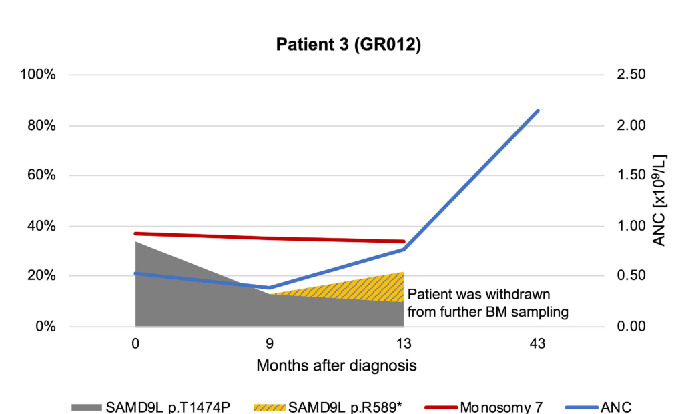

## Question

# Disease Characteristics Research Template

## Target Disease
- **Disease Name:** SAMD9L-Related Spectrum and Myeloid Neoplasm Risk
- **MONDO ID:** MONDO:1060111 (if available)
- **Category:** Genetic

## Research Objectives

Please provide a comprehensive research report on **SAMD9L-Related Spectrum and Myeloid Neoplasm Risk** covering all of the
disease characteristics listed below. This report will be used to populate a disease knowledge
base entry. Be thorough and cite primary literature (PMID preferred) for all claims.

For each section, **suggested databases/resources** are listed. These are the first places
you should search for information on each topic.

---

### 1. Disease Information
> **Search first:** OMIM, Orphanet, ICD-10/ICD-11, MeSH, PubMed

- What is the disease? Provide a concise overview.
- What are the key identifiers? (OMIM, Orphanet, ICD-10/ICD-11, MeSH, Mondo)
- What are the common synonyms and alternative names?
- Is the information derived from individual patients (e.g., EHR) or aggregated disease-level resources?

### 2. Etiology

- **Disease Causal Factors**: What are the primary causes? (genetic, environmental, infectious, mechanistic)
- **Risk Factors**:
  > **Search first:** PubMed, Cochrane Library, UpToDate, clinical guidelines, ClinVar, ClinGen, GWAS Catalog, PheGenI, CTD, CDC, WHO, epidemiological databases
  - Genetic risk factors (causal variants, susceptibility loci, modifier genes)
  - Environmental risk factors (toxins, lifestyle, occupational exposures, age, sex, family history)
- **Protective Factors**:
  > **Search first:** PubMed, Cochrane Library, clinical trial databases, GWAS Catalog, gnomAD, WHO, CDC, nutrition databases
  - Genetic protective factors (protective variants, modifier alleles)
  - Environmental protective factors (diet, lifestyle, exposures that reduce risk)
- **Gene-Environment Interactions**: How do genetic and environmental factors interact to influence disease?
  > **Search first:** CTD, PubMed, PheGenI, GxE databases

### 3. Phenotypes
> **Search first:** HPO (Human Phenotype Ontology), OMIM, Orphanet, PubMed, clinicaltrials.gov, MedDRA, SNOMED CT, DECIPHER, LOINC

For each phenotype, provide:
- **Phenotype type**: symptoms, clinical signs, physical manifestations, behavioral changes, or laboratory abnormalities
  > For symptoms/signs: HPO, OMIM, Orphanet, PubMed
  > For behavioral changes: HPO, DSM, RDoC (Research Domain Criteria), PubMed
  > For laboratory abnormalities: LOINC, SNOMED CT, LabTests Online, PubMed
- **Phenotype characteristics**:
  > **Search first:** OMIM, Orphanet, HPO, PubMed
  - Age of symptom onset (neonatal, childhood, adult-onset, late-onset)
  - Symptom severity (mild, moderate, severe, variable)
  - Symptom progression (stable, progressive, episodic, fluctuating)
  - Frequency among affected individuals (percentage or qualitative)
- **Quality of life impact**: Effects on daily functioning and well-being (per-phenotype when possible)
  > **Search first:** EQ-5D database, SF-36, WHO QOL databases, PubMed
- Suggest HPO (Human Phenotype Ontology) terms for each phenotype

### 4. Genetic/Molecular Information

- **Causal Genes**: Gene mutations or chromosomal abnormalities responsible for disease (gene symbols, OMIM IDs)
  > **Search first:** OMIM, ClinVar, HGMD, Ensembl, NCBI Gene
- **Pathogenic Variants**:
  - Affected genes (gene symbols, HGNC IDs)
    > **Search first:** OMIM, NCBI Gene, Ensembl, HGNC, UniProt, GeneCards
  - Variant classification (pathogenic, likely pathogenic, VUS per ACMG/AMP guidelines)
    > **Search first:** ClinVar, ClinGen, ACMG/AMP guidelines, VarSome
  - Variant type/class (missense, frameshift, nonsense, splice-site, structural)
  - Allele frequency in population databases
    > **Search first:** gnomAD, 1000 Genomes, ExAC, TOPMed, dbSNP
  - Somatic vs germline origin
    > **Search first:** COSMIC (somatic), ClinVar, ICGC, TCGA
  - Functional consequences (loss of function, gain of function, dominant negative)
- **Modifier Genes**: Genes that modify disease severity or expression
- **Epigenetic Information**: DNA methylation, histone modifications, chromatin changes affecting disease
  > **Search first:** ENCODE, Roadmap Epigenomics, MethBase, DiseaseMeth
- **Chromosomal Abnormalities**: Large-scale genetic changes (aneuploidy, translocations, inversions)
  > **Search first:** DECIPHER, ClinVar, ECARUCA, UCSC Genome Browser

### 5. Environmental Information

- **Environmental Factors**: Non-genetic contributing factors (toxins, radiation, pollution, occupational exposure)
  > **Search first:** CTD (Comparative Toxicogenomics Database), TOXNET, PubMed, EPA databases
- **Lifestyle Factors**: Behavioral factors (smoking, diet, exercise, alcohol consumption)
  > **Search first:** CDC databases, WHO, PubMed, NHANES
- **Infectious Agents**: If applicable, pathogens causing or triggering disease (bacteria, viruses, fungi, parasites)
  > **Search first:** NCBI Taxonomy, ViPR, BV-BRC, MicrobeDB, GIDEON

### 6. Mechanism / Pathophysiology

**Present this section as an ordered causal chain first, then the detail below.**
Open with a numbered sequence of mechanistic steps running from the initiating
lesion (mutation, exposure, infection) to the clinical manifestation, one step per
line, each naming what it causes next. State the causal verb explicitly ("leads
to", "results in") and say where a step is inferred rather than demonstrated.
Where the mechanism branches, show the branch. The categories below are a
checklist of what to cover within those steps, not the organizing structure —
a step may draw on several of them, and a category may contribute to several
steps.

- **Molecular Pathways**: Specific signaling cascades or biochemical pathways involved (Wnt, MAPK, mTOR, PI3K-AKT, etc.)
  > **Search first:** KEGG, Reactome, WikiPathways, PathBank, BioCyc
- **Cellular Processes**: Cell-level mechanisms (apoptosis, autophagy, cell cycle dysregulation, inflammation, etc.)
  > **Search first:** Gene Ontology (GO), Reactome, KEGG, PubMed
- **Protein Dysfunction**: How protein structure or function is altered (misfolding, aggregation, loss of function, gain of function)
  > **Search first:** UniProt, PDB (Protein Data Bank), InterPro, Pfam, AlphaFold
- **Metabolic Changes**: Alterations in metabolic processes (energy metabolism, lipid metabolism, amino acid metabolism)
  > **Search first:** KEGG, BioCyc, HMDB (Human Metabolome Database), BRENDA
- **Immune System Involvement**: Role of immune response (autoimmunity, immunodeficiency, chronic inflammation)
  > **Search first:** ImmPort, Immunome Database, IEDB, Gene Ontology
- **Tissue Damage Mechanisms**: How tissues/ are injured (oxidative stress, ischemia, fibrosis, necrosis)
  > **Search first:** PubMed, Gene Ontology, Reactome
- **Biochemical Abnormalities**: Specific molecular defects (enzyme deficiencies, receptor dysfunction, ion channel defects)
  > **Search first:** BRENDA, UniProt, KEGG, OMIM, PubMed
- **Epigenetic Changes**: DNA methylation, histone modifications affecting gene expression in disease
  > **Search first:** ENCODE, Roadmap Epigenomics, MethBase, DiseaseMeth
- **Molecular Profiling** (if available):
  - Transcriptomics/gene expression changes
    > **Search first:** GEO (Gene Expression Omnibus), ArrayExpress, GTEx, Human Cell Atlas, SRA
  - Proteomics findings
    > **Search first:** PRIDE, ProteomeXchange, Human Protein Atlas, STRING, BioGRID
  - Metabolomics signatures
    > **Search first:** MetaboLights, Metabolomics Workbench, HMDB, METLIN
  - Lipidomics alterations
    > **Search first:** LIPID MAPS, SwissLipids, LipidHome, Metabolomics Workbench
  - Genomic structural features
    > **Search first:** UCSC Genome Browser, Ensembl, NCBI, dbVar, DGV
- **Advanced Technologies** (if applicable):
  - Single-cell analysis findings (cell-type specific mechanisms, cellular heterogeneity)
    > **Search first:** Human Cell Atlas, Single Cell Portal, GEO, CELLxGENE
  - Spatial transcriptomics findings
    > **Search first:** GEO, Spatial Research, Vizgen, 10x Genomics data
  - Multi-omics integration results
    > **Search first:** TCGA, ICGC, cBioPortal, LinkedOmics, PubMed
  - Functional genomics screens (CRISPR, RNAi)
    > **Search first:** DepMap, GenomeRNAi, PubMed, BioGRID ORCS

For each mechanism, describe:
- The causal chain from initial trigger to clinical manifestation
- Which mechanisms are upstream vs downstream
- What cell types and biological processes are involved
- Suggest GO terms for biological processes and CL terms for cell types

### 7. Anatomical Structures Affected

- **Organ Level**:
  - Primary organs directly affected
  - Secondary organ involvement (complications, secondary effects)
  - Body systems involved (cardiovascular, nervous, digestive, respiratory, endocrine, etc.)
  > **Search first:** Uberon, FMA (Foundational Model of Anatomy), OMIM, HPO, ICD-11, MeSH, SNOMED CT
- **Tissue and Cell Level**:
  - Specific tissue types affected (epithelial, connective, muscle, nervous)
  - Specific cell populations targeted (with Cell Ontology terms)
  > **Search first:** Uberon, Human Protein Atlas, Cell Ontology, Human Cell Atlas, CellMarker, PanglaoDB
- **Subcellular Level**:
  - Cellular compartments involved (mitochondria, nucleus, ER, lysosomes) (with GO Cellular Component terms)
  > **Search first:** Gene Ontology (Cellular Component), UniProt, Human Protein Atlas
- **Localization**:
  - Specific anatomical sites (with UBERON terms)
    > **Search first:** FMA, Uberon, NeuroNames (for brain), SNOMED CT
  - Lateralization (unilateral, bilateral, asymmetric)
    > **Search first:** HPO, clinical literature, imaging databases

### 8. Temporal Development

- **Onset**:
  - Typical age of onset (congenital, pediatric, adult, geriatric)
  - Onset pattern (acute, subacute, chronic, insidious)
  > **Search first:** OMIM, Orphanet, HPO, PubMed
- **Progression**:
  - Disease stages (early, intermediate, advanced, end-stage)
    > **Search first:** Cancer Staging Manual (AJCC), WHO classifications, PubMed
  - Progression rate (rapid, slow, variable)
  - Disease course pattern (episodic, relapsing-remitting, progressive, stable)
  - Disease duration (self-limited, chronic lifelong)
  > **Search first:** Disease registries, longitudinal cohort databases, natural history studies, PubMed, Orphanet, OMIM
- **Patterns**:
  - Remission patterns (spontaneous, treatment-induced)
    > **Search first:** Clinical trial databases, disease registries, PubMed
  - Critical periods (time windows of vulnerability or opportunity for intervention)
    > **Search first:** PubMed, developmental biology databases, clinical guidelines

### 9. Inheritance and Population

- **Epidemiology**:
  - Prevalence (cases per 100,000 at given time)
  - Incidence (new cases per 100,000 per year)
  > **Search first:** Orphanet, CDC, WHO, GBD (Global Burden of Disease), national registries, SEER, disease registries
- **For Genetic Etiology**:
  - Inheritance pattern (AD, AR, X-linked, mitochondrial, multifactorial, polygenic)
    > **Search first:** OMIM, Orphanet, ClinVar, GTR (Genetic Testing Registry)
  - Penetrance (complete, incomplete, age-dependent)
    > **Search first:** ClinVar, OMIM, PubMed, ClinGen
  - Expressivity (variable, consistent)
    > **Search first:** OMIM, ClinVar, PubMed
  - Genetic anticipation (increasing severity in successive generations)
    > **Search first:** OMIM, PubMed (especially for repeat expansion disorders)
  - Germline mosaicism
    > **Search first:** ClinVar, OMIM, genetic counseling literature, PubMed
  - Founder effects (population-specific mutations)
    > **Search first:** gnomAD, population genetics databases, PubMed
  - Consanguinity role
    > **Search first:** OMIM, population studies, genetic counseling resources
  - Carrier frequency
    > **Search first:** gnomAD, carrier screening databases, GeneReviews, GTR
- **Population Demographics**:
  - Affected populations (ethnic or demographic groups with higher prevalence)
    > **Search first:** gnomAD, 1000 Genomes, PAGE Study, PubMed, population registries
  - Geographic distribution (endemic areas, regional variation)
    > **Search first:** WHO, CDC, GBD, Orphanet, geographic epidemiology databases
  - Geographic distribution of specific variants
  - Sex ratio (male:female)
    > **Search first:** Disease registries, OMIM, PubMed, epidemiological databases
  - Age distribution of affected individuals
    > **Search first:** CDC, disease registries, SEER, Orphanet

### 10. Diagnostics

- **Clinical Tests**:
  - Laboratory tests (blood, urine, tissue chemistry, specific enzyme assays)
    > **Search first:** LOINC, LabTests Online, PubMed
  - Biomarkers (proteins, metabolites, genetic markers, circulating biomarkers)
    > **Search first:** FDA Biomarker List, BEST (Biomarkers, EndpointS, and other Tools), PubMed
  - Imaging studies (X-ray, CT, MRI, PET, ultrasound)
    > **Search first:** RadLex, DICOM, Radiopaedia, imaging databases
  - Functional tests (pulmonary function, cardiac stress tests)
    > **Search first:** LOINC, clinical guidelines, PubMed
  - Electrophysiology (EEG, EMG, ECG, nerve conduction studies)
    > **Search first:** LOINC, clinical neurophysiology databases, PubMed
  - Biopsy findings (histopathology, immunohistochemistry)
    > **Search first:** SNOMED CT, College of American Pathologists resources, PubMed
  - Pathology findings (microscopic examination)
    > **Search first:** SNOMED CT, Digital Pathology databases, PubMed
- **Genetic Testing**:
  > **Search first:** GTR (Genetic Testing Registry), GeneReviews, ClinGen
  - Overview of recommended genetic testing approach
  - Whole genome sequencing (WGS) utility
    > **Search first:** GTR, ClinVar, GEL (Genomics England), gnomAD
  - Whole exome sequencing (WES) utility
    > **Search first:** GTR, ClinVar, OMIM, GeneMatcher
  - Gene panels (which panels, which genes)
    > **Search first:** GTR, ClinVar, laboratory-specific databases
  - Single gene testing
    > **Search first:** GTR, ClinVar, OMIM, GeneReviews
  - Chromosomal microarray (CMA)
    > **Search first:** DECIPHER, ClinVar, dbVar, ECARUCA
  - Karyotyping
    > **Search first:** Chromosome Abnormality Database, ClinVar, cytogenetics resources
  - FISH
    > **Search first:** ClinVar, cytogenetics databases, PubMed
  - Mitochondrial DNA testing
    > **Search first:** MITOMAP, MSeqDR, ClinVar, GTR
  - Repeat expansion testing
    > **Search first:** GTR, ClinVar, repeat expansion databases, PubMed
- **Omics-Based Diagnostics** (if applicable):
  - RNA sequencing / transcriptomics
    > **Search first:** GEO, ArrayExpress, GTEx, RNA-seq databases
  - Proteomics
    > **Search first:** PRIDE, ProteomeXchange, FDA Biomarker database
  - Metabolomics
    > **Search first:** MetaboLights, Metabolomics Workbench, HMDB
  - Epigenomics
    > **Search first:** GEO, ENCODE, Roadmap Epigenomics, MethBase
  - Liquid biopsy
    > **Search first:** COSMIC, ClinVar, liquid biopsy databases, PubMed
- **Clinical Criteria**:
  - Standardized diagnostic criteria (DSM, ICD, society guidelines)
    > **Search first:** DSM-5, ICD-11, clinical society guidelines, UpToDate
  - Differential diagnosis (other conditions to rule out, with distinguishing features)
    > **Search first:** DynaMed, UpToDate, clinical decision support systems
- **Screening**:
  - Screening methods for asymptomatic individuals (newborn screening, carrier screening, cascade screening)
    > **Search first:** ACMG recommendations, CDC newborn screening, GTR

### 11. Outcome/Prognosis

- **Survival and Mortality**:
  - Survival rate (5-year, 10-year, overall)
    > **Search first:** SEER, cancer registries, disease-specific registries, PubMed
  - Life expectancy (with and without treatment if applicable)
    > **Search first:** Orphanet, disease registries, actuarial databases, PubMed
  - Mortality rate
    > **Search first:** CDC, WHO, GBD, national mortality databases
  - Disease-specific mortality (deaths directly attributable to disease)
    > **Search first:** Disease registries, CDC Wonder, GBD, PubMed
- **Morbidity and Function**:
  - Morbidity (disease-related disability and health impacts)
    > **Search first:** GBD, WHO, disability databases, PubMed
  - Disability outcomes (long-term functional impairments)
    > **Search first:** ICF (International Classification of Functioning), disability registries
  - Quality of life measures (EQ-5D, SF-36, PROMIS, disease-specific tools)
    > **Search first:** EQ-5D database, SF-36, PROMIS, PubMed
- **Disease Course**:
  - Complications (secondary problems: infections, organ failure, etc.)
    > **Search first:** ICD codes, disease registries, clinical databases, PubMed
  - Recovery potential (likelihood and extent of recovery, with vs without treatment)
    > **Search first:** Natural history studies, rehabilitation databases, PubMed
- **Prediction**:
  - Prognostic factors (age, disease severity, biomarkers, treatment response)
    > **Search first:** Prognostic models databases, clinical calculators, PubMed
  - Prognostic biomarkers (molecular markers predicting disease course)
    > **Search first:** FDA Biomarker database, PubMed, cancer prognostic databases

### 12. Treatment

- **Pharmacotherapy**:
  - Pharmacological treatments (drug names, drug classes, mechanisms of action)
    > **Search first:** DrugBank, RxNorm, ATC classification, DailyMed, FDA databases
  - Pharmacogenomics (how genetic variants affect drug metabolism, efficacy, toxicity)
    > **Search first:** PharmGKB, CPIC (Clinical Pharmacogenetics), FDA Table of PGx Biomarkers
- **Advanced Therapeutics**:
  - Gene therapy (viral vectors, CRISPR, gene replacement, gene editing)
    > **Search first:** ClinicalTrials.gov, FDA gene therapy database, ASGCT resources
  - Cell therapy (stem cell transplant, CAR-T, cellular therapeutics)
    > **Search first:** ClinicalTrials.gov, FDA cell therapy database, FACT standards
  - RNA-based therapies (ASOs, siRNA, mRNA therapies)
    > **Search first:** ClinicalTrials.gov, FDA approvals, PubMed
  - Targeted therapies (treatments directed at specific molecular targets)
    > **Search first:** My Cancer Genome, OncoKB, ClinicalTrials.gov, FDA approvals
  - Immunotherapies (checkpoint inhibitors, monoclonal antibodies)
    > **Search first:** Cancer Immunotherapy Database, FDA approvals, ClinicalTrials.gov
- **Surgical and Interventional**:
  - Surgical interventions (types of surgery, timing, outcomes)
    > **Search first:** CPT codes, surgical registries, clinical guidelines, PubMed
- **Supportive and Rehabilitative**:
  - Supportive care (symptom management, pain control, nutrition)
    > **Search first:** Clinical guidelines, Cochrane Library, PubMed
  - Rehabilitation (physical therapy, occupational therapy, speech therapy)
    > **Search first:** Rehabilitation medicine databases, clinical guidelines, PubMed
- **Experimental**:
  - Experimental treatments in clinical trials (with NCT identifiers if available)
    > **Search first:** ClinicalTrials.gov, EU Clinical Trials Register, WHO ICTRP
- **Treatment Outcomes**:
  - Treatment response rates
    > **Search first:** Clinical trial databases, FDA reviews, systematic reviews, PubMed
  - Side effects and adverse events
    > **Search first:** FDA Adverse Event Reporting System (FAERS), MedWatch, PubMed
- **Treatment Strategy**:
  - Treatment algorithms (clinical pathways, decision trees)
    > **Search first:** Clinical practice guidelines, NCCN Guidelines, UpToDate
  - Combination therapies
    > **Search first:** ClinicalTrials.gov, treatment guidelines, PubMed
  - Personalized medicine approaches (genotype-guided treatment)
    > **Search first:** My Cancer Genome, CIViC, PharmGKB, precision medicine databases

For each treatment, suggest NCIT (NCI Thesaurus) clinical-intervention terms where applicable.

### 13. Prevention

- **Prevention Levels**:
  - Primary prevention (preventing disease occurrence: vaccination, risk factor modification)
    > **Search first:** CDC, WHO, USPSTF recommendations, Cochrane Library
  - Secondary prevention (early detection and treatment: screening programs, early intervention)
    > **Search first:** USPSTF, CDC screening guidelines, WHO
  - Tertiary prevention (preventing complications in those with disease)
    > **Search first:** Clinical guidelines, disease management protocols, PubMed
- **Immunization**: Vaccine strategies (if applicable)
  > **Search first:** CDC vaccine schedules, WHO immunization, FDA vaccine database
- **Screening and Early Detection**:
  - Screening programs (population-based: newborn screening, cancer screening)
    > **Search first:** CDC screening programs, USPSTF, cancer screening databases
  - Genetic screening (carrier screening, preimplantation genetic diagnosis, prenatal testing)
    > **Search first:** ACMG recommendations, ACOG guidelines, GTR
  - Risk stratification (identifying high-risk individuals for targeted prevention)
    > **Search first:** Risk prediction models, clinical calculators, PubMed
- **Behavioral Interventions**: Lifestyle modifications to reduce risk
  > **Search first:** CDC, WHO, behavioral intervention databases, Cochrane Library
- **Counseling**: Genetic counseling (risk assessment, family planning guidance)
  > **Search first:** NSGC resources, ACMG guidelines, GeneReviews
- **Public Health**:
  - Public health interventions (sanitation, vector control, health education)
    > **Search first:** CDC, WHO, public health databases, PubMed
  - Environmental interventions (reducing environmental risk factors)
    > **Search first:** EPA databases, WHO environmental health, PubMed
- **Prophylaxis**: Preventive medications or procedures
  > **Search first:** Clinical guidelines, FDA approvals, PubMed

### 14. Other Species / Natural Disease

- **Taxonomy**: Species affected (with NCBI Taxon identifiers)
  > **Search first:** NCBI Taxonomy
- **Breed**: Specific breeds affected (with VBO identifiers if applicable)
  > **Search first:** VBO (Vertebrate Breed Ontology)
- **Gene**: Orthologous genes in other species (with NCBI Gene IDs)
  > **Search first:** NCBI Gene
- **Natural Disease**:
  - Naturally occurring disease in other species (companion animals, wildlife)
    > **Search first:** OMIA (Online Mendelian Inheritance in Animals), VetCompass, PubMed
  - Veterinary relevance and importance in animal health
    > **Search first:** OMIA, veterinary databases, PubMed
- **Comparative Biology**:
  - Comparative pathology (similarities and differences across species)
    > **Search first:** OMIA, comparative pathology databases, PubMed
  - Evolutionary conservation of disease mechanisms
    > **Search first:** HomoloGene, OrthoMCL, Alliance of Genome Resources
- **Transmission** (if applicable):
  - Zoonotic potential
    > **Search first:** CDC zoonotic diseases, WHO zoonoses, GIDEON
  - Cross-species susceptibility
    > **Search first:** NCBI Taxonomy, veterinary databases, PubMed

### 15. Model Organisms

- **Model Types**:
  - Model organism type (mammalian, invertebrate, cellular, in vitro)
    > **Search first:** Alliance of Genome Resources, model organism databases
  - Specific model systems (mouse, rat, zebrafish, Drosophila, C. elegans, yeast, cell lines, organoids, iPSCs)
    > **Search first:** MGI, RGD, ZFIN, FlyBase, WormBase, SGD, ATCC, Cellosaurus
  - Induced models (drug treatment, surgical intervention, environmental manipulation)
    > **Search first:** MGI, model organism databases, PubMed
- **Genetic Models**:
  - Types available (knockout, knock-in, transgenic, conditional, humanized)
    > **Search first:** MGI, IMPC, KOMP, EuMMCR, IMSR
- **Model Characteristics**:
  - Phenotype recapitulation (how well model reproduces human disease features)
    > **Search first:** Model organism databases, comparative studies, PubMed
  - Model limitations (aspects of human disease not captured)
    > **Search first:** Model organism databases, PubMed, review articles
- **Applications**:
  - Research applications (what aspects of disease can be studied)
    > **Search first:** Model organism databases, PubMed
- **Resources**:
  - Model databases
    > **Search first:** MGI, RGD, ZFIN, FlyBase, WormBase, IMSR, EMMA, MMRRC

---

## Citation Requirements

- Cite primary literature (PMID preferred) for all mechanistic and clinical claims
- Prioritize recent reviews and landmark papers
- Include direct quotes from abstracts where possible to support key statements
- Distinguish evidence source types: human clinical, model organism, in vitro, computational

## Output Format

Structure your response as a comprehensive narrative organized by the sections above.
For each section, provide:
- Factual content with specific details (numbers, percentages, gene names, variant nomenclature)
- Ontology term suggestions (HPO, GO, CL, UBERON, CHEBI, NCIT, MONDO) where applicable
- Evidence citations with PMIDs
- Direct quotes from abstracts to support key claims
- Clear indication when information is not available or not applicable for this disease

This report will be used to populate a disease knowledge base entry with:
- Pathophysiology descriptions with causal chains
- Gene/protein annotations (HGNC, GO terms)
- Phenotype associations (HP terms) with frequencies
- Cell type involvement (CL terms)
- Anatomical locations (UBERON terms)
- Chemical entities (CHEBI terms)
- Treatment annotations (NCIT terms)
- Evidence items with PMIDs and exact abstract quotes
- Epidemiology, prognosis, diagnostic, and prevention information
- Animal model descriptions with phenotype recapitulation details

## Output

Question: You are an expert researcher providing comprehensive, well-cited information.

Provide detailed information focusing on:
1. Key concepts and definitions with current understanding
2. Recent developments and latest research (prioritize 2023-2024 sources)
3. Current applications and real-world implementations
4. Expert opinions and analysis from authoritative sources
5. Relevant statistics and data from recent studies

Format as a comprehensive research report with proper citations. Include URLs and publication dates where available.
Always prioritize recent, authoritative sources and provide specific citations for all major claims.

# Disease Characteristics Research Template

## Target Disease
- **Disease Name:** SAMD9L-Related Spectrum and Myeloid Neoplasm Risk
- **MONDO ID:** MONDO:1060111 (if available)
- **Category:** Genetic

## Research Objectives

Please provide a comprehensive research report on **SAMD9L-Related Spectrum and Myeloid Neoplasm Risk** covering all of the
disease characteristics listed below. This report will be used to populate a disease knowledge
base entry. Be thorough and cite primary literature (PMID preferred) for all claims.

For each section, **suggested databases/resources** are listed. These are the first places
you should search for information on each topic.

---

### 1. Disease Information
> **Search first:** OMIM, Orphanet, ICD-10/ICD-11, MeSH, PubMed

- What is the disease? Provide a concise overview.
- What are the key identifiers? (OMIM, Orphanet, ICD-10/ICD-11, MeSH, Mondo)
- What are the common synonyms and alternative names?
- Is the information derived from individual patients (e.g., EHR) or aggregated disease-level resources?

### 2. Etiology

- **Disease Causal Factors**: What are the primary causes? (genetic, environmental, infectious, mechanistic)
- **Risk Factors**:
  > **Search first:** PubMed, Cochrane Library, UpToDate, clinical guidelines, ClinVar, ClinGen, GWAS Catalog, PheGenI, CTD, CDC, WHO, epidemiological databases
  - Genetic risk factors (causal variants, susceptibility loci, modifier genes)
  - Environmental risk factors (toxins, lifestyle, occupational exposures, age, sex, family history)
- **Protective Factors**:
  > **Search first:** PubMed, Cochrane Library, clinical trial databases, GWAS Catalog, gnomAD, WHO, CDC, nutrition databases
  - Genetic protective factors (protective variants, modifier alleles)
  - Environmental protective factors (diet, lifestyle, exposures that reduce risk)
- **Gene-Environment Interactions**: How do genetic and environmental factors interact to influence disease?
  > **Search first:** CTD, PubMed, PheGenI, GxE databases

### 3. Phenotypes
> **Search first:** HPO (Human Phenotype Ontology), OMIM, Orphanet, PubMed, clinicaltrials.gov, MedDRA, SNOMED CT, DECIPHER, LOINC

For each phenotype, provide:
- **Phenotype type**: symptoms, clinical signs, physical manifestations, behavioral changes, or laboratory abnormalities
  > For symptoms/signs: HPO, OMIM, Orphanet, PubMed
  > For behavioral changes: HPO, DSM, RDoC (Research Domain Criteria), PubMed
  > For laboratory abnormalities: LOINC, SNOMED CT, LabTests Online, PubMed
- **Phenotype characteristics**:
  > **Search first:** OMIM, Orphanet, HPO, PubMed
  - Age of symptom onset (neonatal, childhood, adult-onset, late-onset)
  - Symptom severity (mild, moderate, severe, variable)
  - Symptom progression (stable, progressive, episodic, fluctuating)
  - Frequency among affected individuals (percentage or qualitative)
- **Quality of life impact**: Effects on daily functioning and well-being (per-phenotype when possible)
  > **Search first:** EQ-5D database, SF-36, WHO QOL databases, PubMed
- Suggest HPO (Human Phenotype Ontology) terms for each phenotype

### 4. Genetic/Molecular Information

- **Causal Genes**: Gene mutations or chromosomal abnormalities responsible for disease (gene symbols, OMIM IDs)
  > **Search first:** OMIM, ClinVar, HGMD, Ensembl, NCBI Gene
- **Pathogenic Variants**:
  - Affected genes (gene symbols, HGNC IDs)
    > **Search first:** OMIM, NCBI Gene, Ensembl, HGNC, UniProt, GeneCards
  - Variant classification (pathogenic, likely pathogenic, VUS per ACMG/AMP guidelines)
    > **Search first:** ClinVar, ClinGen, ACMG/AMP guidelines, VarSome
  - Variant type/class (missense, frameshift, nonsense, splice-site, structural)
  - Allele frequency in population databases
    > **Search first:** gnomAD, 1000 Genomes, ExAC, TOPMed, dbSNP
  - Somatic vs germline origin
    > **Search first:** COSMIC (somatic), ClinVar, ICGC, TCGA
  - Functional consequences (loss of function, gain of function, dominant negative)
- **Modifier Genes**: Genes that modify disease severity or expression
- **Epigenetic Information**: DNA methylation, histone modifications, chromatin changes affecting disease
  > **Search first:** ENCODE, Roadmap Epigenomics, MethBase, DiseaseMeth
- **Chromosomal Abnormalities**: Large-scale genetic changes (aneuploidy, translocations, inversions)
  > **Search first:** DECIPHER, ClinVar, ECARUCA, UCSC Genome Browser

### 5. Environmental Information

- **Environmental Factors**: Non-genetic contributing factors (toxins, radiation, pollution, occupational exposure)
  > **Search first:** CTD (Comparative Toxicogenomics Database), TOXNET, PubMed, EPA databases
- **Lifestyle Factors**: Behavioral factors (smoking, diet, exercise, alcohol consumption)
  > **Search first:** CDC databases, WHO, PubMed, NHANES
- **Infectious Agents**: If applicable, pathogens causing or triggering disease (bacteria, viruses, fungi, parasites)
  > **Search first:** NCBI Taxonomy, ViPR, BV-BRC, MicrobeDB, GIDEON

### 6. Mechanism / Pathophysiology

**Present this section as an ordered causal chain first, then the detail below.**
Open with a numbered sequence of mechanistic steps running from the initiating
lesion (mutation, exposure, infection) to the clinical manifestation, one step per
line, each naming what it causes next. State the causal verb explicitly ("leads
to", "results in") and say where a step is inferred rather than demonstrated.
Where the mechanism branches, show the branch. The categories below are a
checklist of what to cover within those steps, not the organizing structure —
a step may draw on several of them, and a category may contribute to several
steps.

- **Molecular Pathways**: Specific signaling cascades or biochemical pathways involved (Wnt, MAPK, mTOR, PI3K-AKT, etc.)
  > **Search first:** KEGG, Reactome, WikiPathways, PathBank, BioCyc
- **Cellular Processes**: Cell-level mechanisms (apoptosis, autophagy, cell cycle dysregulation, inflammation, etc.)
  > **Search first:** Gene Ontology (GO), Reactome, KEGG, PubMed
- **Protein Dysfunction**: How protein structure or function is altered (misfolding, aggregation, loss of function, gain of function)
  > **Search first:** UniProt, PDB (Protein Data Bank), InterPro, Pfam, AlphaFold
- **Metabolic Changes**: Alterations in metabolic processes (energy metabolism, lipid metabolism, amino acid metabolism)
  > **Search first:** KEGG, BioCyc, HMDB (Human Metabolome Database), BRENDA
- **Immune System Involvement**: Role of immune response (autoimmunity, immunodeficiency, chronic inflammation)
  > **Search first:** ImmPort, Immunome Database, IEDB, Gene Ontology
- **Tissue Damage Mechanisms**: How tissues/ are injured (oxidative stress, ischemia, fibrosis, necrosis)
  > **Search first:** PubMed, Gene Ontology, Reactome
- **Biochemical Abnormalities**: Specific molecular defects (enzyme deficiencies, receptor dysfunction, ion channel defects)
  > **Search first:** BRENDA, UniProt, KEGG, OMIM, PubMed
- **Epigenetic Changes**: DNA methylation, histone modifications affecting gene expression in disease
  > **Search first:** ENCODE, Roadmap Epigenomics, MethBase, DiseaseMeth
- **Molecular Profiling** (if available):
  - Transcriptomics/gene expression changes
    > **Search first:** GEO (Gene Expression Omnibus), ArrayExpress, GTEx, Human Cell Atlas, SRA
  - Proteomics findings
    > **Search first:** PRIDE, ProteomeXchange, Human Protein Atlas, STRING, BioGRID
  - Metabolomics signatures
    > **Search first:** MetaboLights, Metabolomics Workbench, HMDB, METLIN
  - Lipidomics alterations
    > **Search first:** LIPID MAPS, SwissLipids, LipidHome, Metabolomics Workbench
  - Genomic structural features
    > **Search first:** UCSC Genome Browser, Ensembl, NCBI, dbVar, DGV
- **Advanced Technologies** (if applicable):
  - Single-cell analysis findings (cell-type specific mechanisms, cellular heterogeneity)
    > **Search first:** Human Cell Atlas, Single Cell Portal, GEO, CELLxGENE
  - Spatial transcriptomics findings
    > **Search first:** GEO, Spatial Research, Vizgen, 10x Genomics data
  - Multi-omics integration results
    > **Search first:** TCGA, ICGC, cBioPortal, LinkedOmics, PubMed
  - Functional genomics screens (CRISPR, RNAi)
    > **Search first:** DepMap, GenomeRNAi, PubMed, BioGRID ORCS

For each mechanism, describe:
- The causal chain from initial trigger to clinical manifestation
- Which mechanisms are upstream vs downstream
- What cell types and biological processes are involved
- Suggest GO terms for biological processes and CL terms for cell types

### 7. Anatomical Structures Affected

- **Organ Level**:
  - Primary organs directly affected
  - Secondary organ involvement (complications, secondary effects)
  - Body systems involved (cardiovascular, nervous, digestive, respiratory, endocrine, etc.)
  > **Search first:** Uberon, FMA (Foundational Model of Anatomy), OMIM, HPO, ICD-11, MeSH, SNOMED CT
- **Tissue and Cell Level**:
  - Specific tissue types affected (epithelial, connective, muscle, nervous)
  - Specific cell populations targeted (with Cell Ontology terms)
  > **Search first:** Uberon, Human Protein Atlas, Cell Ontology, Human Cell Atlas, CellMarker, PanglaoDB
- **Subcellular Level**:
  - Cellular compartments involved (mitochondria, nucleus, ER, lysosomes) (with GO Cellular Component terms)
  > **Search first:** Gene Ontology (Cellular Component), UniProt, Human Protein Atlas
- **Localization**:
  - Specific anatomical sites (with UBERON terms)
    > **Search first:** FMA, Uberon, NeuroNames (for brain), SNOMED CT
  - Lateralization (unilateral, bilateral, asymmetric)
    > **Search first:** HPO, clinical literature, imaging databases

### 8. Temporal Development

- **Onset**:
  - Typical age of onset (congenital, pediatric, adult, geriatric)
  - Onset pattern (acute, subacute, chronic, insidious)
  > **Search first:** OMIM, Orphanet, HPO, PubMed
- **Progression**:
  - Disease stages (early, intermediate, advanced, end-stage)
    > **Search first:** Cancer Staging Manual (AJCC), WHO classifications, PubMed
  - Progression rate (rapid, slow, variable)
  - Disease course pattern (episodic, relapsing-remitting, progressive, stable)
  - Disease duration (self-limited, chronic lifelong)
  > **Search first:** Disease registries, longitudinal cohort databases, natural history studies, PubMed, Orphanet, OMIM
- **Patterns**:
  - Remission patterns (spontaneous, treatment-induced)
    > **Search first:** Clinical trial databases, disease registries, PubMed
  - Critical periods (time windows of vulnerability or opportunity for intervention)
    > **Search first:** PubMed, developmental biology databases, clinical guidelines

### 9. Inheritance and Population

- **Epidemiology**:
  - Prevalence (cases per 100,000 at given time)
  - Incidence (new cases per 100,000 per year)
  > **Search first:** Orphanet, CDC, WHO, GBD (Global Burden of Disease), national registries, SEER, disease registries
- **For Genetic Etiology**:
  - Inheritance pattern (AD, AR, X-linked, mitochondrial, multifactorial, polygenic)
    > **Search first:** OMIM, Orphanet, ClinVar, GTR (Genetic Testing Registry)
  - Penetrance (complete, incomplete, age-dependent)
    > **Search first:** ClinVar, OMIM, PubMed, ClinGen
  - Expressivity (variable, consistent)
    > **Search first:** OMIM, ClinVar, PubMed
  - Genetic anticipation (increasing severity in successive generations)
    > **Search first:** OMIM, PubMed (especially for repeat expansion disorders)
  - Germline mosaicism
    > **Search first:** ClinVar, OMIM, genetic counseling literature, PubMed
  - Founder effects (population-specific mutations)
    > **Search first:** gnomAD, population genetics databases, PubMed
  - Consanguinity role
    > **Search first:** OMIM, population studies, genetic counseling resources
  - Carrier frequency
    > **Search first:** gnomAD, carrier screening databases, GeneReviews, GTR
- **Population Demographics**:
  - Affected populations (ethnic or demographic groups with higher prevalence)
    > **Search first:** gnomAD, 1000 Genomes, PAGE Study, PubMed, population registries
  - Geographic distribution (endemic areas, regional variation)
    > **Search first:** WHO, CDC, GBD, Orphanet, geographic epidemiology databases
  - Geographic distribution of specific variants
  - Sex ratio (male:female)
    > **Search first:** Disease registries, OMIM, PubMed, epidemiological databases
  - Age distribution of affected individuals
    > **Search first:** CDC, disease registries, SEER, Orphanet

### 10. Diagnostics

- **Clinical Tests**:
  - Laboratory tests (blood, urine, tissue chemistry, specific enzyme assays)
    > **Search first:** LOINC, LabTests Online, PubMed
  - Biomarkers (proteins, metabolites, genetic markers, circulating biomarkers)
    > **Search first:** FDA Biomarker List, BEST (Biomarkers, EndpointS, and other Tools), PubMed
  - Imaging studies (X-ray, CT, MRI, PET, ultrasound)
    > **Search first:** RadLex, DICOM, Radiopaedia, imaging databases
  - Functional tests (pulmonary function, cardiac stress tests)
    > **Search first:** LOINC, clinical guidelines, PubMed
  - Electrophysiology (EEG, EMG, ECG, nerve conduction studies)
    > **Search first:** LOINC, clinical neurophysiology databases, PubMed
  - Biopsy findings (histopathology, immunohistochemistry)
    > **Search first:** SNOMED CT, College of American Pathologists resources, PubMed
  - Pathology findings (microscopic examination)
    > **Search first:** SNOMED CT, Digital Pathology databases, PubMed
- **Genetic Testing**:
  > **Search first:** GTR (Genetic Testing Registry), GeneReviews, ClinGen
  - Overview of recommended genetic testing approach
  - Whole genome sequencing (WGS) utility
    > **Search first:** GTR, ClinVar, GEL (Genomics England), gnomAD
  - Whole exome sequencing (WES) utility
    > **Search first:** GTR, ClinVar, OMIM, GeneMatcher
  - Gene panels (which panels, which genes)
    > **Search first:** GTR, ClinVar, laboratory-specific databases
  - Single gene testing
    > **Search first:** GTR, ClinVar, OMIM, GeneReviews
  - Chromosomal microarray (CMA)
    > **Search first:** DECIPHER, ClinVar, dbVar, ECARUCA
  - Karyotyping
    > **Search first:** Chromosome Abnormality Database, ClinVar, cytogenetics resources
  - FISH
    > **Search first:** ClinVar, cytogenetics databases, PubMed
  - Mitochondrial DNA testing
    > **Search first:** MITOMAP, MSeqDR, ClinVar, GTR
  - Repeat expansion testing
    > **Search first:** GTR, ClinVar, repeat expansion databases, PubMed
- **Omics-Based Diagnostics** (if applicable):
  - RNA sequencing / transcriptomics
    > **Search first:** GEO, ArrayExpress, GTEx, RNA-seq databases
  - Proteomics
    > **Search first:** PRIDE, ProteomeXchange, FDA Biomarker database
  - Metabolomics
    > **Search first:** MetaboLights, Metabolomics Workbench, HMDB
  - Epigenomics
    > **Search first:** GEO, ENCODE, Roadmap Epigenomics, MethBase
  - Liquid biopsy
    > **Search first:** COSMIC, ClinVar, liquid biopsy databases, PubMed
- **Clinical Criteria**:
  - Standardized diagnostic criteria (DSM, ICD, society guidelines)
    > **Search first:** DSM-5, ICD-11, clinical society guidelines, UpToDate
  - Differential diagnosis (other conditions to rule out, with distinguishing features)
    > **Search first:** DynaMed, UpToDate, clinical decision support systems
- **Screening**:
  - Screening methods for asymptomatic individuals (newborn screening, carrier screening, cascade screening)
    > **Search first:** ACMG recommendations, CDC newborn screening, GTR

### 11. Outcome/Prognosis

- **Survival and Mortality**:
  - Survival rate (5-year, 10-year, overall)
    > **Search first:** SEER, cancer registries, disease-specific registries, PubMed
  - Life expectancy (with and without treatment if applicable)
    > **Search first:** Orphanet, disease registries, actuarial databases, PubMed
  - Mortality rate
    > **Search first:** CDC, WHO, GBD, national mortality databases
  - Disease-specific mortality (deaths directly attributable to disease)
    > **Search first:** Disease registries, CDC Wonder, GBD, PubMed
- **Morbidity and Function**:
  - Morbidity (disease-related disability and health impacts)
    > **Search first:** GBD, WHO, disability databases, PubMed
  - Disability outcomes (long-term functional impairments)
    > **Search first:** ICF (International Classification of Functioning), disability registries
  - Quality of life measures (EQ-5D, SF-36, PROMIS, disease-specific tools)
    > **Search first:** EQ-5D database, SF-36, PROMIS, PubMed
- **Disease Course**:
  - Complications (secondary problems: infections, organ failure, etc.)
    > **Search first:** ICD codes, disease registries, clinical databases, PubMed
  - Recovery potential (likelihood and extent of recovery, with vs without treatment)
    > **Search first:** Natural history studies, rehabilitation databases, PubMed
- **Prediction**:
  - Prognostic factors (age, disease severity, biomarkers, treatment response)
    > **Search first:** Prognostic models databases, clinical calculators, PubMed
  - Prognostic biomarkers (molecular markers predicting disease course)
    > **Search first:** FDA Biomarker database, PubMed, cancer prognostic databases

### 12. Treatment

- **Pharmacotherapy**:
  - Pharmacological treatments (drug names, drug classes, mechanisms of action)
    > **Search first:** DrugBank, RxNorm, ATC classification, DailyMed, FDA databases
  - Pharmacogenomics (how genetic variants affect drug metabolism, efficacy, toxicity)
    > **Search first:** PharmGKB, CPIC (Clinical Pharmacogenetics), FDA Table of PGx Biomarkers
- **Advanced Therapeutics**:
  - Gene therapy (viral vectors, CRISPR, gene replacement, gene editing)
    > **Search first:** ClinicalTrials.gov, FDA gene therapy database, ASGCT resources
  - Cell therapy (stem cell transplant, CAR-T, cellular therapeutics)
    > **Search first:** ClinicalTrials.gov, FDA cell therapy database, FACT standards
  - RNA-based therapies (ASOs, siRNA, mRNA therapies)
    > **Search first:** ClinicalTrials.gov, FDA approvals, PubMed
  - Targeted therapies (treatments directed at specific molecular targets)
    > **Search first:** My Cancer Genome, OncoKB, ClinicalTrials.gov, FDA approvals
  - Immunotherapies (checkpoint inhibitors, monoclonal antibodies)
    > **Search first:** Cancer Immunotherapy Database, FDA approvals, ClinicalTrials.gov
- **Surgical and Interventional**:
  - Surgical interventions (types of surgery, timing, outcomes)
    > **Search first:** CPT codes, surgical registries, clinical guidelines, PubMed
- **Supportive and Rehabilitative**:
  - Supportive care (symptom management, pain control, nutrition)
    > **Search first:** Clinical guidelines, Cochrane Library, PubMed
  - Rehabilitation (physical therapy, occupational therapy, speech therapy)
    > **Search first:** Rehabilitation medicine databases, clinical guidelines, PubMed
- **Experimental**:
  - Experimental treatments in clinical trials (with NCT identifiers if available)
    > **Search first:** ClinicalTrials.gov, EU Clinical Trials Register, WHO ICTRP
- **Treatment Outcomes**:
  - Treatment response rates
    > **Search first:** Clinical trial databases, FDA reviews, systematic reviews, PubMed
  - Side effects and adverse events
    > **Search first:** FDA Adverse Event Reporting System (FAERS), MedWatch, PubMed
- **Treatment Strategy**:
  - Treatment algorithms (clinical pathways, decision trees)
    > **Search first:** Clinical practice guidelines, NCCN Guidelines, UpToDate
  - Combination therapies
    > **Search first:** ClinicalTrials.gov, treatment guidelines, PubMed
  - Personalized medicine approaches (genotype-guided treatment)
    > **Search first:** My Cancer Genome, CIViC, PharmGKB, precision medicine databases

For each treatment, suggest NCIT (NCI Thesaurus) clinical-intervention terms where applicable.

### 13. Prevention

- **Prevention Levels**:
  - Primary prevention (preventing disease occurrence: vaccination, risk factor modification)
    > **Search first:** CDC, WHO, USPSTF recommendations, Cochrane Library
  - Secondary prevention (early detection and treatment: screening programs, early intervention)
    > **Search first:** USPSTF, CDC screening guidelines, WHO
  - Tertiary prevention (preventing complications in those with disease)
    > **Search first:** Clinical guidelines, disease management protocols, PubMed
- **Immunization**: Vaccine strategies (if applicable)
  > **Search first:** CDC vaccine schedules, WHO immunization, FDA vaccine database
- **Screening and Early Detection**:
  - Screening programs (population-based: newborn screening, cancer screening)
    > **Search first:** CDC screening programs, USPSTF, cancer screening databases
  - Genetic screening (carrier screening, preimplantation genetic diagnosis, prenatal testing)
    > **Search first:** ACMG recommendations, ACOG guidelines, GTR
  - Risk stratification (identifying high-risk individuals for targeted prevention)
    > **Search first:** Risk prediction models, clinical calculators, PubMed
- **Behavioral Interventions**: Lifestyle modifications to reduce risk
  > **Search first:** CDC, WHO, behavioral intervention databases, Cochrane Library
- **Counseling**: Genetic counseling (risk assessment, family planning guidance)
  > **Search first:** NSGC resources, ACMG guidelines, GeneReviews
- **Public Health**:
  - Public health interventions (sanitation, vector control, health education)
    > **Search first:** CDC, WHO, public health databases, PubMed
  - Environmental interventions (reducing environmental risk factors)
    > **Search first:** EPA databases, WHO environmental health, PubMed
- **Prophylaxis**: Preventive medications or procedures
  > **Search first:** Clinical guidelines, FDA approvals, PubMed

### 14. Other Species / Natural Disease

- **Taxonomy**: Species affected (with NCBI Taxon identifiers)
  > **Search first:** NCBI Taxonomy
- **Breed**: Specific breeds affected (with VBO identifiers if applicable)
  > **Search first:** VBO (Vertebrate Breed Ontology)
- **Gene**: Orthologous genes in other species (with NCBI Gene IDs)
  > **Search first:** NCBI Gene
- **Natural Disease**:
  - Naturally occurring disease in other species (companion animals, wildlife)
    > **Search first:** OMIA (Online Mendelian Inheritance in Animals), VetCompass, PubMed
  - Veterinary relevance and importance in animal health
    > **Search first:** OMIA, veterinary databases, PubMed
- **Comparative Biology**:
  - Comparative pathology (similarities and differences across species)
    > **Search first:** OMIA, comparative pathology databases, PubMed
  - Evolutionary conservation of disease mechanisms
    > **Search first:** HomoloGene, OrthoMCL, Alliance of Genome Resources
- **Transmission** (if applicable):
  - Zoonotic potential
    > **Search first:** CDC zoonotic diseases, WHO zoonoses, GIDEON
  - Cross-species susceptibility
    > **Search first:** NCBI Taxonomy, veterinary databases, PubMed

### 15. Model Organisms

- **Model Types**:
  - Model organism type (mammalian, invertebrate, cellular, in vitro)
    > **Search first:** Alliance of Genome Resources, model organism databases
  - Specific model systems (mouse, rat, zebrafish, Drosophila, C. elegans, yeast, cell lines, organoids, iPSCs)
    > **Search first:** MGI, RGD, ZFIN, FlyBase, WormBase, SGD, ATCC, Cellosaurus
  - Induced models (drug treatment, surgical intervention, environmental manipulation)
    > **Search first:** MGI, model organism databases, PubMed
- **Genetic Models**:
  - Types available (knockout, knock-in, transgenic, conditional, humanized)
    > **Search first:** MGI, IMPC, KOMP, EuMMCR, IMSR
- **Model Characteristics**:
  - Phenotype recapitulation (how well model reproduces human disease features)
    > **Search first:** Model organism databases, comparative studies, PubMed
  - Model limitations (aspects of human disease not captured)
    > **Search first:** Model organism databases, PubMed, review articles
- **Applications**:
  - Research applications (what aspects of disease can be studied)
    > **Search first:** Model organism databases, PubMed
- **Resources**:
  - Model databases
    > **Search first:** MGI, RGD, ZFIN, FlyBase, WormBase, IMSR, EMMA, MMRRC

---

## Citation Requirements

- Cite primary literature (PMID preferred) for all mechanistic and clinical claims
- Prioritize recent reviews and landmark papers
- Include direct quotes from abstracts where possible to support key statements
- Distinguish evidence source types: human clinical, model organism, in vitro, computational

## Output Format

Structure your response as a comprehensive narrative organized by the sections above.
For each section, provide:
- Factual content with specific details (numbers, percentages, gene names, variant nomenclature)
- Ontology term suggestions (HPO, GO, CL, UBERON, CHEBI, NCIT, MONDO) where applicable
- Evidence citations with PMIDs
- Direct quotes from abstracts to support key claims
- Clear indication when information is not available or not applicable for this disease

This report will be used to populate a disease knowledge base entry with:
- Pathophysiology descriptions with causal chains
- Gene/protein annotations (HGNC, GO terms)
- Phenotype associations (HP terms) with frequencies
- Cell type involvement (CL terms)
- Anatomical locations (UBERON terms)
- Chemical entities (CHEBI terms)
- Treatment annotations (NCIT terms)
- Evidence items with PMIDs and exact abstract quotes
- Epidemiology, prognosis, diagnostic, and prevention information
- Animal model descriptions with phenotype recapitulation details

# SAMD9L-related spectrum and myeloid-neoplasm risk

**Scope and evidence standard.** This is a disease-level synthesis of published families, selected clinical cohorts, cell experiments, model-organism findings, and trial registrations—not an analysis of an individual electronic health record. The most informative recent primary sources are a seven-child longitudinal cohort published online **17 August 2023** (print **February 2024**) and a neurological case series published **9 April 2024**. Small, differently selected cohorts must not be pooled into a population penetrance or leukemia-risk estimate. (erlacher2023spontaneousremissionand pages 1-2, zingariello2024assessinglong‐termneurologic pages 1-2)

## 1. Disease information and identifiers

*SAMD9L*-related disease is an autosomal-dominant, variably expressed spectrum encompassing ataxia–pancytopenia syndrome (ATXPC or AP syndrome), inherited marrow failure/cytopenias with immunodeficiency, predisposition to myelodysplastic neoplasms (MDS) and myeloid leukemia, and an uncommon severe neonatal autoinflammatory presentation. Neurological disease and cytopenias need not be equally severe in the same person. The founding study described AP syndrome as “characterized by cerebellar ataxia, variable hematologic cytopenias, and predisposition to marrow failure and myeloid leukemia.” (chen2016ataxiapancytopeniasyndromeis pages 1-2, chen2016ataxiapancytopeniasyndromeis pages 9-10, russell2021samd9lautoinflammatoryor pages 1-2)

**Verified cross-references:** OMIM phenotype **MIM:159550** (ataxia–pancytopenia/myelocerebellar disorder); **MONDO:0008038** (ataxia–pancytopenia syndrome); associated but *not interchangeable* entries **MONDO:0009646** (monosomy-7 myelodysplasia and leukemia syndrome 1) and **MONDO:0030805** (spinocerebellar ataxia 49). The user-supplied **MONDO:1060111** could not be confirmed as the appropriate identifier and should not be entered as verified. An Orphanet identifier, syndrome-specific ICD-10/ICD-11 or MeSH identifier, and *SAMD9L* gene OMIM/HGNC accession were not confirmed from retrieved source material. The verified Ensembl gene identifier is **ENSG00000177409**. Synonyms include **ataxia–pancytopenia syndrome**, **ATXPC**, **AP syndrome**, **myelocerebellar disorder**, and, for particular presentations, *SAMD9L*-associated marrow-failure or autoinflammatory disease; these labels describe overlapping presentations, not necessarily identical diagnoses. (chen2016ataxiapancytopeniasyndromeis pages 1-2, OpenTargets Search: -SAMD9L)

## 2. Etiology, risk and protection

**Primary cause.** Heterozygous constitutional *SAMD9L* variants at **7q21.3** can increase the protein’s antiproliferative/translational-repression activity. Cases are familial or de novo. Established founding-family substitutions include **c.2640C>A, p.His880Gln** and **c.3587G>C, p.Cys1196Ser**; severe neonatal cases carry de novo frameshifts, including **p.Asn885Thrfs*6**, **p.Lys878Serfs*13**, and **c.2666delT, p.Phe889Serfs*2**. Variant-specific pathogenicity must be evaluated individually: a subsequently reported familial **p.Gln1043Lys was explicitly classified as a variant of uncertain significance (VUS)**, not proven pathogenic. The original two substitutions were absent from the public population databases examined in 2016, but present-day gnomAD allele frequencies and ClinVar classifications for each variant were not verified here. (chen2016ataxiapancytopeniasyndromeis pages 1-2, russell2021samd9lautoinflammatoryor pages 1-2, caldirola2023casereportde pages 1-2, zingariello2024assessinglong‐termneurologic pages 1-2)

**Somatic modifiers are clinically decisive.** A second-site inactivating *SAMD9L* variant **in cis**, or copy-neutral uniparental isodisomy of **7q** replacing the mutant allele, can restore hematopoietic fitness without deleting the other chromosome-7 genes. By contrast, **monosomy 7 or del(7q)** may initially relieve mutant-allele growth inhibition but also removes other regulators/tumor suppressors, creating a dangerous route to MDS/AML. Acquired **RUNX1** and **EZH2** changes occurred during surveillance in the 2023–2024 cohort. Rescue mutations are potentially protective, **not** a guarantee of remission: they appeared in two children who did not recover. (erlacher2023spontaneousremissionand pages 1-2, erlacher2023spontaneousremissionand pages 2-3, erlacher2023spontaneousremissionand pages 5-7, cobaleda2024insightsintothe pages 2-3)

**Environment and gene–environment interaction.** *SAMD9L* is interferon responsive, and interferon-β induces its RNA in experimental systems; infection-associated worsening of cytopenias was reported in one neonatal patient. Thus inflammation or infection is a biologically plausible amplifier of an inherited lesion, **not a demonstrated necessary cause or quantified disease-specific leukemia risk factor**. No SAMD9L-specific effect estimate establishes smoking, radiation, occupation, diet, alcohol or exercise as causal or protective. No dietary or pharmacological intervention is proven to prevent constitutional disease. (russell2021samd9lautoinflammatoryor pages 1-2, caldirola2023casereportde pages 1-2, cobaleda2024insightsintothe pages 2-3)

## 3. Phenotypes and quality of life

The following table describes **children younger than five selected because they already had constitutional *SAMD9L* disease, monosomy 7 and initially normal marrow-blast percentages**. Its fractions are *not* penetrance estimates or frequencies among all variant carriers. The paper’s Figure 1 illustrates how somatic-variant fractions, monosomy-7 clones and absolute neutrophil counts change over time in three remitting children; temporal association does not make a rescue variant a reliable individual prognostic test. (erlacher2023spontaneousremissionand pages 1-2, erlacher2023spontaneousremissionand pages 2-3, erlacher2023spontaneousremissionand media d7f3e063, erlacher2023spontaneousremissionand pages 5-7)

| Measure | Fraction | Interpretation |
|---|---:|---|
| Moderate-to-severe neutropenia | 7/7 (100%) | Present in every child at diagnosis |
| Anemia | 6/7 (86%) | Five normocytic and one macrocytic case |
| Platelet-transfusion requirement | 3/7 (43%) | Indicates clinically significant thrombocytopenia |
| Any immunodeficiency | 6/7 (86%) | Variable clinical and laboratory immune impairment |
| Hypogammaglobulinemia | 5/7 (71%) | Most frequent specified immune abnormality |
| Combined B- and NK-cell deficiency | 4/7 (57%) | Reported jointly; not evidence that each deficiency independently occurred in 4/7 |
| Spontaneous hematologic remission with monosomy-7 regression | 3/7 (43%) | Recovery occurred during close surveillance |
| Somatic *SAMD9L* subclones in cis | 5/7 (71%) | Putative genetic-rescue clones; presence did not reliably predict remission |
| Allogeneic HSCT | 4/7 (57%) | Performed for progression, persistent monosomy 7, severe neutropenia/infection, or a serious inflammatory complication |
| Progression to MDS with excess blasts | 1/7 (14%) | Occurred with acquired oncogenic evolution |
| Transplant-related death | 1/7 (14%) | Death followed HSCT rather than spontaneous disease progression |
| **Interpretive limitation** | **Selected cohort, n=7** | Children aged <5 years were selected for germline *SAMD9L* disease, monosomy 7, and normal marrow blast percentage; fractions are **not population prevalence or penetrance estimates** (erlacher2023spontaneousremissionand pages 1-2, erlacher2023spontaneousremissionand pages 2-3) |

*Table: Clinical findings and outcomes in the selected seven-child SAMD9L-plus-monosomy-7 cohort reported by Erlacher et al., DOI: https://doi.org/10.3324/haematol.2023.283591 (online August 17, 2023; print February 2024). These fractions characterize this narrowly selected cohort and are not population-level estimates.*

**Hematological signs/laboratory abnormalities:** marrow hypocellularity, moderate-to-severe neutropenia, anemia (sometimes macrocytic), thrombocytopenia, pancytopenia and intermittent or progressive marrow failure can start in infancy; hemorrhage and serious infection are clinical consequences. Older families demonstrate that severe neurological involvement can accompany mild intermittent cytopenias and vice versa. Suggested HPO labels: **bone marrow hypocellularity (verified HP:0005528)**, neutropenia, anemia, thrombocytopenia, pancytopenia, macrocytosis and myelodysplasia. Exact additional HP identifiers should be resolved against the current HPO release before database ingestion. (erlacher2023spontaneousremissionand pages 2-3, chen2016ataxiapancytopeniasyndromeis pages 9-10, chen2016ataxiapancytopeniasyndromeis pages 1-2, OpenTargets Search: -SAMD9L)

**Immune and inflammatory signs:** recurrent infection, hypogammaglobulinemia, B-/NK-cell deficiency, and—in the neonatal truncation phenotype—fever, panniculitis/neutrophilic skin inflammation, elevated inflammatory markers, hepatosplenomegaly, and sometimes basal-ganglia calcifications. Suggested HPO labels: recurrent infections, hypogammaglobulinemia, B-cell lymphopenia, fever, panniculitis and hepatosplenomegaly; do not generalize their neonatal severity to all carriers. (erlacher2023spontaneousremissionand pages 2-3, russell2021samd9lautoinflammatoryor pages 1-2, russell2021samd9lautoinflammatoryor pages 3-3, caldirola2023casereportde pages 1-2)

**Neurological signs and functioning:** progressive or initially subtle gait ataxia, nystagmus, dysmetria, brisk reflexes/clonus, cerebellar/brainstem atrophy and sometimes sensory axonal neuropathy. Onset ranges from childhood to adulthood: the original four-generation pedigree recorded neurological onset from **10 to 62 years**; the 2024 six-person/two-family series found evolving balance and coordination deficits during serial observation. Walking, running and coordination may be affected; cytopenia/infection burdens can further disrupt ordinary activities. No syndrome-specific EQ-5D, SF-36 or robust quantified quality-of-life estimate was established. Suggested HPO labels: cerebellar ataxia, gait ataxia, nystagmus, dysmetria, hyperreflexia, cerebellar atrophy and peripheral neuropathy. (chen2016ataxiapancytopeniasyndromeis pages 3-4, zingariello2024assessinglong‐termneurologic pages 1-2)

## 4. Genetic and molecular information

The causal **germline gene is *SAMD9L***, not its related paralog *SAMD9*: *SAMD9* is important in the differential diagnosis and in overlapping combined-gene series, but MIRAGE syndrome due to *SAMD9* should not be relabeled *SAMD9L* disease. Patient-associated *SAMD9L* classes include missense substitutions and unusually activating truncations. **A truncating sequence consequence is not automatically functional loss of function**: experimental tests found that the approximately residue-878–889 neonatal truncations produced *stronger* translational repression, plausibly through loss of C-terminal regulation. Allele-specific interpretation therefore requires segregation, germline confirmation, functional evidence and ACMG/AMP assessment. (chen2016ataxiapancytopeniasyndromeis pages 1-2, russell2021samd9lautoinflammatoryor pages 1-2, erlacher2023spontaneousremissionand pages 2-3)

**Somatic versus inherited testing:** somatic in-cis *SAMD9L* changes, mosaic -7/del(7q), and UPD7q can alter the variant-allele fraction in blood; a blood-only negative result may consequently be misleading. Confirm suspected germline findings in a suitable nonhematopoietic specimen and separate constitutional from acquired marrow variants. Additional chromosomal changes documented in an early family included **monosomy 7 and trisomy 21** preceding AML. *RUNX1/EZH2* are reported acquired cooperating lesions, not established inherited SAMD9L-specific modifier alleles. No reproducible syndrome-specific methylation, histone, proteomic, metabolomic or lipidomic signature was validated by the evidence examined. (chen2016ataxiapancytopeniasyndromeis pages 1-2, erlacher2023spontaneousremissionand pages 2-3, erlacher2023spontaneousremissionand pages 1-2)

## 5. Environmental information

The syndrome is genetic and **not infectious or transmissible**. Viral-defense/interferon biology supplies a plausible interaction with infection, while reported infections may also be a *consequence* of immune defects. Avoid assigning any particular bacterium, virus, toxin, radiation exposure, smoking habit or dietary pattern an established causal or protective role without new SAMD9L-specific data. (russell2021samd9lautoinflammatoryor pages 1-2, erlacher2023spontaneousremissionand pages 2-3)

## 6. Mechanism and pathophysiology: ordered causal chain

1. **Constitutional heterozygous activating *SAMD9L* variation leads to** abnormally strong activity of an interferon-responsive antiviral protein; functional activation is shown for tested alleles, not assumed for every VUS. (russell2021samd9lautoinflammatoryor pages 1-2, zingariello2024assessinglong‐termneurologic pages 1-2)
2. **Aberrant SAMD9L activity results in** excessive cell-autonomous repression of protein translation; **in hematopoietic stem/progenitor cells (HSPCs), this leads to** reduced proliferation/colony output, cell-cycle disturbance and experimentally observed DNA-repair abnormalities and apoptosis. (russell2021samd9lautoinflammatoryor pages 1-2, thomas2021pediatricmdsand pages 1-2)
3. **Loss or poor function of progenitors results in** hypocellular marrow, impaired blood-cell production, cytopenias and immune-cell deficits; **immune impairment leads to** increased infection burden. Attribution of every individual immune defect directly to translational repression is **inferred**, rather than demonstrated in each patient. (thomas2021pediatricmdsand pages 1-2, erlacher2023spontaneousremissionand pages 2-3)
4. **Growth disadvantage of mutant-bearing HSPCs leads to** selection for clones that silence, lose or replace the constitutional allele: **branch A:** in-cis inactivating *SAMD9L* variants or copy-neutral UPD7q **lead to** potentially adaptive rescue and blood-count recovery. (erlacher2023spontaneousremissionand pages 1-2, chen2016ataxiapancytopeniasyndromeis pages 1-2, cobaleda2024insightsintothe pages 2-3)
5. **Branch B:** loss of mutant-bearing chromosome 7 or 7q **leads to** short-term clonal fitness, **but results in** coincident chromosome-7 gene loss; **this increases** susceptibility to dysplasia, additional acquired oncogenic lesions, MDS and occasionally AML. Individual progression is variable, not inevitable. (erlacher2023spontaneousremissionand pages 1-2, erlacher2023spontaneousremissionand pages 2-3, cobaleda2024insightsintothe pages 2-3)
6. **Branch C:** mutant effects on neural-cell biology **are inferred to contribute to** cerebellar/brainstem degeneration, neuropathy and ataxia; human pathology and imaging demonstrate injury, but a complete cell-type-specific molecular chain has not been established. **In the severe truncation branch**, amplified innate-immune dysfunction **is inferred to contribute to** neonatal systemic inflammation and tissue injury. (chen2016ataxiapancytopeniasyndromeis pages 9-10, zingariello2024assessinglong‐termneurologic pages 1-2, russell2021samd9lautoinflammatoryor pages 1-2)

**Pathway and evidence detail.** An interferon-induced antiviral response and translation control are more directly supported than assigning this syndrome to Wnt, PI3K–AKT or mTOR. The protein has predicted SAM, P-loop/NOD-like, tetratricopeptide-repeat and OB-fold regions; a proposed C-terminal sensing/regulatory function remains partly hypothetical. Human-cell single-cell *expression assays* documented dose-dependent translational inhibition; human/mouse primary-HSPC perturbation with protein-interaction and transcriptional analyses documented impaired proliferation, translation, DNA-damage response and survival. These are mechanistic experiments, **not a validated diagnostic single-cell assay**. Mouse deficiency studies implicate endosomal processing, but findings from *loss-of-function mice* must not be taken as direct proof of the mechanism of human *gain-of-function ataxia*. No established patient-specific enzyme deficiency, metabolic product, targeted proteomic signature, spatial-transcriptomic map or CRISPR-validated therapy emerged from the examined evidence. Suggested GO biological-process labels, **identifier pending verification**: response to type-I interferon, negative regulation of translation, regulation of cell proliferation, hematopoiesis, apoptotic process and endosomal transport. Suggested CL labels: hematopoietic stem cell, myeloid progenitor cell, neutrophil, B lymphocyte, natural-killer cell and cerebellar Purkinje cell; the last is supported by neuropathology rather than cell-specific mutant-function tests. (russell2021samd9lautoinflammatoryor pages 1-2, thomas2021pediatricmdsand pages 1-2, chen2016ataxiapancytopeniasyndromeis pages 9-10)

## 7. Anatomical structures affected

**Primary:** bone-marrow hematopoietic tissue and, in neurological presentations, cerebellum/brainstem and peripheral nerves. **Secondary:** blood and immune system; severe neonatal presentations may involve skin/subcutis, liver/spleen, basal ganglia, respiratory tract and bowel. Cerebellar Purkinje-cell loss was documented in examined affected family members; B and NK cell reductions were measured in affected children. Relevant *provisional* UBERON labels are bone marrow, cerebellum, brainstem, peripheral nerve, skin and spleen; exact UBERON identifiers require ontology validation. Translation-associated cytoplasmic activity and endosomal biology are plausible GO cellular-component annotations, but no disease-specific organelle-localization map was verified. Disease is not defined by unilateral involvement; described neurological signs and imaging can be bilateral. (chen2016ataxiapancytopeniasyndromeis pages 1-2, chen2016ataxiapancytopeniasyndromeis pages 9-10, erlacher2023spontaneousremissionand pages 2-3, russell2021samd9lautoinflammatoryor pages 3-3, thomas2021pediatricmdsand pages 1-2)

## 8. Temporal development

The course ranges from **neonatal autoinflammation or infant cytopenias** to **insidious childhood/adult neurological disease**. Marrow counts may fluctuate or improve spontaneously through somatic clonal selection, while ataxia can progress even if blood counts are comparatively mild. In the selected seven-child series, monosomy 7 disappeared by **6 and 16 months** after diagnosis in two tracked children; three children achieved hematologic remission, but four ultimately needed transplantation. This creates an early-childhood observation opportunity **only when rapid, specialist surveillance and a transplant contingency are available**. There is no validated universal SAMD9L-specific early/intermediate/advanced staging scheme: describe marrow failure, lower- versus excess-blast MDS, and AML according to the applicable hematopathology classifications. (erlacher2023spontaneousremissionand pages 2-3, erlacher2023spontaneousremissionand pages 1-2, zingariello2024assessinglong‐termneurologic pages 1-2)

## 9. Inheritance and population

Transmission is **autosomal dominant**, with familial and de novo presentations and substantial inter- and intrafamilial variable expressivity. Clinical penetrance, age-specific leukemia penetrance, carrier frequency, birth incidence and point prevalence **cannot be reliably quantified** from these ascertained series. Neither repeat-expansion anticipation nor a founder effect, consistent sex ratio, ethnic enrichment, consanguinity effect or natural germline mosaicism frequency was established. In one inherited-marrow-failure referral cohort, *SAMD9L* findings occurred in **10/179 (5.6%)** patients and monosomy 7 in **5/10** affected patients: these are *referral-cohort proportions*, not population prevalence or universal lifetime risks. (chen2016ataxiapancytopeniasyndromeis pages 3-4, bluteau2018alandscapeof pages 9-13)

## 10. Diagnostics, differential diagnosis and screening

**Clinical evaluation:** serial complete blood count with differential, smear, reticulocyte and immunoglobulin assessment as indicated; B-/NK-cell immunophenotyping when immune disease is suspected; marrow aspirate/biopsy for cellularity, dysplasia and blast percentage; constitutional and marrow sequencing; **karyotype and targeted chromosome-7 FISH**, with SNP array when copy-neutral UPD7q is suspected. Track acquired myeloid variants and changing *SAMD9L* allele fractions. Brain MRI, formal neurological examination and serial motor testing assess ataxia; EMG/nerve studies assess suspected neuropathy. In the 2024 neurological series, a family’s p.Gln1043Lys remained a **VUS**, illustrating why phenotype alone must not upgrade a variant to pathogenic. (erlacher2023spontaneousremissionand pages 2-3, chen2016ataxiapancytopeniasyndromeis pages 1-2, zingariello2024assessinglong‐termneurologic pages 1-2)

**Genetic approach:** include *SAMD9L* and *SAMD9* on inherited marrow-failure/MDS-predisposition panels; WES/WGS are useful when panels are nondiagnostic or manifestations are broad. A single-gene test can address a known familial allele; test nonhematopoietic tissue when blood reversion or malignant contamination may obscure germline status. Conventional karyotyping detects -7, FISH tracks selected clones, and SNP-based methods resolve copy-neutral UPD. Mitochondrial sequencing and repeat-expansion tests are **not routine confirmatory tests for this syndrome**. RNA-seq, proteomics, metabolomics, epigenomics and liquid biopsy have no validated routine SAMD9L diagnostic role in the reviewed evidence. Differential diagnosis includes *SAMD9*-related MIRAGE, GATA2 deficiency and other inherited marrow-failure/MDS predispositions, and telomere disorders when cerebellar and marrow findings coexist; the original study distinguished AP syndrome from dyskeratosis congenita using additional clinical and cellular evidence. Cascade testing and donor evaluation require careful counseling because hematopoietic reversion can confound blood results. No population newborn-screening program was established. (erlacher2023spontaneousremissionand pages 2-3, chen2016ataxiapancytopeniasyndromeis pages 1-2, zingariello2024assessinglong‐termneurologic pages 1-2)

## 11. Outcome and prognosis

The principal hazards are severe infection or bleeding from cytopenias, progression to MDS/AML in vulnerable clones, and treatment-related complications. The small 2023–2024 series had **six survivors among seven at last follow-up**, including three untransplanted children with spontaneous hematologic recovery; **one death was transplant-related**. That fraction must not be expressed as a population survival rate. Persistent or enlarging -7 clones, increasing blasts and acquired oncogenic variants warrant concern; a second-site rescue variant **alone** does not establish a benign trajectory. Validated 5-/10-year SAMD9L-specific survival, lifetime cancer risk, life expectancy, disability and patient-reported quality-of-life estimates were not found. (erlacher2023spontaneousremissionand pages 1-2, erlacher2023spontaneousremissionand pages 5-7, erlacher2023spontaneousremissionand pages 2-3)

## 12. Treatment and real-world implementation

**Strategy:** use individualized pediatric hematology, genetics, immunology, neurology and transplant review. Support cytopenias and infections as clinically indicated, while repeatedly assessing marrow morphology, clone size and acquired variants. In selected very young children with normal blast counts, closely monitored observation can avoid immediate HSCT if -7 regresses; this is **not** reassurance that monosomy 7 is harmless. Erlacher and colleagues monitored marrow roughly **every 3–4 months**, and delayed transplantation carried risks of serious infection and progression. **Allogeneic hematopoietic stem-cell transplantation (HSCT)** may be necessary for progressive MDS/excess blasts, persistent high-risk disease or severe refractory cytopenia/infection; it can replace diseased hematopoiesis but entails graft, conditioning and transplant-mortality risks. Three of four transplanted children in the cohort were alive with stable engraftment at follow-up; one died from transplant complications. A separate de novo **p.Phe889Serfs*2** neonatal autoinflammatory case remained in inflammatory remission **five years** after matched-unrelated HSCT—an individual case, not a response-rate estimate. (erlacher2023spontaneousremissionand pages 1-2, erlacher2023spontaneousremissionand pages 2-3, caldirola2023casereportde pages 1-2)

**Supportive and investigational care:** transfusion, infection treatment and immunological support should follow the measured defect; neurological rehabilitation, physical/occupational therapy and longitudinal balance testing can address functional limitations. A 12-day G-CSF course preceded rising blasts in *one* child who also acquired **RUNX1** lesions: temporal association is **not proof G-CSF caused progression**, but this case requires cautious specialist interpretation. Neither a SAMD9L-specific small-molecule treatment, gene-editing intervention, RNA therapy, checkpoint inhibitor, nor variant-guided pharmacogenomic regimen has established clinical efficacy in the retrieved material. Suggested NCIT **intervention labels, identifiers pending verification**: hematopoietic stem cell transplantation, red blood cell transfusion, platelet transfusion, granulocyte colony-stimulating factor, and physical therapy; treosulfan, fludarabine, rabbit antithymocyte globulin, tacrolimus and methotrexate are regimen agents rather than syndrome-specific cures. (erlacher2023spontaneousremissionand pages 2-3, zingariello2024assessinglong‐termneurologic pages 1-2, NCT04965597 chunk 1)

**Trials versus routine treatment:** [NCT00662090](https://clinicaltrials.gov/study/NCT00662090) is an **observational childhood MDS/JMML registry**, not an assigned SAMD9L treatment trial. [NCT04965597](https://clinicaltrials.gov/study/NCT04965597) is a **completed, phase-II, single-group, 40-participant** transplant-conditioning study listing germline *SAMD9L* among eligible conditions and using treosulfan/fludarabine/rabbit antithymocyte globulin; the examined registry excerpt provided **no SAMD9L-specific efficacy or safety results**. (NCT00662090 chunk 1, NCT04965597 chunk 1)

## 13. Prevention and counseling

**Primary prevention** of a de novo or inherited allele by diet, vaccination or exposure modification is not established. **Secondary prevention** means recognizing inherited marrow failure, testing at-risk relatives, confirming constitutional status, and monitoring counts and chromosome-7/myeloid clones to identify treatable complications before advanced neoplasia. **Tertiary prevention** includes prompt infection/bleeding management and transplant when indicated. Genetic counseling should discuss autosomal-dominant transmission, variable manifestations and the possibility of blood-specific reversion; a related stem-cell donor must not be assumed unaffected without appropriate assessment. Prenatal/preimplantation testing can be discussed for a verified familial pathogenic variant, but a VUS must not be treated as a definitive diagnosis. Routine age-appropriate immunization is general supportive care, **not a syndrome-specific preventive vaccine**, with immune/transplant advice individualized. (chen2016ataxiapancytopeniasyndromeis pages 1-2, zingariello2024assessinglong‐termneurologic pages 1-2, erlacher2023spontaneousremissionand pages 1-2, erlacher2023spontaneousremissionand pages 2-3)

## 14. Other species and natural disease

The disease documented here occurs in **humans (*Homo sapiens*; NCBI Taxon 9606)**; experimental research uses **house mouse (*Mus musculus*; NCBI Taxon 10090)**. Ortholog nomenclature is human *SAMD9L* versus mouse *Samd9l*. Exact ortholog NCBI Gene accessions and VBO breed identifiers were **not verified**, and no convincing naturally occurring SAMD9L-defined veterinary disease, breed predisposition or zoonotic transmission was found. Mouse findings provide comparative biological insight, not evidence that this inherited disorder is contagious or present naturally in another species. (thomas2021pediatricmdsand pages 1-2, chen2016ataxiapancytopeniasyndromeis pages 9-10, russell2021samd9lautoinflammatoryor pages 1-2)

## 15. Model organisms and experimental resources

**Mouse genetic models:** experimentally heterozygous/homozygous *Samd9l* deficiency has been reported to produce endosomal-processing defects and, in earlier work cited by the clinical investigators, myelodysplasia/myeloid malignancy at approximately **12 months**. This models **chromosome-7 gene loss and cancer predisposition**, not faithfully the activating variant and progressive cerebellar disease of every human carrier; neurological deficits were not reported in the cited knockout comparison. A direct primary animal study should be consulted before depositing detailed model penetrance or strain-specific phenotype claims. **Cellular models:** human patient lymphoblastoid lines showed selection for cells retaining wild-type *SAMD9L*; transfected human cells allowed single-cell measurement of mutant-dependent translation suppression; lentivirally perturbed human/mouse HSPCs tested proliferation, translation, DNA-damage response and apoptosis. These systems are useful for variant-function assessment and the adaptive-versus-maladaptive clonal-rescue question, but do not establish a clinical gene-therapy protocol. Appropriate prospective resource labels are **MGI/IMSR for verified mouse alleles**, and Cellosaurus or laboratory repositories for verified cell-line accessions; specific accession numbers were not established. (chen2016ataxiapancytopeniasyndromeis pages 9-10, thomas2021pediatricmdsand pages 1-2, chen2016ataxiapancytopeniasyndromeis pages 1-2, russell2021samd9lautoinflammatoryor pages 1-2)

### Selected source-linked abstract quotations and publication details

- **Chen et al., 2 June 2016,** *American Journal of Human Genetics*, DOI [10.1016/j.ajhg.2016.04.009](https://doi.org/10.1016/j.ajhg.2016.04.009): “These observations indicate in vivo hematopoietic mosaicism.” Founding human-family evidence; OMIM phenotype **159550**. **PMID:** not verified in retrieved text. (chen2016ataxiapancytopeniasyndromeis pages 1-2)
- **Russell et al., 20 August 2021,** *PNAS*, DOI [10.1073/pnas.2110190118](https://doi.org/10.1073/pnas.2110190118): “The children’s truncating mutations dramatically exaggerated translational repression even at low levels of GFP-SAMD9L per cell.” Human cases **plus in-vitro functional evidence**. **PMID:** not verified. (russell2021samd9lautoinflammatoryor pages 1-2)
- **Thomas et al., 2021,** *Leukemia*, DOI [10.1038/s41375-021-01212-6](https://doi.org/10.1038/s41375-021-01212-6): “SAMD9 and SAMD9L are multifunctional proteins that cause profound alterations in cell cycle, cell proliferation, and protein translation in HSPCs.” **Experimental human/mouse HSPC evidence. PMID:** not verified. (thomas2021pediatricmdsand pages 1-2)
- **Erlacher et al., online 17 August 2023; print February 2024,** *Haematologica*, DOI [10.3324/haematol.2023.283591](https://doi.org/10.3324/haematol.2023.283591): “Within 14 months from diagnosis, three children experienced spontaneous hematological remission accompanied by a decrease in monosomy 7 clone size.” **Longitudinal human clinical evidence**, selected n=7. **PMID:** not verified. (erlacher2023spontaneousremissionand pages 1-2)
- **Zingariello et al., online 9 April 2024,** *Movement Disorders Clinical Practice*, DOI [10.1002/mdc3.14038](https://doi.org/10.1002/mdc3.14038): “Patients with ATXPC should be followed to evaluate a wide range of neurologic manifestations.” **Six-person human neurological case series**, including a VUS-bearing family. **PMID:** not verified. (zingariello2024assessinglong‐termneurologic pages 1-2)
- **Caldirola et al., March 2023,** *Frontiers in Pediatrics*, DOI [10.3389/fped.2023.1108207](https://doi.org/10.3389/fped.2023.1108207): “The patient underwent a fully matched unrelated HSCT and has since been in inflammatory remission 5 years post-HSCT.” **Single human treatment case; PMID:** not verified. (caldirola2023casereportde pages 1-2)

**Knowledge-base qualification:** The only HPO accession independently verified in the retrieved evidence was **HP:0005528**; only **OMIM 159550**, specified MONDO entries and **ENSG00000177409** were verified for identifier mapping. Other requested HPO, GO, CL, UBERON, CHEBI and NCIT entries above are **term-label suggestions rather than accession-validated annotations**. CHEBI annotations for conditioning drugs should be resolved individually against chemical and drug registries. The accessible source excerpts did not reliably supply PMIDs; DOI-linked primary references are given instead of invented PMID numbers. Population incidence, age-specific penetrance, generalized leukemia risk and quantified treatment-response rates remain unresolved. (OpenTargets Search: -SAMD9L, chen2016ataxiapancytopeniasyndromeis pages 1-2, erlacher2023spontaneousremissionand pages 1-2, NCT04965597 chunk 1)

References

1. (erlacher2023spontaneousremissionand pages 1-2): Miriam Erlacher, Felicia Andresen, Martina Sukova, Jan Stary, Barbara De Moerloose, Jutte van der Werff Ten Bosch, Michael Dworzak, Markus G. Seidel, Sophia Polychronopoulou, Rita Beier, Christian P. Kratz, Michaela Nathrath, Michael C. Frühwald, Gudrun Göhring, Anke K. Bergmann, Christina Mayerhofer, Dirk Lebrecht, Senthilkumar Ramamoorthy, Ayami Yoshimi, Brigitte Strahm, Marcin W. Wlodarski, and Charlotte M. Niemeyer. Spontaneous remission and loss of monosomy 7: a window of opportunity for young children with samd9l syndrome. Haematologica, 109:422-430, Aug 2023. URL: https://doi.org/10.3324/haematol.2023.283591, doi:10.3324/haematol.2023.283591. This article has 11 citations.

2. (zingariello2024assessinglong‐termneurologic pages 1-2): Carla D. Zingariello, Dong‐Hui Chen, Wendy H. Raskind, William B. Slayton, Sub Subramony, Joyce Severance, Megan Feagle, and Sonja A. Rasmussen. Assessing long‐term neurologic outcomes in samd9l ‐related ataxia‐pancytopenia syndrome. Movement Disorders Clinical Practice, 11:728-733, Apr 2024. URL: https://doi.org/10.1002/mdc3.14038, doi:10.1002/mdc3.14038. This article has 1 citations and is from a peer-reviewed journal.

3. (chen2016ataxiapancytopeniasyndromeis pages 1-2): Dong-Hui Chen, Jennifer E. Below, Akiko Shimamura, Sioban B. Keel, Mark Matsushita, John Wolff, Youngmee Sul, Emily Bonkowski, Maria Castella, Toshiyasu Taniguchi, Deborah Nickerson, Thalia Papayannopoulou, Thomas D. Bird, and Wendy H. Raskind. Ataxia-pancytopenia syndrome is caused by missense mutations in samd9l. American journal of human genetics, 98 6:1146-1158, Jun 2016. URL: https://doi.org/10.1016/j.ajhg.2016.04.009, doi:10.1016/j.ajhg.2016.04.009. This article has 236 citations and is from a highest quality peer-reviewed journal.

4. (chen2016ataxiapancytopeniasyndromeis pages 9-10): Dong-Hui Chen, Jennifer E. Below, Akiko Shimamura, Sioban B. Keel, Mark Matsushita, John Wolff, Youngmee Sul, Emily Bonkowski, Maria Castella, Toshiyasu Taniguchi, Deborah Nickerson, Thalia Papayannopoulou, Thomas D. Bird, and Wendy H. Raskind. Ataxia-pancytopenia syndrome is caused by missense mutations in samd9l. American journal of human genetics, 98 6:1146-1158, Jun 2016. URL: https://doi.org/10.1016/j.ajhg.2016.04.009, doi:10.1016/j.ajhg.2016.04.009. This article has 236 citations and is from a highest quality peer-reviewed journal.

5. (russell2021samd9lautoinflammatoryor pages 1-2): Amanda J. Russell, Paul E. Gray, John B. Ziegler, Yae Jean Kim, Sandy Smith, William A. Sewell, and Christopher C. Goodnow. Samd9l autoinflammatory or ataxia pancytopenia disease mutations activate cell-autonomous translational repression. Proceedings of the National Academy of Sciences of the United States of America, Aug 2021. URL: https://doi.org/10.1073/pnas.2110190118, doi:10.1073/pnas.2110190118. This article has 45 citations and is from a highest quality peer-reviewed journal.

6. (OpenTargets Search: -SAMD9L): Open Targets Query (-SAMD9L, 5 results). Buniello, A. et al. (2025). Open Targets Platform: facilitating therapeutic hypotheses building in drug discovery. Nucleic Acids Research.

7. (caldirola2023casereportde pages 1-2): María Soledad Caldirola, Analía Gisela Seminario, Paula Carolina Luna, Renata Curciarello, Guillermo Horacio Docena, Nicolás Fernandez Escobar, Guillermo Drelichman, Marco Gattorno, Adriana A. de Jesus, Raphaela Goldbach-Mansky, María Isabel Gaillard, and Liliana Bezrodnik. Case report: de novo samd9l truncation causes neonatal-onset autoinflammatory syndrome which was successfully treated with hematopoietic stem cell transplantation. Frontiers in Pediatrics, Mar 2023. URL: https://doi.org/10.3389/fped.2023.1108207, doi:10.3389/fped.2023.1108207. This article has 3 citations.

8. (erlacher2023spontaneousremissionand pages 2-3): Miriam Erlacher, Felicia Andresen, Martina Sukova, Jan Stary, Barbara De Moerloose, Jutte van der Werff Ten Bosch, Michael Dworzak, Markus G. Seidel, Sophia Polychronopoulou, Rita Beier, Christian P. Kratz, Michaela Nathrath, Michael C. Frühwald, Gudrun Göhring, Anke K. Bergmann, Christina Mayerhofer, Dirk Lebrecht, Senthilkumar Ramamoorthy, Ayami Yoshimi, Brigitte Strahm, Marcin W. Wlodarski, and Charlotte M. Niemeyer. Spontaneous remission and loss of monosomy 7: a window of opportunity for young children with samd9l syndrome. Haematologica, 109:422-430, Aug 2023. URL: https://doi.org/10.3324/haematol.2023.283591, doi:10.3324/haematol.2023.283591. This article has 11 citations.

9. (erlacher2023spontaneousremissionand pages 5-7): Miriam Erlacher, Felicia Andresen, Martina Sukova, Jan Stary, Barbara De Moerloose, Jutte van der Werff Ten Bosch, Michael Dworzak, Markus G. Seidel, Sophia Polychronopoulou, Rita Beier, Christian P. Kratz, Michaela Nathrath, Michael C. Frühwald, Gudrun Göhring, Anke K. Bergmann, Christina Mayerhofer, Dirk Lebrecht, Senthilkumar Ramamoorthy, Ayami Yoshimi, Brigitte Strahm, Marcin W. Wlodarski, and Charlotte M. Niemeyer. Spontaneous remission and loss of monosomy 7: a window of opportunity for young children with samd9l syndrome. Haematologica, 109:422-430, Aug 2023. URL: https://doi.org/10.3324/haematol.2023.283591, doi:10.3324/haematol.2023.283591. This article has 11 citations.

10. (cobaleda2024insightsintothe pages 2-3): Cesar Cobaleda, Lucy A. Godley, Kim E. Nichols, Marcin W. Wlodarski, and Isidro Sanchez-Garcia. Insights into the molecular mechanisms of genetic predisposition to hematopoietic malignancies: the importance of gene–environment interactions. Cancer Discovery, 14:396-405, Mar 2024. URL: https://doi.org/10.1158/2159-8290.cd-23-1091, doi:10.1158/2159-8290.cd-23-1091. This article has 30 citations and is from a highest quality peer-reviewed journal.

11. (erlacher2023spontaneousremissionand media d7f3e063): Miriam Erlacher, Felicia Andresen, Martina Sukova, Jan Stary, Barbara De Moerloose, Jutte van der Werff Ten Bosch, Michael Dworzak, Markus G. Seidel, Sophia Polychronopoulou, Rita Beier, Christian P. Kratz, Michaela Nathrath, Michael C. Frühwald, Gudrun Göhring, Anke K. Bergmann, Christina Mayerhofer, Dirk Lebrecht, Senthilkumar Ramamoorthy, Ayami Yoshimi, Brigitte Strahm, Marcin W. Wlodarski, and Charlotte M. Niemeyer. Spontaneous remission and loss of monosomy 7: a window of opportunity for young children with samd9l syndrome. Haematologica, 109:422-430, Aug 2023. URL: https://doi.org/10.3324/haematol.2023.283591, doi:10.3324/haematol.2023.283591. This article has 11 citations.

12. (russell2021samd9lautoinflammatoryor pages 3-3): Amanda J. Russell, Paul E. Gray, John B. Ziegler, Yae Jean Kim, Sandy Smith, William A. Sewell, and Christopher C. Goodnow. Samd9l autoinflammatory or ataxia pancytopenia disease mutations activate cell-autonomous translational repression. Proceedings of the National Academy of Sciences of the United States of America, Aug 2021. URL: https://doi.org/10.1073/pnas.2110190118, doi:10.1073/pnas.2110190118. This article has 45 citations and is from a highest quality peer-reviewed journal.

13. (chen2016ataxiapancytopeniasyndromeis pages 3-4): Dong-Hui Chen, Jennifer E. Below, Akiko Shimamura, Sioban B. Keel, Mark Matsushita, John Wolff, Youngmee Sul, Emily Bonkowski, Maria Castella, Toshiyasu Taniguchi, Deborah Nickerson, Thalia Papayannopoulou, Thomas D. Bird, and Wendy H. Raskind. Ataxia-pancytopenia syndrome is caused by missense mutations in samd9l. American journal of human genetics, 98 6:1146-1158, Jun 2016. URL: https://doi.org/10.1016/j.ajhg.2016.04.009, doi:10.1016/j.ajhg.2016.04.009. This article has 236 citations and is from a highest quality peer-reviewed journal.

14. (thomas2021pediatricmdsand pages 1-2): Melvin E. Thomas, Sherif Abdelhamed, Ryan Hiltenbrand, Jason R. Schwartz, Sadie Miki Sakurada, Michael Walsh, Guangchun Song, Jing Ma, Shondra M. Pruett-Miller, and Jeffery M. Klco. Pediatric mds and bone marrow failure-associated germline mutations in samd9 and samd9l impair multiple pathways in primary hematopoietic cells. Leukemia, 35:3232-3244, Mar 2021. URL: https://doi.org/10.1038/s41375-021-01212-6, doi:10.1038/s41375-021-01212-6. This article has 74 citations and is from a highest quality peer-reviewed journal.

15. (bluteau2018alandscapeof pages 9-13): Olivier Bluteau, Marie Sebert, Thierry Leblanc, Régis Peffault de Latour, Samuel Quentin, Elodie Lainey, Lucie Hernandez, Jean-Hugues Dalle, Flore Sicre de Fontbrune, Etienne Lengline, Raphael Itzykson, Emmanuelle Clappier, Nicolas Boissel, Nadia Vasquez, Mélanie Da Costa, Julien Masliah-Planchon, Wendy Cuccuini, Anna Raimbault, Louis De Jaegere, Lionel Adès, Pierre Fenaux, Sébastien Maury, Claudine Schmitt, Marc Muller, Carine Domenech, Nicolas Blin, Bénédicte Bruno, Isabelle Pellier, Mathilde Hunault, Stéphane Blanche, Arnaud Petit, Guy Leverger, Gérard Michel, Yves Bertrand, André Baruchel, Gérard Socié, and Jean Soulier. A landscape of germ line mutations in a cohort of inherited bone marrow failure patients. Blood, 131:717-732, Feb 2018. URL: https://doi.org/10.1182/blood-2017-09-806489, doi:10.1182/blood-2017-09-806489. This article has 322 citations and is from a highest quality peer-reviewed journal.

16. (NCT04965597 chunk 1):  Treosulfan-Based Conditioning Regimen Before a Blood or Bone Marrow Transplant for the Treatment of Bone Marrow Failure Diseases (BMT CTN 1904). Fred Hutchinson Cancer Center. 2022. ClinicalTrials.gov Identifier: NCT04965597

17. (NCT00662090 chunk 1): Charlotte Niemeyer, MD. Study for Epidemiology and Characterization of Myelodysplastic Syndromes (MDS) and Juvenile Myelomonocytic Leucemia (JMML) in Childhood. University Hospital Freiburg. 2010. ClinicalTrials.gov Identifier: NCT00662090

## Artifacts

- [Edison artifact artifact-00](SAMD9L-related_Spectrum_And_Myeloid_Neoplasm_Risk-deep-research-falcon_artifacts/artifact-00.md)

## Reference Validation

Checked with `linkml-reference-validator` 0.3.0.

| Outcome | Count |
| --- | --- |
| References checked | 8 |
| Resolved | 8 |
| Unresolved (possible confabulation) | 0 |
| Unverifiable | 0 |
| References weighed for topical relevance | 8 |
| On topic | 4 |
| Off topic | 0 |

All extracted references resolved successfully.

## Term Validation

Checked with `linkml-term-validator` 0.4.5, through the `ols:` adapter.

| Outcome | Count |
| --- | --- |
| Terms checked | 6 |
| Resolved | 5 |
| Unresolved (possible confabulation) | 0 |
| Obsolete | 0 |
| Unverifiable | 1 |
| Terms whose name was checked | 1 |
| Terms named correctly | 0 |
| Terms named as a **different** term | 1 |

### Terms the report names something else

These identifiers resolve, so nothing about them looks wrong, and the ontology calls them something unrelated to what the report calls them. That usually means the identifier is not the one the sentence needs:

- `MONDO:1060111` (2 mentions) - the report calls it "if available"; MONDO calls it **SAMD9L-related spectrum and myeloid neoplasm risk**

### Prefixes with no resolver

Terms carrying these prefixes were not checked either way, because no configured ontology covers them. An unrecognised prefix may name an ontology this run could not reach as easily as one that does not exist, so nothing here is evidence of fabrication: `MIM`.