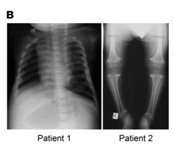

## Question

# Disease Characteristics Research Template

## Target Disease
- **Disease Name:** Spondyloepimetaphyseal Dysplasia, Shohat Type
- **MONDO ID:** MONDO:0011252 (if available)
- **Category:** Mendelian

## Research Objectives

Please provide a comprehensive research report on **Spondyloepimetaphyseal Dysplasia, Shohat Type** covering all of the
disease characteristics listed below. This report will be used to populate a disease knowledge
base entry. Be thorough and cite primary literature (PMID preferred) for all claims.

For each section, **suggested databases/resources** are listed. These are the first places
you should search for information on each topic.

---

### 1. Disease Information
> **Search first:** OMIM, Orphanet, ICD-10/ICD-11, MeSH, PubMed

- What is the disease? Provide a concise overview.
- What are the key identifiers? (OMIM, Orphanet, ICD-10/ICD-11, MeSH, Mondo)
- What are the common synonyms and alternative names?
- Is the information derived from individual patients (e.g., EHR) or aggregated disease-level resources?

### 2. Etiology

- **Disease Causal Factors**: What are the primary causes? (genetic, environmental, infectious, mechanistic)
- **Risk Factors**:
  > **Search first:** PubMed, Cochrane Library, UpToDate, clinical guidelines, ClinVar, ClinGen, GWAS Catalog, PheGenI, CTD, CDC, WHO, epidemiological databases
  - Genetic risk factors (causal variants, susceptibility loci, modifier genes)
  - Environmental risk factors (toxins, lifestyle, occupational exposures, age, sex, family history)
- **Protective Factors**:
  > **Search first:** PubMed, Cochrane Library, clinical trial databases, GWAS Catalog, gnomAD, WHO, CDC, nutrition databases
  - Genetic protective factors (protective variants, modifier alleles)
  - Environmental protective factors (diet, lifestyle, exposures that reduce risk)
- **Gene-Environment Interactions**: How do genetic and environmental factors interact to influence disease?
  > **Search first:** CTD, PubMed, PheGenI, GxE databases

### 3. Phenotypes
> **Search first:** HPO (Human Phenotype Ontology), OMIM, Orphanet, PubMed, clinicaltrials.gov, MedDRA, SNOMED CT, DECIPHER, LOINC

For each phenotype, provide:
- **Phenotype type**: symptoms, clinical signs, physical manifestations, behavioral changes, or laboratory abnormalities
  > For symptoms/signs: HPO, OMIM, Orphanet, PubMed
  > For behavioral changes: HPO, DSM, RDoC (Research Domain Criteria), PubMed
  > For laboratory abnormalities: LOINC, SNOMED CT, LabTests Online, PubMed
- **Phenotype characteristics**:
  > **Search first:** OMIM, Orphanet, HPO, PubMed
  - Age of symptom onset (neonatal, childhood, adult-onset, late-onset)
  - Symptom severity (mild, moderate, severe, variable)
  - Symptom progression (stable, progressive, episodic, fluctuating)
  - Frequency among affected individuals (percentage or qualitative)
- **Quality of life impact**: Effects on daily functioning and well-being (per-phenotype when possible)
  > **Search first:** EQ-5D database, SF-36, WHO QOL databases, PubMed
- Suggest HPO (Human Phenotype Ontology) terms for each phenotype

### 4. Genetic/Molecular Information

- **Causal Genes**: Gene mutations or chromosomal abnormalities responsible for disease (gene symbols, OMIM IDs)
  > **Search first:** OMIM, ClinVar, HGMD, Ensembl, NCBI Gene
- **Pathogenic Variants**:
  - Affected genes (gene symbols, HGNC IDs)
    > **Search first:** OMIM, NCBI Gene, Ensembl, HGNC, UniProt, GeneCards
  - Variant classification (pathogenic, likely pathogenic, VUS per ACMG/AMP guidelines)
    > **Search first:** ClinVar, ClinGen, ACMG/AMP guidelines, VarSome
  - Variant type/class (missense, frameshift, nonsense, splice-site, structural)
  - Allele frequency in population databases
    > **Search first:** gnomAD, 1000 Genomes, ExAC, TOPMed, dbSNP
  - Somatic vs germline origin
    > **Search first:** COSMIC (somatic), ClinVar, ICGC, TCGA
  - Functional consequences (loss of function, gain of function, dominant negative)
- **Modifier Genes**: Genes that modify disease severity or expression
- **Epigenetic Information**: DNA methylation, histone modifications, chromatin changes affecting disease
  > **Search first:** ENCODE, Roadmap Epigenomics, MethBase, DiseaseMeth
- **Chromosomal Abnormalities**: Large-scale genetic changes (aneuploidy, translocations, inversions)
  > **Search first:** DECIPHER, ClinVar, ECARUCA, UCSC Genome Browser

### 5. Environmental Information

- **Environmental Factors**: Non-genetic contributing factors (toxins, radiation, pollution, occupational exposure)
  > **Search first:** CTD (Comparative Toxicogenomics Database), TOXNET, PubMed, EPA databases
- **Lifestyle Factors**: Behavioral factors (smoking, diet, exercise, alcohol consumption)
  > **Search first:** CDC databases, WHO, PubMed, NHANES
- **Infectious Agents**: If applicable, pathogens causing or triggering disease (bacteria, viruses, fungi, parasites)
  > **Search first:** NCBI Taxonomy, ViPR, BV-BRC, MicrobeDB, GIDEON

### 6. Mechanism / Pathophysiology

**Present this section as an ordered causal chain first, then the detail below.**
Open with a numbered sequence of mechanistic steps running from the initiating
lesion (mutation, exposure, infection) to the clinical manifestation, one step per
line, each naming what it causes next. State the causal verb explicitly ("leads
to", "results in") and say where a step is inferred rather than demonstrated.
Where the mechanism branches, show the branch. The categories below are a
checklist of what to cover within those steps, not the organizing structure —
a step may draw on several of them, and a category may contribute to several
steps.

- **Molecular Pathways**: Specific signaling cascades or biochemical pathways involved (Wnt, MAPK, mTOR, PI3K-AKT, etc.)
  > **Search first:** KEGG, Reactome, WikiPathways, PathBank, BioCyc
- **Cellular Processes**: Cell-level mechanisms (apoptosis, autophagy, cell cycle dysregulation, inflammation, etc.)
  > **Search first:** Gene Ontology (GO), Reactome, KEGG, PubMed
- **Protein Dysfunction**: How protein structure or function is altered (misfolding, aggregation, loss of function, gain of function)
  > **Search first:** UniProt, PDB (Protein Data Bank), InterPro, Pfam, AlphaFold
- **Metabolic Changes**: Alterations in metabolic processes (energy metabolism, lipid metabolism, amino acid metabolism)
  > **Search first:** KEGG, BioCyc, HMDB (Human Metabolome Database), BRENDA
- **Immune System Involvement**: Role of immune response (autoimmunity, immunodeficiency, chronic inflammation)
  > **Search first:** ImmPort, Immunome Database, IEDB, Gene Ontology
- **Tissue Damage Mechanisms**: How tissues/ are injured (oxidative stress, ischemia, fibrosis, necrosis)
  > **Search first:** PubMed, Gene Ontology, Reactome
- **Biochemical Abnormalities**: Specific molecular defects (enzyme deficiencies, receptor dysfunction, ion channel defects)
  > **Search first:** BRENDA, UniProt, KEGG, OMIM, PubMed
- **Epigenetic Changes**: DNA methylation, histone modifications affecting gene expression in disease
  > **Search first:** ENCODE, Roadmap Epigenomics, MethBase, DiseaseMeth
- **Molecular Profiling** (if available):
  - Transcriptomics/gene expression changes
    > **Search first:** GEO (Gene Expression Omnibus), ArrayExpress, GTEx, Human Cell Atlas, SRA
  - Proteomics findings
    > **Search first:** PRIDE, ProteomeXchange, Human Protein Atlas, STRING, BioGRID
  - Metabolomics signatures
    > **Search first:** MetaboLights, Metabolomics Workbench, HMDB, METLIN
  - Lipidomics alterations
    > **Search first:** LIPID MAPS, SwissLipids, LipidHome, Metabolomics Workbench
  - Genomic structural features
    > **Search first:** UCSC Genome Browser, Ensembl, NCBI, dbVar, DGV
- **Advanced Technologies** (if applicable):
  - Single-cell analysis findings (cell-type specific mechanisms, cellular heterogeneity)
    > **Search first:** Human Cell Atlas, Single Cell Portal, GEO, CELLxGENE
  - Spatial transcriptomics findings
    > **Search first:** GEO, Spatial Research, Vizgen, 10x Genomics data
  - Multi-omics integration results
    > **Search first:** TCGA, ICGC, cBioPortal, LinkedOmics, PubMed
  - Functional genomics screens (CRISPR, RNAi)
    > **Search first:** DepMap, GenomeRNAi, PubMed, BioGRID ORCS

For each mechanism, describe:
- The causal chain from initial trigger to clinical manifestation
- Which mechanisms are upstream vs downstream
- What cell types and biological processes are involved
- Suggest GO terms for biological processes and CL terms for cell types

### 7. Anatomical Structures Affected

- **Organ Level**:
  - Primary organs directly affected
  - Secondary organ involvement (complications, secondary effects)
  - Body systems involved (cardiovascular, nervous, digestive, respiratory, endocrine, etc.)
  > **Search first:** Uberon, FMA (Foundational Model of Anatomy), OMIM, HPO, ICD-11, MeSH, SNOMED CT
- **Tissue and Cell Level**:
  - Specific tissue types affected (epithelial, connective, muscle, nervous)
  - Specific cell populations targeted (with Cell Ontology terms)
  > **Search first:** Uberon, Human Protein Atlas, Cell Ontology, Human Cell Atlas, CellMarker, PanglaoDB
- **Subcellular Level**:
  - Cellular compartments involved (mitochondria, nucleus, ER, lysosomes) (with GO Cellular Component terms)
  > **Search first:** Gene Ontology (Cellular Component), UniProt, Human Protein Atlas
- **Localization**:
  - Specific anatomical sites (with UBERON terms)
    > **Search first:** FMA, Uberon, NeuroNames (for brain), SNOMED CT
  - Lateralization (unilateral, bilateral, asymmetric)
    > **Search first:** HPO, clinical literature, imaging databases

### 8. Temporal Development

- **Onset**:
  - Typical age of onset (congenital, pediatric, adult, geriatric)
  - Onset pattern (acute, subacute, chronic, insidious)
  > **Search first:** OMIM, Orphanet, HPO, PubMed
- **Progression**:
  - Disease stages (early, intermediate, advanced, end-stage)
    > **Search first:** Cancer Staging Manual (AJCC), WHO classifications, PubMed
  - Progression rate (rapid, slow, variable)
  - Disease course pattern (episodic, relapsing-remitting, progressive, stable)
  - Disease duration (self-limited, chronic lifelong)
  > **Search first:** Disease registries, longitudinal cohort databases, natural history studies, PubMed, Orphanet, OMIM
- **Patterns**:
  - Remission patterns (spontaneous, treatment-induced)
    > **Search first:** Clinical trial databases, disease registries, PubMed
  - Critical periods (time windows of vulnerability or opportunity for intervention)
    > **Search first:** PubMed, developmental biology databases, clinical guidelines

### 9. Inheritance and Population

- **Epidemiology**:
  - Prevalence (cases per 100,000 at given time)
  - Incidence (new cases per 100,000 per year)
  > **Search first:** Orphanet, CDC, WHO, GBD (Global Burden of Disease), national registries, SEER, disease registries
- **For Genetic Etiology**:
  - Inheritance pattern (AD, AR, X-linked, mitochondrial, multifactorial, polygenic)
    > **Search first:** OMIM, Orphanet, ClinVar, GTR (Genetic Testing Registry)
  - Penetrance (complete, incomplete, age-dependent)
    > **Search first:** ClinVar, OMIM, PubMed, ClinGen
  - Expressivity (variable, consistent)
    > **Search first:** OMIM, ClinVar, PubMed
  - Genetic anticipation (increasing severity in successive generations)
    > **Search first:** OMIM, PubMed (especially for repeat expansion disorders)
  - Germline mosaicism
    > **Search first:** ClinVar, OMIM, genetic counseling literature, PubMed
  - Founder effects (population-specific mutations)
    > **Search first:** gnomAD, population genetics databases, PubMed
  - Consanguinity role
    > **Search first:** OMIM, population studies, genetic counseling resources
  - Carrier frequency
    > **Search first:** gnomAD, carrier screening databases, GeneReviews, GTR
- **Population Demographics**:
  - Affected populations (ethnic or demographic groups with higher prevalence)
    > **Search first:** gnomAD, 1000 Genomes, PAGE Study, PubMed, population registries
  - Geographic distribution (endemic areas, regional variation)
    > **Search first:** WHO, CDC, GBD, Orphanet, geographic epidemiology databases
  - Geographic distribution of specific variants
  - Sex ratio (male:female)
    > **Search first:** Disease registries, OMIM, PubMed, epidemiological databases
  - Age distribution of affected individuals
    > **Search first:** CDC, disease registries, SEER, Orphanet

### 10. Diagnostics

- **Clinical Tests**:
  - Laboratory tests (blood, urine, tissue chemistry, specific enzyme assays)
    > **Search first:** LOINC, LabTests Online, PubMed
  - Biomarkers (proteins, metabolites, genetic markers, circulating biomarkers)
    > **Search first:** FDA Biomarker List, BEST (Biomarkers, EndpointS, and other Tools), PubMed
  - Imaging studies (X-ray, CT, MRI, PET, ultrasound)
    > **Search first:** RadLex, DICOM, Radiopaedia, imaging databases
  - Functional tests (pulmonary function, cardiac stress tests)
    > **Search first:** LOINC, clinical guidelines, PubMed
  - Electrophysiology (EEG, EMG, ECG, nerve conduction studies)
    > **Search first:** LOINC, clinical neurophysiology databases, PubMed
  - Biopsy findings (histopathology, immunohistochemistry)
    > **Search first:** SNOMED CT, College of American Pathologists resources, PubMed
  - Pathology findings (microscopic examination)
    > **Search first:** SNOMED CT, Digital Pathology databases, PubMed
- **Genetic Testing**:
  > **Search first:** GTR (Genetic Testing Registry), GeneReviews, ClinGen
  - Overview of recommended genetic testing approach
  - Whole genome sequencing (WGS) utility
    > **Search first:** GTR, ClinVar, GEL (Genomics England), gnomAD
  - Whole exome sequencing (WES) utility
    > **Search first:** GTR, ClinVar, OMIM, GeneMatcher
  - Gene panels (which panels, which genes)
    > **Search first:** GTR, ClinVar, laboratory-specific databases
  - Single gene testing
    > **Search first:** GTR, ClinVar, OMIM, GeneReviews
  - Chromosomal microarray (CMA)
    > **Search first:** DECIPHER, ClinVar, dbVar, ECARUCA
  - Karyotyping
    > **Search first:** Chromosome Abnormality Database, ClinVar, cytogenetics resources
  - FISH
    > **Search first:** ClinVar, cytogenetics databases, PubMed
  - Mitochondrial DNA testing
    > **Search first:** MITOMAP, MSeqDR, ClinVar, GTR
  - Repeat expansion testing
    > **Search first:** GTR, ClinVar, repeat expansion databases, PubMed
- **Omics-Based Diagnostics** (if applicable):
  - RNA sequencing / transcriptomics
    > **Search first:** GEO, ArrayExpress, GTEx, RNA-seq databases
  - Proteomics
    > **Search first:** PRIDE, ProteomeXchange, FDA Biomarker database
  - Metabolomics
    > **Search first:** MetaboLights, Metabolomics Workbench, HMDB
  - Epigenomics
    > **Search first:** GEO, ENCODE, Roadmap Epigenomics, MethBase
  - Liquid biopsy
    > **Search first:** COSMIC, ClinVar, liquid biopsy databases, PubMed
- **Clinical Criteria**:
  - Standardized diagnostic criteria (DSM, ICD, society guidelines)
    > **Search first:** DSM-5, ICD-11, clinical society guidelines, UpToDate
  - Differential diagnosis (other conditions to rule out, with distinguishing features)
    > **Search first:** DynaMed, UpToDate, clinical decision support systems
- **Screening**:
  - Screening methods for asymptomatic individuals (newborn screening, carrier screening, cascade screening)
    > **Search first:** ACMG recommendations, CDC newborn screening, GTR

### 11. Outcome/Prognosis

- **Survival and Mortality**:
  - Survival rate (5-year, 10-year, overall)
    > **Search first:** SEER, cancer registries, disease-specific registries, PubMed
  - Life expectancy (with and without treatment if applicable)
    > **Search first:** Orphanet, disease registries, actuarial databases, PubMed
  - Mortality rate
    > **Search first:** CDC, WHO, GBD, national mortality databases
  - Disease-specific mortality (deaths directly attributable to disease)
    > **Search first:** Disease registries, CDC Wonder, GBD, PubMed
- **Morbidity and Function**:
  - Morbidity (disease-related disability and health impacts)
    > **Search first:** GBD, WHO, disability databases, PubMed
  - Disability outcomes (long-term functional impairments)
    > **Search first:** ICF (International Classification of Functioning), disability registries
  - Quality of life measures (EQ-5D, SF-36, PROMIS, disease-specific tools)
    > **Search first:** EQ-5D database, SF-36, PROMIS, PubMed
- **Disease Course**:
  - Complications (secondary problems: infections, organ failure, etc.)
    > **Search first:** ICD codes, disease registries, clinical databases, PubMed
  - Recovery potential (likelihood and extent of recovery, with vs without treatment)
    > **Search first:** Natural history studies, rehabilitation databases, PubMed
- **Prediction**:
  - Prognostic factors (age, disease severity, biomarkers, treatment response)
    > **Search first:** Prognostic models databases, clinical calculators, PubMed
  - Prognostic biomarkers (molecular markers predicting disease course)
    > **Search first:** FDA Biomarker database, PubMed, cancer prognostic databases

### 12. Treatment

- **Pharmacotherapy**:
  - Pharmacological treatments (drug names, drug classes, mechanisms of action)
    > **Search first:** DrugBank, RxNorm, ATC classification, DailyMed, FDA databases
  - Pharmacogenomics (how genetic variants affect drug metabolism, efficacy, toxicity)
    > **Search first:** PharmGKB, CPIC (Clinical Pharmacogenetics), FDA Table of PGx Biomarkers
- **Advanced Therapeutics**:
  - Gene therapy (viral vectors, CRISPR, gene replacement, gene editing)
    > **Search first:** ClinicalTrials.gov, FDA gene therapy database, ASGCT resources
  - Cell therapy (stem cell transplant, CAR-T, cellular therapeutics)
    > **Search first:** ClinicalTrials.gov, FDA cell therapy database, FACT standards
  - RNA-based therapies (ASOs, siRNA, mRNA therapies)
    > **Search first:** ClinicalTrials.gov, FDA approvals, PubMed
  - Targeted therapies (treatments directed at specific molecular targets)
    > **Search first:** My Cancer Genome, OncoKB, ClinicalTrials.gov, FDA approvals
  - Immunotherapies (checkpoint inhibitors, monoclonal antibodies)
    > **Search first:** Cancer Immunotherapy Database, FDA approvals, ClinicalTrials.gov
- **Surgical and Interventional**:
  - Surgical interventions (types of surgery, timing, outcomes)
    > **Search first:** CPT codes, surgical registries, clinical guidelines, PubMed
- **Supportive and Rehabilitative**:
  - Supportive care (symptom management, pain control, nutrition)
    > **Search first:** Clinical guidelines, Cochrane Library, PubMed
  - Rehabilitation (physical therapy, occupational therapy, speech therapy)
    > **Search first:** Rehabilitation medicine databases, clinical guidelines, PubMed
- **Experimental**:
  - Experimental treatments in clinical trials (with NCT identifiers if available)
    > **Search first:** ClinicalTrials.gov, EU Clinical Trials Register, WHO ICTRP
- **Treatment Outcomes**:
  - Treatment response rates
    > **Search first:** Clinical trial databases, FDA reviews, systematic reviews, PubMed
  - Side effects and adverse events
    > **Search first:** FDA Adverse Event Reporting System (FAERS), MedWatch, PubMed
- **Treatment Strategy**:
  - Treatment algorithms (clinical pathways, decision trees)
    > **Search first:** Clinical practice guidelines, NCCN Guidelines, UpToDate
  - Combination therapies
    > **Search first:** ClinicalTrials.gov, treatment guidelines, PubMed
  - Personalized medicine approaches (genotype-guided treatment)
    > **Search first:** My Cancer Genome, CIViC, PharmGKB, precision medicine databases

For each treatment, suggest NCIT (NCI Thesaurus) clinical-intervention terms where applicable.

### 13. Prevention

- **Prevention Levels**:
  - Primary prevention (preventing disease occurrence: vaccination, risk factor modification)
    > **Search first:** CDC, WHO, USPSTF recommendations, Cochrane Library
  - Secondary prevention (early detection and treatment: screening programs, early intervention)
    > **Search first:** USPSTF, CDC screening guidelines, WHO
  - Tertiary prevention (preventing complications in those with disease)
    > **Search first:** Clinical guidelines, disease management protocols, PubMed
- **Immunization**: Vaccine strategies (if applicable)
  > **Search first:** CDC vaccine schedules, WHO immunization, FDA vaccine database
- **Screening and Early Detection**:
  - Screening programs (population-based: newborn screening, cancer screening)
    > **Search first:** CDC screening programs, USPSTF, cancer screening databases
  - Genetic screening (carrier screening, preimplantation genetic diagnosis, prenatal testing)
    > **Search first:** ACMG recommendations, ACOG guidelines, GTR
  - Risk stratification (identifying high-risk individuals for targeted prevention)
    > **Search first:** Risk prediction models, clinical calculators, PubMed
- **Behavioral Interventions**: Lifestyle modifications to reduce risk
  > **Search first:** CDC, WHO, behavioral intervention databases, Cochrane Library
- **Counseling**: Genetic counseling (risk assessment, family planning guidance)
  > **Search first:** NSGC resources, ACMG guidelines, GeneReviews
- **Public Health**:
  - Public health interventions (sanitation, vector control, health education)
    > **Search first:** CDC, WHO, public health databases, PubMed
  - Environmental interventions (reducing environmental risk factors)
    > **Search first:** EPA databases, WHO environmental health, PubMed
- **Prophylaxis**: Preventive medications or procedures
  > **Search first:** Clinical guidelines, FDA approvals, PubMed

### 14. Other Species / Natural Disease

- **Taxonomy**: Species affected (with NCBI Taxon identifiers)
  > **Search first:** NCBI Taxonomy
- **Breed**: Specific breeds affected (with VBO identifiers if applicable)
  > **Search first:** VBO (Vertebrate Breed Ontology)
- **Gene**: Orthologous genes in other species (with NCBI Gene IDs)
  > **Search first:** NCBI Gene
- **Natural Disease**:
  - Naturally occurring disease in other species (companion animals, wildlife)
    > **Search first:** OMIA (Online Mendelian Inheritance in Animals), VetCompass, PubMed
  - Veterinary relevance and importance in animal health
    > **Search first:** OMIA, veterinary databases, PubMed
- **Comparative Biology**:
  - Comparative pathology (similarities and differences across species)
    > **Search first:** OMIA, comparative pathology databases, PubMed
  - Evolutionary conservation of disease mechanisms
    > **Search first:** HomoloGene, OrthoMCL, Alliance of Genome Resources
- **Transmission** (if applicable):
  - Zoonotic potential
    > **Search first:** CDC zoonotic diseases, WHO zoonoses, GIDEON
  - Cross-species susceptibility
    > **Search first:** NCBI Taxonomy, veterinary databases, PubMed

### 15. Model Organisms

- **Model Types**:
  - Model organism type (mammalian, invertebrate, cellular, in vitro)
    > **Search first:** Alliance of Genome Resources, model organism databases
  - Specific model systems (mouse, rat, zebrafish, Drosophila, C. elegans, yeast, cell lines, organoids, iPSCs)
    > **Search first:** MGI, RGD, ZFIN, FlyBase, WormBase, SGD, ATCC, Cellosaurus
  - Induced models (drug treatment, surgical intervention, environmental manipulation)
    > **Search first:** MGI, model organism databases, PubMed
- **Genetic Models**:
  - Types available (knockout, knock-in, transgenic, conditional, humanized)
    > **Search first:** MGI, IMPC, KOMP, EuMMCR, IMSR
- **Model Characteristics**:
  - Phenotype recapitulation (how well model reproduces human disease features)
    > **Search first:** Model organism databases, comparative studies, PubMed
  - Model limitations (aspects of human disease not captured)
    > **Search first:** Model organism databases, PubMed, review articles
- **Applications**:
  - Research applications (what aspects of disease can be studied)
    > **Search first:** Model organism databases, PubMed
- **Resources**:
  - Model databases
    > **Search first:** MGI, RGD, ZFIN, FlyBase, WormBase, IMSR, EMMA, MMRRC

---

## Citation Requirements

- Cite primary literature (PMID preferred) for all mechanistic and clinical claims
- Prioritize recent reviews and landmark papers
- Include direct quotes from abstracts where possible to support key statements
- Distinguish evidence source types: human clinical, model organism, in vitro, computational

## Output Format

Structure your response as a comprehensive narrative organized by the sections above.
For each section, provide:
- Factual content with specific details (numbers, percentages, gene names, variant nomenclature)
- Ontology term suggestions (HPO, GO, CL, UBERON, CHEBI, NCIT, MONDO) where applicable
- Evidence citations with PMIDs
- Direct quotes from abstracts to support key claims
- Clear indication when information is not available or not applicable for this disease

This report will be used to populate a disease knowledge base entry with:
- Pathophysiology descriptions with causal chains
- Gene/protein annotations (HGNC, GO terms)
- Phenotype associations (HP terms) with frequencies
- Cell type involvement (CL terms)
- Anatomical locations (UBERON terms)
- Chemical entities (CHEBI terms)
- Treatment annotations (NCIT terms)
- Evidence items with PMIDs and exact abstract quotes
- Epidemiology, prognosis, diagnostic, and prevention information
- Animal model descriptions with phenotype recapitulation details

## Output

Question: You are an expert researcher providing comprehensive, well-cited information.

Provide detailed information focusing on:
1. Key concepts and definitions with current understanding
2. Recent developments and latest research (prioritize 2023-2024 sources)
3. Current applications and real-world implementations
4. Expert opinions and analysis from authoritative sources
5. Relevant statistics and data from recent studies

Format as a comprehensive research report with proper citations. Include URLs and publication dates where available.
Always prioritize recent, authoritative sources and provide specific citations for all major claims.

# Disease Characteristics Research Template

## Target Disease
- **Disease Name:** Spondyloepimetaphyseal Dysplasia, Shohat Type
- **MONDO ID:** MONDO:0011252 (if available)
- **Category:** Mendelian

## Research Objectives

Please provide a comprehensive research report on **Spondyloepimetaphyseal Dysplasia, Shohat Type** covering all of the
disease characteristics listed below. This report will be used to populate a disease knowledge
base entry. Be thorough and cite primary literature (PMID preferred) for all claims.

For each section, **suggested databases/resources** are listed. These are the first places
you should search for information on each topic.

---

### 1. Disease Information
> **Search first:** OMIM, Orphanet, ICD-10/ICD-11, MeSH, PubMed

- What is the disease? Provide a concise overview.
- What are the key identifiers? (OMIM, Orphanet, ICD-10/ICD-11, MeSH, Mondo)
- What are the common synonyms and alternative names?
- Is the information derived from individual patients (e.g., EHR) or aggregated disease-level resources?

### 2. Etiology

- **Disease Causal Factors**: What are the primary causes? (genetic, environmental, infectious, mechanistic)
- **Risk Factors**:
  > **Search first:** PubMed, Cochrane Library, UpToDate, clinical guidelines, ClinVar, ClinGen, GWAS Catalog, PheGenI, CTD, CDC, WHO, epidemiological databases
  - Genetic risk factors (causal variants, susceptibility loci, modifier genes)
  - Environmental risk factors (toxins, lifestyle, occupational exposures, age, sex, family history)
- **Protective Factors**:
  > **Search first:** PubMed, Cochrane Library, clinical trial databases, GWAS Catalog, gnomAD, WHO, CDC, nutrition databases
  - Genetic protective factors (protective variants, modifier alleles)
  - Environmental protective factors (diet, lifestyle, exposures that reduce risk)
- **Gene-Environment Interactions**: How do genetic and environmental factors interact to influence disease?
  > **Search first:** CTD, PubMed, PheGenI, GxE databases

### 3. Phenotypes
> **Search first:** HPO (Human Phenotype Ontology), OMIM, Orphanet, PubMed, clinicaltrials.gov, MedDRA, SNOMED CT, DECIPHER, LOINC

For each phenotype, provide:
- **Phenotype type**: symptoms, clinical signs, physical manifestations, behavioral changes, or laboratory abnormalities
  > For symptoms/signs: HPO, OMIM, Orphanet, PubMed
  > For behavioral changes: HPO, DSM, RDoC (Research Domain Criteria), PubMed
  > For laboratory abnormalities: LOINC, SNOMED CT, LabTests Online, PubMed
- **Phenotype characteristics**:
  > **Search first:** OMIM, Orphanet, HPO, PubMed
  - Age of symptom onset (neonatal, childhood, adult-onset, late-onset)
  - Symptom severity (mild, moderate, severe, variable)
  - Symptom progression (stable, progressive, episodic, fluctuating)
  - Frequency among affected individuals (percentage or qualitative)
- **Quality of life impact**: Effects on daily functioning and well-being (per-phenotype when possible)
  > **Search first:** EQ-5D database, SF-36, WHO QOL databases, PubMed
- Suggest HPO (Human Phenotype Ontology) terms for each phenotype

### 4. Genetic/Molecular Information

- **Causal Genes**: Gene mutations or chromosomal abnormalities responsible for disease (gene symbols, OMIM IDs)
  > **Search first:** OMIM, ClinVar, HGMD, Ensembl, NCBI Gene
- **Pathogenic Variants**:
  - Affected genes (gene symbols, HGNC IDs)
    > **Search first:** OMIM, NCBI Gene, Ensembl, HGNC, UniProt, GeneCards
  - Variant classification (pathogenic, likely pathogenic, VUS per ACMG/AMP guidelines)
    > **Search first:** ClinVar, ClinGen, ACMG/AMP guidelines, VarSome
  - Variant type/class (missense, frameshift, nonsense, splice-site, structural)
  - Allele frequency in population databases
    > **Search first:** gnomAD, 1000 Genomes, ExAC, TOPMed, dbSNP
  - Somatic vs germline origin
    > **Search first:** COSMIC (somatic), ClinVar, ICGC, TCGA
  - Functional consequences (loss of function, gain of function, dominant negative)
- **Modifier Genes**: Genes that modify disease severity or expression
- **Epigenetic Information**: DNA methylation, histone modifications, chromatin changes affecting disease
  > **Search first:** ENCODE, Roadmap Epigenomics, MethBase, DiseaseMeth
- **Chromosomal Abnormalities**: Large-scale genetic changes (aneuploidy, translocations, inversions)
  > **Search first:** DECIPHER, ClinVar, ECARUCA, UCSC Genome Browser

### 5. Environmental Information

- **Environmental Factors**: Non-genetic contributing factors (toxins, radiation, pollution, occupational exposure)
  > **Search first:** CTD (Comparative Toxicogenomics Database), TOXNET, PubMed, EPA databases
- **Lifestyle Factors**: Behavioral factors (smoking, diet, exercise, alcohol consumption)
  > **Search first:** CDC databases, WHO, PubMed, NHANES
- **Infectious Agents**: If applicable, pathogens causing or triggering disease (bacteria, viruses, fungi, parasites)
  > **Search first:** NCBI Taxonomy, ViPR, BV-BRC, MicrobeDB, GIDEON

### 6. Mechanism / Pathophysiology

**Present this section as an ordered causal chain first, then the detail below.**
Open with a numbered sequence of mechanistic steps running from the initiating
lesion (mutation, exposure, infection) to the clinical manifestation, one step per
line, each naming what it causes next. State the causal verb explicitly ("leads
to", "results in") and say where a step is inferred rather than demonstrated.
Where the mechanism branches, show the branch. The categories below are a
checklist of what to cover within those steps, not the organizing structure —
a step may draw on several of them, and a category may contribute to several
steps.

- **Molecular Pathways**: Specific signaling cascades or biochemical pathways involved (Wnt, MAPK, mTOR, PI3K-AKT, etc.)
  > **Search first:** KEGG, Reactome, WikiPathways, PathBank, BioCyc
- **Cellular Processes**: Cell-level mechanisms (apoptosis, autophagy, cell cycle dysregulation, inflammation, etc.)
  > **Search first:** Gene Ontology (GO), Reactome, KEGG, PubMed
- **Protein Dysfunction**: How protein structure or function is altered (misfolding, aggregation, loss of function, gain of function)
  > **Search first:** UniProt, PDB (Protein Data Bank), InterPro, Pfam, AlphaFold
- **Metabolic Changes**: Alterations in metabolic processes (energy metabolism, lipid metabolism, amino acid metabolism)
  > **Search first:** KEGG, BioCyc, HMDB (Human Metabolome Database), BRENDA
- **Immune System Involvement**: Role of immune response (autoimmunity, immunodeficiency, chronic inflammation)
  > **Search first:** ImmPort, Immunome Database, IEDB, Gene Ontology
- **Tissue Damage Mechanisms**: How tissues/ are injured (oxidative stress, ischemia, fibrosis, necrosis)
  > **Search first:** PubMed, Gene Ontology, Reactome
- **Biochemical Abnormalities**: Specific molecular defects (enzyme deficiencies, receptor dysfunction, ion channel defects)
  > **Search first:** BRENDA, UniProt, KEGG, OMIM, PubMed
- **Epigenetic Changes**: DNA methylation, histone modifications affecting gene expression in disease
  > **Search first:** ENCODE, Roadmap Epigenomics, MethBase, DiseaseMeth
- **Molecular Profiling** (if available):
  - Transcriptomics/gene expression changes
    > **Search first:** GEO (Gene Expression Omnibus), ArrayExpress, GTEx, Human Cell Atlas, SRA
  - Proteomics findings
    > **Search first:** PRIDE, ProteomeXchange, Human Protein Atlas, STRING, BioGRID
  - Metabolomics signatures
    > **Search first:** MetaboLights, Metabolomics Workbench, HMDB, METLIN
  - Lipidomics alterations
    > **Search first:** LIPID MAPS, SwissLipids, LipidHome, Metabolomics Workbench
  - Genomic structural features
    > **Search first:** UCSC Genome Browser, Ensembl, NCBI, dbVar, DGV
- **Advanced Technologies** (if applicable):
  - Single-cell analysis findings (cell-type specific mechanisms, cellular heterogeneity)
    > **Search first:** Human Cell Atlas, Single Cell Portal, GEO, CELLxGENE
  - Spatial transcriptomics findings
    > **Search first:** GEO, Spatial Research, Vizgen, 10x Genomics data
  - Multi-omics integration results
    > **Search first:** TCGA, ICGC, cBioPortal, LinkedOmics, PubMed
  - Functional genomics screens (CRISPR, RNAi)
    > **Search first:** DepMap, GenomeRNAi, PubMed, BioGRID ORCS

For each mechanism, describe:
- The causal chain from initial trigger to clinical manifestation
- Which mechanisms are upstream vs downstream
- What cell types and biological processes are involved
- Suggest GO terms for biological processes and CL terms for cell types

### 7. Anatomical Structures Affected

- **Organ Level**:
  - Primary organs directly affected
  - Secondary organ involvement (complications, secondary effects)
  - Body systems involved (cardiovascular, nervous, digestive, respiratory, endocrine, etc.)
  > **Search first:** Uberon, FMA (Foundational Model of Anatomy), OMIM, HPO, ICD-11, MeSH, SNOMED CT
- **Tissue and Cell Level**:
  - Specific tissue types affected (epithelial, connective, muscle, nervous)
  - Specific cell populations targeted (with Cell Ontology terms)
  > **Search first:** Uberon, Human Protein Atlas, Cell Ontology, Human Cell Atlas, CellMarker, PanglaoDB
- **Subcellular Level**:
  - Cellular compartments involved (mitochondria, nucleus, ER, lysosomes) (with GO Cellular Component terms)
  > **Search first:** Gene Ontology (Cellular Component), UniProt, Human Protein Atlas
- **Localization**:
  - Specific anatomical sites (with UBERON terms)
    > **Search first:** FMA, Uberon, NeuroNames (for brain), SNOMED CT
  - Lateralization (unilateral, bilateral, asymmetric)
    > **Search first:** HPO, clinical literature, imaging databases

### 8. Temporal Development

- **Onset**:
  - Typical age of onset (congenital, pediatric, adult, geriatric)
  - Onset pattern (acute, subacute, chronic, insidious)
  > **Search first:** OMIM, Orphanet, HPO, PubMed
- **Progression**:
  - Disease stages (early, intermediate, advanced, end-stage)
    > **Search first:** Cancer Staging Manual (AJCC), WHO classifications, PubMed
  - Progression rate (rapid, slow, variable)
  - Disease course pattern (episodic, relapsing-remitting, progressive, stable)
  - Disease duration (self-limited, chronic lifelong)
  > **Search first:** Disease registries, longitudinal cohort databases, natural history studies, PubMed, Orphanet, OMIM
- **Patterns**:
  - Remission patterns (spontaneous, treatment-induced)
    > **Search first:** Clinical trial databases, disease registries, PubMed
  - Critical periods (time windows of vulnerability or opportunity for intervention)
    > **Search first:** PubMed, developmental biology databases, clinical guidelines

### 9. Inheritance and Population

- **Epidemiology**:
  - Prevalence (cases per 100,000 at given time)
  - Incidence (new cases per 100,000 per year)
  > **Search first:** Orphanet, CDC, WHO, GBD (Global Burden of Disease), national registries, SEER, disease registries
- **For Genetic Etiology**:
  - Inheritance pattern (AD, AR, X-linked, mitochondrial, multifactorial, polygenic)
    > **Search first:** OMIM, Orphanet, ClinVar, GTR (Genetic Testing Registry)
  - Penetrance (complete, incomplete, age-dependent)
    > **Search first:** ClinVar, OMIM, PubMed, ClinGen
  - Expressivity (variable, consistent)
    > **Search first:** OMIM, ClinVar, PubMed
  - Genetic anticipation (increasing severity in successive generations)
    > **Search first:** OMIM, PubMed (especially for repeat expansion disorders)
  - Germline mosaicism
    > **Search first:** ClinVar, OMIM, genetic counseling literature, PubMed
  - Founder effects (population-specific mutations)
    > **Search first:** gnomAD, population genetics databases, PubMed
  - Consanguinity role
    > **Search first:** OMIM, population studies, genetic counseling resources
  - Carrier frequency
    > **Search first:** gnomAD, carrier screening databases, GeneReviews, GTR
- **Population Demographics**:
  - Affected populations (ethnic or demographic groups with higher prevalence)
    > **Search first:** gnomAD, 1000 Genomes, PAGE Study, PubMed, population registries
  - Geographic distribution (endemic areas, regional variation)
    > **Search first:** WHO, CDC, GBD, Orphanet, geographic epidemiology databases
  - Geographic distribution of specific variants
  - Sex ratio (male:female)
    > **Search first:** Disease registries, OMIM, PubMed, epidemiological databases
  - Age distribution of affected individuals
    > **Search first:** CDC, disease registries, SEER, Orphanet

### 10. Diagnostics

- **Clinical Tests**:
  - Laboratory tests (blood, urine, tissue chemistry, specific enzyme assays)
    > **Search first:** LOINC, LabTests Online, PubMed
  - Biomarkers (proteins, metabolites, genetic markers, circulating biomarkers)
    > **Search first:** FDA Biomarker List, BEST (Biomarkers, EndpointS, and other Tools), PubMed
  - Imaging studies (X-ray, CT, MRI, PET, ultrasound)
    > **Search first:** RadLex, DICOM, Radiopaedia, imaging databases
  - Functional tests (pulmonary function, cardiac stress tests)
    > **Search first:** LOINC, clinical guidelines, PubMed
  - Electrophysiology (EEG, EMG, ECG, nerve conduction studies)
    > **Search first:** LOINC, clinical neurophysiology databases, PubMed
  - Biopsy findings (histopathology, immunohistochemistry)
    > **Search first:** SNOMED CT, College of American Pathologists resources, PubMed
  - Pathology findings (microscopic examination)
    > **Search first:** SNOMED CT, Digital Pathology databases, PubMed
- **Genetic Testing**:
  > **Search first:** GTR (Genetic Testing Registry), GeneReviews, ClinGen
  - Overview of recommended genetic testing approach
  - Whole genome sequencing (WGS) utility
    > **Search first:** GTR, ClinVar, GEL (Genomics England), gnomAD
  - Whole exome sequencing (WES) utility
    > **Search first:** GTR, ClinVar, OMIM, GeneMatcher
  - Gene panels (which panels, which genes)
    > **Search first:** GTR, ClinVar, laboratory-specific databases
  - Single gene testing
    > **Search first:** GTR, ClinVar, OMIM, GeneReviews
  - Chromosomal microarray (CMA)
    > **Search first:** DECIPHER, ClinVar, dbVar, ECARUCA
  - Karyotyping
    > **Search first:** Chromosome Abnormality Database, ClinVar, cytogenetics resources
  - FISH
    > **Search first:** ClinVar, cytogenetics databases, PubMed
  - Mitochondrial DNA testing
    > **Search first:** MITOMAP, MSeqDR, ClinVar, GTR
  - Repeat expansion testing
    > **Search first:** GTR, ClinVar, repeat expansion databases, PubMed
- **Omics-Based Diagnostics** (if applicable):
  - RNA sequencing / transcriptomics
    > **Search first:** GEO, ArrayExpress, GTEx, RNA-seq databases
  - Proteomics
    > **Search first:** PRIDE, ProteomeXchange, FDA Biomarker database
  - Metabolomics
    > **Search first:** MetaboLights, Metabolomics Workbench, HMDB
  - Epigenomics
    > **Search first:** GEO, ENCODE, Roadmap Epigenomics, MethBase
  - Liquid biopsy
    > **Search first:** COSMIC, ClinVar, liquid biopsy databases, PubMed
- **Clinical Criteria**:
  - Standardized diagnostic criteria (DSM, ICD, society guidelines)
    > **Search first:** DSM-5, ICD-11, clinical society guidelines, UpToDate
  - Differential diagnosis (other conditions to rule out, with distinguishing features)
    > **Search first:** DynaMed, UpToDate, clinical decision support systems
- **Screening**:
  - Screening methods for asymptomatic individuals (newborn screening, carrier screening, cascade screening)
    > **Search first:** ACMG recommendations, CDC newborn screening, GTR

### 11. Outcome/Prognosis

- **Survival and Mortality**:
  - Survival rate (5-year, 10-year, overall)
    > **Search first:** SEER, cancer registries, disease-specific registries, PubMed
  - Life expectancy (with and without treatment if applicable)
    > **Search first:** Orphanet, disease registries, actuarial databases, PubMed
  - Mortality rate
    > **Search first:** CDC, WHO, GBD, national mortality databases
  - Disease-specific mortality (deaths directly attributable to disease)
    > **Search first:** Disease registries, CDC Wonder, GBD, PubMed
- **Morbidity and Function**:
  - Morbidity (disease-related disability and health impacts)
    > **Search first:** GBD, WHO, disability databases, PubMed
  - Disability outcomes (long-term functional impairments)
    > **Search first:** ICF (International Classification of Functioning), disability registries
  - Quality of life measures (EQ-5D, SF-36, PROMIS, disease-specific tools)
    > **Search first:** EQ-5D database, SF-36, PROMIS, PubMed
- **Disease Course**:
  - Complications (secondary problems: infections, organ failure, etc.)
    > **Search first:** ICD codes, disease registries, clinical databases, PubMed
  - Recovery potential (likelihood and extent of recovery, with vs without treatment)
    > **Search first:** Natural history studies, rehabilitation databases, PubMed
- **Prediction**:
  - Prognostic factors (age, disease severity, biomarkers, treatment response)
    > **Search first:** Prognostic models databases, clinical calculators, PubMed
  - Prognostic biomarkers (molecular markers predicting disease course)
    > **Search first:** FDA Biomarker database, PubMed, cancer prognostic databases

### 12. Treatment

- **Pharmacotherapy**:
  - Pharmacological treatments (drug names, drug classes, mechanisms of action)
    > **Search first:** DrugBank, RxNorm, ATC classification, DailyMed, FDA databases
  - Pharmacogenomics (how genetic variants affect drug metabolism, efficacy, toxicity)
    > **Search first:** PharmGKB, CPIC (Clinical Pharmacogenetics), FDA Table of PGx Biomarkers
- **Advanced Therapeutics**:
  - Gene therapy (viral vectors, CRISPR, gene replacement, gene editing)
    > **Search first:** ClinicalTrials.gov, FDA gene therapy database, ASGCT resources
  - Cell therapy (stem cell transplant, CAR-T, cellular therapeutics)
    > **Search first:** ClinicalTrials.gov, FDA cell therapy database, FACT standards
  - RNA-based therapies (ASOs, siRNA, mRNA therapies)
    > **Search first:** ClinicalTrials.gov, FDA approvals, PubMed
  - Targeted therapies (treatments directed at specific molecular targets)
    > **Search first:** My Cancer Genome, OncoKB, ClinicalTrials.gov, FDA approvals
  - Immunotherapies (checkpoint inhibitors, monoclonal antibodies)
    > **Search first:** Cancer Immunotherapy Database, FDA approvals, ClinicalTrials.gov
- **Surgical and Interventional**:
  - Surgical interventions (types of surgery, timing, outcomes)
    > **Search first:** CPT codes, surgical registries, clinical guidelines, PubMed
- **Supportive and Rehabilitative**:
  - Supportive care (symptom management, pain control, nutrition)
    > **Search first:** Clinical guidelines, Cochrane Library, PubMed
  - Rehabilitation (physical therapy, occupational therapy, speech therapy)
    > **Search first:** Rehabilitation medicine databases, clinical guidelines, PubMed
- **Experimental**:
  - Experimental treatments in clinical trials (with NCT identifiers if available)
    > **Search first:** ClinicalTrials.gov, EU Clinical Trials Register, WHO ICTRP
- **Treatment Outcomes**:
  - Treatment response rates
    > **Search first:** Clinical trial databases, FDA reviews, systematic reviews, PubMed
  - Side effects and adverse events
    > **Search first:** FDA Adverse Event Reporting System (FAERS), MedWatch, PubMed
- **Treatment Strategy**:
  - Treatment algorithms (clinical pathways, decision trees)
    > **Search first:** Clinical practice guidelines, NCCN Guidelines, UpToDate
  - Combination therapies
    > **Search first:** ClinicalTrials.gov, treatment guidelines, PubMed
  - Personalized medicine approaches (genotype-guided treatment)
    > **Search first:** My Cancer Genome, CIViC, PharmGKB, precision medicine databases

For each treatment, suggest NCIT (NCI Thesaurus) clinical-intervention terms where applicable.

### 13. Prevention

- **Prevention Levels**:
  - Primary prevention (preventing disease occurrence: vaccination, risk factor modification)
    > **Search first:** CDC, WHO, USPSTF recommendations, Cochrane Library
  - Secondary prevention (early detection and treatment: screening programs, early intervention)
    > **Search first:** USPSTF, CDC screening guidelines, WHO
  - Tertiary prevention (preventing complications in those with disease)
    > **Search first:** Clinical guidelines, disease management protocols, PubMed
- **Immunization**: Vaccine strategies (if applicable)
  > **Search first:** CDC vaccine schedules, WHO immunization, FDA vaccine database
- **Screening and Early Detection**:
  - Screening programs (population-based: newborn screening, cancer screening)
    > **Search first:** CDC screening programs, USPSTF, cancer screening databases
  - Genetic screening (carrier screening, preimplantation genetic diagnosis, prenatal testing)
    > **Search first:** ACMG recommendations, ACOG guidelines, GTR
  - Risk stratification (identifying high-risk individuals for targeted prevention)
    > **Search first:** Risk prediction models, clinical calculators, PubMed
- **Behavioral Interventions**: Lifestyle modifications to reduce risk
  > **Search first:** CDC, WHO, behavioral intervention databases, Cochrane Library
- **Counseling**: Genetic counseling (risk assessment, family planning guidance)
  > **Search first:** NSGC resources, ACMG guidelines, GeneReviews
- **Public Health**:
  - Public health interventions (sanitation, vector control, health education)
    > **Search first:** CDC, WHO, public health databases, PubMed
  - Environmental interventions (reducing environmental risk factors)
    > **Search first:** EPA databases, WHO environmental health, PubMed
- **Prophylaxis**: Preventive medications or procedures
  > **Search first:** Clinical guidelines, FDA approvals, PubMed

### 14. Other Species / Natural Disease

- **Taxonomy**: Species affected (with NCBI Taxon identifiers)
  > **Search first:** NCBI Taxonomy
- **Breed**: Specific breeds affected (with VBO identifiers if applicable)
  > **Search first:** VBO (Vertebrate Breed Ontology)
- **Gene**: Orthologous genes in other species (with NCBI Gene IDs)
  > **Search first:** NCBI Gene
- **Natural Disease**:
  - Naturally occurring disease in other species (companion animals, wildlife)
    > **Search first:** OMIA (Online Mendelian Inheritance in Animals), VetCompass, PubMed
  - Veterinary relevance and importance in animal health
    > **Search first:** OMIA, veterinary databases, PubMed
- **Comparative Biology**:
  - Comparative pathology (similarities and differences across species)
    > **Search first:** OMIA, comparative pathology databases, PubMed
  - Evolutionary conservation of disease mechanisms
    > **Search first:** HomoloGene, OrthoMCL, Alliance of Genome Resources
- **Transmission** (if applicable):
  - Zoonotic potential
    > **Search first:** CDC zoonotic diseases, WHO zoonoses, GIDEON
  - Cross-species susceptibility
    > **Search first:** NCBI Taxonomy, veterinary databases, PubMed

### 15. Model Organisms

- **Model Types**:
  - Model organism type (mammalian, invertebrate, cellular, in vitro)
    > **Search first:** Alliance of Genome Resources, model organism databases
  - Specific model systems (mouse, rat, zebrafish, Drosophila, C. elegans, yeast, cell lines, organoids, iPSCs)
    > **Search first:** MGI, RGD, ZFIN, FlyBase, WormBase, SGD, ATCC, Cellosaurus
  - Induced models (drug treatment, surgical intervention, environmental manipulation)
    > **Search first:** MGI, model organism databases, PubMed
- **Genetic Models**:
  - Types available (knockout, knock-in, transgenic, conditional, humanized)
    > **Search first:** MGI, IMPC, KOMP, EuMMCR, IMSR
- **Model Characteristics**:
  - Phenotype recapitulation (how well model reproduces human disease features)
    > **Search first:** Model organism databases, comparative studies, PubMed
  - Model limitations (aspects of human disease not captured)
    > **Search first:** Model organism databases, PubMed, review articles
- **Applications**:
  - Research applications (what aspects of disease can be studied)
    > **Search first:** Model organism databases, PubMed
- **Resources**:
  - Model databases
    > **Search first:** MGI, RGD, ZFIN, FlyBase, WormBase, IMSR, EMMA, MMRRC

---

## Citation Requirements

- Cite primary literature (PMID preferred) for all mechanistic and clinical claims
- Prioritize recent reviews and landmark papers
- Include direct quotes from abstracts where possible to support key statements
- Distinguish evidence source types: human clinical, model organism, in vitro, computational

## Output Format

Structure your response as a comprehensive narrative organized by the sections above.
For each section, provide:
- Factual content with specific details (numbers, percentages, gene names, variant nomenclature)
- Ontology term suggestions (HPO, GO, CL, UBERON, CHEBI, NCIT, MONDO) where applicable
- Evidence citations with PMIDs
- Direct quotes from abstracts to support key claims
- Clear indication when information is not available or not applicable for this disease

This report will be used to populate a disease knowledge base entry with:
- Pathophysiology descriptions with causal chains
- Gene/protein annotations (HGNC, GO terms)
- Phenotype associations (HP terms) with frequencies
- Cell type involvement (CL terms)
- Anatomical locations (UBERON terms)
- Chemical entities (CHEBI terms)
- Treatment annotations (NCIT terms)
- Evidence items with PMIDs and exact abstract quotes
- Epidemiology, prognosis, diagnostic, and prevention information
- Animal model descriptions with phenotype recapitulation details

# Spondyloepimetaphyseal dysplasia, Shohat type: disease-characteristics report

**Evidence scope.** Shohat-type spondyloepimetaphyseal dysplasia (SEMD) is exceptionally rare. Its strongest disease-specific evidence is a 2017 study of affected families, supplemented by a 2023 mechanistic study in mice and cultured cells. The latter is **not** a human natural-history study. Several requested database identifiers, population estimates, and treatment outcomes cannot be verified from the accessible evidence; they are left unassigned rather than inferred. (egunsola2017lossofddrgk1 pages 1-2, yang2023lossofddrgk1 pages 1-2)

## 1. Disease information and identifiers

Shohat-type SEMD is an inherited disorder of cartilage and skeletal development affecting the spine (*spondylo-*), ends of long bones (*epiphyseal*), and adjacent growth regions (*metaphyseal*). Characteristic findings include disproportionate short stature and abnormalities of vertebrae, epiphyses, and metaphyses. The name **Shohat-type SEMD** distinguishes it from other SEMDs and from the broader spondyloepiphyseal dysplasia spectrum. The underlying human observations are from examined individuals and families; MONDO and Open Targets represent **aggregated disease-level** information, not electronic-health-record prevalence data. (egunsola2017lossofddrgk1 pages 1-2, OpenTargets Search: spondyloepimetaphyseal dysplasia Shohat type-DDRGK1, maribeffa2021zebrafishmodelsfor pages 4-5)

* **Verified disease identifier:** MONDO:0011252, represented as `MONDO_0011252` in Open Targets. Open Targets associates it with **DDRGK1**, Ensembl `ENSG00000198171`; its association score of approximately 0.632 is a *database evidence score, not disease prevalence or penetrance*. (OpenTargets Search: spondyloepimetaphyseal dysplasia Shohat type-DDRGK1)
* **Names:** “spondyloepimetaphyseal dysplasia, Shohat type,” “Shohat-type spondyloepimetaphyseal dysplasia,” and “SEMD Shohat type.” DDRGK1 is also called **UFBP1** in the mechanistic literature. (egunsola2017lossofddrgk1 pages 1-2, yang2023lossofddrgk1 pages 1-2)
* **OMIM, Orphanet, ICD-10/ICD-11, MeSH, and SNOMED CT:** specific disease-level identifiers were **not independently verified** in the retrieved sources. A general skeletal-dysplasia billing code should not be presented as a Shohat-specific identifier. (OpenTargets Search: spondyloepimetaphyseal dysplasia Shohat type-DDRGK1)

The original description was **Shohat and colleagues, 1993**, “New form of spondyloepimetaphyseal dysplasia (SEMD) in Jewish family of Iraqi origin,” *American Journal of Medical Genetics* **46:358–362**; a further report was **Figuera and colleagues, 1994**, *American Journal of Medical Genetics* **51:213–215**. These publications are identified in the 2017 primary study’s reference list, but their original full texts were not available for direct phenotype extraction here. (egunsola2017lossofddrgk1 pages 9-10)

## 2. Etiology: causal, risk, protective, and environmental factors

**Established genetic cause:** biallelic loss of function of **DDRGK1**. Egunsola and colleagues identified the same homozygous **`c.408+1G>A`** splice-donor variant in affected individuals from **four families** of Iraqi Jewish ancestry; three affected people underwent whole-exome sequencing (WES), and two further affected people were confirmed by Sanger sequencing. Unaffected relatives tested were not homozygous. This supports **autosomal recessive** inheritance and a founder-variant interpretation within the reported families, without establishing its frequency in the wider Iraqi Jewish population. (egunsola2017lossofddrgk1 pages 1-2, egunsola2017lossofddrgk1 pages 3-5, egunsola2017lossofddrgk1 pages 2-3)

The variant was **absent from ExAC in the 2017 analysis**; this is a historical database observation, **not** a claim that its present-day gnomAD frequency is zero. The affected donor site produced aberrant transcripts with premature termination and absent DDRGK1 protein in patient-derived lymphoblastoid cells: unusually direct functional evidence for pathogenic loss of function. A current ClinVar classification, HGNC numeric ID, transcript accession, and present-day population allele frequency require separate database validation; none should be invented. The human variant is constitutional/germline in the family study, not a reported somatic cancer mutation. (egunsola2017lossofddrgk1 pages 3-5, egunsola2017lossofddrgk1 pages 2-3)

**Other risks and modifiers:** having two carrier parents creates the Mendelian risk; a 25% recurrence probability per pregnancy follows *if both parents carry pathogenic variants at the same autosomal locus*. Consanguinity, penetrance in all possible DDRGK1 genotypes, modifier genes, anticipation, and germline mosaicism have not been quantified for this disorder. Familial ancestry is pertinent to this reported variant, not proof that disease is restricted to one ethnicity. No disease-specific environmental cause, exposure-associated susceptibility, protective allele, protective diet, or established gene–environment interaction was found. Experimental endoplasmic-reticulum stress induction is a **cell-model perturbation**, not an identified human exposure risk. (egunsola2017lossofddrgk1 pages 3-5, egunsola2017lossofddrgk1 pages 2-3, yang2023lossofddrgk1 pages 2-4)

## 3. Phenotypes and quality of life

**Human evidence:** prenatal very short limbs were noted in affected members of families 2–4; skeletal findings were present in infancy, with radiographs described at **9 months** and **5 years**. Clinical descriptions include disproportionate short stature; short neck, trunk, chest, and limbs; scoliosis, lordosis, platyspondyly, and vertebral compression fractures; delayed epiphyseal ossification; small/hypomineralized epiphyses and widened or radiolucent metaphyses; relative fibular overgrowth; genu varum; joint hypermobility; and, in the originally described family, abdominal distension with hepatosplenomegaly. These are descriptions across a **small family series**, not validated per-feature frequencies. (egunsola2017lossofddrgk1 pages 1-2, egunsola2017lossofddrgk1 pages 2-3, egunsola2017lossofddrgk1 media 0d6efe18)

The table separates clinical findings from proposed ontology mappings; **HPO names are suggestions, not validated numerical HP identifiers**. (egunsola2017lossofddrgk1 pages 1-2, egunsola2017lossofddrgk1 pages 2-3)

| Human manifestation domain | Documented observation in Egunsola et al. (2017) | Suggested HPO term names | Evidence caution |
|---|---|---|---|
| Skeletal—spine | Reported findings included severe scoliosis, lordosis, platyspondyly with central vertebral-endplate notches, and vertebral compression fractures. Radiographs included affected individuals at 9 months and 5 years, but the paper does not provide a phenotype-by-patient frequency table. (egunsola2017lossofddrgk1 pages 1-2, egunsola2017lossofddrgk1 pages 2-3) | Scoliosis; Lumbar lordosis; Platyspondyly; Vertebral compression fracture; Abnormal vertebral endplate morphology | Human clinical and radiographic observations; do not infer that every affected person had every listed feature or calculate percentages from the small cohort. |
| Long bones and ossification | Delayed epiphyseal ossification, small or hypomineralized epiphyses, broadened hypomineralized or radiolucent metaphyses, genu varum, and relative fibular overgrowth were described. Very short limbs were recognized prenatally in affected members of families 2–4. (egunsola2017lossofddrgk1 pages 1-2, egunsola2017lossofddrgk1 pages 2-3) | Delayed epiphyseal ossification; Epiphyseal hypoplasia; Abnormality of the metaphysis; Osteopenia; Genu varum; Fibular overgrowth; Short limbs | Human observations from a few related families; “hypomineralization” was radiographic and should not be recoded as a biochemical mineral disorder without supporting laboratory evidence. |
| Stature, trunk, and joints | The human phenotype included disproportionate short stature, short trunk, short neck, small chest, short or small limbs, joint hypermobility, and later joint pain in patient 1 at age 26 years. (egunsola2017lossofddrgk1 pages 1-2, egunsola2017lossofddrgk1 pages 2-3) | Disproportionate short stature; Short trunk; Short neck; Narrow chest; Micromelia; Joint hypermobility; Arthralgia | The article lists findings across the cohort but does not report validated frequencies, severity scores, adult-height distributions, or standardized quality-of-life measurements. |
| Airway | Patient 1 required a lifesaving tracheostomy at age 18 because of tracheal narrowing during an aborted orthopedic procedure; at age 26, severe narrowing of the larynx and bronchi was associated with hoarseness and joint pain. Patient 5 had a narrow trachea and severe upper-airway obstruction requiring tracheostomy and nighttime CPAP. (egunsola2017lossofddrgk1 pages 1-2, egunsola2017lossofddrgk1 pages 2-3) | Tracheal stenosis; Laryngeal stenosis; Bronchial stenosis; Upper airway obstruction; Hoarse voice | Serious human complication documented in specific patients, not established as universal. These observations support careful airway assessment, especially before anesthesia, but the study was not a management trial. |
| Abdominal and visceral | Mild abdominal distension with hepatosplenomegaly was reported in the originally described family. (egunsola2017lossofddrgk1 pages 1-2) | Abdominal distension; Hepatomegaly; Splenomegaly; Hepatosplenomegaly | Human clinical observation with no reported laboratory, imaging, histologic, or longitudinal characterization of hepatic or splenic disease; prevalence cannot be estimated. |
| Outcome | At least five patients from four families were molecularly confirmed in the study. Two affected individuals—patients 3 and 4—died from complications surrounding surgery; patient 1 was alive at age 26. No cohort survival rate or disease-specific life expectancy was calculated. (egunsola2017lossofddrgk1 pages 2-3) | Death due to complication; Adult survival | Deaths were described as surgical complications in individuals with severe airway disease, not necessarily as direct skeletal-dysplasia mortality. Mouse embryonic lethality and erythropoiesis defects must not be transferred to humans. |

*Table: Human clinical and radiographic manifestations reported in the 2017 DDRGK1 study, with cautious HPO term suggestions. The table excludes animal-model phenotypes and avoids unsupported frequency estimates.*

Airway disease is particularly consequential: one individual needed tracheostomy at **18 years** because of severe narrowing recognized around an aborted orthopedic operation, and at **26 years** had hoarseness, joint pain, and marked laryngeal/bronchial narrowing. Another had tracheal narrowing with severe obstruction requiring tracheostomy and nocturnal continuous positive airway pressure (CPAP). Two reported patients died following surgical complications. These observations establish potential major effects on breathing, operative safety, mobility, and pain; they do **not** supply an EQ-5D, SF-36, PROMIS score, or disease-wide quality-of-life estimate. (egunsola2017lossofddrgk1 pages 1-2, egunsola2017lossofddrgk1 pages 2-3)

**Phenotype coding cautions:** map radiographic hypomineralization to a radiographic skeletal term after HPO validation; do not equate it automatically with proven biochemical calcium/phosphate deficiency. Intellectual disability, abnormal behavior, immune deficiency, and erythropoiesis failure are **not established Shohat-type human features** by these sources. In particular, embryonic erythropoiesis failure occurs in full-knockout mice but was not reported in affected humans. (egunsola2017lossofddrgk1 pages 3-5, egunsola2017lossofddrgk1 pages 6-7)

## 4. Genetic and molecular information

**Causal gene:** `DDRGK1` (**DDRGK domain containing 1**; protein also termed UFBP1; Ensembl `ENSG00000198171`). **Human pathogenic variant demonstrated:** homozygous splice donor `c.408+1G>A`, resulting in aberrant splicing, premature stop-containing transcripts, and loss of detectable patient-cell protein. It is therefore supported as **pathogenic by segregation and functional evidence**, although a contemporary formal ClinVar/ACMG assertion was not independently checked. The study did not establish a catalogue of multiple independently confirmed Shohat-specific alleles. (egunsola2017lossofddrgk1 pages 1-2, egunsola2017lossofddrgk1 pages 3-5, OpenTargets Search: spondyloepimetaphyseal dysplasia Shohat type-DDRGK1)

DDRGK1 regulates protein stability and participates in **UFM1 conjugation (“UFMylation”)**. SOX9 and COL2A1 are critical *downstream mechanistic factors*, **not additional demonstrated causal genes for this named DDRGK1 disorder**. Conversely, pathogenic COL2A1 variants cause some clinically overlapping skeletal dysplasias. A laboratory-engineered mouse **Ddrgk1 K268R** substitution and cultured-cell **DDRGK1 K267R** construct interrogate UFMylation function; neither is evidence of those exact alleles in Shohat-type patients. Disease-specific epigenetic alterations, chromosomal rearrangements, structural variants, or validated modifier loci were not reported. (egunsola2017lossofddrgk1 pages 1-2, yang2023lossofddrgk1 pages 1-2, yang2023lossofddrgk1 pages 4-8, yang2023lossofddrgk1 pages 8-10)

## 5. Environmental, lifestyle, and infectious information

This is a **Mendelian, noninfectious** skeletal dysplasia. No toxin, occupational hazard, radiation, smoking, diet, alcohol use, or infectious agent was demonstrated to cause Shohat-type SEMD. Ordinary nutrition and exercise support general health but are **not evidenced disease-preventive interventions**. A DDRGK1-associated response to interferon/ribavirin treatment reported in another clinical context should **not** be reclassified as a cause, phenotype, or validated pharmacogenomic rule for Shohat-type SEMD. (egunsola2017lossofddrgk1 pages 1-2, egunsola2017lossofddrgk1 pages 7-8)

## 6. Mechanism and pathophysiology

**Ordered causal chain; “inferred” marks transfer of model findings to patients:**

1. **Biallelic `DDRGK1 c.408+1G>A` leads to** abnormal splicing and loss of DDRGK1 protein in patient-derived lymphoblastoid cells **[human demonstrated]**. (egunsola2017lossofddrgk1 pages 3-5)
2. **Reduced DDRGK1 leads to** less protection of SOX9 from ubiquitination and proteasomal degradation **[cultured-cell and animal evidence; occurrence in patient growth plates inferred]**. In parallel, **reduced DDRGK1 leads to** less IRE1α UFMylation and stability **[2023 mouse/cell evidence; human extrapolation inferred]**. (egunsola2017lossofddrgk1 pages 5-6, egunsola2017lossofddrgk1 pages 6-7, yang2023lossofddrgk1 pages 1-2, yang2023lossofddrgk1 pages 8-10)
3. **SOX9 destabilization leads to** lower chondrogenic SOX9 protein and downstream `COL2A1` expression, which **results in** impaired mesenchymal condensation and cartilage formation **[mouse, zebrafish, and cell evidence; patient-tissue step inferred]**. Separately, **IRE1α loss leads to** reduced XBP1s-associated homeostatic signaling and heightened PERK–ATF4–CHOP stress signaling, which **results in** chondrocyte apoptosis **[mouse/cell evidence; patient-tissue step inferred]**. (egunsola2017lossofddrgk1 pages 5-6, egunsola2017lossofddrgk1 pages 3-5, yang2023lossofddrgk1 pages 10-12, yang2023lossofddrgk1 pages 8-10)
4. **Impaired cartilage development and growth-plate homeostasis result in** abnormal axial and long-bone growth, **leading to** the observed short stature and vertebral, epiphyseal, and metaphyseal abnormalities **[human skeletal phenotype established; exact molecular-to-human-tissue bridge inferred]**. Association of the same process with severe airway narrowing is **plausible but not directly demonstrated** in patient airway tissue. (egunsola2017lossofddrgk1 pages 1-2, egunsola2017lossofddrgk1 pages 2-3, yang2023lossofddrgk1 pages 2-4)

**Mechanistic detail and evidence type.** The 2017 study found that DDRGK1 associates with SOX9 and diminishes SOX9 ubiquitination in transfected cells; differentiated ATDC5 chondrogenic cells lost SOX9 **protein without a corresponding fall in Sox9 transcript**. Zebrafish `ddrgk1` knockdown caused craniofacial cartilage defects, rescued by `ddrgk1` or `sox9a` RNA. Full Ddrgk1-null mice showed deficient embryonic limb-bud mesenchymal condensation, diminished Col2a1, increased apoptosis, and embryonic lethality. **Direct UFMylation of SOX9 was proposed, not demonstrated** in that paper. (egunsola2017lossofddrgk1 pages 5-6, egunsola2017lossofddrgk1 pages 6-7, egunsola2017lossofddrgk1 pages 3-5, egunsola2017lossofddrgk1 pages 7-8)

Published **4 September 2023**, Yang and colleagues extended the mechanism in chondrocyte-specific conditional-knockout mice, K268R-mutant mice, primary mouse chondrocytes, ATDC5 cells, and transfected cells. They linked DDRGK1-dependent **IRE1α UFMylation** to protection from proteasomal degradation. DDRGK1-deficient growth plates showed a thicker hypertrophic zone, shortened bones or spine in examined mice, reduced chondrogenic markers, and increased apoptosis. RNA sequencing of cultured knockout cells, using **three paired biological replicates**, implicated ER protein processing, apoptosis, cell-cycle and p53-associated pathways; these are **model-derived transcriptomic signals, not patient omics biomarkers**. A chemical ER-stress challenge with thapsigargin aggravated experimental cellular injury; this is not a treatment. Neither a disease-specific Wnt/MAPK/mTOR/PI3K–AKT lesion nor altered human metabolomics, lipidomics, spatial transcriptomics, single-cell atlas, or immune mechanism was established. (yang2023lossofddrgk1 pages 2-4, yang2023lossofddrgk1 pages 1-2, yang2023lossofddrgk1 pages 4-8, yang2023lossofddrgk1 pages 10-12, yang2023lossofddrgk1 pages 8-10)

**Suggested ontology concepts, requiring identifier-level verification:** GO biological processes *cartilage development*, *chondrocyte differentiation*, *protein ubiquitination*, *proteasomal protein catabolic process*, *protein ufmylation*, *response to endoplasmic reticulum stress*, and *apoptotic process*; GO cellular components *endoplasmic-reticulum membrane*, *cytosol*, *nucleus*, *proteasome*, and *extracellular matrix*. Suggested CL cell concepts are *chondrocyte*, *hypertrophic chondrocyte*, and *mesenchymal cell*; these are experimental cell populations or inferred tissue targets, not histologically confirmed affected patient cell populations. Suggested ChEBI concepts are *ubiquitin*, *ubiquitin-fold modifier 1/UFM1* where the appropriate chemical-entity entry exists, and *thapsigargin* **as an experimental reagent only**. (egunsola2017lossofddrgk1 pages 5-6, yang2023lossofddrgk1 pages 2-4, yang2023lossofddrgk1 pages 1-2, yang2023lossofddrgk1 pages 8-10)

## 7. Anatomical structures affected

**Direct clinical sites:** vertebral bodies/end plates and spine, long-bone epiphyses/metaphyses, limbs, chest, and joints; associated **airway structures** include the trachea, larynx, and bronchi in specifically described patients. Abdominal distension and hepatosplenomegaly were reported, but the origin of visceral enlargement is not mechanistically established. The cartilage growth plate and its chondrocytes are strongly implicated experimentally. Findings involve the axial skeleton and multiple limbs rather than a documented unilateral syndrome. There is no demonstrated Shohat-specific primary brain, cardiac, or kidney lesion in the cited clinical series. (egunsola2017lossofddrgk1 pages 1-2, egunsola2017lossofddrgk1 pages 2-3, yang2023lossofddrgk1 pages 2-4, egunsola2017lossofddrgk1 media 0d6efe18)

**Suggested anatomical ontology labels, with numeric UBERON codes pending validation:** *vertebral body*, *vertebral endplate*, *intervertebral disc*, *growth plate cartilage*, *femoral metaphysis*, *bone epiphysis*, *fibula*, *larynx*, *trachea*, *bronchus*, *liver*, and *spleen*. At the subcellular level, DDRGK1’s ER-membrane localization and SOX9 protein regulation are supported in models; ER stress and proteasomal turnover do not establish human tissue histopathology without biopsy. (egunsola2017lossofddrgk1 pages 1-2, yang2023lossofddrgk1 pages 1-2, yang2023lossofddrgk1 pages 8-10)

## 8. Temporal development

Disease is **developmental and detectable prenatally or in early childhood**, not an acute acquired illness. Prenatal short limbs, infant radiographic findings, and adult airway and joint complications show that manifestations can persist into adulthood. The described ages **18** and **26** establish clinically significant later morbidity in one person, not a typical progression rate. No validated stages, age-specific penetrance curve, remission pattern, median time to airway obstruction, or critical therapeutic window have been defined. The 2023 mouse study suggests age-dependent worsening of certain growth-plate abnormalities in its experimental system; direct human extrapolation is inappropriate. (egunsola2017lossofddrgk1 pages 2-3, yang2023lossofddrgk1 pages 10-12)

## 9. Inheritance and population

The familial segregation and biallelic loss-of-function variant support **autosomal recessive** inheritance. The 2017 molecular report included **four affected families and at least five molecularly confirmed affected individuals**, all carrying the same homozygous reported variant; this **case-series count must not be interpreted as incidence or prevalence**. Its occurrence across Iraqi Jewish families supports a *possible founder effect*, but no community carrier-frequency estimate, haplotype dating, or population-screening estimate was obtained here. Phenotype frequencies, penetrance, male:female ratio, ethnic-specific prevalence, geographic incidence, and life expectancy remain unknown. Affected adults demonstrate survival beyond childhood is possible. (egunsola2017lossofddrgk1 pages 1-2, egunsola2017lossofddrgk1 pages 2-3)

## 10. Diagnostics and differential diagnosis

**Practical diagnostic sequence:** (1) investigate disproportionate short stature or prenatally short limbs with detailed examination, family history, and assessment of airway symptoms; (2) obtain appropriate skeletal radiographs to evaluate platyspondyly, endplate notches/compression, epiphyseal ossification, metaphyseal broadening/mineralization, and limb alignment; (3) perform clinical-grade **DDRGK1** sequence/splice-site analysis, with deletion/duplication assessment if indicated, ideally within a broad skeletal-dysplasia panel or WES/WGS; (4) establish segregation and classify variants with current ACMG/AMP methods. WES identified the shared candidate in the primary study and Sanger sequencing confirmed additional cases. WGS is a reasonable option when sequencing and copy-number analyses are unrevealing, **not** an approach whose Shohat-specific incremental yield has been measured. (egunsola2017lossofddrgk1 pages 1-2, egunsola2017lossofddrgk1 pages 2-3, costantini2021newgenediscoveries pages 7-8)

**Differential diagnosis:** consider other SEMDs and the spondyloepiphyseal dysplasia spectrum, including **COL2A1-related disorders**, and relevant SOX9-pathway skeletal disorders such as campomelic dysplasia. Similar skeletal images do not establish the same genetic cause. Broad panel interpretation should reflect the patient’s actual imaging and inheritance, not indiscriminately label every short-stature gene a Shohat-type gene. (egunsola2017lossofddrgk1 pages 1-2, egunsola2017lossofddrgk1 pages 7-8, maribeffa2021zebrafishmodelsfor pages 4-5)

Patient-cell RNA and protein studies demonstrated this splice variant’s effect **in research**; there is no validated routine circulating metabolite, enzyme assay, liquid biopsy, transcriptomic signature, biopsy criterion, disease-specific electrophysiology test, or formal diagnostic-score threshold. If anesthesia is contemplated, documented severe tracheal/laryngeal narrowing makes individualized airway evaluation especially important. Chromosomal microarray/karyotype/FISH, mitochondrial sequencing, and repeat-expansion testing do not directly assay the established intronic splice-donor substitution, although a clinician may use broader investigations for an unresolved phenotype. (egunsola2017lossofddrgk1 pages 3-5, egunsola2017lossofddrgk1 pages 2-3)

## 11. Outcome and prognosis

Skeletal disability, spinal deformity, joint pain, and potentially life-threatening **airway obstruction and procedural complications** constitute the documented morbidity. Two reported patients died after surgical complications, while another was alive at 26 years; neither observation permits a valid disease-wide mortality rate, five-/ten-year survival estimate, or predicted life expectancy. No validated prognostic biomarker, genotype–severity model, standardized disability assessment, or treatment-response rate has been published in the sources reviewed. Mouse embryonic death **must not** be treated as human prognosis. (egunsola2017lossofddrgk1 pages 6-7, egunsola2017lossofddrgk1 pages 2-3)

## 12. Treatment and current implementations

**No curative or disease-modifying Shohat-specific therapy is established.** Documented clinical interventions are **tracheostomy** for severe airway narrowing and **nighttime CPAP** in an affected individual. These illustrate management of a complication; they do not establish comparative efficacy or a universal treatment algorithm. Assess airway risk before surgery or sedation and individualize orthopedic/spinal monitoring, symptom control, rehabilitation, and mobility support according to manifestations. These broader supportive steps are reasoned clinical practice **extrapolations**, not interventions tested in a Shohat-specific trial. (egunsola2017lossofddrgk1 pages 1-2, egunsola2017lossofddrgk1 pages 2-3)

Suggested NCIT intervention **labels** for later identifier verification: *Tracheostomy*, *Continuous Positive Airway Pressure Therapy*, *Physical Therapy*, *Orthopedic Surgery*, and *Genetic Counseling*. No specific drug, dose, growth-hormone benefit, pharmacogenomic regimen, gene replacement, RNA therapy, stem-cell treatment, or immune treatment has demonstrated benefit for this disease. The 2023 authors proposed DDRGK1-directed gene therapy as a future possibility; their mouse findings are **not clinical efficacy evidence**. Searches did not identify a clearly disease-specific interventional trial or defensible Shohat-specific NCT number. Experimental rescue by injecting `sox9a` RNA into zebrafish embryos must not be described as human RNA therapy. (egunsola2017lossofddrgk1 pages 6-7, yang2023lossofddrgk1 pages 10-12, egunsola2017lossofddrgk1 pages 7-8)

## 13. Prevention and counseling

Because the established disorder is genetic, vaccination, sanitation, environmental avoidance, and lifestyle changes are **not known primary prevention**. Molecular diagnosis enables family-specific carrier testing, reproductive counseling, and consideration of prenatal or preimplantation testing **once both familial pathogenic alleles and appropriate clinical context are confirmed**. At-risk siblings may benefit from targeted genetic evaluation; in affected individuals, recognition of spinal and especially airway complications before procedures is the relevant form of **secondary/tertiary prevention**. These are counseling and complication-prevention approaches, not proven population screening programs. No Shohat-specific newborn screen or preventive drug was identified. (egunsola2017lossofddrgk1 pages 1-2, egunsola2017lossofddrgk1 pages 2-3)

## 14. Other species and naturally occurring disease

The named clinical diagnosis is established in **humans (*Homo sapiens*, NCBI Taxonomy 9606)**. Experimental ortholog work exists in mouse (*Mus musculus*, 10090) and zebrafish (*Danio rerio*, 7955); orthology does **not** establish naturally occurring Shohat-type disease in either species. No confirmed naturally occurring veterinary case, breed association/VBO entry, zoonotic transmission, or cross-species infectious susceptibility was found. NCBI **Gene IDs** for individual orthologs were not independently checked. (egunsola2017lossofddrgk1 pages 6-7, maribeffa2021zebrafishmodelsfor pages 4-5)

## 15. Model organisms and experimental systems

* **Zebrafish:** `ddrgk1` morpholino knockdown produced abnormal craniofacial cartilage in **50–61% of experimentally injected embryos**, compared with well-developed craniofacial structures in approximately **97% of control-morpholino embryos**. These are *experimental embryo proportions, not patient phenotype frequencies*. `ddrgk1` RNA rescued aspects of the phenotype, while `sox9a` RNA provided downstream functional rescue. The model captures cartilage-development biology but does not reproduce the full human vertebral, metaphyseal, or airway course. (egunsola2017lossofddrgk1 pages 6-7, egunsola2017lossofddrgk1 pages 2-3, maribeffa2021zebrafishmodelsfor pages 4-5)
* **Mouse:** CRISPR-generated complete Ddrgk1 knockout impaired embryonic chondrogenic condensation but was lethal around embryonic days **E11.5–E12.5**, in association with erythropoiesis defects absent from reports of human patients. The **2023** chondrocyte-specific conditional knockout and experimentally engineered **K268R** mouse avoided some limitations of whole-body deletion and showed growth-plate hypertrophy, altered bone growth, diminished IRE1α/XBP1s, enhanced CHOP signaling, and apoptosis. No mouse reproduces the established human founder splice allele and its complete clinical spectrum in the cited studies. (egunsola2017lossofddrgk1 pages 3-5, yang2023lossofddrgk1 pages 2-4, yang2023lossofddrgk1 pages 10-12, yang2023lossofddrgk1 pages 8-10)
* **In vitro:** patient-derived lymphoblastoid cells established splice/protein consequences; ATDC5 chondrogenic cells and primary mouse chondrocytes tested cartilage, ER-stress, and apoptosis mechanisms; transfected HEK293T cells tested protein interactions. These models support mechanism and variant interpretation, **not validated clinical biomarker thresholds or approved therapy**. Model-resource starting points are MGI for mouse and ZFIN for zebrafish; model accession numbers were not verified here. (egunsola2017lossofddrgk1 pages 3-5, yang2023lossofddrgk1 pages 4-8, yang2023lossofddrgk1 pages 8-10)

## Primary evidence, publication dates, and exact abstract excerpts

1. **Egunsola AT, et al.** “Loss of DDRGK1 modulates SOX9 ubiquitination in spondyloepimetaphyseal dysplasia.” *Journal of Clinical Investigation*. **2017;127:1475–1484**; published in the April 2017 issue. **PMID: 28263186**. DOI/URL: https://doi.org/10.1172/JCI90193 . **Human-family genetics + patient cells + animal/in-vitro models.** Abstract: “*a recurrent homozygous c.408+1G>A donor splice site loss-of-function mutation in DDRGK domain containing 1 (DDRGK1) in 4 families affected by SEMD*”; “*DDRGK1 can directly bind to SOX9 to inhibit its ubiquitination and proteasomal degradation*.” (egunsola2017lossofddrgk1 pages 1-2, OpenTargets Search: spondyloepimetaphyseal dysplasia Shohat type-DDRGK1)
2. **Yang X, et al.** “Loss of DDRGK1 impairs IRE1α UFMylation in spondyloepiphyseal dysplasia.” *International Journal of Biological Sciences*. **2023;19:4709–4725**; published **4 September 2023**. DOI/URL: https://doi.org/10.7150/ijbs.82765 . **Mouse and in-vitro mechanism, not a new patient cohort.** Abstract: “*The loss of DDRGK1 decreased the UFMylation and subsequently led to increased ubiquitylation-mediated IRE1α degradation, causing ER dysfunction and activating the PERK/CHOP/Caspase3 apoptosis pathway*.” (yang2023lossofddrgk1 pages 1-2)
3. **Shohat M, et al.** “New form of spondyloepimetaphyseal dysplasia (SEMD) in Jewish family of Iraqi origin.” *American Journal of Medical Genetics*. **1993;46:358–362**. **Original human clinical description; citation verified in the 2017 paper, but original abstract/full text not verified here.** (egunsola2017lossofddrgk1 pages 9-10)
4. **Figuera LE, et al.** “Spondyloepimetaphyseal dysplasia (SEMD) Shohat type.” *American Journal of Medical Genetics*. **1994;51:213–215**. DOI/URL: https://doi.org/10.1002/ajmg.1320510307 . **Historical human report; original clinical details were not independently retrievable here.** (egunsola2017lossofddrgk1 pages 9-10)
5. **Otaify GA, et al.** “Shohat type-spondyloepimetaphyseal dysplasia: further phenotypic delineation.” *European Journal of Medical Genetics*. **2022;65:104640**. DOI/URL: https://doi.org/10.1016/j.ejmg.2022.104640 . **Potentially relevant later human phenotyping report, but its abstract/full text was not retrievable for verification; no new features or frequencies are attributed to it in this report.** (egunsola2017lossofddrgk1 pages 1-2)

**Knowledge-base qualification:** prioritize the 2017 human genotype–phenotype evidence for established disease facts and the 2023 experimental work for *hypothesized human tissue mechanism*. Do not generate patient-level frequencies, ontology IDs, current ClinVar/gnomAD values, incidence, treatment efficacy, or purported 2023–2024 human discoveries from the available evidence. (egunsola2017lossofddrgk1 pages 1-2, yang2023lossofddrgk1 pages 1-2, OpenTargets Search: spondyloepimetaphyseal dysplasia Shohat type-DDRGK1)

References

1. (egunsola2017lossofddrgk1 pages 1-2): Adetutu T. Egunsola, Yangjin Bae, Ming-Ming Jiang, David S. Liu, Yuqing Chen-Evenson, Terry Bertin, Shan Chen, James T. Lu, Lisette Nevarez, Nurit Magal, Annick Raas-Rothschild, Eric C. Swindell, Daniel H. Cohn, Richard A. Gibbs, Philippe M. Campeau, Mordechai Shohat, and Brendan H. Lee. Loss of ddrgk1 modulates sox9 ubiquitination in spondyloepimetaphyseal dysplasia. Journal of Clinical Investigation, 127:1475–1484, Mar 2017. URL: https://doi.org/10.1172/jci90193, doi:10.1172/jci90193. This article has 72 citations and is from a highest quality peer-reviewed journal.

2. (yang2023lossofddrgk1 pages 1-2): Xiao Yang, Tangjun Zhou, Xin Wang, Ying Xia, Xiankun Cao, Xiaofei Cheng, Yu Cao, Peixiang Ma, Hui Ma, An Qin, and Jie‐Zu Zhao. Loss of ddrgk1 impairs ire1α ufmylation in spondyloepiphyseal dysplasia. International Journal of Biological Sciences, 19:4709-4725, Sep 2023. URL: https://doi.org/10.7150/ijbs.82765, doi:10.7150/ijbs.82765. This article has 17 citations and is from a peer-reviewed journal.

3. (OpenTargets Search: spondyloepimetaphyseal dysplasia Shohat type-DDRGK1): Open Targets Query (spondyloepimetaphyseal dysplasia Shohat type-DDRGK1, 1 results). Buniello, A. et al. (2025). Open Targets Platform: facilitating therapeutic hypotheses building in drug discovery. Nucleic Acids Research.

4. (maribeffa2021zebrafishmodelsfor pages 4-5): Manuel Marí-Beffa, Ana B. Mesa-Román, and Ivan Duran. Zebrafish models for human skeletal disorders. Frontiers in Genetics, Aug 2021. URL: https://doi.org/10.3389/fgene.2021.675331, doi:10.3389/fgene.2021.675331. This article has 39 citations and is from a peer-reviewed journal.

5. (egunsola2017lossofddrgk1 pages 9-10): Adetutu T. Egunsola, Yangjin Bae, Ming-Ming Jiang, David S. Liu, Yuqing Chen-Evenson, Terry Bertin, Shan Chen, James T. Lu, Lisette Nevarez, Nurit Magal, Annick Raas-Rothschild, Eric C. Swindell, Daniel H. Cohn, Richard A. Gibbs, Philippe M. Campeau, Mordechai Shohat, and Brendan H. Lee. Loss of ddrgk1 modulates sox9 ubiquitination in spondyloepimetaphyseal dysplasia. Journal of Clinical Investigation, 127:1475–1484, Mar 2017. URL: https://doi.org/10.1172/jci90193, doi:10.1172/jci90193. This article has 72 citations and is from a highest quality peer-reviewed journal.

6. (egunsola2017lossofddrgk1 pages 3-5): Adetutu T. Egunsola, Yangjin Bae, Ming-Ming Jiang, David S. Liu, Yuqing Chen-Evenson, Terry Bertin, Shan Chen, James T. Lu, Lisette Nevarez, Nurit Magal, Annick Raas-Rothschild, Eric C. Swindell, Daniel H. Cohn, Richard A. Gibbs, Philippe M. Campeau, Mordechai Shohat, and Brendan H. Lee. Loss of ddrgk1 modulates sox9 ubiquitination in spondyloepimetaphyseal dysplasia. Journal of Clinical Investigation, 127:1475–1484, Mar 2017. URL: https://doi.org/10.1172/jci90193, doi:10.1172/jci90193. This article has 72 citations and is from a highest quality peer-reviewed journal.

7. (egunsola2017lossofddrgk1 pages 2-3): Adetutu T. Egunsola, Yangjin Bae, Ming-Ming Jiang, David S. Liu, Yuqing Chen-Evenson, Terry Bertin, Shan Chen, James T. Lu, Lisette Nevarez, Nurit Magal, Annick Raas-Rothschild, Eric C. Swindell, Daniel H. Cohn, Richard A. Gibbs, Philippe M. Campeau, Mordechai Shohat, and Brendan H. Lee. Loss of ddrgk1 modulates sox9 ubiquitination in spondyloepimetaphyseal dysplasia. Journal of Clinical Investigation, 127:1475–1484, Mar 2017. URL: https://doi.org/10.1172/jci90193, doi:10.1172/jci90193. This article has 72 citations and is from a highest quality peer-reviewed journal.

8. (yang2023lossofddrgk1 pages 2-4): Xiao Yang, Tangjun Zhou, Xin Wang, Ying Xia, Xiankun Cao, Xiaofei Cheng, Yu Cao, Peixiang Ma, Hui Ma, An Qin, and Jie‐Zu Zhao. Loss of ddrgk1 impairs ire1α ufmylation in spondyloepiphyseal dysplasia. International Journal of Biological Sciences, 19:4709-4725, Sep 2023. URL: https://doi.org/10.7150/ijbs.82765, doi:10.7150/ijbs.82765. This article has 17 citations and is from a peer-reviewed journal.

9. (egunsola2017lossofddrgk1 media 0d6efe18): Adetutu T. Egunsola, Yangjin Bae, Ming-Ming Jiang, David S. Liu, Yuqing Chen-Evenson, Terry Bertin, Shan Chen, James T. Lu, Lisette Nevarez, Nurit Magal, Annick Raas-Rothschild, Eric C. Swindell, Daniel H. Cohn, Richard A. Gibbs, Philippe M. Campeau, Mordechai Shohat, and Brendan H. Lee. Loss of ddrgk1 modulates sox9 ubiquitination in spondyloepimetaphyseal dysplasia. Journal of Clinical Investigation, 127:1475–1484, Mar 2017. URL: https://doi.org/10.1172/jci90193, doi:10.1172/jci90193. This article has 72 citations and is from a highest quality peer-reviewed journal.

10. (egunsola2017lossofddrgk1 pages 6-7): Adetutu T. Egunsola, Yangjin Bae, Ming-Ming Jiang, David S. Liu, Yuqing Chen-Evenson, Terry Bertin, Shan Chen, James T. Lu, Lisette Nevarez, Nurit Magal, Annick Raas-Rothschild, Eric C. Swindell, Daniel H. Cohn, Richard A. Gibbs, Philippe M. Campeau, Mordechai Shohat, and Brendan H. Lee. Loss of ddrgk1 modulates sox9 ubiquitination in spondyloepimetaphyseal dysplasia. Journal of Clinical Investigation, 127:1475–1484, Mar 2017. URL: https://doi.org/10.1172/jci90193, doi:10.1172/jci90193. This article has 72 citations and is from a highest quality peer-reviewed journal.

11. (yang2023lossofddrgk1 pages 4-8): Xiao Yang, Tangjun Zhou, Xin Wang, Ying Xia, Xiankun Cao, Xiaofei Cheng, Yu Cao, Peixiang Ma, Hui Ma, An Qin, and Jie‐Zu Zhao. Loss of ddrgk1 impairs ire1α ufmylation in spondyloepiphyseal dysplasia. International Journal of Biological Sciences, 19:4709-4725, Sep 2023. URL: https://doi.org/10.7150/ijbs.82765, doi:10.7150/ijbs.82765. This article has 17 citations and is from a peer-reviewed journal.

12. (yang2023lossofddrgk1 pages 8-10): Xiao Yang, Tangjun Zhou, Xin Wang, Ying Xia, Xiankun Cao, Xiaofei Cheng, Yu Cao, Peixiang Ma, Hui Ma, An Qin, and Jie‐Zu Zhao. Loss of ddrgk1 impairs ire1α ufmylation in spondyloepiphyseal dysplasia. International Journal of Biological Sciences, 19:4709-4725, Sep 2023. URL: https://doi.org/10.7150/ijbs.82765, doi:10.7150/ijbs.82765. This article has 17 citations and is from a peer-reviewed journal.

13. (egunsola2017lossofddrgk1 pages 7-8): Adetutu T. Egunsola, Yangjin Bae, Ming-Ming Jiang, David S. Liu, Yuqing Chen-Evenson, Terry Bertin, Shan Chen, James T. Lu, Lisette Nevarez, Nurit Magal, Annick Raas-Rothschild, Eric C. Swindell, Daniel H. Cohn, Richard A. Gibbs, Philippe M. Campeau, Mordechai Shohat, and Brendan H. Lee. Loss of ddrgk1 modulates sox9 ubiquitination in spondyloepimetaphyseal dysplasia. Journal of Clinical Investigation, 127:1475–1484, Mar 2017. URL: https://doi.org/10.1172/jci90193, doi:10.1172/jci90193. This article has 72 citations and is from a highest quality peer-reviewed journal.

14. (egunsola2017lossofddrgk1 pages 5-6): Adetutu T. Egunsola, Yangjin Bae, Ming-Ming Jiang, David S. Liu, Yuqing Chen-Evenson, Terry Bertin, Shan Chen, James T. Lu, Lisette Nevarez, Nurit Magal, Annick Raas-Rothschild, Eric C. Swindell, Daniel H. Cohn, Richard A. Gibbs, Philippe M. Campeau, Mordechai Shohat, and Brendan H. Lee. Loss of ddrgk1 modulates sox9 ubiquitination in spondyloepimetaphyseal dysplasia. Journal of Clinical Investigation, 127:1475–1484, Mar 2017. URL: https://doi.org/10.1172/jci90193, doi:10.1172/jci90193. This article has 72 citations and is from a highest quality peer-reviewed journal.

15. (yang2023lossofddrgk1 pages 10-12): Xiao Yang, Tangjun Zhou, Xin Wang, Ying Xia, Xiankun Cao, Xiaofei Cheng, Yu Cao, Peixiang Ma, Hui Ma, An Qin, and Jie‐Zu Zhao. Loss of ddrgk1 impairs ire1α ufmylation in spondyloepiphyseal dysplasia. International Journal of Biological Sciences, 19:4709-4725, Sep 2023. URL: https://doi.org/10.7150/ijbs.82765, doi:10.7150/ijbs.82765. This article has 17 citations and is from a peer-reviewed journal.

16. (costantini2021newgenediscoveries pages 7-8): Alice Costantini, Mari H Muurinen, and Outi Mäkitie. New gene discoveries in skeletal diseases with short stature. Endocrine Connections, 10:R160-R174, May 2021. URL: https://doi.org/10.1530/ec-21-0083, doi:10.1530/ec-21-0083. This article has 13 citations and is from a peer-reviewed journal.

## Artifacts

- [Edison artifact artifact-00](Spondyloepimetaphyseal_Dysplasia_Shohat_Type-deep-research-falcon_artifacts/artifact-00.md)

## Reference Validation

Checked with `linkml-reference-validator` 0.3.0.

| Outcome | Count |
| --- | --- |
| References checked | 8 |
| Resolved | 8 |
| Unresolved (possible confabulation) | 0 |
| Unverifiable | 0 |
| References weighed for topical relevance | 8 |
| On topic | 2 |
| Off topic | 0 |

All extracted references resolved successfully.

## Term Validation

Checked with `linkml-term-validator` 0.4.5, through the `ols:` adapter.

| Outcome | Count |
| --- | --- |
| Terms checked | 1 |
| Resolved | 1 |
| Unresolved (possible confabulation) | 0 |
| Obsolete | 0 |
| Unverifiable | 0 |
| Terms whose name was checked | 1 |
| Terms named correctly | 0 |
| Terms named as a **different** term | 1 |

### Terms the report names something else

These identifiers resolve, so nothing about them looks wrong, and the ontology calls them something unrelated to what the report calls them. That usually means the identifier is not the one the sentence needs:

- `MONDO:0011252` (2 mentions) - the report calls it "if available"; MONDO calls it **spondyloepimetaphyseal dysplasia, Shohat type**