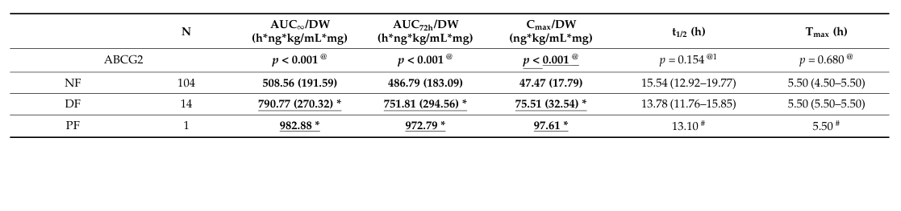

## Question

# Disease Characteristics Research Template

## Target Disease
- **Disease Name:** Statin Toxicity
- **MONDO ID:** MONDO:0033170 (if available)
- **Causal gene(s):** not recorded
- **OMIM:** not recorded
- **Synonyms:** not recorded
- **Category:** Complex

Many disease names are serial numbers ("... autosomal dominant 64", "... 26") that
do not say which gene the disease is about, and a similarly named disease with a
different gene is easy to research by mistake. Research the disease with the MONDO
ID and causal gene given above, and name its causal gene in your first paragraph.
If the name seems to point to a different gene or OMIM entry, follow the
identifiers above.

## Research Objectives

Please provide a comprehensive research report on **Statin Toxicity** covering all of the
disease characteristics listed below. This report will be used to populate a disease knowledge
base entry. Be thorough and cite primary literature (PMID preferred) for all claims.

For each section, **suggested databases/resources** are listed. These are the first places
you should search for information on each topic.

---

### 1. Disease Information
> **Search first:** OMIM, Orphanet, ICD-10/ICD-11, MeSH, PubMed

- What is the disease? Provide a concise overview.
- What are the key identifiers? (OMIM, Orphanet, ICD-10/ICD-11, MeSH, Mondo)
- What are the common synonyms and alternative names?
- Is the information derived from individual patients (e.g., EHR) or aggregated disease-level resources?

### 2. Etiology

- **Disease Causal Factors**: What are the primary causes? (genetic, environmental, infectious, mechanistic)
- **Risk Factors**:
  > **Search first:** PubMed, Cochrane Library, UpToDate, clinical guidelines, ClinVar, ClinGen, GWAS Catalog, PheGenI, CTD, CDC, WHO, epidemiological databases
  - Genetic risk factors (causal variants, susceptibility loci, modifier genes)
  - Environmental risk factors (toxins, lifestyle, occupational exposures, age, sex, family history)
- **Protective Factors**:
  > **Search first:** PubMed, Cochrane Library, clinical trial databases, GWAS Catalog, gnomAD, WHO, CDC, nutrition databases
  - Genetic protective factors (protective variants, modifier alleles)
  - Environmental protective factors (diet, lifestyle, exposures that reduce risk)
- **Gene-Environment Interactions**: How do genetic and environmental factors interact to influence disease?
  > **Search first:** CTD, PubMed, PheGenI, GxE databases

### 3. Phenotypes
> **Search first:** HPO (Human Phenotype Ontology), OMIM, Orphanet, PubMed, clinicaltrials.gov, MedDRA, SNOMED CT, DECIPHER, LOINC

For each phenotype, provide:
- **Phenotype type**: symptoms, clinical signs, physical manifestations, behavioral changes, or laboratory abnormalities
  > For symptoms/signs: HPO, OMIM, Orphanet, PubMed
  > For behavioral changes: HPO, DSM, RDoC (Research Domain Criteria), PubMed
  > For laboratory abnormalities: LOINC, SNOMED CT, LabTests Online, PubMed
- **Phenotype characteristics**:
  > **Search first:** OMIM, Orphanet, HPO, PubMed
  - Age of symptom onset (neonatal, childhood, adult-onset, late-onset)
  - Symptom severity (mild, moderate, severe, variable)
  - Symptom progression (stable, progressive, episodic, fluctuating)
  - Frequency among affected individuals (percentage or qualitative)
- **Quality of life impact**: Effects on daily functioning and well-being (per-phenotype when possible)
  > **Search first:** EQ-5D database, SF-36, WHO QOL databases, PubMed
- Suggest HPO (Human Phenotype Ontology) terms for each phenotype

### 4. Genetic/Molecular Information

- **Causal Genes**: Gene mutations or chromosomal abnormalities responsible for disease (gene symbols, OMIM IDs)
  > **Search first:** OMIM, ClinVar, HGMD, Ensembl, NCBI Gene
- **Pathogenic Variants**:
  - Affected genes (gene symbols, HGNC IDs)
    > **Search first:** OMIM, NCBI Gene, Ensembl, HGNC, UniProt, GeneCards
  - Variant classification (pathogenic, likely pathogenic, VUS per ACMG/AMP guidelines)
    > **Search first:** ClinVar, ClinGen, ACMG/AMP guidelines, VarSome
  - Variant type/class (missense, frameshift, nonsense, splice-site, structural)
  - Allele frequency in population databases
    > **Search first:** gnomAD, 1000 Genomes, ExAC, TOPMed, dbSNP
  - Somatic vs germline origin
    > **Search first:** COSMIC (somatic), ClinVar, ICGC, TCGA
  - Functional consequences (loss of function, gain of function, dominant negative)
- **Modifier Genes**: Genes that modify disease severity or expression
- **Epigenetic Information**: DNA methylation, histone modifications, chromatin changes affecting disease
  > **Search first:** ENCODE, Roadmap Epigenomics, MethBase, DiseaseMeth
- **Chromosomal Abnormalities**: Large-scale genetic changes (aneuploidy, translocations, inversions)
  > **Search first:** DECIPHER, ClinVar, ECARUCA, UCSC Genome Browser

### 5. Environmental Information

- **Environmental Factors**: Non-genetic contributing factors (toxins, radiation, pollution, occupational exposure)
  > **Search first:** CTD (Comparative Toxicogenomics Database), TOXNET, PubMed, EPA databases
- **Lifestyle Factors**: Behavioral factors (smoking, diet, exercise, alcohol consumption)
  > **Search first:** CDC databases, WHO, PubMed, NHANES
- **Infectious Agents**: If applicable, pathogens causing or triggering disease (bacteria, viruses, fungi, parasites)
  > **Search first:** NCBI Taxonomy, ViPR, BV-BRC, MicrobeDB, GIDEON

### 6. Mechanism / Pathophysiology

**Present this section as an ordered causal chain first, then the detail below.**
Open with a numbered sequence of mechanistic steps running from the initiating
lesion (mutation, exposure, infection) to the clinical manifestation, one step per
line, each naming what it causes next. State the causal verb explicitly ("leads
to", "results in") and say where a step is inferred rather than demonstrated.
Where the mechanism branches, show the branch. The categories below are a
checklist of what to cover within those steps, not the organizing structure —
a step may draw on several of them, and a category may contribute to several
steps.

- **Molecular Pathways**: Specific signaling cascades or biochemical pathways involved (Wnt, MAPK, mTOR, PI3K-AKT, etc.)
  > **Search first:** KEGG, Reactome, WikiPathways, PathBank, BioCyc
- **Cellular Processes**: Cell-level mechanisms (apoptosis, autophagy, cell cycle dysregulation, inflammation, etc.)
  > **Search first:** Gene Ontology (GO), Reactome, KEGG, PubMed
- **Protein Dysfunction**: How protein structure or function is altered (misfolding, aggregation, loss of function, gain of function)
  > **Search first:** UniProt, PDB (Protein Data Bank), InterPro, Pfam, AlphaFold
- **Metabolic Changes**: Alterations in metabolic processes (energy metabolism, lipid metabolism, amino acid metabolism)
  > **Search first:** KEGG, BioCyc, HMDB (Human Metabolome Database), BRENDA
- **Immune System Involvement**: Role of immune response (autoimmunity, immunodeficiency, chronic inflammation)
  > **Search first:** ImmPort, Immunome Database, IEDB, Gene Ontology
- **Tissue Damage Mechanisms**: How tissues/ are injured (oxidative stress, ischemia, fibrosis, necrosis)
  > **Search first:** PubMed, Gene Ontology, Reactome
- **Biochemical Abnormalities**: Specific molecular defects (enzyme deficiencies, receptor dysfunction, ion channel defects)
  > **Search first:** BRENDA, UniProt, KEGG, OMIM, PubMed
- **Epigenetic Changes**: DNA methylation, histone modifications affecting gene expression in disease
  > **Search first:** ENCODE, Roadmap Epigenomics, MethBase, DiseaseMeth
- **Molecular Profiling** (if available):
  - Transcriptomics/gene expression changes
    > **Search first:** GEO (Gene Expression Omnibus), ArrayExpress, GTEx, Human Cell Atlas, SRA
  - Proteomics findings
    > **Search first:** PRIDE, ProteomeXchange, Human Protein Atlas, STRING, BioGRID
  - Metabolomics signatures
    > **Search first:** MetaboLights, Metabolomics Workbench, HMDB, METLIN
  - Lipidomics alterations
    > **Search first:** LIPID MAPS, SwissLipids, LipidHome, Metabolomics Workbench
  - Genomic structural features
    > **Search first:** UCSC Genome Browser, Ensembl, NCBI, dbVar, DGV
- **Advanced Technologies** (if applicable):
  - Single-cell analysis findings (cell-type specific mechanisms, cellular heterogeneity)
    > **Search first:** Human Cell Atlas, Single Cell Portal, GEO, CELLxGENE
  - Spatial transcriptomics findings
    > **Search first:** GEO, Spatial Research, Vizgen, 10x Genomics data
  - Multi-omics integration results
    > **Search first:** TCGA, ICGC, cBioPortal, LinkedOmics, PubMed
  - Functional genomics screens (CRISPR, RNAi)
    > **Search first:** DepMap, GenomeRNAi, PubMed, BioGRID ORCS

For each mechanism, describe:
- The causal chain from initial trigger to clinical manifestation
- Which mechanisms are upstream vs downstream
- What cell types and biological processes are involved
- Suggest GO terms for biological processes and CL terms for cell types

### 7. Anatomical Structures Affected

- **Organ Level**:
  - Primary organs directly affected
  - Secondary organ involvement (complications, secondary effects)
  - Body systems involved (cardiovascular, nervous, digestive, respiratory, endocrine, etc.)
  > **Search first:** Uberon, FMA (Foundational Model of Anatomy), OMIM, HPO, ICD-11, MeSH, SNOMED CT
- **Tissue and Cell Level**:
  - Specific tissue types affected (epithelial, connective, muscle, nervous)
  - Specific cell populations targeted (with Cell Ontology terms)
  > **Search first:** Uberon, Human Protein Atlas, Cell Ontology, Human Cell Atlas, CellMarker, PanglaoDB
- **Subcellular Level**:
  - Cellular compartments involved (mitochondria, nucleus, ER, lysosomes) (with GO Cellular Component terms)
  > **Search first:** Gene Ontology (Cellular Component), UniProt, Human Protein Atlas
- **Localization**:
  - Specific anatomical sites (with UBERON terms)
    > **Search first:** FMA, Uberon, NeuroNames (for brain), SNOMED CT
  - Lateralization (unilateral, bilateral, asymmetric)
    > **Search first:** HPO, clinical literature, imaging databases

### 8. Temporal Development

- **Onset**:
  - Typical age of onset (congenital, pediatric, adult, geriatric)
  - Onset pattern (acute, subacute, chronic, insidious)
  > **Search first:** OMIM, Orphanet, HPO, PubMed
- **Progression**:
  - Disease stages (early, intermediate, advanced, end-stage)
    > **Search first:** Cancer Staging Manual (AJCC), WHO classifications, PubMed
  - Progression rate (rapid, slow, variable)
  - Disease course pattern (episodic, relapsing-remitting, progressive, stable)
  - Disease duration (self-limited, chronic lifelong)
  > **Search first:** Disease registries, longitudinal cohort databases, natural history studies, PubMed, Orphanet, OMIM
- **Patterns**:
  - Remission patterns (spontaneous, treatment-induced)
    > **Search first:** Clinical trial databases, disease registries, PubMed
  - Critical periods (time windows of vulnerability or opportunity for intervention)
    > **Search first:** PubMed, developmental biology databases, clinical guidelines

### 9. Inheritance and Population

- **Epidemiology**:
  - Prevalence (cases per 100,000 at given time)
  - Incidence (new cases per 100,000 per year)
  > **Search first:** Orphanet, CDC, WHO, GBD (Global Burden of Disease), national registries, SEER, disease registries
- **For Genetic Etiology**:
  - Inheritance pattern (AD, AR, X-linked, mitochondrial, multifactorial, polygenic)
    > **Search first:** OMIM, Orphanet, ClinVar, GTR (Genetic Testing Registry)
  - Penetrance (complete, incomplete, age-dependent)
    > **Search first:** ClinVar, OMIM, PubMed, ClinGen
  - Expressivity (variable, consistent)
    > **Search first:** OMIM, ClinVar, PubMed
  - Genetic anticipation (increasing severity in successive generations)
    > **Search first:** OMIM, PubMed (especially for repeat expansion disorders)
  - Germline mosaicism
    > **Search first:** ClinVar, OMIM, genetic counseling literature, PubMed
  - Founder effects (population-specific mutations)
    > **Search first:** gnomAD, population genetics databases, PubMed
  - Consanguinity role
    > **Search first:** OMIM, population studies, genetic counseling resources
  - Carrier frequency
    > **Search first:** gnomAD, carrier screening databases, GeneReviews, GTR
- **Population Demographics**:
  - Affected populations (ethnic or demographic groups with higher prevalence)
    > **Search first:** gnomAD, 1000 Genomes, PAGE Study, PubMed, population registries
  - Geographic distribution (endemic areas, regional variation)
    > **Search first:** WHO, CDC, GBD, Orphanet, geographic epidemiology databases
  - Geographic distribution of specific variants
  - Sex ratio (male:female)
    > **Search first:** Disease registries, OMIM, PubMed, epidemiological databases
  - Age distribution of affected individuals
    > **Search first:** CDC, disease registries, SEER, Orphanet

### 10. Diagnostics

- **Clinical Tests**:
  - Laboratory tests (blood, urine, tissue chemistry, specific enzyme assays)
    > **Search first:** LOINC, LabTests Online, PubMed
  - Biomarkers (proteins, metabolites, genetic markers, circulating biomarkers)
    > **Search first:** FDA Biomarker List, BEST (Biomarkers, EndpointS, and other Tools), PubMed
  - Imaging studies (X-ray, CT, MRI, PET, ultrasound)
    > **Search first:** RadLex, DICOM, Radiopaedia, imaging databases
  - Functional tests (pulmonary function, cardiac stress tests)
    > **Search first:** LOINC, clinical guidelines, PubMed
  - Electrophysiology (EEG, EMG, ECG, nerve conduction studies)
    > **Search first:** LOINC, clinical neurophysiology databases, PubMed
  - Biopsy findings (histopathology, immunohistochemistry)
    > **Search first:** SNOMED CT, College of American Pathologists resources, PubMed
  - Pathology findings (microscopic examination)
    > **Search first:** SNOMED CT, Digital Pathology databases, PubMed
- **Genetic Testing**:
  > **Search first:** GTR (Genetic Testing Registry), GeneReviews, ClinGen
  - Overview of recommended genetic testing approach
  - Whole genome sequencing (WGS) utility
    > **Search first:** GTR, ClinVar, GEL (Genomics England), gnomAD
  - Whole exome sequencing (WES) utility
    > **Search first:** GTR, ClinVar, OMIM, GeneMatcher
  - Gene panels (which panels, which genes)
    > **Search first:** GTR, ClinVar, laboratory-specific databases
  - Single gene testing
    > **Search first:** GTR, ClinVar, OMIM, GeneReviews
  - Chromosomal microarray (CMA)
    > **Search first:** DECIPHER, ClinVar, dbVar, ECARUCA
  - Karyotyping
    > **Search first:** Chromosome Abnormality Database, ClinVar, cytogenetics resources
  - FISH
    > **Search first:** ClinVar, cytogenetics databases, PubMed
  - Mitochondrial DNA testing
    > **Search first:** MITOMAP, MSeqDR, ClinVar, GTR
  - Repeat expansion testing
    > **Search first:** GTR, ClinVar, repeat expansion databases, PubMed
- **Omics-Based Diagnostics** (if applicable):
  - RNA sequencing / transcriptomics
    > **Search first:** GEO, ArrayExpress, GTEx, RNA-seq databases
  - Proteomics
    > **Search first:** PRIDE, ProteomeXchange, FDA Biomarker database
  - Metabolomics
    > **Search first:** MetaboLights, Metabolomics Workbench, HMDB
  - Epigenomics
    > **Search first:** GEO, ENCODE, Roadmap Epigenomics, MethBase
  - Liquid biopsy
    > **Search first:** COSMIC, ClinVar, liquid biopsy databases, PubMed
- **Clinical Criteria**:
  - Standardized diagnostic criteria (DSM, ICD, society guidelines)
    > **Search first:** DSM-5, ICD-11, clinical society guidelines, UpToDate
  - Differential diagnosis (other conditions to rule out, with distinguishing features)
    > **Search first:** DynaMed, UpToDate, clinical decision support systems
- **Screening**:
  - Screening methods for asymptomatic individuals (newborn screening, carrier screening, cascade screening)
    > **Search first:** ACMG recommendations, CDC newborn screening, GTR

### 11. Outcome/Prognosis

- **Survival and Mortality**:
  - Survival rate (5-year, 10-year, overall)
    > **Search first:** SEER, cancer registries, disease-specific registries, PubMed
  - Life expectancy (with and without treatment if applicable)
    > **Search first:** Orphanet, disease registries, actuarial databases, PubMed
  - Mortality rate
    > **Search first:** CDC, WHO, GBD, national mortality databases
  - Disease-specific mortality (deaths directly attributable to disease)
    > **Search first:** Disease registries, CDC Wonder, GBD, PubMed
- **Morbidity and Function**:
  - Morbidity (disease-related disability and health impacts)
    > **Search first:** GBD, WHO, disability databases, PubMed
  - Disability outcomes (long-term functional impairments)
    > **Search first:** ICF (International Classification of Functioning), disability registries
  - Quality of life measures (EQ-5D, SF-36, PROMIS, disease-specific tools)
    > **Search first:** EQ-5D database, SF-36, PROMIS, PubMed
- **Disease Course**:
  - Complications (secondary problems: infections, organ failure, etc.)
    > **Search first:** ICD codes, disease registries, clinical databases, PubMed
  - Recovery potential (likelihood and extent of recovery, with vs without treatment)
    > **Search first:** Natural history studies, rehabilitation databases, PubMed
- **Prediction**:
  - Prognostic factors (age, disease severity, biomarkers, treatment response)
    > **Search first:** Prognostic models databases, clinical calculators, PubMed
  - Prognostic biomarkers (molecular markers predicting disease course)
    > **Search first:** FDA Biomarker database, PubMed, cancer prognostic databases

### 12. Treatment

- **Pharmacotherapy**:
  - Pharmacological treatments (drug names, drug classes, mechanisms of action)
    > **Search first:** DrugBank, RxNorm, ATC classification, DailyMed, FDA databases
  - Pharmacogenomics (how genetic variants affect drug metabolism, efficacy, toxicity)
    > **Search first:** PharmGKB, CPIC (Clinical Pharmacogenetics), FDA Table of PGx Biomarkers
- **Advanced Therapeutics**:
  - Gene therapy (viral vectors, CRISPR, gene replacement, gene editing)
    > **Search first:** ClinicalTrials.gov, FDA gene therapy database, ASGCT resources
  - Cell therapy (stem cell transplant, CAR-T, cellular therapeutics)
    > **Search first:** ClinicalTrials.gov, FDA cell therapy database, FACT standards
  - RNA-based therapies (ASOs, siRNA, mRNA therapies)
    > **Search first:** ClinicalTrials.gov, FDA approvals, PubMed
  - Targeted therapies (treatments directed at specific molecular targets)
    > **Search first:** My Cancer Genome, OncoKB, ClinicalTrials.gov, FDA approvals
  - Immunotherapies (checkpoint inhibitors, monoclonal antibodies)
    > **Search first:** Cancer Immunotherapy Database, FDA approvals, ClinicalTrials.gov
- **Surgical and Interventional**:
  - Surgical interventions (types of surgery, timing, outcomes)
    > **Search first:** CPT codes, surgical registries, clinical guidelines, PubMed
- **Supportive and Rehabilitative**:
  - Supportive care (symptom management, pain control, nutrition)
    > **Search first:** Clinical guidelines, Cochrane Library, PubMed
  - Rehabilitation (physical therapy, occupational therapy, speech therapy)
    > **Search first:** Rehabilitation medicine databases, clinical guidelines, PubMed
- **Experimental**:
  - Experimental treatments in clinical trials (with NCT identifiers if available)
    > **Search first:** ClinicalTrials.gov, EU Clinical Trials Register, WHO ICTRP
- **Treatment Outcomes**:
  - Treatment response rates
    > **Search first:** Clinical trial databases, FDA reviews, systematic reviews, PubMed
  - Side effects and adverse events
    > **Search first:** FDA Adverse Event Reporting System (FAERS), MedWatch, PubMed
- **Treatment Strategy**:
  - Treatment algorithms (clinical pathways, decision trees)
    > **Search first:** Clinical practice guidelines, NCCN Guidelines, UpToDate
  - Combination therapies
    > **Search first:** ClinicalTrials.gov, treatment guidelines, PubMed
  - Personalized medicine approaches (genotype-guided treatment)
    > **Search first:** My Cancer Genome, CIViC, PharmGKB, precision medicine databases

For each treatment, suggest NCIT (NCI Thesaurus) clinical-intervention terms where applicable.

### 13. Prevention

- **Prevention Levels**:
  - Primary prevention (preventing disease occurrence: vaccination, risk factor modification)
    > **Search first:** CDC, WHO, USPSTF recommendations, Cochrane Library
  - Secondary prevention (early detection and treatment: screening programs, early intervention)
    > **Search first:** USPSTF, CDC screening guidelines, WHO
  - Tertiary prevention (preventing complications in those with disease)
    > **Search first:** Clinical guidelines, disease management protocols, PubMed
- **Immunization**: Vaccine strategies (if applicable)
  > **Search first:** CDC vaccine schedules, WHO immunization, FDA vaccine database
- **Screening and Early Detection**:
  - Screening programs (population-based: newborn screening, cancer screening)
    > **Search first:** CDC screening programs, USPSTF, cancer screening databases
  - Genetic screening (carrier screening, preimplantation genetic diagnosis, prenatal testing)
    > **Search first:** ACMG recommendations, ACOG guidelines, GTR
  - Risk stratification (identifying high-risk individuals for targeted prevention)
    > **Search first:** Risk prediction models, clinical calculators, PubMed
- **Behavioral Interventions**: Lifestyle modifications to reduce risk
  > **Search first:** CDC, WHO, behavioral intervention databases, Cochrane Library
- **Counseling**: Genetic counseling (risk assessment, family planning guidance)
  > **Search first:** NSGC resources, ACMG guidelines, GeneReviews
- **Public Health**:
  - Public health interventions (sanitation, vector control, health education)
    > **Search first:** CDC, WHO, public health databases, PubMed
  - Environmental interventions (reducing environmental risk factors)
    > **Search first:** EPA databases, WHO environmental health, PubMed
- **Prophylaxis**: Preventive medications or procedures
  > **Search first:** Clinical guidelines, FDA approvals, PubMed

### 14. Other Species / Natural Disease

- **Taxonomy**: Species affected (with NCBI Taxon identifiers)
  > **Search first:** NCBI Taxonomy
- **Breed**: Specific breeds affected (with VBO identifiers if applicable)
  > **Search first:** VBO (Vertebrate Breed Ontology)
- **Gene**: Orthologous genes in other species (with NCBI Gene IDs)
  > **Search first:** NCBI Gene
- **Natural Disease**:
  - Naturally occurring disease in other species (companion animals, wildlife)
    > **Search first:** OMIA (Online Mendelian Inheritance in Animals), VetCompass, PubMed
  - Veterinary relevance and importance in animal health
    > **Search first:** OMIA, veterinary databases, PubMed
- **Comparative Biology**:
  - Comparative pathology (similarities and differences across species)
    > **Search first:** OMIA, comparative pathology databases, PubMed
  - Evolutionary conservation of disease mechanisms
    > **Search first:** HomoloGene, OrthoMCL, Alliance of Genome Resources
- **Transmission** (if applicable):
  - Zoonotic potential
    > **Search first:** CDC zoonotic diseases, WHO zoonoses, GIDEON
  - Cross-species susceptibility
    > **Search first:** NCBI Taxonomy, veterinary databases, PubMed

### 15. Model Organisms

- **Model Types**:
  - Model organism type (mammalian, invertebrate, cellular, in vitro)
    > **Search first:** Alliance of Genome Resources, model organism databases
  - Specific model systems (mouse, rat, zebrafish, Drosophila, C. elegans, yeast, cell lines, organoids, iPSCs)
    > **Search first:** MGI, RGD, ZFIN, FlyBase, WormBase, SGD, ATCC, Cellosaurus
  - Induced models (drug treatment, surgical intervention, environmental manipulation)
    > **Search first:** MGI, model organism databases, PubMed
- **Genetic Models**:
  - Types available (knockout, knock-in, transgenic, conditional, humanized)
    > **Search first:** MGI, IMPC, KOMP, EuMMCR, IMSR
- **Model Characteristics**:
  - Phenotype recapitulation (how well model reproduces human disease features)
    > **Search first:** Model organism databases, comparative studies, PubMed
  - Model limitations (aspects of human disease not captured)
    > **Search first:** Model organism databases, PubMed, review articles
- **Applications**:
  - Research applications (what aspects of disease can be studied)
    > **Search first:** Model organism databases, PubMed
- **Resources**:
  - Model databases
    > **Search first:** MGI, RGD, ZFIN, FlyBase, WormBase, IMSR, EMMA, MMRRC

---

## Citation Requirements

- Cite primary literature (PMID preferred) for all mechanistic and clinical claims
- Prioritize recent reviews and landmark papers
- Include direct quotes from abstracts where possible to support key statements
- Distinguish evidence source types: human clinical, model organism, in vitro, computational

## Output Format

Structure your response as a comprehensive narrative organized by the sections above.
For each section, provide:
- Factual content with specific details (numbers, percentages, gene names, variant nomenclature)
- Ontology term suggestions (HPO, GO, CL, UBERON, CHEBI, NCIT, MONDO) where applicable
- Evidence citations with PMIDs
- Direct quotes from abstracts to support key claims
- Clear indication when information is not available or not applicable for this disease

This report will be used to populate a disease knowledge base entry with:
- Pathophysiology descriptions with causal chains
- Gene/protein annotations (HGNC, GO terms)
- Phenotype associations (HP terms) with frequencies
- Cell type involvement (CL terms)
- Anatomical locations (UBERON terms)
- Chemical entities (CHEBI terms)
- Treatment annotations (NCIT terms)
- Evidence items with PMIDs and exact abstract quotes
- Epidemiology, prognosis, diagnostic, and prevention information
- Animal model descriptions with phenotype recapitulation details

## Output

Question: You are an expert researcher providing comprehensive, well-cited information.

Provide detailed information focusing on:
1. Key concepts and definitions with current understanding
2. Recent developments and latest research (prioritize 2023-2024 sources)
3. Current applications and real-world implementations
4. Expert opinions and analysis from authoritative sources
5. Relevant statistics and data from recent studies

Format as a comprehensive research report with proper citations. Include URLs and publication dates where available.
Always prioritize recent, authoritative sources and provide specific citations for all major claims.

# Disease Characteristics Research Template

## Target Disease
- **Disease Name:** Statin Toxicity
- **MONDO ID:** MONDO:0033170 (if available)
- **Causal gene(s):** not recorded
- **OMIM:** not recorded
- **Synonyms:** not recorded
- **Category:** Complex

Many disease names are serial numbers ("... autosomal dominant 64", "... 26") that
do not say which gene the disease is about, and a similarly named disease with a
different gene is easy to research by mistake. Research the disease with the MONDO
ID and causal gene given above, and name its causal gene in your first paragraph.
If the name seems to point to a different gene or OMIM entry, follow the
identifiers above.

## Research Objectives

Please provide a comprehensive research report on **Statin Toxicity** covering all of the
disease characteristics listed below. This report will be used to populate a disease knowledge
base entry. Be thorough and cite primary literature (PMID preferred) for all claims.

For each section, **suggested databases/resources** are listed. These are the first places
you should search for information on each topic.

---

### 1. Disease Information
> **Search first:** OMIM, Orphanet, ICD-10/ICD-11, MeSH, PubMed

- What is the disease? Provide a concise overview.
- What are the key identifiers? (OMIM, Orphanet, ICD-10/ICD-11, MeSH, Mondo)
- What are the common synonyms and alternative names?
- Is the information derived from individual patients (e.g., EHR) or aggregated disease-level resources?

### 2. Etiology

- **Disease Causal Factors**: What are the primary causes? (genetic, environmental, infectious, mechanistic)
- **Risk Factors**:
  > **Search first:** PubMed, Cochrane Library, UpToDate, clinical guidelines, ClinVar, ClinGen, GWAS Catalog, PheGenI, CTD, CDC, WHO, epidemiological databases
  - Genetic risk factors (causal variants, susceptibility loci, modifier genes)
  - Environmental risk factors (toxins, lifestyle, occupational exposures, age, sex, family history)
- **Protective Factors**:
  > **Search first:** PubMed, Cochrane Library, clinical trial databases, GWAS Catalog, gnomAD, WHO, CDC, nutrition databases
  - Genetic protective factors (protective variants, modifier alleles)
  - Environmental protective factors (diet, lifestyle, exposures that reduce risk)
- **Gene-Environment Interactions**: How do genetic and environmental factors interact to influence disease?
  > **Search first:** CTD, PubMed, PheGenI, GxE databases

### 3. Phenotypes
> **Search first:** HPO (Human Phenotype Ontology), OMIM, Orphanet, PubMed, clinicaltrials.gov, MedDRA, SNOMED CT, DECIPHER, LOINC

For each phenotype, provide:
- **Phenotype type**: symptoms, clinical signs, physical manifestations, behavioral changes, or laboratory abnormalities
  > For symptoms/signs: HPO, OMIM, Orphanet, PubMed
  > For behavioral changes: HPO, DSM, RDoC (Research Domain Criteria), PubMed
  > For laboratory abnormalities: LOINC, SNOMED CT, LabTests Online, PubMed
- **Phenotype characteristics**:
  > **Search first:** OMIM, Orphanet, HPO, PubMed
  - Age of symptom onset (neonatal, childhood, adult-onset, late-onset)
  - Symptom severity (mild, moderate, severe, variable)
  - Symptom progression (stable, progressive, episodic, fluctuating)
  - Frequency among affected individuals (percentage or qualitative)
- **Quality of life impact**: Effects on daily functioning and well-being (per-phenotype when possible)
  > **Search first:** EQ-5D database, SF-36, WHO QOL databases, PubMed
- Suggest HPO (Human Phenotype Ontology) terms for each phenotype

### 4. Genetic/Molecular Information

- **Causal Genes**: Gene mutations or chromosomal abnormalities responsible for disease (gene symbols, OMIM IDs)
  > **Search first:** OMIM, ClinVar, HGMD, Ensembl, NCBI Gene
- **Pathogenic Variants**:
  - Affected genes (gene symbols, HGNC IDs)
    > **Search first:** OMIM, NCBI Gene, Ensembl, HGNC, UniProt, GeneCards
  - Variant classification (pathogenic, likely pathogenic, VUS per ACMG/AMP guidelines)
    > **Search first:** ClinVar, ClinGen, ACMG/AMP guidelines, VarSome
  - Variant type/class (missense, frameshift, nonsense, splice-site, structural)
  - Allele frequency in population databases
    > **Search first:** gnomAD, 1000 Genomes, ExAC, TOPMed, dbSNP
  - Somatic vs germline origin
    > **Search first:** COSMIC (somatic), ClinVar, ICGC, TCGA
  - Functional consequences (loss of function, gain of function, dominant negative)
- **Modifier Genes**: Genes that modify disease severity or expression
- **Epigenetic Information**: DNA methylation, histone modifications, chromatin changes affecting disease
  > **Search first:** ENCODE, Roadmap Epigenomics, MethBase, DiseaseMeth
- **Chromosomal Abnormalities**: Large-scale genetic changes (aneuploidy, translocations, inversions)
  > **Search first:** DECIPHER, ClinVar, ECARUCA, UCSC Genome Browser

### 5. Environmental Information

- **Environmental Factors**: Non-genetic contributing factors (toxins, radiation, pollution, occupational exposure)
  > **Search first:** CTD (Comparative Toxicogenomics Database), TOXNET, PubMed, EPA databases
- **Lifestyle Factors**: Behavioral factors (smoking, diet, exercise, alcohol consumption)
  > **Search first:** CDC databases, WHO, PubMed, NHANES
- **Infectious Agents**: If applicable, pathogens causing or triggering disease (bacteria, viruses, fungi, parasites)
  > **Search first:** NCBI Taxonomy, ViPR, BV-BRC, MicrobeDB, GIDEON

### 6. Mechanism / Pathophysiology

**Present this section as an ordered causal chain first, then the detail below.**
Open with a numbered sequence of mechanistic steps running from the initiating
lesion (mutation, exposure, infection) to the clinical manifestation, one step per
line, each naming what it causes next. State the causal verb explicitly ("leads
to", "results in") and say where a step is inferred rather than demonstrated.
Where the mechanism branches, show the branch. The categories below are a
checklist of what to cover within those steps, not the organizing structure —
a step may draw on several of them, and a category may contribute to several
steps.

- **Molecular Pathways**: Specific signaling cascades or biochemical pathways involved (Wnt, MAPK, mTOR, PI3K-AKT, etc.)
  > **Search first:** KEGG, Reactome, WikiPathways, PathBank, BioCyc
- **Cellular Processes**: Cell-level mechanisms (apoptosis, autophagy, cell cycle dysregulation, inflammation, etc.)
  > **Search first:** Gene Ontology (GO), Reactome, KEGG, PubMed
- **Protein Dysfunction**: How protein structure or function is altered (misfolding, aggregation, loss of function, gain of function)
  > **Search first:** UniProt, PDB (Protein Data Bank), InterPro, Pfam, AlphaFold
- **Metabolic Changes**: Alterations in metabolic processes (energy metabolism, lipid metabolism, amino acid metabolism)
  > **Search first:** KEGG, BioCyc, HMDB (Human Metabolome Database), BRENDA
- **Immune System Involvement**: Role of immune response (autoimmunity, immunodeficiency, chronic inflammation)
  > **Search first:** ImmPort, Immunome Database, IEDB, Gene Ontology
- **Tissue Damage Mechanisms**: How tissues/ are injured (oxidative stress, ischemia, fibrosis, necrosis)
  > **Search first:** PubMed, Gene Ontology, Reactome
- **Biochemical Abnormalities**: Specific molecular defects (enzyme deficiencies, receptor dysfunction, ion channel defects)
  > **Search first:** BRENDA, UniProt, KEGG, OMIM, PubMed
- **Epigenetic Changes**: DNA methylation, histone modifications affecting gene expression in disease
  > **Search first:** ENCODE, Roadmap Epigenomics, MethBase, DiseaseMeth
- **Molecular Profiling** (if available):
  - Transcriptomics/gene expression changes
    > **Search first:** GEO (Gene Expression Omnibus), ArrayExpress, GTEx, Human Cell Atlas, SRA
  - Proteomics findings
    > **Search first:** PRIDE, ProteomeXchange, Human Protein Atlas, STRING, BioGRID
  - Metabolomics signatures
    > **Search first:** MetaboLights, Metabolomics Workbench, HMDB, METLIN
  - Lipidomics alterations
    > **Search first:** LIPID MAPS, SwissLipids, LipidHome, Metabolomics Workbench
  - Genomic structural features
    > **Search first:** UCSC Genome Browser, Ensembl, NCBI, dbVar, DGV
- **Advanced Technologies** (if applicable):
  - Single-cell analysis findings (cell-type specific mechanisms, cellular heterogeneity)
    > **Search first:** Human Cell Atlas, Single Cell Portal, GEO, CELLxGENE
  - Spatial transcriptomics findings
    > **Search first:** GEO, Spatial Research, Vizgen, 10x Genomics data
  - Multi-omics integration results
    > **Search first:** TCGA, ICGC, cBioPortal, LinkedOmics, PubMed
  - Functional genomics screens (CRISPR, RNAi)
    > **Search first:** DepMap, GenomeRNAi, PubMed, BioGRID ORCS

For each mechanism, describe:
- The causal chain from initial trigger to clinical manifestation
- Which mechanisms are upstream vs downstream
- What cell types and biological processes are involved
- Suggest GO terms for biological processes and CL terms for cell types

### 7. Anatomical Structures Affected

- **Organ Level**:
  - Primary organs directly affected
  - Secondary organ involvement (complications, secondary effects)
  - Body systems involved (cardiovascular, nervous, digestive, respiratory, endocrine, etc.)
  > **Search first:** Uberon, FMA (Foundational Model of Anatomy), OMIM, HPO, ICD-11, MeSH, SNOMED CT
- **Tissue and Cell Level**:
  - Specific tissue types affected (epithelial, connective, muscle, nervous)
  - Specific cell populations targeted (with Cell Ontology terms)
  > **Search first:** Uberon, Human Protein Atlas, Cell Ontology, Human Cell Atlas, CellMarker, PanglaoDB
- **Subcellular Level**:
  - Cellular compartments involved (mitochondria, nucleus, ER, lysosomes) (with GO Cellular Component terms)
  > **Search first:** Gene Ontology (Cellular Component), UniProt, Human Protein Atlas
- **Localization**:
  - Specific anatomical sites (with UBERON terms)
    > **Search first:** FMA, Uberon, NeuroNames (for brain), SNOMED CT
  - Lateralization (unilateral, bilateral, asymmetric)
    > **Search first:** HPO, clinical literature, imaging databases

### 8. Temporal Development

- **Onset**:
  - Typical age of onset (congenital, pediatric, adult, geriatric)
  - Onset pattern (acute, subacute, chronic, insidious)
  > **Search first:** OMIM, Orphanet, HPO, PubMed
- **Progression**:
  - Disease stages (early, intermediate, advanced, end-stage)
    > **Search first:** Cancer Staging Manual (AJCC), WHO classifications, PubMed
  - Progression rate (rapid, slow, variable)
  - Disease course pattern (episodic, relapsing-remitting, progressive, stable)
  - Disease duration (self-limited, chronic lifelong)
  > **Search first:** Disease registries, longitudinal cohort databases, natural history studies, PubMed, Orphanet, OMIM
- **Patterns**:
  - Remission patterns (spontaneous, treatment-induced)
    > **Search first:** Clinical trial databases, disease registries, PubMed
  - Critical periods (time windows of vulnerability or opportunity for intervention)
    > **Search first:** PubMed, developmental biology databases, clinical guidelines

### 9. Inheritance and Population

- **Epidemiology**:
  - Prevalence (cases per 100,000 at given time)
  - Incidence (new cases per 100,000 per year)
  > **Search first:** Orphanet, CDC, WHO, GBD (Global Burden of Disease), national registries, SEER, disease registries
- **For Genetic Etiology**:
  - Inheritance pattern (AD, AR, X-linked, mitochondrial, multifactorial, polygenic)
    > **Search first:** OMIM, Orphanet, ClinVar, GTR (Genetic Testing Registry)
  - Penetrance (complete, incomplete, age-dependent)
    > **Search first:** ClinVar, OMIM, PubMed, ClinGen
  - Expressivity (variable, consistent)
    > **Search first:** OMIM, ClinVar, PubMed
  - Genetic anticipation (increasing severity in successive generations)
    > **Search first:** OMIM, PubMed (especially for repeat expansion disorders)
  - Germline mosaicism
    > **Search first:** ClinVar, OMIM, genetic counseling literature, PubMed
  - Founder effects (population-specific mutations)
    > **Search first:** gnomAD, population genetics databases, PubMed
  - Consanguinity role
    > **Search first:** OMIM, population studies, genetic counseling resources
  - Carrier frequency
    > **Search first:** gnomAD, carrier screening databases, GeneReviews, GTR
- **Population Demographics**:
  - Affected populations (ethnic or demographic groups with higher prevalence)
    > **Search first:** gnomAD, 1000 Genomes, PAGE Study, PubMed, population registries
  - Geographic distribution (endemic areas, regional variation)
    > **Search first:** WHO, CDC, GBD, Orphanet, geographic epidemiology databases
  - Geographic distribution of specific variants
  - Sex ratio (male:female)
    > **Search first:** Disease registries, OMIM, PubMed, epidemiological databases
  - Age distribution of affected individuals
    > **Search first:** CDC, disease registries, SEER, Orphanet

### 10. Diagnostics

- **Clinical Tests**:
  - Laboratory tests (blood, urine, tissue chemistry, specific enzyme assays)
    > **Search first:** LOINC, LabTests Online, PubMed
  - Biomarkers (proteins, metabolites, genetic markers, circulating biomarkers)
    > **Search first:** FDA Biomarker List, BEST (Biomarkers, EndpointS, and other Tools), PubMed
  - Imaging studies (X-ray, CT, MRI, PET, ultrasound)
    > **Search first:** RadLex, DICOM, Radiopaedia, imaging databases
  - Functional tests (pulmonary function, cardiac stress tests)
    > **Search first:** LOINC, clinical guidelines, PubMed
  - Electrophysiology (EEG, EMG, ECG, nerve conduction studies)
    > **Search first:** LOINC, clinical neurophysiology databases, PubMed
  - Biopsy findings (histopathology, immunohistochemistry)
    > **Search first:** SNOMED CT, College of American Pathologists resources, PubMed
  - Pathology findings (microscopic examination)
    > **Search first:** SNOMED CT, Digital Pathology databases, PubMed
- **Genetic Testing**:
  > **Search first:** GTR (Genetic Testing Registry), GeneReviews, ClinGen
  - Overview of recommended genetic testing approach
  - Whole genome sequencing (WGS) utility
    > **Search first:** GTR, ClinVar, GEL (Genomics England), gnomAD
  - Whole exome sequencing (WES) utility
    > **Search first:** GTR, ClinVar, OMIM, GeneMatcher
  - Gene panels (which panels, which genes)
    > **Search first:** GTR, ClinVar, laboratory-specific databases
  - Single gene testing
    > **Search first:** GTR, ClinVar, OMIM, GeneReviews
  - Chromosomal microarray (CMA)
    > **Search first:** DECIPHER, ClinVar, dbVar, ECARUCA
  - Karyotyping
    > **Search first:** Chromosome Abnormality Database, ClinVar, cytogenetics resources
  - FISH
    > **Search first:** ClinVar, cytogenetics databases, PubMed
  - Mitochondrial DNA testing
    > **Search first:** MITOMAP, MSeqDR, ClinVar, GTR
  - Repeat expansion testing
    > **Search first:** GTR, ClinVar, repeat expansion databases, PubMed
- **Omics-Based Diagnostics** (if applicable):
  - RNA sequencing / transcriptomics
    > **Search first:** GEO, ArrayExpress, GTEx, RNA-seq databases
  - Proteomics
    > **Search first:** PRIDE, ProteomeXchange, FDA Biomarker database
  - Metabolomics
    > **Search first:** MetaboLights, Metabolomics Workbench, HMDB
  - Epigenomics
    > **Search first:** GEO, ENCODE, Roadmap Epigenomics, MethBase
  - Liquid biopsy
    > **Search first:** COSMIC, ClinVar, liquid biopsy databases, PubMed
- **Clinical Criteria**:
  - Standardized diagnostic criteria (DSM, ICD, society guidelines)
    > **Search first:** DSM-5, ICD-11, clinical society guidelines, UpToDate
  - Differential diagnosis (other conditions to rule out, with distinguishing features)
    > **Search first:** DynaMed, UpToDate, clinical decision support systems
- **Screening**:
  - Screening methods for asymptomatic individuals (newborn screening, carrier screening, cascade screening)
    > **Search first:** ACMG recommendations, CDC newborn screening, GTR

### 11. Outcome/Prognosis

- **Survival and Mortality**:
  - Survival rate (5-year, 10-year, overall)
    > **Search first:** SEER, cancer registries, disease-specific registries, PubMed
  - Life expectancy (with and without treatment if applicable)
    > **Search first:** Orphanet, disease registries, actuarial databases, PubMed
  - Mortality rate
    > **Search first:** CDC, WHO, GBD, national mortality databases
  - Disease-specific mortality (deaths directly attributable to disease)
    > **Search first:** Disease registries, CDC Wonder, GBD, PubMed
- **Morbidity and Function**:
  - Morbidity (disease-related disability and health impacts)
    > **Search first:** GBD, WHO, disability databases, PubMed
  - Disability outcomes (long-term functional impairments)
    > **Search first:** ICF (International Classification of Functioning), disability registries
  - Quality of life measures (EQ-5D, SF-36, PROMIS, disease-specific tools)
    > **Search first:** EQ-5D database, SF-36, PROMIS, PubMed
- **Disease Course**:
  - Complications (secondary problems: infections, organ failure, etc.)
    > **Search first:** ICD codes, disease registries, clinical databases, PubMed
  - Recovery potential (likelihood and extent of recovery, with vs without treatment)
    > **Search first:** Natural history studies, rehabilitation databases, PubMed
- **Prediction**:
  - Prognostic factors (age, disease severity, biomarkers, treatment response)
    > **Search first:** Prognostic models databases, clinical calculators, PubMed
  - Prognostic biomarkers (molecular markers predicting disease course)
    > **Search first:** FDA Biomarker database, PubMed, cancer prognostic databases

### 12. Treatment

- **Pharmacotherapy**:
  - Pharmacological treatments (drug names, drug classes, mechanisms of action)
    > **Search first:** DrugBank, RxNorm, ATC classification, DailyMed, FDA databases
  - Pharmacogenomics (how genetic variants affect drug metabolism, efficacy, toxicity)
    > **Search first:** PharmGKB, CPIC (Clinical Pharmacogenetics), FDA Table of PGx Biomarkers
- **Advanced Therapeutics**:
  - Gene therapy (viral vectors, CRISPR, gene replacement, gene editing)
    > **Search first:** ClinicalTrials.gov, FDA gene therapy database, ASGCT resources
  - Cell therapy (stem cell transplant, CAR-T, cellular therapeutics)
    > **Search first:** ClinicalTrials.gov, FDA cell therapy database, FACT standards
  - RNA-based therapies (ASOs, siRNA, mRNA therapies)
    > **Search first:** ClinicalTrials.gov, FDA approvals, PubMed
  - Targeted therapies (treatments directed at specific molecular targets)
    > **Search first:** My Cancer Genome, OncoKB, ClinicalTrials.gov, FDA approvals
  - Immunotherapies (checkpoint inhibitors, monoclonal antibodies)
    > **Search first:** Cancer Immunotherapy Database, FDA approvals, ClinicalTrials.gov
- **Surgical and Interventional**:
  - Surgical interventions (types of surgery, timing, outcomes)
    > **Search first:** CPT codes, surgical registries, clinical guidelines, PubMed
- **Supportive and Rehabilitative**:
  - Supportive care (symptom management, pain control, nutrition)
    > **Search first:** Clinical guidelines, Cochrane Library, PubMed
  - Rehabilitation (physical therapy, occupational therapy, speech therapy)
    > **Search first:** Rehabilitation medicine databases, clinical guidelines, PubMed
- **Experimental**:
  - Experimental treatments in clinical trials (with NCT identifiers if available)
    > **Search first:** ClinicalTrials.gov, EU Clinical Trials Register, WHO ICTRP
- **Treatment Outcomes**:
  - Treatment response rates
    > **Search first:** Clinical trial databases, FDA reviews, systematic reviews, PubMed
  - Side effects and adverse events
    > **Search first:** FDA Adverse Event Reporting System (FAERS), MedWatch, PubMed
- **Treatment Strategy**:
  - Treatment algorithms (clinical pathways, decision trees)
    > **Search first:** Clinical practice guidelines, NCCN Guidelines, UpToDate
  - Combination therapies
    > **Search first:** ClinicalTrials.gov, treatment guidelines, PubMed
  - Personalized medicine approaches (genotype-guided treatment)
    > **Search first:** My Cancer Genome, CIViC, PharmGKB, precision medicine databases

For each treatment, suggest NCIT (NCI Thesaurus) clinical-intervention terms where applicable.

### 13. Prevention

- **Prevention Levels**:
  - Primary prevention (preventing disease occurrence: vaccination, risk factor modification)
    > **Search first:** CDC, WHO, USPSTF recommendations, Cochrane Library
  - Secondary prevention (early detection and treatment: screening programs, early intervention)
    > **Search first:** USPSTF, CDC screening guidelines, WHO
  - Tertiary prevention (preventing complications in those with disease)
    > **Search first:** Clinical guidelines, disease management protocols, PubMed
- **Immunization**: Vaccine strategies (if applicable)
  > **Search first:** CDC vaccine schedules, WHO immunization, FDA vaccine database
- **Screening and Early Detection**:
  - Screening programs (population-based: newborn screening, cancer screening)
    > **Search first:** CDC screening programs, USPSTF, cancer screening databases
  - Genetic screening (carrier screening, preimplantation genetic diagnosis, prenatal testing)
    > **Search first:** ACMG recommendations, ACOG guidelines, GTR
  - Risk stratification (identifying high-risk individuals for targeted prevention)
    > **Search first:** Risk prediction models, clinical calculators, PubMed
- **Behavioral Interventions**: Lifestyle modifications to reduce risk
  > **Search first:** CDC, WHO, behavioral intervention databases, Cochrane Library
- **Counseling**: Genetic counseling (risk assessment, family planning guidance)
  > **Search first:** NSGC resources, ACMG guidelines, GeneReviews
- **Public Health**:
  - Public health interventions (sanitation, vector control, health education)
    > **Search first:** CDC, WHO, public health databases, PubMed
  - Environmental interventions (reducing environmental risk factors)
    > **Search first:** EPA databases, WHO environmental health, PubMed
- **Prophylaxis**: Preventive medications or procedures
  > **Search first:** Clinical guidelines, FDA approvals, PubMed

### 14. Other Species / Natural Disease

- **Taxonomy**: Species affected (with NCBI Taxon identifiers)
  > **Search first:** NCBI Taxonomy
- **Breed**: Specific breeds affected (with VBO identifiers if applicable)
  > **Search first:** VBO (Vertebrate Breed Ontology)
- **Gene**: Orthologous genes in other species (with NCBI Gene IDs)
  > **Search first:** NCBI Gene
- **Natural Disease**:
  - Naturally occurring disease in other species (companion animals, wildlife)
    > **Search first:** OMIA (Online Mendelian Inheritance in Animals), VetCompass, PubMed
  - Veterinary relevance and importance in animal health
    > **Search first:** OMIA, veterinary databases, PubMed
- **Comparative Biology**:
  - Comparative pathology (similarities and differences across species)
    > **Search first:** OMIA, comparative pathology databases, PubMed
  - Evolutionary conservation of disease mechanisms
    > **Search first:** HomoloGene, OrthoMCL, Alliance of Genome Resources
- **Transmission** (if applicable):
  - Zoonotic potential
    > **Search first:** CDC zoonotic diseases, WHO zoonoses, GIDEON
  - Cross-species susceptibility
    > **Search first:** NCBI Taxonomy, veterinary databases, PubMed

### 15. Model Organisms

- **Model Types**:
  - Model organism type (mammalian, invertebrate, cellular, in vitro)
    > **Search first:** Alliance of Genome Resources, model organism databases
  - Specific model systems (mouse, rat, zebrafish, Drosophila, C. elegans, yeast, cell lines, organoids, iPSCs)
    > **Search first:** MGI, RGD, ZFIN, FlyBase, WormBase, SGD, ATCC, Cellosaurus
  - Induced models (drug treatment, surgical intervention, environmental manipulation)
    > **Search first:** MGI, model organism databases, PubMed
- **Genetic Models**:
  - Types available (knockout, knock-in, transgenic, conditional, humanized)
    > **Search first:** MGI, IMPC, KOMP, EuMMCR, IMSR
- **Model Characteristics**:
  - Phenotype recapitulation (how well model reproduces human disease features)
    > **Search first:** Model organism databases, comparative studies, PubMed
  - Model limitations (aspects of human disease not captured)
    > **Search first:** Model organism databases, PubMed, review articles
- **Applications**:
  - Research applications (what aspects of disease can be studied)
    > **Search first:** Model organism databases, PubMed
- **Resources**:
  - Model databases
    > **Search first:** MGI, RGD, ZFIN, FlyBase, WormBase, IMSR, EMMA, MMRRC

---

## Citation Requirements

- Cite primary literature (PMID preferred) for all mechanistic and clinical claims
- Prioritize recent reviews and landmark papers
- Include direct quotes from abstracts where possible to support key statements
- Distinguish evidence source types: human clinical, model organism, in vitro, computational

## Output Format

Structure your response as a comprehensive narrative organized by the sections above.
For each section, provide:
- Factual content with specific details (numbers, percentages, gene names, variant nomenclature)
- Ontology term suggestions (HPO, GO, CL, UBERON, CHEBI, NCIT, MONDO) where applicable
- Evidence citations with PMIDs
- Direct quotes from abstracts to support key claims
- Clear indication when information is not available or not applicable for this disease

This report will be used to populate a disease knowledge base entry with:
- Pathophysiology descriptions with causal chains
- Gene/protein annotations (HGNC, GO terms)
- Phenotype associations (HP terms) with frequencies
- Cell type involvement (CL terms)
- Anatomical locations (UBERON terms)
- Chemical entities (CHEBI terms)
- Treatment annotations (NCIT terms)
- Evidence items with PMIDs and exact abstract quotes
- Epidemiology, prognosis, diagnostic, and prevention information
- Animal model descriptions with phenotype recapitulation details

# Statin toxicity — disease-characteristics research report

**Identity and causal gene.** Statin toxicity, supplied here as **MONDO:0033170**, is an **acquired adverse effect of exposure to a statin**, not a Mendelian disease with an identified causal gene. **No causal gene is recorded for this entry.** **HMGCR** encodes the drug’s pharmacological target and, in a rare autoimmune subtype, the autoantigen; **SLCO1B1**, **ABCG2**, and **CYP2C9** can modify drug exposure or susceptibility but must **not** be entered as monogenic causes of statin toxicity. The clinical umbrella encompasses potentially drug-caused muscle symptoms, severe toxic muscle injury, uncommon anti-HMGCR immune-mediated necrotizing myopathy (IMNM), liver-enzyme abnormalities, and modest adverse glycemic effects. These outcomes have different mechanisms and should remain distinct knowledge-base phenotypes. (gonzaleziglesias2024effectofgenetic pages 1-2, yoon2025clinicalcharacteristicsand pages 1-2, penson2022step‐by‐stepdiagnosisand pages 1-2, lee2024differentdiabetogeniceffect pages 1-2)

**Evidence conventions.** *Human clinical* denotes patients, registries, or randomized trials; *human pharmacokinetic* denotes drug-exposure experiments; *experimental* denotes tissue or animal work; and *expert synthesis* denotes guidelines or reviews. Rates below refer to the stated population and outcome, **not** to the prevalence of every manifestation of “statin toxicity.” The accessible source records consistently supplied DOIs but **did not verify PMIDs**; consequently, no PMID is inferred or fabricated. Quoted passages below are from accessible abstracts. (aebi2025safetyoutcomesof pages 1-3, gonzaleziglesias2024effectofgenetic pages 1-2, yoon2025clinicalcharacteristicsand pages 1-2)

## 1. Disease information and identifiers

Statins inhibit hepatic 3-hydroxy-3-methylglutaryl–coenzyme A reductase and substantially reduce cardiovascular risk. The safety question is whether a symptom occurring during treatment is **caused by the drug**: temporal association alone is insufficient, particularly for subjective muscle pain. The terms *statin-associated muscle symptoms* (SAMS), *statin-associated myalgia*, *statin myopathy*, *statin-induced rhabdomyolysis*, *statin intolerance*, and *statin-associated anti-HMGCR IMNM* designate overlapping but non-equivalent entities. Statin intolerance concerns the ability to sustain a therapeutically useful regimen; it is neither synonymous with biochemical muscle damage nor proof of an autoimmune disease. (penson2022step‐by‐stepdiagnosisand pages 1-2, NCT02993406 chunk 1, yoon2025clinicalcharacteristicsand pages 1-2, sydhom2024theclinicaleffectiveness pages 1-2)

| Identifier or coding system | Entry-level assessment |
|---|---|
| MONDO | **MONDO:0033170**, supplied identifier; its cross-references were not independently established from the retrieved records. |
| OMIM; Orphanet | No verified entry specifically corresponding to the **entire statin-toxicity umbrella**; do not substitute an entry for an inherited muscular disorder. |
| ICD-10/ICD-11; MeSH | An encounter may require separate codes for the actual adverse drug effect, muscle injury, rhabdomyolysis, autoimmune myopathy, diabetes, or liver injury. An exact one-to-one code or MeSH identifier for this MONDO entry was **not verified**. |
| Data provenance | The cited evidence comes from **aggregated clinical cohorts/trials**, published individual cases, pharmacokinetic volunteers, and expert syntheses—not from an identified patient’s EHR. One cited pharmacogenomic cohort analyzed data extracted from EHRs and reported **aggregate** results. (alqasrawi2025pharmacogenomicinsightsinto pages 1-2, NCT02993406 chunk 1, yoon2025clinicalcharacteristicsand pages 1-2) |

## 2. Etiology, risks, protective factors, and gene–environment interaction

**Necessary exposure and variable susceptibility.** A statin prescription and systemic drug exposure initiate the pharmacologic branch; drug and dose, interacting medicines, organ function, and host susceptibility influence the probability of injury. Reduced-function hepatic uptake through OATP1B1, encoded by **SLCO1B1**, or reduced BCRP-mediated transport, encoded by **ABCG2**, can increase circulating statin exposure. In 119 healthy volunteers, reduced/poor **ABCG2** function was associated with greater rosuvastatin dose- and weight-adjusted AUC and peak concentration (*p*<0.001); reduced/poor **SLCO1B1** function increased 72-hour AUC (*p*=0.020). These were **pharmacokinetic associations**, not demonstrations that the volunteers developed myopathy. A **NAT2** association in the same study remains exploratory rather than a validated toxicity-testing indication. The article appeared online **30 December 2024**, although its journal citation is *International Journal of Molecular Sciences* **2025;26:260**; https://doi.org/10.3390/ijms26010260. Its abstract states: “decreased (DF) and poor function (PF) volunteers for the ABCG2 transporter had higher AUC∞/DW ... and Cmax/DW compared to normal function (NF) volunteers.” (gonzaleziglesias2024effectofgenetic pages 1-2, gonzaleziglesias2024effectofgenetic media a98f8d61, gonzaleziglesias2024effectofgenetic media 89c51127)

**Clinical genotype evidence.** In a **2025 prospective observational** analysis of **675** atorvastatin/rosuvastatin users followed for 12 months, **SLCO1B1 rs4149056** carriage was associated with approximately **twofold** higher atorvastatin-associated muscle-symptom risk, while **ABCG2 rs2231142** carriage was associated with approximately **threefold** higher rosuvastatin-associated liver-enzyme elevation. The study reported variation by sex or ancestry and an association involving rosuvastatin–ezetimibe co-use; these observations need drug-, endpoint-, and population-specific interpretation. The cited variants are **germline susceptibility/pharmacokinetic alleles**, not ACMG-classified pathogenic mutations that cause this acquired disease. *Human Genomics*, April 2025; https://doi.org/10.1186/s40246-025-00753-6. Its abstract states: “Atorvastatin users with the SLCO1B1 rs4149056 variant exhibited a twofold increased risk of SAMS.” (alqasrawi2025pharmacogenomicinsightsinto pages 1-2)

**Dose and non-genetic contributors.** High statin intensity, a new dose increase, interacting medicines, strenuous exercise, muscle injury, hypothyroidism, and competing inflammatory or infectious illness can alter risk or mimic muscle toxicity. The International Lipid Expert Panel (ILEP) specifically advises review of macrolides, antifungals, protease inhibitors, cyclosporine, certain calcium-channel blockers, amiodarone, and other interacting drugs. Severe risk should not be assigned to every person with one of these exposures: drug, dosage, interaction, and individual context matter. Genetic reduced-function transport plus an exposure-raising prescription is a plausible **gene–drug interaction**; the volunteer AUC findings and the clinical genotype associations provide separate, complementary—not individually conclusive—links. (gonzaleziglesias2024effectofgenetic pages 1-2, alqasrawi2025pharmacogenomicinsightsinto pages 1-2, penson2022step‐by‐stepdiagnosisand pages 6-9, penson2022step‐by‐stepdiagnosisand pages 12-13)

**Protective factors.** Review and correction of reversible causes and interactions, a tolerated lower dose or alternative statin, and combining a tolerated statin with nonstatin LDL-lowering treatment can reduce avoidable high-exposure regimens. These are *management strategies*, not proof that a protective allele prevents toxicity. No clinically validated protective variant, dietary prophylaxis, or routine CoQ10 or vitamin-D supplement regimen was established from the retrieved evidence. Exercise remains important for cardiovascular health; a 2024 review of five short-term placebo-controlled exercise trials found **19/220 (9%)** muscle-symptom reports with exercise plus statin versus **10/234 (4%)** with exercise plus placebo in the three reporting trials, without a statistically significant difference. Exercise-related pain or CK release also complicates attribution; this evidence does **not** justify advising patients to avoid exercise. (mangone2024theroleof pages 1-2, penson2022step‐by‐stepdiagnosisand pages 6-9, sydhom2024theclinicaleffectiveness pages 1-2)

## 3. Phenotypes and effects on functioning

The following differential is central to phenotype annotation. It separates an often subjective and reversible syndrome from biochemical muscle necrosis and the persistent autoimmune subtype. **Suggested HPO labels are mapping candidates, not independently verified ontology identifiers or disease-specific HPO-frequency assertions.** (yerolatsite2025effectivenessofproprotein pages 1-2, yoon2025clinicalcharacteristicsand pages 1-2, penson2022step‐by‐stepdiagnosisand pages 12-13)

| Phenotype | Clinical manifestations | Timing and CK/biomarker pattern | Response to statin withdrawal | Evidence and diagnostic action |
|---|---|---|---|---|
| Common statin-associated muscle symptoms (SAMS) | Usually symmetrical muscle aching, cramps, stiffness, fatigue, or subjective weakness; objective weakness and CK elevation may be absent. Symptoms can also reflect exercise, another musculoskeletal disorder, or a nocebo/drucebo response. (penson2022step‐by‐stepdiagnosisand pages 1-2, penson2022step‐by‐stepdiagnosisand pages 3-5) | Often begins after initiation or dose escalation and improves during dechallenge; recurrence with rechallenge increases causal likelihood. CK is commonly normal or mildly elevated and is neither sensitive nor specific for SAMS. (penson2022step‐by‐stepdiagnosisand pages 11-12, penson2022step‐by‐stepdiagnosisand pages 9-11) | Usually improves after dose reduction or temporary withdrawal. After excluding secondary causes and interactions, rechallenge using a different statin, lower dose, alternate-day dosing, or combination lipid-lowering therapy is generally appropriate. Immunosuppression is **not** indicated. (penson2022step‐by‐stepdiagnosisand pages 12-13, penson2022step‐by‐stepdiagnosisand pages 9-11) | Review temporal association, exercise, hypothyroidism, viral illness, alcohol, trauma, and interacting medicines; measure CK when symptoms are significant. Blinded evidence indicates that many reported symptoms are not pharmacologically caused, and most patients can attempt rechallenge. (aebi2025safetyoutcomesof pages 1-3, penson2022step‐by‐stepdiagnosisand pages 6-9, penson2022step‐by‐stepdiagnosisand pages 12-13) |
| Severe toxic myopathy or rhabdomyolysis | Marked muscle pain, tenderness, profound weakness, or occasionally severe biochemical injury with few symptoms; rhabdomyolysis may produce dark urine, myoglobinemia or myoglobinuria, and acute kidney injury. (bidgoli2026severerhabdomyolysiswith pages 7-8, schick2008statininducedmusclemitochondrial pages 23-27) | Substantial CK elevation—commonly operationalized as greater than 10 times the upper limit of normal for severe injury—may follow high exposure, high dose, renal or hepatic dysfunction, or interacting drugs. Assess creatinine, electrolytes, and urine/myoglobin when rhabdomyolysis is suspected. (schick2008statininducedmusclemitochondrial pages 23-27, penson2022step‐by‐stepdiagnosisand pages 12-13) | Stop the statin immediately; provide hydration and renal/electrolyte monitoring as clinically indicated. Falling CK after withdrawal supports toxic injury. Persistent CK elevation or weakness should prompt evaluation for autoimmune myopathy rather than routine rechallenge. (bidgoli2026severerhabdomyolysiswith pages 7-8, arellanos2023manejodepacientes pages 34-35) | Urgently assess CK, renal function, electrolytes, urinalysis, medication interactions, and competing causes of muscle necrosis. Anti-HMGCR testing and neuromuscular evaluation become appropriate if weakness or CK elevation persists despite withdrawal. (bidgoli2026severerhabdomyolysiswith pages 7-8, penson2022step‐by‐stepdiagnosisand pages 12-13) |
| Statin-triggered anti-HMGCR immune-mediated necrotizing myopathy | Progressive, usually bilateral proximal weakness—often impairing rising, climbing stairs, lifting the arms, or walking—with possible dysphagia or respiratory involvement in severe disease. Biopsy shows necrosis and regeneration with myophagocytosis and relatively little lymphocytic inflammation. (yoon2025clinicalcharacteristicsand pages 1-2, clark2026clinicalphenotypesand pages 1-2) | Weakness and markedly elevated CK persist or progress after the statin is stopped. A 2025 series reported initial CK of 1,438 to more than 13,000 IU/L; anti-HMGCR antibodies provide key diagnostic evidence. (yoon2025clinicalcharacteristicsand pages 1-2) | Does **not** reliably resolve with withdrawal alone. Permanently avoid statin rechallenge because relapse has been reported; treat with specialist-directed immunosuppression such as glucocorticoids plus a steroid-sparing agent and/or IVIG, with rituximab for selected refractory disease. (yerolatsite2025effectivenessofproprotein pages 1-2, yerolatsite2025effectivenessofproprotein pages 7-8, yoon2025clinicalcharacteristicsand pages 1-2) | Order anti-HMGCR antibodies when proximal weakness or high CK persists after dechallenge; consider anti-SRP testing, EMG, muscle MRI, and biopsy. Early rheumatology/neuromuscular treatment matters because diagnostic and treatment delay is associated with longer time to remission. (yoon2025clinicalcharacteristicsand pages 1-2, mali2026increasingrecognitionof pages 1-2) |
| Metabolic or hepatic events | Usually asymptomatic aminotransferase elevation; clinically important drug-induced liver injury is uncommon. Statins can also modestly worsen glycemia or precipitate new-onset diabetes in susceptible patients, especially with greater treatment intensity. (penedones2026safetyprofileof pages 7-8, lee2024differentdiabetogeniceffect pages 1-2) | Hepatic monitoring centers on ALT/AST, commonly using persistent elevation above three times the upper limit of normal as a trial safety threshold. Glycemic effects are detected by fasting glucose or HbA1c rather than CK; a 2024 AMI cohort associated high- versus moderate-intensity therapy with new-onset diabetes (adjusted HR 1.316). (lee2024differentdiabetogeniceffect pages 1-2, li2025ametaanalysisof pages 8-9) | Mild, isolated aminotransferase elevations may be transient and do not automatically require permanent withdrawal; evaluate symptoms, magnitude, persistence, and alternative hepatic causes. Dysglycemia generally warrants metabolic management and benefit–risk reassessment rather than automatic statin cessation. (penedones2026safetyprofileof pages 7-8, lee2024differentdiabetogeniceffect pages 1-2) | Obtain baseline hepatic assessment and repeat testing when clinically indicated; evaluate jaundice or other suspected liver injury urgently. Monitor glucose or HbA1c in metabolically susceptible patients, while weighing the small diabetes hazard against established cardiovascular benefit. Immunosuppression has no role in these non-autoimmune toxicities. (penedones2026safetyprofileof pages 7-8, lee2024differentdiabetogeniceffect pages 1-2) |

*Table: This table distinguishes common SAMS, severe toxic muscle injury, anti-HMGCR autoimmune myopathy, and metabolic or hepatic effects by presentation, biomarkers, withdrawal response, and required diagnostic action. It highlights that immunosuppression is reserved for the autoimmune subtype, not ordinary SAMS.*

For structured capture, consider **myalgia**, **muscle cramp**, **proximal muscle weakness**, **elevated serum creatine kinase**, **rhabdomyolysis**, **myoglobinuria**, **acute kidney injury**, **dysphagia**, and **elevated circulating hepatic aminotransferases** as candidate HPO concepts. Record a symptom, objective sign, laboratory result, or complication as such; do not infer frequency in affected people from a report’s treatment-arm percentage. Adult onset follows exposure rather than birth, severity ranges from mild and fluctuating to severe, and autoimmune disease may progressively impair walking or stair climbing. The anti-HMGCR series documented CK **1,438 to >13,000 IU/L** in **10 selected patients**; these figures describe an affected case series, not the CK distribution of all statin users. Muscle pain can impair daily activity and provoke discontinuation, while persistent weakness can produce prolonged functional disability; phenotype-specific population EQ-5D or SF-36 estimates were **not established** in the accessed primary evidence. (yoon2025clinicalcharacteristicsand pages 1-2, mali2026increasingrecognitionof pages 1-2, penson2022step‐by‐stepdiagnosisand pages 1-2)

## 4. Genetic and molecular information

**Gene annotation should preserve causal roles.** **HMGCR** is an inhibited enzyme and autoimmune antigen, not a recorded inherited causal gene. **SLCO1B1** encodes the hepatic influx transporter OATP1B1; **ABCG2** encodes the BCRP transporter; **CYP2C9** contributes to metabolism for relevant statins. Functional variation may alter drug concentrations or response, and CPIC-style pharmacogenetic recommendations address **specific gene–statin combinations** rather than a general molecular diagnosis of toxicity. The visual evidence in the rosuvastatin study’s **Table 3** also distinguishes increased AUC in ABCG2 reduced-function participants from the SLCO1B1 72-hour AUC association. (gonzaleziglesias2024effectofgenetic pages 1-2, gonzaleziglesias2024effectofgenetic media a98f8d61, gonzaleziglesias2024effectofgenetic media 89c51127)

**Variant fields.** **SLCO1B1 rs4149056** and **ABCG2 rs2231142** are susceptibility/pharmacokinetic markers with clinical associations in the cited cohort. Record them as germline **risk or drug-response variants**, **not** as disease-causing “pathogenic” alleles. The retrieved primary sources did not establish defensible population-specific gnomAD allele frequencies, HGNC numeric IDs, somatic variants, chromosomal abnormalities, repeat expansions, founder effects, penetrance, genetic anticipation, or mosaicism for this acquired entity. Likewise, no causal epigenetic alteration, validated statin-toxicity genomic structural variant, or clinically established HLA risk genotype was verified in the available primary records; leave such fields **unpopulated rather than inferred**. (alqasrawi2025pharmacogenomicinsightsinto pages 1-2, gonzaleziglesias2024effectofgenetic pages 1-2)

## 5. Environmental and lifestyle information

The principal environmental agent is the **prescribed statin**. Medication combinations and altered hepatic or renal handling can elevate effective exposure; independent exercise, trauma, alcohol exposure, hypothyroidism, and intercurrent illness can raise CK or cause similar symptoms. The possible contribution of interacting prescriptions merits a medication reconciliation whenever symptoms arise. There is **no infectious organism that defines or transmits statin toxicity**, no occupational exposure required for diagnosis, and no evidence that diet alone treats established rhabdomyolysis or IMNM. Suggested chemical-entity annotations are the administered **individual statin**, **ezetimibe**, and **bempedoic acid**; specific ChEBI identifiers should be assigned only after a database check and not invented here. (gonzaleziglesias2024effectofgenetic pages 1-2, penson2022step‐by‐stepdiagnosisand pages 6-9, penson2022step‐by‐stepdiagnosisand pages 12-13, NCT02993406 chunk 1)

## 6. Mechanism/pathophysiology — ordered causal chains

1. **Statin exposure leads to HMGCR inhibition**, reducing flux through the hepatic mevalonate/cholesterol-synthesis pathway; the therapeutic reduction in LDL cholesterol results from this intended action. **[Established pharmacology.]** (gonzaleziglesias2024effectofgenetic pages 1-2)
2. **Higher systemic drug exposure results from** susceptible transporter function, a more intensive regimen, or an interacting medicine; greater exposure **can lead to** increased off-target muscle effects. **[Pharmacokinetic increase demonstrated; progression to injury is context-dependent, not established for every carrier.]** (gonzaleziglesias2024effectofgenetic pages 1-2, alqasrawi2025pharmacogenomicinsightsinto pages 1-2, penson2022step‐by‐stepdiagnosisand pages 6-9)
3. **Branch A—nonimmune muscle toxicity:** statin exposure **can lead to** altered muscle calcium homeostasis, mitochondrial/metabolic stress, reduced ATP or related cell injury **and results in** pain or objective fiber damage. **[Multiple pathways are experimentally supported; the exact initiating mechanism in an individual patient is incompletely demonstrated.]** Severe fiber breakdown **leads to** CK release and potentially myoglobin-associated kidney injury. (schick2008statininducedmusclemitochondrial pages 35-38, schick2008statininducedmusclemitochondrial pages 108-112, schick2008statininducedmusclemitochondrial pages 104-108, schick2008statininducedmusclemitochondrial pages 23-27)
4. **Branch B—autoimmunity:** in a susceptible person, statin exposure and increased HMGCR antigen availability **may lead to** an anti-HMGCR response; autoantibody-associated muscle injury **results in** necrosis, regeneration, persistently elevated CK, and progressive proximal weakness even after withdrawal. **[The proposed antigen-amplification step is inferred; anti-HMGCR serology and necrotizing histology are demonstrated clinically.]** (yoon2025clinicalcharacteristicsand pages 1-2)
5. **Branch C—other adverse effects:** treatment **can lead to** increased glycemia/new-onset diabetes risk and, separately, aminotransferase elevation. **[Human associations demonstrated; a single definitive cellular pathway linking all these outcomes was not established.]** (lee2024differentdiabetogeniceffect pages 1-2, penedones2026safetyprofileof pages 7-8)
6. **Attribution branch—not drug-induced tissue toxicity:** baseline pain, exercise, other disease, or expectation **can lead to** symptoms reported during statin use without statin-caused muscle damage; temporal reassessment and, where suitable, rechallenge **help distinguish** this branch. **[Supported by blinded-trial interpretation and expert synthesis; not an explanation for every individual report.]** (penson2022step‐by‐stepdiagnosisand pages 1-2, penson2022step‐by‐stepdiagnosisand pages 3-5, penson2022step‐by‐stepdiagnosisand pages 11-12)

**Cellular interpretation and profiling.** The upstream recognized lesion is drug–target engagement; transporter-dependent exposure modifies it. Skeletal muscle injury and CK release are downstream events. Human muscle-biopsy research reported an approximately **47% median reduction in muscle mitochondrial DNA** after eight weeks of **simvastatin 80 mg** without concurrent muscle complaints or CK increase. Another analysis found reduced muscle ubiquinone and respiratory-chain activities, but preserved activity-to-citrate-synthase ratios suggested reduced mitochondrial content rather than proven intrinsic complex failure. Therefore **mtDNA loss is a research observation, not a validated diagnostic test or proof that CoQ10 depletion causes clinical SAMS**. Cultured human muscle cells and rodent fibers have also shown dose-related effects on cell number, ATP, or calcium handling; assay limitations prevent direct extrapolation to patient incidence. No validated clinical single-cell, spatial-transcriptomic, multi-omics, CRISPR-screen, proteomic, lipidomic, or epigenomic signature was established here. (schick2008statininducedmusclemitochondrial pages 108-112, schick2008statininducedmusclemitochondrial pages 79-87, schick2008statininducedmusclemitochondrial pages 119-123, schick2008statininducedmusclemitochondrial pages 99-104, schick2008statininducedmusclemitochondrial pages 104-108)

**Suggested ontology mapping:** GO biological processes **cholesterol biosynthetic process**, **protein prenylation** *(candidate mechanistic process rather than proven universal lesion)*, **regulation of cytosolic calcium ion concentration**, **mitochondrial ATP synthesis**, and **inflammatory/immune response** for the autoimmune branch; GO cellular components **endoplasmic reticulum**, **mitochondrion**, **sarcoplasmic reticulum**, and **plasma membrane**; Cell Ontology classes **hepatocyte** and **skeletal muscle cell/myocyte**, with **macrophage** involvement in necrotizing lesions. These are descriptive suggestions, **not verified GO or CL identifier assertions**. (gonzaleziglesias2024effectofgenetic pages 1-2, yoon2025clinicalcharacteristicsand pages 1-2, schick2008statininducedmusclemitochondrial pages 35-38, schick2008statininducedmusclemitochondrial pages 104-108)

## 7. Anatomy

**Primary site:** skeletal muscle, particularly proximal limb muscles when clinically significant weakness develops. **Secondary sites:** kidney following major muscle breakdown; liver for aminotransferase abnormalities and primary statin metabolism; systemic glucose homeostasis in diabetogenic effects. Cardiac involvement should not automatically be attributed to anti-HMGCR disease: other IMNM subtypes can have differing extramuscular patterns. At tissue scale, muscle fibers can undergo necrosis and regeneration, with myophagocytosis in the autoimmune subtype. At subcellular scale, the hepatocyte drug-transport interface and skeletal-muscle mitochondrial/calcium-handling compartments are biologically pertinent. The typical proximal pattern is **bilateral/symmetric**, not a reliably lateralized lesion. Suggested UBERON descriptions: **skeletal muscle tissue**, **liver**, **kidney**, and **proximal limb skeletal muscle**; confirm exact numerical IDs separately before populating the ontology. (gonzaleziglesias2024effectofgenetic pages 1-2, yoon2025clinicalcharacteristicsand pages 1-2, schick2008statininducedmusclemitochondrial pages 23-27, schick2008statininducedmusclemitochondrial pages 35-38, mali2026increasingrecognitionof pages 1-2)

## 8. Temporal development

Toxicity is **post-exposure**, predominantly described in treated adults; this is not a congenital-onset condition. For ordinary SAMS, ascertain timing relative to initiation or dose escalation, improvement on dechallenge, and possible recurrence with a carefully selected rechallenge. Symptom duration is variable, not a fixed staging system. Severe rhabdomyolysis requires urgent intervention. **Persistent or worsening weakness/CK after stopping the statin marks a different temporal branch that warrants anti-HMGCR evaluation**, rather than repeatedly attempting a routine SAMS rechallenge. In the September 2025 anti-HMGCR series, prior statin exposure lasted a median **two years** in nine exposed patients; mean delay from symptom onset to diagnosis was **233 days**, and later treatment initiation correlated with longer time to first remission. Consequently, early recognition is an actionable time window, although the small retrospective series cannot establish an optimal universal treatment deadline. (penson2022step‐by‐stepdiagnosisand pages 11-12, penson2022step‐by‐stepdiagnosisand pages 12-13, yoon2025clinicalcharacteristicsand pages 1-2)

## 9. Inheritance, epidemiology, and populations

**Inheritance:** exposure-dependent and multifactorial; no Mendelian segregation, carrier frequency for a causal allele, consanguinity effect, genetic anticipation, or germline mosaicism is established for the umbrella condition. A population prevalence expressed as **cases per 100,000 residents** cannot be responsibly derived without specifying a case definition, statin-use denominator, and observation period. A guideline synthesis estimates **complete statin intolerance at 3–5% of treated patients**, but broader reported SAMS is more frequent and cannot be equated with causally verified injury. In a 2025 synthesis of studies enrolling people with previous SAMS, randomized rechallenge did **not** significantly increase new symptom reports versus controls (**OR 1.19, 95% CI 0.86–1.64**), although discontinuation because of muscle symptoms was higher (**OR 1.48, 95% CI 1.03–2.12**). These are study-specific outcomes, not a universal toxicity prevalence. (penson2022step‐by‐stepdiagnosisand pages 1-2, aebi2025safetyoutcomesof pages 1-3)

Anti-HMGCR disease is exceptionally uncommon relative to statin use. One **2026 single-center regional** study estimated **5.3 cases per million inhabitants per year**, approximately **2.75 cases per 100,000 statin users per year**; ascertainment and local denominator limit extrapolation. The anti-HMGCR series reported six women/four men among ten cases, **not** a population sex ratio. Differences by ancestry in pharmacogenetic association or carrier frequency are drug- and cohort-specific; do not convert them into a global ethnicity-specific statin-toxicity incidence. (mali2026increasingrecognitionof pages 1-2, yoon2025clinicalcharacteristicsand pages 1-2, alqasrawi2025pharmacogenomicinsightsinto pages 1-2)

## 10. Diagnosis and screening

**Clinical diagnosis:** document the exact statin and dose, onset and distribution of symptoms, functional weakness, medication changes and interacting drugs, exercise or injury, and whether symptoms improve with drug reduction/withdrawal. A SAMS clinical index uses location, pattern, timing, dechallenge, and rechallenge to structure the attribution assessment. **CK is a marker of muscle injury, not a specific test for statin causality**, and may be normal with troublesome myalgia. For pronounced symptoms or CK elevation, assess alternative causes including hypothyroidism, exercise injury, inflammatory myopathy, alcohol-related injury, and intercurrent infection. (penson2022step‐by‐stepdiagnosisand pages 3-5, penson2022step‐by‐stepdiagnosisand pages 12-13, penson2022step‐by‐stepdiagnosisand pages 11-12)

**Urgent evaluations:** for suspected rhabdomyolysis, check serial CK, renal function and electrolytes, and investigate urine changes/myoglobin-associated complications. For progressive proximal weakness or persistently high CK despite discontinuation, order **anti-HMGCR antibody** testing, consider **anti-SRP** in the differential, and seek neuromuscular/rheumatology assessment. EMG and muscle MRI may support a myopathy evaluation; biopsy in anti-HMGCR IMNM shows **necrosis/regeneration with relatively sparse lymphocytic inflammation**. Anti-HMGCR antibodies support the autoimmune diagnosis in context; they are not a routine screening assay for nonspecific transient pain. For liver or glycemic concerns, use clinically indicated ALT/AST, glucose, and HbA1c. A trial safety threshold of **ALT/AST >3× upper limit of normal** is **not by itself** proof of severe liver failure. (schick2008statininducedmusclemitochondrial pages 23-27, yoon2025clinicalcharacteristicsand pages 1-2, li2025ametaanalysisof pages 8-9, penedones2026safetyprofileof pages 7-8, lee2024differentdiabetogeniceffect pages 1-2)

**Genetic tests:** available pharmacogenetic information about **SLCO1B1**, **ABCG2**, and **CYP2C9** can inform particular statin choices or dosing if a genotype is already known or testing is clinically appropriate. Testing is **not necessary to diagnose most episodes of SAMS** and cannot rule out IMNM. WGS, WES, inherited-myopathy panels, chromosomal microarray, karyotype, FISH, mitochondrial sequencing, and repeat-expansion assays are **not standard diagnostic tests for this acquired drug reaction**; a specialist may investigate a separate underlying inherited myopathy if independent findings warrant it. No established RNA-seq, proteomic, metabolomic, epigenomic, or liquid-biopsy diagnostic test was supported in the retrieved evidence. There is no newborn, prenatal, or population carrier-screening program for statin toxicity. (gonzaleziglesias2024effectofgenetic pages 1-2, penson2022step‐by‐stepdiagnosisand pages 6-9, penson2022step‐by‐stepdiagnosisand pages 3-5, yoon2025clinicalcharacteristicsand pages 1-2)

## 11. Outcomes and prognosis

Ordinary symptoms frequently improve after drug adjustment or withdrawal and need not preclude all further statin use. The 2025 **23-study** review included **1,868 randomized participants** and **47,628 nonrandomized participants** with prior SAMS; its abstract concludes, “patients with a history of SAMS can be re-challenged with statins,” while acknowledging heterogeneous regimens and controls. In contrast, rhabdomyolysis can produce acute kidney injury, and anti-HMGCR IMNM can persist after withdrawal and require prolonged therapy. In a **2025** cohort comparing IMNM antibody subgroups, **42** participants had anti-HMGCR disease; **21.4%** achieved treatment-free remission, a selected-center outcome rather than a general survival statistic. The anti-HMGCR antibody titre correlated with CK (**r=0.692, p<0.001**) in that cohort, potentially informing disease-activity assessment; it is not established here as a prospective individual-prognosis test. In a separate ten-patient series, delayed treatment correlated with slower first remission. No valid overall five-year survival rate, general life-expectancy estimate, or statin-toxicity-attributable death rate was verified. (aebi2025safetyoutcomesof pages 1-3, clark2026clinicalphenotypesand pages 1-2, yoon2025clinicalcharacteristicsand pages 1-2, schick2008statininducedmusclemitochondrial pages 23-27)

## 12. Treatment and current implementations

**Common SAMS, without severe injury or suspected autoimmune disease.** Confirm symptoms and cardiovascular indication, review interactions/competing diagnoses, and tailor dechallenge and rechallenge to severity and CK. The ILEP **SLAP** options are **Switch** statin, **Lower** dose, **Alternate-day** dosing, and **Polypharmacy** with complementary lipid-lowering drugs; they are options rather than an obligatory sequence. If **CK >4× upper limit of normal**, stop and reassess as clinically indicated; **symptomatic CK >10× upper limit** requires immediate cessation and evaluation for severe injury. In a high-risk person, maintain LDL-lowering treatment where feasible rather than allowing a prolonged untreated interval. A rechallenge strategy appropriate to ordinary SAMS is **not** a recommendation to re-expose a person with confirmed anti-HMGCR IMNM. (penson2022step‐by‐stepdiagnosisand pages 12-13, penson2022step‐by‐stepdiagnosisand pages 11-12, penson2022step‐by‐stepdiagnosisand pages 9-11, yerolatsite2025effectivenessofproprotein pages 1-2)

**Alternatives and evidence.** Ezetimibe inhibits intestinal cholesterol absorption; bempedoic acid is a liver-activated ATP-citrate-lyase inhibitor; injectable PCSK9 inhibitors provide another LDL-lowering option. A **November 2024** synthesis of **15 studies/251,450 participants** found that lower/moderate-intensity statin plus ezetimibe, versus high-intensity statin alone, yielded fewer **muscle-related adverse events** in pooled randomized studies (**RR 0.52, 95% CI 0.32–0.85**) and fewer **liver-enzyme elevations** (**RR 0.51, 95% CI 0.29–0.89**). The randomized pooled clinical cardiovascular endpoints did **not** significantly differ; observational clinical-benefit estimates must not be recast as randomized outcomes. https://doi.org/10.1186/s12872-024-04144-y. (sydhom2024theclinicaleffectiveness pages 1-2, banach20242024recommendationson pages 3-5)

**Trial implementation.** **CLEAR Outcomes, NCT02993406**, a completed **phase 3**, double-blind trial, enrolled **13,970** cardiovascular high-risk patients reporting statin intolerance and randomized **bempedoic acid 180 mg daily versus placebo**. The registry permitted stable very-low-dose statin use and specified inability to tolerate generally at least two statins, with defined exceptions. Registration and protocol: https://clinicaltrials.gov/study/NCT02993406. The retrieved registry passage documented design and eligibility, **not its final numerical overall benefit or safety event rates**; a 2024 expert position paper reported a **5.3% versus 7.6%** primary endpoint result for a **high-risk primary-prevention analysis**, which must not be presented as the complete 13,970-person trial result. (NCT02993406 chunk 1, banach20242024recommendationson pages 3-5)

**Autoimmune IMNM and severe injury.** For rhabdomyolysis, immediately withdraw the implicated drug and provide urgent fluid/renal/electrolyte management appropriate to severity. For confirmed anti-HMGCR IMNM, avoid statin re-exposure and use specialist-directed immunosuppression: glucocorticoids and a steroid-sparing drug, often with IVIG; rituximab is used selectively. In a **2025 five-person** PCSK9-inhibitor case series, **four** patients had prior statin exposure and anti-HMGCR antibodies; the fifth was statin-naïve and anti-SRP-positive and **must not be counted as statin-caused anti-HMGCR disease**. During mean **18.2 months** of follow-up, no disease recurrence was reported after PCSK9-inhibitor initiation, while mean LDL cholesterol fell **206.2 to 87.2 mg/dL**; concomitant immunosuppression and the small uncontrolled sample prevent attributing myositis recovery to the PCSK9 treatment. A review within that report identified relapse after statin rechallenge in two cases. https://doi.org/10.1007/s00296-025-05860-0. (yerolatsite2025effectivenessofproprotein pages 1-2, yerolatsite2025effectivenessofproprotein pages 2-4, yoon2025clinicalcharacteristicsand pages 1-2, arellanos2023manejodepacientes pages 34-35)

**Other modalities and annotation:** physical/occupational rehabilitation may be appropriate after severe weakness, but no quantified recovery advantage was verified here. No surgery, gene therapy, cell therapy, RNA therapy, vaccine, or disease-specific procedure treats the *acquired toxicity itself*. Suggested **NCIt intervention-label candidates**, pending term-ID verification, are *statin discontinuation*, *drug dose reduction*, *intravenous immunoglobulin*, *corticosteroid therapy*, *methotrexate therapy*, *rituximab therapy*, and *PCSK9-inhibitor therapy*; bempedoic acid/ezetimibe treat the **underlying LDL indication**, not established autoimmune muscle damage. No exact NCIt identifiers were verified. (yoon2025clinicalcharacteristicsand pages 1-2, yerolatsite2025effectivenessofproprotein pages 1-2, NCT02993406 chunk 1, penson2022step‐by‐stepdiagnosisand pages 12-13)

## 13. Prevention

**Primary:** prescribe a statin and intensity matched to cardiovascular risk, reconcile interacting drugs, identify reversible muscle- or liver-risk factors, and use drug-specific pharmacogenetic information judiciously where available. **Secondary:** explain which symptoms merit prompt CK/renal assessment, document the temporal relationship and response to dechallenge, and test for anti-HMGCR when weakness/high CK persist after withdrawal. **Tertiary:** prevent renal complications of rhabdomyolysis, avoid re-exposure in anti-HMGCR disease, and sustain cardiovascular protection with the maximally tolerated statin **when appropriate** or evidence-based nonstatin options. Provide balanced information because unsupported permanent cessation may sacrifice cardiovascular benefit; no vaccine or infectious-disease prophylaxis applies. Lifestyle counseling and physical activity should address overall cardiovascular health, **not** be marketed as proven elimination of statin adverse effects. (penson2022step‐by‐stepdiagnosisand pages 12-13, penson2022step‐by‐stepdiagnosisand pages 6-9, penson2022step‐by‐stepdiagnosisand pages 1-2, mangone2024theroleof pages 1-2, yerolatsite2025effectivenessofproprotein pages 1-2)

## 14. Other species and naturally occurring disease

No transmissible or zoonotic condition is involved. Rodent muscle can show experimentally induced statin-related calcium disturbance or myopathy, but this is **drug-induced experimental injury**, not proof of a naturally occurring veterinary disorder equivalent to the complete human adverse-effect umbrella. This search did not verify a spontaneous animal case series, species-specific incidence, breed or VBO identifier, animal HMGCR/SLCO1B1 ortholog **NCBI Gene ID**, or cross-species susceptibility ranking. Such fields should remain *not established*, rather than assuming that a similarly named veterinary myopathy has the same etiology. (schick2008statininducedmusclemitochondrial pages 35-38, schick2008statininducedmusclemitochondrial pages 104-108)

## 15. Model systems

**Human tissue/volunteers:** eight-week high-dose simvastatin muscle-biopsy investigations measured mtDNA, ubiquinone, and respiratory-chain activities; volunteers exposed to rosuvastatin supplied genotype–pharmacokinetic measurements. These models are valuable for **biological plausibility and disposition**, not for calculating the clinical probability of toxicity in unselected patients. **Cellular:** cultured human skeletal-muscle cells exposed to simvastatin have been assessed for cell growth and mtDNA; at the highest examined concentration, reduced cell number occurred, but the viability assay missed detached cells. **Rodent tissue:** statin-exposed mouse and rat skeletal-muscle fibers have shown calcium-release abnormalities and comparative differences between statins. Their experimental exposures, short duration, and lack of human immune predisposition limit translation, especially to anti-HMGCR IMNM. No verified disease-specific knock-in/knockout, patient-derived iPSC, organoid, zebrafish, Drosophila, or *C. elegans* model, named strain, repository accession, or CRISPR screen was established in the accessible sources. Mouse and rat models should therefore be annotated as **induced toxicity models**, not as spontaneous inherited equivalents. (gonzaleziglesias2024effectofgenetic pages 1-2, schick2008statininducedmusclemitochondrial pages 108-112, schick2008statininducedmusclemitochondrial pages 79-87, schick2008statininducedmusclemitochondrial pages 99-104, schick2008statininducedmusclemitochondrial pages 104-108)

### Curation priorities and source quality

For a knowledge-base entry, store **statin exposure as the initiating cause**, separate *SAMS*, *rhabdomyolysis*, *anti-HMGCR IMNM*, *aminotransferase elevation*, and *new-onset diabetes* as different outcomes; distinguish **risk alleles** from causal variants and **model-based hypotheses** from patient-demonstrated lesions. Do not assign a single umbrella incidence or merge the denominator of the 2024 exercise trials, 2025 rechallenge review, and regional autoimmune incidence estimate. The strongest directly relevant recent primary human sources include the **2024** diabetes registry (https://doi.org/10.1038/s41598-024-67585-7), the **30 December 2024** pharmacokinetic publication (https://doi.org/10.3390/ijms26010260), and the **2025** anti-HMGCR patient series (https://doi.org/10.3390/jcm14186610); the **2024** ILEP position paper (https://doi.org/10.1007/s40265-024-02105-5) and earlier SAMS position paper (https://doi.org/10.1002/jcsm.12960) provide expert synthesis, not new disease-incidence studies. Exact HGNC, HPO, CL, GO, UBERON, ChEBI, and NCIt numeric cross-references, and primary-paper PMIDs, require independent database verification before ingestion. (lee2024differentdiabetogeniceffect pages 1-2, gonzaleziglesias2024effectofgenetic pages 1-2, yoon2025clinicalcharacteristicsand pages 1-2, banach20242024recommendationson pages 3-5, penson2022step‐by‐stepdiagnosisand pages 1-2)

References

1. (gonzaleziglesias2024effectofgenetic pages 1-2): Eva González-Iglesias, Clara Méndez-Ponce, Dolores Ochoa, Manuel Román, Gina Mejía-Abril, Samuel Martín-Vilchez, Alejandro de Miguel, Antía Gómez-Fernández, Andrea Rodríguez-Lopez, Paula Soria-Chacartegui, Francisco Abad-Santos, and Jesús Novalbos. Effect of genetic variants on rosuvastatin pharmacokinetics in healthy volunteers: involvement of abcg2, slco1b1 and nat2. International Journal of Molecular Sciences, 26:260, Dec 2024. URL: https://doi.org/10.3390/ijms26010260, doi:10.3390/ijms26010260. This article has 5 citations.

2. (yoon2025clinicalcharacteristicsand pages 1-2): Jiyeol Yoon, Seung Woo Kim, Se Hoon Kim, Jason Jungsik Song, Yong-Beom Park, Hee Jin Park, Ha Young Shin, Se Hee Park, and Yumie Rhee. Clinical characteristics and management of statin-associated anti-3-hydroxy-3-methylglutaryl-coenzyme a reductase immune-mediated necrotizing myopathy. Journal of Clinical Medicine, 14:6610, Sep 2025. URL: https://doi.org/10.3390/jcm14186610, doi:10.3390/jcm14186610. This article has 6 citations.

3. (penson2022step‐by‐stepdiagnosisand pages 1-2): P. Penson, E. Bruckert, D. Marais, Ž. Reiner, M. Pirro, A. Sahebkar, Gani Bajraktari, E. Mirrakhimov, M. Rizzo, D. Mikhailidis, A. Sachinidis, D. Gaita, G. Latkovskis, M. Mazidi, P. Toth, D. Pella, F. Alnouri, A. Postadzhiyan, H. Yeh, Gabriele Mancini, S. Haehling, M. Banach, J. Acosta, M. Al-Khnifsawi, F. Alnouri, Fahma Amar, A. Atanasov, Gani Bajraktari, M. Banach, S. Bhaskar, I. Bytyçi, B. Bjelakovic, E. Bruckert, Alberto Cafferata, R. Češka, A. Cicero, Xavier Collet, Magdalena Daccord, O. Descamps, D. Djuric, R. Durst, M. Ezhov, Z. Fras, D. Gaita, A. Hernandez, S. Jones, J. Jozwiak, N. Kakauridze, Amani Kallel, N. Katsiki, A. Khera, K. Kostner, R. Kubilius, G. Latkovskis, G. Mancini, A. Marais, S. Martin, J. A. Martinez, M. Mazidi, D. Mikhailidis, E. Mirrakhimov, A. Miserez, O. Mitchenko, N. Mitkovskaya, P. Moriarty, S. Nabavi, D. Nair, D. Panagiotakos, G. Paragh, D. Pella, P. Penson, Ž. Petrulionienė, M. Pirro, A. Postadzhiyan, R. Puri, A. Reda, Ž. Reiner, D. Radenkovic, Michał Rakowski, J. Riadh, Dimitri Richter, M. Rizzo, M. Ruscica, A. Sahebkar, N. Sattar, M. Serban, Abdullah Shehab, A. Shek, C. Sirtori, C. Stefanutti, T. Tomasik, P. Toth, M. Viigimaa, P. Valdivielso, D. Vinereanu, B. Vohnout, S. Haehling, M. Vrablík, Nathan D. Wong, H. Yeh, Jiang Zhisheng, and A. Zirlik. Step‐by‐step diagnosis and management of the nocebo/drucebo effect in statin‐associated muscle symptoms patients: a position paper from the international lipid expert panel (ilep). Journal of Cachexia, Sarcopenia and Muscle, 13:1596-1622, Mar 2022. URL: https://doi.org/10.1002/jcsm.12960, doi:10.1002/jcsm.12960. This article has 94 citations and is from a domain leading peer-reviewed journal.

4. (lee2024differentdiabetogeniceffect pages 1-2): Jieun Lee, Jah Yeon Choi, Byoung Geol Choi, You-Jung Choi, Soohyung Park, Dong Oh Kang, Eun Jin Park, Ji Bak Kim, Seung Young Roh, Jin Oh Na, Cheol Ung Choi, Eung Ju Kim, Chang Gyu Park, Myung Ho Jeong, Jin-Yong Hwang, Seung-Ho Hur, Jin-Ok Jeong, SeokKyu Oh, Seung-Woon Rha, Seung-Woon Rha, Tae Hoon Ahn, Junghan Yoon, Hyo-Soo Kim, Ki-Bae Seung, Hyeon-Cheol Gwon, Shung Chull Chae, Chong-Jin Kim, Kwang Soo Cha, Jung-Hee Lee, Jei Keon Chae, Seung-Jae Joo, Chang-Hwan Yoon, Seung-Ho Hur, In-Whan Seong, Kyung-Kuk Hwang, Doo-Il Kim, Seok Kyu Oh, Jin-Yong Hwang, and Myung Ho Jeong. Different diabetogenic effect of statins according to intensity and dose in patients with acute myocardial infarction: a nationwide cohort study. Scientific Reports, Aug 2024. URL: https://doi.org/10.1038/s41598-024-67585-7, doi:10.1038/s41598-024-67585-7. This article has 6 citations and is from a peer-reviewed journal.

5. (aebi2025safetyoutcomesof pages 1-3): Philipp Stefan Aebi, Fanny Villoz, Jonas Bührer, Christina Lyko, Nazanin Abolhassani, Cinzia Del Giovane, Baris Gencer, Nicolas Rodondi, and Manuel R. Blum. Safety outcomes of statin vs non-statin lipid-lowering interventions in patients with prior statin-associated muscle symptoms: a systematic review and meta-analysis. PLOS One, 20:e0338575, Dec 2025. URL: https://doi.org/10.1371/journal.pone.0338575, doi:10.1371/journal.pone.0338575. This article has 1 citations and is from a peer-reviewed journal.

6. (NCT02993406 chunk 1):  Evaluation of Major Cardiovascular Events in Participants With, or at High Risk for, Cardiovascular Disease Who Are Statin Intolerant Treated With Bempedoic Acid (ETC-1002) or Placebo. Esperion Therapeutics, Inc.. 2016. ClinicalTrials.gov Identifier: NCT02993406

7. (sydhom2024theclinicaleffectiveness pages 1-2): Pishoy Sydhom, Bakr Al-Quraishi, Mohamad El-Shawaf, Mohamed T. Osman, Nourhan Naji, Nouran Awwad, Nahla Shehata, Mostafa Osama, Heba Sergany, Kerollos F. Maurice, and Ahmed Sayed. The clinical effectiveness and safety of low/moderate-intensity statins & ezetimibe combination therapy vs. high-intensity statin monotherapy: a systematic review and meta-analysis. BMC Cardiovascular Disorders, Nov 2024. URL: https://doi.org/10.1186/s12872-024-04144-y, doi:10.1186/s12872-024-04144-y. This article has 20 citations and is from a peer-reviewed journal.

8. (alqasrawi2025pharmacogenomicinsightsinto pages 1-2): Mais N. Alqasrawi, Zeina N. Al‑Mahayri, Areej S. AlBawa’neh, Lubna Q. Khasawneh, Lilas Dabaghie, Sahar M. Altoum, Dana Hamza, Virendra Misra, Husam Ouda, Salahdein Aburuz, Fatima Al-Maskari, Juma AlKaabi, George P. Patrinos, and Bassam R. Ali. Pharmacogenomic insights into atorvastatin and rosuvastatin adverse effects: a prospective observational study in the uae’s multiethnic population. Human Genomics, Apr 2025. URL: https://doi.org/10.1186/s40246-025-00753-6, doi:10.1186/s40246-025-00753-6. This article has 13 citations and is from a peer-reviewed journal.

9. (gonzaleziglesias2024effectofgenetic media a98f8d61): Eva González-Iglesias, Clara Méndez-Ponce, Dolores Ochoa, Manuel Román, Gina Mejía-Abril, Samuel Martín-Vilchez, Alejandro de Miguel, Antía Gómez-Fernández, Andrea Rodríguez-Lopez, Paula Soria-Chacartegui, Francisco Abad-Santos, and Jesús Novalbos. Effect of genetic variants on rosuvastatin pharmacokinetics in healthy volunteers: involvement of abcg2, slco1b1 and nat2. International Journal of Molecular Sciences, 26:260, Dec 2024. URL: https://doi.org/10.3390/ijms26010260, doi:10.3390/ijms26010260. This article has 5 citations.

10. (gonzaleziglesias2024effectofgenetic media 89c51127): Eva González-Iglesias, Clara Méndez-Ponce, Dolores Ochoa, Manuel Román, Gina Mejía-Abril, Samuel Martín-Vilchez, Alejandro de Miguel, Antía Gómez-Fernández, Andrea Rodríguez-Lopez, Paula Soria-Chacartegui, Francisco Abad-Santos, and Jesús Novalbos. Effect of genetic variants on rosuvastatin pharmacokinetics in healthy volunteers: involvement of abcg2, slco1b1 and nat2. International Journal of Molecular Sciences, 26:260, Dec 2024. URL: https://doi.org/10.3390/ijms26010260, doi:10.3390/ijms26010260. This article has 5 citations.

11. (penson2022step‐by‐stepdiagnosisand pages 6-9): P. Penson, E. Bruckert, D. Marais, Ž. Reiner, M. Pirro, A. Sahebkar, Gani Bajraktari, E. Mirrakhimov, M. Rizzo, D. Mikhailidis, A. Sachinidis, D. Gaita, G. Latkovskis, M. Mazidi, P. Toth, D. Pella, F. Alnouri, A. Postadzhiyan, H. Yeh, Gabriele Mancini, S. Haehling, M. Banach, J. Acosta, M. Al-Khnifsawi, F. Alnouri, Fahma Amar, A. Atanasov, Gani Bajraktari, M. Banach, S. Bhaskar, I. Bytyçi, B. Bjelakovic, E. Bruckert, Alberto Cafferata, R. Češka, A. Cicero, Xavier Collet, Magdalena Daccord, O. Descamps, D. Djuric, R. Durst, M. Ezhov, Z. Fras, D. Gaita, A. Hernandez, S. Jones, J. Jozwiak, N. Kakauridze, Amani Kallel, N. Katsiki, A. Khera, K. Kostner, R. Kubilius, G. Latkovskis, G. Mancini, A. Marais, S. Martin, J. A. Martinez, M. Mazidi, D. Mikhailidis, E. Mirrakhimov, A. Miserez, O. Mitchenko, N. Mitkovskaya, P. Moriarty, S. Nabavi, D. Nair, D. Panagiotakos, G. Paragh, D. Pella, P. Penson, Ž. Petrulionienė, M. Pirro, A. Postadzhiyan, R. Puri, A. Reda, Ž. Reiner, D. Radenkovic, Michał Rakowski, J. Riadh, Dimitri Richter, M. Rizzo, M. Ruscica, A. Sahebkar, N. Sattar, M. Serban, Abdullah Shehab, A. Shek, C. Sirtori, C. Stefanutti, T. Tomasik, P. Toth, M. Viigimaa, P. Valdivielso, D. Vinereanu, B. Vohnout, S. Haehling, M. Vrablík, Nathan D. Wong, H. Yeh, Jiang Zhisheng, and A. Zirlik. Step‐by‐step diagnosis and management of the nocebo/drucebo effect in statin‐associated muscle symptoms patients: a position paper from the international lipid expert panel (ilep). Journal of Cachexia, Sarcopenia and Muscle, 13:1596-1622, Mar 2022. URL: https://doi.org/10.1002/jcsm.12960, doi:10.1002/jcsm.12960. This article has 94 citations and is from a domain leading peer-reviewed journal.

12. (penson2022step‐by‐stepdiagnosisand pages 12-13): P. Penson, E. Bruckert, D. Marais, Ž. Reiner, M. Pirro, A. Sahebkar, Gani Bajraktari, E. Mirrakhimov, M. Rizzo, D. Mikhailidis, A. Sachinidis, D. Gaita, G. Latkovskis, M. Mazidi, P. Toth, D. Pella, F. Alnouri, A. Postadzhiyan, H. Yeh, Gabriele Mancini, S. Haehling, M. Banach, J. Acosta, M. Al-Khnifsawi, F. Alnouri, Fahma Amar, A. Atanasov, Gani Bajraktari, M. Banach, S. Bhaskar, I. Bytyçi, B. Bjelakovic, E. Bruckert, Alberto Cafferata, R. Češka, A. Cicero, Xavier Collet, Magdalena Daccord, O. Descamps, D. Djuric, R. Durst, M. Ezhov, Z. Fras, D. Gaita, A. Hernandez, S. Jones, J. Jozwiak, N. Kakauridze, Amani Kallel, N. Katsiki, A. Khera, K. Kostner, R. Kubilius, G. Latkovskis, G. Mancini, A. Marais, S. Martin, J. A. Martinez, M. Mazidi, D. Mikhailidis, E. Mirrakhimov, A. Miserez, O. Mitchenko, N. Mitkovskaya, P. Moriarty, S. Nabavi, D. Nair, D. Panagiotakos, G. Paragh, D. Pella, P. Penson, Ž. Petrulionienė, M. Pirro, A. Postadzhiyan, R. Puri, A. Reda, Ž. Reiner, D. Radenkovic, Michał Rakowski, J. Riadh, Dimitri Richter, M. Rizzo, M. Ruscica, A. Sahebkar, N. Sattar, M. Serban, Abdullah Shehab, A. Shek, C. Sirtori, C. Stefanutti, T. Tomasik, P. Toth, M. Viigimaa, P. Valdivielso, D. Vinereanu, B. Vohnout, S. Haehling, M. Vrablík, Nathan D. Wong, H. Yeh, Jiang Zhisheng, and A. Zirlik. Step‐by‐step diagnosis and management of the nocebo/drucebo effect in statin‐associated muscle symptoms patients: a position paper from the international lipid expert panel (ilep). Journal of Cachexia, Sarcopenia and Muscle, 13:1596-1622, Mar 2022. URL: https://doi.org/10.1002/jcsm.12960, doi:10.1002/jcsm.12960. This article has 94 citations and is from a domain leading peer-reviewed journal.

13. (mangone2024theroleof pages 1-2): Laura A. Mangone, Oh Sung Kwon, Blair T. Johnson, Yin Wu, and Linda S. Pescatello. The role of exercise in statin-associated muscle symptoms outcomes: a systematic review and meta-analysis of randomized controlled trials. Mayo Clinic Proceedings: Innovations, Quality &amp; Outcomes, 8:131-142, Apr 2024. URL: https://doi.org/10.1016/j.mayocpiqo.2024.01.003, doi:10.1016/j.mayocpiqo.2024.01.003. This article has 4 citations.

14. (yerolatsite2025effectivenessofproprotein pages 1-2): Melina Yerolatsite, Nanteznta Torounidou, Nafsika Gerolymatou, Aikaterini Panteli, Nikolaos Koletsos, Maria Karakosta, George Zarkavelis, and Paraskevi V. Voulgari. Effectiveness of proprotein convertase subtilisin/kexin type 9 inhibitors in managing hypercholesterolemia post-statin-associated immune-mediated necrotizing myopathy: report of five cases and literature review. Rheumatology International, Apr 2025. URL: https://doi.org/10.1007/s00296-025-05860-0, doi:10.1007/s00296-025-05860-0. This article has 6 citations and is from a peer-reviewed journal.

15. (penson2022step‐by‐stepdiagnosisand pages 3-5): P. Penson, E. Bruckert, D. Marais, Ž. Reiner, M. Pirro, A. Sahebkar, Gani Bajraktari, E. Mirrakhimov, M. Rizzo, D. Mikhailidis, A. Sachinidis, D. Gaita, G. Latkovskis, M. Mazidi, P. Toth, D. Pella, F. Alnouri, A. Postadzhiyan, H. Yeh, Gabriele Mancini, S. Haehling, M. Banach, J. Acosta, M. Al-Khnifsawi, F. Alnouri, Fahma Amar, A. Atanasov, Gani Bajraktari, M. Banach, S. Bhaskar, I. Bytyçi, B. Bjelakovic, E. Bruckert, Alberto Cafferata, R. Češka, A. Cicero, Xavier Collet, Magdalena Daccord, O. Descamps, D. Djuric, R. Durst, M. Ezhov, Z. Fras, D. Gaita, A. Hernandez, S. Jones, J. Jozwiak, N. Kakauridze, Amani Kallel, N. Katsiki, A. Khera, K. Kostner, R. Kubilius, G. Latkovskis, G. Mancini, A. Marais, S. Martin, J. A. Martinez, M. Mazidi, D. Mikhailidis, E. Mirrakhimov, A. Miserez, O. Mitchenko, N. Mitkovskaya, P. Moriarty, S. Nabavi, D. Nair, D. Panagiotakos, G. Paragh, D. Pella, P. Penson, Ž. Petrulionienė, M. Pirro, A. Postadzhiyan, R. Puri, A. Reda, Ž. Reiner, D. Radenkovic, Michał Rakowski, J. Riadh, Dimitri Richter, M. Rizzo, M. Ruscica, A. Sahebkar, N. Sattar, M. Serban, Abdullah Shehab, A. Shek, C. Sirtori, C. Stefanutti, T. Tomasik, P. Toth, M. Viigimaa, P. Valdivielso, D. Vinereanu, B. Vohnout, S. Haehling, M. Vrablík, Nathan D. Wong, H. Yeh, Jiang Zhisheng, and A. Zirlik. Step‐by‐step diagnosis and management of the nocebo/drucebo effect in statin‐associated muscle symptoms patients: a position paper from the international lipid expert panel (ilep). Journal of Cachexia, Sarcopenia and Muscle, 13:1596-1622, Mar 2022. URL: https://doi.org/10.1002/jcsm.12960, doi:10.1002/jcsm.12960. This article has 94 citations and is from a domain leading peer-reviewed journal.

16. (penson2022step‐by‐stepdiagnosisand pages 11-12): P. Penson, E. Bruckert, D. Marais, Ž. Reiner, M. Pirro, A. Sahebkar, Gani Bajraktari, E. Mirrakhimov, M. Rizzo, D. Mikhailidis, A. Sachinidis, D. Gaita, G. Latkovskis, M. Mazidi, P. Toth, D. Pella, F. Alnouri, A. Postadzhiyan, H. Yeh, Gabriele Mancini, S. Haehling, M. Banach, J. Acosta, M. Al-Khnifsawi, F. Alnouri, Fahma Amar, A. Atanasov, Gani Bajraktari, M. Banach, S. Bhaskar, I. Bytyçi, B. Bjelakovic, E. Bruckert, Alberto Cafferata, R. Češka, A. Cicero, Xavier Collet, Magdalena Daccord, O. Descamps, D. Djuric, R. Durst, M. Ezhov, Z. Fras, D. Gaita, A. Hernandez, S. Jones, J. Jozwiak, N. Kakauridze, Amani Kallel, N. Katsiki, A. Khera, K. Kostner, R. Kubilius, G. Latkovskis, G. Mancini, A. Marais, S. Martin, J. A. Martinez, M. Mazidi, D. Mikhailidis, E. Mirrakhimov, A. Miserez, O. Mitchenko, N. Mitkovskaya, P. Moriarty, S. Nabavi, D. Nair, D. Panagiotakos, G. Paragh, D. Pella, P. Penson, Ž. Petrulionienė, M. Pirro, A. Postadzhiyan, R. Puri, A. Reda, Ž. Reiner, D. Radenkovic, Michał Rakowski, J. Riadh, Dimitri Richter, M. Rizzo, M. Ruscica, A. Sahebkar, N. Sattar, M. Serban, Abdullah Shehab, A. Shek, C. Sirtori, C. Stefanutti, T. Tomasik, P. Toth, M. Viigimaa, P. Valdivielso, D. Vinereanu, B. Vohnout, S. Haehling, M. Vrablík, Nathan D. Wong, H. Yeh, Jiang Zhisheng, and A. Zirlik. Step‐by‐step diagnosis and management of the nocebo/drucebo effect in statin‐associated muscle symptoms patients: a position paper from the international lipid expert panel (ilep). Journal of Cachexia, Sarcopenia and Muscle, 13:1596-1622, Mar 2022. URL: https://doi.org/10.1002/jcsm.12960, doi:10.1002/jcsm.12960. This article has 94 citations and is from a domain leading peer-reviewed journal.

17. (penson2022step‐by‐stepdiagnosisand pages 9-11): P. Penson, E. Bruckert, D. Marais, Ž. Reiner, M. Pirro, A. Sahebkar, Gani Bajraktari, E. Mirrakhimov, M. Rizzo, D. Mikhailidis, A. Sachinidis, D. Gaita, G. Latkovskis, M. Mazidi, P. Toth, D. Pella, F. Alnouri, A. Postadzhiyan, H. Yeh, Gabriele Mancini, S. Haehling, M. Banach, J. Acosta, M. Al-Khnifsawi, F. Alnouri, Fahma Amar, A. Atanasov, Gani Bajraktari, M. Banach, S. Bhaskar, I. Bytyçi, B. Bjelakovic, E. Bruckert, Alberto Cafferata, R. Češka, A. Cicero, Xavier Collet, Magdalena Daccord, O. Descamps, D. Djuric, R. Durst, M. Ezhov, Z. Fras, D. Gaita, A. Hernandez, S. Jones, J. Jozwiak, N. Kakauridze, Amani Kallel, N. Katsiki, A. Khera, K. Kostner, R. Kubilius, G. Latkovskis, G. Mancini, A. Marais, S. Martin, J. A. Martinez, M. Mazidi, D. Mikhailidis, E. Mirrakhimov, A. Miserez, O. Mitchenko, N. Mitkovskaya, P. Moriarty, S. Nabavi, D. Nair, D. Panagiotakos, G. Paragh, D. Pella, P. Penson, Ž. Petrulionienė, M. Pirro, A. Postadzhiyan, R. Puri, A. Reda, Ž. Reiner, D. Radenkovic, Michał Rakowski, J. Riadh, Dimitri Richter, M. Rizzo, M. Ruscica, A. Sahebkar, N. Sattar, M. Serban, Abdullah Shehab, A. Shek, C. Sirtori, C. Stefanutti, T. Tomasik, P. Toth, M. Viigimaa, P. Valdivielso, D. Vinereanu, B. Vohnout, S. Haehling, M. Vrablík, Nathan D. Wong, H. Yeh, Jiang Zhisheng, and A. Zirlik. Step‐by‐step diagnosis and management of the nocebo/drucebo effect in statin‐associated muscle symptoms patients: a position paper from the international lipid expert panel (ilep). Journal of Cachexia, Sarcopenia and Muscle, 13:1596-1622, Mar 2022. URL: https://doi.org/10.1002/jcsm.12960, doi:10.1002/jcsm.12960. This article has 94 citations and is from a domain leading peer-reviewed journal.

18. (bidgoli2026severerhabdomyolysiswith pages 7-8): Alireza Izadian Bidgoli, Alberto Gomez Usatorres, Hellen Ailette Gomez Usatorres, Alberto Gomez Veliz, and Tariq M. Qayum. Severe rhabdomyolysis with minimal muscular symptoms after long-term rosuvastatin use: a case report and brief literature review. Cureus, Oct 2026. URL: https://doi.org/10.7759/cureus.117283, doi:10.7759/cureus.117283. This article has 0 citations.

19. (schick2008statininducedmusclemitochondrial pages 23-27): Brian Adam Schick. Statin-induced muscle mitochondrial toxicity. ArXiv, Jan 2008. URL: https://doi.org/10.14288/1.0066426, doi:10.14288/1.0066426. This article has 2 citations.

20. (arellanos2023manejodepacientes pages 34-35): KI Ruiz Arellanos. Manejo de pacientes con intolerancia a estatinas: revisión sistemática de la literatura. Unknown journal, 2023.

21. (clark2026clinicalphenotypesand pages 1-2): Kristina E.N. Clark, Lisa M. Clayton, Rhys G. Thomas, Stephen G. Kelly, Liz Walker, Anna S. Herrey, Ann Dougan, Riyaz S. Patel, Sadeer Fhadil, Thomas O. Millner, Silvia Marino, and Aleksandar Radunovic. Clinical phenotypes and long-term outcomes of anti-srp versus anti-hmgcr immune-mediated necrotising myopathy: a 13-year single-centre study. Clinical and Experimental Rheumatology, Mar 2025. URL: https://doi.org/10.55563/clinexprheumatol/icqeff, doi:10.55563/clinexprheumatol/icqeff. This article has 3 citations and is from a peer-reviewed journal.

22. (yerolatsite2025effectivenessofproprotein pages 7-8): Melina Yerolatsite, Nanteznta Torounidou, Nafsika Gerolymatou, Aikaterini Panteli, Nikolaos Koletsos, Maria Karakosta, George Zarkavelis, and Paraskevi V. Voulgari. Effectiveness of proprotein convertase subtilisin/kexin type 9 inhibitors in managing hypercholesterolemia post-statin-associated immune-mediated necrotizing myopathy: report of five cases and literature review. Rheumatology International, Apr 2025. URL: https://doi.org/10.1007/s00296-025-05860-0, doi:10.1007/s00296-025-05860-0. This article has 6 citations and is from a peer-reviewed journal.

23. (mali2026increasingrecognitionof pages 1-2): Mikko Mali, Laura Pirilä, Manu Jokela, Tero Pääkkö, and Markku Mali. Increasing recognition of statin-associated anti-hmgcr antibody–positive autoimmune myopathy: a single-center retrospective study. Clinical Rheumatology, 45:3517-3524, Apr 2026. URL: https://doi.org/10.1007/s10067-026-08136-5, doi:10.1007/s10067-026-08136-5. This article has 1 citations and is from a peer-reviewed journal.

24. (penedones2026safetyprofileof pages 7-8): Ana Penedones, Diogo Mendes, Andreia Rodrigues Lopes, Tânia Oliveira, Carlos Alves, and Augusto Filipe. Safety profile of statins: an umbrella review of systematic reviews and meta-analyses. European Cardiology Review, Jul 2026. URL: https://doi.org/10.15420/ecr.2026.03, doi:10.15420/ecr.2026.03. This article has 0 citations.

25. (li2025ametaanalysisof pages 8-9): Wanying Li, Ding Wang, Caiyue Lin, Tongze Cai, Mei Zhao, Liuguan Liang, Xingxing Zhao, Xin He, Xiaoyue Liang, and Jinghui Zheng. A meta-analysis of the incidence of adverse reactions of statins in various diseases. Cardiovascular Therapeutics, Jun 2025. URL: https://doi.org/10.1155/cdr/6684099, doi:10.1155/cdr/6684099. This article has 12 citations and is from a peer-reviewed journal.

26. (schick2008statininducedmusclemitochondrial pages 35-38): Brian Adam Schick. Statin-induced muscle mitochondrial toxicity. ArXiv, Jan 2008. URL: https://doi.org/10.14288/1.0066426, doi:10.14288/1.0066426. This article has 2 citations.

27. (schick2008statininducedmusclemitochondrial pages 108-112): Brian Adam Schick. Statin-induced muscle mitochondrial toxicity. ArXiv, Jan 2008. URL: https://doi.org/10.14288/1.0066426, doi:10.14288/1.0066426. This article has 2 citations.

28. (schick2008statininducedmusclemitochondrial pages 104-108): Brian Adam Schick. Statin-induced muscle mitochondrial toxicity. ArXiv, Jan 2008. URL: https://doi.org/10.14288/1.0066426, doi:10.14288/1.0066426. This article has 2 citations.

29. (schick2008statininducedmusclemitochondrial pages 79-87): Brian Adam Schick. Statin-induced muscle mitochondrial toxicity. ArXiv, Jan 2008. URL: https://doi.org/10.14288/1.0066426, doi:10.14288/1.0066426. This article has 2 citations.

30. (schick2008statininducedmusclemitochondrial pages 119-123): Brian Adam Schick. Statin-induced muscle mitochondrial toxicity. ArXiv, Jan 2008. URL: https://doi.org/10.14288/1.0066426, doi:10.14288/1.0066426. This article has 2 citations.

31. (schick2008statininducedmusclemitochondrial pages 99-104): Brian Adam Schick. Statin-induced muscle mitochondrial toxicity. ArXiv, Jan 2008. URL: https://doi.org/10.14288/1.0066426, doi:10.14288/1.0066426. This article has 2 citations.

32. (banach20242024recommendationson pages 3-5): Maciej Banach, Željko Reiner, Stanisław Surma, Gani Bajraktari, Agata Bielecka-Dabrowa, Matjaz Bunc, Ibadete Bytyçi, Richard Ceska, Arrigo F. G. Cicero, Dariusz Dudek, Krzysztof Dyrbuś, Jan Fedacko, Zlatko Fras, Dan Gaita, Dov Gavish, Marek Gierlotka, Robert Gil, Ioanna Gouni-Berthold, Piotr Jankowski, Zoltán Járai, Jacek Jóźwiak, Niki Katsiki, Gustavs Latkovskis, Stefania Lucia Magda, Eduard Margetic, Roman Margoczy, Olena Mitchenko, Azra Durak-Nalbantic, Petr Ostadal, Gyorgy Paragh, Zaneta Petrulioniene, Francesco Paneni, Ivan Pećin, Daniel Pella, Arman Postadzhiyan, Anca Pantea Stoian, Matias Trbusic, Cristian Alexandru Udroiu, Margus Viigimaa, Dragos Vinereanu, Charalambos Vlachopoulos, Michal Vrablik, Dusko Vulic, and Peter E. Penson. 2024 recommendations on the optimal use of lipid-lowering therapy in established atherosclerotic cardiovascular disease and following acute coronary syndromes: a position paper of the international lipid expert panel (ilep). Drugs, 84:1541-1577, Nov 2024. URL: https://doi.org/10.1007/s40265-024-02105-5, doi:10.1007/s40265-024-02105-5. This article has 81 citations and is from a domain leading peer-reviewed journal.

33. (yerolatsite2025effectivenessofproprotein pages 2-4): Melina Yerolatsite, Nanteznta Torounidou, Nafsika Gerolymatou, Aikaterini Panteli, Nikolaos Koletsos, Maria Karakosta, George Zarkavelis, and Paraskevi V. Voulgari. Effectiveness of proprotein convertase subtilisin/kexin type 9 inhibitors in managing hypercholesterolemia post-statin-associated immune-mediated necrotizing myopathy: report of five cases and literature review. Rheumatology International, Apr 2025. URL: https://doi.org/10.1007/s00296-025-05860-0, doi:10.1007/s00296-025-05860-0. This article has 6 citations and is from a peer-reviewed journal.

## Artifacts

- [Edison artifact artifact-00](Statin_Toxicity-deep-research-falcon-run2_artifacts/artifact-00.md)

## Reference Validation

Checked with `linkml-reference-validator` 0.3.0.

| Outcome | Count |
| --- | --- |
| References checked | 16 |
| Resolved | 16 |
| Unresolved (possible confabulation) | 0 |
| Unverifiable | 0 |
| References weighed for topical relevance | 16 |
| On topic | 9 |
| Off topic | 0 |

All extracted references resolved successfully.

## Term Validation

Checked with `linkml-term-validator` 0.4.5, through the `ols:` adapter.

| Outcome | Count |
| --- | --- |
| Terms checked | 1 |
| Resolved | 1 |
| Unresolved (possible confabulation) | 0 |
| Obsolete | 0 |
| Unverifiable | 0 |
| Terms whose name was checked | 1 |
| Terms named correctly | 0 |
| Terms named as a **different** term | 1 |

### Terms the report names something else

These identifiers resolve, so nothing about them looks wrong, and the ontology calls them something unrelated to what the report calls them. That usually means the identifier is not the one the sentence needs:

- `MONDO:0033170` (3 mentions) - the report calls it "if available"; MONDO calls it **statin toxicity**