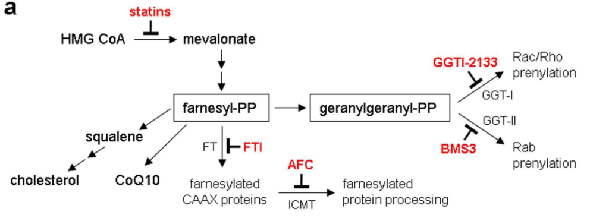

## Question

# Disease Characteristics Research Template

## Target Disease
- **Disease Name:** Statin Toxicity
- **MONDO ID:** MONDO:0033170 (if available)
- **Causal gene(s):** not recorded
- **OMIM:** not recorded
- **Synonyms:** not recorded
- **Category:** Complex

Many disease names are serial numbers ("... autosomal dominant 64", "... 26") that
do not say which gene the disease is about, and a similarly named disease with a
different gene is easy to research by mistake. Research the disease with the MONDO
ID and causal gene given above, and name its causal gene in your first paragraph.
If the name seems to point to a different gene or OMIM entry, follow the
identifiers above.

## Research Objectives

Please provide a comprehensive research report on **Statin Toxicity** covering all of the
disease characteristics listed below. This report will be used to populate a disease knowledge
base entry. Be thorough and cite primary literature (PMID preferred) for all claims.

For each section, **suggested databases/resources** are listed. These are the first places
you should search for information on each topic.

---

### 1. Disease Information
> **Search first:** OMIM, Orphanet, ICD-10/ICD-11, MeSH, PubMed

- What is the disease? Provide a concise overview.
- What are the key identifiers? (OMIM, Orphanet, ICD-10/ICD-11, MeSH, Mondo)
- What are the common synonyms and alternative names?
- Is the information derived from individual patients (e.g., EHR) or aggregated disease-level resources?

### 2. Etiology

- **Disease Causal Factors**: What are the primary causes? (genetic, environmental, infectious, mechanistic)
- **Risk Factors**:
  > **Search first:** PubMed, Cochrane Library, UpToDate, clinical guidelines, ClinVar, ClinGen, GWAS Catalog, PheGenI, CTD, CDC, WHO, epidemiological databases
  - Genetic risk factors (causal variants, susceptibility loci, modifier genes)
  - Environmental risk factors (toxins, lifestyle, occupational exposures, age, sex, family history)
- **Protective Factors**:
  > **Search first:** PubMed, Cochrane Library, clinical trial databases, GWAS Catalog, gnomAD, WHO, CDC, nutrition databases
  - Genetic protective factors (protective variants, modifier alleles)
  - Environmental protective factors (diet, lifestyle, exposures that reduce risk)
- **Gene-Environment Interactions**: How do genetic and environmental factors interact to influence disease?
  > **Search first:** CTD, PubMed, PheGenI, GxE databases

### 3. Phenotypes
> **Search first:** HPO (Human Phenotype Ontology), OMIM, Orphanet, PubMed, clinicaltrials.gov, MedDRA, SNOMED CT, DECIPHER, LOINC

For each phenotype, provide:
- **Phenotype type**: symptoms, clinical signs, physical manifestations, behavioral changes, or laboratory abnormalities
  > For symptoms/signs: HPO, OMIM, Orphanet, PubMed
  > For behavioral changes: HPO, DSM, RDoC (Research Domain Criteria), PubMed
  > For laboratory abnormalities: LOINC, SNOMED CT, LabTests Online, PubMed
- **Phenotype characteristics**:
  > **Search first:** OMIM, Orphanet, HPO, PubMed
  - Age of symptom onset (neonatal, childhood, adult-onset, late-onset)
  - Symptom severity (mild, moderate, severe, variable)
  - Symptom progression (stable, progressive, episodic, fluctuating)
  - Frequency among affected individuals (percentage or qualitative)
- **Quality of life impact**: Effects on daily functioning and well-being (per-phenotype when possible)
  > **Search first:** EQ-5D database, SF-36, WHO QOL databases, PubMed
- Suggest HPO (Human Phenotype Ontology) terms for each phenotype

### 4. Genetic/Molecular Information

- **Causal Genes**: Gene mutations or chromosomal abnormalities responsible for disease (gene symbols, OMIM IDs)
  > **Search first:** OMIM, ClinVar, HGMD, Ensembl, NCBI Gene
- **Pathogenic Variants**:
  - Affected genes (gene symbols, HGNC IDs)
    > **Search first:** OMIM, NCBI Gene, Ensembl, HGNC, UniProt, GeneCards
  - Variant classification (pathogenic, likely pathogenic, VUS per ACMG/AMP guidelines)
    > **Search first:** ClinVar, ClinGen, ACMG/AMP guidelines, VarSome
  - Variant type/class (missense, frameshift, nonsense, splice-site, structural)
  - Allele frequency in population databases
    > **Search first:** gnomAD, 1000 Genomes, ExAC, TOPMed, dbSNP
  - Somatic vs germline origin
    > **Search first:** COSMIC (somatic), ClinVar, ICGC, TCGA
  - Functional consequences (loss of function, gain of function, dominant negative)
- **Modifier Genes**: Genes that modify disease severity or expression
- **Epigenetic Information**: DNA methylation, histone modifications, chromatin changes affecting disease
  > **Search first:** ENCODE, Roadmap Epigenomics, MethBase, DiseaseMeth
- **Chromosomal Abnormalities**: Large-scale genetic changes (aneuploidy, translocations, inversions)
  > **Search first:** DECIPHER, ClinVar, ECARUCA, UCSC Genome Browser

### 5. Environmental Information

- **Environmental Factors**: Non-genetic contributing factors (toxins, radiation, pollution, occupational exposure)
  > **Search first:** CTD (Comparative Toxicogenomics Database), TOXNET, PubMed, EPA databases
- **Lifestyle Factors**: Behavioral factors (smoking, diet, exercise, alcohol consumption)
  > **Search first:** CDC databases, WHO, PubMed, NHANES
- **Infectious Agents**: If applicable, pathogens causing or triggering disease (bacteria, viruses, fungi, parasites)
  > **Search first:** NCBI Taxonomy, ViPR, BV-BRC, MicrobeDB, GIDEON

### 6. Mechanism / Pathophysiology

**Present this section as an ordered causal chain first, then the detail below.**
Open with a numbered sequence of mechanistic steps running from the initiating
lesion (mutation, exposure, infection) to the clinical manifestation, one step per
line, each naming what it causes next. State the causal verb explicitly ("leads
to", "results in") and say where a step is inferred rather than demonstrated.
Where the mechanism branches, show the branch. The categories below are a
checklist of what to cover within those steps, not the organizing structure —
a step may draw on several of them, and a category may contribute to several
steps.

- **Molecular Pathways**: Specific signaling cascades or biochemical pathways involved (Wnt, MAPK, mTOR, PI3K-AKT, etc.)
  > **Search first:** KEGG, Reactome, WikiPathways, PathBank, BioCyc
- **Cellular Processes**: Cell-level mechanisms (apoptosis, autophagy, cell cycle dysregulation, inflammation, etc.)
  > **Search first:** Gene Ontology (GO), Reactome, KEGG, PubMed
- **Protein Dysfunction**: How protein structure or function is altered (misfolding, aggregation, loss of function, gain of function)
  > **Search first:** UniProt, PDB (Protein Data Bank), InterPro, Pfam, AlphaFold
- **Metabolic Changes**: Alterations in metabolic processes (energy metabolism, lipid metabolism, amino acid metabolism)
  > **Search first:** KEGG, BioCyc, HMDB (Human Metabolome Database), BRENDA
- **Immune System Involvement**: Role of immune response (autoimmunity, immunodeficiency, chronic inflammation)
  > **Search first:** ImmPort, Immunome Database, IEDB, Gene Ontology
- **Tissue Damage Mechanisms**: How tissues/ are injured (oxidative stress, ischemia, fibrosis, necrosis)
  > **Search first:** PubMed, Gene Ontology, Reactome
- **Biochemical Abnormalities**: Specific molecular defects (enzyme deficiencies, receptor dysfunction, ion channel defects)
  > **Search first:** BRENDA, UniProt, KEGG, OMIM, PubMed
- **Epigenetic Changes**: DNA methylation, histone modifications affecting gene expression in disease
  > **Search first:** ENCODE, Roadmap Epigenomics, MethBase, DiseaseMeth
- **Molecular Profiling** (if available):
  - Transcriptomics/gene expression changes
    > **Search first:** GEO (Gene Expression Omnibus), ArrayExpress, GTEx, Human Cell Atlas, SRA
  - Proteomics findings
    > **Search first:** PRIDE, ProteomeXchange, Human Protein Atlas, STRING, BioGRID
  - Metabolomics signatures
    > **Search first:** MetaboLights, Metabolomics Workbench, HMDB, METLIN
  - Lipidomics alterations
    > **Search first:** LIPID MAPS, SwissLipids, LipidHome, Metabolomics Workbench
  - Genomic structural features
    > **Search first:** UCSC Genome Browser, Ensembl, NCBI, dbVar, DGV
- **Advanced Technologies** (if applicable):
  - Single-cell analysis findings (cell-type specific mechanisms, cellular heterogeneity)
    > **Search first:** Human Cell Atlas, Single Cell Portal, GEO, CELLxGENE
  - Spatial transcriptomics findings
    > **Search first:** GEO, Spatial Research, Vizgen, 10x Genomics data
  - Multi-omics integration results
    > **Search first:** TCGA, ICGC, cBioPortal, LinkedOmics, PubMed
  - Functional genomics screens (CRISPR, RNAi)
    > **Search first:** DepMap, GenomeRNAi, PubMed, BioGRID ORCS

For each mechanism, describe:
- The causal chain from initial trigger to clinical manifestation
- Which mechanisms are upstream vs downstream
- What cell types and biological processes are involved
- Suggest GO terms for biological processes and CL terms for cell types

### 7. Anatomical Structures Affected

- **Organ Level**:
  - Primary organs directly affected
  - Secondary organ involvement (complications, secondary effects)
  - Body systems involved (cardiovascular, nervous, digestive, respiratory, endocrine, etc.)
  > **Search first:** Uberon, FMA (Foundational Model of Anatomy), OMIM, HPO, ICD-11, MeSH, SNOMED CT
- **Tissue and Cell Level**:
  - Specific tissue types affected (epithelial, connective, muscle, nervous)
  - Specific cell populations targeted (with Cell Ontology terms)
  > **Search first:** Uberon, Human Protein Atlas, Cell Ontology, Human Cell Atlas, CellMarker, PanglaoDB
- **Subcellular Level**:
  - Cellular compartments involved (mitochondria, nucleus, ER, lysosomes) (with GO Cellular Component terms)
  > **Search first:** Gene Ontology (Cellular Component), UniProt, Human Protein Atlas
- **Localization**:
  - Specific anatomical sites (with UBERON terms)
    > **Search first:** FMA, Uberon, NeuroNames (for brain), SNOMED CT
  - Lateralization (unilateral, bilateral, asymmetric)
    > **Search first:** HPO, clinical literature, imaging databases

### 8. Temporal Development

- **Onset**:
  - Typical age of onset (congenital, pediatric, adult, geriatric)
  - Onset pattern (acute, subacute, chronic, insidious)
  > **Search first:** OMIM, Orphanet, HPO, PubMed
- **Progression**:
  - Disease stages (early, intermediate, advanced, end-stage)
    > **Search first:** Cancer Staging Manual (AJCC), WHO classifications, PubMed
  - Progression rate (rapid, slow, variable)
  - Disease course pattern (episodic, relapsing-remitting, progressive, stable)
  - Disease duration (self-limited, chronic lifelong)
  > **Search first:** Disease registries, longitudinal cohort databases, natural history studies, PubMed, Orphanet, OMIM
- **Patterns**:
  - Remission patterns (spontaneous, treatment-induced)
    > **Search first:** Clinical trial databases, disease registries, PubMed
  - Critical periods (time windows of vulnerability or opportunity for intervention)
    > **Search first:** PubMed, developmental biology databases, clinical guidelines

### 9. Inheritance and Population

- **Epidemiology**:
  - Prevalence (cases per 100,000 at given time)
  - Incidence (new cases per 100,000 per year)
  > **Search first:** Orphanet, CDC, WHO, GBD (Global Burden of Disease), national registries, SEER, disease registries
- **For Genetic Etiology**:
  - Inheritance pattern (AD, AR, X-linked, mitochondrial, multifactorial, polygenic)
    > **Search first:** OMIM, Orphanet, ClinVar, GTR (Genetic Testing Registry)
  - Penetrance (complete, incomplete, age-dependent)
    > **Search first:** ClinVar, OMIM, PubMed, ClinGen
  - Expressivity (variable, consistent)
    > **Search first:** OMIM, ClinVar, PubMed
  - Genetic anticipation (increasing severity in successive generations)
    > **Search first:** OMIM, PubMed (especially for repeat expansion disorders)
  - Germline mosaicism
    > **Search first:** ClinVar, OMIM, genetic counseling literature, PubMed
  - Founder effects (population-specific mutations)
    > **Search first:** gnomAD, population genetics databases, PubMed
  - Consanguinity role
    > **Search first:** OMIM, population studies, genetic counseling resources
  - Carrier frequency
    > **Search first:** gnomAD, carrier screening databases, GeneReviews, GTR
- **Population Demographics**:
  - Affected populations (ethnic or demographic groups with higher prevalence)
    > **Search first:** gnomAD, 1000 Genomes, PAGE Study, PubMed, population registries
  - Geographic distribution (endemic areas, regional variation)
    > **Search first:** WHO, CDC, GBD, Orphanet, geographic epidemiology databases
  - Geographic distribution of specific variants
  - Sex ratio (male:female)
    > **Search first:** Disease registries, OMIM, PubMed, epidemiological databases
  - Age distribution of affected individuals
    > **Search first:** CDC, disease registries, SEER, Orphanet

### 10. Diagnostics

- **Clinical Tests**:
  - Laboratory tests (blood, urine, tissue chemistry, specific enzyme assays)
    > **Search first:** LOINC, LabTests Online, PubMed
  - Biomarkers (proteins, metabolites, genetic markers, circulating biomarkers)
    > **Search first:** FDA Biomarker List, BEST (Biomarkers, EndpointS, and other Tools), PubMed
  - Imaging studies (X-ray, CT, MRI, PET, ultrasound)
    > **Search first:** RadLex, DICOM, Radiopaedia, imaging databases
  - Functional tests (pulmonary function, cardiac stress tests)
    > **Search first:** LOINC, clinical guidelines, PubMed
  - Electrophysiology (EEG, EMG, ECG, nerve conduction studies)
    > **Search first:** LOINC, clinical neurophysiology databases, PubMed
  - Biopsy findings (histopathology, immunohistochemistry)
    > **Search first:** SNOMED CT, College of American Pathologists resources, PubMed
  - Pathology findings (microscopic examination)
    > **Search first:** SNOMED CT, Digital Pathology databases, PubMed
- **Genetic Testing**:
  > **Search first:** GTR (Genetic Testing Registry), GeneReviews, ClinGen
  - Overview of recommended genetic testing approach
  - Whole genome sequencing (WGS) utility
    > **Search first:** GTR, ClinVar, GEL (Genomics England), gnomAD
  - Whole exome sequencing (WES) utility
    > **Search first:** GTR, ClinVar, OMIM, GeneMatcher
  - Gene panels (which panels, which genes)
    > **Search first:** GTR, ClinVar, laboratory-specific databases
  - Single gene testing
    > **Search first:** GTR, ClinVar, OMIM, GeneReviews
  - Chromosomal microarray (CMA)
    > **Search first:** DECIPHER, ClinVar, dbVar, ECARUCA
  - Karyotyping
    > **Search first:** Chromosome Abnormality Database, ClinVar, cytogenetics resources
  - FISH
    > **Search first:** ClinVar, cytogenetics databases, PubMed
  - Mitochondrial DNA testing
    > **Search first:** MITOMAP, MSeqDR, ClinVar, GTR
  - Repeat expansion testing
    > **Search first:** GTR, ClinVar, repeat expansion databases, PubMed
- **Omics-Based Diagnostics** (if applicable):
  - RNA sequencing / transcriptomics
    > **Search first:** GEO, ArrayExpress, GTEx, RNA-seq databases
  - Proteomics
    > **Search first:** PRIDE, ProteomeXchange, FDA Biomarker database
  - Metabolomics
    > **Search first:** MetaboLights, Metabolomics Workbench, HMDB
  - Epigenomics
    > **Search first:** GEO, ENCODE, Roadmap Epigenomics, MethBase
  - Liquid biopsy
    > **Search first:** COSMIC, ClinVar, liquid biopsy databases, PubMed
- **Clinical Criteria**:
  - Standardized diagnostic criteria (DSM, ICD, society guidelines)
    > **Search first:** DSM-5, ICD-11, clinical society guidelines, UpToDate
  - Differential diagnosis (other conditions to rule out, with distinguishing features)
    > **Search first:** DynaMed, UpToDate, clinical decision support systems
- **Screening**:
  - Screening methods for asymptomatic individuals (newborn screening, carrier screening, cascade screening)
    > **Search first:** ACMG recommendations, CDC newborn screening, GTR

### 11. Outcome/Prognosis

- **Survival and Mortality**:
  - Survival rate (5-year, 10-year, overall)
    > **Search first:** SEER, cancer registries, disease-specific registries, PubMed
  - Life expectancy (with and without treatment if applicable)
    > **Search first:** Orphanet, disease registries, actuarial databases, PubMed
  - Mortality rate
    > **Search first:** CDC, WHO, GBD, national mortality databases
  - Disease-specific mortality (deaths directly attributable to disease)
    > **Search first:** Disease registries, CDC Wonder, GBD, PubMed
- **Morbidity and Function**:
  - Morbidity (disease-related disability and health impacts)
    > **Search first:** GBD, WHO, disability databases, PubMed
  - Disability outcomes (long-term functional impairments)
    > **Search first:** ICF (International Classification of Functioning), disability registries
  - Quality of life measures (EQ-5D, SF-36, PROMIS, disease-specific tools)
    > **Search first:** EQ-5D database, SF-36, PROMIS, PubMed
- **Disease Course**:
  - Complications (secondary problems: infections, organ failure, etc.)
    > **Search first:** ICD codes, disease registries, clinical databases, PubMed
  - Recovery potential (likelihood and extent of recovery, with vs without treatment)
    > **Search first:** Natural history studies, rehabilitation databases, PubMed
- **Prediction**:
  - Prognostic factors (age, disease severity, biomarkers, treatment response)
    > **Search first:** Prognostic models databases, clinical calculators, PubMed
  - Prognostic biomarkers (molecular markers predicting disease course)
    > **Search first:** FDA Biomarker database, PubMed, cancer prognostic databases

### 12. Treatment

- **Pharmacotherapy**:
  - Pharmacological treatments (drug names, drug classes, mechanisms of action)
    > **Search first:** DrugBank, RxNorm, ATC classification, DailyMed, FDA databases
  - Pharmacogenomics (how genetic variants affect drug metabolism, efficacy, toxicity)
    > **Search first:** PharmGKB, CPIC (Clinical Pharmacogenetics), FDA Table of PGx Biomarkers
- **Advanced Therapeutics**:
  - Gene therapy (viral vectors, CRISPR, gene replacement, gene editing)
    > **Search first:** ClinicalTrials.gov, FDA gene therapy database, ASGCT resources
  - Cell therapy (stem cell transplant, CAR-T, cellular therapeutics)
    > **Search first:** ClinicalTrials.gov, FDA cell therapy database, FACT standards
  - RNA-based therapies (ASOs, siRNA, mRNA therapies)
    > **Search first:** ClinicalTrials.gov, FDA approvals, PubMed
  - Targeted therapies (treatments directed at specific molecular targets)
    > **Search first:** My Cancer Genome, OncoKB, ClinicalTrials.gov, FDA approvals
  - Immunotherapies (checkpoint inhibitors, monoclonal antibodies)
    > **Search first:** Cancer Immunotherapy Database, FDA approvals, ClinicalTrials.gov
- **Surgical and Interventional**:
  - Surgical interventions (types of surgery, timing, outcomes)
    > **Search first:** CPT codes, surgical registries, clinical guidelines, PubMed
- **Supportive and Rehabilitative**:
  - Supportive care (symptom management, pain control, nutrition)
    > **Search first:** Clinical guidelines, Cochrane Library, PubMed
  - Rehabilitation (physical therapy, occupational therapy, speech therapy)
    > **Search first:** Rehabilitation medicine databases, clinical guidelines, PubMed
- **Experimental**:
  - Experimental treatments in clinical trials (with NCT identifiers if available)
    > **Search first:** ClinicalTrials.gov, EU Clinical Trials Register, WHO ICTRP
- **Treatment Outcomes**:
  - Treatment response rates
    > **Search first:** Clinical trial databases, FDA reviews, systematic reviews, PubMed
  - Side effects and adverse events
    > **Search first:** FDA Adverse Event Reporting System (FAERS), MedWatch, PubMed
- **Treatment Strategy**:
  - Treatment algorithms (clinical pathways, decision trees)
    > **Search first:** Clinical practice guidelines, NCCN Guidelines, UpToDate
  - Combination therapies
    > **Search first:** ClinicalTrials.gov, treatment guidelines, PubMed
  - Personalized medicine approaches (genotype-guided treatment)
    > **Search first:** My Cancer Genome, CIViC, PharmGKB, precision medicine databases

For each treatment, suggest NCIT (NCI Thesaurus) clinical-intervention terms where applicable.

### 13. Prevention

- **Prevention Levels**:
  - Primary prevention (preventing disease occurrence: vaccination, risk factor modification)
    > **Search first:** CDC, WHO, USPSTF recommendations, Cochrane Library
  - Secondary prevention (early detection and treatment: screening programs, early intervention)
    > **Search first:** USPSTF, CDC screening guidelines, WHO
  - Tertiary prevention (preventing complications in those with disease)
    > **Search first:** Clinical guidelines, disease management protocols, PubMed
- **Immunization**: Vaccine strategies (if applicable)
  > **Search first:** CDC vaccine schedules, WHO immunization, FDA vaccine database
- **Screening and Early Detection**:
  - Screening programs (population-based: newborn screening, cancer screening)
    > **Search first:** CDC screening programs, USPSTF, cancer screening databases
  - Genetic screening (carrier screening, preimplantation genetic diagnosis, prenatal testing)
    > **Search first:** ACMG recommendations, ACOG guidelines, GTR
  - Risk stratification (identifying high-risk individuals for targeted prevention)
    > **Search first:** Risk prediction models, clinical calculators, PubMed
- **Behavioral Interventions**: Lifestyle modifications to reduce risk
  > **Search first:** CDC, WHO, behavioral intervention databases, Cochrane Library
- **Counseling**: Genetic counseling (risk assessment, family planning guidance)
  > **Search first:** NSGC resources, ACMG guidelines, GeneReviews
- **Public Health**:
  - Public health interventions (sanitation, vector control, health education)
    > **Search first:** CDC, WHO, public health databases, PubMed
  - Environmental interventions (reducing environmental risk factors)
    > **Search first:** EPA databases, WHO environmental health, PubMed
- **Prophylaxis**: Preventive medications or procedures
  > **Search first:** Clinical guidelines, FDA approvals, PubMed

### 14. Other Species / Natural Disease

- **Taxonomy**: Species affected (with NCBI Taxon identifiers)
  > **Search first:** NCBI Taxonomy
- **Breed**: Specific breeds affected (with VBO identifiers if applicable)
  > **Search first:** VBO (Vertebrate Breed Ontology)
- **Gene**: Orthologous genes in other species (with NCBI Gene IDs)
  > **Search first:** NCBI Gene
- **Natural Disease**:
  - Naturally occurring disease in other species (companion animals, wildlife)
    > **Search first:** OMIA (Online Mendelian Inheritance in Animals), VetCompass, PubMed
  - Veterinary relevance and importance in animal health
    > **Search first:** OMIA, veterinary databases, PubMed
- **Comparative Biology**:
  - Comparative pathology (similarities and differences across species)
    > **Search first:** OMIA, comparative pathology databases, PubMed
  - Evolutionary conservation of disease mechanisms
    > **Search first:** HomoloGene, OrthoMCL, Alliance of Genome Resources
- **Transmission** (if applicable):
  - Zoonotic potential
    > **Search first:** CDC zoonotic diseases, WHO zoonoses, GIDEON
  - Cross-species susceptibility
    > **Search first:** NCBI Taxonomy, veterinary databases, PubMed

### 15. Model Organisms

- **Model Types**:
  - Model organism type (mammalian, invertebrate, cellular, in vitro)
    > **Search first:** Alliance of Genome Resources, model organism databases
  - Specific model systems (mouse, rat, zebrafish, Drosophila, C. elegans, yeast, cell lines, organoids, iPSCs)
    > **Search first:** MGI, RGD, ZFIN, FlyBase, WormBase, SGD, ATCC, Cellosaurus
  - Induced models (drug treatment, surgical intervention, environmental manipulation)
    > **Search first:** MGI, model organism databases, PubMed
- **Genetic Models**:
  - Types available (knockout, knock-in, transgenic, conditional, humanized)
    > **Search first:** MGI, IMPC, KOMP, EuMMCR, IMSR
- **Model Characteristics**:
  - Phenotype recapitulation (how well model reproduces human disease features)
    > **Search first:** Model organism databases, comparative studies, PubMed
  - Model limitations (aspects of human disease not captured)
    > **Search first:** Model organism databases, PubMed, review articles
- **Applications**:
  - Research applications (what aspects of disease can be studied)
    > **Search first:** Model organism databases, PubMed
- **Resources**:
  - Model databases
    > **Search first:** MGI, RGD, ZFIN, FlyBase, WormBase, IMSR, EMMA, MMRRC

---

## Citation Requirements

- Cite primary literature (PMID preferred) for all mechanistic and clinical claims
- Prioritize recent reviews and landmark papers
- Include direct quotes from abstracts where possible to support key statements
- Distinguish evidence source types: human clinical, model organism, in vitro, computational

## Output Format

Structure your response as a comprehensive narrative organized by the sections above.
For each section, provide:
- Factual content with specific details (numbers, percentages, gene names, variant nomenclature)
- Ontology term suggestions (HPO, GO, CL, UBERON, CHEBI, NCIT, MONDO) where applicable
- Evidence citations with PMIDs
- Direct quotes from abstracts to support key claims
- Clear indication when information is not available or not applicable for this disease

This report will be used to populate a disease knowledge base entry with:
- Pathophysiology descriptions with causal chains
- Gene/protein annotations (HGNC, GO terms)
- Phenotype associations (HP terms) with frequencies
- Cell type involvement (CL terms)
- Anatomical locations (UBERON terms)
- Chemical entities (CHEBI terms)
- Treatment annotations (NCIT terms)
- Evidence items with PMIDs and exact abstract quotes
- Epidemiology, prognosis, diagnostic, and prevention information
- Animal model descriptions with phenotype recapitulation details

## Output

Question: You are an expert researcher providing comprehensive, well-cited information.

Provide detailed information focusing on:
1. Key concepts and definitions with current understanding
2. Recent developments and latest research (prioritize 2023-2024 sources)
3. Current applications and real-world implementations
4. Expert opinions and analysis from authoritative sources
5. Relevant statistics and data from recent studies

Format as a comprehensive research report with proper citations. Include URLs and publication dates where available.
Always prioritize recent, authoritative sources and provide specific citations for all major claims.

# Disease Characteristics Research Template

## Target Disease
- **Disease Name:** Statin Toxicity
- **MONDO ID:** MONDO:0033170 (if available)
- **Causal gene(s):** not recorded
- **OMIM:** not recorded
- **Synonyms:** not recorded
- **Category:** Complex

Many disease names are serial numbers ("... autosomal dominant 64", "... 26") that
do not say which gene the disease is about, and a similarly named disease with a
different gene is easy to research by mistake. Research the disease with the MONDO
ID and causal gene given above, and name its causal gene in your first paragraph.
If the name seems to point to a different gene or OMIM entry, follow the
identifiers above.

## Research Objectives

Please provide a comprehensive research report on **Statin Toxicity** covering all of the
disease characteristics listed below. This report will be used to populate a disease knowledge
base entry. Be thorough and cite primary literature (PMID preferred) for all claims.

For each section, **suggested databases/resources** are listed. These are the first places
you should search for information on each topic.

---

### 1. Disease Information
> **Search first:** OMIM, Orphanet, ICD-10/ICD-11, MeSH, PubMed

- What is the disease? Provide a concise overview.
- What are the key identifiers? (OMIM, Orphanet, ICD-10/ICD-11, MeSH, Mondo)
- What are the common synonyms and alternative names?
- Is the information derived from individual patients (e.g., EHR) or aggregated disease-level resources?

### 2. Etiology

- **Disease Causal Factors**: What are the primary causes? (genetic, environmental, infectious, mechanistic)
- **Risk Factors**:
  > **Search first:** PubMed, Cochrane Library, UpToDate, clinical guidelines, ClinVar, ClinGen, GWAS Catalog, PheGenI, CTD, CDC, WHO, epidemiological databases
  - Genetic risk factors (causal variants, susceptibility loci, modifier genes)
  - Environmental risk factors (toxins, lifestyle, occupational exposures, age, sex, family history)
- **Protective Factors**:
  > **Search first:** PubMed, Cochrane Library, clinical trial databases, GWAS Catalog, gnomAD, WHO, CDC, nutrition databases
  - Genetic protective factors (protective variants, modifier alleles)
  - Environmental protective factors (diet, lifestyle, exposures that reduce risk)
- **Gene-Environment Interactions**: How do genetic and environmental factors interact to influence disease?
  > **Search first:** CTD, PubMed, PheGenI, GxE databases

### 3. Phenotypes
> **Search first:** HPO (Human Phenotype Ontology), OMIM, Orphanet, PubMed, clinicaltrials.gov, MedDRA, SNOMED CT, DECIPHER, LOINC

For each phenotype, provide:
- **Phenotype type**: symptoms, clinical signs, physical manifestations, behavioral changes, or laboratory abnormalities
  > For symptoms/signs: HPO, OMIM, Orphanet, PubMed
  > For behavioral changes: HPO, DSM, RDoC (Research Domain Criteria), PubMed
  > For laboratory abnormalities: LOINC, SNOMED CT, LabTests Online, PubMed
- **Phenotype characteristics**:
  > **Search first:** OMIM, Orphanet, HPO, PubMed
  - Age of symptom onset (neonatal, childhood, adult-onset, late-onset)
  - Symptom severity (mild, moderate, severe, variable)
  - Symptom progression (stable, progressive, episodic, fluctuating)
  - Frequency among affected individuals (percentage or qualitative)
- **Quality of life impact**: Effects on daily functioning and well-being (per-phenotype when possible)
  > **Search first:** EQ-5D database, SF-36, WHO QOL databases, PubMed
- Suggest HPO (Human Phenotype Ontology) terms for each phenotype

### 4. Genetic/Molecular Information

- **Causal Genes**: Gene mutations or chromosomal abnormalities responsible for disease (gene symbols, OMIM IDs)
  > **Search first:** OMIM, ClinVar, HGMD, Ensembl, NCBI Gene
- **Pathogenic Variants**:
  - Affected genes (gene symbols, HGNC IDs)
    > **Search first:** OMIM, NCBI Gene, Ensembl, HGNC, UniProt, GeneCards
  - Variant classification (pathogenic, likely pathogenic, VUS per ACMG/AMP guidelines)
    > **Search first:** ClinVar, ClinGen, ACMG/AMP guidelines, VarSome
  - Variant type/class (missense, frameshift, nonsense, splice-site, structural)
  - Allele frequency in population databases
    > **Search first:** gnomAD, 1000 Genomes, ExAC, TOPMed, dbSNP
  - Somatic vs germline origin
    > **Search first:** COSMIC (somatic), ClinVar, ICGC, TCGA
  - Functional consequences (loss of function, gain of function, dominant negative)
- **Modifier Genes**: Genes that modify disease severity or expression
- **Epigenetic Information**: DNA methylation, histone modifications, chromatin changes affecting disease
  > **Search first:** ENCODE, Roadmap Epigenomics, MethBase, DiseaseMeth
- **Chromosomal Abnormalities**: Large-scale genetic changes (aneuploidy, translocations, inversions)
  > **Search first:** DECIPHER, ClinVar, ECARUCA, UCSC Genome Browser

### 5. Environmental Information

- **Environmental Factors**: Non-genetic contributing factors (toxins, radiation, pollution, occupational exposure)
  > **Search first:** CTD (Comparative Toxicogenomics Database), TOXNET, PubMed, EPA databases
- **Lifestyle Factors**: Behavioral factors (smoking, diet, exercise, alcohol consumption)
  > **Search first:** CDC databases, WHO, PubMed, NHANES
- **Infectious Agents**: If applicable, pathogens causing or triggering disease (bacteria, viruses, fungi, parasites)
  > **Search first:** NCBI Taxonomy, ViPR, BV-BRC, MicrobeDB, GIDEON

### 6. Mechanism / Pathophysiology

**Present this section as an ordered causal chain first, then the detail below.**
Open with a numbered sequence of mechanistic steps running from the initiating
lesion (mutation, exposure, infection) to the clinical manifestation, one step per
line, each naming what it causes next. State the causal verb explicitly ("leads
to", "results in") and say where a step is inferred rather than demonstrated.
Where the mechanism branches, show the branch. The categories below are a
checklist of what to cover within those steps, not the organizing structure —
a step may draw on several of them, and a category may contribute to several
steps.

- **Molecular Pathways**: Specific signaling cascades or biochemical pathways involved (Wnt, MAPK, mTOR, PI3K-AKT, etc.)
  > **Search first:** KEGG, Reactome, WikiPathways, PathBank, BioCyc
- **Cellular Processes**: Cell-level mechanisms (apoptosis, autophagy, cell cycle dysregulation, inflammation, etc.)
  > **Search first:** Gene Ontology (GO), Reactome, KEGG, PubMed
- **Protein Dysfunction**: How protein structure or function is altered (misfolding, aggregation, loss of function, gain of function)
  > **Search first:** UniProt, PDB (Protein Data Bank), InterPro, Pfam, AlphaFold
- **Metabolic Changes**: Alterations in metabolic processes (energy metabolism, lipid metabolism, amino acid metabolism)
  > **Search first:** KEGG, BioCyc, HMDB (Human Metabolome Database), BRENDA
- **Immune System Involvement**: Role of immune response (autoimmunity, immunodeficiency, chronic inflammation)
  > **Search first:** ImmPort, Immunome Database, IEDB, Gene Ontology
- **Tissue Damage Mechanisms**: How tissues/ are injured (oxidative stress, ischemia, fibrosis, necrosis)
  > **Search first:** PubMed, Gene Ontology, Reactome
- **Biochemical Abnormalities**: Specific molecular defects (enzyme deficiencies, receptor dysfunction, ion channel defects)
  > **Search first:** BRENDA, UniProt, KEGG, OMIM, PubMed
- **Epigenetic Changes**: DNA methylation, histone modifications affecting gene expression in disease
  > **Search first:** ENCODE, Roadmap Epigenomics, MethBase, DiseaseMeth
- **Molecular Profiling** (if available):
  - Transcriptomics/gene expression changes
    > **Search first:** GEO (Gene Expression Omnibus), ArrayExpress, GTEx, Human Cell Atlas, SRA
  - Proteomics findings
    > **Search first:** PRIDE, ProteomeXchange, Human Protein Atlas, STRING, BioGRID
  - Metabolomics signatures
    > **Search first:** MetaboLights, Metabolomics Workbench, HMDB, METLIN
  - Lipidomics alterations
    > **Search first:** LIPID MAPS, SwissLipids, LipidHome, Metabolomics Workbench
  - Genomic structural features
    > **Search first:** UCSC Genome Browser, Ensembl, NCBI, dbVar, DGV
- **Advanced Technologies** (if applicable):
  - Single-cell analysis findings (cell-type specific mechanisms, cellular heterogeneity)
    > **Search first:** Human Cell Atlas, Single Cell Portal, GEO, CELLxGENE
  - Spatial transcriptomics findings
    > **Search first:** GEO, Spatial Research, Vizgen, 10x Genomics data
  - Multi-omics integration results
    > **Search first:** TCGA, ICGC, cBioPortal, LinkedOmics, PubMed
  - Functional genomics screens (CRISPR, RNAi)
    > **Search first:** DepMap, GenomeRNAi, PubMed, BioGRID ORCS

For each mechanism, describe:
- The causal chain from initial trigger to clinical manifestation
- Which mechanisms are upstream vs downstream
- What cell types and biological processes are involved
- Suggest GO terms for biological processes and CL terms for cell types

### 7. Anatomical Structures Affected

- **Organ Level**:
  - Primary organs directly affected
  - Secondary organ involvement (complications, secondary effects)
  - Body systems involved (cardiovascular, nervous, digestive, respiratory, endocrine, etc.)
  > **Search first:** Uberon, FMA (Foundational Model of Anatomy), OMIM, HPO, ICD-11, MeSH, SNOMED CT
- **Tissue and Cell Level**:
  - Specific tissue types affected (epithelial, connective, muscle, nervous)
  - Specific cell populations targeted (with Cell Ontology terms)
  > **Search first:** Uberon, Human Protein Atlas, Cell Ontology, Human Cell Atlas, CellMarker, PanglaoDB
- **Subcellular Level**:
  - Cellular compartments involved (mitochondria, nucleus, ER, lysosomes) (with GO Cellular Component terms)
  > **Search first:** Gene Ontology (Cellular Component), UniProt, Human Protein Atlas
- **Localization**:
  - Specific anatomical sites (with UBERON terms)
    > **Search first:** FMA, Uberon, NeuroNames (for brain), SNOMED CT
  - Lateralization (unilateral, bilateral, asymmetric)
    > **Search first:** HPO, clinical literature, imaging databases

### 8. Temporal Development

- **Onset**:
  - Typical age of onset (congenital, pediatric, adult, geriatric)
  - Onset pattern (acute, subacute, chronic, insidious)
  > **Search first:** OMIM, Orphanet, HPO, PubMed
- **Progression**:
  - Disease stages (early, intermediate, advanced, end-stage)
    > **Search first:** Cancer Staging Manual (AJCC), WHO classifications, PubMed
  - Progression rate (rapid, slow, variable)
  - Disease course pattern (episodic, relapsing-remitting, progressive, stable)
  - Disease duration (self-limited, chronic lifelong)
  > **Search first:** Disease registries, longitudinal cohort databases, natural history studies, PubMed, Orphanet, OMIM
- **Patterns**:
  - Remission patterns (spontaneous, treatment-induced)
    > **Search first:** Clinical trial databases, disease registries, PubMed
  - Critical periods (time windows of vulnerability or opportunity for intervention)
    > **Search first:** PubMed, developmental biology databases, clinical guidelines

### 9. Inheritance and Population

- **Epidemiology**:
  - Prevalence (cases per 100,000 at given time)
  - Incidence (new cases per 100,000 per year)
  > **Search first:** Orphanet, CDC, WHO, GBD (Global Burden of Disease), national registries, SEER, disease registries
- **For Genetic Etiology**:
  - Inheritance pattern (AD, AR, X-linked, mitochondrial, multifactorial, polygenic)
    > **Search first:** OMIM, Orphanet, ClinVar, GTR (Genetic Testing Registry)
  - Penetrance (complete, incomplete, age-dependent)
    > **Search first:** ClinVar, OMIM, PubMed, ClinGen
  - Expressivity (variable, consistent)
    > **Search first:** OMIM, ClinVar, PubMed
  - Genetic anticipation (increasing severity in successive generations)
    > **Search first:** OMIM, PubMed (especially for repeat expansion disorders)
  - Germline mosaicism
    > **Search first:** ClinVar, OMIM, genetic counseling literature, PubMed
  - Founder effects (population-specific mutations)
    > **Search first:** gnomAD, population genetics databases, PubMed
  - Consanguinity role
    > **Search first:** OMIM, population studies, genetic counseling resources
  - Carrier frequency
    > **Search first:** gnomAD, carrier screening databases, GeneReviews, GTR
- **Population Demographics**:
  - Affected populations (ethnic or demographic groups with higher prevalence)
    > **Search first:** gnomAD, 1000 Genomes, PAGE Study, PubMed, population registries
  - Geographic distribution (endemic areas, regional variation)
    > **Search first:** WHO, CDC, GBD, Orphanet, geographic epidemiology databases
  - Geographic distribution of specific variants
  - Sex ratio (male:female)
    > **Search first:** Disease registries, OMIM, PubMed, epidemiological databases
  - Age distribution of affected individuals
    > **Search first:** CDC, disease registries, SEER, Orphanet

### 10. Diagnostics

- **Clinical Tests**:
  - Laboratory tests (blood, urine, tissue chemistry, specific enzyme assays)
    > **Search first:** LOINC, LabTests Online, PubMed
  - Biomarkers (proteins, metabolites, genetic markers, circulating biomarkers)
    > **Search first:** FDA Biomarker List, BEST (Biomarkers, EndpointS, and other Tools), PubMed
  - Imaging studies (X-ray, CT, MRI, PET, ultrasound)
    > **Search first:** RadLex, DICOM, Radiopaedia, imaging databases
  - Functional tests (pulmonary function, cardiac stress tests)
    > **Search first:** LOINC, clinical guidelines, PubMed
  - Electrophysiology (EEG, EMG, ECG, nerve conduction studies)
    > **Search first:** LOINC, clinical neurophysiology databases, PubMed
  - Biopsy findings (histopathology, immunohistochemistry)
    > **Search first:** SNOMED CT, College of American Pathologists resources, PubMed
  - Pathology findings (microscopic examination)
    > **Search first:** SNOMED CT, Digital Pathology databases, PubMed
- **Genetic Testing**:
  > **Search first:** GTR (Genetic Testing Registry), GeneReviews, ClinGen
  - Overview of recommended genetic testing approach
  - Whole genome sequencing (WGS) utility
    > **Search first:** GTR, ClinVar, GEL (Genomics England), gnomAD
  - Whole exome sequencing (WES) utility
    > **Search first:** GTR, ClinVar, OMIM, GeneMatcher
  - Gene panels (which panels, which genes)
    > **Search first:** GTR, ClinVar, laboratory-specific databases
  - Single gene testing
    > **Search first:** GTR, ClinVar, OMIM, GeneReviews
  - Chromosomal microarray (CMA)
    > **Search first:** DECIPHER, ClinVar, dbVar, ECARUCA
  - Karyotyping
    > **Search first:** Chromosome Abnormality Database, ClinVar, cytogenetics resources
  - FISH
    > **Search first:** ClinVar, cytogenetics databases, PubMed
  - Mitochondrial DNA testing
    > **Search first:** MITOMAP, MSeqDR, ClinVar, GTR
  - Repeat expansion testing
    > **Search first:** GTR, ClinVar, repeat expansion databases, PubMed
- **Omics-Based Diagnostics** (if applicable):
  - RNA sequencing / transcriptomics
    > **Search first:** GEO, ArrayExpress, GTEx, RNA-seq databases
  - Proteomics
    > **Search first:** PRIDE, ProteomeXchange, FDA Biomarker database
  - Metabolomics
    > **Search first:** MetaboLights, Metabolomics Workbench, HMDB
  - Epigenomics
    > **Search first:** GEO, ENCODE, Roadmap Epigenomics, MethBase
  - Liquid biopsy
    > **Search first:** COSMIC, ClinVar, liquid biopsy databases, PubMed
- **Clinical Criteria**:
  - Standardized diagnostic criteria (DSM, ICD, society guidelines)
    > **Search first:** DSM-5, ICD-11, clinical society guidelines, UpToDate
  - Differential diagnosis (other conditions to rule out, with distinguishing features)
    > **Search first:** DynaMed, UpToDate, clinical decision support systems
- **Screening**:
  - Screening methods for asymptomatic individuals (newborn screening, carrier screening, cascade screening)
    > **Search first:** ACMG recommendations, CDC newborn screening, GTR

### 11. Outcome/Prognosis

- **Survival and Mortality**:
  - Survival rate (5-year, 10-year, overall)
    > **Search first:** SEER, cancer registries, disease-specific registries, PubMed
  - Life expectancy (with and without treatment if applicable)
    > **Search first:** Orphanet, disease registries, actuarial databases, PubMed
  - Mortality rate
    > **Search first:** CDC, WHO, GBD, national mortality databases
  - Disease-specific mortality (deaths directly attributable to disease)
    > **Search first:** Disease registries, CDC Wonder, GBD, PubMed
- **Morbidity and Function**:
  - Morbidity (disease-related disability and health impacts)
    > **Search first:** GBD, WHO, disability databases, PubMed
  - Disability outcomes (long-term functional impairments)
    > **Search first:** ICF (International Classification of Functioning), disability registries
  - Quality of life measures (EQ-5D, SF-36, PROMIS, disease-specific tools)
    > **Search first:** EQ-5D database, SF-36, PROMIS, PubMed
- **Disease Course**:
  - Complications (secondary problems: infections, organ failure, etc.)
    > **Search first:** ICD codes, disease registries, clinical databases, PubMed
  - Recovery potential (likelihood and extent of recovery, with vs without treatment)
    > **Search first:** Natural history studies, rehabilitation databases, PubMed
- **Prediction**:
  - Prognostic factors (age, disease severity, biomarkers, treatment response)
    > **Search first:** Prognostic models databases, clinical calculators, PubMed
  - Prognostic biomarkers (molecular markers predicting disease course)
    > **Search first:** FDA Biomarker database, PubMed, cancer prognostic databases

### 12. Treatment

- **Pharmacotherapy**:
  - Pharmacological treatments (drug names, drug classes, mechanisms of action)
    > **Search first:** DrugBank, RxNorm, ATC classification, DailyMed, FDA databases
  - Pharmacogenomics (how genetic variants affect drug metabolism, efficacy, toxicity)
    > **Search first:** PharmGKB, CPIC (Clinical Pharmacogenetics), FDA Table of PGx Biomarkers
- **Advanced Therapeutics**:
  - Gene therapy (viral vectors, CRISPR, gene replacement, gene editing)
    > **Search first:** ClinicalTrials.gov, FDA gene therapy database, ASGCT resources
  - Cell therapy (stem cell transplant, CAR-T, cellular therapeutics)
    > **Search first:** ClinicalTrials.gov, FDA cell therapy database, FACT standards
  - RNA-based therapies (ASOs, siRNA, mRNA therapies)
    > **Search first:** ClinicalTrials.gov, FDA approvals, PubMed
  - Targeted therapies (treatments directed at specific molecular targets)
    > **Search first:** My Cancer Genome, OncoKB, ClinicalTrials.gov, FDA approvals
  - Immunotherapies (checkpoint inhibitors, monoclonal antibodies)
    > **Search first:** Cancer Immunotherapy Database, FDA approvals, ClinicalTrials.gov
- **Surgical and Interventional**:
  - Surgical interventions (types of surgery, timing, outcomes)
    > **Search first:** CPT codes, surgical registries, clinical guidelines, PubMed
- **Supportive and Rehabilitative**:
  - Supportive care (symptom management, pain control, nutrition)
    > **Search first:** Clinical guidelines, Cochrane Library, PubMed
  - Rehabilitation (physical therapy, occupational therapy, speech therapy)
    > **Search first:** Rehabilitation medicine databases, clinical guidelines, PubMed
- **Experimental**:
  - Experimental treatments in clinical trials (with NCT identifiers if available)
    > **Search first:** ClinicalTrials.gov, EU Clinical Trials Register, WHO ICTRP
- **Treatment Outcomes**:
  - Treatment response rates
    > **Search first:** Clinical trial databases, FDA reviews, systematic reviews, PubMed
  - Side effects and adverse events
    > **Search first:** FDA Adverse Event Reporting System (FAERS), MedWatch, PubMed
- **Treatment Strategy**:
  - Treatment algorithms (clinical pathways, decision trees)
    > **Search first:** Clinical practice guidelines, NCCN Guidelines, UpToDate
  - Combination therapies
    > **Search first:** ClinicalTrials.gov, treatment guidelines, PubMed
  - Personalized medicine approaches (genotype-guided treatment)
    > **Search first:** My Cancer Genome, CIViC, PharmGKB, precision medicine databases

For each treatment, suggest NCIT (NCI Thesaurus) clinical-intervention terms where applicable.

### 13. Prevention

- **Prevention Levels**:
  - Primary prevention (preventing disease occurrence: vaccination, risk factor modification)
    > **Search first:** CDC, WHO, USPSTF recommendations, Cochrane Library
  - Secondary prevention (early detection and treatment: screening programs, early intervention)
    > **Search first:** USPSTF, CDC screening guidelines, WHO
  - Tertiary prevention (preventing complications in those with disease)
    > **Search first:** Clinical guidelines, disease management protocols, PubMed
- **Immunization**: Vaccine strategies (if applicable)
  > **Search first:** CDC vaccine schedules, WHO immunization, FDA vaccine database
- **Screening and Early Detection**:
  - Screening programs (population-based: newborn screening, cancer screening)
    > **Search first:** CDC screening programs, USPSTF, cancer screening databases
  - Genetic screening (carrier screening, preimplantation genetic diagnosis, prenatal testing)
    > **Search first:** ACMG recommendations, ACOG guidelines, GTR
  - Risk stratification (identifying high-risk individuals for targeted prevention)
    > **Search first:** Risk prediction models, clinical calculators, PubMed
- **Behavioral Interventions**: Lifestyle modifications to reduce risk
  > **Search first:** CDC, WHO, behavioral intervention databases, Cochrane Library
- **Counseling**: Genetic counseling (risk assessment, family planning guidance)
  > **Search first:** NSGC resources, ACMG guidelines, GeneReviews
- **Public Health**:
  - Public health interventions (sanitation, vector control, health education)
    > **Search first:** CDC, WHO, public health databases, PubMed
  - Environmental interventions (reducing environmental risk factors)
    > **Search first:** EPA databases, WHO environmental health, PubMed
- **Prophylaxis**: Preventive medications or procedures
  > **Search first:** Clinical guidelines, FDA approvals, PubMed

### 14. Other Species / Natural Disease

- **Taxonomy**: Species affected (with NCBI Taxon identifiers)
  > **Search first:** NCBI Taxonomy
- **Breed**: Specific breeds affected (with VBO identifiers if applicable)
  > **Search first:** VBO (Vertebrate Breed Ontology)
- **Gene**: Orthologous genes in other species (with NCBI Gene IDs)
  > **Search first:** NCBI Gene
- **Natural Disease**:
  - Naturally occurring disease in other species (companion animals, wildlife)
    > **Search first:** OMIA (Online Mendelian Inheritance in Animals), VetCompass, PubMed
  - Veterinary relevance and importance in animal health
    > **Search first:** OMIA, veterinary databases, PubMed
- **Comparative Biology**:
  - Comparative pathology (similarities and differences across species)
    > **Search first:** OMIA, comparative pathology databases, PubMed
  - Evolutionary conservation of disease mechanisms
    > **Search first:** HomoloGene, OrthoMCL, Alliance of Genome Resources
- **Transmission** (if applicable):
  - Zoonotic potential
    > **Search first:** CDC zoonotic diseases, WHO zoonoses, GIDEON
  - Cross-species susceptibility
    > **Search first:** NCBI Taxonomy, veterinary databases, PubMed

### 15. Model Organisms

- **Model Types**:
  - Model organism type (mammalian, invertebrate, cellular, in vitro)
    > **Search first:** Alliance of Genome Resources, model organism databases
  - Specific model systems (mouse, rat, zebrafish, Drosophila, C. elegans, yeast, cell lines, organoids, iPSCs)
    > **Search first:** MGI, RGD, ZFIN, FlyBase, WormBase, SGD, ATCC, Cellosaurus
  - Induced models (drug treatment, surgical intervention, environmental manipulation)
    > **Search first:** MGI, model organism databases, PubMed
- **Genetic Models**:
  - Types available (knockout, knock-in, transgenic, conditional, humanized)
    > **Search first:** MGI, IMPC, KOMP, EuMMCR, IMSR
- **Model Characteristics**:
  - Phenotype recapitulation (how well model reproduces human disease features)
    > **Search first:** Model organism databases, comparative studies, PubMed
  - Model limitations (aspects of human disease not captured)
    > **Search first:** Model organism databases, PubMed, review articles
- **Applications**:
  - Research applications (what aspects of disease can be studied)
    > **Search first:** Model organism databases, PubMed
- **Resources**:
  - Model databases
    > **Search first:** MGI, RGD, ZFIN, FlyBase, WormBase, IMSR, EMMA, MMRRC

---

## Citation Requirements

- Cite primary literature (PMID preferred) for all mechanistic and clinical claims
- Prioritize recent reviews and landmark papers
- Include direct quotes from abstracts where possible to support key statements
- Distinguish evidence source types: human clinical, model organism, in vitro, computational

## Output Format

Structure your response as a comprehensive narrative organized by the sections above.
For each section, provide:
- Factual content with specific details (numbers, percentages, gene names, variant nomenclature)
- Ontology term suggestions (HPO, GO, CL, UBERON, CHEBI, NCIT, MONDO) where applicable
- Evidence citations with PMIDs
- Direct quotes from abstracts to support key claims
- Clear indication when information is not available or not applicable for this disease

This report will be used to populate a disease knowledge base entry with:
- Pathophysiology descriptions with causal chains
- Gene/protein annotations (HGNC, GO terms)
- Phenotype associations (HP terms) with frequencies
- Cell type involvement (CL terms)
- Anatomical locations (UBERON terms)
- Chemical entities (CHEBI terms)
- Treatment annotations (NCIT terms)
- Evidence items with PMIDs and exact abstract quotes
- Epidemiology, prognosis, diagnostic, and prevention information
- Animal model descriptions with phenotype recapitulation details

# Statin toxicity — disease-characteristics research report

**Disease identity and causal gene.** Statin toxicity (supplied identifier **MONDO:0033170**) is a heterogeneous adverse response to exposure to HMG-CoA reductase inhibitors, **not a Mendelian disorder with one causal gene**. **HMGCR** encodes the drug target and can become an autoantigen in a rare immune-mediated subtype; **SLCO1B1**, **ABCG2**, and **CYP2C9** influence susceptibility or drug exposure rather than constituting a single causal-gene assignment. The principal manifestations are muscle symptoms or injury, liver-test abnormalities, and a modest diabetogenic effect. An important distinction for a knowledge base is that *reported muscle symptoms*, *objectively demonstrated myotoxicity*, *inability to tolerate statins*, and *anti-HMGCR immune-mediated necrotizing myopathy* are overlapping but nonidentical entities. (penson2022step‐by‐stepdiagnosisand pages 1-2, armitage2010intensiveloweringof pages 1-2, alqasrawi2025pharmacogenomicinsightsinto pages 1-2, benucci2025antihmgcrantibodypositivestatininducedmyositis pages 1-2, jeeyavudeen2022statinrelatedmuscletoxicity pages 2-3)

**Evidence convention.** Citations below identify retrieved publications or trial records. Dates and direct URLs are supplied for principal studies; a PMID is stated only when it was explicitly recoverable from the retrieved material. An unverified ontology identifier or PMID is not presented as an established database cross-reference.

## 1. Disease information and nomenclature

**Definition:** an acquired, exposure-associated adverse-effect spectrum, particularly statin-associated muscle symptoms (**SAMS**), CK-defined myopathy, rhabdomyolysis, uncommon clinically important liver injury, and glucose dysregulation. *Statin intolerance* describes adverse effects that prevent continuation at the desired dose; it is not proof of toxic muscle damage. The International Lipid Expert Panel estimated complete intolerance in only **3–5%** of treated people and emphasized alternative explanations and expectation-related symptoms. These estimates are for intolerance, not the incidence of all toxicities. (penson2022step‐by‐stepdiagnosisand pages 1-2, ma2024statinassociatedliverdysfunction pages 2-4, jeeyavudeen2022statinrelatedmuscletoxicity pages 2-3)

**Identifiers:** MONDO:0033170 is the **user-supplied** disease identifier; a primary MONDO record was not independently retrievable. No disease-specific OMIM number, Orphanet number, or single causal gene was established. The retrieved trial registry uses the condition labels **“HMG COA Reductase Inhibitor Adverse Reaction”** and **“Statin Adverse Reaction.”** Suggested search synonyms, rather than independently confirmed MONDO synonyms, are *statin adverse reaction*, *statin-associated myotoxicity*, *statin-related myotoxicity*, and, for the respective subsets, *statin-associated muscle symptoms* and *statin-associated anti-HMGCR immune-mediated necrotizing myopathy*. MeSH *Myalgia* (**D063806**) and *Muscle Weakness* (**D018908**) describe manifestations, **not** validated identifiers for this entire condition. ICD-10/ICD-11 disease-specific mappings should not be populated without checking the relevant coding system and whether an adverse-effect code and a manifestation code are both required. (NCT06381947 chunk 1, NCT01032993 chunk 1, NCT02993406 chunk 1)

**Data provenance:** published aggregate randomized trials, prospective and retrospective cohorts, tissue/cellular studies, and ClinicalTrials.gov records were used. The 2024 Japanese study analyzed **administrative claims**, whereas the 2025 UAE study combined genotype testing with **individual EHR-derived clinical information** before publishing aggregate findings; neither provides access here to identifiable patient records. (sobukawa2024safetyofcombined pages 1-2, alqasrawi2025pharmacogenomicinsightsinto pages 1-2)

## 2. Etiology, risk, protection, and gene–environment interactions

**Initiating exposure:** a statin, with risk influenced by molecule, systemic concentration, dose, duration, interactions, host susceptibility, and the specific adverse phenotype. In the randomized SEARCH study, **simvastatin 80 mg** produced **53/6,031 (0.9%)** myopathy cases versus **2/6,033 (0.03%)** on 20 mg during mean **6.7-year** follow-up. This establishes a pronounced dose effect for *that comparison*, not an incidence applicable to every statin. *SEARCH Collaborative Group*, published **9 November 2010**, https://doi.org/10.1016/S0140-6736(10)60310-8. (armitage2010intensiveloweringof pages 1-2)

**Genetic susceptibility:** *SLCO1B1* c.521T>C, p.Val174Ala (**rs4149056**, commonly present in reduced-function haplotypes) diminishes hepatic OATP1B1-mediated statin uptake and increases systemic exposure, especially for simvastatin. In the original high-dose simvastatin genetic analysis as described in a 2023 primary cohort paper, the reported odds ratio was **16.9** for CC versus TT (**95% CI 4.7–61.1**); effect sizes are phenotype- and statin-dependent. A review reports an approximately **12.9% global minor-allele frequency**, ranging from approximately **2%** in African-ancestry to **21%** in Finnish reference groups; these are *allele frequencies*, not toxicity frequencies. Other candidates, including *COQ2*, *GATM*, and *RYR1*, have less consistently replicated or phenotype-specific associations and must not be encoded as proven causes. (petrkova2018pharmacogeneticsofcardiovascular pages 4-6, brunham2018roleofgenetics pages 2-3, jansen2023predictivevalueof pages 1-2)

*ABCG2* c.421C>A, p.Gln141Lys (**rs2231142**) reduces BCRP efflux and can increase rosuvastatin exposure. In a **2025** prospective UAE observational cohort of **675** atorvastatin/rosuvastatin users, rosuvastatin-treated carriers had an approximately **threefold association with liver-enzyme elevation**, while atorvastatin-treated *SLCO1B1* rs4149056 carriers had an approximately **twofold association with SAMS**. These are observational associations, not proof that either allele invariably causes injury. *Alqasrawi et al.*, **April 2025**, https://doi.org/10.1186/s40246-025-00753-6. *CYP2C9* variation can affect particular statin-metabolism pathways; a variant-specific toxicity probability or universally appropriate gene-panel recommendation was not established from retrieved primary evidence. (simicevic2026liverenzymeelevations pages 11-12, alqasrawi2025pharmacogenomicinsightsinto pages 1-2)

**Limits to prediction:** a **2023** Dutch population study genotyped **1,136** statin users for *SLCO1B1* c.521T>C. Although approximately half changed or discontinued statins within three years, investigators **did not confirm an association with treatment change**. Dispensing change is an imperfect surrogate for documented muscle injury; this result does not negate the well-established severe-simvastatin association. *Jansen et al.*, published **10 February 2023**, https://doi.org/10.3390/genes14020456. (jansen2023predictivevalueof pages 1-2)

**Environmental and clinical modifiers:** a high statin dose, interacting medications, kidney or liver impairment, hypothyroidism, frailty, and sometimes unusually strenuous exertion can complicate or heighten muscle-risk assessment. CYP3A4-inhibiting drugs are particularly pertinent to simvastatin, lovastatin, and atorvastatin. Concomitant fibrates warrant attention: a **2024** propensity-matched Japanese claims study found that adding a statin to fibrate therapy was associated with **1-year liver-injury hospitalization of 1.2% versus 0.3%** and **acute-kidney-injury hospitalization of 1.3% versus 0.3%** compared with fibrate-only therapy; it **did not detect a corresponding matched-group difference in rhabdomyolysis**. Switching exposure groups should not all be described as concurrent therapy. *Sobukawa et al.*, published **10 May 2024**, https://doi.org/10.1007/s40801-024-00426-1. (sobukawa2024safetyofcombined pages 1-2, ma2024statinassociatedliverdysfunction pages 2-4, jeeyavudeen2022statinrelatedmuscletoxicity pages 2-3)

**Protection and interaction:** avoiding unnecessary high doses and interacting drugs, treating hypothyroidism, tailoring a tolerated statin regimen, and recognizing symptoms promptly are plausible, clinically actionable protections. The *SLCO1B1* genotype-by-**high-dose simvastatin** relationship is a well-supported gene–drug interaction; risk-allele absence is not immunity. Exercise should **not** simply be labeled hazardous: a **2024** synthesis of five short-term randomized exercise studies found reported SAMS in **19/220 (9%)** on exercise plus statin versus **10/234 (4%)** on exercise plus placebo, but the difference was not established as statistically significant, and long-term training evidence was lacking. *Mangone et al.*, **April 2024**, https://doi.org/10.1016/j.mayocpiqo.2024.01.003. Smoking, diet, and alcohol affect general cardiovascular/metabolic health, but a specific quantified protective effect against statin toxicity was not established here. No infectious cause is identified. (armitage2010intensiveloweringof pages 1-2, mangone2024theroleof pages 1-2, jansen2023predictivevalueof pages 1-2)

## 3. Phenotypes and quality-of-life effects

| Phenotype; type | Usual context, severity and frequency | Knowledge-base term suggestion |
|---|---|---|
| **Myalgia, tenderness, cramps, fatigue**; symptoms | Usually occur after statin exposure in treated **adults**; fluctuate and may occur **without CK elevation**. Reported SAMS estimates in observational practice cannot be equated with causally attributable toxicity. Symptoms can limit walking, exertion, and treatment adherence. | HPO concepts **myalgia**, **muscle cramp**, **fatigue**; verify exact HP identifiers before import. |
| **Proximal weakness / reduced strength**; sign and symptom | Variable severity; pronounced, progressive weakness despite stopping a statin raises concern for immune-mediated disease or an alternative myopathy. | HPO **proximal muscle weakness**. |
| **Elevated serum CK / muscle-fiber necrosis**; laboratory/pathology | CK may be normal in myalgia; CK-defined myopathy is less frequent than reported SAMS. Marked CK elevation and pigmenturia/renal impairment indicate potentially severe rhabdomyolysis. | HPO **increased circulating creatine kinase concentration**, **rhabdomyolysis**. |
| **Elevated ALT/AST; rarely jaundice or liver injury**; laboratory/sign | Many small enzyme elevations are asymptomatic; enzyme elevation alone does not establish liver failure or even hepatic origin of AST. Severe injury is uncommon. | HPO **elevated hepatic transaminase**, **jaundice** when actually present. |
| **Hyperglycemia / newly diagnosed diabetes**; laboratory/clinical | A recognized potential adverse effect particularly relevant in people with baseline metabolic risk; the retrieved material does not justify assigning a phenotype frequency for this heterogeneous entry. | HPO **hyperglycemia**; separately classify diabetes if diagnosed. |

The phenotype descriptions draw on the randomized dose study, contemporary clinical reviews, and the immune-myopathy trial; **HPO labels above are candidate annotation concepts, not verified disease-to-HPO associations or verified HP accession numbers**. No neonatal or childhood-onset pattern, behavioral phenotype, phenotype-specific SF-36/EQ-5D estimate, or robust frequency applicable to *all* statin toxicity was established. Distinct symptom-based and laboratory-confirmed denominators must be retained. (penson2022step‐by‐stepdiagnosisand pages 1-2, armitage2010intensiveloweringof pages 1-2, ma2024statinassociatedliverdysfunction pages 2-4, mammen2023zilucoplaninimmunemediated pages 3-5, jeeyavudeen2022statinrelatedmuscletoxicity pages 2-3)

## 4. Genetic and molecular annotation

**Causal genes: none established for the umbrella condition.** *HMGCR* is the inhibited enzyme and the antigen targeted by anti-HMGCR antibodies in one subset, **not** a demonstrated disease-causing germline mutation. *SLCO1B1* rs4149056 and *ABCG2* rs2231142 are **germline pharmacogenetic susceptibility variants**; their use as risk markers should not be confused with assigning ACMG/AMP “pathogenic” status for a monogenic disease. For *SLCO1B1* the specified variant is missense and reduced-function; for *ABCG2* the specified variant is missense and reduced-function. Reliable, source-confirmed HGNC accession IDs, ClinVar disease classifications, gnomAD-ancestry frequencies for a defined dataset, and OMIM gene numbers were not available in the retrieved evidence and are therefore left blank. (petrkova2018pharmacogeneticsofcardiovascular pages 4-6, simicevic2026liverenzymeelevations pages 11-12, simicevic2026liverenzymeelevations pages 12-13, alqasrawi2025pharmacogenomicinsightsinto pages 1-2)

The *HLA-DRB1* **11:01** allele is reported as a susceptibility factor specifically for **anti-HMGCR-positive necrotizing myopathy**, not for ordinary statin myalgia. Somatic variants, pathogenic chromosomal rearrangements, Mendelian penetrance, anticipation, germline mosaicism, consanguinity, and carrier screening are not applicable as generic features of this adverse-drug-response entry. Epigenetic findings, if reported in broad model reviews, are insufficient here to establish a reproducible human epigenetic biomarker. (benucci2025antihmgcrantibodypositivestatininducedmyositis pages 1-2, mammen2023zilucoplaninimmunemediated pages 3-5)

## 5. Environmental information

The relevant non-genetic exposure is the **medicine** itself; concomitant medicines can change its pharmacokinetics. The 2024 Japanese results provide a concrete interaction-related safety signal, while the 2024 review flags CYP3A4 inhibitors and pre-existing renal/hepatic impairment. Physical exercise remains desirable for cardiovascular health: the available short-term trial synthesis does not justify recommending universal exercise avoidance. Neither an infectious agent nor zoonotic transmission is applicable. Suggested chemical annotation is the **individual administered statin**, rather than a fictitious single chemical representing the class; statin-specific ChEBI identifiers require independent lookup. (sobukawa2024safetyofcombined pages 1-2, mangone2024theroleof pages 1-2, ma2024statinassociatedliverdysfunction pages 2-4)

## 6. Mechanism and pathophysiology

**Ordered causal chain; branches reflect distinct clinical entities, not a single obligatory progression:**

1. **Statin exposure**, modified by dose, hepatic transport, metabolism, and drug interactions, **leads to** altered statin exposure in liver and/or other tissues; reduced-function OATP1B1 can increase circulating exposure, particularly with simvastatin. (armitage2010intensiveloweringof pages 1-2, petrkova2018pharmacogeneticsofcardiovascular pages 4-6, alqasrawi2025pharmacogenomicinsightsinto pages 1-2)
2. **Statin binding to HMGCR** **leads to** inhibition of mevalonate synthesis, **resulting in** reduced cholesterol-pathway intermediates and potentially altered protein prenylation; the contribution of each downstream metabolite to *human* symptoms is **inferred from experimental systems**, not established as universal. (penson2022step‐by‐stepdiagnosisand pages 1-2, wagner2011asmallmoleculescreening pages 1-2, wagner2011asmallmoleculescreening media 2b4616a4)
3. **Muscle branch:** sufficient myocyte exposure plus downstream cellular vulnerability **leads to** altered geranylgeranylation, stress and impaired cellular energy readouts in experimental myotubes, which **may result in** myalgia, weakness, apoptosis or overt fiber necrosis; the direct full chain in individual patients remains **inferred**. Muscle necrosis **leads to** elevated CK and, when extensive, **can result in** myoglobin-related renal injury. (elam2017patientsexperiencingstatininduced pages 1-2, jeeyavudeen2022statinrelatedmuscletoxicity pages 2-3, wagner2011asmallmoleculescreening pages 1-2, wagner2011asmallmoleculescreening media 2b4616a4)
4. **Immune branch, in a rare susceptible subgroup:** statin-associated immune recognition of HMGCR **leads to** anti-HMGCR autoantibodies and muscle-fiber injury, **resulting in** progressive proximal weakness and high CK that can persist despite stopping the drug. Whether terminal complement deposition **causes** injury is disputed: C5 inhibition failed in a randomized trial despite target engagement. (benucci2025antihmgcrantibodypositivestatininducedmyositis pages 1-2, mammen2023zilucoplaninimmunemediated pages 3-5)
5. **Hepatic branch:** altered drug disposition and, in experimental work, hepatocyte mitochondrial stress **may lead to** ALT/AST elevation; linking every mild elevation to destructive hepatocellular injury is **not justified**. A smaller subset may develop clinically significant drug-induced liver injury. (ma2024statinassociatedliverdysfunction pages 2-4)
6. **Metabolic branch:** HMGCR inhibition and host metabolic susceptibility **may lead to** altered glucose regulation and, in some recipients, new-onset diabetes. A single tissue-specific causal pathway for this entire clinical outcome was **not demonstrated by the retrieved primary evidence**. (penedones2026safetyprofileof pages 1-2, jeeyavudeen2022statinrelatedmuscletoxicity pages 2-3)

**Experimental discrimination of pathway branches.** In C2C12 mouse myotubes, adding **geranylgeranyl pyrophosphate (GGPP)** preserved ATP after simvastatin exposure whereas adding cholesterol or coenzyme Q10 did not. This supports a prenylation-related mechanism *in that model*, not proof that coenzyme Q10 has no clinical effect. The cropped experimental Figure 1 directly depicts the biochemical branches and ATP-rescue comparison. *Wagner et al.*, **16 September 2011**, https://doi.org/10.1021/cb200206w. (wagner2011asmallmoleculescreening pages 1-2, wagner2011asmallmoleculescreening media 2b4616a4)

**Human molecular profiling:** muscle biopsies after statin rechallenge showed differentially expressed genes associated with cellular stress, apoptosis/DNA repair (**TP53, BARD1, RAD51**), inflammation (**CXCL12**), cholesterol synthesis and protein prenylation (**FDFT1, LSS**), and RAS-GTPase signaling. These are association/enrichment findings, not a clinically validated RNA-sequencing diagnosis. Source dataset: **GEO GSE97254**. *Elam et al.*, published **3 August 2017**, https://doi.org/10.1371/journal.pone.0181308; https://www.ncbi.nlm.nih.gov/geo/query/acc.cgi?acc=GSE97254. Reliable disease-specific proteomic, metabolomic, lipidomic, single-cell, spatial-transcriptomic, and clinical CRISPR-screen signatures were not established from the retrieved studies. (elam2017patientsexperiencingstatininduced pages 1-2, elam2017patientsexperiencingstatininduced pages 20-21)

**Suggested ontology annotations, pending exact-ID validation:** GO biological processes *mevalonate biosynthetic process*, *protein geranylgeranylation*, *apoptotic process*, *skeletal muscle tissue regeneration*, and *immune response*; GO cellular components *mitochondrion*, *cytosol*, *endoplasmic reticulum*, and *sarcolemma/plasma membrane*; Cell Ontology concepts *skeletal muscle cell/myofiber*, *hepatocyte*, *pancreatic beta cell* for the tentative metabolic branch, and *macrophage* for immune injury. These are mechanistically motivated **suggestions**, not source-verified GO/CL accession-level disease annotations. (elam2017patientsexperiencingstatininduced pages 1-2, benucci2025antihmgcrantibodypositivestatininducedmyositis pages 1-2, wagner2011asmallmoleculescreening pages 1-2)

## 7. Anatomical structures

**Primary:** skeletal muscle fibers and associated muscle tissue in the myotoxic and immune phenotypes; hepatocytes/liver in hepatic manifestations; pancreatic glucose-regulating tissues in the metabolic phenotype. **Secondary:** kidney, particularly during severe rhabdomyolysis. Weakness is commonly proximal/symmetric in immune-mediated necrotizing myopathy, not a characteristic unilateral lesion. Relevant subcellular sites include cytosolic mevalonate-pathway activity, hepatic membrane transporters, myocyte mitochondria and protein-prenylation machinery, and the sarcolemma examined in immune pathology. Suggested UBERON labels are *skeletal muscle tissue*, *liver*, *kidney*, and *pancreas*; suggested CL labels include *skeletal muscle cell* and *hepatocyte*. Exact accession numbers require authoritative ontology confirmation. (benucci2025antihmgcrantibodypositivestatininducedmyositis pages 1-2, mammen2023zilucoplaninimmunemediated pages 3-5, jeeyavudeen2022statinrelatedmuscletoxicity pages 2-3, wagner2011asmallmoleculescreening pages 1-2)

## 8. Temporal development

Onset is **after exposure**, usually in adults or older adults because these are the predominantly treated groups; there is **no congenital onset** inherent to this entity. Ordinary pharmacologic muscle symptoms can fluctuate and often improve after stopping or changing therapy. Early statin exposure may be pertinent to reported myalgia: in one randomized osteoarthritis cohort, **7/151** atorvastatin recipients versus **1/153** placebo recipients reported myalgia within six months, although this selected cohort does not establish a population-wide rate. Anti-HMGCR disease differs: CK and weakness can persist or progress after statin cessation, and strength recovery may lag behind CK improvement by weeks or months. The overall entry has no universal early/intermediate/end-stage scheme or lifelong duration. (jeeyavudeen2022statinrelatedmuscletoxicity pages 6-6, mammen2023zilucoplaninimmunemediated pages 3-5)

## 9. Inheritance and epidemiology

The condition is **acquired and multifactorial**, not autosomal dominant, autosomal recessive, X-linked, or transmissible. Risk-allele distributions differ by ancestry, but ancestry is not a deterministic diagnostic criterion. Observational muscle-symptom rates, genetically enriched trial rates, CK-defined myopathy rates, and annual immune-myositis incidence use different denominators and must not be merged into one prevalence. A 2022 clinical review describes anti-HMGCR-associated autoimmune necrotizing myositis as approximately **1–2 cases per million statin users annually**; the review gives rhabdomyolysis estimates varying across definitions and settings. SEARCH gives the more securely defined **53/6,031 versus 2/6,033** dose comparison, not a population prevalence. Sex ratio, geographic distribution of clinical cases, population-wide incidence per 100,000, overall life expectancy, genotype penetrance, and founder effects are not established for the umbrella disease. (jeeyavudeen2022statinrelatedmuscletoxicity pages 6-6, armitage2010intensiveloweringof pages 1-2, brunham2018roleofgenetics pages 2-3, jeeyavudeen2022statinrelatedmuscletoxicity pages 2-3)

## 10. Diagnostics

**Clinical causality assessment:** document exact statin and dose, timing of onset, concomitant medicines, symptom distribution, and the course after withdrawal and, if safe, supervised rechallenge. Ask whether weakness is objective and progressive. Evaluate alternative causes such as hypothyroidism, strenuous exercise, other myopathy, liver disease, or renal disease. Muscle pain with normal CK is **not** the same diagnostic state as rhabdomyolysis. The reviewed clinical classification places myalgia at normal or minimally increased CK, CK-defined more serious injury above approximately **4×** or **10× upper limit of normal**, and rhabdomyolysis with marked muscle injury and renal involvement; thresholds depend on the classification used. (jansen2023predictivevalueof pages 1-2, jeeyavudeen2022statinrelatedmuscletoxicity pages 2-3)

**Tests by indication:** CK for substantial muscle symptoms or weakness; creatinine/eGFR, electrolytes, and urinalysis when rhabdomyolysis is suspected; ALT, AST, bilirubin and other liver tests for suspected hepatic injury; glucose/HbA1c when metabolic risk or incident diabetes is in question. Remember AST can also arise from injured muscle. When weakness and CK elevation persist despite drug withdrawal, measure **anti-HMGCR antibodies**, consider other myositis serology, and use muscle MRI, EMG, and/or biopsy selectively under specialist assessment. The 2023 IMNM trial describes proximal weakness, high CK, and necrotic fibers with comparatively little inflammatory infiltrate. The 2024 liver-injury review discusses reassessment when ALT/AST are ≥**3× ULN**, but mild isolated elevations should not automatically be coded as serious DILI. (benucci2025antihmgcrantibodypositivestatininducedmyositis pages 1-2, ma2024statinassociatedliverdysfunction pages 2-4, mammen2023zilucoplaninimmunemediated pages 3-5, jeeyavudeen2022statinrelatedmuscletoxicity pages 2-3)

**Genetic/omics testing:** targeted *SLCO1B1* pharmacogenotyping can inform certain statin choices or doses, but does **not diagnose** toxicity; interpretation must include statin and dose. *ABCG2* and *CYP2C9* may also matter for particular drug–gene pairs. Routine WGS/WES, CMA, karyotype, FISH, mitochondrial genome analysis, repeat-expansion assays, or RNA/proteomic/liquid-biopsy screening have no established role in diagnosing this broad adverse-drug-response phenotype. Broader genetic evaluation may instead be appropriate when an **independent inherited muscle disorder** is suspected. No asymptomatic population-screening program specific for statin toxicity was demonstrated. (alqasrawi2025pharmacogenomicinsightsinto pages 1-2, jansen2023predictivevalueof pages 1-2, NCT01032993 chunk 1)

## 11. Outcome and prognosis

Most symptom-limited cases are manageable by identifying an alternative regimen; rare rhabdomyolysis can involve acute kidney injury, while anti-HMGCR necrotizing myopathy may cause sustained disability and require prolonged immunotherapy. The 2024 observational study quantifies **hospitalization**, not statin-attributable mortality; SEARCH found no clear vascular- or nonvascular-death difference *between its simvastatin-dose arms*, which should not be misrepresented as a toxicity-specific survival analysis. No evidence-supported 5-year survival rate or general life-expectancy decrement can be assigned to the umbrella diagnosis. Discontinuing effective LDL-lowering without an alternative can increase cardiovascular risk; this competing outcome is central to individualized decisions. (sobukawa2024safetyofcombined pages 1-2, penson2022step‐by‐stepdiagnosisand pages 1-2, armitage2010intensiveloweringof pages 1-2, mammen2023zilucoplaninimmunemediated pages 3-5)

## 12. Treatment and real-world implementation

**Stepwise strategy.** (1) Assess severity and alternate explanations; promptly stop the suspected statin for severe CK elevation, rhabdomyolysis, suspected clinically significant DILI, or progressive weakness. (2) Treat acute complications—especially volume depletion, electrolyte disturbances, and kidney injury in rhabdomyolysis—under appropriate medical supervision. (3) Once ordinary symptoms resolve, discuss risk–benefit and consider a **lower dose, different statin, or carefully monitored rechallenge** when clinically safe; do **not** reflexively rechallenge suspected anti-HMGCR necrotizing myopathy. (4) If LDL targets cannot be met with tolerated statin exposure, use evidence-based **nonstatin lipid-lowering treatment**, such as ezetimibe, bempedoic acid, or a PCSK9-directed drug according to cardiovascular indication. These agents manage **cardiovascular risk**; they are not antidotes for muscle necrosis. Suggested NCIT annotation labels are *drug withdrawal*, *intravenous hydration*, *glucocorticoid therapy*, *intravenous immunoglobulin therapy*, and the named lipid-lowering drug interventions; exact NCIT codes were not verified. (penson2022step‐by‐stepdiagnosisand pages 1-2, ma2024statinassociatedliverdysfunction pages 2-4, jeeyavudeen2022statinrelatedmuscletoxicity pages 2-3, NCT02993406 chunk 1)

**Autoimmune subset:** statin cessation plus specialist-directed **glucocorticoids, IVIg, and/or steroid-sparing immunosuppressants** are used for anti-HMGCR myopathy. A small **2025** uncontrolled case series followed **10** anti-HMGCR-positive patients given immunosuppression plus bempedoic acid for lipid management; CK fell from **1,278.9 to 315.1 IU/L** over six months, but improvement **cannot be attributed specifically to bempedoic acid**, because all also received immune treatment. *Benucci et al.*, published **23 July 2025**, https://doi.org/10.3390/antib14030063. In the **2023** randomized **IMNM01** trial (**NCT04025632**), **C5 inhibition with zilucoplan failed**: week-eight mean CK change **−9.86%** on drug versus **−20.72%** on placebo, **p=0.46**. It is not an established therapy for statin-associated immune myopathy. *Mammen et al.*, **February 2023**, https://doi.org/10.1016/S2665-9913(23)00003-6. (benucci2025antihmgcrantibodypositivestatininducedmyositis pages 1-2, mammen2023zilucoplaninimmunemediated pages 3-5)

**Developments and experimental/supportive measures:** a small **2024** randomized study of a particular coenzyme-Q10 phytosome preparation in older adults with self-reported statin-associated asthenia reported improved performance measures at eight weeks, but the authors acknowledged conflicting prior randomized evidence; this does not establish coenzyme Q10 as standard treatment for objectively confirmed myopathy. *Fogacci et al.*, published **26 June 2024**, https://doi.org/10.3390/jcm13133741. The **CLEAR Outcomes** randomized trial (**NCT02993406**, **13,970** enrolled; ClinicalTrials.gov results posted **3 January 2024**) evaluated bempedoic acid to prevent cardiovascular events in statin-intolerant people; its trial record establishes the indication and design, not a cure for drug toxicity. The **BESAFE** combination-therapy trial (**NCT06381947**, posted **24 April 2024**) listed estimated enrollment **130** and an **unknown** registry status when retrieved; proposed benefits should not be reported as observed outcomes. (fogacci2024effectofcoenzyme pages 1-2, NCT06381947 chunk 1, NCT02993406 chunk 1)

There is **no established gene-editing, cell-therapy, RNA therapy, surgery, or vaccine treatment** for this broad condition. PCSK9-directed monoclonal antibodies or RNA drugs, where used, lower LDL rather than correcting a genetic lesion in statin toxicity. (NCT06381947 chunk 1, NCT02993406 chunk 1)

The primary-study findings that most directly distinguish established effects from limitations are summarized below.

| Evidence / design | Quantitative finding | What is **not** inferred | DOI |
|---|---|---|---|
| **SEARCH trial** — double-blind randomized comparison of simvastatin 80 mg (n=6,031) versus 20 mg (n=6,033); mean follow-up 6.7 years | Myopathy: **53/6,031 (0.9%)** with 80 mg versus **2/6,033 (0.03%)** with 20 mg, demonstrating a strong dose-related excess (armitage2010intensiveloweringof pages 1-2) | Does not estimate toxicity for other statins or routine contemporary doses; trial participants were myocardial-infarction survivors selected through prerandomization procedures. | [10.1016/S0140-6736(10)60310-8](https://doi.org/10.1016/S0140-6736(10)60310-8) |
| **2024 Japanese claims cohort** — propensity-matched analysis of adding a statin to fibrate therapy (498 combination-exposed versus 2,988 fibrate-only patients) | One-year hospitalization: liver injury **1.2% versus 0.3%** (p<0.01); acute kidney injury **1.3% versus 0.3%** (p=0.01). No matched-group difference in rhabdomyolysis was detected (sobukawa2024safetyofcombined pages 1-2) | Observational associations do not prove causation; findings are not generalizable to every statin–fibrate pair, and claims outcomes do not establish molecular mechanisms. | [10.1007/s40801-024-00426-1](https://doi.org/10.1007/s40801-024-00426-1) |
| **2023 Dutch population cohort** — retrospective genotyping of **1,136 statin users** for *SLCO1B1* c.521T>C (rs4149056), with dispensing changes used as an adverse-reaction proxy | Approximately half switched or discontinued within three years, but investigators **did not confirm an association** between genotype and treatment change or earlier stable dosing (jansen2023predictivevalueof pages 1-2) | Does not refute the variant’s established association with objectively defined simvastatin myopathy; dispensing change is not a validated toxicity diagnosis and reasons for treatment changes were unavailable. | [10.3390/genes14020456](https://doi.org/10.3390/genes14020456) |
| **2025 UAE prospective observational study** — 12-month follow-up of **675** atorvastatin or rosuvastatin users genotyped for actionable *SLCO1B1* and *ABCG2* variants | In rosuvastatin users, *ABCG2* rs2231142 carriage was associated with approximately **threefold** higher risk of liver-enzyme elevation; in atorvastatin users, *SLCO1B1* rs4149056 was associated with approximately **twofold** higher SAMS risk (alqasrawi2025pharmacogenomicinsightsinto pages 1-2) | Associations do not establish monogenic causation, deterministic penetrance, or benefit from universal pre-emptive genotyping; observational residual confounding remains possible. | [10.1186/s40246-025-00753-6](https://doi.org/10.1186/s40246-025-00753-6) |
| **2023 IMNM01 trial (NCT04025632)** — phase 2 randomized, double-blind trial of C5 inhibitor zilucoplan versus placebo in **27** adults with anti-HMGCR- or anti-SRP-positive immune-mediated necrotizing myopathy | Week-8 mean CK change: **−9.86%** with zilucoplan (n=10 analyzed) versus **−20.72%** with placebo (n=14), **p=0.46**; no clinically relevant benefit despite target engagement (mammen2023zilucoplaninimmunemediated pages 3-5) | Does not show that complement is uninvolved in all disease biology; it shows that terminal C5 inhibition was ineffective in this small, mostly previously treated cohort. IMNM is a rare autoimmune subset, not equivalent to ordinary SAMS. | [10.1016/S2665-9913(23)00003-6](https://doi.org/10.1016/S2665-9913(23)00003-6) |

*Table: Primary clinical evidence distinguishing dose-dependent toxicity, drug–drug interaction signals, pharmacogenetic susceptibility, and rare autoimmune myopathy. The limitations column prevents association, intolerance, and treatment response from being misinterpreted as monogenic or universal causation.*

## 13. Prevention

**Primary:** prescribe an appropriate statin and dose for the patient's cardiovascular risk; review interacting prescriptions and pre-existing muscle, thyroid, renal, and hepatic conditions; avoid assuming more dose always gives an acceptable benefit–harm trade-off. **Secondary:** explain warning symptoms and investigate new clinically significant pain, weakness, pigmenturia, or suspected liver injury; use selective testing instead of labeling every ache as toxicity. **Tertiary:** address complications, document the culprit regimen, prevent unplanned statin re-exposure after confirmed severe immune injury, rehabilitate persistent weakness, and maintain an alternative LDL-lowering strategy when indicated. Pharmacogenetic results can refine selected drug–dose decisions but universal genetic screening, prophylactic coenzyme Q10, prenatal testing, immunization, and cascade screening have **not** been established for this acquired adverse effect. (penson2022step‐by‐stepdiagnosisand pages 1-2, armitage2010intensiveloweringof pages 1-2, mangone2024theroleof pages 1-2, jansen2023predictivevalueof pages 1-2, mammen2023zilucoplaninimmunemediated pages 3-5)

## 14. Other species and naturally occurring disease

**Human** (*Homo sapiens*, NCBI Taxon **9606**) is the clinically documented patient population in this report. Because the initiating factor is **drug exposure**, experimental responses in nonhuman species should not be recoded as an inherited, naturally occurring veterinary disease. No verified companion-animal breed/VBO association, naturally occurring animal prevalence, animal-specific pathogenic ortholog variant, or zoonotic transmission was found. Conservation of the mevalonate pathway supports comparative experiments but does not itself demonstrate equivalent clinical susceptibility across species. (wagner2011asmallmoleculescreening pages 1-2)

## 15. Model organisms and translational limitations

**In vitro mammalian model:** differentiated mouse **C2C12 myotubes** exposed to simvastatin reproduce changes in ATP and apoptosis-related readouts. GGPP rescue, unlike cholesterol or coenzyme Q10 rescue in the tested conditions, supports altered geranylgeranylation as one tractable mechanism. A chemical-suppressor study also reported an effect in an **animal model**, but did not demonstrate that a human protective therapy exists. *Wagner et al.*, **2011**, https://doi.org/10.1021/cb200206w. (wagner2011asmallmoleculescreening pages 1-2, wagner2011asmallmoleculescreening media 2b4616a4)

**Genetic comparative model:** experimental knockdown of **hmgcr in zebrafish** has been described as phenocopying drug-related muscle effects; this is a **drug/pathway model**, not evidence for a monogenic causal gene in the human umbrella condition. **Autoimmune experimental model:** passive transfer of anti-HMGCR or anti-SRP antibodies to mice has been reported to cause muscle weakness and necrosis in a complement-dependent experimental setting; importantly, the subsequent small human C5-inhibitor trial was **negative**, limiting direct mechanistic extrapolation. Model-appropriate taxon suggestions are *Mus musculus* **10090** and *Danio rerio* **7955**; no breed/VBO annotation is indicated. Mouse-muscle toxicology, passive-transfer autoimmune myopathy, and statin-associated human symptoms represent **different facets** of this condition and must not be treated as fully interchangeable. (mammen2023zilucoplaninimmunemediated pages 3-5, wagner2011asmallmoleculescreening pages 1-2)

## Selected exact abstract statements and evidence-quality note

- SEARCH randomized trial, 2010: **“Compared with two (0·03%) cases of myopathy in patients taking 20 mg simvastatin daily, there were 53 (0·9%) cases in the 80 mg group.”** https://doi.org/10.1016/S0140-6736(10)60310-8. (armitage2010intensiveloweringof pages 1-2)
- Jansen and colleagues, 2023: **“we could not confirm an association between the SLCO1B1 c.521T>C genotype and any change in statin therapy”**—a useful caution against substituting dispensing changes for adverse-event ascertainment. https://doi.org/10.3390/genes14020456. (jansen2023predictivevalueof pages 1-2)
- Sobukawa and colleagues, 2024: **“there were no differences in the risks of 1-year hospitalization with pancreatitis or rhabdomyolysis among the matched groups.”** https://doi.org/10.1007/s40801-024-00426-1. (sobukawa2024safetyofcombined pages 1-2)
- Mammen and colleagues, 2023: **“C5 inhibition does not appear to be an effective treatment modality for IMNM.”** https://doi.org/10.1016/S2665-9913(23)00003-6. (mammen2023zilucoplaninimmunemediated pages 3-5)
- An independently displayed PMID is available for the related **2023 exercise study** *“Prolonged Moderate-Intensity Exercise Does Not Increase Muscle Injury Markers in Symptomatic or Asymptomatic Statin Users”*: **PMID 37019582**, https://pubmed.ncbi.nlm.nih.gov/37019582/; DOI https://doi.org/10.1016/j.jacc.2023.01.043. The registry gives the article citation; numerical results were **not** independently extracted here and are therefore not assigned to this study. For the other works above, DOI and publication date are provided rather than an unverified PMID. (NCT05011643 chunk 1)

**Knowledge-base caution:** adverse-drug exposure is the defining cause. Assign phenotypes and frequencies to explicitly defined subsets with their own denominators; store pharmacogenetic alleles as **susceptibility modifiers**, record anti-HMGCR disease separately as an uncommon immune phenotype, and leave unverified ICD/OMIM/Orphanet/HGNC/HP/GO/CL/UBERON/ChEBI/NCIT accession mappings empty pending database validation. (penson2022step‐by‐stepdiagnosisand pages 1-2, armitage2010intensiveloweringof pages 1-2, alqasrawi2025pharmacogenomicinsightsinto pages 1-2, mammen2023zilucoplaninimmunemediated pages 3-5)

References

1. (penson2022step‐by‐stepdiagnosisand pages 1-2): P. Penson, E. Bruckert, D. Marais, Ž. Reiner, M. Pirro, A. Sahebkar, Gani Bajraktari, E. Mirrakhimov, M. Rizzo, D. Mikhailidis, A. Sachinidis, D. Gaita, G. Latkovskis, M. Mazidi, P. Toth, D. Pella, F. Alnouri, A. Postadzhiyan, H. Yeh, Gabriele Mancini, S. Haehling, M. Banach, J. Acosta, M. Al-Khnifsawi, F. Alnouri, Fahma Amar, A. Atanasov, Gani Bajraktari, M. Banach, S. Bhaskar, I. Bytyçi, B. Bjelakovic, E. Bruckert, Alberto Cafferata, R. Češka, A. Cicero, Xavier Collet, Magdalena Daccord, O. Descamps, D. Djuric, R. Durst, M. Ezhov, Z. Fras, D. Gaita, A. Hernandez, S. Jones, J. Jozwiak, N. Kakauridze, Amani Kallel, N. Katsiki, A. Khera, K. Kostner, R. Kubilius, G. Latkovskis, G. Mancini, A. Marais, S. Martin, J. A. Martinez, M. Mazidi, D. Mikhailidis, E. Mirrakhimov, A. Miserez, O. Mitchenko, N. Mitkovskaya, P. Moriarty, S. Nabavi, D. Nair, D. Panagiotakos, G. Paragh, D. Pella, P. Penson, Ž. Petrulionienė, M. Pirro, A. Postadzhiyan, R. Puri, A. Reda, Ž. Reiner, D. Radenkovic, Michał Rakowski, J. Riadh, Dimitri Richter, M. Rizzo, M. Ruscica, A. Sahebkar, N. Sattar, M. Serban, Abdullah Shehab, A. Shek, C. Sirtori, C. Stefanutti, T. Tomasik, P. Toth, M. Viigimaa, P. Valdivielso, D. Vinereanu, B. Vohnout, S. Haehling, M. Vrablík, Nathan D. Wong, H. Yeh, Jiang Zhisheng, and A. Zirlik. Step‐by‐step diagnosis and management of the nocebo/drucebo effect in statin‐associated muscle symptoms patients: a position paper from the international lipid expert panel (ilep). Journal of Cachexia, Sarcopenia and Muscle, 13:1596-1622, Mar 2022. URL: https://doi.org/10.1002/jcsm.12960, doi:10.1002/jcsm.12960. This article has 94 citations and is from a domain leading peer-reviewed journal.

2. (armitage2010intensiveloweringof pages 1-2): J. Armitage, Louise Bowman, K. Wallendszus, R. Bulbulia, Kazem Rahimi, R. Haynes, S. Parish, R. Peto, and R. Collins. Intensive lowering of ldl cholesterol with 80 mg versus 20 mg simvastatin daily in 12 064 survivors of myocardial infarction: a double-blind randomised trial. Lancet, 376:1658-1669, Nov 2010. URL: https://doi.org/10.1016/s0140-6736(10)60310-8, doi:10.1016/s0140-6736(10)60310-8. This article has 592 citations and is from a highest quality peer-reviewed journal.

3. (alqasrawi2025pharmacogenomicinsightsinto pages 1-2): Mais N. Alqasrawi, Zeina N. Al‑Mahayri, Areej S. AlBawa’neh, Lubna Q. Khasawneh, Lilas Dabaghie, Sahar M. Altoum, Dana Hamza, Virendra Misra, Husam Ouda, Salahdein Aburuz, Fatima Al-Maskari, Juma AlKaabi, George P. Patrinos, and Bassam R. Ali. Pharmacogenomic insights into atorvastatin and rosuvastatin adverse effects: a prospective observational study in the uae’s multiethnic population. Human Genomics, Apr 2025. URL: https://doi.org/10.1186/s40246-025-00753-6, doi:10.1186/s40246-025-00753-6. This article has 13 citations and is from a peer-reviewed journal.

4. (benucci2025antihmgcrantibodypositivestatininducedmyositis pages 1-2): Maurizio Benucci, Riccardo Terenzi, Francesca Li Gobbi, Emanuele Antonio Maria Cassarà, Tommaso Picchioni, Edda Russo, Barbara Lari, Mariangela Manfredi, and Maria Infantino. Anti-hmgcr-antibody-positive statin-induced myositis: a pilot case series on treatment with bempedoic acid and immunosuppressive therapy. Antibodies, 14:63, Jul 2025. URL: https://doi.org/10.3390/antib14030063, doi:10.3390/antib14030063. This article has 3 citations.

5. (jeeyavudeen2022statinrelatedmuscletoxicity pages 2-3): Mohammad S Jeeyavudeen, Joseph M Pappachan, and Ganesan Arunagirinathan. Statin-related muscle toxicity: an evidence-based review. touchREVIEWS in Endocrinology, 18:89-95, Nov 2022. URL: https://doi.org/10.17925/ee.2022.18.2.89, doi:10.17925/ee.2022.18.2.89. This article has 20 citations.

6. (ma2024statinassociatedliverdysfunction pages 2-4): Ming-Ming Ma, Yao-Yao Xu, Li-Hua Sun, Wen-Jie Cui, Miao Fan, Su Zhang, Lei Liu, Ling-Zhi Wu, and Liu-Cheng Li. Statin-associated liver dysfunction and muscle injury: epidemiology, mechanisms, and management strategies. International Journal of General Medicine, 17:2055-2063, May 2024. URL: https://doi.org/10.2147/ijgm.s460305, doi:10.2147/ijgm.s460305. This article has 33 citations.

7. (NCT06381947 chunk 1): Gennaro Galasso. Efficacy and Safety of Bempedoic Acid in Association With Anti-PCSK9 and Ezetimibe in Statin-intolerant Patients. University of Salerno. 2024. ClinicalTrials.gov Identifier: NCT06381947

8. (NCT01032993 chunk 1): Catherine Buettner. Clinical Trial of CoQ10 for Mild-to-Moderate Statin-Associated Muscle Symptoms. Catherine Buettner. 2009. ClinicalTrials.gov Identifier: NCT01032993

9. (NCT02993406 chunk 1):  Evaluation of Major Cardiovascular Events in Participants With, or at High Risk for, Cardiovascular Disease Who Are Statin Intolerant Treated With Bempedoic Acid (ETC-1002) or Placebo. Esperion Therapeutics, Inc.. 2016. ClinicalTrials.gov Identifier: NCT02993406

10. (sobukawa2024safetyofcombined pages 1-2): Yohei Sobukawa, Taichi Hatta, Daito Funaki, and Eiji Nakatani. Safety of combined statin and fibrate therapy: risks of liver injury and acute kidney injury in a cohort study from the shizuoka kokuho database. Drugs - Real World Outcomes, 11:317-330, May 2024. URL: https://doi.org/10.1007/s40801-024-00426-1, doi:10.1007/s40801-024-00426-1. This article has 16 citations and is from a peer-reviewed journal.

11. (petrkova2018pharmacogeneticsofcardiovascular pages 4-6): Jana Petrkova, Milos Taborsky, and Martin Petrek. Pharmacogenetics of cardiovascular disease: genetic variation and statin intolerance. Genetic Diversity and Disease Susceptibility, Oct 2018. URL: https://doi.org/10.5772/intechopen.79518, doi:10.5772/intechopen.79518. This article has 3 citations.

12. (brunham2018roleofgenetics pages 2-3): Liam R Brunham, Steven Baker, Andrew Mammen, G B John Mancini, and Robert S Rosenson. Role of genetics in the prediction of statin-associated muscle symptoms and optimization of statin use and adherence. Cardiovascular Research, 114:1073–1081, Jun 2018. URL: https://doi.org/10.1093/cvr/cvy119, doi:10.1093/cvr/cvy119. This article has 89 citations and is from a domain leading peer-reviewed journal.

13. (jansen2023predictivevalueof pages 1-2): Marleen E. Jansen, Tessel Rigter, Thom M. C. Fleur, Patrick C. Souverein, W. M. Monique Verschuren, Susanne J. Vijverberg, Jesse J. Swen, Wendy Rodenburg, and Martina C. Cornel. Predictive value of slco1b1 c.521t&gt;c polymorphism on observed changes in the treatment of 1136 statin-users. Genes, 14:456, Feb 2023. URL: https://doi.org/10.3390/genes14020456, doi:10.3390/genes14020456. This article has 6 citations.

14. (simicevic2026liverenzymeelevations pages 11-12): Livija Šimičević, Lana Ganoci, Ena Karačić, Tamara Božina, Ivan Pećin, Vladimir Trkulja, and Nada Božina. Liver enzyme elevations during statin–ezetimibe therapy in abcg2 c.421c&gt;a variant carriers: a case series and narrative review. Frontiers in Pharmacology, Oct 2026. URL: https://doi.org/10.3389/fphar.2026.1840055, doi:10.3389/fphar.2026.1840055. This article has 0 citations.

15. (mangone2024theroleof pages 1-2): Laura A. Mangone, Oh Sung Kwon, Blair T. Johnson, Yin Wu, and Linda S. Pescatello. The role of exercise in statin-associated muscle symptoms outcomes: a systematic review and meta-analysis of randomized controlled trials. Mayo Clinic Proceedings: Innovations, Quality &amp; Outcomes, 8:131-142, Apr 2024. URL: https://doi.org/10.1016/j.mayocpiqo.2024.01.003, doi:10.1016/j.mayocpiqo.2024.01.003. This article has 4 citations.

16. (mammen2023zilucoplaninimmunemediated pages 3-5): AL Mammen, AA Amato, and MM Dimachkie. Zilucoplan in immune-mediated necrotising myopathy: a phase 2, randomised, double. Unknown journal, 2023.

17. (simicevic2026liverenzymeelevations pages 12-13): Livija Šimičević, Lana Ganoci, Ena Karačić, Tamara Božina, Ivan Pećin, Vladimir Trkulja, and Nada Božina. Liver enzyme elevations during statin–ezetimibe therapy in abcg2 c.421c&gt;a variant carriers: a case series and narrative review. Frontiers in Pharmacology, Oct 2026. URL: https://doi.org/10.3389/fphar.2026.1840055, doi:10.3389/fphar.2026.1840055. This article has 0 citations.

18. (wagner2011asmallmoleculescreening pages 1-2): Bridget K. Wagner, Tamara J. Gilbert, Jun-ichi Hanai, Shintaro Imamura, Nicole E. Bodycombe, Robin S. Bon, Herbert Waldmann, Paul A. Clemons, Vikas P. Sukhatme, and Vamsi K. Mootha. A small-molecule screening strategy to identify suppressors of statin myopathy. ACS chemical biology, 6 9:900-4, Sep 2011. URL: https://doi.org/10.1021/cb200206w, doi:10.1021/cb200206w. This article has 27 citations and is from a domain leading peer-reviewed journal.

19. (wagner2011asmallmoleculescreening media 2b4616a4): Bridget K. Wagner, Tamara J. Gilbert, Jun-ichi Hanai, Shintaro Imamura, Nicole E. Bodycombe, Robin S. Bon, Herbert Waldmann, Paul A. Clemons, Vikas P. Sukhatme, and Vamsi K. Mootha. A small-molecule screening strategy to identify suppressors of statin myopathy. ACS chemical biology, 6 9:900-4, Sep 2011. URL: https://doi.org/10.1021/cb200206w, doi:10.1021/cb200206w. This article has 27 citations and is from a domain leading peer-reviewed journal.

20. (elam2017patientsexperiencingstatininduced pages 1-2): Marshall B. Elam, Gipsy Majumdar, Khyobeni Mozhui, Ivan C. Gerling, Santiago R. Vera, Hannah Fish-Trotter, Robert W. Williams, Richard D. Childress, and Rajendra Raghow. Patients experiencing statin-induced myalgia exhibit a unique program of skeletal muscle gene expression following statin re-challenge. PLoS ONE, 12:e0181308, Aug 2017. URL: https://doi.org/10.1371/journal.pone.0181308, doi:10.1371/journal.pone.0181308. This article has 71 citations and is from a peer-reviewed journal.

21. (penedones2026safetyprofileof pages 1-2): Ana Penedones, Diogo Mendes, Andreia Rodrigues Lopes, Tânia Oliveira, Carlos Alves, and Augusto Filipe. Safety profile of statins: an umbrella review of systematic reviews and meta-analyses. European Cardiology Review, Jul 2026. URL: https://doi.org/10.15420/ecr.2026.03, doi:10.15420/ecr.2026.03. This article has 0 citations.

22. (elam2017patientsexperiencingstatininduced pages 20-21): Marshall B. Elam, Gipsy Majumdar, Khyobeni Mozhui, Ivan C. Gerling, Santiago R. Vera, Hannah Fish-Trotter, Robert W. Williams, Richard D. Childress, and Rajendra Raghow. Patients experiencing statin-induced myalgia exhibit a unique program of skeletal muscle gene expression following statin re-challenge. PLoS ONE, 12:e0181308, Aug 2017. URL: https://doi.org/10.1371/journal.pone.0181308, doi:10.1371/journal.pone.0181308. This article has 71 citations and is from a peer-reviewed journal.

23. (jeeyavudeen2022statinrelatedmuscletoxicity pages 6-6): Mohammad S Jeeyavudeen, Joseph M Pappachan, and Ganesan Arunagirinathan. Statin-related muscle toxicity: an evidence-based review. touchREVIEWS in Endocrinology, 18:89-95, Nov 2022. URL: https://doi.org/10.17925/ee.2022.18.2.89, doi:10.17925/ee.2022.18.2.89. This article has 20 citations.

24. (fogacci2024effectofcoenzyme pages 1-2): Federica Fogacci, Marina Giovannini, Giuliano Tocci, Egidio Imbalzano, Claudio Borghi, and Arrigo F. G. Cicero. Effect of coenzyme q10 on physical performance in older adults with statin-associated asthenia: a double-blind, randomized, placebo-controlled clinical trial. Journal of Clinical Medicine, 13:3741, Jun 2024. URL: https://doi.org/10.3390/jcm13133741, doi:10.3390/jcm13133741. This article has 12 citations.

25. (NCT05011643 chunk 1):  Exercise-induced Muscle Damage in Statin Users. Radboud University Medical Center. 2018. ClinicalTrials.gov Identifier: NCT05011643

## Artifacts

- [Edison artifact artifact-00](Statin_Toxicity-deep-research-falcon_artifacts/artifact-00.md)

## Reference Validation

Checked with `linkml-reference-validator` 0.3.0.

| Outcome | Count |
| --- | --- |
| References checked | 24 |
| Resolved | 20 |
| Unresolved (possible confabulation) | 1 |
| Unverifiable | 3 |
| References weighed for topical relevance | 20 |
| On topic | 8 |
| Off topic | 0 |

### Unresolved references

These identifiers did not resolve to a record and may be fabricated. A lookup that failed for transport reasons is indistinguishable from one that failed because the record does not exist, so spot-check before acting on them:

- `GEO:GSE97254` (3 mentions) - Identifier did not resolve to a record

## Term Validation

Checked with `linkml-term-validator` 0.4.5, through the `ols:` adapter.

| Outcome | Count |
| --- | --- |
| Terms checked | 1 |
| Resolved | 1 |
| Unresolved (possible confabulation) | 0 |
| Obsolete | 0 |
| Unverifiable | 0 |
| Terms whose name was checked | 1 |
| Terms named correctly | 0 |
| Terms named as a **different** term | 1 |

### Terms the report names something else

These identifiers resolve, so nothing about them looks wrong, and the ontology calls them something unrelated to what the report calls them. That usually means the identifier is not the one the sentence needs:

- `MONDO:0033170` (3 mentions) - the report calls it "if available"; MONDO calls it **statin toxicity**