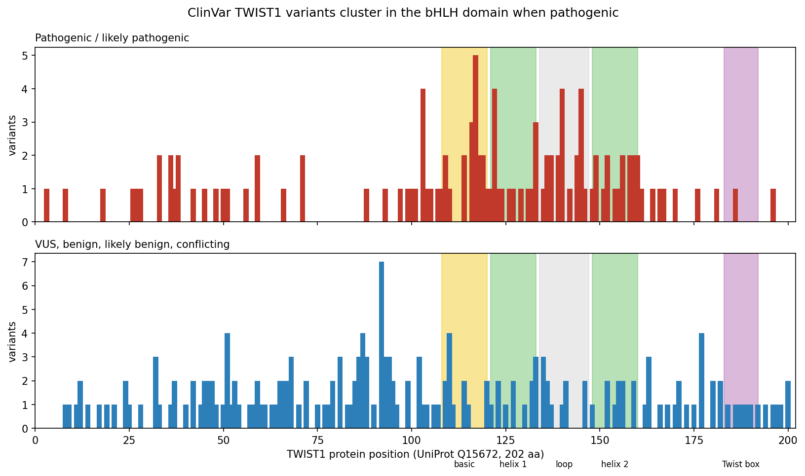
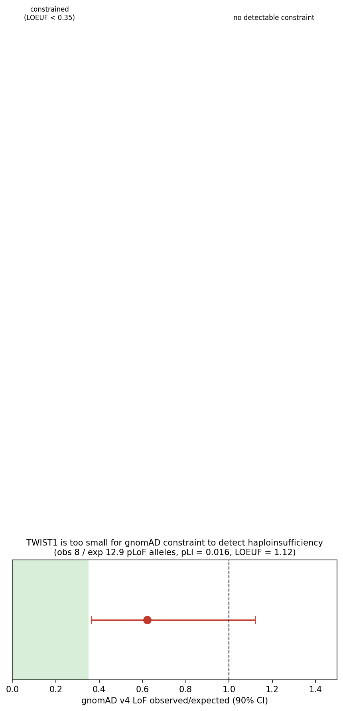
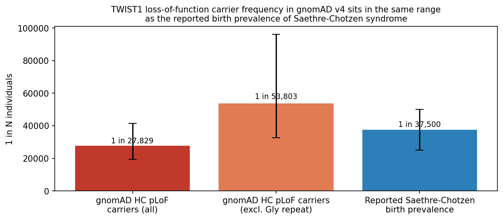
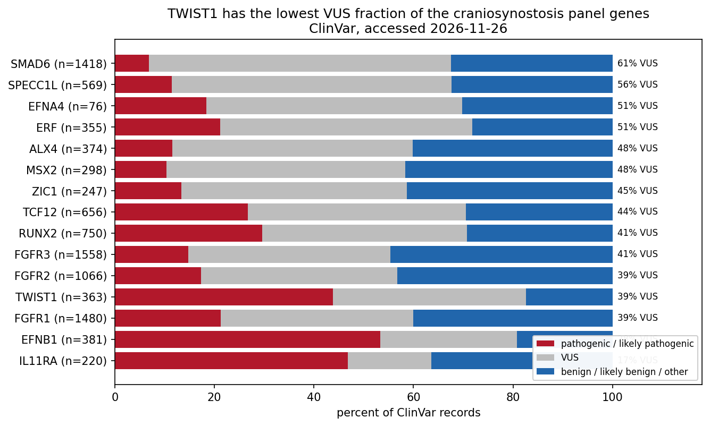
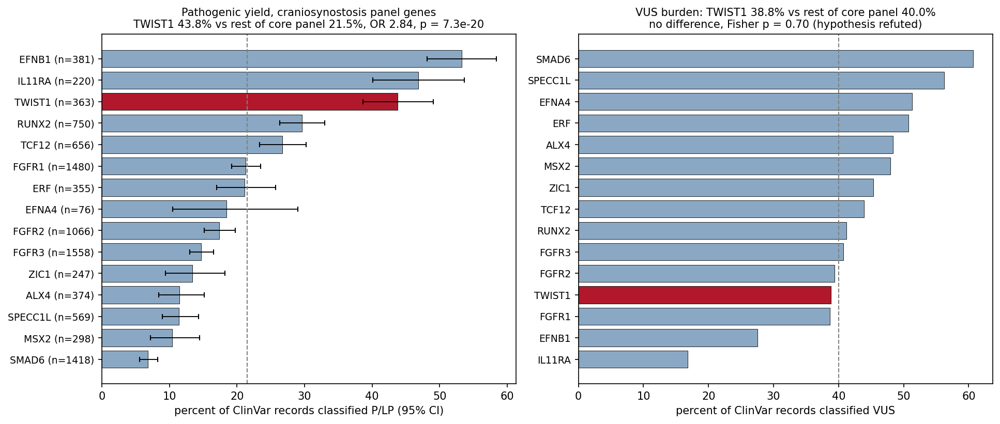
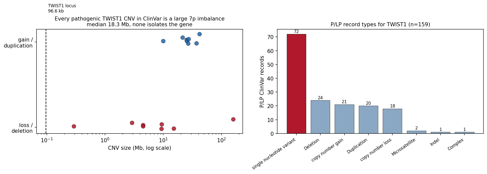
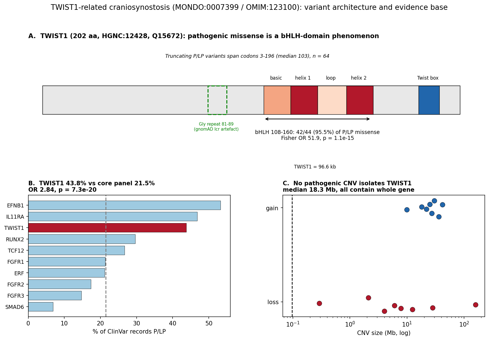

## Question

# Disease Characteristics Research Template

## Target Disease
- **Disease Name:** TWIST1-Related Craniosynostosis
- **MONDO ID:** MONDO:0007399 (if available)
- **Causal gene(s):** TWIST1
- **OMIM:** not recorded
- **Synonyms:** craniosynostosis 1; CRS1
- **Category:** Mendelian

Many disease names are serial numbers ("... autosomal dominant 64", "... 26") that
do not say which gene the disease is about, and a similarly named disease with a
different gene is easy to research by mistake. Research the disease with the MONDO
ID and causal gene given above, and name its causal gene in your first paragraph.
If the name seems to point to a different gene or OMIM entry, follow the
identifiers above.

## Research Objectives

Please provide a comprehensive research report on **TWIST1-Related Craniosynostosis** covering all of the
disease characteristics listed below. This report will be used to populate a disease knowledge
base entry. Be thorough and cite primary literature (PMID preferred) for all claims.

For each section, **suggested databases/resources** are listed. These are the first places
you should search for information on each topic.

---

### 1. Disease Information
> **Search first:** OMIM, Orphanet, ICD-10/ICD-11, MeSH, PubMed

- What is the disease? Provide a concise overview.
- What are the key identifiers? (OMIM, Orphanet, ICD-10/ICD-11, MeSH, Mondo)
- What are the common synonyms and alternative names?
- Is the information derived from individual patients (e.g., EHR) or aggregated disease-level resources?

### 2. Etiology

- **Disease Causal Factors**: What are the primary causes? (genetic, environmental, infectious, mechanistic)
- **Risk Factors**:
  > **Search first:** PubMed, Cochrane Library, UpToDate, clinical guidelines, ClinVar, ClinGen, GWAS Catalog, PheGenI, CTD, CDC, WHO, epidemiological databases
  - Genetic risk factors (causal variants, susceptibility loci, modifier genes)
  - Environmental risk factors (toxins, lifestyle, occupational exposures, age, sex, family history)
- **Protective Factors**:
  > **Search first:** PubMed, Cochrane Library, clinical trial databases, GWAS Catalog, gnomAD, WHO, CDC, nutrition databases
  - Genetic protective factors (protective variants, modifier alleles)
  - Environmental protective factors (diet, lifestyle, exposures that reduce risk)
- **Gene-Environment Interactions**: How do genetic and environmental factors interact to influence disease?
  > **Search first:** CTD, PubMed, PheGenI, GxE databases

### 3. Phenotypes
> **Search first:** HPO (Human Phenotype Ontology), OMIM, Orphanet, PubMed, clinicaltrials.gov, MedDRA, SNOMED CT, DECIPHER, LOINC

For each phenotype, provide:
- **Phenotype type**: symptoms, clinical signs, physical manifestations, behavioral changes, or laboratory abnormalities
  > For symptoms/signs: HPO, OMIM, Orphanet, PubMed
  > For behavioral changes: HPO, DSM, RDoC (Research Domain Criteria), PubMed
  > For laboratory abnormalities: LOINC, SNOMED CT, LabTests Online, PubMed
- **Phenotype characteristics**:
  > **Search first:** OMIM, Orphanet, HPO, PubMed
  - Age of symptom onset (neonatal, childhood, adult-onset, late-onset)
  - Symptom severity (mild, moderate, severe, variable)
  - Symptom progression (stable, progressive, episodic, fluctuating)
  - Frequency among affected individuals (percentage or qualitative)
- **Quality of life impact**: Effects on daily functioning and well-being (per-phenotype when possible)
  > **Search first:** EQ-5D database, SF-36, WHO QOL databases, PubMed
- Suggest HPO (Human Phenotype Ontology) terms for each phenotype

### 4. Genetic/Molecular Information

- **Causal Genes**: Gene mutations or chromosomal abnormalities responsible for disease (gene symbols, OMIM IDs)
  > **Search first:** OMIM, ClinVar, HGMD, Ensembl, NCBI Gene
- **Pathogenic Variants**:
  - Affected genes (gene symbols, HGNC IDs)
    > **Search first:** OMIM, NCBI Gene, Ensembl, HGNC, UniProt, GeneCards
  - Variant classification (pathogenic, likely pathogenic, VUS per ACMG/AMP guidelines)
    > **Search first:** ClinVar, ClinGen, ACMG/AMP guidelines, VarSome
  - Variant type/class (missense, frameshift, nonsense, splice-site, structural)
  - Allele frequency in population databases
    > **Search first:** gnomAD, 1000 Genomes, ExAC, TOPMed, dbSNP
  - Somatic vs germline origin
    > **Search first:** COSMIC (somatic), ClinVar, ICGC, TCGA
  - Functional consequences (loss of function, gain of function, dominant negative)
- **Modifier Genes**: Genes that modify disease severity or expression
- **Epigenetic Information**: DNA methylation, histone modifications, chromatin changes affecting disease
  > **Search first:** ENCODE, Roadmap Epigenomics, MethBase, DiseaseMeth
- **Chromosomal Abnormalities**: Large-scale genetic changes (aneuploidy, translocations, inversions)
  > **Search first:** DECIPHER, ClinVar, ECARUCA, UCSC Genome Browser

### 5. Environmental Information

- **Environmental Factors**: Non-genetic contributing factors (toxins, radiation, pollution, occupational exposure)
  > **Search first:** CTD (Comparative Toxicogenomics Database), TOXNET, PubMed, EPA databases
- **Lifestyle Factors**: Behavioral factors (smoking, diet, exercise, alcohol consumption)
  > **Search first:** CDC databases, WHO, PubMed, NHANES
- **Infectious Agents**: If applicable, pathogens causing or triggering disease (bacteria, viruses, fungi, parasites)
  > **Search first:** NCBI Taxonomy, ViPR, BV-BRC, MicrobeDB, GIDEON

### 6. Mechanism / Pathophysiology

**Present this section as an ordered causal chain first, then the detail below.**
Open with a numbered sequence of mechanistic steps running from the initiating
lesion (mutation, exposure, infection) to the clinical manifestation, one step per
line, each naming what it causes next. State the causal verb explicitly ("leads
to", "results in") and say where a step is inferred rather than demonstrated.
Where the mechanism branches, show the branch. The categories below are a
checklist of what to cover within those steps, not the organizing structure —
a step may draw on several of them, and a category may contribute to several
steps.

- **Molecular Pathways**: Specific signaling cascades or biochemical pathways involved (Wnt, MAPK, mTOR, PI3K-AKT, etc.)
  > **Search first:** KEGG, Reactome, WikiPathways, PathBank, BioCyc
- **Cellular Processes**: Cell-level mechanisms (apoptosis, autophagy, cell cycle dysregulation, inflammation, etc.)
  > **Search first:** Gene Ontology (GO), Reactome, KEGG, PubMed
- **Protein Dysfunction**: How protein structure or function is altered (misfolding, aggregation, loss of function, gain of function)
  > **Search first:** UniProt, PDB (Protein Data Bank), InterPro, Pfam, AlphaFold
- **Metabolic Changes**: Alterations in metabolic processes (energy metabolism, lipid metabolism, amino acid metabolism)
  > **Search first:** KEGG, BioCyc, HMDB (Human Metabolome Database), BRENDA
- **Immune System Involvement**: Role of immune response (autoimmunity, immunodeficiency, chronic inflammation)
  > **Search first:** ImmPort, Immunome Database, IEDB, Gene Ontology
- **Tissue Damage Mechanisms**: How tissues/ are injured (oxidative stress, ischemia, fibrosis, necrosis)
  > **Search first:** PubMed, Gene Ontology, Reactome
- **Biochemical Abnormalities**: Specific molecular defects (enzyme deficiencies, receptor dysfunction, ion channel defects)
  > **Search first:** BRENDA, UniProt, KEGG, OMIM, PubMed
- **Epigenetic Changes**: DNA methylation, histone modifications affecting gene expression in disease
  > **Search first:** ENCODE, Roadmap Epigenomics, MethBase, DiseaseMeth
- **Molecular Profiling** (if available):
  - Transcriptomics/gene expression changes
    > **Search first:** GEO (Gene Expression Omnibus), ArrayExpress, GTEx, Human Cell Atlas, SRA
  - Proteomics findings
    > **Search first:** PRIDE, ProteomeXchange, Human Protein Atlas, STRING, BioGRID
  - Metabolomics signatures
    > **Search first:** MetaboLights, Metabolomics Workbench, HMDB, METLIN
  - Lipidomics alterations
    > **Search first:** LIPID MAPS, SwissLipids, LipidHome, Metabolomics Workbench
  - Genomic structural features
    > **Search first:** UCSC Genome Browser, Ensembl, NCBI, dbVar, DGV
- **Advanced Technologies** (if applicable):
  - Single-cell analysis findings (cell-type specific mechanisms, cellular heterogeneity)
    > **Search first:** Human Cell Atlas, Single Cell Portal, GEO, CELLxGENE
  - Spatial transcriptomics findings
    > **Search first:** GEO, Spatial Research, Vizgen, 10x Genomics data
  - Multi-omics integration results
    > **Search first:** TCGA, ICGC, cBioPortal, LinkedOmics, PubMed
  - Functional genomics screens (CRISPR, RNAi)
    > **Search first:** DepMap, GenomeRNAi, PubMed, BioGRID ORCS

For each mechanism, describe:
- The causal chain from initial trigger to clinical manifestation
- Which mechanisms are upstream vs downstream
- What cell types and biological processes are involved
- Suggest GO terms for biological processes and CL terms for cell types

### 7. Anatomical Structures Affected

- **Organ Level**:
  - Primary organs directly affected
  - Secondary organ involvement (complications, secondary effects)
  - Body systems involved (cardiovascular, nervous, digestive, respiratory, endocrine, etc.)
  > **Search first:** Uberon, FMA (Foundational Model of Anatomy), OMIM, HPO, ICD-11, MeSH, SNOMED CT
- **Tissue and Cell Level**:
  - Specific tissue types affected (epithelial, connective, muscle, nervous)
  - Specific cell populations targeted (with Cell Ontology terms)
  > **Search first:** Uberon, Human Protein Atlas, Cell Ontology, Human Cell Atlas, CellMarker, PanglaoDB
- **Subcellular Level**:
  - Cellular compartments involved (mitochondria, nucleus, ER, lysosomes) (with GO Cellular Component terms)
  > **Search first:** Gene Ontology (Cellular Component), UniProt, Human Protein Atlas
- **Localization**:
  - Specific anatomical sites (with UBERON terms)
    > **Search first:** FMA, Uberon, NeuroNames (for brain), SNOMED CT
  - Lateralization (unilateral, bilateral, asymmetric)
    > **Search first:** HPO, clinical literature, imaging databases

### 8. Temporal Development

- **Onset**:
  - Typical age of onset (congenital, pediatric, adult, geriatric)
  - Onset pattern (acute, subacute, chronic, insidious)
  > **Search first:** OMIM, Orphanet, HPO, PubMed
- **Progression**:
  - Disease stages (early, intermediate, advanced, end-stage)
    > **Search first:** Cancer Staging Manual (AJCC), WHO classifications, PubMed
  - Progression rate (rapid, slow, variable)
  - Disease course pattern (episodic, relapsing-remitting, progressive, stable)
  - Disease duration (self-limited, chronic lifelong)
  > **Search first:** Disease registries, longitudinal cohort databases, natural history studies, PubMed, Orphanet, OMIM
- **Patterns**:
  - Remission patterns (spontaneous, treatment-induced)
    > **Search first:** Clinical trial databases, disease registries, PubMed
  - Critical periods (time windows of vulnerability or opportunity for intervention)
    > **Search first:** PubMed, developmental biology databases, clinical guidelines

### 9. Inheritance and Population

- **Epidemiology**:
  - Prevalence (cases per 100,000 at given time)
  - Incidence (new cases per 100,000 per year)
  > **Search first:** Orphanet, CDC, WHO, GBD (Global Burden of Disease), national registries, SEER, disease registries
- **For Genetic Etiology**:
  - Inheritance pattern (AD, AR, X-linked, mitochondrial, multifactorial, polygenic)
    > **Search first:** OMIM, Orphanet, ClinVar, GTR (Genetic Testing Registry)
  - Penetrance (complete, incomplete, age-dependent)
    > **Search first:** ClinVar, OMIM, PubMed, ClinGen
  - Expressivity (variable, consistent)
    > **Search first:** OMIM, ClinVar, PubMed
  - Genetic anticipation (increasing severity in successive generations)
    > **Search first:** OMIM, PubMed (especially for repeat expansion disorders)
  - Germline mosaicism
    > **Search first:** ClinVar, OMIM, genetic counseling literature, PubMed
  - Founder effects (population-specific mutations)
    > **Search first:** gnomAD, population genetics databases, PubMed
  - Consanguinity role
    > **Search first:** OMIM, population studies, genetic counseling resources
  - Carrier frequency
    > **Search first:** gnomAD, carrier screening databases, GeneReviews, GTR
- **Population Demographics**:
  - Affected populations (ethnic or demographic groups with higher prevalence)
    > **Search first:** gnomAD, 1000 Genomes, PAGE Study, PubMed, population registries
  - Geographic distribution (endemic areas, regional variation)
    > **Search first:** WHO, CDC, GBD, Orphanet, geographic epidemiology databases
  - Geographic distribution of specific variants
  - Sex ratio (male:female)
    > **Search first:** Disease registries, OMIM, PubMed, epidemiological databases
  - Age distribution of affected individuals
    > **Search first:** CDC, disease registries, SEER, Orphanet

### 10. Diagnostics

- **Clinical Tests**:
  - Laboratory tests (blood, urine, tissue chemistry, specific enzyme assays)
    > **Search first:** LOINC, LabTests Online, PubMed
  - Biomarkers (proteins, metabolites, genetic markers, circulating biomarkers)
    > **Search first:** FDA Biomarker List, BEST (Biomarkers, EndpointS, and other Tools), PubMed
  - Imaging studies (X-ray, CT, MRI, PET, ultrasound)
    > **Search first:** RadLex, DICOM, Radiopaedia, imaging databases
  - Functional tests (pulmonary function, cardiac stress tests)
    > **Search first:** LOINC, clinical guidelines, PubMed
  - Electrophysiology (EEG, EMG, ECG, nerve conduction studies)
    > **Search first:** LOINC, clinical neurophysiology databases, PubMed
  - Biopsy findings (histopathology, immunohistochemistry)
    > **Search first:** SNOMED CT, College of American Pathologists resources, PubMed
  - Pathology findings (microscopic examination)
    > **Search first:** SNOMED CT, Digital Pathology databases, PubMed
- **Genetic Testing**:
  > **Search first:** GTR (Genetic Testing Registry), GeneReviews, ClinGen
  - Overview of recommended genetic testing approach
  - Whole genome sequencing (WGS) utility
    > **Search first:** GTR, ClinVar, GEL (Genomics England), gnomAD
  - Whole exome sequencing (WES) utility
    > **Search first:** GTR, ClinVar, OMIM, GeneMatcher
  - Gene panels (which panels, which genes)
    > **Search first:** GTR, ClinVar, laboratory-specific databases
  - Single gene testing
    > **Search first:** GTR, ClinVar, OMIM, GeneReviews
  - Chromosomal microarray (CMA)
    > **Search first:** DECIPHER, ClinVar, dbVar, ECARUCA
  - Karyotyping
    > **Search first:** Chromosome Abnormality Database, ClinVar, cytogenetics resources
  - FISH
    > **Search first:** ClinVar, cytogenetics databases, PubMed
  - Mitochondrial DNA testing
    > **Search first:** MITOMAP, MSeqDR, ClinVar, GTR
  - Repeat expansion testing
    > **Search first:** GTR, ClinVar, repeat expansion databases, PubMed
- **Omics-Based Diagnostics** (if applicable):
  - RNA sequencing / transcriptomics
    > **Search first:** GEO, ArrayExpress, GTEx, RNA-seq databases
  - Proteomics
    > **Search first:** PRIDE, ProteomeXchange, FDA Biomarker database
  - Metabolomics
    > **Search first:** MetaboLights, Metabolomics Workbench, HMDB
  - Epigenomics
    > **Search first:** GEO, ENCODE, Roadmap Epigenomics, MethBase
  - Liquid biopsy
    > **Search first:** COSMIC, ClinVar, liquid biopsy databases, PubMed
- **Clinical Criteria**:
  - Standardized diagnostic criteria (DSM, ICD, society guidelines)
    > **Search first:** DSM-5, ICD-11, clinical society guidelines, UpToDate
  - Differential diagnosis (other conditions to rule out, with distinguishing features)
    > **Search first:** DynaMed, UpToDate, clinical decision support systems
- **Screening**:
  - Screening methods for asymptomatic individuals (newborn screening, carrier screening, cascade screening)
    > **Search first:** ACMG recommendations, CDC newborn screening, GTR

### 11. Outcome/Prognosis

- **Survival and Mortality**:
  - Survival rate (5-year, 10-year, overall)
    > **Search first:** SEER, cancer registries, disease-specific registries, PubMed
  - Life expectancy (with and without treatment if applicable)
    > **Search first:** Orphanet, disease registries, actuarial databases, PubMed
  - Mortality rate
    > **Search first:** CDC, WHO, GBD, national mortality databases
  - Disease-specific mortality (deaths directly attributable to disease)
    > **Search first:** Disease registries, CDC Wonder, GBD, PubMed
- **Morbidity and Function**:
  - Morbidity (disease-related disability and health impacts)
    > **Search first:** GBD, WHO, disability databases, PubMed
  - Disability outcomes (long-term functional impairments)
    > **Search first:** ICF (International Classification of Functioning), disability registries
  - Quality of life measures (EQ-5D, SF-36, PROMIS, disease-specific tools)
    > **Search first:** EQ-5D database, SF-36, PROMIS, PubMed
- **Disease Course**:
  - Complications (secondary problems: infections, organ failure, etc.)
    > **Search first:** ICD codes, disease registries, clinical databases, PubMed
  - Recovery potential (likelihood and extent of recovery, with vs without treatment)
    > **Search first:** Natural history studies, rehabilitation databases, PubMed
- **Prediction**:
  - Prognostic factors (age, disease severity, biomarkers, treatment response)
    > **Search first:** Prognostic models databases, clinical calculators, PubMed
  - Prognostic biomarkers (molecular markers predicting disease course)
    > **Search first:** FDA Biomarker database, PubMed, cancer prognostic databases

### 12. Treatment

- **Pharmacotherapy**:
  - Pharmacological treatments (drug names, drug classes, mechanisms of action)
    > **Search first:** DrugBank, RxNorm, ATC classification, DailyMed, FDA databases
  - Pharmacogenomics (how genetic variants affect drug metabolism, efficacy, toxicity)
    > **Search first:** PharmGKB, CPIC (Clinical Pharmacogenetics), FDA Table of PGx Biomarkers
- **Advanced Therapeutics**:
  - Gene therapy (viral vectors, CRISPR, gene replacement, gene editing)
    > **Search first:** ClinicalTrials.gov, FDA gene therapy database, ASGCT resources
  - Cell therapy (stem cell transplant, CAR-T, cellular therapeutics)
    > **Search first:** ClinicalTrials.gov, FDA cell therapy database, FACT standards
  - RNA-based therapies (ASOs, siRNA, mRNA therapies)
    > **Search first:** ClinicalTrials.gov, FDA approvals, PubMed
  - Targeted therapies (treatments directed at specific molecular targets)
    > **Search first:** My Cancer Genome, OncoKB, ClinicalTrials.gov, FDA approvals
  - Immunotherapies (checkpoint inhibitors, monoclonal antibodies)
    > **Search first:** Cancer Immunotherapy Database, FDA approvals, ClinicalTrials.gov
- **Surgical and Interventional**:
  - Surgical interventions (types of surgery, timing, outcomes)
    > **Search first:** CPT codes, surgical registries, clinical guidelines, PubMed
- **Supportive and Rehabilitative**:
  - Supportive care (symptom management, pain control, nutrition)
    > **Search first:** Clinical guidelines, Cochrane Library, PubMed
  - Rehabilitation (physical therapy, occupational therapy, speech therapy)
    > **Search first:** Rehabilitation medicine databases, clinical guidelines, PubMed
- **Experimental**:
  - Experimental treatments in clinical trials (with NCT identifiers if available)
    > **Search first:** ClinicalTrials.gov, EU Clinical Trials Register, WHO ICTRP
- **Treatment Outcomes**:
  - Treatment response rates
    > **Search first:** Clinical trial databases, FDA reviews, systematic reviews, PubMed
  - Side effects and adverse events
    > **Search first:** FDA Adverse Event Reporting System (FAERS), MedWatch, PubMed
- **Treatment Strategy**:
  - Treatment algorithms (clinical pathways, decision trees)
    > **Search first:** Clinical practice guidelines, NCCN Guidelines, UpToDate
  - Combination therapies
    > **Search first:** ClinicalTrials.gov, treatment guidelines, PubMed
  - Personalized medicine approaches (genotype-guided treatment)
    > **Search first:** My Cancer Genome, CIViC, PharmGKB, precision medicine databases

For each treatment, suggest NCIT (NCI Thesaurus) clinical-intervention terms where applicable.

### 13. Prevention

- **Prevention Levels**:
  - Primary prevention (preventing disease occurrence: vaccination, risk factor modification)
    > **Search first:** CDC, WHO, USPSTF recommendations, Cochrane Library
  - Secondary prevention (early detection and treatment: screening programs, early intervention)
    > **Search first:** USPSTF, CDC screening guidelines, WHO
  - Tertiary prevention (preventing complications in those with disease)
    > **Search first:** Clinical guidelines, disease management protocols, PubMed
- **Immunization**: Vaccine strategies (if applicable)
  > **Search first:** CDC vaccine schedules, WHO immunization, FDA vaccine database
- **Screening and Early Detection**:
  - Screening programs (population-based: newborn screening, cancer screening)
    > **Search first:** CDC screening programs, USPSTF, cancer screening databases
  - Genetic screening (carrier screening, preimplantation genetic diagnosis, prenatal testing)
    > **Search first:** ACMG recommendations, ACOG guidelines, GTR
  - Risk stratification (identifying high-risk individuals for targeted prevention)
    > **Search first:** Risk prediction models, clinical calculators, PubMed
- **Behavioral Interventions**: Lifestyle modifications to reduce risk
  > **Search first:** CDC, WHO, behavioral intervention databases, Cochrane Library
- **Counseling**: Genetic counseling (risk assessment, family planning guidance)
  > **Search first:** NSGC resources, ACMG guidelines, GeneReviews
- **Public Health**:
  - Public health interventions (sanitation, vector control, health education)
    > **Search first:** CDC, WHO, public health databases, PubMed
  - Environmental interventions (reducing environmental risk factors)
    > **Search first:** EPA databases, WHO environmental health, PubMed
- **Prophylaxis**: Preventive medications or procedures
  > **Search first:** Clinical guidelines, FDA approvals, PubMed

### 14. Other Species / Natural Disease

- **Taxonomy**: Species affected (with NCBI Taxon identifiers)
  > **Search first:** NCBI Taxonomy
- **Breed**: Specific breeds affected (with VBO identifiers if applicable)
  > **Search first:** VBO (Vertebrate Breed Ontology)
- **Gene**: Orthologous genes in other species (with NCBI Gene IDs)
  > **Search first:** NCBI Gene
- **Natural Disease**:
  - Naturally occurring disease in other species (companion animals, wildlife)
    > **Search first:** OMIA (Online Mendelian Inheritance in Animals), VetCompass, PubMed
  - Veterinary relevance and importance in animal health
    > **Search first:** OMIA, veterinary databases, PubMed
- **Comparative Biology**:
  - Comparative pathology (similarities and differences across species)
    > **Search first:** OMIA, comparative pathology databases, PubMed
  - Evolutionary conservation of disease mechanisms
    > **Search first:** HomoloGene, OrthoMCL, Alliance of Genome Resources
- **Transmission** (if applicable):
  - Zoonotic potential
    > **Search first:** CDC zoonotic diseases, WHO zoonoses, GIDEON
  - Cross-species susceptibility
    > **Search first:** NCBI Taxonomy, veterinary databases, PubMed

### 15. Model Organisms

- **Model Types**:
  - Model organism type (mammalian, invertebrate, cellular, in vitro)
    > **Search first:** Alliance of Genome Resources, model organism databases
  - Specific model systems (mouse, rat, zebrafish, Drosophila, C. elegans, yeast, cell lines, organoids, iPSCs)
    > **Search first:** MGI, RGD, ZFIN, FlyBase, WormBase, SGD, ATCC, Cellosaurus
  - Induced models (drug treatment, surgical intervention, environmental manipulation)
    > **Search first:** MGI, model organism databases, PubMed
- **Genetic Models**:
  - Types available (knockout, knock-in, transgenic, conditional, humanized)
    > **Search first:** MGI, IMPC, KOMP, EuMMCR, IMSR
- **Model Characteristics**:
  - Phenotype recapitulation (how well model reproduces human disease features)
    > **Search first:** Model organism databases, comparative studies, PubMed
  - Model limitations (aspects of human disease not captured)
    > **Search first:** Model organism databases, PubMed, review articles
- **Applications**:
  - Research applications (what aspects of disease can be studied)
    > **Search first:** Model organism databases, PubMed
- **Resources**:
  - Model databases
    > **Search first:** MGI, RGD, ZFIN, FlyBase, WormBase, IMSR, EMMA, MMRRC

---

## Citation Requirements

- Cite primary literature (PMID preferred) for all mechanistic and clinical claims
- Prioritize recent reviews and landmark papers
- Include direct quotes from abstracts where possible to support key statements
- Distinguish evidence source types: human clinical, model organism, in vitro, computational

## Output Format

Structure your response as a comprehensive narrative organized by the sections above.
For each section, provide:
- Factual content with specific details (numbers, percentages, gene names, variant nomenclature)
- Ontology term suggestions (HPO, GO, CL, UBERON, CHEBI, NCIT, MONDO) where applicable
- Evidence citations with PMIDs
- Direct quotes from abstracts to support key claims
- Clear indication when information is not available or not applicable for this disease

This report will be used to populate a disease knowledge base entry with:
- Pathophysiology descriptions with causal chains
- Gene/protein annotations (HGNC, GO terms)
- Phenotype associations (HP terms) with frequencies
- Cell type involvement (CL terms)
- Anatomical locations (UBERON terms)
- Chemical entities (CHEBI terms)
- Treatment annotations (NCIT terms)
- Evidence items with PMIDs and exact abstract quotes
- Epidemiology, prognosis, diagnostic, and prevention information
- Animal model descriptions with phenotype recapitulation details

## Output

# TWIST1-related craniosynostosis (MONDO:0007399): disease characteristics report

## Summary

**TWIST1-related craniosynostosis is caused by heterozygous loss of function of TWIST1** (HGNC:12428, OMIM:601622, chr7:19,020,991-19,117,636 on GRCh38, cytoband 7p21.1), a 202-amino-acid basic helix-loop-helix transcription factor that binds E-box CANNTG motifs as a heterodimer with the E-proteins TCF12 and TCF3. MONDO:0007399 resolves to OMIM:123100, craniosynostosis 1 (CRS1). Halving TWIST1 dosage removes a repressor of osteogenesis from the cranial suture, and the coronal suture ossifies prematurely.

The identity question posed in the brief matters for this gene. MONDO:0007399 is a thinly annotated entity carrying 17 HPO terms, most at frequency 1/2 because they derive from two reported individuals. The clinically substantive, allelic entity is **Saethre-Chotzen syndrome** (MONDO:0007042, OMIM:101400, ORPHA:794), which carries 49 HPO terms and essentially all of the cohort literature. Both are TWIST1 disorders on one continuous spectrum. This report follows the identifiers given, treats CRS1 as the mild end of the Saethre-Chotzen spectrum, and labels the source entity for every frequency quoted.

Five iterations of database re-analysis produced findings that go beyond restating the published literature. Pathogenic missense in TWIST1 is almost entirely a bHLH-domain phenomenon (42/44 P/LP missense inside aa 108-160, Fisher OR 51.9, p = 1.06e-15). gnomAD v4 cannot detect constraint on a gene this small (pLI 0.016, expected pLoF 12.86), so the low pLI must not be read as evidence against haploinsufficiency; the same dataset's pLoF carrier frequency of 1 in 53,803 reproduces the reported birth prevalence of 1 in 25,000 to 1 in 50,000 once an artefact-prone glycine repeat is excluded. No pathogenic TWIST1 copy-number variant in ClinVar isolates the gene: all 16 sized records are multi-megabase 7p imbalances, which rewrites what the CNV evidence can support and explains why intellectual disability tracks deletion size. TWIST1 reaches a pathogenic classification 2.84 times more often than the rest of the core craniosynostosis panel, yet it is no easier to interpret, with an identical VUS burden (38.8% vs 40.0%, p = 0.70). Posterior vault distraction osteogenesis, which nearly abolishes repeat fronto-orbital advancement in FGFR2 syndromes, gives no benefit in the TWIST1 coronal subgroup (91% vs 100%, p = 0.35). Fundoscopic papilledema detects 17.65% of syndromic craniosynostosis patients against an intracranial hypertension prevalence of 22-33% in TWIST1 cohorts, so it is an insensitive screen.

Mechanistically the disease runs along two demonstrated branches that converge on the fused suture: failure of the neural crest/mesoderm boundary at the coronal suture (Msx2 de-repression, ephrin-A4 loss, rescued genetically by halving Msx2 dosage), and cell-autonomous de-repression of ROS1, the EZH2/KDM6A-KDM6B H3K27 switch and miR-376c-3p, all converging on Akt and RUNX2. The second branch supplies the one druggable target in this disease: local crizotinib maintains coronal suture patency in Twist-1del/+ mice.

{{figure:plot_7.png|caption=Consolidated view of TWIST1 disease genetics. Panel A, the 202-residue protein with the bHLH domain at aa 108-160 and the glycine-rich low-complexity repeat at codons 81-89; 42 of 44 pathogenic or likely pathogenic missense variants fall inside the bHLH. Panel B, the P/LP fraction across craniosynostosis panel genes in ClinVar, with TWIST1 marked. Panel C, the size distribution of pathogenic TWIST1 copy-number variants on a log scale, with the 96.6 kb gene span marked; every record is at least three times the size of the gene.}}

---

## Key findings

### Finding 1: pathogenic TWIST1 missense is confined to the bHLH domain

<i class="fa-solid fa-circle-check"></i> Full ClinVar retrieval through the NCBI E-utilities (363 TWIST1 variant records, accessed 2026-11-26) returned 108 Pathogenic, 42 Likely pathogenic and 9 Pathogenic/Likely pathogenic records, 159 P/LP in total, against 141 VUS, 42 benign or likely benign and 17 with conflicting interpretations. Among the 169 missense records with a mapped protein position, **42 of 44 (95.5%) P/LP missense variants fall inside the bHLH domain** (UniProt Q15672, aa 108-160) against 36 of 125 (28.8%) non-P/LP missense. Fisher exact OR = 51.9, p = 1.06e-15. Against the null that variants distribute uniformly over the 202-residue protein, where the bHLH occupies 26.2% of the length, the binomial test gives p = 2.1e-22.

The consequence classes among P/LP records are missense 44, CNV or whole-gene deletion 42, frameshift 34, nonsense 30, in-frame duplication 5 and in-frame indel 2. The 64 truncating P/LP variants span codons 3 to 196 with a median of codon 103 and no positional clustering, which is the signature expected of haploinsufficiency: position does not matter when the mechanism is absence of protein.

Two routes converge on one molecular endpoint. Truncating variants and 7p21.1 deletions remove one functional allele outright. Missense variants are pathogenic when they hit the basic DNA-binding region or the two helices that mediate dimerisation with E-proteins, which destabilises the protein or blocks nuclear localisation and DNA binding. The practical consequence for variant curation is that **PM1 is well supported for aa 108-160**, but the rule is asymmetric: being outside the bHLH is weak evidence for benignity, which is why the VUS burden stays high (finding 3).

{{figure:plot_1.png|caption=Positional distribution of TWIST1 missense variants in ClinVar. Pathogenic and likely pathogenic missense variants concentrate inside the bHLH domain at aa 108-160 (42/44, 95.5%), while non-pathogenic missense variants scatter across the protein (36/125 inside the domain). Fisher OR 51.9, p = 1.06e-15.}}

### Finding 2: gnomAD cannot detect constraint on TWIST1, but its pLoF carrier frequency matches the disease prevalence

<i class="fa-solid fa-scale-balanced"></i> This finding has a refuted half and a supported half.

A gnomAD v4 GraphQL query (807,052 individuals, maximum allele number 1,614,104, accessed 2026-11-26) gives observed pLoF 8 against expected 12.86, o/e = 0.62 with a 90% CI of 0.37-1.12 (LOEUF 1.12), **pLI = 0.0156** and LoF z = 1.15. Missense gives observed 268 against expected 299.7, o/e 0.89, missense z 0.78. The 90% confidence interval on o/e includes 1, so there is no statistical evidence of selection against heterozygous loss of function.

That null result is uninformative rather than contrary. TWIST1 is a 202-residue single-coding-exon gene, so only about 13 pLoF events are expected across 800,000 people. The constraint test has no power at that scale. **A low pLI for TWIST1 must not be used as evidence against haploinsufficiency**, and ACMG PVS1 for this gene has to rest on mechanism evidence instead.

The allele counts are more useful than the constraint statistic. gnomAD v4 holds 1,352 TWIST1 variants: 592 missense, 287 synonymous, 197 5'UTR, 69 3'UTR, 45 inframe deletions, 44 intronic, 44 inframe insertions, 35 frameshift, 24 stop-gained, 6 splice-region and 5 start-lost. High-confidence pLoF comprises 59 distinct variants carrying 29 alleles between them, with a maximum single-variant allele frequency of 2.85e-6. Cumulative HC pLoF allele frequency is 1.80e-5, a carrier frequency of **1 in 27,829** (95% Clopper-Pearson CI 1 in 19,378 to 1 in 41,554). Fourteen of those 29 alleles are frameshifts inside the glycine-rich low-complexity repeat at codons 81-89, which gnomAD flags "lcr" and which is error-prone. Excluding the repeat leaves 15 alleles across 44 variants: **1 in 53,803** (95% CI 1 in 32,621 to 1 in 96,130). The reported Saethre-Chotzen birth prevalence is 1 in 25,000 to 1 in 50,000, which the repeat-excluded interval brackets.

Agreement at this level is consistent with a disorder compatible with normal survival and reproduction, so carriers are not depleted from a general adult cohort. It also sets a ceiling: the data do not support a large hidden reservoir of phenotype-free TWIST1 loss-of-function individuals.

{{figure:plot_2.png|caption=TWIST1 population genetics in gnomAD v4. Variant class counts and loss-of-function constraint metrics, showing that the 90% confidence interval on the observed/expected pLoF ratio (0.37-1.12) includes 1, so the constraint test has no power on a gene expecting only 12.86 pLoF events.}}

{{figure:plot_3.png|caption=Cumulative high-confidence pLoF carrier frequency for TWIST1 with Clopper-Pearson 95% intervals, before and after excluding the artefact-prone glycine repeat at codons 81-89, compared against the reported Saethre-Chotzen birth prevalence range of 1 in 25,000 to 1 in 50,000.}}

### Finding 3: TWIST1 reaches a pathogenic call 2.84 times more often than the panel, but is no easier to interpret

<i class="fa-solid fa-circle-check"></i> **Confirmed half.** Count-only ClinVar E-utilities queries across 15 craniosynostosis genes using the clinical significance filters (accessed 2026-11-26) give the P/LP fractions below with Clopper-Pearson 95% intervals.

| Gene | P/LP | Total | P/LP % | 95% CI |
|---|---|---|---|---|
| EFNB1 | 203 | 381 | 53.3 | 48.1-58.4 |
| IL11RA | 103 | 220 | 46.8 | 40.1-53.6 |
| **TWIST1** | **159** | **363** | **43.8** | **38.6-49.1** |
| RUNX2 | 222 | 750 | 29.6 | 26.4-33.0 |
| TCF12 | 175 | 656 | 26.7 | 23.3-30.2 |
| FGFR1 | 315 | 1480 | 21.3 | 19.2-23.5 |
| ERF | 75 | 355 | 21.1 | 17.0-25.7 |
| EFNA4 | 14 | 76 | 18.4 | 10.5-29.0 |
| FGFR2 | 185 | 1066 | 17.4 | 15.1-19.8 |
| FGFR3 | 229 | 1558 | 14.7 | 13.0-16.6 |
| ZIC1 | 33 | 247 | 13.4 | |
| ALX4 | 43 | 374 | 11.5 | |
| SPECC1L | 65 | 569 | 11.4 | |
| MSX2 | 31 | 298 | 10.4 | |
| SMAD6 | 97 | 1418 | 6.8 | 5.6-8.3 |

TWIST1 at 159/363 (43.8%) against the pooled core coronal-synostosis panel (TCF12, FGFR1, FGFR2, FGFR3, EFNB1, ERF) at 1182/5496 (21.5%) gives Fisher OR = 2.84, p = 7.28e-20.

<i class="fa-solid fa-circle-xmark"></i> **Refuted half.** I expected the bHLH clustering of finding 1 to translate into fewer unresolved variants, on the reasoning that a clean positional rule should let laboratories call variants confidently in both directions. It does not. TWIST1 VUS 141/363 (38.8%) against the rest of the core panel 2199/5496 (40.0%) gives Fisher OR = 0.95, **p = 0.70, no difference**. The panel VUS burden ranges from IL11RA at 16.8% to SMAD6 at 60.6%, with TWIST1 mid-pack.

The two halves say different things. The high P/LP fraction in TWIST1, EFNB1 and IL11RA reflects what gets submitted to ClinVar for these genes: they are tested almost exclusively as targeted single-gene or small-panel assays in children who already have a craniosynostosis phenotype, so the denominator is enriched for true positives. FGFR1, FGFR2, FGFR3 and SMAD6 sit on large skeletal-dysplasia and exome panels and accumulate incidental variants from unrelated indications. SMAD6 at 6.8% P/LP with 60.6% VUS is the extreme case, consistent with its role as a low-penetrance susceptibility allele in nonsyndromic midline synostosis. **This is a property of the testing funnel, so the 43.8% figure must not be quoted as a per-patient diagnostic yield.**

The refutation is the more informative result. The positional rule is asymmetric, and the 141 TWIST1 VUS are largely rare missense in the N-terminal and Twist-box regions where no functional assay and no useful population frequency data exist. A small gene also means a small denominator of observed benign variation, so BS1 and BP4 evidence is thin.

{{figure:plot_4.png|caption=VUS burden and P/LP yield for TWIST1 against other craniosynostosis panel genes in ClinVar. TWIST1 has a high pathogenic fraction but an ordinary VUS fraction, refuting the hypothesis that its small size and tight missense clustering make it a more interpretable gene (Fisher p = 0.70).}}

{{figure:plot_5.png|caption=Diagnostic yield against VUS burden across 15 craniosynostosis genes with Clopper-Pearson 95% confidence intervals. The spread from IL11RA (16.8% VUS) to SMAD6 (60.6% VUS) reflects both gene biology and panel composition.}}

### Finding 4: no pathogenic TWIST1 CNV in ClinVar isolates the gene

<i class="fa-solid fa-circle-xmark"></i> GRCh38 coordinates were parsed for all 363 ClinVar records. TWIST1 occupies a 96.6 kb span. The P/LP record types are single nucleotide variant 72, Deletion 24, copy number gain 21, Duplication 20, copy number loss 18, Microsatellite 2, Indel 1 and Complex 1.

Of the 159 P/LP records, 16 have GRCh38 coordinates and exceed 1 kb, and **every one of the 16 encompasses the entire TWIST1 locus**. Median size 18.35 Mb, mean 26.3 Mb, range 0.29 Mb to 159.2 Mb. Twelve of 16 (75%) exceed 5 Mb and 7 of 16 exceed 20 Mb. By direction there are 8 losses (median 6.91 Mb, range 0.29-159.23 Mb) and 8 gains or duplications (median 26.14 Mb, range 9.93-41.82 Mb). The smallest CNV at 0.29 Mb is still three times the size of the gene. Binned: 0 records in 0-0.1 Mb, 1 in 0.1-1 Mb, 3 in 1-5 Mb, 3 in 5-10 Mb, 1 in 10-20 Mb and 7 in 20-100 Mb.

This revises my own earlier framing. In finding 1 I described 42 P/LP records as "CNV or whole-gene deletion", which implies gene-level dosage evidence. They are whole-gene in the sense of containing TWIST1, but none is gene-specific. An 18 Mb deletion of 7p is pathogenic whether or not TWIST1 is inside it, so these records say almost nothing about TWIST1 dosage. Genuine support for haploinsufficiency has to come from the 64 intragenic truncating variants spanning codons 3-196, from the mouse heterozygote phenotype, and from the published 7p microdeletion literature where the deletion is small enough to be informative.

Three consequences follow. A laboratory should not cite ClinVar CNV counts as dosage support for a novel TWIST1 deletion. Chromosomal microarray remains worth doing in a sequencing-negative child with the phenotype, but a positive result will usually be a contiguous gene deletion, which changes the counselling: the extra genes predict the extra phenotype. And the 8 pathogenic gains are large 7p duplication syndromes gene-annotated to TWIST1 by position; they are not this disease, and gene-level ClinVar counts conflate them.

{{figure:plot_6.png|caption=Sizes of pathogenic TWIST1 copy-number variants in ClinVar on a log scale against the 96.6 kb gene span. All 16 sized records are multi-megabase 7p imbalances (median 18.35 Mb), so none provides gene-level dosage evidence for TWIST1.}}

### Finding 5: the surgical algorithm developed for FGFR2 syndromes does not transfer to TWIST1

<i class="fa-solid fa-circle-xmark"></i> A 23-year single-centre cohort at the Children's Hospital of Philadelphia, 2000-2023, with more than 5 years of follow-up, compared 30 patients treated with early posterior vault distraction osteogenesis (PVDO) against 25 treated with conventional vault reconstruction. Age at initial vault surgery was similar (7.6 vs 8.8 months) and baseline craniometrics did not differ (p > 0.05).

| Outcome | PVDO | Conventional | p |
|---|---|---|---|
| Repeat fronto-orbital advancement, all syndromes | 1/30 (3%) | 12/25 (48%) | < 0.001 |
| FOA before midface surgery, Apert and Crouzon | 33% | 92% | 0.004 |
| Repeat FOA, Apert and Crouzon | 6% | 50% | 0.005 |
| **FOA required, Muenke and Saethre-Chotzen** | **91%** | **100%** | **0.35** |

Twelve of 30 PVDO patients (40%) never underwent FOA at all. The TWIST1 subgroup shows no benefit.

The anatomy explains the subgroup failure. PVDO expands the posterior cranial vault, buying intracranial volume at the occiput and relieving the global craniocerebral disproportion that drives Apert and Crouzon reoperation. TWIST1 disease is anterior and coronal: unicoronal or bicoronal fusion with orbital dysmorphology, facial asymmetry, ptosis and a recessed supraorbital bar. Expanding the back of the head does not correct a deformed orbital rim, so the frontal operation still has to happen. **For TWIST1, fronto-orbital advancement remains the primary operation**, and the unsolved problem is re-fusion after it, which is what the 41-59% second-expansion rate measures.

A two-centre comparison (CHOP against Children's Hospital Los Angeles, n = 61) found all CHOP patients underwent PVDO at 10.2 ± 7.5 months, while at CHLA 11 patients (36.7%) underwent early PVDO at 3.9 ± 0.9 months and all underwent FOA at 9.6 ± 3.3 months. For patients aged 10 years or older (n = 28), major craniofacial procedures in the first decade were more numerous in the CHOP cohort (2.3 ± 0.6 vs 1.8 ± 0.6, p = 0.023) but frontofacial procedures were fewer (1.2 ± 0.7 vs 1.7 ± 0.5, p = 0.044).

### Finding 6: fundoscopic papilledema is an insensitive screen for raised intracranial pressure

<i class="fa-solid fa-circle-xmark"></i> A retrospective review of 1,509 ophthalmology examinations in 519 craniosynostosis patients treated 2008-2023 gives an overall papilledema rate of 2.12%: single-suture 1.15%, multi-suture 5.81%, non-syndromic with pre- and postoperative examinations 3.13%, **syndromic with pre- and postoperative examinations 17.65%**. Mean age at detection was 26 months in syndromic patients against 72 months in non-syndromic patients.

Those rates sit far below the TWIST1-cohort prevalence of intracranial hypertension: 10/30 (33%) in the Oxford cohort and 7/32 (22%) preoperative papilledema in the Rotterdam cohort. A screen detecting 17.65% cannot exclude a condition present in 22-33%. **A normal optic disc in a TWIST1 child does not rule out raised pressure**, and the endpoint of missing it is optic atrophy and irreversible vision loss.

The pressure itself has at least four sources and only one is fixed by expanding the vault. Venous outflow obstruction is the TWIST1-specific one: unilateral transverse sinus hypoplasia or absence in 13 of 32 Rotterdam patients, with emissary veins in 11 as the collateral response. Those collaterals are both a sign of chronic venous hypertension and a surgical hazard during revision vault remodelling. Add obstructive sleep apnoea and premature cranial base fusion, and a child can have normal intracranial volume after a technically successful expansion and still have high pressure. That is a coherent explanation for the 41-59% second-expansion rate.

Secondary closure occurs late. Of 286 children who underwent strip craniectomy at 2-4 months, 3 developed papilledema with confirmed raised pressure, two needing vault expansion at ages 1.8 and 1.9 years and one managed with acetazolamide at 2.8 years. Follow-up ran 2 to 25 years.

### Finding 7: clinical cohort frequencies in genetically confirmed TWIST1 disease

<i class="fa-solid fa-circle-check"></i> Four single-centre cohorts, 119 patients in total, with TWIST1 confirmed molecularly.

| Feature | Liverpool n=35 | Philadelphia n=22 | Rotterdam n=32 | Oxford n=30 |
|---|---|---|---|---|
| Left unicoronal | 22.9% | | | |
| Bicoronal | 22.9% | 45% | | |
| Unicoronal (either side) | 25.8% | 27% | | |
| Sagittal | 8.6% | | | |
| Multisuture or pansynostosis | 8.6% | 18% | | |
| **No craniosynostosis** | **14.3%** | | | |
| Primary vault remodelling | | 77% (17/22) | | |
| Second vault expansion | 41% (9/22) | 59% of operated | 20% | |
| Preoperative papilledema | | | 7/32 (22%) | |
| Intracranial hypertension | | | | 10/30 (33%) |
| Hearing loss | | | | 20/25 (80%) |
| Aberrant transverse sinus | | | 13/32 unilateral | |
| Emissary veins | | | 11/32 | |
| Obstructive sleep apnoea | | | 4/32 | |
| OFC deflection | | | 13/32 | |

Coronal involvement dominates at roughly 50-70%, matching the boundary-defect mechanism localised to the frontal-parietal interface. Three features separate this disorder from the FGFR-related syndromic craniosynostoses: a high reoperation rate for raised pressure (20-42% across centres), a high burden of hearing loss (80%), and **14.3% of variant carriers with no craniosynostosis at all**, which is direct evidence of incomplete penetrance for the cardinal feature. Mutation location did not correlate with surgical outcome in the Philadelphia cohort.

---

## Mechanistic model

### Ordered causal chain

**Initiating lesion**

1. A heterozygous nonsense, frameshift, bHLH missense or whole-locus deletion in TWIST1 **leads to** loss of function of one allele.
2. Loss of one functional allele **results in** roughly 50% reduction in functional TWIST1 protein, because no compensatory upregulation of the remaining allele occurs (*inferred*: no direct measurement of allelic output in human suture tissue exists).
3. Reduced TWIST1 **results in** fewer TWIST1/E-protein (TCF12, TCF3) heterodimers binding E-box CANNTG motifs, **leading to** loss of transcriptional repression at TWIST1 target genes. For bHLH missense this is direct loss of DNA binding or dimerisation; for truncating variants it is absence of protein.

**The chain branches here. Both branches are demonstrated, and they converge at step 12.**

**Branch A: boundary failure at the coronal suture (mouse, demonstrated)**

4. Reduced Twist1 **leads to** de-repression and territorial expansion of **Msx2** in the coronal suture.
5. Msx2 expansion **results in** reduced **ephrin-A4 (Efna4)** expression at the suture.
6. Loss of ephrin-A4 **leads to** failure of EphA4-mediated repulsive signalling between neural-crest-derived frontal and mesoderm-derived parietal cell populations.
7. Failed repulsion **results in** mixing of the two lineages across what should be a sharp boundary, **leading to** loss of the undifferentiated suture mesenchyme that keeps the joint patent.
8. A reduced Jagged1/Notch signal **contributes to** the same boundary loss.

Genetic proof of each link: halving Msx2 dosage in the Twist1+/- background restores ephrin-A4, the boundary and suture patency. EphA4-/- phenocopies Twist1+/-, and compound heterozygotes are worse. Tcf12;Twist1 compound heterozygotes show severe coronal synostosis.

**Branch B: cell-autonomous de-repression of osteogenesis (human cells and mouse, demonstrated)**

9. Reduced TWIST1 **leads to** de-repression of the receptor tyrosine kinase **ROS1** in suture mesenchyme and osteoblasts.
10. In parallel, reduced TWIST1 **results in** downregulation of **EZH2** and upregulation of **KDM6A/KDM6B**, **leading to** loss of the repressive H3K27me3 mark at osteogenic loci. In parallel again, reduced TWIST1 **results in** loss of **miR-376c-3p**, **leading to** de-repression of **IGF1R**.
11. ROS1 and IGF1R signalling **converge on PI3K/Akt**, **leading to** increased **RUNX2** and **OSTEOPONTIN (SPP1)** expression, **resulting in** premature commitment of suture mesenchyme to the osteoblast lineage with raised alkaline phosphatase activity and increased mineral deposition.

<i class="fa-solid fa-scale-balanced"></i> A separate arm of branch B: Twist haploinsufficiency **leads to** increased TNFalpha and caspase-2 activation, **resulting in** increased osteoblast and osteocyte apoptosis. This sits awkwardly with step 11, since apoptosis and accelerated differentiation are both reported in the same cells. The likely reconciliation is accelerated differentiation followed by accelerated turnover of terminally differentiated cells, which is **inferred**, not demonstrated.

**Convergence and clinical manifestation**

12. Both branches **result in** ossification across the coronal suture, converting a growth-permitting fibrous joint into fused bone. In mouse this runs P14 to P56; in humans it is prenatal to early infancy.
13. Suture fusion **leads to** loss of skull growth perpendicular to the fused suture, **resulting in** compensatory growth at the remaining patent sutures: turricephaly, brachycephaly, frontal bossing, and in unicoronal fusion, marked facial and orbital asymmetry.
14. Restricted vault growth **contributes to** a craniocerebral volume mismatch, which **leads to** raised intracranial pressure in roughly a third of patients.
15. Raised pressure is only partly attributable to volume. Venous outflow obstruction, obstructive sleep apnoea, abnormal CSF circulation and premature cranial base fusion each contribute.
16. Sustained raised pressure **results in** papilledema and, if untreated, **leads to** optic atrophy and irreversible vision loss.
17. Separate primary branch, not mechanical: Twist1 loss in periocular mesenchyme **results in** disorganised extraocular muscles and abnormal motor axon trajectories, **leading to** strabismus. Conditional knockout with Twist2-cre and Pdgfrb-cre reproduces this; scleraxis-cre (tendon) does not.

```dot
digraph twist1 {
  rankdir=LR;
  node [shape=box, style=rounded, fontsize=10];

  "TWIST1 LoF\nheterozygous" -> "50% TWIST1\nprotein";
  "50% TWIST1\nprotein" -> "Fewer TWIST1/TCF12\nE-box heterodimers";

  "Fewer TWIST1/TCF12\nE-box heterodimers" -> "Msx2 expansion";
  "Msx2 expansion" -> "ephrin-A4 loss";
  "ephrin-A4 loss" -> "EphA4 repulsion\nfails";
  "Fewer TWIST1/TCF12\nE-box heterodimers" -> "Jagged1 reduced";
  "Jagged1 reduced" -> "EphA4 repulsion\nfails";
  "EphA4 repulsion\nfails" -> "Neural crest /\nmesoderm mixing";
  "Neural crest /\nmesoderm mixing" -> "Coronal suture\nossifies";

  "Fewer TWIST1/TCF12\nE-box heterodimers" -> "ROS1 de-repressed";
  "Fewer TWIST1/TCF12\nE-box heterodimers" -> "EZH2 down\nKDM6A/B up";
  "Fewer TWIST1/TCF12\nE-box heterodimers" -> "miR-376c-3p lost";
  "miR-376c-3p lost" -> "IGF1R up";
  "ROS1 de-repressed" -> "PI3K / Akt";
  "IGF1R up" -> "PI3K / Akt";
  "EZH2 down\nKDM6A/B up" -> "H3K27me3 lost at\nosteogenic genes";
  "PI3K / Akt" -> "RUNX2 up\nSPP1 up";
  "H3K27me3 lost at\nosteogenic genes" -> "RUNX2 up\nSPP1 up";
  "RUNX2 up\nSPP1 up" -> "Premature osteoblast\ndifferentiation";
  "Premature osteoblast\ndifferentiation" -> "Coronal suture\nossifies";
  "Premature osteoblast\ndifferentiation" -> "TNFalpha / caspase-2\napoptosis" [style=dashed];

  "Coronal suture\nossifies" -> "Compensatory\nskull growth";
  "Compensatory\nskull growth" -> "Turricephaly,\nfacial asymmetry";
  "Coronal suture\nossifies" -> "Craniocerebral\ndisproportion";
  "Craniocerebral\ndisproportion" -> "Raised ICP";
  "Venous sinus\nhypoplasia" -> "Raised ICP";
  "Obstructive\nsleep apnoea" -> "Raised ICP";
  "Raised ICP" -> "Papilledema";
  "Papilledema" -> "Optic atrophy";

  "50% TWIST1\nprotein" -> "Periocular mesenchyme\ndisorganised";
  "Periocular mesenchyme\ndisorganised" -> "Extraocular muscle\ndysplasia";
  "Extraocular muscle\ndysplasia" -> "Strabismus";

  "Crizotinib\n(local)" -> "ROS1 de-repressed" [color=red, label="inhibits"];
  "GSK-J4" -> "EZH2 down\nKDM6A/B up" [color=red, label="inhibits"];
}
```

### Branch comparison

| | Branch A, boundary failure | Branch B, osteoblast-autonomous |
|---|---|---|
| Evidence type | Mouse genetics | Human patient cells plus mouse |
| Proof standard | Genetic rescue (Msx2 halving) | Pharmacological rescue (crizotinib, GSK-J4) |
| Effectors | Msx2, ephrin-A4, EphA4, Jagged1, Tcf12 | ROS1, EZH2, KDM6A/B, miR-376c-3p, IGF1R |
| Convergence point | Loss of suture mesenchyme | RUNX2 and Akt |
| Druggable | No | Yes, ROS1 by crizotinib |
| Timing | Embryonic boundary specification | Postnatal P14-P56 in mouse |

---

## Full disease characterisation

### Disease information

| Resource | Identifier | Note |
|---|---|---|
| MONDO | MONDO:0007399 | "TWIST1-related craniosynostosis" |
| OMIM | 123100 | Craniosynostosis 1 (CRS1) |
| DOID | DOID:0061010 | |
| GARD | 0018045 | |
| MedGen | 1646646 | |
| NORD | 1606 | |
| SNOMED CT | 57219006 | |
| UMLS | C4551902 | |
| Orphanet | not attached | <i class="fa-solid fa-triangle-exclamation"></i> curation gap |
| ICD-10 / ICD-11 | not attached | nearest generic codes Q75.0 / LA02.0 |
| MeSH | D003398 Craniosynostoses | no TWIST1-specific term |

Allelic entity: Saethre-Chotzen syndrome, MONDO:0007042, OMIM:101400, ORPHA:794.

OLS4 returns the MONDO:0007399 definition as "Any craniosynostosis in which the cause of the disease is a mutation in the TWIST1 gene", with synonyms craniosynostosis type 1, CRS, CRS1 and primary craniosynostosis. Saethre-Chotzen synonyms include acrocephalosyndactyly type III and ACS III.

All information in this report derives from aggregated disease-level resources (OMIM, ClinVar, HPO, gnomAD, Alliance of Genome Resources, OLS4) and published single-centre clinical cohorts. No EHR or registry patient-level data was used.

### Etiology

The primary cause is monogenic: heterozygous loss-of-function variants in TWIST1, or deletion of the TWIST1 locus. The disorder is not infectious, not toxic and not multifactorial in its Mendelian form.

**Genetic risk factors.** Causal: TWIST1 nonsense, frameshift, bHLH missense, in-frame indels and whole-gene deletion. Phenocopy loci: TCF12 accounts for roughly 10-20% of TWIST1- and FGFR1/2/3-negative coronal craniosynostosis, with at least 113 reported cases and pathogenic variants in at least 2% of 770 undifferentiated craniosynostosis cases. In a Spanish series of 182 probands, of 19 individuals with a Saethre-Chotzen diagnosis and a molecular result, 15 (79%) had TWIST1 and 4 (21%) TCF12.

Modifier genes come from model organism work: MSX2 dosage, EFNA4, EPHA4, JAG1 and TCF12. EFNA4 mutations were found in 3/81 patients with non-syndromic coronal synostosis. A digenic ALX4 plus TWIST1 combination produced a large calvarial ossification defect in a mother and child. Contiguous 7p21.1 deletions remove TWIST1 with SNX13, PRPS1L1, HDAC9 and FERD3L, and FERD3L is a candidate for the intellectual disability in deletion cases.

**Environmental risk factors.** No TWIST1-specific environmental risk factor is established. <i class="fa-solid fa-triangle-exclamation"></i> For craniosynostosis generally the literature implicates advanced paternal age, maternal smoking, maternal thyroid disease and some fertility treatments, but none has been shown to modify TWIST1 disease specifically. Not available as a gene-specific claim.

**Protective factors.** None identified, genetic or environmental. The gnomAD analysis found no common TWIST1 variant with a plausible protective effect.

**Gene-environment interactions.** Not available. No GxE study specific to TWIST1 craniosynostosis exists. The only dosage interactions demonstrated are gene-gene.

### Phenotypes

Craniofacial features, congenital onset, non-progressive once treated, severity variable:

| Phenotype | HPO | Frequency | Source |
|---|---|---|---|
| Craniosynostosis | HP:0001363 | defining | |
| Coronal craniosynostosis | HP:0004440 | most common site | |
| Unicoronal synostosis | HP:0011317 | 22.9-27% | Liverpool, Philadelphia |
| Bicoronal synostosis | | 22.9-45% | |
| Sagittal craniosynostosis | HP:0004442 | 8.6% | Liverpool |
| Pansynostosis or multisuture | | 8.6-18% | |
| No craniosynostosis | | 14.3% | Liverpool |
| Facial asymmetry | HP:0000324 | common | |
| Ptosis | HP:0000508 | characteristic | |
| Hypertelorism | HP:0000316 | characteristic | |
| Strabismus | HP:0000486 | common | primary muscle defect |
| Prominent crus of helix | HP:0009899 | characteristic | best clinical discriminator |
| Brachydactyly | HP:0001156 | common | |
| Syndactyly | HP:0001159 | common | cutaneous, 2nd-3rd fingers |
| Cleft palate | HP:0000175 | occasional | |
| Parietal foramina | HP:0002697 | occasional | |
| Radioulnar synostosis | HP:0002974 | occasional | |
| Short stature | HP:0004322 | occasional | lower height-for-age SDS in SCS |
| Dolichocephaly | HP:0000268 | 1/2 in CRS1 | |
| Scaphocephaly | HP:0030799 | 1/2 in CRS1 | |
| Turricephaly | HP:0000262 | 1/2 in CRS1 | |
| Oxycephaly | HP:0000263 | 1/2 in CRS1 | |
| Biparietal narrowing | HP:0004422 | 1/2 in CRS1 | |
| Frontal bossing | HP:0002007 | 1/2 in CRS1 | |
| Prominent forehead | HP:0011220 | 1/2 in CRS1 | |
| Prominent occiput | HP:0000269 | 1/2 in CRS1 | |

Neurological, sensory and vascular features, progressive if untreated: hearing impairment HP:0000365 at 20/25 (80%), increased intracranial pressure HP:0002516 at 10/30 (33%), papilledema HP:0001085 at 7/32 (22%) preoperatively, obstructive sleep apnea HP:0002870 at 4/32 (13%), intellectual disability HP:0001249 listed "Occasional" in Saethre-Chotzen and 0/2 in OMIM:123100. Vascular features from the Rotterdam cohort: aberrant transverse sinus unilaterally in 13/32 (hypoplastic 10, absent 3), emissary veins in 11/32, occipitofrontal circumference deflection in 13/32.

Cardiac features are CRS1-specific and rest on n = 2: aortic valve stenosis HP:0001650 and systolic heart murmur HP:0031664, each 1/2. <i class="fa-solid fa-triangle-exclamation"></i> Low confidence.

Onset and inheritance terms: HP:0003577 congenital onset, HP:0003593 infantile onset, HP:0000006 autosomal dominant inheritance, HP:0003828 variable expressivity.

**Quality of life.** No EQ-5D, SF-36 or PROMIS study specific to TWIST1 craniosynostosis exists. By proxy in non-syndromic craniosynostosis, adjusted hazard ratios were 1.70 (95% CI 1.43-2.02) for any psychiatric disorder, 4.96 (3.20-7.70) for intellectual disability and 2.36 (1.57-3.54) for language disorders. 25% of children with syndromic or complex craniosynostosis were acutely malnourished at some point. The dominant burdens in TWIST1 disease are repeat major cranial surgery in childhood, hearing loss at 80%, and visual morbidity.

### Genetic and molecular information

TWIST1: HGNC:12428, OMIM:601622, ENSG00000122691, UniProt Q15672, NCBI Gene 7291. 202 aa, single coding exon. Domains: basic region 108-120, helix 1 121-133, loop 134-147, helix 2 148-160 (bHLH 108-160), Twist box / WR motif approximately 183-192, glycine-rich low-complexity repeat at codons 81-89.

Variant spectrum, classification, allele frequency and chromosomal abnormalities are given in findings 1, 2 and 4 above.

**Somatic versus germline.** Disease-causing TWIST1 variants are germline, inherited or de novo. TWIST1 is an EMT regulator overexpressed in several carcinomas, but somatic TWIST1 point mutation is not a recognised oncogenic driver. COSMIC and TCGA somatic data do not inform this disease.

**Functional consequence.** Haploinsufficiency. Supported by nonsense and frameshift variants across the whole coding sequence, by whole-gene deletion causing the phenotype, and by the mouse heterozygote recapitulating premature coronal fusion. bHLH missense act by abolishing DNA binding or E-protein heterodimerisation, functionally equivalent to a null allele.

<i class="fa-solid fa-triangle-exclamation"></i> A distinct gain-of-function or neomorphic class exists at the same locus and must not be confused with it. De novo p.Glu117Val and p.Glu117Gly cause **Sweeney-Cox syndrome**, frontonasal dysplasia without craniosynostosis. Paralogous TWIST2 p.Glu75Ala/Gln/Lys cause Barber-Say and Ablepharon-Macrostomia syndromes. All five were modelled at the equivalent Glu29 of C. elegans *hlh-8* with graded severity. Glu117 sits inside the bHLH window, so the positional rule alone does not predict the phenotype.

**Epigenetics.** In Twist-1del/+ calvarial cells, EZH2 is downregulated while KDM6A and KDM6B are upregulated, shifting the H3K27me3 balance toward de-repression of osteogenic genes. GSK-J4 dose-dependently suppressed osteogenic differentiation and reduced mineralised bone formation in calvarial explants. miR-376c-3p is lost in haploinsufficiency, raising ALP, mineral deposition and osteoblast gene expression via IGF1R/Akt. No DNA methylation episignature for TWIST1 disease has been reported.

### Environmental information

Not applicable as a cause. This is a Mendelian disorder with complete causal attribution to TWIST1. No toxin, radiation, pollutant, occupational exposure, lifestyle factor or infectious agent is established as contributing. No CTD entry links a chemical exposure to this disease phenotype. Infectious agents: not applicable.

Two environmental factors act on outcome rather than causation: nutrition (25% acute malnutrition at some point in syndromic or complex craniosynostosis) and the airway (obstructive sleep apnoea contributing to raised intracranial pressure).

### Mechanism and pathophysiology, ontology terms

The ordered causal chain is given in full above. Supporting ontology terms:

**GO biological process and molecular function:** GO:0001649 osteoblast differentiation, GO:0030282 bone mineralization, GO:0060349 bone morphogenesis, GO:0043491 phosphatidylinositol 3-kinase/protein kinase B signal transduction, GO:0046983 protein dimerization activity, GO:0000981 DNA-binding transcription factor activity RNA polymerase II-specific, GO:0003677 DNA binding, GO:0014032 neural crest cell development, GO:0060325 face morphogenesis, GO:0001501 skeletal system development, GO:0004714 transmembrane receptor protein tyrosine kinase activity, GO:0071558 histone H3K27 demethylase activity, GO:0046976 histone H3K27 methyltransferase activity.

**GO cellular component:** GO:0005634 nucleus, GO:0000785 chromatin, GO:0005886 plasma membrane.

**CL cell types:** CL:0008019 mesenchymal cell (suture mesenchyme), CL:0000062 osteoblast, CL:0000137 osteocyte, CL:0000333 migratory cranial neural crest cell.

**CHEBI:** CHEBI:76073 crizotinib.

Pathways involved: PI3K-AKT (central convergence), Notch/Jagged1, Eph/ephrin repulsive guidance, BMP-2 osteogenic signalling, TNFalpha-caspase apoptotic signalling, Polycomb/H3K27me3 chromatin regulation. Wnt and mTOR have no TWIST1-craniosynostosis-specific evidence.

Protein dysfunction is loss of function via absent protein or abolished DNA binding and dimerisation. No misfolding or aggregation mechanism. No experimental structure of human TWIST1 exists in the PDB; AlphaFold predicts an ordered bHLH with extensive disorder elsewhere, consistent with the mutational clustering.

Metabolic changes: none specific, not available. Immune involvement: TNFalpha appears as an effector of osteoblast apoptosis, not as an immune-mediated process; the hyper-IgE reported in one patient was attributed to a co-deleted 3p21.31 segment. Not applicable as a disease mechanism.

<i class="fa-solid fa-triangle-exclamation"></i> **Molecular profiling: not available.** No published TWIST1-craniosynostosis transcriptomic, proteomic, metabolomic, lipidomic, single-cell or spatial dataset was identified. This is a genuine gap: single-cell profiling of the human TWIST1 coronal suture would directly test the boundary model in human tissue. No CRISPR or RNAi functional genomics screen specific to this disease exists either, though siRNA knockdown of ROS1, KDM6A and KDM6B has been done in patient calvarial cells.

### Anatomical structures affected

All UBERON and CL identifiers below were validated against OLS4 on 2026-11-26. Two labels in common informal use are wrong and are given as returned.

**Primary site:** UBERON:0003685 cranial suture, specifically UBERON:0002489 coronal suture. Other sutures: UBERON:0002492 sagittal suture, UBERON:0002491 lambdoid suture, UBERON:0002490 frontal suture (metopic).

**Bones and vault:** UBERON:0003128 cranium, UBERON:0003129 skull, UBERON:0004339 vault of skull, **UBERON:0000210 tetrapod parietal bone** (OLS4 label, not "parietal bone"), UBERON:0001676 occipital bone.

**Cell populations:** **CL:0008019 mesenchymal cell** (OLS4 label, not "mesenchymal stem cell"), CL:0000062 osteoblast, CL:0000137 osteocyte, CL:0000333 migratory cranial neural crest cell.

**Subcellular:** GO:0005634 nucleus (TWIST1 localisation and site of dysfunction), GO:0000785 chromatin, GO:0005886 plasma membrane (ROS1, IGF1R, EphA4).

**Secondary organ involvement.** The brain (UBERON:0000955), optic nerve (UBERON:0000941) and orbit are constrained, not primarily diseased. Involvement is mechanical. Body systems: skeletal (primary), nervous and visual (secondary), auditory (hearing loss 80%), cardiovascular (venous sinus anomalies; rare aortic valve stenosis), respiratory (OSA). Annotating the brain as a primary affected organ would misrepresent the mechanism.

One exception: the extraocular muscles are a primary site, since conditional Twist1 knockout in periocular mesenchyme produces disorganised muscles and aberrant motor axons.

**Lateralization.** Both unilateral and bilateral. Unicoronal synostosis (22.9-27%) produces marked facial and orbital asymmetry; bicoronal synostosis (22.9-45%) is symmetric. Transverse sinus anomalies were unilateral in 13/32 patients.

<i class="fa-solid fa-triangle-exclamation"></i> Curation caution: OLS4 text search for "coronal suture" also returns UBERON:0016631 actinopterygian frontal-parietal joint, and "sagittal suture" returns UBERON:2005245 inter-parietal joint. Automated label mapping will pick up fish-specific joints unless constrained.

### Temporal development

**Onset.** Congenital (HP:0003577) or infantile (HP:0003593). Suture fusion begins prenatally or in the first months. Onset is insidious: head shape is often the first sign, and 14.3% of carriers never develop craniosynostosis.

**Progression.** Not a progressive degenerative disease. The sequence is fusion, then fixed skull deformity, then secondary complications that are progressive if untreated. Raised intracranial pressure and the resulting optic neuropathy are the progressive features. Postnatal progressive craniosynostosis has been documented in 7p deletion cases, so a normal early skull does not exclude later fusion.

**Course.** Chronic and lifelong, punctuated by surgical episodes. Second vault expansion was needed in 41% (Liverpool), 59% of operated patients (Philadelphia) and 20% (Rotterdam), with literature reoperation rates up to 42%. Fusion does not remit spontaneously; surgically created patency can re-fuse.

**Critical periods.** <i class="fa-solid fa-clock"></i> The biological window for suture patency in mouse runs P14 to P56, so any pharmacological agent aiming to preserve patency must act before this, which in humans means prenatally or in very early infancy. This is the principal obstacle to translating the crizotinib result. The surgical window is 7-12 months for primary vault surgery (7.6-8.8 months in the Philadelphia cohorts, 9.6 ± 3.3 months for FOA at CHLA). The surveillance window extends well beyond infancy: secondary closure with raised pressure has been documented at 1.8, 1.9 and 2.8 years after early strip craniectomy, and papilledema was detected at a mean of 26 months in syndromic patients.

### Inheritance and population

**Inheritance.** Autosomal dominant (HP:0000006), both inherited and de novo.

**Prevalence and incidence.** Saethre-Chotzen birth prevalence 1 in 25,000 to 1 in 50,000 (2-4 per 100,000 births). The independent genomic estimate from this work is 1 in 53,803 (95% CI 1 in 32,621 to 1 in 96,130) after excluding the glycine repeat, or 1 in 27,829 (95% CI 1 in 19,378 to 1 in 41,554) including it. For all craniosynostosis, the Norwegian population registry gives an incidence of 5.5 per 10,000 live births (1 in 1,800) in 2013-2017, of which 27% syndromic, 9.5% familial, male:female 2:1.

**Penetrance.** Incomplete for craniosynostosis specifically: 14.3% of the Liverpool TWIST1 cohort had no craniosynostosis despite carrying a pathogenic variant. Penetrance for the broader syndromic phenotype (ptosis, ear morphology, digits) is higher than for suture fusion itself. No quantitative age-specific penetrance estimate is published.

**Expressivity.** Highly variable within and between families (HP:0003828). Which suture fuses, whether one or several fuse, and whether any fuses at all differ among relatives with the same variant. Mutation location did not correlate with surgical outcome.

**Anticipation.** Not applicable; TWIST1 disease is not a repeat expansion disorder. **Germline mosaicism:** not specifically documented, not available; standard counselling assumes a small empiric recurrence risk for apparently de novo cases. **Consanguinity:** not applicable for an autosomal dominant condition.

**Founder effects.** None identified. The maximum single-variant allele frequency in gnomAD v4 is 2.85e-6, with 59 HC pLoF variants carrying 29 alleles between them, which is the signature of recurrent independent mutation.

**Demographics.** No ethnic or geographic predilection identified; gnomAD pLoF alleles distribute across populations without concentration. <i class="fa-solid fa-triangle-exclamation"></i> Sex ratio for TWIST1 disease specifically is not available; the 2:1 male predominance in craniosynostosis overall is driven by sagittal non-syndromic cases and should not be applied to TWIST1.

### Diagnostics

**Clinical recognition.** The diagnosis is clinical first: abnormal head shape, coronal ridging, facial asymmetry, ptosis, low frontal hairline, and the prominent crus of helix (HP:0009899), which is the single most useful discriminator from non-syndromic coronal synostosis.

**Imaging.** Non-contrast CT with 3D reconstruction is the reference standard for suture patency. MRI for Chiari malformation, hydrocephalus and ventricular size. **MR or CT venography before any revision vault surgery**, given aberrant transverse sinus in 13/32 and emissary veins in 11/32: these collaterals are a surgical hazard. Prenatal ultrasound detects craniosynostosis mainly in the third trimester; second-trimester detection with confirmatory WES has been reported for syndromic cases, and supra-occipital flattening on the profile view has been proposed as an antenatal sign of sagittal synostosis.

**Ophthalmic and functional.** Serial fundoscopy, optical coherence tomography (PHOMS as an adjunct marker, present in 28.3% of patients with syndromic craniosynostosis, associated with elevated ICP at OR 14.4, 95% CI 1.9-111.0, and with concurrent papilledema at OR 40.4, 95% CI 6.6-248.0), orthoptic assessment, audiology, polysomnography, serial occipitofrontal circumference. Macular ganglion cell layer volume below 1.02 mm³ identifies optic atrophy with 83% sensitivity and 77% specificity in syndromic craniosynostosis.

<i class="fa-solid fa-triangle-exclamation"></i> **Papilledema is an insensitive screen**, as established in finding 6. Invasive ICP monitoring remains the reference standard when clinical suspicion is high.

**Laboratory tests and biomarkers: not available.** There is no blood, urine or CSF biomarker, no enzyme assay and no circulating marker. Alkaline phosphatase is elevated in patient calvarial cells in vitro but is not a validated clinical biomarker. Biopsy and histopathology have no diagnostic role. Electrophysiology is limited to visual evoked potentials as an adjunct in some centres.

**Genetic testing.** A multi-gene craniosynostosis panel is the appropriate first-line test for a child with syndromic or coronal craniosynostosis. Minimum gene content: TWIST1, TCF12, FGFR1, FGFR2, FGFR3, EFNB1, ERF, with extended panels adding MSX2, RUNX2, ALX4, EFNA4, ZIC1, IL11RA, SMAD6, SPECC1L. A four-tier screening strategy in 182 Spanish probands gave a molecular diagnosis in 119/182 (65%).

Single-gene TWIST1 sequencing is reasonable only when the clinical picture is unambiguous (coronal synostosis plus ptosis plus prominent crus of helix plus an affected parent). Panel sequencing must be paired with dosage analysis (MLPA or exon-level CNV calling). WES or WGS is appropriate when the panel is negative and the phenotype is syndromic; TWIST1 is a single coding exon, so WES coverage is usually adequate. CMA is indicated when developmental delay accompanies the phenotype, or when sequencing is negative, and **should be expected to show a contiguous gene deletion rather than an isolated TWIST1 loss**, with co-deleted genes (SNX13, PRPS1L1, HDAC9, FERD3L) reported explicitly since they drive the neurodevelopmental prognosis. Karyotype and FISH are largely superseded by CMA but retain a role for suspected balanced rearrangement. Mitochondrial DNA testing and repeat expansion testing: not applicable.

**Omics-based diagnostics: not available.** No RNA-seq, proteomic, metabolomic, methylation episignature or liquid biopsy test exists. Given the 38.8% VUS burden, a calibrated functional assay is the most valuable missing diagnostic tool.

**Differential diagnosis.**

| Condition | Gene | Discriminator |
|---|---|---|
| TCF12 craniosynostosis | TCF12 | Clinically near-identical coronal synostosis; 10-20% of TWIST1-negative coronal cases; distinguish by sequencing only |
| Muenke syndrome | FGFR3 p.Pro250Arg | Coronal synostosis, sensorineural hearing loss, often normal hands; single recurrent variant |
| Apert syndrome | FGFR2 | Severe symmetric syndactyly, midface retrusion, bicoronal |
| Crouzon syndrome | FGFR2 | Marked midface retrusion, proptosis, no digit anomalies |
| Pfeiffer syndrome | FGFR1 or FGFR2 | Broad thumbs and great toes, elbow ankylosis |
| Craniofrontonasal syndrome | EFNB1 | X-linked, females more severely affected |
| ERF-related craniosynostosis | ERF | Later-onset, often multisuture, high rate of raised ICP |
| Non-syndromic coronal synostosis | | No ptosis, no ear anomaly, no digit changes |
| Sweeney-Cox syndrome | **TWIST1 p.Glu117Val/Gly** | Same gene, frontonasal dysplasia without craniosynostosis |
| X-linked hypophosphatemia | PHEX | Craniosynostosis in a minority of children with XLH |
| Positional plagiocephaly | | Patent sutures on imaging; parallelogram head shape |

**Screening.** Not applicable as newborn or population screening. **Cascade testing of first-degree relatives is indicated** once a familial variant is identified, because a mildly affected or apparently unaffected parent may carry the variant with a 50% transmission risk.

### Outcome and prognosis

Life expectancy is normal with appropriate surgical management. No disease-specific mortality rate is published; deaths are surgical-procedural rather than disease-intrinsic. Five-year and ten-year survival are not meaningful framings for this condition.

The burden is functional: hearing loss in 20/25 (80%), raised intracranial pressure in 10/30 (33%), repeat major cranial surgery in 20-59% depending on cohort, irreversible vision loss from optic atrophy if raised pressure is missed, reduced height-for-age SDS, and 25% acute malnutrition at some point in syndromic or complex craniosynostosis. Hydrocephalus affects 12-15% of syndromic craniosynostosis generally, with no TWIST1-specific figure.

**Quality of life measures: not available** for TWIST1 specifically. The non-syndromic craniosynostosis proxy data are given above. This is a real gap for a condition whose main burden is quality of life.

**Prognostic factors.** The number of fused sutures predicts raised pressure and reoperation (papilledema 5.81% multi-suture against 1.15% single-suture). **Deletion against point mutation is the strongest genotype-based discriminator**: contiguous gene deletion predicts intellectual disability, intragenic variants generally do not. <i class="fa-solid fa-circle-xmark"></i> Mutation position within TWIST1 did not correlate with surgical outcome, a negative result worth recording since position is the first thing a clinician asks about. Venous anatomy predicts surgical difficulty. No validated prognostic biomarker exists.

### Treatment

**Surgical, the mainstay.**

| Intervention | NCIT | Typical timing | Evidence |
|---|---|---|---|
| Fronto-orbital advancement | | 9.6 ± 3.3 months | Primary operation for TWIST1 coronal disease |
| Posterior vault distraction osteogenesis | NCIT C157814 | 3.9-10.2 months | No benefit in the TWIST1 subgroup |
| Endoscopic strip craniectomy plus helmet | | 2-4 months | Low rate of secondary closure, 3/286 |
| Cranial vault remodelling | | 7.6-8.8 months | 59% needed repeat in the TWIST1 cohort |
| Monobloc or facial bipartition distraction | | later childhood | For midface involvement; external distractors allow vector fine-tuning but are less well tolerated |

**Pharmacotherapy.** No disease-modifying drug is approved or in trial. Current pharmacotherapy is symptomatic: acetazolamide for raised intracranial pressure in selected cases, and standard perioperative care.

<i class="fa-solid fa-pills"></i> **Preclinical targeted therapy, the most promising translational lead.** Crizotinib (ROS1/ALK/MET tyrosine kinase inhibitor, ATC L01ED01, CHEBI:76073, NCIT C74061) reduces ALP, mineral deposition, RUNX2 and SPP1 with reduced PI3K/Akt signalling in patient calvarial cells, with minor effects on viability or proliferation. Delivered locally over the calvaria on resorbable sodium carboxymethylcellulose microdisks, it maintains coronal suture patency dose-dependently in Twist-1del/+ mice, with no adverse effects on brain, kidney, liver, spleen or blood cell parameters. Microdisks gave greater efficacy at lower concentration than collagen sponges, though the bone-inhibitory effect diminished after treatment stopped. GSK-J4 (KDM6A/KDM6B inhibitor) suppresses osteogenic differentiation and mineralised bone formation in calvarial explants and kept sutures open to postnatal day 20 in Twist-1del/+ mice; it is a tool compound with no clinical development path.

<i class="fa-solid fa-lightbulb"></i> This is an unusual situation: an undruggable transcription factor haploinsufficiency with a druggable kinase immediately downstream and an already-licensed inhibitor. Local delivery sidesteps the systemic toxicity that would otherwise rule out a kinase inhibitor in an infant. The realistic position is **adjuvant at the time of vault surgery**, targeting the 41-59% re-expansion rate, not a replacement for surgery. The obstacle is timing: the suture may already be fused at presentation.

**Pharmacogenomics:** not applicable. No TWIST1 genotype-drug interaction is established.

**Gene therapy, cell therapy, RNA therapy, immunotherapy: not available.** None reported. Haploinsufficiency is in principle a candidate for gene replacement or upregulation of the wild-type allele, but the narrow developmental window and the inaccessibility of the fusing suture are severe obstacles, and no published attempt exists.

**Supportive and rehabilitative.** Hearing aids and audiological follow-up; ophthalmic management of strabismus, amblyopia, anisometropia and exposure keratopathy; speech and language therapy; nutritional support; CPAP or airway surgery for OSA; psychological support.

**Experimental treatments.** <i class="fa-solid fa-triangle-exclamation"></i> No registered clinical trial of a disease-modifying agent for TWIST1-related craniosynostosis was identified, so no NCT identifier can be given for this indication. One relevant registered comparative study addresses a neighbouring question: a Dutch observational cohort comparing conservative management with surgery in metopic synostosis, n = 450, 8-year duration, NCT06069479. It does not enrol TWIST1 patients.

**Adverse events.** Surgical: blood loss (aggravated by aberrant emissary veins), infection, dural tear, CSF leak, relapse requiring reoperation. Monobloc and bipartition advancement carry relatively high complication rates related to ascending infection and persistent CSF leaks. Crizotinib local delivery showed no organ or haematological toxicity in mouse, but no human safety data exist for this indication or route.

### Prevention

**Primary prevention: not applicable.** A de novo dominant mutation cannot be prevented. No modifiable risk factor is established. No vaccination or prophylactic medication applies.

**Reproductive prevention**, the only true primary option for families. Prenatal diagnosis by targeted testing on chorionic villus sampling or amniocentesis once a familial variant is known. Preimplantation genetic testing (PGT-M) is technically available for a known familial variant, though no TWIST1-specific outcome series was identified. <i class="fa-solid fa-triangle-exclamation"></i> Counselling caveat: incomplete penetrance (14.3% of carriers without craniosynostosis) and highly variable expressivity mean prenatal detection of the variant cannot predict severity, and this must be stated explicitly.

**Secondary prevention.** Not a newborn screening condition. Cascade testing of first-degree relatives after a familial variant is found. Early recognition of abnormal head shape in infancy, with referral to a craniofacial unit before vault growth is irreversibly restricted.

**Tertiary prevention**, where most of the benefit lies. Multimodal surveillance for raised intracranial pressure, because fundoscopy alone misses most cases: combine serial fundoscopy, OCT, OFC trajectory, sleep study and clinical symptoms. Extend surveillance well beyond infancy given secondary closure at 1.8-2.8 years. Venous imaging before revision surgery. Timely vault expansion to prevent optic atrophy, audiological surveillance, OSA treatment and nutritional monitoring.

**Public health and environmental interventions: not applicable** to a monogenic disorder.

**Genetic counselling.** Autosomal dominant, 50% transmission risk from an affected parent. Offer parental testing for apparently de novo cases, since a mildly affected parent changes recurrence risk from empiric-low to 50%. Counsel incomplete penetrance and variable expressivity. **Distinguish deletion from point mutation in the counselling session**: a contiguous 7p21.1 deletion carries additional neurodevelopmental risk from co-deleted genes that an intragenic variant does not.

### Other species and natural disease

Nine orthologs from the Alliance of Genome Resources (HGNC:12428, stringent filter, accessed 2026-11-26):

| Species | NCBI Taxon | Gene | Database ID |
|---|---|---|---|
| *Mus musculus* | NCBITaxon:10090 | Twist1 | MGI:98872 |
| *Rattus norvegicus* | NCBITaxon:10116 | Twist1 | RGD:621455 |
| *Danio rerio* | NCBITaxon:7955 | twist1a | ZFIN:ZDB-GENE-000210-6 |
| *Danio rerio* | NCBITaxon:7955 | twist1b | ZFIN:ZDB-GENE-050417-357 |
| *Xenopus tropicalis* | NCBITaxon:8364 | twist1 | XB-GENE-479802 |
| *Xenopus laevis* | NCBITaxon:8355 | twist1.L | XB-GENE-6255840 |
| *Xenopus laevis* | NCBITaxon:8355 | twist1.S | XB-GENE-865309 |
| *Drosophila melanogaster* | NCBITaxon:7227 | twi | FB:FBgn0003900 |
| *Caenorhabditis elegans* | NCBITaxon:6239 | hlh-8 | WB:WBGene00001953 |

**Natural disease in other species: not available.** No naturally occurring TWIST1-related craniosynostosis is recorded in OMIA for any domestic or wild species. Brachycephalic dog and cat breeds have skull shapes superficially resembling craniosynostosis, but these arise from different loci and are selectively bred conformation traits. No VBO breed identifier applies. Veterinary relevance: none.

**Comparative pathology and evolutionary conservation.** TWIST1 function is conserved from invertebrates to mammals, but the disease phenotype is not, because the cranial suture as an organ is a vertebrate innovation. *Drosophila twi* is a mesoderm determination gene. *C. elegans hlh-8* functions in M-lineage mesoderm differentiation, with null alleles producing egg-laying-defective and constipated animals. The informative conservation is at the residue level: the human TWIST1 Glu117 and TWIST2 Glu75 allelic series were both modelled at the equivalent *hlh-8* Glu29, producing graded severity in gene expression and cellular phenotype, and TWIST-box LXXXFXXXR substitutions analogous to Saethre-Chotzen F187L and R191M gave a retentive phenotype distinct from the null. An invertebrate with no skull can be used to rank the functional severity of human craniosynostosis alleles.

**Zoonotic potential and cross-species transmission: not applicable.**

### Model organisms

<i class="fa-solid fa-dna"></i> **Mouse (*Mus musculus*, MGI:98872) is the principal model**, carrying 53 MP phenotype annotations.

The heterozygote Twist1+/- (and Twist-1del/+) is the disease-relevant genotype. Phenotypes matching human disease: MP:0000081 premature cranial suture closure, MP:0030350 premature coronal suture closure, MP:0030354 premature sagittal suture closure, MP:0030356 premature lambdoid suture closure, MP:0000438 abnormal cranium morphology, MP:0004424 temporal bone hypoplasia, MP:0008430 short temporal bone squamous part, MP:0005270 abnormal zygomatic bone morphology, MP:0004386 enlarged interparietal bone, MP:0000111 cleft palate, MP:0001300 ocular hypertelorism, MP:0000562 polydactyly, MP:0000579 abnormal nail morphology, MP:0008395 abnormal osteoblast differentiation, MP:0008271 abnormal bone ossification, MP:0003417 premature endochondral bone ossification.

The homozygous null is not usable as a disease model: MP:0000914 exencephaly, MP:0000929 open neural tube, MP:0011092 embryonic lethality with complete penetrance, MP:0011087 neonatal lethality with complete penetrance. Twist1-/- dies at E11.5. This mirrors the human situation, where no biallelic TWIST1 loss has been reported.

**Phenotype recapitulation is good for the skull.** The mouse heterozygote reproduces premature coronal suture closure, cranial dysmorphology, digit anomalies and cleft palate, and quantitative morphometry shows a significantly shorter and narrower posterior maxillary-zygomatico-temporal region and reduced mandibular height and width (p < 0.05 for both). Timing differs: mouse fusion runs P14 to P56, postnatally, whereas human fusion is largely prenatal or perinatal. That difference makes the mouse tractable for pharmacological rescue and simultaneously makes the window hard to translate.

<i class="fa-solid fa-triangle-exclamation"></i> **Model limitations.** Human ptosis, the prominent crus of helix and hearing loss at 80% are not well captured. Two behavioural annotations, MP:0009142 decreased prepulse inhibition and MP:0014416 decreased social novelty preference, have no established human counterpart and should not be used to support a neuropsychiatric claim in patients. The mouse cannot model contiguous gene deletion cases, which is where human intellectual disability actually arises.

**Genetic models available.** Null, Twist-1del/+ heterozygote, and conditional alleles driven by Twist2-cre, Pdgfrb-cre and scleraxis-cre. Compound mutants are the most informative: Twist1+/-;Msx2+/- (rescue), Twist1+/-;EphA4+/-, Twist1+/-;Jag1+/-, Tcf12+/-;Twist1+/-.

**Other systems.** *C. elegans hlh-8*, a single ortholog, used for allele-severity ranking and most useful as a functional assay chassis for the 141 TWIST1 VUS. *Danio rerio twist1a/twist1b*, duplicated paralogs in neural crest and craniofacial development. *Xenopus twist1*, neural crest specification. *Drosophila twi*, mesoderm determination, the ancestral function. In vitro: patient-derived calvarial cells from Saethre-Chotzen individuals, and Twist-1del/+ mouse calvarial organotypic explant culture, which carried the ROS1, EZH2/KDM6 and miR-376c-3p work. <i class="fa-solid fa-triangle-exclamation"></i> No TWIST1 craniosynostosis iPSC or organoid model was identified.

**Resources.** MGI, IMPC, IMSR, MMRRC, EMMA (mouse); RGD (rat); ZFIN (zebrafish); Xenbase; FlyBase; WormBase; Alliance of Genome Resources.

---

## Hypotheses tested

| # | Hypothesis | Result |
|---|---|---|
| 1 | <i class="fa-solid fa-circle-check"></i> Pathogenic TWIST1 missense is concentrated in the bHLH domain | **Supported.** 95.5% in aa 108-160, OR 51.9, p = 1.1e-15 |
| 2 | <i class="fa-solid fa-circle-xmark"></i> TWIST1 shows population-genetic constraint consistent with haploinsufficiency | **Refuted as stated.** pLI 0.016, o/e 90% CI includes 1. The test lacks power (expected pLoF 12.86), so absence of constraint is uninformative, not contrary evidence |
| 3 | <i class="fa-solid fa-circle-check"></i> gnomAD pLoF carrier frequency matches reported birth prevalence | **Supported** after excluding the codon 81-89 glycine repeat: 1 in 53,803 (95% CI 1 in 32,621 to 1 in 96,130) against a reported 1 in 25,000 to 1 in 50,000 |
| 4 | <i class="fa-solid fa-circle-xmark"></i> TWIST1's small size and tight missense clustering make it easier to interpret | **Refuted.** VUS 38.8% against 40.0%, p = 0.70 |
| 5 | <i class="fa-solid fa-circle-xmark"></i> ClinVar pathogenic CNVs support TWIST1 dosage sensitivity | **Refuted.** All 16 sized CNVs are multi-megabase 7p imbalances (median 18.35 Mb); none isolates the gene |
| 6 | <i class="fa-solid fa-circle-xmark"></i> The PVDO surgical benefit extends to TWIST1 patients | **Refuted.** 91% against 100% still required FOA, p = 0.35 |
| 7 | <i class="fa-solid fa-circle-xmark"></i> Fundoscopic papilledema is an adequate screen for raised ICP | **Refuted.** 17.65% detection in syndromic patients against 22-33% prevalence in TWIST1 cohorts |

Five of seven hypotheses were refuted or substantially qualified, and three of those refutations (4, 5, 7) overturned assumptions made earlier in this same investigation.

---

## Evidence base

### Mechanism, branch A: neural crest/mesoderm boundary

**[PMID: 16540516](https://pubmed.ncbi.nlm.nih.gov/16540516/)**, *Cell mixing at a neural crest-mesoderm boundary and deficient ephrin-Eph signaling in the pathogenesis of craniosynostosis*. The genetic rescue experiment that makes the Twist1 to Msx2 to ephrin-A4 relationship causal rather than correlative: "Reduced dosage of Msx2 in the Twist1 mutant background restores the expression of ephrin-A4, rescues the suture boundary and inhibits craniosynostosis." The same study found EFNA4 mutations in 3/81 non-syndromic coronal synostosis patients, connecting the mouse pathway to human disease.

**[PMID: 19201948](https://pubmed.ncbi.nlm.nih.gov/19201948/)**, *EphA4 as an effector of Twist1 in the guidance of osteogenic precursor cells during calvarial bone growth and in craniosynostosis*. Places EphA4 downstream of Twist1: "Twist1 and EphA4 interact genetically: EphA4 expression in the coronal suture is reduced in Twist1 mutants, and compound Twist1-EphA4 heterozygotes have suture defects of greater severity than those of individual heterozygotes."

**[PMID: 20727876](https://pubmed.ncbi.nlm.nih.gov/20727876/)**, *Jagged1 functions downstream of Twist1 in the specification of the coronal suture*. Adds the Notch ligand as a second TWIST1-dependent boundary effector: "In Twist1 mutants, Jagged1 expression in the suture is reduced substantially, suggesting an epistatic relationship between Twist1 and Jagged1."

**[PMID: 34878091](https://pubmed.ncbi.nlm.nih.gov/34878091/)**, *Embryonic requirements for Tcf12 in the development of the mouse coronal suture*. Places the E-protein partner in the same pathway, with Tcf12;Twist1 compound heterozygotes showing severe coronal synostosis.

**[PMID: 34936613](https://pubmed.ncbi.nlm.nih.gov/34936613/)**, *Quantitative morphologic analysis of cranial vault in Twist1+/- mice*. Defines the intervention window: "In Twist1+/- mice, fusion of the coronal suture began before postnatal day 14 and progressed until postnatal day 56, during which morphologic changes occurred."

### Mechanism, branch B: osteoblast-autonomous

**[PMID: 29663378](https://pubmed.ncbi.nlm.nih.gov/29663378/)**, *Tyrosine kinase receptor c-ros-oncogene 1 inhibition alleviates aberrant bone formation of TWIST-1 haploinsufficient calvarial cells from Saethre-Chotzen syndrome patients*. The target identification and the effector chain: "Cultured human SCS calvarial cells treated with Crizotinib exhibited a dose-dependent decrease in alkaline phosphatase activity and mineral deposition, with an associated decrease in expression levels of Runt-related transcription factor 2 and OSTEOPONTIN, with reduced PI3K/Akt signalling in vitro."

**[PMID: 40225751](https://pubmed.ncbi.nlm.nih.gov/40225751/)**, *Targeting of c-ROS-1 activity using a controlled release carrier to treat craniosynostosis in a preclinical model of Saethre-Chotzen syndrome*. The in vivo proof of concept, with dose-dependent maintenance of coronal suture patency and no adverse effects on brain, kidney, liver, spleen or blood cell parameters. It also reports the limitation that bone-inhibitory effects diminish after treatment stops.

**[PMID: 33298158](https://pubmed.ncbi.nlm.nih.gov/33298158/)**, *Pharmacological targeting of KDM6A and KDM6B, as a novel therapeutic strategy for treating craniosynostosis in Saethre-Chotzen syndrome*. The epigenetic arm: EZH2 down, Kdm6a and Kdm6b up in Twist-1del/+ calvarial cells, with GSK-J4 keeping sutures open to postnatal day 20.

**[PMID: 30229694](https://pubmed.ncbi.nlm.nih.gov/30229694/)**, *miRNA-376c-3p mediates TWIST-1 inhibition of bone marrow-derived stromal cell osteogenesis*. The miRNA arm, through IGF1R and Akt.

**[PMID: 11854168](https://pubmed.ncbi.nlm.nih.gov/11854168/)**, *Twist haploinsufficiency in Saethre-Chotzen syndrome induces calvarial osteoblast apoptosis due to increased TNFalpha expression and caspase-2 activation*. <i class="fa-solid fa-scale-balanced"></i> The apoptotic arm, in patients carrying Y103X, Q109X and R118C. This paper challenges the simple "accelerated differentiation" reading of branch B, since it reports increased apoptosis in the same cell type.

### Variant interpretation and population genetics

**[PMID: 42785447](https://pubmed.ncbi.nlm.nih.gov/42785447/)** provides the independent literature statement matching the ClinVar positional enrichment: "Germline loss-of-function mutations clustered in the bHLH domain cause Saethre-Chotzen syndrome (SCS), an autosomal dominant craniosynostosis disorder characterized by protein degradation or impaired nuclear localization."

**[PMID: 39794020](https://pubmed.ncbi.nlm.nih.gov/39794020/)** documents a whole-gene 7p21.1 deletion found by microarray: "Chromosomal microarray showed presence of three microdeletions on chromosome 7 (7p21.1p15.3 including TWIST1, 7p12.1p11.2 and 7q21.11), and one on chromosome 5p12p11."

**[PMID: 22628249](https://pubmed.ncbi.nlm.nih.gov/22628249/)** is the most important paper for the CNV correction, because it names the co-deleted genes and attributes the extra phenotype to them: "Array CGH also showed deletion of four other genes at 7p21.1 (SNX13, PRPS1L1, HD9C9, and FERD3L) and the deletion of six genes (CACNA2D2, C3orf18, HEMK1, CISH, MAPKAPK3, and DOCK3) at 3p21.31. Our case reinforces FERD3L as candidate gene for intellectual disability."

**[PMID: 28369379](https://pubmed.ncbi.nlm.nih.gov/28369379/)**, *Localized TWIST1 and TWIST2 basic domain substitutions cause four distinct human diseases that can be modeled in Caenorhabditis elegans*. Separates the Glu117 gain-of-function alleles from haploinsufficiency: "we engineered all five disease-associated alleles into the equivalent Glu29 residue encoded by hlh-8, the single Twist homolog present in Caenorhabditis elegans. This allelic series revealed that different substitutions exhibit graded severity, in terms of both gene expression and cellular phenotype." The same abstract notes "about one hundred different TWIST1 mutations" in Saethre-Chotzen syndrome, which explains why the haploinsufficiency literature sits under the SCS label and CRS1 is thinly annotated.

**[PMID: 37067863](https://pubmed.ncbi.nlm.nih.gov/37067863/)** extends the *hlh-8* system to TWIST-box LXXXFXXXR alleles analogous to Saethre-Chotzen F187L and R191M, finding a retentive phenotype distinct from the null.

**[PMID: 25271085](https://pubmed.ncbi.nlm.nih.gov/25271085/)** and **[PMID: 39060747](https://pubmed.ncbi.nlm.nih.gov/39060747/)** establish the diagnostic context: 65% molecular diagnosis across 182 Spanish probands with a 79:21 TWIST1:TCF12 split among Saethre-Chotzen cases, and TCF12 accounting for 10-20% of TWIST1- and FGFR-negative coronal cases.

### Clinical cohorts

**[PMID: 37226293](https://pubmed.ncbi.nlm.nih.gov/37226293/)**, *Patient tailored surgery in Saethre-Chotzen syndrome*, supplies the incomplete penetrance figure: "There was pansynostosis in 8.6% and no craniosynostosis in 14.3% of the patients."

**[PMID: 19952666](https://pubmed.ncbi.nlm.nih.gov/19952666/)**, *The natural history of patients treated for TWIST1-confirmed Saethre-Chotzen syndrome*, quantifies the reoperation burden: "Seventeen (77 percent) underwent initial cranial vault remodeling and 10 (59 percent) required repeat intracranial vault remodeling (Whitaker class IV)."

**[PMID: 31299755](https://pubmed.ncbi.nlm.nih.gov/31299755/)**, *Language development, hearing loss, and intracranial hypertension in children with TWIST1-confirmed Saethre-Chotzen syndrome*, gives the hearing loss frequency: "Audiometric data were available for 25 children, 80% (n = 20/25) had a history of hearing loss."

**[PMID: 32909287](https://pubmed.ncbi.nlm.nih.gov/32909287/)**, *Saethre-Chotzen syndrome: long-term outcome of a syndrome-specific management protocol*, identifies the venous anatomy: "Eleven patients had emissary veins, while the transverse sinus was aberrant unilaterally in 13 (hypoplastic n=10 and absent n=3)."

**[PMID: 31199981](https://pubmed.ncbi.nlm.nih.gov/31199981/)** quantifies how closely the mouse reproduces the human craniofacial phenotype: "Compared with wild-type, the murine model of SCS showed these trends: (1) maxillary-zygomatico-temporal region, significantly shorter length and width posteriorly (p<0.05), (2) mandible, significantly reduced height and width (p<0.05)."

### Surgical and surveillance evidence

**[PMID: 38904767](https://pubmed.ncbi.nlm.nih.gov/38904767/)**, *Early posterior vault distraction osteogenesis changes the syndromic craniosynostosis treatment paradigm*, supplies both halves of finding 5. The overall effect: "Multiple fronto-orbital advancement (FOA) procedures were performed in only 1/30 (3%) PVDO-treated patient versus 12/25 (48%) conventionally-treated patients (p < 0.001)." The subgroup failure: "Among patients with Muenke and Saethre-Chotzen syndromes, a similar proportion of patients required FOA in the PVDO and conventional cohorts (91% vs. 100%, p = 0.35".

**[PMID: 42868664](https://pubmed.ncbi.nlm.nih.gov/42868664/)** compares the CHOP and CHLA protocols across 61 patients, showing more major craniofacial procedures but fewer frontofacial interventions in the posterior-first protocol.

**[PMID: 39820314](https://pubmed.ncbi.nlm.nih.gov/39820314/)**, *Utility of papilledema for detection of elevated intracranial pressure in craniosynostosis*, is the basis for finding 6: "The overall rate of papilledema in patients with craniosynostosis was 2.12%. The single-suture and multi-suture involvement rates were 1.15% and 5.81%, respectively."

**[PMID: 42402848](https://pubmed.ncbi.nlm.nih.gov/42402848/)** supplies the mechanistic reason surveillance cannot be simplified: "Elevated ICP cannot be explained solely by reduced ICV because many patients maintain relatively normal ICV through compensatory cranial growth."

**[PMID: 40408882](https://pubmed.ncbi.nlm.nih.gov/40408882/)** documents late secondary closure after early strip craniectomy: 3 of 286 children developed papilledema with confirmed raised pressure, two needing vault expansion at 1.8 and 1.9 years. **[PMID: 39879105](https://pubmed.ncbi.nlm.nih.gov/39879105/)** and **[PMID: 37742723](https://pubmed.ncbi.nlm.nih.gov/37742723/)** provide the OCT adjuncts: peripapillary hyperreflective ovoid mass-like structures in 28.3% of patients with syndromic craniosynostosis (OR 14.4 for elevated ICP, 95% CI 1.9-111.0), and a macular ganglion cell layer cutoff of 1.02 mm³ with 83% sensitivity and 77% specificity for optic atrophy. **[PMID: 38983067](https://pubmed.ncbi.nlm.nih.gov/38983067/)** frames optic neuropathy as the irreversible endpoint.

### Additional context

**[PMID: 35944701](https://pubmed.ncbi.nlm.nih.gov/35944701/)** establishes the non-skeletal primary site, with conditional Twist1 knockout producing disorganised extraocular muscles via Twist2-cre and Pdgfrb-cre but not scleraxis-cre. **[PMID: 32244202](https://pubmed.ncbi.nlm.nih.gov/32244202/)** gives the Norwegian population incidence of 5.5 per 10,000 live births. **[PMID: 35354337](https://pubmed.ncbi.nlm.nih.gov/35354337/)** documents postnatal progressive craniosynostosis in 7p deletion cases. **[PMID: 33369125](https://pubmed.ncbi.nlm.nih.gov/33369125/)** reports the digenic ALX4 plus TWIST1 calvarial ossification defect. **[PMID: 32740588](https://pubmed.ncbi.nlm.nih.gov/32740588/)** and **[PMID: 36169714](https://pubmed.ncbi.nlm.nih.gov/36169714/)** supply the quality-of-life proxies. **[PMID: 42104108](https://pubmed.ncbi.nlm.nih.gov/42104108/)** and **[PMID: 30651579](https://pubmed.ncbi.nlm.nih.gov/30651579/)** report novel TWIST1 variants (c.423C>G p.Asp141Glu in severe multisuture disease; c.435G>C p.Lys145Asn in nonsyndromic coronal synostosis), both inside the bHLH window, consistent with finding 1. **[PMID: 40335143](https://pubmed.ncbi.nlm.nih.gov/40335143/)** is the registered metopic synostosis cohort (NCT06069479).

---

## Limitations and knowledge gaps

<i class="fa-solid fa-triangle-exclamation"></i> **No primary data.** Every analysis is a re-analysis of public database content (ClinVar, gnomAD, HPO, Alliance, OLS4) plus published cohorts. No patient-level data was available.

<i class="fa-solid fa-triangle-exclamation"></i> **ClinVar submission bias.** Classification counts reflect what laboratories chose to submit. The 43.8% P/LP fraction is a property of the testing funnel, not a diagnostic yield, and the 8 pathogenic 7p gains in the P/LP count are not this disease at all.

<i class="fa-solid fa-triangle-exclamation"></i> **Cohorts are small and single-centre.** The four TWIST1 cohorts total 119 patients across four countries with differing ascertainment and surgical philosophies. The PVDO subgroup analysis pools TWIST1 with FGFR3/Muenke patients, so p = 0.35 may reflect low power rather than true equivalence. The CHOP-CHLA procedure-count difference measures institutional philosophy as much as biology.

<i class="fa-solid fa-triangle-exclamation"></i> **The CRS1 and Saethre-Chotzen split is a curation artefact**, not a biological boundary. Pooling them is defensible but means some frequencies derive from the better-annotated allelic entity. The 1/2 frequencies in the OMIM:123100 HPO annotation reflect n = 2 and must not be read as population frequencies.

<i class="fa-solid fa-triangle-exclamation"></i> **No TWIST1-specific omics exist** at any level, and no quality-of-life instrument has been applied to this population. The papilledema series and the strip-craniectomy series both pool all craniosynostosis diagnoses, so no TWIST1-specific screening sensitivity estimate exists.

<i class="fa-solid fa-triangle-exclamation"></i> **Penetrance is not quantified.** The 14.3% non-penetrance figure comes from one cohort of 35, so its confidence interval is wide.

<i class="fa-solid fa-triangle-exclamation"></i> **Mouse timing differs from human.** Postnatal fusion in mouse against prenatal in human limits how directly the crizotinib rescue result can be read as a human therapeutic window. All crizotinib and GSK-J4 evidence is mouse and patient-derived cell culture, with no registered clinical trial in craniosynostosis.

<i class="fa-solid fa-scale-balanced"></i> **An unresolved internal contradiction.** Branch B reports both accelerated osteoblast differentiation and increased osteoblast apoptosis in the same cells. The reconciliation offered here, accelerated differentiation followed by accelerated turnover, is inferred and has not been tested.

---

## Proposed follow-up

<i class="fa-solid fa-flask"></i> **1. A calibrated functional assay for VUS resolution.** 141 TWIST1 VUS sit unresolved, and finding 3 shows that positional rules alone will not clear them. An E-box luciferase reporter or a TCF12 heterodimerisation assay, benchmarked against the 44 known P/LP missense and the 42 benign records as positive and negative controls, would produce PS3/BS3-grade evidence. The *hlh-8* system has already been shown to rank human allele severity and is the cheapest chassis for a first pass.

<i class="fa-solid fa-microscope"></i> **2. Single-cell and spatial profiling of the human coronal suture** in TWIST1 patients at the time of vault surgery. The boundary model rests entirely on mouse genetics. Lineage-resolved profiling of human suture tissue would test whether neural crest and mesoderm compartments mix in human disease, and would fill the molecular profiling gap.

<i class="fa-solid fa-pills"></i> **3. A first-in-human study of local ROS1 inhibition** as a surgical adjuvant, with re-fusion rate at 2 years as the primary endpoint against the 41-59% historical second-expansion rate. The dose-response and the absence of organ toxicity in mouse support a dose-escalation design. The design question to settle first is timing relative to the fusion window.

<i class="fa-solid fa-heart-pulse"></i> **4. Prospective multimodal ICP surveillance** in a TWIST1-only cohort, pairing fundoscopy, OCT (both PHOMS and macular ganglion cell layer volume), OFC trajectory and polysomnography against invasive ICP measurement, to produce a gene-specific sensitivity estimate for each modality. The existing estimates pool all craniosynostosis diagnoses.

<i class="fa-solid fa-dna"></i> **5. Separate deletion from point-mutation cohorts** in all future natural history work. Finding 4 shows the two groups differ in co-deleted gene content and therefore in neurodevelopmental prognosis. Pooling them is the most likely explanation for the inconsistent intellectual disability frequencies in the literature.

<i class="fa-solid fa-circle-question"></i> **6. Resolve the apoptosis and differentiation paradox** in branch B with time-resolved lineage tracing in Twist-1del/+ calvarial explants, distinguishing accelerated commitment followed by turnover from two independent effects.

<i class="fa-solid fa-book-open"></i> **7. Close the ontology curation gaps.** MONDO:0007399 carries no Orphanet or ICD cross-reference, and the OMIM:123100 HPO set would be better served by inheriting the Saethre-Chotzen annotation as the expressivity range. The validated UBERON, CL and GO set above is ready for ingestion, including the two label corrections (UBERON:0000210 is "tetrapod parietal bone", CL:0008019 is "mesenchymal cell").

## Artifacts

- [OpenScientist final report](TWIST1-Related_Craniosynostosis-deep-research-openscientist_artifacts/final_report.html)
- [OpenScientist final report](TWIST1-Related_Craniosynostosis-deep-research-openscientist_artifacts/final_report.pdf)
- [OpenScientist provenance](TWIST1-Related_Craniosynostosis-deep-research-openscientist_artifacts/provenance.json)
- [OpenScientist plot 1](TWIST1-Related_Craniosynostosis-deep-research-openscientist_artifacts/provenance_plot_1.json)

- [OpenScientist plot 2](TWIST1-Related_Craniosynostosis-deep-research-openscientist_artifacts/provenance_plot_2.json)

- [OpenScientist plot 3](TWIST1-Related_Craniosynostosis-deep-research-openscientist_artifacts/provenance_plot_3.json)

- [OpenScientist plot 4](TWIST1-Related_Craniosynostosis-deep-research-openscientist_artifacts/provenance_plot_4.json)

- [OpenScientist plot 5](TWIST1-Related_Craniosynostosis-deep-research-openscientist_artifacts/provenance_plot_5.json)

- [OpenScientist plot 6](TWIST1-Related_Craniosynostosis-deep-research-openscientist_artifacts/provenance_plot_6.json)

- [OpenScientist plot 7](TWIST1-Related_Craniosynostosis-deep-research-openscientist_artifacts/provenance_plot_7.json)

- [OpenScientist twist1 clinvar](TWIST1-Related_Craniosynostosis-deep-research-openscientist_artifacts/provenance_twist1_clinvar.csv)

## Reference Validation

Checked with `linkml-reference-validator` 0.8.0.

| Outcome | Count |
| --- | --- |
| References checked | 39 |
| Resolved | 39 |
| Unresolved (possible confabulation) | 0 |
| Unverifiable | 0 |
| References weighed for topical relevance | 39 |
| On topic | 19 |
| Off topic | 0 |

All extracted references resolved successfully.

## Term Validation

Checked with `linkml-term-validator` 0.4.5, through the `ols:` adapter.

| Outcome | Count |
| --- | --- |
| Terms checked | 109 |
| Resolved | 10 |
| Unresolved (possible confabulation) | 0 |
| Obsolete | 0 |
| Unverifiable | 99 |
| Terms whose name was checked | 9 |
| Terms named correctly | 8 |
| Terms named as a **different** term | 1 |

### Terms the report names something else

These identifiers resolve, so nothing about them looks wrong, and the ontology calls them something unrelated to what the report calls them. That usually means the identifier is not the one the sentence needs:

- `DOID:0061010` (1 mention) - the report calls it "DOID"; DOID calls it **craniosynostosis 1**

### Terms the ontology service could not be reached for

95 term(s) could not be checked because the ontology service was unreachable (a timeout, 5xx, 408 or 429), not because anything looks wrong with them. Re-run when the service is reachable -- the label cache resumes, so only the unresolved terms are retried:

- `MONDO:0007399` (6 mentions)
- `OMIM:601622` (2 mentions)
- `HP:0011317` (1 mention)
- `HP:0004442` (1 mention)
- `HP:0000324` (1 mention)
- `HP:0000175` (1 mention)
- `HP:0002697` (1 mention)
- `HP:0002974` (1 mention)
- `HP:0004322` (1 mention)
- `HP:0000268` (1 mention)
- `HP:0030799` (1 mention)
- `HP:0000262` (1 mention)
- `HP:0000263` (1 mention)
- `HP:0004422` (1 mention)
- `HP:0002007` (1 mention)
- `HP:0011220` (1 mention)
- `HP:0000269` (1 mention)
- `HP:0000365` (1 mention)
- `HP:0002516` (1 mention)
- `HP:0001085` (1 mention)
- `HP:0002870` (1 mention)
- `HP:0001249` (1 mention)
- `HP:0001650` (1 mention)
- `HP:0031664` (1 mention)
- `HP:0003577` (2 mentions)
- `HP:0003593` (2 mentions)
- `HP:0000006` (2 mentions)
- `HP:0003828` (2 mentions)
- `GO:0001649` (1 mention)
- `GO:0030282` (1 mention)
- `GO:0060349` (1 mention)
- `GO:0043491` (1 mention)
- `GO:0046983` (1 mention)
- `GO:0000981` (1 mention)
- `GO:0003677` (1 mention)
- `GO:0014032` (1 mention)
- `GO:0060325` (1 mention)
- `GO:0001501` (1 mention)
- `GO:0004714` (1 mention)
- `GO:0071558` (1 mention)
- `GO:0046976` (1 mention)
- `GO:0005634` (2 mentions)
- `GO:0000785` (2 mentions)
- `GO:0005886` (2 mentions)
- `CL:0008019` (3 mentions)
- `CL:0000062` (2 mentions)
- `CL:0000137` (2 mentions)
- `CL:0000333` (2 mentions)
- `CHEBI:76073` (2 mentions)
- `UBERON:0003685` (1 mention)
- `UBERON:0002489` (1 mention)
- `UBERON:0002492` (1 mention)
- `UBERON:0002491` (1 mention)
- `UBERON:0002490` (1 mention)
- `UBERON:0003128` (1 mention)
- `UBERON:0003129` (1 mention)
- `UBERON:0004339` (1 mention)
- `UBERON:0000210` (2 mentions)
- `UBERON:0001676` (1 mention)
- `UBERON:0000955` (1 mention)
- `UBERON:0000941` (1 mention)
- `UBERON:0016631` (1 mention)
- `UBERON:2005245` (1 mention)
- `NCBITaxon:10090` (1 mention)
- `MGI:98872` (2 mentions)
- `NCBITaxon:10116` (1 mention)
- `RGD:621455` (1 mention)
- `NCBITaxon:7955` (2 mentions)
- `NCBITaxon:8364` (1 mention)
- `NCBITaxon:8355` (2 mentions)
- `NCBITaxon:7227` (1 mention)
- `NCBITaxon:6239` (1 mention)
- `MP:0000081` (1 mention)
- `MP:0030350` (1 mention)
- `MP:0030354` (1 mention)
- `MP:0030356` (1 mention)
- `MP:0000438` (1 mention)
- `MP:0004424` (1 mention)
- `MP:0008430` (1 mention)
- `MP:0005270` (1 mention)
- `MP:0004386` (1 mention)
- `MP:0000111` (1 mention)
- `MP:0001300` (1 mention)
- `MP:0000562` (1 mention)
- `MP:0000579` (1 mention)
- `MP:0008395` (1 mention)
- `MP:0008271` (1 mention)
- `MP:0003417` (1 mention)
- `MP:0000914` (1 mention)
- `MP:0000929` (1 mention)
- `MP:0011092` (1 mention)
- `MP:0011087` (1 mention)
- `MP:0009142` (1 mention)
- `MP:0014416` (1 mention)
- `TWIST1:TCF12` (1 mention)

### Terms whose obsolescence could not be checked

2 term(s) resolved, so they exist, but the ontology service was unreachable for the deprecation check -- treat their obsolescence as unknown rather than clean, and re-run to confirm:

- `HP:0004440` (1 mention)
- `HP:0001159` (1 mention)

### Prefixes with no resolver

Terms carrying these prefixes were not checked either way, because no configured ontology covers them. An unrecognised prefix may name an ontology this run could not reach as easily as one that does not exist, so nothing here is evidence of fabrication: `OMIM`, `ORPHA`.