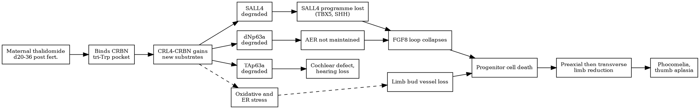

## Question

# Disease Characteristics Research Template

## Target Disease
- **Disease Name:** Thalidomide Embryopathy
- **MONDO ID:** MONDO:0018034 (if available)
- **Causal gene(s):** not recorded
- **OMIM:** not recorded
- **Synonyms:** fetal thalidomide syndrome; foetal thalidomide syndrome; thalidomide embryopathy syndrome; thalidomide-induced birth defect
- **Category:** Environmental

Many disease names are serial numbers ("... autosomal dominant 64", "... 26") that
do not say which gene the disease is about, and a similarly named disease with a
different gene is easy to research by mistake. Research the disease with the MONDO
ID and causal gene given above, and name its causal gene in your first paragraph.
If the name seems to point to a different gene or OMIM entry, follow the
identifiers above.

## Research Objectives

Please provide a comprehensive research report on **Thalidomide Embryopathy** covering all of the
disease characteristics listed below. This report will be used to populate a disease knowledge
base entry. Be thorough and cite primary literature (PMID preferred) for all claims.

For each section, **suggested databases/resources** are listed. These are the first places
you should search for information on each topic.

---

### 1. Disease Information
> **Search first:** OMIM, Orphanet, ICD-10/ICD-11, MeSH, PubMed

- What is the disease? Provide a concise overview.
- What are the key identifiers? (OMIM, Orphanet, ICD-10/ICD-11, MeSH, Mondo)
- What are the common synonyms and alternative names?
- Is the information derived from individual patients (e.g., EHR) or aggregated disease-level resources?

### 2. Etiology

- **Disease Causal Factors**: What are the primary causes? (genetic, environmental, infectious, mechanistic)
- **Risk Factors**:
  > **Search first:** PubMed, Cochrane Library, UpToDate, clinical guidelines, ClinVar, ClinGen, GWAS Catalog, PheGenI, CTD, CDC, WHO, epidemiological databases
  - Genetic risk factors (causal variants, susceptibility loci, modifier genes)
  - Environmental risk factors (toxins, lifestyle, occupational exposures, age, sex, family history)
- **Protective Factors**:
  > **Search first:** PubMed, Cochrane Library, clinical trial databases, GWAS Catalog, gnomAD, WHO, CDC, nutrition databases
  - Genetic protective factors (protective variants, modifier alleles)
  - Environmental protective factors (diet, lifestyle, exposures that reduce risk)
- **Gene-Environment Interactions**: How do genetic and environmental factors interact to influence disease?
  > **Search first:** CTD, PubMed, PheGenI, GxE databases

### 3. Phenotypes
> **Search first:** HPO (Human Phenotype Ontology), OMIM, Orphanet, PubMed, clinicaltrials.gov, MedDRA, SNOMED CT, DECIPHER, LOINC

For each phenotype, provide:
- **Phenotype type**: symptoms, clinical signs, physical manifestations, behavioral changes, or laboratory abnormalities
  > For symptoms/signs: HPO, OMIM, Orphanet, PubMed
  > For behavioral changes: HPO, DSM, RDoC (Research Domain Criteria), PubMed
  > For laboratory abnormalities: LOINC, SNOMED CT, LabTests Online, PubMed
- **Phenotype characteristics**:
  > **Search first:** OMIM, Orphanet, HPO, PubMed
  - Age of symptom onset (neonatal, childhood, adult-onset, late-onset)
  - Symptom severity (mild, moderate, severe, variable)
  - Symptom progression (stable, progressive, episodic, fluctuating)
  - Frequency among affected individuals (percentage or qualitative)
- **Quality of life impact**: Effects on daily functioning and well-being (per-phenotype when possible)
  > **Search first:** EQ-5D database, SF-36, WHO QOL databases, PubMed
- Suggest HPO (Human Phenotype Ontology) terms for each phenotype

### 4. Genetic/Molecular Information

- **Causal Genes**: Gene mutations or chromosomal abnormalities responsible for disease (gene symbols, OMIM IDs)
  > **Search first:** OMIM, ClinVar, HGMD, Ensembl, NCBI Gene
- **Pathogenic Variants**:
  - Affected genes (gene symbols, HGNC IDs)
    > **Search first:** OMIM, NCBI Gene, Ensembl, HGNC, UniProt, GeneCards
  - Variant classification (pathogenic, likely pathogenic, VUS per ACMG/AMP guidelines)
    > **Search first:** ClinVar, ClinGen, ACMG/AMP guidelines, VarSome
  - Variant type/class (missense, frameshift, nonsense, splice-site, structural)
  - Allele frequency in population databases
    > **Search first:** gnomAD, 1000 Genomes, ExAC, TOPMed, dbSNP
  - Somatic vs germline origin
    > **Search first:** COSMIC (somatic), ClinVar, ICGC, TCGA
  - Functional consequences (loss of function, gain of function, dominant negative)
- **Modifier Genes**: Genes that modify disease severity or expression
- **Epigenetic Information**: DNA methylation, histone modifications, chromatin changes affecting disease
  > **Search first:** ENCODE, Roadmap Epigenomics, MethBase, DiseaseMeth
- **Chromosomal Abnormalities**: Large-scale genetic changes (aneuploidy, translocations, inversions)
  > **Search first:** DECIPHER, ClinVar, ECARUCA, UCSC Genome Browser

### 5. Environmental Information

- **Environmental Factors**: Non-genetic contributing factors (toxins, radiation, pollution, occupational exposure)
  > **Search first:** CTD (Comparative Toxicogenomics Database), TOXNET, PubMed, EPA databases
- **Lifestyle Factors**: Behavioral factors (smoking, diet, exercise, alcohol consumption)
  > **Search first:** CDC databases, WHO, PubMed, NHANES
- **Infectious Agents**: If applicable, pathogens causing or triggering disease (bacteria, viruses, fungi, parasites)
  > **Search first:** NCBI Taxonomy, ViPR, BV-BRC, MicrobeDB, GIDEON

### 6. Mechanism / Pathophysiology

**Present this section as an ordered causal chain first, then the detail below.**
Open with a numbered sequence of mechanistic steps running from the initiating
lesion (mutation, exposure, infection) to the clinical manifestation, one step per
line, each naming what it causes next. State the causal verb explicitly ("leads
to", "results in") and say where a step is inferred rather than demonstrated.
Where the mechanism branches, show the branch. The categories below are a
checklist of what to cover within those steps, not the organizing structure —
a step may draw on several of them, and a category may contribute to several
steps.

- **Molecular Pathways**: Specific signaling cascades or biochemical pathways involved (Wnt, MAPK, mTOR, PI3K-AKT, etc.)
  > **Search first:** KEGG, Reactome, WikiPathways, PathBank, BioCyc
- **Cellular Processes**: Cell-level mechanisms (apoptosis, autophagy, cell cycle dysregulation, inflammation, etc.)
  > **Search first:** Gene Ontology (GO), Reactome, KEGG, PubMed
- **Protein Dysfunction**: How protein structure or function is altered (misfolding, aggregation, loss of function, gain of function)
  > **Search first:** UniProt, PDB (Protein Data Bank), InterPro, Pfam, AlphaFold
- **Metabolic Changes**: Alterations in metabolic processes (energy metabolism, lipid metabolism, amino acid metabolism)
  > **Search first:** KEGG, BioCyc, HMDB (Human Metabolome Database), BRENDA
- **Immune System Involvement**: Role of immune response (autoimmunity, immunodeficiency, chronic inflammation)
  > **Search first:** ImmPort, Immunome Database, IEDB, Gene Ontology
- **Tissue Damage Mechanisms**: How tissues/ are injured (oxidative stress, ischemia, fibrosis, necrosis)
  > **Search first:** PubMed, Gene Ontology, Reactome
- **Biochemical Abnormalities**: Specific molecular defects (enzyme deficiencies, receptor dysfunction, ion channel defects)
  > **Search first:** BRENDA, UniProt, KEGG, OMIM, PubMed
- **Epigenetic Changes**: DNA methylation, histone modifications affecting gene expression in disease
  > **Search first:** ENCODE, Roadmap Epigenomics, MethBase, DiseaseMeth
- **Molecular Profiling** (if available):
  - Transcriptomics/gene expression changes
    > **Search first:** GEO (Gene Expression Omnibus), ArrayExpress, GTEx, Human Cell Atlas, SRA
  - Proteomics findings
    > **Search first:** PRIDE, ProteomeXchange, Human Protein Atlas, STRING, BioGRID
  - Metabolomics signatures
    > **Search first:** MetaboLights, Metabolomics Workbench, HMDB, METLIN
  - Lipidomics alterations
    > **Search first:** LIPID MAPS, SwissLipids, LipidHome, Metabolomics Workbench
  - Genomic structural features
    > **Search first:** UCSC Genome Browser, Ensembl, NCBI, dbVar, DGV
- **Advanced Technologies** (if applicable):
  - Single-cell analysis findings (cell-type specific mechanisms, cellular heterogeneity)
    > **Search first:** Human Cell Atlas, Single Cell Portal, GEO, CELLxGENE
  - Spatial transcriptomics findings
    > **Search first:** GEO, Spatial Research, Vizgen, 10x Genomics data
  - Multi-omics integration results
    > **Search first:** TCGA, ICGC, cBioPortal, LinkedOmics, PubMed
  - Functional genomics screens (CRISPR, RNAi)
    > **Search first:** DepMap, GenomeRNAi, PubMed, BioGRID ORCS

For each mechanism, describe:
- The causal chain from initial trigger to clinical manifestation
- Which mechanisms are upstream vs downstream
- What cell types and biological processes are involved
- Suggest GO terms for biological processes and CL terms for cell types

### 7. Anatomical Structures Affected

- **Organ Level**:
  - Primary organs directly affected
  - Secondary organ involvement (complications, secondary effects)
  - Body systems involved (cardiovascular, nervous, digestive, respiratory, endocrine, etc.)
  > **Search first:** Uberon, FMA (Foundational Model of Anatomy), OMIM, HPO, ICD-11, MeSH, SNOMED CT
- **Tissue and Cell Level**:
  - Specific tissue types affected (epithelial, connective, muscle, nervous)
  - Specific cell populations targeted (with Cell Ontology terms)
  > **Search first:** Uberon, Human Protein Atlas, Cell Ontology, Human Cell Atlas, CellMarker, PanglaoDB
- **Subcellular Level**:
  - Cellular compartments involved (mitochondria, nucleus, ER, lysosomes) (with GO Cellular Component terms)
  > **Search first:** Gene Ontology (Cellular Component), UniProt, Human Protein Atlas
- **Localization**:
  - Specific anatomical sites (with UBERON terms)
    > **Search first:** FMA, Uberon, NeuroNames (for brain), SNOMED CT
  - Lateralization (unilateral, bilateral, asymmetric)
    > **Search first:** HPO, clinical literature, imaging databases

### 8. Temporal Development

- **Onset**:
  - Typical age of onset (congenital, pediatric, adult, geriatric)
  - Onset pattern (acute, subacute, chronic, insidious)
  > **Search first:** OMIM, Orphanet, HPO, PubMed
- **Progression**:
  - Disease stages (early, intermediate, advanced, end-stage)
    > **Search first:** Cancer Staging Manual (AJCC), WHO classifications, PubMed
  - Progression rate (rapid, slow, variable)
  - Disease course pattern (episodic, relapsing-remitting, progressive, stable)
  - Disease duration (self-limited, chronic lifelong)
  > **Search first:** Disease registries, longitudinal cohort databases, natural history studies, PubMed, Orphanet, OMIM
- **Patterns**:
  - Remission patterns (spontaneous, treatment-induced)
    > **Search first:** Clinical trial databases, disease registries, PubMed
  - Critical periods (time windows of vulnerability or opportunity for intervention)
    > **Search first:** PubMed, developmental biology databases, clinical guidelines

### 9. Inheritance and Population

- **Epidemiology**:
  - Prevalence (cases per 100,000 at given time)
  - Incidence (new cases per 100,000 per year)
  > **Search first:** Orphanet, CDC, WHO, GBD (Global Burden of Disease), national registries, SEER, disease registries
- **For Genetic Etiology**:
  - Inheritance pattern (AD, AR, X-linked, mitochondrial, multifactorial, polygenic)
    > **Search first:** OMIM, Orphanet, ClinVar, GTR (Genetic Testing Registry)
  - Penetrance (complete, incomplete, age-dependent)
    > **Search first:** ClinVar, OMIM, PubMed, ClinGen
  - Expressivity (variable, consistent)
    > **Search first:** OMIM, ClinVar, PubMed
  - Genetic anticipation (increasing severity in successive generations)
    > **Search first:** OMIM, PubMed (especially for repeat expansion disorders)
  - Germline mosaicism
    > **Search first:** ClinVar, OMIM, genetic counseling literature, PubMed
  - Founder effects (population-specific mutations)
    > **Search first:** gnomAD, population genetics databases, PubMed
  - Consanguinity role
    > **Search first:** OMIM, population studies, genetic counseling resources
  - Carrier frequency
    > **Search first:** gnomAD, carrier screening databases, GeneReviews, GTR
- **Population Demographics**:
  - Affected populations (ethnic or demographic groups with higher prevalence)
    > **Search first:** gnomAD, 1000 Genomes, PAGE Study, PubMed, population registries
  - Geographic distribution (endemic areas, regional variation)
    > **Search first:** WHO, CDC, GBD, Orphanet, geographic epidemiology databases
  - Geographic distribution of specific variants
  - Sex ratio (male:female)
    > **Search first:** Disease registries, OMIM, PubMed, epidemiological databases
  - Age distribution of affected individuals
    > **Search first:** CDC, disease registries, SEER, Orphanet

### 10. Diagnostics

- **Clinical Tests**:
  - Laboratory tests (blood, urine, tissue chemistry, specific enzyme assays)
    > **Search first:** LOINC, LabTests Online, PubMed
  - Biomarkers (proteins, metabolites, genetic markers, circulating biomarkers)
    > **Search first:** FDA Biomarker List, BEST (Biomarkers, EndpointS, and other Tools), PubMed
  - Imaging studies (X-ray, CT, MRI, PET, ultrasound)
    > **Search first:** RadLex, DICOM, Radiopaedia, imaging databases
  - Functional tests (pulmonary function, cardiac stress tests)
    > **Search first:** LOINC, clinical guidelines, PubMed
  - Electrophysiology (EEG, EMG, ECG, nerve conduction studies)
    > **Search first:** LOINC, clinical neurophysiology databases, PubMed
  - Biopsy findings (histopathology, immunohistochemistry)
    > **Search first:** SNOMED CT, College of American Pathologists resources, PubMed
  - Pathology findings (microscopic examination)
    > **Search first:** SNOMED CT, Digital Pathology databases, PubMed
- **Genetic Testing**:
  > **Search first:** GTR (Genetic Testing Registry), GeneReviews, ClinGen
  - Overview of recommended genetic testing approach
  - Whole genome sequencing (WGS) utility
    > **Search first:** GTR, ClinVar, GEL (Genomics England), gnomAD
  - Whole exome sequencing (WES) utility
    > **Search first:** GTR, ClinVar, OMIM, GeneMatcher
  - Gene panels (which panels, which genes)
    > **Search first:** GTR, ClinVar, laboratory-specific databases
  - Single gene testing
    > **Search first:** GTR, ClinVar, OMIM, GeneReviews
  - Chromosomal microarray (CMA)
    > **Search first:** DECIPHER, ClinVar, dbVar, ECARUCA
  - Karyotyping
    > **Search first:** Chromosome Abnormality Database, ClinVar, cytogenetics resources
  - FISH
    > **Search first:** ClinVar, cytogenetics databases, PubMed
  - Mitochondrial DNA testing
    > **Search first:** MITOMAP, MSeqDR, ClinVar, GTR
  - Repeat expansion testing
    > **Search first:** GTR, ClinVar, repeat expansion databases, PubMed
- **Omics-Based Diagnostics** (if applicable):
  - RNA sequencing / transcriptomics
    > **Search first:** GEO, ArrayExpress, GTEx, RNA-seq databases
  - Proteomics
    > **Search first:** PRIDE, ProteomeXchange, FDA Biomarker database
  - Metabolomics
    > **Search first:** MetaboLights, Metabolomics Workbench, HMDB
  - Epigenomics
    > **Search first:** GEO, ENCODE, Roadmap Epigenomics, MethBase
  - Liquid biopsy
    > **Search first:** COSMIC, ClinVar, liquid biopsy databases, PubMed
- **Clinical Criteria**:
  - Standardized diagnostic criteria (DSM, ICD, society guidelines)
    > **Search first:** DSM-5, ICD-11, clinical society guidelines, UpToDate
  - Differential diagnosis (other conditions to rule out, with distinguishing features)
    > **Search first:** DynaMed, UpToDate, clinical decision support systems
- **Screening**:
  - Screening methods for asymptomatic individuals (newborn screening, carrier screening, cascade screening)
    > **Search first:** ACMG recommendations, CDC newborn screening, GTR

### 11. Outcome/Prognosis

- **Survival and Mortality**:
  - Survival rate (5-year, 10-year, overall)
    > **Search first:** SEER, cancer registries, disease-specific registries, PubMed
  - Life expectancy (with and without treatment if applicable)
    > **Search first:** Orphanet, disease registries, actuarial databases, PubMed
  - Mortality rate
    > **Search first:** CDC, WHO, GBD, national mortality databases
  - Disease-specific mortality (deaths directly attributable to disease)
    > **Search first:** Disease registries, CDC Wonder, GBD, PubMed
- **Morbidity and Function**:
  - Morbidity (disease-related disability and health impacts)
    > **Search first:** GBD, WHO, disability databases, PubMed
  - Disability outcomes (long-term functional impairments)
    > **Search first:** ICF (International Classification of Functioning), disability registries
  - Quality of life measures (EQ-5D, SF-36, PROMIS, disease-specific tools)
    > **Search first:** EQ-5D database, SF-36, PROMIS, PubMed
- **Disease Course**:
  - Complications (secondary problems: infections, organ failure, etc.)
    > **Search first:** ICD codes, disease registries, clinical databases, PubMed
  - Recovery potential (likelihood and extent of recovery, with vs without treatment)
    > **Search first:** Natural history studies, rehabilitation databases, PubMed
- **Prediction**:
  - Prognostic factors (age, disease severity, biomarkers, treatment response)
    > **Search first:** Prognostic models databases, clinical calculators, PubMed
  - Prognostic biomarkers (molecular markers predicting disease course)
    > **Search first:** FDA Biomarker database, PubMed, cancer prognostic databases

### 12. Treatment

- **Pharmacotherapy**:
  - Pharmacological treatments (drug names, drug classes, mechanisms of action)
    > **Search first:** DrugBank, RxNorm, ATC classification, DailyMed, FDA databases
  - Pharmacogenomics (how genetic variants affect drug metabolism, efficacy, toxicity)
    > **Search first:** PharmGKB, CPIC (Clinical Pharmacogenetics), FDA Table of PGx Biomarkers
- **Advanced Therapeutics**:
  - Gene therapy (viral vectors, CRISPR, gene replacement, gene editing)
    > **Search first:** ClinicalTrials.gov, FDA gene therapy database, ASGCT resources
  - Cell therapy (stem cell transplant, CAR-T, cellular therapeutics)
    > **Search first:** ClinicalTrials.gov, FDA cell therapy database, FACT standards
  - RNA-based therapies (ASOs, siRNA, mRNA therapies)
    > **Search first:** ClinicalTrials.gov, FDA approvals, PubMed
  - Targeted therapies (treatments directed at specific molecular targets)
    > **Search first:** My Cancer Genome, OncoKB, ClinicalTrials.gov, FDA approvals
  - Immunotherapies (checkpoint inhibitors, monoclonal antibodies)
    > **Search first:** Cancer Immunotherapy Database, FDA approvals, ClinicalTrials.gov
- **Surgical and Interventional**:
  - Surgical interventions (types of surgery, timing, outcomes)
    > **Search first:** CPT codes, surgical registries, clinical guidelines, PubMed
- **Supportive and Rehabilitative**:
  - Supportive care (symptom management, pain control, nutrition)
    > **Search first:** Clinical guidelines, Cochrane Library, PubMed
  - Rehabilitation (physical therapy, occupational therapy, speech therapy)
    > **Search first:** Rehabilitation medicine databases, clinical guidelines, PubMed
- **Experimental**:
  - Experimental treatments in clinical trials (with NCT identifiers if available)
    > **Search first:** ClinicalTrials.gov, EU Clinical Trials Register, WHO ICTRP
- **Treatment Outcomes**:
  - Treatment response rates
    > **Search first:** Clinical trial databases, FDA reviews, systematic reviews, PubMed
  - Side effects and adverse events
    > **Search first:** FDA Adverse Event Reporting System (FAERS), MedWatch, PubMed
- **Treatment Strategy**:
  - Treatment algorithms (clinical pathways, decision trees)
    > **Search first:** Clinical practice guidelines, NCCN Guidelines, UpToDate
  - Combination therapies
    > **Search first:** ClinicalTrials.gov, treatment guidelines, PubMed
  - Personalized medicine approaches (genotype-guided treatment)
    > **Search first:** My Cancer Genome, CIViC, PharmGKB, precision medicine databases

For each treatment, suggest NCIT (NCI Thesaurus) clinical-intervention terms where applicable.

### 13. Prevention

- **Prevention Levels**:
  - Primary prevention (preventing disease occurrence: vaccination, risk factor modification)
    > **Search first:** CDC, WHO, USPSTF recommendations, Cochrane Library
  - Secondary prevention (early detection and treatment: screening programs, early intervention)
    > **Search first:** USPSTF, CDC screening guidelines, WHO
  - Tertiary prevention (preventing complications in those with disease)
    > **Search first:** Clinical guidelines, disease management protocols, PubMed
- **Immunization**: Vaccine strategies (if applicable)
  > **Search first:** CDC vaccine schedules, WHO immunization, FDA vaccine database
- **Screening and Early Detection**:
  - Screening programs (population-based: newborn screening, cancer screening)
    > **Search first:** CDC screening programs, USPSTF, cancer screening databases
  - Genetic screening (carrier screening, preimplantation genetic diagnosis, prenatal testing)
    > **Search first:** ACMG recommendations, ACOG guidelines, GTR
  - Risk stratification (identifying high-risk individuals for targeted prevention)
    > **Search first:** Risk prediction models, clinical calculators, PubMed
- **Behavioral Interventions**: Lifestyle modifications to reduce risk
  > **Search first:** CDC, WHO, behavioral intervention databases, Cochrane Library
- **Counseling**: Genetic counseling (risk assessment, family planning guidance)
  > **Search first:** NSGC resources, ACMG guidelines, GeneReviews
- **Public Health**:
  - Public health interventions (sanitation, vector control, health education)
    > **Search first:** CDC, WHO, public health databases, PubMed
  - Environmental interventions (reducing environmental risk factors)
    > **Search first:** EPA databases, WHO environmental health, PubMed
- **Prophylaxis**: Preventive medications or procedures
  > **Search first:** Clinical guidelines, FDA approvals, PubMed

### 14. Other Species / Natural Disease

- **Taxonomy**: Species affected (with NCBI Taxon identifiers)
  > **Search first:** NCBI Taxonomy
- **Breed**: Specific breeds affected (with VBO identifiers if applicable)
  > **Search first:** VBO (Vertebrate Breed Ontology)
- **Gene**: Orthologous genes in other species (with NCBI Gene IDs)
  > **Search first:** NCBI Gene
- **Natural Disease**:
  - Naturally occurring disease in other species (companion animals, wildlife)
    > **Search first:** OMIA (Online Mendelian Inheritance in Animals), VetCompass, PubMed
  - Veterinary relevance and importance in animal health
    > **Search first:** OMIA, veterinary databases, PubMed
- **Comparative Biology**:
  - Comparative pathology (similarities and differences across species)
    > **Search first:** OMIA, comparative pathology databases, PubMed
  - Evolutionary conservation of disease mechanisms
    > **Search first:** HomoloGene, OrthoMCL, Alliance of Genome Resources
- **Transmission** (if applicable):
  - Zoonotic potential
    > **Search first:** CDC zoonotic diseases, WHO zoonoses, GIDEON
  - Cross-species susceptibility
    > **Search first:** NCBI Taxonomy, veterinary databases, PubMed

### 15. Model Organisms

- **Model Types**:
  - Model organism type (mammalian, invertebrate, cellular, in vitro)
    > **Search first:** Alliance of Genome Resources, model organism databases
  - Specific model systems (mouse, rat, zebrafish, Drosophila, C. elegans, yeast, cell lines, organoids, iPSCs)
    > **Search first:** MGI, RGD, ZFIN, FlyBase, WormBase, SGD, ATCC, Cellosaurus
  - Induced models (drug treatment, surgical intervention, environmental manipulation)
    > **Search first:** MGI, model organism databases, PubMed
- **Genetic Models**:
  - Types available (knockout, knock-in, transgenic, conditional, humanized)
    > **Search first:** MGI, IMPC, KOMP, EuMMCR, IMSR
- **Model Characteristics**:
  - Phenotype recapitulation (how well model reproduces human disease features)
    > **Search first:** Model organism databases, comparative studies, PubMed
  - Model limitations (aspects of human disease not captured)
    > **Search first:** Model organism databases, PubMed, review articles
- **Applications**:
  - Research applications (what aspects of disease can be studied)
    > **Search first:** Model organism databases, PubMed
- **Resources**:
  - Model databases
    > **Search first:** MGI, RGD, ZFIN, FlyBase, WormBase, IMSR, EMMA, MMRRC

---

## Citation Requirements

- Cite primary literature (PMID preferred) for all mechanistic and clinical claims
- Prioritize recent reviews and landmark papers
- Include direct quotes from abstracts where possible to support key statements
- Distinguish evidence source types: human clinical, model organism, in vitro, computational

## Output Format

Structure your response as a comprehensive narrative organized by the sections above.
For each section, provide:
- Factual content with specific details (numbers, percentages, gene names, variant nomenclature)
- Ontology term suggestions (HPO, GO, CL, UBERON, CHEBI, NCIT, MONDO) where applicable
- Evidence citations with PMIDs
- Direct quotes from abstracts to support key claims
- Clear indication when information is not available or not applicable for this disease

This report will be used to populate a disease knowledge base entry with:
- Pathophysiology descriptions with causal chains
- Gene/protein annotations (HGNC, GO terms)
- Phenotype associations (HP terms) with frequencies
- Cell type involvement (CL terms)
- Anatomical locations (UBERON terms)
- Chemical entities (CHEBI terms)
- Treatment annotations (NCIT terms)
- Evidence items with PMIDs and exact abstract quotes
- Epidemiology, prognosis, diagnostic, and prevention information
- Animal model descriptions with phenotype recapitulation details

## Output

# Thalidomide embryopathy (MONDO:0018034): a disease knowledge base report

## Summary

Thalidomide embryopathy has no causal gene in the Mendelian sense. The gene through which the damage is delivered is **CRBN**, cereblon (HGNC:30185, NCBI Gene 51185, Ensembl ENSG00000113851, UniProt Q96SW2, chromosome 3p26.2, OMIM 609262). Thalidomide (CHEBI:9513) binds the tri-tryptophan pocket of cereblon (W380, W386, F402) and converts the CRL4-CRBN E3 ubiquitin ligase (CUL4A/CUL4B-DDB1-RBX1-CRBN) from a normal substrate receptor into a receptor for a set of new substrates. Degradation of those neosubstrates, principally **SALL4** (HGNC:18537, OMIM 607343) and the p63 isoforms **dNp63a** and **TAp63a** (TP63, HGNC:15979), during days 20 to 36 post fertilisation produces the malformation syndrome. The disease is a chemically induced phenocopy of SALL4 haploinsufficiency, which as a germline lesion causes Duane-radial ray (Okihiro) syndrome, OMIM 607323.

Three results from this investigation settle long-standing disputes. The anti-angiogenesis and cereblon models are sequential: neosubstrate degradation is the initiating lesion, and vascular loss with oxidative and ER stress is a downstream, partly CRBN-independent amplifier, separable by fluorinated IMiDs that inhibit angiogenesis without degrading any neosubstrate ([PMID: 38917956](https://pubmed.ncbi.nlm.nih.gov/38917956/)). The species specificity that defeated the 1957-1961 rodent screening programme has a clean mechanism: SALL4 is degraded in human, primate and rabbit cells but not in rodent or fish cells ([PMID: 30067223](https://pubmed.ncbi.nlm.nih.gov/30067223/)). The late-onset neurological deficits reported by survivors now in their sixties are compressive entrapment neuropathies produced by decades of compensatory loading, which makes them investigable by nerve conduction study and treatable by decompression ([PMID: 27100829](https://pubmed.ncbi.nlm.nih.gov/27100829/), [PMID: 23078293](https://pubmed.ncbi.nlm.nih.gov/23078293/)).

The disease is untreatable and fully preventable. Brazilian surveillance still records cases in proportion to thalidomide dispensed for erythema nodosum leprosum: 5,889,210 tablets distributed in 2005-2010 with a thalidomide embryopathy phenotype prevalence of 0.11 per 10,000 births (95% CI 0.10-0.13) and limb reduction defects at 1.60 per 10,000 (95% CI 1.54-1.66) ([PMID: 25828060](https://pubmed.ncbi.nlm.nih.gov/25828060/)). Three figures accompany this report: a three-panel summary of the critical period, species specificity and Brazilian surveillance rates; a causal-chain schematic; and a three-panel summary of the adult survivor burden across four national cohorts.

---

## 1. Disease information

**What it is.** Thalidomide embryopathy is a multi-organ congenital malformation syndrome caused by maternal ingestion of thalidomide during a narrow window of early embryogenesis. The cardinal features are limb reduction defects (preaxial/radial longitudinal deficiency grading into phocomelia), external and inner ear malformations with hearing loss, ocular motility defects of the Duane type, cranial nerve palsies, and internal anomalies of the heart, kidney, gallbladder and vertebrae. Around 10,000 children were affected worldwide between 1957 and 1962 ([PMID: 23448904](https://pubmed.ncbi.nlm.nih.gov/23448904/)). Over 5,000 were born in West Germany, of whom roughly 2,400 adults were still living at the time of a 2022 review ([PMID: 36470274](https://pubmed.ncbi.nlm.nih.gov/36470274/)).

**Identifiers.**

| Resource | Identifier |
|---|---|
| MONDO | MONDO:0018034 |
| MeSH | Thalidomide (D013792); no dedicated disease descriptor |
| OMIM | Not applicable (no Mendelian entry). The drug target CRBN is OMIM 609262, the phenocopied gene SALL4 is OMIM 607343, Duane-radial ray syndrome is OMIM 607323 |
| Orphanet | Listed under drug-induced embryofetopathies; code should be verified against the live browser |
| ICD-10 | Q86.8 (other congenital malformation syndromes due to known exogenous causes) |
| ICD-11 | Exogenous-cause malformation syndromes; verify against the live browser |
| CHEBI | 9513 (racemic thalidomide), 85469 ((S)-thalidomide), 85470 ((R)-thalidomide), 63791 (lenalidomide), 72690 (pomalidomide) |

**Synonyms.** Fetal thalidomide syndrome; foetal thalidomide syndrome; thalidomide embryopathy syndrome; thalidomide-induced birth defect; Contergan syndrome (German usage); dysmelia (historical, non-specific).

**Data provenance.** Nearly all phenotype frequencies in this report come from aggregated historical case series and national compensation registries, not from EHR extraction. The adult morbidity data come from four cross-sectional national survivor cohorts (UK n=351, Germany NRW n=202, Japan n=51, Sweden n=31) collected by questionnaire and clinical examination.

---

## 2. Etiology

**Primary cause.** A single environmental exposure: maternal ingestion of thalidomide during a critical gestational window. No genetic cause is required, and no germline variant is sufficient. The exposure is necessary and, within the critical period, close to sufficient.

**Genetic risk factors.** No susceptibility locus has been established. Candidate-gene studies in Brazilian cohorts give suggestive but underpowered signals:

- *NOS3* (eNOS): the promoter -786C allele and the intron 4 4b allele, both associated with reduced eNOS expression, were more frequent in 38 affected individuals than in 136 controls (p=0.018, OR 2.57, 95% CI 1.2-5.8); the enzymatic-activity variant 894T>G showed no association (p=0.079) ([PMID: 27004986](https://pubmed.ncbi.nlm.nih.gov/27004986/), [PMID: 24055736](https://pubmed.ncbi.nlm.nih.gov/24055736/)).
- *CRBN*: sequencing the thalidomide-binding region in 38 affected individuals found rare variants at higher frequency than in controls (p=0.04), and the rs1620675 CC genotype associated with neurological anomalies (p=0.004) ([PMID: 27751757](https://pubmed.ncbi.nlm.nih.gov/27751757/)). A follow-up study of the whole CRL4-Cereblon complex suggested a summation effect of cereblon variants on preaxial longitudinal limb anomalies and flagged *CUL4A* rs138961957 ([PMID: 31964914](https://pubmed.ncbi.nlm.nih.gov/31964914/)).
- Negative: *NOS2*, *PTGS2* and *VEGFA* showed no allelic, genotypic or haplotypic difference ([PMID: 28161597](https://pubmed.ncbi.nlm.nih.gov/28161597/)); *FGF8*, *FGF10*, *BMP4*, *SHH*, *TP53*, *TP63* and *TP73* showed none ([PMID: 29193903](https://pubmed.ncbi.nlm.nih.gov/29193903/)); *HAND2* carried only one synonymous variant across 35 affected individuals ([PMID: 36177858](https://pubmed.ncbi.nlm.nih.gov/36177858/)).

All of these are small case-control studies in one population. Treat them as hypothesis-generating.

**Environmental risk factors.** The only established risk factor is thalidomide exposure between roughly 20 and 36 days post fertilisation. Modern risk concentrates where thalidomide is dispensed to populations with unplanned pregnancies: Brazil, where 40,000 new leprosy cases are diagnosed per year and thalidomide treats erythema nodosum leprosum ([PMID: 23448904](https://pubmed.ncbi.nlm.nih.gov/23448904/)). Maternal age, parity, fetal sex and family history are not risk factors. Dose matters little: single therapeutic doses within the window have produced full embryopathy.

**Protective factors.** None genetic are established. The one proven protective factor is avoidance: contraception, pregnancy testing and controlled dispensing. Species-level protection exists (rodents, fish) and is explained in section 6.

**Gene-environment interaction.** The disease is a gene-environment interaction by construction: the drug has no effect without CRBN, and CRBN has no pathology without the drug. The demonstration is the CRBN YW/AA mutant (Y384A/W386A), which cannot bind thalidomide and which rescues thalidomide-induced fin and otic defects in zebrafish and limb defects in chick ([PMID: 20223979](https://pubmed.ncbi.nlm.nih.gov/20223979/)). The species-discriminating residue is human V388 against mouse I391; the humanised Crbn^I391V mouse restores sensitivity.

---

## 3. Phenotypes

Frequencies below are pooled approximations from heterogeneous historical series and should be read as order-of-magnitude estimates.

| Phenotype | HPO | Approximate frequency | Onset | Severity | Course |
|---|---|---|---|---|---|
| Upper limb reduction defect | HP:0009824 | ~80% of cases; 81% in the Swedish series | Congenital | Thumb hypoplasia to amelia | Static |
| Preaxial/radial longitudinal deficiency | HP:0003042, HP:0006501 | Most common limb pattern | Congenital | Mild to severe | Static |
| Phocomelia | HP:0009829 | Severe end of the spectrum | Congenital | Severe | Static |
| Thumb aplasia/hypoplasia | HP:0009601, HP:0009778 | ~70% of hands in the Swedish cohort | Congenital | Variable | Static |
| Lower limb reduction, PFFD | HP:0009815, HP:0009062 | ~5 of 31 in the Swedish cohort | Congenital | Severe when present | Static |
| Microtia / external ear anomaly | HP:0008551, HP:0000356 | ~45% on whole-body imaging screen | Congenital | Variable | Static |
| Sensorineural or mixed hearing loss | HP:0000407, HP:0000410 | Common; a major impairment group in German compensation data | Congenital | Moderate to profound | Static, with age-related decline added |
| Vestibular hypofunction | HP:0008554 | Frequent on neurotological testing | Congenital | Variable | Static |
| Duane anomaly / incomitant strabismus | HP:0009921, HP:0000486 | 50% of 86 Swedish individuals had ocular motility defects | Congenital | Variable | Static |
| Facial palsy | HP:0010628 | 20% of 86 | Congenital | Variable | Static |
| Abnormal lacrimation ("crocodile tears") | HP:0000632 | 20% of 86 | Congenital | Mild | Static |
| Congenital heart defect | HP:0001627 | Reported across series | Congenital | Some lethal in 1960s neonates | Static after repair |
| Renal anomaly | HP:0000077 | Reported across series | Congenital | Variable | Static |
| Gallbladder agenesis | HP:0012784 | 27% on CT screening of 22 adults | Congenital | Usually silent | Static |
| Block vertebrae | HP:0003332 | 23% on CT screening | Congenital | Mild to moderate | Static |
| Autism spectrum disorder | HP:0000717 | 4 of 100 in the Swedish population series | Childhood recognition | Variable | Lifelong |
| Chronic pain | HP:0012532 | 94% in the German NRW cohort; 82% in Japan | Adult onset, from ~30s | Moderate to severe | Progressive |
| Osteoarthritis | HP:0002758 | Knee ~60%, hip ~40% in Sweden | Early adult onset | Moderate | Progressive |
| Depressive/anxiety disorder | HP:0000716, HP:0000739 | 47.2% prevalence, RR 1.77 (95% CI 1.49-2.10) | Adult | Variable | Fluctuating |

**Quality of life.** Physical quality of life is far below population norms and the deficit is specific to the physical domain. UK SF-12 PCS mean 26.7 against a population mean of 50, with 59.7% scoring below 30 ([PMID: 30650111](https://pubmed.ncbi.nlm.nih.gov/30650111/)). German SF-36 PCS 33.4 against 45.3 in the age-matched German chronic-disease population, p<0.001; male MCS 45.0 against 50.0, p=0.005 ([PMID: 35666030](https://pubmed.ncbi.nlm.nih.gov/35666030/)). Swedish SF-36 PCS 40.6 (95% CI 35.4-45.8), falling to 34.6 (95% CI 25.9-43.4) in the subgroup with major limb malformations ([PMID: 27854003](https://pubmed.ncbi.nlm.nih.gov/27854003/)). Upper-limb-specific UK data give QuickDASH 54.3 (SD 22.6) and median EQ-5D-5L 0.6 (IQR 0.4-0.7), with 70% of 127 reporting deteriorating health-related quality of life with age ([PMID: 37021538](https://pubmed.ncbi.nlm.nih.gov/37021538/)). Employment is 37% against 82% in the UK general population aged 50-54.

---

## 4. Genetic and molecular information

**Causal genes.** None. No germline variant causes thalidomide embryopathy. The gene that mediates the damage is CRBN; the gene whose acute depletion produces the phenotype is SALL4.

| Field | Value |
|---|---|
| Mediating gene | CRBN, HGNC:30185, NCBI Gene 51185, UniProt Q96SW2, OMIM 609262, 3p26.2 |
| Principal neosubstrate | SALL4, HGNC:18537, OMIM 607343, 20q13.2 |
| Tissue-branching neosubstrates | TP63 isoforms dNp63a and TAp63a, HGNC:15979 |
| Other neosubstrates | PLZF/ZBTB16, ARID2, IKZF1, IKZF3, CSNK1A1, GSPT1 |
| ClinVar | Not applicable: environmental etiology |
| Variant classification (ACMG) | Not applicable |
| Allele frequency (gnomAD) | Not applicable |
| Somatic against germline | Neither. The lesion is pharmacological and transient |
| Functional consequence | Neomorphic gain of function for CRBN (new substrate repertoire), acute loss of function for SALL4 and p63 |
| Inheritance | Not applicable |
| Penetrance | Not applicable |
| Carrier frequency | Not applicable |

**Modifier genes.** Candidate only. *NOS3* promoter and intron 4 variants ([PMID: 27004986](https://pubmed.ncbi.nlm.nih.gov/27004986/)); *CRBN* rs1620675 and rare coding-region variants ([PMID: 27751757](https://pubmed.ncbi.nlm.nih.gov/27751757/)); *CUL4A* rs138961957 ([PMID: 31964914](https://pubmed.ncbi.nlm.nih.gov/31964914/)). *ESCO2*, *SALL4* and *TBX5* were sequenced in 27 affected individuals: 38 variants were found but none associated with the phenotype, and the only signal was reduced *ESCO2* expression in human pluripotent stem cells after thalidomide exposure ([PMID: 31388035](https://pubmed.ncbi.nlm.nih.gov/31388035/)).

**Epigenetics.** No established methylation or chromatin signature. One study predicted alteration of CpG islands adjacent to a *HAND2* variant and of a MeCP2 binding site, and found no change in *HAND2* methylation in the sample ([PMID: 36177858](https://pubmed.ncbi.nlm.nih.gov/36177858/)).

**Chromosomal abnormalities.** None. Karyotype and microarray are normal. Their value in this disease is to exclude differentials (see section 10).

**Endogenous CRBN biology.** CRBN's natural substrates are recognised through a C-terminal cyclic imide modification, and PCMT1 generates that modification on C-terminal asparagine residues ([PMID: 41461925](https://pubmed.ncbi.nlm.nih.gov/41461925/)). Thalidomide's glutarimide ring is a chemical mimic of this degron. That is why one small molecule can hijack an entire recognition system.

---

## 5. Environmental information

**Environmental factor.** Thalidomide (CHEBI:9513), alpha-phthalimidoglutarimide. It racemises rapidly in plasma. The (S)-enantiomer binds CRBN roughly 10-fold more strongly than the (R)-enantiomer and inhibits CRBN self-ubiquitylation more potently ([PMID: 29358579](https://pubmed.ncbi.nlm.nih.gov/29358579/)). Because racemisation is fast, administering a single enantiomer does not avoid teratogenicity. The analogues lenalidomide (CHEBI:63791) and pomalidomide (CHEBI:72690) share the CRBN-binding glutarimide and carry the same class warning.

**Lifestyle factors.** None. Smoking, diet, alcohol and exercise have no established role in causation.

**Infectious agents.** None causal. Leprosy (*Mycobacterium leprae*, NCBI Taxon 1769) is the indirect driver of contemporary incidence: thalidomide treats erythema nodosum leprosum, and ECLAMC registered 34 South American cases born after 1965 in leprosy-endemic areas ([PMID: 9098920](https://pubmed.ncbi.nlm.nih.gov/9098920/)).

---

## 6. Mechanism and pathophysiology

### The causal chain

1. Maternal ingestion of thalidomide between roughly day 20 and day 36 post fertilisation **leads to** transplacental transfer and exposure of embryonic tissues to thalidomide and its hydroxylated metabolites, including 5-hydroxythalidomide.
2. Thalidomide binds the tri-tryptophan pocket of the cereblon thalidomide-binding domain (W380, W386, F402), with the (S)-enantiomer binding about 10-fold more strongly, which **results in** occupation of the substrate-recognition surface of CRBN ([PMID: 29358579](https://pubmed.ncbi.nlm.nih.gov/29358579/)). *Demonstrated: structural and biochemical.*
3. The drug-occupied surface forms a composite interface that **leads to** recruitment of proteins bearing a C2H2 zinc-finger beta-hairpin degron with a critical glycine, or a p63-type degron, to the CRL4-CRBN E3 ubiquitin ligase. A proteome-wide screen identified 11 zinc-finger degrons and predicted that over 150 zinc fingers can bind the drug-CRBN interface ([PMID: 30385546](https://pubmed.ncbi.nlm.nih.gov/30385546/)). The drug acts as a molecular glue. *Demonstrated: in vitro proteomics.*
4. Recruitment **results in** polyubiquitination (GO:0070979, GO:0043161) and proteasomal degradation of the recruited proteins. *Demonstrated.*

The chain then branches by substrate.

**Branch A, SALL4 (best supported).**

5A. Degradation of SALL4 **leads to** acute loss of the SALL4 transcriptional programme in limb-field, otic, ocular, cardiac and renal progenitors. SALL4 interacts with TBX5 and modulates Sonic hedgehog signalling ([PMID: 37285827](https://pubmed.ncbi.nlm.nih.gov/37285827/)). *Demonstrated in vitro; inferred for the human embryo.*
6A. Loss of the SALL4 programme **results in** a phenocopy of SALL4 haploinsufficiency, which independently causes Duane-radial ray syndrome with absent thumbs, phocomelia, ear and eye defects and congenital heart disease ([PMID: 30067223](https://pubmed.ncbi.nlm.nih.gov/30067223/)). *Demonstrated by the human genetic phenocopy.*

**Branch B, p63 isoforms (demonstrated in zebrafish).**

5B. Degradation of dNp63a **leads to** failure to maintain the apical ectodermal ridge (UBERON:0003055). Degradation of TAp63a **leads to** disrupted cochlear development. The two isoforms give the limb and ear phenotypes respectively ([PMID: 31591562](https://pubmed.ncbi.nlm.nih.gov/31591562/)).
6B. AER failure **results in** collapse of FGF8 output and of the SHH-FGF8-GREM1-BMP feedback loop that drives proximodistal outgrowth (GO:0030326). The original cereblon paper showed this: CRBN is required for limb outgrowth and *Fgf8* expression in zebrafish and chick ([PMID: 20223979](https://pubmed.ncbi.nlm.nih.gov/20223979/)).

**Branch C, vascular and stress amplification (downstream, partly CRBN-independent).**

5C. Neosubstrate degradation **leads to** oxidative stress and anti-angiogenic signalling. Single-cell RNA-seq of 69,115 zebrafish cells at 1, 2 and 5 dpf found altered expression in 16 of 43 cell populations, with heat-shock protein upregulation across heart, vessel and pectoral fin bud populations ([PMID: 40549513](https://pubmed.ncbi.nlm.nih.gov/40549513/)).
6C. Loss of the immature, actively sprouting limb bud vasculature (GO:0001525) **results in** conversion of a signalling defect into irreversible tissue loss. Thalidomide inhibits bFGF-induced angiogenesis in the rabbit cornea, and antiangiogenic potency across analogues correlates with teratogenicity but not with sedative or immunosuppressive activity ([PMID: 7513432](https://pubmed.ncbi.nlm.nih.gov/7513432/)). This branch is partly independent: tetrafluorinated IMiDs inhibit angiogenesis without degrading IKZF3, GSPT1, CK1a or SALL4 ([PMID: 38917956](https://pubmed.ncbi.nlm.nih.gov/38917956/)), so antiangiogenesis alone is neither necessary nor sufficient. *Directionality within this branch is inferred from correlation and from the zebrafish transcriptome, not from a direct epistasis experiment in a mammalian embryo.*

**Convergence.**

7. Loss of progenitor cells and of the outgrowth signal **results in** truncation of the proximodistal axis and preferential loss of preaxial (radial) elements, because the radial side and the forelimb are specified earliest.
8. The spatial gradient (forelimb before hindlimb, preaxial before postaxial, left more affected than right) **results in** the characteristic longitudinal limb phenotype, which becomes transverse phocomelia only in severe cases ([PMID: 40198353](https://pubmed.ncbi.nlm.nih.gov/40198353/)).
9. The same window **results in** parallel damage to the otic placode, the abducens and facial nerve primordia, and the cardiac and renal fields, giving the multi-organ syndrome.

{{figure:plot_2.png|caption=Causal chain from maternal thalidomide exposure through CRBN neosubstrate degradation to the clinical phenotype. The SALL4 and p63 branches are demonstrated. The vascular and stress branch is downstream and partly CRBN-independent.}}

**Molecular pathways.** Ubiquitin-proteasome system (KEGG hsa04120), CRL4 E3 ligase assembly, SHH signalling, FGF signalling, BMP and GREM1 feedback, WNT in the AER. GO terms: GO:0043161 (proteasome-mediated ubiquitin-dependent protein catabolic process), GO:0070979 (protein K11-linked ubiquitination), GO:0030326 (embryonic limb morphogenesis), GO:0001525 (angiogenesis), GO:0006979 (response to oxidative stress), GO:0034976 (response to endoplasmic reticulum stress), GO:0009408 (response to heat).

**Cellular processes.** Apoptosis of limb bud mesenchyme, failure of AER maintenance, endothelial cell loss, cell cycle arrest. Transcription factor degradation is the proximal cellular event.

**Protein dysfunction.** No misfolding or aggregation. CRBN acquires a neomorphic substrate repertoire; SALL4 and p63 suffer acute loss of function through degradation. Structures: PDB 4CI1, 4CI2, 4TZ4, 5FQD.

**Metabolic and immune involvement.** Not primary in the embryopathy. Thalidomide's adult immunomodulatory actions (TNF-alpha suppression, IKZF1/IKZF3 degradation) are mechanistically related and are not the teratogenic pathway.

**Molecular profiling available.** Zebrafish single-cell RNA-seq of 69,115 cells ([PMID: 40549513](https://pubmed.ncbi.nlm.nih.gov/40549513/)). Cynomolgus monkey whole-embryo transcriptome 6 h after a 20 mg/kg dose on gestational day 26, with 1,281 genes up and 1,081 down, showing up-regulated actin cytoskeletal remodelling and insulin signalling, down-regulated vasculature development and inflammatory response ([PMID: 19751816](https://pubmed.ncbi.nlm.nih.gov/19751816/)). Human iPSC lateral plate mesoderm differentiation assays, in which CRBN V388I or SALL4 G416A mutation abolishes sensitivity to thalidomide, lenalidomide and pomalidomide while leaving sensitivity to all-trans retinoic acid intact ([PMID: 32071327](https://pubmed.ncbi.nlm.nih.gov/32071327/)).

**A gap the model does not close.** Collins and Scott argue that the critical period for phocomelia may open before the limb bud exists, which contrasts with other agents producing the same phenotype ([PMID: 40198353](https://pubmed.ncbi.nlm.nih.gov/40198353/)). Neither the SALL4 model nor the AER model accounts for damage that precedes the structure being damaged. This points upstream, to the lateral plate mesoderm or the earliest vasculature, and remains unresolved.

---

## 7. Anatomical structures affected

**Organ level, primary.** Upper limb (UBERON:0002102), especially the radial/preaxial ray; lower limb (UBERON:0002103); external, middle and inner ear (UBERON:0001690); eye and extraocular muscles (UBERON:0000970, UBERON:0002415); cranial nerves VI and VII (UBERON:0001649, UBERON:0001647); heart (UBERON:0000948); kidney (UBERON:0002113); gallbladder (UBERON:0002110); vertebral column (UBERON:0002412).

**Organ level, secondary.** Cervical and lumbar spine degeneration, shoulder, hip and knee joints, median and ulnar nerves at entrapment sites, and the temporomandibular joint. These are consequences of decades of compensatory use, not of the original teratogenic event.

**Body systems.** Musculoskeletal, special sense (auditory, vestibular, visual), peripheral and cranial nervous, cardiovascular, urinary, digestive (gallbladder, duodenal atresia in some series).

**Tissue and cell level.** Limb bud mesenchyme and its chondrogenic descendants; apical ectodermal ridge ectoderm (UBERON:0003055); endothelium of the immature limb bud vasculature; otic placode derivatives; neural crest derivatives of the branchial arches; motor neurons of the abducens and facial nuclei. CL terms: CL:0000134 (mesenchymal stem cell), CL:0000138 (chondrocyte), CL:0000115 (endothelial cell), CL:0000100 (motor neuron), CL:0000066 (epithelial cell), CL:0000057 (fibroblast).

**Subcellular level.** GO:0005634 (nucleus, where SALL4 and p63 act and where CRBN delivers them for degradation), GO:0080008 (Cul4-RING E3 ubiquitin ligase complex), GO:0000502 (proteasome complex), GO:0005783 (endoplasmic reticulum, stress response), GO:0005739 (mitochondrion, oxidative stress), GO:0005829 (cytosol).

**Localisation and laterality.** Bilateral but characteristically asymmetric. The left limb is more affected than the corresponding right non-autopod limb bones ([PMID: 40198353](https://pubmed.ncbi.nlm.nih.gov/40198353/)). Unilateral defects occur and have been the subject of compensation disputes: a review of the original case series found a sizeable number of children with unilateral limb defects born to mothers with certain thalidomide exposure, so unilaterality does not exclude the diagnosis ([PMID: 34549573](https://pubmed.ncbi.nlm.nih.gov/34549573/)).

---

## 8. Temporal development

**Onset.** Congenital, present at birth, acquired in utero. The lesion is acute and the exposure is brief.

**Critical period.** Approximately 20 to 36 days post fertilisation, equal to 34 to 50 days after the last menstrual period ([PMID: 26043938](https://pubmed.ncbi.nlm.nih.gov/26043938/), [PMID: 30335598](https://pubmed.ncbi.nlm.nih.gov/30335598/)). Within that window the damage is ordered by organ: ear and cranial nerve damage from the earliest exposures (around days 21-26), upper limb before lower limb, with the window closing for limb damage around day 36. The 2025 reanalysis argues the window for phocomelia may open before the limb bud forms ([PMID: 40198353](https://pubmed.ncbi.nlm.nih.gov/40198353/)).

{{figure:plot_1.png|caption=Critical period by organ system, species specificity of SALL4 degradation, and Brazilian surveillance rates for the thalidomide embryopathy phenotype with 95% confidence intervals.}}

**Progression.** The congenital malformation is static for life. Superimposed on it is a separate, progressive secondary condition. Osteoarthritis appears early: hip around 40% and knee around 60% in the Swedish cohort against roughly 10-15% in the general population ([PMID: 25301261](https://pubmed.ncbi.nlm.nih.gov/25301261/)). Cervical degeneration is more frequent than in matched controls (p<0.001 for degree of disc degeneration; p=0.002 for foraminal narrowing), and is distributed across all cervical levels in affected individuals while controls show it mainly at the two lower levels ([PMID: 27175919](https://pubmed.ncbi.nlm.nih.gov/27175919/)).

**Course.** Lifelong and chronic, with no remission. Prognosis must be recorded in two parts: a fixed congenital lesion, and a separately progressing secondary musculoskeletal and mental health condition that now dominates clinical need in a cohort aged around 63-68.

**Intervention windows.** Primary prevention before conception and during the first trimester is the only effective intervention. After birth there is no window in which the malformation can be reversed. There is a treatment window for the secondary conditions: entrapment neuropathy is decompressible, joint disease is replaceable, and pain chronification is in principle preventable.

---

## 9. Inheritance and population

**Inheritance.** Not applicable. No inheritance pattern, no penetrance, no expressivity, no anticipation, no germline mosaicism, no founder effect, no consanguinity role, no carrier frequency. All of these fields should be recorded as "not applicable: environmental etiology" rather than left blank, because a blank invites the reader to assume the data are merely missing.

The one caveat is the differential diagnosis. A SALL4 mutation can be transmitted vertically and present as what looks like thalidomide embryopathy. A novel SALL4 mutation was found in a family where the father had been thought to have thalidomide embryopathy and had a similarly affected daughter ([PMID: 12843316](https://pubmed.ncbi.nlm.nih.gov/12843316/)). Recurrence risk in true thalidomide embryopathy is zero; in a misdiagnosed SALL4 family it is 50%.

**Epidemiology, historical.** Roughly 10,000 affected births worldwide, 1957-1962. Over 5,000 in West Germany, of whom about 2,400 adults were alive at the time of a 2022 review ([PMID: 36470274](https://pubmed.ncbi.nlm.nih.gov/36470274/)). Approximately 150 born in Sweden with 100 surviving ([PMID: 8157157](https://pubmed.ncbi.nlm.nih.gov/8157157/)). Around 400 affected children in Great Britain ([PMID: 6991189](https://pubmed.ncbi.nlm.nih.gov/6991189/)), and 418 beneficiaries of the UK Thalidomide Trust at 30 September 2025. The disease did not occur at epidemic scale in the United States, where the FDA did not approve the drug, nor in the GDR, where it was not marketed ([PMID: 36470274](https://pubmed.ncbi.nlm.nih.gov/36470274/)). Around 40% of babies with thalidomide-induced malformations born in the 1950s and 1960s died in the neonatal period, most often from small bowel atresia or cardiac or renal malformations ([PMID: 34331266](https://pubmed.ncbi.nlm.nih.gov/34331266/)).

**Epidemiology, contemporary.** Brazil is the only country with documented ongoing incidence.

| Period | Measure | Rate per 10,000 births | 95% CI | Source |
|---|---|---|---|---|
| 1982-1999 | TEP baseline | 1.92 | 1.60-2.20 | [PMID: 21754997](https://pubmed.ncbi.nlm.nih.gov/21754997/) |
| 2007-2008 | TEP, active surveillance | 3.10 | 2.50-3.70 | [PMID: 21754997](https://pubmed.ncbi.nlm.nih.gov/21754997/) |
| 2005-2010 | Limb reduction defects | 1.60 | 1.54-1.66 | [PMID: 25828060](https://pubmed.ncbi.nlm.nih.gov/25828060/) |
| 2005-2010 | TEP | 0.11 | 0.10-0.13 | [PMID: 25828060](https://pubmed.ncbi.nlm.nih.gov/25828060/) |

Poisson regression showed both TEP and limb reduction defects increasing per 100,000 tablets dispensed, across 5,889,210 tablets ([PMID: 25828060](https://pubmed.ncbi.nlm.nih.gov/25828060/)). This dose-response between tablets dispensed and affected births is the strongest available epidemiological evidence of continuing causation. ECLAMC registered 34 South American cases born after 1965, with birthplaces corresponding to leprosy-endemic areas ([PMID: 9098920](https://pubmed.ncbi.nlm.nih.gov/9098920/)). Further individual cases were reported from 2005 onward ([PMID: 17676592](https://pubmed.ncbi.nlm.nih.gov/17676592/)) and in 2011 ([PMID: 23448904](https://pubmed.ncbi.nlm.nih.gov/23448904/)).

**Demographics.** No ethnic predisposition. Geographic distribution follows marketing and dispensing: West Germany, UK, Japan, Canada, Australia, Sweden and other European markets historically; Brazil currently. Sex ratio approximately 1:1. The historical cohort has a single tight birth-year distribution (1957-1962 for the epidemic), so the surviving population is now aged roughly 63-68.

---

## 10. Diagnostics

**Clinical tests.** There is no laboratory test, no biomarker, no enzyme assay and no liquid biopsy for thalidomide embryopathy. Diagnosis is clinical and historical. Imaging defines the extent:

- Radiography and CT of the limbs. Three-dimensional CT with multiplanar reconstruction in five individuals aged around 60 showed shoulder dislocation, subluxation and osteoarthritis; hypoplasia of the humeral trochlea and capitulum, coronoid fossa, olecranon and coronoid processes; carpal fusion and hypoplasia; radiocarpal and ulnocarpal synostosis ([PMID: 39220272](https://pubmed.ncbi.nlm.nih.gov/39220272/)).
- Whole-body unenhanced CT plus head MRI. Screening 22 adults detected internal anomalies in 19 (86.4%): auditory organ 45.5%, vascular system 27.3%, gallbladder agenesis 27.3%, cranial nerve VII or VIII hypoplasia/aplasia 22.7%, block vertebrae 22.7%, hepatic lobe fusion 9.1% ([PMID: 27567725](https://pubmed.ncbi.nlm.nih.gov/27567725/)).
- Temporal bone high-resolution CT for ear malformation, scored with the Jahrsdoerfer grading system.
- Nerve conduction studies and EMG in adults with new neurological symptoms (see section 11).
- Audiometry, vestibular testing, ophthalmological motility assessment.
- Prenatally, ultrasound detects phocomelia and radial ray defects, which is how contemporary Brazilian cases are often first identified ([PMID: 39157041](https://pubmed.ncbi.nlm.nih.gov/39157041/)).

**Genetic testing.** Its purpose is exclusion, not confirmation. Recommended approach in any child with a radial ray defect of uncertain cause:

| Test | Purpose |
|---|---|
| Chromosomal breakage study (mitomycin C / diepoxybutane) | Exclude Fanconi anemia. Mandatory: clinical features do not reliably discriminate, and children with unilateral radial anomalies and Fanconi anemia have been diagnosed late and died after delayed bone marrow transplant ([PMID: 22386531](https://pubmed.ncbi.nlm.nih.gov/22386531/)) |
| Karyotype | Exclude trisomy 18 and structural rearrangements |
| Chromosomal microarray | Exclude 20q13.2 deletions affecting SALL4 and other CNVs |
| *SALL4* single-gene or panel | Exclude Duane-radial ray / Okihiro / acro-renal-ocular syndrome |
| *TBX5* | Exclude Holt-Oram syndrome |
| *ESCO2* | Exclude Roberts / SC phocomelia syndrome |
| *RBM8A*, *RECQL4*, *CHN1*, *HOXA1* | Exclude TAR, Baller-Gerold/Rothmund-Thomson, CHN1-Duane, Bosley-Salih-Alorainy |
| Exome or genome sequencing | When panel testing is negative and the phenotype remains unexplained |

Mitochondrial DNA testing and repeat expansion testing have no role. Omics-based diagnostics have no role.

**Published diagnostic criteria.** Smithells and Newman set out a four-level exposure evidence scale and two morphological rules ([PMID: 1433232](https://pubmed.ncbi.nlm.nih.gov/1433232/)). The DATE (Diagnostic Algorithm for Thalidomide Embryopathy) software, and its validated form valiDATE, produce a numerical likelihood score and a differential diagnosis from the pattern of malformation ([PMID: 30253685](https://pubmed.ncbi.nlm.nih.gov/30253685/)). The WHO 2014 four-grade likelihood scale assigns 90%, 65%, 25% and 10%. National compensation schemes apply their own criteria: Germany uses the Conterganstiftungsgesetz Schadenspunkte system, the UK uses Thalidomide Trust assessment, and Japan and Brazil operate separate schemes. The Trust accepted 41 of 41 applications in 2024 and 45 of 46 in 2025.

**Marketing windows as a date filter.** A birth date outside the local marketing window effectively excludes the diagnosis.

| Country | Marketed | Expected affected births |
|---|---|---|
| West Germany | Oct 1957 to 27 Nov 1961 | 1958 to mid-1962 |
| UK | Apr 1958 to Nov 1961 | Jan 1959 to ~May 1963 |
| Japan | 1958 to 1964 | 1959 to 1965 |
| Brazil | 1965 to present | 1965 to present |

**Differential diagnosis.**

| Condition | Gene | MIM | Inheritance | Distinguishing features |
|---|---|---|---|---|
| Duane-radial ray (Okihiro) | SALL4 | 607323 | AD | Duane anomaly plus radial ray; vertically transmissible |
| Acro-renal-ocular | SALL4 | 607323 | AD | Adds structural eye anomalies (coloboma) |
| Holt-Oram | TBX5 | 142900 | AD | Radial ray plus cardiac septal defect and conduction disease; no ear or Duane involvement |
| Fanconi anemia | FANCA and 20+ others | 227650 et al. | AR, XL | Bone marrow failure, short stature, café-au-lait, chromosomal breakage |
| Roberts / SC phocomelia | ESCO2 | 268300 | AR | Symmetric tetraphocomelia with craniofacial clefting; premature centromere separation |
| TAR syndrome | RBM8A | 274000 | AR (compound) | Thumbs present despite absent radii; thrombocytopenia |
| Baller-Gerold | RECQL4 | 218600 | AR | Craniosynostosis plus radial aplasia |
| Rothmund-Thomson | RECQL4 | 268400 | AR | Poikiloderma, radial defects, osteosarcoma risk |
| VACTERL association | multiple/sporadic | 192350 | Sporadic | Vertebral, anal, cardiac, tracheo-oesophageal, renal, limb |
| Cornelia de Lange | NIPBL, SMC1A | 122470 | AD, XL | Distinctive facies, hirsutism, growth and cognitive delay |
| Trisomy 18 | chromosomal | - | Sporadic | Overlapping limb and cardiac defects; karyotype diagnostic |
| IVIC syndrome | NHLH1 locus | 147750 | AD | Radial ray, hearing loss, external ophthalmoplegia, thrombocytopenia |
| Nager acrofacial dysostosis | SF3B4 | 154400 | AD | Mandibulofacial dysostosis plus preaxial limb defect |
| Townes-Brocks | SALL1 | 107480 | AD | Imperforate anus, ear anomalies, thumb anomalies |
| CHARGE | CHD7 | 214800 | AD | Coloboma, choanal atresia, ear anomalies; limb usually spared |
| Moebius sequence | sporadic | 157900 | Sporadic | VI and VII palsy; overlaps the thalidomide cranial nerve phenotype |
| Bosley-Salih-Alorainy | HOXA1 | 601536 | AR | Bilateral Duane type 3, inner ear malformation, carotid anomalies |
| CHN1-related Duane | CHN1 | 126800 | AD | Isolated Duane, no limb defect |
| Cyclophosphamide embryopathy | teratogen | - | Sporadic | Radial defects plus craniofacial anomalies, growth restriction |
| Isolated/non-syndromic phocomelia | unknown | - | Sporadic | No exposure, no syndromic features ([PMID: 39157041](https://pubmed.ncbi.nlm.nih.gov/39157041/)) |

**The SALL4 problem is not theoretical.** A study analysing families diagnosed with Holt-Oram syndrome and acro-renal-ocular syndrome for SALL4 mutations reported: "We identified a novel SALL4 mutation in one family where the father was originally thought to have thalidomide embryopathy and had a daughter with a similar phenotype. [...] Our results show that some cases of 'thalidomide embryopathy' might be the result of SALL4 mutations, resulting in an increased risk for similarly affected offspring" ([PMID: 12843316](https://pubmed.ncbi.nlm.nih.gov/12843316/)). The point is reinforced by a review of 22 known SALL4 mutations describing phenotypes similar to thalidomide embryopathy and Holt-Oram syndrome ([PMID: 16086360](https://pubmed.ncbi.nlm.nih.gov/16086360/)).

**Discriminating rules worth stating explicitly.**

- A radial ray defect with a *present* thumb points away from thalidomide and toward TAR syndrome.
- Vertical transmission in a pedigree excludes thalidomide and points to SALL4 or TBX5.
- Birth outside the local marketing window excludes thalidomide.
- A cardiac septal defect with conduction disease and no ear or eye involvement points to TBX5.
- Bone marrow failure or chromosomal breakage points to Fanconi anemia, and this test must be done before accepting any other diagnosis.

**Screening.** There is no newborn screening, carrier screening or cascade screening for thalidomide embryopathy, and none is possible for an environmental disease. What is screened is exposure: pregnancy testing in women of childbearing potential before, during and after thalidomide treatment.

---

## 11. Outcome and prognosis

**Survival and mortality.** Around 40% of affected babies born in the epidemic died in the neonatal period, most often from small bowel atresia or cardiac or renal malformations ([PMID: 34331266](https://pubmed.ncbi.nlm.nih.gov/34331266/)). Survivors past infancy have near-normal life expectancy. No disease-specific mortality rate is published for the adult cohort. Cardiovascular disease onset is earlier than in the general Brazilian population (p=0.009) ([PMID: 26043318](https://pubmed.ncbi.nlm.nih.gov/26043318/)), and a 2025 review of cardiovascular manifestations notes that age-related use of vascular and cardiology services is now a live question for this cohort ([PMID: 40599048](https://pubmed.ncbi.nlm.nih.gov/40599048/)).

**Morbidity across four national cohorts.**

| Cohort | n | Pain and musculoskeletal burden | Quality of life |
|---|---|---|---|
| UK ([PMID: 30650111](https://pubmed.ncbi.nlm.nih.gov/30650111/)) | 351 of 467 (75% response) | Musculoskeletal problems 93%, mean 4.5 regions per person; generalised pain 49% with 26% severe or continuous; neuropathic symptoms 66%; 85% with 2+ health problems, 3% with none | SF-12 PCS 26.7 against norm 50; 59.7% below 30; employment 37% against 82% |
| Germany NRW ([PMID: 33915582](https://pubmed.ncbi.nlm.nih.gov/33915582/), [PMID: 35666030](https://pubmed.ncbi.nlm.nih.gov/35666030/)) | 202 (167 complete) | Pain prevalence 94%; advanced chronicity in 54.0% (stage II 37.7%, stage III 26.3%); neuropathic pain component 44.3%; chronicity associated with hip pain p<0.001, major depression p<0.001, any mental disorder p=0.001, and not with living alone (p=0.094), unemployment (p=0.122) or education (p=0.167) | SF-36 PCS 33.4 against 45.3, p<0.001; quadruple impairment PCS 25.0 against hearing loss only 38.5 |
| Japan ([PMID: 32893502](https://pubmed.ncbi.nlm.nih.gov/32893502/)) | 51 of 67 | Physical pain 82.4%; shoulders 47.1%; lower back 41.2%; GHQ-28 suggested potential psychiatric disorder in 41.2% | QoL within normal range; catastrophizing as a pain coping strategy associated with worse mental health and QoL |
| Sweden ([PMID: 25301261](https://pubmed.ncbi.nlm.nih.gov/25301261/), [PMID: 27854003](https://pubmed.ncbi.nlm.nih.gov/27854003/)) | 31 | Hip OA ~40%, knee OA ~60% against ~10-15% in the general population | SF-36 PCS 40.6 (95% CI 35.4-45.8); mental domains not reduced |

The UK musculoskeletal breakdown by region: back 72%, shoulder 60%, hands 59%, arms/wrists 56%, neck 55%, knee 48%, hip 46%, ankles/feet 28%.

{{figure:plot_3.png|caption=Adult survivor burden. Left: physical component summary scores against population norms in three national cohorts. Centre: UK musculoskeletal involvement by body region, 93% affected with a mean of 4.5 regions per person. Right: prosthesis rejection in the thalidomide cohort against the pooled cross-aetiology paediatric benchmark.}}

**The nerve lesions are entrapments.** <i class="fa-solid fa-circle-xmark"></i> In 17 middle-aged UK survivors (mean age 50.4, SD 1.3) against 17 matched controls, 15 of 17 had features of nerve compression. Median compound muscle action potential was reduced by 6.3 mV (95% CI -9.3 to -3.3, p=0.0002), sural sensory nerve action potential by 5.8 microvolts (95% CI -10.7 to -0.8, p=0.0232), sympathetic skin response by 0.8 mV (95% CI -1.5 to -0.2, p=0.0089), with warm perception threshold raised by 3.0 degrees C ([PMID: 27100829](https://pubmed.ncbi.nlm.nih.gov/27100829/)). An independent Australasian cohort of 16 found late-onset symptoms attributable to compressive neuropathies and compensatory postures, with no evidence of ongoing neuronal loss or generalised peripheral neuropathy ([PMID: 23078293](https://pubmed.ncbi.nlm.nih.gov/23078293/)). Endoscopic carpal tunnel release in four hands of three Japanese survivors with radial dysplasia, with carpal canal pressure measurement confirming the diagnosis, resolved tingling and sensory disturbance without complication ([PMID: 16530898](https://pubmed.ncbi.nlm.nih.gov/16530898/)). Carpal tunnel release was the most frequent limb operation in the Swedish cohort ([PMID: 29053750](https://pubmed.ncbi.nlm.nih.gov/29053750/)).

The clinical consequence for a knowledge base entry: new or worsening numbness, tingling or weakness in an adult survivor should trigger electrophysiology and a surgical opinion, not attribution to the embryopathy itself. It also separates thalidomide embryopathy from thalidomide peripheral neuropathy, a dose-dependent adverse effect in treated adults and a different entity.

**Other complications.** Falls: in a survey of 206 affected people and 183 controls, impairments of hearing, balance, vision, sensation and strength were all significantly more common in the affected group, and falls and injuries were significantly more frequent ([PMID: 40983097](https://pubmed.ncbi.nlm.nih.gov/40983097/)). Lifestyle-related disease in the Japanese cohort at around age 50: fatty liver 52.6%, non-alcoholic fatty liver disease 35.0%, dyslipidaemia 23.7%, with dyslipidaemia significantly associated with fatty liver (OR 8.86, p=0.008) and block vertebrae significantly associated with gallbladder aplasia (OR 9.96, p=0.006) ([PMID: 26033770](https://pubmed.ncbi.nlm.nih.gov/26033770/)).

**Recovery potential.** Zero for the congenital lesion. Meaningful for the secondary conditions: decompression surgery, joint replacement, pain management and rehabilitation.

**Prognostic factors.** Impairment pattern predicts physical quality of life: quadruple impairment PCS 25.0 against 38.5 for hearing loss alone ([PMID: 35666030](https://pubmed.ncbi.nlm.nih.gov/35666030/)). Pain stage predicts both physical and mental QoL (PCS 25.8 for severe against 37.7 for mild; MCS 40.4 against 51.8). Finger changes associated with radial longitudinal deficiency independently predict more severe upper limb disability ([PMID: 37021538](https://pubmed.ncbi.nlm.nih.gov/37021538/)). Proximal focal femoral deficiency predicts reduced function in both upper and lower limbs ([PMID: 25301261](https://pubmed.ncbi.nlm.nih.gov/25301261/)). No prognostic biomarker exists.

---

## 12. Treatment

There is no treatment for the embryopathy itself. Everything below is management of consequences.

**Pharmacotherapy.** No disease-specific drug. Analgesia, including neuropathic agents where the painDETECT screen indicates a neuropathic component, and antidepressants where indicated. NCIT terms: NCIT:C15632 (pharmacotherapy), NCIT:C15329 (analgesic therapy), NCIT:C15700 (antidepressant therapy). Pharmacogenomics is not applicable to the embryopathy. The one pharmacogenomic result in this literature concerns thalidomide treatment of erythema nodosum leprosum, where *CRBN* rs1672770 genotypes associated with gastrointestinal adverse effects (p=0.040) and the DEL/C/T haplotype likewise (p=0.015), with no effect on dose ([PMID: 36383784](https://pubmed.ncbi.nlm.nih.gov/36383784/)).

**Advanced therapeutics.** Gene therapy, cell therapy, RNA-based therapy, targeted therapy and immunotherapy are all not applicable. There is no genetic lesion to correct and the developmental window closed six decades ago.

**Surgical and interventional.**

- Index pollicisation for thumb aplasia (Buck-Gramcko technique and its variants). In a series of 24 hands with a mean age at operation of 12 months and mean follow-up of 53 months, outcomes were excellent in 1, good in 11, fair in 5 and poor in 5, with significantly worse results where a radial club hand was present ([PMID: 19492556](https://pubmed.ncbi.nlm.nih.gov/19492556/)). A comparative study of 48 pollicisations found Buck-Gramcko's technique superior for passive thumb abduction, with no difference in function or aesthetics otherwise ([PMID: 40675252](https://pubmed.ncbi.nlm.nih.gov/40675252/)).
- Krukenberg procedure, converting a forearm stump into a sensate pincer. A scoping review of 22 studies (1937-2024) found a mean pincer strength of 7 kg with minimal complications, and concluded it remains viable where advanced prosthetics are unavailable ([PMID: 40988535](https://pubmed.ncbi.nlm.nih.gov/40988535/)). Historically applied unilaterally in juvenile amputees, where the Krukenberg stump reliably became the leading hand ([PMID: 7379411](https://pubmed.ncbi.nlm.nih.gov/7379411/)).
- Carpal tunnel release, the most frequent limb operation in the Swedish cohort ([PMID: 29053750](https://pubmed.ncbi.nlm.nih.gov/29053750/)), with endoscopic release documented in thalidomide survivors with radial dysplasia ([PMID: 16530898](https://pubmed.ncbi.nlm.nih.gov/16530898/)).
- Joint replacement. Shoulder arthroplasty in four dysmelic patients (five shoulders, mean age 50.4, minimum 24 months follow-up) produced considerable improvement in range of motion and pain relief with no intra- or postoperative complications ([PMID: 27117810](https://pubmed.ncbi.nlm.nih.gov/27117810/)); an earlier single case reported shoulder replacement for osteoarthrosis in thalidomide-induced phocomelia ([PMID: 10392652](https://pubmed.ncbi.nlm.nih.gov/10392652/)). Total knee arthroplasty with patelloplasty using a cemented constrained non-hinged prosthesis gave complete pain relief and unaided walking at six months in a patient with thalidomide phocomelia ([PMID: 36798679](https://pubmed.ncbi.nlm.nih.gov/36798679/)).
- Anaesthetic and surgical adaptations are often needed. Robot-assisted radical prostatectomy in a 54-year-old with phocomelia used an extraperitoneal approach and side docking to avoid extreme Trendelenburg ([PMID: 28849319](https://pubmed.ncbi.nlm.nih.gov/28849319/)). Ultrasound-guided maxillary nerve block with intravenous sedation enabled guided bone regeneration in a 62-year-old with bilateral upper limb agenesis and facial hyperalgesia ([PMID: 40692203](https://pubmed.ncbi.nlm.nih.gov/40692203/)).

**Prosthetics.** NCIT:C50111 (prosthesis). The 1960s produced an intense burst of powered prosthetics engineering for this cohort: the Heidelberg pneumatic arm ([PMID: 14341056](https://pubmed.ncbi.nlm.nih.gov/14341056/)), the Edinburgh Arm ([PMID: 5780411](https://pubmed.ncbi.nlm.nih.gov/5780411/)), Steeper CO2-powered arms at Roehampton ([PMID: 6991189](https://pubmed.ncbi.nlm.nih.gov/6991189/)), and a Canadian electric arm prosthesis for children developed after 36 babies were fitted in Montreal ([PMID: 6021562](https://pubmed.ncbi.nlm.nih.gov/6021562/)).

Rejection was the dominant outcome. In the 1968 study of acceptance and rejection of prostheses by children with multiple congenital limb deformities, 27 of 39 children (69%) rejected powered upper limb devices, 9 of 14 (64%) with bilateral appliances rejected them, and 76% of rejections were attributed to mechanical inefficiency ([PMID: 5743284](https://pubmed.ncbi.nlm.nih.gov/5743284/)). Against a pooled cross-aetiology benchmark of 45% rejection for paediatric body-powered and 35% for paediatric electric devices ([PMID: 17979010](https://pubmed.ncbi.nlm.nih.gov/17979010/)), the thalidomide cohort rejected at a markedly higher rate. <i class="fa-solid fa-circle-xmark"></i> The long-standing claim that very early fitting improves long-term outcome is not supported: in 20 subjects aged 6-21 with unilateral congenital below-elbow deficiency, fitting before age one was related to using a prosthesis for at least four years and was not associated with satisfaction, functional use or motor skills ([PMID: 20298129](https://pubmed.ncbi.nlm.nih.gov/20298129/)).

**Supportive and rehabilitative.** NCIT:C15744 (physical therapy), NCIT:C15316 (occupational therapy), NCIT:C15278 (pain management), NCIT:C15270 (psychotherapy). <i class="fa-solid fa-triangle-exclamation"></i> The evidence base is thin. A narrative review of 25 studies on musculoskeletal disability and rehabilitation in adults with thalidomide embryopathy concluded that reports on rehabilitation approaches, including physical therapy, environmental modification and alternative medicine, were scarce ([PMID: 40904645](https://pubmed.ncbi.nlm.nih.gov/40904645/)). Mental health provision is the clearest gap: against a 47.2% prevalence of mental disorder and a relative risk of 1.77 (95% CI 1.49-2.10), 80.2% were assessed as needing care while 29.7% received it ([PMID: 28377012](https://pubmed.ncbi.nlm.nih.gov/28377012/)). Germany established a national network of multidisciplinary medical competence centres in 2021 to address this ([PMID: 36126927](https://pubmed.ncbi.nlm.nih.gov/36126927/)).

**Experimental.** NCT06398132 is the only registered interventional study identified for this population. There are no trials of disease-modifying therapy, and none are conceivable for a fixed congenital lesion.

**Treatment strategy.** There is no published treatment algorithm. A defensible one follows from the evidence: assess impairment pattern and pain stage; investigate any new neurological symptom with nerve conduction studies before attributing it to the embryopathy; decompress entrapments; replace end-stage joints with planning for abnormal anatomy; screen actively for depression and anxiety and treat; adapt the home and workplace; and accept that prosthesis use in this cohort is a patient decision with a long history of rejection behind it.

---

## 13. Prevention

**Primary prevention.** This is the whole of effective intervention. Three regulatory structures operate:

- United States: the FDA System for Thalidomide Education and Prescribing Safety (S.T.E.P.S.), now within REMS. Registration of prescribers, pharmacies and patients; mandatory contraception and periodic pregnancy testing; signed informed consent; a registry monitoring prescription, dispensing and use, investigating all reported fetal exposures ([PMID: 10487395](https://pubmed.ncbi.nlm.nih.gov/10487395/)).
- European Union: the Pregnancy Prevention Programme with a Controlled Distribution System, extended to lenalidomide and pomalidomide as a class ([PMID: 34331266](https://pubmed.ncbi.nlm.nih.gov/34331266/)).
- Brazil: Law No. 10.651/2003 and ANVISA Collegiate Board Resolution No. 11/2011, with registration of prescribing doctors, patients and dispensing units at the state department of health. Registration in Brasília was associated with a fall in thalidomide patients from 819 in 2001 to 369 in 2011/12 ([PMID: 24196904](https://pubmed.ncbi.nlm.nih.gov/24196904/)).

<i class="fa-solid fa-triangle-exclamation"></i> The Brazilian system has documented structural weaknesses: no unified national information database of thalidomide patients, inconsistent accreditation of dispensing centres, and erythema nodosum leprosum being the only approved indication with no Clinical Protocol and Therapeutic Guidelines ([PMID: 32760161](https://pubmed.ncbi.nlm.nih.gov/32760161/)).

A counterweight worth recording: a qualitative study of 15 females of childbearing potential living with multiple myeloma found that controlled distribution programmes imposed significant burden, were perceived as paternalistic, and conveyed systemic distrust of women's capacity for autonomous reproductive decision-making ([PMID: 41267115](https://pubmed.ncbi.nlm.nih.gov/41267115/)). Prevention programmes work, and their design has costs that are not borne by the people who design them.

**Secondary prevention.** Prenatal ultrasound detection of limb reduction defects, which triggers exposure history taking and genetic workup. No population screening programme exists or is justified.

**Tertiary prevention.** This is where most contemporary clinical effort belongs: pain chronification prevention, fall risk assessment given the documented excess of falls and injuries ([PMID: 40983097](https://pubmed.ncbi.nlm.nih.gov/40983097/)), early detection and decompression of entrapment neuropathies, joint preservation, and mental health provision to close the 80.2% need against 29.7% receipt gap.

**Immunisation.** Not applicable.

**Genetic screening and counselling.** Carrier screening, preimplantation genetic diagnosis and prenatal genetic testing are not applicable to the embryopathy. Genetic counselling has one specific role: an affected person with what is assumed to be thalidomide embryopathy who has an affected child should be tested for *SALL4*, because recurrence risk is zero in true embryopathy and 50% in SALL4-related disease ([PMID: 12843316](https://pubmed.ncbi.nlm.nih.gov/12843316/)).

**Prophylaxis.** Contraception, hormonal or non-hormonal, enforced by the programmes above.

**Drug design as prevention.** CRBN-engaging targeted protein degraders can be engineered to avoid SALL4 degradation. KT-474, an IRAK4 degrader, selectively degraded IRAK4 without affecting SALL4 or other detected CRBN neosubstrates across three human cell systems, and produced no malformations or embryo-fetal toxicity in rats or rabbits at exposure multiples of 23-fold and 9-fold over the clinical dose ([PMID: 41385308](https://pubmed.ncbi.nlm.nih.gov/41385308/)). An IQ consortium working group has published points to consider for teratogenicity safety assessment of CRBN-engaging degraders, noting that SALL4 degradation is unlikely to be the only teratogenic mechanism ([PMID: 40015443](https://pubmed.ncbi.nlm.nih.gov/40015443/)).

---

## 14. Other species and natural disease

**Natural disease.** None. Thalidomide embryopathy does not occur naturally in any species. There is no OMIA entry, no breed predisposition and no VBO term. No zoonotic potential and no transmission.

**Species susceptibility to induced disease.**

| Species | NCBI Taxon | SALL4 degraded? | Limb phenotype on exposure |
|---|---|---|---|
| *Homo sapiens* | 9606 | Yes | Yes, full syndrome |
| *Macaca fascicularis* (cynomolgus) | 9541 | Yes | Yes: micromelia/amelia, paw hyperflexion, polydactyly, syndactyly, brachydactyly in 7 of 8 fetuses after 15-20 mg/kg on GD26-28 ([PMID: 19751816](https://pubmed.ncbi.nlm.nih.gov/19751816/)) |
| *Macaca radiata* (bonnet monkey) | 9548 | Yes (inferred) | Yes: external, middle and internal ear malformations resembling the human defects, severity graded by day of exposure, normal after day 29 ([PMID: 7256658](https://pubmed.ncbi.nlm.nih.gov/7256658/)) |
| *Macaca mulatta* (rhesus) | 9544 | Yes (inferred) | Yes, from the unpublished rhesus data reanalysed in [PMID: 40198353](https://pubmed.ncbi.nlm.nih.gov/40198353/) |
| *Oryctolagus cuniculus* (rabbit) | 9986 | Yes | Yes; used as positive control for teratogenicity ([PMID: 473088](https://pubmed.ncbi.nlm.nih.gov/473088/)) |
| *Gallus gallus* (chicken) | 9031 | Partial | Yes, limb defects; CRBN YW/AA rescues ([PMID: 20223979](https://pubmed.ncbi.nlm.nih.gov/20223979/)) |
| *Mus musculus* | 10090 | No (wild type) | No limb defects; the Crbn^I391V humanised allele restores sensitivity |
| *Rattus norvegicus* | 10116 | No | No |
| *Danio rerio* | 7955 | No for SALL4, yes for p63 | Pectoral fin and otic vesicle defects via dNp63a and TAp63a ([PMID: 31591562](https://pubmed.ncbi.nlm.nih.gov/31591562/)) |

**Orthologous genes.** *Crbn* mouse NCBI Gene 58799; *crbn* zebrafish NCBI Gene 393845; *Sall4* mouse NCBI Gene 99377; *sall4* zebrafish NCBI Gene 553518; *Trp63* mouse NCBI Gene 22061.

**Comparative pathology and evolutionary conservation.** The CRL4-Cereblon complex is highly conserved across mammals, and comparison of the cereblon thalidomide-binding domain across 14 species found it conserved even in species that do not develop the phenotype ([PMID: 27751757](https://pubmed.ncbi.nlm.nih.gov/27751757/)). A comparative genomics study of 42 genes in 14 species found 20 genes differing in the upstream neighbourhood of *NOS3* between species that develop the classic phenotype and those that do not, and the most variant proteins in unaffected species were RECQL4, SALL4, CDH5, KDR and NOS2 ([PMID: 34249098](https://pubmed.ncbi.nlm.nih.gov/34249098/)). The functional discriminator remains the CRBN V388/I391 position and its effect on the drug-CRBN-SALL4 interface.

The practical lesson from this section is the one that was missed in 1957-1961: a negative rodent teratology screen does not exclude human teratogenicity when the mechanism depends on a species-variable protein-protein interface.

---

## 15. Model organisms

| Model | Type | What it recapitulates | Limitations |
|---|---|---|---|
| Zebrafish, *Danio rerio* | Vertebrate, in vivo | Pectoral fin truncation, otic vesicle defect, *fgf8* loss; CRBN YW/AA rescue; brain size effects via neural stem cell proliferation ([PMID: 31055217](https://pubmed.ncbi.nlm.nih.gov/31055217/)) | Does not degrade SALL4, so it models the p63 branch only; fins are not limbs |
| Chick, *Gallus gallus* | Vertebrate, in vivo | Limb defects, time-sensitive window, CRBN dependence; direct live observation of limb bud development ([PMID: 34367238](https://pubmed.ncbi.nlm.nih.gov/34367238/)) | Partial species sensitivity; more amenable to CPS49 analogue work than to thalidomide itself |
| Humanised mouse Crbn^I391V | Mammalian knock-in | Restores drug sensitivity lost in wild-type mouse; the standard fix for rodent insensitivity | Still does not fully reproduce the human limb phenotype |
| Wild-type mouse and rat | Mammalian | <i class="fa-solid fa-circle-xmark"></i> Nothing. The historical false negative | No SALL4 degradation; unsuitable as a screen for this drug class |
| Rabbit | Mammalian, in vivo | Degrades SALL4; used as a regulatory positive control in embryo-fetal development studies ([PMID: 41385308](https://pubmed.ncbi.nlm.nih.gov/41385308/), [PMID: 473088](https://pubmed.ncbi.nlm.nih.gov/473088/)) | Limb phenotype less well characterised than primate |
| Cynomolgus monkey | Non-human primate | The closest phenocopy: micromelia, amelia, polydactyly, syndactyly, brachydactyly; whole-embryo transcriptome available ([PMID: 19751816](https://pubmed.ncbi.nlm.nih.gov/19751816/)) | Ethical and cost constraints; small n |
| Bonnet monkey | Non-human primate | Ear malformation series with day-by-day exposure mapping ([PMID: 7256658](https://pubmed.ncbi.nlm.nih.gov/7256658/)) | Historical, not a current resource |
| Human iPSC to lateral plate mesoderm | In vitro, human | Dose-dependent inhibition of mesendoderm differentiation; CRBN E377V/V388I and SALL4 G416A mutants insensitive to thalidomide, lenalidomide and pomalidomide while retaining sensitivity to all-trans retinoic acid; disrupted LPM differentiation perturbs subsequent chondrogenesis ([PMID: 32071327](https://pubmed.ncbi.nlm.nih.gov/32071327/)) | Cell culture, no tissue architecture, no vasculature |
| Human cell lines (SK-N-DZ, PBMC, hPSC) | In vitro | Neosubstrate degradation profiling by proteomics; the standard assay for screening new CRBN-engaging degraders ([PMID: 41385308](https://pubmed.ncbi.nlm.nih.gov/41385308/)) | Does not model development |

**Genetic models available.** CRBN YW/AA (Y384A/W386A), drug-binding deficient, used for rescue ([PMID: 20223979](https://pubmed.ncbi.nlm.nih.gov/20223979/)); CRBN V388I and E377V/V388I in hPSC; SALL4 G416A degron mutant; Crbn knockout mouse, which has a proepileptic phenotype linked to PCMT1-dependent substrate regulation ([PMID: 41461925](https://pubmed.ncbi.nlm.nih.gov/41461925/)); Esco2^fl/fl;Prrx1-Cre mouse as a limb reduction comparator, in which bulk and single-cell RNA-seq identified enrichment among genes associated with Roberts syndrome, thalidomide embryopathy and other limb reduction disorders, suggesting a common vascular etiology ([PMID: 39168984](https://pubmed.ncbi.nlm.nih.gov/39168984/)).

**Resources.** MGI, ZFIN, IMPC, Alliance of Genome Resources, Cellosaurus. No dedicated thalidomide embryopathy model database exists.

---

## Evidence base

| PMID | Role in this report | Evidence type |
|---|---|---|
| [20223979](https://pubmed.ncbi.nlm.nih.gov/20223979/) | Identifies CRBN as the thalidomide-binding protein; CRL4-CRBN required for limb outgrowth and *Fgf8* expression in zebrafish and chick | Model organism, in vitro |
| [30067223](https://pubmed.ncbi.nlm.nih.gov/30067223/) | SALL4 degradation occurs in human, primate and rabbit but not rodent or fish; SALL4 haploinsufficiency phenocopies thalidomide birth defects | In vitro, comparative |
| [30385546](https://pubmed.ncbi.nlm.nih.gov/30385546/) | Proteome-wide C2H2 zinc finger screen: 11 degrons identified, over 150 predicted | In vitro, computational |
| [31591562](https://pubmed.ncbi.nlm.nih.gov/31591562/) | dNp63a degradation gives pectoral fin defects, TAp63a gives otic vesicle defects | Model organism |
| [29358579](https://pubmed.ncbi.nlm.nih.gov/29358579/) | (S)-enantiomer binds CRBN about 10-fold more strongly and inhibits self-ubiquitylation more | Structural, in vitro |
| [7513432](https://pubmed.ncbi.nlm.nih.gov/7513432/) | Antiangiogenic activity across analogues correlates with teratogenicity, not with sedative or immunosuppressive activity | Model organism |
| [38917956](https://pubmed.ncbi.nlm.nih.gov/38917956/) | Fluorinated IMiDs are antiangiogenic without degrading IKZF3, GSPT1, CK1a or SALL4: dissociates the two mechanisms | In vitro |
| [40549513](https://pubmed.ncbi.nlm.nih.gov/40549513/) | Single-cell RNA-seq places oxidative stress and anti-angiogenesis downstream of neosubstrate degradation | Model organism, transcriptomics |
| [40198353](https://pubmed.ncbi.nlm.nih.gov/40198353/) | Defines the longitudinal-to-transverse gradient and argues the critical period may open before the limb bud forms. Challenges all current mechanistic models on timing | Human clinical, model organism reanalysis |
| [29023763](https://pubmed.ncbi.nlm.nih.gov/29023763/) | <i class="fa-solid fa-circle-xmark"></i> Neuronal inhibition or ablation before, during or after limb outgrowth does not change limb cartilage patterning or digit number: refutes the neurotoxicity model of limb damage | Model organism |
| [25828060](https://pubmed.ncbi.nlm.nih.gov/25828060/) | Brazilian pharmacoepidemiology: 5,889,210 tablets, TEP 0.11 and LRD 1.60 per 10,000 births, Poisson dose-response | Human epidemiological |
| [21754997](https://pubmed.ncbi.nlm.nih.gov/21754997/) | ECLAMC surveillance: TEP 3.10 against baseline 1.92 per 10,000 | Human epidemiological |
| [9098920](https://pubmed.ncbi.nlm.nih.gov/9098920/) | 34 South American cases born after 1965 in leprosy-endemic areas | Human epidemiological |
| [30650111](https://pubmed.ncbi.nlm.nih.gov/30650111/) | UK cohort n=351: 93% musculoskeletal, SF-12 PCS 26.7, employment 37% | Human clinical |
| [33915582](https://pubmed.ncbi.nlm.nih.gov/33915582/) | German NRW: 94% pain, 54.0% advanced chronicity, chronicity associated with hip pain and depression and not with social position | Human clinical |
| [35666030](https://pubmed.ncbi.nlm.nih.gov/35666030/) | German SF-36 PCS 33.4 against 45.3, p<0.001; impairment pattern and pain stage stratify QoL | Human clinical |
| [27854003](https://pubmed.ncbi.nlm.nih.gov/27854003/) | Swedish SF-36 PCS 40.6 (95% CI 35.4-45.8); mental domains unaffected | Human clinical |
| [32893502](https://pubmed.ncbi.nlm.nih.gov/32893502/) | Japanese cohort: 82.4% physical pain; catastrophizing associated with worse mental health | Human clinical |
| [27100829](https://pubmed.ncbi.nlm.nih.gov/27100829/) | 15 of 17 with nerve compression; median CMAP -6.3 mV (p=0.0002) | Human clinical |
| [23078293](https://pubmed.ncbi.nlm.nih.gov/23078293/) | Independent Australasian replication: compressive neuropathies, no ongoing neuronal loss | Human clinical |
| [12843316](https://pubmed.ncbi.nlm.nih.gov/12843316/) | A family originally diagnosed with thalidomide embryopathy carried a SALL4 mutation and transmitted it | Human genetic |
| [32071327](https://pubmed.ncbi.nlm.nih.gov/32071327/) | hPSC mesendoderm assay: CRBN V388I and SALL4 G416A abolish IMiD sensitivity but not atRA sensitivity | In vitro, human |
| [41461925](https://pubmed.ncbi.nlm.nih.gov/41461925/) | PCMT1 generates the C-terminal cyclic imide degron that CRBN natively recognises | In vitro, model organism |
| [41385308](https://pubmed.ncbi.nlm.nih.gov/41385308/) | KT-474 degrades IRAK4 without SALL4, and causes no malformations in rat or rabbit: structure-based design can remove teratogenic risk | In vitro, model organism |
| [5743284](https://pubmed.ncbi.nlm.nih.gov/5743284/) | 69% rejection of powered upper limb prostheses in this cohort | Human clinical |
| [20298129](https://pubmed.ncbi.nlm.nih.gov/20298129/) | <i class="fa-solid fa-circle-xmark"></i> Early fitting is not associated with better satisfaction, function or motor skill | Human clinical |
| [28377012](https://pubmed.ncbi.nlm.nih.gov/28377012/) | Mental disorder prevalence 47.2%, RR 1.77 (95% CI 1.49-2.10); 80.2% need care, 29.7% receive it | Human clinical |

---

## Limitations and knowledge gaps

<i class="fa-solid fa-triangle-exclamation"></i> **Phenotype frequencies are approximate.** They are pooled from heterogeneous historical series with different ascertainment, different definitions and no common protocol. They should be treated as order-of-magnitude estimates and flagged as such in any knowledge base entry.

<i class="fa-solid fa-triangle-exclamation"></i> **Candidate-gene modifier studies are underpowered.** Every genetic association reported here comes from a single Brazilian cohort of 27-38 affected individuals against 136 controls. None has been replicated. The *NOS3* and *CRBN* signals should be recorded as candidate, not established.

<i class="fa-solid fa-triangle-exclamation"></i> **Several identifiers were not independently verified.** The ICD-11, SNOMED CT and Orphanet codes in section 1 should be checked against the live browsers, as should the MIM numbers in the differential table. Subagent tasks assigned to confirm registry identifiers, country-by-country survivor counts and EU regulatory detail terminated on infrastructure errors before returning results.

<i class="fa-solid fa-triangle-exclamation"></i> **Country-by-country affected and surviving counts are incomplete.** The ~10,000 total, the German figures of over 5,000 affected and about 2,400 surviving, the Swedish 150/100, the British ~400 and the UK Trust figure of 418 beneficiaries at 30 September 2025 are the only firm numbers obtained.

<i class="fa-solid fa-circle-question"></i> **The pre-limb-bud critical period is unexplained.** If the window for phocomelia opens before the limb bud exists ([PMID: 40198353](https://pubmed.ncbi.nlm.nih.gov/40198353/)), then neither SALL4 degradation in limb-field progenitors nor AER failure can be the whole mechanism, because neither structure exists yet. The lesion may lie in lateral plate mesoderm specification or in the earliest vasculature. This is the largest open mechanistic question.

<i class="fa-solid fa-circle-question"></i> **The relative contribution of each neosubstrate is unquantified.** SALL4, dNp63a, TAp63a, PLZF, ARID2 and others are all degraded. No experiment has partitioned the phenotype between them in a species that develops the full syndrome. The IQ consortium's position, that SALL4 degradation is unlikely to be the only teratogenic mechanism ([PMID: 40015443](https://pubmed.ncbi.nlm.nih.gov/40015443/)), is a statement of this gap.

<i class="fa-solid fa-scale-balanced"></i> **Directionality within branch C is inferred.** The zebrafish single-cell data place oxidative stress and anti-angiogenesis downstream of neosubstrate degradation ([PMID: 40549513](https://pubmed.ncbi.nlm.nih.gov/40549513/)), and no epistasis experiment in a mammalian embryo has tested whether blocking the vascular effect rescues the limb phenotype when neosubstrate degradation is intact.

<i class="fa-solid fa-triangle-exclamation"></i> **Rehabilitation evidence is near-absent.** A narrative review of 25 studies found reports on rehabilitation approaches scarce ([PMID: 40904645](https://pubmed.ncbi.nlm.nih.gov/40904645/)). There is one registered interventional trial for this population. A cohort of roughly 2,400 people in Germany alone has no evidence-based rehabilitation protocol.

---

## Proposed follow-up experiments and actions

<i class="fa-solid fa-flask"></i> **Test the pre-limb-bud window directly.** Stage-resolved thalidomide exposure in cynomolgus or rabbit embryos at GD20-24, with single-cell transcriptomics of lateral plate mesoderm and the earliest limb-field vasculature. The specific question: is SALL4 degraded in lateral plate mesoderm before the limb bud is morphologically identifiable, and does that degradation predict the later phenotype?

<i class="fa-solid fa-flask"></i> **Partition the phenotype between neosubstrates.** Humanised Crbn^I391V mice crossed to degron-mutant Sall4 (G416A) and Trp63 alleles, exposed within the window. If Sall4^G416A/G416A animals are protected and Trp63 degron mutants are not, the SALL4 branch dominates. This is the single most informative outstanding experiment.

<i class="fa-solid fa-vial"></i> **Test whether the vascular branch is dispensable.** Compare limb outcome in rabbit embryos exposed to a tetrafluorinated IMiD (antiangiogenic, no neosubstrate degradation, [PMID: 38917956](https://pubmed.ncbi.nlm.nih.gov/38917956/)) against thalidomide and against a degradation-only analogue. If antiangiogenesis alone produces no limb defect and degradation alone produces a full one, branch C is an amplifier and can be deprioritised in drug safety screening.

<i class="fa-solid fa-dna"></i> **Replicate the modifier signals.** The *NOS3* -786C and 4b alleles and the *CRBN* rs1620675 association need testing in an independent cohort. The Brazilian ECLAMC network is the only population large enough. Target n of at least 150 affected individuals.

<i class="fa-solid fa-magnifying-glass"></i> **Audit SALL4 status in the compensation cohorts.** Every living person receiving thalidomide compensation who has an affected first-degree relative should be offered *SALL4* sequencing. Recurrence risk differs by 50 percentage points between the two diagnoses, and at least one such family has already been found ([PMID: 12843316](https://pubmed.ncbi.nlm.nih.gov/12843316/)).

<i class="fa-solid fa-heart-pulse"></i> **Run a systematic entrapment neuropathy screening programme.** Given 15 of 17 with compression in a small UK series and 66% reporting neuropathic symptoms in the larger one, a cohort-wide nerve conduction study programme with a surgical referral pathway would convert an untreated symptom burden into a treatable one. This is the highest-yield clinical action available.

<i class="fa-solid fa-arrow-right"></i> **Close the Brazilian surveillance gaps.** Build the unified national database of thalidomide patients that [PMID: 32760161](https://pubmed.ncbi.nlm.nih.gov/32760161/) identifies as missing, publish a Clinical Protocol and Therapeutic Guidelines for erythema nodosum leprosum, and resolve inconsistent accreditation of dispensing centres. The dose-response in [PMID: 25828060](https://pubmed.ncbi.nlm.nih.gov/25828060/) implies these changes would reduce affected births.

<i class="fa-solid fa-arrow-right"></i> **Make SALL4 proteomics a standard release criterion for CRBN-engaging degraders.** KT-474 shows this is achievable ([PMID: 41385308](https://pubmed.ncbi.nlm.nih.gov/41385308/)). The screening panel should include SALL4, the p63 isoforms, PLZF and ARID2, and should be run in a species that degrades them.

<i class="fa-solid fa-arrow-right"></i> **Design and trial a rehabilitation protocol.** The cohort is aged around 63-68 and the evidence base is one narrative review concluding that evidence is scarce. A multi-centre trial through the German competence network ([PMID: 36126927](https://pubmed.ncbi.nlm.nih.gov/36126927/)) and the UK Thalidomide Trust, with QuickDASH, SF-36 PCS and Mainz pain stage as endpoints, is feasible now and will not be feasible for much longer.

## Artifacts

- [OpenScientist final report](Thalidomide_Embryopathy-deep-research-openscientist_artifacts/final_report.html)
- [OpenScientist final report](Thalidomide_Embryopathy-deep-research-openscientist_artifacts/final_report.pdf)
- [OpenScientist provenance](Thalidomide_Embryopathy-deep-research-openscientist_artifacts/provenance.json)
- [OpenScientist plot 1](Thalidomide_Embryopathy-deep-research-openscientist_artifacts/provenance_plot_1.json)

- [OpenScientist plot 2](Thalidomide_Embryopathy-deep-research-openscientist_artifacts/provenance_plot_2.json)

- [OpenScientist plot 3](Thalidomide_Embryopathy-deep-research-openscientist_artifacts/provenance_plot_3.json)

## Reference Validation

Checked with `linkml-reference-validator` 0.8.0.

| Outcome | Count |
| --- | --- |
| References checked | 89 |
| Resolved | 89 |
| Unresolved (possible confabulation) | 0 |
| Unverifiable | 0 |
| Quoted claims checked | 1 |
| Quoted claims found in source | 0 |
| Quoted claims **not** found in source | 1 |
| References weighed for topical relevance | 89 |
| On topic | 34 |
| Off topic | 3 |

### Quotes not found in the cited source

Searched the abstract, any retrieved full text, and the title. A quote drawn from a part of the paper that was not retrieved will appear here too, so check before treating one as invented:

Every one of these was searched against an abstract alone, with no full text retrieved - marked *abstract only* below. Where full text can be fetched, re-running with it will settle them; where the source publishes only a summary to PubMed, as GeneReviews chapters do, it will not, and the quote has to be checked by hand against the chapter itself.

- `PMID:12843316` *(abstract only)*: "We identified a novel SALL4 mutation in one family where the father was originally thought to have thalidomide embryopathy and had a daughter with a similar phenotype. [...] Our results show that some cases of 'thalidomide embryopathy' might be the result of SALL4 mutations, resulting in an increased risk for similarly affected offspring"
  - closest text in source: "We identified a novel SALL4 mutation in one family where the father was originally thought to have thalidomide embryopathy and had a daughter with a similar phenotype"

### References that may not be about this subject

These identifiers resolve, so they are not fabrications, but the records they resolve to share almost none of this report's vocabulary. That is a clue and not a verdict - a paper can be relevant in ways its title and abstract do not spell out - so read them before deciding:

- `PMID:19492556` (3 mentions) - Outcome of index finger pollicisation for the congenital absent or severely hypoplastic thumb.
  - shared terms: human
- `PMID:40675252` (3 mentions) - Functional and aesthetic outcomes after index pollicization using two different techniques in children with thumb hypoplasia - A comparative study.
  - shared terms: human
- `PMID:7379411` (3 mentions) - The Krukenberg procedure in the juvenile amputee.
  - shared terms: loss, human

Weighed against this report's own most characteristic terms: `thalidomide`, `limb`, `sall4`, `embryopathy`, `crbn`, `defect`, `affected`, `disease`, `cohort`, `phenotype`, `malformation`, `found`, `exposure`, `nerve`, `degradation`, `loss`, `window`, `human`, `genetic`, `class`.

## Term Validation

Checked with `linkml-term-validator` 0.4.5, through the `ols:` adapter.

| Outcome | Count |
| --- | --- |
| Terms checked | 72 |
| Resolved | 68 |
| Unresolved (possible confabulation) | 0 |
| Obsolete | 1 |
| Unverifiable | 3 |
| Terms whose name was checked | 40 |
| Terms named correctly | 20 |
| Terms named as a **different** term | 12 |
| Terms whose name is worth a second look | 8 |

### Terms the report names something else

These identifiers resolve, so nothing about them looks wrong, and the ontology calls them something unrelated to what the report calls them. That usually means the identifier is not the one the sentence needs:

- `MONDO:0018034` (2 mentions) - the report calls it "MONDO"; MONDO calls it **thalidomide embryopathy**
- `HP:0008554` (1 mention) - the report calls it "Vestibular hypofunction"; HP calls it **Cochlear malformation**
- `HP:0012784` (1 mention) - the report calls it "Gallbladder agenesis"; HP calls it **Perinephritis**
- `HP:0003332` (1 mention) - the report calls it "Block vertebrae"; HP calls it **Absent primary metaphyseal spongiosa**
- `HP:0000717` (1 mention) - the report calls it "Autism spectrum disorder"; HP calls it **Autism**
- `GO:0005634` (1 mention) - the report calls it "nucleus, where SALL4 and p63 act and where CRBN delivers them for degradation"; GO calls it **nucleus**
- `NCIT:C15329` (1 mention) - the report calls it "analgesic therapy"; NCIT calls it **Surgical Procedure**
- `NCIT:C15700` (1 mention) - the report calls it "antidepressant therapy"; NCIT calls it **Total Estrogen Blockade**
- `NCIT:C50111` (1 mention) - the report calls it "prosthesis"; NCIT calls it **Implanted Port Access Device**
- `NCIT:C15744` (1 mention) - the report calls it "physical therapy"; NCIT calls it **In Vivo**
- `NCIT:C15278` (1 mention) - the report calls it "pain management"; NCIT calls it **Modified Radical Mastectomy**
- `NCIT:C15270` (1 mention) - the report calls it "psychotherapy"; NCIT calls it **Ligation**

### Obsolete terms

These terms are real but deprecated. Citing one is not a fabrication; it does mean the report is naming something the ontology has retired:

- `HP:0009062` (obsolete Infantile axial hypotonia) (1 mention) - replaced by `HP:0008936`

### Terms whose name is worth a second look

The report's name for these is recognisably related to the term's own name without being one of them. A loose paraphrase reads the same way as a citation of the wrong sibling term - and so does a *related* synonym, which the ontology records precisely because it names something adjacent rather than the same thing - so these are listed rather than judged:

- `HP:0009824` (1 mention) - the report calls it "Upper limb reduction defect"; HP calls it **Upper limb undergrowth**
- `HP:0000632` (1 mention) - the report calls it "Abnormal lacrimation ("crocodile tears")"; HP calls it **Lacrimation abnormality**
- `HP:0001627` (1 mention) - the report calls it "Congenital heart defect"; HP calls it **Abnormal heart morphology**, and lists "Congenital heart defect" among its other names
- `HP:0000077` (1 mention) - the report calls it "Renal anomaly"; HP calls it **Abnormality of the kidney**, and lists "Renal anomaly" among its other names
- `GO:0005783` (1 mention) - the report calls it "endoplasmic reticulum, stress response"; GO calls it **endoplasmic reticulum**
- `GO:0005739` (1 mention) - the report calls it "mitochondrion, oxidative stress"; GO calls it **mitochondrion**
- `NCIT:C15632` (1 mention) - the report calls it "pharmacotherapy"; NCIT calls it **Chemotherapy**
- `NCIT:C15316` (1 mention) - the report calls it "occupational therapy"; NCIT calls it **Relaxation Therapy**