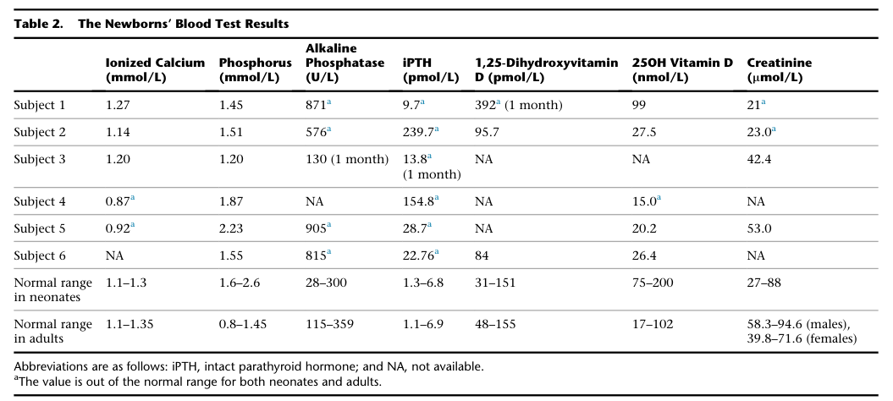
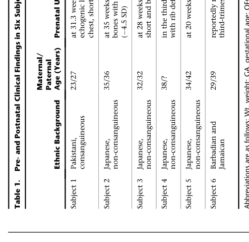
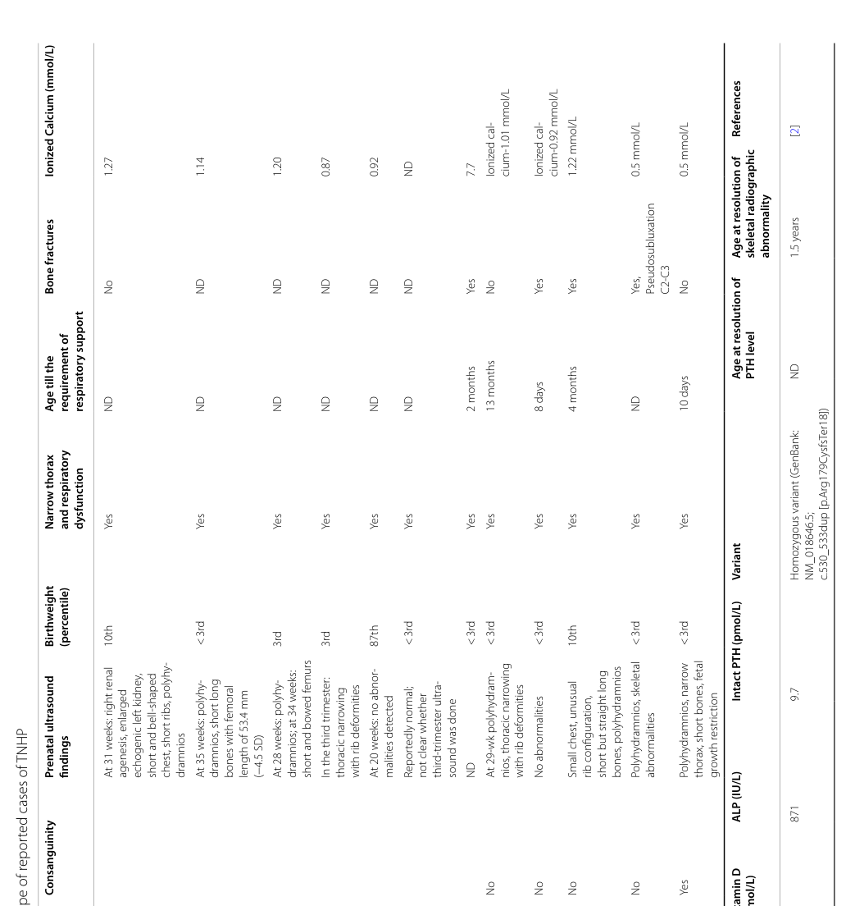

## Question

# Disease Characteristics Research Template

## Target Disease
- **Disease Name:** Transient Neonatal Hyperparathyroidism
- **MONDO ID:** MONDO:0032591 (if available)
- **Category:** Mendelian

## Research Objectives

Please provide a comprehensive research report on **Transient Neonatal Hyperparathyroidism** covering all of the
disease characteristics listed below. This report will be used to populate a disease knowledge
base entry. Be thorough and cite primary literature (PMID preferred) for all claims.

For each section, **suggested databases/resources** are listed. These are the first places
you should search for information on each topic.

---

### 1. Disease Information
> **Search first:** OMIM, Orphanet, ICD-10/ICD-11, MeSH, PubMed

- What is the disease? Provide a concise overview.
- What are the key identifiers? (OMIM, Orphanet, ICD-10/ICD-11, MeSH, Mondo)
- What are the common synonyms and alternative names?
- Is the information derived from individual patients (e.g., EHR) or aggregated disease-level resources?

### 2. Etiology

- **Disease Causal Factors**: What are the primary causes? (genetic, environmental, infectious, mechanistic)
- **Risk Factors**:
  > **Search first:** PubMed, Cochrane Library, UpToDate, clinical guidelines, ClinVar, ClinGen, GWAS Catalog, PheGenI, CTD, CDC, WHO, epidemiological databases
  - Genetic risk factors (causal variants, susceptibility loci, modifier genes)
  - Environmental risk factors (toxins, lifestyle, occupational exposures, age, sex, family history)
- **Protective Factors**:
  > **Search first:** PubMed, Cochrane Library, clinical trial databases, GWAS Catalog, gnomAD, WHO, CDC, nutrition databases
  - Genetic protective factors (protective variants, modifier alleles)
  - Environmental protective factors (diet, lifestyle, exposures that reduce risk)
- **Gene-Environment Interactions**: How do genetic and environmental factors interact to influence disease?
  > **Search first:** CTD, PubMed, PheGenI, GxE databases

### 3. Phenotypes
> **Search first:** HPO (Human Phenotype Ontology), OMIM, Orphanet, PubMed, clinicaltrials.gov, MedDRA, SNOMED CT, DECIPHER, LOINC

For each phenotype, provide:
- **Phenotype type**: symptoms, clinical signs, physical manifestations, behavioral changes, or laboratory abnormalities
  > For symptoms/signs: HPO, OMIM, Orphanet, PubMed
  > For behavioral changes: HPO, DSM, RDoC (Research Domain Criteria), PubMed
  > For laboratory abnormalities: LOINC, SNOMED CT, LabTests Online, PubMed
- **Phenotype characteristics**:
  > **Search first:** OMIM, Orphanet, HPO, PubMed
  - Age of symptom onset (neonatal, childhood, adult-onset, late-onset)
  - Symptom severity (mild, moderate, severe, variable)
  - Symptom progression (stable, progressive, episodic, fluctuating)
  - Frequency among affected individuals (percentage or qualitative)
- **Quality of life impact**: Effects on daily functioning and well-being (per-phenotype when possible)
  > **Search first:** EQ-5D database, SF-36, WHO QOL databases, PubMed
- Suggest HPO (Human Phenotype Ontology) terms for each phenotype

### 4. Genetic/Molecular Information

- **Causal Genes**: Gene mutations or chromosomal abnormalities responsible for disease (gene symbols, OMIM IDs)
  > **Search first:** OMIM, ClinVar, HGMD, Ensembl, NCBI Gene
- **Pathogenic Variants**:
  - Affected genes (gene symbols, HGNC IDs)
    > **Search first:** OMIM, NCBI Gene, Ensembl, HGNC, UniProt, GeneCards
  - Variant classification (pathogenic, likely pathogenic, VUS per ACMG/AMP guidelines)
    > **Search first:** ClinVar, ClinGen, ACMG/AMP guidelines, VarSome
  - Variant type/class (missense, frameshift, nonsense, splice-site, structural)
  - Allele frequency in population databases
    > **Search first:** gnomAD, 1000 Genomes, ExAC, TOPMed, dbSNP
  - Somatic vs germline origin
    > **Search first:** COSMIC (somatic), ClinVar, ICGC, TCGA
  - Functional consequences (loss of function, gain of function, dominant negative)
- **Modifier Genes**: Genes that modify disease severity or expression
- **Epigenetic Information**: DNA methylation, histone modifications, chromatin changes affecting disease
  > **Search first:** ENCODE, Roadmap Epigenomics, MethBase, DiseaseMeth
- **Chromosomal Abnormalities**: Large-scale genetic changes (aneuploidy, translocations, inversions)
  > **Search first:** DECIPHER, ClinVar, ECARUCA, UCSC Genome Browser

### 5. Environmental Information

- **Environmental Factors**: Non-genetic contributing factors (toxins, radiation, pollution, occupational exposure)
  > **Search first:** CTD (Comparative Toxicogenomics Database), TOXNET, PubMed, EPA databases
- **Lifestyle Factors**: Behavioral factors (smoking, diet, exercise, alcohol consumption)
  > **Search first:** CDC databases, WHO, PubMed, NHANES
- **Infectious Agents**: If applicable, pathogens causing or triggering disease (bacteria, viruses, fungi, parasites)
  > **Search first:** NCBI Taxonomy, ViPR, BV-BRC, MicrobeDB, GIDEON

### 6. Mechanism / Pathophysiology

**Present this section as an ordered causal chain first, then the detail below.**
Open with a numbered sequence of mechanistic steps running from the initiating
lesion (mutation, exposure, infection) to the clinical manifestation, one step per
line, each naming what it causes next. State the causal verb explicitly ("leads
to", "results in") and say where a step is inferred rather than demonstrated.
Where the mechanism branches, show the branch. The categories below are a
checklist of what to cover within those steps, not the organizing structure —
a step may draw on several of them, and a category may contribute to several
steps.

- **Molecular Pathways**: Specific signaling cascades or biochemical pathways involved (Wnt, MAPK, mTOR, PI3K-AKT, etc.)
  > **Search first:** KEGG, Reactome, WikiPathways, PathBank, BioCyc
- **Cellular Processes**: Cell-level mechanisms (apoptosis, autophagy, cell cycle dysregulation, inflammation, etc.)
  > **Search first:** Gene Ontology (GO), Reactome, KEGG, PubMed
- **Protein Dysfunction**: How protein structure or function is altered (misfolding, aggregation, loss of function, gain of function)
  > **Search first:** UniProt, PDB (Protein Data Bank), InterPro, Pfam, AlphaFold
- **Metabolic Changes**: Alterations in metabolic processes (energy metabolism, lipid metabolism, amino acid metabolism)
  > **Search first:** KEGG, BioCyc, HMDB (Human Metabolome Database), BRENDA
- **Immune System Involvement**: Role of immune response (autoimmunity, immunodeficiency, chronic inflammation)
  > **Search first:** ImmPort, Immunome Database, IEDB, Gene Ontology
- **Tissue Damage Mechanisms**: How tissues/ are injured (oxidative stress, ischemia, fibrosis, necrosis)
  > **Search first:** PubMed, Gene Ontology, Reactome
- **Biochemical Abnormalities**: Specific molecular defects (enzyme deficiencies, receptor dysfunction, ion channel defects)
  > **Search first:** BRENDA, UniProt, KEGG, OMIM, PubMed
- **Epigenetic Changes**: DNA methylation, histone modifications affecting gene expression in disease
  > **Search first:** ENCODE, Roadmap Epigenomics, MethBase, DiseaseMeth
- **Molecular Profiling** (if available):
  - Transcriptomics/gene expression changes
    > **Search first:** GEO (Gene Expression Omnibus), ArrayExpress, GTEx, Human Cell Atlas, SRA
  - Proteomics findings
    > **Search first:** PRIDE, ProteomeXchange, Human Protein Atlas, STRING, BioGRID
  - Metabolomics signatures
    > **Search first:** MetaboLights, Metabolomics Workbench, HMDB, METLIN
  - Lipidomics alterations
    > **Search first:** LIPID MAPS, SwissLipids, LipidHome, Metabolomics Workbench
  - Genomic structural features
    > **Search first:** UCSC Genome Browser, Ensembl, NCBI, dbVar, DGV
- **Advanced Technologies** (if applicable):
  - Single-cell analysis findings (cell-type specific mechanisms, cellular heterogeneity)
    > **Search first:** Human Cell Atlas, Single Cell Portal, GEO, CELLxGENE
  - Spatial transcriptomics findings
    > **Search first:** GEO, Spatial Research, Vizgen, 10x Genomics data
  - Multi-omics integration results
    > **Search first:** TCGA, ICGC, cBioPortal, LinkedOmics, PubMed
  - Functional genomics screens (CRISPR, RNAi)
    > **Search first:** DepMap, GenomeRNAi, PubMed, BioGRID ORCS

For each mechanism, describe:
- The causal chain from initial trigger to clinical manifestation
- Which mechanisms are upstream vs downstream
- What cell types and biological processes are involved
- Suggest GO terms for biological processes and CL terms for cell types

### 7. Anatomical Structures Affected

- **Organ Level**:
  - Primary organs directly affected
  - Secondary organ involvement (complications, secondary effects)
  - Body systems involved (cardiovascular, nervous, digestive, respiratory, endocrine, etc.)
  > **Search first:** Uberon, FMA (Foundational Model of Anatomy), OMIM, HPO, ICD-11, MeSH, SNOMED CT
- **Tissue and Cell Level**:
  - Specific tissue types affected (epithelial, connective, muscle, nervous)
  - Specific cell populations targeted (with Cell Ontology terms)
  > **Search first:** Uberon, Human Protein Atlas, Cell Ontology, Human Cell Atlas, CellMarker, PanglaoDB
- **Subcellular Level**:
  - Cellular compartments involved (mitochondria, nucleus, ER, lysosomes) (with GO Cellular Component terms)
  > **Search first:** Gene Ontology (Cellular Component), UniProt, Human Protein Atlas
- **Localization**:
  - Specific anatomical sites (with UBERON terms)
    > **Search first:** FMA, Uberon, NeuroNames (for brain), SNOMED CT
  - Lateralization (unilateral, bilateral, asymmetric)
    > **Search first:** HPO, clinical literature, imaging databases

### 8. Temporal Development

- **Onset**:
  - Typical age of onset (congenital, pediatric, adult, geriatric)
  - Onset pattern (acute, subacute, chronic, insidious)
  > **Search first:** OMIM, Orphanet, HPO, PubMed
- **Progression**:
  - Disease stages (early, intermediate, advanced, end-stage)
    > **Search first:** Cancer Staging Manual (AJCC), WHO classifications, PubMed
  - Progression rate (rapid, slow, variable)
  - Disease course pattern (episodic, relapsing-remitting, progressive, stable)
  - Disease duration (self-limited, chronic lifelong)
  > **Search first:** Disease registries, longitudinal cohort databases, natural history studies, PubMed, Orphanet, OMIM
- **Patterns**:
  - Remission patterns (spontaneous, treatment-induced)
    > **Search first:** Clinical trial databases, disease registries, PubMed
  - Critical periods (time windows of vulnerability or opportunity for intervention)
    > **Search first:** PubMed, developmental biology databases, clinical guidelines

### 9. Inheritance and Population

- **Epidemiology**:
  - Prevalence (cases per 100,000 at given time)
  - Incidence (new cases per 100,000 per year)
  > **Search first:** Orphanet, CDC, WHO, GBD (Global Burden of Disease), national registries, SEER, disease registries
- **For Genetic Etiology**:
  - Inheritance pattern (AD, AR, X-linked, mitochondrial, multifactorial, polygenic)
    > **Search first:** OMIM, Orphanet, ClinVar, GTR (Genetic Testing Registry)
  - Penetrance (complete, incomplete, age-dependent)
    > **Search first:** ClinVar, OMIM, PubMed, ClinGen
  - Expressivity (variable, consistent)
    > **Search first:** OMIM, ClinVar, PubMed
  - Genetic anticipation (increasing severity in successive generations)
    > **Search first:** OMIM, PubMed (especially for repeat expansion disorders)
  - Germline mosaicism
    > **Search first:** ClinVar, OMIM, genetic counseling literature, PubMed
  - Founder effects (population-specific mutations)
    > **Search first:** gnomAD, population genetics databases, PubMed
  - Consanguinity role
    > **Search first:** OMIM, population studies, genetic counseling resources
  - Carrier frequency
    > **Search first:** gnomAD, carrier screening databases, GeneReviews, GTR
- **Population Demographics**:
  - Affected populations (ethnic or demographic groups with higher prevalence)
    > **Search first:** gnomAD, 1000 Genomes, PAGE Study, PubMed, population registries
  - Geographic distribution (endemic areas, regional variation)
    > **Search first:** WHO, CDC, GBD, Orphanet, geographic epidemiology databases
  - Geographic distribution of specific variants
  - Sex ratio (male:female)
    > **Search first:** Disease registries, OMIM, PubMed, epidemiological databases
  - Age distribution of affected individuals
    > **Search first:** CDC, disease registries, SEER, Orphanet

### 10. Diagnostics

- **Clinical Tests**:
  - Laboratory tests (blood, urine, tissue chemistry, specific enzyme assays)
    > **Search first:** LOINC, LabTests Online, PubMed
  - Biomarkers (proteins, metabolites, genetic markers, circulating biomarkers)
    > **Search first:** FDA Biomarker List, BEST (Biomarkers, EndpointS, and other Tools), PubMed
  - Imaging studies (X-ray, CT, MRI, PET, ultrasound)
    > **Search first:** RadLex, DICOM, Radiopaedia, imaging databases
  - Functional tests (pulmonary function, cardiac stress tests)
    > **Search first:** LOINC, clinical guidelines, PubMed
  - Electrophysiology (EEG, EMG, ECG, nerve conduction studies)
    > **Search first:** LOINC, clinical neurophysiology databases, PubMed
  - Biopsy findings (histopathology, immunohistochemistry)
    > **Search first:** SNOMED CT, College of American Pathologists resources, PubMed
  - Pathology findings (microscopic examination)
    > **Search first:** SNOMED CT, Digital Pathology databases, PubMed
- **Genetic Testing**:
  > **Search first:** GTR (Genetic Testing Registry), GeneReviews, ClinGen
  - Overview of recommended genetic testing approach
  - Whole genome sequencing (WGS) utility
    > **Search first:** GTR, ClinVar, GEL (Genomics England), gnomAD
  - Whole exome sequencing (WES) utility
    > **Search first:** GTR, ClinVar, OMIM, GeneMatcher
  - Gene panels (which panels, which genes)
    > **Search first:** GTR, ClinVar, laboratory-specific databases
  - Single gene testing
    > **Search first:** GTR, ClinVar, OMIM, GeneReviews
  - Chromosomal microarray (CMA)
    > **Search first:** DECIPHER, ClinVar, dbVar, ECARUCA
  - Karyotyping
    > **Search first:** Chromosome Abnormality Database, ClinVar, cytogenetics resources
  - FISH
    > **Search first:** ClinVar, cytogenetics databases, PubMed
  - Mitochondrial DNA testing
    > **Search first:** MITOMAP, MSeqDR, ClinVar, GTR
  - Repeat expansion testing
    > **Search first:** GTR, ClinVar, repeat expansion databases, PubMed
- **Omics-Based Diagnostics** (if applicable):
  - RNA sequencing / transcriptomics
    > **Search first:** GEO, ArrayExpress, GTEx, RNA-seq databases
  - Proteomics
    > **Search first:** PRIDE, ProteomeXchange, FDA Biomarker database
  - Metabolomics
    > **Search first:** MetaboLights, Metabolomics Workbench, HMDB
  - Epigenomics
    > **Search first:** GEO, ENCODE, Roadmap Epigenomics, MethBase
  - Liquid biopsy
    > **Search first:** COSMIC, ClinVar, liquid biopsy databases, PubMed
- **Clinical Criteria**:
  - Standardized diagnostic criteria (DSM, ICD, society guidelines)
    > **Search first:** DSM-5, ICD-11, clinical society guidelines, UpToDate
  - Differential diagnosis (other conditions to rule out, with distinguishing features)
    > **Search first:** DynaMed, UpToDate, clinical decision support systems
- **Screening**:
  - Screening methods for asymptomatic individuals (newborn screening, carrier screening, cascade screening)
    > **Search first:** ACMG recommendations, CDC newborn screening, GTR

### 11. Outcome/Prognosis

- **Survival and Mortality**:
  - Survival rate (5-year, 10-year, overall)
    > **Search first:** SEER, cancer registries, disease-specific registries, PubMed
  - Life expectancy (with and without treatment if applicable)
    > **Search first:** Orphanet, disease registries, actuarial databases, PubMed
  - Mortality rate
    > **Search first:** CDC, WHO, GBD, national mortality databases
  - Disease-specific mortality (deaths directly attributable to disease)
    > **Search first:** Disease registries, CDC Wonder, GBD, PubMed
- **Morbidity and Function**:
  - Morbidity (disease-related disability and health impacts)
    > **Search first:** GBD, WHO, disability databases, PubMed
  - Disability outcomes (long-term functional impairments)
    > **Search first:** ICF (International Classification of Functioning), disability registries
  - Quality of life measures (EQ-5D, SF-36, PROMIS, disease-specific tools)
    > **Search first:** EQ-5D database, SF-36, PROMIS, PubMed
- **Disease Course**:
  - Complications (secondary problems: infections, organ failure, etc.)
    > **Search first:** ICD codes, disease registries, clinical databases, PubMed
  - Recovery potential (likelihood and extent of recovery, with vs without treatment)
    > **Search first:** Natural history studies, rehabilitation databases, PubMed
- **Prediction**:
  - Prognostic factors (age, disease severity, biomarkers, treatment response)
    > **Search first:** Prognostic models databases, clinical calculators, PubMed
  - Prognostic biomarkers (molecular markers predicting disease course)
    > **Search first:** FDA Biomarker database, PubMed, cancer prognostic databases

### 12. Treatment

- **Pharmacotherapy**:
  - Pharmacological treatments (drug names, drug classes, mechanisms of action)
    > **Search first:** DrugBank, RxNorm, ATC classification, DailyMed, FDA databases
  - Pharmacogenomics (how genetic variants affect drug metabolism, efficacy, toxicity)
    > **Search first:** PharmGKB, CPIC (Clinical Pharmacogenetics), FDA Table of PGx Biomarkers
- **Advanced Therapeutics**:
  - Gene therapy (viral vectors, CRISPR, gene replacement, gene editing)
    > **Search first:** ClinicalTrials.gov, FDA gene therapy database, ASGCT resources
  - Cell therapy (stem cell transplant, CAR-T, cellular therapeutics)
    > **Search first:** ClinicalTrials.gov, FDA cell therapy database, FACT standards
  - RNA-based therapies (ASOs, siRNA, mRNA therapies)
    > **Search first:** ClinicalTrials.gov, FDA approvals, PubMed
  - Targeted therapies (treatments directed at specific molecular targets)
    > **Search first:** My Cancer Genome, OncoKB, ClinicalTrials.gov, FDA approvals
  - Immunotherapies (checkpoint inhibitors, monoclonal antibodies)
    > **Search first:** Cancer Immunotherapy Database, FDA approvals, ClinicalTrials.gov
- **Surgical and Interventional**:
  - Surgical interventions (types of surgery, timing, outcomes)
    > **Search first:** CPT codes, surgical registries, clinical guidelines, PubMed
- **Supportive and Rehabilitative**:
  - Supportive care (symptom management, pain control, nutrition)
    > **Search first:** Clinical guidelines, Cochrane Library, PubMed
  - Rehabilitation (physical therapy, occupational therapy, speech therapy)
    > **Search first:** Rehabilitation medicine databases, clinical guidelines, PubMed
- **Experimental**:
  - Experimental treatments in clinical trials (with NCT identifiers if available)
    > **Search first:** ClinicalTrials.gov, EU Clinical Trials Register, WHO ICTRP
- **Treatment Outcomes**:
  - Treatment response rates
    > **Search first:** Clinical trial databases, FDA reviews, systematic reviews, PubMed
  - Side effects and adverse events
    > **Search first:** FDA Adverse Event Reporting System (FAERS), MedWatch, PubMed
- **Treatment Strategy**:
  - Treatment algorithms (clinical pathways, decision trees)
    > **Search first:** Clinical practice guidelines, NCCN Guidelines, UpToDate
  - Combination therapies
    > **Search first:** ClinicalTrials.gov, treatment guidelines, PubMed
  - Personalized medicine approaches (genotype-guided treatment)
    > **Search first:** My Cancer Genome, CIViC, PharmGKB, precision medicine databases

For each treatment, suggest NCIT (NCI Thesaurus) clinical-intervention terms where applicable.

### 13. Prevention

- **Prevention Levels**:
  - Primary prevention (preventing disease occurrence: vaccination, risk factor modification)
    > **Search first:** CDC, WHO, USPSTF recommendations, Cochrane Library
  - Secondary prevention (early detection and treatment: screening programs, early intervention)
    > **Search first:** USPSTF, CDC screening guidelines, WHO
  - Tertiary prevention (preventing complications in those with disease)
    > **Search first:** Clinical guidelines, disease management protocols, PubMed
- **Immunization**: Vaccine strategies (if applicable)
  > **Search first:** CDC vaccine schedules, WHO immunization, FDA vaccine database
- **Screening and Early Detection**:
  - Screening programs (population-based: newborn screening, cancer screening)
    > **Search first:** CDC screening programs, USPSTF, cancer screening databases
  - Genetic screening (carrier screening, preimplantation genetic diagnosis, prenatal testing)
    > **Search first:** ACMG recommendations, ACOG guidelines, GTR
  - Risk stratification (identifying high-risk individuals for targeted prevention)
    > **Search first:** Risk prediction models, clinical calculators, PubMed
- **Behavioral Interventions**: Lifestyle modifications to reduce risk
  > **Search first:** CDC, WHO, behavioral intervention databases, Cochrane Library
- **Counseling**: Genetic counseling (risk assessment, family planning guidance)
  > **Search first:** NSGC resources, ACMG guidelines, GeneReviews
- **Public Health**:
  - Public health interventions (sanitation, vector control, health education)
    > **Search first:** CDC, WHO, public health databases, PubMed
  - Environmental interventions (reducing environmental risk factors)
    > **Search first:** EPA databases, WHO environmental health, PubMed
- **Prophylaxis**: Preventive medications or procedures
  > **Search first:** Clinical guidelines, FDA approvals, PubMed

### 14. Other Species / Natural Disease

- **Taxonomy**: Species affected (with NCBI Taxon identifiers)
  > **Search first:** NCBI Taxonomy
- **Breed**: Specific breeds affected (with VBO identifiers if applicable)
  > **Search first:** VBO (Vertebrate Breed Ontology)
- **Gene**: Orthologous genes in other species (with NCBI Gene IDs)
  > **Search first:** NCBI Gene
- **Natural Disease**:
  - Naturally occurring disease in other species (companion animals, wildlife)
    > **Search first:** OMIA (Online Mendelian Inheritance in Animals), VetCompass, PubMed
  - Veterinary relevance and importance in animal health
    > **Search first:** OMIA, veterinary databases, PubMed
- **Comparative Biology**:
  - Comparative pathology (similarities and differences across species)
    > **Search first:** OMIA, comparative pathology databases, PubMed
  - Evolutionary conservation of disease mechanisms
    > **Search first:** HomoloGene, OrthoMCL, Alliance of Genome Resources
- **Transmission** (if applicable):
  - Zoonotic potential
    > **Search first:** CDC zoonotic diseases, WHO zoonoses, GIDEON
  - Cross-species susceptibility
    > **Search first:** NCBI Taxonomy, veterinary databases, PubMed

### 15. Model Organisms

- **Model Types**:
  - Model organism type (mammalian, invertebrate, cellular, in vitro)
    > **Search first:** Alliance of Genome Resources, model organism databases
  - Specific model systems (mouse, rat, zebrafish, Drosophila, C. elegans, yeast, cell lines, organoids, iPSCs)
    > **Search first:** MGI, RGD, ZFIN, FlyBase, WormBase, SGD, ATCC, Cellosaurus
  - Induced models (drug treatment, surgical intervention, environmental manipulation)
    > **Search first:** MGI, model organism databases, PubMed
- **Genetic Models**:
  - Types available (knockout, knock-in, transgenic, conditional, humanized)
    > **Search first:** MGI, IMPC, KOMP, EuMMCR, IMSR
- **Model Characteristics**:
  - Phenotype recapitulation (how well model reproduces human disease features)
    > **Search first:** Model organism databases, comparative studies, PubMed
  - Model limitations (aspects of human disease not captured)
    > **Search first:** Model organism databases, PubMed, review articles
- **Applications**:
  - Research applications (what aspects of disease can be studied)
    > **Search first:** Model organism databases, PubMed
- **Resources**:
  - Model databases
    > **Search first:** MGI, RGD, ZFIN, FlyBase, WormBase, IMSR, EMMA, MMRRC

---

## Citation Requirements

- Cite primary literature (PMID preferred) for all mechanistic and clinical claims
- Prioritize recent reviews and landmark papers
- Include direct quotes from abstracts where possible to support key statements
- Distinguish evidence source types: human clinical, model organism, in vitro, computational

## Output Format

Structure your response as a comprehensive narrative organized by the sections above.
For each section, provide:
- Factual content with specific details (numbers, percentages, gene names, variant nomenclature)
- Ontology term suggestions (HPO, GO, CL, UBERON, CHEBI, NCIT, MONDO) where applicable
- Evidence citations with PMIDs
- Direct quotes from abstracts to support key claims
- Clear indication when information is not available or not applicable for this disease

This report will be used to populate a disease knowledge base entry with:
- Pathophysiology descriptions with causal chains
- Gene/protein annotations (HGNC, GO terms)
- Phenotype associations (HP terms) with frequencies
- Cell type involvement (CL terms)
- Anatomical locations (UBERON terms)
- Chemical entities (CHEBI terms)
- Treatment annotations (NCIT terms)
- Evidence items with PMIDs and exact abstract quotes
- Epidemiology, prognosis, diagnostic, and prevention information
- Animal model descriptions with phenotype recapitulation details

## Output

Question: You are an expert researcher providing comprehensive, well-cited information.

Provide detailed information focusing on:
1. Key concepts and definitions with current understanding
2. Recent developments and latest research (prioritize 2023-2024 sources)
3. Current applications and real-world implementations
4. Expert opinions and analysis from authoritative sources
5. Relevant statistics and data from recent studies

Format as a comprehensive research report with proper citations. Include URLs and publication dates where available.
Always prioritize recent, authoritative sources and provide specific citations for all major claims.

# Disease Characteristics Research Template

## Target Disease
- **Disease Name:** Transient Neonatal Hyperparathyroidism
- **MONDO ID:** MONDO:0032591 (if available)
- **Category:** Mendelian

## Research Objectives

Please provide a comprehensive research report on **Transient Neonatal Hyperparathyroidism** covering all of the
disease characteristics listed below. This report will be used to populate a disease knowledge
base entry. Be thorough and cite primary literature (PMID preferred) for all claims.

For each section, **suggested databases/resources** are listed. These are the first places
you should search for information on each topic.

---

### 1. Disease Information
> **Search first:** OMIM, Orphanet, ICD-10/ICD-11, MeSH, PubMed

- What is the disease? Provide a concise overview.
- What are the key identifiers? (OMIM, Orphanet, ICD-10/ICD-11, MeSH, Mondo)
- What are the common synonyms and alternative names?
- Is the information derived from individual patients (e.g., EHR) or aggregated disease-level resources?

### 2. Etiology

- **Disease Causal Factors**: What are the primary causes? (genetic, environmental, infectious, mechanistic)
- **Risk Factors**:
  > **Search first:** PubMed, Cochrane Library, UpToDate, clinical guidelines, ClinVar, ClinGen, GWAS Catalog, PheGenI, CTD, CDC, WHO, epidemiological databases
  - Genetic risk factors (causal variants, susceptibility loci, modifier genes)
  - Environmental risk factors (toxins, lifestyle, occupational exposures, age, sex, family history)
- **Protective Factors**:
  > **Search first:** PubMed, Cochrane Library, clinical trial databases, GWAS Catalog, gnomAD, WHO, CDC, nutrition databases
  - Genetic protective factors (protective variants, modifier alleles)
  - Environmental protective factors (diet, lifestyle, exposures that reduce risk)
- **Gene-Environment Interactions**: How do genetic and environmental factors interact to influence disease?
  > **Search first:** CTD, PubMed, PheGenI, GxE databases

### 3. Phenotypes
> **Search first:** HPO (Human Phenotype Ontology), OMIM, Orphanet, PubMed, clinicaltrials.gov, MedDRA, SNOMED CT, DECIPHER, LOINC

For each phenotype, provide:
- **Phenotype type**: symptoms, clinical signs, physical manifestations, behavioral changes, or laboratory abnormalities
  > For symptoms/signs: HPO, OMIM, Orphanet, PubMed
  > For behavioral changes: HPO, DSM, RDoC (Research Domain Criteria), PubMed
  > For laboratory abnormalities: LOINC, SNOMED CT, LabTests Online, PubMed
- **Phenotype characteristics**:
  > **Search first:** OMIM, Orphanet, HPO, PubMed
  - Age of symptom onset (neonatal, childhood, adult-onset, late-onset)
  - Symptom severity (mild, moderate, severe, variable)
  - Symptom progression (stable, progressive, episodic, fluctuating)
  - Frequency among affected individuals (percentage or qualitative)
- **Quality of life impact**: Effects on daily functioning and well-being (per-phenotype when possible)
  > **Search first:** EQ-5D database, SF-36, WHO QOL databases, PubMed
- Suggest HPO (Human Phenotype Ontology) terms for each phenotype

### 4. Genetic/Molecular Information

- **Causal Genes**: Gene mutations or chromosomal abnormalities responsible for disease (gene symbols, OMIM IDs)
  > **Search first:** OMIM, ClinVar, HGMD, Ensembl, NCBI Gene
- **Pathogenic Variants**:
  - Affected genes (gene symbols, HGNC IDs)
    > **Search first:** OMIM, NCBI Gene, Ensembl, HGNC, UniProt, GeneCards
  - Variant classification (pathogenic, likely pathogenic, VUS per ACMG/AMP guidelines)
    > **Search first:** ClinVar, ClinGen, ACMG/AMP guidelines, VarSome
  - Variant type/class (missense, frameshift, nonsense, splice-site, structural)
  - Allele frequency in population databases
    > **Search first:** gnomAD, 1000 Genomes, ExAC, TOPMed, dbSNP
  - Somatic vs germline origin
    > **Search first:** COSMIC (somatic), ClinVar, ICGC, TCGA
  - Functional consequences (loss of function, gain of function, dominant negative)
- **Modifier Genes**: Genes that modify disease severity or expression
- **Epigenetic Information**: DNA methylation, histone modifications, chromatin changes affecting disease
  > **Search first:** ENCODE, Roadmap Epigenomics, MethBase, DiseaseMeth
- **Chromosomal Abnormalities**: Large-scale genetic changes (aneuploidy, translocations, inversions)
  > **Search first:** DECIPHER, ClinVar, ECARUCA, UCSC Genome Browser

### 5. Environmental Information

- **Environmental Factors**: Non-genetic contributing factors (toxins, radiation, pollution, occupational exposure)
  > **Search first:** CTD (Comparative Toxicogenomics Database), TOXNET, PubMed, EPA databases
- **Lifestyle Factors**: Behavioral factors (smoking, diet, exercise, alcohol consumption)
  > **Search first:** CDC databases, WHO, PubMed, NHANES
- **Infectious Agents**: If applicable, pathogens causing or triggering disease (bacteria, viruses, fungi, parasites)
  > **Search first:** NCBI Taxonomy, ViPR, BV-BRC, MicrobeDB, GIDEON

### 6. Mechanism / Pathophysiology

**Present this section as an ordered causal chain first, then the detail below.**
Open with a numbered sequence of mechanistic steps running from the initiating
lesion (mutation, exposure, infection) to the clinical manifestation, one step per
line, each naming what it causes next. State the causal verb explicitly ("leads
to", "results in") and say where a step is inferred rather than demonstrated.
Where the mechanism branches, show the branch. The categories below are a
checklist of what to cover within those steps, not the organizing structure —
a step may draw on several of them, and a category may contribute to several
steps.

- **Molecular Pathways**: Specific signaling cascades or biochemical pathways involved (Wnt, MAPK, mTOR, PI3K-AKT, etc.)
  > **Search first:** KEGG, Reactome, WikiPathways, PathBank, BioCyc
- **Cellular Processes**: Cell-level mechanisms (apoptosis, autophagy, cell cycle dysregulation, inflammation, etc.)
  > **Search first:** Gene Ontology (GO), Reactome, KEGG, PubMed
- **Protein Dysfunction**: How protein structure or function is altered (misfolding, aggregation, loss of function, gain of function)
  > **Search first:** UniProt, PDB (Protein Data Bank), InterPro, Pfam, AlphaFold
- **Metabolic Changes**: Alterations in metabolic processes (energy metabolism, lipid metabolism, amino acid metabolism)
  > **Search first:** KEGG, BioCyc, HMDB (Human Metabolome Database), BRENDA
- **Immune System Involvement**: Role of immune response (autoimmunity, immunodeficiency, chronic inflammation)
  > **Search first:** ImmPort, Immunome Database, IEDB, Gene Ontology
- **Tissue Damage Mechanisms**: How tissues/ are injured (oxidative stress, ischemia, fibrosis, necrosis)
  > **Search first:** PubMed, Gene Ontology, Reactome
- **Biochemical Abnormalities**: Specific molecular defects (enzyme deficiencies, receptor dysfunction, ion channel defects)
  > **Search first:** BRENDA, UniProt, KEGG, OMIM, PubMed
- **Epigenetic Changes**: DNA methylation, histone modifications affecting gene expression in disease
  > **Search first:** ENCODE, Roadmap Epigenomics, MethBase, DiseaseMeth
- **Molecular Profiling** (if available):
  - Transcriptomics/gene expression changes
    > **Search first:** GEO (Gene Expression Omnibus), ArrayExpress, GTEx, Human Cell Atlas, SRA
  - Proteomics findings
    > **Search first:** PRIDE, ProteomeXchange, Human Protein Atlas, STRING, BioGRID
  - Metabolomics signatures
    > **Search first:** MetaboLights, Metabolomics Workbench, HMDB, METLIN
  - Lipidomics alterations
    > **Search first:** LIPID MAPS, SwissLipids, LipidHome, Metabolomics Workbench
  - Genomic structural features
    > **Search first:** UCSC Genome Browser, Ensembl, NCBI, dbVar, DGV
- **Advanced Technologies** (if applicable):
  - Single-cell analysis findings (cell-type specific mechanisms, cellular heterogeneity)
    > **Search first:** Human Cell Atlas, Single Cell Portal, GEO, CELLxGENE
  - Spatial transcriptomics findings
    > **Search first:** GEO, Spatial Research, Vizgen, 10x Genomics data
  - Multi-omics integration results
    > **Search first:** TCGA, ICGC, cBioPortal, LinkedOmics, PubMed
  - Functional genomics screens (CRISPR, RNAi)
    > **Search first:** DepMap, GenomeRNAi, PubMed, BioGRID ORCS

For each mechanism, describe:
- The causal chain from initial trigger to clinical manifestation
- Which mechanisms are upstream vs downstream
- What cell types and biological processes are involved
- Suggest GO terms for biological processes and CL terms for cell types

### 7. Anatomical Structures Affected

- **Organ Level**:
  - Primary organs directly affected
  - Secondary organ involvement (complications, secondary effects)
  - Body systems involved (cardiovascular, nervous, digestive, respiratory, endocrine, etc.)
  > **Search first:** Uberon, FMA (Foundational Model of Anatomy), OMIM, HPO, ICD-11, MeSH, SNOMED CT
- **Tissue and Cell Level**:
  - Specific tissue types affected (epithelial, connective, muscle, nervous)
  - Specific cell populations targeted (with Cell Ontology terms)
  > **Search first:** Uberon, Human Protein Atlas, Cell Ontology, Human Cell Atlas, CellMarker, PanglaoDB
- **Subcellular Level**:
  - Cellular compartments involved (mitochondria, nucleus, ER, lysosomes) (with GO Cellular Component terms)
  > **Search first:** Gene Ontology (Cellular Component), UniProt, Human Protein Atlas
- **Localization**:
  - Specific anatomical sites (with UBERON terms)
    > **Search first:** FMA, Uberon, NeuroNames (for brain), SNOMED CT
  - Lateralization (unilateral, bilateral, asymmetric)
    > **Search first:** HPO, clinical literature, imaging databases

### 8. Temporal Development

- **Onset**:
  - Typical age of onset (congenital, pediatric, adult, geriatric)
  - Onset pattern (acute, subacute, chronic, insidious)
  > **Search first:** OMIM, Orphanet, HPO, PubMed
- **Progression**:
  - Disease stages (early, intermediate, advanced, end-stage)
    > **Search first:** Cancer Staging Manual (AJCC), WHO classifications, PubMed
  - Progression rate (rapid, slow, variable)
  - Disease course pattern (episodic, relapsing-remitting, progressive, stable)
  - Disease duration (self-limited, chronic lifelong)
  > **Search first:** Disease registries, longitudinal cohort databases, natural history studies, PubMed, Orphanet, OMIM
- **Patterns**:
  - Remission patterns (spontaneous, treatment-induced)
    > **Search first:** Clinical trial databases, disease registries, PubMed
  - Critical periods (time windows of vulnerability or opportunity for intervention)
    > **Search first:** PubMed, developmental biology databases, clinical guidelines

### 9. Inheritance and Population

- **Epidemiology**:
  - Prevalence (cases per 100,000 at given time)
  - Incidence (new cases per 100,000 per year)
  > **Search first:** Orphanet, CDC, WHO, GBD (Global Burden of Disease), national registries, SEER, disease registries
- **For Genetic Etiology**:
  - Inheritance pattern (AD, AR, X-linked, mitochondrial, multifactorial, polygenic)
    > **Search first:** OMIM, Orphanet, ClinVar, GTR (Genetic Testing Registry)
  - Penetrance (complete, incomplete, age-dependent)
    > **Search first:** ClinVar, OMIM, PubMed, ClinGen
  - Expressivity (variable, consistent)
    > **Search first:** OMIM, ClinVar, PubMed
  - Genetic anticipation (increasing severity in successive generations)
    > **Search first:** OMIM, PubMed (especially for repeat expansion disorders)
  - Germline mosaicism
    > **Search first:** ClinVar, OMIM, genetic counseling literature, PubMed
  - Founder effects (population-specific mutations)
    > **Search first:** gnomAD, population genetics databases, PubMed
  - Consanguinity role
    > **Search first:** OMIM, population studies, genetic counseling resources
  - Carrier frequency
    > **Search first:** gnomAD, carrier screening databases, GeneReviews, GTR
- **Population Demographics**:
  - Affected populations (ethnic or demographic groups with higher prevalence)
    > **Search first:** gnomAD, 1000 Genomes, PAGE Study, PubMed, population registries
  - Geographic distribution (endemic areas, regional variation)
    > **Search first:** WHO, CDC, GBD, Orphanet, geographic epidemiology databases
  - Geographic distribution of specific variants
  - Sex ratio (male:female)
    > **Search first:** Disease registries, OMIM, PubMed, epidemiological databases
  - Age distribution of affected individuals
    > **Search first:** CDC, disease registries, SEER, Orphanet

### 10. Diagnostics

- **Clinical Tests**:
  - Laboratory tests (blood, urine, tissue chemistry, specific enzyme assays)
    > **Search first:** LOINC, LabTests Online, PubMed
  - Biomarkers (proteins, metabolites, genetic markers, circulating biomarkers)
    > **Search first:** FDA Biomarker List, BEST (Biomarkers, EndpointS, and other Tools), PubMed
  - Imaging studies (X-ray, CT, MRI, PET, ultrasound)
    > **Search first:** RadLex, DICOM, Radiopaedia, imaging databases
  - Functional tests (pulmonary function, cardiac stress tests)
    > **Search first:** LOINC, clinical guidelines, PubMed
  - Electrophysiology (EEG, EMG, ECG, nerve conduction studies)
    > **Search first:** LOINC, clinical neurophysiology databases, PubMed
  - Biopsy findings (histopathology, immunohistochemistry)
    > **Search first:** SNOMED CT, College of American Pathologists resources, PubMed
  - Pathology findings (microscopic examination)
    > **Search first:** SNOMED CT, Digital Pathology databases, PubMed
- **Genetic Testing**:
  > **Search first:** GTR (Genetic Testing Registry), GeneReviews, ClinGen
  - Overview of recommended genetic testing approach
  - Whole genome sequencing (WGS) utility
    > **Search first:** GTR, ClinVar, GEL (Genomics England), gnomAD
  - Whole exome sequencing (WES) utility
    > **Search first:** GTR, ClinVar, OMIM, GeneMatcher
  - Gene panels (which panels, which genes)
    > **Search first:** GTR, ClinVar, laboratory-specific databases
  - Single gene testing
    > **Search first:** GTR, ClinVar, OMIM, GeneReviews
  - Chromosomal microarray (CMA)
    > **Search first:** DECIPHER, ClinVar, dbVar, ECARUCA
  - Karyotyping
    > **Search first:** Chromosome Abnormality Database, ClinVar, cytogenetics resources
  - FISH
    > **Search first:** ClinVar, cytogenetics databases, PubMed
  - Mitochondrial DNA testing
    > **Search first:** MITOMAP, MSeqDR, ClinVar, GTR
  - Repeat expansion testing
    > **Search first:** GTR, ClinVar, repeat expansion databases, PubMed
- **Omics-Based Diagnostics** (if applicable):
  - RNA sequencing / transcriptomics
    > **Search first:** GEO, ArrayExpress, GTEx, RNA-seq databases
  - Proteomics
    > **Search first:** PRIDE, ProteomeXchange, FDA Biomarker database
  - Metabolomics
    > **Search first:** MetaboLights, Metabolomics Workbench, HMDB
  - Epigenomics
    > **Search first:** GEO, ENCODE, Roadmap Epigenomics, MethBase
  - Liquid biopsy
    > **Search first:** COSMIC, ClinVar, liquid biopsy databases, PubMed
- **Clinical Criteria**:
  - Standardized diagnostic criteria (DSM, ICD, society guidelines)
    > **Search first:** DSM-5, ICD-11, clinical society guidelines, UpToDate
  - Differential diagnosis (other conditions to rule out, with distinguishing features)
    > **Search first:** DynaMed, UpToDate, clinical decision support systems
- **Screening**:
  - Screening methods for asymptomatic individuals (newborn screening, carrier screening, cascade screening)
    > **Search first:** ACMG recommendations, CDC newborn screening, GTR

### 11. Outcome/Prognosis

- **Survival and Mortality**:
  - Survival rate (5-year, 10-year, overall)
    > **Search first:** SEER, cancer registries, disease-specific registries, PubMed
  - Life expectancy (with and without treatment if applicable)
    > **Search first:** Orphanet, disease registries, actuarial databases, PubMed
  - Mortality rate
    > **Search first:** CDC, WHO, GBD, national mortality databases
  - Disease-specific mortality (deaths directly attributable to disease)
    > **Search first:** Disease registries, CDC Wonder, GBD, PubMed
- **Morbidity and Function**:
  - Morbidity (disease-related disability and health impacts)
    > **Search first:** GBD, WHO, disability databases, PubMed
  - Disability outcomes (long-term functional impairments)
    > **Search first:** ICF (International Classification of Functioning), disability registries
  - Quality of life measures (EQ-5D, SF-36, PROMIS, disease-specific tools)
    > **Search first:** EQ-5D database, SF-36, PROMIS, PubMed
- **Disease Course**:
  - Complications (secondary problems: infections, organ failure, etc.)
    > **Search first:** ICD codes, disease registries, clinical databases, PubMed
  - Recovery potential (likelihood and extent of recovery, with vs without treatment)
    > **Search first:** Natural history studies, rehabilitation databases, PubMed
- **Prediction**:
  - Prognostic factors (age, disease severity, biomarkers, treatment response)
    > **Search first:** Prognostic models databases, clinical calculators, PubMed
  - Prognostic biomarkers (molecular markers predicting disease course)
    > **Search first:** FDA Biomarker database, PubMed, cancer prognostic databases

### 12. Treatment

- **Pharmacotherapy**:
  - Pharmacological treatments (drug names, drug classes, mechanisms of action)
    > **Search first:** DrugBank, RxNorm, ATC classification, DailyMed, FDA databases
  - Pharmacogenomics (how genetic variants affect drug metabolism, efficacy, toxicity)
    > **Search first:** PharmGKB, CPIC (Clinical Pharmacogenetics), FDA Table of PGx Biomarkers
- **Advanced Therapeutics**:
  - Gene therapy (viral vectors, CRISPR, gene replacement, gene editing)
    > **Search first:** ClinicalTrials.gov, FDA gene therapy database, ASGCT resources
  - Cell therapy (stem cell transplant, CAR-T, cellular therapeutics)
    > **Search first:** ClinicalTrials.gov, FDA cell therapy database, FACT standards
  - RNA-based therapies (ASOs, siRNA, mRNA therapies)
    > **Search first:** ClinicalTrials.gov, FDA approvals, PubMed
  - Targeted therapies (treatments directed at specific molecular targets)
    > **Search first:** My Cancer Genome, OncoKB, ClinicalTrials.gov, FDA approvals
  - Immunotherapies (checkpoint inhibitors, monoclonal antibodies)
    > **Search first:** Cancer Immunotherapy Database, FDA approvals, ClinicalTrials.gov
- **Surgical and Interventional**:
  - Surgical interventions (types of surgery, timing, outcomes)
    > **Search first:** CPT codes, surgical registries, clinical guidelines, PubMed
- **Supportive and Rehabilitative**:
  - Supportive care (symptom management, pain control, nutrition)
    > **Search first:** Clinical guidelines, Cochrane Library, PubMed
  - Rehabilitation (physical therapy, occupational therapy, speech therapy)
    > **Search first:** Rehabilitation medicine databases, clinical guidelines, PubMed
- **Experimental**:
  - Experimental treatments in clinical trials (with NCT identifiers if available)
    > **Search first:** ClinicalTrials.gov, EU Clinical Trials Register, WHO ICTRP
- **Treatment Outcomes**:
  - Treatment response rates
    > **Search first:** Clinical trial databases, FDA reviews, systematic reviews, PubMed
  - Side effects and adverse events
    > **Search first:** FDA Adverse Event Reporting System (FAERS), MedWatch, PubMed
- **Treatment Strategy**:
  - Treatment algorithms (clinical pathways, decision trees)
    > **Search first:** Clinical practice guidelines, NCCN Guidelines, UpToDate
  - Combination therapies
    > **Search first:** ClinicalTrials.gov, treatment guidelines, PubMed
  - Personalized medicine approaches (genotype-guided treatment)
    > **Search first:** My Cancer Genome, CIViC, PharmGKB, precision medicine databases

For each treatment, suggest NCIT (NCI Thesaurus) clinical-intervention terms where applicable.

### 13. Prevention

- **Prevention Levels**:
  - Primary prevention (preventing disease occurrence: vaccination, risk factor modification)
    > **Search first:** CDC, WHO, USPSTF recommendations, Cochrane Library
  - Secondary prevention (early detection and treatment: screening programs, early intervention)
    > **Search first:** USPSTF, CDC screening guidelines, WHO
  - Tertiary prevention (preventing complications in those with disease)
    > **Search first:** Clinical guidelines, disease management protocols, PubMed
- **Immunization**: Vaccine strategies (if applicable)
  > **Search first:** CDC vaccine schedules, WHO immunization, FDA vaccine database
- **Screening and Early Detection**:
  - Screening programs (population-based: newborn screening, cancer screening)
    > **Search first:** CDC screening programs, USPSTF, cancer screening databases
  - Genetic screening (carrier screening, preimplantation genetic diagnosis, prenatal testing)
    > **Search first:** ACMG recommendations, ACOG guidelines, GTR
  - Risk stratification (identifying high-risk individuals for targeted prevention)
    > **Search first:** Risk prediction models, clinical calculators, PubMed
- **Behavioral Interventions**: Lifestyle modifications to reduce risk
  > **Search first:** CDC, WHO, behavioral intervention databases, Cochrane Library
- **Counseling**: Genetic counseling (risk assessment, family planning guidance)
  > **Search first:** NSGC resources, ACMG guidelines, GeneReviews
- **Public Health**:
  - Public health interventions (sanitation, vector control, health education)
    > **Search first:** CDC, WHO, public health databases, PubMed
  - Environmental interventions (reducing environmental risk factors)
    > **Search first:** EPA databases, WHO environmental health, PubMed
- **Prophylaxis**: Preventive medications or procedures
  > **Search first:** Clinical guidelines, FDA approvals, PubMed

### 14. Other Species / Natural Disease

- **Taxonomy**: Species affected (with NCBI Taxon identifiers)
  > **Search first:** NCBI Taxonomy
- **Breed**: Specific breeds affected (with VBO identifiers if applicable)
  > **Search first:** VBO (Vertebrate Breed Ontology)
- **Gene**: Orthologous genes in other species (with NCBI Gene IDs)
  > **Search first:** NCBI Gene
- **Natural Disease**:
  - Naturally occurring disease in other species (companion animals, wildlife)
    > **Search first:** OMIA (Online Mendelian Inheritance in Animals), VetCompass, PubMed
  - Veterinary relevance and importance in animal health
    > **Search first:** OMIA, veterinary databases, PubMed
- **Comparative Biology**:
  - Comparative pathology (similarities and differences across species)
    > **Search first:** OMIA, comparative pathology databases, PubMed
  - Evolutionary conservation of disease mechanisms
    > **Search first:** HomoloGene, OrthoMCL, Alliance of Genome Resources
- **Transmission** (if applicable):
  - Zoonotic potential
    > **Search first:** CDC zoonotic diseases, WHO zoonoses, GIDEON
  - Cross-species susceptibility
    > **Search first:** NCBI Taxonomy, veterinary databases, PubMed

### 15. Model Organisms

- **Model Types**:
  - Model organism type (mammalian, invertebrate, cellular, in vitro)
    > **Search first:** Alliance of Genome Resources, model organism databases
  - Specific model systems (mouse, rat, zebrafish, Drosophila, C. elegans, yeast, cell lines, organoids, iPSCs)
    > **Search first:** MGI, RGD, ZFIN, FlyBase, WormBase, SGD, ATCC, Cellosaurus
  - Induced models (drug treatment, surgical intervention, environmental manipulation)
    > **Search first:** MGI, model organism databases, PubMed
- **Genetic Models**:
  - Types available (knockout, knock-in, transgenic, conditional, humanized)
    > **Search first:** MGI, IMPC, KOMP, EuMMCR, IMSR
- **Model Characteristics**:
  - Phenotype recapitulation (how well model reproduces human disease features)
    > **Search first:** Model organism databases, comparative studies, PubMed
  - Model limitations (aspects of human disease not captured)
    > **Search first:** Model organism databases, PubMed, review articles
- **Applications**:
  - Research applications (what aspects of disease can be studied)
    > **Search first:** Model organism databases, PubMed
- **Resources**:
  - Model databases
    > **Search first:** MGI, RGD, ZFIN, FlyBase, WormBase, IMSR, EMMA, MMRRC

---

## Citation Requirements

- Cite primary literature (PMID preferred) for all mechanistic and clinical claims
- Prioritize recent reviews and landmark papers
- Include direct quotes from abstracts where possible to support key statements
- Distinguish evidence source types: human clinical, model organism, in vitro, computational

## Output Format

Structure your response as a comprehensive narrative organized by the sections above.
For each section, provide:
- Factual content with specific details (numbers, percentages, gene names, variant nomenclature)
- Ontology term suggestions (HPO, GO, CL, UBERON, CHEBI, NCIT, MONDO) where applicable
- Evidence citations with PMIDs
- Direct quotes from abstracts to support key claims
- Clear indication when information is not available or not applicable for this disease

This report will be used to populate a disease knowledge base entry with:
- Pathophysiology descriptions with causal chains
- Gene/protein annotations (HGNC, GO terms)
- Phenotype associations (HP terms) with frequencies
- Cell type involvement (CL terms)
- Anatomical locations (UBERON terms)
- Chemical entities (CHEBI terms)
- Treatment annotations (NCIT terms)
- Evidence items with PMIDs and exact abstract quotes
- Epidemiology, prognosis, diagnostic, and prevention information
- Animal model descriptions with phenotype recapitulation details

# Transient neonatal hyperparathyroidism: disease-characteristics report

**Scope and evidence standard.** This entry concerns **hereditary, TRPV6-associated transient neonatal hyperparathyroidism (TNHP)**, rather than every condition in which a newborn temporarily has elevated parathyroid hormone (PTH). The strongest direct human evidence is a six-infant genetic and functional study published in 2018 and a further genetically characterized family reported in 2024. The 2024 authors counted **12 published cases, including their own**; this is a literature count, not incidence or prevalence. Mechanistic statements below distinguish observations in infants, experiments in cells or animals, and inference. (suzuki2018trpv6variantsinterfere pages 1-2, kumar2024noveltrpv6variant pages 1-3)

## 1. Disease information

TNHP is a **fetal-onset disorder of calcium supply**: impaired placental calcium transfer stimulates the fetal parathyroid glands and produces high PTH and a poorly mineralized skeleton. The biochemical disturbance commonly diminishes after birth, when placental transfer is replaced by intestinal calcium intake; skeletal recovery can take considerably longer. The preferred disease identifier is **MONDO:0032591**, labeled *hyperparathyroidism, transient neonatal*. Alternative wording includes *transient neonatal hyperparathyroidism*, *hereditary transient neonatal hyperparathyroidism* and, when the cause is established, *TRPV6-related TNHP*. The **TRPV6 gene identifier** is Ensembl **ENSG00000165125**; the founding paper identifies **TRPV6 MIM:606680 as a gene identifier**, not as a verified disease OMIM number. A disease-specific OMIM number, Orphanet number, specific ICD-10/ICD-11 or MeSH identifier, and HGNC numeric identifier were **not independently verified** and should remain unfilled pending direct terminology-database validation. The evidence consists of **published, aggregated case reports and disease-level resources**, not access to individual EHR records. (OpenTargets Search: transient neonatal hyperparathyroidism-TRPV6, suzuki2018trpv6variantsinterfere pages 1-2, suzuki2018trpv6variantsinterfere pages 9-10)

**Key primary sources and dates:** Suzuki et al., *American Journal of Human Genetics*, published **31 May 2018**, PMID **[29861107](https://pubmed.ncbi.nlm.nih.gov/29861107/)**, [DOI:10.1016/j.ajhg.2018.04.006](https://doi.org/10.1016/j.ajhg.2018.04.006); Yamashita et al., *Journal of the Endocrine Society*, **2019**, PMID **[30820485](https://pubmed.ncbi.nlm.nih.gov/30820485/)**, [DOI:10.1210/js.2018-00374](https://doi.org/10.1210/js.2018-00374); Almidani et al., *Cureus*, **15 February 2020**, [DOI:10.7759/cureus.7000](https://doi.org/10.7759/cureus.7000); and Kumar et al., *Egyptian Journal of Medical Human Genetics*, **June 2024**, [DOI:10.1186/s43042-024-00537-y](https://doi.org/10.1186/s43042-024-00537-y). A PMID for the latter two reports was not verified here. As the founding abstract puts it, “**Transient neonatal hyperparathyroidism (TNHP) is etiologically a heterogeneous condition.**” These citations must therefore not be read as making every neonatal PTH elevation a TRPV6 disorder. (suzuki2018trpv6variantsinterfere pages 1-2, sota2025trpv6channelfunction pages 19-20, almidani2020casereportof pages 1-3, kumar2024noveltrpv6variant pages 1-3)

## 2. Etiology, risk and protective factors

**Established hereditary cause:** biallelic germline **TRPV6** variants—homozygous or compound heterozygous—can impair the calcium-selective epithelial channel needed for placental transfer. Risk is concentrated in fetuses inheriting two relevant alleles; parental consanguinity can increase the chance of homozygosity but is not necessary, because affected children have also been born to unrelated parents. The six founding families included one Pakistani consanguineous family, four Japanese non-consanguineous families and one family of African descent; these observations cannot establish ancestry-specific risk. A prior similarly affected pregnancy is relevant family history, but an ungenotyped pregnancy cannot be counted as confirmed recurrence. (suzuki2018trpv6variantsinterfere pages 1-2, suzuki2018trpv6variantsinterfere pages 3-5, kumar2024noveltrpv6variant pages 1-3)

**Maternal and other causes must be kept separate.** Neonatal *primary* hyperparathyroidism is often related to **CASR** dysfunction; other reported secondary contexts include **SLC12A1**-associated antenatal Bartter syndrome, **GNPTAB**-related mucolipidosis II and maternal pseudohypoparathyroidism. Maternal vitamin-D deficiency was documented and treated in the 2024 TRPV6 family, but this coexistence **does not demonstrate that deficiency caused or modified** the infant’s genetic disease. There is no verified TNHP-specific protective allele, toxin, infectious trigger, lifestyle risk estimate, maternal-diet prevention effect, or quantitative gene–environment interaction. Maintaining adequate maternal and infant mineral nutrition is reasonable clinical care, **not proven primary prevention of biallelic TRPV6 disease**. (suzuki2018trpv6variantsinterfere pages 6-7, kumar2024noveltrpv6variant pages 1-3, kumar2024noveltrpv6variant pages 3-4)

## 3. Phenotypes

**Clinical pattern and ontology suggestions.** Prenatal signs include third-trimester skeletal abnormalities, short long bones, rib deformity, narrow/bell-shaped thorax and sometimes polyhydramnios or fetal growth restriction. Neonatal physical/radiographic manifestations include diffuse osteopenia or undermineralization, bowed femora, metaphyseal change, subperiosteal resorption and fractures; respiratory distress may reflect a restrictive thorax. Feeding difficulty is reported but not quantifiable from the principal six-patient study. Laboratory abnormalities are **high PTH**, often high alkaline phosphatase (ALP), variable ionized calcium—**normal calcium does not exclude TNHP**—and sometimes low phosphate or 25-hydroxyvitamin D. Proposed HPO *labels for subsequent code matching*, not independently checked HP numbers: **Hyperparathyroidism; Elevated circulating parathyroid hormone concentration; Elevated circulating alkaline phosphatase concentration; Hypocalcemia; Hypophosphatemia; Osteopenia; Abnormality of bone mineral density; Narrow chest; Short rib; Rib fracture; Bowing of the long bones; Metaphyseal dysplasia; Respiratory distress; Polyhydramnios; Intrauterine growth retardation.** (suzuki2018trpv6variantsinterfere pages 2-3, suzuki2018trpv6variantsinterfere pages 3-5, suzuki2018trpv6variantsinterfere pages 5-6, kumar2024noveltrpv6variant pages 1-3, kumar2024noveltrpv6variant pages 3-4)

The following **selected-case-series proportions** are useful for evidence annotation but must not be presented as population phenotype frequencies. They derive from the original six affected infants; phosphate and ALP counts use the original report’s stated *neonatal* reference intervals. Respiratory difficulty and recovery were checked against the original clinical table, and laboratory values against the original biochemical table. (suzuki2018trpv6variantsinterfere media 2b8a4c71, suzuki2018trpv6variantsinterfere media 2e62fedc)

| Phenotype | Number documented in six genetically affected infants | Caveat / typical features |
|---|---:|---|
| Elevated intact PTH | 6/6 (100%) | Present in every infant; values ranged from 9.7 to 239.7 pmol/L, although subject 3 was measured at one month. Suzuki et al., 2018, PMID 29861107, DOI: [10.1016/j.ajhg.2018.04.006](https://doi.org/10.1016/j.ajhg.2018.04.006) (suzuki2018trpv6variantsinterfere pages 2-3, suzuki2018trpv6variantsinterfere pages 5-6) |
| Postnatal respiratory difficulty | 6/6 (100%) | Documented for all six infants, consistent with the restrictive effect of a narrow, undermineralized thorax. Suzuki et al., 2018, DOI: [10.1016/j.ajhg.2018.04.006](https://doi.org/10.1016/j.ajhg.2018.04.006) (suzuki2018trpv6variantsinterfere media 2e62fedc) |
| Ionized hypocalcemia | 2/5 measured (40%); 3/5 measured had normal ionized calcium | Subjects 4 and 5 had 0.87 and 0.92 mmol/L; subjects 1–3 had 1.27, 1.14, and 1.20 mmol/L. Subject 6 was not measured. Suzuki et al., 2018, DOI: [10.1016/j.ajhg.2018.04.006](https://doi.org/10.1016/j.ajhg.2018.04.006) (suzuki2018trpv6variantsinterfere media 2b8a4c71, suzuki2018trpv6variantsinterfere pages 5-6) |
| Low serum phosphate | 4/6 (67%) | Using the study’s neonatal reference interval of 1.6–2.6 mmol/L, subjects 1, 2, 3, and 6 were low (1.45, 1.51, 1.20, and 1.55 mmol/L); subjects 4 and 5 were within range. Suzuki et al., 2018, DOI: [10.1016/j.ajhg.2018.04.006](https://doi.org/10.1016/j.ajhg.2018.04.006) (suzuki2018trpv6variantsinterfere media 2b8a4c71, suzuki2018trpv6variantsinterfere pages 5-6) |
| Elevated alkaline phosphatase | 4/5 measured (80%) | Subjects 1, 2, 5, and 6 exceeded the neonatal reference interval of 28–300 U/L. Subject 3 had ALP 130 U/L at one month; subject 4 was not measured. Suzuki et al., 2018, DOI: [10.1016/j.ajhg.2018.04.006](https://doi.org/10.1016/j.ajhg.2018.04.006) (suzuki2018trpv6variantsinterfere media 2b8a4c71, suzuki2018trpv6variantsinterfere pages 5-6) |
| Complete skeletal resolution by age two | 5/6 (83%) | Subjects 1–5 achieved complete resolution between ages one and two years; subject 6 remained abnormal but had substantially improved. Suzuki et al., 2018, DOI: [10.1016/j.ajhg.2018.04.006](https://doi.org/10.1016/j.ajhg.2018.04.006) (suzuki2018trpv6variantsinterfere pages 2-3, suzuki2018trpv6variantsinterfere media 2e62fedc) |
| Normal developmental milestones | 5/6 (83%) | Subjects 1–5 had milestones within the normal range. The most severely affected infant was delayed, attributed by the authors mainly to cerebral complications rather than established direct neurodevelopmental effects of *TRPV6*. Suzuki et al., 2018, DOI: [10.1016/j.ajhg.2018.04.006](https://doi.org/10.1016/j.ajhg.2018.04.006) (suzuki2018trpv6variantsinterfere pages 3-5) |
| Evidence-quality limitation | Selected case series; not a population frequency estimate | Percentages describe only six clinically ascertained infants with biallelic *TRPV6* variants and must not be interpreted as penetrance, prevalence, or unbiased phenotype frequencies. Suzuki et al., 2018, PMID 29861107, DOI: [10.1016/j.ajhg.2018.04.006](https://doi.org/10.1016/j.ajhg.2018.04.006) (suzuki2018trpv6variantsinterfere pages 1-2) |

*Table: Phenotype counts from the original six-infant biallelic TRPV6 case series by Suzuki et al. These are selected case-series proportions—not population prevalence, penetrance, or unbiased disease-frequency estimates.*

**Function and quality of life:** the narrow chest can require neonatal respiratory support; fractures can necessitate immobilization and analgesia. In the six-child series, five had normal developmental milestones; the sixth had cerebral complications and delayed development, so an intrinsic TRPV6-associated cognitive phenotype cannot be inferred. The 2024 infant required **10 days of noninvasive respiratory support** and was reported to have normal growth and development at **three months**. No disease-specific EQ-5D, SF-36, PROMIS, validated behavioral phenotype frequency or long-term quality-of-life dataset was identified. (suzuki2018trpv6variantsinterfere pages 3-5, almidani2020casereportof pages 1-3, kumar2024noveltrpv6variant pages 1-3, kumar2024noveltrpv6variant pages 3-4)

## 4. Genetic and molecular information

**Causal annotation:** *TRPV6*, an epithelial calcium-selective channel gene at chromosome **7q33–q34**; reported disease alleles are germline, with autosomal-recessive segregation established for the original six families. Suzuki et al. identified **c.530_533dup, p.Arg179CysfsTer18** in the homozygous state; **c.607+5G>A** in trans with **c.978_979del, reported as p.Asp328\***; and missense alleles **p.Cys212Tyr, p.Ile223Thr, p.Arg425Gln, p.Gly428Arg, p.Gly451Glu** and **p.Arg483Trp** in different compound-heterozygous combinations. For example, subjects 2–5 carried, respectively, p.Cys212Tyr/p.Gly428Arg, p.Ile223Thr/p.Arg425Gln, p.Gly451Glu/p.Arg483Trp and p.Arg425Gln/p.Gly451Glu. The splice allele produced abnormal RNA containing **41 retained intronic nucleotides** in a minigene assay. Allele nomenclature and transcript should be normalized against the original paper before importing into a variant database; a separate formal **ClinVar/ClinGen ACMG classification was not verified**. (suzuki2018trpv6variantsinterfere pages 3-5, suzuki2018trpv6variantsinterfere pages 5-6, suzuki2018trpv6variantsinterfere pages 7-9)

**Variant-function distinctions matter.** Cell experiments found that p.Arg425Gln, p.Gly428Arg and p.Arg483Trp failed to localize adequately to the plasma membrane and lacked detectable channel currents in the tested conditions. p.Gly451Glu showed early currents but increased steady-state intracellular calcium and apparent cellular toxicity, consistent with defective calcium-dependent inactivation—not a simple assertion that every mutant channel is nonconducting. p.Ile223Thr showed a smaller *mean* peak current, but its isolated patch-clamp current difference from wild type was **not statistically significant** in the reported comparison. Proposed misfolding and proteasomal degradation remain interpretation, not direct demonstration of the degradation route. (suzuki2018trpv6variantsinterfere pages 3-5, suzuki2018trpv6variantsinterfere pages 5-5, suzuki2018trpv6variantsinterfere pages 9-10)

**2024 addition:** the affected Indian neonate was homozygous for **TRPV6 c.1585G>A, p.Asp529Asn** on the reported transcript **ENST00000359396.9**, while both parents were heterozygous. The authors reported a corresponding genomic coordinate **chr7:g.142874130C>T**, without a verified reference-build annotation here. Their search found no entry in the specified 1000 Genomes, gnomAD v2.1/v3.1, TOPMed or Indian MedVarDb resources, and computational tools predicted damage; **“not found in the databases checked” is not a numerical allele frequency**. No direct functional assay of p.Asp529Asn or independently verified ACMG/AMP classification was presented, so use **candidate disease-associated missense variant; classification requiring verification**, rather than asserting a confirmed *pathogenic* ClinVar label. The 2020 p.Thr198Arg case was explicitly called a **variant of uncertain significance**, with incomplete maternal segregation information. (kumar2024noveltrpv6variant pages 3-4, kumar2024noveltrpv6variant pages 1-3, almidani2020casereportof pages 1-3)

No TNHP-specific causal chromosomal rearrangement, somatic driver, established severity-modifier gene, protective allele, epigenetic signature, repeat expansion or mitochondrial variant has been established from these reports. An unrelated small 16p13.3 deletion was noted in one child’s chromosome analysis but **must not be entered as the established TNHP cause**. (suzuki2018trpv6variantsinterfere pages 1-2, suzuki2018trpv6variantsinterfere media 2e62fedc)

## 5. Environmental information

The relevant non-genetic context is **maternal-to-fetal calcium availability and placental function during late gestation**, followed by adequacy of postnatal calcium intake; these are biologically relevant environments rather than proven exposures initiating the TRPV6 genotype. One reported mother had vitamin-D deficiency, whereas the medically well mother of another affected child illustrates that overt maternal disease is not required. No substantiated TNHP-specific associations were located for smoking, alcohol, exercise, pollution, radiation, occupational chemicals or pathogens; consequently, infectious-agent taxonomy and zoonotic transmission fields are **not applicable**. Suggested chemical labels for later ChEBI validation are *calcium ion*, *phosphate*, *cholecalciferol* and *calcitriol*; do not substitute these for verified clinical exposures or assign unchecked accession numbers. (kumar2024noveltrpv6variant pages 1-3, almidani2020casereportof pages 1-3, suzuki2018trpv6variantsinterfere pages 6-7)

## 6. Mechanism and pathophysiology

**Ordered causal chain—established steps versus inference**

1. **Biallelic germline TRPV6 alteration leads to** reduced availability or altered regulation of functional calcium-selective TRPV6 channels in the placenta; human mutant-channel assays directly establish several protein defects, whereas the effect of each allele *in the patient’s placenta* is largely inferred. (suzuki2018trpv6variantsinterfere pages 1-2, suzuki2018trpv6variantsinterfere pages 3-5, suzuki2018trpv6variantsinterfere pages 5-5)
2. **Defective calcium entry at the maternal-facing trophoblast membrane leads to** insufficient active transcellular maternal-to-fetal calcium transfer; this is supported by human genotype/phenotype and cell assays and by animal placental-transport work, **not by direct quantitative placental flux measurement in every affected human pregnancy**. (suzuki2018trpv6variantsinterfere pages 1-2, suzuki2018trpv6variantsinterfere pages 7-9, sota2025trpv6channelfunction pages 1-2)
3. **Insufficient fetal calcium supply leads to** fetal calcium deficit and **results in** compensatory fetal parathyroid PTH secretion; high neonatal PTH is directly documented, whereas the complete hormone-response sequence in utero is mechanistic inference. (suzuki2018trpv6variantsinterfere pages 2-3, suzuki2018trpv6variantsinterfere pages 5-6, suzuki2018trpv6variantsinterfere pages 9-10)
4. **Sustained mineral deficit and PTH-associated skeletal resorption result in** undermineralization, metaphyseal/diaphyseal change, bowed or fractured bones and a narrow thorax; observed radiographic findings support this downstream branch. **The narrow thorax then leads to** neonatal respiratory compromise, although additional contributors to an individual infant’s distress cannot be excluded. (suzuki2018trpv6variantsinterfere pages 6-7, suzuki2018trpv6variantsinterfere media 2e62fedc, kumar2024noveltrpv6variant pages 1-3)
5. **Birth terminates dependence on placental transport and leads to** access to intestinal calcium; adequate postnatal intake and treatment **result in** falling PTH and gradual bone healing in many cases. This explains *transient endocrine activity*, **not guaranteed immediate skeletal normalization or survival**. (suzuki2018trpv6variantsinterfere pages 9-10, kumar2024noveltrpv6variant pages 3-4, kumar2024noveltrpv6variant media b13f018a)

**Process-level detail.** The upstream process is epithelial calcium entry through a **tetrameric, six-transmembrane-subunit TRPV6 channel** at the plasma membrane. The proposed transport sequence is apical calcium influx, intracellular buffering by calbindin-D9K and basolateral extrusion by calcium ATPases; the ensuing endocrine/mineral response is downstream. The founding authors estimate **25–30 g** of calcium crosses to the fetus over pregnancy, around **80% during the third trimester**, supporting the timing of late fetal skeletal vulnerability. Relevant **suggested GO biological-process labels**: *calcium ion transmembrane transport*, *transcellular calcium ion transport*, *calcium ion homeostasis*, *skeletal system development*, *bone mineralization* and *response to parathyroid hormone*. Candidate GO cellular components: *plasma membrane* and *apical plasma membrane*; exact GO IDs and human-cell localization specificity require verification. Suggested **CL labels**: *syncytiotrophoblast*, *trophoblast cell*, *parathyroid chief cell*, *osteoblast* and *osteoclast*; trophoblast dysfunction and bone-cell responses have different levels of direct patient-specific support. (suzuki2018trpv6variantsinterfere pages 1-2, suzuki2018trpv6variantsinterfere pages 6-7, sota2025trpv6channelfunction pages 1-2)

**What is not established:** altered intracellular calcium-dependent channel inactivation was measured for p.Gly451Glu **in vitro**, and apparent death occurred in transfected cells; this does not demonstrate trophoblast apoptosis or inflammation in affected infants. No TNHP-specific Wnt, MAPK, PI3K–AKT or mTOR lesion, immune mechanism, oxidative-stress pathway, causal DNA-methylation profile, proteome/metabolome/lipidome signature, patient single-cell or spatial atlas, or CRISPR therapeutic screen was established. The 2024 clinical report contributed **exome-based diagnosis**, not a disease-specific multi-omics signature. Hypotheses about molecular chaperones or fetal calcium administration are not demonstrated pathway corrections. (suzuki2018trpv6variantsinterfere pages 5-5, suzuki2018trpv6variantsinterfere pages 7-9, kumar2024noveltrpv6variant pages 3-4)

## 7. Anatomical structures affected

**Primary upstream site:** placenta, especially its calcium-transporting trophoblast epithelium; the **fetal parathyroid glands** respond secondarily. **Principal damaged site:** developing axial and appendicular skeleton, including ribs, thorax and femora. Secondary respiratory effects arise from chest-wall restriction. A severe case additionally had hydrocephalus, but one observation does not establish the brain as a routine primary target. Suggested UBERON *labels* for controlled-term mapping: *placenta*, *parathyroid gland*, *rib*, *thoracic cage*, *femur*, *bone tissue*, *small intestine* and *uterus*. No consistent unilateral or bilateral pattern characterizes the disease, although one infant had **bilateral femoral bowing and fractures**. **Subcellular priority:** the channel-bearing plasma membrane; trafficking/stability changes in experimental cells do not independently establish an endoplasmic-reticulum lesion in human placenta. (suzuki2018trpv6variantsinterfere pages 1-2, suzuki2018trpv6variantsinterfere pages 6-7, suzuki2018trpv6variantsinterfere pages 3-5, almidani2020casereportof pages 1-3)

## 8. Temporal development

The causal disturbance begins **in utero**, with several skeletal findings first noticed in the **third trimester**; clinical and biochemical manifestations are present at birth or in the neonatal period. The disorder is not formally staged. The founding study reported PTH declining with age and **complete skeletal recovery in five of six by age two years**; the sixth remained abnormal but substantially improved. In an independent 2020 infant, PTH fell from **450 pg/mL at day 7** to **32 pg/mL at discharge on day 28**; the 2024 infant’s mineral and hormone tests normalized sufficiently to stop supplements at **three months**. Biochemical remission should therefore be recorded separately from radiographic recovery. Late gestation and the first weeks of respiratory/mineral management are practical high-vulnerability periods. Recurrence or late adult morbidity rates have not been established. (suzuki2018trpv6variantsinterfere pages 3-5, suzuki2018trpv6variantsinterfere media 2e62fedc, almidani2020casereportof pages 3-5, kumar2024noveltrpv6variant pages 3-4)

## 9. Inheritance and population

**TRPV6-associated disease is generally autosomal recessive:** the six founding pedigrees showed biallelic affected children with parental segregation, and both parents of the 2024 proband carried the same variant heterozygously. These findings do **not** establish complete penetrance, a population carrier frequency, an anticipation phenomenon, germline mosaicism, or a founder effect. Both sexes were represented: the founding cohort contained **three boys and three girls**; this is not a valid population sex ratio. A 2024 review-of-cases count of **12 published individuals** documents extreme reporting scarcity but cannot be converted to prevalence per 100,000, annual incidence or geographic distribution. Consanguinity contributes to some cases but is not required; national or ethnicity-specific incidence has not been determined. **Important boundary:** evidence retrieved for the classic recessive entity does not justify labeling all future monoallelic TRPV6 findings recessive without separate case-level assessment. (suzuki2018trpv6variantsinterfere pages 3-5, suzuki2018trpv6variantsinterfere pages 5-5, kumar2024noveltrpv6variant pages 1-3, kumar2024noveltrpv6variant pages 3-4)

## 10. Diagnostics

**Initial evaluation:** in a fetus with short, poorly mineralized bones or a narrow thorax, assess prenatal ultrasound and consider fetal skeletal imaging according to specialist practice. For the newborn, obtain **ionized or total calcium with appropriate units, phosphate, magnesium, ALP, intact PTH, 25-hydroxyvitamin D**, renal-function markers and a skeletal survey; serial values matter because calcium may be normal in some affected infants and PTH changes rapidly. Chest and long-bone radiographs can identify rib fractures, osteopenia, metaphyseal change and bowing; monitor respiration clinically, with oxygen saturation and support needs as indicated. Maternal mineral/vitamin-D and relevant endocrine history help identify non-TRPV6 causes. In the original six, **PTH was high in all six**, while measured ionized calcium was low in **two of five**, illustrating why isolated calcium screening is inadequate. (suzuki2018trpv6variantsinterfere pages 2-3, suzuki2018trpv6variantsinterfere pages 5-6, suzuki2018trpv6variantsinterfere media 2b8a4c71, kumar2024noveltrpv6variant pages 1-3)

**Molecular confirmation:** prioritize a **TRPV6-inclusive hereditary skeletal/mineral-disorder panel or exome sequencing**, with parental segregation testing and assessment for a second allele if only one is found. Exome sequencing identified the initial cases and the 2024 family; targeted TRPV6 sequencing identified four further original cases. Genome sequencing may be considered if exon-based testing misses a suspected intronic, structural or regulatory allele, **but disease-specific incremental WGS yield is unknown**. Variant interpretation should integrate segregation, phenotype, population data, predicted transcript effect and, where available, channel or splicing experiments; a rare computationally damaging variant alone is insufficient. Chromosome microarray, karyotyping or FISH are **not established first-line tests for the typical TRPV6 lesion**, although they may investigate a separate syndromic differential. Mitochondrial, repeat-expansion, epigenomic, liquid-biopsy and routine RNA/proteomic/metabolomic diagnostic assays have no established disease-specific role. (suzuki2018trpv6variantsinterfere pages 1-2, suzuki2018trpv6variantsinterfere pages 3-5, kumar2024noveltrpv6variant pages 3-4, suzuki2018trpv6variantsinterfere media 2e62fedc)

**Differential:** severe *CASR*-related neonatal **primary** hyperparathyroidism; other secondary causes discussed above; **osteogenesis imperfecta**, in which fractures overlap but the characteristic PTH pattern and genetic basis differ; other skeletal dysplasias and nutritional/mineralization disorders. A negative osteogenesis-imperfecta panel and detection of a TRPV6 variant of uncertain significance should prompt careful multidisciplinary interpretation, not automatic molecular confirmation. No formally validated TNHP-specific biochemical cutoff or population newborn-screening algorithm was identified. (suzuki2018trpv6variantsinterfere pages 6-7, almidani2020casereportof pages 3-5, almidani2020casereportof pages 1-3)

## 11. Outcomes and prognosis

Most published patients demonstrate endocrine improvement and substantial skeletal healing, but **“transient” does not mean harmless**. The original six included **five children with complete radiographic recovery by age two** and one with persistent but improving abnormalities and hydrocephalus/chest-expanders. The 2024 published-case comparison records **one different affected child who died at four months**; this child is **not** one of Suzuki’s six. Thus neither universal survival nor an interpretable mortality proportion can be asserted from these selected, small reports. Important morbidities are respiratory compromise, fractures, pain, feeding-support needs and prolonged bone recovery. PTH and ALP trends, respiratory course and serial radiographs are practical follow-up indicators rather than validated prognostic biomarkers. No unbiased survival curve, life expectancy, disability prevalence or standardized quality-of-life score exists in the sources examined. (suzuki2018trpv6variantsinterfere pages 3-5, suzuki2018trpv6variantsinterfere media 2e62fedc, kumar2024noveltrpv6variant media b13f018a, kumar2024noveltrpv6variant pages 1-3)

## 12. Treatment and clinical implementation

**Supportive treatment reported in human infants:** correct calcium deficiency with monitored **intravenous calcium when clinically indicated**, transition to **oral calcium**, and address documented phosphate/vitamin-D insufficiency with clinician-directed **phosphate and vitamin D** supplementation. One case report used elemental intravenous calcium **1,000 mg/m² over 10 hours daily**, vitamin D **2,000 IU** and phosphate, with close monitoring to avoid hypercalcemia; **that case-specific regimen is not an evidence-based universal protocol**, and that publication’s calcium unit labeling is inconsistent with physiologic interpretation, so its reported calcium numbers should not be reused as dosing thresholds. The 2024 patient received calcium, phosphorus and vitamin D, then discontinued supplements at three months after normalization. Monitor calcium, phosphate, ALP and PTH, as well as potential supplementation-related hypercalcemia and respiratory status. Where required, provide oxygen/CPAP or other respiratory support, feeding support, fracture immobilization and analgesia; involve neonatology, pediatric endocrinology, genetics and orthopedics. (almidani2020casereportof pages 1-3, almidani2020casereportof pages 3-5, kumar2024noveltrpv6variant pages 1-3, kumar2024noveltrpv6variant pages 3-4)

**Treatment classification:** these are uncontrolled case reports, so no disease-specific comparative response rate or pharmacogenomic dosing rule is established. Parathyroidectomy or calcimimetic treatment used in other forms of neonatal hyperparathyroidism should **not** be imported as standard treatment for placental TRPV6 deficiency. Small-molecule protein chaperones and prenatal intra-amniotic calcium were proposed in the founding study and again discussed in 2024, but **neither is established TNHP therapy**. No verified disease-specific NCT interventional trial or approved gene, RNA, cell, targeted or immune therapy was identified. Suggested NCIT *intervention labels*, requiring terminology validation before attaching codes: **calcium supplementation, vitamin D supplementation, phosphate supplementation, oxygen therapy, continuous positive airway pressure, fracture immobilization and genetic counseling**. Suggested ChEBI chemical labels: **calcium ion, phosphate and vitamin D**; exact accession numbers were not checked. (suzuki2018trpv6variantsinterfere pages 7-9, kumar2024noveltrpv6variant pages 3-4, almidani2020casereportof pages 1-3)

## 13. Prevention

**Primary prevention:** one cannot prevent inheritance of a familial TRPV6 allele through diet, vaccination or sanitation. When disease-causing alleles are securely established, **genetic counseling** can explain the autosomal-recessive model and discuss reproductive options such as targeted prenatal or preimplantation testing according to local clinical practice; whether to use such options depends on fully verified variant classification and family preference. **Secondary prevention:** investigate recurrent fetal thoracic/skeletal abnormalities early and evaluate affected neonates promptly for mineral deficiency, respiratory compromise and the differential diagnoses. **Tertiary prevention:** maintain appropriately monitored calcium/mineral supply and treat respiratory difficulty or fractures to reduce complications. Cascade testing may clarify parental carrier status, but a **population-wide TRPV6 newborn or carrier-screening program is not established**. There is no TNHP vaccine, pathogen prophylaxis or proven prenatal calcium-infusion prophylaxis. (suzuki2018trpv6variantsinterfere pages 1-2, kumar2024noveltrpv6variant pages 1-3, suzuki2018trpv6variantsinterfere pages 7-9, almidani2020casereportof pages 3-5)

## 14. Other species and naturally occurring disease

**Taxonomy suggestions:** humans **NCBI Taxonomy:9606**, laboratory mice **10090** and zebrafish **7955**. Functional conservation of epithelial calcium uptake is supported by mouse and zebrafish studies, but **a spontaneous, genetically verified TRPV6-related counterpart of human TNHP in a veterinary breed or wildlife species was not established**; therefore no VBO breed, natural-disease prevalence or zoonotic-transmission annotation is warranted. In fish, the studied gene is a **single trpv5/6 orthologue**, not a one-to-one representation of the separate mammalian TRPV5 and TRPV6 genes; external-water calcium supply and the absence of a mammalian placenta limit direct disease equivalence. Orthologue **NCBI Gene ID numbers require direct database confirmation** rather than extrapolation from species names. (vanoevelen2011trpv56isvital pages 1-3, sota2025trpv6channelfunction pages 1-2)

## 15. Model organisms and experimental systems

**Human-variant cellular model:** HEK293T cells expressing wild-type or patient-derived TRPV6 variants enabled **patch-clamp current**, Fura-2 intracellular-calcium, protein-biotinylation/localization and intronic-variant minigene-splicing assays. This establishes allele-specific channel defects in vitro but does not reproduce an intact human placenta or prove every variant’s in vivo effect. **Mouse models:** *Trpv6* knockout and nonconducting pore-mutant mice have been used to examine calcium physiology; mouse work summarized in the 2025 original study found reduced trophoblast calcium uptake and shorter, less-calcified offspring femora in deficient pregnancies. Its **new 2025 finding** was impaired female fecundity and altered endometrial epithelial calcium oscillations in knockout/pore-mutant mice; that reproductive finding should **not** be misclassified as a demonstrated phenotype of human TNHP. A mouse placental-extracellular-matrix paper identified by the study is Winter et al., **2020**, [DOI:10.3390/ijms21249674](https://doi.org/10.3390/ijms21249674); the primary paper’s quantitative placental findings were not independently extracted for this report. Mouse results are supportive comparative biology, not human penetrance estimates. (suzuki2018trpv6variantsinterfere pages 3-5, suzuki2018trpv6variantsinterfere pages 5-5, sota2025trpv6channelfunction pages 1-2, sota2025trpv6channelfunction pages 19-20)

**Zebrafish genetic model:** the *matt-und-schlapp* **trpv5/6 loss-of-function** fish had severe loss of skeletal ossification and **68% lower calcium content** than siblings; increasing ambient calcium to **25 mM** partially rescued the phenotype. Mutant fish channel expressed in HEK293 cells did not reproduce normal calcium entry. This is powerful evidence for conserved calcium-uptake biology, **not evidence that raising ambient or intra-amniotic calcium treats human fetuses**. Vanoevelen et al., *FASEB Journal*, published online **13 June 2011**, [DOI:10.1096/fj.11-183145](https://doi.org/10.1096/fj.11-183145). Model registries such as MGI and ZFIN are appropriate future links, but no verified strain/allele accessions or patient-derived organoid/iPSC model were obtained. (vanoevelen2011trpv56isvital pages 1-3)

### Abstract excerpts and evidence-grade summary

* **Human genetic association plus cell experiments, Suzuki 2018:** “**We report six subjects with homozygous and/or compound-heterozygous mutations**” in *TRPV6*; the abstract concludes that the results “**suggest that TNHP is an autosomal-recessive disease**” affecting maternal–fetal calcium transport. **PMID:29861107.** (suzuki2018trpv6variantsinterfere pages 1-2)
* **Human case, Kumar 2024:** “**The novel variant of TRPV6 gene present in this family has not been reported earlier.**” This supports novelty **as assessed in that publication**, not a proven functional effect or universal absence from contemporary databases. (kumar2024noveltrpv6variant pages 1-3, kumar2024noveltrpv6variant pages 3-4)
* **Human case, Almidani 2020:** “**The patient was discharged home at the age of 28 days after an excellent response to the trial of calcium infusion.**” This is an observation in **one child**, not a clinical-trial response rate. (almidani2020casereportof pages 1-3)
* **Animal model, Vanoevelen 2011:** “**Mutant embryos show a 68% reduction in calcium content**”; the source is zebrafish, not human epidemiology. (vanoevelen2011trpv56isvital pages 1-3)

**Knowledge-base data-quality rule:** retain *MONDO:0032591 → TRPV6* as a well-supported disease–gene relationship; attach individual phenotype counts only to their source cohorts, record biochemical versus skeletal recovery separately, preserve 2024 p.Asp529Asn and 2020 p.Thr198Arg classification uncertainty, and leave unverified ontology accession numbers and population statistics blank rather than substituting plausible but unsupported values. (OpenTargets Search: transient neonatal hyperparathyroidism-TRPV6, suzuki2018trpv6variantsinterfere pages 1-2, kumar2024noveltrpv6variant pages 3-4, almidani2020casereportof pages 1-3, suzuki2018trpv6variantsinterfere media 2e62fedc)

References

1. (suzuki2018trpv6variantsinterfere pages 1-2): Yoshiro Suzuki, David Chitayat, Hirotake Sawada, Matthew A. Deardorff, Heather M. McLaughlin, Amber Begtrup, Kathryn Millar, Jennifer Harrington, Karen Chong, Maian Roifman, Katheryn Grand, Makoto Tominaga, Fumio Takada, Shirley Shuster, Megumi Obara, Hiroshi Mutoh, Reiko Kushima, and Gen Nishimura. Trpv6 variants interfere with maternal-fetal calcium transport through the placenta and cause transient neonatal hyperparathyroidism. American journal of human genetics, 102 6:1104-1114, Jun 2018. URL: https://doi.org/10.1016/j.ajhg.2018.04.006, doi:10.1016/j.ajhg.2018.04.006. This article has 85 citations and is from a highest quality peer-reviewed journal.

2. (kumar2024noveltrpv6variant pages 1-3): Chanchal Kumar, Sarada Vani, Namita Neelkanth Deshmukh, Sujith Omkaram, Rajeev Pothala, Sushma Poornima Bathina, and Deepika Dodda. Novel trpv6 variant linked with transient neonatal hyperparathyroidism. Egyptian Journal of Medical Human Genetics, Jun 2024. URL: https://doi.org/10.1186/s43042-024-00537-y, doi:10.1186/s43042-024-00537-y. This article has 2 citations and is from a peer-reviewed journal.

3. (OpenTargets Search: transient neonatal hyperparathyroidism-TRPV6): Open Targets Query (transient neonatal hyperparathyroidism-TRPV6, 5 results). Buniello, A. et al. (2025). Open Targets Platform: facilitating therapeutic hypotheses building in drug discovery. Nucleic Acids Research.

4. (suzuki2018trpv6variantsinterfere pages 9-10): Yoshiro Suzuki, David Chitayat, Hirotake Sawada, Matthew A. Deardorff, Heather M. McLaughlin, Amber Begtrup, Kathryn Millar, Jennifer Harrington, Karen Chong, Maian Roifman, Katheryn Grand, Makoto Tominaga, Fumio Takada, Shirley Shuster, Megumi Obara, Hiroshi Mutoh, Reiko Kushima, and Gen Nishimura. Trpv6 variants interfere with maternal-fetal calcium transport through the placenta and cause transient neonatal hyperparathyroidism. American journal of human genetics, 102 6:1104-1114, Jun 2018. URL: https://doi.org/10.1016/j.ajhg.2018.04.006, doi:10.1016/j.ajhg.2018.04.006. This article has 85 citations and is from a highest quality peer-reviewed journal.

5. (sota2025trpv6channelfunction pages 19-20): Adela Sota, Andreas Beck, Philipp Wartenberg, Anna-Lena Gehl, Manuel Winter, Ulrich Wissenbach, Marc Freichel, Markus R. Meyer, Ulrich Boehm, Veit Flockerzi, Claudia Fecher-Trost, and Petra Weissgerber. Trpv6 channel function is involved in endometrial epithelial cell ca2+ signaling and female mouse fecundity. Cellular and Molecular Life Sciences, Oct 2025. URL: https://doi.org/10.1007/s00018-025-05857-9, doi:10.1007/s00018-025-05857-9. This article has 3 citations and is from a domain leading peer-reviewed journal.

6. (almidani2020casereportof pages 1-3): Eyad Almidani, Weam Elsidawi, Abdulaziz Almohamedi, Ibrahim Bin Ahmed, and Abdulrahman Alfadhel. Case report of transient neonatal hyperparathyroidism: medically free mother. Cureus, Feb 2020. URL: https://doi.org/10.7759/cureus.7000, doi:10.7759/cureus.7000. This article has 14 citations.

7. (suzuki2018trpv6variantsinterfere pages 3-5): Yoshiro Suzuki, David Chitayat, Hirotake Sawada, Matthew A. Deardorff, Heather M. McLaughlin, Amber Begtrup, Kathryn Millar, Jennifer Harrington, Karen Chong, Maian Roifman, Katheryn Grand, Makoto Tominaga, Fumio Takada, Shirley Shuster, Megumi Obara, Hiroshi Mutoh, Reiko Kushima, and Gen Nishimura. Trpv6 variants interfere with maternal-fetal calcium transport through the placenta and cause transient neonatal hyperparathyroidism. American journal of human genetics, 102 6:1104-1114, Jun 2018. URL: https://doi.org/10.1016/j.ajhg.2018.04.006, doi:10.1016/j.ajhg.2018.04.006. This article has 85 citations and is from a highest quality peer-reviewed journal.

8. (suzuki2018trpv6variantsinterfere pages 6-7): Yoshiro Suzuki, David Chitayat, Hirotake Sawada, Matthew A. Deardorff, Heather M. McLaughlin, Amber Begtrup, Kathryn Millar, Jennifer Harrington, Karen Chong, Maian Roifman, Katheryn Grand, Makoto Tominaga, Fumio Takada, Shirley Shuster, Megumi Obara, Hiroshi Mutoh, Reiko Kushima, and Gen Nishimura. Trpv6 variants interfere with maternal-fetal calcium transport through the placenta and cause transient neonatal hyperparathyroidism. American journal of human genetics, 102 6:1104-1114, Jun 2018. URL: https://doi.org/10.1016/j.ajhg.2018.04.006, doi:10.1016/j.ajhg.2018.04.006. This article has 85 citations and is from a highest quality peer-reviewed journal.

9. (kumar2024noveltrpv6variant pages 3-4): Chanchal Kumar, Sarada Vani, Namita Neelkanth Deshmukh, Sujith Omkaram, Rajeev Pothala, Sushma Poornima Bathina, and Deepika Dodda. Novel trpv6 variant linked with transient neonatal hyperparathyroidism. Egyptian Journal of Medical Human Genetics, Jun 2024. URL: https://doi.org/10.1186/s43042-024-00537-y, doi:10.1186/s43042-024-00537-y. This article has 2 citations and is from a peer-reviewed journal.

10. (suzuki2018trpv6variantsinterfere pages 2-3): Yoshiro Suzuki, David Chitayat, Hirotake Sawada, Matthew A. Deardorff, Heather M. McLaughlin, Amber Begtrup, Kathryn Millar, Jennifer Harrington, Karen Chong, Maian Roifman, Katheryn Grand, Makoto Tominaga, Fumio Takada, Shirley Shuster, Megumi Obara, Hiroshi Mutoh, Reiko Kushima, and Gen Nishimura. Trpv6 variants interfere with maternal-fetal calcium transport through the placenta and cause transient neonatal hyperparathyroidism. American journal of human genetics, 102 6:1104-1114, Jun 2018. URL: https://doi.org/10.1016/j.ajhg.2018.04.006, doi:10.1016/j.ajhg.2018.04.006. This article has 85 citations and is from a highest quality peer-reviewed journal.

11. (suzuki2018trpv6variantsinterfere pages 5-6): Yoshiro Suzuki, David Chitayat, Hirotake Sawada, Matthew A. Deardorff, Heather M. McLaughlin, Amber Begtrup, Kathryn Millar, Jennifer Harrington, Karen Chong, Maian Roifman, Katheryn Grand, Makoto Tominaga, Fumio Takada, Shirley Shuster, Megumi Obara, Hiroshi Mutoh, Reiko Kushima, and Gen Nishimura. Trpv6 variants interfere with maternal-fetal calcium transport through the placenta and cause transient neonatal hyperparathyroidism. American journal of human genetics, 102 6:1104-1114, Jun 2018. URL: https://doi.org/10.1016/j.ajhg.2018.04.006, doi:10.1016/j.ajhg.2018.04.006. This article has 85 citations and is from a highest quality peer-reviewed journal.

12. (suzuki2018trpv6variantsinterfere media 2b8a4c71): Yoshiro Suzuki, David Chitayat, Hirotake Sawada, Matthew A. Deardorff, Heather M. McLaughlin, Amber Begtrup, Kathryn Millar, Jennifer Harrington, Karen Chong, Maian Roifman, Katheryn Grand, Makoto Tominaga, Fumio Takada, Shirley Shuster, Megumi Obara, Hiroshi Mutoh, Reiko Kushima, and Gen Nishimura. Trpv6 variants interfere with maternal-fetal calcium transport through the placenta and cause transient neonatal hyperparathyroidism. American journal of human genetics, 102 6:1104-1114, Jun 2018. URL: https://doi.org/10.1016/j.ajhg.2018.04.006, doi:10.1016/j.ajhg.2018.04.006. This article has 85 citations and is from a highest quality peer-reviewed journal.

13. (suzuki2018trpv6variantsinterfere media 2e62fedc): Yoshiro Suzuki, David Chitayat, Hirotake Sawada, Matthew A. Deardorff, Heather M. McLaughlin, Amber Begtrup, Kathryn Millar, Jennifer Harrington, Karen Chong, Maian Roifman, Katheryn Grand, Makoto Tominaga, Fumio Takada, Shirley Shuster, Megumi Obara, Hiroshi Mutoh, Reiko Kushima, and Gen Nishimura. Trpv6 variants interfere with maternal-fetal calcium transport through the placenta and cause transient neonatal hyperparathyroidism. American journal of human genetics, 102 6:1104-1114, Jun 2018. URL: https://doi.org/10.1016/j.ajhg.2018.04.006, doi:10.1016/j.ajhg.2018.04.006. This article has 85 citations and is from a highest quality peer-reviewed journal.

14. (suzuki2018trpv6variantsinterfere pages 7-9): Yoshiro Suzuki, David Chitayat, Hirotake Sawada, Matthew A. Deardorff, Heather M. McLaughlin, Amber Begtrup, Kathryn Millar, Jennifer Harrington, Karen Chong, Maian Roifman, Katheryn Grand, Makoto Tominaga, Fumio Takada, Shirley Shuster, Megumi Obara, Hiroshi Mutoh, Reiko Kushima, and Gen Nishimura. Trpv6 variants interfere with maternal-fetal calcium transport through the placenta and cause transient neonatal hyperparathyroidism. American journal of human genetics, 102 6:1104-1114, Jun 2018. URL: https://doi.org/10.1016/j.ajhg.2018.04.006, doi:10.1016/j.ajhg.2018.04.006. This article has 85 citations and is from a highest quality peer-reviewed journal.

15. (suzuki2018trpv6variantsinterfere pages 5-5): Yoshiro Suzuki, David Chitayat, Hirotake Sawada, Matthew A. Deardorff, Heather M. McLaughlin, Amber Begtrup, Kathryn Millar, Jennifer Harrington, Karen Chong, Maian Roifman, Katheryn Grand, Makoto Tominaga, Fumio Takada, Shirley Shuster, Megumi Obara, Hiroshi Mutoh, Reiko Kushima, and Gen Nishimura. Trpv6 variants interfere with maternal-fetal calcium transport through the placenta and cause transient neonatal hyperparathyroidism. American journal of human genetics, 102 6:1104-1114, Jun 2018. URL: https://doi.org/10.1016/j.ajhg.2018.04.006, doi:10.1016/j.ajhg.2018.04.006. This article has 85 citations and is from a highest quality peer-reviewed journal.

16. (sota2025trpv6channelfunction pages 1-2): Adela Sota, Andreas Beck, Philipp Wartenberg, Anna-Lena Gehl, Manuel Winter, Ulrich Wissenbach, Marc Freichel, Markus R. Meyer, Ulrich Boehm, Veit Flockerzi, Claudia Fecher-Trost, and Petra Weissgerber. Trpv6 channel function is involved in endometrial epithelial cell ca2+ signaling and female mouse fecundity. Cellular and Molecular Life Sciences, Oct 2025. URL: https://doi.org/10.1007/s00018-025-05857-9, doi:10.1007/s00018-025-05857-9. This article has 3 citations and is from a domain leading peer-reviewed journal.

17. (kumar2024noveltrpv6variant media b13f018a): Chanchal Kumar, Sarada Vani, Namita Neelkanth Deshmukh, Sujith Omkaram, Rajeev Pothala, Sushma Poornima Bathina, and Deepika Dodda. Novel trpv6 variant linked with transient neonatal hyperparathyroidism. Egyptian Journal of Medical Human Genetics, Jun 2024. URL: https://doi.org/10.1186/s43042-024-00537-y, doi:10.1186/s43042-024-00537-y. This article has 2 citations and is from a peer-reviewed journal.

18. (almidani2020casereportof pages 3-5): Eyad Almidani, Weam Elsidawi, Abdulaziz Almohamedi, Ibrahim Bin Ahmed, and Abdulrahman Alfadhel. Case report of transient neonatal hyperparathyroidism: medically free mother. Cureus, Feb 2020. URL: https://doi.org/10.7759/cureus.7000, doi:10.7759/cureus.7000. This article has 14 citations.

19. (vanoevelen2011trpv56isvital pages 1-3): Jo Vanoevelen, Annelies Janssens, Leonie F. A. Huitema, Christina L. Hammond, Juriaan R. Metz, Gert Flik, Thomas Voets, and Stefan Schulte‐Merker. Trpv5/6 is vital for epithelial calcium uptake and bone formation. The FASEB Journal, 25:3197-3207, Sep 2011. URL: https://doi.org/10.1096/fj.11-183145, doi:10.1096/fj.11-183145. This article has 80 citations.

## Artifacts

- [Edison artifact artifact-00](Transient_Neonatal_Hyperparathyroidism-deep-research-falcon_artifacts/artifact-00.md)

## Reference Validation

Checked with `linkml-reference-validator` 0.3.0.

| Outcome | Count |
| --- | --- |
| References checked | 9 |
| Resolved | 9 |
| Unresolved (possible confabulation) | 0 |
| Unverifiable | 0 |
| References weighed for topical relevance | 9 |
| On topic | 4 |
| Off topic | 0 |

All extracted references resolved successfully.

## Term Validation

Checked with `linkml-term-validator` 0.4.5, through the `ols:` adapter.

| Outcome | Count |
| --- | --- |
| Terms checked | 3 |
| Resolved | 1 |
| Unresolved (possible confabulation) | 0 |
| Obsolete | 0 |
| Unverifiable | 2 |
| Terms whose name was checked | 1 |
| Terms named correctly | 0 |
| Terms named as a **different** term | 1 |

### Terms the report names something else

These identifiers resolve, so nothing about them looks wrong, and the ontology calls them something unrelated to what the report calls them. That usually means the identifier is not the one the sentence needs:

- `MONDO:0032591` (3 mentions) - the report calls it "if available"; MONDO calls it **hyperparathyroidism, transient neonatal**

### Prefixes with no resolver

Terms carrying these prefixes were not checked either way, because no configured ontology covers them. An unrecognised prefix may name an ontology this run could not reach as easily as one that does not exist, so nothing here is evidence of fabrication: `MIM`, `Taxonomy`.