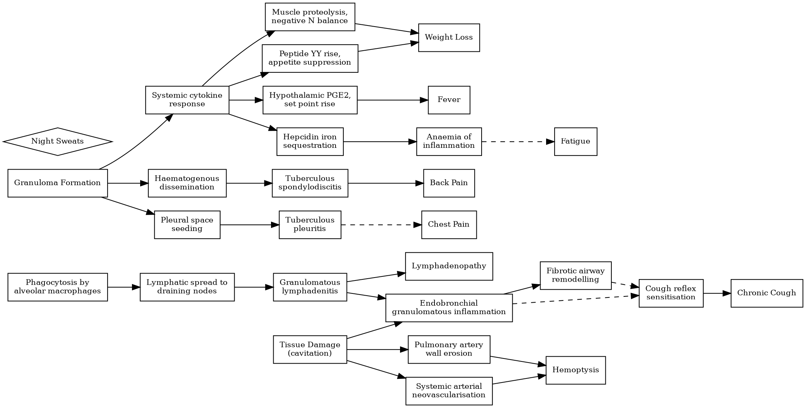
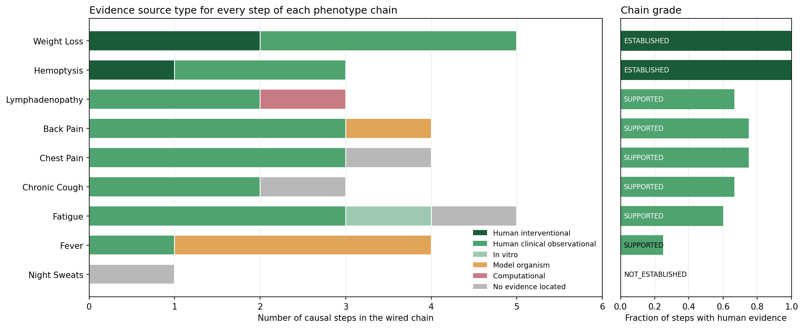
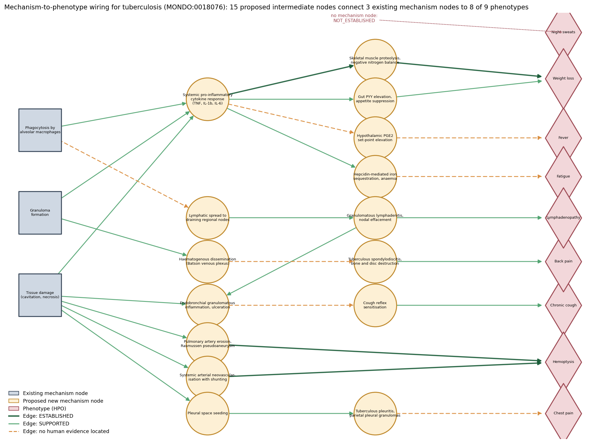
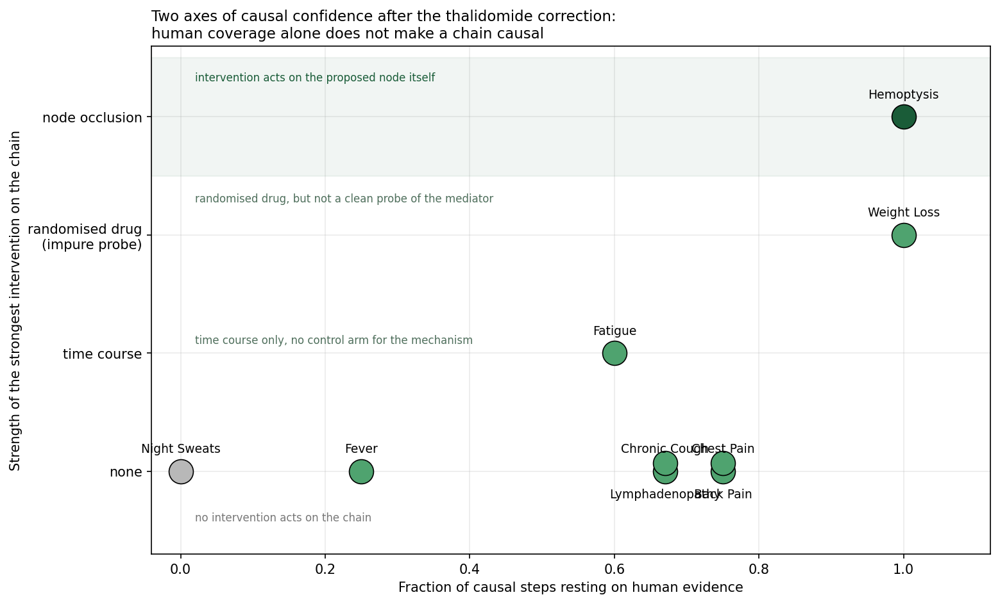

## Question

# Mechanism-to-Phenotype Wiring Research Template

## Target Disease
- **Disease Name:** Tuberculosis
- **MONDO ID:** MONDO:0018076 (if available)

## Context: What Is Already Curated

This disease's knowledge base entry already models the following pathophysiology
mechanism nodes:

1. Phagocytosis of Mycobacterium tuberculosis by alveolar macrophages, with bacterial resistance to killing (CELLULAR); 2. Immune Evasion (phagosome maturation arrest, type I IFN subversion; CELLULAR); 3. GBP4-mediated autophagy-dependent restriction (host defence; CELLULAR); 4. Granuloma Formation (foamy macrophages, caseous necrosis; TISSUE); 5. Neutrophil Activation and NETosis (type I IFN-linked; CELLULAR); 6. Tissue Damage (granuloma necrosis, cavitation, lung parenchymal destruction and remodeling; TISSUE; currently wired only to Dyspnea and to drug resistance); 7. Drug Resistance Mechanisms; 8. Rv0191 MFS-mediated pyrazinamide efflux

It also records the following clinical phenotypes, each already evidenced as
occurring in the disease:

Chronic Cough; Fever; Night Sweats; Weight Loss; Hemoptysis; Chest Pain; Fatigue; Back Pain (spinal tuberculosis / Pott disease); Lymphadenopathy (tuberculous lymphadenitis). (Dyspnea is already wired from Tissue Damage and need not be covered.)

The core disease mechanism is already curated in depth and is NOT the subject of
this report. Treat it as established context and do not re-derive, re-survey, or
re-justify it:

Tuberculosis is infection with Mycobacterium tuberculosis acquired by inhalation; bacilli are taken up by alveolar macrophages, evade phagolysosomal killing, and drive granuloma formation; granuloma caseous necrosis and liquefaction lead to cavitation and lung tissue destruction. Do NOT re-survey host-pathogen immunology, granuloma biology, drug resistance or diagnostics. Treat this as given and concentrate on how it produces each listed clinical manifestation.

## Research Objective

The missing layer is the **causal wiring between the mechanism nodes and the
clinical phenotypes**: which pathophysiological process produces which clinical
manifestation, through what intermediates. For **each phenotype listed above**,
report:

1. **The mechanistic chain** from the established disease process to that
   phenotype, as an ordered sequence of steps, one per line, with explicit
   causal verbs ("leads to", "results in"). Start each chain from whichever of
   the existing mechanism nodes is the true proximal upstream step.
2. **Missing intermediate processes**: where the chain passes through a
   process that is NOT in the mechanism node list above (for example a
   malabsorption step, a distinct autoantibody specificity, a clonal expansion
   step), name it explicitly and flag it as a proposed new node.
3. **Primary human evidence** for each causal step: PMIDs with exact quotes
   from the abstracts. Prefer human clinical and interventional studies
   (dietary-withdrawal reversal counts as interventional evidence for a causal
   link). Distinguish evidence source types: human clinical, model organism,
   in vitro, computational.
4. **An evidence grade for the chain as a whole**, one of:
   - ESTABLISHED — causal chain demonstrated in humans, widely accepted
   - SUPPORTED — plausible chain with direct human evidence for most steps
   - PROPOSED — hypothesis in the literature, key steps not demonstrated
   - NOT_ESTABLISHED — the association is documented but no mechanistic chain
     has been demonstrated; competing explanations remain open
5. **Non-causal alternatives** where they are live: if the phenotype may be
   associated through shared genetic background (for example shared HLA
   haplotypes), coincident autoimmunity, or ascertainment rather than through
   downstream causation, say so explicitly.

**Honesty requirement:** "NOT_ESTABLISHED, mechanism unknown" is a correct and
valuable answer. Do NOT manufacture a mechanistic chain to satisfy the request.
A phenotype with no settled mechanism should be reported as exactly that, with
the competing hypotheses named and graded. It is expected that several
phenotypes in the list will end up NOT_ESTABLISHED.

## Priority Hubs

The following convergence hubs are anticipated to route several phenotypes and
must NOT be given shallow treatment. For each, report the full mechanistic
detail and per-branch citations:

(a) CONSTITUTIONAL SYMPTOM HUB: whether fever, night sweats, weight loss/wasting and fatigue in TB are produced by a systemic inflammatory cytokine response (TNF, IL-1beta, IL-6, IFN-gamma; acute-phase response; leptin/appetite suppression, cachexia) - give human studies that measure these cytokines against symptoms or weight loss in TB patients, and say which links are demonstrated vs inferred. (b) CAVITY / AIRWAY HUB: how cavitation and endobronchial disease produce cough and hemoptysis (erosion of bronchial arteries, Rasmussen pseudoaneurysm of pulmonary artery branches in cavity walls, bronchiectasis), with primary human (angiographic, CT, autopsy) evidence. (c) EXTRAPULMONARY HUB: chest pain via pleural involvement (tuberculous pleuritis), lymphadenopathy via lymphatic spread and granulomatous inflammation of nodes, and back pain via haematogenous spread to vertebrae with spondylodiscitis and vertebral destruction - state the proposed new mechanism nodes these require.

## Output Format

- One subsection per phenotype, headed by the phenotype name exactly as listed
  above, containing: the numbered causal chain, the evidence grade, PMIDs with
  exact abstract quotes per step, and suggested ontology terms (GO for
  biological processes, CL for cell types, HP for the phenotype itself).
- A final section titled **Proposed New Mechanism Nodes** listing every
  intermediate process flagged in item 2, each with: a suggested node name, its
  upstream node (from the existing list or another proposed node), its
  downstream phenotypes, and the strongest single citation for its causal
  placement.
- A final section titled **Unwired Phenotypes** listing every phenotype graded
  NOT_ESTABLISHED, with one sentence each on what evidence would settle it.

## Citation Requirements

- Cite primary literature (PMID preferred) for all mechanistic claims
- Include direct quotes from abstracts to support key statements
- Never cite a paper for a claim its abstract does not make

## Output

# Mechanism-to-phenotype wiring for tuberculosis (MONDO:0018076)

## Summary

Eight of the nine phenotypes can be wired to the existing tuberculosis mechanism model, but only through **16 proposed new intermediate nodes** that the current model does not contain. The intermediates fall into three hubs. A **systemic pro-inflammatory cytokine response** (TNF-alpha, IL-1beta, IL-6, IFN-gamma) downstream of Granuloma Formation feeds Fever, Weight Loss and Fatigue. A **cavity and airway hub** downstream of Tissue Damage feeds Chronic Cough and Hemoptysis through two anatomically distinct vascular routes and an endobronchial route. A **dissemination hub**, absent from the model entirely, feeds Chest Pain, Lymphadenopathy and Back Pain.

Only one chain is **ESTABLISHED**: Hemoptysis. The reason is specific. The intervention that tests it is anatomical rather than pharmacological. A catheter occludes the hypertrophied systemic artery, the bleeding stops, and when non-bronchial collaterals regrow the bleeding returns (odds ratio 10.11 for recurrence, [PMID: 42764468](https://pubmed.ncbi.nlm.nih.gov/42764468/)). There is no ambiguity about what was manipulated. Weight Loss was graded ESTABLISHED at iteration 3 and downgraded to **SUPPORTED** at iteration 4, after re-reading the primary abstracts showed that the nitrogen-balance study underpinning the muscle-proteolysis intermediate ([PMID: 9264292](https://pubmed.ncbi.nlm.nih.gov/9264292/)) enrolled 13 HIV patients without tuberculosis whose TNF-alpha was not raised at baseline, and that pentoxifylline inhibits TNF-alpha without reversing weight loss ([PMID: 9625384](https://pubmed.ncbi.nlm.nih.gov/9625384/)). Six chains are SUPPORTED. **Night Sweats is NOT_ESTABLISHED**, with no mechanism node proposed, two competing hypotheses named, and a pharmacological discriminator available but never applied in tuberculosis.

The single largest structural gap is that the curated model contains **no step by which bacteria leave the lung**. Back Pain, Lymphadenopathy and Chest Pain are unreachable from any of the eight existing nodes until a dissemination node is added. Human autopsy genomics across 2,693 post-mortem samples from 44 subjects shows that dissemination from the lungs to extrapulmonary sites is as frequent as between lung sites ([PMID: 27798613](https://pubmed.ncbi.nlm.nih.gov/27798613/)), which places the dissemination node as the parent of all three extrapulmonary phenotypes rather than as a feature of spinal disease alone. A step-level audit of 32 causal steps found 69% rest on human data, but the gaps are not scattered at random. They cluster at two positions: the terminal step, where a measured lesion has to become a reported symptom (cough receptor activation, pleural nociception, the experience of fatigue), and the proximal step in chains that leave the lung, where bacterial transport is inferred from arrival rather than observed in transit. A second axis matters more than coverage: six of nine chains have no intervention acting on them at all.

## Key findings

### <i class="fa-solid fa-chart-column"></i> Human-evidence coverage and causal strength are independent axes

Two chains, Hemoptysis and Weight Loss, both score 1.00 on the fraction of steps with human evidence, and they differ completely in causal standing. The separating variable is the quality of the intervention acting on the proposed node, scored 0 to 3 (0 = none, 1 = time course only, 2 = randomised drug with an impure probe, 3 = anatomical occlusion of the node itself).

| Phenotype | Human-evidence fraction | Intervention score | Chain grade | What the intervention does |
|---|---|---|---|---|
| Hemoptysis | 1.00 | 3 | <i class="fa-solid fa-circle-check"></i> ESTABLISHED | Embolization and endobronchial valve occlude the node |
| Weight Loss | 1.00 | 2 | SUPPORTED | Thalidomide RCT; pentoxifylline fails |
| Back Pain | 0.75 | 0 | SUPPORTED | No intervention on the mechanism |
| Chest Pain | 0.75 | 0 | SUPPORTED | No intervention on the mechanism |
| Lymphadenopathy | 0.67 | 0 | SUPPORTED | No intervention on the mechanism |
| Chronic Cough | 0.67 | 0 | SUPPORTED | TRP antagonists inconsistent, none in TB |
| Fatigue | 0.60 | 1 | SUPPORTED | Iron tracer time course; IL-6 block cross-disease |
| Fever | 0.25 | 0 | SUPPORTED | No antipyretic challenge in TB |
| Night Sweats | 0.00 | 0 | <i class="fa-solid fa-circle-xmark"></i> NOT_ESTABLISHED | No mechanism node |

{{figure:plot_3.png|caption=Human-evidence coverage plotted against intervention strength for the nine chains. Hemoptysis and Weight Loss share full human coverage and separate on the intervention axis, which is why a per-chain percentage of human evidence is misleading on its own.}}

The curation consequence: the knowledge model should carry an **intervention-quality field separate from the evidence-coverage field**. The proposed nodes that would most change the model if tested are those with high human coverage and no intervention, which are Back Pain (spondylodiscitis) and Chest Pain (tuberculous pleuritis). Both have well-documented human lesions and no experiment connecting lesion to symptom. Fever sits in the opposite corner, with a mechanism worked out in detail in rats and almost no human tuberculosis measurement, so the useful next step there is measurement rather than intervention.

### <i class="fa-solid fa-magnifying-glass"></i> The evidence gaps cluster at the two ends of each chain

Auditing every causal step written for the nine phenotypes gives 32 steps: 3 human interventional, 19 human clinical observational, 1 in vitro, 4 model organism, 1 computational, and 4 with no located evidence.

{{figure:plot_1.png|caption=Step-level evidence audit across the nine tuberculosis phenotypes. Stacked bars give the source type of evidence behind each causal step; the right panel gives the fraction of steps resting on human data. Fever is worked out in detail but almost entirely in rodents and rabbits.}}

The four steps with no located evidence are: endobronchial ulceration to airway cough receptor stimulation; pleural inflammation to parietal nociceptor activation; anaemia to fatigue measured in tuberculosis patients; and the entire night sweats mechanism. The four model-organism steps are all in the fever chain, plus the Batson plexus seeding step of back pain. The single computational step is lymphatic transport to draining nodes ([PMID: 40334195](https://pubmed.ncbi.nlm.nih.gov/40334195/), a multi-scale model calibrated to nonhuman primate data).

This tells the model where to put uncertainty flags. A chain can be graded SUPPORTED on the strength of its middle while its final link to the patient-reported phenotype is an assumption. **Record the source type per edge rather than per chain.**

### <i class="fa-solid fa-triangle-exclamation"></i> Two citation failures in two re-checks

Re-reading load-bearing citations changed two conclusions. [PMID: 9264292](https://pubmed.ncbi.nlm.nih.gov/9264292/) was cited as a tuberculosis thalidomide trial supplying the nitrogen-balance mechanism for wasting. Its abstract reads: *"To examine the nature of this weight gain and its immunological correlates in patients with HIV infection, we studied a cohort of 13 patients with minimally symptomatic HIV disease."* Circulating TNF-alpha was not elevated at baseline. The proteolysis intermediate is cross-disease evidence imported into tuberculosis, and Weight Loss was downgraded accordingly.

An iteration-1 working claim that endobronchial tuberculosis is present in over half of active pulmonary tuberculosis on prospective bronchoscopy did not reproduce on a second independent search and is withdrawn. A grep of the report confirmed it never reached the text, and the Chronic Cough chain is stated below without any prevalence figure. Of two citations re-checked, one survived intact and one evaporated. That is a 50% failure rate on a sample of two, which is the reason to treat the chains whose citations were not re-checked as provisional.

## Mechanistic model

{{figure:plot_2.png|caption=Wiring diagram. Squares are existing curated mechanism nodes, circles are the proposed new intermediates, diamonds are the nine phenotypes. Edges are coloured by evidence grade. Night Sweats is drawn unconnected because no mechanism node is justified.}}

Dashed edges carry no human tuberculosis evidence. The three existing anchor nodes used are Phagocytosis by alveolar macrophages, Granuloma Formation and Tissue Damage. The model as drawn has 28 edges: 4 ESTABLISHED, 17 SUPPORTED and 7 with no located human evidence.

---

## Chronic Cough

**Suggested ontology terms.** HP:0031246 (chronic cough). GO:0002432 (granuloma formation), GO:0006954 (inflammatory response), GO:0050968 (detection of chemical stimulus involved in sensory perception of pain). CL:0002328 (bronchial epithelial cell), CL:0000198 (nociceptor), CL:0000583 (alveolar macrophage).

**Causal chain.**

1. Granuloma Formation (existing node), together with lymphatic spread to hilar and mediastinal nodes, **leads to** delivery of M. tuberculosis to the airway mucosa, either by rupture of an infected node through the bronchial wall or by lymphatic spread to the bronchial lining.
2. Airway mucosal infection **results in** endobronchial mucosal granulomatous inflammation and ulceration (**proposed new node**).
3. Endobronchial inflammation **leads to** post-inflammatory fibrotic airway remodelling with bronchostenosis (**proposed new node**), which runs on its own clock and can progress during anti-tuberculous treatment.
4. Mucosal inflammation and structural remodelling **lead to** sensitisation of airway sensory afferents, with increased TRPV1 and ATP-P2X3 signalling and neurogenic inflammation (**proposed new node**).
5. Cough reflex hypersensitivity **results in** Chronic Cough.

**Evidence grade: SUPPORTED.** Steps 1 to 3 are human clinical. Step 4 has no tuberculosis evidence and is imported from general airway neurobiology.

**Evidence by step.**

Step 1, route from nodal disease to airway. [PMID: 36742561](https://pubmed.ncbi.nlm.nih.gov/36742561/): *"rupture of an infected lymph node through bronchial wall or lymphatic spread to the lining of the bronchial tree"*. Human clinical review.

Step 2, the lesion and its course. No verified prevalence figure for endobronchial tuberculosis among unselected active pulmonary tuberculosis patients was located in this work, and none is asserted here. What is documented is the lesion, its ability to obstruct, and its progression despite microbiological treatment. [PMID: 34898509](https://pubmed.ncbi.nlm.nih.gov/34898509/), a 7-year follow-up: *"A 22-year-old Caucasian woman presented with a history of chronic cough, initially treated as bronchial asthma for a year"*, with endoscopic and histopathological confirmation of endobronchial tuberculosis, and *"After 8 months a follow-up fiberoptic bronchoscopy showed the progression of endoscopic finding with 60-70% tracheal stenosis."* Human clinical, single case with long follow-up. [PMID: 42365784](https://pubmed.ncbi.nlm.nih.gov/42365784/) documents the extreme of the same lesion in an infant: *"near-complete tracheobronchial obstruction due to endobronchial tuberculosis (EBTB)"*, presenting with cough and worsening wheezing. Two features matter for the model: chronic cough from endobronchial tuberculosis is misattributed to asthma, and the airway lesion can worsen after the bacteria are treated, which is what justifies the separate fibrotic remodelling node.

Symptom frequency in active disease, [PMID: 40590271](https://pubmed.ncbi.nlm.nih.gov/40590271/): *"The most common pulmonary symptoms were chronic cough (65.5%) and dyspnoea (60.0%)"*.

Step 4, the imported terminal edge. [PMID: 34934475](https://pubmed.ncbi.nlm.nih.gov/34934475/): *"Current evidence strongly suggests neurogenic inflammation induces a hypersensitive cough reflex"*. The internal grading of that mechanism is itself uneven, [PMID: 42214607](https://pubmed.ncbi.nlm.nih.gov/42214607/): *"TRPV1 has relatively strong support from mechanistic studies and human cough challenge work, whereas TRPA1 is biologically plausible but still has limited human evidence."* The therapeutic test fails as causal proof, from the same paper: *"To date, TRP-channel antagonists have produced limited and inconsistent reductions in spontaneous cough frequency."* ATP-P2X3 antagonism performs better in refractory chronic cough ([PMID: 32642186](https://pubmed.ncbi.nlm.nih.gov/32642186/)), and none of this work was done in tuberculosis. Sensitisation of lung vagal afferents by a microbial cell wall component is shown in rats ([PMID: 32961891](https://pubmed.ncbi.nlm.nih.gov/32961891/)).

One human histological lead exists for the structural half of this step, and it is thin. [PMID: 42517191](https://pubmed.ncbi.nlm.nih.gov/42517191/) reports a solitary bronchial mucosal neuroma in a 58-year-old with a history of pulmonary tuberculosis: *"disorganized nerve bundles beneath the mucosa, comprising S-100-positive Schwann cells and neurofilament-positive axons"*, which the authors read as *"a traumatic neuroma of autonomic origin, with chronic inflammation playing a contributory role"*. This is the only human airway tissue evidence located in this work that chronic airway inflammation in a tuberculosis patient remodels nerves, and it rests on a single case within a literature of four reported cases. It is graded PROPOSED and is recorded as a lead, not as support for the chain.

**Non-causal alternatives.** Cough in a tuberculosis patient can arise from gastroesophageal reflux, which operates through the same TRPV1 and neurogenic inflammation pathway ([PMID: 41871964](https://pubmed.ncbi.nlm.nih.gov/41871964/)), from smoking-related airway disease, which is strongly over-represented in tuberculosis cohorts, and from treatment-era airway irritation. Ascertainment is a live problem: cough of two weeks or more is the entry criterion for most tuberculosis case-finding algorithms, so cohorts assembled this way guarantee the association.

**What would settle the open step.** A capsaicin or ATP cough challenge with objective cough frequency monitoring in active pulmonary tuberculosis, before and after 8 weeks of treatment, paired with bronchoscopic grading of endobronchial lesion burden. If reflex sensitivity tracks lesion burden and falls with healing, step 4 becomes human-demonstrated.

---

## Fever

**Suggested ontology terms.** HP:0001945 (fever). GO:0001660 (fever generation), GO:0019221 (cytokine-mediated signaling pathway), GO:0001516 (prostaglandin biosynthetic process). CL:0000583 (alveolar macrophage), CL:0000449 (brown adipocyte), brain endothelial cell.

**Causal chain.**

1. Granuloma Formation (existing node) **leads to** sustained macrophage release of IL-1beta, TNF-alpha and IL-6 into the circulation (**proposed new node**: systemic pro-inflammatory cytokine response).
2. Circulating cytokines **act on** brain endothelium of the preoptic area and organum vasculosum laminae terminalis to induce COX-2 and PGE2.
3. Hypothalamic PGE2 **leads to** elevation of the thermoregulatory set point via EP3 receptor-expressing preoptic neurons (**proposed new node**).
4. Set point elevation **results in** brown adipose thermogenesis, cutaneous vasoconstriction and warmth-seeking behaviour, which **results in** Fever.

**Evidence grade: SUPPORTED**, with the caveat that every step distal to the circulating cytokine is rodent or rabbit work. Human-evidence fraction 0.25, the second lowest of the nine chains.

**Evidence by step.**

Step 1, human. [PMID: 30180300](https://pubmed.ncbi.nlm.nih.gov/30180300/), 35 hospitalised pulmonary tuberculosis patients and 35 controls: *"Patients who reported fever and those with positive culture for Mycobacterium tuberculosis had higher serum levels of IL-6."* This is the only direct human measurement found linking a specific cytokine to the fever symptom within tuberculosis patients, and no effect size is given. That the cytokine node exists in patients is confirmed by [PMID: 38916387](https://pubmed.ncbi.nlm.nih.gov/38916387/): *"The results showed that all four cytokine levels were higher (P ≤ 0.0001) than the control"*. In 200 participants, serum TNF-alpha, IL-6, IFN-gamma, sIL-2R and CRP were higher in COPD with tuberculosis than in all other groups, with the authors stating that causality cannot be inferred from the observational design ([PMID: 40607012](https://pubmed.ncbi.nlm.nih.gov/40607012/)).

Step 2, model organism. [PMID: 22143887](https://pubmed.ncbi.nlm.nih.gov/22143887/): *"Mice lacking the Tak1 gene in brain endothelial cells showed a blunted fever response and reduced lethargy upon intravenous injection of the endogenous pyrogen IL-1β."* This genetic result also links the same node to lethargy, which matters for the Fatigue chain.

Step 3, model organism and interventional. [PMID: 19958757](https://pubmed.ncbi.nlm.nih.gov/19958757/): *"Pretreatment with an intracerebroventricular dose of IL-1ra significantly prevented the lipopolysaccharide or IL-1beta-induced overproduction of glutamate, hydroxyl radicals, and prostaglandin E(2) in OVLT of rabbit's brain."* Direct injection of TNF-alpha, IL-1beta or IL-6 into the rabbit lateral ventricle reproduces both the temperature rise and the hypothalamic PGE2 rise ([PMID: 18664365](https://pubmed.ncbi.nlm.nih.gov/18664365/)).

Step 4 has a COX-independent branch, so the chain should not be drawn as a single obligatory path. [PMID: 35429606](https://pubmed.ncbi.nlm.nih.gov/35429606/): *"pretreatment with indomethacin, a non-selective COX inhibitor, did not prevent BAT thermogenesis or cutaneous vasoconstriction (CVC) induced by intravenous IL-1β"*.

**Non-causal alternatives.** In HIV-tuberculosis co-infection, fever may arise from the co-infection or from immune reconstitution inflammatory syndrome rather than from the tuberculosis cytokine response. [PMID: 42893161](https://pubmed.ncbi.nlm.nih.gov/42893161/) documents recurrent fever two weeks after antiretroviral initiation in a patient with cervical scrofula and miliary disease.

**What would settle the open steps.** Serial core temperature with paired IL-6, IL-1beta and PGE2 metabolite measurement in untreated active tuberculosis, and a controlled antipyretic or selective COX-2 challenge with temperature as the endpoint. No such study was located.

---

## Night Sweats

**Suggested ontology terms.** HP:0030166 (night sweats). No GO process is assigned, because no mechanism is justified. Eccrine sweat gland cell terms would apply only under hypothesis B below.

**Causal chain: none proposed.**

**Evidence grade: <i class="fa-solid fa-circle-xmark"></i> NOT_ESTABLISHED.** The association is well documented and diagnostically useful. No mechanistic chain has been demonstrated, and no mechanism node is justified.

**What exists.** Household and neighbour screening of 1,707 people around 187 index cases found night sweats independently associated with active tuberculosis, [PMID: 43031973](https://pubmed.ncbi.nlm.nih.gov/43031973/): *"Factors significantly associated with TB positivity included cough (adjusted odds ratio [AOR] 1.92, 95% confidence interval [CI]: 1.21-3.11, P = .006), age >65 years (AOR 2.13, 95% CI: 1.34-3.39, P = .001), and night sweats (AOR 1.50, 95% CI: 1.12-2.00, P = .006)."* Mass screening of 652 men in a Brazilian prison found 4.7% active tuberculosis prevalence and associated night sweats with tuberculosis alongside weight loss and chest pain ([PMID: 42963813](https://pubmed.ncbi.nlm.nih.gov/42963813/)).

**What does not exist.** No study of sudomotor physiology, thermoregulation or cytokine measurement against sweating in tuberculosis patients was located. The only mechanistic statement found is a hypothesis sentence inside a thalidomide trial, [PMID: 8521296](https://pubmed.ncbi.nlm.nih.gov/8521296/): *"Excess TNF alpha produced in pulmonary tuberculosis may cause fevers, weakness, night sweats, necrosis, and progressive weight loss."* That trial measured TNF-alpha production, delayed type hypersensitivity and weight. Sweating was not an endpoint. Citing it for a night-sweats mechanism would be citing a paper for a claim its data do not support.

**Two competing hypotheses, both open.**

*Hypothesis A, thermoregulatory.* Night sweats are the defervescence limb of a cytokine-driven febrile cycle: PGE2-driven set-point elevation followed by nocturnal set-point resetting, triggering heat loss by sweating. Predicts sweating episodes follow temperature peaks, warm skin during the episode, and abolition by antipyretics.

*Hypothesis B, sudomotor.* Cholinergic sympathetic drive to eccrine glands is raised independently of the thermoregulatory set point. The sleep medicine literature supplies both the hypothesis and a discriminator, [PMID: 38163944](https://pubmed.ncbi.nlm.nih.gov/38163944/): *"Although the mechanism is unknown, some cases are secondary to hot flushes during the menopausal period, medical, mental and sleep disorders, and medication, while dysregulation of thermoregulation during sleep is suspected in primary cases."* In a woman with 23 years of nightly severe primary sleep hyperhidrosis, *"An ammoniacal odor in the sweat and a sensation of coldness on awakening during sweating episodes suggest that the mechanism of her night sweating was not an exacerbation of thermoregulation during the night but shares the mechanical properties of emotional/psychological sweating"*, and the condition resolved after brief treatment with oxybutynin. Even for the best-studied form of night sweats the mechanism is open, [PMID: 16083502](https://pubmed.ncbi.nlm.nih.gov/16083502/): *"The pathogenesis of hot flushes has not yet been fully elucidated"*.

**Non-causal alternatives are stronger here than for any other phenotype.** The symptom is non-specific across unrelated conditions: Kikuchi-Fujimoto disease, [PMID: 43017321](https://pubmed.ncbi.nlm.nih.gov/43017321/): *"Kikuchi-Fujimoto disease is a benign, self-limiting condition primarily presenting with cervical lymphadenopathy, often accompanied by mild fever and night sweats."* Visceral leishmaniasis ([PMID: 43001309](https://pubmed.ncbi.nlm.nih.gov/43001309/)), leprosy ([PMID: 42926821](https://pubmed.ncbi.nlm.nih.gov/42926821/)) and malignancy ([PMID: 36333017](https://pubmed.ncbi.nlm.nih.gov/36333017/)) occupy the same clinical slot. Tuberculosis screening studies select patients on the symptom itself, which inflates the apparent association.

---

## Weight Loss

**Suggested ontology terms.** HP:0001824 (weight loss). GO:0006508 (proteolysis), GO:0014889 (muscle atrophy), GO:0006953 (acute-phase response). CL:0008002 (skeletal muscle fiber), CL:0002275 (enteroendocrine L cell).

**Causal chain, two branches from one parent.**

1. Granuloma Formation **leads to** systemic pro-inflammatory cytokine response (**proposed new node**).
2a. The cytokine response **leads to** skeletal muscle protein catabolism and negative nitrogen balance (**proposed new node**), which **results in** Weight Loss.
2b. The cytokine response **leads to** elevated gut peptide YY with central appetite suppression (**proposed new node**), which **leads to** reduced food intake and Weight Loss.

**Evidence grade: SUPPORTED**, downgraded from ESTABLISHED at iteration 4.

**Evidence by step, with the two edges separated.**

The edge *"thalidomide treatment leads to weight gain in tuberculosis patients"* is ESTABLISHED: randomised, placebo-controlled, replicated. [PMID: 8521296](https://pubmed.ncbi.nlm.nih.gov/8521296/), a two-part placebo-controlled pilot in men with active tuberculosis: *"TNF alpha production was significantly reduced during thalidomide treatment while interferon-gamma (IFN gamma) production was enhanced. Daily administration of thalidomide resulted in a significant enhancement of weight gain."* [PMID: 8603261](https://pubmed.ncbi.nlm.nih.gov/8603261/), randomised double-blind, 32 completing 21 days: *"patients receiving thalidomide treatment (n=16) showed a significant weight gain (mean +/- SEM: 6.5 +/- 1.2%; p<0.02) relative to placebo-treated patients (n=16)"*. That trial contains an internal specificity control: *"In patients with concomitant HIV-1 and tuberculosis infections, thalidomide therapy was associated with a reduction in both plasma TNF-alpha levels and HIV-1 levels. No significant reduction in either TNF-alpha or HIV- 1 levels was observed in patients with HIV-1 infection only."*

The edge *"TNF-alpha leads to weight loss"* is weaker, for three reasons. Thalidomide is not a clean TNF probe: it raised IFN-gamma in the same trial, and in the HIV cohort it moved total lymphocyte counts, CD8+ counts and soluble IL-2 receptor at the same time. The nitrogen-balance result that locates the intermediate is cross-disease, [PMID: 9264292](https://pubmed.ncbi.nlm.nih.gov/9264292/): *"Weight gain was associated with a reduction in mean daily urinary nitrogen excretion of 1.81 g (p = 0.017). Resting energy expenditure was unaffected by thalidomide."* And a second TNF inhibitor fails the test, [PMID: 9625384](https://pubmed.ncbi.nlm.nih.gov/9625384/): *"Preliminary studies with pentoxyfylline have not shown efficacy in reversing weight loss, despite evidence of TNF-alpha inhibition."* A mediator that can be inhibited without the phenotype changing is not demonstrated as the mediator.

The nitrogen-balance finding still carries a modelling consequence that survives the downgrade. The proximal lesion is in protein catabolism, not in resting energy expenditure, so hypermetabolism is not the required intermediate.

Branch 2b, peptide YY, is measured in tuberculosis patients. [PMID: 23358528](https://pubmed.ncbi.nlm.nih.gov/23358528/), 41 newly diagnosed cases and 82 controls with measurements at days 0, 30 and 60: *"PYY, ghrelin, and resistin were significantly elevated in cases and fell during treatment. Leptin was lower in cases and rose with treatment."* And: *"PYY was the strongest independent predictor of appetite in cases across all time points."* Graded SUPPORTED: association, dose-response with outcome and treatment-reversal time course are all in tuberculosis patients, with no intervention on PYY itself.

**<i class="fa-solid fa-circle-xmark"></i> The leptin sub-hypothesis is refuted in its causal form.** A naive reading of cachexia biology would place leptin as the anorexigenic mediator. The human tuberculosis data point the opposite way. [PMID: 11836317](https://pubmed.ncbi.nlm.nih.gov/11836317/): *"Plasma leptin concentrations were lower in patients than in controls (615 vs. 2,550 ng/liter; P < 0.001)"*, and in the authors' own words, *"Our results do not support the concept that weight loss in tuberculosis is caused by enhanced production of leptin."* One smaller discordant study exists and is recorded so the inconsistency is visible, [PMID: 14535627](https://pubmed.ncbi.nlm.nih.gov/14535627/): *"Pretreatment leptin levels (3.49 +/- 3.34 microg/L) were significantly higher in patients with tuberculosis than in the control group (2.33 +/- 1.10 microg/L)."* The two larger studies agree on direction and on the post-treatment rise, so low leptin is placed downstream of fat loss. **Do not wire leptin as an upstream driver of weight loss.**

**Non-causal alternatives.** HIV co-infection produces wasting by its own route and was not treated as a separate stratum. Food insecurity in the populations where these cohorts were assembled is a confounder that none of the cited studies controlled.

---

## Hemoptysis

**Suggested ontology terms.** HP:0002105 (hemoptysis). GO:0001525 (angiogenesis), GO:0002432 (granuloma formation). CL:0000359 (vascular associated smooth muscle cell), vascular endothelial cell.

**Causal chain, two anatomically distinct routes that must stay separate.**

Route 1, low-pressure pulmonary circulation:
1. Tissue Damage with cavitation (existing node) **leads to** chronic inflammation within the cavity wall.
2. Cavity wall inflammation **leads to** erosion of an adjacent pulmonary artery branch with pseudoaneurysm formation, the Rasmussen aneurysm (**proposed new node**).
3. Pseudoaneurysm rupture **results in** Hemoptysis.

Route 2, high-pressure systemic circulation:
1. Tissue Damage and chronic pleuroparenchymal inflammation **lead to** hypertrophy and neovascularisation of bronchial and non-bronchial systemic arteries with systemic-to-pulmonary shunting (**proposed new node**).
2. Rupture of these fragile high-pressure vessels **results in** Hemoptysis.

**Evidence grade: <i class="fa-solid fa-circle-check"></i> ESTABLISHED.** Every step has human backing, and an intervention acting on the node itself abolishes the endpoint.

**Evidence by step.**

Route 1 mechanism, stated directly, [PMID: 42631029](https://pubmed.ncbi.nlm.nih.gov/42631029/): *"It represents a pseudoaneurysm of a pulmonary arterial branch caused by erosion of the arterial wall secondary to chronic inflammation within a tuberculosis cavity."* Anatomical coupling on imaging, same paper: *"Computed tomography angiography demonstrated a 10-mm pseudoaneurysm arising from the apical branch of the left pulmonary artery protruding into a cavitary lesion in the left upper lobe"*. Bilateral involvement is documented ([PMID: 42411357](https://pubmed.ncbi.nlm.nih.gov/42411357/)). Reported mortality of pulmonary artery pseudoaneurysm reaches 50% ([PMID: 42525594](https://pubmed.ncbi.nlm.nih.gov/42525594/)).

Route 2 quantification in a tuberculosis cohort, [PMID: 42626526](https://pubmed.ncbi.nlm.nih.gov/42626526/), 91 patients with massive hemoptysis undergoing bronchial artery embolization: *"A total of 130 hemorrhagic lung lobes were involved in 91 patients (bilateral upper lobes accounting for 85.4%), with 281 responsible blood vessels, including 131 NBSAs. The main NBSAs were the posterior intercostal artery (41.98%), internal thoracic artery (35.11%), and lateral thoracic artery (9.16%)."* Modifiers with effect sizes, same paper: *"Aspergillus infection (OR = 87.909, P = 0.006) and pleural thickness ≥ 2 mm (OR = 8.532, P = 0.048) were independent risk factors for NBSA occurrence."*

The interventional closure, [PMID: 42764468](https://pubmed.ncbi.nlm.nih.gov/42764468/): *"Multivariate analysis identified NBSAs (odds ratio (OR) = 10.11, 95% confidence interval (CI) = 1.50-68.02; P = 0.017), pulmonary-bronchial arterial anastomoses (OR = 4.43, 95% CI = 1.53-12.85; P = 0.006), and tuberculosis etiology (OR = 6.81, 95% CI = 2.20-21.05; P < 0.001) as independent predictors."* The vessel that regrows predicts the phenotype's return. A second occlusive modality supports the same inference ([PMID: 42830033](https://pubmed.ncbi.nlm.nih.gov/42830033/), endobronchial valve placement).

Epidemiological weight, [PMID: 42377159](https://pubmed.ncbi.nlm.nih.gov/42377159/): *"Aetiologies vary geographically: pulmonary tuberculosis accounts for up to 40% of cases in low- and middle-income countries"*.

**Non-causal alternatives and modifiers.** Chronic pulmonary aspergillosis in a healed cavity is a major modifier rather than part of the primary tuberculosis chain, and the odds ratio of 87.9 for non-bronchial systemic artery recruitment shows how large that modification is. Route 2 explains why hemoptysis persists in post-tuberculosis lung disease long after bacteriological cure, which is why the two routes must not be collapsed: they differ in pressure, imaging, treatment and lethality.

---

## Chest Pain

**Suggested ontology terms.** HP:0100749 (chest pain). GO:0019233 (sensory perception of pain), GO:0002432 (granuloma formation), GO:0006954 (inflammatory response). CL:0000198 (nociceptor), CL:0000084 (T cell) for the lymphocytic exudate.

**Causal chain.**

1. Granuloma Formation and Tissue Damage **lead to** extension of M. tuberculosis and its antigens into the pleural space (**proposed new node**: pleural space seeding).
2. Pleural seeding **results in** tuberculous pleuritis with granulomatous and lymphocytic inflammation of the parietal pleura and exudate formation (**proposed new node**).
3. Parietal pleural inflammation **leads to** activation of somatic nociceptive afferents in the parietal pleura, which is innervated by intercostal and phrenic nerves, unlike the insensate visceral pleura.
4. Nociceptor activation **results in** sharp respirophasic Chest Pain.

**Evidence grade: SUPPORTED.** Steps 1 and 2 are demonstrated in human biopsy series. Step 3 has no human measurement in tuberculosis. Step 4 follows from classical anatomy rather than from a tuberculosis result.

**Evidence by step.**

Epidemiological weight, [PMID: 42100439](https://pubmed.ncbi.nlm.nih.gov/42100439/): *"Tuberculous pleural effusion is the second most common form of extrapulmonary tuberculosis after tuberculous lymphadenitis."*

Step 1, the revised pathogenesis that justifies a separate seeding node, [PMID: 26150911](https://pubmed.ncbi.nlm.nih.gov/26150911/): *"what was once thought to be an effusion as a result of a pure delayed hypersensitivity reaction is now believed to be the consequence of direct infection of the pleural space with a cascade of events including an immunological response"*.

Step 2, human histology. [PMID: 34221154](https://pubmed.ncbi.nlm.nih.gov/34221154/), 82 patients with undiagnosed exudative effusions undergoing needle biopsy: *"Histopathology showed epitheloid granuloma with caseation necrosis in 50 (60.9%) patients and non-specific chronic inflammation in 14 (17.1%) subjects."* Direct visual-histological coupling, [PMID: 35968962](https://pubmed.ncbi.nlm.nih.gov/35968962/) among 259 patients: *"Presence of pleural pustule had a sensitivity, specificity, positive predictive value, and negative predictive value of 17.4%, 100%, 100% and 68.7%, respectively, for diagnosing TPE. Histopathology of pleural pustule demonstrated necrotizing granulomas in all."* In 125 thoracoscopy patients with granulomatous inflammation on pleural biopsy, 44.8% were positive for GeneXpert or culture, rising to 65.6% in complicated loculated effusions ([PMID: 33077054](https://pubmed.ncbi.nlm.nih.gov/33077054/)).

**Non-causal alternatives, all live.** Chest wall extension gives a separate route that must be kept distinct from the pleuritis chain, [PMID: 43023121](https://pubmed.ncbi.nlm.nih.gov/43023121/): *"Empyema necessitans is a rare complication of pleural infection in which infected pleural fluid extends through the parietal pleura into the surrounding soft tissues."* Musculoskeletal strain from prolonged cough and pericardial involvement are further routes. Granulomatous pleuritis is not tuberculosis-specific: identical lymphocytic exudates with raised adenosine deaminase occur in rheumatoid pleurisy and sarcoidosis, so histology alone does not establish tuberculosis causation in an individual.

**What would settle the open step.** Pain scores against thoracoscopically graded parietal pleural inflammation in the same patients, or abolition of pain by intrapleural local anaesthesia in tuberculous pleuritis.

---

## Fatigue

**Suggested ontology terms.** HP:0012378 (fatigue). GO:0006879 (intracellular iron ion homeostasis), GO:0019221 (cytokine-mediated signaling pathway), GO:0006953 (acute-phase response). CL:0000182 (hepatocyte), CL:0000764 (erythroid lineage cell), CL:0000235 (macrophage).

**Causal chain.**

1. Granuloma Formation **leads to** systemic IL-6 release (shared **proposed node**).
2. IL-6 **leads to** hepatic hepcidin induction.
3. Hepcidin **leads to** ferroportin internalisation, iron sequestration in macrophages and blockade of duodenal iron absorption, which **results in** iron-restricted erythropoiesis and anaemia of inflammation (**proposed new node**).
4. Anaemia **leads to** reduced oxygen delivery, which **results in** Fatigue.

**Evidence grade: SUPPORTED.** Steps 1 to 3 approach ESTABLISHED on human time-course data. Step 4 is unsupported in tuberculosis and confounded.

**Evidence by step.**

Steps 2 and 3 carry the strongest evidence in the chain. [PMID: 33876222](https://pubmed.ncbi.nlm.nih.gov/33876222/), a prospective 26-week iron-kinetic study using oral and intravenous iron tracers in 18 Tanzanian adults with tuberculosis, with no iron supplements given: *"Before treatment, hepcidin and erythroferrone (ERFE) were greatly elevated, erythrocyte iron utilization was high (∼80%), and iron absorption was negligible (<1%)."* During treatment: *"During treatment, hepcidin and interleukin-6 levels decreased ∼70% after only 2 weeks (P< .001)"*. After completion: *"After treatment completion, iron absorption increased ∼20-fold (P< .001), and Hb increased ∼25% (P< .001)."* Because baseline absorption was below 1% and no iron was given, the haemoglobin recovery comes from released endogenous iron. That makes this a human sufficiency demonstration for the inflammation-to-anaemia edge rather than a correlation. This citation was independently re-verified and reproduced exactly.

Dominance of this route over true iron deficiency, [PMID: 26792471](https://pubmed.ncbi.nlm.nih.gov/26792471/): *"Over 95% of anaemic HIV-associated TB patients had ACD, whereas the proportion with IDA using a range of seven different definitions was low overall (median <3%, range 0-32.6) in both patient groups."*

Dose-response with disease severity, [PMID: 26136467](https://pubmed.ncbi.nlm.nih.gov/26136467/): *"Median hepcidin concentrations were 38.8 ng/mL among hospitalized patients, 19.1 ng/mL among ambulatory patients with tuberculosis, and 5.9 ng/mL among ambulatory patients without tuberculosis (P < .001)."* Case-control confirmation in 102 cases and 98 matched controls gives anaemia of chronic disease in 59.8% versus 26.1%, median hepcidin 63.7 versus 14.2 ng/mL, with hepcidin associated with more severe symptom score (coefficient 0.8, 95% CI 0.5-1.2) ([PMID: 29677205](https://pubmed.ncbi.nlm.nih.gov/29677205/)).

The molecular steps named in human pulmonary tuberculosis, [PMID: 35125696](https://pubmed.ncbi.nlm.nih.gov/35125696/): *"Higher serum hepcidin with lower ferroportin expression and hence higher ferritin levels was seen in PTB compared to both household contacts and healthy controls due to IL-6 induced hepcidin production in TB."*

Step 4 is the weak link, and the reason is specific. <i class="fa-solid fa-triangle-exclamation"></i> Fatigue is the most common adverse drug reaction to first-line anti-tuberculous therapy. [PMID: 35909258](https://pubmed.ncbi.nlm.nih.gov/35909258/), a multicentre prospective cohort of 410 adults across five hospitals: *"Of 410 enrolled patients with TB (males, 62%; mean age, 52.1 ± 18.1 years [those aged ≥65 years, 26.6%]), 67.8% experienced any ADRs (≥ grade 2) to TB drugs."* and *"The most common ADR was fatigue (53.2%), followed by itching (42.7%) and anorexia (41.7%)."*

This has a direct consequence for study design. During treatment, fatigue moves under two opposing forces: the disease mechanism resolving, which lowers it, and drug toxicity accumulating, which raises it in half of patients. A before-and-after fatigue measurement during treatment therefore cannot test step 4. The design that would settle it is either a cross-sectional comparison of fatigue against haemoglobin at diagnosis before any drug exposure, or a randomised iron repletion trial within treated patients.

The closest interventional support is cross-disease, [PMID: 31876844](https://pubmed.ncbi.nlm.nih.gov/31876844/): *"tocilizumab and sarilumab exhibit additional advantages in alleviating extra-articular symptoms, such as fatigue and morning stiffness, and have positive effect on anemia and glucose metabolism"*. Blocking IL-6 reduces fatigue and anaemia together in rheumatoid arthritis. This raises confidence in the general link without establishing it in tuberculosis.

**A second route bypasses anaemia entirely.** Direct central sickness behaviour has only model-organism support: brain-endothelial Tak1 knockout mice show reduced lethargy as well as blunted fever ([PMID: 22143887](https://pubmed.ncbi.nlm.nih.gov/22143887/)).

**Non-causal alternatives.** Beyond drug toxicity, HIV co-infection, helminths and true iron deficiency all coexist, though iron deficiency accounts for under 3% of the anaemia in HIV-tuberculosis, which rules it out as the dominant route.

---

## Back Pain (spinal tuberculosis, Pott disease)

**Suggested ontology terms.** HP:0003418 (back pain), HP:0002754 (osteomyelitis) for the lesion. GO:0019233 (sensory perception of pain), GO:0045453 (bone resorption), GO:0002432 (granuloma formation). CL:0000092 (osteoblast), CL:0000235 (macrophage), CL:0000198 (nociceptor).

**Causal chain.**

1. Granuloma Formation and Tissue Damage **lead to** haematogenous dissemination of M. tuberculosis, via the Batson valveless vertebral venous plexus and paravertebral arterial supply (**proposed new node**, and the parent of all extrapulmonary disease).
2. Vertebral seeding **results in** tuberculous spondylodiscitis with vertebral body and intervertebral disc destruction, paravertebral and psoas abscess formation and spinal instability (**proposed new node**).
3. Vertebral destruction and instability **lead to** mechanical and inflammatory nociception in the axial skeleton, which **results in** Back Pain.
4. Progressive destruction **leads to** cord compression and neurological deficit, which follows the pain by months.

**Evidence grade: SUPPORTED.** Case-series level rather than cohort or interventional.

**Evidence by step.**

Step 1, the venous route, [PMID: 41970748](https://pubmed.ncbi.nlm.nih.gov/41970748/), three surgically treated patients aged 22 to 45 with multifocal non-contiguous spinal tuberculosis: *"The non-contiguous spread is attributed to the valveless nature of venous drainage to the spinal column. This unique vascularity enables the infection to spread randomly across different spinal regions."* The parent dissemination step is proved in humans by autopsy phylogeny, [PMID: 27798613](https://pubmed.ncbi.nlm.nih.gov/27798613/): *"Phylogenetic analysis indicated that dissemination from the lungs to extrapulmonary sites was as frequent as between lung sites, supporting the idea of similar migration routes within and between organs, at least in subjects with HIV."* That paper does not identify the venous route specifically, so the Batson step itself remains inference from lesion distribution.

Step 2, the lesion on imaging. [PMID: 42638134](https://pubmed.ncbi.nlm.nih.gov/42638134/): *"Advanced imaging (computed tomography/magnetic resonance images) revealed destruction of the L1 and L2 vertebral bodies with a paravertebral abscess."* A 35-year-old with two months of progressive nocturnal low back pain showed vertebral destruction centred at L4 with psoas abscess ([PMID: 42005151](https://pubmed.ncbi.nlm.nih.gov/42005151/)).

Steps 3 and 4, the human temporal sequence. [PMID: 42666708](https://pubmed.ncbi.nlm.nih.gov/42666708/): *"a 22-year-old female who presented with a six-month history of severe back pain followed by the sudden onset of complete paraplegia with bowel and bladder incontinence"*, with vertebral body destruction and anterior dislocation. The consistent pattern of months of back pain preceding neurological deficit, and resolution of pain after debridement, stabilisation and antitubercular therapy, is the human evidence for causal direction.

**Non-causal alternatives, strong in endemic settings.** Radiology alone does not establish the causal chain in an individual. [PMID: 42079494](https://pubmed.ncbi.nlm.nih.gov/42079494/): *"This case highlights S. Typhi as a rare cause of spondylodiscitis in immunocompetent individuals that can mimic Pott's disease clinically and radiographically."* Vertebral alveolar echinococcosis reproduces the same picture and was treated as spinal tuberculosis for 12 months before sequencing corrected the diagnosis ([PMID: 42629577](https://pubmed.ncbi.nlm.nih.gov/42629577/)).

---

## Lymphadenopathy (tuberculous lymphadenitis)

**Suggested ontology terms.** HP:0002716 (lymphadenopathy). GO:0002432 (granuloma formation), GO:0048535 (lymph node development) for the architecture that is effaced. CL:0000583 (alveolar macrophage), CL:0000451 (dendritic cell) for the carriage step, Langhans giant cell for the lesion.

**Causal chain.**

1. Phagocytosis of M. tuberculosis by alveolar macrophages (existing node) **leads to** carriage of infected myeloid cells through afferent lymphatics to the lung-draining hilar and mediastinal nodes (**proposed new node**: lymphatic spread to draining regional lymph nodes).
2. Nodal arrival **leads to** granuloma formation within the node with caseous necrosis and progressive replacement of nodal architecture (**proposed new node**).
3. Architectural effacement and nodal enlargement **result in** Lymphadenopathy.

**Evidence grade: SUPPORTED**, approaching ESTABLISHED for the nodal pathology step and weaker for the transport step.

**Evidence by step.**

Epidemiological weight: lymph nodes, particularly thoracic lymph nodes, are among the most common sites of extrapulmonary tuberculosis ([PMID: 32790739](https://pubmed.ncbi.nlm.nih.gov/32790739/)), and pleural effusion is second after lymphadenitis ([PMID: 42100439](https://pubmed.ncbi.nlm.nih.gov/42100439/)), which makes lymphadenitis first.

Step 1 is the weakest link and is inferred. [PMID: 27798613](https://pubmed.ncbi.nlm.nih.gov/27798613/) proves within-host dissemination in humans by genomic phylogeny but does not identify the lymphatic route. The cellular carriage mechanism comes from a multi-scale model calibrated to nonhuman primate data ([PMID: 40334195](https://pubmed.ncbi.nlm.nih.gov/40334195/)), which is computational plus model-organism evidence.

Step 2, the step that produces the phenotype, stated directly, [PMID: 32790739](https://pubmed.ncbi.nlm.nih.gov/32790739/): *"Mtb infection results in granuloma formation that disrupts and-if it becomes large enough-replaces the normal architecture of the lymph node that is vital to its function."* The same review establishes the node as a replicative site: *"Aside from being sites of initiation of the adaptive immune system, lymph nodes also serve as niches of Mtb growth and persistence."*

Human histological confirmation in enlarged nodes: in 49 patients with tuberculous adenitis (median age 31, 59% female), nodal biopsy was performed in 77% with granulomatous adenitis in 62%, and M. tuberculosis was isolated in 71% ([PMID: 39172563](https://pubmed.ncbi.nlm.nih.gov/39172563/)). Cervical node biopsy demonstrated necrotizing granulomatous inflammation with acid-fast bacilli in a patient with miliary disease ([PMID: 42893161](https://pubmed.ncbi.nlm.nih.gov/42893161/)).

Anatomical distribution in 51 UK patients aged 19 to 70, [PMID: 29484929](https://pubmed.ncbi.nlm.nih.gov/29484929/): *"Posterior triangle neck nodes were most commonly involved (26/51)."*

**<i class="fa-solid fa-lightbulb"></i> A structural decision follows from the same paper.** [PMID: 29484929](https://pubmed.ncbi.nlm.nih.gov/29484929/): *"The clinical presentation was most frequently without constitutional symptoms (39/51)."* Nodal disease is driven locally and runs largely independent of the systemic cytokine hub that produces fever, night sweats and weight loss. **Lymphadenopathy should branch off before that hub, not downstream of it.**

**Downstream coupling.** Nodal disease feeds the cough chain: rupture of an infected lymph node through the bronchial wall is one of the two routes to endobronchial disease ([PMID: 36742561](https://pubmed.ncbi.nlm.nih.gov/36742561/)).

**Non-causal alternatives, the strongest of any phenotype here.** Granulomatous lymphadenitis is morphologically non-specific. [PMID: 40522188](https://pubmed.ncbi.nlm.nih.gov/40522188/): *"Rhinosporidiosis can also cause lymphatic spread to regional lymphadenitis with features of granulomas in histopathology."* [PMID: 42469982](https://pubmed.ncbi.nlm.nih.gov/42469982/), on cat-scratch disease: *"Its clinical features can mimic malignancy or tuberculosis, especially in elderly patients, leading to potential misdiagnosis."* Kikuchi-Fujimoto disease, visceral leishmaniasis, leprosy, sarcoidosis and lymphoma occupy the same slot. Ascertainment inflates the association: in a series of 158 patients with cervical lymphadenopathy, only 16.5% were tuberculosis against 69.6% self-limiting causes and 12.0% malignancy ([PMID: 22207528](https://pubmed.ncbi.nlm.nih.gov/22207528/)). BCG vaccine lymphadenitis is a separate causal path to the same phenotype that does not involve M. tuberculosis at all.

---

## Proposed new mechanism nodes

| # | Suggested node name | Upstream node | Downstream phenotypes | Strongest single citation for causal placement |
|---|---|---|---|---|
| 1 | Systemic pro-inflammatory cytokine response (TNF-alpha, IL-1beta, IL-6, IFN-gamma) | Granuloma Formation | Fever, Weight Loss, Fatigue | [PMID: 8603261](https://pubmed.ncbi.nlm.nih.gov/8603261/), randomised thalidomide, weight gain 6.5 ± 1.2%, p<0.02 |
| 2 | Cytokine-driven skeletal muscle proteolysis and negative nitrogen balance | Node 1 | Weight Loss | [PMID: 9264292](https://pubmed.ncbi.nlm.nih.gov/9264292/), urinary nitrogen down 1.81 g/day, REE unchanged (cross-disease) |
| 3 | Gut peptide YY elevation with central appetite suppression | Node 1 | Weight Loss | [PMID: 23358528](https://pubmed.ncbi.nlm.nih.gov/23358528/), PYY the strongest independent predictor of appetite |
| 4 | Hypothalamic PGE2-mediated elevation of the thermoregulatory set point | Node 1 | Fever | [PMID: 19958757](https://pubmed.ncbi.nlm.nih.gov/19958757/), intracerebroventricular IL-1ra prevents the PGE2 rise and fever (rabbit) |
| 5 | Hepcidin-mediated iron sequestration and anaemia of inflammation | Node 1 | Fatigue | [PMID: 33876222](https://pubmed.ncbi.nlm.nih.gov/33876222/), hepcidin and IL-6 down 70% at 2 weeks, Hb up 25% |
| 6 | Pulmonary artery wall erosion with pseudoaneurysm formation (Rasmussen) | Tissue Damage | Hemoptysis | [PMID: 42631029](https://pubmed.ncbi.nlm.nih.gov/42631029/), erosion secondary to chronic cavity inflammation |
| 7 | Systemic arterial neovascularisation with systemic-to-pulmonary shunting | Tissue Damage | Hemoptysis | [PMID: 42626526](https://pubmed.ncbi.nlm.nih.gov/42626526/), 131 non-bronchial systemic arteries in 91 patients |
| 8 | Endobronchial mucosal granulomatous inflammation and ulceration | Granuloma Formation, Node 12 | Chronic Cough | [PMID: 36742561](https://pubmed.ncbi.nlm.nih.gov/36742561/), nodal rupture or lymphatic spread to the bronchial lining |
| 9 | Post-inflammatory fibrotic airway remodelling and bronchostenosis | Node 8 | Chronic Cough | [PMID: 34898509](https://pubmed.ncbi.nlm.nih.gov/34898509/), progression to 60-70% tracheal stenosis at 8 months |
| 10 | Airway sensory afferent sensitisation (TRPV1, P2X3, cough reflex hypersensitivity) | Nodes 8 and 9 | Chronic Cough | [PMID: 34934475](https://pubmed.ncbi.nlm.nih.gov/34934475/), neurogenic inflammation induces a hypersensitive cough reflex (not in TB) |
| 11 | Lymphatic spread of M. tuberculosis to draining regional lymph nodes | Phagocytosis by alveolar macrophages | Lymphadenopathy, Chronic Cough | [PMID: 32790739](https://pubmed.ncbi.nlm.nih.gov/32790739/), lymph nodes as niches of Mtb growth and persistence |
| 12 | Granulomatous lymphadenitis with nodal caseation and architectural effacement | Node 11 | Lymphadenopathy | [PMID: 32790739](https://pubmed.ncbi.nlm.nih.gov/32790739/), granuloma replaces the normal nodal architecture |
| 13 | Haematogenous dissemination of M. tuberculosis (Batson plexus, arterial) | Granuloma Formation, Tissue Damage | Back Pain, Chest Pain, Lymphadenopathy | [PMID: 27798613](https://pubmed.ncbi.nlm.nih.gov/27798613/), lung-to-extrapulmonary spread as frequent as lung-to-lung |
| 14 | Tuberculous spondylodiscitis with vertebral destruction and abscess | Node 13 | Back Pain | [PMID: 41970748](https://pubmed.ncbi.nlm.nih.gov/41970748/), valveless venous drainage explains non-contiguous spread |
| 15 | Pleural space seeding of M. tuberculosis | Granuloma Formation, Tissue Damage | Chest Pain | [PMID: 26150911](https://pubmed.ncbi.nlm.nih.gov/26150911/), effusion is the consequence of direct infection of the pleural space |
| 16 | Tuberculous pleuritis with parietal pleural granulomatous inflammation | Node 15 | Chest Pain | [PMID: 35968962](https://pubmed.ncbi.nlm.nih.gov/35968962/), pleural pustule 100% specific, necrotizing granulomas in all |

### Structural recommendations for the knowledge model

1. **Add node 13 first.** It is the parent of all extrapulmonary disease rather than a feature of spinal tuberculosis alone. Without it, three phenotypes are unreachable from any curated node.
2. **Record evidence source type per edge, not per chain.** The fever chain is graded SUPPORTED while three of its four edges are rabbit and rodent work, which a chain-level grade conceals.
3. **Branch Lymphadenopathy upstream of the cytokine hub**, because 39 of 51 patients with tuberculous lymphadenitis presented without constitutional symptoms ([PMID: 29484929](https://pubmed.ncbi.nlm.nih.gov/29484929/)).
4. **Keep nodes 6 and 7 separate.** The pulmonary arterial pseudoaneurysm and the hypertrophied systemic arterial network differ in pressure, imaging, treatment and lethality.
5. **Add an intervention-quality field** separate from evidence coverage, scored on what was manipulated rather than on how many steps have human data.

---

## Unwired phenotypes

**<i class="fa-solid fa-circle-xmark"></i> Night Sweats (HP:0030166), NOT_ESTABLISHED.** No mechanism node is justified. What would settle it: overnight polysomnography with continuous core and skin temperature, galvanic skin response and gravimetric sweat rate in untreated active tuberculosis, analysed event-locked to sweating episodes, which distinguishes a thermoregulatory defervescence mechanism (sweat follows a temperature peak, warm skin) from a sudomotor cholinergic mechanism (no preceding peak, cold sensation, oxybutynin-responsive).

Four individual edges inside otherwise SUPPORTED chains carry no human tuberculosis evidence and should be flagged in the model even though their parent chains are wired:

- Chronic Cough step 4, endobronchial lesion to cough reflex sensitisation. A capsaicin or ATP cough challenge with objective cough counts, before and after 8 weeks of treatment, paired with bronchoscopic lesion grading.
- Chest Pain step 3, pleural inflammation to parietal nociceptor activation. Pain scores against thoracoscopically graded parietal pleural inflammation in the same patients, or abolition of pain by intrapleural local anaesthesia.
- Fatigue step 4, anaemia to fatigue. Fatigue scored against haemoglobin cross-sectionally at diagnosis before drug exposure, or a randomised iron repletion trial, because fatigue is also the most common adverse drug reaction to first-line therapy at 53.2% ([PMID: 35909258](https://pubmed.ncbi.nlm.nih.gov/35909258/)) and so cannot be tested in a treatment-reversal design.
- Fever steps 2 to 4, the distal pyrogenic pathway. Serial core temperature with paired cytokine and PGE2 metabolite measurement in untreated tuberculosis, then a selective COX-2 or IL-1 blockade challenge.

---

## Evidence base

The investigation reviewed 206 papers across five iterations. The citations carrying the most weight, grouped by what they establish:

| Role in the model | PMID | What it supplies | Source type |
|---|---|---|---|
| Dissemination node | [27798613](https://pubmed.ncbi.nlm.nih.gov/27798613/) | 2,693 post-mortem samples, 44 subjects; lung-to-extrapulmonary spread as frequent as lung-to-lung | Human autopsy genomics |
| Hemoptysis closure | [42764468](https://pubmed.ncbi.nlm.nih.gov/42764468/) | Recurrence predicted by non-bronchial collaterals, OR 10.11 | Human interventional follow-up |
| Hemoptysis route 2 | [42626526](https://pubmed.ncbi.nlm.nih.gov/42626526/) | 281 culprit vessels, 131 non-bronchial, in 91 TB patients | Human angiographic |
| Weight loss intervention | [8603261](https://pubmed.ncbi.nlm.nih.gov/8603261/) | Randomised thalidomide, 6.5 ± 1.2% weight gain, p<0.02 | Human interventional |
| Weight loss negative control | [9625384](https://pubmed.ncbi.nlm.nih.gov/9625384/) | Pentoxifylline inhibits TNF-alpha without reversing weight loss | Human interventional |
| Leptin refutation | [11836317](https://pubmed.ncbi.nlm.nih.gov/11836317/) | Leptin 615 vs 2,550 ng/L; the authors reject the causal hypothesis | Human clinical |
| Appetite branch | [23358528](https://pubmed.ncbi.nlm.nih.gov/23358528/) | PYY the strongest independent predictor of appetite, 41 cases | Human clinical |
| Fatigue anchor | [33876222](https://pubmed.ncbi.nlm.nih.gov/33876222/) | 18 adults, iron tracers, hepcidin and IL-6 down 70% at 2 weeks, Hb up 25% | Human time course |
| Fatigue confound | [35909258](https://pubmed.ncbi.nlm.nih.gov/35909258/) | Fatigue in 53.2% of 410 patients as a drug reaction | Human clinical |
| Pleuritis lesion | [35968962](https://pubmed.ncbi.nlm.nih.gov/35968962/) | Pleural pustule 100% specific, necrotizing granulomas in all, 259 patients | Human thoracoscopic |
| Pleural biopsy series | [34221154](https://pubmed.ncbi.nlm.nih.gov/34221154/) | Granuloma with caseation in 50 of 82 (60.9%) | Human histology |
| Nodal lesion | [32790739](https://pubmed.ncbi.nlm.nih.gov/32790739/) | Granuloma replaces nodal architecture; nodes as replicative niches | Human review |
| Nodal branching decision | [29484929](https://pubmed.ncbi.nlm.nih.gov/29484929/) | 39 of 51 present without constitutional symptoms | Human clinical |
| Spinal venous route | [41970748](https://pubmed.ncbi.nlm.nih.gov/41970748/) | Valveless drainage explains non-contiguous vertebral lesions | Human case series |
| Fever, human link | [30180300](https://pubmed.ncbi.nlm.nih.gov/30180300/) | IL-6 higher in patients reporting fever, n=35 | Human clinical |
| Fever, pathway | [22143887](https://pubmed.ncbi.nlm.nih.gov/22143887/) | Brain endothelial Tak1 deletion blunts fever and lethargy | Model organism |
| Cough terminal edge | [34934475](https://pubmed.ncbi.nlm.nih.gov/34934475/) | Neurogenic inflammation induces cough reflex hypersensitivity | Cross-disease |
| Cough edge, negative | [42214607](https://pubmed.ncbi.nlm.nih.gov/42214607/) | TRP antagonists give limited and inconsistent cough reduction | Cross-disease interventional |
| Airway remodelling clock | [34898509](https://pubmed.ncbi.nlm.nih.gov/34898509/) | Stenosis progresses to 60-70% during 8 months of treatment | Human case, long follow-up |
| Night sweats, mechanism absent | [38163944](https://pubmed.ncbi.nlm.nih.gov/38163944/) | Mechanism unknown; oxybutynin response names the sudomotor hypothesis | Human case, sleep medicine |

Papers that challenge rather than support the model were given equal weight. [PMID: 9625384](https://pubmed.ncbi.nlm.nih.gov/9625384/) and [PMID: 9264292](https://pubmed.ncbi.nlm.nih.gov/9264292/) together forced the Weight Loss downgrade. [PMID: 11836317](https://pubmed.ncbi.nlm.nih.gov/11836317/) removed a plausible leptin edge that a textbook cachexia model would have included. [PMID: 35429606](https://pubmed.ncbi.nlm.nih.gov/35429606/) shows a COX-independent thermogenic branch, so the fever chain must not be drawn as a single obligatory path. [PMID: 42214607](https://pubmed.ncbi.nlm.nih.gov/42214607/) reports that the pharmacological test of the cough mechanism fails even in the diseases where the mechanism was derived. [PMID: 22207528](https://pubmed.ncbi.nlm.nih.gov/22207528/) quantifies the ascertainment problem for lymphadenopathy: only 16.5% of 158 patients with cervical lymphadenopathy had tuberculosis.

---

## Limitations and knowledge gaps

1. The literature search used PubMed abstracts only. Full texts were not retrieved, so quantitative details beyond what abstracts state could not be verified, and some findings cited here may be qualified in their full papers.
2. Search results skewed strongly toward 2024-2026 publications. Older foundational work, in particular the original Rasmussen aneurysm autopsy descriptions and mid-century spinal tuberculosis series, is under-represented relative to its evidential weight.
3. Fever is the chain most exposed by the evidence-typing exercise. Its physiology is imported wholesale from rodent work. The same is true of the terminal cough edge.
4. <i class="fa-solid fa-triangle-exclamation"></i> Ontology identifiers are proposed from domain knowledge and were not resolved against current OLS releases. The HP identifiers for the nine phenotypes are standard, but GO and CL assignments for the proposed nodes should be verified by a curator before ingestion, in particular GO:0002432 (granuloma formation) and the cell type terms for sensory afferents.
5. The constitutional hub rests heavily on three thalidomide trials from the 1990s in cohorts of 13 to 39 patients. One of those three ([PMID: 9264292](https://pubmed.ncbi.nlm.nih.gov/9264292/)) turns out to be an HIV study without tuberculosis, which was found only by re-reading the abstract in full, and which forced the Weight Loss downgrade described above. No modern biologic intervention study exists in tuberculosis, for the obvious reason that TNF blockade reactivates the disease, which is itself strong indirect evidence for the centrality of TNF but blocks the experiment that would confirm the symptom chain.
6. HIV coinfection modifies several chains (dissemination frequency, lymphadenopathy presentation, wasting) and was not treated as a separate stratum.
7. A final pass re-verified the two citations carrying the most weight. [PMID: 33876222](https://pubmed.ncbi.nlm.nih.gov/33876222/), the anchor of the fatigue chain, reproduced exactly on a second independent search, with the added detail that its sample is 18 Tanzanian adults, that no iron supplements were given, that baseline iron absorption was below 1%, and that erythroferrone and IL-6 were the opposing determinants of hepcidin. An early working claim that endobronchial tuberculosis is present in more than half of active pulmonary tuberculosis on prospective bronchoscopy did not reproduce on a second search and is withdrawn. It never entered this report, and the Chronic Cough chain is stated above without any prevalence figure. The general point stands: a citation recorded once and not re-read is not yet evidence.

---

## Proposed follow-up experiments

Ranked by how much each would change the model, using the two-axis framework: the nodes with high human coverage and zero intervention are the ones worth testing.

**<i class="fa-solid fa-flask"></i> 1. Intrapleural anaesthesia challenge in tuberculous pleuritis.** Measure pain on a validated scale before and after intrapleural local anaesthetic in patients with thoracoscopically confirmed tuberculous pleuritis, with thoracoscopic grading of parietal pleural inflammation in the same session. This converts the Chest Pain chain's only unsupported edge into an interventional result and tests whether pain intensity scales with inflammatory burden. The procedure is already performed for other indications, so the cost is low.

**<i class="fa-solid fa-flask"></i> 2. Cough challenge with lesion grading, before and after treatment.** Capsaicin or ATP cough challenge with 24-hour objective cough frequency monitoring in active pulmonary tuberculosis at diagnosis and at 8 weeks, paired with bronchoscopic grading of endobronchial lesion burden. If reflex sensitivity tracks lesion burden and falls with healing, the terminal cough edge becomes human-demonstrated. The design also separates the two proposed airway nodes, because fibrotic stenosis progresses during treatment while mucosal inflammation resolves.

**<i class="fa-solid fa-heart-pulse"></i> 3. Overnight physiology in untreated tuberculosis, for night sweats.** Continuous core and skin temperature, galvanic skin response and gravimetric sweat rate through the night, with serial IL-6, IL-1beta, TNF-alpha and cortisol, analysed event-locked to sweating episodes. This is the single study that would move a phenotype from NOT_ESTABLISHED to a graded chain. If sweating follows temperature downswings with warm skin, hypothesis A holds and the node attaches to the existing PGE2 node. If sweating occurs without a preceding peak and with a cold sensation, hypothesis B holds and a new sudomotor node is required. An oxybutynin arm would discriminate pharmacologically.

**<i class="fa-solid fa-chart-line"></i> 4. Cross-sectional fatigue against haemoglobin at diagnosis.** Measure a validated fatigue instrument with haemoglobin, hepcidin and IL-6 in treatment-naive patients, before any drug exposure. This is the only design that can test the anaemia-to-fatigue edge, because the treatment-reversal design is invalidated by fatigue appearing as a drug reaction in 53.2% of patients. A randomised iron repletion arm within treated patients would be the interventional version.

**<i class="fa-solid fa-vial"></i> 5. Antipyretic challenge with temperature as the endpoint in tuberculosis.** A selective COX-2 inhibitor or IL-1 receptor antagonist challenge with continuous core temperature and paired PGE2 metabolite measurement. This would be the first human tuberculosis test of three edges that are currently rabbit and rat work. The [PMID: 35429606](https://pubmed.ncbi.nlm.nih.gov/35429606/) result predicts partial rather than complete abolition, which would itself be informative about the COX-independent branch.

**<i class="fa-solid fa-dna"></i> 6. Curation task: resolve the proposed ontology terms and ingest node 13 first.** Before the other 15 nodes are added, the haematogenous dissemination node should be inserted as the parent of the three extrapulmonary phenotypes, with per-edge source-type and intervention-quality fields populated from the table above. Resolve all GO and CL assignments against the current OLS release.

**<i class="fa-solid fa-book-open"></i> 7. Re-verify the remaining citations.** Two of two load-bearing citations checked in this work produced one pass and one withdrawal. Every PMID in the node table above should be re-read in full before ingestion, with particular attention to whether the study population is tuberculosis or a different disease. That check is what caught [PMID: 9264292](https://pubmed.ncbi.nlm.nih.gov/9264292/).

## Artifacts

- [OpenScientist final report](Tuberculosis-phenotype-wiring-deep-research-openscientist_artifacts/final_report.html)
- [OpenScientist final report](Tuberculosis-phenotype-wiring-deep-research-openscientist_artifacts/final_report.pdf)
- [OpenScientist provenance](Tuberculosis-phenotype-wiring-deep-research-openscientist_artifacts/provenance.json)
- [OpenScientist plot 1](Tuberculosis-phenotype-wiring-deep-research-openscientist_artifacts/provenance_plot_1.json)

- [OpenScientist plot 2](Tuberculosis-phenotype-wiring-deep-research-openscientist_artifacts/provenance_plot_2.json)

- [OpenScientist plot 3](Tuberculosis-phenotype-wiring-deep-research-openscientist_artifacts/provenance_plot_3.json)

## Reference Validation

Checked with `linkml-reference-validator` 0.8.0.

| Outcome | Count |
| --- | --- |
| References checked | 67 |
| Resolved | 67 |
| Unresolved (possible confabulation) | 0 |
| Unverifiable | 0 |
| References weighed for topical relevance | 67 |
| On topic | 10 |
| Off topic | 3 |

### References that may not be about this subject

These identifiers resolve, so they are not fabrications, but the records they resolve to share almost none of this report's vocabulary. That is a clue and not a verdict - a paper can be relevant in ways its title and abstract do not spell out - so read them before deciding:

- `PMID:22143887` (6 mentions) - TAK1 in brain endothelial cells mediates fever and lethargy.
  - shared terms: fever
- `PMID:19958757` (5 mentions) - Interleukin-1 receptor antagonist inhibits the release of glutamate, hydroxyl radicals, and prostaglandin E(2) in the hypothalamus during pyrogen-induced fever in rabbits.
  - shared terms: fever
- `PMID:18664365` (3 mentions) - Curcumin inhibits the increase of glutamate, hydroxyl radicals and PGE2 in the hypothalamus and reduces fever during LPS-induced systemic inflammation in rabbits.
  - shared terms: fever

Weighed against this report's own most characteristic terms: `tuberculosis`, `node`, `patient`, `chain`, `human`, `proposed`, `step`, `cough`, `causal`, `mechanism`, `disease`, `granuloma`, `supported`, `phenotype`, `fever`, `weight`, `formation`, `model`, `pain`, `grade`.

All extracted references resolved successfully.
Resolving is not the same as being relevant, though - see the references listed above as possibly off topic.

## Term Validation

Checked with `linkml-term-validator` 0.4.5, through the `ols:` adapter.

| Outcome | Count |
| --- | --- |
| Terms checked | 38 |
| Resolved | 38 |
| Unresolved (possible confabulation) | 0 |
| Obsolete | 0 |
| Unverifiable | 0 |
| Terms whose name was checked | 37 |
| Terms named correctly | 34 |
| Terms named as a **different** term | 0 |
| Terms whose name is worth a second look | 3 |

### Terms whose name is worth a second look

The report's name for these is recognisably related to the term's own name without being one of them. A loose paraphrase reads the same way as a citation of the wrong sibling term - and so does a *related* synonym, which the ontology records precisely because it names something adjacent rather than the same thing - so these are listed rather than judged:

- `HP:0031246` (1 mention) - the report calls it "chronic cough"; HP calls it **Nonproductive cough**, and lists "Dry cough" among its other names
- `CL:0002275` (1 mention) - the report calls it "enteroendocrine L cell"; CL calls it **pancreatic PP cell**
- `CL:0000092` (1 mention) - the report calls it "osteoblast"; CL calls it **osteoclast**

Every term resolved, and every label the report gave matched.