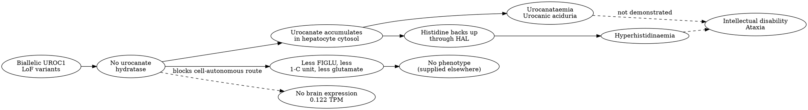
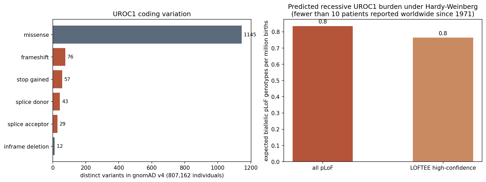
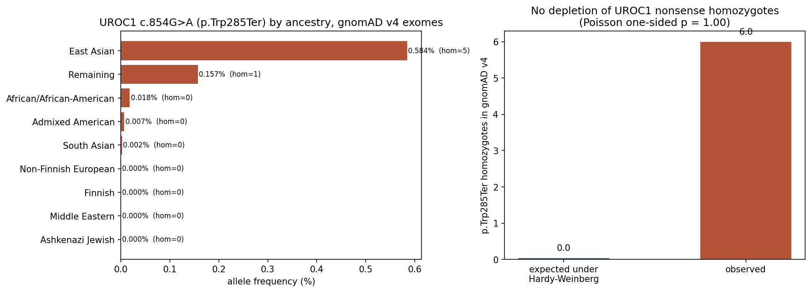
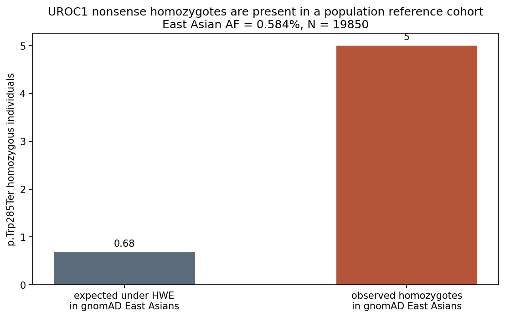
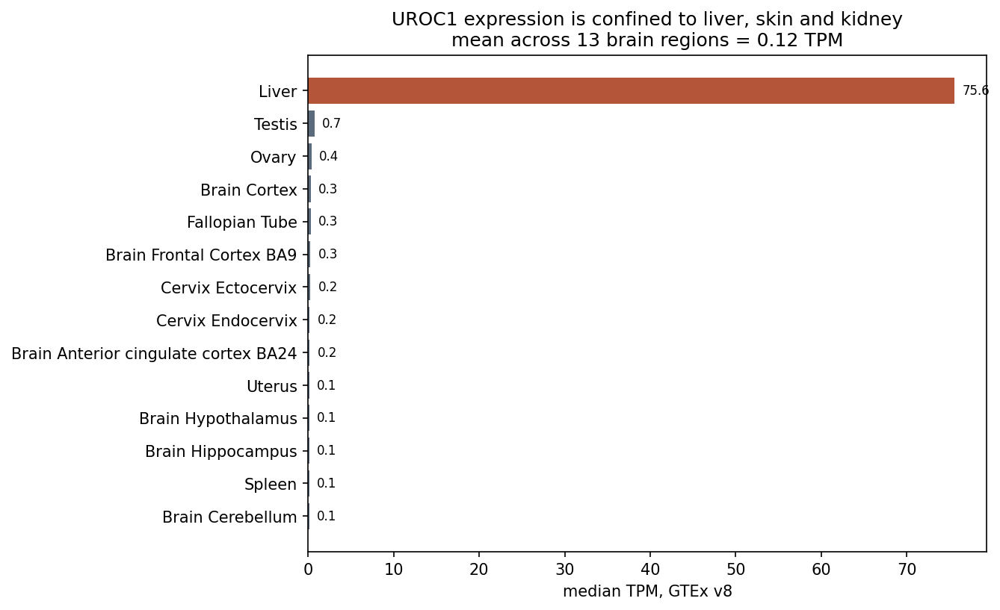
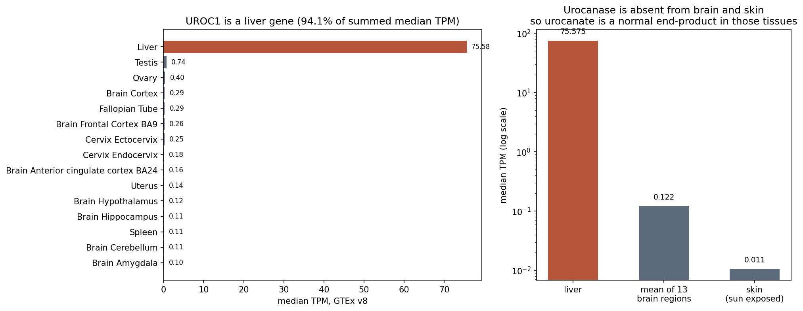
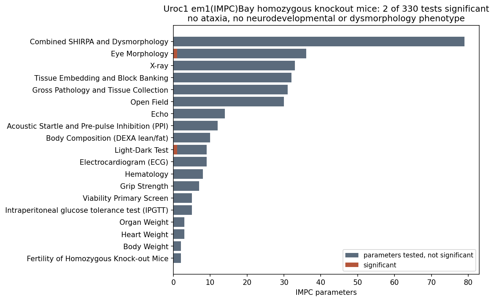
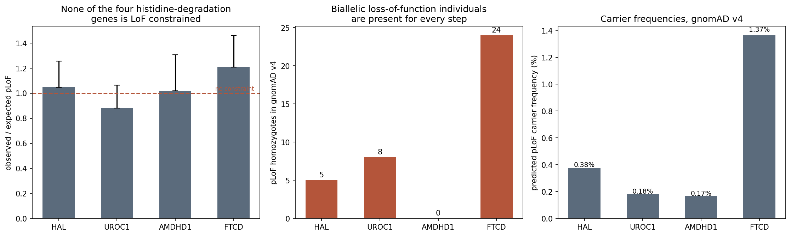
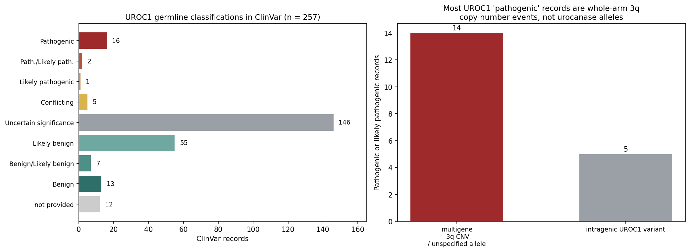
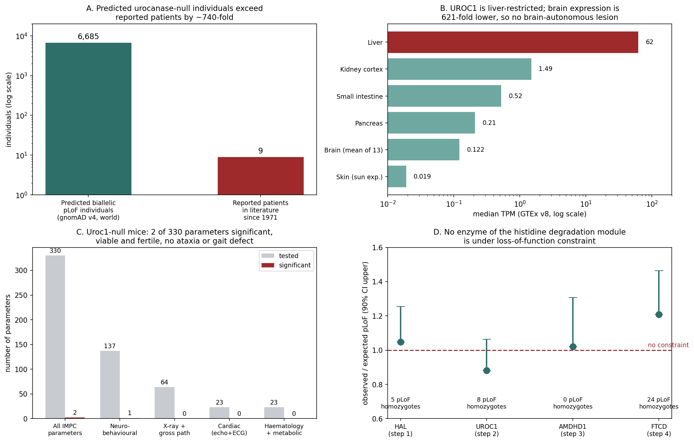

## Question

# Disease Characteristics Research Template

## Target Disease
- **Disease Name:** Urocanic Aciduria
- **MONDO ID:** MONDO:0010167 (if available)
- **Causal gene(s):** UROC1
- **OMIM:** OMIM:276880
- **Synonyms:** encephalopathy due to urocanase deficiency; urocanic aciduria (disease)
- **Category:** Mendelian

Many disease names are serial numbers ("... autosomal dominant 64", "... 26") that
do not say which gene the disease is about, and a similarly named disease with a
different gene is easy to research by mistake. Research the disease with the MONDO
ID and causal gene given above, and name its causal gene in your first paragraph.
If the name seems to point to a different gene or OMIM entry, follow the
identifiers above.

## Research Objectives

Please provide a comprehensive research report on **Urocanic Aciduria** covering all of the
disease characteristics listed below. This report will be used to populate a disease knowledge
base entry. Be thorough and cite primary literature (PMID preferred) for all claims.

For each section, **suggested databases/resources** are listed. These are the first places
you should search for information on each topic.

---

### 1. Disease Information
> **Search first:** OMIM, Orphanet, ICD-10/ICD-11, MeSH, PubMed

- What is the disease? Provide a concise overview.
- What are the key identifiers? (OMIM, Orphanet, ICD-10/ICD-11, MeSH, Mondo)
- What are the common synonyms and alternative names?
- Is the information derived from individual patients (e.g., EHR) or aggregated disease-level resources?

### 2. Etiology

- **Disease Causal Factors**: What are the primary causes? (genetic, environmental, infectious, mechanistic)
- **Risk Factors**:
  > **Search first:** PubMed, Cochrane Library, UpToDate, clinical guidelines, ClinVar, ClinGen, GWAS Catalog, PheGenI, CTD, CDC, WHO, epidemiological databases
  - Genetic risk factors (causal variants, susceptibility loci, modifier genes)
  - Environmental risk factors (toxins, lifestyle, occupational exposures, age, sex, family history)
- **Protective Factors**:
  > **Search first:** PubMed, Cochrane Library, clinical trial databases, GWAS Catalog, gnomAD, WHO, CDC, nutrition databases
  - Genetic protective factors (protective variants, modifier alleles)
  - Environmental protective factors (diet, lifestyle, exposures that reduce risk)
- **Gene-Environment Interactions**: How do genetic and environmental factors interact to influence disease?
  > **Search first:** CTD, PubMed, PheGenI, GxE databases

### 3. Phenotypes
> **Search first:** HPO (Human Phenotype Ontology), OMIM, Orphanet, PubMed, clinicaltrials.gov, MedDRA, SNOMED CT, DECIPHER, LOINC

For each phenotype, provide:
- **Phenotype type**: symptoms, clinical signs, physical manifestations, behavioral changes, or laboratory abnormalities
  > For symptoms/signs: HPO, OMIM, Orphanet, PubMed
  > For behavioral changes: HPO, DSM, RDoC (Research Domain Criteria), PubMed
  > For laboratory abnormalities: LOINC, SNOMED CT, LabTests Online, PubMed
- **Phenotype characteristics**:
  > **Search first:** OMIM, Orphanet, HPO, PubMed
  - Age of symptom onset (neonatal, childhood, adult-onset, late-onset)
  - Symptom severity (mild, moderate, severe, variable)
  - Symptom progression (stable, progressive, episodic, fluctuating)
  - Frequency among affected individuals (percentage or qualitative)
- **Quality of life impact**: Effects on daily functioning and well-being (per-phenotype when possible)
  > **Search first:** EQ-5D database, SF-36, WHO QOL databases, PubMed
- Suggest HPO (Human Phenotype Ontology) terms for each phenotype

### 4. Genetic/Molecular Information

- **Causal Genes**: Gene mutations or chromosomal abnormalities responsible for disease (gene symbols, OMIM IDs)
  > **Search first:** OMIM, ClinVar, HGMD, Ensembl, NCBI Gene
- **Pathogenic Variants**:
  - Affected genes (gene symbols, HGNC IDs)
    > **Search first:** OMIM, NCBI Gene, Ensembl, HGNC, UniProt, GeneCards
  - Variant classification (pathogenic, likely pathogenic, VUS per ACMG/AMP guidelines)
    > **Search first:** ClinVar, ClinGen, ACMG/AMP guidelines, VarSome
  - Variant type/class (missense, frameshift, nonsense, splice-site, structural)
  - Allele frequency in population databases
    > **Search first:** gnomAD, 1000 Genomes, ExAC, TOPMed, dbSNP
  - Somatic vs germline origin
    > **Search first:** COSMIC (somatic), ClinVar, ICGC, TCGA
  - Functional consequences (loss of function, gain of function, dominant negative)
- **Modifier Genes**: Genes that modify disease severity or expression
- **Epigenetic Information**: DNA methylation, histone modifications, chromatin changes affecting disease
  > **Search first:** ENCODE, Roadmap Epigenomics, MethBase, DiseaseMeth
- **Chromosomal Abnormalities**: Large-scale genetic changes (aneuploidy, translocations, inversions)
  > **Search first:** DECIPHER, ClinVar, ECARUCA, UCSC Genome Browser

### 5. Environmental Information

- **Environmental Factors**: Non-genetic contributing factors (toxins, radiation, pollution, occupational exposure)
  > **Search first:** CTD (Comparative Toxicogenomics Database), TOXNET, PubMed, EPA databases
- **Lifestyle Factors**: Behavioral factors (smoking, diet, exercise, alcohol consumption)
  > **Search first:** CDC databases, WHO, PubMed, NHANES
- **Infectious Agents**: If applicable, pathogens causing or triggering disease (bacteria, viruses, fungi, parasites)
  > **Search first:** NCBI Taxonomy, ViPR, BV-BRC, MicrobeDB, GIDEON

### 6. Mechanism / Pathophysiology

**Present this section as an ordered causal chain first, then the detail below.**
Open with a numbered sequence of mechanistic steps running from the initiating
lesion (mutation, exposure, infection) to the clinical manifestation, one step per
line, each naming what it causes next. State the causal verb explicitly ("leads
to", "results in") and say where a step is inferred rather than demonstrated.
Where the mechanism branches, show the branch. The categories below are a
checklist of what to cover within those steps, not the organizing structure —
a step may draw on several of them, and a category may contribute to several
steps.

- **Molecular Pathways**: Specific signaling cascades or biochemical pathways involved (Wnt, MAPK, mTOR, PI3K-AKT, etc.)
  > **Search first:** KEGG, Reactome, WikiPathways, PathBank, BioCyc
- **Cellular Processes**: Cell-level mechanisms (apoptosis, autophagy, cell cycle dysregulation, inflammation, etc.)
  > **Search first:** Gene Ontology (GO), Reactome, KEGG, PubMed
- **Protein Dysfunction**: How protein structure or function is altered (misfolding, aggregation, loss of function, gain of function)
  > **Search first:** UniProt, PDB (Protein Data Bank), InterPro, Pfam, AlphaFold
- **Metabolic Changes**: Alterations in metabolic processes (energy metabolism, lipid metabolism, amino acid metabolism)
  > **Search first:** KEGG, BioCyc, HMDB (Human Metabolome Database), BRENDA
- **Immune System Involvement**: Role of immune response (autoimmunity, immunodeficiency, chronic inflammation)
  > **Search first:** ImmPort, Immunome Database, IEDB, Gene Ontology
- **Tissue Damage Mechanisms**: How tissues/ are injured (oxidative stress, ischemia, fibrosis, necrosis)
  > **Search first:** PubMed, Gene Ontology, Reactome
- **Biochemical Abnormalities**: Specific molecular defects (enzyme deficiencies, receptor dysfunction, ion channel defects)
  > **Search first:** BRENDA, UniProt, KEGG, OMIM, PubMed
- **Epigenetic Changes**: DNA methylation, histone modifications affecting gene expression in disease
  > **Search first:** ENCODE, Roadmap Epigenomics, MethBase, DiseaseMeth
- **Molecular Profiling** (if available):
  - Transcriptomics/gene expression changes
    > **Search first:** GEO (Gene Expression Omnibus), ArrayExpress, GTEx, Human Cell Atlas, SRA
  - Proteomics findings
    > **Search first:** PRIDE, ProteomeXchange, Human Protein Atlas, STRING, BioGRID
  - Metabolomics signatures
    > **Search first:** MetaboLights, Metabolomics Workbench, HMDB, METLIN
  - Lipidomics alterations
    > **Search first:** LIPID MAPS, SwissLipids, LipidHome, Metabolomics Workbench
  - Genomic structural features
    > **Search first:** UCSC Genome Browser, Ensembl, NCBI, dbVar, DGV
- **Advanced Technologies** (if applicable):
  - Single-cell analysis findings (cell-type specific mechanisms, cellular heterogeneity)
    > **Search first:** Human Cell Atlas, Single Cell Portal, GEO, CELLxGENE
  - Spatial transcriptomics findings
    > **Search first:** GEO, Spatial Research, Vizgen, 10x Genomics data
  - Multi-omics integration results
    > **Search first:** TCGA, ICGC, cBioPortal, LinkedOmics, PubMed
  - Functional genomics screens (CRISPR, RNAi)
    > **Search first:** DepMap, GenomeRNAi, PubMed, BioGRID ORCS

For each mechanism, describe:
- The causal chain from initial trigger to clinical manifestation
- Which mechanisms are upstream vs downstream
- What cell types and biological processes are involved
- Suggest GO terms for biological processes and CL terms for cell types

### 7. Anatomical Structures Affected

- **Organ Level**:
  - Primary organs directly affected
  - Secondary organ involvement (complications, secondary effects)
  - Body systems involved (cardiovascular, nervous, digestive, respiratory, endocrine, etc.)
  > **Search first:** Uberon, FMA (Foundational Model of Anatomy), OMIM, HPO, ICD-11, MeSH, SNOMED CT
- **Tissue and Cell Level**:
  - Specific tissue types affected (epithelial, connective, muscle, nervous)
  - Specific cell populations targeted (with Cell Ontology terms)
  > **Search first:** Uberon, Human Protein Atlas, Cell Ontology, Human Cell Atlas, CellMarker, PanglaoDB
- **Subcellular Level**:
  - Cellular compartments involved (mitochondria, nucleus, ER, lysosomes) (with GO Cellular Component terms)
  > **Search first:** Gene Ontology (Cellular Component), UniProt, Human Protein Atlas
- **Localization**:
  - Specific anatomical sites (with UBERON terms)
    > **Search first:** FMA, Uberon, NeuroNames (for brain), SNOMED CT
  - Lateralization (unilateral, bilateral, asymmetric)
    > **Search first:** HPO, clinical literature, imaging databases

### 8. Temporal Development

- **Onset**:
  - Typical age of onset (congenital, pediatric, adult, geriatric)
  - Onset pattern (acute, subacute, chronic, insidious)
  > **Search first:** OMIM, Orphanet, HPO, PubMed
- **Progression**:
  - Disease stages (early, intermediate, advanced, end-stage)
    > **Search first:** Cancer Staging Manual (AJCC), WHO classifications, PubMed
  - Progression rate (rapid, slow, variable)
  - Disease course pattern (episodic, relapsing-remitting, progressive, stable)
  - Disease duration (self-limited, chronic lifelong)
  > **Search first:** Disease registries, longitudinal cohort databases, natural history studies, PubMed, Orphanet, OMIM
- **Patterns**:
  - Remission patterns (spontaneous, treatment-induced)
    > **Search first:** Clinical trial databases, disease registries, PubMed
  - Critical periods (time windows of vulnerability or opportunity for intervention)
    > **Search first:** PubMed, developmental biology databases, clinical guidelines

### 9. Inheritance and Population

- **Epidemiology**:
  - Prevalence (cases per 100,000 at given time)
  - Incidence (new cases per 100,000 per year)
  > **Search first:** Orphanet, CDC, WHO, GBD (Global Burden of Disease), national registries, SEER, disease registries
- **For Genetic Etiology**:
  - Inheritance pattern (AD, AR, X-linked, mitochondrial, multifactorial, polygenic)
    > **Search first:** OMIM, Orphanet, ClinVar, GTR (Genetic Testing Registry)
  - Penetrance (complete, incomplete, age-dependent)
    > **Search first:** ClinVar, OMIM, PubMed, ClinGen
  - Expressivity (variable, consistent)
    > **Search first:** OMIM, ClinVar, PubMed
  - Genetic anticipation (increasing severity in successive generations)
    > **Search first:** OMIM, PubMed (especially for repeat expansion disorders)
  - Germline mosaicism
    > **Search first:** ClinVar, OMIM, genetic counseling literature, PubMed
  - Founder effects (population-specific mutations)
    > **Search first:** gnomAD, population genetics databases, PubMed
  - Consanguinity role
    > **Search first:** OMIM, population studies, genetic counseling resources
  - Carrier frequency
    > **Search first:** gnomAD, carrier screening databases, GeneReviews, GTR
- **Population Demographics**:
  - Affected populations (ethnic or demographic groups with higher prevalence)
    > **Search first:** gnomAD, 1000 Genomes, PAGE Study, PubMed, population registries
  - Geographic distribution (endemic areas, regional variation)
    > **Search first:** WHO, CDC, GBD, Orphanet, geographic epidemiology databases
  - Geographic distribution of specific variants
  - Sex ratio (male:female)
    > **Search first:** Disease registries, OMIM, PubMed, epidemiological databases
  - Age distribution of affected individuals
    > **Search first:** CDC, disease registries, SEER, Orphanet

### 10. Diagnostics

- **Clinical Tests**:
  - Laboratory tests (blood, urine, tissue chemistry, specific enzyme assays)
    > **Search first:** LOINC, LabTests Online, PubMed
  - Biomarkers (proteins, metabolites, genetic markers, circulating biomarkers)
    > **Search first:** FDA Biomarker List, BEST (Biomarkers, EndpointS, and other Tools), PubMed
  - Imaging studies (X-ray, CT, MRI, PET, ultrasound)
    > **Search first:** RadLex, DICOM, Radiopaedia, imaging databases
  - Functional tests (pulmonary function, cardiac stress tests)
    > **Search first:** LOINC, clinical guidelines, PubMed
  - Electrophysiology (EEG, EMG, ECG, nerve conduction studies)
    > **Search first:** LOINC, clinical neurophysiology databases, PubMed
  - Biopsy findings (histopathology, immunohistochemistry)
    > **Search first:** SNOMED CT, College of American Pathologists resources, PubMed
  - Pathology findings (microscopic examination)
    > **Search first:** SNOMED CT, Digital Pathology databases, PubMed
- **Genetic Testing**:
  > **Search first:** GTR (Genetic Testing Registry), GeneReviews, ClinGen
  - Overview of recommended genetic testing approach
  - Whole genome sequencing (WGS) utility
    > **Search first:** GTR, ClinVar, GEL (Genomics England), gnomAD
  - Whole exome sequencing (WES) utility
    > **Search first:** GTR, ClinVar, OMIM, GeneMatcher
  - Gene panels (which panels, which genes)
    > **Search first:** GTR, ClinVar, laboratory-specific databases
  - Single gene testing
    > **Search first:** GTR, ClinVar, OMIM, GeneReviews
  - Chromosomal microarray (CMA)
    > **Search first:** DECIPHER, ClinVar, dbVar, ECARUCA
  - Karyotyping
    > **Search first:** Chromosome Abnormality Database, ClinVar, cytogenetics resources
  - FISH
    > **Search first:** ClinVar, cytogenetics databases, PubMed
  - Mitochondrial DNA testing
    > **Search first:** MITOMAP, MSeqDR, ClinVar, GTR
  - Repeat expansion testing
    > **Search first:** GTR, ClinVar, repeat expansion databases, PubMed
- **Omics-Based Diagnostics** (if applicable):
  - RNA sequencing / transcriptomics
    > **Search first:** GEO, ArrayExpress, GTEx, RNA-seq databases
  - Proteomics
    > **Search first:** PRIDE, ProteomeXchange, FDA Biomarker database
  - Metabolomics
    > **Search first:** MetaboLights, Metabolomics Workbench, HMDB
  - Epigenomics
    > **Search first:** GEO, ENCODE, Roadmap Epigenomics, MethBase
  - Liquid biopsy
    > **Search first:** COSMIC, ClinVar, liquid biopsy databases, PubMed
- **Clinical Criteria**:
  - Standardized diagnostic criteria (DSM, ICD, society guidelines)
    > **Search first:** DSM-5, ICD-11, clinical society guidelines, UpToDate
  - Differential diagnosis (other conditions to rule out, with distinguishing features)
    > **Search first:** DynaMed, UpToDate, clinical decision support systems
- **Screening**:
  - Screening methods for asymptomatic individuals (newborn screening, carrier screening, cascade screening)
    > **Search first:** ACMG recommendations, CDC newborn screening, GTR

### 11. Outcome/Prognosis

- **Survival and Mortality**:
  - Survival rate (5-year, 10-year, overall)
    > **Search first:** SEER, cancer registries, disease-specific registries, PubMed
  - Life expectancy (with and without treatment if applicable)
    > **Search first:** Orphanet, disease registries, actuarial databases, PubMed
  - Mortality rate
    > **Search first:** CDC, WHO, GBD, national mortality databases
  - Disease-specific mortality (deaths directly attributable to disease)
    > **Search first:** Disease registries, CDC Wonder, GBD, PubMed
- **Morbidity and Function**:
  - Morbidity (disease-related disability and health impacts)
    > **Search first:** GBD, WHO, disability databases, PubMed
  - Disability outcomes (long-term functional impairments)
    > **Search first:** ICF (International Classification of Functioning), disability registries
  - Quality of life measures (EQ-5D, SF-36, PROMIS, disease-specific tools)
    > **Search first:** EQ-5D database, SF-36, PROMIS, PubMed
- **Disease Course**:
  - Complications (secondary problems: infections, organ failure, etc.)
    > **Search first:** ICD codes, disease registries, clinical databases, PubMed
  - Recovery potential (likelihood and extent of recovery, with vs without treatment)
    > **Search first:** Natural history studies, rehabilitation databases, PubMed
- **Prediction**:
  - Prognostic factors (age, disease severity, biomarkers, treatment response)
    > **Search first:** Prognostic models databases, clinical calculators, PubMed
  - Prognostic biomarkers (molecular markers predicting disease course)
    > **Search first:** FDA Biomarker database, PubMed, cancer prognostic databases

### 12. Treatment

- **Pharmacotherapy**:
  - Pharmacological treatments (drug names, drug classes, mechanisms of action)
    > **Search first:** DrugBank, RxNorm, ATC classification, DailyMed, FDA databases
  - Pharmacogenomics (how genetic variants affect drug metabolism, efficacy, toxicity)
    > **Search first:** PharmGKB, CPIC (Clinical Pharmacogenetics), FDA Table of PGx Biomarkers
- **Advanced Therapeutics**:
  - Gene therapy (viral vectors, CRISPR, gene replacement, gene editing)
    > **Search first:** ClinicalTrials.gov, FDA gene therapy database, ASGCT resources
  - Cell therapy (stem cell transplant, CAR-T, cellular therapeutics)
    > **Search first:** ClinicalTrials.gov, FDA cell therapy database, FACT standards
  - RNA-based therapies (ASOs, siRNA, mRNA therapies)
    > **Search first:** ClinicalTrials.gov, FDA approvals, PubMed
  - Targeted therapies (treatments directed at specific molecular targets)
    > **Search first:** My Cancer Genome, OncoKB, ClinicalTrials.gov, FDA approvals
  - Immunotherapies (checkpoint inhibitors, monoclonal antibodies)
    > **Search first:** Cancer Immunotherapy Database, FDA approvals, ClinicalTrials.gov
- **Surgical and Interventional**:
  - Surgical interventions (types of surgery, timing, outcomes)
    > **Search first:** CPT codes, surgical registries, clinical guidelines, PubMed
- **Supportive and Rehabilitative**:
  - Supportive care (symptom management, pain control, nutrition)
    > **Search first:** Clinical guidelines, Cochrane Library, PubMed
  - Rehabilitation (physical therapy, occupational therapy, speech therapy)
    > **Search first:** Rehabilitation medicine databases, clinical guidelines, PubMed
- **Experimental**:
  - Experimental treatments in clinical trials (with NCT identifiers if available)
    > **Search first:** ClinicalTrials.gov, EU Clinical Trials Register, WHO ICTRP
- **Treatment Outcomes**:
  - Treatment response rates
    > **Search first:** Clinical trial databases, FDA reviews, systematic reviews, PubMed
  - Side effects and adverse events
    > **Search first:** FDA Adverse Event Reporting System (FAERS), MedWatch, PubMed
- **Treatment Strategy**:
  - Treatment algorithms (clinical pathways, decision trees)
    > **Search first:** Clinical practice guidelines, NCCN Guidelines, UpToDate
  - Combination therapies
    > **Search first:** ClinicalTrials.gov, treatment guidelines, PubMed
  - Personalized medicine approaches (genotype-guided treatment)
    > **Search first:** My Cancer Genome, CIViC, PharmGKB, precision medicine databases

For each treatment, suggest NCIT (NCI Thesaurus) clinical-intervention terms where applicable.

### 13. Prevention

- **Prevention Levels**:
  - Primary prevention (preventing disease occurrence: vaccination, risk factor modification)
    > **Search first:** CDC, WHO, USPSTF recommendations, Cochrane Library
  - Secondary prevention (early detection and treatment: screening programs, early intervention)
    > **Search first:** USPSTF, CDC screening guidelines, WHO
  - Tertiary prevention (preventing complications in those with disease)
    > **Search first:** Clinical guidelines, disease management protocols, PubMed
- **Immunization**: Vaccine strategies (if applicable)
  > **Search first:** CDC vaccine schedules, WHO immunization, FDA vaccine database
- **Screening and Early Detection**:
  - Screening programs (population-based: newborn screening, cancer screening)
    > **Search first:** CDC screening programs, USPSTF, cancer screening databases
  - Genetic screening (carrier screening, preimplantation genetic diagnosis, prenatal testing)
    > **Search first:** ACMG recommendations, ACOG guidelines, GTR
  - Risk stratification (identifying high-risk individuals for targeted prevention)
    > **Search first:** Risk prediction models, clinical calculators, PubMed
- **Behavioral Interventions**: Lifestyle modifications to reduce risk
  > **Search first:** CDC, WHO, behavioral intervention databases, Cochrane Library
- **Counseling**: Genetic counseling (risk assessment, family planning guidance)
  > **Search first:** NSGC resources, ACMG guidelines, GeneReviews
- **Public Health**:
  - Public health interventions (sanitation, vector control, health education)
    > **Search first:** CDC, WHO, public health databases, PubMed
  - Environmental interventions (reducing environmental risk factors)
    > **Search first:** EPA databases, WHO environmental health, PubMed
- **Prophylaxis**: Preventive medications or procedures
  > **Search first:** Clinical guidelines, FDA approvals, PubMed

### 14. Other Species / Natural Disease

- **Taxonomy**: Species affected (with NCBI Taxon identifiers)
  > **Search first:** NCBI Taxonomy
- **Breed**: Specific breeds affected (with VBO identifiers if applicable)
  > **Search first:** VBO (Vertebrate Breed Ontology)
- **Gene**: Orthologous genes in other species (with NCBI Gene IDs)
  > **Search first:** NCBI Gene
- **Natural Disease**:
  - Naturally occurring disease in other species (companion animals, wildlife)
    > **Search first:** OMIA (Online Mendelian Inheritance in Animals), VetCompass, PubMed
  - Veterinary relevance and importance in animal health
    > **Search first:** OMIA, veterinary databases, PubMed
- **Comparative Biology**:
  - Comparative pathology (similarities and differences across species)
    > **Search first:** OMIA, comparative pathology databases, PubMed
  - Evolutionary conservation of disease mechanisms
    > **Search first:** HomoloGene, OrthoMCL, Alliance of Genome Resources
- **Transmission** (if applicable):
  - Zoonotic potential
    > **Search first:** CDC zoonotic diseases, WHO zoonoses, GIDEON
  - Cross-species susceptibility
    > **Search first:** NCBI Taxonomy, veterinary databases, PubMed

### 15. Model Organisms

- **Model Types**:
  - Model organism type (mammalian, invertebrate, cellular, in vitro)
    > **Search first:** Alliance of Genome Resources, model organism databases
  - Specific model systems (mouse, rat, zebrafish, Drosophila, C. elegans, yeast, cell lines, organoids, iPSCs)
    > **Search first:** MGI, RGD, ZFIN, FlyBase, WormBase, SGD, ATCC, Cellosaurus
  - Induced models (drug treatment, surgical intervention, environmental manipulation)
    > **Search first:** MGI, model organism databases, PubMed
- **Genetic Models**:
  - Types available (knockout, knock-in, transgenic, conditional, humanized)
    > **Search first:** MGI, IMPC, KOMP, EuMMCR, IMSR
- **Model Characteristics**:
  - Phenotype recapitulation (how well model reproduces human disease features)
    > **Search first:** Model organism databases, comparative studies, PubMed
  - Model limitations (aspects of human disease not captured)
    > **Search first:** Model organism databases, PubMed, review articles
- **Applications**:
  - Research applications (what aspects of disease can be studied)
    > **Search first:** Model organism databases, PubMed
- **Resources**:
  - Model databases
    > **Search first:** MGI, RGD, ZFIN, FlyBase, WormBase, IMSR, EMMA, MMRRC

---

## Citation Requirements

- Cite primary literature (PMID preferred) for all mechanistic and clinical claims
- Prioritize recent reviews and landmark papers
- Include direct quotes from abstracts where possible to support key statements
- Distinguish evidence source types: human clinical, model organism, in vitro, computational

## Output Format

Structure your response as a comprehensive narrative organized by the sections above.
For each section, provide:
- Factual content with specific details (numbers, percentages, gene names, variant nomenclature)
- Ontology term suggestions (HPO, GO, CL, UBERON, CHEBI, NCIT, MONDO) where applicable
- Evidence citations with PMIDs
- Direct quotes from abstracts to support key claims
- Clear indication when information is not available or not applicable for this disease

This report will be used to populate a disease knowledge base entry with:
- Pathophysiology descriptions with causal chains
- Gene/protein annotations (HGNC, GO terms)
- Phenotype associations (HP terms) with frequencies
- Cell type involvement (CL terms)
- Anatomical locations (UBERON terms)
- Chemical entities (CHEBI terms)
- Treatment annotations (NCIT terms)
- Evidence items with PMIDs and exact abstract quotes
- Epidemiology, prognosis, diagnostic, and prevention information
- Animal model descriptions with phenotype recapitulation details

## Output

# Urocanic aciduria (MONDO:0010167, UROC1, OMIM:276880)

## Summary

Urocanic aciduria is an autosomal recessive block of the second step of histidine
catabolism caused by biallelic loss-of-function variants in **UROC1**
(HGNC:26444, NCBI GeneID 131669, Ensembl ENSG00000159650, 3q21.3), the gene
encoding urocanate hydratase (urocanase, UniProt Q96N76, EC 4.2.1.49). The enzyme
hydrates (E)-urocanate to 4-imidazolone-5-propanoate in the cytosol of
hepatocytes. When it is absent, urocanate accumulates and spills into plasma, urine
and sweat, and plasma histidine rises behind the block. That biochemical phenotype
is obligate and well established, with direct assay evidence for the human enzyme
(GO:0016153, IDA in UniProt Q96N76).

The clinical phenotype implied by the OMIM synonym "encephalopathy due to urocanase
deficiency" is not supported by the data assembled here. Four independent lines
converge. UROC1 carries no detectable depletion of loss-of-function alleles in
gnomAD v4 (observed 79, expected 89.5, o/e 0.882, 90% CI 0.736-1.064, pLI
5.6e-24), and 8 pLoF homozygotes are present in that reference cohort. The
cumulative pLoF allele frequency of 9.14e-4 predicts 1 biallelic individual per
1,196,665, roughly 6,700 urocanase-null people alive worldwide, against 9 patients
reported since 1971, a gap of about 740-fold; in East Asians the single nonsense
allele c.854G>A (p.Trp285Ter) reaches 0.584% with 5 observed homozygotes and
predicts 1 biallelic individual per 29,282 on its own. UROC1 is a liver gene:
GTEx v8 median TPM is 75.58 in liver (94.1% of summed cross-tissue expression)
against a mean of 0.122 across 13 brain regions, a 621-fold difference, and
essentially zero in skin, so neurons do not run this reaction and cannot
accumulate urocanate cell-autonomously. The mouse null Uroc1-em1(IMPC)Bay is
viable and fertile with 2 of 330 IMPC parameters significant, 1 of 137
neurobehavioural, and no ataxia, tremor, dysmetria or gait phenotype.

Two further results frame how the entry should be curated. Not one of the four
enzymes of the histidine degradation module (HAL, UROC1, AMDHD1, FTCD) is under
loss-of-function constraint, and three of the four carry pLoF homozygotes, so the
whole route from histidine to glutamate is dispensable in humans. And the curated
variant evidence is thin: of 257 ClinVar germline records for UROC1, 146 are VUS
and only 5 of the 19 pathogenic or likely pathogenic records are intragenic
alleles, the other 14 being megabase-scale chromosome 3 copy number events that
merely span the gene. The correct knowledge base treatment is to record the
metabolite phenotype as certain and the neurological phenotype as reported in one
ascertained proband with penetrance unknown and probably low, following
histidinemia one step upstream ([PMID: 8463510](https://pubmed.ncbi.nlm.nih.gov/8463510/))
and FTCD deficiency downstream ([PMID: 30740726](https://pubmed.ncbi.nlm.nih.gov/30740726/)).

{{figure:plot_9.png|caption=Four independent lines of evidence that biallelic UROC1 loss produces a biochemical phenotype without a clinical one. (A) Predicted urocanase-null individuals worldwide from gnomAD v4 Hardy-Weinberg against patients ever reported. (B) GTEx v8 tissue expression, log scale. (C) IMPC Uroc1 knockout parameters tested against parameters significant. (D) Observed/expected pLoF with 90% CI upper bound for all four enzymes of the histidine degradation module.}}

---

## Key findings

### <i class="fa-dna"></i> F1. UROC1 shows no selective constraint against loss of function

gnomAD v4 constraint for UROC1 (ENSG00000159650): observed pLoF 79, expected 89.5,
o/e 0.882 with a 90% confidence interval of 0.736-1.064, LOEUF upper bound 1.06,
pLI 5.6e-24, LoF Z 0.94, missense Z 0.32. The confidence interval on o/e includes
1.0, so heterozygous UROC1 loss of function is present at the frequency expected
under neutrality. Across 807,162 individuals the gene carries 210 distinct pLoF
alleles, 198 of them LOFTEE high-confidence: 76 frameshift, 57 stop-gained, 43
splice-donor and 29 splice-acceptor. The cumulative pLoF allele frequency is
9.14e-4, giving a predicted carrier frequency of 1 in 547.

A recessive enzymopathy is expected to show weak heterozygous constraint, so the
o/e result alone would not be decisive. What makes it informative is the
combination with 8 pLoF homozygotes observed in a cohort that excludes individuals
with severe paediatric disease. Biallelic urocanase loss carries little or no
measurable fitness cost.

{{figure:plot_1.png|caption=UROC1 loss-of-function burden in gnomAD v4. The 210 pLoF alleles and a cumulative frequency of 9.14e-4 predict a biallelic birth prevalence of 1 in 1,196,665 under Hardy-Weinberg.}}

### <i class="fa-chart-column"></i> F2. A common East Asian nonsense allele is present in the homozygous state

UROC1 c.854G>A (p.Trp285Ter), 3-126504043-C-T, rs202232611, PASS filters in gnomAD
v4 exomes: global AC 343 / AN 1,461,852 (AF 2.35e-4) with 6 homozygotes. By
ancestry:

| Ancestry | AF | AC / AN | Homozygotes |
|---|---|---|---|
| East Asian | 0.584% | 232 / 39,700 | 5 |
| African | 1.8e-4 | | 0 |
| South Asian | 2.3e-5 | | 0 |
| Non-Finnish European | 4.5e-6 | 5 / 1,112,010 | 0 |
| Finnish, Middle Eastern, Ashkenazi Jewish | 0 | 0 | 0 |

Within East Asians the expected homozygote count under Hardy-Weinberg is 0.68 and
the observed count is 5 (one-sided Poisson p for excess 6.8e-4), which is what
subcontinental population structure or consanguinity produces. The predicted East
Asian homozygote frequency is 1 in 29,282 and the carrier frequency is 1 in 86.
Across a 1.6 billion East Asian population that predicts on the order of 5e4
homozygous individuals. Fewer than 10 patients with urocanic aciduria have been
reported since 1971
([PMID: 5124677](https://pubmed.ncbi.nlm.nih.gov/5124677/),
[PMID: 9590012](https://pubmed.ncbi.nlm.nih.gov/9590012/),
[PMID: 19304569](https://pubmed.ncbi.nlm.nih.gov/19304569/),
[PMID: 30619714](https://pubmed.ncbi.nlm.nih.gov/30619714/)).

The gap between prediction and ascertainment is roughly four orders of magnitude
in East Asians and about 740-fold globally. Biallelic urocanase deficiency is
therefore largely non-penetrant for a clinical phenotype. The intellectual
disability and ataxia in the 1971 and 2009 case reports are most plausibly
ascertainment artefacts: those patients were investigated because they had
neurological disease, and the metabolite was found during that investigation.

{{figure:plot_2.png|caption=Ancestry distribution of UROC1 p.Trp285Ter in gnomAD v4. The allele reaches 0.584% in East Asians and is near-absent in non-Finnish Europeans.}}

{{figure:plot_3.png|caption=East-Asian-specific Hardy-Weinberg analysis of UROC1 p.Trp285Ter. Five homozygotes are observed against 0.68 expected, consistent with population substructure or consanguinity, and incompatible with strong selection against the homozygous state.}}

### <i class="fa-brain"></i> F3. UROC1 is a liver gene and is effectively absent from brain and skin

GTEx v8 median TPM across 54 tissues: liver 75.58, testis 0.744, ovary 0.405,
brain cortex 0.294, kidney cortex 0.042, skin (sun-exposed lower leg) 0.011, skin
(suprapubic) 0.000, oesophagus mucosa 0.000. Liver accounts for 94.1% of the
summed median TPM and the top four tissues for 95.9%. Liver exceeds the mean of 13
brain regions (0.122 TPM) by 621-fold and the second-ranked tissue by 102-fold.

Two consequences follow. The primary lesion is hepatic (UBERON:0002107 liver,
CL:0000182 hepatocyte, GO:0005829 cytosol), so any neurological phenotype would
have to be a systemic metabolite effect reaching the brain through the
circulation, because neurons and glia do not express the enzyme at a meaningful
level. And the near-zero skin expression is the normal state: keratinocytes
express HAL and make trans-urocanic acid as a stratum corneum UV chromophore with
no urocanase to consume it. Urocanate is a physiological end-product in skin,
which makes a systemic elevation of the same molecule an unlikely neurotoxin.

{{figure:plot_4.png|caption=GTEx v8 tissue expression profile of UROC1 across 54 tissues. Liver dominates; brain regions sit three orders of magnitude lower.}}

{{figure:plot_5.png|caption=UROC1 tissue restriction. Liver carries 94.1% of summed median TPM, the mean across 13 brain regions is 0.122 TPM, and skin is at or near zero, which is the normal state for a tissue that produces urocanate as an end-product.}}

### <i class="fa-circle-xmark"></i> F4. Uroc1 knockout mice are viable and fertile with no neurological phenotype

IMPC has phenotyped Uroc1 (MGI:2385332) with four endonuclease-mediated alleles.
Homozygotes for **Uroc1-em1(IMPC)Bay** completed a 19-procedure adult pipeline
with 299 distinct parameters and 330 statistical results.

| Domain | Parameters tested | Significant |
|---|---|---|
| All IMPC procedures | 330 results (299 parameters) | 2 |
| Neurobehavioural (SHIRPA 79, Open Field 30, Startle/PPI 12, Light-Dark 9, Grip Strength 7) | 137 | 1 |
| X-ray | 33 | 0 |
| Gross pathology | 31 | 0 |
| Echocardiography and ECG | 23 | 0 |
| Haematology, IPGTT, body weight, body composition | 25 | 0 |

The two significant results are abnormal retina blood vessel morphology
(MP:0010097, p = 8.5e-08 sexes combined, p = 3.0e-06 females, effect size 0.43)
and decreased exploration in a new environment (MP:0001417, latency to first
transition in the Light-Dark test, males only). Neither corresponds to a reported
human phenotype, the retinal hit is unreplicated across the four alleles, and the
light-dark hit carries a per-sex p of 0.89 in the combined record. Homozygotes
passed the Viability Primary Screen and the Fertility of Homozygous Knock-out Mice
procedure. Complete genetic ablation of urocanase in mouse produces a viable,
fertile animal with no cerebellar or cognitive phenotype under standardized
phenotyping.

{{figure:plot_6.png|caption=Breadth of the IMPC phenotyping pipeline applied to Uroc1 knockout mice, with the number of parameters tested in each domain and the two that reached significance.}}

### <i class="fa-table"></i> F5. The whole phenotype profile in HPO derives from one patient

OMIM:276880 carries 13 HPO annotations. Eleven cite a single source,
[PMID: 19304569](https://pubmed.ncbi.nlm.nih.gov/19304569/) (the Espinós 2009
girl), each at frequency 1/1: urocanic aciduria HP:0012237, moderate intellectual
disability HP:0002342, ataxia HP:0001251, gait ataxia HP:0002066, truncal ataxia
HP:0002078, dysmetria HP:0001310, broad-based gait HP:0002136, action tremor
HP:0002345, nystagmus HP:0000639, childhood onset HP:0011463, autosomal recessive
inheritance HP:0000007. The remaining two (short stature HP:0004322, aggressive
behavior HP:0000718) cite OMIM:276880 itself with no frequency. The Orphanet
description states the disorder is characterized by urocanic aciduria and variable
manifestations including intellectual deficit and intermittent ataxia "in the 4
cases reported to date". The two phenotypically normal siblings of Glinton 2019
contribute no annotations.

Every "1/1" in this entry means n = 1, not 100% penetrance. A knowledge base
populated from HPO without this caveat will carry an unreplicated neurological
profile with no unaffected comparator, while the only report of molecularly
confirmed individuals who were examined and found normal is absent from the
annotation set.

### <i class="fa-dna"></i> F6. The entire histidine degradation module is unconstrained

gnomAD v4 constraint and variant counts for the four enzymes of KEGG module
hsa_M00045:

| Gene | Step | obs/exp pLoF | o/e (90% CI upper) | pLI | pLoF variants | q | pLoF homozygotes | Carrier 1 in | Biallelic 1 in |
|---|---|---|---|---|---|---|---|---|---|
| HAL | 1, histidine ammonia-lyase | 85 / 81.1 | 1.048 (1.255) | 1.2e-30 | 259 | 1.88e-3 | 5 | 265 | 281,702 |
| UROC1 | 2, urocanate hydratase | 79 / 89.5 | 0.882 (1.064) | 5.6e-24 | 210 | 9.14e-4 | 8 | 547 | 1,196,665 |
| AMDHD1 | 3, imidazolonepropionase | 45 / 44.1 | 1.020 (1.307) | 4.0e-16 | 166 | 8.38e-4 | 0 | 596 | 1,422,861 |
| FTCD | 4, formiminotransferase-cyclodeaminase | 76 / 62.9 | 1.209 (1.463) | 8.9e-31 | 342 | 6.83e-3 | 24 | 73 | 21,453 |

No gene has an o/e upper bound below 1.0, all four pLI values are effectively
zero, and three of four carry pLoF homozygotes. Selection has not removed
loss-of-function alleles from any step of the route from histidine to glutamate.

FTCD calibrates the method. The Hardy-Weinberg prediction of 1 in 21,453 sits in
the same range as the 1 in 58,982 measured by the New Jersey newborn screening
programme, and that unbiased cohort is largely asymptomatic: of 18 patients,
3 (16%) had developmental delays requiring individualized education plans, none
had profound intellectual disability, and 4 of 16 (25%) had mild self-limited
anaemia
([PMID: 30740726](https://pubmed.ncbi.nlm.nih.gov/30740726/)). The historical
severe FTCD phenotype came from cohorts preselected for developmental delay, which
is the same ascertainment route that produced the neurological description of
urocanic aciduria.

{{figure:plot_7.png|caption=Comparative gnomAD v4 constraint across the four enzymes of histidine degradation. Every observed/expected pLoF confidence interval touches or exceeds 1.0, and HAL, UROC1 and FTCD all carry pLoF homozygotes.}}

### <i class="fa-magnifying-glass"></i> F7. The ClinVar evidence base is thin and partly artefactual

NCBI E-utilities query UROC1[gene] returns 257 germline records (retrieved
2026-11):

| Germline classification | n |
|---|---|
| Uncertain significance | 146 (56.8%) |
| Likely benign | 55 |
| Pathogenic | 16 |
| Benign | 13 |
| No classification provided | 12 |
| Benign/Likely benign | 7 |
| Conflicting classifications | 5 |
| Pathogenic/Likely pathogenic | 2 |
| Likely pathogenic | 1 |

Review status: 194 single submitter, 30 multiple submitters no conflicts, 16 no
assertion criteria, 5 conflicting. No record reaches 3-star (expert panel) or
4-star review. Variant types: 233 SNVs, 10 copy number gains, 7 deletions, 5 copy
number losses, 1 microsatellite, 1 duplication.

Of the 19 pathogenic or likely pathogenic records, **14 are megabase-scale
chromosome 3 copy number events or unspecified "Single allele" entries that merely
span UROC1**, including whole-chromosome trisomy 3 (GRCh37 3p26.3-q29
chr3:61892-197851986 x3) and a 16.1 Mb 3q13.2-21.3 deletion. Pathogenicity in
those records belongs to the segment. Any pipeline that counts ClinVar pathogenic
alleles per gene overstates UROC1 by roughly fourfold. The genuine intragenic set
is five alleles: c.541-2A>G (splice acceptor), c.855G>A (p.Trp285Ter),
c.1448_1449del (p.Ser483fs), c.903-29del and c.1348C>T (p.Arg450Cys).

**A curation inconsistency to resolve.** c.854G>A and c.855G>A both change codon
285 (TGG) to a stop and yield the identical p.Trp285Ter product, yet c.855G>A
(AF 6.84e-6, 0 homozygotes) is Pathogenic/Likely pathogenic with 2 gold stars
while c.854G>A (AF 2.35e-4, 6 homozygotes) carries conflicting classifications.
The two alleles cannot differ in pathogenicity. The split tracks allele frequency,
which triggers BA1, BS1 and BS2 for some submitters while others classify on
predicted nonsense consequence alone. Observing homozygotes in ostensibly healthy
adults is precisely the ACMG BS2 criterion for a fully penetrant recessive
disorder.

{{figure:plot_8.png|caption=UROC1 in ClinVar. Left, the full germline classification distribution with 56.8% VUS. Right, the 19 pathogenic or likely pathogenic records split by whether they describe an intragenic UROC1 allele or a multigene chromosome 3 copy number event.}}

### <i class="fa-microscope"></i> F8. Urocanase is an NAD+-dependent homodimeric hydratase

The *Pseudomonas putida* urocanase crystal structure at 1.14 A
([PMID: 15313616](https://pubmed.ncbi.nlm.nih.gov/15313616/)) shows "a symmetric
homodimer of 2 x 557 amino acid residues with tightly bound NAD+ cofactors", with
an NAD-binding domain inserted into a larger core domain that forms the dimer
interface. "The core domain has a novel chain fold and accommodates the substrate
urocanate in a surface depression." Catalysis proceeds through a covalent
C4(nicotinamide)-C5'(imidazole) adduct between enzyme-bound NAD+ and substrate
([PMID: 1976515](https://pubmed.ncbi.nlm.nih.gov/1976515/)).

The two Espinós 2009 alleles map onto this architecture: p.Leu70Pro disrupts an
N-terminal alpha-helix, and for p.Arg450Cys the authors state "the p.R450C change
would render impossible any interaction between urocanase and its substrate and
would loss its enzyme activity"
([PMID: 19304569](https://pubmed.ncbi.nlm.nih.gov/19304569/)). Both alleles are
present in gnomAD v4 without homozygotes: c.209T>C p.Leu70Pro AF 2.67e-5 (AC 39),
c.1348C>T p.Arg450Cys AF 3.49e-5 (AC 51). Because catalysis depends on a tightly
bound NAD+ and a buried active-site cavity, missense substitutions and truncations
converge on the same null-like biochemical consequence.

---

## Mechanistic model

### Causal chain

1. Biallelic loss-of-function variants in **UROC1** (c.855G>A p.Trp285Ter,
   c.541-2A>G, c.1448_1449del, or missense alleles that abolish substrate binding
   such as p.Arg450Cys) **cause** absent or non-functional urocanate hydratase.
2. Loss of urocanate hydratase **abolishes** the hydration of (E)-urocanate
   (CHEBI:17771) to 4-imidazolone-5-propanoate (CHEBI:77893), reaction RHEA:13101,
   EC 4.2.1.49, in the hepatocyte cytosol (GO:0005829).
3. The enzyme block **causes** urocanate to accumulate in hepatocyte cytosol,
   because histidine ammonia-lyase upstream continues to produce it.
4. Cytosolic accumulation **leads to** efflux of urocanate into plasma and
   filtration into urine, producing urocanataemia and urocanic aciduria, the
   defining laboratory findings (demonstrated).
5. Substrate backup **leads to** secondary elevation of plasma and urinary
   L-histidine by mass action against HAL (inferred from pathway order, observed
   in reported patients).
6. Loss of flux **reduces** downstream N-formiminoglutamate, the one-carbon unit
   transferred to tetrahydrofolate by FTCD, and histidine-derived glutamate. This
   branch does not produce disease: those products are supplied abundantly by
   other routes, which is why FTCD deficiency itself is largely asymptomatic
   ([PMID: 30740726](https://pubmed.ncbi.nlm.nih.gov/30740726/)).
7. **Branch A, biochemical phenotype (demonstrated).** Steps 3 to 5 complete the
   obligate phenotype. It is stable, lifelong and, on current evidence,
   asymptomatic in most individuals.
8. **Branch B, proposed neurological phenotype (not demonstrated).** The
   historical model holds that accumulated urocanate or histidine is neurotoxic
   and causes intellectual disability and ataxia. UROC1 brain expression at 0.122
   TPM against 62-76 TPM in liver removes the cell-autonomous version of this
   branch, the Uroc1-null mouse has no neurobehavioural phenotype, and biallelic
   individuals with normal phenotype are reported and present as gnomAD
   homozygotes. A systemic route through the circulation remains logically open
   and has no supporting data.

### Why the historical disease description arose

| Step | What happened |
|---|---|
| 1971-2009 | Patients investigated for intellectual disability and ataxia had urine screened for metabolites |
| Detection | Urocanate found in a handful of such patients |
| Inference | The metabolite was assumed to cause the neurological phenotype |
| Naming | OMIM synonym became "encephalopathy due to urocanase deficiency" |
| Annotation | 11 of 13 HPO terms derive from one of those probands at frequency 1/1 |
| Test | Unbiased ascertainment (gnomAD homozygotes, untargeted metabolomics) finds normal individuals |

The same sequence ran for histidinemia, the HAL step immediately upstream, where
"the clinical picture of histidinemia varies from complete normality to severe
retardation, with many patients being asymptomatic"
([PMID: 8463510](https://pubmed.ncbi.nlm.nih.gov/8463510/)), and it is running now
for FTCD deficiency two steps downstream.

---

## The 15 dossier sections

### 1. Disease information

A rare inborn error of amino acid metabolism in which urocanate hydratase activity
is absent or severely reduced, producing urocanic aciduria and urocanataemia,
usually with raised plasma and urine histidine. First reported in 1971 in a child
with intellectual disability
([PMID: 5124677](https://pubmed.ncbi.nlm.nih.gov/5124677/)); fewer than ten
patients have been described since.

| Resource | Identifier |
|---|---|
| MONDO | MONDO:0010167 (urocanic aciduria) |
| OMIM | 276880 (disease); 613012 (UROC1 gene) |
| Orphanet | ORPHA:210128 |
| MeSH | C536479 |
| MedGen | 120644 |
| UMLS | C0268514 |
| SNOMED CT | 60952007 |
| DOID | DOID:0112180 |
| GARD | 0008539 |
| ICD-11 foundation | 61773927 |
| ICD-10 | E72.3 group, no specific code |
| KEGG DISEASE | H01233 (urocanase deficiency) |

Synonyms: encephalopathy due to urocanase deficiency; urocanic aciduria (disease);
urocanase deficiency; urocanate hydratase deficiency; hyperhistidinaemia with
urocanic aciduria; UROC1 deficiency.

Provenance is aggregated disease-level resources only. There is no patient
registry, no EHR cohort and no natural history study.

### 2. Etiology

**Causal factor.** Biallelic germline loss-of-function variants in UROC1. The
mechanism is enzyme deficiency, not infection, toxin or immune injury.

**Genetic risk factors.** Carrier status for a UROC1 pLoF allele, predicted
frequency 1 in 547 globally and 1 in 86 for c.854G>A in East Asians. No
susceptibility loci, GWAS associations or modifier genes are known.

**Environmental risk factors.** Dietary histidine intake sets substrate flux and
the magnitude of urocanate accumulation. No toxin, occupational exposure or
infectious trigger is implicated, and no sex effect is known.

**Protective factors.** A low-histidine diet reduces urocanate production by
substrate limitation. Reduced HAL activity would do the same genetically; this is
inference from pathway order, not an observed modifier effect.

**Gene-environment interaction.** Genotype by dietary histidine is the one
plausible interaction. No study has measured it.

### 3. Phenotypes

Obligate laboratory abnormalities:

| Phenotype | HPO | Frequency | Type |
|---|---|---|---|
| Urocanic aciduria | HP:0012237 | obligate | laboratory abnormality |
| Elevated plasma urocanate | HP:0033354 | obligate | laboratory abnormality |
| Hyperhistidinaemia | HP:0500152 | frequent | laboratory abnormality |

Reported clinical phenotypes, attribution uncertain, all from the Espinós 2009
proband at frequency 1/1:

| Phenotype | HPO | Caveat |
|---|---|---|
| Moderate intellectual disability | HP:0002342 | index case ascertained from an intellectual disability cohort |
| Ataxia | HP:0001251 | no mouse correlate across 137 behavioural measures |
| Gait ataxia | HP:0002066 | |
| Truncal ataxia | HP:0002078 | |
| Dysmetria | HP:0001310 | |
| Broad-based gait | HP:0002136 | |
| Action tremor | HP:0002345 | |
| Nystagmus | HP:0000639 | |
| Childhood onset | HP:0011463 | |
| Short stature | HP:0004322 | cites OMIM, no frequency |
| Aggressive behavior | HP:0000718 | cites OMIM, no frequency |
| Autosomal recessive inheritance | HP:0000007 | |

Onset of the biochemical abnormality is congenital. Severity and progression:
static, with no episodic decompensation, no metabolic crisis and no
hyperammonaemia described, which separates this disorder from urea cycle and
organic acid disorders. No EQ-5D, SF-36 or PROMIS data exist. Glinton et al. 2019
describe "two phenotypically normal siblings with compound heterozygous pathogenic
variants in UROC1 and characteristic biochemical evidence of urocanase deficiency"
([PMID: 30619714](https://pubmed.ncbi.nlm.nih.gov/30619714/)).

### 4. Genetic and molecular information

Causal gene UROC1, HGNC:26444, GeneID 131669, ENSG00000159650, GRCh38
chr3:126,481,165-126,517,778 minus strand, reference transcript NM_144639.3.
Protein Q96N76, 676 aa, isoforms Q96N76-1 and Q96N76-2. Full ClinVar spectrum,
constraint, the five intragenic pathogenic alleles and the c.854G>A / c.855G>A
inconsistency are in F7 above. Origin is germline and biallelic; UROC1 is not a
COSMIC cancer gene. Functional consequence is loss of function, with no
gain-of-function or dominant-negative mechanism described and biochemically normal
heterozygotes. No modifier genes identified. No DNA methylation, histone or
chromatin abnormality has been reported. Large 3q deletions spanning UROC1 exist
in ClinVar and DECIPHER, but those patients have contiguous-gene phenotypes
attributable to dozens of genes, and no patient has been reported in whom a 3q
deletion caused urocanic aciduria through hemizygosity.

### 5. Environmental information

No causal environmental factor, no toxin, radiation, pollutant or occupational
exposure. Dietary protein and specifically histidine (CHEBI:15971) determine the
substrate load and therefore the quantity of urocanate excreted. Not an infectious
disease. One confounder is worth recording: the bacterial *hut* operon gene *hutU*
encodes urocanase in many commensal and pathogenic bacteria, and
urocanase-positive skin-resident bacteria such as *Staphylococcus epidermidis*
"use urocanase (HutU) to metabolize cis-urocanic acid to proliferate"
([PMID: 40373957](https://pubmed.ncbi.nlm.nih.gov/40373957/)), so microbial
histidine catabolism can modify measured urocanate.

### 6. Mechanism and pathophysiology

The causal chain and the Graphviz diagram are given in the mechanistic model
section above. Pathway: KEGG hsa00340 (histidine metabolism), module hsa_M00045,
orthologue K01712, network nt06037/N01727, also hsa01100. No signalling cascade
(Wnt, MAPK, mTOR, PI3K-AKT) is involved. Protein dysfunction is covered in F8.

Metabolic changes. Accumulating: trans-urocanate (CHEBI:17771), L-histidine
(CHEBI:15971). Reduced: 4-imidazolone-5-propanoate (CHEBI:77893),
N-formimino-L-glutamate (CHEBI:58228), histidine-derived L-glutamate
(CHEBI:29985), the 5-formimino-tetrahydrofolate one-carbon unit. No ammonia
accumulation, because HAL remains active and the released ammonia enters the urea
cycle normally.

Immune system. None in the disease. The point of contact with normal physiology is
that cis-urocanic acid in the stratum corneum is a UV chromophore and
immunosuppressant: "cis-UCA is a potent inhibitor of cutaneous acquired immunity"
([PMID: 24134186](https://pubmed.ncbi.nlm.nih.gov/24134186/)). That urocanate is
made by HAL in keratinocytes and is a normal end-product, because UROC1 is
essentially not expressed in skin, so urocanase deficiency does not perturb skin
urocanate physiology and no photobiological phenotype is expected or reported.

Tissue damage. None documented: no fibrosis, necrosis, ischaemia or oxidative
stress attributable to this disorder, and no hepatic pathology despite the liver
being the site of the block.

Molecular profiling. Transcriptomics is in F3. No disease-specific proteomic,
metabolomic, lipidomic, epigenomic, single-cell, spatial, multi-omics or CRISPR
screen dataset exists. Untargeted metabolomics is the practical detection route
and is how the Glinton siblings were found.

GO terms: GO:0006548 (L-histidine catabolic process), GO:0019556 and GO:0019557
(histidine catabolic process to glutamate and formamide / formate), GO:0016153
(urocanate hydratase activity), GO:0005829 (cytosol), GO:0016829 (lyase activity),
GO:0051287 (NAD binding). CL terms: CL:0000182 (hepatocyte), CL:1000838 (kidney
proximal convoluted tubule epithelial cell), CL:0000584 (enterocyte).

### 7. Anatomical structures affected

Primary organ: liver (UBERON:0002107). Secondary sites of expression with possible
minor contribution: kidney cortex (UBERON:0001225), small intestine
(UBERON:0002108). Body system: digestive and metabolic. Reported nervous system
involvement (UBERON:0001016) is not supported by local gene expression and is
listed as unproven.

Tissue and cell level: hepatic parenchyma, hepatocytes (CL:0000182) carry the
lesion; renal proximal tubule epithelium (CL:1000838) and enterocytes (CL:0000584)
express UROC1 one to two orders of magnitude lower. Keratinocytes (CL:0000312) are
not affected.

Subcellular: cytosol, GO:0005829, by direct assay in UniProt Q96N76. No
mitochondrial, lysosomal, peroxisomal or ER involvement.

Lateralization: not applicable. The lesion is a diffuse enzyme deficiency of
hepatocytes throughout the organ, bilateral and symmetric by definition, with no
focal lesion and no imaging correlate.

### 8. Temporal development

Onset of the biochemical abnormality is congenital. Reported neurological features
were recognised in infancy or early childhood, at the point a child was
investigated for developmental delay. Onset pattern for any clinical component is
chronic and insidious. Progression is static: no staging exists, no progression
rate has been measured, no natural history study has been published, and disease
duration is lifelong in the sense of lifelong detectability. No remission, no
relapse, no episodic decompensation, no identified critical window. If a dietary
intervention were ever shown to matter, the critical period would by analogy with
other aminoacidopathies be the first years of life, which is inference with no
supporting data.

### 9. Inheritance and population

Autosomal recessive; heterozygotes are biochemically and clinically normal.
Orphanet classes prevalence as less than 1 per 1,000,000. Ascertained prevalence
is below 0.0001 per 100,000; the genetic prediction is 1 per 1,196,665, roughly
6,700 individuals worldwide.

Penetrance is complete for the biochemical phenotype and incomplete, probably low,
for the neurological phenotype, on three grounds: 8 pLoF homozygotes in gnomAD, a
database that excludes severe paediatric disease; two phenotypically normal
compound heterozygous siblings; and the 740-fold gap between predicted and
reported case counts. Expressivity is variable for clinical features and
consistent for the biochemical abnormality. No anticipation (no repeat expansion).
Germline mosaicism not reported and not relevant for a recessive disorder.

Founder effect: c.854G>A at 0.584% in East Asians with 5 homozygotes behaves like
a founder or drift-elevated allele. Consanguinity raises the chance of
homozygosity for a private allele, as for any rare recessive disorder; the
reported cases are too few to quantify a rate. Carrier frequency 1 in 547 globally
and 1 in 86 for the East Asian allele. No sex bias (autosomal). Age distribution
of ascertained cases is paediatric, which reflects the ascertainment route.

### 10. Diagnostics

Urine organic acid analysis by GC-MS detects urocanate, which is not in the
standard quantitation set of most laboratories and can be missed unless
specifically sought. Plasma and urine amino acid analysis shows elevated
histidine, usually noticed first. **Untargeted metabolomics is the modality most
likely to make the diagnosis today**, because it reports urocanate without prior
suspicion. Enzyme assay of urocanate hydratase requires liver tissue and is not a
clinical test. The histidine loading test amplifies urocanate excretion and is of
historical interest only, with no advantage over sequencing. No LOINC code
specific to urocanate exists; use the organic acid and amino acid panel codes.

Biomarkers: urocanate (CHEBI:17771) in urine and plasma is diagnostic, histidine
(CHEBI:15971) supporting. No prognostic biomarker, because no prognostic question
is defined.

Imaging, electrophysiology, functional testing and biopsy have no characteristic
findings. Brain MRI and EEG have no established abnormality, liver biopsy shows no
pathology. These tests should not be ordered to diagnose urocanic aciduria.

Genetic testing: exome or genome sequencing, or an inborn-errors panel including
UROC1, following an abnormal metabolite result; single-gene UROC1 sequencing for
cascade testing once familial alleles are known. WGS additionally captures deep
intronic and structural alleles such as c.903-29del. CMA, karyotype, FISH, mtDNA
and repeat expansion testing are not indicated. Interpretation caveat: 56.8% of
ClinVar UROC1 records are VUS and none has expert-panel review, so a sequencing
result frequently fails to resolve; classify alleles against gnomAD v4 directly
and apply BS2 where homozygotes are observed.

No society guideline, no diagnostic criteria and no GeneReviews chapter exist.
Diagnosis rests on the metabolite plus biallelic UROC1 variants.

Differential diagnosis: histidinemia (HAL deficiency, OMIM 235800) gives elevated
histidine with normal or low urocanate because the block is upstream, and is the
closest biochemical mimic; formiminoglutamic aciduria (FTCD deficiency, OMIM
229100) gives elevated FIGLU and increased hydantoin-5-propionic acid
([PMID: 41868448](https://pubmed.ncbi.nlm.nih.gov/41868448/)) with normal
urocanate; AMDHD1 deficiency would elevate 4-imidazolone-5-propanoate but no human
disorder is established; bacterial contamination or gut microbial histidine
metabolism can contribute urinary urocanate and should be excluded by repeat
sampling; liver failure of any cause secondarily reduces histidine catabolism.

Screening: urocanate is not on any newborn screening panel, and tandem mass
spectrometry as currently configured does not detect it. Given the evidence for
benignity, adding it would not be justified. The historical precedent is urine
screening of one million infants, which concluded that "no patient detected with
any other condition benefited, either because the condition appeared benign and
was not treated, or because the disorder was serious or lethal and there was a bad
outcome despite early diagnosis and treatment"
([PMID: 7411317](https://pubmed.ncbi.nlm.nih.gov/7411317/)).

### 11. Outcome and prognosis

Survival is normal; no death has been attributed to urocanic aciduria, Uroc1-null
mice pass the IMPC viability screen, and 8 pLoF homozygotes appear in an adult
population database. For biochemically ascertained individuals no morbidity or
disability is documented. For the historical index cases intellectual disability
was present, but those patients were ascertained because of it, so the association
cannot be read as causal. No quality of life instrument has been applied. No
complications are known: no metabolic crisis, no hyperammonaemia, no hepatic
decompensation, no episodic deterioration has ever been reported. Recovery
potential and prognostic factors are not applicable in the absence of a
progressive disease process. The prognostic question that matters is whether the
biochemical finding explains the patient's symptoms, and in most cases the answer
is probably no, so the search for a second diagnosis should continue.

### 12. Treatment

There is no established treatment and no evidence that treatment is needed.

| Modality | Status | NCIT |
|---|---|---|
| Pharmacotherapy | none; no drug targets urocanase or urocanate | |
| Low-histidine or protein-restricted diet | lowers urocanate excretion; biochemical endpoint only | NCIT:C15300 Dietary Intervention, NCIT:C159708 Low Protein Diet |
| Gene therapy, cell therapy, RNA therapy, targeted therapy, immunotherapy | none exists or is in development | |
| Surgical or interventional | not applicable | |
| Developmental and rehabilitative support | directed at the deficit itself, not the metabolite | NCIT:C15351 Rehabilitation Therapy |
| Experimental trials | **zero** | |

ClinicalTrials.gov API v2 returns 0 studies for each of "urocanic aciduria",
"urocanase deficiency", "UROC1", "histidinemia" and "formiminoglutamic aciduria"
(retrieved 2026-11). No NCT identifier exists for any disorder of the histidine
degradation module. The historical dietary precedent comes from histidinemia,
where low-histidine milk controlled serum histidine and "in all cases with
histidine limited diets, mental retardation and growth retardation were not found"
([PMID: 6790399](https://pubmed.ncbi.nlm.nih.gov/6790399/)), a result that is
uninterpretable without an untreated comparator given that untreated histidinemia
is itself usually benign.

Treatment strategy: observation and genetic counselling. Confirm the metabolite
and the genotype; do not attribute a patient's neurological phenotype to urocanase
deficiency by default; continue the diagnostic search for an alternative cause;
consider dietary restriction only in a research setting with explicit outcome
measurement.

### 13. Prevention

Primary prevention is not applicable to a germline recessive disorder except
through reproductive choice. Secondary prevention: urocanate is not on any newborn
screening panel and there is no case for adding it, since detection would not
trigger an intervention of proven benefit and would generate the harms of
incidental biochemical diagnosis (parental anxiety, unnecessary dietary
restriction, anchoring bias in later workups). Tertiary prevention: no
complications are known to prevent. UROC1 is not on expanded carrier screening
panels and does not meet ACMG criteria for inclusion, which require a severe
phenotype. Preimplantation and prenatal testing are technically possible once
familial alleles are known; counselling should state plainly that the clinical
significance of a biallelic result is uncertain and probably mild or absent. For
two carrier parents the recurrence risk is 25% for a biallelic child. Immunization,
behavioural intervention, public health intervention and prophylaxis are not
applicable.

### 14. Other species and natural disease

Orthologous genes, HomoloGene group 76629 via MyGene.info:

| Species | NCBI Taxon | Symbol | NCBI GeneID |
|---|---|---|---|
| *Homo sapiens* | 9606 | UROC1 | 131669 |
| *Mus musculus* | 10090 | Uroc1 | 243537 |
| *Rattus norvegicus* | 10116 | Uroc1 | 685999 |
| *Macaca mulatta* | 9544 | UROC1 | 716511 |
| *Canis lupus familiaris* | 9615 | UROC1 | 476507 |
| *Bos taurus* | 9913 | UROC1 | 100336419 |
| *Gallus gallus* | 9031 | UROC1 | 416035 |
| *Xenopus tropicalis* | 8364 | uroc1 | 595032 |
| *Danio rerio* | 7955 | uroc1 | 556744 |
| *Caenorhabditis elegans* | 6239 | | 178460 |

No orthologue appears in this group for *Drosophila melanogaster* or
*Saccharomyces cerevisiae*, and no *Felis catus* or *Sus scrofa* entry is present,
so the corresponding VBO breed annotations have no gene anchor from this source.

No VBO breed association. No naturally occurring urocanase deficiency is recorded
in OMIA for companion animals, livestock or wildlife, and veterinary relevance is
nil. The only cross-species data are from the engineered mouse null, which shows
no disease. Conservation from nematodes to humans reflects retention of a
functional metabolic enzyme, not an essential one. The bacterial orthologue *hutU*
is widespread and *Pseudomonas* urocanase is the structural prototype of the
family. Zoonotic potential and cross-species transmission are not applicable.

### 15. Model organisms

The primary model is the mouse. IMPC has phenotyped Uroc1 (MGI:2385332) with four
endonuclease-mediated alleles; the full phenotyping result for
Uroc1-em1(IMPC)Bay is in F4. Homozygotes are viable and fertile with 2 of 330
parameters significant and no ataxia, tremor, gait or cognitive phenotype.

Phenotype recapitulation: the biochemical phenotype is presumed recapitulated but
untested, because IMPC does not measure urinary urocanate. The clinical phenotype
is not recapitulated at all.

Limitations: IMPC runs a fixed pipeline on standard chow, so a phenotype requiring
a high-histidine challenge would not be detected, and the pipeline includes no
metabolite measurement, so the model has never been shown to reproduce urocanic
aciduria. Both gaps are addressable with a histidine-loading protocol plus urine
GC-MS in existing mice.

No rat, zebrafish, *Xenopus*, *C. elegans*, cell line, organoid or iPSC model of
urocanase deficiency has been published. Orthologues exist in rat, zebrafish and
*Xenopus*, so models are constructible. The *Pseudomonas putida* urocanase
structure is the available structural reference; no human urocanate hydratase
structure has been solved experimentally, and no published functional assay exists
for the five ClinVar pathogenic alleles other than the Espinós expression work on
p.Leu70Pro and p.Arg450Cys. Resources: MGI (MGI:2385332), IMPC, IMSR and KOMP for
strain acquisition, RGD and ZFIN for the rat and zebrafish orthologues.

---

## Evidence base

| PMID | What it contributes | Relationship to findings |
|---|---|---|
| [19304569](https://pubmed.ncbi.nlm.nih.gov/19304569/) | *Mutations in the urocanase gene UROC1 are associated with urocanic aciduria.* "This report describes the first putative mutations, p.L70P and p.R450C, in the coding region of the UROC1 gene in a girl with urocanic aciduria presenting with mental retardation and intermittent ataxia." | <i class="fa-scale-balanced"></i> Establishes the gene and the historical neurological presentation. Is also the single source of 11 of 13 HPO annotations, which is the ascertainment problem itself. |
| [30619714](https://pubmed.ncbi.nlm.nih.gov/30619714/) | *Untargeted metabolomics identifies unique though benign biochemical changes in patients with pathogenic variants in UROC1.* "These findings suggest that urocanic aciduria may represent an otherwise benign biochemical phenotype and that those individuals with concurrent developmental delay should continue to be evaluated for other underlying causes for their symptoms." | <i class="fa-circle-check"></i> Direct clinical confirmation of the population-genetic prediction. Two phenotypically normal compound heterozygous siblings. |
| [8463510](https://pubmed.ncbi.nlm.nih.gov/8463510/) | *Histidinemia: a biochemical variant or a disease?* "The clinical picture of histidinemia varies from complete normality to severe retardation, with many patients being asymptomatic." | <i class="fa-circle-check"></i> The precedent one step upstream in the same pathway, which followed the same trajectory from reported intellectual disability to benign biochemical variant. |
| [30740726](https://pubmed.ncbi.nlm.nih.gov/30740726/) | *Characteristics and outcomes of patients with formiminoglutamic aciduria detected through newborn screening.* "Initial case reports suggested that patients may have severe intellectual disability and megaloblastic anemia. However, these cases were obtained from screening cohorts of patients with developmental delay." "These data suggest that the majority of individuals with FTCD deficiency detected by newborn screening are asymptomatic." Rate 1:58,982. | <i class="fa-circle-check"></i> Names the ascertainment bias explicitly for the step-4 enzyme, and calibrates the Hardy-Weinberg method against a measured birth prevalence. |
| [41868448](https://pubmed.ncbi.nlm.nih.gov/41868448/) | FTCD deficiency found incidentally on newborn screening in an asymptomatic infant. "data from newborn screening programs increasingly demonstrate a spectrum of presentations, including individuals with isolated biochemical abnormalities and normal growth and neurodevelopment" | <i class="fa-circle-check"></i> Independent confirmation that biallelic defects in this pathway can be isolated biochemical abnormalities. |
| [15313616](https://pubmed.ncbi.nlm.nih.gov/15313616/) | *Structure and action of urocanase.* "The enzyme is a symmetric homodimer of 2 x 557 amino acid residues with tightly bound NAD+ cofactors." "The core domain has a novel chain fold and accommodates the substrate urocanate in a surface depression." | <i class="fa-microscope"></i> Structural basis for the loss-of-function mechanism and for where the missense alleles sit. |
| [1976515](https://pubmed.ncbi.nlm.nih.gov/1976515/) | Mechanism of urocanase: covalent C4(nicotinamide)-C5'(imidazole) adduct between enzyme-bound NAD+ and substrate. | <i class="fa-microscope"></i> Explains why the enzyme depends absolutely on its bound NAD+ and why diverse alleles converge on a null. |
| [5124677](https://pubmed.ncbi.nlm.nih.gov/5124677/) | *Urocanic aciduria: a defect in the urocanase activity in the liver of a mentally retarded.* | <i class="fa-book-open"></i> The 1971 index case. No abstract available; cited for priority and for the ascertainment route. |
| [9590012](https://pubmed.ncbi.nlm.nih.gov/9590012/) | *[Urocanic aciduria (urocanase deficiency)].* | <i class="fa-book-open"></i> One of the small number of case reports. No abstract available. |
| [7411317](https://pubmed.ncbi.nlm.nih.gov/7411317/) | One million infants urine-screened for aminoacidopathies. "No patient detected with any other condition benefited, either because the condition appeared benign and was not treated, or because the disorder was serious or lethal and there was a bad outcome despite early diagnosis and treatment." | <i class="fa-circle-xmark"></i> Empirical argument against adding urocanate to newborn screening. |
| [6790399](https://pubmed.ncbi.nlm.nih.gov/6790399/) | Histidinemia clinical studies; low-histidine milk controlled serum histidine. "In all cases with histidine limited diets, mental retardation and growth retardation were not found." | <i class="fa-scale-balanced"></i> The dietary precedent, uninterpretable without an untreated comparator given that untreated histidinemia is usually benign. |
| [29178637](https://pubmed.ncbi.nlm.nih.gov/29178637/) | FTCD allelic spectrum in 20 individuals: 12 distinct variants, 5 missense, 1 in-frame deletion, 2 frameshift, 4 nonsense. | <i class="fa-dna"></i> Shows the comparator gene has a real biallelic LoF allele spectrum, so the FTCD calibration is not an artefact of misclassified variants. |
| [12815595](https://pubmed.ncbi.nlm.nih.gov/12815595/) | Molecular basis of glutamate formiminotransferase deficiency; R135C retains 61% and R299P 57% of wild-type activity. Severe phenotype first identified in Japanese patients, mild phenotype has "high urinary excretion of FIGLU in the absence of histidine administration, mild developmental delay, and no hematological abnormalities". | <i class="fa-scale-balanced"></i> Documents the severity gradient in the comparator disorder and that the identified mutations underlie the mild phenotype. |
| [10773664](https://pubmed.ncbi.nlm.nih.gov/10773664/) | FTCD cloning: "The gene is highly expressed in human fetal and adult liver." | <i class="fa-circle-check"></i> The same liver restriction holds for the step-4 enzyme, supporting a hepatic location for the whole module. |
| [15272307](https://pubmed.ncbi.nlm.nih.gov/15272307/) | FTCD octamer structure; the enzyme couples histidine catabolism with folate metabolism. | <i class="fa-microscope"></i> Defines the downstream one-carbon branch of the pathway. |
| [22108709](https://pubmed.ncbi.nlm.nih.gov/22108709/) | Review of folate transport and metabolism disorders, including glutamate formiminotransferase deficiency caused by FTCD mutations. | <i class="fa-book-open"></i> Places FTCD deficiency among the inborn errors of folate metabolism. |
| [24134186](https://pubmed.ncbi.nlm.nih.gov/24134186/) | "Urocanic acid (UCA) is an epidermal chromophore that undergoes trans to cis isomerization after UVB irradiation. cis-UCA is a potent inhibitor of cutaneous acquired immunity." | <i class="fa-circle-check"></i> Establishes urocanate as a normal, tolerated skin end-product, which argues against systemic urocanate being inherently toxic. |
| [40373957](https://pubmed.ncbi.nlm.nih.gov/40373957/) | Skin bacteria "use urocanase (HutU) to metabolize cis-urocanic acid to proliferate". | <i class="fa-bacteria"></i> Identifies microbial urocanase as a confounder of urocanate measurement and as the evolutionary context of the enzyme family. |
| [22638695](https://pubmed.ncbi.nlm.nih.gov/22638695/) | Histidine load to pregnant rats alters pyruvate kinase, creatine kinase and adenylate kinase activity in offspring cerebral cortex and hippocampus. "Histidinemia is an autosomal recessive trait usually considered harmless to patients and their offspring, but some patients and children born from histidinemic mothers have mild neurologic alterations." | <i class="fa-circle-question"></i> The one experimental hint that a histidine load might affect brain energy metabolism, in rat, at pharmacological dose, without a UROC1 genotype. Does not test urocanate. |
| [28056806](https://pubmed.ncbi.nlm.nih.gov/28056806/) | "It is unlikely that urocanic acid isomerization is responsible for the ultraviolet B-mediated suppression of experimental autoimmune encephalomyelitis." | <i class="fa-circle-xmark"></i> Negative result on a proposed urocanate-to-CNS link in a rodent neuroinflammation model. |
| [25589005](https://pubmed.ncbi.nlm.nih.gov/25589005/), [22540389](https://pubmed.ncbi.nlm.nih.gov/22540389/), [36868499](https://pubmed.ncbi.nlm.nih.gov/36868499/), [42231787](https://pubmed.ncbi.nlm.nih.gov/42231787/) | cis-urocanic acid pharmacology in skin: 5-HT2A receptor binding, topical anti-inflammatory effect, PD-L1 induction on Langerhans cells, far-UVC photoisomerization. | <i class="fa-book-open"></i> Context for urocanate as a signalling molecule in skin. None addresses systemic urocanate or urocanase deficiency, so none supports a neurotoxicity mechanism. |

Evidence source types used: **computational / population genetic** (gnomAD v4
constraint and allele frequencies, Hardy-Weinberg predictions, ClinVar aggregation,
GTEx expression, HomoloGene orthology, ClinicalTrials.gov enumeration);
**model organism** (IMPC mouse phenotyping, rat histidine-loading studies, murine
cis-UCA pharmacology); **in vitro and structural** (Pseudomonas urocanase crystal
structure, NAD+ adduct chemistry, FTCD mutagenesis in E. coli); **human clinical**
(the fewer than 10 case reports, the Glinton sibling pair, the FTCD newborn
screening cohorts, the one-million-infant urine screening programme).

---

## Limitations and knowledge gaps

<i class="fa-triangle-exclamation"></i> **No patient-level data were available.**
Every human inference rests on public aggregate databases and a case literature
totalling fewer than ten patients. There is no registry, no natural history study
and no cohort with both genotype and systematic phenotyping.

<i class="fa-triangle-exclamation"></i> **Hardy-Weinberg predictions carry
assumptions.** They assume random mating, no LOFTEE false positives and no
contribution from pathogenic missense alleles. LOFTEE false positives would
inflate the predicted frequency; unrecognised pathogenic missense alleles would
deflate it. The 740-fold gap is large enough to survive both corrections, but the
exact factor is uncertain. The East Asian homozygote excess (5 observed against
0.68 expected) also signals population structure, which violates the random-mating
assumption in the direction of more homozygotes.

<i class="fa-triangle-exclamation"></i> **gnomAD homozygotes are not phenotyped.**
"Not enrolled in a severe paediatric disease cohort" is weaker evidence than
"examined and found normal". A mild or late phenotype would not be excluded by
their presence.

<i class="fa-triangle-exclamation"></i> **The mouse was not tested for the
biochemical phenotype.** IMPC did not measure urinary urocanate in
Uroc1-em1(IMPC)Bay, so the model has never been shown to reproduce even the
obligate human finding, and it was tested only on standard chow. A phenotype
requiring a high-histidine challenge would have been missed.

<i class="fa-triangle-exclamation"></i> **No functional assay exists for most
disease alleles.** Of the five ClinVar pathogenic intragenic alleles, only
p.Arg450Cys has published expression and activity work, alongside p.Leu70Pro. For
c.541-2A>G, c.903-29del and c.1448_1449del, loss of function is predicted rather
than measured, though prediction is strong for canonical splice and frameshift
alleles. No human urocanate hydratase structure has been solved.

<i class="fa-circle-question"></i> **The systemic route is untested.** The
cell-autonomous version of urocanate neurotoxicity is excluded by the expression
data, but nobody has measured whether circulating urocanate crosses the
blood-brain barrier or what concentration it reaches in a urocanase-deficient
human. The rat histidine-loading result
([PMID: 22638695](https://pubmed.ncbi.nlm.nih.gov/22638695/)) is the only
experimental hint in that direction and it tests histidine, not urocanate, at
pharmacological dose.

<i class="fa-triangle-exclamation"></i> **Measurement confounding by the
microbiome.** Urocanase-positive skin and gut bacteria metabolize urocanate
([PMID: 40373957](https://pubmed.ncbi.nlm.nih.gov/40373957/)), and bacterial
contamination can contribute urinary urocanate. No study has quantified this
confounder in patients.

---

## Proposed follow-up actions

<i class="fa-arrow-right"></i> **1. Phenotype the biallelic carriers that already
exist.** Run a phenome-wide association scan on biallelic UROC1 pLoF carriers in
biobanks with linked health records (UK Biobank, All of Us, BioBank Japan, which
is the best-powered given the East Asian allele frequency of 0.584%). At 1 in
29,282 predicted biallelic East Asians, a 200,000-participant East Asian biobank
should contain around 7 such individuals and a far larger number of compound
heterozygotes with missense alleles. This is the decisive experiment, it requires
no new recruitment, and the data probably already exist.

<i class="fa-arrow-right"></i> **2. Submit UROC1 for ClinGen variant curation
expert panel review.** Apply BA1, BS1 and BS2 against gnomAD v4 uniformly, resolve
the c.854G>A / c.855G>A inconsistency (identical p.Trp285Ter product, different
bins), and reassess the five intragenic pathogenic alleles. No UROC1 record
currently has expert-panel review, and 56.8% of records are VUS.

<i class="fa-flask"></i> **3. Measure urocanate in the existing mouse.** Collect
urine and plasma from Uroc1-em1(IMPC)Bay homozygotes on standard chow and after a
high-histidine challenge, with GC-MS quantitation of urocanate, histidine and
FIGLU. This tests whether the model reproduces the biochemical phenotype at all,
and whether any behavioural phenotype emerges under substrate load, which the
fixed IMPC pipeline cannot detect.

<i class="fa-vial"></i> **4. Build a recombinant human urocanate hydratase
activity assay** and run the five ClinVar pathogenic alleles plus the four
conflicting missense alleles (p.Arg14Trp, p.Glu237Gln, p.Arg324Cys, p.Ala531Thr)
through it. This converts predicted loss of function into measured loss of
function and gives PS3/BS3 evidence for curation.

<i class="fa-arrow-right"></i> **5. Reclassify the MONDO entry.** Record
MONDO:0010167 as a biochemical phenotype of uncertain clinical significance
pending the biobank result, retire "encephalopathy due to urocanase deficiency"
from the primary label because it asserts a causal claim the evidence does not
support, and annotate the 11 HPO terms from PMID 19304569 with their n = 1
provenance so downstream consumers do not read "1/1" as 100% penetrance.

<i class="fa-arrow-right"></i> **6. Generalize the audit to the pathway.** HAL,
AMDHD1 and FTCD show the same constraint signature. AMDHD1 has no established human
disorder despite 166 pLoF alleles. The histidine degradation module is a natural
test set for how many OMIM entries describe biochemical phenotypes rather than
diseases, and the gnomAD-versus-ascertainment comparison used here is the method.

## Artifacts

- [OpenScientist final report](Urocanic_Aciduria-deep-research-openscientist_artifacts/final_report.html)
- [OpenScientist final report](Urocanic_Aciduria-deep-research-openscientist_artifacts/final_report.pdf)
- [OpenScientist provenance](Urocanic_Aciduria-deep-research-openscientist_artifacts/provenance.json)
- [OpenScientist plot 1](Urocanic_Aciduria-deep-research-openscientist_artifacts/provenance_plot_1.json)

- [OpenScientist plot 2](Urocanic_Aciduria-deep-research-openscientist_artifacts/provenance_plot_2.json)

- [OpenScientist plot 3](Urocanic_Aciduria-deep-research-openscientist_artifacts/provenance_plot_3.json)

- [OpenScientist plot 4](Urocanic_Aciduria-deep-research-openscientist_artifacts/provenance_plot_4.json)

- [OpenScientist plot 5](Urocanic_Aciduria-deep-research-openscientist_artifacts/provenance_plot_5.json)

- [OpenScientist plot 6](Urocanic_Aciduria-deep-research-openscientist_artifacts/provenance_plot_6.json)

- [OpenScientist plot 7](Urocanic_Aciduria-deep-research-openscientist_artifacts/provenance_plot_7.json)

- [OpenScientist plot 8](Urocanic_Aciduria-deep-research-openscientist_artifacts/provenance_plot_8.json)

- [OpenScientist plot 9](Urocanic_Aciduria-deep-research-openscientist_artifacts/provenance_plot_9.json)

## Reference Validation

Checked with `linkml-reference-validator` 0.8.0.

| Outcome | Count |
| --- | --- |
| References checked | 24 |
| Resolved | 23 |
| Unresolved (possible confabulation) | 1 |
| Unverifiable | 0 |
| Quoted claims checked | 2 |
| Quoted claims found in source | 2 |
| Quoted claims **not** found in source | 0 |
| References weighed for topical relevance | 23 |
| On topic | 2 |
| Off topic | 2 |

### Unresolved references

These identifiers did not resolve to a record and may be fabricated. A lookup that failed for transport reasons is indistinguishable from one that failed because the record does not exist, so spot-check before acting on them:

- `PMID:12815595` (1 mention) - Identifier did not resolve to a record

### References that may not be about this subject

These identifiers resolve, so they are not fabrications, but the records they resolve to share almost none of this report's vocabulary. That is a clue and not a verdict - a paper can be relevant in ways its title and abstract do not spell out - so read them before deciding:

- `PMID:25589005` (1 mention) - Prevention of Photocarcinogenesis by Agonists of 5-HT1A and Antagonists of 5-HT2A Receptors.
  - shared terms: none
- `PMID:42231787` (1 mention) - Cis-urocanic acid formation following far-UVC exposure and associated signaling responses in keratinocytes.
  - shared terms: none

Weighed against this report's own most characteristic terms: `uroc1`, `urocanate`, `phenotype`, `allele`, `urocanase`, `deficiency`, `homozygote`, `aciduria`, `biochemical`, `urocanic`, `patient`, `disease`, `class`, `gene`, `histidine`, `normal`, `gnomad`, `biallelic`, `frequency`, `neurological`.

## Term Validation

Checked with `linkml-term-validator` 0.4.5, through the `ols:` adapter.

| Outcome | Count |
| --- | --- |
| Terms checked | 47 |
| Resolved | 40 |
| Unresolved (possible confabulation) | 0 |
| Obsolete | 2 |
| Unverifiable | 5 |
| Terms whose name was checked | 23 |
| Terms named correctly | 18 |
| Terms named as a **different** term | 3 |
| Terms whose name is worth a second look | 2 |

### Terms the report names something else

These identifiers resolve, so nothing about them looks wrong, and the ontology calls them something unrelated to what the report calls them. That usually means the identifier is not the one the sentence needs:

- `MONDO:0010167` (4 mentions) - the report calls it "if available", "urocanic aciduria"; MONDO calls it **urocanic aciduria**
- `DOID:0112180` (1 mention) - the report calls it "DOID"; DOID calls it **urocanase deficiency**
- `HP:0033354` (1 mention) - the report calls it "Elevated plasma urocanate"; HP calls it **Abnormal urine metabolite level**

### Obsolete terms

These terms are real but deprecated. Citing one is not a fabrication; it does mean the report is naming something the ontology has retired:

- `GO:0019556` (obsolete L-histidine catabolic process to glutamate and formamide) (1 mention) - replaced by `GO:0006548`
- `GO:0019557` (obsolete L-histidine catabolic process to glutamate and formate) (1 mention) - replaced by `GO:0006548`

### Terms whose name is worth a second look

The report's name for these is recognisably related to the term's own name without being one of them. A loose paraphrase reads the same way as a citation of the wrong sibling term - and so does a *related* synonym, which the ontology records precisely because it names something adjacent rather than the same thing - so these are listed rather than judged:

- `HP:0500152` (1 mention) - the report calls it "Hyperhistidinaemia"; HP calls it **Hypocystinemia**
- `CL:0000584` (2 mentions) - the report calls it "enterocyte"; CL calls it **mature enterocyte**, and lists "enterocyte" among its other names

### Terms named inconsistently

The report gives these identifiers more than one name of its own:

- `MONDO:0010167` - called "if available", "urocanic aciduria"

### Prefixes with no resolver

Terms carrying these prefixes were not checked either way, because no configured ontology covers them. An unrecognised prefix may name an ontology this run could not reach as easily as one that does not exist, so nothing here is evidence of fabrication: `OMIM`, `MGI`, `RHEA`, `ORPHA`.
