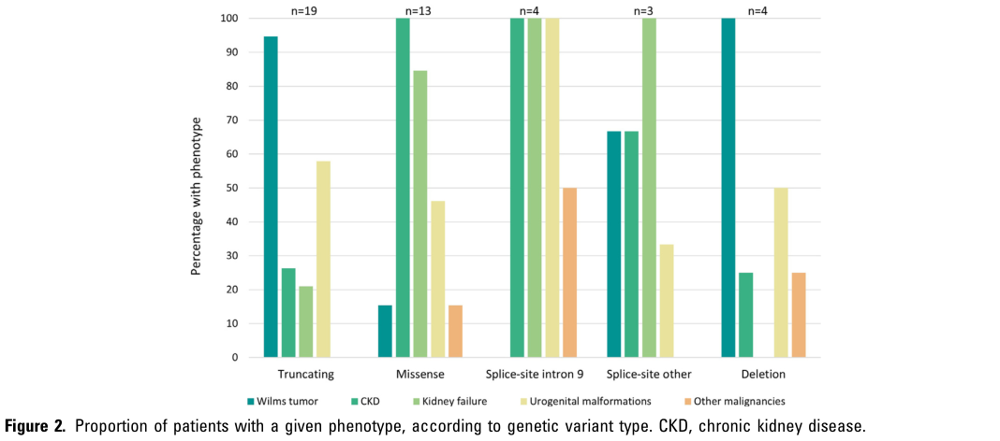

## Question

# Disease Characteristics Research Template

## Target Disease
- **Disease Name:** WT1-Related Wilms Tumor Predisposition
- **MONDO ID:** MONDO:0008679 (if available)
- **Category:** Mendelian

## Research Objectives

Please provide a comprehensive research report on **WT1-Related Wilms Tumor Predisposition** covering all of the
disease characteristics listed below. This report will be used to populate a disease knowledge
base entry. Be thorough and cite primary literature (PMID preferred) for all claims.

For each section, **suggested databases/resources** are listed. These are the first places
you should search for information on each topic.

---

### 1. Disease Information
> **Search first:** OMIM, Orphanet, ICD-10/ICD-11, MeSH, PubMed

- What is the disease? Provide a concise overview.
- What are the key identifiers? (OMIM, Orphanet, ICD-10/ICD-11, MeSH, Mondo)
- What are the common synonyms and alternative names?
- Is the information derived from individual patients (e.g., EHR) or aggregated disease-level resources?

### 2. Etiology

- **Disease Causal Factors**: What are the primary causes? (genetic, environmental, infectious, mechanistic)
- **Risk Factors**:
  > **Search first:** PubMed, Cochrane Library, UpToDate, clinical guidelines, ClinVar, ClinGen, GWAS Catalog, PheGenI, CTD, CDC, WHO, epidemiological databases
  - Genetic risk factors (causal variants, susceptibility loci, modifier genes)
  - Environmental risk factors (toxins, lifestyle, occupational exposures, age, sex, family history)
- **Protective Factors**:
  > **Search first:** PubMed, Cochrane Library, clinical trial databases, GWAS Catalog, gnomAD, WHO, CDC, nutrition databases
  - Genetic protective factors (protective variants, modifier alleles)
  - Environmental protective factors (diet, lifestyle, exposures that reduce risk)
- **Gene-Environment Interactions**: How do genetic and environmental factors interact to influence disease?
  > **Search first:** CTD, PubMed, PheGenI, GxE databases

### 3. Phenotypes
> **Search first:** HPO (Human Phenotype Ontology), OMIM, Orphanet, PubMed, clinicaltrials.gov, MedDRA, SNOMED CT, DECIPHER, LOINC

For each phenotype, provide:
- **Phenotype type**: symptoms, clinical signs, physical manifestations, behavioral changes, or laboratory abnormalities
  > For symptoms/signs: HPO, OMIM, Orphanet, PubMed
  > For behavioral changes: HPO, DSM, RDoC (Research Domain Criteria), PubMed
  > For laboratory abnormalities: LOINC, SNOMED CT, LabTests Online, PubMed
- **Phenotype characteristics**:
  > **Search first:** OMIM, Orphanet, HPO, PubMed
  - Age of symptom onset (neonatal, childhood, adult-onset, late-onset)
  - Symptom severity (mild, moderate, severe, variable)
  - Symptom progression (stable, progressive, episodic, fluctuating)
  - Frequency among affected individuals (percentage or qualitative)
- **Quality of life impact**: Effects on daily functioning and well-being (per-phenotype when possible)
  > **Search first:** EQ-5D database, SF-36, WHO QOL databases, PubMed
- Suggest HPO (Human Phenotype Ontology) terms for each phenotype

### 4. Genetic/Molecular Information

- **Causal Genes**: Gene mutations or chromosomal abnormalities responsible for disease (gene symbols, OMIM IDs)
  > **Search first:** OMIM, ClinVar, HGMD, Ensembl, NCBI Gene
- **Pathogenic Variants**:
  - Affected genes (gene symbols, HGNC IDs)
    > **Search first:** OMIM, NCBI Gene, Ensembl, HGNC, UniProt, GeneCards
  - Variant classification (pathogenic, likely pathogenic, VUS per ACMG/AMP guidelines)
    > **Search first:** ClinVar, ClinGen, ACMG/AMP guidelines, VarSome
  - Variant type/class (missense, frameshift, nonsense, splice-site, structural)
  - Allele frequency in population databases
    > **Search first:** gnomAD, 1000 Genomes, ExAC, TOPMed, dbSNP
  - Somatic vs germline origin
    > **Search first:** COSMIC (somatic), ClinVar, ICGC, TCGA
  - Functional consequences (loss of function, gain of function, dominant negative)
- **Modifier Genes**: Genes that modify disease severity or expression
- **Epigenetic Information**: DNA methylation, histone modifications, chromatin changes affecting disease
  > **Search first:** ENCODE, Roadmap Epigenomics, MethBase, DiseaseMeth
- **Chromosomal Abnormalities**: Large-scale genetic changes (aneuploidy, translocations, inversions)
  > **Search first:** DECIPHER, ClinVar, ECARUCA, UCSC Genome Browser

### 5. Environmental Information

- **Environmental Factors**: Non-genetic contributing factors (toxins, radiation, pollution, occupational exposure)
  > **Search first:** CTD (Comparative Toxicogenomics Database), TOXNET, PubMed, EPA databases
- **Lifestyle Factors**: Behavioral factors (smoking, diet, exercise, alcohol consumption)
  > **Search first:** CDC databases, WHO, PubMed, NHANES
- **Infectious Agents**: If applicable, pathogens causing or triggering disease (bacteria, viruses, fungi, parasites)
  > **Search first:** NCBI Taxonomy, ViPR, BV-BRC, MicrobeDB, GIDEON

### 6. Mechanism / Pathophysiology

**Present this section as an ordered causal chain first, then the detail below.**
Open with a numbered sequence of mechanistic steps running from the initiating
lesion (mutation, exposure, infection) to the clinical manifestation, one step per
line, each naming what it causes next. State the causal verb explicitly ("leads
to", "results in") and say where a step is inferred rather than demonstrated.
Where the mechanism branches, show the branch. The categories below are a
checklist of what to cover within those steps, not the organizing structure —
a step may draw on several of them, and a category may contribute to several
steps.

- **Molecular Pathways**: Specific signaling cascades or biochemical pathways involved (Wnt, MAPK, mTOR, PI3K-AKT, etc.)
  > **Search first:** KEGG, Reactome, WikiPathways, PathBank, BioCyc
- **Cellular Processes**: Cell-level mechanisms (apoptosis, autophagy, cell cycle dysregulation, inflammation, etc.)
  > **Search first:** Gene Ontology (GO), Reactome, KEGG, PubMed
- **Protein Dysfunction**: How protein structure or function is altered (misfolding, aggregation, loss of function, gain of function)
  > **Search first:** UniProt, PDB (Protein Data Bank), InterPro, Pfam, AlphaFold
- **Metabolic Changes**: Alterations in metabolic processes (energy metabolism, lipid metabolism, amino acid metabolism)
  > **Search first:** KEGG, BioCyc, HMDB (Human Metabolome Database), BRENDA
- **Immune System Involvement**: Role of immune response (autoimmunity, immunodeficiency, chronic inflammation)
  > **Search first:** ImmPort, Immunome Database, IEDB, Gene Ontology
- **Tissue Damage Mechanisms**: How tissues/ are injured (oxidative stress, ischemia, fibrosis, necrosis)
  > **Search first:** PubMed, Gene Ontology, Reactome
- **Biochemical Abnormalities**: Specific molecular defects (enzyme deficiencies, receptor dysfunction, ion channel defects)
  > **Search first:** BRENDA, UniProt, KEGG, OMIM, PubMed
- **Epigenetic Changes**: DNA methylation, histone modifications affecting gene expression in disease
  > **Search first:** ENCODE, Roadmap Epigenomics, MethBase, DiseaseMeth
- **Molecular Profiling** (if available):
  - Transcriptomics/gene expression changes
    > **Search first:** GEO (Gene Expression Omnibus), ArrayExpress, GTEx, Human Cell Atlas, SRA
  - Proteomics findings
    > **Search first:** PRIDE, ProteomeXchange, Human Protein Atlas, STRING, BioGRID
  - Metabolomics signatures
    > **Search first:** MetaboLights, Metabolomics Workbench, HMDB, METLIN
  - Lipidomics alterations
    > **Search first:** LIPID MAPS, SwissLipids, LipidHome, Metabolomics Workbench
  - Genomic structural features
    > **Search first:** UCSC Genome Browser, Ensembl, NCBI, dbVar, DGV
- **Advanced Technologies** (if applicable):
  - Single-cell analysis findings (cell-type specific mechanisms, cellular heterogeneity)
    > **Search first:** Human Cell Atlas, Single Cell Portal, GEO, CELLxGENE
  - Spatial transcriptomics findings
    > **Search first:** GEO, Spatial Research, Vizgen, 10x Genomics data
  - Multi-omics integration results
    > **Search first:** TCGA, ICGC, cBioPortal, LinkedOmics, PubMed
  - Functional genomics screens (CRISPR, RNAi)
    > **Search first:** DepMap, GenomeRNAi, PubMed, BioGRID ORCS

For each mechanism, describe:
- The causal chain from initial trigger to clinical manifestation
- Which mechanisms are upstream vs downstream
- What cell types and biological processes are involved
- Suggest GO terms for biological processes and CL terms for cell types

### 7. Anatomical Structures Affected

- **Organ Level**:
  - Primary organs directly affected
  - Secondary organ involvement (complications, secondary effects)
  - Body systems involved (cardiovascular, nervous, digestive, respiratory, endocrine, etc.)
  > **Search first:** Uberon, FMA (Foundational Model of Anatomy), OMIM, HPO, ICD-11, MeSH, SNOMED CT
- **Tissue and Cell Level**:
  - Specific tissue types affected (epithelial, connective, muscle, nervous)
  - Specific cell populations targeted (with Cell Ontology terms)
  > **Search first:** Uberon, Human Protein Atlas, Cell Ontology, Human Cell Atlas, CellMarker, PanglaoDB
- **Subcellular Level**:
  - Cellular compartments involved (mitochondria, nucleus, ER, lysosomes) (with GO Cellular Component terms)
  > **Search first:** Gene Ontology (Cellular Component), UniProt, Human Protein Atlas
- **Localization**:
  - Specific anatomical sites (with UBERON terms)
    > **Search first:** FMA, Uberon, NeuroNames (for brain), SNOMED CT
  - Lateralization (unilateral, bilateral, asymmetric)
    > **Search first:** HPO, clinical literature, imaging databases

### 8. Temporal Development

- **Onset**:
  - Typical age of onset (congenital, pediatric, adult, geriatric)
  - Onset pattern (acute, subacute, chronic, insidious)
  > **Search first:** OMIM, Orphanet, HPO, PubMed
- **Progression**:
  - Disease stages (early, intermediate, advanced, end-stage)
    > **Search first:** Cancer Staging Manual (AJCC), WHO classifications, PubMed
  - Progression rate (rapid, slow, variable)
  - Disease course pattern (episodic, relapsing-remitting, progressive, stable)
  - Disease duration (self-limited, chronic lifelong)
  > **Search first:** Disease registries, longitudinal cohort databases, natural history studies, PubMed, Orphanet, OMIM
- **Patterns**:
  - Remission patterns (spontaneous, treatment-induced)
    > **Search first:** Clinical trial databases, disease registries, PubMed
  - Critical periods (time windows of vulnerability or opportunity for intervention)
    > **Search first:** PubMed, developmental biology databases, clinical guidelines

### 9. Inheritance and Population

- **Epidemiology**:
  - Prevalence (cases per 100,000 at given time)
  - Incidence (new cases per 100,000 per year)
  > **Search first:** Orphanet, CDC, WHO, GBD (Global Burden of Disease), national registries, SEER, disease registries
- **For Genetic Etiology**:
  - Inheritance pattern (AD, AR, X-linked, mitochondrial, multifactorial, polygenic)
    > **Search first:** OMIM, Orphanet, ClinVar, GTR (Genetic Testing Registry)
  - Penetrance (complete, incomplete, age-dependent)
    > **Search first:** ClinVar, OMIM, PubMed, ClinGen
  - Expressivity (variable, consistent)
    > **Search first:** OMIM, ClinVar, PubMed
  - Genetic anticipation (increasing severity in successive generations)
    > **Search first:** OMIM, PubMed (especially for repeat expansion disorders)
  - Germline mosaicism
    > **Search first:** ClinVar, OMIM, genetic counseling literature, PubMed
  - Founder effects (population-specific mutations)
    > **Search first:** gnomAD, population genetics databases, PubMed
  - Consanguinity role
    > **Search first:** OMIM, population studies, genetic counseling resources
  - Carrier frequency
    > **Search first:** gnomAD, carrier screening databases, GeneReviews, GTR
- **Population Demographics**:
  - Affected populations (ethnic or demographic groups with higher prevalence)
    > **Search first:** gnomAD, 1000 Genomes, PAGE Study, PubMed, population registries
  - Geographic distribution (endemic areas, regional variation)
    > **Search first:** WHO, CDC, GBD, Orphanet, geographic epidemiology databases
  - Geographic distribution of specific variants
  - Sex ratio (male:female)
    > **Search first:** Disease registries, OMIM, PubMed, epidemiological databases
  - Age distribution of affected individuals
    > **Search first:** CDC, disease registries, SEER, Orphanet

### 10. Diagnostics

- **Clinical Tests**:
  - Laboratory tests (blood, urine, tissue chemistry, specific enzyme assays)
    > **Search first:** LOINC, LabTests Online, PubMed
  - Biomarkers (proteins, metabolites, genetic markers, circulating biomarkers)
    > **Search first:** FDA Biomarker List, BEST (Biomarkers, EndpointS, and other Tools), PubMed
  - Imaging studies (X-ray, CT, MRI, PET, ultrasound)
    > **Search first:** RadLex, DICOM, Radiopaedia, imaging databases
  - Functional tests (pulmonary function, cardiac stress tests)
    > **Search first:** LOINC, clinical guidelines, PubMed
  - Electrophysiology (EEG, EMG, ECG, nerve conduction studies)
    > **Search first:** LOINC, clinical neurophysiology databases, PubMed
  - Biopsy findings (histopathology, immunohistochemistry)
    > **Search first:** SNOMED CT, College of American Pathologists resources, PubMed
  - Pathology findings (microscopic examination)
    > **Search first:** SNOMED CT, Digital Pathology databases, PubMed
- **Genetic Testing**:
  > **Search first:** GTR (Genetic Testing Registry), GeneReviews, ClinGen
  - Overview of recommended genetic testing approach
  - Whole genome sequencing (WGS) utility
    > **Search first:** GTR, ClinVar, GEL (Genomics England), gnomAD
  - Whole exome sequencing (WES) utility
    > **Search first:** GTR, ClinVar, OMIM, GeneMatcher
  - Gene panels (which panels, which genes)
    > **Search first:** GTR, ClinVar, laboratory-specific databases
  - Single gene testing
    > **Search first:** GTR, ClinVar, OMIM, GeneReviews
  - Chromosomal microarray (CMA)
    > **Search first:** DECIPHER, ClinVar, dbVar, ECARUCA
  - Karyotyping
    > **Search first:** Chromosome Abnormality Database, ClinVar, cytogenetics resources
  - FISH
    > **Search first:** ClinVar, cytogenetics databases, PubMed
  - Mitochondrial DNA testing
    > **Search first:** MITOMAP, MSeqDR, ClinVar, GTR
  - Repeat expansion testing
    > **Search first:** GTR, ClinVar, repeat expansion databases, PubMed
- **Omics-Based Diagnostics** (if applicable):
  - RNA sequencing / transcriptomics
    > **Search first:** GEO, ArrayExpress, GTEx, RNA-seq databases
  - Proteomics
    > **Search first:** PRIDE, ProteomeXchange, FDA Biomarker database
  - Metabolomics
    > **Search first:** MetaboLights, Metabolomics Workbench, HMDB
  - Epigenomics
    > **Search first:** GEO, ENCODE, Roadmap Epigenomics, MethBase
  - Liquid biopsy
    > **Search first:** COSMIC, ClinVar, liquid biopsy databases, PubMed
- **Clinical Criteria**:
  - Standardized diagnostic criteria (DSM, ICD, society guidelines)
    > **Search first:** DSM-5, ICD-11, clinical society guidelines, UpToDate
  - Differential diagnosis (other conditions to rule out, with distinguishing features)
    > **Search first:** DynaMed, UpToDate, clinical decision support systems
- **Screening**:
  - Screening methods for asymptomatic individuals (newborn screening, carrier screening, cascade screening)
    > **Search first:** ACMG recommendations, CDC newborn screening, GTR

### 11. Outcome/Prognosis

- **Survival and Mortality**:
  - Survival rate (5-year, 10-year, overall)
    > **Search first:** SEER, cancer registries, disease-specific registries, PubMed
  - Life expectancy (with and without treatment if applicable)
    > **Search first:** Orphanet, disease registries, actuarial databases, PubMed
  - Mortality rate
    > **Search first:** CDC, WHO, GBD, national mortality databases
  - Disease-specific mortality (deaths directly attributable to disease)
    > **Search first:** Disease registries, CDC Wonder, GBD, PubMed
- **Morbidity and Function**:
  - Morbidity (disease-related disability and health impacts)
    > **Search first:** GBD, WHO, disability databases, PubMed
  - Disability outcomes (long-term functional impairments)
    > **Search first:** ICF (International Classification of Functioning), disability registries
  - Quality of life measures (EQ-5D, SF-36, PROMIS, disease-specific tools)
    > **Search first:** EQ-5D database, SF-36, PROMIS, PubMed
- **Disease Course**:
  - Complications (secondary problems: infections, organ failure, etc.)
    > **Search first:** ICD codes, disease registries, clinical databases, PubMed
  - Recovery potential (likelihood and extent of recovery, with vs without treatment)
    > **Search first:** Natural history studies, rehabilitation databases, PubMed
- **Prediction**:
  - Prognostic factors (age, disease severity, biomarkers, treatment response)
    > **Search first:** Prognostic models databases, clinical calculators, PubMed
  - Prognostic biomarkers (molecular markers predicting disease course)
    > **Search first:** FDA Biomarker database, PubMed, cancer prognostic databases

### 12. Treatment

- **Pharmacotherapy**:
  - Pharmacological treatments (drug names, drug classes, mechanisms of action)
    > **Search first:** DrugBank, RxNorm, ATC classification, DailyMed, FDA databases
  - Pharmacogenomics (how genetic variants affect drug metabolism, efficacy, toxicity)
    > **Search first:** PharmGKB, CPIC (Clinical Pharmacogenetics), FDA Table of PGx Biomarkers
- **Advanced Therapeutics**:
  - Gene therapy (viral vectors, CRISPR, gene replacement, gene editing)
    > **Search first:** ClinicalTrials.gov, FDA gene therapy database, ASGCT resources
  - Cell therapy (stem cell transplant, CAR-T, cellular therapeutics)
    > **Search first:** ClinicalTrials.gov, FDA cell therapy database, FACT standards
  - RNA-based therapies (ASOs, siRNA, mRNA therapies)
    > **Search first:** ClinicalTrials.gov, FDA approvals, PubMed
  - Targeted therapies (treatments directed at specific molecular targets)
    > **Search first:** My Cancer Genome, OncoKB, ClinicalTrials.gov, FDA approvals
  - Immunotherapies (checkpoint inhibitors, monoclonal antibodies)
    > **Search first:** Cancer Immunotherapy Database, FDA approvals, ClinicalTrials.gov
- **Surgical and Interventional**:
  - Surgical interventions (types of surgery, timing, outcomes)
    > **Search first:** CPT codes, surgical registries, clinical guidelines, PubMed
- **Supportive and Rehabilitative**:
  - Supportive care (symptom management, pain control, nutrition)
    > **Search first:** Clinical guidelines, Cochrane Library, PubMed
  - Rehabilitation (physical therapy, occupational therapy, speech therapy)
    > **Search first:** Rehabilitation medicine databases, clinical guidelines, PubMed
- **Experimental**:
  - Experimental treatments in clinical trials (with NCT identifiers if available)
    > **Search first:** ClinicalTrials.gov, EU Clinical Trials Register, WHO ICTRP
- **Treatment Outcomes**:
  - Treatment response rates
    > **Search first:** Clinical trial databases, FDA reviews, systematic reviews, PubMed
  - Side effects and adverse events
    > **Search first:** FDA Adverse Event Reporting System (FAERS), MedWatch, PubMed
- **Treatment Strategy**:
  - Treatment algorithms (clinical pathways, decision trees)
    > **Search first:** Clinical practice guidelines, NCCN Guidelines, UpToDate
  - Combination therapies
    > **Search first:** ClinicalTrials.gov, treatment guidelines, PubMed
  - Personalized medicine approaches (genotype-guided treatment)
    > **Search first:** My Cancer Genome, CIViC, PharmGKB, precision medicine databases

For each treatment, suggest NCIT (NCI Thesaurus) clinical-intervention terms where applicable.

### 13. Prevention

- **Prevention Levels**:
  - Primary prevention (preventing disease occurrence: vaccination, risk factor modification)
    > **Search first:** CDC, WHO, USPSTF recommendations, Cochrane Library
  - Secondary prevention (early detection and treatment: screening programs, early intervention)
    > **Search first:** USPSTF, CDC screening guidelines, WHO
  - Tertiary prevention (preventing complications in those with disease)
    > **Search first:** Clinical guidelines, disease management protocols, PubMed
- **Immunization**: Vaccine strategies (if applicable)
  > **Search first:** CDC vaccine schedules, WHO immunization, FDA vaccine database
- **Screening and Early Detection**:
  - Screening programs (population-based: newborn screening, cancer screening)
    > **Search first:** CDC screening programs, USPSTF, cancer screening databases
  - Genetic screening (carrier screening, preimplantation genetic diagnosis, prenatal testing)
    > **Search first:** ACMG recommendations, ACOG guidelines, GTR
  - Risk stratification (identifying high-risk individuals for targeted prevention)
    > **Search first:** Risk prediction models, clinical calculators, PubMed
- **Behavioral Interventions**: Lifestyle modifications to reduce risk
  > **Search first:** CDC, WHO, behavioral intervention databases, Cochrane Library
- **Counseling**: Genetic counseling (risk assessment, family planning guidance)
  > **Search first:** NSGC resources, ACMG guidelines, GeneReviews
- **Public Health**:
  - Public health interventions (sanitation, vector control, health education)
    > **Search first:** CDC, WHO, public health databases, PubMed
  - Environmental interventions (reducing environmental risk factors)
    > **Search first:** EPA databases, WHO environmental health, PubMed
- **Prophylaxis**: Preventive medications or procedures
  > **Search first:** Clinical guidelines, FDA approvals, PubMed

### 14. Other Species / Natural Disease

- **Taxonomy**: Species affected (with NCBI Taxon identifiers)
  > **Search first:** NCBI Taxonomy
- **Breed**: Specific breeds affected (with VBO identifiers if applicable)
  > **Search first:** VBO (Vertebrate Breed Ontology)
- **Gene**: Orthologous genes in other species (with NCBI Gene IDs)
  > **Search first:** NCBI Gene
- **Natural Disease**:
  - Naturally occurring disease in other species (companion animals, wildlife)
    > **Search first:** OMIA (Online Mendelian Inheritance in Animals), VetCompass, PubMed
  - Veterinary relevance and importance in animal health
    > **Search first:** OMIA, veterinary databases, PubMed
- **Comparative Biology**:
  - Comparative pathology (similarities and differences across species)
    > **Search first:** OMIA, comparative pathology databases, PubMed
  - Evolutionary conservation of disease mechanisms
    > **Search first:** HomoloGene, OrthoMCL, Alliance of Genome Resources
- **Transmission** (if applicable):
  - Zoonotic potential
    > **Search first:** CDC zoonotic diseases, WHO zoonoses, GIDEON
  - Cross-species susceptibility
    > **Search first:** NCBI Taxonomy, veterinary databases, PubMed

### 15. Model Organisms

- **Model Types**:
  - Model organism type (mammalian, invertebrate, cellular, in vitro)
    > **Search first:** Alliance of Genome Resources, model organism databases
  - Specific model systems (mouse, rat, zebrafish, Drosophila, C. elegans, yeast, cell lines, organoids, iPSCs)
    > **Search first:** MGI, RGD, ZFIN, FlyBase, WormBase, SGD, ATCC, Cellosaurus
  - Induced models (drug treatment, surgical intervention, environmental manipulation)
    > **Search first:** MGI, model organism databases, PubMed
- **Genetic Models**:
  - Types available (knockout, knock-in, transgenic, conditional, humanized)
    > **Search first:** MGI, IMPC, KOMP, EuMMCR, IMSR
- **Model Characteristics**:
  - Phenotype recapitulation (how well model reproduces human disease features)
    > **Search first:** Model organism databases, comparative studies, PubMed
  - Model limitations (aspects of human disease not captured)
    > **Search first:** Model organism databases, PubMed, review articles
- **Applications**:
  - Research applications (what aspects of disease can be studied)
    > **Search first:** Model organism databases, PubMed
- **Resources**:
  - Model databases
    > **Search first:** MGI, RGD, ZFIN, FlyBase, WormBase, IMSR, EMMA, MMRRC

---

## Citation Requirements

- Cite primary literature (PMID preferred) for all mechanistic and clinical claims
- Prioritize recent reviews and landmark papers
- Include direct quotes from abstracts where possible to support key statements
- Distinguish evidence source types: human clinical, model organism, in vitro, computational

## Output Format

Structure your response as a comprehensive narrative organized by the sections above.
For each section, provide:
- Factual content with specific details (numbers, percentages, gene names, variant nomenclature)
- Ontology term suggestions (HPO, GO, CL, UBERON, CHEBI, NCIT, MONDO) where applicable
- Evidence citations with PMIDs
- Direct quotes from abstracts to support key claims
- Clear indication when information is not available or not applicable for this disease

This report will be used to populate a disease knowledge base entry with:
- Pathophysiology descriptions with causal chains
- Gene/protein annotations (HGNC, GO terms)
- Phenotype associations (HP terms) with frequencies
- Cell type involvement (CL terms)
- Anatomical locations (UBERON terms)
- Chemical entities (CHEBI terms)
- Treatment annotations (NCIT terms)
- Evidence items with PMIDs and exact abstract quotes
- Epidemiology, prognosis, diagnostic, and prevention information
- Animal model descriptions with phenotype recapitulation details

## Output

Question: You are an expert researcher providing comprehensive, well-cited information.

Provide detailed information focusing on:
1. Key concepts and definitions with current understanding
2. Recent developments and latest research (prioritize 2023-2024 sources)
3. Current applications and real-world implementations
4. Expert opinions and analysis from authoritative sources
5. Relevant statistics and data from recent studies

Format as a comprehensive research report with proper citations. Include URLs and publication dates where available.
Always prioritize recent, authoritative sources and provide specific citations for all major claims.

# Disease Characteristics Research Template

## Target Disease
- **Disease Name:** WT1-Related Wilms Tumor Predisposition
- **MONDO ID:** MONDO:0008679 (if available)
- **Category:** Mendelian

## Research Objectives

Please provide a comprehensive research report on **WT1-Related Wilms Tumor Predisposition** covering all of the
disease characteristics listed below. This report will be used to populate a disease knowledge
base entry. Be thorough and cite primary literature (PMID preferred) for all claims.

For each section, **suggested databases/resources** are listed. These are the first places
you should search for information on each topic.

---

### 1. Disease Information
> **Search first:** OMIM, Orphanet, ICD-10/ICD-11, MeSH, PubMed

- What is the disease? Provide a concise overview.
- What are the key identifiers? (OMIM, Orphanet, ICD-10/ICD-11, MeSH, Mondo)
- What are the common synonyms and alternative names?
- Is the information derived from individual patients (e.g., EHR) or aggregated disease-level resources?

### 2. Etiology

- **Disease Causal Factors**: What are the primary causes? (genetic, environmental, infectious, mechanistic)
- **Risk Factors**:
  > **Search first:** PubMed, Cochrane Library, UpToDate, clinical guidelines, ClinVar, ClinGen, GWAS Catalog, PheGenI, CTD, CDC, WHO, epidemiological databases
  - Genetic risk factors (causal variants, susceptibility loci, modifier genes)
  - Environmental risk factors (toxins, lifestyle, occupational exposures, age, sex, family history)
- **Protective Factors**:
  > **Search first:** PubMed, Cochrane Library, clinical trial databases, GWAS Catalog, gnomAD, WHO, CDC, nutrition databases
  - Genetic protective factors (protective variants, modifier alleles)
  - Environmental protective factors (diet, lifestyle, exposures that reduce risk)
- **Gene-Environment Interactions**: How do genetic and environmental factors interact to influence disease?
  > **Search first:** CTD, PubMed, PheGenI, GxE databases

### 3. Phenotypes
> **Search first:** HPO (Human Phenotype Ontology), OMIM, Orphanet, PubMed, clinicaltrials.gov, MedDRA, SNOMED CT, DECIPHER, LOINC

For each phenotype, provide:
- **Phenotype type**: symptoms, clinical signs, physical manifestations, behavioral changes, or laboratory abnormalities
  > For symptoms/signs: HPO, OMIM, Orphanet, PubMed
  > For behavioral changes: HPO, DSM, RDoC (Research Domain Criteria), PubMed
  > For laboratory abnormalities: LOINC, SNOMED CT, LabTests Online, PubMed
- **Phenotype characteristics**:
  > **Search first:** OMIM, Orphanet, HPO, PubMed
  - Age of symptom onset (neonatal, childhood, adult-onset, late-onset)
  - Symptom severity (mild, moderate, severe, variable)
  - Symptom progression (stable, progressive, episodic, fluctuating)
  - Frequency among affected individuals (percentage or qualitative)
- **Quality of life impact**: Effects on daily functioning and well-being (per-phenotype when possible)
  > **Search first:** EQ-5D database, SF-36, WHO QOL databases, PubMed
- Suggest HPO (Human Phenotype Ontology) terms for each phenotype

### 4. Genetic/Molecular Information

- **Causal Genes**: Gene mutations or chromosomal abnormalities responsible for disease (gene symbols, OMIM IDs)
  > **Search first:** OMIM, ClinVar, HGMD, Ensembl, NCBI Gene
- **Pathogenic Variants**:
  - Affected genes (gene symbols, HGNC IDs)
    > **Search first:** OMIM, NCBI Gene, Ensembl, HGNC, UniProt, GeneCards
  - Variant classification (pathogenic, likely pathogenic, VUS per ACMG/AMP guidelines)
    > **Search first:** ClinVar, ClinGen, ACMG/AMP guidelines, VarSome
  - Variant type/class (missense, frameshift, nonsense, splice-site, structural)
  - Allele frequency in population databases
    > **Search first:** gnomAD, 1000 Genomes, ExAC, TOPMed, dbSNP
  - Somatic vs germline origin
    > **Search first:** COSMIC (somatic), ClinVar, ICGC, TCGA
  - Functional consequences (loss of function, gain of function, dominant negative)
- **Modifier Genes**: Genes that modify disease severity or expression
- **Epigenetic Information**: DNA methylation, histone modifications, chromatin changes affecting disease
  > **Search first:** ENCODE, Roadmap Epigenomics, MethBase, DiseaseMeth
- **Chromosomal Abnormalities**: Large-scale genetic changes (aneuploidy, translocations, inversions)
  > **Search first:** DECIPHER, ClinVar, ECARUCA, UCSC Genome Browser

### 5. Environmental Information

- **Environmental Factors**: Non-genetic contributing factors (toxins, radiation, pollution, occupational exposure)
  > **Search first:** CTD (Comparative Toxicogenomics Database), TOXNET, PubMed, EPA databases
- **Lifestyle Factors**: Behavioral factors (smoking, diet, exercise, alcohol consumption)
  > **Search first:** CDC databases, WHO, PubMed, NHANES
- **Infectious Agents**: If applicable, pathogens causing or triggering disease (bacteria, viruses, fungi, parasites)
  > **Search first:** NCBI Taxonomy, ViPR, BV-BRC, MicrobeDB, GIDEON

### 6. Mechanism / Pathophysiology

**Present this section as an ordered causal chain first, then the detail below.**
Open with a numbered sequence of mechanistic steps running from the initiating
lesion (mutation, exposure, infection) to the clinical manifestation, one step per
line, each naming what it causes next. State the causal verb explicitly ("leads
to", "results in") and say where a step is inferred rather than demonstrated.
Where the mechanism branches, show the branch. The categories below are a
checklist of what to cover within those steps, not the organizing structure —
a step may draw on several of them, and a category may contribute to several
steps.

- **Molecular Pathways**: Specific signaling cascades or biochemical pathways involved (Wnt, MAPK, mTOR, PI3K-AKT, etc.)
  > **Search first:** KEGG, Reactome, WikiPathways, PathBank, BioCyc
- **Cellular Processes**: Cell-level mechanisms (apoptosis, autophagy, cell cycle dysregulation, inflammation, etc.)
  > **Search first:** Gene Ontology (GO), Reactome, KEGG, PubMed
- **Protein Dysfunction**: How protein structure or function is altered (misfolding, aggregation, loss of function, gain of function)
  > **Search first:** UniProt, PDB (Protein Data Bank), InterPro, Pfam, AlphaFold
- **Metabolic Changes**: Alterations in metabolic processes (energy metabolism, lipid metabolism, amino acid metabolism)
  > **Search first:** KEGG, BioCyc, HMDB (Human Metabolome Database), BRENDA
- **Immune System Involvement**: Role of immune response (autoimmunity, immunodeficiency, chronic inflammation)
  > **Search first:** ImmPort, Immunome Database, IEDB, Gene Ontology
- **Tissue Damage Mechanisms**: How tissues/ are injured (oxidative stress, ischemia, fibrosis, necrosis)
  > **Search first:** PubMed, Gene Ontology, Reactome
- **Biochemical Abnormalities**: Specific molecular defects (enzyme deficiencies, receptor dysfunction, ion channel defects)
  > **Search first:** BRENDA, UniProt, KEGG, OMIM, PubMed
- **Epigenetic Changes**: DNA methylation, histone modifications affecting gene expression in disease
  > **Search first:** ENCODE, Roadmap Epigenomics, MethBase, DiseaseMeth
- **Molecular Profiling** (if available):
  - Transcriptomics/gene expression changes
    > **Search first:** GEO (Gene Expression Omnibus), ArrayExpress, GTEx, Human Cell Atlas, SRA
  - Proteomics findings
    > **Search first:** PRIDE, ProteomeXchange, Human Protein Atlas, STRING, BioGRID
  - Metabolomics signatures
    > **Search first:** MetaboLights, Metabolomics Workbench, HMDB, METLIN
  - Lipidomics alterations
    > **Search first:** LIPID MAPS, SwissLipids, LipidHome, Metabolomics Workbench
  - Genomic structural features
    > **Search first:** UCSC Genome Browser, Ensembl, NCBI, dbVar, DGV
- **Advanced Technologies** (if applicable):
  - Single-cell analysis findings (cell-type specific mechanisms, cellular heterogeneity)
    > **Search first:** Human Cell Atlas, Single Cell Portal, GEO, CELLxGENE
  - Spatial transcriptomics findings
    > **Search first:** GEO, Spatial Research, Vizgen, 10x Genomics data
  - Multi-omics integration results
    > **Search first:** TCGA, ICGC, cBioPortal, LinkedOmics, PubMed
  - Functional genomics screens (CRISPR, RNAi)
    > **Search first:** DepMap, GenomeRNAi, PubMed, BioGRID ORCS

For each mechanism, describe:
- The causal chain from initial trigger to clinical manifestation
- Which mechanisms are upstream vs downstream
- What cell types and biological processes are involved
- Suggest GO terms for biological processes and CL terms for cell types

### 7. Anatomical Structures Affected

- **Organ Level**:
  - Primary organs directly affected
  - Secondary organ involvement (complications, secondary effects)
  - Body systems involved (cardiovascular, nervous, digestive, respiratory, endocrine, etc.)
  > **Search first:** Uberon, FMA (Foundational Model of Anatomy), OMIM, HPO, ICD-11, MeSH, SNOMED CT
- **Tissue and Cell Level**:
  - Specific tissue types affected (epithelial, connective, muscle, nervous)
  - Specific cell populations targeted (with Cell Ontology terms)
  > **Search first:** Uberon, Human Protein Atlas, Cell Ontology, Human Cell Atlas, CellMarker, PanglaoDB
- **Subcellular Level**:
  - Cellular compartments involved (mitochondria, nucleus, ER, lysosomes) (with GO Cellular Component terms)
  > **Search first:** Gene Ontology (Cellular Component), UniProt, Human Protein Atlas
- **Localization**:
  - Specific anatomical sites (with UBERON terms)
    > **Search first:** FMA, Uberon, NeuroNames (for brain), SNOMED CT
  - Lateralization (unilateral, bilateral, asymmetric)
    > **Search first:** HPO, clinical literature, imaging databases

### 8. Temporal Development

- **Onset**:
  - Typical age of onset (congenital, pediatric, adult, geriatric)
  - Onset pattern (acute, subacute, chronic, insidious)
  > **Search first:** OMIM, Orphanet, HPO, PubMed
- **Progression**:
  - Disease stages (early, intermediate, advanced, end-stage)
    > **Search first:** Cancer Staging Manual (AJCC), WHO classifications, PubMed
  - Progression rate (rapid, slow, variable)
  - Disease course pattern (episodic, relapsing-remitting, progressive, stable)
  - Disease duration (self-limited, chronic lifelong)
  > **Search first:** Disease registries, longitudinal cohort databases, natural history studies, PubMed, Orphanet, OMIM
- **Patterns**:
  - Remission patterns (spontaneous, treatment-induced)
    > **Search first:** Clinical trial databases, disease registries, PubMed
  - Critical periods (time windows of vulnerability or opportunity for intervention)
    > **Search first:** PubMed, developmental biology databases, clinical guidelines

### 9. Inheritance and Population

- **Epidemiology**:
  - Prevalence (cases per 100,000 at given time)
  - Incidence (new cases per 100,000 per year)
  > **Search first:** Orphanet, CDC, WHO, GBD (Global Burden of Disease), national registries, SEER, disease registries
- **For Genetic Etiology**:
  - Inheritance pattern (AD, AR, X-linked, mitochondrial, multifactorial, polygenic)
    > **Search first:** OMIM, Orphanet, ClinVar, GTR (Genetic Testing Registry)
  - Penetrance (complete, incomplete, age-dependent)
    > **Search first:** ClinVar, OMIM, PubMed, ClinGen
  - Expressivity (variable, consistent)
    > **Search first:** OMIM, ClinVar, PubMed
  - Genetic anticipation (increasing severity in successive generations)
    > **Search first:** OMIM, PubMed (especially for repeat expansion disorders)
  - Germline mosaicism
    > **Search first:** ClinVar, OMIM, genetic counseling literature, PubMed
  - Founder effects (population-specific mutations)
    > **Search first:** gnomAD, population genetics databases, PubMed
  - Consanguinity role
    > **Search first:** OMIM, population studies, genetic counseling resources
  - Carrier frequency
    > **Search first:** gnomAD, carrier screening databases, GeneReviews, GTR
- **Population Demographics**:
  - Affected populations (ethnic or demographic groups with higher prevalence)
    > **Search first:** gnomAD, 1000 Genomes, PAGE Study, PubMed, population registries
  - Geographic distribution (endemic areas, regional variation)
    > **Search first:** WHO, CDC, GBD, Orphanet, geographic epidemiology databases
  - Geographic distribution of specific variants
  - Sex ratio (male:female)
    > **Search first:** Disease registries, OMIM, PubMed, epidemiological databases
  - Age distribution of affected individuals
    > **Search first:** CDC, disease registries, SEER, Orphanet

### 10. Diagnostics

- **Clinical Tests**:
  - Laboratory tests (blood, urine, tissue chemistry, specific enzyme assays)
    > **Search first:** LOINC, LabTests Online, PubMed
  - Biomarkers (proteins, metabolites, genetic markers, circulating biomarkers)
    > **Search first:** FDA Biomarker List, BEST (Biomarkers, EndpointS, and other Tools), PubMed
  - Imaging studies (X-ray, CT, MRI, PET, ultrasound)
    > **Search first:** RadLex, DICOM, Radiopaedia, imaging databases
  - Functional tests (pulmonary function, cardiac stress tests)
    > **Search first:** LOINC, clinical guidelines, PubMed
  - Electrophysiology (EEG, EMG, ECG, nerve conduction studies)
    > **Search first:** LOINC, clinical neurophysiology databases, PubMed
  - Biopsy findings (histopathology, immunohistochemistry)
    > **Search first:** SNOMED CT, College of American Pathologists resources, PubMed
  - Pathology findings (microscopic examination)
    > **Search first:** SNOMED CT, Digital Pathology databases, PubMed
- **Genetic Testing**:
  > **Search first:** GTR (Genetic Testing Registry), GeneReviews, ClinGen
  - Overview of recommended genetic testing approach
  - Whole genome sequencing (WGS) utility
    > **Search first:** GTR, ClinVar, GEL (Genomics England), gnomAD
  - Whole exome sequencing (WES) utility
    > **Search first:** GTR, ClinVar, OMIM, GeneMatcher
  - Gene panels (which panels, which genes)
    > **Search first:** GTR, ClinVar, laboratory-specific databases
  - Single gene testing
    > **Search first:** GTR, ClinVar, OMIM, GeneReviews
  - Chromosomal microarray (CMA)
    > **Search first:** DECIPHER, ClinVar, dbVar, ECARUCA
  - Karyotyping
    > **Search first:** Chromosome Abnormality Database, ClinVar, cytogenetics resources
  - FISH
    > **Search first:** ClinVar, cytogenetics databases, PubMed
  - Mitochondrial DNA testing
    > **Search first:** MITOMAP, MSeqDR, ClinVar, GTR
  - Repeat expansion testing
    > **Search first:** GTR, ClinVar, repeat expansion databases, PubMed
- **Omics-Based Diagnostics** (if applicable):
  - RNA sequencing / transcriptomics
    > **Search first:** GEO, ArrayExpress, GTEx, RNA-seq databases
  - Proteomics
    > **Search first:** PRIDE, ProteomeXchange, FDA Biomarker database
  - Metabolomics
    > **Search first:** MetaboLights, Metabolomics Workbench, HMDB
  - Epigenomics
    > **Search first:** GEO, ENCODE, Roadmap Epigenomics, MethBase
  - Liquid biopsy
    > **Search first:** COSMIC, ClinVar, liquid biopsy databases, PubMed
- **Clinical Criteria**:
  - Standardized diagnostic criteria (DSM, ICD, society guidelines)
    > **Search first:** DSM-5, ICD-11, clinical society guidelines, UpToDate
  - Differential diagnosis (other conditions to rule out, with distinguishing features)
    > **Search first:** DynaMed, UpToDate, clinical decision support systems
- **Screening**:
  - Screening methods for asymptomatic individuals (newborn screening, carrier screening, cascade screening)
    > **Search first:** ACMG recommendations, CDC newborn screening, GTR

### 11. Outcome/Prognosis

- **Survival and Mortality**:
  - Survival rate (5-year, 10-year, overall)
    > **Search first:** SEER, cancer registries, disease-specific registries, PubMed
  - Life expectancy (with and without treatment if applicable)
    > **Search first:** Orphanet, disease registries, actuarial databases, PubMed
  - Mortality rate
    > **Search first:** CDC, WHO, GBD, national mortality databases
  - Disease-specific mortality (deaths directly attributable to disease)
    > **Search first:** Disease registries, CDC Wonder, GBD, PubMed
- **Morbidity and Function**:
  - Morbidity (disease-related disability and health impacts)
    > **Search first:** GBD, WHO, disability databases, PubMed
  - Disability outcomes (long-term functional impairments)
    > **Search first:** ICF (International Classification of Functioning), disability registries
  - Quality of life measures (EQ-5D, SF-36, PROMIS, disease-specific tools)
    > **Search first:** EQ-5D database, SF-36, PROMIS, PubMed
- **Disease Course**:
  - Complications (secondary problems: infections, organ failure, etc.)
    > **Search first:** ICD codes, disease registries, clinical databases, PubMed
  - Recovery potential (likelihood and extent of recovery, with vs without treatment)
    > **Search first:** Natural history studies, rehabilitation databases, PubMed
- **Prediction**:
  - Prognostic factors (age, disease severity, biomarkers, treatment response)
    > **Search first:** Prognostic models databases, clinical calculators, PubMed
  - Prognostic biomarkers (molecular markers predicting disease course)
    > **Search first:** FDA Biomarker database, PubMed, cancer prognostic databases

### 12. Treatment

- **Pharmacotherapy**:
  - Pharmacological treatments (drug names, drug classes, mechanisms of action)
    > **Search first:** DrugBank, RxNorm, ATC classification, DailyMed, FDA databases
  - Pharmacogenomics (how genetic variants affect drug metabolism, efficacy, toxicity)
    > **Search first:** PharmGKB, CPIC (Clinical Pharmacogenetics), FDA Table of PGx Biomarkers
- **Advanced Therapeutics**:
  - Gene therapy (viral vectors, CRISPR, gene replacement, gene editing)
    > **Search first:** ClinicalTrials.gov, FDA gene therapy database, ASGCT resources
  - Cell therapy (stem cell transplant, CAR-T, cellular therapeutics)
    > **Search first:** ClinicalTrials.gov, FDA cell therapy database, FACT standards
  - RNA-based therapies (ASOs, siRNA, mRNA therapies)
    > **Search first:** ClinicalTrials.gov, FDA approvals, PubMed
  - Targeted therapies (treatments directed at specific molecular targets)
    > **Search first:** My Cancer Genome, OncoKB, ClinicalTrials.gov, FDA approvals
  - Immunotherapies (checkpoint inhibitors, monoclonal antibodies)
    > **Search first:** Cancer Immunotherapy Database, FDA approvals, ClinicalTrials.gov
- **Surgical and Interventional**:
  - Surgical interventions (types of surgery, timing, outcomes)
    > **Search first:** CPT codes, surgical registries, clinical guidelines, PubMed
- **Supportive and Rehabilitative**:
  - Supportive care (symptom management, pain control, nutrition)
    > **Search first:** Clinical guidelines, Cochrane Library, PubMed
  - Rehabilitation (physical therapy, occupational therapy, speech therapy)
    > **Search first:** Rehabilitation medicine databases, clinical guidelines, PubMed
- **Experimental**:
  - Experimental treatments in clinical trials (with NCT identifiers if available)
    > **Search first:** ClinicalTrials.gov, EU Clinical Trials Register, WHO ICTRP
- **Treatment Outcomes**:
  - Treatment response rates
    > **Search first:** Clinical trial databases, FDA reviews, systematic reviews, PubMed
  - Side effects and adverse events
    > **Search first:** FDA Adverse Event Reporting System (FAERS), MedWatch, PubMed
- **Treatment Strategy**:
  - Treatment algorithms (clinical pathways, decision trees)
    > **Search first:** Clinical practice guidelines, NCCN Guidelines, UpToDate
  - Combination therapies
    > **Search first:** ClinicalTrials.gov, treatment guidelines, PubMed
  - Personalized medicine approaches (genotype-guided treatment)
    > **Search first:** My Cancer Genome, CIViC, PharmGKB, precision medicine databases

For each treatment, suggest NCIT (NCI Thesaurus) clinical-intervention terms where applicable.

### 13. Prevention

- **Prevention Levels**:
  - Primary prevention (preventing disease occurrence: vaccination, risk factor modification)
    > **Search first:** CDC, WHO, USPSTF recommendations, Cochrane Library
  - Secondary prevention (early detection and treatment: screening programs, early intervention)
    > **Search first:** USPSTF, CDC screening guidelines, WHO
  - Tertiary prevention (preventing complications in those with disease)
    > **Search first:** Clinical guidelines, disease management protocols, PubMed
- **Immunization**: Vaccine strategies (if applicable)
  > **Search first:** CDC vaccine schedules, WHO immunization, FDA vaccine database
- **Screening and Early Detection**:
  - Screening programs (population-based: newborn screening, cancer screening)
    > **Search first:** CDC screening programs, USPSTF, cancer screening databases
  - Genetic screening (carrier screening, preimplantation genetic diagnosis, prenatal testing)
    > **Search first:** ACMG recommendations, ACOG guidelines, GTR
  - Risk stratification (identifying high-risk individuals for targeted prevention)
    > **Search first:** Risk prediction models, clinical calculators, PubMed
- **Behavioral Interventions**: Lifestyle modifications to reduce risk
  > **Search first:** CDC, WHO, behavioral intervention databases, Cochrane Library
- **Counseling**: Genetic counseling (risk assessment, family planning guidance)
  > **Search first:** NSGC resources, ACMG guidelines, GeneReviews
- **Public Health**:
  - Public health interventions (sanitation, vector control, health education)
    > **Search first:** CDC, WHO, public health databases, PubMed
  - Environmental interventions (reducing environmental risk factors)
    > **Search first:** EPA databases, WHO environmental health, PubMed
- **Prophylaxis**: Preventive medications or procedures
  > **Search first:** Clinical guidelines, FDA approvals, PubMed

### 14. Other Species / Natural Disease

- **Taxonomy**: Species affected (with NCBI Taxon identifiers)
  > **Search first:** NCBI Taxonomy
- **Breed**: Specific breeds affected (with VBO identifiers if applicable)
  > **Search first:** VBO (Vertebrate Breed Ontology)
- **Gene**: Orthologous genes in other species (with NCBI Gene IDs)
  > **Search first:** NCBI Gene
- **Natural Disease**:
  - Naturally occurring disease in other species (companion animals, wildlife)
    > **Search first:** OMIA (Online Mendelian Inheritance in Animals), VetCompass, PubMed
  - Veterinary relevance and importance in animal health
    > **Search first:** OMIA, veterinary databases, PubMed
- **Comparative Biology**:
  - Comparative pathology (similarities and differences across species)
    > **Search first:** OMIA, comparative pathology databases, PubMed
  - Evolutionary conservation of disease mechanisms
    > **Search first:** HomoloGene, OrthoMCL, Alliance of Genome Resources
- **Transmission** (if applicable):
  - Zoonotic potential
    > **Search first:** CDC zoonotic diseases, WHO zoonoses, GIDEON
  - Cross-species susceptibility
    > **Search first:** NCBI Taxonomy, veterinary databases, PubMed

### 15. Model Organisms

- **Model Types**:
  - Model organism type (mammalian, invertebrate, cellular, in vitro)
    > **Search first:** Alliance of Genome Resources, model organism databases
  - Specific model systems (mouse, rat, zebrafish, Drosophila, C. elegans, yeast, cell lines, organoids, iPSCs)
    > **Search first:** MGI, RGD, ZFIN, FlyBase, WormBase, SGD, ATCC, Cellosaurus
  - Induced models (drug treatment, surgical intervention, environmental manipulation)
    > **Search first:** MGI, model organism databases, PubMed
- **Genetic Models**:
  - Types available (knockout, knock-in, transgenic, conditional, humanized)
    > **Search first:** MGI, IMPC, KOMP, EuMMCR, IMSR
- **Model Characteristics**:
  - Phenotype recapitulation (how well model reproduces human disease features)
    > **Search first:** Model organism databases, comparative studies, PubMed
  - Model limitations (aspects of human disease not captured)
    > **Search first:** Model organism databases, PubMed, review articles
- **Applications**:
  - Research applications (what aspects of disease can be studied)
    > **Search first:** Model organism databases, PubMed
- **Resources**:
  - Model databases
    > **Search first:** MGI, RGD, ZFIN, FlyBase, WormBase, IMSR, EMMA, MMRRC

---

## Citation Requirements

- Cite primary literature (PMID preferred) for all mechanistic and clinical claims
- Prioritize recent reviews and landmark papers
- Include direct quotes from abstracts where possible to support key statements
- Distinguish evidence source types: human clinical, model organism, in vitro, computational

## Output Format

Structure your response as a comprehensive narrative organized by the sections above.
For each section, provide:
- Factual content with specific details (numbers, percentages, gene names, variant nomenclature)
- Ontology term suggestions (HPO, GO, CL, UBERON, CHEBI, NCIT, MONDO) where applicable
- Evidence citations with PMIDs
- Direct quotes from abstracts to support key claims
- Clear indication when information is not available or not applicable for this disease

This report will be used to populate a disease knowledge base entry with:
- Pathophysiology descriptions with causal chains
- Gene/protein annotations (HGNC, GO terms)
- Phenotype associations (HP terms) with frequencies
- Cell type involvement (CL terms)
- Anatomical locations (UBERON terms)
- Chemical entities (CHEBI terms)
- Treatment annotations (NCIT terms)
- Evidence items with PMIDs and exact abstract quotes
- Epidemiology, prognosis, diagnostic, and prevention information
- Animal model descriptions with phenotype recapitulation details

# WT1-related Wilms tumor predisposition: disease-characteristics report

**Scope and evidence convention.** This entry concerns *constitutional pathogenic WT1 variants* and their associated developmental, renal, gonadal, and tumor phenotypes—not every Wilms tumor with a somatic WT1 alteration. The best disease-wide synthesis is GeneReviews, originally posted April 30, 2020 and updated May 15, 2025; particularly informative recent primary evidence is the Dutch national cohort published online September 16, 2024 (PMID: **39698353**; https://doi.org/10.1016/j.ekir.2024.09.007). Frequencies below describe clinically ascertained patients unless expressly labeled population risks; they should not be transferred between variant classes. Ontology mappings labeled **suggested** require verification against the current ontology release. (lipskazietkiewicz2025wt1disorder pages 1-3, peer2024clinicalcharacterizationof pages 1-2, peer2024clinicalcharacterizationof pages 2-4)

## 1. Disease information

**Definition.** WT1 disorder is an autosomal-dominant phenotypic continuum caused by a heterozygous germline pathogenic or likely pathogenic variant of *WT1*. Its manifestations include progressive proteinuric glomerulopathy, steroid-resistant nephrotic syndrome (SRNS), disorders of gonadal development or function, and predisposition to childhood Wilms tumor. A carrier need not develop every manifestation. Historical terms **Denys–Drash syndrome**, **Frasier syndrome**, and **Meacham syndrome** describe overlapping phenotype patterns rather than dependable, separate molecular diagnoses. WAGR spectrum, caused by a *contiguous PAX6–WT1 deletion*, should be recorded separately, although WT1 loss contributes to its tumor risk. (lipskazietkiewicz2025wt1disorder pages 1-3, lipskazietkiewicz2025wt1disorder pages 7-10)

**Identifiers and nomenclature.** The requested **MONDO:0008679** is returned by Open Targets under the label **“Wilms tumor 1”**, whereas the broader Wilms tumor entity is **MONDO:0006058**; this distinction should be checked when linking a *predisposition syndrome* to a *tumor diagnosis*. Relevant OMIM entries in GeneReviews are **194070** (Wilms tumor 1), **607102** (*WT1* gene), **194080** (Denys–Drash), **136680** (Frasier), **256370** (nephrotic syndrome type 4), and **608978** (Meacham). Open Targets lists **Orphanet:654** for **nephroblastoma**, *not* as a verified identifier for the constitutional WT1 disorder. A syndrome-specific Orphanet number, an exact MeSH descriptor, and a unique ICD-10/ICD-11 code were **not verified**; do not substitute a kidney-cancer code for the predisposition syndrome. GeneReviews: https://www.ncbi.nlm.nih.gov/books/; Open Targets: https://platform.opentargets.org/. (lipskazietkiewicz2025wt1disorder pages 14-16, OpenTargets Search: Wilms tumor-WT1)

**Provenance.** These are aggregated disease-level observations from literature, expert synthesis, trial records, and pseudonymized, clinically ascertained cohorts—not access to an individual’s EHR. The 2024 Dutch investigators solicited laboratory records and clinical questionnaires; they received phenotype information for 43 of 64 individuals identified with a qualifying variant. (peer2024clinicalcharacterizationof pages 1-2, peer2024clinicalcharacterizationof pages 2-4)

## 2. Etiology: causal, risk, protective, and environmental factors

A germline pathogenic *WT1* variant at **11p13** is the initiating cause. Different classes affect DNA binding, WT1 dosage, or the balance of alternatively spliced **+KTS/−KTS** protein isoforms. Subsequent somatic events can promote Wilms tumor; gonadal phenotypes depend substantially on chromosomal sex and developmental context. Most diagnosed variants appear *de novo*, although transmission from an affected or clinically inconspicuous parent occurs. Sex affects phenotype recognition: 9 of 10 patients whose **only recognized manifestation** was Wilms tumor in the Dutch cohort were phenotypic female. This is not evidence that female carriers have a greater population tumor risk. (lipskazietkiewicz2025wt1disorder pages 1-3, lipskazietkiewicz2025wt1disorder pages 14-16, peer2024clinicalcharacterizationof pages 1-2)

**Variant-associated risks.** DNA-binding zinc-finger missense variants associate with very early and rapidly progressive renal disease; truncating variants and gene deletions were especially enriched among tumor-presenting patients in the Dutch series; specific intron-9 donor variants associate with later nephropathy, 46,XY complete gonadal dysgenesis, and relatively low reported Wilms tumor risk. Prognostic genotype associations are not absolute. No reproducible **protective WT1 allele**, established diet/exercise/toxin intervention preventing constitutional WT1 disease, or validated **WT1-specific environmental interaction** was identified. Nephron preservation and ultrasound surveillance reduce clinical harm or facilitate early detection; neither prevents inheritance of the variant. Other Wilms predisposition genes or 11p15 imprinting abnormalities are **alternative etiologies or potential tumor co-events**, not established modifiers of every WT1 carrier. (lipskazietkiewicz2025wt1disorder pages 7-10, peer2024clinicalcharacterizationof pages 1-2, peer2024clinicalcharacterizationof pages 6-7, akpa2015wilmstumorsuppressor pages 1-2)

## 3. Phenotypes and impact

GeneReviews’ synthesized feature frequencies and a recent primary cohort should be interpreted separately. Its summary estimates are: persistent proteinuria **>95%**; SRNS **80%**; congenital nephrotic syndrome **15%**; Wilms tumor **38%–60%**, median diagnosis **1.3–1.6 years**; 46,XY DSD **63%–79%** and 46,XY complete gonadal dysgenesis **18%–33%**, each *among 46,XY individuals*; CAKUT approximately **11%**; gonadoblastoma approximately **5%**; and early gonadal insufficiency **67% at 12.6 years**, rising to **83% at 16.2 years** in a separately cited gonadal-function study. The latter was a 2024 conference-abstract cohort of **80**, so its estimates merit more caution than full primary reports. These are not independent probabilities that can be added. (lipskazietkiewicz2025wt1disorder pages 3-6, lipskazietkiewicz2025wt1disorder pages 6-7, lipskazietkiewicz2025wt1disorder pages 16-19)

* **Renal signs and laboratory abnormalities:** congenital-through-adult proteinuria may initially fluctuate, then commonly worsens; edema, low serum albumin and hyperlipidemia characterize nephrotic syndrome, with declining filtration, hypertension, and eventual kidney failure in severe disease. Diffuse mesangial sclerosis (DMS) is particularly associated with infantile disease, while focal segmental glomerulosclerosis (FSGS) occurs more often in older patients. Suggested HPO concepts: **proteinuria, steroid-resistant nephrotic syndrome, congenital nephrotic syndrome, DMS, FSGS, chronic kidney disease, hypertension, edema**; validate exact HP identifiers before insertion. Kidney failure and dialysis/transplantation have major implications for daily functioning. (lipskazietkiewicz2025wt1disorder pages 1-3, lipskazietkiewicz2025wt1disorder pages 6-7, peer2024clinicalcharacterizationof pages 2-4)
* **Wilms tumor:** usually early-childhood renal mass; tumors may be unilateral, synchronous bilateral, or metachronous bilateral. In the Dutch cohort, **26/43** developed Wilms tumor, median first diagnosis **12 months** (range **3 months–5.9 years**), and **14/26** tumor cases had bilateral involvement under a definition also including unilateral tumor with contralateral nephroblastomatosis. Suggested HPO: **Wilms tumor** and **bilateral Wilms tumor**. Tumor treatment and loss of nephrons add substantial morbidity. (peer2024clinicalcharacterizationof pages 2-4, peer2024clinicalcharacterizationof pages 6-7)
* **Gonadal and genitourinary findings:** 46,XY phenotypes range from hypospadias, cryptorchidism, or atypical external genitalia to female-appearing external genitalia with dysgenetic gonads; rare 46,XX DSD and gonadal dysgenesis also occur. Pubertal delay, elevated FSH/LH, reduced AMH or inhibin B, infertility, and gonadoblastoma are relevant later or in susceptible gonads. Suggested HPO: **hypospadias, cryptorchidism, ambiguous genitalia, 46,XY complete gonadal dysgenesis, gonadoblastoma, primary gonadal insufficiency, infertility**. Effects on fertility and psychosocial well-being warrant individualized assessment; WT1-specific EQ-5D, SF-36, or PROMIS scores were not located. (lipskazietkiewicz2025wt1disorder pages 1-3, lipskazietkiewicz2025wt1disorder pages 6-7, peer2024clinicalcharacterizationof pages 4-6)
* **Less frequent structural signs:** duplex or horseshoe kidney, renal malrotation, vesicoureteral reflux, ureteropelvic-junction obstruction; rarely diaphragmatic hernia. Suggested HPO: **horseshoe kidney, duplicated renal collecting system, vesicoureteral reflux, ureteropelvic junction obstruction, congenital diaphragmatic hernia**. Do **not** automatically attribute aniridia or developmental delay to an intragenic WT1 variant; investigate WAGR/PAX6 deletion instead. (lipskazietkiewicz2025wt1disorder pages 1-3, lipskazietkiewicz2025wt1disorder pages 6-7, lipskazietkiewicz2025wt1disorder pages 7-10)

## 4. Genetic and molecular information

*WT1* (**HGNC symbol WT1**; Ensembl **ENSG00000184937**; OMIM gene **607102**) encodes a transcriptional regulator with four C-terminal C2H2 zinc fingers; gene dosage, binding-site specificity and alternative RNA splicing influence phenotypes. GeneReviews uses transcript **NM_024426.6** and protein **NP_077742.3**: recurrent examples are **c.1399C>T, p.Arg467Trp** (historically p.Arg394Trp in another numbering convention), and donor variants **c.1447+4C>T** and **c.1447+5G>A**. Care is essential when comparing historical protein coordinates. Sequence analysis detects **>90%** of the pathogenic WT1 variants in the referenced diagnostic series, while gene-targeted deletion/duplication methods account for **<10%**; more than 90% of variants in older series occurred near exons 8–9, **but restricting testing to that hotspot misses truncating tumor-predisposition variants elsewhere**. (lipskazietkiewicz2025wt1disorder pages 3-6, lipskazietkiewicz2025wt1disorder pages 14-16, peer2024clinicalcharacterizationof pages 1-2)

**Class-specific primary human evidence.** Figure 2 of van Peer and colleagues displays variant-stratified phenotypes; the observed tumor and CKD counts from its accompanying text are summarized here. They are *ascertainment-dependent observations*, not class-specific lifetime penetrance. (peer2024clinicalcharacterizationof pages 1-2, peer2024clinicalcharacterizationof pages 2-4, peer2024clinicalcharacterizationof media 2bcd005d)

| WT1 variant class | Cohort size | Wilms tumor | CKD | Age / noteworthy phenotype | Methodological caution |
|---|---:|---:|---:|---|---|
| Truncating | 19 | 18/19 (95%) | 5/19 (26%) | Wilms tumor was commonly the first manifestation; 4/5 CKD cases followed Wilms-tumor treatment. Bilateral tumors occurred frequently in this class. (peer2024clinicalcharacterizationof pages 2-4, peer2024clinicalcharacterizationof pages 4-6) | **18/19 is an observed cohort proportion, not lifetime penetrance.** The cohort was clinically ascertained and relatively young; later CKD may be undercounted. Prior nephrectomy and prophylactic or therapeutic renal ablation create competing risks that complicate tumor-penetrance estimation. (lipskazietkiewicz2025wt1disorder pages 7-10, peer2024clinicalcharacterizationof pages 1-2, peer2024clinicalcharacterizationof pages 6-7) |
| Exon or multiexon deletion | 4 | 4/4 (100%) | 1/4 (25%) | All four had Wilms tumor; one deletion carrier developed gonadoblastoma at age 8 months. (peer2024clinicalcharacterizationof pages 1-2, peer2024clinicalcharacterizationof pages 2-4, peer2024clinicalcharacterizationof pages 4-6) | Very small subgroup; 4/4 must not be interpreted as a precise lifetime-risk estimate. Copy-number variants may also have been underdetected by historical testing methods. (peer2024clinicalcharacterizationof pages 7-9, peer2024clinicalcharacterizationof pages 1-2) |
| Missense | 13 | 2/13 (15%) | 13/13 (100%) | Median CKD onset was 2 months. Diffuse mesangial sclerosis was confined to missense carriers in this cohort; DNA-binding-region missense variants are associated with the earliest, fastest-progressing nephropathy. (peer2024clinicalcharacterizationof pages 2-4, peer2024clinicalcharacterizationof pages 4-6, lipskazietkiewicz2025wt1disorder pages 7-10) | Five patients with missense or splice variants underwent bilateral nephrectomy before age 7 and therefore could no longer develop renal tumors, lowering observable tumor occurrence. Variant-position effects within exons 8–9 further limit class-wide generalization. (peer2024clinicalcharacterizationof pages 2-4, peer2024clinicalcharacterizationof pages 6-7) |
| Intron 9 splice-site | 4 | 0/4 (0%) | 4/4 (100%) | Median CKD onset was 15 years; this class typically produces later, slower glomerulopathy and has low Wilms-tumor risk (≤3% in aggregated evidence), while gonadal dysgenesis and gonadoblastoma risk are comparatively prominent. (peer2024clinicalcharacterizationof pages 2-4, lipskazietkiewicz2025wt1disorder pages 7-10) | Zero tumors among four carriers does **not** establish zero lifetime risk. Small sample size, age-dependent expression, renal ablation, and ascertainment constrain inference. (lipskazietkiewicz2025wt1disorder pages 7-10, peer2024clinicalcharacterizationof pages 2-4) |
| Other splice-site variants | 3 | 2/3 (67%) | 2/3 (67%) | Median CKD onset among affected individuals was 6 months. These variants produce aberrant or nonfunctional WT1 protein rather than altering the +KTS:−KTS ratio characteristic of intron 9 variants. (peer2024clinicalcharacterizationof pages 2-4) | Extremely small and molecularly heterogeneous subgroup spanning introns 6–8; proportions should not be treated as stable penetrance estimates. (peer2024clinicalcharacterizationof pages 2-4) |
| **All splice-site variants** | **7** | **2/7 (29%)** | **6/7 (86%)** | Both Wilms tumors occurred in the non-intron-9 subgroup; no tumor occurred among the four intron-9 carriers. (peer2024clinicalcharacterizationof pages 1-2, peer2024clinicalcharacterizationof pages 2-4) | Pooling intron-9 and other splice variants obscures mechanistically and clinically distinct classes. (peer2024clinicalcharacterizationof pages 2-4) |

*Table: Variant-stratified Wilms tumor and chronic kidney disease observations from the 2024 Dutch national WT1 cohort, contextualized with GeneReviews. The observed proportions are not equivalent to lifetime penetrance because of clinical ascertainment, limited follow-up, small subgroups, and competing risk from renal ablation.*

For mechanism, distinguish **dominant-interfering** effects often proposed for zinc-finger missense disease from **tumor-suppressor dosage and somatic second-hit** models for Wilms tumor. Intron-9 splice-site changes lower the normal +KTS:−KTS balance; the Dutch authors report an approximately **2:1** ratio in healthy kidney. A **VUS does not establish diagnosis**. The retrieved studies do not supply defensible per-variant gnomAD frequencies, and no specific protective variant or validated clinical modifier gene can be assigned. *CTNNB1* and 11p15/IGF2 are important tumor-pathway co-events; *PAX6* is a contiguous-deletion syndrome gene rather than a necessary cause of intragenic WT1 disorder. Somatic WT1 alterations confined to a tumor must not be represented as constitutional inheritance. (lipskazietkiewicz2025wt1disorder pages 3-6, lipskazietkiewicz2025wt1disorder pages 14-16, royerpokora2023geneexpressionstudies pages 2-4, peer2024clinicalcharacterizationof pages 2-4)

## 5. Environmental, lifestyle, and infectious information

No environmental toxin, radiation exposure, dietary behavior, smoking or alcohol exposure, or infectious organism has been established as a necessary cause or reproducible modifier of **germline WT1 disorder** in the retrieved disease-focused studies. Cancer treatment and surgical loss of nephrons can, however, aggravate subsequent kidney-function burden; these are *downstream treatment exposures*, not causes of the inherited variant. Neither a vaccine nor antimicrobial prophylaxis prevents WT1-related tumor predisposition. Do not transfer risk associations for sporadic Wilms tumor or other cancers to this Mendelian disorder without carrier-specific evidence. (lipskazietkiewicz2025wt1disorder pages 1-3, peer2024clinicalcharacterizationof pages 6-7)

## 6. Mechanism and pathophysiology

**Ordered causal chain.** Each arrow represents the next causal step; where causal direction is incompletely demonstrated in humans, it is expressly marked inferred.

1. A constitutional heterozygous *WT1* pathogenic variant **leads to** altered WT1 dosage, zinc-finger DNA binding, or +KTS/−KTS isoform balance in developing kidney, podocytes, and gonadal progenitors. (lipskazietkiewicz2025wt1disorder pages 14-16, peer2024clinicalcharacterizationof pages 2-4)
2. Altered WT1 transcriptional regulation **leads to** abnormal progenitor survival/differentiation and disturbed podocyte or gonadal developmental programs; an experimentally supported **WT1 → lower EZH2/H3K27me3 → CTNNB1 responsiveness to WNT9B** relationship was demonstrated in *human amniotic mesenchymal cells*, not established as the universal in-vivo sequence in carriers. (lipskazietkiewicz2025wt1disorder pages 14-16, akpa2015wilmstumorsuppressor pages 1-2)
3. **Renal branch:** podocyte-program disturbance **leads to** glomerular filtration-barrier injury, proteinuria, nephrotic syndrome and DMS/FSGS; progressive scarring **results in** CKD and sometimes kidney failure. Knock-in mouse glomerular profiling supports reduced direct WT1 targets *Scel* and *Sulf1*; the complete human causal contribution of each target remains inferred. (lipskazietkiewicz2025wt1disorder pages 6-7, ratelade2010amurinemodel pages 1-2)
4. **Developmental/gonadal branch:** perturbed WT1-dependent urogenital differentiation, particularly altered KTS isoforms in 46,XY development, **leads to** gonadal dysgenesis or atypical genital development; dysgenetic gonads **increase** gonadoblastoma risk, while gonadal dysfunction **results in** impaired puberty or fertility. (lipskazietkiewicz2025wt1disorder pages 6-7, lipskazietkiewicz2025wt1disorder pages 14-16)
5. **Tumor branch:** a predisposed nephrogenic cell acquiring further somatic WT1 inactivation and/or cooperating pathway events **can lead to** persistence of immature renal precursors/nephrogenic rests; further clonal evolution **can result in** Wilms tumor. The exact order and necessity of individual cooperating events in *each human tumor* are **inferred**, not universally demonstrated. A Wt1-loss plus biallelic-*Igf2* mouse model supplies experimental plausibility. (royerpokora2023geneexpressionstudies pages 2-4, akpa2015wilmstumorsuppressor pages 1-2, flores2013monitoringtherapywith pages 1-2)

**Pathways and profiling.** Relevant upstream developmental processes include WT1 transcription, SIX1/SIX2-regulated nephron progenitors, WNT9B–β-catenin differentiation, and PRC2/EZH2-associated H3K27me3. IGF2–IGF1R signaling can engage MAPK/ERK and PI3K–AKT–mTOR in a *mouse tumor model*; these are not established disease-specific treatment targets in patients. In nine established WT1-mutant Wilms cell lines, 2023 transcriptomic comparison found early-nephrogenic, nephron, and prominent stromal/interstitial expression signatures; dataset **GEO GSE220082**. This **cell-line** result suggests developmental plasticity rather than proving a unique cell of origin for each carrier tumor. A 2023 bilateral-Wilms multi-omic study reported germline *WT1* findings in **14.8%** of its evaluated predisposition subset; 11p15.5 *H19/ICR1* hypermethylation was another major mode of **bilateral Wilms predisposition**, not a proven universal epigenetic feature of WT1 disorder. Specific validated WT1-syndrome proteomic, metabolomic, lipidomic, or spatial signatures and clinical CRISPR-screen targets were not established. (royerpokora2023geneexpressionstudies pages 1-2, akpa2015wilmstumorsuppressor pages 1-2, flores2013monitoringtherapywith pages 1-2)

**Suggested biological annotations:** GO **DNA-binding transcription-factor activity**, **regulation of transcription by RNA polymerase II**, **kidney development**, **nephron morphogenesis**, **glomerular visceral epithelial cell differentiation**, **canonical Wnt signaling**, **gonad development**, and **histone H3-K27 methylation**; distinguish WT1’s *regulation* of a pathway from its direct membership. Candidate CL cell types are **nephron progenitor cell**, **podocyte**, **Sertoli cell**, and **gonadal somatic progenitor**; check CL accession and specificity before assignment. Nucleus and chromatin are primary WT1-associated compartments (suggested GO cellular components **nucleus**, **chromatin**); slit diaphragm is a *downstream injured structure*, not the principal WT1 protein location. Metabolic/immune changes in tumors should not be annotated as constitutive WT1-syndrome mechanisms without genotype-linked data. (lipskazietkiewicz2025wt1disorder pages 14-16, akpa2015wilmstumorsuppressor pages 1-2, ratelade2010amurinemodel pages 1-2)

## 7. Anatomical structures affected

The **kidney**, especially embryonic metanephric mesenchyme/nephrogenic zone and postnatal glomerular podocytes, is the primary tumor and nephropathy site. Additional directly involved structures include testes or dysgenetic gonads, reproductive ducts and external genitalia, with less frequent collecting-system/ureter abnormalities; rare diaphragm involvement has been reported. Suggested UBERON labels: **kidney**, **renal cortex**, **glomerulus**, **podocyte-associated glomerular visceral epithelium**, **testis**, **gonad**, **ureter**, and **diaphragm**; validate each accession independently. Tumors may be unilateral or bilateral. Secondary clinical effects can involve systemic blood pressure, edema, and—after cancer treatment or transplantation—additional renal or immune complications; they do not imply constitutive WT1 disease in those organs. (lipskazietkiewicz2025wt1disorder pages 1-3, lipskazietkiewicz2025wt1disorder pages 6-7, lipskazietkiewicz2025wt1disorder pages 10-12, peer2024clinicalcharacterizationof pages 2-4)

## 8. Temporal development

The predisposition is **present from conception**; presentation can occur neonatally, in childhood, or with renal disease in adolescence/adulthood. Wilms tumor usually arises in early childhood; reported median in WT1 disorder is **1.3–1.6 years**, compared with about **3 years** in children with Wilms tumors lacking a WT1 pathogenic variant. DNA-binding missense variants can produce kidney failure particularly early: the GeneReviews summary reports **50% by age 2.5 years** in its highest-risk renal subgroup. Intron-9 splice variants more often produce slowly progressive disease culminating in kidney failure during adolescence; a 2024 cohort documented kidney failure at **24, 26, and 41 years** among three truncating-variant carriers with adult presentations. (lipskazietkiewicz2025wt1disorder pages 1-3, lipskazietkiewicz2025wt1disorder pages 6-7, lipskazietkiewicz2025wt1disorder pages 7-10, peer2024clinicalcharacterizationof pages 1-2)

The renal disorder is generally **chronic and progressive**, not classically relapsing-remitting; a successfully treated tumor can enter remission while underlying constitutional risk and renal/gonadal issues remain. The actionable tumor-surveillance window runs through **age seven** under the cited GeneReviews recommendation, whereas kidney surveillance should extend lifelong because late disease occurs. Tumor stage and histology apply **after cancer develops**, rather than defining stages of the constitutional disorder. (lipskazietkiewicz2025wt1disorder pages 7-10, lipskazietkiewicz2025wt1disorder pages 12-14, peer2024clinicalcharacterizationof pages 1-2)

## 9. Inheritance and population

Inheritance is **autosomal dominant**, with variable expressivity and age-dependent incomplete penetrance; GeneReviews estimates approximately **90% penetrance by the end of puberty**, referring to the *disorder*, not 90% Wilms tumor risk. A heterozygous parent transmits the variant to each child with **50% probability**; apparently unaffected parents can have low-level mosaicism, creating a small nonzero recurrence risk even when parental blood tests are negative. An asymptomatic transmitting parent has been described. No established repeat-expansion anticipation, consanguinity dependence, or founder variant was identified. (lipskazietkiewicz2025wt1disorder pages 7-10, lipskazietkiewicz2025wt1disorder pages 12-14)

**Population prevalence, annual incidence, carrier frequency, and syndrome-specific mortality are unknown**; GeneReviews reports fewer than **500 described affected people** and no established geographic concentration or founder variant. The Netherlands study’s 27 phenotypic female and 16 phenotypic male participants are **not** a population sex ratio. Overall Wilms tumor incidence or survival figures must not be relabeled syndrome-specific. In one clinically ascertained bilateral-Wilms cohort, *WT1* represented approximately **14.8%** of detected germline predispositions; that is not the prevalence of WT1 disorder in the general population. (lipskazietkiewicz2025wt1disorder pages 7-10, peer2024clinicalcharacterizationof pages 1-2)

## 10. Diagnosis and screening

**Case recognition:** investigate early or bilateral Wilms tumor, persistent proteinuria or SRNS, suggestive glomerular histology, and 46,XY developmental differences. Confirm constitutional disease with a **germline heterozygous pathogenic/likely pathogenic WT1 variant**. Formal syndrome-only clinical criteria have not been established. Specify sample source and distinguish paired tumor–normal testing from tumor-only sequencing; a tumor WT1 mutation or WT1 immunostain alone does **not** prove germline predisposition. (lipskazietkiewicz2025wt1disorder pages 1-3, lipskazietkiewicz2025wt1disorder pages 3-6, lipskazietkiewicz2025wt1disorder pages 16-19)

**Work-up:** urine protein:creatinine ratio and/or quantitative urine protein, serum creatinine/eGFR, albumin, lipid profile, and blood pressure; abdominal/renal ultrasound for baseline assessment and surveillance; characterize a suspicious mass with oncology-directed imaging and histopathology. DMS in young children or FSGS in older patients can support suspicion but are neither required nor exclusive; **kidney biopsy is not first-tier** solely to establish WT1 disorder. For atypical genital findings or prepubertal phenotypic females with concerning features, consider chromosomal analysis including SRY evaluation or CMA, pelvic imaging, endocrine studies, and specialist assessment. (lipskazietkiewicz2025wt1disorder pages 3-6, lipskazietkiewicz2025wt1disorder pages 6-7, lipskazietkiewicz2025wt1disorder pages 10-12)

**Molecular algorithm:** sequence the **entire WT1 coding region and splice junctions**, using a single-gene test or SRNS/Wilms predisposition multigene panel, **with deletion/duplication detection**; exome or genome sequencing is useful for unresolved or broad differential diagnoses if CNV and splice coverage are reviewed. CMA or targeted CNV methods clarify a suspected **11p13 PAX6–WT1 contiguous deletion**; karyotype/FISH serve specific sex-chromosome or rearrangement questions. RNA studies may help resolve uncertain splice effects but are not routine standalone confirmation. Mitochondrial testing, repeat-expansion assays, electrophysiology, and metabolic panels have no established diagnostic role for this condition. Apply ACMG/AMP interpretation: **VUS is nondiagnostic** (PMID: **25741868**). Differential diagnoses include *NPHS1, NPHS2, LAMB2,* or *PLCE1*-related nephrotic syndrome, WAGR, and other Wilms predispositions such as 11p15 imprinting disorders, *TRIM28*, and *REST*. (lipskazietkiewicz2025wt1disorder pages 3-6, lipskazietkiewicz2025wt1disorder pages 19-20, peer2024clinicalcharacterizationof pages 2-4)

## 11. Outcomes and prognosis

**Cancer and renal outcomes should not be conflated.** GeneReviews reports no clear difference between survival from WT1-associated Wilms tumor and Wilms tumor of unknown cause, but a robust **WT1-genotype-specific five- or ten-year survival estimate was not established**. Its exact Wilms tumor penetrance is difficult to calculate because nephrectomy can remove the organ at risk. Kidney prognosis varies profoundly by genotype: in the 2024 Dutch cohort, CKD occurred in **25/43**, and **22/43** required dialysis or transplantation; those fractions reflect a selected clinical cohort, not population lifetime risk. All 13 missense carriers had recorded CKD, whereas some truncating carriers first developed kidney failure as adults. Five of 43 died during available follow-up; individual cases had severe congenital disease or additional diagnoses, so **5/43 is not a syndrome mortality rate**. (lipskazietkiewicz2025wt1disorder pages 6-7, peer2024clinicalcharacterizationof pages 1-2, peer2024clinicalcharacterizationof pages 2-4, peer2024clinicalcharacterizationof pages 4-6)

Additional morbidity includes hypertension, gonadal insufficiency/infertility, gonadoblastoma, treatment-related nephron loss, and transplantation burden. GeneReviews cites **7%–17% post-transplant lymphoproliferative disorder** in small WT1 series but explicitly states that an excess over other pediatric transplant recipients has **not been established**. Kidney transplantation treats end-stage renal failure, with genetic glomerulopathy generally not recurring in the donor kidney; it does not reverse constitutional gonadal risk. Standardized syndrome-specific quality-of-life, lifetime expectancy, and quantitative mortality measures were not available. (lipskazietkiewicz2025wt1disorder pages 7-10, lipskazietkiewicz2025wt1disorder pages 10-12, peer2024clinicalcharacterizationof pages 4-6)

## 12. Treatment and implementation

**Renal disease:** consider renin–angiotensin–aldosterone-system blockade, such as an ACE inhibitor or angiotensin-receptor blocker, for proteinuria under nephrology supervision; manage blood pressure, edema, CKD, nutrition, and dialysis as appropriate. Avoid reflexive corticosteroids or other immunosuppressants *for genetically established WT1-associated glomerulopathy*, because GeneReviews regards them as ineffective and potentially toxic. Perform kidney transplantation for eligible end-stage cases, accounting for current or previous malignancy and individualized center requirements. Suggested NCIT search terms: **Angiotensin Converting Enzyme Inhibitor Therapy**, **Angiotensin Receptor Blocker Therapy**, **Dialysis**, **Kidney Transplantation**; confirm exact NCIT accessions before loading. (lipskazietkiewicz2025wt1disorder pages 1-3, lipskazietkiewicz2025wt1disorder pages 10-12, lipskazietkiewicz2025wt1disorder pages 19-20)

**Wilms tumor:** refer to a pediatric oncology/renal surgery team; choose stage-, histology-, and renal-function-adapted surgery, chemotherapy, and radiation. Preserve nephrons whenever **oncologically feasible**, particularly with bilateral disease or expected later WT1 glomerulopathy. COG study **AREN0534/NCT00945009** used induction **vincristine + dactinomycin ± doxorubicin** to facilitate renal-sparing surgery in bilateral or bilaterally predisposed tumors; this is a Wilms tumor trial **not a WT1-germline-only trial**. Current risk-adapted favorable-histology study **AREN2231/NCT06401330**, first posted **May 6, 2024**, and relapsed/anaplastic trial **AREN1921/NCT04322318** likewise select by tumor characteristics, not solely inherited WT1 status. https://clinicaltrials.gov/study/NCT00945009; https://clinicaltrials.gov/study/NCT06401330; https://clinicaltrials.gov/study/NCT04322318. Relevant suggested NCIT concepts include **Partial Nephrectomy**, **Nephrectomy**, **Vincristine**, **Dactinomycin**, **Doxorubicin**, **Radiation Therapy**; accession mapping requires checking. (lipskazietkiewicz2025wt1disorder pages 10-12, peer2024clinicalcharacterizationof pages 6-7, NCT00945009 chunk 1, NCT06401330 chunk 1, NCT04322318 chunk 1)

**Gonadal and supportive care:** multidisciplinary genetics, endocrinology, urology, and psychosocial support; individualized discussion of prophylactic gonadectomy in people with dysgenetic gonads at elevated gonadoblastoma risk. GeneReviews states that **timing lacks consensus**. Manage puberty, fertility implications, and family support according to individual goals. No clinically established **WT1-correcting gene therapy, RNA therapy, targeted drug, immunotherapy, or pharmacogenomic prescription** for constitutional WT1 disorder was verified. Trials of vaccines against **WT1-expressing leukemia**, such as **NCT00923910**, treat an unrelated antigen-defined malignancy and must **not** be listed as therapy for germline WT1 tumor predisposition. Suggested NCIT: **Gonadectomy**, **Genetic Counseling**, and relevant hormone-replacement intervention terms, subject to accession validation. (lipskazietkiewicz2025wt1disorder pages 10-12, NCT00923910 chunk 1)

## 13. Prevention and surveillance

**Primary:** there is no known lifestyle measure or immunization preventing a pathogenic WT1 variant; offer genetic counseling and, when a familial variant is established, discuss reproductive choices including prenatal diagnosis or preimplantation genetic testing. **Secondary:** GeneReviews recommends **abdominal ultrasonography every three months until age seven** for Wilms tumor; assess **proteinuria every six months through age ten and annually thereafter**, and evaluate known CKD more frequently as clinically indicated. Assess gonadal insufficiency annually after puberty and monitor gonadal/urinary anomalies through specialist teams. Offer **cascade testing** to at-risk relatives so surveillance begins before symptoms. **Tertiary:** preserve functioning kidney tissue when feasible, treat tumor promptly, manage CKD and hypertension, and discuss gonadectomy for particularly high-risk dysgenetic gonads. There is no verified population newborn-screening program or drug prophylaxis specific to WT1 disorder. Screening may detect rather than biologically prevent Wilms tumor. (lipskazietkiewicz2025wt1disorder pages 1-3, lipskazietkiewicz2025wt1disorder pages 10-12, lipskazietkiewicz2025wt1disorder pages 12-14)

## 14. Other species and naturally occurring disease

The well-characterized syndrome and cohort frequencies here concern **Homo sapiens** (suggested NCBI Taxon **9606**). The experimental ortholog is mouse *Wt1* in **Mus musculus** (suggested NCBI Taxon **10090**); zebrafish *wt1* paralogs provide comparative developmental systems but should not be described as a single direct human variant-equivalent without paralog resolution. Exact species-specific NCBI Gene, breed-ontology, and OMIA accessions were **not independently verified**. The retrieved evidence did **not** establish a naturally occurring, genetically confirmed companion-animal breed syndrome equivalent to human germline WT1 predisposition; no breed, geographic animal incidence, transmission between species, or zoonotic potential should be asserted. This is a genetic, **noninfectious** condition. (lipskazietkiewicz2025wt1disorder pages 14-16, ratelade2010amurinemodel pages 1-2, flores2013monitoringtherapywith pages 1-2)

## 15. Experimental models and research applications

**Mouse—renal disease:** a heterozygous *Wt1* p.Arg394Trp knock-in Denys–Drash model developed **strain-dependent DMS**; isolated glomerular expression profiling and WT1 knockdown/ChIP linked loss of WT1 activity to reduced podocyte *Scel* and *Sulf1* expression and increased *Cyp26a1*. It models podocyte injury but not the entire spectrum or predictable tumor penetrance of human carriers. Ratelade et al., *Human Molecular Genetics*, online **September 30, 2009**, 2010 issue, https://doi.org/10.1093/hmg/ddp462. (ratelade2010amurinemodel pages 1-2)

**Mouse—tumor:** combined *Wt1* inactivation and biallelic *Igf2* expression produced tumors in **54.3% of 46 experimental mice**, with **40.4%** of affected experimental mice reported as having bilateral tumors; these are mouse-model results, not human risks. Six tumor-bearing mice received experimental MEK inhibitor **U0126**: FDG uptake decreased transiently, **without sustained tumor-growth inhibition**, consistent with parallel IGF1R–PI3K–AKT–mTOR signaling. Flores et al., *Molecular Imaging and Biology*, published online **August 9, 2012**, 2013 issue, https://doi.org/10.1007/s11307-012-0588-5. (flores2013monitoringtherapywith pages 1-2)

**Human in-vitro systems:** WT1-mutant Wilms cell lines (**nine** expression-profiled in Royer-Pokora et al.) reproduce aspects of immature kidney transcriptional identity; experimental WT1 expression in amniotic mesenchymal cells reduces *EZH2* and H3K27me3 and improves WNT9B responsiveness. These systems test developmental hypotheses but cannot reproduce whole-organ developmental timing or establish clinical drug response. Royer-Pokora et al., **January 23, 2023**, https://doi.org/10.1371/journal.pone.0270380; Akpa et al., **January 23, 2015**, https://doi.org/10.1074/jbc.M114.573576. **Model-integrity caution:** an older experimental paper explicitly notes that **G401 is a rhabdoid kidney tumor line**, not a validated Wilms tumor line; studies using it should not automatically be treated as WT1-Wilms models. MGI (https://www.informatics.jax.org/) and GEO (https://www.ncbi.nlm.nih.gov/geo/, **GSE220082**) are appropriate model and expression-data entry points. (akpa2015wilmstumorsuppressor pages 1-2, royerpokora2023geneexpressionstudies pages 1-2, flores2013monitoringtherapywith pages 1-2)

### Primary-source abstract quotations and interpretation

* **Human cohort, PMID 39698353, 2024:** “**Wilms tumor occurred in 18 of 19 patients with truncating variants, in 4 of 4 patients with deletions, and was rarer in patients with missense or splice-site variants.**” This directly supports variant-class *observations*, not lifetime penetrance. https://doi.org/10.1016/j.ekir.2024.09.007. (peer2024clinicalcharacterizationof pages 1-2)
* **Human cohort, PMID 39698353, 2024:** “**Therefore, life-long surveillance of kidney function is recommended.**” The basis is observed late-onset renal disease, including among truncating-variant carriers. (peer2024clinicalcharacterizationof pages 1-2, peer2024clinicalcharacterizationof pages 4-6)
* **Human cell lines, 2023:** “**The expression of genes from all cell compartments points to an early developmental origin of the tumor in a common stem cell.**” This is the authors’ interpretation of expression profiles, not prospective lineage tracing in affected children. https://doi.org/10.1371/journal.pone.0270380. (royerpokora2023geneexpressionstudies pages 1-2)
* **Experimental molecular study, 2015:** “**Our observations suggest that biallelic loss of WT1 sustains the inhibitory histone methylation state that characterizes Wilms tumors.**” The stated causal experiment used human amniotic-fluid-derived mesenchymal cells. https://doi.org/10.1074/jbc.M114.573576. (akpa2015wilmstumorsuppressor pages 1-2)

**Knowledge-base quality controls:** retain **germline versus somatic**, **syndrome versus neoplasm**, **variant class versus individual variant**, **ascertained proportion versus penetrance**, and **patient versus mouse/in-vitro** as distinct evidence attributes. Leave unverified ontology cross-references, per-variant population allele frequencies, syndrome-specific life expectancy, protective exposures, and unsupported treatment claims blank rather than infer them from general Wilms tumor data. (lipskazietkiewicz2025wt1disorder pages 3-6, lipskazietkiewicz2025wt1disorder pages 7-10, peer2024clinicalcharacterizationof pages 1-2, OpenTargets Search: Wilms tumor-WT1)

References

1. (lipskazietkiewicz2025wt1disorder pages 1-3): BS Lipska-Ziętkiewicz. Wt1 disorder. Unknown journal, 2025.

2. (peer2024clinicalcharacterizationof pages 1-2): Sophie E. van Peer, Roland P. Kuiper, Janna A. Hol, Sanne Egging, Bert van der Zwaag, Marc R. Lilien, M. Paola Lombardi, Marry M. van den Heuvel-Eibrink, and Marjolijn C.J. Jongmans. Clinical characterization of a national cohort of patients with germline wt1 variants including late-onset phenotypes. Kidney International Reports, 9:3570-3579, Dec 2024. URL: https://doi.org/10.1016/j.ekir.2024.09.007, doi:10.1016/j.ekir.2024.09.007. This article has 8 citations and is from a peer-reviewed journal.

3. (peer2024clinicalcharacterizationof pages 2-4): Sophie E. van Peer, Roland P. Kuiper, Janna A. Hol, Sanne Egging, Bert van der Zwaag, Marc R. Lilien, M. Paola Lombardi, Marry M. van den Heuvel-Eibrink, and Marjolijn C.J. Jongmans. Clinical characterization of a national cohort of patients with germline wt1 variants including late-onset phenotypes. Kidney International Reports, 9:3570-3579, Dec 2024. URL: https://doi.org/10.1016/j.ekir.2024.09.007, doi:10.1016/j.ekir.2024.09.007. This article has 8 citations and is from a peer-reviewed journal.

4. (lipskazietkiewicz2025wt1disorder pages 7-10): BS Lipska-Ziętkiewicz. Wt1 disorder. Unknown journal, 2025.

5. (lipskazietkiewicz2025wt1disorder pages 14-16): BS Lipska-Ziętkiewicz. Wt1 disorder. Unknown journal, 2025.

6. (OpenTargets Search: Wilms tumor-WT1): Open Targets Query (Wilms tumor-WT1, 20 results). Buniello, A. et al. (2025). Open Targets Platform: facilitating therapeutic hypotheses building in drug discovery. Nucleic Acids Research.

7. (peer2024clinicalcharacterizationof pages 6-7): Sophie E. van Peer, Roland P. Kuiper, Janna A. Hol, Sanne Egging, Bert van der Zwaag, Marc R. Lilien, M. Paola Lombardi, Marry M. van den Heuvel-Eibrink, and Marjolijn C.J. Jongmans. Clinical characterization of a national cohort of patients with germline wt1 variants including late-onset phenotypes. Kidney International Reports, 9:3570-3579, Dec 2024. URL: https://doi.org/10.1016/j.ekir.2024.09.007, doi:10.1016/j.ekir.2024.09.007. This article has 8 citations and is from a peer-reviewed journal.

8. (akpa2015wilmstumorsuppressor pages 1-2): Murielle M. Akpa, Diana M. Iglesias, Lee Lee Chu, Marta Cybulsky, Cristina Bravi, and Paul R. Goodyer. Wilms tumor suppressor, wt1, suppresses epigenetic silencing of the β-catenin gene. Journal of Biological Chemistry, 290:2279-2288, Jan 2015. URL: https://doi.org/10.1074/jbc.m114.573576, doi:10.1074/jbc.m114.573576. This article has 39 citations and is from a domain leading peer-reviewed journal.

9. (lipskazietkiewicz2025wt1disorder pages 3-6): BS Lipska-Ziętkiewicz. Wt1 disorder. Unknown journal, 2025.

10. (lipskazietkiewicz2025wt1disorder pages 6-7): BS Lipska-Ziętkiewicz. Wt1 disorder. Unknown journal, 2025.

11. (lipskazietkiewicz2025wt1disorder pages 16-19): BS Lipska-Ziętkiewicz. Wt1 disorder. Unknown journal, 2025.

12. (peer2024clinicalcharacterizationof pages 4-6): Sophie E. van Peer, Roland P. Kuiper, Janna A. Hol, Sanne Egging, Bert van der Zwaag, Marc R. Lilien, M. Paola Lombardi, Marry M. van den Heuvel-Eibrink, and Marjolijn C.J. Jongmans. Clinical characterization of a national cohort of patients with germline wt1 variants including late-onset phenotypes. Kidney International Reports, 9:3570-3579, Dec 2024. URL: https://doi.org/10.1016/j.ekir.2024.09.007, doi:10.1016/j.ekir.2024.09.007. This article has 8 citations and is from a peer-reviewed journal.

13. (peer2024clinicalcharacterizationof media 2bcd005d): Sophie E. van Peer, Roland P. Kuiper, Janna A. Hol, Sanne Egging, Bert van der Zwaag, Marc R. Lilien, M. Paola Lombardi, Marry M. van den Heuvel-Eibrink, and Marjolijn C.J. Jongmans. Clinical characterization of a national cohort of patients with germline wt1 variants including late-onset phenotypes. Kidney International Reports, 9:3570-3579, Dec 2024. URL: https://doi.org/10.1016/j.ekir.2024.09.007, doi:10.1016/j.ekir.2024.09.007. This article has 8 citations and is from a peer-reviewed journal.

14. (peer2024clinicalcharacterizationof pages 7-9): Sophie E. van Peer, Roland P. Kuiper, Janna A. Hol, Sanne Egging, Bert van der Zwaag, Marc R. Lilien, M. Paola Lombardi, Marry M. van den Heuvel-Eibrink, and Marjolijn C.J. Jongmans. Clinical characterization of a national cohort of patients with germline wt1 variants including late-onset phenotypes. Kidney International Reports, 9:3570-3579, Dec 2024. URL: https://doi.org/10.1016/j.ekir.2024.09.007, doi:10.1016/j.ekir.2024.09.007. This article has 8 citations and is from a peer-reviewed journal.

15. (royerpokora2023geneexpressionstudies pages 2-4): Brigitte Royer-Pokora, Wasco Wruck, James Adjaye, and Manfred Beier. Gene expression studies of wt1 mutant wilms tumor cell lines in the frame work of published kidney development data reveals their early kidney stem cell origin. PLOS ONE, 18:e0270380, Jan 2023. URL: https://doi.org/10.1371/journal.pone.0270380, doi:10.1371/journal.pone.0270380. This article has 13 citations and is from a peer-reviewed journal.

16. (ratelade2010amurinemodel pages 1-2): Julien Ratelade, Christelle Arrondel, Ghislaine Hamard, Serge Garbay, Scott Harvey, Nathalie Biebuyck, Herbert Schulz, Nick Hastie, Marco Pontoglio, Marie-Claire Gubler, Corinne Antignac, and Laurence Heidet. A murine model of denys-drash syndrome reveals novel transcriptional targets of wt1 in podocytes. Human molecular genetics, 19 1:1-15, Sep 2010. URL: https://doi.org/10.1093/hmg/ddp462, doi:10.1093/hmg/ddp462. This article has 51 citations and is from a domain leading peer-reviewed journal.

17. (flores2013monitoringtherapywith pages 1-2): Leo G. Flores, Hsin-Hsien Yeh, Suren Soghomonyan, Daniel Young, James Bankson, Qianghua Hu, Mian Alauddin, Vicki Huff, and Juri G. Gelovani. Monitoring therapy with mek inhibitor u0126 in a novel wilms tumor model in wt1 knockout igf2 transgenic mice using 18f-fdg pet with dual-contrast enhanced ct and mri: early metabolic response without inhibition of tumor growth. Molecular Imaging and Biology, 15:175-185, Aug 2013. URL: https://doi.org/10.1007/s11307-012-0588-5, doi:10.1007/s11307-012-0588-5. This article has 21 citations and is from a peer-reviewed journal.

18. (royerpokora2023geneexpressionstudies pages 1-2): Brigitte Royer-Pokora, Wasco Wruck, James Adjaye, and Manfred Beier. Gene expression studies of wt1 mutant wilms tumor cell lines in the frame work of published kidney development data reveals their early kidney stem cell origin. PLOS ONE, 18:e0270380, Jan 2023. URL: https://doi.org/10.1371/journal.pone.0270380, doi:10.1371/journal.pone.0270380. This article has 13 citations and is from a peer-reviewed journal.

19. (lipskazietkiewicz2025wt1disorder pages 10-12): BS Lipska-Ziętkiewicz. Wt1 disorder. Unknown journal, 2025.

20. (lipskazietkiewicz2025wt1disorder pages 12-14): BS Lipska-Ziętkiewicz. Wt1 disorder. Unknown journal, 2025.

21. (lipskazietkiewicz2025wt1disorder pages 19-20): BS Lipska-Ziętkiewicz. Wt1 disorder. Unknown journal, 2025.

22. (NCT00945009 chunk 1):  Combination Chemotherapy and Surgery in Treating Young Patients With Wilms Tumor. Children's Oncology Group. 2009. ClinicalTrials.gov Identifier: NCT00945009

23. (NCT06401330 chunk 1):  A Study Using Risk Factors to Determine Treatment for Children With Favorable Histology Wilms Tumors (FHWT). Children's Oncology Group. 2025. ClinicalTrials.gov Identifier: NCT06401330

24. (NCT04322318 chunk 1):  A Study of Combination Chemotherapy for Patients With Newly Diagnosed DAWT and Relapsed FHWT. Children's Oncology Group. 2020. ClinicalTrials.gov Identifier: NCT04322318

25. (NCT00923910 chunk 1): Terry Fry, M.D.. Wilm's Tumor 1 Protein Vaccine to Treat Cancers of the Blood. National Cancer Institute (NCI). 2008. ClinicalTrials.gov Identifier: NCT00923910

## Artifacts

- [Edison artifact artifact-00](WT1-Related_Wilms_Tumor_Predisposition-deep-research-falcon_artifacts/artifact-00.md)

## Reference Validation

Checked with `linkml-reference-validator` 0.3.0.

| Outcome | Count |
| --- | --- |
| References checked | 8 |
| Resolved | 8 |
| Unresolved (possible confabulation) | 0 |
| Unverifiable | 0 |
| References weighed for topical relevance | 8 |
| On topic | 1 |
| Off topic | 0 |

All extracted references resolved successfully.

## Term Validation

Checked with `linkml-term-validator` 0.4.5, through the `ols:` adapter.

| Outcome | Count |
| --- | --- |
| Terms checked | 3 |
| Resolved | 2 |
| Unresolved (possible confabulation) | 0 |
| Obsolete | 0 |
| Unverifiable | 1 |
| Terms whose name was checked | 1 |
| Terms named correctly | 0 |
| Terms named as a **different** term | 1 |

### Terms the report names something else

These identifiers resolve, so nothing about them looks wrong, and the ontology calls them something unrelated to what the report calls them. That usually means the identifier is not the one the sentence needs:

- `MONDO:0008679` (2 mentions) - the report calls it "if available"; MONDO calls it **Wilms tumor 1**

### Prefixes with no resolver

Terms carrying these prefixes were not checked either way, because no configured ontology covers them. An unrecognised prefix may name an ontology this run could not reach as easily as one that does not exist, so nothing here is evidence of fabrication: `Orphanet`.